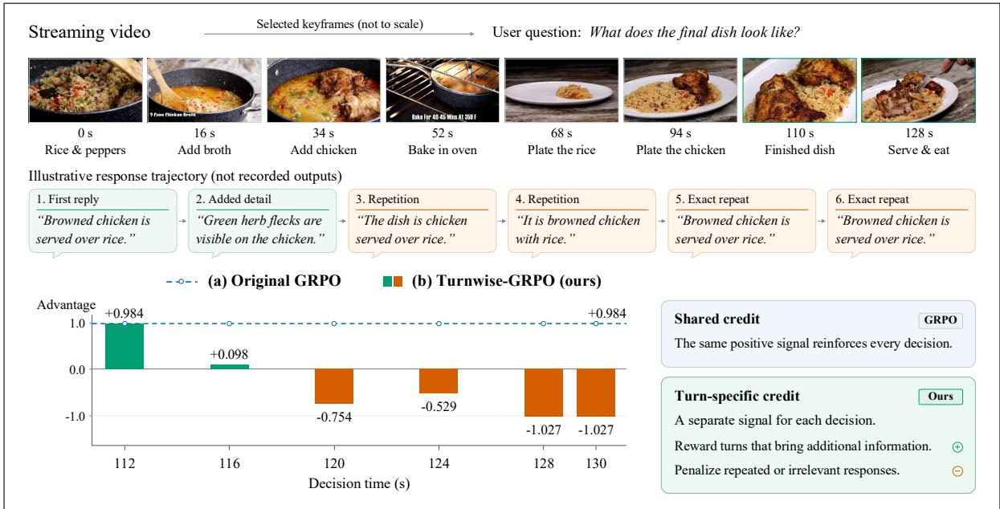
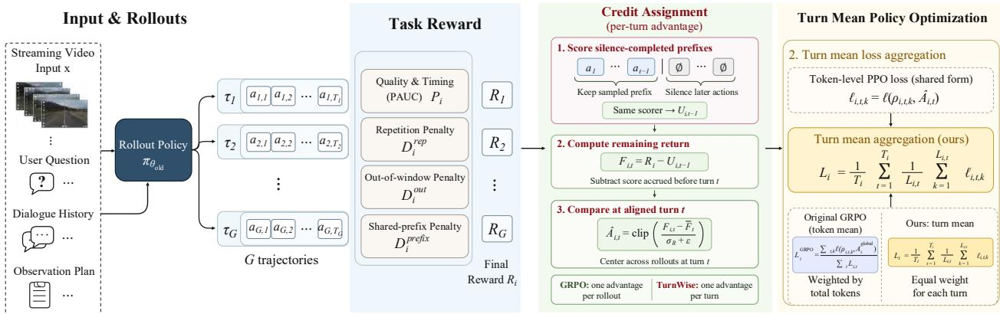
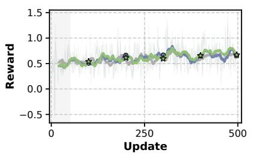
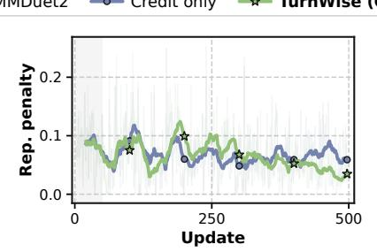
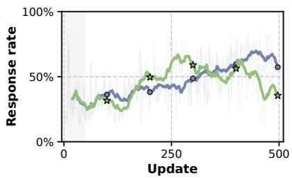
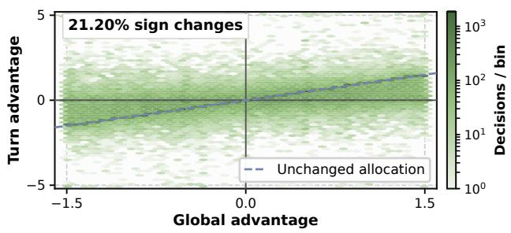
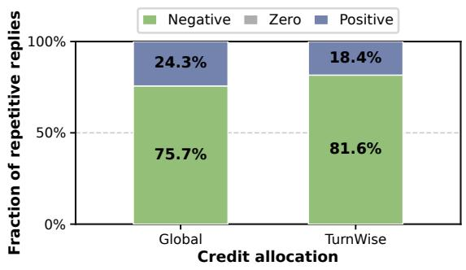

# Turns Matter: Advancing Streaming Video RL via Turn-Level Credit

Shuai Dong1,2,3,\*, Kanghui Tian1,3,5,\*, Linghan Chen1,\*, Wenqi Shao3,‡, Hongrui Wu3,4, Haowen Hou2,3, Yongfu Zhu3, Xuehui Wang3, Ziyue Wang3,7, Wenpu Liu3,7, Weichu Xie3,7, Yuqi Xu3, Congcong Wang3, Kaiwen Tuo3,9, Caoyuan Ma3,8, Taiqiang Wu3,10, Ji Zhao2,3, Wenzheng Chang3,5, Dianyi Wang1,2, Siyuan Wang6,†, Zhongyu Wei1,2,†, Yu Qiao2,5, Jiaqi Wang3

1Fudan University, 2Shanghai Innovation Institute, 3JD.com, 4Stanford University, 5Shanghai Artificial Intelligence Laboratory, 6The Chinese University of Hong Kong, 7Peking University, 8The University of Tokyo, 9The Hong Kong University of Science and Technology, 10The University of Hong Kong

∗Equal contribution, ‡Project leader, †Corresponding authors.

Code Model Dataset

## Abstract

Streaming video understanding requires models to repeatedly decide whether to respond or continue observing. Recently, Group Relative Policy Optimization (GRPO) has been applied to this setting, with existing approaches emphasizing reward design while retaining a single trajectory-level advantage across turns. Such shared credit can reinforce redundant replies after earlier successes and discourage useful follow-ups after earlier failures. We propose TurnWise, a turn-level GRPO framework that aligns learning with individual streaming decisions. TurnWise addresses the mismatch between trajectory-level feedback and turn-level interaction, promoting informative responses and reducing redundancy. Specifically, turn-level credit assignment uses silence-completed prefix scoring to construct group-relative advantages from each decision’s remaining return, separating its learning signal from earlier rewards. Turn-mean policy opti mization averages token losses within each turn and then across turns, giving response and waiting decisions equal weight regardless of output length. These complementary designs improve streaming policy learning without a learned critic or additional rollouts. Extensive experiments show our method outperforms prior RL approaches for streaming video understanding.

## 1 Introduction

Streaming video understanding requires models to interpret an evolving visual world and interact while observations are still arriving [4, 19, 32]. Unlike ofline video understanding [34], where the complete video is available before answering, streaming interaction unfolds through repeated decisions under partial observations. At each turn, a model must decide whether to respond or continue observing [24, 26]. A useful assistant should respond when new evidence warrants an answer, provide follow-up information when needed, and remain silent when another reply would add little value. The appropriate action therefore depends not only on the current visual evidence [7, 11, 30], but also on what the model has already communicated. Learning this sequence of response and waiting decisions requires feedback that reflects answer quality and interaction timing.

  
Fig. 1 Shared advantages can reinforce redundant replies. GRPO assigns one trajectory-level advantage to all turns, so later repetitions may inherit positive credit from earlier successes. TurnWise subtracts group-relative accrued reward before each decision, allowing later turns to receive credit according to their remaining return. The dialogue is illustrative. The advantage plot uses recorded TurnWise advantages and the corresponding GRPO counterfactual.

Reinforcement learning [8, 20–22] provides a natural way to learn these decisions from interaction-leve feedback, with recent approaches adopting Group Relative Policy Optimization (GRPO) [21]. MMDuet2 [26] optimizes proactive interaction with PAUC-based rewards [25], while ThinkStream [16] combines incremental reasoning with rewards for correctness, format, and response timing. StreamPro [13] further incorporates both turn-level and trajectory-level rewards to assess individual responses and overall interaction quality. Reward design and short-span training [26] improve interaction feedback, but the trajectory-level GRPO formulations considered here still broadcast one advantage across decision turns. Turn-level scoring and turn-specific policy credit are therefore distinct design choices.

A good trajectory can contain bad turns, and a bad trajectory can contain good turns. After a successful early response, a redundant reply may still inherit a positive trajectory advantage, even if the reward penalizes repetition (Fig. 1). Conversely, a useful follow-up after earlier failures may receive a negative advantage because the trajectory remains below the group average. In both cases, rewards accrued before the current decision influence its learning signal, potentially obscuring the value of responding or waiting at that turn. We therefore argue that a streaming decision’s learning signal should emphasize the return from that turn onward, rather than rewards accumulated earlier.

Guided by this principle, we propose TurnWise, a turn-level GRPO framework that aligns advantage estimation and loss aggregation with streaming decisions. Building on the return-to-go principle [22], TurnWise exploits the explicit waiting action to score each trajectory prefix with all remaining turns set to silence. Subtracting this prefix reference from the full trajectory reward yields a remaining return, from which we construct group-relative, turn-specific advantages. Silence-completed prefix scoring converts trajectory feedback into turn-specific remaining-return advantages. The computation reuses existing rollout evaluations, requiring neither a learned critic nor additional rollouts.

TurnWise couples turn-specific credit with equal weighting of response and waiting decisions. Under tokenmean aggregation, longer responses still receive larger aggregation weights than short waiting actions. We therefore introduce turn-mean loss aggregation, averaging token losses within each turn before averaging across turns within each trajectory. Turn-mean aggregation balances sampled response and waiting decisions directly in the RL objective, making each turn’s weight independent of its output length. Together, the two designs make the decision turn a common unit for advantage estimation and loss aggregation, addressing both how a turn receives credit and how its feedback is weighted during policy optimization.

In summary, our contributions are as follows:

• We identify a granularity mismatch in streaming video RL. Shared trajectory advantages can obscure the value of later decisions, while token-mean loss aggregation makes turn weights depend on response length.

• We introduce TurnWise, combining silence-completed prefix scoring for turn-specific remaining-return advantages with turn-mean loss aggregation, without a learned critic or additional rollouts.

• We achieve the best aggregate scores on ProactiveVQA [25], OVO-Timing [17], and StreamingBench [15] with both Qwen backbones, and show that turn-mean aggregation improves response timing while reducing repetition relative to credit-only optimization.

## 2 Related Work

## 2.1 Streaming Video Interaction

Streaming video interaction extends ofline video understanding [34] by requiring models to process incoming observations and decide when to communicate. Unlike answering after viewing an entire video, these models must operate on observed prefixes and accommodate evolving user queries. VideoLLM-online [4] in troduces online video-language modeling, while MMDuet [24] broadens time-sensitive comprehension through interleaved video-text dialogue. Dispider [19] disentangles perception, decision, and reaction, and Stream-Bridge [23] equips ofline models with a lightweight proactive activation module. TimeChat-Online [28] reduces visual redundancy, while Flash-VStream [33] maintains compact memory for real-time understanding of long video streams. Streamo [27] further supports diverse streaming tasks through large-scale instruction tuning, including narration, event captioning, and time-sensitive question answering. Benchmarks including ProactiveVideoQA [25], OVO-Bench [17], and StreamingBench [15] cover real-time perception, historical understanding, and proactive response timing. These studies establish the setting for learning response and waiting decisions, while our work focuses on how RL feedback is assigned and weighted across those decisions.

## 2.2 Reinforcement Learning for Video Understanding

PPO [20] and GRPO [21] provide widely used foundations for language-model policy optimization. Their application to video models has progressed from preference alignment to temporal reasoning and long-video training. VLM-RLAIF [1] uses AI-generated feedback for video instruction tuning. Video-R1 [9] encourages temporal reasoning through T-GRPO, VideoChat-R1 [14] strengthens spatio-temporal perception through reinforcement fine-tuning, and LongVILA-R1 [6] scales RL training to long video inputs. Policy distillation can improve initialization for subsequent RL [8, 29]. In streaming settings, MMDuet2 [26] optimizes PAUCbased interaction rewards and uses short-span training to mitigate reward sparsity and temporal credit assignment. ThinkStream [16] trains incremental reasoning with accuracy, format, and timing rewards, while StreamPro [13] combines turn-level response scores with trajectory-level coherence rewards. These approaches improve evaluation of sampled interactions, but their trajectory-level GRPO formulations derive a shared advantage from the aggregated reward. TurnWise aligns streaming policy optimization with decision turns through group-relative remaining-return credit and turn-mean loss aggregation.

  
Fig. 2 Overview of TurnWise. Given streaming video input x, user queries, dialogue history, and an observation plan, the policy samples a group of trajectories $\{ \tau _ { i } \} _ { i = 1 } ^ { G }$ . TurnWise converts trajectory rewards $R _ { i }$ into group-relative remaining-return advantages $\hat { A } _ { i , t }$ through silence-completed prefix scoring. Turn-mean aggregation then gives every response-or-wait decision equal weight in the trajectory loss $L _ { i }$

## 3 Methodology

Fig. 2 presents an overview of TurnWise. TurnWise aligns policy optimization with streaming decisions through two coupled mechanisms: group-relative remaining-return advantages and equal weighting of decision turns.

## 3.1 Streaming Decisions and Trajectory Rewards

A streaming instance comprises video input x, user queries, initial dialogue history $h _ { 0 }$ , and an observation plan specifying the decision-time grid. At decision turn t, the policy’s context $h _ { i , t }$ contains only the available video-text prefix and its previously generated actions in sampled trajectory i. The policy $\pi _ { \theta }$ generates either a textual response or the explicit waiting output NO REPLY, denoted by ∅. Waiting produces no user-visible answer, but remains a generated action optimized alongside responses. To learn these decisions, we sample G trajectories $\tau _ { i } = ( a _ { i , 1 } , \ldots , a _ { i , T _ { i } } )$ from the rollout policy, with $a _ { i , t } \sim \pi _ { \theta _ { \mathrm { o l d } } } ( \cdot \mid h _ { i , t } )$ . Here, $T _ { i }$ denotes the number of decision turns in trajectory i; aligned trajectories within a group follow the same observation plan and have a common horizon, while diferent instances may have diferent horizons. Their observations are shared, but their dialogue histories can difer through earlier sampled responses. Consequently, the value of a new response depends on both the evidence available so far and the information already communicated.

Following MMDuet2 [26], we evaluate each complete trajectory with a PAUC-based reward:

$$
R _ { i } = \mathcal { R } ( \tau _ { i } ) = 3 P _ { i } - 2 D _ { i } ^ { \mathrm { r e p } } - 0 . 5 D _ { i } ^ { \mathrm { o u t } } - 2 D _ { i } ^ { \mathrm { p r e f i x } } .\tag{1}
$$

Here, $P _ { i }$ measures response quality and timeliness within annotated reply windows [25]. For a given quality improvement, responding earlier increases its contribution over the window, linking answer content to response timing. The remaining terms penalize unwanted response behaviors: $D _ { i } ^ { \mathrm { r e p } }$ is the fraction of non-silent replies whose information is already covered by previous replies; $D _ { i } ^ { \mathrm { o u t } }$ is the fraction of out-of-window decision turns at which the model responds; and $D _ { i } ^ { \mathrm { p r e f i x } }$ counts excessively long shared-prefix violations normalized by $T _ { i }$ Empty denominators contribute zero, and repetition checks include non-silent assistant replies in the actual initial dialogue. These response-level assessments ultimately produce a single interaction score. A fixed trajectory scorer makes credit assignment and loss aggregation the controlled optimization variables.

GRPO [21] converts this score into one group-relative advantage per trajectory:

$$
A _ { i } ^ { \mathrm { g l o b a l } } = \frac { R _ { i } - \bar { R } } { \sigma _ { R } + \epsilon } , \qquad \bar { R } = \frac 1 G \sum _ { j = 1 } ^ { G } R _ { j } ,\tag{2}
$$

where $\sigma _ { R }$ is the sample standard deviation of terminal rewards within the group. Broadcasting $A _ { i } ^ { \mathrm { g l o b a l } }$ to every action token expresses a preference over whole trajectories, but does not distinguish rewards earned before a turn from gains obtained from that turn onward. Later decisions can therefore inherit credit from earlier successes or failures. TurnWise resolves this temporal mismatch through group-relative remaining returns.

## 3.2 Turn-Level Credit Assignment

We exploit the sequential observation stream and the explicit waiting action to refine $\mathrm { G R P O ^ { \circ } s }$ s shared trajectory advantage into turn-level credit without a critic model. Streaming observations advance according to the shared observation plan, while the assistant may respond or remain silent at each decision point. This structure lets us score what a trajectory prefix achieves when the stream continues but no further replies are made, providing an accrued-reward reference directly from the trajectory scorer rather than a learned state-value function. Specifically, we retain the first t sampled actions and set all later actions to silence:

$$
U _ { i , t } = { \mathcal { R } } { \big ( } a _ { i , 1 } , \dots , a _ { i , t } , \underbrace { { \mathcal { O } } , \dots , { \mathcal { O } } } _ { T _ { i } - t } { \big ) } , \qquad 0 \leq t \leq T _ { i } .\tag{3}
$$

Every prefix is scored with the same initial history, decision timestamps, reply windows, and evaluation horizon as the full trajectory. Thus, $U _ { i , }$ measures what the retained decisions achieve if no further replies are made. At the endpoints, $U _ { i , 0 }$ is the shared, not necessarily zero, all-silent reference and $U _ { i , T _ { i } } = R _ { i }$

The score diferences ${ r } _ { i , t } ~ = ~ { U } _ { i , t } - { U } _ { i , t - 1 }$ give the turn-level reward increments shown in $\mathrm { F i g . ~ 2 }$ . These increments exactly decompose the trajectory score relative to the all-silent reference. For decision $t , C _ { i , t - 1 } =$ $U _ { i , t - 1 } { - } U _ { i , 0 }$ measures reward already accrued, while $F _ { i , t } = R _ { i } - U _ { i , t - 1 }$ measures the additional return from the sampled continuation starting at that turn. Using $F _ { i , i }$ t instead of $R _ { i }$ excludes earlier rewards from the current decision’s credit, following the return-to-go principle [22]. The telescoping derivation and its applicability to non-additive reward terms are given in section A. We compare these remaining returns within each rollout group:

$$
\begin{array} { r l r } {  { \hat { A } _ { i , t } = [ \frac { F _ { i , t } - \bar { F } _ { t } } { \sigma _ { R } + \epsilon } ] _ { - a _ { \mathrm { m a x } } } ^ { a _ { \mathrm { m a x } } } } } \\ & { } & { = [ A _ { i } ^ { \mathrm { g l o b a l } } - \frac { C _ { i , t - 1 } - \bar { C } _ { t - 1 } } { \sigma _ { R } + \epsilon } ] _ { - a _ { \mathrm { m a x } } } ^ { a _ { \mathrm { m a x } } } . } \end{array}\tag{4}
$$

Here, $\begin{array} { r } { \bar { F } _ { t } = G ^ { - 1 } \sum _ { i } F _ { j , t } } \end{array}$ and $\begin{array} { r } { \bar { C } _ { t - 1 } = G ^ { - 1 } \sum _ { i } C _ { j , t - 1 } } \end{array}$ . The operator [z]u = min{u, max $\{ l , z \} \}$ clips the normalized advantage to $[ - a _ { \mathrm { m a x } } , a _ { \mathrm { m a x } } ]$ . Here, $a _ { \mathrm { m a x } } > 0$ is a fixed clipping threshold $( a _ { \mathrm { m a x } } = 5$ in our experiments), limiting the influence of unusually large advantage magnitudes on the policy update. The second equality makes the credit correction explicit: we subtract the group-relative reward already accrued before the current decision (see section A.3 for the derivation). Above-average early success no longer directly boosts later redundant replies, while below-average early performance no longer directly depresses useful follow-ups. In particular, a trajectory with $R _ { i } > \bar { R }$ can receive a negative later-turn advantage $\hat { A } _ { i , t } \mathrm { ~ i f ~ } F _ { i , t } < \bar { F } _ { t }$ . Conversely, a trajectory below the terminal-reward average can receive positive credit at a later turn when its remaining return exceeds the group average. The first-turn credit correction is zero since $C _ { i , 0 } = 0$ , and retaining $\sigma _ { R }$ preserves a common GRPO normalization scale across turns.

To control how strongly earlier rewards are removed, we introduce $\alpha \in [ 0 , 1 ]$ to scale the accrued-reward correction before clipping:

$$
\hat { A } _ { i , t } ^ { ( \alpha ) } = \bigg [ A _ { i } ^ { \mathrm { g l o b a l } } - \alpha \frac { C _ { i , t - 1 } - \bar { C } _ { t - 1 } } { \sigma _ { R } + \epsilon } \bigg ] _ { - a _ { \mathrm { m a x } } } ^ { a _ { \mathrm { m a x } } } .\tag{5}
$$

This is equivalent to interpolating between the global and remaining-return advantages before clipping. At $\alpha = 0$ , all turns share the clipped GRPO advantage; at $\alpha = 1 , \hat { A } _ { i , t } ^ { ( 1 ) } = \hat { A } _ { i , t }$ is the fully corrected turn-specific advantage in equation (4). As detailed in section 4.1, we linearly increase α from 0 to 1 over the first 10% of scheduled updates and then keep it at 1, gradually transitioning from shared to turn-specific credit.

These advantages reuse the sampled trajectory’s quality and repetition evaluations: a silent sufix changes neither a retained response nor its preceding replies. A deterministic scan updates prefix scores and their denominators, yielding critic-free turn-level advantages without additional rollouts or judge calls. Each resulting advantage is assigned to the generated action tokens within its turn.

## 3.3 Turn-Mean Policy Optimization

Within streaming GRPO, turn-level advantages assign credit to individual decisions, but token-mean loss aggregation still weights these decisions by response length. Let $L _ { i , t }$ denote the number of generated action tokens at turn t. Under token-mean aggregation, this turn receives weight $L _ { i , t } / \sum _ { s } L _ { i , s }$ , so a long response outweighs a short waiting action. We introduce turn-mean policy optimization to give each streaming decision equal aggregation weight regardless of its output length.

Let $\rho _ { i , t , k } ( \theta )$ be the current-to-rollout policy probability ratio for token $\boldsymbol { a } _ { i , t , k }$ , conditioned on the turn history and preceding action tokens. GRPO optimizes generated tokens with a clipped probability-ratio surrogate [20, 21]:

$$
\ell _ { \mathrm { c l i p } } ( \rho , A ) = - \operatorname* { m i n } \{ \rho A , [ \rho ] _ { 1 - \delta } ^ { 1 + \delta } A \} ,\tag{6}
$$

where $\delta$ controls probability-ratio clipping. Let $\ell ( \rho , A )$ denote this surrogate with the dual-clipping safeguard detailed in section B. TurnWise applies the corrected group-relative advantage to each token in its turn, giving $\ell _ { i , t , k } ( \theta ) = \ell ( \rho _ { i , t , k } ( \theta ) , \hat { A } _ { i , t } ^ { ( \alpha ) } )$ .

As shown in Fig. 2, we first average token losses within each turn and then average across turns:

$$
L _ { i } ( \theta ) = \frac { 1 } { T _ { i } } \sum _ { t = 1 } ^ { T _ { i } } \frac { 1 } { L _ { i , t } } \sum _ { k = 1 } ^ { L _ { i , t } } \ell _ { i , t , k } ( \theta ) ,\tag{7}
$$

Each response-or-wait decision thus receives weight $1 / T _ { i }$ , preventing response length from determining its share of the policy loss. Algorithm 1 applies this turn-mean aggregation during each GRPO update.

## 3.4 Unified TurnWise Objective

The TurnWise objective couples turn-specific remaining-return advantages with length-independent decision weights. GRPO first normalizes Ri within each rollout group to obtain the shared advantage $A _ { i } ^ { \mathrm { g l o b a l } }$ in equation (2). Without KL regularization, the trajectory-averaged GRPO loss over B sampled trajectories is

$$
\mathcal { L } _ { \mathrm { G R P O } } ( \boldsymbol { \theta } ) = \sum _ { i , t , k } \frac { \ell \big ( \rho _ { i , t , k } ( \boldsymbol { \theta } ) , A _ { i } ^ { \mathrm { g l o b a l } } \big ) } { B \sum _ { s = 1 } ^ { T _ { i } } L _ { i , s } } .\tag{8}
$$

Each token therefore uses the same trajectory-level credit, and each turn’s contribution scales with its output length.

We correct the shared advantage using equation (5) and adopt turn-mean aggregation from equation (7), yielding the unified objective:

$$
\begin{array} { l } { { \displaystyle \hat { A } _ { i , t } ^ { ( \alpha ) } = \biggl [ A _ { i } ^ { \mathrm { g l o b a l } } - \alpha \frac { C _ { i , t - 1 } - \bar { C } _ { t - 1 } } { \sigma _ { R } + \epsilon } \biggr ] _ { - a _ { \mathrm { m a x } } } ^ { a _ { \mathrm { m a x } } } } , } \\ { { \displaystyle \mathcal { L } _ { \mathrm { T W } } ( \theta ) = \sum _ { i , t , k } \frac { \ell \bigl ( \rho _ { i , t , k } ( \theta ) , \hat { A } _ { i , t } ^ { ( \alpha ) } \bigr ) } { B T _ { i } L _ { i , t } } . } } \end{array}\tag{9}
$$

The advantage correction removes reward accrued before the current decision, while the denominator $B T _ { i } L _ { i , t }$ makes decision weights independent of response length. With full correction $\alpha = 1$ , the policy learns from group-relative remaining returns at the response-or-wait granularity. Algorithm 1 combines group sampling, trajectory scoring, turn-level advantage correction, and turn-mean policy updates in this GRPO training loop.

Algorithm 1 GRPO-Style TurnWise Training   
Require: Streaming instances $\mathcal { D } ,$ policy $\pi _ { \boldsymbol { \theta } } .$ trajectory scorer R, rollout group size G, GRPO updates S, learning   
rate η.   
Ensure: Trained streaming policy $\pi _ { \theta } .$   
1: Initialize AdamW with learning rate η   
2: for GRPO iteration $s = 0 , \ldots , S - 1$ do   
3: $\theta _ { \mathrm { o l d } }  \theta$   
4: $\alpha  \operatorname* { m i n } \{ 1 , s / [ 0 . 1 S ] \}$ ▷ Credit warm-up   
5: Sample a batch of streaming instances from $\mathcal { D }$   
6: for all streaming instances in the batch do   
7: Sample aligned $\{ \tau _ { i } \} _ { i = 1 } ^ { G }$ with $\pi _ { \theta _ { \mathrm { o l d } } }$ ▷ Respond or wait   
8: Evaluate $R _ { i } = \mathcal { R } ( \tau _ { i } )$ and cache reply scores   
9: Compute $\{ U _ { i , t } \}$ via equation (3) ▷ Cached scan   
10: Compute R¯ and $\sigma _ { R }$ from $\{ R _ { i } \} _ { i = 1 } ^ { G }$   
11: if $\sigma _ { R _ { \cdot } } = 0$ then   
12: $\hat { A } _ { i , t } ^ { ( \alpha ) } \gets 0$ for all $i , t$ in the group   
13: else   
14: Compute $A _ { i } ^ { \mathrm { g l o b a l } }$ via equation (2)   
15: for each aligned decision turn t do   
16: $F _ { i , t } \gets R _ { i } - U _ { i , t - 1 }$ for all i   
17: $\begin{array} { r } { \bar { F } _ { t } \gets G ^ { - 1 } \sum _ { j = 1 } ^ { G } F _ { j , t } } \end{array}$   
18: Compute $\hat { A } _ { i , t } ^ { ( \alpha ) }$ via equation (5)   
19: end for   
20: end if   
21: end for   
22: Compute token ratios $\rho _ { i , t , k } ( \theta )$ for the batch   
23: Compute $\ell _ { i , t , k }$ with turn advantage $\hat { A } _ { i , t } ^ { ( \alpha ) }$   
24: Compute $L _ { i }$ via equation (7) ▷ Turn-mean loss   
25: B ← total number of sampled trajectories   
26: Compute ${ \mathcal { L } } _ { \mathrm { T W } }$ via equation (9)   
27: Update θ using AdamW and $\nabla _ { \boldsymbol { \theta } } \mathcal { L } _ { \mathrm { T W } }$   
28: end for

## 4 Experiments

Our evaluation measures benchmark performance, the complementary efects of credit assignment and loss aggregation, and the resulting changes in response behavior.

## 4.1 Training Pipeline

We first fine-tune Qwen2.5-VL-3B [3] and Qwen3-VL-4B [2] on EgoExo4D [10], EgoExoLearn [12], Live WhisperX [5], Tarsier2 [31], and LLaVA-Video [34]. Both models use the same SFT corpus of 100,874 valid instruction examples, with 1% held out for validation. SFT runs for one epoch at learning rate $1 0 ^ { - 5 }$ with the vision tower frozen. We then optimize the streaming policies with GRPO-style reinforcement learning [21], using groups of sampled trajectories to form relative advantage signals. RL uses 3,983 streaming instances with 20-second target segments, initial dialogue context, and at most 90 frames sampled every two seconds, following MMDuet2 [26]. We use the PAUC-based reward in equation (1), judged by gpt-oss-20b [18].

All RL configurations use batch size 8 and G = 4 rollouts per instance, with temperature 1.2 and top-k = 10, following MMDuet2 [26]. We train for one epoch with AdamW at learning rate $1 0 ^ { - 6 }$ , one policy optimization epoch per batch, and no KL or entropy regularization. TurnWise freezes the vision tower and uses turn-mean aggregation, with α linearly warmed up to 1 over the first 10% of scheduled updates. We set $\epsilon = 1 0 ^ { - 6 }$ amax = 5, δ = 0.2, and c = 3.

Table 1 TurnWise achieves the best aggregate scores on ProactiveVQA, OVO-Timing, and StreamingBench with both backbones. Within each backbone, the best and second-best results are bold and underlined, respectively. ∆ denotes TurnWise minus the strongest non-TurnWise result in each aggregate column.
<table><tr><td rowspan="3">Method</td><td colspan="5">ProactiveVQA</td><td colspan="4">OVO-Timing</td><td colspan="3">StreamingBench</td></tr><tr><td colspan="5">PAUC ↑</td><td colspan="4">Timing F1 ↑</td><td rowspan="2">RealTime Acc. ↑</td><td rowspan="2">Proactive Acc. ↑</td><td rowspan="2">Avg. ↑</td></tr><tr><td>Ego</td><td>TV</td><td>VAD</td><td>Web</td><td>Overall</td><td>CRR</td><td>SSR</td><td>REC</td><td>Avg.</td></tr><tr><td>Qwen2.5-VL-3B</td><td></td><td></td><td></td><td></td><td></td><td></td><td></td><td></td><td></td><td></td><td></td><td></td></tr><tr><td>Baseline</td><td>9.32</td><td>27.85</td><td>8.98</td><td>42.45</td><td>22.15</td><td>0.00</td><td>0.53</td><td>3.46</td><td>1.33</td><td>69.42</td><td>22.40</td><td>45.91</td></tr><tr><td>+ SFT</td><td>26.05</td><td>27.60</td><td>26.30</td><td>35.00</td><td>28.74</td><td>0.00</td><td>0.95</td><td>0.76</td><td>0.57</td><td>74.68</td><td>22.80</td><td>48.74</td></tr><tr><td>+ MMDuet2</td><td>44.10</td><td>39.70</td><td>28.70</td><td>45.90</td><td>39.60</td><td>13.86</td><td>17.56</td><td>21.76</td><td>17.72</td><td>74.88</td><td>20.40</td><td>47.64</td></tr><tr><td>+ ThinkStream</td><td>32.90</td><td>34.48</td><td>15.72</td><td>55.43</td><td>34.63</td><td>4.09</td><td>4.54</td><td>15.60</td><td>8.08</td><td>72.52</td><td>16.40</td><td>44.46</td></tr><tr><td>+ StreamPro</td><td>39.73</td><td>37.96</td><td>22.15</td><td>52.29</td><td>38.03</td><td>7.98</td><td>6.49</td><td>29.02</td><td>14.50</td><td>75.16</td><td>20.40</td><td>47.78</td></tr><tr><td>+ TurnWise</td><td>44.69</td><td>43.01</td><td>29.18</td><td>57.36</td><td>43.56</td><td>18.02</td><td>14.61</td><td>32.15</td><td>21.59</td><td>75.85</td><td>23.00</td><td>49.43</td></tr><tr><td>∆</td><td></td><td></td><td></td><td></td><td>+3.96</td><td></td><td></td><td></td><td>+3.87</td><td></td><td></td><td>+0.69</td></tr><tr><td>Qwen3-VL-4B</td><td></td><td></td><td></td><td></td><td></td><td></td><td></td><td></td><td></td><td></td><td></td><td></td></tr><tr><td>Baseline</td><td>24.00</td><td>31.80</td><td>15.09</td><td>48.42</td><td>29.83</td><td>4.21</td><td>4.56</td><td>16.66</td><td>8.48</td><td>73.57</td><td>32.80</td><td>53.19</td></tr><tr><td>+ SFT</td><td>29.10</td><td>27.07</td><td>28.46</td><td>36.33</td><td>30.24</td><td>2.78</td><td>0.95</td><td>1.06</td><td>1.60</td><td>77.56</td><td>35.60</td><td>56.58</td></tr><tr><td>+ MMDuet2</td><td>24.30</td><td>28.57</td><td>24.95</td><td>42.91</td><td>30.18</td><td>11.88</td><td>4.25</td><td>11.57</td><td>9.23</td><td>77.28</td><td>30.40</td><td>53.84</td></tr><tr><td>+ ThinkStream</td><td>41.29</td><td>38.49</td><td>19.47</td><td>45.48</td><td>36.18</td><td>5.67</td><td>6.09</td><td>15.09</td><td>8.95</td><td>77.04</td><td>34.80</td><td>55.92</td></tr><tr><td>+ StreamPro</td><td>36.39</td><td>36.43</td><td>14.82</td><td>51.02</td><td>34.67</td><td>4.34</td><td>4.63</td><td>16.52</td><td>8.50</td><td>78.24</td><td>32.80</td><td>55.52</td></tr><tr><td>+ TurnWise</td><td>42.63</td><td>37.73</td><td>31.95</td><td>57.45</td><td>42.44</td><td>8.68</td><td>7.35</td><td>17.43</td><td>11.15</td><td>79.52</td><td>38.40</td><td>58.96</td></tr><tr><td>∆</td><td></td><td></td><td></td><td></td><td>+6.26</td><td></td><td></td><td></td><td>+1.92</td><td></td><td></td><td>+2.38</td></tr></table>

## 4.2 Benchmarks

We evaluate on ProactiveVQA [25], using 300 instances across Ego, TV, VAD, and Web to assess answer quality and timeliness within reply windows. OVO-Timing [17] evaluates event-triggered responses on CRR, SSR, and REC. StreamingBench [15] tests answer correctness from observed video prefixes through Real-Time Visual Understanding, and joint answer correctness and timing through Proactive Output. Together, these benchmarks assess complementary aspects of streaming policies: proactive answer quality, event-triggered timing, and real-time visual understanding.

## 4.3 Evaluations

We compare TurnWise with SFT models and the RL baselines MMDuet2, ThinkStream [16], and Stream-Pro [13], implemented in the same streaming GRPO framework. All models use greedy decoding with observed video prefixes and their own previous responses as context.

On ProactiveVQA, we report PAUC with ω = 0.5, judged by GPT-5.6-luna and averaged equally across four categories; ablations also report repetition rates among non-silent replies. OVO-Timing uses Timing F1 with one-to-one matching within ±2 seconds. We compute F1 from mean per-instance precision and recall for each task, then average equally across CRR, SSR, and REC. For StreamingBench, we report multiple-choice accuracy on Real-Time Visual Understanding and joint answer-and-timing accuracy within ±2 seconds on Proactive Output, and their equal-weight mean.

## 5 Results and Discussions

## 5.1 Main Results

TurnWise achieves the best aggregate scores on all three benchmarks with both backbones. Component analysis shows that combining turn-level credit with turn-mean aggregation improves task performance while reducing redundant replies.

  
(a) Reward

  
(b) Repetition

  
(c) Response frequency  
Fig. 3 TurnWise achieves higher late-stage reward with fewer redundant replies relative to creditonly optimization. Panel a shows reward, panel b shows reply-normalized repetition penalty magnitude, and panel c shows non-silent decision fraction. Faint traces are batch means. Solid curves are trailing 20-update averages. Gray shading marks credit warmup.

Table 2 Complementary efects of turn-level credit and turn-mean aggregation on Qwen2.5-VL-3B. Their combination achieves the highest task scores and reduces repetition relative to either component alone. PAUC, F1, and Avg. are benchmark-level scores; Rep. measures repetition among non-silent replies. The best and second-best results are bold and underlined.
<table><tr><td rowspan="2">Method</td><td rowspan="2">Credit Turn Assign. Mean</td><td colspan="2">Proactive VQA</td><td rowspan="2">OVO- Timing</td><td rowspan="2">Streaming Bench</td></tr><tr><td>PAUC ↑Rep. ↓</td><td></td></tr><tr><td>Base</td><td></td><td>22.15</td><td>65.40</td><td>F1 ↑ 1.33</td><td>Avg. ↑ 45.91</td></tr><tr><td>SFT</td><td></td><td>28.74</td><td>3.79</td><td>0.57</td><td>48.74</td></tr><tr><td>MMDuet2</td><td></td><td>39.60</td><td>6.08</td><td>17.72</td><td>47.64</td></tr><tr><td>+ Turn Mean</td><td>√</td><td>41.87</td><td>9.78</td><td>8.17</td><td>47.58</td></tr><tr><td>+ Credit</td><td>√</td><td>43.12</td><td>15.53</td><td>18.63</td><td>48.94</td></tr><tr><td>TurnWise</td><td>√ √</td><td>43.56</td><td>5.98</td><td>21.59</td><td>49.43</td></tr></table>

Table 3 With turn-mean aggregation, α = 1 is best across all four metrics on Qwen2.5-VL-3B. Metrics follow Table 2; bold/underline mark best/second-best within each configuration.
<table><tr><td rowspan="2">α</td><td colspan="2">Proactive VQA</td><td>OVO- Timing</td><td>Streaming Bench</td></tr><tr><td>PAUC ↑</td><td>Rep. ↓</td><td>F1 ↑</td><td>Avg. ↑</td></tr><tr><td colspan="5">Credit Assignment</td></tr><tr><td>0.25</td><td>44.50</td><td>16.81</td><td>19.51</td><td>47.46</td></tr><tr><td>0.50</td><td>43.34</td><td>18.91</td><td>19.41</td><td>48.30</td></tr><tr><td>0.75</td><td>44.24</td><td>25.16</td><td>12.97</td><td>46.84</td></tr><tr><td>1.00</td><td>43.12</td><td>15.53</td><td>18.63</td><td>48.94</td></tr><tr><td colspan="5">Credit Assignment + Turn Mean</td></tr><tr><td>0.25</td><td>41.37</td><td>12.49</td><td>16.68</td><td>48.05</td></tr><tr><td>0.50</td><td>41.71</td><td>36.04</td><td>10.53</td><td>46.44</td></tr><tr><td>0.75</td><td>42.00</td><td>12.95</td><td>9.73</td><td>46.95</td></tr><tr><td>1.00</td><td>43.56</td><td>5.98</td><td>21.59</td><td>49.43</td></tr></table>

Benchmark Results. Table 1 compares TurnWise with SFT and GRPO-based RL baselines on three streaming benchmarks. TurnWise achieves the best aggregate scores on three benchmarks with both backbones. On Qwen2.5-VL-3B, it reaches 43.56 PAUC on ProactiveVQA, 21.59 average Timing F1 on OVO-Timing, and 49.43 average accuracy on StreamingBench, exceeding the strongest non-TurnWise results by 3.96, 3.87, and 0.69 points, respectively. On Qwen3-VL-4B, the scores are 42.44, 11.15, and 58.96, with gains of 6.26, 1.92, and 2.38 points.

The improvements extend across both proactive interaction and visual understanding. On ProactiveVQA, TurnWise leads all four categories with the 3B backbone and three of four with the 4B backbone. For the latter, VAD and Web improve by 3.49 and 6.43 points over the strongest competing results. On StreamingBench, TurnWise obtains the highest real-time and proactive accuracies with both backbones. In particular, the 4B model reaches 38.40 proactive accuracy, compared with 35.60 for the strongest baseline, while also improving real-time accuracy from 78.24 to 79.52. Across both backbones, TurnWise improves proactive interaction, response timing, and real-time visual understanding.

Complementary Efects of Credit Assignment and Turn-Mean Aggregation. On Qwen2.5-VL-3B, combining turn-level credit with turn-mean aggregation reduces repetition by 61.5% relative to credit-only optimization, from 15.53 to 5.98, while increasing Timing F1 by 2.96 points and StreamingBench average accuracy by 0.49 points (Table 2). Turn-level credit determines each decision’s learning direction; turn-mean aggregation determines its weight in the policy update. Their combination achieves the highest aggregate task scores among the evaluated component configurations. Relative to turn-mean aggregation alone, combining both components improves Timing F1 by 13.42 points and reduces repetition by 38.9%.

  
a Decision-level credit redistribution

  
b Repetitive replies, 2,972 total  
Fig. 4 Turn-level credit assigns negative advantages to 59.83% of repetitive replies with positive global advantages (432 of 722). Both allocations use the same sampled groups from Qwen2.5-VL-3B training, using complete trajectories with full credit correction at α = 1. Panel a shows advantage density over 84,184 decisions. Turn advantages are clipped to ±5 as in training. The dashed diagonal marks unchanged allocation. Panel b shows advantage signs for all 2,972 Judge-labeled repetitive replies in this cohort.

Alpha Sensitivity. Within the complete TurnWise framework on Qwen2.5-VL-3B, full correction (α = 1) achieves the highest PAUC, Timing F1, and StreamingBench accuracy and the lowest repetition among the tested correction strengths (Table 3). This identifies full accrued-reward correction as the operating point for TurnWise.

## 5.2 Training Dynamics and Response Behavior

Turn-mean aggregation raises mean reward from 0.657 to 0.711 over the final 50 updates while reducing repetition-penalty magnitude from 0.069 to 0.036 (Fig. 3, panels a and b). Both configurations use the same turn-level credit rule and Qwen2.5-VL-3B SFT initialization across 497 updates. The outside-window reply fraction decreases from 0.537 to 0.289, while the non-silent decision fraction falls from 62.2% to 37.0% (panel c). Higher reward accompanies more selective response behavior under turn-mean aggregation.

## 5.3 Credit Redistribution on Real Training Trajectories

Turn-level credit assigns negative advantages to 59.83% of the repetitive replies that receive positive global advantages—432 of 722 replies in the analyzed cohort. Fig. 4 compares the logged turn advantages with the global advantages computed from the same sampled groups and terminal rewards. The analysis covers 11,116 complete Qwen2.5-VL-3B training trajectories with full credit correction at α = 1, comprising 84,184 decision turns. As shown in panel a of Fig. 4, 21.20% of decisions change advantage sign relative to global allocation, and 53.15% of trajectories receive both positive and negative turn advantages. Thus, a single trajectory provides distinct learning directions for its constituent decisions.

This diferentiation also targets redundant replies within positively ranked trajectories. Panel b of Fig. 4 shows that turn-level credit increases the share receiving negative advantages from 75.7% to 81.6% across all 2,972 Judge-labeled repetitive replies in this cohort. These recorded advantages show that turn-level credit assigns distinct learning directions within a trajectory and provides suppressive signals for redundant replies in positively ranked trajectories.

## 5.4 Discussion

Tables 2 and 3 and Figs. 3 and 4 highlight complementary roles for credit assignment and loss aggregation: the former determines each turn’s learning signal, while the latter controls its optimization weight. Remainingreturn advantages improve credit assignment, while turn-mean aggregation balances response and waiting decisions. Their combination improves task scores and Timing F1 while reducing redundant and outsidewindow replies. TurnWise unifies credit assignment and policy optimization at the decision-turn level. A deterministic scan of cached PAUC assessments computes the prefix references without additional rollouts or judge calls. Across the evaluated settings, this alignment improves task performance and response timing while reducing redundant replies.

## 6 Conclusion

TurnWise makes the decision turn the common unit of credit assignment and policy optimization in streaming video RL. Silence-completed prefix references remove previously accrued rewards from later-turn credit, while turn-mean aggregation gives response and waiting decisions equal weight, without a learned critic or additional rollouts. Across two Qwen backbones, TurnWise achieves the best aggregate results on all three evaluated benchmarks, with component analyses supporting higher-quality, better-timed, and more selective responses.

## References

[1] Daechul Ahn, Yura Choi, Youngjae Yu, Dongyeop Kang, and Jonghyun Choi. Tuning large multimodal models for videos using reinforcement learning from AI feedback. In Proceedings of the 62nd Annual Meeting of the Association for Computational Linguistics (Volume 1: Long Papers), pages 923–940, Bangkok, Thailand, 2024. Association for Computational Linguistics.

[2] Shuai Bai, Yuxuan Cai, Ruizhe Chen, Keqin Chen, Xionghui Chen, Zesen Cheng, Lianghao Deng, Wei Ding, Chang Gao, Chunjiang Ge, Wenbin Ge, Zhifang Guo, Qidong Huang, Jie Huang, Fei Huang, Binyuan Hui, Shutong Jiang, Zhaohai Li, Mingsheng Li, Mei Li, Kaixin Li, Zicheng Lin, Junyang Lin, Xuejing Liu, Jiawei Liu, Chenglong Liu, Yang Liu, Dayiheng Liu, Shixuan Liu, Dunjie Lu, Ruilin Luo, Chenxu Lv, Rui Men, Lingchen Meng, Xuancheng Ren, Xingzhang Ren, Sibo Song, Yuchong Sun, Jun Tang, Jianhong Tu, Jianqiang Wan, Peng Wang, Pengfei Wang, Qiuyue Wang, Yuxuan Wang, Tianbao Xie, Yiheng Xu, Haiyang Xu, Jin Xu, Zhibo Yang, Mingkun Yang, Jianxin Yang, An Yang, Bowen Yu, Fei Zhang, Hang Zhang, Xi Zhang, Bo Zheng, Humen Zhong, Jingren Zhou, Fan Zhou, Jing Zhou, Yuanzhi Zhu, and Ke Zhu. Qwen3-VL technical report. arXiv preprint arXiv:2511.21631, 2025.

[3] Shuai Bai, Keqin Chen, Xuejing Liu, Jialin Wang, Wenbin Ge, Sibo Song, Kai Dang, Peng Wang, Shijie Wang, Jun Tang, Humen Zhong, Yuanzhi Zhu, Mingkun Yang, Zhaohai Li, Jianqiang Wan, Pengfei Wang, Wei Ding, Zheren Fu, Yiheng Xu, Jiabo Ye, Xi Zhang, Tianbao Xie, Zesen Cheng, Hang Zhang, Zhibo Yang, Haiyang Xu, and Junyang Lin. Qwen2.5-VL technical report. arXiv preprint arXiv:2502.13923, 2025.

[4] Joya Chen, Zhaoyang Lv, Shiwei Wu, Kevin Qinghong Lin, Chenan Song, Difei Gao, Jia-Wei Liu, Ziteng Gao, Dongxing Mao, and Mike Zheng Shou. VideoLLM-online: Online video large language model for streaming video. In Proceedings of the IEEE/CVF Conference on Computer Vision and Pattern Recognition (CVPR), pages 18407–18418, 2024.

[5] Joya Chen, Ziyun Zeng, Yiqi Lin, Wei Li, Zejun Ma, and Mike Zheng Shou. LIVE: Learning video LLM with streaming speech transcription at scale. In Proceedings of the IEEE/CVF Conference on Computer Vision and Pattern Recognition (CVPR), pages 29083–29095, 2025.

[6] Yukang Chen, Wei Huang, Baifeng Shi, Qinghao Hu, Hanrong Ye, Ligeng Zhu, Zhijian Liu, Pavlo Molchanov, Jan Kautz, Xiaojuan Qi, Sifei Liu, Hongxu Yin, Yao Lu, and Song Han. Scaling RL to long videos. In Advances in Neural Information Processing Systems, 2025.

[7] Shuai Dong, Siyuan Wang, Xingyu Liu, Chenglin Li, Haowen Hou, and Zhongyu Wei. Interleaved latent visual reasoning with selective perceptual modeling. In Proceedings of the 64th Annual Meeting of the Association for Computational Linguistics (Volume 1: Long Papers), pages 29316–29335, San Diego, California, United States, 2026. Association for Computational Linguistics.

[8] Shuai Dong, Yongfu Zhu, Yuqi Xu, Weichu Xie, Liuwenpu, Ziyue Wang, Kaiwen Tuo, Congcong Wang, Siyuan Wang, Wenqi Shao, Shuai Yang, Ji Zhao, Caoyuan Ma, Wenzheng Chang, Taiqiang Wu, Xinlei Yu, Hongrui Wu, Xiaoxuan He, Fangke Chen, Dianyi Wang, Kanghui Tian, Sirry Chen, Xingyu Liu, Xiangnan Wu, Jiawei Guo, Haowen Hou, LingHan Chen, Zhongyu Wei, and Jiaqi Wang. RL starts before RL: On policy distillation for better reinforcement learning. arXiv preprint arXiv:2609.28145, 2026.

[9] Kaituo Feng, Kaixiong Gong, Bohao Li, Zonghao Guo, Yibing Wang, Tianshuo Peng, Junfei Wu, Xiaoying Zhang, Benyou Wang, and Xiangyu Yue. Video-R1: Reinforcing video reasoning in MLLMs. In Advances in Neural Information Processing Systems, 2025.

[10] Kristen Grauman, Andrew Westbury, Lorenzo Torresani, Kris Kitani, Jitendra Malik, Triantafyllos Afouras, Kumar Ashutosh, Vijay Baiyya, Siddhant Bansal, Bikram Boote, Eugene Byrne, Zach Chavis, Joya Chen, Feng Cheng, Fu-Jen Chu, Sean Crane, Avijit Dasgupta, Jing Dong, Maria Escobar, Cristhian Forigua, Abrham Gebreselasie, Sanjay Haresh, Jing Huang, Md Mohaiminul Islam, Suyog Jain, Rawal Khirodkar, Devansh Kukreja, Kevin J Liang, Jia-Wei Liu, Sagnik Majumder, Yongsen Mao, Miguel Martin, Efrosyni Mavroudi, Tushar Nagarajan, Francesco Ragusa, Santhosh Kumar Ramakrishnan, Luigi Seminara, Arjun Somayazulu, Yale Song, Shan Su, Zihui Xue, Edward Zhang, Jinxu Zhang, Angela Castillo, Changan Chen, Xinzhu Fu, Ryosuke Furuta, Cristina Gonzalez, Prince Gupta, Jiabo Hu, Yifei Huang, Yiming Huang, Weslie Khoo, Anush Kumar, Robert Kuo, Sach Lakhavani, Miao Liu, Mi Luo, Zhengyi Luo, Brighid Meredith, Austin Miller, Oluwatumininu Oguntola, Xiaqing Pan, Penny Peng, Shraman Pramanick, Merey Ramazanova, Fiona Ryan, Wei Shan, Kiran Somasundaram, Chenan Song, Audrey Southerland, Masatoshi Tateno, Huiyu Wang, Yuchen Wang, Takuma Yagi, Mingfei Yan, Xitong Yang, Zecheng Yu, Shengxin Cindy Zha, Chen Zhao, Ziwei Zhao, Zhifan Zhu, Jef Zhuo, Pablo Arbelaez, Gedas Bertasius, Dima Damen, Jakob Engel, Giovanni Maria Farinella, Antonino Furnari, Bernard Ghanem, Judy Hofman, C.V. Jawahar, Richard Newcombe, Hyun Soo Park, James M. Rehg, Yoich Sato, Manolis Savva, Jianbo Shi, Mike Zheng Shou, and Michael Wray. Ego-Exo4D: Understanding skilled human activity from first- and third-person perspectives. In Proceedings of the IEEE/CVF Conference on Computer Vision and Pattern Recognition (CVPR), pages 19383–19400, 2024.

[11] Jiawei Guo, Yu Chen, Xiang Wang, Shuai Li, Xinpei Zhao, Huaxing Liu, Shuai Dong, Feifei Zhai, and Yu Zhou. Beyond visual memory: Mechanistic diagnostics of latent visual reasoning. arXiv preprint arXiv:2606.01287, 2026.

[12] Yifei Huang, Guo Chen, Jilan Xu, Mingfang Zhang, Lijin Yang, Baoqi Pei, Hongjie Zhang, Lu Dong, Yali Wang, Limin Wang, and Yu Qiao. EgoExoLearn: A dataset for bridging asynchronous ego- and exo-centric view of procedural activities in real world. In Proceedings of the IEEE/CVF Conference on Computer Vision and Pattern Recognition (CVPR), pages 22072–22086, 2024.

[13] Ao Li, Zihan Xiao, Zihao Yue, Boshen Xu, Linli Yao, Jiaze Li, Pei Fu, Jianzhong Ju, Jian Luan, and Qin Jin. StreamPro: From reactive perception to proactive decision-making in streaming video. arXiv preprint arXiv:2605.16381, 2026.

[14] Xinhao Li, Ziang Yan, Desen Meng, Lu Dong, Xiangyu Zeng, Yinan He, Yali Wang, Yu Qiao, Yi Wang, and Limin Wang. VideoChat-R1: Enhancing spatio-temporal perception via reinforcement fine-tuning. arXiv preprint arXiv:2504.06958, 2025.

[15] Junming Lin, Zheng Fang, Chi Chen, Haoxuan Cheng, Zihao Wan, Fuwen Luo, Ziyue Wang, Peng Li, Yang Liu, and Maosong Sun. StreamingBench: Assessing the gap for MLLMs to achieve streaming video understanding. In ICASSP 2026 – 2026 IEEE International Conference on Acoustics, Speech and Signal Processing (ICASSP), pages 12147–12151. IEEE, 2026.

[16] Zikang Liu, Longteng Guo, Handong Li, Ru Zhen, Xingjian He, Ruyi Ji, Xiaoming Ren, Yanhao Zhang, Haonan Lu, and Jing Liu. Thinking in streaming video. arXiv preprint arXiv:2603.12938, 2026.

[17] Junbo Niu, Yifei Li, Ziyang Miao, Chunjiang Ge, Yuanhang Zhou, Qihao He, Xiaoyi Dong, Haodong Duan, Shuangrui Ding, Rui Qian, Pan Zhang, Yuhang Zang, Yuhang Cao, Conghui He, and Jiaqi Wang. OVO-Bench: How far is your Video-LLMs from real-world online video understanding? In Proceedings of the IEEE/CVF Conference on Computer Vision and Pattern Recognition (CVPR), pages 18902–18913, 2025.

[18] OpenAI. gpt-oss-120b & gpt-oss-20b model card. arXiv preprint arXiv:2508.10925, 2025.

[19] Rui Qian, Shuangrui Ding, Xiaoyi Dong, Pan Zhang, Yuhang Zang, Yuhang Cao, Dahua Lin, and Jiaqi Wang. Dispider: Enabling video LLMs with active real-time interaction via disentangled perception, decision, and reaction. In Proceedings of the IEEE/CVF Conference on Computer Vision and Pattern Recognition (CVPR), pages 24045–24055, 2025.

[20] John Schulman, Filip Wolski, Prafulla Dhariwal, Alec Radford, and Oleg Klimov. Proximal policy optimization algorithms. arXiv preprint arXiv:1707.06347, 2017.

[21] Zhihong Shao, Peiyi Wang, Qihao Zhu, Runxin Xu, Junxiao Song, Xiao Bi, Haowei Zhang, Mingchuan Zhang,

Y. K. Li, Y. Wu, and Daya Guo. DeepSeekMath: Pushing the limits of mathematical reasoning in open language models. arXiv preprint arXiv:2402.03300, 2024.

[22] Richard S. Sutton and Andrew G. Barto. Reinforcement Learning: An Introduction. MIT Press, Cambridge, MA, 2nd edition, 2018.

[23] Haibo Wang, Bo Feng, Zhengfeng Lai, Mingze Xu, Shiyu Li, Weifeng Ge, Afshin Dehghan, Meng Cao, and Ping Huang. StreamBridge: Turning your ofline video large language model into a proactive streaming assistant. In Advances in Neural Information Processing Systems, 2025.

[24] Yueqian Wang, Xiaojun Meng, Yuxuan Wang, Jianxin Liang, Jiansheng Wei, Huishuai Zhang, and Dongyan Zhao. VideoLLM knows when to speak: Enhancing time-sensitive video comprehension with video-text duet interaction format. In Findings of the Association for Computational Linguistics: EMNLP 2025, pages 6338–6359, Suzhou, China, 2025. Association for Computational Linguistics.

[25] Yueqian Wang, Xiaojun Meng, Yifan Wang, Huishuai Zhang, and Dongyan Zhao. ProactiveVideoQA: A comprehensive benchmark evaluating proactive interactions in video large language models. arXiv preprint arXiv:2507.09313, 2025.

[26] Yueqian Wang, Songxiang Liu, Disong Wang, Nuo Xu, Guanglu Wan, Huishuai Zhang, and Dongyan Zhao. MM-Duet2: Enhancing proactive interaction of video MLLMs with multi-turn reinforcement learning. In International Conference on Learning Representations (ICLR), 2026.

[27] Jiaer Xia, Peixian Chen, Mengdan Zhang, Xing Sun, and Kaiyang Zhou. Streaming video instruction tuning. In Proceedings of the IEEE/CVF Conference on Computer Vision and Pattern Recognition (CVPR), pages 31219– 31229, 2026.

[28] Linli Yao, Yicheng Li, Yuancheng Wei, Lei Li, Shuhuai Ren, Yuanxin Liu, Kun Ouyang, Lean Wang, Shicheng Li, Sida Li, Lingpeng Kong, Qi Liu, Yuanxing Zhang, and Xu Sun. TimeChat-Online: 80% visual tokens are naturally redundant in streaming videos. In Proceedings of the 33rd ACM International Conference on Multimedia, pages 10807–10816. Association for Computing Machinery, 2025.

[29] Xinlei Yu, Gen Li, Qingyi Si, Guibin Zhang, Yuqi Xu, Congcong Wang, Shuai Dong, Kaiwen Tuo, Xiangyu Zeng, Kaituo Feng, Qunzhong Wang, Yang Shi, Xiaobin Hu, Xiangyu Yue, Jiaqi Wang, and Shuicheng Yan. DOPD: Dual on-policy distillation. arXiv preprint arXiv:2606.30626, 2026.

[30] Xinlei Yu, Chengming Xu, Zhangquan Chen, Yudong Zhang, Shilin Lu, Cheng Yang, Jiangning Zhang, Shuicheng Yan, and Xiaobin Hu. Visual document understanding and reasoning: A multi-agent collaboration framework with agent-wise adaptive test-time scaling. In Proceedings of the IEEE/CVF Conference on Computer Vision and Pattern Recognition (CVPR), pages 12300–12311, 2026.

[31] Liping Yuan, Jiawei Wang, Haomiao Sun, Yuchen Zhang, and Yuan Lin. Tarsier2: Advancing large visionlanguage models from detailed video description to comprehensive video understanding. arXiv preprint arXiv:2501.07888, 2025.

[32] Xiangyu Zeng, Yuandong Yang, Zhiqiu Zhang, Yuhan Zhu, Xinhao Li, Qingyi Si, Dingyu Yao, Changlian Ma, Haoran Chen, Xinyu Chen, Yansong Shi, Junhao Zhou, Yifei Li, Jun Zhang, Chuanyu Qin, Chenxu Yang, Xinlei Yu, Kun Ouyang, Yuchen Shao, Qianshan Wei, Changhai Zhou, Jun Gao, Jiaqi Wang, and Limin Wang. OneStreamer: Unifying perception, memory, and proactive response in streaming video interaction. arXiv preprint arXiv:2610.01762, 2026.

[33] Haoji Zhang, Yiqin Wang, Yansong Tang, Yong Liu, Jiashi Feng, and Xiaojie Jin. Flash-VStream: Eficient real-time understanding for long video streams. In Proceedings of the IEEE/CVF International Conference on Computer Vision (ICCV), pages 21059–21069, 2025.

[34] Yuanhan Zhang, Jinming Wu, Wei Li, Bo Li, Zejun Ma, Ziwei Liu, and Chunyuan Li. LLaVA-Video: Video instruction tuning with synthetic data. Transactions on Machine Learning Research, 2025.

## Appendix

## A Derivation of Turn-Level Credit Assignment

This section derives the reward decomposition and advantage correction used in section 3.2. All group averages below refer to the G aligned rollouts of the same streaming instance.

## A.1 Silence-Completed Prefix Scores

For each sampled trajectory $i ,$ equation (3) retains its first t actions and replaces every remaining action with ∅. The scoring context—initial dialogue, decision timestamps, reply windows, and evaluation horizon— remains unchanged. This fixed horizon preserves an earlier answer’s PAUC contribution over the remainder of its reply window, even when no further answers are generated. It also keeps the denominators of horizondependent penalties unchanged. Silence completion isolates the contribution of retained replies under the full interaction horizon.

At $t = 0$ , every rollout is replaced by the same all-silent interaction, so $U _ { i , 0 } = U _ { 0 }$ for all i in the group. The shared reference $U _ { 0 }$ incorporates the initial dialogue and cancels in group-relative credit comparisons. At the other endpoint, all sampled actions are retained, giving $U _ { i , T _ { i } } = R _ { i }$

## A.2 Accrued Reward and Remaining Return

Define $r _ { i , t } = U _ { i , t } - U _ { i , t - 1 }$ as the change in the complete trajectory score when action t is retained in place of silence, with all later actions still silent. Summing these diferences before decision t gives

$$
\begin{array} { c l } { \displaystyle { C _ { i , t - 1 } = \sum _ { s = 1 } ^ { t - 1 } r _ { i , s } } } \\ { \displaystyle { = \sum _ { s = 1 } ^ { t - 1 } ( U _ { i , s } - U _ { i , s - 1 } ) } } \\ { \displaystyle { = U _ { i , t - 1 } - U _ { 0 } . } } \end{array}\tag{A.1}
$$

The intermediate prefix scores cancel, leaving the reward accrued by the retained history relative to the all-silent reference. Summing from decision t through the last turn similarly gives

$$
\begin{array} { l } { { \displaystyle F _ { i , t } = \sum _ { s = t } ^ { T _ { i } } r _ { i , s } } } \\ { ~ } \\ { { \displaystyle ~ = \sum _ { s = t } ^ { T _ { i } } ( U _ { i , s } - U _ { i , s - 1 } ) } } \\ { { \displaystyle ~ = U _ { i , T _ { i } } - U _ { i , t - 1 } } } \\ { { \displaystyle ~ = R _ { i } - U _ { i , t - 1 } } . } \end{array}\tag{A.2}
$$

Thus, the quantities used in the main paper obey

$$
\begin{array} { c } { r _ { i , t } = U _ { i , t } - U _ { i , t - 1 } , } \\ { C _ { i , t - 1 } = U _ { i , t - 1 } - U _ { 0 } , } \\ { F _ { i , t } = R _ { i } - U _ { i , t - 1 } , } \\ { C _ { i , t - 1 } + F _ { i , t } = R _ { i } - U _ { 0 } . } \end{array}\tag{A.3}
$$

The last identity partitions the original trajectory score, relative to a shared reference, into accrued reward and remaining return. This exact partition assigns later decisions their remaining-return credit under the original trajectory scorer. The reference $U _ { 0 }$ will cancel in the group-relative comparison below.

The telescoping decomposition is exact for non-additive trajectory scorers, including ratio-based repetition penalties. In particular, a new reply can change both the numerator and denominator of a ratio-based penalty, such as the repetition fraction $D _ { i } ^ { \mathrm { r e p } }$ in equation (1). Computing each $U _ { i , t }$ with the complete scoring function includes both changes in $r _ { i , t } ;$ summing the increments therefore recovers the score diference exactly. The prefix computation reuses cached quality and repetition assessments because retained replies and their preceding histories remain identical.

## A.3 Group-Relative Credit Correction

Let $\begin{array} { r } { \bar { U } _ { t - 1 } = G ^ { - 1 } \sum _ { j } U _ { j , t - 1 } } \end{array}$ . Because the all-silent reference is shared within the group,

$$
\begin{array} { c } { { \bar { C } _ { t - 1 } = \bar { U } _ { t - 1 } - U _ { 0 } , } } \\ { { \bar { F } _ { t } = \bar { R } - \bar { U } _ { t - 1 } . } } \end{array}\tag{A.4}
$$

Consequently, centering the remaining return gives

$$
\begin{array} { r } { F _ { i , t } - \bar { F } _ { t } = ( R _ { i } - U _ { i , t - 1 } ) - ( \bar { R } - \bar { U } _ { t - 1 } ) } \\ { = ( R _ { i } - \bar { R } ) - ( U _ { i , t - 1 } - \bar { U } _ { t - 1 } ) } \\ { = ( R _ { i } - \bar { R } ) - ( C _ { i , t - 1 } - \bar { C } _ { t - 1 } ) . } \end{array}\tag{A.5}
$$

Dividing by the same terminal-reward scale as GRPO yields

$$
\frac { F _ { i , t } - \bar { F } _ { t } } { \sigma _ { R } + \epsilon } = A _ { i } ^ { \mathrm { g l o b a l } } - \frac { C _ { i , t - 1 } - \bar { C } _ { t - 1 } } { \sigma _ { R } + \epsilon } .\tag{A.6}
$$

Applying the same clipping operator to both sides gives equation (4). The correction removes above- or below-average reward accrued before the decision, while retaining a common normalization scale across turns. At the first turn, $C _ { i , 0 } = \bar { C } _ { 0 } = 0$ , so the corrected and global signals coincide before clipping.

TurnWise compares sampled continuation returns $F _ { i , t }$ at aligned decision times, using each rollout’s own dialogue history and subtracting its accrued-reward reference.

## A.4 Interpolation Strength and Warm-Up

For $\alpha \in [ 0 , 1 ]$ , scaling the accrued-reward correction gives the unclipped signal

$$
\begin{array} { r c l } { { } } & { { } } & { { \widetilde A _ { i , t } ^ { ( \alpha ) } = A _ { i } ^ { \mathrm { g l o b a l } } - \alpha \frac { C _ { i , t - 1 } - \bar { C } _ { t - 1 } } { \sigma _ { R } + \epsilon } } } \\ { { } } & { { } } & { { } } \\ { { } } & { { } } & { { = ( 1 - \alpha ) A _ { i } ^ { \mathrm { g l o b a l } } + \alpha \frac { F _ { i , t } - \bar { F } _ { t } } { \sigma _ { R } + \epsilon } . } } \end{array}\tag{A.7}
$$

The first line is the scaled correction used in equation (5); the second follows directly from equation (A.6) and gives its equivalent interpolation form. For example, $\alpha = 0 . 5$ removes half of the accrued-reward correction and equally weights the global and remaining-return signals before clipping. The interpolation preserves the trajectory scorer and rollout set while controlling the fraction of accrued-reward credit removed. We interpolate the unclipped signals and then apply the shared clipping operator.

The training schedule gradually introduces this correction:

$$
\alpha ( s ) = \operatorname* { m i n } \left\{ 1 , { \frac { s } { \left\lceil 0 . 1 S \right\rceil } } \right\} ,\tag{A.8}
$$

where s counts completed optimizer updates and S is the scheduled total. Training starts with shared, clipped GRPO credit, reaches full turn-specific correction after the warm-up, and retains $\alpha = 1$ thereafter.

## B Policy Optimization Details

The GRPO token surrogate in section 3.3 follows the probability-ratio clipping construction of PPO [20], defined in equation (6), with a dual-clipping safeguard. For $A \geq 0 , \ell ( \rho , A ) = \ell _ { \mathrm { c l i p } } ( \rho , A )$ . For $A < 0$ , we use

$$
\ell ( \rho , A ) = \operatorname* { m i n } \{ \ell _ { \mathrm { c l i p } } ( \rho , A ) , - c A \} ,\tag{B.1}
$$

where $c > 1$ bounds the loss for negative advantages; we set $c = 3 .$

Turn-mean aggregation is computed over the generated action-token spans of each sampled trajectory. Observations, user text, prompt headers, and padding are excluded from the loss. Both textual responses and the generated waiting output NO REPLY are included as decision turns.