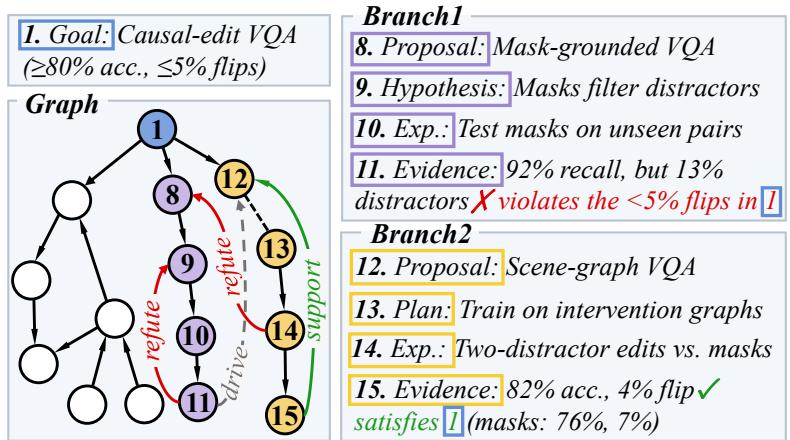
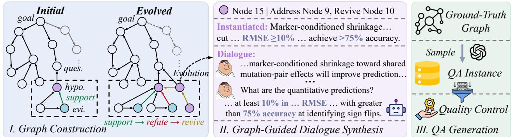
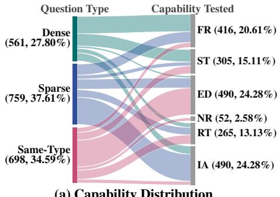
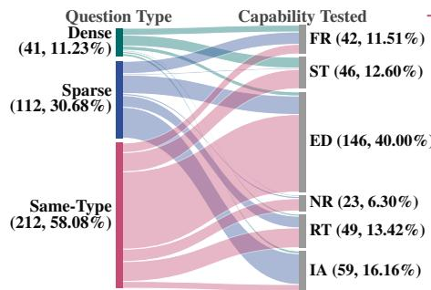
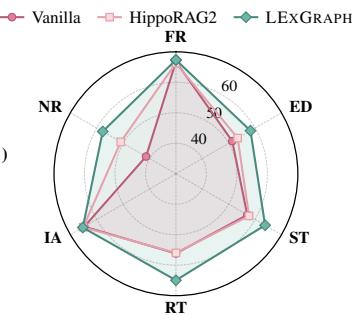
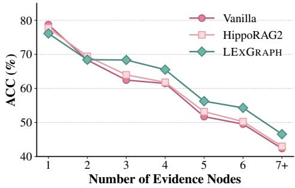
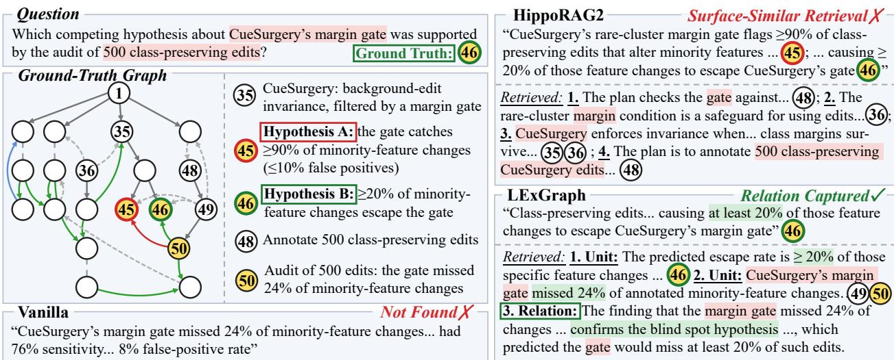

# Twists and Turns: A Graph-Based Benchmark and Framework for Long-Term Memory in Exploration Tasks

Chongyuan Dai<sup>♠</sup> Yaling Shen<sup>♡</sup> Zirui Song<sup>♠</sup> Junfeng Liao<sup>♠</sup> Jinpeng Hu<sup>♣</sup> Xiuying Chen<sup>♠\*</sup>

<sup>♠</sup> Mohamed bin Zayed University of Artificial Intelligence (MBZUAI) <sup>♡</sup> Monash University <sup>♣</sup> Hefei University of Technology

Long-term problem-solving processes, such as scientific research and software development, proceed along an evolving trial-and-error trajectory toward a central goal. We term these exploration tasks, which require models to remember not only facts but also how solutions are tested against intermediate outcomes and early attempts are continually revised or revived. However, existing long-term memory research focuses on factual recall and updates, overlooking the interconnected nature of exploration. We observe that exploration processes naturally form graphs, with branching approaches linked by revisions and reconsiderations. Motivated by this, we propose LExMem, a graph-guided benchmark designed to evaluate Memory in Long-term Exploration tasks. We model exploration processes as graphs and introduce an evolutionary mechanism to increase their structural complexity, yielding 224 dialogues and 2,018 question-answer instances derived from graph structures. Building on the same insight, we propose LExGraph, a graph-based memory framework that incrementally organizes dialogues into interconnected memory nodes and retrieves evidence through hybrid retrieval and neighbor expansion. Extensive experiments demonstrate that LExMem poses a significant challenge to existing retrievaland memory-based systems, whereas LExGraph achieves superior performance and generalizes efectively to external benchmarks. Codes and datasets are available at https://github.com/mbzuai-nlp/LExMem.

## 1. Introduction

Recent large language models (LLMs) have demonstrated impressive capabilities across a wide spectrum of tasks, including open-domain dialogue (Zhou et al., 2024; Xu et al., 2025b), code generation (Shi et al., 2026), and scientific research (Haase and Pokutta, 2025; Su et al., 2025). Long-term memory is essential for sustaining these interactions, enabling models to retain and utilize information accumulated over time. Therefore, numerous benchmarks and frameworks have been developed to evaluate and enhance this capability (Gutiérrez et al., 2024; Gutiérrez et al., 2025; Wang et al., 2026; Xu et al., 2026). One line of research investigates memory for user personas and personal facts in extended conversations (Maharana et al., 2024; Zhong et al., 2024; Jiang et al., 2025; Wu et al., 2025; Zhao et al., 2025; Li et al., 2026). In parallel, evaluations have expanded to task-oriented scenarios (Hu et al., 2026; Shen et al., 2026). For instance, MemoryCode requires models to follow coding instructions that are introduced and updated across sessions (Rakotonirina et al., 2025), while RealMem investigates whether agents can track the states of ongoing projects (Bian et al., 2026). Collectively, existing benchmarks primarily assess the recall of information, ranging from personal facts to evolving task details.

However, real-world problem solving often involves exploration tasks, where conversations evolve through iterative trial and error toward a central goal. As illustrated in Figure 1, such tasks involve testing tentative approaches against empirical evidence and continually revising decisions based on intermediate outcomes. Yet, existing benchmarks overlook the dynamics of exploration, leaving it unclear how efectively models can reason over interrelated information, trace the rationale of extended inquiry, and aggregate findings scattered across prolonged interactions (Maharana et al.,

  
Figure 1: An illustrative exploration task modeled as a graph. We highlight two branches, whose exploration steps are interconnected by relations.

2024; Hu et al., 2026; Li et al., 2026). Furthermore, existing memory frameworks organize dialogue history around semantic similarity (Xu et al., 2025a; Rezazadeh et al., 2025), topical clustering (Tan et al., 2025; Fang et al., 2026), and entity relations (Chhikara et al., 2025; Edge et al., 2025; Guo et al., 2025), overlooking the procedural dependencies required in sustained exploration.

In this paper, we propose LExMem, a graph-guided benchmark for evaluating Memory in Longterm Exploration tasks. To this end, we leverage directed graphs to model exploration steps and their dependencies, enabling the systematic construction of complex exploration trajectories and relationship-aware questions. Specifically, we develop a three-stage construction pipeline. First, we construct exploration graphs and introduce an evolutionary mechanism to increase their structural complexity. Second, we instantiate these graphs with scientific research and software design tasks, and further expand each node into multi-turn dialogue blocks. Finally, we extract structural subgraphs to generate QA instances that evaluate memory of interconnected exploration steps. The resulting LExMem contains 224 dialogues and 2,018 QA instances across three graph-derived question types. Extensive experiments reveal that LExMem poses substantial challenges to existing retrieval and memory frameworks, particularly in aggregating information scattered throughout exploration.

To address these challenges, we introduce LExGraph, a Graph-based memory framework designed to maintain structured context in Long-term Exploration. Rather than relying on predefined graphs, LExGraph incrementally constructs a memory graph from raw dialogues, organizing information into nodes connected by hierarchical and cross-branch dependencies. During inference, it retrieves relevant nodes and traverses their connections to integrate scattered evidence for reasoning. Experiments demonstrate that LExGraph consistently outperforms existing retrieval and memory systems on LExMem and generalizes efectively to external memory benchmarks.

## 2. Benchmark Curation

LExMem is a graph-guided benchmark for evaluating long-term memory in exploration tasks with interconnected steps and dependencies, constructed via the pipeline illustrated in Figure 2.

## 2.1. Evolutionary Graph Construction

To capture the evolving dependencies in long-term exploration, we model each exploration process as a directed graph $G = ( V , E )$ , where nodes represent individual exploration steps and edges encode their relationships. Specifically, � consists of nine functional node types (e.g., artifact), while � contains nine semantic relation types (e.g., support), as detailed in Appendix A.1.



Figure 2: Overview of the LExMem construction pipeline. hypo., ques., and evi. denote hypothesis, question, and evidence nodes, respectively, i.e., node types.
<table><tr><td>Statistic (Avg. per graph)</td><td>Initial Evolved</td><td></td></tr><tr><td>Nodes</td><td>58.3</td><td> $6 1 . 0 _ { ( + 4 . 6 \% ) }$ </td></tr><tr><td>Nodes w/ state changes</td><td>1.97</td><td> $4 . 1 9 _ { ( + 1 1 2 . 7 \% ) }$ </td></tr><tr><td>Nodes w/ initial ≠ current state</td><td>1.82</td><td> $3 . 8 1 _ { ( + 1 0 9 . 3 \% ) }$ </td></tr></table>

Table 1: Statistics of graphs before and after evolution. For each node, we examine its incoming edges labeled with four relations (support, refute, revise, revive). State change: two consecutive edges have diferent relations; initial ̸= current: the first and last edges difer.

Initial Graph Generation. We first prompt LLMs to generate an initial graph $G _ { 0 }$ specifying only its topology (i.e., typed nodes and edges) without textual content, thereby separating structural generation from domain-specific content to explicitly control the complexity of exploration trajectories. Each graph is rooted at a goal node and hierarchically expands into downstream typed nodes, forming a spanning tree. Additional edges connect nodes across branches to capture dependencies between exploration paths. To model the dialogue progression, nodes are ordered chronologically via a depth-first preorder traversal, yielding a sequence of � nodes $( u _ { 1 } , \ldots , u _ { N } )$ with $u _ { 1 }$ as the root.

Graph Evolution. While the initial graph establishes the dependencies among exploration steps, it may not adequately capture the non-monotonic nature of real-world exploration, where earlier approaches are revised, challenged, or revisited as new evidence emerges. To simulate these dynamics, we introduce an evolutionary mechanism that iteratively modifies the initial graph $G _ { 0 }$ according to predefined mutation rules (Appendix A.1). Starting from $G = G _ { 0 } ,$ we scan the node sequence $( u _ { 1 } , \ldots , u _ { N } )$ in chronological order. At each node $u _ { t } ,$ , we define the prefix subgraph $G _ { \leq t }$ as the visited nodes $u _ { 1 } , \ldots , u _ { t }$ and their interconnecting edges. If node $u _ { t }$ and its incident edges match a rule, a mutation is triggered with probability $p ;$ when triggered, we prompt an LLM with $G _ { \leq t }$ to introduce new nodes and edges representing subsequent revisions, challenges, or reconsiderations. This generation further extends to complete the rest of the graph, yielding an updated graph $G ^ { \prime }$ in which $G _ { \leq t }$ remains unchanged. We then set $G = G ^ { \prime }$ , update its node sequence accordingly, and resume scanning from $u _ { t + 1 }$ until the entire graph is traversed.

Through LLM-based verification and manual curation, we retain 150 high-quality evolved graphs. As shown in Table 1, graph evolution substantially enriches the dynamics of sustained exploration while maintaining comparable graph sizes, providing a foundation for dialogue synthesis (§2.2).

## 2.2. Graph-Guided Dialogue Synthesis

Seed Task Preparation. We first prepare 150 seed tasks across two domains: research exploration (100) and software design (50). Each task specifies a primary objective along with several requirement metrics. Details are provided in Appendix A.2.

Graph Instantiation. Since the evolved graphs (§2.1) specify only node types and edge relations without concrete text, we instantiate them with domain-specific tasks to create coherent exploration trajectories while preserving their underlying structures. First, we randomly pair each seed task with four distinct evolved graphs, yielding 600 candidates, and directly assign a seed task with its task description and requirements to the root goal node $( u _ { 1 } )$ . For each subsequent node $u _ { t } \ ( t = 2 , \ldots , N )$ in chronological order, we prompt the LLM with (1) all previously instantiated nodes and edges, (2) the type of $u _ { t . }$ , and (3) the relations linking it to earlier nodes; it then generates concrete descriptions for $u _ { t }$ and its incident edges with specific details (e.g., exact metrics). To ensure consistency, we conduct two stages of LLM-based validation: (1) step-wise checks against prior context (2.3% filtered) and (2) a global consistency check over the completed graph (55.8% filtered). This finally yields 259 instantiated graphs, each denoted as $G ^ { * }$

Dialogue Expansion. We further expand each instantiated graph $G ^ { * }$ into a natural multi-turn conversation, transforming structured exploration steps into information distributed across prolonged interactions. Specifically, each node $u _ { t }$ is expanded into a dialogue block of multiple user-assistant turns, with the LLM conditioned on (1) all preceding dialogue blocks, (2) the content of $u _ { t } .$ , and (3) its relations to earlier nodes. Each block must faithfully convey the corresponding node content without introducing unsupported facts, ensuring that the underlying exploration dependencies are preserved. We apply an LLM-based faithfulness check after each block (0% filtered), followed by a global dialogue consistency check (13.5% filtered). Finally, we obtain 224 high-quality dialogues with 51K to 174K tokens (88K on average), each denoted as $\mathcal { D }$ and paired with its instantiated graph $G ^ { * }$

## 2.3. QA Instance Generation

To systematically evaluate memory of interconnected exploration processes, we derive three types of questions from distinct graph structures, each targeting a diferent reasoning capability. Specifically, we extract candidate subgraphs or node sets $S \subseteq G ^ { * }$ following three patterns:

• Dense subgraphs. To assess joint reasoning over tightly interrelated information, we sample connected subgraphs $S = ( V _ { S } , E _ { S } )$ satisfying $| E _ { S } | \geq 2 | V _ { S } |$ and $| V _ { S } | \ge 4$ , ranked by edge density with a Jaccard penalty to reduce overlap.

• Sparse subgraphs. To evaluate reasoning along long-range exploration trajectories, we extract subgraphs where two distant nodes are linked solely by a multi-hop path passing through the root node, with no other edges among the path nodes. Candidates are similarly ranked by path length with a Jaccard penalty.

• Same-type sets. To evaluate the aggregation of information scattered throughout the exploration process, we group all nodes sharing the same functional type into a set �.

By grounding each question in a specific graph structure, we can explicitly identify the supporting evidence and assess distinct forms of relational reasoning. We sample up to nine candidates � per pattern per graph, and prompt the LLM to formulate a question $q$ targeting � alongside a concise answer set �. We then apply LLM-based verification to assess (1) question clarity and validity (39.3% filtered) and (2) answerability based solely on � (23.9% filtered). This yields 2,018 high-quality QA instances, each formulated as $( \mathcal { D } , q , A )$ , comprising 561 dense, 759 sparse, and 698 same-type instances. We annotate their supporting evidence turns in Appendix A.3 and conduct a human evaluation of benchmark quality in Appendix A.4.

## 3. Method

## 3.1. Overview

We propose LExGraph, a graph-based memory framework that incrementally organizes evolving dialogue information and preserves dependencies among exploration steps. Unlike the graph-guided benchmark construction, LExGraph builds its memory graph solely from raw dialogues, without access to the ground-truth graphs $G ^ { * }$ of LExMem.

First, given an ongoing dialogue ${ \mathcal { D } } ,$ we incrementally construct a directed memory graph $\mathcal { G } =$ $( { \mathcal { M } } , { \mathcal { L } } )$ with memory nodes $\mathcal { M }$ and relational edges $\mathcal { L }$ (§3.2). Each node $m _ { i } \in \mathcal { M }$ is a key-value pair $( k _ { i } , v _ { i } )$ , where the key $k _ { i }$ summarizes the content and key facts, while the value $v _ { i }$ preserves the corresponding raw dialogue turns. Second, given a question $q ,$ we retrieve relevant memory nodes and traverse their connections to aggregate supporting evidence for response generation (§3.3).

## 3.2. Memory Graph Construction

Dialogue Segmentation. To organize conversational memory, we partition dialogue $\mathcal { D }$ into topiccoherent segments that serve as memory nodes. Since users typically guide the discussion, we detect topic shifts based on user turns only. Specifically, we maintain a bufer of unsegmented dialogue turns and invoke an LLM after every � new user turns to identify topic boundaries within it. Dialogue turns preceding the detected boundaries are grouped into memory nodes, each storing the corresponding user and assistant turns as its value $v _ { i } ,$ while the remaining turns stay in the bufer.

Key Generation. For each node $m _ { i } .$ , the LLM generates a structured key $k _ { i }$ from its value $v _ { i } .$ comprising (1) a concise summary of the main discussion and (2) a list of salient facts recording concrete details, such as entities and numerical values. This preserves both the overall context and concrete information that a general summary may omit.

Edge Construction. Once its key $k _ { i }$ and value $v _ { i }$ are obtained, we integrate node $m _ { i }$ into the graph � by establishing two types of edges:

• Type I (Hierarchical): parent-child edges tracing the hierarchical progression of dialogue topics.

• Type II (Cross-branch): associative edges linking related information across diferent branches of the exploration process.

For Type I, we draw on the right frontier constraint from discourse theory (Asher and Lascarides, 2003) to guide parent selection. It posits that in a discourse tree, a new utterance (here, node $m _ { i } )$ can only attach to the path from the root $( m _ { 1 } )$ to the most recent utterance $( m _ { i - 1 } )$ , while utterances outside this path are closed to direct continuation. We maintain this path as the right frontier $\mathcal { F }$ (initialized as $[ m _ { 1 } ] )$ , which constrains parent selection and ensures structural coherence. Given the keys of $m _ { i }$ and ${ \mathcal { F } } _ { z }$ , the LLM selects a parent pa $( m _ { i } ) \in \mathcal { F }$ and describes their relation. We then add the edge $( \mathrm { p a } ( m _ { i } ) , m _ { i } )$ to ${ \mathcal { L } } ,$ and update $\mathcal { F }$ to the new path $[ m _ { 1 } , \ldots , \mathrm { p a } ( m _ { i } ) , m _ { i } ]$

For Type II, we consider historical nodes outside the updated frontier, defined as $\mathcal { H } =$ $\{ m _ { 1 } , \ldots , m _ { i - 1 } \} \setminus F _ { : }$ , to capture cross-branch associations, and select those relevant to $m _ { i } { \cdot }$

$$
\begin{array} { r } { \mathcal { C } _ { i } = \{ m _ { j } \in \mathcal { H } | \cos ( \mathbf { e } _ { j } , \mathbf { e } _ { i } ) \geq \tau _ { \mathrm { s i m } } \} , } \end{array}\tag{1}
$$

where $\mathbf { e } _ { i }$ and $\mathbf { e } _ { j }$ denote the key embeddings of $m _ { i }$ and $m _ { j }$ , respectively, computed by gte-Qwen2-1.5B $( \mathrm { L i ~ e t ~ a l . , ~ } 2 0 2 3 )$ , and $\tau _ { \mathrm { s i m } }$ is a threshold. For each $m _ { j } \in { \mathcal { C } } _ { i }$ , we prompt LLMs to determine their relation and edge direction, establishing an edge in $\mathcal { L } .$ Consequently, we transform the dialogue into an interconnected memory graph, which captures both the primary exploration trajectory and broader contextual dependencies.

## 3.3. Memory Retrieval and Answering

Node Retrieval. Given a question $q ,$ we score each node $m _ { i } \in \mathcal { M }$ through two complementary channels to capture both semantic relevance and lexical matches: (1) semantic matching, measured by the cosine similarity $\cos ( \mathbf { e } _ { q } , \mathbf { e } _ { i } )$ between � and $k _ { i }$ , and (2) lexical matching, measured by the BM25 score between $q$ and $k _ { i }$ (Robertson and Zaragoza, 2009). To balance both retrieval signals, we fuse their individual rankings via Reciprocal Rank Fusion (Cormack et al., 2009):

$$
s ( m _ { i } ) = \frac { 1 } { \kappa + r _ { \mathrm { s e m } } ( m _ { i } ) } + \frac { 1 } { \kappa + r _ { \mathrm { l e x } } ( m _ { i } ) } ,\tag{2}
$$

where $r _ { \mathrm { s e m } } ( m _ { i } )$ and $r _ { \mathrm { l e x } } ( m _ { i } )$ are the semantic and lexical ranks of $m _ { i }$ , and � is a constant. To reduce token consumption, we retrieve memory nodes via two steps: (1) select the top-ranked nodes by $s ( m _ { i } )$ into a primary set $\mathcal { M } _ { \mathrm { p r i } }$ up to a budget $B _ { \mathrm { p r i } } ;$ and (2) collect nodes directly connected to $\mathcal { M } _ { \mathrm { p r i } }$ into a neighbor set $\mathcal { M } _ { \mathrm { n b r } } .$ , also ranked by $s ( m _ { i } )$ , up to a budget $B _ { \mathrm { n b r } }$ . This locates the primary evidence for question $q$ while gathering its connected context to capture relational associations.

Answer Generation. Finally, the LLM answers � grounded in a context � assembled from the retrieved memories, comprising: (1) keys and values of primary nodes in $\mathcal { M } _ { \mathrm { p r i } } , ( 2 )$ keys of neighbor nodes in ${ \mathcal { M } } _ { \mathrm { n b r } } ,$ , and (3) relation descriptions of edges connecting the retrieved nodes. This grounds the answer in structured memories, thereby facilitating accurate and context-aware answering.

## 4. Experimental Setting

## 4.1. Baselines

Each instance in LExMem is formulated as $( \mathcal { D } , q , A )$ (§2.3). Given dialogue � and question $q ,$ each baseline is required to generate an answer �<sup>^</sup>. To ensure a comprehensive analysis, we compare LExGraph with the following baselines: (1) Retrieval-based methods, which build indices or structured representations over the context to retrieve information, including ComoRAG (Wang et al., 2026), GraphRAG (Edge et al., 2025), HippoRAG (Gutiérrez et al., 2024), HippoRAG2 (Gutiérrez et al., 2025), and LightRAG (Guo et al., 2025); and (2) Memory-based methods, which construct and manage memory structures, including LightMem (Fang et al., 2026), Mem0 (Chhikara et al., 2025), and StructMem (Xu et al., 2026). For these approaches, we first build their own index or memory over �, and then retrieve context relevant to �, on which the backbone LLM conditions to generate �<sup>^</sup>. Details are described in Appendix B.1.

## 4.2. Benchmarks and Evaluation Metrics

We conduct comprehensive evaluations on LExMem with two metrics: (1) Token-level F1, adopted from SQuAD (Rajpurkar et al., 2016) to measure lexical overlap between �<sup>^</sup> and �; and (2) Accuracy (ACC), following BEAM (Tavakoli et al., 2026), where an LLM judge scores each answer as correct (1.0), partially correct (0.5), or incorrect (0.0). To verify the generalizability of our method LExGraph, we further evaluate it on the 128K-token subset of BEAM (Tavakoli et al., 2026), which covers ten long-term conversational memory abilities, and report ACC.

<table><tr><td rowspan="2">Model</td><td rowspan="2">Method</td><td colspan="2">Dense</td><td colspan="2">Sparse</td><td colspan="2">Same-Type</td><td colspan="2">Overall</td><td colspan="2">Efficiency</td></tr><tr><td>F1</td><td>ACC</td><td>F1</td><td>ACC</td><td>F1</td><td>ACC</td><td>F1</td><td>ACC</td><td>Tok.↓</td><td>Lat.↓</td></tr><tr><td rowspan="10">wen-27B</td><td>Vanilla</td><td>0.565</td><td>65.74</td><td>0.570</td><td>61.64</td><td>0.599</td><td>48.86</td><td>0.579</td><td>58.36</td><td>1.0×</td><td>1.0×</td></tr><tr><td>HippoRAG</td><td>0.587</td><td>67.26</td><td>0.576</td><td>62.12</td><td>0.614</td><td>47.69</td><td>0.592</td><td>58.56</td><td>1.3×</td><td>1.1×</td></tr><tr><td>ComoRAG</td><td>0.611</td><td>68.59</td><td>0.611</td><td>65.99</td><td>0.625</td><td>50.00</td><td>0.616</td><td>61.18</td><td>1.8×</td><td>3.4×</td></tr><tr><td>HippoRAG2</td><td>0.580</td><td>68.36</td><td>0.588</td><td>64.82</td><td>0.616</td><td>50.43</td><td>0.595</td><td>60.83</td><td>1.2×</td><td>1.1×</td></tr><tr><td>StructMem</td><td>0.621</td><td>66.30</td><td>0.641</td><td>66.22</td><td>0.638</td><td>48.08</td><td>0.634</td><td>59.97</td><td>1.4×</td><td>1.1×</td></tr><tr><td>GraphRAG</td><td>0.616</td><td>70.59</td><td>0.616</td><td>67.22</td><td>0.629</td><td>49.23</td><td>0.620</td><td>61.93</td><td>1.6×</td><td>1.1×</td></tr><tr><td>Mem0</td><td>0.614</td><td>68.59</td><td>0.595</td><td>67.05</td><td>0.635</td><td>49.62</td><td>0.614</td><td>61.45</td><td>6.7×</td><td>1.1×</td></tr><tr><td>LightMem</td><td>0.602</td><td>68.30</td><td>0.606</td><td>65.28</td><td>0.648</td><td>51.92</td><td>0.619</td><td>61.50</td><td>1.1×</td><td>1.0×</td></tr><tr><td>LightRAG</td><td>0.619</td><td>67.97</td><td>0.611</td><td>67.05</td><td>0.643</td><td>50.77</td><td>0.624</td><td>61.67</td><td>1.6×</td><td>1.2×</td></tr><tr><td>LExGRAPH</td><td>0.658**</td><td>70.89*</td><td>0.665**</td><td>66.30</td><td>0.676*</td><td>55.73**</td><td>0.667**</td><td>63.92*</td><td>1.3×</td><td>1.1×</td></tr><tr><td rowspan="10">GP -Lna</td><td>Vanilla</td><td>0.524</td><td>63.72</td><td>0.459</td><td>60.37</td><td>0.526</td><td>53.81</td><td>0.500</td><td>59.03</td><td>1.0×</td><td>1.0×</td></tr><tr><td>HippoRAG</td><td>0.528</td><td>63.42</td><td>0.476</td><td>62.90</td><td>0.506</td><td>55.35</td><td>0.501</td><td>60.43</td><td>1.3×</td><td>1.1×</td></tr><tr><td>ComoRAG</td><td>0.529</td><td>67.17</td><td>0.468</td><td>59.15</td><td>0.513</td><td>55.40</td><td>0.501</td><td>60.08</td><td>1.5×</td><td>3.8×</td></tr><tr><td>HippoRAG2</td><td>0.548</td><td>69.37</td><td>0.496</td><td>64.50</td><td>0.527</td><td>56.12</td><td>0.521</td><td>62.97</td><td>1.2×</td><td>1.0×</td></tr><tr><td>StructMem</td><td>0.539</td><td>64.72</td><td>0.478</td><td>63.25</td><td>0.546</td><td>57.91</td><td>0.519</td><td>61.81</td><td>1.3×</td><td>0.8×</td></tr><tr><td>GraphRAG</td><td>0.555</td><td>69.82</td><td>0.473</td><td>63.49</td><td>0.533</td><td>56.17</td><td>0.516</td><td>62.72</td><td>1.7×</td><td>0.9×</td></tr><tr><td>Mem0</td><td>0.567</td><td>68.79</td><td>0.463</td><td>64.71</td><td>0.567</td><td>56.79</td><td>0.528</td><td>63.10</td><td>9.1×</td><td>1.2×</td></tr><tr><td>LightMem</td><td>0.559</td><td>68.52</td><td>0.487</td><td>66.61</td><td>0.529</td><td>56.34</td><td>0.522</td><td>63.59</td><td>1.2×</td><td>0.8×</td></tr><tr><td>LightRAG</td><td>0.551</td><td>69.59</td><td>0.492</td><td>64.44</td><td>0.546</td><td>57.44</td><td>0.527</td><td>63.46</td><td>1.6×</td><td>1.2×</td></tr><tr><td>LExGRAPH</td><td>0.569*</td><td>70.02</td><td>0.535**</td><td>64.97</td><td>0.598**</td><td>58.12</td><td>0.566**</td><td>64.00*</td><td>1.2×</td><td>1.1×</td></tr></table>

Table 2: Results on LExMem. Tok. and Lat. represent the average token usage and latency (retrieval plus answering) per question, relative to Vanilla (1.0×). For Qwen-3.8 27B, 1.0× corresponds to 205.7K tokens and 38.5 seconds; for GPT-6 Luna, 190.6K tokens and 8.22 seconds. Best results are in bold. $^ { * } p < 0 . 0 5$ and $^ { * * } p < 0 . 0 1$ indicate statistically significant over the LightRAG baseline, the strongest baseline on average, using paired bootstrap.

## 4.3. Implementation Details

We use GPT-6 Sol (OpenAI, 2026b) for benchmark curation. For evaluation, we employ Qwen-3.8 27B and GPT-6 Luna (OpenAI, 2026a) as backbone models, with gte-Qwen2-1.5B (Li et al., 2023) as the embedding model and GPT-4o mini (OpenAI, 2024) as the ACC evaluator. We conduct experiments on two RTX 5880 GPUs with seed 42 and temperature 0. Details are in Appendix B.4.

## 5. Experiments

## 5.1. Main Results

We present the evaluation results on LExMem in Table 2. These results reveal several key observations. First, retrieval- and memory-based frameworks consistently outperform the Vanilla baseline in overall metrics. This demonstrates that augmenting LLMs with external retrieval or memory is essential to capture the evolving, interconnected contexts and dependencies in exploration tasks. Second, LExGraph achieves the highest overall performance across diferent backbones, outperforming strong baselines such as GraphRAG and LightMem. This illustrates the efectiveness of our method, which can be attributed to structuring memory and capturing relational connections along the exploration trajectories. Third, while most methods yield better results on Dense and Sparse sets, their accuracy drops substantially on the Same-Type set across backbones. For example, on GPT-6 Luna, LightMem achieves an accuracy of 68.52 on Dense and 66.61 on Sparse sets, yet its accuracy falls to 56.34 on Same-Type set. This may stem from the intrinsic dificulty of its question setting, which requires models to identify and aggregate multiple exploration steps scattered across the dialogue. In contrast, our method maintains a solid advantage across all subsets, demonstrating its efectiveness in longterm problem-solving tasks. Fourth, our method also achieves a balance between performance and eficiency, sustaining high accuracy with competitive resource overhead.

  
(a) Capability Distribution

  
(b) Error Distribution

  
(c) ACC (%) by Capability  
Figure 3: Capability distribution of LExMem by question type (a), together with Vanilla’s errors (b) and per-capability accuracy of three methods (c) using Qwen-3.8 27B.

## 5.2. Benchmark Analysis

Capability Distribution. To enable fine-grained evaluation on exploration tasks, we categorize all instances into six capabilities: Fact Retrieval (FR), State Tracking (ST), Entity Discrimination (ED), Numeric Reasoning (NR), Relation Tracing (RT), and Information Aggregation (IA), with details of definitions and categorization in Appendix B.3. As shown in Figure 3(a), each question type exhibits distinct capability focuses: Dense questions primarily map to FR and ST, indicating that tightly coupled contexts mainly test localized facts and state changes; Sparse questions are dominated by IA, which demands evidence aggregation across long-range exploration trajectories; and Same-Type questions overwhelmingly target ED, requiring fine-grained discrimination among similar entities.

Error Analysis. To diagnose failures, we analyze instances where the Vanilla baseline achieves zero accuracy on LExMem, as shown in Figure 3(b). First, errors are mainly concentrated in Same-Type questions and dominated by ED, indicating that models may easily confuse similar contexts accumulated during exploration. Same-Type questions also account for nearly all failures in NR, suggesting that the primary dificulty of numerical reasoning lies in comparative reasoning across similar information. Second, Dense errors mainly consist of FR and ST, consistent with the primary capabilities tested by Dense questions. Third, Sparse errors primarily flow into IA while spanning capabilities such as FR, ED, and RT. This demonstrates that long-term exploration presents compound reasoning challenges where extended and evolving contexts disrupt global evidence synthesis.

Performance by Capability. We compare the accuracy across six capabilities in Figure 3(c). While HippoRAG2 achieves a notable improvement on NR, its gains on other dimensions remain marginal. In contrast, LExGraph consistently outperforms both baselines, with the most pronounced advantages on NR and RT. This may stem from LExGraph’s hierarchical and cross-branch edges that ensure multi-hop tracing, alongside structured keys enabling comparative reasoning.

## 5.3. Method Analysis

Efect of Evidence Count. As described in §2.3, each QA instance in LExMem is generated from a sampled subgraph or node set $S \subseteq G ^ { * }$ which contains ground-truth evidence nodes. We group instances by their evidence node count |�|. As shown in Figure 4, accuracy across all methods declines steadily as the number of evidence nodes increases, suggesting the challenge of aggregating evidence scattered across long-term exploration tasks. While Vanilla and HippoRAG2 perform competitively when evidence is concentrated in fewer nodes, their accuracy drops sharply as the evidence becomes increasingly scattered across the dialogue. In contrast, LExGraph consistently maintains a clear advantage over both baselines when synthesizing such dispersed evidence.

  
Figure 4: Accuracy on LExMem across diferent numbers of evidence nodes, using Qwen-3.8 27B.

<table><tr><td>Memory Ability</td><td>Vanilla</td><td>Mem0</td><td>LightRAG</td><td>LExGRAPH</td></tr><tr><td>Abstention</td><td>0.500</td><td>0.525</td><td>0.488</td><td>0.650</td></tr><tr><td>Contradiction Resolution</td><td>0.181</td><td>0.169</td><td>0.200</td><td>0.216</td></tr><tr><td>Event Ordering</td><td>0.167</td><td>0.176</td><td>0.194</td><td>0.218</td></tr><tr><td>Information Extraction</td><td>0.644</td><td>0.633</td><td>0.695</td><td>0.656</td></tr><tr><td>Instruction Following</td><td>0.394</td><td>0.481</td><td>0.500</td><td>0.562</td></tr><tr><td>Knowledge Update</td><td>0.375</td><td>0.493</td><td>0.481</td><td>0.525</td></tr><tr><td>Multi-Hop Reasoning</td><td>0.422</td><td>0.493</td><td>0.441</td><td>0.451</td></tr><tr><td>Preference Following</td><td>0.613</td><td>0.648</td><td>0.725</td><td>0.721</td></tr><tr><td>Summarization</td><td>0.359</td><td>0.385</td><td>0.320</td><td>0.389</td></tr><tr><td>Temporal Reasoning</td><td>0.300</td><td>0.325</td><td>0.313</td><td>0.331</td></tr><tr><td>Overall</td><td>0.396</td><td>0.433</td><td>0.436</td><td>0.472</td></tr></table>

Table 3: Results on BEAM. Best results are in bold.

Results on the External Benchmark. We further assess LExGraph on BEAM (Tavakoli et al., 2026), which evaluates long-term conversational memory across multiple capabilities. As shown in Table 3, LExGraph achieves the top performance in seven out of ten memory abilities, yielding the highest overall score of 0.472 over strong baselines such as LightRAG. In particular, it demonstrates pronounced advantages in Abstention and Instruction Following, alongside consistent strengths in state-tracking tasks such as Knowledge Update and Event Ordering. These results indicate that our method generalizes efectively to broader conversational memory scenarios beyond exploration tasks.

## 5.4. Case Study

We present a case study in Figure 5, illustrating how each method responds when reasoning over interconnected exploration steps. In this case, an intermediate step introduces CueSurgery’s margin gate and branches into two competing hypotheses (nodes 45, 46). A subsequent audit on a separate branch reveals that the gate missed 24% of targeted changes (nodes 48, 50), the crucial evidence that must be associated with the earlier hypotheses in memory to resolve the question. Vanilla recalls the isolated 24% miss rate but fails to relate it to either hypothesis. As HippoRAG2 relies on semantic similarity, it overlooks interrelated exploration steps and retrieves keyword-matched context instead of the essential evidence (node 50), leading to failure. In contrast, LExGraph accurately locates the relevant evidence and captures the explicit relation across the exploration, thereby reaching the correct conclusion. This demonstrates the efectiveness of LExGraph in preserving dependencies among exploration steps for context-aware reasoning.

## 6. Related Work

## 6.1. Long-Term Memory Benchmarks

In long-term memory evaluation, early research focuses on open-domain conversations, evaluating models’ ability to retain and recall personal facts across sessions (Maharana et al., 2024; Jiang et al., 2025). Subsequent work broadens this scope to assess more fine-grained capabilities, including temporal reasoning and knowledge updates (Wu et al., 2025), preference adherence (Zhao et al., 2025), and cognitive memory (Li et al., 2026). Other eforts further incorporate multimodal contexts (Bei et al., 2026) and evaluate hallucinations within memory systems (Chen et al., 2026). A parallel line of research concentrates on long-context benchmarks, assessing comprehension and retrieval abilities over inputs scaling from thousands to millions of tokens (Bai et al., 2024, 2025; Tavakoli et al., 2026). More recently, memory evaluation has expanded toward task-oriented dialogues, centering on task-relevant information such as user instructions and task progress, which accumulates and updates as the conversation unfolds (Rakotonirina et al., 2025; Bian et al., 2026; Shen et al., 2026). However, existing benchmarks focus primarily on recalling isolated facts or tracking monotonic updates, overlooking the evolving process of exploration and its scattered, interconnected information.

  
Figure 5: A qualitative example from LExMem with Qwen-3.8 27B. Vanilla fails to relate the key finding to the hypotheses, and HippoRAG2 retrieves only surface-similar content, whereas LExGraph captures their relation. Yellow : evidence nodes; red : content similar to the question; green : key evidence and relations retrieved by LExGraph. In the ground-truth graph �<sup>\*</sup>, green/red edges denote support/refute, and undirected dashed edges denote omitted intermediate steps. Each text is tagged with the node it comes from.

## 6.2. Memory and Retrieval Frameworks

Early memory frameworks manage dialogue history as independent memory units, such as summaries and memos (Lu et al., 2023; Zhong et al., 2024; Chhikara et al., 2025). Further eforts introduce management strategies such as reflective mechanisms (Tan et al., 2025), hierarchical storage (Kang et al., 2025), and memory compression (Fang et al., 2026) to balance accuracy and eficiency. To capture associations among memory units, subsequent studies organize conversational history into structured representations, including trees (Rezazadeh et al., 2025), graphs (Xu et al., 2025a; Rasmussen et al., 2025; Xu et al., 2026), and hypergraphs (Yue et al., 2026). Another line of research on retrieval-augmented generation (RAG) structures the corpus into hierarchical summary trees (Sarthi et al., 2024; Wang et al., 2026) or entity knowledge graphs (Gutiérrez et al., 2024; Edge et al., 2025; Guo et al., 2025; Gutiérrez et al., 2025) to facilitate multi-hop retrieval. However, current frameworks primarily capture semantic or entity-level associations rather than dialogue progression, where exploration branches out, revisits earlier attempts, and builds upon intermediate outcomes.

## 7. Conclusion

In this paper, we address the shortcomings of evaluating and enhancing long-term memory in exploration tasks. We propose LExMem, a graph-guided benchmark that models exploration processes as graphs enriched through evolution, deriving 224 dialogues and 2,018 QA instances from graph structures. We further present LExGraph, a graph-based memory framework that structures dialogues into memory graphs and gathers evidence by hybrid retrieval and neighbor expansion. Extensive experiments demonstrate that existing retrieval and memory frameworks struggle on LExMem, whereas LExGraph achieves consistent improvements over strong baselines and generalizes to external benchmarks. By providing a systematic evaluation benchmark and an efective memory framework, this work helps develop more reliable conversational agents for long-term exploration.

## Limitations

Despite the contributions of LExMem and LExGraph, our study is subject to several limitations that remain to be addressed in future research.

Synthetic Dialogues. Real-world exploration dialogues are dificult to collect at scale, as they span long horizons, often involve unpublished research or proprietary development, and lack annotations of the dependencies among exploration steps. We therefore synthesize dialogues from instantiated exploration graphs, which allows explicit control over trajectory complexity and provides groundtruth structures for question generation, with quality verified through LLM-based checks and human evaluation. Nevertheless, synthetic dialogues may not fully capture the stylistic diversity of real conversations.

Evaluation of Downstream Exploration. LExMem evaluates memory of the exploration process via question answering, rather than whether stronger memory leads to better exploration decisions. Such end-to-end evaluation is inherently dificult, as open-ended exploration rarely has a unique correct next step, and verifying one would require actually conducting the corresponding experiments. We leave this to future work.

## References

Anthropic. Claude Opus 5.5 system card, 2026. URL https://www.anthropic.com/ claude-opus-5-5-system-card. Accessed: 2026-10-30.

Nicholas Asher and Alex Lascarides. Logics of conversation. Cambridge University Press, 2003.

Yushi Bai, Xin Lv, Jiajie Zhang, Hongchang Lyu, Jiankai Tang, Zhidian Huang, Zhengxiao Du, Xiao Liu, Aohan Zeng, Lei Hou, Yuxiao Dong, Jie Tang, and Juanzi Li. LongBench: A bilingual, multitask benchmark for long context understanding. In Lun-Wei Ku, Andre Martins, and Vivek Srikumar, editors, Proceedings of the 62nd Annual Meeting of the Association for Computational Linguistics (Volume 1: Long Papers), pages 3119–3137, Bangkok, Thailand, August 2024. Association for Computational Linguistics. doi: 10.18653/v1/2024.acl-long.172. URL https://aclanthology. org/2024.acl-long.172/.

Yushi Bai, Shangqing Tu, Jiajie Zhang, Hao Peng, Xiaozhi Wang, Xin Lv, Shulin Cao, Jiazheng Xu, Lei Hou, Yuxiao Dong, Jie Tang, and Juanzi Li. LongBench v2: Towards deeper understanding and reasoning on realistic long-context multitasks. In Wanxiang Che, Joyce Nabende, Ekaterina Shutova, and Mohammad Taher Pilehvar, editors, Proceedings of the 63rd Annual Meeting of the Association for Computational Linguistics (Volume 1: Long Papers), pages 3639–3664, Vienna, Austria, July 2025. Association for Computational Linguistics. ISBN 979-8-89176-251-0. doi: 10.18653/v1/2025.acl-long.183. URL https://aclanthology.org/2025.acl-long.183/.

Yuanchen Bei, Tianxin Wei, Xuying Ning, Yanjun Zhao, Zhining Liu, Xiao Lin, Yada Zhu, Hendrik Hamann, Jingrui He, and Hanghang Tong. Mem-gallery: Benchmarking multimodal long-term conversational memory for MLLM agents. In Maria Liakata, Viviane P. Moreira, Jiajun Zhang, and David Jurgens, editors, Proceedings of the 64th Annual Meeting of the Association for Computational

Linguistics (Volume 1: Long Papers), pages 40750–40784, San Diego, California, United States, July 2026. Association for Computational Linguistics. ISBN 979-8-89176-390-6. doi: 10.18653/v1/ 2026.acl-long.1892. URL https://aclanthology.org/2026.acl-long.1892/.

Haonan Bian, Zhiyuan Yao, Sen Hu, Zishan Xu, Shaolei Zhang, Yifu Guo, Ziliang Yang, Xueran Han, Huacan Wang, and Ronghao Chen. RealMem: Benchmarking LLMs in real-world memorydriven interaction. In Maria Liakata, Viviane P. Moreira, Jiajun Zhang, and David Jurgens, editors, Findings of the Association for Computational Linguistics: ACL 2026, pages 14349–14365, San Diego, California, United States, July 2026. Association for Computational Linguistics. ISBN 979- 8-89176-395-1. doi: 10.18653/v1/2026.findings-acl.703. URL https://aclanthology.org/ 2026.findings-acl.703/.

Ding Chen, Simin Niu, Kehang Li, Peng Liu, Xiangping Zheng, Bo Tang, Xinchi Li, Feiyu Xiong, and Zhiyu Li. Halumem: Evaluating hallucinations in memory systems of agents, 2026. URL https://arxiv.org/abs/2511.03506.

Prateek Chhikara, Dev Khant, Saket Aryan, Taranjeet Singh, and Deshraj Yadav. Mem0: Building production-ready AI agents with scalable long-term memory. In Inês Lynce, Nello Murano, Mauro Vallati, Serena Villata, Federico Chesani, Michela Milano, Andrea Omicini, and Mehdi Dastani, editors, ECAI 2025 - 28th European Conference on Artificial Intelligence, 25-30 October 2025, Bologna, Italy - Including 14th Conference on Prestigious Applications ofIntelligent Systems (PAIS 2025), volume 413 of Frontiers in Artificial Intelligence and Applications, pages 2993–3000. IOS Press, 2025. doi: 10.3233/FAIA251160. URL https://doi.org/10.3233/FAIA251160.

Gordon V. Cormack, Charles L A Clarke, and Stefan Buettcher. Reciprocal rank fusion outperforms condorcet and individual rank learning methods. In Proceedings of the 32nd International ACM SIGIR Conference on Research and Development in Information Retrieval, SIGIR ’09, page 758–759, New York, NY, USA, 2009. Association for Computing Machinery. ISBN 9781605584836. doi: 10.1145/1571941.1572114. URL https://doi.org/10.1145/1571941.1572114.

Darren Edge, Ha Trinh, Newman Cheng, Joshua Bradley, Alex Chao, Apurva Mody, Steven Truitt, Dasha Metropolitansky, Robert Osazuwa Ness, and Jonathan Larson. From local to global: A graph rag approach to query-focused summarization, 2025. URL https://arxiv.org/abs/2404.16130.

Jizhan Fang, Xinle Deng, Haoming Xu, Ziyan Jiang, Yuqi Tang, Ziwen Xu, Shumin Deng, Yunzhi Yao, Mengru Wang, Shuofei Qiao, Huajun Chen, and Ningyu Zhang. Lightmem: Lightweight and eficient memory-augmented generation. In C. Vondrick, B. Hariharan, C. Rafel, L. Pinto, D. Yang, and A. Faust, editors, International Conference on Learning Representations, volume 2026, pages 98706–98729, 2026. URL https://proceedings.iclr.cc/paper\_files/paper/ 2026/file/a05b72653ec5b473732129829ae04195-Paper-Conference.pdf.

Zirui Guo, Lianghao Xia, Yanhua Yu, Tu Ao, and Chao Huang. LightRAG: Simple and fast retrievalaugmented generation. In Christos Christodoulopoulos, Tanmoy Chakraborty, Carolyn Rose, and Violet Peng, editors, Findings of the Association for Computational Linguistics: EMNLP 2025, pages 10746–10761, Suzhou, China, November 2025. Association for Computational Linguistics. ISBN 979-8-89176-335-7. doi: 10.18653/v1/2025.findings-emnlp.568. URL https://aclanthology. org/2025.findings-emnlp.568/.

Bernal Jiménez Gutiérrez, Yiheng Shu, Yu Gu, Michihiro Yasunaga, and Yu Su. Hipporag: Neurobiologically inspired long-term memory for large language models. In A. Globerson, L. Mackey, D. Belgrave, A. Fan, U. Paquet, J. Tomczak, and C. Zhang, editors, Advances in Neural Information Processing Systems, volume 37, pages 59532–59569. Curran Associates, Inc., 2024. doi:

10.52202/079017-1902. URL https://proceedings.neurips.cc/paper\_files/paper/ 2024/file/6ddc001d07ca4f319af96a3024f6dbd1-Paper-Conference.pdf.

Bernal Jiménez Gutiérrez, Yiheng Shu, Weijian Qi, Sizhe Zhou, and Yu Su. From rag to memory: nonparametric continual learning for large language models. In Proceedings of the 42nd International Conference on Machine Learning, ICML’25. JMLR.org, 2025.

Jennifer Haase and Sebastian Pokutta. Beyond static responses: Multi-agent LLM systems as a new paradigm for social science research. CoRR, abs/2506.01839, 2025. doi: 10.48550/ARXIV.2506. 01839. URL https://doi.org/10.48550/arXiv.2506.01839.

Taher H. Haveliwala. Topic-sensitive pagerank. In Proceedings of the 11th International Conference on World Wide Web, WWW ’02, page 517–526, New York, NY, USA, 2002. Association for Computing Machinery. ISBN 1581134495. doi: 10.1145/511446.511513. URL https://doi.org/10. 1145/511446.511513.

Yuanzhe Hu, Yu Wang, and Julian McAuley. Evaluating memory in llm agents via incremental multi-turn interactions. In C. Vondrick, B. Hariharan, C. Rafel, L. Pinto, D. Yang, and A. Faust, editors, International Conference on Learning Representations, volume 2026, pages 156259– 156291, 2026. URL https://proceedings.iclr.cc/paper\_files/paper/2026/file/ fd1eff9dd295df50a41f2521942fa31d-Paper-Conference.pdf.

Bowen Jiang, Zhuoqun Hao, Young Min Cho, Bryan Li, Yuan Yuan, Sihao Chen, Lyle Ungar, Camillo Jose Taylor, and Dan Roth. Know me, respond to me: Benchmarking LLMs for dynamic user profiling and personalized responses at scale. In Second Conference on Language Modeling, 2025. URL https://openreview.net/forum?id=6ox8XZGOqP.

Jiazheng Kang, Mingming Ji, Zhe Zhao, and Ting Bai. Memory OS of AI agent. In Christos Christodoulopoulos, Tanmoy Chakraborty, Carolyn Rose, and Violet Peng, editors, Proceedings of the 2025 Conference on Empirical Methods in Natural Language Processing, pages 25961–25970, Suzhou, China, November 2025. Association for Computational Linguistics. ISBN 979-8-89176- 332-6. doi: 10.18653/v1/2025.emnlp-main.1318. URL https://aclanthology.org/2025. emnlp-main.1318/.

Yifei Li, Weidong Guo, Lingling Zhang, Rongman Xu, Muye Huang, Hui Liu, Lijiao Xu, Yu Xu, and Jun Liu. Locomo-plus: Beyond-factual cognitive memory evaluation framework for LLM agents. In Maria Liakata, Viviane P. Moreira, Jiajun Zhang, and David Jurgens, editors, Proceedings of the 64th Annual Meeting of the Association for Computational Linguistics (Volume 1: Long Papers), pages 25085–25100, San Diego, California, United States, July 2026. Association for Computational Linguistics. ISBN 979-8-89176-390-6. doi: 10.18653/v1/2026.acl-long.1150. URL https: //aclanthology.org/2026.acl-long.1150/.

Zehan Li, Xin Zhang, Yanzhao Zhang, Dingkun Long, Pengjun Xie, and Meishan Zhang. Towards general text embeddings with multi-stage contrastive learning, 2023. URL https://arxiv.org/ abs/2308.03281.

Junru Lu, Siyu An, Mingbao Lin, Gabriele Pergola, Yulan He, Di Yin, Xing Sun, and Yunsheng Wu. Memochat: Tuning llms to use memos for consistent long-range open-domain conversation, 2023. URL https://arxiv.org/abs/2308.08239.

Adyasha Maharana, Dong-Ho Lee, Sergey Tulyakov, Mohit Bansal, Francesco Barbieri, and Yuwei Fang. Evaluating very long-term conversational memory of LLM agents. In Lun-Wei Ku, Andre Martins, and Vivek Srikumar, editors, Proceedings of the 62nd Annual Meeting of the Associationfor Computational

Linguistics (Volume 1: Long Papers), ACL 2024, Bangkok, Thailand, August 11-16, 2024, pages 13851– 13870. Association for Computational Linguistics, 2024. doi: 10.18653/V1/2024.ACL-LONG.747. URL https://doi.org/10.18653/v1/2024.acl-long.747.

OpenAI. GPT-4o-mini model card, 2024. URL https://developers.openai.com/docs/ models/gpt-4o-mini. Accessed: 2026-10-17.

OpenAI. GPT-6-Luna model card, 2026a. URL https://developers.openai.com/api/docs/ models/gpt-6-luna. Accessed: 2026-10-17.

OpenAI. GPT-6-Sol model card, 2026b. URL https://developers.openai.com/api/docs/ models/gpt-6-sol. Accessed: 2026-10-19.

Zhuoshi Pan, Qianhui Wu, Huiqiang Jiang, Menglin Xia, Xufang Luo, Jue Zhang, Qingwei Lin, Victor Rühle, Yuqing Yang, Chin-Yew Lin, H. Vicky Zhao, Lili Qiu, and Dongmei Zhang. LLMLingua-2: Data distillation for eficient and faithful task-agnostic prompt compression. In Lun-Wei Ku, Andre Martins, and Vivek Srikumar, editors, Findings of the Association for Computational Linguistics: ACL 2024, pages 963–981, Bangkok, Thailand, August 2024. Association for Computational Linguistics. doi: 10.18653/v1/2024.findings-acl.57. URL https://aclanthology.org/2024.findings-acl. 57/.

Qwen Team. Qwen3.8-Max: A new bar for coding and cowork, August 2026. URL https://qwen. ai/blog?id=qwen3.8.

Pranav Rajpurkar, Jian Zhang, Konstantin Lopyrev, and Percy Liang. SQuAD: 100,000+ questions for machine comprehension of text. In Jian Su, Kevin Duh, and Xavier Carreras, editors, Proceedings of the 2016 Conference on Empirical Methods in Natural Language Processing, pages 2383–2392, Austin, Texas, November 2016. Association for Computational Linguistics. doi: 10.18653/v1/D16-1264. URL https://aclanthology.org/D16-1264/.

Nathanaël Carraz Rakotonirina, Mohammed Hamdy, Jon Ander Campos, Lucas Weber, Alberto Testoni, Marzieh Fadaee, Sandro Pezzelle, and Marco Del Tredici. From tools to teammates: Evaluating LLMs in multi-session coding interactions. In Wanxiang Che, Joyce Nabende, Ekaterina Shutova, and Mohammad Taher Pilehvar, editors, Proceedings of the 63rd Annual Meeting of the Association for Computational Linguistics (Volume 1: Long Papers), pages 19609–19642, Vienna, Austria, July 2025. Association for Computational Linguistics. ISBN 979-8-89176-251-0. doi: 10.18653/v1/2025.acl-long.964. URL https://aclanthology.org/2025.acl-long.964/.

Preston Rasmussen, Pavlo Paliychuk, Travis Beauvais, Jack Ryan, and Daniel Chalef. Zep: A temporal knowledge graph architecture for agent memory, 2025. URL https://arxiv.org/abs/2501. 13956.

Alireza Rezazadeh, Zichao Li, Wei Wei, and Yujia Bao. From isolated conversations to hierarchical schemas: Dynamic tree memory representation for llms. In Y. Yue, A. Garg, N. Peng, F. Sha, and R. Yu, editors, International Conference on Learning Representations, volume 2025, pages 990–1023, 2025. URL https://proceedings.iclr.cc/paper\_files/paper/2025/file/ 0382cb76309820f71c6eacd47b36ce71-Paper-Conference.pdf.

Stephen Robertson and Hugo Zaragoza. The probabilistic relevance framework: Bm25 and beyond. Foundations and Trends in Information Retrieval, 4(1-2):1–174, 09 2009. ISSN 1554-0669. doi: 10.1561/1500000019. URL https://doi.org/10.1561/1500000019.

Parth Sarthi, Salman Abdullah, Aditi Tuli, Shubh Khanna, Anna Goldie, and Christopher Manning. Raptor: Recursive abstractive processing for tree-organized retrieval. In B. Kim, Y. Yue, S. Chaudhuri, K. Fragkiadaki, M. Khan, and Y. Sun, editors, International Conference on Learning Representations, volume 2024, pages 32628–32649, 2024. URL https://proceedings.iclr.cc/paper\_files/paper/2024/file/ 8a2acd174940dbca361a6398a4f9df91-Paper-Conference.pdf.

Yiting Shen, Kun Li, Wei Zhou, and Songlin Hu. Mem2ActBench: A benchmark for evaluating longterm memory utilization in task-oriented autonomous agents. In Maria Liakata, Viviane P. Moreira, Jiajun Zhang, and David Jurgens, editors, Proceedings of the 64th Annual Meeting of the Association for Computational Linguistics (Volume 1: Long Papers), pages 8173–8190, San Diego, California, United States, July 2026. Association for Computational Linguistics. ISBN 979-8-89176-390-6. doi: 10.18653/v1/2026.acl-long.370. URL https://aclanthology.org/2026.acl-long.370/.

Yuling Shi, Songsong Wang, Chengcheng Wan, Min Wang, and Xiaodong Gu. From code to correctness: Closing the last mile of code generation with hierarchical debugging. In Proceedings of the 2026 IEEE/ACM 48th International Conference on Software Engineering, ICSE ’26, page 919–931, New York, NY, USA, 2026. Association for Computing Machinery. ISBN 9798400720253. doi: 10.1145/ 3744916.3773255. URL https://doi.org/10.1145/3744916.3773255.

Haoyang Su, Renqi Chen, Shixiang Tang, Zhenfei Yin, Xinzhe Zheng, Jinzhe Li, Biqing Qi, Qi Wu, Hui Li, Wanli Ouyang, Philip Torr, Bowen Zhou, and Nanqing Dong. Many heads are better than one: Improved scientific idea generation by a LLM-based multi-agent system. In Wanxiang Che, Joyce Nabende, Ekaterina Shutova, and Mohammad Taher Pilehvar, editors, Proceedings of the 63rd Annual Meeting of the Association for Computational Linguistics (Volume 1: Long Papers), pages 28201–28240, Vienna, Austria, July 2025. Association for Computational Linguistics. ISBN 979-8-89176-251-0. doi: 10.18653/v1/2025.acl-long.1368. URL https://aclanthology.org/ 2025.acl-long.1368/.

Zhen Tan, Jun Yan, I-Hung Hsu, Rujun Han, Zifeng Wang, Long Le, Yiwen Song, Yanfei Chen, Hamid Palangi, George Lee, Anand Rajan Iyer, Tianlong Chen, Huan Liu, Chen-Yu Lee, and Tomas Pfister. In prospect and retrospect: Reflective memory management for long-term personalized dialogue agents. In Wanxiang Che, Joyce Nabende, Ekaterina Shutova, and Mohammad Taher Pilehvar, editors, Proceedings of the 63rd Annual Meeting of the Association for Computational Linguistics (Volume 1: Long Papers), pages 8416–8439, Vienna, Austria, July 2025. Association for Computational Linguistics. ISBN 979-8-89176-251-0. doi: 10.18653/v1/2025.acl-long.413. URL https://aclanthology.org/2025.acl-long.413/.

Mohammad Tavakoli, Alireza Salemi, Carrie Ye, Mohamed Abdalla, Hamed Zamani, and J Mitchell. Beyond a million tokens: Benchmarking and enhancing long-term memory in llms. In C. Vondrick, B. Hariharan, C. Rafel, L. Pinto, D. Yang, and A. Faust, editors, International Conference on Learning Representations, volume 2026, pages 133343– 133429, 2026. URL https://proceedings.iclr.cc/paper\_files/paper/2026/file/ d7f0cfa0fe759b033d5262e1bb7d4065-Paper-Conference.pdf.

Juyuan Wang, Rongchen Zhao, Wei Wei, Yufeng Wang, Mo Yu, Jie Zhou, Jin Xu, and Liyan Xu. Comorag: a cognitive-inspired memory-organized rag for stateful long narrative reasoning. In Proceedings of the Fortieth AAAI Conference on Artificial Intelligence and Thirty-Eighth Conference on Innovative Applications ofArtificial Intelligence and Sixteenth Symposium on Educational Advances in Artificial Intelligence, AAAI’26/IAAI’26/EAAI’26. AAAI Press, 2026. ISBN 978-1-57735-906-7. doi: 10.1609/aaai.v40i39.40644. URL https://doi.org/10.1609/aaai.v40i39.40644.

Di Wu, Hongwei Wang, Wenhao Yu, Yuwei Zhang, Kai-Wei Chang, and Dong Yu. Longmemeval: Benchmarking chat assistants on long-term interactive memory. In Y. Yue, A. Garg, N. Peng, F. Sha, and R. Yu, editors, International Conference on Learning Representations, volume 2025, pages 86809–86836, 2025. URL https://proceedings.iclr.cc/paper\_files/paper/ 2025/file/d813d324dbf0598bbdc9c8e79740ed01-Paper-Conference.pdf.

Buqiang Xu, Yijun Chen, Jizhan Fang, Ruobin Zhong, Yunzhi Yao, Yuqi Zhu, Lun Du, and Shumin Deng. StructMem: Structured memory for long-horizon behavior in LLMs. In Maria Liakata, Viviane P. Moreira, Jiajun Zhang, and David Jurgens, editors, Proceedings of the 64th Annual Meeting of the Association for Computational Linguistics (Volume 2: Short Papers), pages 122–146, San Diego, California, United States, July 2026. Association for Computational Linguistics. ISBN 979-8-89176-391-3. doi: 10.18653/v1/2026.acl-short.12. URL https://aclanthology.org/ 2026.acl-short.12/.

Wujiang Xu, Zujie Liang, Kai Mei, Hang Gao, Juntao Tan, and Yongfeng Zhang. A-mem: Agentic memory for llm agents. In D. Belgrave, C. Zhang, H. Lin, R. Pascanu, P. Koniusz, M. Ghassemi, and N. Chen, editors, Advances in Neural Information Processing Systems, volume 38, Main Conference, pages 17577–17604. Curran Associates, Inc., 2025a. doi: 10.52202/085713-0593. URL https://proceedings.neurips.cc/paper\_files/paper/ 2025/file/19909c36f51abc4856b4560aff3d36d6-Paper-Conference.pdf.

Yangyang Xu, Jinpeng Hu, Zhuoer Zhao, Zhangling Duan, Xiao Sun, and Xun Yang. MultiAgentESC: A LLM-based multi-agent collaboration framework for emotional support conversation. In Christos Christodoulopoulos, Tanmoy Chakraborty, Carolyn Rose, and Violet Peng, editors, Proceedings of the 2025 Conference on Empirical Methods in Natural Language Processing, pages 4665–4681, Suzhou, China, November 2025b. Association for Computational Linguistics. ISBN 979-8-89176-332-6. doi: 10.18653/v1/2025.emnlp-main.232. URL https://aclanthology.org/2025.emnlp-main. 232/.

Juwei Yue, Chuanrui Hu, Jiawei Sheng, Zuyi Zhou, Wenyuan Zhang, Tingwen Liu, Li Guo, and Yafeng Deng. HyperMem: Hypergraph memory for long-term conversations. In Maria Liakata, Viviane P. Moreira, Jiajun Zhang, and David Jurgens, editors, Proceedings of the 64th Annual Meeting of the Association for Computational Linguistics (Volume 1: Long Papers), pages 35237–35254, San Diego, California, United States, July 2026. Association for Computational Linguistics. ISBN 979-8- 89176-390-6. doi: 10.18653/v1/2026.acl-long.1627. URL https://aclanthology.org/2026. acl-long.1627/.

Siyan Zhao, Mingyi Hong, Yang Liu, Devamanyu Hazarika, and Kaixiang Lin. Do llms recognize your preferences? evaluating personalized preference following in llms. In Y. Yue, A. Garg, N. Peng, F. Sha, and R. Yu, editors, International Conference on Learning Representations, volume 2025, pages 15888–15931, 2025. URL https://proceedings.iclr.cc/paper\_files/ paper/2025/file/28a46044775d97a4efcbcf14e7f13209-Paper-Conference.pdf.

Wanjun Zhong, Lianghong Guo, Qiqi Gao, He Ye, and Yanlin Wang. Memorybank: Enhancing large language models with long-term memory. In Michael J. Wooldridge, Jennifer G. Dy, and Sriraam Natarajan, editors, Thirty-Eighth AAAI Conference on Artificial Intelligence, AAAI 2024, Thirty-Sixth Conference on Innovative Applications of Artificial Intelligence, IAAI 2024, Fourteenth Symposium on Educational Advances in Artificial Intelligence, EAAI 2024, February 20-27, 2024, Vancouver, Canada, pages 19724–19731. AAAI Press, 2024. doi: 10.1609/AAAI.V38I17.29946. URL https://doi.org/10.1609/aaai.v38i17.29946.

Xuhui Zhou, Hao Zhu, Leena Mathur, Ruohong Zhang, Haofei Yu, Zhengyang Qi, Louis-Philippe Morency, Yonatan Bisk, Daniel Fried, Graham Neubig, and Maarten Sap. Sotopia: Interactive evaluation for social intelligence in language agents. In B. Kim, Y. Yue, S. Chaudhuri, K. Fragkiadaki, M. Khan, and Y. Sun, editors, International Conference on Learning Representations, volume 2024, pages 40975–41019, 2024. URL https://proceedings.iclr.cc/paper\_files/ paper/2024/file/b3075b88e583a0e98d8b24338a613060-Paper-Conference.pdf.

## A. Details of Benchmark Curation

## A.1. Details of Evolutionary Graph Construction

In this paper, � contains nodes of nine functional types: goal, proposal, question, hypothesis, plan, activity, evidence, decision, and artifact; � consists of edges labeled with nine relations: address, propose, depend-on, decompose, evaluate, support, refute, revise, and revive.

As outlined in §2.1, we define six mutation rules grouped into five categories to introduce realistic exploration twists. Each rule specifies a structural precondition in the prefix subgraph $G _ { \leq t }$ and a required follow-up evolutionary event. We detail the categories below.

Contradictory Evidence. Real-world exploration frequently uncovers conflicting signals rather than smooth consensus. This rule matches when an evidence node supports a hypothesis or proposal, and no refute edge points to that target in $G _ { \leq t }$ . We specify that subsequent nodes should introduce new evidence that refutes the target while preserving the existing support edge, thereby capturing an emergent discussion.

Reconsidering Refuted Ideas. As investigation deepens, prematurely dismissed concepts are sometimes vindicated. This rule applies when a hypothesis or proposal is refuted by evidence and has received no incoming support edge in $G _ { \leq t }$ . In this case, subsequent nodes should introduce new evidence that supports the target, while keeping the earlier refutation.

Revising Hypotheses. Hypothesis adjustments often prompt chained modifications or a return to earlier assumptions. This category matches when a hypothesis node revises an earlier one, branching into two rules: (1) a later hypothesis modifies the new hypothesis once again; (2) new evidence refutes the new hypothesis and supports the earlier one, provided the new hypothesis has not yet been refuted. This second trajectory captures realizing an earlier idea was correct after a failed modification, while preserving the intermediate attempt in the graph history.

Revising Artifacts. System components such as datasets typically undergo iterative refinement before deployment. This rule matches when an artifact revises an earlier artifact. The subsequent graph is encouraged to introduce an additional artifact that revises it once again, ensuring that intermediate artifacts represent ongoing development rather than final deployment.

Evaluating Revived Ideas. This category matches when an evidence or decision node revives an earlier hypothesis or proposal via a revive edge, and the target currently lacks follow-up evaluation in $G _ { \leq t }$ . The follow-up trajectory must resolve the revived thread by introducing new evidence that either validates or refutes it.

## A.2. Details of Seed Task Preparation

We construct seed tasks on solution exploration across two domains: research exploration and software design. Given a domain, we prompt LLMs to generate a concise task description that defines the primary objective, paired with one to three requirements that specify concrete metrics. We then filter out low-quality tasks using LLMs, followed by manual review, yielding 150 seed tasks (100 for research exploration and 50 for software design).

## A.3. Evidence Annotation

To support the evaluation of evidence retrieval (Appendix B.2), we annotate supporting evidence for each QA instance. Specifically, when generating question � and answer set �, the LLM also annotates the minimal set of evidence turns $\mathcal { E } \subseteq \mathcal { D }$ required to answer �. During verification, in addition to the

<table><tr><td>Level</td><td>Criterion</td><td> $\mathbf { A v } \mathbf { g } .$ </td><td> $\rho$ </td></tr><tr><td>Graph</td><td>Coherence Exploration Fidelity Domain Plausibility</td><td>4.10 4.21 4.42</td><td>0.58 0.52 0.61</td></tr><tr><td>Block</td><td>Faithfulness Naturalness Coherence</td><td>4.60 4.46 4.27</td><td>0.53 0.51 0.58</td></tr><tr><td>QA</td><td>Clarity Answerability Evidence Validity</td><td>4.37 4.83 4.69</td><td>0.66 0.59 0.67</td></tr></table>

Table 4: Human evaluation results. Avg. denotes the average score of the two annotators; $\rho$ is Spearman’s correlation between them.

<table><tr><td rowspan="2">Method</td><td colspan="2">Metrics@5</td><td colspan="2">Metrics@10</td><td colspan="2">Metrics@20</td></tr><tr><td>Recall</td><td>NDCG</td><td>Recall</td><td>NDCG</td><td>Recall</td><td>NDCG</td></tr><tr><td>GraphRAG</td><td>0.137</td><td>0.120</td><td>0.206</td><td>0.150</td><td>0.251</td><td>0.166</td></tr><tr><td>HippoRAG</td><td>0.175</td><td>0.136</td><td>0.282</td><td>0.179</td><td>0.407</td><td>0.220</td></tr><tr><td>HippoRAG2</td><td>0.256</td><td>0.196</td><td>0.427</td><td>0.265</td><td>0.591</td><td>0.323</td></tr><tr><td>LightRAG</td><td>0.156</td><td>0.163</td><td>0.260</td><td>0.204</td><td>0.385</td><td>0.245</td></tr><tr><td>LExGRAPH</td><td>0.292</td><td>0.257</td><td>0.390</td><td>0.300</td><td>0.550</td><td>0.354</td></tr></table>

Table 5: Evidence retrieval results on our proposed benchmark. The best result is in bold.

two checks in §2.3, the LLM examines whether ℰ is both suficient and necessary for answering $q ,$ filtering out 4.4% of the instances. Each resulting instance is thus formulated as $( \mathcal { D } , q , \mathcal { A } , \mathcal { E } )$ , with an average of 4.12 evidence turns per instance.

## A.4. Human Evaluation

To verify the quality of LExMem, we conduct a human evaluation of three levels: instantiated graphs, dialogue blocks, and QA instances. For each level, we randomly sample 75 items, where each dialogue block corresponds to the multi-turn dialogue expanded from a single node. We employ two graduate students with research backgrounds to independently rate each item on a 1–5 scale along three criteria: (1) Coherence, Exploration Fidelity, and Domain Plausibility for graphs; (2) Faithfulness, Naturalness, and Coherence for dialogue blocks; and (3) Clarity, Answerability, and Evidence Validity for QA instances. As shown in Table 4, all criteria receive high average scores with reliable inter-annotator agreement, which demonstrates the high quality of our benchmark.

## B. Details of Experiments

## B.1. Details of Baselines

This section provides details about the baseline methods used in our experiments. We keep each method’s own pipeline and default hyperparameters. For methods that split the dialogue into fixed passages, each passage is a window of 10 consecutive dialogue turns.

• ComoRAG (Wang et al., 2026) organizes knowledge into veridical, semantic, and episodic layers, iteratively querying them via a metacognitive loop to aggregate cross-layer evidence. We cap the loop at 5 iterations with a 2,000-token per-layer budget.

• GraphRAG (Edge et al., 2025) constructs an entity–relation graph from chunks and clusters them via Leiden to generate hierarchical community summaries.

• HippoRAG (Gutiérrez et al., 2024) extracts open information extraction triples into a graph, links query entities to graph nodes, and scores passages via Personalized PageRank (PPR; Haveliwala, 2002). Following oficial defaults, we set the synonym edge threshold to 0.8 and damping factor to 0.5, retrieving the top-5 ranked passages as �.

• HippoRAG2 (Gutiérrez et al., 2025) embeds passage nodes directly into the knowledge graph, links queries to triples, and prunes irrelevant triples with an LLM filter prior to PPR. We retain default settings and retrieve the top-5 passages as �.

• LightRAG (Guo et al., 2025) indexes entity–relation graphs and text chunks for dual-level retrieval. We adopt the mix mode, retrieving the top-40 graph elements and top-20 chunks as �.

• LightMem (Fang et al., 2026) manages sensory, short-term, and long-term memory through LLMLingua-2 (Pan et al., 2024) compression and ofline consolidation. We set compression rate to 0.6 and update threshold to 0.9. We extract memories across both user and assistant turns and retrieve the top-60 entries as �.

• Mem0 (Chhikara et al., 2025) dynamically extracts atomic facts from user–assistant turns and resolves them against a persistent memory store. Candidate memories are ranked via hybrid dense–sparse retrieval and entity matching, with the top-200 memories returned as �.

• StructMem (Xu et al., 2026) organizes dialogue history into an event graph capturing causal and temporal relations. At inference, it activates query-relevant event subgraphs and returns the top-60 event-grounded memory entries as �.

## B.2. Results on Evidence Retrieval

We further examine whether our method and retrieval-based approaches can recover the evidence turns ℰ annotated in Appendix A.3. Specifically, for each approach, we take its top-� retrieved results $( K \in \{ 5 , 1 0 , 2 0 \} )$ ), each corresponding to a window of 10 consecutive dialogue turns. For our method, since memory nodes vary in length, each retrieved memory node is mapped to the 10-turn window that contains the node’s first dialogue turn, so that all approaches are compared at the same granularity. A retrieved window is counted as a hit if it contains at least one evidence turn in ℰ. We report two metrics: (1) Recall@�, the proportion of evidence turns in ℰ that appear in the top-� windows, and (2) NDCG@�, which further accounts for the ranks of hit windows.

As shown in Table 5, our method achieves the highest NDCG under all cutofs, together with the highest Recall@5. Meanwhile, HippoRAG2 attains higher Recall at larger cutofs (e.g., 0.591 vs. 0.550 at � = 20), demonstrating its ability to retrieve evidence scattered across the dialogue. Nevertheless, our method maintains a higher NDCG even at � = 20 (0.354 vs. 0.323). Overall, these results demonstrate the strength of our method in precisely locating evidence.

## B.3. Details of Benchmark Analysis

We categorize each question into one of six core capabilities based on the primary reasoning process required:

• Fact Retrieval (FR): Locating an explicit, isolated fact stated directly within conversational turns without requiring multi-step derivation.

• State Tracking (ST): Monitoring temporal modifications to an entity, parameter, or environment status across turns to identify its latest state.

• Entity Discrimination (ED): Distinguishing the target entity, attempt, or artifact from structurally or semantically similar candidates accumulated during exploration.

• Numeric Reasoning (NR): Performing arithmetic calculations, quantitative metric comparisons, or statistical summaries that are not directly stated in the dialogue context.

• Relation Tracing (RT): Traversing multi-hop associative, hierarchical, or causal links connecting distinct entities or exploration steps.

• Information Aggregation (IA): Synthesizing multiple pieces of non-contiguous evidence dispersed across prolonged dialogue contexts into a coherent conclusion.

Specifically, we employ Claude-5.5 Opus (Anthropic, 2026) to determine the capability most central to answering each question in LExMem. For each instance, the model is provided with the question $q ,$ the ground-truth answer ${ \mathcal { A } } ,$ and the raw dialogue turns corresponding to the golden evidence nodes in $G ^ { * }$ . The model is instructed to assign the single capability most central to answering the question. To verify taxonomy completeness, an Other option is included in the candidate set but is never selected across the benchmark, confirming that the six capabilities fully encompass the reasoning requirements in LExMem.

## B.4. Further Implementation Details

For benchmark curation, we set the mutation probability � = 0.25 (§2.1) and the weight of the Jaccard penalty to 0.65 (§2.3). Dialogue lengths after expansion (§2.2) are measured with the Qwen-3.8 tokenizer (Qwen Team, 2026). For implementation details of LExGraph, we set $n = 2 0 , \tau _ { \mathrm { s i m } } = 0 . 7 5$ $\kappa = 1 0 , B _ { \mathrm { p r i } } = 4 0 9 6$ , and $B _ { \mathrm { n b r } } = 4 0 9 6$ . For evaluation, the ACC judge is GPT-4o mini of version 2024-07-18.

## C. Detailed Prompts

<table><tr><td>Prompt for Initial Graph Generation (§2.1)</td></tr><tr><td>Generate one empty, structurally plausible graph skeleton for later screening and content instantiation. INPUT {input_json}</td></tr><tr><td>REQUIREMENTS • The input contains one empty goal and 3–5 empty proposals. Preserve all supplied IDs and types, and use exactly these goal and proposal nodes. Expand their branches together into one complete graph; do not add or remove goals or proposals. • Generate only node types, structure, relations, and traversal order. Do not add concrete content,</td></tr><tr><td>descriptions, status fields, state-history fields, dialogue, or QA. • Encourage many branches, deeper branching, and several long paths. Vary branch lengths and</td></tr><tr><td>node-type sequences while keeping connections plausible. Avoid repeating one template or adding arbitrary nodes merely to increase size. Choose the total node count freely. • An example exploration path is goal → proposal → hypothesis → activity → evidence → decision. This is one possible branch, not a required template or a sequence of directed semantic relations.</td></tr><tr><td>NODE TYPES {node_types} RELATIONS (source → target)</td></tr><tr><td>{relations} Consider the proposals jointly. Allow shared prerequisites, activities evaluating multiple proposals,</td></tr><tr><td>evidence bearing on different branches, and decisions drawing on evidence across proposals where structurally plausible. Add cross-proposal relations when justified, without forcing every pair to connect or using depend_on as a generic association. Do not force relation coverage or label every adjacent pair in an exploration path.</td></tr><tr><td></td></tr><tr><td>TRAVERSAL Use exploration_parent_id to define one exploration tree rooted at g1; this is ordering metadata, not a semantic relation. The root's parent is null and every other node has one existing parent. All supplied proposals are direct children of the goal, in input order; p1 is the first child. Explore each proposal's subtree before moving to the next proposal. Shared nodes need only one exploration parent; semantic edges can connect them to other branches. Node order is also the chronological order of the generated dialogue. Order nodes by left-to-right depth-first preorder: descend through each branch, then backtrack to</td></tr><tr><td>Prompt for Graph Evolution (§2.1)</td></tr><tr><td>Continue this content-free graph with the selected development and return the complete graph, including its unchanged history. Original seeds (one goal and 3-5 proposals): {seed_input_json}</td></tr><tr><td>Immutable prefix through order {cutoff_order}: {prefix_json} Requirements: • Preserve every prefix node and edge. Add no edges between two prefix nodes. Regenerate the future;</td></tr><tr><td>the discarded suffix need not be reconstructed. • Include exactly the supplied goal and proposals, including those not yet in the prefix. Add no descriptions, domain text, status/history fields, dialogue, QA, or extra metadata. • Encourage multiple branches, depth, and broad exploration without padding. Place the requested</td></tr><tr><td>development naturally, possibly after other exploration, then continue its consequences and complete the remaining graph. • Templates specify outcomes, not fixed node chains. Choose the intervening structure, node count,</td></tr><tr><td>and connections freely within the schema. • New nodes have unique neutral IDs and consecutive orders after the cutoff. Order is dialogue</td></tr><tr><td>chronology. Activities precede their new outputs; evaluated targets precede their new evaluating activities. Revisions/revivals follow their targets. • Keep a single exploration tree rooted at g1 and left-to-right DFS preorder. The root has a null parent;</td></tr><tr><td>every other node has one earlier existing parent. Proposals are direct children of g1 in seed order, each linked from g1 by decompose. Continue from the traversal frontier without reopening closed subtrees; use semantic edges to refer to earlier topics across branches. Exploration parents specify traversal only, not semantic relationships.</td></tr></table>

Prompt for Node Instantiation (§2.2)   
Fill the current node with concrete content for the supplied task.   
INPUT   
[task]: {task}   
[prefix\_graph]: {prefix\_graph}   
[current\_node]: {current\_node}   
[current\_edges]: {current\_edges}   
[retry\_feedback]: {retry\_feedback}   
CONTENT   
Write one English sentence or phrase, at most 20 words. State the specific information this node adds:   
{node\_type\_guidelines}   
CONCRETE DETAILS   
Actively invent plausible task-specific details: metric names, numerical values, experiment or dataset   
names, methods, and versions. For measurable claims and findings, prefer a named metric with a value,   
threshold, or comparison over vague statements such as “performs better.” For activities and artifacts,   
use concrete test, dataset, or deliverable names when they help identify the work.   
Example: “On CiteBench, caption links raised evidence recall from 69% to 84%.”   
Choose details that help express the current node or its relations; not every node needs a number or   
new name. Reuse established names and metrics across related nodes. Keep invented measurements   
plausible, units clear, and recorded facts consistent. These details are fictional, not reports of real   
experiments. The 20-word limit still applies.   
Use earlier content as context. Name the relevant method or object briefly; do not repeat its full   
description, the task requirements, or previous results. Include a condition, threshold, or earlier value   
only when needed to distinguish the current claim or comparison. Do not turn the same goal statement   
into successive questions, hypotheses, and plans by changing its wording.   
RELATIONS (source → target)   
Satisfy every current edge using the current content and prefix together: {relations}   
The exploration parent specifies traversal, not a semantic relation. Do not invent earlier events or   
anticipate future outcomes. New findings may challenge earlier conclusions without rewriting earlier   
observations. On retry, change only the current content to address feedback. Do not add graph fields,   
keywords, or dialogue.   
OUTPUT   
Return only JSON: {"node\_id": "<current node id>", "content": "<sentence or   
phrase>"}

## Prompt for Dialogue Expansion

Expand the current node into an English user–assistant dialogue fragment.

## INPUT

[previous\_dialogue]: {previous\_dialogue}

[current\_node]: {current\_node}

[earlier\_relations]: {earlier\_relations}

[continuation]: {continuation}

[retry\_feedback]: {retry\_feedback}

## CONTENT

Express the current node fully and accurately. Preserve its specific names, numerical values, units, conditions, and any stated comparisons or corrections, without replacing them with vague summaries. Natural paraphrasing is allowed; preserve meaning and certainty: hypotheses remain hypotheses, and plans are not completed experiments. Aim for a long, rich, multi-turn exchange centered on the current node, and extend it as far as you naturally can: the longer and richer the discussion, the better, as long as every turn stays faithful to the current node and the rules below and adds no new task-specific facts. Freely develop its meaning through natural discussion. Verbosity, repeated explanations, paraphrases, and clarification are acceptable when faithful to the supplied information. There is no fixed message count.

The assistant may answer at length, in several sentences or short paragraphs, for example by explaining what a term or condition means, what the node does and does not say, how a value or threshold can be read, or by walking through a small general illustration. The user can ask short follow-up questions, request clarification, restate the idea in their own words, or probe a detail, and the discussion can continue through several such rounds. These are only suggestions; develop the node in whatever natural way fits, as long as the supplied information stays accurate. Stay within the current node and established history. General conceptual discussion is allowed, but do not invent or change task-specific facts, experiments, data, causes, implementation details, commitments, or decisions, or advance to an unsupported next step.

## HISTORICAL INFORMATION

Earlier dialogue and relations provide context for consistency; they are not additional content to narrate. Apply these rules to both user and assistant:

• Do not declare an earlier result, hypothesis, plan, or branch valid, invalid, supported, refuted, obsolete, superseded, abandoned, or revived unless that specific judgment is explicitly in current\_node.

• Do not tell the reader which historical value or version is now authoritative, which old value must not be used, or which earlier target is now met or missed unless current\_node explicitly states that conclusion.

• Do not reconstruct a history of changes or provide a recap of earlier results to justify the current node. This also applies to decision nodes and closing summaries.

• Do not generate questions that invite any of the above. A fact’s presence in previous\_dialogue or a relation’s logical implication does not authorize restating it as a historical status judgment here.

Preserve every comparison, correction, decision, and reason explicitly in current\_node, but do not extend its scope. A node that states a correction may express that correction; later nodes must not retell it unless they also explicitly contain it. A phrase such as “after corrected audits” does not authorize reconstructing those audits and their old values.

Historical references may identify the method, experiment, object, or baseline needed to understand the current node. Give only the necessary reference; do not add which older alternative was superseded or why it is no longer valid. For example, identifying a comparison baseline does not authorize saying “use this value instead of the obsolete earlier value.” Do not expose graph metadata.

## CONTINUATION

Write only the new fragment. Begin with continuation.next\_role and alternate user and assistant. Either role may end the fragment. Continue naturally across node and session boundaries without forced greetings, closing summaries, or complete question–answer pairs. Avoid questions requiring unavailable future information.

## OUTPUT

Return only JSON: {"messages": [{"role": "user", "content": "..."}, {"role": "assistant", "content": "..."}]}

The roles above are illustrative; follow continuation.next\_role. The program assigns source-node labels; do not generate them.

## Prompt for QA Instance Generation (§2.3)

<table><tr><td>Generate exactly one question about {target}. {input_json} Dense subgraphs</td></tr><tr><td>subgraph contains the sampled nodes and their original directed relations. Consider drawing on information from multiple nodes and the relations among them when forming the question. Use ful1_graph to check relevant context and later updates; do not treat the subgraph as the complete history. Edge density and selection_signals are sampling hints, not proof of causality or difficulty. Sparse subgraphs</td></tr><tr><td>subgraph contains a sampled path whose endpoints connect through the goal. path_node_ids lists this path; endpoint_ids identifies its endpoints. The path was sampled without edge directions: connectivity alone does not establish a causal chain. You are encouraged to connect information from both sides of the goal and draw on relevant context, revisions, or dependencies from intermediate nodes.</td></tr><tr><td>Same-type sets focus_nodes contains all nodes of target_type. Prefer questions where the answer depends on distinguishing among several same-type nodes, especially when they represent alternatives, revisions, competing measurements, condition changes, or later corrections. Use ful1_graph to check context and later updates; avoid questions already answered by a single node.</td></tr><tr><td>Requirements • Ask one clear question in English, ending with exactly one question mark. Ask only one substantive question: do not combine multiple requests or stack subquestions, even under a single question mark. Do not reveal the answer or mention node IDs in the question. Avoid asking the respondent to explain,</td></tr><tr><td>elaborate on, or justify an answer. • Include the context, conditions, and stage of the dialogue needed to establish the question&#x27;s scope without revealing the answer.</td></tr><tr><td>• Keep the reference answer aligned with what the question asks. Include the requested information and the units and qualifiers needed to interpret it. Avoid silently adding background facts or omitting requested details.</td></tr><tr><td>• Express each answer item as a short entity, value, status, or phrase. Separate independently scorable facts without expanding them into explanations. • Use named_slots for distinct fields or unordered_set for a list of items. answer_keywords must</td></tr><tr><td>use the same keys as answer; canonical must equal the corresponding answer, and aliases must be equivalent expressions. • Cite supporting node IDs for each answer item. The question must be supported by the graph. Return exactly one item in questions, or an empty array if no supported question is possible.</td></tr></table>

## Prompt for Dialogue Segmentation (§3.2)

Decide where the newly read turns start new memory units in an ongoing conversation. {input\_json}

open\_unit\_turns is the complete unit already open before this batch (null if this is the first batch). new\_turns are the turns just read. Each turn has a turn\_number and the user’s message of that turn; the assistant’s replies are omitted, but each turn is a user message plus a reply, so a short user follow-up still belongs to the discussion before it.

Go through new\_turns in order and judge only whether the discussion focus shifts — a change in the topic, task, question, or piece of work being discussed, not a change in tone, a follow-up question, or a brief detour that returns to the same focus. Do not use turn count, message length, or role alternation as a signal. Judge each hypothesis, experiment, or measurement round on its own: a new hypothesis being proposed, a new experiment being run, or a new result being reported is a new piece of work and starts a new unit, even if it concerns the same broad subject as open\_unit\_turns or an earlier round in this batch.

new\_unit\_starts: turn\_number values, from new\_turns only, where a new unit begins. Each one closes the unit open immediately before it (open\_unit\_turns for the first split point in this batch, otherwise the segment right before it). May be empty, or list several if the focus shifts more than once in this batch.

Return JSON only: {"new\_unit\_starts": [turn\_number]}

## Prompt for Key Generation (§3.2)

Write the Key for a memory unit that has just closed in an ongoing conversation. {input\_json}

messages lists this unit’s turns in order.

Produce a title, summary, and key facts that let this unit be recognized and searched for later without rereading its original text.

• title: one line, a few words naming what this unit is about.

• summary: 1–2 sentences covering what was discussed and, if applicable, what was concluded or decided.

• key\_facts: short, independent statements. Preserve every specific number, name, identifier, condition, and conclusion stated in the unit; do not round, generalize, or paraphrase them away. Use only the supplied messages.

Return JSON only: {"title": "...", "summary": "...", "key\_facts": ["..."]}

```jsonl
Prompt for Edge Construction (§3.2)
Decide which earlier memory units connect to a newly closed unit, and pick its parent.
{input_json}
new_unit gives the closed unit’s Key (title, summary, key_facts). candidates lists earlier units, each
with unit_id, title, summary, and on_right_frontier; right-frontier candidates are listed first,
in order from earliest to most recent, representing the path the conversation has been building on.
The remaining candidates were retrieved by similarity and are not on the right frontier — units the
conversation has since moved past but that may still be directly relevant.
For every candidate directly related to new_unit, report:
• unit_id, exactly as given in candidates.
direction: whether the relation reads from the new unit to the candidate, or the reverse. This follows
the semantic relationship, not chronological order — a later unit can point back at an earlier one and
an earlier unit can point forward at a later one.
• relation: one sentence phrased in the chosen direction, as “<source> ... <target>”.
Requirements:
• Include at least the parent among the connected candidates.
Only use unit_id values from candidates; never invent one or connect the new unit to itself.
parent_id: exactly one candidate with on_right_frontier=true, the item this new unit contin
ues from, and it must also appear among the connected candidates with an edge to the new unit. This
is a hard requirement even when a similarity-retrieved candidate (on_right_frontier=false)
looks more topically related: if that is the case, still pick the right-frontier item this new unit most
directly continues from as parent_id, and separately add an edge to the more topically-related
non-frontier candidate to capture that relationship.
Return JSON only:
{"edges": [{"unit_id": "candidate unit ID", "direction":
"new_to_candidate or candidate_to_new", "relation": "one sentence phrased
in the chosen direction"}], "parent_id": "unit ID of the chosen parent"}
```

Return only JSON: {"checks": [{"id": "part id", "stated": "yes, partly or no"}], "wrong\_or\_irrelevant": ["..."], "correct": "yes, partial or no"} [question]: {question}

## Prompt for ACC Evaluation (§4.2)

I will give you a question, the correct answer, and a response from a model. Grade the response as yes (fully correct), partial (partly correct) or no (wrong).

The correct answer is split into required parts, each with acceptable aliases. A part counts as stated if the response gives it with the same meaning and its specific details (names, quantities, conditions); paraphrases, synonyms and the listed aliases are acceptable, details already given in the question may be omitted, and numbers must match exactly. If the question already states the unit (for example, it asks how many percentage points), a bare number counts as stating it.

• yes: the response states every required part, and contains nothing wrong or irrelevant.

• partial: the response states some of the required parts (or only part of them) but misses the rest, and contains nothing wrong or irrelevant.

no: anything else, including a response that states none of the parts, contradicts a part, hedges between alternative answers, or contains any wrong or irrelevant content (information the question does not ask for, such as extra items, other findings or unrelated details), even if it also states the correct answer.

Check before you grade. First, for each required part (using the given part ids), say whether the response states it: yes, partly or no. Then list every piece of the response that is wrong or irrelevant (an empty list if there is none). Finally, give the grade that follows from these checks.

[correct\_answer\_parts]: {answer\_parts\_with\_aliases}

[model\_response]: {answer\_items}