# What Does Multi-Turn Reinforcement Learning Really Improve in LLM Agents?

Kejian Zhu1,2, Zhuoran Jin1,2, Shangqing Tu³, Tianyi Men1,2 Yupu Hao1,2, Jiachun Li1,2, Kang Liu1,2, Jun Zhao1,2

¹The Key Laboratory of Cognition and Decision Intelligence for Complex Systems, Institute of Automation, Chinese Academy of Sciences, Beijing, China

2School of Artificial Intelligence, University of Chinese Academy of Sciences 3Tsinghua University

zhukejian2025@ia.ac.cn {zhuoran.jin, kliu, jzhao}@nlpr.ia.ac.cn

## ABSTRACT

While multi-turn agentic reinforcement learning (RL) excels on long-horizon tasks, its performance gains remain highly sensitive to interaction constraints. Evaluating across sampling breadth K and interaction depth T via Pass@(K, T), we show that trajectory-level RL advantages depend on sufficient turn budgets, diminishing significantly when budgets tighten. Besides, agentic RL does not uniformly elevate single-step decision quality; rather, its strength concentrates in error recovery and long-horizon resilience. To mitigate the deployment risks caused by this budget dependence, we provide a preliminary discussion on the benefits and limitations of process supervision signals and introduce BudgetMix RL as an alternative that varies interaction budgets during training. Experiments demonstrate that BudgetMix RL achieves robust performance across diverse execution settings.

Project https://rethinking-agentic-rl.github.io/

## 1 INTRODUCTION

Multi-turn agentic reinforcement learning (RL) has recently emerged as an important paradigm for improving the long-horizon capabilities of large language model (LLM) agents (Li et al., 2026a; Xi et al., 2025a). By interacting with environments persistently, consuming feedback, and adapting subsequent actions, agents trained with RL have achieved substantial gains on multi-turn tasks (e.g., code or tool use). Despite these improvements, a fundamental question remains insufficiently understood: what capabilities does multi-turn agentic RL actually improve? Answering this question is important not only for understanding how agentic RL differs from its base model, but also for assessing whether agentic RL models remain reliable under realistic deployment scenarios.

Existing works primarily evaluate agents at the trajectory level, typically based on whether a task is completed within a given budget. Prior work on single-turn RL further uses Pass@K to probe model capability boundary (Yue et al., 2025), which increases the number of independently sampled solutions. Pass@K captures one dimension of test-time scaling: sampling breadth. Thus, we first apply Pass@K to the evaluation of agents in §3.1. The results show that agentic RL models consistently outperform base models as the number of sampled trajectories k increases. These results suggest that agentic RL effectively expands the empirical capability boundary of the base model.

However, for interactive agents, there is another test-time dimension: the number of interactions allowed per trajectory (Shen et al., 2026), which captures interaction depth. Accordingly, we evaluate performance using Pass@T by varying the maximum allowed interaction turns (§3.2). When we vary budget T, an interesting phenomenon emerges: given a large budget, agentic RL models demonstrate a substantial advantage over base models. However, under tighter budgets, this advantage shrinks considerably and can even disappear or reverse on certain tasks (right-hand panel of Figure 1). These results suggest that the gains of agentic RL depend on a sufficient interaction budget. To ensure that this phenomenon is not merely an artifact of restrictive budgets rendering some tasks structurally unsolvable, we compute structural performance upper bounds and discuss in Appendix B.3.

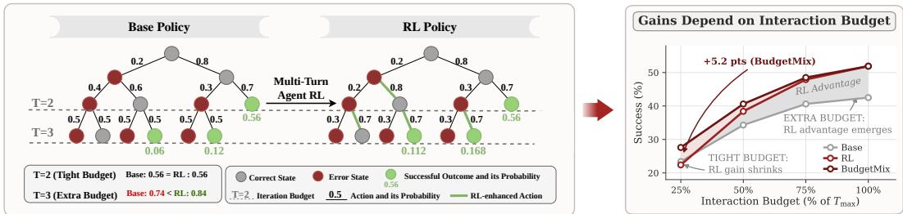  
Figure 1: Overview of our findings. Left: Multi-turn agentic RL does not uniformly enhance per-step action quality; rather, it mainly enhances ability of error recovery and long-horizon resilience. Right: The trajectory-level gains of agentic RL depend on a sufficient interaction budget (T).

To further study this budget-dependent shift in capability, we analyze the step-level action quality of models before and after multi-turn RL (§3.3). Results show that, given the same state and history, RL models do not consistently produce better next-step actions and can even perform worse in certain settings. Instead, their advantage becomes more pronounced at error states and later stages of a trajectory. As illustrated in Figure 1, multi-turn RL does not uniformly improve action quality of every step; it primarily strengthens ability of error recovery and sustain long-horizon execution, which may partly explain why RL models need a larger budget T to demonstrate their advantages.

To understand this phenomenon more deeply, we perform a series of mechanistic analyses (§4). Our log-likelihood analysis (§4.1) shows that RL-generated actions remain locally plausible under the base policy, yet complete RL trajectories receive substantially higher likelihood under the RL policy than under the base policy. This suggests that multi-turn RL may improve how reliably the model composes locally plausible actions into long-horizon trajectories. This phenomenon offers a possible explanation for how RL models can surpass the empirical Pass@K capability boundary of base models, even without consistently superior single-step actions to the base models. The training dynamics in §4.2 further show how this pattern emerges progressively during training.

These analyses reveal a hidden risk masked by conventional trajectory-level success rates: models trained with multi-turn RL may fail to perform consistently under varying interaction budgets. Furthermore, their single-step action quality can decline, which are critical in real-world deployments involving strict budget limits or irreversible errors (Ma et al., 2026; Doshi et al., 2026). To address this, we provide a preliminary discussion on some candidate solutions (§5). Specifically, we examine the benefits and limitations of process supervision signals and introduce BudgetMix RL, an alternative training strategy that varies interaction budgets. Experiments show that BudgetMix RL consistently improves performance across budgets while mitigating the decline in step-level action quality (§5.2).

## 2 PRELIMINARIES AND EVALUATION FRAMEWORK

This section formalizes our research setting. We first describe multi-turn agentic reinforcement learning (§2.1) and then present the two-dimensional Pass@(K, T) evaluation metric (§2.2).

## 2.1 MULTI-TURN AGENTIC REINFORCEMENT LEARNING

We consider an agent interacting with an environment over multiple turns to solve a task $x \sim \mathcal { D }$ At step t, given the interaction history $h _ { t } = ( x , o _ { 1 } , a _ { 1 } , \ldots , o _ { t - 1 } , a _ { t - 1 } , o _ { t } )$ , the agent samples an action $a _ { t } \sim \pi ( \cdot \mid h _ { t } )$ , prompting the environment to return observation $o _ { t + 1 } \sim P ( \cdot \mid h _ { t } , a _ { t } ) ;$

$$
a _ { t } \sim \pi ( \cdot \mid h _ { t } ) , \qquad o _ { t + 1 } \sim P ( \cdot \mid h _ { t } , a _ { t } ) .
$$

Actions can represent tool calls, terminal operations or code execution. Under an interaction budget of at most T turns, an episode yields a trajectory $\tau _ { \le T } = ( x , o _ { 1 } , a _ { 1 } , \dots , o _ { T } , a _ { T } )$ , scored by a terminal verifier with reward $R { \bar { ( } } \tau _ { \leq T } )$ . Our framework accommodates both outcome-only ${ \bf R L } \left( { \bf e . g . , G R P O } \right.$ (Guo et al., 2025)) and process-level credit assignment methods (e.g., GiGPO (Feng et al., 2025b)).

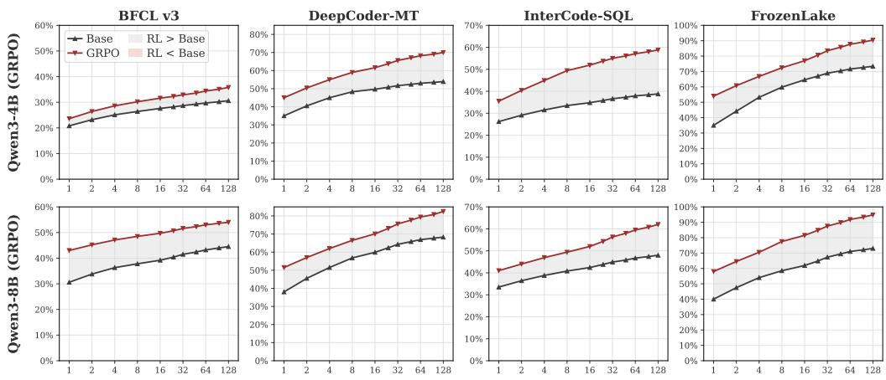  
Number of sampled trajectories k  
Figure 2: Pass@K across sampling breadth. Sweeping the number of sampled trajectories K

## 2.2 PaSS@(K, T): SAMPLING BREADTH AND INTERACTION DEPTH

Conventional agent evaluations typically report trajectory success. To probe capability boundaries, prior work on single-turn RL uses the metric Pass@K, the probability that at least one of k independent samples succeeds, which can be seen as sampling breadth. Interactive agents introduce an orthogonal axis: the maximum interaction budget T per trajectory, which governs interaction depth. To capture both dimensions, we use metric Pass@(K, T) (Zhai et al., 2026) for a policy π on task x:

$$
\mathrm { P a s s @ } ( K , T ) = \operatorname* { P r } _ { \tau ^ { ( 1 ) } , \ldots , \tau ^ { ( K ) } \sim \pi ( \cdot \vert x ) } \Big [ \exists i \in \{ 1 , \ldots , K \} : R ( \tau _ { \leq T } ^ { ( i ) } ) = 1 \Big ] ,\tag{1}
$$

which underpins our analysis in §3. Fixing the sampling budget to a constant C while sweeping T yields $\mathrm { P a s s } \hat { \ @ } T = \mathrm { P a s s } \hat { \ @ } \bar { ( } K = C , T )$ , isolating the depth axis evaluated in §3.2.

## 3 WHEN DOES AGENTIC RL OUTPERFORM THE BASE MODEL?

We now examine whether the gains from multi-turn agentic RL can be consistently achieved, as well as its potential risks. We evaluate models with two dimensional metrics Pass@(K, T) introduced in §2.2 (§3.1 and §3.2), analyze step-level action quality (§3.3), and summarize the potential risks (§3.4). We adopt GRPO as our primary RL algorithm and evaluate on four interactive benchmarks: DeepCoder-MT, BFCL, InterCode-SQL, and FrozenLake, spanning diverse domains and modalities. Additional results are reported in Appendix C and D, implementation details in Appendix A and B.

## 3.1 TRAJECTORY-LEVEL GAINS ACROSS SAMPLING BREADTH

We begin by evaluating the trajectory-level performance using the Pass@K. By increasing the number of independently sampled trajectories, Pass@K probes the empirical capability boundary of a model, which we use to characterize how this boundary changes after multi-turn RL. As shown in Figure 2, the RL model consistently outperforms the base model as the sampling breadth k increases, suggesting that multi-turn RL can push trajectory-level success beyond the empirical capability boundary of base model. This contrasts with prior observations in single-turn tasks, where RL does not expand capability boundary beyond the base model. Further results are shown in Appendix C.

## Takeaway 3.1

Pros of Agentic RL: unlike single-turn RL, multi-turn agentic RL can push trajectory-level performance beyond the empirical Pass@K capability boundary of the base model.

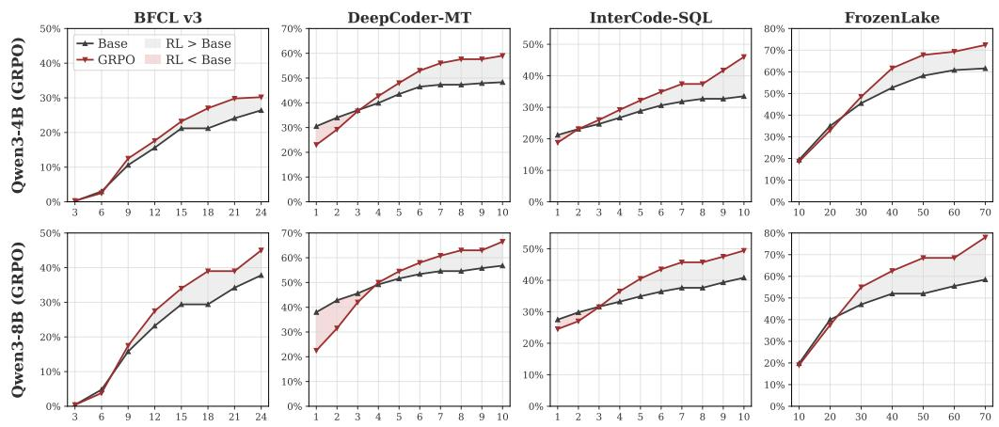  
Maximum interaction rounds T  
Figure 3: Pass@T at fixed k=8. Sweeping the maximum number of interaction turns $T .$

## 3.2 RL GAINS SHRINK UNDER TIGHT INTERACTION BUDGETS

Beyond sampling breadth, we evaluate how model performance evolves with interaction depth. As shown in Figure 3, we fix the sampling breadth at $k = 8$ and vary the maximum interaction turns T. The results reveal an interesting pattern: the advantage of the RL model depends on a sufficient interaction budget. As the budget T increases, the performance advantage of RL model over base model becomes increasingly pronounced. Conversely, under tight budgets (small T), this advantage diminishes, and can even reverse on certain tasks. To rule out the possibility that the performance drop at small T is trivially caused by tasks becoming structurally unsolvable under restrictive budgets, we also compute the structural performance upper bound for each task and discuss in Appendix B.3 Notably, at small T, even when substantial headroom remains below this upper bound, agentic RL fails to exhibit any clear advantage over the base model. More results are shown in Appendix D.

We conjecture that agent RL primarily strengthens long-horizon capabilities whose benefits emerge when sufficient interaction budget is available. Under restricted budgets, these benefits may disappear, suggesting that its gains do not necessarily stem from uniformly better step-level actions.

## Takeaway 3.2

Potential Cons of Agentic RL: the performance gains from multi-turn RL depend on sufficient interaction budgets, and can diminish or even reverse under tight budgets.

## 3.3 DOES MULTI-TURN RL IMPROVE STEP-LEVEL ACTION QUALITY?

The phenomenon of last section motivates a question: does multi-turn RL improve action quality for each individual step? Thus we compare the step quality of the base and RL model under identical states. For each state s, we independently sampled $\bar { G } = 1 \bar { 6 }$ actions from both policies and averaged their quality scores to reduce sampling variance and obtain a more robust estimate of action quality:

$$
a _ { i } ^ { \mathrm { B a s e } } \sim \pi _ { \mathrm { B a s e } } ( \cdot \mid s ) , \qquad a _ { i } ^ { \mathrm { R L } } \sim \pi _ { \mathrm { R L } } ( \cdot \mid s ) , \qquad i = 1 , \ldots , G .
$$

Strictly evaluating one-step quality is challenging because reliable process rewards remain difficult to obtain in agentic settings (Li et al., 2026b). We therefore focus on two tasks with reliable step-level evaluation: (1) For FrozenLake, we use finite-horizon dynamic programming (DP) with a discount factor γ of 0.95 to compute the exact $Q ^ { * }$ value of each step-level action under optimal continuation within the remaining interaction budget. (2) For DeepCoder-MT, the code of each step can be scored by unit-test pass rates. To isolate action quality from state visitation bias, we construct a state evaluation pool by sampling intermediate states equally from base and RL trajectories. Following experiments use Qwen3-4B trained with GRPO, with additional results presented in Appendix E.1.

Agentic RL does not uniformly improve step-level action quality. We first evaluate whether agentic RL uniformly improves action quality per-step. As shown in Figure 4, each point represents a matched state, with the x- and y-coordinates indicating action quality of the base and RL models, respectively. Points below the diagonal indicate superior action quality from base model, whereas points above the diagonal favor RL model. We find that the distribution does not favor the RL model and even leans slightly toward the base model. Specifically, RL achieves better step-level decision quality on only 46.8% of DeepCoder-MT states and 42.8% of FrozenLake states, with average quality no better than, even slightly below, the base model. These results demonstrate that multi-turn agentic RL does not consistently enhance single-step action and may occasionally degrade it.

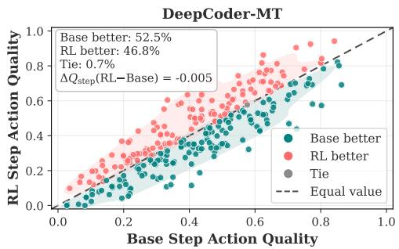

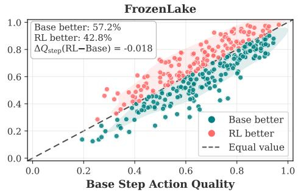  
Figure 4: Step-level action quality. Each point is one matched state; its coordinates are action quality of the base and RL model. Teal points favor the base model, red points favor the RL model.

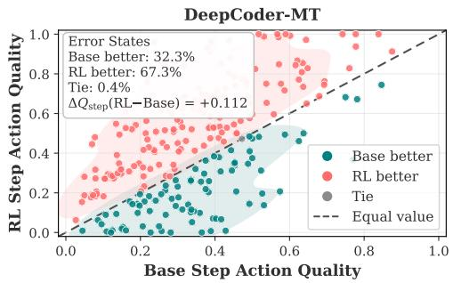

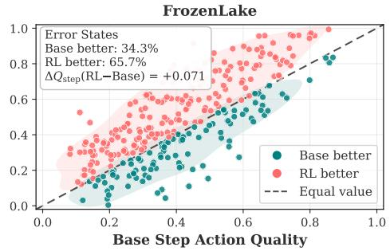  
Figure 5: Step-level action quality on error states. Each point is one error state.

Agentic RL excels after errors. Since the RL model does not consistently yield superior single-step decisions across every matched state, a natural question arises: why does multi-turn RL achieve marked trajectory-level performance gains? To answer this, we focus on states immediately following an error (e.g., error states), where effective recovery ability of models becomes critical. Specifically, we construct an error state pool by injecting an incorrect action at the preceding step. As shown in Figure 5, the pattern reverses under these error states: data points shift predominantly above the diagonal, with the RL model selecting the superior action in 65.7% of cases on FrozenLake and 67.3% on DeepCoder-MT. We additionally compare the terminal success rates of RL and base models when continuing from identical error states. RL outperforms base on both FrozenLake (51.3% vs. 38.6%) and DeepCoder-MT (38.5% vs. 22.9%). Appendix E.4 also illustrates how the RL model corrects an erroneous tool call on BFCL. These results demonstrate that RL achieves higher action quality and continuation success on these error states. When errors occur in interaction trajectories, agentic RL demonstrates superior error recovery capabilities and resilience.

The RL advantage emerges later in trajectories. Finally, we examine how decision quality evolves over the course of a trajectory. We group intermediate states by turn index and define the normalized depth at turn t as $d _ { t } = \bar { t } / T _ { \operatorname* { m a x } } \in [ \bar { 0 } , 1 ]$ , where $T _ { \mathrm { m a x } }$ is the maximum interaction budget. As shown in Figure 6, the RL model shows little advantage early in execution and even underperforms the base model. As interaction proceeds, however, the gap gradually narrows and reverses. This indicates that the RL model does not make superior decisions at the beginning of a trajectory; its advantage emerges as interaction unfolds. This suggests that the step-level advantage of agentic RL is not uniform across a trajectory, but becomes more pronounced at later stages of long-horizon interaction.

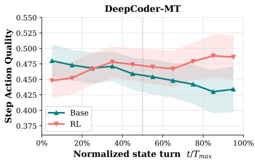

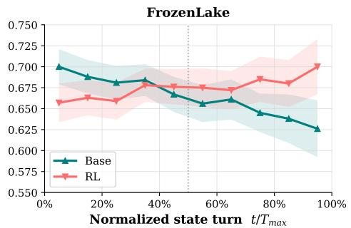  
Figure 6: Action quality versus normalized trajectory depth $d _ { t } = t / T _ { \operatorname* { m a x } }$ . Shading denotes 95% CI.

## Takeaway 3.3

Multi-turn agentic RL does not consistently improve single-step action quality. Its advantage is instead more pronounced in error states and later stages of long-horizon trajectories.

## 3.4 RISKS: REAL-WORLD DEPLOYMENT OF AGENTS

These findings highlight a deployment risk: the gains from agentic RL depend on sufficient interaction budget and may diminish or reverse under tight budgets. This is particularly concerning for tasks involving irreversible actions, such as financial or database operations (Doshi et al., 2026), where agents must make high-quality and conservative actions at each step. Yet higher trajectory success does not ensure better individual actions. As LLM agents are increasingly deployed in real-world settings, understanding such limitations beyond final task success becomes increasingly important.

## 4 MECHANISMS BEHIND THE OBSERVED BEHAVIORS

The previous section characterized the behavior of RL models at trajectory and step level. This section digs into the mechanism: a likelihood analysis (§4.1), the training dynamics analysis (§4.2).

## 4.1 LIKELIHOOD ANALYSIS: LOCAL SURPRISAL AND TRAJECTORY-LEVEL POLICY SHIFT

The results in §3.3 show that the per-step actions of the agent RL model do not consistently outperform those of the base model. In this section, we compare both the RL and base policies through their likelihoods. Specifically, we evaluate rollouts from both models under the base and RL policies, measuring the log-likelihood of individual actions and the relative likelihood of complete trajectories. Concretely, let a trajectory be $\tau = ( h _ { 1 } , a _ { 1 } , \dots , h _ { T } , a _ { T } )$ , where $h _ { t }$ denotes the history and $a _ { t }$ is the corresponding action. We keep the histories fixed and evaluate each action under base policy. As an action is a token sequence $a _ { t } = ( w _ { t , 1 } , \dots , w _ { t , m _ { t } } )$ , its negative log-likelihood (NLL) is

$$
{ \mathrm { A c t i o n N L L } } _ { \mathrm { B } } ( a _ { t } \mid h _ { t } ) = - \sum _ { j = 1 } ^ { m _ { t } } \log p _ { \mathrm { B } } \left( w _ { t , j } \mid h _ { t } , w _ { t , < j } \right) .
$$

To examine the complete trajectory, we further compute the cumulative log-likelihood ratio (LLR),

$$
\mathrm { L L R } _ { 1 : t } ( \tau ) = \sum _ { i = 1 } ^ { t } \left[ \log \pi _ { \mathrm { R L } } ( r _ { i } \mid h _ { i } ) - \log \pi _ { \mathrm { B } } ( r _ { i } \mid h _ { i } ) \right] ,
$$

where $r _ { i }$ denotes the complete model response in one turn, including reasoning and action tokens. Positive LLR indicates that the recorded trajectory is more likely under the RL policy than under the base policy. Together these two quantities characterize, respectively, how unusual each single action of the RL model is under the base policy and relative policy preference over complete trajectory.

Step-level actions of RL remain locally plausible under base policy. We evaluate per-token action NLL under the base policy on Terminal-Bench (Figure 7). We find that the RL action distributions (pink boxplots) substantially overlap with those of the base model (blue boxplots), with mean NLLs of 12.20 and 10.25, respectively. Thus, the single-step action of the RL model does not deviate far from the support of the base model, which partly explains why the steplevel decisions of the RL model do not consistently beat the base model in §3.3.

From actions to long-horizon execution. Although individual actions are supported,

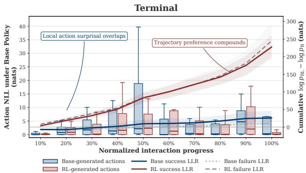  
Figure 7: Likelihood analysis. Boxplots show action NLL under base policy (left axis). Curves show cumulative LLR (right axis). Bands indicate 95% confidence.

this does not mean base model can reliably sample the entire long-horizon trajectory. As shown on the right y-axis of Figure 7, the cumulative LLR of successful RL trajectories increases with interaction progress, reaching approximately 228, compared with 26 for successful base trajectories. The RL model assigns much higher probabilities to its trajectories than base model. This contrasts with the similar NLLs that base model assigns to RL and its own actions. Overall, this demonstrates that even if the conditional probability per-step is reasonably high, the overall probability of entire trajectory can be extremely low. This provides a possible explanation for observations in §3.1: multi-turn RL enables trajectory-level success to surpass base model's Pass@K capability boundary even without improvement of every action.

## 4.2 TRAINING DYNAMICS OF MULTI-TURN RL

To more directly examine how multi-turn RL affects step-level action quality and trajectory-level performance, we further analyze the training dynamics. Standard agentic RL is optimized and validated using trajectory reward $R _ { \mathrm { m u l t i } }$ For tasks with step-level quality measures $( \ S 3 . 3 )$ , we track the average step reward $R _ { \mathrm { s i n g l e } }$ as a validation for step-level action, while training optimizes only on $R _ { \mathrm { m u l t i } }$ As shown in Figure 8 (red and blue curves), we find a phenomenon: as training proceeds, the trajectory-level reward $\bar { R } _ { \mathrm { m u l t i } }$ keeps rising while the per-step reward does not improve and even gradually declines. On DeepCoder-MT, $\bar { R _ { \mathrm { m u l t i } } }$ rises by 0.331 while $R _ { \mathrm { s i n g l e } }$ drops by 0.097. This indi-

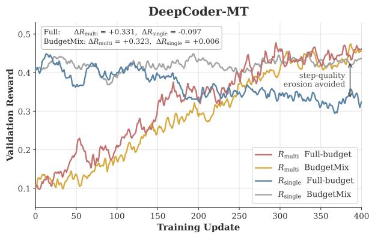  
Figure 8: Training dynamics of the trajectory-level reward $R _ { \mathrm { m u l t i } }$ and step reward $R _ { \mathrm { s i n g l e } }$ on DeepCoder-MT.

cates that the phenomenon observed at the final checkpoint is not incidental, but rather emerge progressively during training (More results in Appendix E.3). This echoes our earlier findings: trajectory-level gains can develop alongside declining step-level action quality.

## 5 DISCUSSION: TOWARDS MORE STABLE AGENTIC RL

The preceding sections indicate that the gains of agent RL rely on sufficient interaction budgets, while local action quality does not consistently improve and can even decline. This raises reliability concerns for real-world deployment. Consequently, this section offers a preliminary discussion on potential mitigation strategies. Our objective is to preserve its long-horizon execution capabilities and and trajectory-level gains while reducing its reliance on extra interaction budget for downstream error recovery and encouraging greater prudence in single-step decision making.

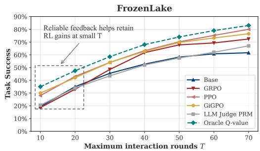

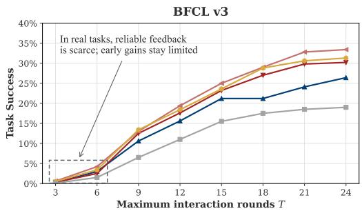  
Figure 9: Effect of process supervision signals on Pass@T.

## 5.1 HIGH-QUALITY PROCESS SIGNALS CAN PARTLY MITIGATE THIS RISK

A natural direction is to introduce finer-grained signals to improve per-step action quality through either process rewards or credit assignment. We therefore evaluate several methods to examine whether step-level signals can alleviate above limitations. As shown on the left of Figure 9, on FrozenLake, accurate process supervision can substantially mitigate the limitations of outcome-only RL. In particular, oracle Q-value process rewards and GiGPO stabilize performance across various interaction budgets, especially under tight budgets. However, as discussed in §3.3, such precise process supervision is rarely accessible in realistic agent tasks. Results of BFCL on the right illustrate this bottleneck, where no exact step-level oracle is available. Dense signal methods such as GiGPO and PPO fail to enhance performance under constrained budgets and perform similarly to GRPO. These findings demonstrate that while high-quality process rewards can alleviate budget reliance, acquiring such supervision signals remains impractical for most real-world applications.

## 5.2 BUDGETMIX RL: OPTIMIZING RL ACROSS INTERACTION BUDGETS

We therefore take a simpler route: BudgetMix RL. It keeps the same reward mechanism as traditional multi-turn RL, but varies the interaction budget across training trajectories. BudgetMix RL can be combined with existing agentic RL algorithms (e.g., GRPO, PPO, and GiGPO). Standard multi-turn agentic RL samples trajectories under a fixed maximum budget $T _ { \mathrm { m a x } }$ and optimizes either outcome or per-step rewards. However, this objective does not explicitly distinguish solutions that require different amounts of interaction, provided they finish within the budget. BudgetMix makes a single modification to this procedure. For a task instance x with full budget $\breve { T } _ { \mathrm { m a x } } ( x )$ , we construct candidate budgets at 10% intervals and uniformly sample one budget per task group:

$$
\mathcal { T } ( \boldsymbol { x } ) = \mathrm { U n i q u e } \left( \left\{ \left[ \frac { k } { 1 0 } T _ { \mathrm { m a x } } ( \boldsymbol { x } ) \right] : k = 1 , \ldots , 1 0 \right\} \right) , \qquad T ( \boldsymbol { x } ) \sim \mathrm { U n i f o r m } \big ( \mathcal { T } ( \boldsymbol { x } ) \big ) .\tag{2}
$$

During training, the total and remaining budget are provided within the prompt; trajectories that exceed the budget without completion receive a reward of zero. The reward signal design is consistent with that of traditional RL. We provide pseudocode and implementation details in Appendix A.4. BudgetMix turns the budget T from an evaluation dimension in Pass@(K, T) into a training dimension. Its central idea is that the interaction budget changes the conditions under which the same reward can be obtained. A tighter budget limits opportunities for retries, placing greater demands on earlier decisions, whereas an ample budget preserves opportunities for long-range execution.

## 5.3 EXPERIMENTAL SETUP

Tasks and models. Our main experiments cover four tasks: FrozenLake, DeepCoder-MT, BFCL and InterCode-SQL. We primarily use Qwen3-4B and Qwen3-8B as the base models.

Baselines. From the same base checkpoint, we compare standard full-budget RL against BudgetMix RL under identical algorithm settings including GRPO, GiGPO, PPO.

Evaluation protocol. We evaluate Pass@T with the maximum interaction budget set to 25%, 50%, 75%, and 100% of $T _ { \mathrm { m a x } }$ . Consistent with the previous Pass@T evaluation setup, we inform the model of the total budget limit and the remaining budget within the prompt, as shown in Appendix B

Table 1: Pass@T evaluation results (Pass@8, %). We evaluate models at 25%, 50%, 75%, and 100% of the maximum interaction budget. Bold and underlined values denote the best and second-best results, respectively, within each model size and budget. Avg. gain reports the average improvement of BudgetMix over full-budget RL across GRPO, GiGPO, and PPO, in percentage points.
<table><tr><td></td><td colspan="3">FrozenLake  $( T _ { \mathrm { m a x } } = 7 0 )$ </td><td colspan="4">DeepCoder-MT</td><td colspan="4"> $( T _ { \mathrm { m a x } } = 1 0 )$   $\mathbf { B F C L - v 3 } ( T _ { \operatorname* { m a x } } = 2 4 )$ </td><td colspan="4">InterCode-SQL  $( T _ { \mathrm { m a x } } = 1 0 )$ </td><td></td></tr><tr><td>Method</td><td>25%</td><td>50%</td><td>75%</td><td>100%</td><td>25% 50%</td><td>75%</td><td>100%</td><td>25%</td><td>50%</td><td>75%</td><td>100%</td><td>25%</td><td>50%</td><td>75%</td><td>100%</td><td>Avg.</td></tr><tr><td></td><td colspan="10"></td><td></td><td></td><td></td><td></td><td></td><td></td></tr><tr><td>Base</td><td>30.3</td><td>49.1</td><td>58.7</td><td>61.6</td><td>34.0</td><td>43.5 47.3</td><td>48.3</td><td>3.0</td><td>15.6</td><td>21.2</td><td>26.4</td><td>23.1</td><td>28.8</td><td>31.8</td><td>33.5</td><td>34.8</td></tr><tr><td>GRPO Full</td><td>28.7</td><td>55.1</td><td>68.1</td><td>72.4 29.2</td><td>48.0</td><td>56.0</td><td>59.0</td><td>2.5</td><td>17.6</td><td>27.0</td><td>30.2</td><td>23.1</td><td>32.2</td><td>37.4</td><td>46.0</td><td>39.5</td></tr><tr><td>GRPO BudgetMix</td><td>37.6</td><td>61.1</td><td>72.0</td><td>73.5 38.1</td><td>54.3</td><td>60.5</td><td>61.2</td><td>8.5</td><td>23.0</td><td>30.5</td><td>30.8</td><td>28.9</td><td>37.7</td><td>42.9</td><td>47.5</td><td>44.3</td></tr><tr><td>GiGPO Full</td><td>38.4</td><td>58.4</td><td>70.4</td><td>76.5</td><td>28.8 48.3</td><td>55.6</td><td>58.8</td><td>3.4</td><td>18.4</td><td>28.8</td><td>31.3</td><td>23.4</td><td>31.5</td><td>37.5</td><td>45.0</td><td>40.9</td></tr><tr><td>GiGPO BudgetMix</td><td>46.3</td><td>63.5</td><td>74.0</td><td>78.5 36.5</td><td>52.0</td><td>59.3</td><td>59.5</td><td>8.5</td><td>23.2</td><td>31.7</td><td>33.0</td><td>27.9</td><td>37.0</td><td>41.7</td><td>44.8</td><td>44.8</td></tr><tr><td>PPO Full</td><td>38.5</td><td>58.6</td><td>71.2</td><td>80.0 29.5</td><td>45.6</td><td>51.6</td><td>55.0</td><td>4.2</td><td>19.4</td><td>29.0</td><td>33.4</td><td>22.4</td><td>30.6</td><td>34.8</td><td>41.0</td><td>40.3</td></tr><tr><td>PPO BudgetMix</td><td>45.5</td><td>63.1</td><td>75.1</td><td>80.3</td><td>36.4 51.6</td><td>55.5</td><td>56.9</td><td>10.2</td><td>24.8</td><td>32.8</td><td>34.5</td><td>27.0</td><td>35.2</td><td>38.3</td><td>42.7</td><td>44.4</td></tr><tr><td>Avg. gain</td><td>+7.9 +5.2 +3.8</td><td></td><td>+1.1</td><td>+7.8</td><td></td><td>+5.3 +4.0</td><td>+1.6</td><td></td><td>+5.7 +5.2</td><td>+3.4</td><td>+1.1</td><td></td><td>+5.0 +5.2 +4.4</td><td></td><td>+1.0</td><td>+4.2</td></tr><tr><td colspan="10">Qwen3-8B</td><td colspan="7"></td></tr><tr><td>Base</td><td>34.0</td><td>49.5</td><td>52.7</td><td>58.5</td><td>42.8 51.6</td><td>54.6</td><td>56.8</td><td>4.8</td><td>23.2</td><td>29.4</td><td>37.8</td><td>29.8</td><td>34.9</td><td>37.6</td><td>40.8</td><td>39.9</td></tr><tr><td>GRPO Full</td><td>31.9</td><td>58.8</td><td>68.5</td><td>78.0</td><td>31.5 54.5</td><td>60.8</td><td>66.5</td><td>3.8</td><td>27.5</td><td>39.0</td><td>45.0</td><td>27.0</td><td>40.5</td><td>45.7</td><td>49.4</td><td>45.5</td></tr><tr><td>GRPO BudgetMix</td><td>40.8</td><td>65.1</td><td>72.9</td><td>79.6</td><td>45.5</td><td>59.8 64.6</td><td>66.8</td><td>10.5</td><td>33.0</td><td>43.2</td><td>47.2</td><td>33.1</td><td>46.5</td><td>50.4</td><td>50.4</td><td>50.6</td></tr><tr><td>GiGPO Full</td><td>34.6</td><td>56.5</td><td>65.5</td><td>71.5</td><td>28.7</td><td>48.2 55.7</td><td>58.7</td><td>5.6</td><td>26.8</td><td>38.8</td><td>43.5</td><td>22.8</td><td>32.9</td><td>36.1</td><td>45.6</td><td>42.0</td></tr><tr><td>GiGPO BudgetMix</td><td>40.9</td><td>60.4</td><td>69.1</td><td>72.3 44.9</td><td>57.8</td><td>60.1</td><td>60.7</td><td>10.8</td><td>30.8</td><td>42.8</td><td>43.2</td><td>32.6</td><td>39.4</td><td>40.2</td><td>47.7</td><td>47.1</td></tr><tr><td>PPO Full</td><td>40.4</td><td>63.5</td><td>71.2</td><td>85.0</td><td>34.5 51.5</td><td>57.0</td><td>64.8</td><td>7.0</td><td>29.5</td><td>41.5</td><td>48.0</td><td>26.5</td><td>36.0</td><td>40.8</td><td>45.0</td><td>46.4</td></tr><tr><td>PPO BudgetMix</td><td>47.1</td><td>67.4</td><td>75.2</td><td>86.7</td><td>44.0</td><td>56.6 61.1</td><td>65.9</td><td>12.2</td><td>34.2</td><td>46.0</td><td>50.5</td><td>32.1</td><td>40.0</td><td>44.5</td><td>46.6</td><td>50.6</td></tr><tr><td>Avg. gain</td><td></td><td>+7.3 +4.7</td><td>+4.0</td><td>+1.4</td><td>+13.2</td><td>+6.7 +4.1</td><td>+1.1</td><td></td><td>+5.7 +4.7</td><td>+4.2</td><td>+1.5</td><td>+7.2</td><td>+5.5</td><td>+4.2</td><td>+1.6</td><td>+4.8</td></tr></table>

## 5.4 RESULTS AND ANALYSIS

Table 1 reports the main results. First, under tight budget constraints (25%, 50% and $7 5 \% T _ { \mathrm { m a x } } )$ BudgetMix outperforms both the base model and standard full-budget RL across all four tasks, achieving average performance gains of 7.5, 5.3 and 4.0 percentage points over full-budget RL, respectively. Second, at full interaction capacity (100% $\bar { T _ { \mathrm { m a x } } } )$ , BudgetMix maintains parity with full-budget RL, demonstrating that its low-budget enhancements do not compromise long-horizon execution capability. Overall, BudgetMix improves the stability of agent performance, delivering strong performance across diverse interaction budgets and retaining strong full-budget results.

We further examine the training dynamics of BudgetMix. As shown in Figure 8, during BudgetMix training (yellow and gray curves), the trajectory-level reward $R _ { \mathrm { m u l t i } }$ steadily increases, while the step-level reward $R _ { \mathrm { s i n g l e } }$ remains stable or improves slightly. In contrast, standard full-budget agent RL (blue curve) degrades step-level quality. Thus, BudgetMix largely mitigates local decisionquality degradation while preserving long-horizon gains. Consistent results from direct step-level action-quality evaluation are provided in Appendix E.1.

## 6 RELATED WORK

## 6.1 MULTI-TURN AGENTIC REINFORCEMENT LEARNING

LLM agents are widely used for interactive tasks like coding and tool use (Zhou et al., 2024; Qian et al., 2025; Wang et al., 2026a; Hao et al., 2026b; Men et al., 2025), with RL becoming a major training paradigm (Jin et al., 2026a; Zhu et al., 2026a). Many methods extend single-turn outcomebased RL (Yu et al., 2025) to interactive tasks using trajectory-level rewards (Xi et al., 2025a; Wang et al., 2025d), enabling applications such as deep research (Jin et al., 2025; Sun et al., 2026), toolaugmented reasoning (Feng et al., 2025a), and web interaction (Qi et al., 2025). However, sparse terminal rewards make credit assignment increasingly difficult as interaction horizons grow (Tao et al., 2026; Tan et al., 2026). To address this, methods derive process signals from outcomes (Liu et al., 2025b; Zheng et al., 2026), including state-grouped advantages in GiGPO (Feng et al., 2025b), stepwise reward decomposition in SPA-RL (Wang et al., 2025a), and advantage attribution with entropy-guided exploration in ARPO (Dong et al., 2025). Other work explicitly models intermediate decision quality (Xi et al., 2025b; Lin et al., 2026). Despite these advances, evaluation remains largely centered on trajectory-level success (Li et al., 2026c; Men et al., 2026; Jin et al., 2026b). We therefore analyze multi-turn RL beyond final task success to better understand its gains and limitations.

## 6.2 UNDERSTANDING AND RETHINKING RL POST-TRAINING

Recently, post-training has become a key stage to improving reasoning and planning capabilities of LLMs (Guo et al., 2025), prompting studies of its mechanisms and limitations (Zhu et al., 2026b; He et al., 2025; Fu et al., 2026). For single-turn reasoning, Pass@ K analyses suggest that RLVR primarily reweights solutions already reachable by the base model (Yue et al., 2025). Later work reports boundary expansion with prolonged RL (Liu et al., 2025a), while others attribute apparent gains to recombining existing skills (Yuan et al., 2025) or amplifying latent base-model behaviors (Wu et al., 2026). These findings suggest that final success may obscure the source of RL gains. Other studies examine entropy dynamics (Cui et al., 2025; Xu et al., 2026a), identify high-entropy tokens as key carriers of learning signals (Wang et al., 2025b). Related work further compares SFT and RL in generalization and capability acquisition (Chu et al., 2025; Zhu et al., 2026b). Mechanistic analyses have recently extended to multi-turn agents (Wang et al., 2026b; Li et al., 2026a; Hao et al., 2026a). Most relevantly, prior work introduced Pass@(K, T) to characterize multi-turn capability boundaries and showed that agentic RL can surpass capability boundary of base model (Zhai et al., 2026). We go beyond this perspective by analyzing interaction-budget dependence, step quality and mechanisms to identify the sources of RL gains and potential limitations.

## 7 CONCLUSION

We revisit the benefits of multi-turn agentic RL beyond final task success. Through Pass@(K, T) evaluation, we demonstrate that RL can extend the empirical capabilities of the base model, though this advantage may diminish or reverse as interaction budgets become more constrained. Our analysis suggests that these gains stem primarily from long-horizon execution and error recovery, rather than consistently superior single-step actions. As this may impact the reliability of agents deployed in real-world settings, we further discuss potential strategies to mitigate this risk and their limitations.

## AI USE STATEMENT

During the writing of this paper, we used LLMs to assist with grammar checking, text polishing, and improving overall readability. All AI-assisted revisions were carefully reviewed by the authors to ensure that they did not alter the original meaning, technical content, or conclusions. We also used AI assistants to improve the presentation of selected tables and figures. In addition, we evaluated an LLM-based judge as a process reward model in one of our analysis experiments. We ensure that the AI does not alter the results. All experimental data and numerical results were verified by the authors.

## ETHICS STATEMENT

This work studies the capabilities and limitations of multi-turn reinforcement learning for LLM agents, with particular attention to their reliability under different interaction constraints. Our experiments are conducted on benchmark environments covering tool use, interactive coding, planning, and terminal operations. We do not conduct human-subject experiments in this study. Our analysis highlights a potential deployment risk: the gains of agentic RL can shrink under tight interaction budgets while single-step action quality of RL models does not consistently improve. This limitation can be particularly relevant in applications involving strict interaction budgets or irreversible actions. We therefore believe that agentic systems should be evaluated not only by final task success, but also by their robustness across execution constraints and the reliability of individual decisions.

## REPRODUCIBILITY STATEMENT

We provide the experimental settings and implementation details required to reproduce our main results in both the main text and the appendix. The main text describes the evaluation metrics experimental protocols, and the BudgetMix RL framework. More complete reproducibility details are provided in the appendix. Specifically, Appendix A describes the details of tasks and training implementation. Appendix B provides the detailed evaluation protocols. Additional experiments across RL algorithms, model architectures, tasks, and analysis settings are reported in Appendices C,D and E. Together, these details are intended to facilitate reproducibility of our results.

## REFERENCES

Mark Chen, Jerry Tworek, Heewoo Jun, Qiming Yuan, Henrique Ponde de Oliveira Pinto, Jared Kaplan, Harri Edwards, Yuri Burda, Nicholas Joseph, Greg Brockman, Alex Ray, Raul Puri, Gretchen Krueger, Michael Petrov, Heidy Khlaaf, Girish Sastry, Pamela Mishkin, Brooke Chan, Scott Gray, Nick Ryder, Mikhail Pavlov, Alethea Power, Lukasz Kaiser, Mohammad Bavarian, Clemens Winter, Philippe Tillet, Felipe Petroski Such, Dave Cummings, Matthias Plappert, Fotios Chantzis, Elizabeth Barnes, Ariel Herbert-Voss, William Hebgen Guss, Alex Nichol, Alex Paino, Nikolas Tezak, Jie Tang, Igor Babuschkin, Suchir Balaji, Shantanu Jain, William Saunders, Christopher Hesse, Andrew N. Carr, Jan Leike, Josh Achiam, Vedant Misra, Evan Morikawa, Alec Radford, Matthew Knight, Miles Brundage, Mira Murati, Katie Mayer, Peter Welinder, Bob McGrew, Dario Amodei, Sam McCandlish, Ilya Sutskever, and Wojciech Zaremba. Evaluating large language models trained on code, 2021. URL https: //arxiv.org/abs/2107.033 74.

Tianzhe Chu, Yuexiang Zhai, Jihan Yang, Shengbang Tong, Saining Xie, Dale Schuurmans, Quoc V. Le, Sergey Levine, and Yi Ma. Sft memorizes, rl generalizes: A comparative study of foundation model post-training, 2025. URL https://arxiv.org/abs/2501.17161.

Ganqu Cui, Yuchen Zhang, Jiacheng Chen, Lifan Yuan, Zhi Wang, Yuxin Zuo, Haozhan Li, Yuchen Fan, Huayu Chen, Weize Chen, Zhiyuan Liu, Hao Peng, Lei Bai, Wanli Ouyang, Yu Cheng, Bowen Zhou, and Ning Ding. The entropy mechanism of reinforcement learning for reasoning language models,2025.URLhttps://arxiv.org/abs/2505.22617.

Guanting Dong, Hangyu Mao, Kai Ma, Licheng Bao, Yifei Chen, Zhongyuan Wang, Zhongxia Chen, Jiazhen Du, Huiyang Wang, Fuzheng Zhang, Guorui Zhou, Yutao Zhu, Ji-Rong Wen, and Zhicheng Dou. Agentic reinforced policy optimization, 2025. URL https: //arxiv.org/abs/2507 .19849.

Aarya Doshi, Yining Hong, Congying Xu, Eunsuk Kang, Alexandros Kapravelos, and Christian Kästner. Towards verifiably safe tool use for llm agents. In Proceedings of the IEEE/ACM 48th International Conference on Software Engineering, pp. 201–205, 2026.

Jiazhan Feng, Shijue Huang, Xingwei Qu, Ge Zhang, Yujia Qin, Baoquan Zhong, Chengquan Jiang, Jinxin Chi, and Wanjun Zhong. Retool: Reinforcement learning for strategic tool use in llms, 2025a.URL https://arxiv.org/abs/2504.11536.

Lang Feng, Zhenghai Xue, Tingcong Liu, and Bo An. Group-in-group policy optimization for llm agent training,2025b.URL https://arxiv.org/abs/2505.10978.

Zixuan Fu, Bingxiang He, Yuxin Zuo, Haohuan Huang, Jinqian Zhang, Ruhang Xiao, Cheng Qian, Qinyu Luo, Huan-ang Gao, Yudong Wang, et al. Rethinking on-policy distillation of large language models ii: One training example. arXiv preprint arXiv:2609.04172, 2026.

Daya Guo, Dejian Yang, Haowei Zhang, Junxiao Song, Peiyi Wang, Qihao Zhu, Runxin Xu, Ruoyu Zhang, Shirong Ma, Xiao Bi, et al. Deepseek-r1: Incentivizing reasoning capability in llms via reinforcement learning. arXiv preprint arXiv:2501.12948, 2025.

Yupu Hao, Zhuoran Jin, Huanxuan Liao, Kang Liu, and Jun Zhao. Why multi-step tool-use reinforcement learning collapses and how supervisory signals fix it, 2026a. URL ht tps : //arxiv.org/abs/2606.26027.

Yupu Hao, Zhuoran Jin, Huanxuan Liao, Kang Liu, and Jun Zhao. Pushing the limits of llm tool calling via experiential knowledge integration and activation. In Findings of the Association for Computational Linguistics: ACL 2026, pp. 14470–14497, 2026b.

Bingxiang He, Zekai Qu, Zeyuan Liu, Yinghao Chen, Yuxin Zuo, Cheng Qian, Kaiyan Zhang, Weize Chen, Chaojun Xiao, Ganqu Cui, Ning Ding, and Zhiyuan Liu. Justrl: Scaling a 1.5b llm with a simple rl recipe, 2025.URL https://arxiv.org/abs/2512.16649.

Hamish Ivison, Junjie Oscar Yin, Rulin Shao, Teng Xiao, Nathan Lambert, and Hannaneh Hajishirzi. Tmax: A simple recipe for terminal agents, 2026. URL https://arxiv.org/abs/2606.2 3321.

Bowen Jin, Hansi Zeng, Zhenrui Yue, Jinsung Yoon, Sercan Arik, Dong Wang, Hamed Zamani, and Jiawei Han. Search-r1: Training llms to reason and leverage search engines with reinforcement learning,2025.URL https://arxiv.org/abs/2503.09516.

Zhuoran Jin, Hongbang Yuan, Kejian Zhu, Jiachun Li, Pengfei Cao, Yubo Chen, Kang Liu, and Jun Zhao. Omni-reward: Towards generalist omni-modal reward modeling with free-form preferences. In International Conference on Learning Representations, volume 2026, pp. 108481–108530, 2026a.

Zhuoran Jin, Kejian Zhu, Hongbang Yuan, Yupu Hao, Pengfei Cao, Yubo Chen, Kang Liu, and Jun Zhao. Look light, think heavy: What multimodal chain-of-thought reasoning can and cannot do. In Proceedings of the 64th Annual Meeting of the Association for Computational Linguistics (Volume 1: Long Papers), pp. 8567–8608, 2026b.

Jiachun Li, Zhuoran Jin, Tianyi Men, Yupu Hao, Kejian Zhu, Lingshuai Wang, Dongqi Huang, Longxiang Wang, Shengjia Hua, Lu Wang, Jinshan Gao, Hongbang Yuan, Ruilin Xu, Kang Liu, and Jun Zhao. Agentic environment engineering for large language models: A survey of environment modeling, synthesis, evaluation, and application. CoRR, abs/2606.12191, 2026a. doi: 10.48550/ARXIV.2606.12191.URL https://doi.org/10.48550/arXiv.2606.1219 1.

Mukai Li, Qingcheng Zeng, Tianqing Fang, Zhenwen Liang, Linfeng Song, Qi Liu, Haitao Mi, and DongYu. Verified critical step optimization for llm agents, 2026b. URL https : / /arxiv. or g/abs/2602.03412.

Xiaochuan Li, Ryan Ming, Pranav Setlur, Abhijay Paladugu, Andy Tang, Hao Kang, Shuai Shao, Rong Jin, and Chenyan Xiong. Benchmark test-time scaling of general llm agents. arXiv preprint arXiv:2602.18998, 2026c.

Jianghao Lin, Yuanyuan Shi, Xin Peng, Renjie Ding, Hairui Wang, Yuxuan Peng, Bizhe Bai, Weixi Song, Fengshuo Bai, Huacan Chai, Weinan Zhang, Fei Huang, and Ying Wen. Toolprm: Finegrained inference scaling of structured outputs for function calling, 2026. URL https : / / arxi v.org/abs/2510.14703.

Mingjie Liu, Shizhe Diao, Ximing Lu, Jian Hu, Xin Dong, Yejin Choi, Jan Kautz, and Yi Dong. Prorl: Prolonged reinforcement learning expands reasoning boundaries in large language models, 2025a.URL https://arxiv.org/abs/2505.24864.

Xiaoqian Liu, Ke Wang, Yuchuan Wu, Fei Huang, Yongbin Li, Junge Zhang, and Jianbin Jiao. Online process reward leanring for agentic reinforcement learning. arXiv e-prints, pp. arXiv–2509, 2025b.

Michael Luo, Sijun Tan, Roy Huang, Ameen Patel, Alpay Ariyak, Qingyang Wu, Xiaoxiang Shi, Rachel Xin, Colin Cai, Maurice Weber, Ce Zhang, Li Erran Li, Raluca Ada Popa, and Ion Stoica. Deepcoder: A fully open-source 14b coder at o3-mini level. https : //pretty-radio-b75 .notion.site/DeepCoder-A-Fully-Open-Source-14B-Coder-at-O3-min i-Level-1cf81902c14680b3bee5eb349a512a51,2025.NotionBlog.

Yichuan Ma, Linyang Li, Yongkang Chen, Peiji Li, Xiaozhe Li, Qipeng Guo, Dahua Lin, and Kai Chen. Timely machine: Awareness of time makes test-time scaling agentic. In Proceedings of the 64th Annual Meeting of the Association for Computational Linguistics (Volume 1: Long Papers), pp. 4619–4636, 2026.

Tianyi Men, Zhuoran Jin, Pengfei Cao, Yubo Chen, Kang Liu, and Jun Zhao. Agent-rewardbench: Towards a unified benchmark for reward modeling across perception, planning, and safety in real-world multimodal agents. In Proceedings of the 63rd Annual Meeting of the Association for Computational Linguistics (Volume 1: Long Papers), pp. 17521–17541, 2025.

Tianyi Men, Zhuoran Jin, Kang Liu, and Jun Zhao. The physics of multi-turn long-horizon planning: From pre-training to post-training via single-and multi-teacher on-policy agentic distillation. arXiv preprint arXiv:2607.24720, 2026.

Mike A. Merrill, Alexander G. Shaw, Nicholas Carlini, Boxuan Li, Harsh Raj, Ivan Bercovich, Lin Shi, Jeong Yeon Shin, Thomas Walshe, E. Kelly Buchanan, Junhong Shen, Guanghao Ye, Haowei Lin, Jason Poulos, Maoyu Wang, Marianna Nezhurina, Jenia Jitsev, Di Lu, Orfeas Menis Mastromichalakis, Zhiwei Xu, Zizhao Chen, Yue Liu, Robert Zhang, Leon Liangyu Chen, Anurag Kashyap, Jan-Lucas Uslu, Jeffrey Li, Jianbo Wu, Minghao Yan, Song Bian, Vedang Sharma, Ke Sun, Steven Dillmann, Akshay Anand, Andrew Lanpouthakoun, Bardia Koopah, Changran Hu, Etash Guha, Gabriel H. S. Dreiman, Jiacheng Zhu, Karl Krauth, Li Zhong, Niklas Muennighoff, Robert Amanfu, Shangyin Tan, Shreyas Pimpalgaonkar, Tushar Aggarwal, Xiangning Lin, Xin Lan, Xuandong Zhao, Yiqing Liang, Yuanli Wang, Zilong Wang, Changzhi Zhou, David Heineman, Hange Liu, Harsh Trivedi, John Yang, Junhong Lin, Manish Shetty, Michael Yang, Nabil Omi. Negin Raoof, Shanda Li, Terry Yue Zhuo, Wuwei Lin, Yiwei Dai, Yuxin Wang, Wenhao Chai, Shang Zhou, Dariush Wahdany, Ziyu She, Jiaming Hu, Zhikang Dong, Yuxuan Zhu, Sasha Cui, Ahson Saiyed, Arinbjörn Kolbeinsson, Jesse Hu, Christopher Michael Rytting, Ryan Marten, Yixin Wang, Alex Dimakis, Andy Konwinski, and Ludwig Schmidt. Terminal-bench: Benchmarking agents on hard, realistic tasks in command line interfaces, 2026. URL https : //arxiv. org/ abs/2601.11868.

Shishir G Patil, Huanzhi Mao, Fanjia Yan, Charlie Cheng-Jie Ji, Vishnu Suresh, Ion Stoica, and Joseph E Gonzalez. The berkeley function calling leaderboard (bfcl): From tool use to agentic evaluation of large language models. In Forty-second International Conference on Machine Learning, 2025.

Zehan Qi, Xiao Liu, Iat Long Iong, Hanyu Lai, Xueqiao Sun, Wenyi Zhao, Yu Yang, Xinyue Yang, Jiadai Sun, Shuntian Yao, Tianjie Zhang, Wei Xu, Jie Tang, and Yuxiao Dong. Webrl: Training llm web agents via self-evolving online curriculum reinforcement learning, 2025. URL https://arxiv.org/abs/2411.02337.

Cheng Qian, Emre Can Acikgoz, Qi He, Hongru Wang, Xiusi Chen, Dilek Hakkani-Tür, Gokhan Tur, and Heng Ji. Toolrl: Reward is all tool learning needs, 2025. URL https : / /arxiv. org/ab s/2504.13958.

John Schulman, Filip Wolski, Prafulla Dhariwal, Alec Radford, and Oleg Klimov. Proximal policy optimization algorithms, 2017. URL https://arxiv.org/abs/1707.06347.

John Schulman, Philipp Moritz, Sergey Levine, Michael Jordan, and Pieter Abbeel. High-dimensional continuous control using generalized advantage estimation, 2018. URL https : //arxiv. or g/abs/1506.02438.

Junhong Shen, Hao Bai, Lunjun Zhang, Yifei Zhou, Amrith Setlur, Peter Tong, Diego Caples, Nan Jiang, Tong Zhang, Ameet Talwalkar, et al. Thinking vs. doing: Improving agent reasoning by scaling test-time interaction. Advances in Neural Information Processing Systems, 38:169640— 169681, 2026.

Guangming Sheng, Chi Zhang, Zilingfeng Ye, Xibin Wu, Wang Zhang, Ru Zhang, Yanghua Peng, Haibin Lin, and Chuan Wu. Hybridflow: A flexible and efficient rlhf framework. arXiv preprint arXiv: 2409.19256, 2024.

Hao Sun, Zile Qiao, Jiayan Guo, Xuanbo Fan, Yingyan Hou, Yong Jiang, Pengjun Xie, Yan Zhang, Fei Huang, and Jingren Zhou. Zerosearch: Incentivize the search capability of llms without searching,2026.URLhttps://arxiv.org/abs/2505.04588.

Hui-Ze Tan, Xiao-Wen Yang, Hao Chen, Jie-Jing Shao, Yi Wen, Yuteng Shen, Weihong Luo, Xiku Du, Lan-Zhe Guo, and Yu-Feng Li. Hindsight credit assignment for long-horizon llm agents, 2026. URLhttps://arxiv.org/abs/2603.08754.

Leitian Tao, Baolin Peng, Wenlin Yao, Tao Ge, Hao Cheng, Mike Hang Wang, Jianfeng Gao, and Sharon Li. Trace: Turn-level reward assignment via credit estimation for long-horizon agents 2026.URLhttps://arxiv.org/abs/2607.13988.

Hanlin Wang, Chak Tou Leong, Jiashuo Wang, Jian Wang, and Wenjie Li. Spa-rl: Reinforcing llm agents via stepwise progress attribution, 2025a. URL https: //arxiv.org/abs/2505.2 0732.

Lu Wang, Zhuoran Jin, Yupu Hao, Yubo Chen, Kang Liu, Yulong Ao, and Jun Zhao. Think while watching: Online streaming segment-level memory for multi-turn video reasoning in multimodal large language models. In European Conference on Computer Vision, pp. 342–361. Springer 2026a.

Shenzhi Wang, Le Yu, Chang Gao, Chujie Zheng, Shixuan Liu, Rui Lu, Kai Dang, Xionghui Chen, Jianxin Yang, Zhenru Zhang, Yuqiong Liu, An Yang, Andrew Zhao, Yang Yue, Shiji Song, Bowen Yu, Gao Huang, and Junyang Lin. Beyond the 80/20 rule: High-entropy minority tokens drive effective reinforcement learning for llm reasoning, 2025b. URL https : //arxiv. org/abs/ 2506.01939.

Weiyun Wang, Zhangwei Gao, Lixin Gu, Hengjun Pu, Long Cui, Xingguang Wei, Zhaoyang Liu, Linglin Jing, Shenglong Ye, Jie Shao, Zhaokai Wang, Zhe Chen, Hongjie Zhang, Ganlin Yang, Haomin Wang, Qi Wei, Jinhui Yin, Wenhao Li, Erfei Cui, Guanzhou Chen, Zichen Ding, Changyao Tian, Zhenyu Wu, Jingjing Xie, Zehao Li, Bowen Yang, Yuchen Duan, Xuehui Wang, Zhi Hou, Haoran Hao, Tianyi Zhang, Songze Li, Xiangyu Zhao, Haodong Duan, Nianchen Deng, Bin Fu, Yinan He, Yi Wang, Conghui He, Botian Shi, Junjun He, Yingtong Xiong, Han Lv, Lijun Wu, Wenqi Shao, Kaipeng Zhang, Huipeng Deng, Biqing Qi, Jiaye Ge, Qipeng Guo, Wenwei Zhang, Songyang Zhang, Maosong Cao, Junyao Lin, Kexian Tang, Jianfei Gao, Haian Huang, Yuzhe Gu, Chengqi Lyu, Huanze Tang, Rui Wang, Haijun Lv, Wanli Ouyang, Limin Wang, Min Dou, Xizhou Zhu, Tong Lu, Dahua Lin, Jifeng Dai, Weijie Su, Bowen Zhou, Kai Chen, Yu Qiao, Wenhai Wang, and Gen Luo. Internvl3.5: Advancing open-source multimodal models in versatility, reasoning, andefficiency,2025c.URL https://arxiv.org/abs/2508.18265.

Zihan Wang, Kangrui Wang, Qineng Wang, Pingyue Zhang, Linjie Li, Zhengyuan Yang, Xing Jin, Kefan Yu, Minh Nhat Nguyen, Licheng Liu, Eli Gottlieb, Yiping Lu, Kyunghyun Cho, Jiajun Wu, Li Fei-Fei, Lijuan Wang, Yejin Choi, and Manling Li. Ragen: Understanding self-evolution in llm agents via multi-turn reinforcement learning, 2025d. URL https: //arxiv.org/abs/2504 .20073.

Zihan Wang, Chi Gui, Xing Jin, Qineng Wang, Licheng Liu, Kangrui Wang, Shiqi Chen, Linjie Li Zhengyuan Yang, Pingyue Zhang, Yiping Lu, Jiajun Wu, Li Fei-Fei, Lijuan Wang, Yejin Choi, and Manling Li. Ragen-2: Reasoning collapse in agentic rl, 2026b. URL https : / /arxiv. org/ abs/2604.06268.

Fang Wu, Weihao Xuan, Ximing Lu, Mingjie Liu, Yi Dong, Zaid Harchaoui, and Yejin Choi. The invisible leash: Why rlvr may or may not escape its origin, 2026. URL https : //arxiv. org/ abs/2507.14843.

Zhiheng Xi, Jixuan Huang, Chenyang Liao, Baodai Huang, Honglin Guo, Jiaqi Liu, Rui Zheng, Junjie Ye, Jiazheng Zhang, Wenxiang Chen, Wei He, Yiwen Ding, Guanyu Li, Zehui Chen, Zhengyin Du, Xuesong Yao, Yufei Xu, Jiecao Chen, Tao Gui, Zuxuan Wu, Qi Zhang, Xuanjing Huang, and Yu-Gang Jiang. Agentgym-rl: Training llm agents for long-horizon decision making through multi-turn reinforcement learning, 2025a.URLhttps://arxiv.org/abs/2509.08755.

Zhiheng Xi, Chenyang Liao, Guanyu Li, Yajie Yang, Wenxiang Chen, Zhihao Zhang, Binghai Wang, Senjie Jin, Yuhao Zhou, Jian Guan, Wei Wu, Tao Ji, Tao Gui, Qi Zhang, and Xuanjing Huang. Agentprm: Process reward models for llm agents via step-wise promise and progress, 2025b. URL https://arxiv.org/abs/2511.08325.

Huimin Xu, Shuai Zhao, Xiaobao Wu, and Anh Tuan Luu. Understanding and preventing entropy collapse in rlvr with on-policy entropy flow optimization, 2026a. URL https : //arxiv. org/ abs/2605.11491.

Minrui Xu, Zilin Wang, Mengyi DENG, Zhiwei Li, Zhicheng Yang, Xiao Zhu, Yinhong Liu, Boyu Zhu, Baiyu Huang, Chao Chen, Heyuan Deng, Fei Mi, Lifeng Shang, Xingshan Zeng, and Zhijiang Guo. Envfactory: Scaling tool-use agents via executable environments synthesis and robust rl, 2026b.URLhttps://arxiv.org/abs/2605.18703.

An Yang, Anfeng Li, Baosong Yang, Beichen Zhang, Binyuan Hui, Bo Zheng, Bowen Yu, Chang Gao, Chengen Huang, Chenxu Lv, Chujie Zheng, Dayiheng Liu, Fan Zhou, Fei Huang, Feng Hu, Hao Ge, Haoran Wei, Huan Lin, Jialong Tang, Jian Yang, Jianhong Tu, Jianwei Zhang, Jianxin

Yang, Jiaxi Yang, Jing Zhou, Jingren Zhou, Junyang Lin, Kai Dang, Keqin Bao, Kexin Yang, Le Yu, Lianghao Deng, Mei Li, Mingfeng Xue, Mingze Li, Pei Zhang, Peng Wang, Qin Zhu, Rui Men, Ruize Gao, Shixuan Liu, Shuang Luo, Tianhao Li, Tianyi Tang, Wenbiao Yin, Xingzhang Ren, Xinyu Wang, Xinyu Zhang, Xuancheng Ren, Yang Fan, Yang Su, Yichang Zhang, Yinger Zhang, Yu Wan, Yuqiong Liu, Zekun Wang, Zeyu Cui, Zhenru Zhang, Zhipeng Zhou, and Zihan Qiu. Qwen3 technical report, 2025. URL https://arxiv.org/abs/2505.09388.

John Yang, Akshara Prabhakar, Karthik Narasimhan, and Shunyu Yao. Intercode: Standardizing and benchmarking interactive coding with execution feedback, 2023. URL https : //arxiv. org/ abs/2306.14898.

Qiying Yu, Zheng Zhang, Ruofei Zhu, Yufeng Yuan, Xiaochen Zuo, Yu Yue, Weinan Dai, Tiantian Fan, Gaohong Liu, Lingjun Liu, Xin Liu, Haibin Lin, Zhiqi Lin, Bole Ma, Guangming Sheng, Yuxuan Tong, Chi Zhang, Mofan Zhang, Wang Zhang, Hang Zhu, Jinhua Zhu, Jiaze Chen, Jiangjie Chen, Chengyi Wang, Hongli Yu, Yuxuan Song, Xiangpeng Wei, Hao Zhou, Jingjing Liu, Wei-Ying Ma, Ya-Qin Zhang, Lin Yan, Mu Qiao, Yonghui Wu, and Mingxuan Wang. Dapo: An open-source llm reinforcement learning system at scale, 2025. URL https : //arxiv. org/ abs/2503.14476.

Tao Yu, Rui Zhang, Kai Yang, Michihiro Yasunaga, Dongxu Wang, Zifan Li, James Ma, Irene Li, Qingning Yao, Shanelle Roman, Zilin Zhang, and Dragomir Radev. Spider: A large-scale human-labeled dataset for complex and cross-domain semantic parsing and text-to-sql task, 2019. URLhttps://arxiv.org/abs/1809.08887.

Lifan Yuan, Weize Chen, Yuchen Zhang, Ganqu Cui, Hanbin Wang, Ziming You, Ning Ding, Zhiyuan Liu, Maosong Sun, and Hao Peng. From f (x) and g(x) to f (g(x)): Llms learn new skills in rl by composingold ones, 2025. URL https://arxiv.org/abs/2509.25123.

Yang Yue, Zhiqi Chen, Rui Lu, Andrew Zhao, Zhaokai Wang, Yang Yue, Shiji Song, and Gao Huang. Does reinforcement learning really incentivize reasoning capacity in llms beyond the base model?, 2025.URLhttps://arxiv.org/abs/2504.13837.

Zhiyuan Zhai, Wenjing Yan, Xiaodan Shao, and Xin Wang. Does rl expand the capability boundary of llm agents? a pass@(k,t) analysis, 2026. URL https : //arxiv. org/abs/2604.14877.

Yuyao Zheng, Haipeng Sun, Junwei Bao, Lemao Liu, Hongfei Jiang, Yang Song, and Dejing Dou. Pgpo: Potential-guided policy optimization for multi-turn agentic tasks. arXiv preprint arXiv:2609.02236, 2026.

Shuyan Zhou, Frank F. Xu, Hao Zhu, Xuhui Zhou, Robert Lo, Abishek Sridhar, Xianyi Cheng, Tianyue Ou, Yonatan Bisk, Daniel Fried, Uri Alon, and Graham Neubig. Webarena: A realistic web environment for building autonomous agents, 2024. URL https: //arxiv. org/abs/ 2307.13854.

Kejian Zhu, Zhuoran Jin, Dongqi Huang, Hongbang Yuan, Yupu Hao, Kang Liu, and Jun Zhao. Beyond simply environment scaling: Designing effective environment distributions for multimodal agent learning. arXiv preprint arXiv:2608.03571, 2026a.

Kejian Zhu, Zhuoran Jin, Shangqing Tu, Hongbang Yuan, Yushi Bai, Kang Liu, Juanzi Li, and Jun Zhao. SFT conflicts, RL coexists: A theoretical and empirical analysis of multi-task learning for 1lms. CoRR, abs/2608.03573, 2026b. doi: 10.48550/ARXIV.2608.03573. URL ht tps : //doi.org/10.48550/arXiv.2608.03573.

## A TRAINING DETAILS

## A.1 TASKS AND TRAINING DATA

We train and evaluate agents on five representative tasks, covering tool calling, interactive code generation, embodied planning, terminal operations. For BFCL (Patil et al., 2025), we use executable tool environments and interaction trajectories from EnvFactory (Xu et al., 2026b) as training data, with downstream evaluation restricted to BFCL. For DeepCoder-MT, we construct multi-turn code generation tasks from DeepCoder (Luo et al., 2025) programming problems: at each turn, the model can submit a candidate program, inspect unit-test feedback, and revise the program in subsequent turns. For FrozenLake, we independently generate training and test maps, ensuring that the two splits are disjoint. For Terminal-Bench 1.0 (Merrill et al., 2026), we use the training tasks provided by Tmax (Ivison et al., 2026). For InterCode-SQL (Yang et al., 2023), we construct interactive SQL training environments from the Spider training set (Yu et al., 2019) and evaluate on a separate split.

## A.2 MODELS AND TRAINING HYPERPARAMETERS

We consider Qwen3-4B and Qwen3-8B (Yang et al., 2025) and three RL algorithms: GRPO (Guo et al., 2025), GiGPO (Feng et al., 2025b), and PPO (Schulman et al., 2017). GRPO and GiGPO do not use value networks, whereas PPO trains a separate critic to estimate state values. GiGPO derives step-level credit assignment from terminal rewards and recurring environment states. Neither GiGPO nor PPO requires an additional external process reward model. Our implementation builds on the VeRL framework (Sheng et al., 2024), and we thank its developers for their excellent work.

All algorithms are trained from the base model. The learning rate is $1 \times 1 0 ^ { - 6 }$ , with weight decay of 0.01. Training rollouts are sampled with temperature 1.0 and top-p of 1.0. KL regularization against the reference policy uses the 1ow\_var\_k1 estimator with a coefficient of 0.001. For GRPO and GiGPO, we sample $G = 1 6$ trajectories per task instance. PPO also generates 16 trajectories per task instance to match the sampling budget, but does not use group advantages. Full-Budget and BudgetMix RL use identical training settings; their only difference is the distribution of budgets.

GRPO. We compute group-relative advantages over G trajectories sampled for the same task instance.   
Environment-observation tokens and padding tokens are excluded from the policy loss.

GiGPO. Following the official GiGPO (Feng et al., 2025b) settings, we combine trajectory-level advantages with anchor-state step-level advantages:

$$
\begin{array} { r } { A _ { i , t } = A _ { i } ^ { E } + \omega A _ { i , t } ^ { S } . } \end{array}
$$

In the main experiments, we set the step-level weight to $\omega = 1$ and the environment-step discount factor $\mathbf { t o } \ \gamma = 0 . 9 5$ . For environment step t of trajectory i, the discounted return is

$$
R _ { i , t } = \sum _ { u = t } ^ { T _ { i } } \gamma ^ { u - t } r _ { i , u } ,
$$

where $T _ { i }$ is the number of environment steps in trajectory ¿.

PPO. The critic is initialized from the same base model as the actor, while optimizers remain independent. The critic learning rate is $1 \times 1 0 ^ { - 5 }$ , with weight decay of 0.01. The critic is updated from the start of training, without warmup. Both actor and critic are updated for one epoch per rollout batch. We use token-level generalized advantage estimation (GAE) (Schulman et al., 2018). The lower and upper policy-clipping parameters are both set to 0.2. Value clipping is set to 0.5.

## A.3 INTERACTION BUDGETS

For the Pass@T evaluations, we set $T _ { \mathrm { m a x } } = 7 0$ for FrozenLake, $T _ { \mathrm { m a x } } = 1 0$ for DeepCoder-MT, $T _ { \mathrm { m a x } } = 2 4$ for $\mathbf { B F C L - v } 3 , T _ { \mathrm { m a x } } = 1 0$ for InterCode-SQL, and $T _ { \mathrm { m a x } } = 5 0$ for Terminal-Bench. The maximum number of interaction turns per trajectory is explicitly communicated to the model through the system prompt shown in Table 2. Here, [ENVIRONMENT] denotes the task environment (such as FrozenLake, Terminal-Bench);[MAX\_TURNS ]is the maximum number of permitted interactions; [CURRENT\_TURN]is the number of completed interactions; and[REMAINING\_TURNS]is the remaining interaction budget.[TASK\_SPECIFIC\_PROMPT]contains the task instruction, while [TASK\_SPECIFIC\_ACTION\_FORMAT]specifies the required action syntax.

## A.4 BUDGETMIX IMPLEMENTATION

Budget sampling. BudgetMix follows the training settings of the corresponding Full-Budget RL baseline, changing only the interaction-budget distribution. For each task x, we construct candidate

Table 2: Budget-aware prompt template used during training and evaluation. The turn counters are instantiated before each model action.  
SYSTEM PROMPT   
You are an agent interacting with the [ENVIRONMENT] task under a finite interaction budget.   
One interaction turn consists of one action from you followed by one observation from the   
environment.   
Maximum number of interaction turns: [MAX\_TURNS].   
Number of turns already completed: [CURRENT\_TURN].   
Number of turns remaining: [REMAINING\_TURNS].   
Follow the task-specific instruction below. At each turn, output exactly one action in the   
required format. Do not output multiple actions in one turn, and do not assume that additional   
turns will be available after the budget is exhausted.   
TASK-SPECIFIC INSTRUCTION   
[TASK\_SPECIFIC\_PROMPT]   
ACTION FORMAT   
Output exactly one action in the following format:   
[TASK\_SPECIFIC\_ACTION\_FORMAT]

Algorithm 1 BudgetMix with GRPO   
Require: Policy $\pi _ { \theta } ,$ dataset $\mathcal { D } ,$ group size G, candidate budgets $B ( x )$   
1: for each training iteration do   
2: $\pi _ { \mathrm { o l d } }  \pi _ { \theta }$   
3: Sample a task batch X from D   
4: for each task $x \in \mathcal { X }$ do   
5: Sample B \~ Uniform $( B ( x ) )$   
6: Insert B into the budget-aware prompt   
7: Collect G trajectories using $\pi _ { \mathrm { o l d } } ,$ each with at most B interaction turns   
8: Assign outcome rewards $R _ { 1 } , \ldots , R _ { G }$   
9: $A _ { i }  \frac { R _ { i } - \operatorname* { m e a n } ( R ) } { \therefore - \cdot }$ for $i = 1 , \dots , G$   
std $( R ) + \epsilon$   
10: end for   
11: Update $\pi _ { \theta }$ using the standard GRPO objective with reference KL regularization   
12: end for

budgets at 10% intervals of its full budget $B _ { \mathrm { m a x } } ( x )$

$$
\mathfrak { B } ( x ) = \mathrm { U n i q u e } ( \{  [ \frac { k } { 1 0 } B _ { \mathrm { m a x } } ( x ) ] : k = 1 , \ldots , 1 0 \} ) , \qquad B \sim \mathrm { U n i f o r m } ( \mathcal { B } ( x ) ) .\tag{3}
$$

The distribution remains fixed throughout training. Algorithm 1 presents the implementation of BudgetMix using GRPO as an example. For GRPO and GiGPO, all trajectories within a task group share one sampled budget. For PPO, the actor and critic receive the same budget conditioning. The prompt specifies the assigned budget and the number of completed interactions.

Rewards and termination. Trajectories that exhaust their budget without success receive a terminal success reward of zero. For PPO, task termination and budget exhaustion both use zero terminal bootstrap, with trajectories retained for policy and value updates. For GiGPO, we match anchors within the same task instance and rollout group using both the environment state and the remaining interaction budget. Specifically, the anchor is $( s _ { t } , \bar { B } - t )$ , where t counts completed interactions before the current action. Singleton or zero-variance anchor groups receive zero step-level advantage, while the trajectory-level advantage is retained.

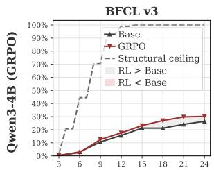

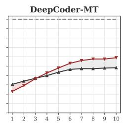  
Maximum interaction rounds T

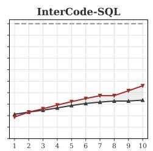

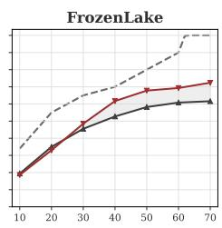  
Figure 10: Model performance and structural performance upper bounds across interaction budgets. Gray lines indicate the structural upper bounds.

## B EVALUATION DETAILS

In this section, we provide a detailed description of the evaluation settings and implementation details presented in our paper.

## B.1 GENERATION SETTINGS AND PAIRED COMPARISONS

For all tasks, we evaluate with temperature 0.6 and top $- p = 0 . 9$ . Base and RL models are evaluated on identical task instances, with the same prompt templates, interaction budgets, and numbers of sampled trajectories. The budget is specified in the system prompt before generation begins, as illustrated in Table 2. Task success within the specified budget is determined by the official evaluator.

## B.2 Pass@K

Pass@K. For each task instance, we generate n independent trajectories and denote the number of successful trajectories by c. For $n \geq k .$ , we use the unbiased estimator

$$
{ \widehat { \operatorname* { P a s s } \ @ k } } = 1 - { \frac { { \binom { n - c } { k } } } { { \binom { n } { k } } } } .
$$

This estimator equals the probability of obtaining at least one success when uniformly selecting k trajectories without replacement from the n generated trajectories. It reduces variance relative to direct estimation using repeated groups of k samples. In the main text, we sweep k up to 128. This estimation follows Chen et al. (2021) and Yue et al. (2025).

## B.3 Pass@T

Pass@T. For interactive tasks, we additionally report Pass@T. Each trajectory allows at most T interactions, and performance is measured by the probability that at least one of k independent trajectories succeeds. In the main-text Pass@T evaluations, we fix k = 8 and sweep T.

Some tasks may become structurally unsolvable under overly restrictive budgets. To clarify that our findings in the main text are not driven by this constraint, we also plot the structural performance upper bound for each task at each budget. For FrozenLake, we compute the shortest path for each task instance and use it to determine the structural performance upper bound under a given interaction budget. For BFCL, we estimate this upper bound using the officially annotated ground-truth tool-call trajectories. For DeepCoder and InterCode-SQL, each turn consists of a complete code submission, meaning that every instance is, in principle, solvable within a single turn; their structural upper bounds therefore remain at 100%. As shown in Figure 10, at small T, these upper bounds, shown by the gray lines, decrease on some tasks, notably FrozenLake and BFCL. Nevertheless, substantial headroom remains for both models, yet RL still shows no advantage over base model. This supports our conclusion that the gains of agentic RL depend on sufficiently generous interaction budgets.

Table 3: LLM judge prompt for step-level process supervision. The judge scores the current action before execution. Scores are mapped to [0, 1] by dividing by 10.  
SYSTEM PROMPT   
You are evaluating one action taken by an agent in an interactive task.   
Given the task, interaction history, current observation, and remaining interaction budget, rate   
the proposed action with an integer from 0 to 10. Evaluate its correctness, relevance, and   
expected contribution to completing the task efficiently. Necessary intermediate steps can   
receive full credit. Do not reward verbosity or redundant actions.   
INPUT   
Task: [TASK]   
Interaction history: [HISTORY]   
Current observation: [OBSERVATION]   
Remaining turns, including this action:[REMAINING\_TURNS]   
Action to evaluate: [ACTION]   
OUTPUT FORMAT   
Output only one integer from 0 to 10, with no explanation.

## B.4 LOCAL DECISION QUALITY AT MATCHED STATES

As described in §3.3, we extract intermediate states from complete base and RL trajectories and construct a state pool with equal contributions from the two policies to mitigate bias. Each state includes the current observation and the history. For each state, we sample G = 16 next-step actions from each policy and estimate its single-step decision quality by the sample mean of the corresponding action values. For FrozenLake, we use the known deterministic transition dynamics of the environment to compute the exact $Q ^ { * }$ value of each candidate action via finite-horizon dynamic programming (DP) or breadth-first search (BFS). For DeepCoder-MT, we execute each candidate program independently and use its pass rate on the official unit tests as the action-quality measure.

## B.5 ERROR-STATE CONSTRUCTION

We construct error states to evaluate single-step decision quality as follows.

For FrozenLake, we select a random intermediate state $s _ { t }$ along a trajectory and execute a randomly chosen action $a _ { t } .$ If the action increases the shortest-path distance to the goal, we regard the resulting state as worse than the preceding state and include it in the error-state pool.

For DeepCoder-MT, we use Qwen3-1.7B to modify the code at a randomly selected intermediate state. If the modified program passes fewer unit tests than the original program, we regard this as a degradation in code quality and use the resulting state for subsequent evaluation.

Both constructions serve as proxies rather than rigorous definitions of error states.

## B.6 EFFECT OF PROCESS SUPERVISION SIGNALS

In §5.1 of the main text, we preliminarily investigate whether high-quality process supervision can alleviate the dependence of agentic RL gains on interaction budgets. On FrozenLake, we use oracle Q-values as process rewards, following the same procedure as in § 3.3: we compute the Q-value of each action via finite-horizon dynamic programming. For both tasks, we additionally explore using an LLM judge as a process reward model to provide step-level supervision. Specifically, we use GPT-5.6-Sol as the judge model with the prompt shown in Table 3. Our results show that even a strong judge model cannot consistently provide high-quality process supervision across all tasks, particularly in more realistic settings such as BFCL.

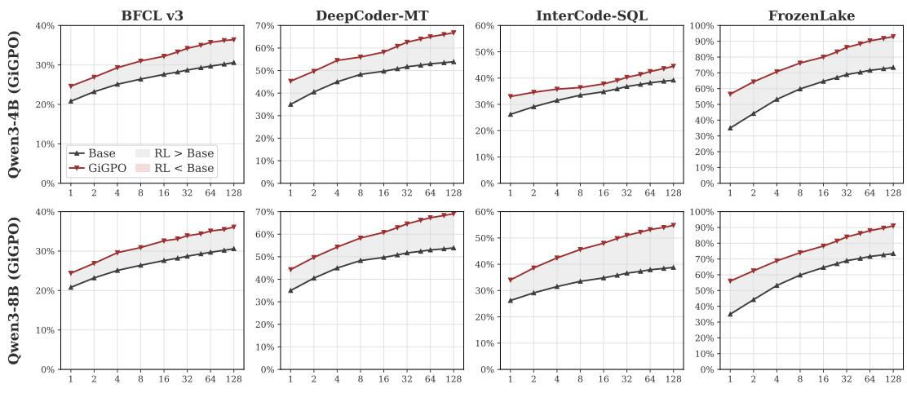  
Number of sampled trajectories k

Figure 11: Additional Pass@K results with GiGPO.  
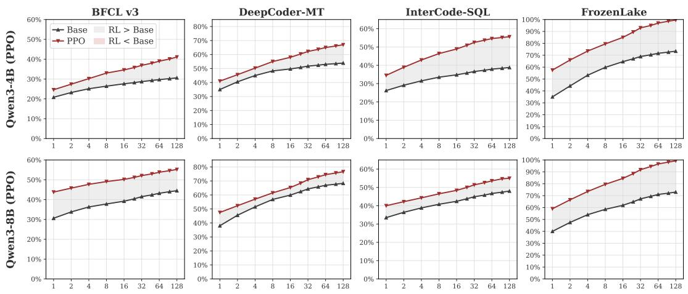  
Number of sampled trajectories k  
Figure 12: Additional Pass@K results with PPO.

## C ADDITIONAL PaSS@K EXPERIMENTS

Due to space limitations, the main text presents only the Pass@K results for Qwen3-4B and Qwen3- 8B trained with GRPO. Here, we provide additional results across agentic RL algorithms, base model architectures, and a more realistic task to further substantiate our findings.

## C.1 ADDITIONAL AGENTIC RL ALGORITHMS

We first evaluate additional agentic RL algorithms to examine whether our Pass@K findings extend beyond outcome-only GRPO. We consider two types of methods: GiGPO (Feng et al., 2025b), which uses credit assignment to derive richer, denser learning signals from outcome rewards, and PPO (Schulman et al., 2017), which uses a critic to provide denser process-level learning signals.

As shown in Figure 11 and 12, our conclusion holds for both algorithms: RL-trained models consistently outperform their base models as the number of sampled trajectories K increases.

## C.2 ADDITIONAL MODEL ARCHITECTURES

We evaluate InternVL3.5-8B (Wang et al., 2025c) on FrozenLake and DeepSeek-R1-Distill-Llama-8B (Guo et al., 2025) on DeepCoder-MT. For each model, we conduct RL training with GRPO.

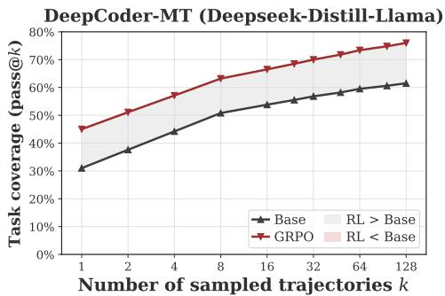

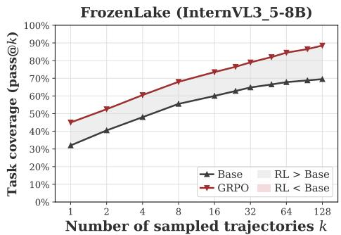  
Figure 13: Pass@K results for InternVL3.5-8B on FrozenLake and DeepSeek-R1-Distill-Llama-8B on DeepCoder-MT with GRPO.

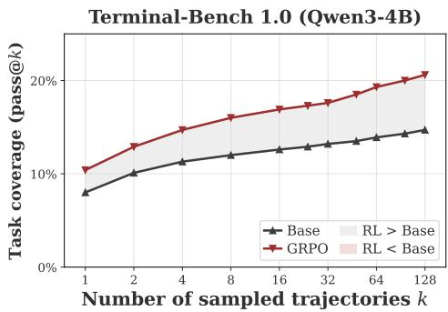

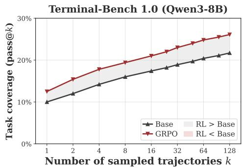  
Figure 14: Additional Pass@K results on Terminal-Bench.

Figure 13 shows that agentic RL consistently surpasses the empirical Pass@K capability boundaries of base models across these architectures. This finding is therefore not specific to the Qwen3 family.

## C.3 ADDITIONAL TASKS

Finally, we include Terminal-Bench (Merrill et al., 2026), a more realistic agent benchmark, to examine whether our findings remain robust in more realistic environments. Figure 14 shows a pattern consistent with the preceding experiments, supporting the relevance of our findings to realistic settings. For both scales, RL models consistently outperform their base models as K increases. These results further suggest that agentic RL can reliably expand the empirical capability boundary.

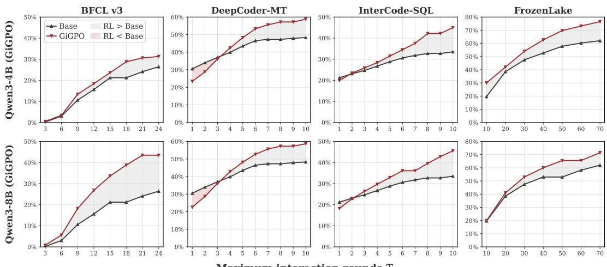  
Maximum interaction rounds T

Figure 15: Pass@T results with GiGPO on FrozenLake, DeepCoder-MT, BFCL and InterCode-SQL.  
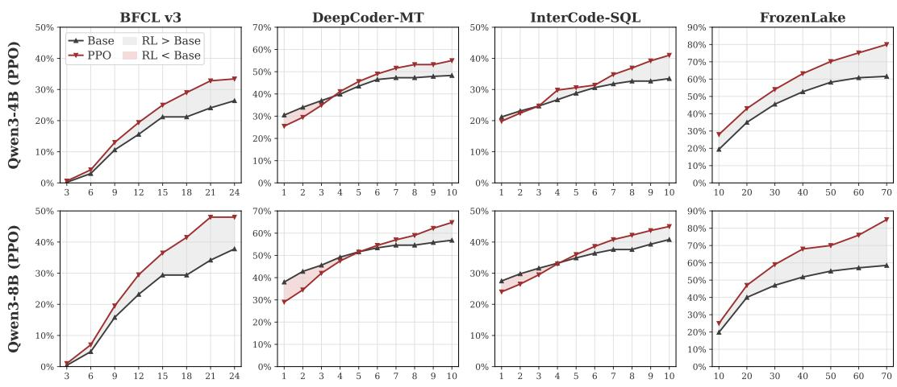  
Maximum interaction rounds T  
Figure 16: Pass@T results with PPO on FrozenLake, DeepCoder-MT, BFCL and InterCode-SQL.

## D ADDITIONAL PaSS@T EXPERIMENTS

As in Appendix C, we vary the RL algorithm, model architecture, and task to examine the generality of our Pass@T findings: the gains of agentic RL depend on sufficient interaction budgets, and its advantage over the base model shrinks, disappears, or even reverses as the turn budget T tightens. Does this pattern hold across all settings?

## D.1 ADDITIONAL AGENTIC RL ALGORITHMS

Whereas the main text primarily reports results with outcome-only GRPO, this section examines GiGPO and PPO. Both provide process-level learning signals: GiGPO derives finer-grained credit assignment from outcome rewards, while PPO trains a critic to provide denser learning signals.

Figure 15 and 16 reveal an interesting contrast. FrozenLake is a relatively simple, idealized environment in which single-step decision quality and process rewards can be evaluated reliably. On this task, both GiGPO and PPO alleviate, to varying degrees, the Pass@T limitation: rather than losing their advantage as the budget tightens, models trained with these algorithms achieve relatively consistent gains across budgets. However, on more realistic tasks such as DeepCoder-MT and InterCode-SQL, reliable process supervision is harder to obtain, and neither algorithm effectively alleviates this limitation. This is consistent with our analysis in §5: high-quality process supervision can improve single-step decision quality and stabilize gains across interaction budgets. However such supervision is difficult to obtain in more realistic tasks, which limits its effectiveness.

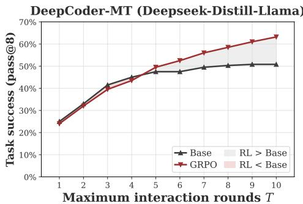

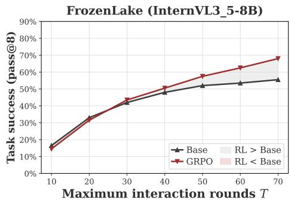  
Figure 17: Pass@T results for InternVL3.5-8B on FrozenLake and DeepSeek-R1-Distill-Llama-8B on DeepCoder-MT.

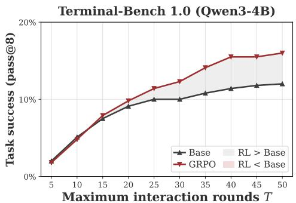

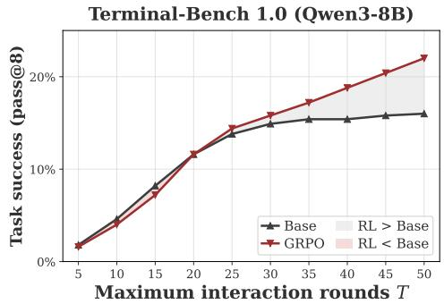  
Figure 18: Pass@T results for the Qwen3 models on Terminal-Bench.

## D.2 ADDITIONAL MODEL ARCHITECTURES

We again evaluate InternVL3.5-8B on FrozenLake and DeepSeek-R1-Distill-Llama-8B on DeepCoder-MT. As shown in Figure 17, the Pass@T limitation persists across these architectures and is not specific to the Qwen3 family. As the interaction budget tightens, the advantage of RL-trained models diminishes and may disappear or reverse.

## D.3 ADDITIONAL TASKS

As in Appendix C, we also evaluate the Qwen3 models on Terminal-Bench. Figure 18 shows that this limitation also arises in more realistic terminal tasks. As turn budgets tighten, the gains of RL-trained models become inconsistent. This further highlights the need for a comprehensive understanding of agentic RL to ensure stable and reliable real-world deployment.

Overall, the limitations and risks we identify recur across model architectures and tasks: the advantage of agentic RL depends on the interaction budget and is not consistently maintained across budgets. High-quality process rewards can mitigate this limitation, but such ideal supervision is not always available in real-world tasks. This motivates our preliminary exploration of BudgetMix RL.

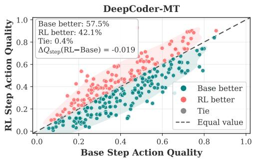

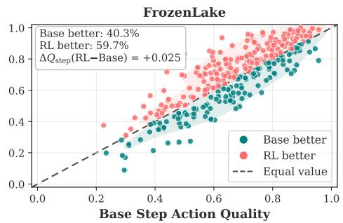

Figure 19: Step-level action quality. Each point is one matched state; its coordinates are action quality of the base and RL model. Teal points favor the base model, red points favor the RL model  
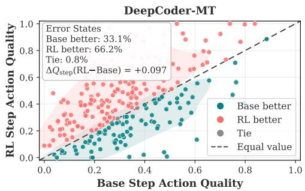

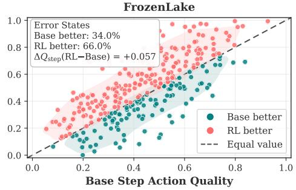  
Figure 20: Step-level action quality on error states. Each point is one error state.

## E ADDITIONAL RESULTS FOR ANALYSIS EXPERIMENTS

The preceding sections of the appendix focus on Pass@(K, T) results. Here, we present additional results of analysis experiment to complement §3.3 and 4 of the main text.

## E.1 ADDITIONAL RESULTS OF STEP-LEVEL ACTION QUALITY

In §3.3 of the main text, we analyze how agentic RL affects single-step action quality. While the main experiments use GRPO, here we provide additional results with GiGPO. As shown in Figures 19 and 20, on FrozenLake, where GiGPO can obtain informative step-level credit signals the RL model achieves better single-step action quality than the base model at both all matched states and error states. In contrast, on DeepCoder-MT, recurring matched states are difficult to obtain, making reliable step-level credit assignment substantially harder. Consequently, the RL model again does not consistently outperform the base model in single-step action quality. These results suggest that high-quality process-level supervision can improve single-step action quality. However, such supervision may be difficult to obtain in more realistic agentic tasks.

Similarly, we evaluate the single-step action quality of models trained with BudgetMix GRPO. As shown in Figure 21, on randomly sampled matched states, BudgetMix RL yields a clear improvement in single-step decision quality. Unlike standard GRPO, which does not consistently improve action quality and can even degrade it, as shown in Figure 4 of §3.3, BudgetMix does not exhibit such degradation and instead produces consistently higher-quality local decisions.

## E.2 ADDITIONAL LOG-LIKELIHOOD ANALYSIS

In §4.1, we present a mechanistic analysis based on log-likelihoods, primarily on Terminal-Bench. Here, we extend this analysis to BFCL. As shown in Figure 23 (a), we observe a consistent pattern: base model assigns similar likelihoods to individual actions generated by base and RL models, yet at the trajectory level, base systematically assigns lower likelihoods to RL trajectories than to its own. These results show a substantial shift between the RL and base policies over complete long-horizon trajectories, despite similar per-token NLLs under the base policy for RL and base actions.

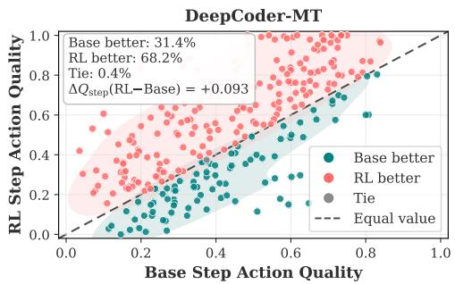

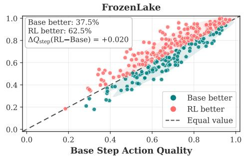

Figure 21: Step-level action quality of BudgetMix RL.  
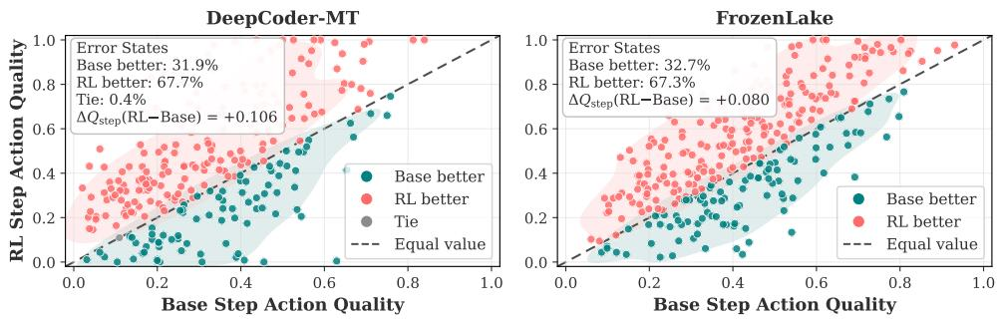  
Figure 22: Step-level action quality on error states of BudgetMix RL.

Controlling for output length. We match base and RL trajectories within each task, requiring scored output token counts to differ by at most 10% of the longer sequence. This yields 193 pairs across 89 tasks on Terminal and 283 pairs across 146 tasks on BFCL. Using the cumulative LLR from §4.1 without token normalization, the matched difference between base and RL models is 185.9 nats on Terminal and 805.8 on BFCL, with both 95% confidence intervals above zero (Figure 23 (b)). The separation of cumulative LLRs thus helps us to partly rule out the influence of trajectory length.

## E.3 ADDITIONAL TRAINING DYNAMICS

In §4.2, we track how agentic RL affects trajectory success and single-step action quality as training progresses. Here, we provide additional training dynamics on FrozenLake. As shown in Figure 24 under standard RL, trajectory-level reward $R _ { \mathrm { m u l t i } }$ (red curve) increases, indicating agent RL can improve trajectory success. However, single-step action quality reward $R _ { \mathrm { s i n g l e } }$ (blue curve) does not improve and instead tends to decline. Thus, trajectory-level gains during training do not necessarily translate into better local actions. However, with BudgetMix RL, single-step decision quality $R _ { \mathrm { s i n g l e } }$ (gray curve) remains stable or improves slightly, ending approximately 0.1 above the standard RL curve. These results suggest that BudgetMix RL can help mitigate the decline in single-step decision quality. For each of FrozenLake and DeepCoder-MT, we construct a fixed pool of 512 states from base model trajectories on held-out tasks, using multiple rollout seeds and sampling across tasks and trajectory depths to encourage diversity. Each state includes its history and remaining budget. At each validation checkpoint, we sample 8 next-step actions per state and average their quality scores over actions and states to obtain $R _ { \mathrm { s i n g l e } }$ . All checkpoints share the same state pool and scoring protocol.

## E.4 ADDITIONAL CASE STUDY RESULTS

In §3.3, we find that RL models produce higher-quality actions in error states, suggesting agent RL may improve error recovery. Here, we provide a more direct case study on BFCL, examining whether models correctly revise a failed tool call in their next action. We collect trajectory prefixes containing tool-call errors (191), drawing half from RL rollouts (91) and half from base (100). Both models then take one action from each identical prefix. The RL model achieves an error correction rate of 41.4%, substantially exceeding the 27.2% of base model. Figure 25 illustrates a case in which the RL model removes an unsupported argument rather than repeating the same error. Together, these results provide further support for our conclusion that agentic RL strengthens error recovery and resilience.

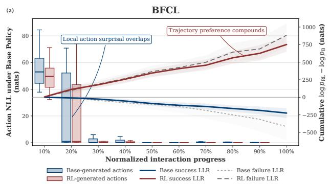

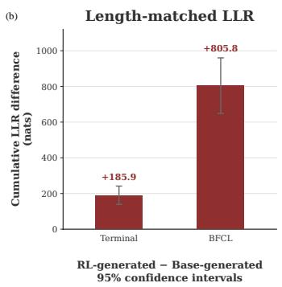  
Figure 23: More log-likehood analysis of base and RL models. (a) Additional log-likelihood analysis on BFCL. (b) Cumulative LLR after length matching. Error bars indicate 95% CI

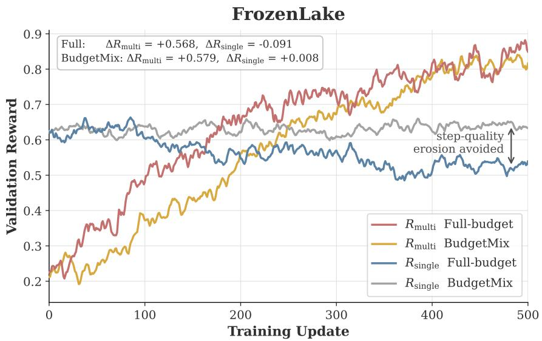  
Figure 24: Training dynamics of the trajectory-level reward $R _ { \mathrm { m u l t i } }$ and step reward $R _ { \mathrm { s i n g l e } }$

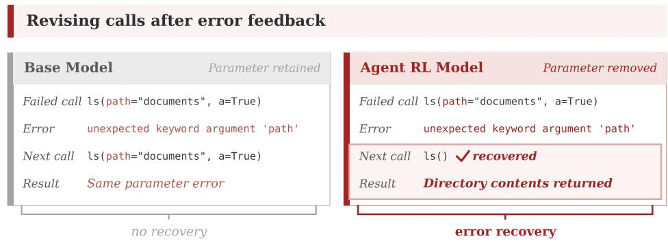  
Figure 25: A BFCL example in which the RL model corrects an erroneous tool call.