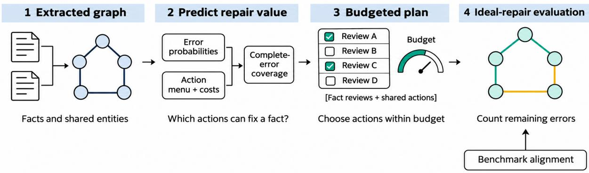
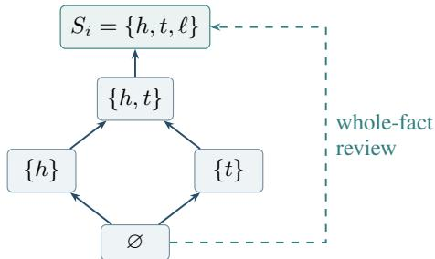
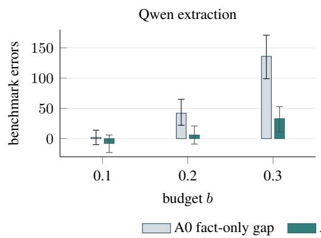
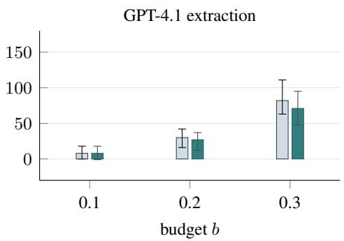
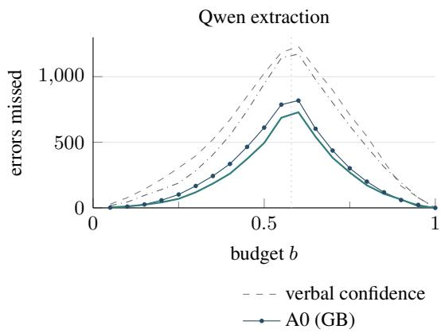
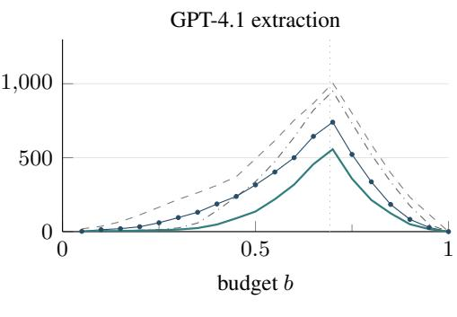

# When Does Better Confidence Improve a Knowledge-Graph Audit?

Zehao Lin1

Kai Chen1

Xixuan Hao1,3

linzh@memtensor.cn

chenk@memtensor.cn

xhao390@connect.hkust-gz.edu.cn

Erenkai Zhu2

Chunyu Li1

Helan Hu1

erz21@sjtu.edu.cn

licy@memtensor.cn

huhl@memtensor.cn

1MemTensor 2Shanghai Jiaotong University

3The Hong Kong University of Science and Technology (Guangzhou)

## Abstract

Confidence estimates guide human review in LLM-built knowledge graphs, but better error prediction can yield little improvement in an audit. We study this gap through repairability, selection headroom and label validity. Modelling non-adaptive auditing as budgeted covering, we characterise the minimal decisionrelevant error statistics and bound the regret of scalar-preserving first-order planning by a structural mass ∆cl. We simulate ideal repair against benchmark-aligned labels for five extraction configurations and two cross-document graphs on Re-DocRED, followed by frozen confirmation on test and replication on 500 hash-selected training documents. On the heldout cross-document graphs, an error-rate × fanout queue leaves 3.98–4.74 percentage points more errors than a joint model with the same actions. By comparison, opening shared actions for that joint planner reduces residual errors by 0.89–1.43 points relative to its own fact-only plans, in point estimates. Equivalence between joint and independent-block models remains inconclusive. Generic LLM verification improves three of four model–budget configurations on each held-out set. LLM adjudication identifies possible benchmark omissions.

## 1 Introduction

LLMs can generate relation records from text (Wadhwa et al., 2023) and assemble knowledge graphs (Mo et al., 2025). Their output often requires substantial review: the five configurations in our Re-DocRED study reach precision at most 0.53 on verifiable predictions and end-to-end recall below 0.23 (Table 5), consistent with the difficulty of prompted extraction on this benchmark family (Peng et al., 2023; Li et al., 2024; Xue et al., 2024). Related document and relational extraction systems use reliability scores to balance automated processing with human review (Chao et al., 2025; Roy et al., 2026; Goh and Mueller, 2026; Kumar, 2026). Unverifiable predictions account for 10.2–18.8% of outputs; counting all of them as wrong lowers the maximum precision to 0.461. We ask how much confidence scores can improve a budgeted audit of an extracted graph.

Shared entities suggest modelling errors jointly, since one entity review may repair several facts; related benefits arise in crowd entity resolution and schema matching (Whang et al., 2013; Zhang et al., 2013). The distinction between error risk and intervention value has also been studied for generated answers (Park et al., 2026). In our KG setting, we test a simple heuristic that ranks entity reviews by error probability multiplied by fan-out.

Beyond representations, we examine verification gains across review budgets and the benchmark labels used to measure them. Repairability asks which errors an available action can fix: correcting a shared entity may leave a fact wrong if its relation is also wrong. Selection headroom asks how much a better ranking can change the audit: a fact-review queue consisting entirely of errors already uses every unit of budget productively. Label validity asks whether the benchmark distinguishes extraction errors from annotation omissions.

Our theoretical analysis maps an action menu to the minimal error statistics needed for planning. By applying property elicitation and value-ofinformation ideas to the audit objective, we establish the exact boundary at which a per-fact scalar suffices and a regret bound for scalar-preserving first-order planning. The bound depends on a structural mass, ∆cl, that can be measured on labelled development data. We also identify the multi-block error mass overcounted by node-risk queues and the selection gap available to a better fact-level ranking.

The empirical study compares six uncertainty representations under shared features, folds, model families, costs and planning procedures. Development experiments cover five extraction configurations and two cross-document graphs. We then freeze three hypotheses before held-out alignment and evaluate them on Re-DocRED test and a hashselected training sample. The fan-out heuristic’s disadvantage relative to the joint model is confirmed on both sets. We also compare verification with verbal-confidence and label-trained baselines, and examine how alignment rules and adjudicated labels change measured repair gains.

  
Figure 1: The audit evaluation pipeline. Error predictions and a fixed action menu determine a plan under the review budget. Evaluation simulates ideal repair against benchmark-aligned labels: fact i is correct after review exactly when the chosen actions cover its complete error set, $E _ { i } \subseteq \tau _ { i } ( \mathcal { P } )$

## 2 The audit as budgeted covering

An extractor makes, per document, a set of decisions. These are entity decisions (which mentions form an entity and, across documents, which KB entity it links to) and one local decision per fact (relation and direction). Fact i depends on the decisions $S _ { i }$ , has weight w (= 1 here), and has an error set $E _ { i } \subseteq S _ { i }$ of wrong decisions, with law $P _ { i } ( T ) = P ( E _ { i } = T \mid X )$ . An action a costs $c _ { a }$ . It either has a global coverage $D ( a )$ (an entity review repairs that decision wherever it is used) or a local scope $\sigma ( a ) = i$ (a whole-fact review). A plan $\mathcal { P }$ covers $\tau _ { i } ( \mathcal { P } ) = S _ { i }$ if it reviews fact i as a whole, and $\begin{array} { r } { S _ { i } \cap \bigcup _ { a \in \mathcal { P } } D ( a ) } \end{array}$ otherwise.

We assume (A1) ideal repair, i.e. fact i is correct after the audit iff $E _ { i } \subseteq \tau _ { i } ( \mathcal { P } )$ ; (A2) non-adaptive plans, chosen before any review outcome is seen (adaptive audits are discussed in the Limitations); (A3) an additive objective; and (A4) an action menu that does not depend on $P .$ . The planner then maximises, under a budget,

$$
F _ { P } ( \mathcal { P } ) = \sum _ { i } w _ { i } \Phi _ { i } ( \tau _ { i } ( \mathcal { P } ) ) ,\tag{1}
$$

where $\begin{array} { r } { \Phi _ { i } ( U ) = \sum _ { T \subset U } P _ { i } ( T ) = P ( E _ { i } \subseteq U ) } \end{array}$

  
Figure 2: Reachable coverage for one fact: h and t are entity decisions and ℓ is the local relation decision. Solid arrows show the cover relations; whole-fact review reaches $S _ { i }$ directly (dashed). The decision-relevant closure variable $Z _ { i }$ takes values in the five reachable covered sets {∅, h, t, ht, S}.

the cumulative error-set probability.1 A deleted wrong fact counts as repaired, so KG precision depends on the repair model (§6).

## 3 What the audit decision needs

The audit objective determines which features of the error distribution are needed for planning. Appendix A provides proofs, counterexamples and extensions to verification and post-audit reporting. Let $\mathcal { L } _ { i } = \{ \tau _ { i } ( \mathcal { P } ) : \mathcal { P } \subseteq A \}$ be the action lattice of reachable covered sets. It contains ∅ and is closed under union. Two decisions are in the same block if every action covers both or neither.

Theorem 1 (Decision sufficiency). Under (A1)– (A4): (i) the optimal plan, for every cost vector and budget, depends on P only through $g _ { i } ( U ) =$ $P ( \emptyset \neq E _ { i } \subseteq U ) , U \in { \mathcal { L } } _ { i } \backslash \{ \emptyset \} ; ( i i )$ no coordinate

1For $p _ { i } = P ( E _ { i } = \emptyset ) < 1$ , the conditional quantity $( \Phi _ { i } ( U ) - p _ { i } ) / ( 1 - p _ { i } )$ is a normalized belief function in the sense of Shafer (1976). The unconditional $\Phi _ { i }$ also includes initially correct facts.

can be dropped; (iii) only with an outside option ofP-independent value (admit or discard) does $p _ { i }$ also become decision-relevant, and then $\Phi _ { i } | _ { \mathcal { L } _ { i } }$ Li is minimal; (iv) the scalar $p _ { i } = P ( E _ { i } = \emptyset )$ suffices for all instances iff ${ \mathcal { L } } _ { i } \subseteq \{ \emptyset , S _ { i } \}$ , i.e. every action touching fact i covers all of it; (v) the minimal dimension is $| { \mathcal { L } } _ { i } | - 1$

Part (i) is linearity of (1) in $( \mathbf { 1 } [ E \subseteq U ] ) _ { U \in \mathcal { L } _ { i } }$ connecting the audit objective to property elicitation (Frongillo and Kash, 2021) and calibration of queried events (Kuleshov and Liang, 2015). The theorem links the action menu to its lattice and minimal statistic: without an outside option the minimal object is $g _ { i } .$ , the cumulative error-set probability with its correct-state mass $p _ { i }$ removed, and (iv) identifies the exact boundary of scalar sufficiency. For intersection-closed lattices, the closure $Z _ { i } = \bigcap \{ U \in { \mathcal { L } } _ { i } : E _ { i } \subseteq U \}$ carries the same information; in Figure 2 it has 5 classes. The order of joint information needed is determined by the number of blocks left uncovered by a partial plan (Proposition 3).

How much can joint modelling be worth? Let $B ( E _ { i } )$ be the set of blocks that $E _ { i }$ touches, $m _ { i } ( b ) = P ( B ( E _ { i } ) = \{ b \} )$ the first-order masses, and $\begin{array} { r } { \Delta = \sum _ { i } w _ { i } P ( | B ( E _ { i } ) | \ge 2 ) } \end{array}$ the raw multiblock mass. A closure class is union-reducible if it is the union of strictly smaller lattice elements. The pure-structure joint mass is $\Delta ^ { \mathrm { c l } } =$ $\textstyle \sum _ { i } w _ { i } P ( Z _ { i }$ union-reducible) $\leq \Delta$

Theorem 2 (Worst-case value of joint modelling). (i) With first-order gain G1, $G _ { 1 } \leq G \leq G _ { 1 } + \Delta$ for every plan, so first-order planning has regret $\le \Delta$ . (ii) Bound (i) is tight up to a factor of 2 for deterministic planners that see only first-order statistics. (iii) If every $\mathcal { L } _ { i }$ is intersection-closed and contains $S _ { i } ,$ , the scalar-preserving first-order planner, which moves union-reducible mass to $S _ { i }$ has $r e g r e t \leq \Delta ^ { \mathrm { c l } }$ . This bound is tight up to afactor of 2.

The bounds compare static planners using the true error law. A small $\Delta ^ { \mathrm { c l } }$ limits the possible structural advantage over the scalar-preserving planner; a large value leaves room for such an advantage. In Figure 2, the only union-reducible class is $\{ h , t \}$ , whereas an error involving both a link and the local relation closes to the whole fact. Such errors contribute to raw $\Delta$ alone.

Remark 1 (Why node scalars can hurt). Ranking entity reviews by “node error × fan-out” plans with the marginals $\mu _ { i } ( b ) = P ( b \in E _ { i } )$ in place of $m _ { i } ( b )$ . The difference $\mu _ { i } ( b ) - m _ { i } ( b ) = P ( b \in$ $E _ { i } , | B ( E _ { i } ) | \ge 2 )$ is exactly the mass that a node review cannot repair alone. This identity identifies the repair credit assigned to facts that require an additional action; Appendix A gives the corresponding aggregate bound.

Scoring complete repairs. Consider two entityreview candidates with equal cost and fan-out one. The first fact has error set $\{ h , \ell \}$ with probability $0 . 6$ and is otherwise correct; the second has error set {h} with probability 0.4 and is otherwise correct. Node risk ranks the first review higher, although repairing its head alone removes zero errors in expectation, compared with 0.4 for the second. Under Figure 2’s action menu, both facts have $\Delta ^ { \mathrm { c l } } = 0 \colon$ the first error closes to the whole fact. The example shows that correcting the node queue’s accounting can be valuable even when the structural regret bound vanishes.

When can a better fact-level score help? With fact-only unit-cost plans and $k = \lfloor b { N } \rfloor$ reviews, the clairvoyant plan removes min(k, #wrong) errors and the top k facts of a score remove $k$ prec@b, where prec@b is their share of wrong facts. Any better fact-level score can thus gain at most min(k, #wrong)−k·prec@b errors, which is $k ( 1 - \mathrm { p r e c } \ @ b )$ while $k \leq \#$ wrong; we call this the selection gap. When $k \leq \# \mathrm { w r o n g }$ , the gap equals the number of correct facts reviewed. With entity actions, comparison to the fact-only oracle serves as a reference gap; the bound above applies to factonly plans. The value of one verification call has the one-step exchange form of the expected value of sample information (Lemma $5 ;$ Strong et al., 2015): it is non-zero only if the call can move a fact across the cutoff.

Diagnostics. Labelled development data support three complementary diagnostics: $\Delta ^ { \mathrm { c l } }$ quantifies the structural regret bound; precision@budget determines the available improvement in fact-only ranking; and the oracle action gain measures how much additional actions help under perfect information. The last quantity evaluates the action menu, while the first two concern the information used to select among its actions.

## 4 Experimental design

Data and extraction. Development experiments use the 500 documents and 17,284 gold facts of

Re-DocRED dev (Tan et al., 2022), a relabelling of DocRED (Yao et al., 2019) with 96 relations. Four models extract entities, coreference and facts end to end: Claude Sonnet 5, GPT-4.1, GPT-4.1-mini and Qwen3.5-27B. The fifth configuration, Qwen-R, uses the same Qwen model with a reasoningfirst prompt. We collect verbal confidences and available token log-probabilities (Appendix C). Unparsed documents count as misses: Qwen-R fails on 41 documents, so its higher precision than direct Qwen (0.510 versus 0.421) accompanies lower end-to-end recall (0.200 versus 0.208).

Labels and audit population. Aligning predicted and gold mentions yields an error mask over $\{ h , t , \ell \}$ for each fact, where entity errors correspond to merges of distinct gold entities. Our primary lenient policy treats selected apparent gold splits, such as acronym variants, as benign, whereas the strict policy counts all merges as a sensitivity check. A fact is verifiable when both endpoints align to gold entities. The remaining 10.2–18.8% of predictions are excluded from the audit population and budget denominator, with their effect on precision reported in Table 5. Repair outcomes are evaluated against this alignment and label policy.

Cross-document graphs. Qwen and GPT-4.1 extractions form the two cross-document graphs (498 documents). GPT-4.1-mini links predicted entities to Wikipedia, and Linked-DocRED provides gold links (Genest et al., 2023). Available actions are fact review, document-entity review and relink, each costing one unit; relabel costs 1 + 0.1 per member and split costs 1 + 0.5 per member.

Models and planning. We compare fact scalars, node marginals, independent blocks, direct utility regression, the lattice/joint representation, and an 8-class error-mask representation. The lattice has 5 classes within documents and 37 across documents. Each setting uses the same available features across representations: 86 extraction features within documents, augmented by linking and canonicalisation features across documents. Logistic regression (LR) and gradient boosting (GB) share a five-fold document-grouped development split. Label-free rankers provide an additional comparison in Section 6.

The planner maximises the same repair objective under each representation, using HiGHS MILP with exact single-document solves and certified LP-and-fix approximations where required across documents (Appendix C). Budget b is a fraction of the cost of reviewing every verifiable fact. We report errors remaining after ideal repair, either as counts or as percentage points (pp) of initially wrong facts. Two further cost models appear in Table 9.

Statistical analysis. Development headline intervals use a re-planned document-cluster bootstrap with 100 resamples: each plan is re-solved at the resample’s budget, with fold models held fixed. Other development comparisons use a budget-normalised, fixed-plan approximation with 2,000 resamples. Development equivalence tests use TOST (Schuirmann, 1987) with margins of ±1% of wrong facts within documents and ±0.5 pp across documents, chosen after the initial intervals were reported. We additionally report the smallest passing margin $\delta ^ { * }$ . The held-out study uses pre-specified halved margins, 1,000 re-planned resamples and Holm correction (Holm, 1979) (Section 7).

## 5 Representation and repair actions

Finding 1 (Development equivalence depends on the chosen margins). With action sets fixed and development margins chosen after inspecting the initial intervals, the lattice and independent-block models satisfy the TOST criteria in all five singledocument configurations (±1%) and both crossdocument graphs (±0.5 pp). Equivalence with direct utility regression holds in four of five singledocument comparisons and both cross-document graphs; the Claude comparison is inconclusive. All five comparisons with the full 8-class mask model pass. With LR, two of four cross-document comparisons pass (Table 7).

Two observations help interpret these results. Structural mass is small: $\Delta ^ { \mathrm { c l } }$ is at most four facts within documents and accounts for 1.1% and 0.8% of cross-document errors for Qwen and GPT-4.1. The scalar-preserving first-order planner consequently matches the lattice planner in 29 of 30 single-document comparisons, with a one-error difference in the remaining comparison. Learned plans also select few entity reviews within documents—3–5 per budget, compared with 28– 45 for the oracle—so much of their performance comes from fact ranking.

The size of an equivalence margin matters in this regime. For GPT-4.1 and mini, the development margin is approximately the entire oracle gain from adding entity reviews.

<table><tr><td>Contrast</td><td>Claude</td><td>GPT-4.1</td><td>mini</td><td>Qwen</td><td>Qwen-R</td></tr><tr><td>Initially wrong facts</td><td>3,468</td><td>5,850</td><td>3,974</td><td>5,039</td><td>3,339</td></tr><tr><td>Raw ∆ (facts)</td><td>213 (6.14%)</td><td>204 (3.49%)</td><td>165 (4.15%)</td><td>181 (3.59%)</td><td>151 (4.52%)</td></tr><tr><td> $\Delta ^ { \mathrm { c l } }$  (facts)</td><td>2</td><td>2</td><td>0</td><td>4</td><td>2</td></tr><tr><td>(a) Oracle: + shared actions</td><td> $+ 3 . 5 2 ^ { \ast } \ ( + 1 2 2 )$  [+2.37, +4.79]</td><td> $+ 0 . 9 6 ^ { * } \left( + 5 6 \right)$  [+0.59, +1.71]</td><td> $+ 1 . 0 1 ^ { \ast } \left( + 4 0 \right)$   $[ + 0 . 4 6 , + 1 . 8 4 ]$ </td><td> $+ 1 . 6 5 ^ { * } \left( + 8 3 \right)$   $[ + 0 . 9 6 , + 2 . 4 0 ]$ </td><td> $+ 2 . 4 0 ^ { * } \left( + 8 0 \right)$   $[ + 1 . 2 3 , + 3 . 5 8 ]$ </td></tr><tr><td>(b) Learned: + shared actions</td><td>+0.03 (+1) [−0.42, +0.44]</td><td>+0.02 (+1) [−0.05, +0.10]</td><td>+0.00 (+0)  $[ + 0 . 0 0 , + 0 . 0 0 ]$ </td><td>+0.18 (+9)  $[ + 0 . 0 0 , + 0 . 4 1 ]$ </td><td>-0.03 (-1) [−0.11,+0.00]</td></tr><tr><td>(c) Node: + shared actions</td><td>-0.89* (-31)</td><td>-0.14 (-8)</td><td> $\dot { \mathbf { \theta } } - 0 . 4 0 ^ { * } \left( - 1 6 \right) ^ { \ }$ </td><td>+0.08 (+4)</td><td>-0.21 (-7)</td></tr><tr><td>(s) Lattice + shared actions</td><td>[-1.76, -0.26] +0.52 (+18)</td><td>[−0.36, +0.07] +0.05 (+3)</td><td>[−0.65, -0.10] -0.15 (-6)</td><td> $[ - 0 . 3 2 , + 0 . 3 8 ]$   $+ 0 . 3 2 ^ { * } \left( + 1 6 \right) ^ { - }$ </td><td>[−0.75, +0.18] +0.18 (+6)</td></tr><tr><td>vs. fact scalar, fact only</td><td>[−0.63, +1.10]</td><td>[−0.09, +0.21]</td><td>[−0.33, +0.00]</td><td> $[ + 0 . 0 4 , + 0 . 5 4 ]$ </td><td>[−0.39, +0.75]</td></tr><tr><td>(d) Lattice vs. node marginal</td><td> $+ 1 . 4 1 ^ { \ast } \ ( + 4 9 )$  [+0.63, +1.92]</td><td>+0.19 (+11) [−0.07,+0.46]</td><td> $+ 0 . 2 5 \ : ( + 1 0 )$  [−0.15, +0.62]</td><td>+0.24 (+12) [−0.13, +0.63]</td><td>+0.39 (+13) [−0.45,+1.12]</td></tr><tr><td>(e) Lattice vs. independent</td><td>+0.52 (+18) [−0.29, +1.00]</td><td>+0.10 (+6) [−0.07, +0.27]</td><td>-0.13 (-5) [−0.39, +0.10]</td><td>+0.06 (+3) [−0.29, +0.38]</td><td>+0.09 (+3) [−0.49, +0.58]</td></tr><tr><td>(f) Lattice vs. direct utility</td><td>+0.61 (+21) [−0.40, +1.10]</td><td>+0.05 (+3) [−0.08, +0.20]</td><td>−0.15 (-6) [−0.33, +0.00]</td><td>+0.12 (+6) [−0.17, +0.43]</td><td>+0.21 (+7) [−0.35, +0.73]</td></tr><tr><td>TOST δ*: (e) / (f)</td><td>0.92 / 1.01?</td><td>0.26 / 0.17</td><td>0.38 / 0.30</td><td>0.34 / 0.38</td><td>0.54 / 0.63</td></tr><tr><td></td><td> $+ 3 . 7 8 ^ { * } \ ( + 1 3 1 )$ </td><td> $+ 0 . 6 8 ^ { \ast } \left( + 4 0 \right)$ </td><td></td><td></td><td></td></tr><tr><td>(g) Capacity: LR to GB</td><td></td><td></td><td>+0.20 (+8)</td><td> $+ 0 . 8 5 ^ { * } \left( + 4 3 \right)$ </td><td> $+ 1 . 1 4 ^ { * } \left( + 3 8 \right)$ </td></tr><tr><td></td><td></td><td></td><td></td><td></td><td></td></tr><tr><td></td><td> $[ + 2 . 5 1 , + 4 . 5 6 ]$ </td><td></td><td> $[ - 0 . 0 3 , + 0 . { \dot { 5 } } 3 ]$ </td><td></td><td></td></tr><tr><td></td><td></td><td> $[ + 0 . 3 6 , + 0 . 9 \dot { 8 } ]$ </td><td></td><td> $[ + 0 . 2 9 , + 1 . 2 9 ]$ </td><td> $[ + 0 . 0 6 , + 2 . 0 \dot { 1 } ]$ </td></tr><tr><td></td><td></td><td></td><td></td><td></td><td></td></tr><tr><td></td><td></td><td></td><td></td><td></td><td></td></tr><tr><td>(h) Gap to oracle</td><td> $+ 7 . 3 8 ^ { * } \ ( + 2 5 6 )$   $[ + 6 . 1 0 , + 8 . 9 3 ]$ </td><td> $\dot { + } 1 . 4 7 ^ { * } \left( + 8 6 \right)$   $[ + 0 . 9 4 , + 2 . 2 0 ]$ </td><td> $\stackrel { \cdot } { + } 1 . 4 8 ^ { * } \left( + 5 9 \right) \stackrel { \cdot } { }$   $[ + 0 . 8 8 , + 2 . 3 2 ]$ </td><td> $+ 2 . 4 8 ^ { * } \left( + 1 2 5 \right)$   $[ + 1 . 7 1 , + 3 . 1 4 ]$ </td><td> ${ \dot { + } } 6 . 9 5 ^ { * } \left( + 2 3 2 \right)$   $[ + 5 . 5 4 , + 8 . 7 2 ]$ </td></tr></table>

Table 1: Within-document development comparisons (lenient labels, GB, b = 0.2), in percentage points of initially wrong facts; counts appear in parentheses. Positive values mean fewer residual benchmark errors for the named change. Rows a–c add shared actions; row s compares lattice with shared actions against the fact-scalar, fact-only plan; rows d–f hold actions fixed. Row h is the gap to the computed oracle. Brackets: 95% re-planned bootstrap intervals $( R = 1 0 0$ , fitted models fixed); ∗ excludes zero. TOST margins are ±1% of initially wrong facts; ? marks an inconclusive cell (Table 7).

Finding 2 (The fan-out heuristic leaves more errors across documents). Adding entity reviews ranked by node error × fan-out increases remaining errors relative to fact-only review by 3.13 [1.92, 4.35] pp for Qwen and 3.98 [3.02, 4.87] pp for GPT-4.1 (Table 2, row c). At fixed actions, the lattice model removes 4.62 and 4.70 pp more errors than the nodemarginal model (row d). This latter comparison is confirmed on held-out data. Within documents, adding the node queue significantly increases errors for Claude and mini, while the fixed-action lattice comparison is significant for all five configurations with LR and only Claude with GB.

The accounting identity in Remark 1 identifies an overcounting mechanism: a node review receives credit for incident facts that also require another repair. Such multi-block errors account for 28.2% and 29.1% of cross-document errors, mostly combinations of a wrong link and a wrong local decision, compared with at most 6.14% within documents. The aggregate bound $( 1 + 2 m _ { \mathrm { m a x } } ) \Delta$ exceeds the total error count on these graphs (Appendix A); it gives no useful prediction of the observed gap. The $\Delta ^ { \mathrm { c l } }$ bound concerns the scalar-preserving first-order planner rather than this marginal-risk queue.

Finding 3 (Learned plans capture part of the shared-action value). Oracle plans benefit from shared actions for every extractor. Across documents, the learned lattice model gains 1.46 [0.87, 1.98] pp for Qwen and 0.69 [0.28, 1.02] pp for GPT-4.1, capturing 21% and 17% of the respective oracle gains (Table 2, rows a–b). Against a GB fact-scalar model restricted to fact reviews, it gains 1.49 [0.90, 2.07] and 0.72 [0.33, 1.09] pp (row s). Within-document gains are smaller; only the Qwen comparison against the fact-scalar model is significant, at 0.32 pp or 16 facts (Table 1).

Relinking supplies most of the oracle saving, with little additional benefit from relabel and split. Increasing model capacity from LR to GB helps four of five single-document configurations, while the cross-document capacity differences are inconclusive.

<table><tr><td>Contrast</td><td>Qwen</td><td></td><td>GPT-4.1</td></tr><tr><td>Initially wrong facts</td><td>5,820</td><td></td><td>6,404</td></tr><tr><td>Raw ∆ (facts)  $\Delta ^ { \mathrm { c l } } \ \mathrm { ( f a c t s ) }$ </td><td>1642 (28.2%)§  $6 6 ( 1 . 1 \% ) ^ { \ S }$ </td><td></td><td> $1 8 6 3 ( 2 9 . 1 \% ) ^ { \ S }$  54 (0.8%)§</td></tr><tr><td></td><td></td><td></td><td></td></tr><tr><td>(a) Oracle: + shared actions</td><td> $+ 6 . 8 9 ^ { * } \ [ + 5 . 6 4 , + 8 . 1 6 ]$ </td><td></td><td> $+ 4 . 0 6 ^ { * } \ [ + 3 . 1 1 , + 4 . 9 4 ]$ </td></tr><tr><td>(b) Learned: + shared actions</td><td> $+ 1 . 4 6 ^ { * } \left[ + 0 . 8 7 , + 1 . 9 8 \right]$ </td><td></td><td> $+ 0 . 6 9 ^ { * } \ [ + 0 . 2 8 , + 1 . 0 2 ]$ </td></tr><tr><td>(c) Node: + shared actions</td><td> $- 3 . 1 3 ^ { * \mathrm { N } } \left[ - 4 . 3 5 , - 1 . 9 2 \right]$ </td><td></td><td> $- 3 . 9 8 ^ { * \mathrm { N } } \left[ - 4 . 8 7 , - 3 . 0 2 \right]$ </td></tr><tr><td>(s) Lattice + shared actions</td><td> $+ 1 . 4 9 ^ { * } \ [ + 0 . 9 0 , + 2 . 0 7 ]$ </td><td></td><td> $+ 0 . 7 2 ^ { * } \ [ + 0 . 3 3 , + 1 . 0 9 ]$ </td></tr><tr><td>vs. fact scalar, fact only</td><td></td><td></td><td></td></tr><tr><td>(d) Lattice vs. node marginal (e) Lattice vs. independent</td><td> $+ 4 . 6 2 ^ { * } \ [ + 3 . 7 7 , + 5 . 5 4 ]$   $+ 0 . 0 5 \ [ - 0 . 2 8 , + 0 . 5 1 ]$ </td><td></td><td> $+ 4 . 7 0 ^ { * } \ [ + 3 . 7 8 , + 5 . 4 3 ]$ </td></tr><tr><td>(f) Lattice vs. direct utility</td><td> $+ 0 . 0 9 \left[ - 0 . 1 3 , + 0 . 3 2 \right]$ </td><td></td><td> $- 0 . 0 9 \left[ - 0 . 2 9 , + 0 . 1 2 \right]$ </td></tr><tr><td>TOST  $\delta ^ { * } \colon ( \mathrm { e } ) / \left( \mathrm { f } \right)$ </td><td>0.47 / 0.27</td><td></td><td> $+ 0 . 1 4 \left[ - 0 . 0 2 , + 0 . 2 6 \right]$  0.26 / 0.24</td></tr><tr><td></td><td></td><td></td><td></td></tr><tr><td>(g) Capacity: LR to GB</td><td> $+ 0 . 4 3 ^ { \dagger } \ [ - 0 . 1 4 , + 1 . 1 6 ]$ </td><td></td><td> $+ 0 . 1 7 ^ { \dag } \left[ - 0 . 1 7 , + 0 . 5 1 \right]$ </td></tr><tr><td>(h) Gap to oracle</td><td> $+ 5 . 8 4 ^ { * } \ [ + 4 . 7 2 , + 6 . 9 3 ]$ </td><td></td><td> $+ 3 . 6 1 ^ { \ast } \ [ + 2 . 7 9 , + 4 . 5 3 ]$ </td></tr></table>

Table 2: Cross-document development comparisons (lenient labels, GB, b = 0.2), in percentage points of initially wrong facts. Positive values mean fewer residual benchmark errors for the named change. Rows a–c add shared actions; row s compares lattice with shared actions against the fact-scalar, fact-only plan; rows d–f hold actions fixed. Row h is the gap to the computed oracle. TOST margins are ±0.5 pp. Brackets: 95% re-planned bootstrap intervals $( R = 1 0 0 ) ;$ ∗ excludes zero; N uses budget-normalised intervals $( n = 2 0 0 0 ) \mathrm { ; }$ ; † regenerated with the original seed. § Structural masses use fact, entity and relink actions; the comparison rows use the full action menu.

## 6 What an additional verification pass buys

We augment the inexpensive extraction features with a generic support check: the verifier reads the source document and candidate fact, answers yes or no, and supplies a token-level $P ( \mathrm { y e s } )$ . GPT-4.1- mini verifies Qwen extractions, and Qwen3.5-27B verifies GPT-4.1 extractions. The baseline and augmented models, labelled A0 and A1 in the tables, use the same GB lattice representation, fact and entity actions, and MILP planner. Failed checks retain the baseline features. A development gate required verification to improve both extractors at each of the 10% and 20% review budgets. These development results use the original features; held-out models use the pre-freeze reconstruction described in Appendix E.

Finding 4 (Better error ranking gives budget-dependent audit gains). Generic verification raises AUROC from 0.8826 to 0.8954 on Qwen and from 0.8793 to 0.9295 on GPT-4.1. At a 10% budget, neither extractor shows a significant audit gain. At 20%, GPT-4.1 gains 27 [12, 37] repairs, while Qwen remains inconclusive. At 30%, both improve: Qwen by 33 [11, 53] and GPT-4.1 by 71 [48, 95] repairs. The original development gate is therefore unmet (Table 14).

The baseline is already close to the fact-only oracle at the smallest budget, removing 867 errors with 869 budget units on Qwen and 836 with 844 on GPT-4.1. These correspond to repair yields of 0.998 and 0.991. Because entity reviews can repair several facts, repair yield measures errors removed per unit cost and can exceed one. Precision@budget applies specifically to a fact-review queue. The fact-only GB scalar queues remove 859 and 831 errors with the same 869 and 844 review slots, giving precision@budget of 98.8% and 98.5% and selection gaps of 10 and 13 errors (Table 10). The two- and eight-error gaps above compare plans containing entity actions with a fact-only oracle; they are reference gaps, not upper bounds for the full action menu.

In the fact-only sweep, headroom peaks near the share of wrong facts, 0.58 and 0.69 for Qwen and GPT-4.1 (Figure 4). At a 50% budget, the baseline misses 612 and 316 repairs available to the oracle; verification reduces these gaps to 495 and 136.

Finding 5 (Verification improves on label-free confidence rankers). The verifier’s $P ( { \bf n o } )$ outperforms the extractor’s verbal confidence at each tested budget. It adds 34 [2, 66], 78 and 113 repairs for Qwen at budgets 10%, 20% and 30%, and 32 [17, 49], 103 and 193 for GPT-4.1 (95% intervals at all three budgets appear in Table 10). On GPT-4.1 it approaches the learned augmented ranker, whose additional gains are 0 [-3, 4], 3 [-1, 8] and 11 [2, 23].

The baseline matters: the label-trained extraction model already removes 68, 160 and 229 more errors than verbal confidence on Qwen, and 23, 80 and 123 more on GPT-4.1. In a sensitivity analysis that increases precision to 0.8 by subsampling wrong facts, the 10%-budget verification gain rises from −1 to 22.2 repairs for Qwen and from 9 to 56.0 for GPT-4.1, using unchanged fitted scores (Table 11).

Verification also changes many decisions whose effects cancel. At a 20% budget on GPT-4.1, 1,355 review decisions change: 670 beneficial and 643 harmful changes account for the net gain of 27. Targeted relation and evidence diagnostics provide no detectable improvement over generic verification in the development comparisons. Appendix B reports the controls and explains how correction versus deletion affects post-audit precision.

## 7 Held-out confirmation

We froze the confirmation protocol before aligning held-out predictions to labels, using Re-DocRED test (500 documents) for confirmation and train500 (500 hash-selected training documents) for replication. Models fitted on dev were applied unchanged. Each dataset has ten primary model–budget comparisons, evaluated with 1,000 re-planned document-cluster bootstrap samples and Holm correction. A hypothesis is confirmed only when all its specified comparisons pass.

The protocol tests three hypotheses, labelled H1– H3 in Table 3. The equivalence hypothesis compares joint and independent-block models at a 20% budget, with margins of ±0.5% of wrong facts within documents and ±0.25 pp across documents. The verification hypothesis requires generic verification to improve both extractors at budgets of 20% and 30%. The fan-out hypothesis compares the node-marginal and joint models across documents at a 20% budget with identical action sets.

Finding 6 (The fan-out disadvantage replicates on held-out data). The joint model leaves 4.28 and 4.40 pp fewer errors than the node-marginal model on test, and 3.98 and 4.74 pp fewer on train500, for Qwen and GPT-4.1 respectively. All four comparisons pass Holm correction, confirming and replicating the hypothesis. The joint planner’s separate gain from opening shared actions, relative to its own fact-only plan, is 0.89–1.43 pp in descriptive point estimates (Table 17).

Relative to a common fact-scalar reference, the node queue leaves 2.52–3.45 pp more errors, while the joint full-action plan leaves 0.91–1.46 pp fewer. These descriptive contrasts sum to the H3 pointestimate gap. Opening shared actions for the joint planner itself removes 60 and 59 additional errors on test, and 88 and 82 on train500; the corresponding computed oracle gains are 387, 296, 366 and 307 errors.

Finding 7 (Verification gains recur in three of four configurations). GPT-4.1 gains 32 and 59 repairs at the 20% and 30% budgets on test, and 31 and 60 on train500. Qwen gains 40 and 22 repairs at the 30% budget on the two datasets. All six comparisons pass Holm correction. Qwen’s 20%- budget gains are 6 [-11, 25] and 10 [-1, 21], so the verification hypothesis remains unconfirmed under the all-comparisons rule.

The same Qwen configuration falls short on development, test and train500. Its fact-only reference gap is larger than GPT-4.1’s on both held-out datasets, which rules out smaller headroom as a complete explanation of this pattern. Section 8 examines this comparison in more detail.

Finding 8 (The tighter equivalence criterion remains inconclusive). One of four equivalence comparisons passes on test and two of four on train500. The three unadjusted 90% intervals that exclude zero all favour independent blocks: the lattice model leaves 19 [6, 35] more errors for withindocument Qwen on test; the joint model leaves 0.27 [0.08, 0.48] pp more for cross-document GPT-4.1 on test and 0.32 [0.08, 0.60] pp more for crossdocument Qwen on train500. No reported interval excludes zero in favour of the joint model.

Before freezing, rebuilding development links and resolution shifted Qwen’s joint-minusindependent contrast from −0.05 to +0.28 pp, a 0.33 pp change exceeding the fixed ±0.25 pp equivalence margin. The rebuilt GPT-4.1 interval, [+0.02, +0.46] pp, also crossed that margin. The protocol retained the original margins; the original development verification gains of 27, 33 and 71 became 25, 28 and 68 during reconstruction (Appendix E).

Within-document label sensitivity. Singledocument $\Delta ^ { \mathrm { c l } }$ is one or two facts under lenient labels and 7–15 under strict labels. $\mathbf { A } \mathbf { t } \ b \ = \ 0 . 2 .$ adding entity actions gives the learned plans −3 to +6 additional repairs under lenient alignment, compared with 67–101 for the oracle. In the pre-specified strict-label sensitivity analysis, learned gains range from +11 to +59, with oracle gains of 165–303 (Table 16).

<table><tr><td>Extractor / budget</td><td>test</td><td>train500</td></tr><tr><td colspan="3">H1, within documents: lattice – independent (errors; TOST, ±0.5% of wrong facts)</td></tr><tr><td>Qwen</td><td> $+ 1 9 \left[ + 6 , + 3 5 \right]$ </td><td> $+ 5 \left[ - 6 , + 1 2 \right] \sqrt { }$ </td></tr><tr><td>GPT-4.1</td><td> $- 4 \left[ - 1 4 , + 6 \right] \sqrt { }$ </td><td> $+ 3 \left[ - 6 , + 1 3 \right] \surd$ </td></tr><tr><td colspan="3">H1, across documents: joint – independent (pp; TOST, ±0.25 pp)</td></tr><tr><td>Qwen</td><td> $+ 0 . 3 1 \ [ - 0 . 0 5 , + 0 . 7 2 ]$ </td><td> $+ 0 . 3 2 \ [ + 0 . 0 8 , + 0 . 6 0 ]$ </td></tr><tr><td>GPT-4.1</td><td> $+ 0 . 2 7 \left[ + 0 . 0 8 , + 0 . 4 8 \right]$ </td><td> $+ 0 . 0 6 \left[ - 0 . 1 1 , + 0 . 2 5 \right]$ </td></tr><tr><td colspan="3">H2, verification: A0 – A1 (errors; one-sided)</td></tr><tr><td> $\mathrm { Q w e n } , b = 0 . 2$ </td><td> $+ 6 \left[ - 1 1 , + 2 5 \right]$ </td><td> $+ 1 0 \left[ - 1 , + 2 1 \right]$ </td></tr><tr><td> $\mathrm { Q w e n } , b = 0 . 3$ </td><td> $+ 4 0 \left[ + 1 2 , + 7 2 \right] \sqrt { }$ </td><td> $+ 2 2 \left[ + 7 , + 4 0 \right] \sqrt { }$ </td></tr><tr><td> $\mathrm { G P T } { - } 4 . 1 , b = 0 . 2$ </td><td> $+ 3 2 [ + 1 5 , + 5 3 ] \sqrt$ </td><td> $+ 3 1 \left[ + 2 0 , + 4 5 \right] \surd$ </td></tr><tr><td> $\mathrm { G P T } { - } 4 . 1 , b = 0 . 3$ </td><td> $+ 5 9 [ + 3 2 , + 9 5 ] \lor$ </td><td> $+ 6 0 [ + 4 0 , + 7 9 ] \sqrt { \phantom { 0 } }$ </td></tr><tr><td colspan="3">H3, across documents: joint – node marginal (pp; one-sided)</td></tr><tr><td>Qwen</td><td> $- 4 . 2 8 \left[ { - 5 . 0 1 , - 3 . 3 5 } \right] \sqrt { }$ </td><td> $- 3 . 9 8 \left[ { - 4 . 7 9 , - 3 . 1 6 } \right] \surd$ </td></tr><tr><td>GPT-4.1</td><td> $- 4 . 4 0 \left[ - 5 . 2 7 , - 3 . 5 5 \right] \sqrt { \phantom { 0 } }$ </td><td> $- 4 . 7 4 \left[ - 5 . 4 4 , - 3 . 9 3 \right] \surd$ </td></tr><tr><td>Verdict H1</td><td>not confirmed (1/4)</td><td>not replicated (2/4)</td></tr><tr><td>Verdict H2</td><td>not confirmed (3/4)</td><td>not replicated (3/4)</td></tr><tr><td>Verdict H3</td><td>confirmed (2/2)</td><td>replicated (2/2)</td></tr></table>

Table 3: Held-out confirmation under the frozen protocol (Appendix E). Point estimate and re-planned documentcluster bootstrap interval (R = 1000; 90% for the TOST cells, 95% otherwise). Intervals are unadjusted. Positive values mean that the first plan leaves more benchmark errors; both H1 blocks display joint/lattice minus independent blocks. ✓ indicates rejection after Holm correction over the 10 cells of the split $( \alpha = 0 . 0 5 )$ . Confirmation (test) or replication (train500) requires every cell to pass. Lenient labels, GB models fitted on dev only, $b = 0 . 2$ unless noted.

8 From confidence scores to useful audit decisions
<table><tr><td>Set</td><td>Extractor</td><td>b</td><td> $D _ { \mathrm { f a c t } }$ </td><td> $D _ { \mathrm { f u l l } }$ </td><td>Gain</td></tr><tr><td>test</td><td>Qwen</td><td>0.2</td><td>58</td><td>155</td><td>+6</td></tr><tr><td></td><td>Qwen</td><td>0.3</td><td>189</td><td>286</td><td>+40√</td></tr><tr><td></td><td>GPT-4.1</td><td>0.2</td><td>44</td><td>111</td><td>+32√</td></tr><tr><td></td><td>GPT-4.1</td><td>0.3</td><td>107</td><td>174</td><td>+59√</td></tr><tr><td>train500</td><td>Qwen</td><td>0.2</td><td>40</td><td>141</td><td>+10</td></tr><tr><td></td><td>Qwen</td><td>0.3</td><td>102</td><td>203</td><td>+22√</td></tr><tr><td></td><td>GPT-4.1</td><td>0.2</td><td>37</td><td>132</td><td>+31√</td></tr><tr><td></td><td>GPT-4.1</td><td>0.3</td><td>79</td><td>174</td><td>+60√</td></tr></table>

Table 4: Headroom and verification gains, in benchmark errors. $D _ { \mathrm { f a c t } } = R _ { \mathrm { A 0 } } - R _ { \mathrm { f a c t } } ^ { \ast }$ compares the baseline with the fact-only oracle; $D _ { \mathrm { f u l l } } = R _ { \mathrm { A 0 } } - R _ { \mathrm { f u l l } } ^ { \ast }$ uses the same fact+entity actions as the baseline. Gain is $R _ { \mathrm { A 0 } } - R _ { \mathrm { A 1 } }$ . Checkmarks denote the Holm decisions in Table 3, which also reports the intervals.

Turning headroom into gains. Table 4 compares the verification gains with two oracle references. At the 20% budget, Qwen’s $D _ { \mathrm { f a c t } }$ is 58 on test and 40 on train500, yet verification gains are only +6 and +10 repairs. GPT-4.1 has smaller gaps of 44 and 37, with gains of +32 and +31, respectively. In fact-review plans, beneficial exchanges replace selected correct facts with unselected errors. The exchange lemma in Appendix A expresses the value of a diagnostic through the probability and size of a score crossing at the selection boundary. These crossing probabilities were not estimated in the experiments.

## 9 Label validity and extraction coverage

Benchmark labels determine which repairs count as successful. To examine possible annotation errors, two judges from model families other than the extractors—Claude Opus 5.5 and Gemini 3.1 Pro preview—adjudicated stratified samples. GPT-6 Astra provided a reference judgement (Table 6). This analysis is exploratory and has no human validation; Cohen’s κ quantifies agreement among the judges.

Finding 9 (Judges identify possible omissions and convention mismatches). Share-weighted estimates from the two judges’ stratified samples classify 20.5% of Qwen’s and 15.8% of GPT-4.1’s benchmark-wrong facts as supported by the document but absent from the gold labels. Treating these judgements as correct in a sensitivity calculation raises precision from 0.421 to 0.54 and from 0.307 to 0.42; the reference judge gives 0.544 and 0.403. A further 22.7% and 20.2% are classified as convention mismatches.

Many convention mismatches concern relation labels, where judge agreement is moderate (κ = 0.451 and 0.390). Some reflect dataset-specific usage, while others remain errors under Wikidata’s own definitions (Appendix D).

Finding 10 (Judges flag many conflicting gold links as incorrect). When prediction and gold point to different KB entities, the judges classify the gold link as incorrect in 65.0% [56.0, 73.3] of sampled Qwen cases and 63.3% [54.9, 71.6] of GPT-4.1 cases (κ = 0.87 and 0.91). The reference judge gives 64.2% and 66.6%.

These observations complement previous analyses of missing DocRED relations (Huang et al., 2022; Tan et al., 2022). Re2-DocRED (Heng et al., 2026) addresses a different part of the problem by adding relations to entity pairs that are already related (Appendix B).

Extraction coverage. The five configurations recover 1,485 (mini), 2,560 (GPT-4.1), 3,461 (Qwen-R), 3,600 (Qwen) and 3,860 (Claude) of the 17,284 development gold facts. Their union covers 6,131 facts, or 35.47%.

Recovering additional facts requires extractionside actions. In our development screens, deterministic rule compilation adds 193 benchmarkcorrect facts for GPT-4.1 and 245 for Qwen, alongside additional incorrect and unaligned predictions. Generic re-extraction adds further facts, whereas targeting low-coverage source windows offers no advantage over random windows (Appendix D).

## 10 Related work

Human-in-the-loop KG quality. Research on KG quality includes accuracy estimation (Ojha and Talukdar, 2017; Gao et al., 2019; Marchesin and Silvello, 2024; Qi et al., 2022), joint question selection (Whang et al., 2013; Zhang et al., 2013) and interactive correction propagation through constrained

CRFs (Kristjansson et al., 2004). Probabilistic repair systems such as HoloClean combine integrity constraints with statistical inference (Rekatsinas et al., 2017).

Confidence estimation and calibration. Verbal confidence estimates (Tian et al., 2023; Xiong et al., 2024), self-evaluation (Kadavath et al., 2022), sampling-based consistency (Manakul et al., 2023; Kuhn et al., 2023) and token-level uncertainty (Fadeeva et al., 2024) provide different signals of model reliability. Extraction-oriented methods combine these with features of documents and structured outputs (Goh and Mueller, 2026; Kumar, 2026).

ReDD uses calibrated extraction to route uncertain outputs for human review (Chao et al., 2025), and ConfBench evaluates confidence for document extraction and review routing (Roy et al., 2026). Park et al. distinguish error risk from the value of intervention under bounded review budgets (Park et al., 2026). Our question is which error events change residual benchmark error when the repair actions and budget are fixed; under ideal repair, these events are $E _ { i } \subseteq \tau _ { i } ( \mathcal { P } )$

Calibration for structured predictions addresses probabilities of relevant output events (Kuleshov and Liang, 2015; Jagannatha and Yu, 2020). Connections between prediction and downstream decisions include property elicitation (Frongillo and Kash, 2021), decision calibration (Zhao et al., 2021), efficient multiclass calibration (Gopalan et al., 2024), and low-bias high-dimensional forecasts with regret guarantees (Noarov et al., 2025). Risk control and conformal methods establish guarantees for predictive systems (Angelopoulos et al., 2025, 2024; Gui et al., 2024), including factuality guarantees for language-model outputs (Mohri and Hashimoto, 2024; Rubin-Toles et al., 2025). Prediction-powered inference and betting-based estimation address complementary questions about evaluating population quantities (Angelopoulos et al., 2023; Waudby-Smith and Ramdas, 2024).

Benchmark labels and budgeted evaluation. Analyses of DocRED have documented missing relations and motivated revised annotations (Huang et al., 2022; Tan et al., 2022; Heng et al., 2026). Annotation error detection (Klie et al., 2023) and active testing (Kossen et al., 2021) study how to identify label problems and evaluate systems with limited annotation.

Information acquisition and computation. Value-of-information methods include estimation of the expected value of sample information (Strong et al., 2015) and knowledge-gradient measurement policies (Frazier et al., 2009). Applications span graphical models (Krause and Guestrin, 2005, 2009), active decision making and combinatorial exploration (Javdani et al., 2014; Chen et al., 2014), and information acquisition in extraction or human–agent interaction (Narasimhan et al., 2016; Dong et al., 2026). Adaptive submodularity provides a framework for extending the study to sequential reviews (Golovin and Krause, 2011).

Model cascades and selective verification allocate additional computation according to its expected benefit (Chen et al., 2023; Aggarwal et al., 2024; Dip et al., 2026). Heterogeneous verification signals and uncertain model evaluations make this allocation challenging (Yang, 2026; Khosravi and Huo, 2026).

## 11 Discussion and conclusion

Repairability depends on which errors an action can fix together. With true error laws, $\Delta ^ { \mathrm { c l } }$ bounds the advantage over scalar-preserving first-order planning. A marginal-risk queue instead credits a node review for facts that also require another repair. This can misrank candidates even when $\Delta ^ { \mathrm { c l } } = 0$ The node queue leaves more errors on both held-out cross-document graphs.

Selection headroom determines what better fact ranking can recover. At a 10% budget, the factscalar queues already have precision@budget of 98.8% and 98.5%, leaving gaps of 10 and 13 errors to the fact-only oracle. AUROC improvements can consequently produce little audit benefit at this budget. A generic check improves on verbal confidence at every tested development budget, while its comparison with the label-trained baseline fails the held-out all-comparisons rule. Qwen’s larger fact-only gaps at 20% coexist with smaller verification gains, so the available ranking improvement alone does not predict the value of a check.

Labels determine which predictions enter the audit population and which repairs count as successful. The lenient/strict sensitivity changes the measured value of entity reviews, and the adjudicationbased precision calculations depend on accepting LLM judgments. Reports of audit gains should therefore specify the alignment target and unverifiable coverage alongside the actions, budget, harmful decision changes and cost.

## Limitations

Dataset scope. The confirmation covers two extractors from the DocRED family. SciREX and DWIE did not pass the development screens under the current alignment and action definitions (Appendix F). Development precision on verifiable predictions is 0.27–0.53, and the higher-precision sweep keeps fitted scores fixed. The train500 documents had contributed to aggregate relation frequencies in an earlier recall screen. Those frequencies were not used by the audit models, features or thresholds.

Label evidence. The benchmark-error analysis relies on LLM adjudication. The reference judge shares a model family with the GPT-4.1 extractor. Audit populations exclude predictions with unaligned endpoints; the main cross-document comparisons retain the original link labels, and the single-document entity comparisons retain heuristic merge labels. Judge-based sensitivity analyses cover only the reported subsets and oracle quantities.

Verifier and estimation effects. Each extractor has one default verifier, so extractor and verifier effects are confounded. The cross-family check on development data does not provide a full crossed comparison. Bootstrap intervals condition on fitted models and omit training uncertainty; model requests use undated gateway identifiers.

Audit assumptions. The theoretical bounds assume ideal repair, non-adaptive plans, an additive objective and population error laws. The fan-out queue is a design baseline; we found no published audit tool documenting its use.

## Ethics statement

We use public research datasets under the licences stated in their repositories: DocRED and Re-DocRED (MIT), Linked-DocRED (GPLv3) and $\mathrm { R e ^ { 2 } } .$ -DocRED (CC BY-SA 4.0), with underlying Wikipedia text under CC BY-SA. The source release contains analysis materials and excludes dataset text. The study concerns quality control of automatically constructed knowledge graphs; its main practical risk is treating confidence scores or automated adjudications as sufficient grounds for trusting a graph.

## References

Pranjal Aggarwal, Aman Madaan, Ankit Anand, Srividya Pranavi Potharaju, Swaroop Mishra, Pei Zhou, Aditya Gupta, Dheeraj Rajagopal, et al. 2024. AutoMix: Automatically mixing language models. In Advances in Neural Information Processing Systems. ArXiv:2310.12963.

Anastasios N. Angelopoulos, Stephen Bates, Emmanuel J. Candès, Michael I. Jordan, and Lihua Lei. 2025. Learn then test: Calibrating predictive algorithms to achieve risk control. The Annals of Applied Statistics, 19(2):1641–1662. ArXiv:2110.01052.

Anastasios N. Angelopoulos, Stephen Bates, Clara Fannjiang, Michael I. Jordan, and Tijana Zrnic. 2023. Prediction-powered inference. Science, 382(6671):669–674.

Anastasios N. Angelopoulos, Stephen Bates, Adam Fisch, Lihua Lei, and Tal Schuster. 2024. Conformal risk control. In International Conference on Learning Representations. ArXiv:2208.02814.

Daren Chao, Kaiwen Chen, Naiqing Guan, and Nick Koudas. 2025. Relational deep dive: Erroraware queries over unstructured data. Preprint, arXiv:2511.02711.

Lingjiao Chen, Matei Zaharia, and James Zou. 2023. FrugalGPT: How to use large language models while reducing cost and improving performance. Preprint, arXiv:2305.05176.

Shouyuan Chen, Tian Lin, Irwin King, Michael R. Lyu, and Wei Chen. 2014. Combinatorial pure exploration of multi-armed bandits. In Advances in Neural Information Processing Systems.

Sajib Acharjee Dip, Dawei Zhou, and Liqing Zhang. 2026. Think again or think longer? selective verification for budget-aware reasoning. Preprint, arXiv:2606.19808.

Yijiang River Dong, Tiancheng Hu, Zheng Hui, Caiqi Zhang, Ivan Vulic, Andreea Bobu, and Nigel Collier.´ 2026. Value of information: A framework for humanagent communication. In Proceedings of the 64th Annual Meeting of the Association for Computational Linguistics (Volume 1: Long Papers), pages 42879– 42896.

Ekaterina Fadeeva, Aleksandr Rubashevskii, Artem Shelmanov, Sergey Petrakov, Haonan Li, Hamdy Mubarak, Evgenii Tsymbalov, Gleb Kuzmin, Alexander Panchenko, Timothy Baldwin, Preslav Nakov, and Maxim Panov. 2024. Fact-checking the output of large language models via token-level uncertainty quantification. In Findings of the Association for Computational Linguistics: ACL 2024, pages 9367– 9385.

Peter Frazier, Warren Powell, and Savas Dayanik. 2009. The knowledge-gradient policy for correlated normal beliefs. INFORMS Journal on Computing, 21(4):599–613.

Rafael Frongillo and Ian A. Kash. 2021. Elicitation complexity of statistical properties. Biometrika, 108(4):857–879. ArXiv:1506.07212.

Junyang Gao, Xian Li, Yifan Ethan Xu, Bunyamin Sisman, Xin Luna Dong, and Jun Yang. 2019. Efficient knowledge graph accuracy evaluation. Proceedings of the VLDB Endowment, 12(11):1679–1691. ArXiv:1907.09657.

Pierre-Yves Genest, Pierre-Edouard Portier, Elöd Egyed-Zsigmond, and Martino Lovisetto. 2023. Linked-DocRED – enhancing DocRED with entitylinking to evaluate end-to-end document-level information extraction pipelines. In Proceedings of the 46th International ACM SIGIR Conference on Research and Development in Information Retrieval, pages 3064–3074.

Hui Wen Goh and Jonas Mueller. 2026. Real-time trustworthiness scoring for LLM structured outputs and data extraction. Preprint, arXiv:2603.18014.

Daniel Golovin and Andreas Krause. 2011. Adaptive submodularity: Theory and applications in active learning and stochastic optimization. Journal ofArtificial Intelligence Research, 42:427–486. ArXiv:1003.3967.

Parikshit Gopalan, Lunjia Hu, and Guy N. Rothblum. 2024. On computationally efficient multi-class calibration. In Proceedings of the 37th Conference on Learning Theory, volume 247 of Proceedings of Machine Learning Research, pages 1983–2026. ArXiv:2402.07821.

Yu Gui, Ying Jin, and Zhimei Ren. 2024. Conformal alignment: Knowing when to trust foundation models with guarantees. In Advances in Neural Information Processing Systems, volume 37, pages 73884–73919. ArXiv:2405.10301.

Chen Kim Heng, Shao Wen Tong, and Julian Wong Wei Sheng. 2026. Re2-DocRED: Revisiting revisited-DocRED for joint entity and relation extraction. In Proceedings of the 19th Conference of the European Chapter of the Association for Computational Linguistics (Volume 1: Long Papers), pages 4585–4621.

Sture Holm. 1979. A simple sequentially rejective multiple test procedure. Scandinavian Journal ofStatistics, 6(2):65–70.

Quzhe Huang, Shibo Hao, Yuan Ye, Shengqi Zhu, Yansong Feng, and Dongyan Zhao. 2022. Does recommend-revise produce reliable annotations? an analysis on missing instances in DocRED. In Proceedings ofthe 60th Annual Meeting ofthe Associationfor Computational Linguistics, pages 6241–6252. ArXiv:2204.07980.

Abhyuday Jagannatha and Hong Yu. 2020. Calibrating structured output predictors for natural language processing. In Proceedings ofthe 58th Annual Meeting of the Association for Computational Linguistics, pages 2078–2092.

Sarthak Jain, Madeleine van Zuylen, Hannaneh Hajishirzi, and Iz Beltagy. 2020. SciREX: A challenge dataset for document-level information extraction. In Proceedings ofthe 58th Annual Meeting ofthe Associationfor Computational Linguistics, pages 7506– 7516. ArXiv:2005.00512.

Shervin Javdani, Yuxin Chen, Amin Karbasi, Andreas Krause, J. Andrew Bagnell, and Siddhartha S. Srinivasa. 2014. Near optimal Bayesian active learning for decision making. In Proceedings ofthe 17th International Conference on Artificial Intelligence and Statistics (AISTATS), pages 430–438. ArXiv:1402.5886.

Saurav Kadavath, Tom Conerly, Amanda Askell, Tom Henighan, Dawn Drain, Ethan Perez, Nicholas Schiefer, Zac Hatfield-Dodds, et al. 2022. Language models (mostly) know what they know. Preprint, arXiv:2207.05221.

Hamed Khosravi and Xiaoming Huo. 2026. Which LLM for which work? budgeted model allocation under uncertain evaluation. Preprint, arXiv:2608.29560.

Jan-Christoph Klie, Bonnie Webber, and Iryna Gurevych. 2023. Annotation error detection: Analyzing the past and present for a more coherent future. Computational Linguistics, 49(1):157–198. ArXiv:2206.02280.

Jannik Kossen, Sebastian Farquhar, Yarin Gal, and Tom Rainforth. 2021. Active testing: Sample-efficient model evaluation. In Proceedings ofthe 38th International Conference on Machine Learning, volume 139 of Proceedings ofMachine Learning Research, pages 5753–5763. ArXiv:2103.05331.

Andreas Krause and Carlos Guestrin. 2005. Nearoptimal nonmyopic value of information in graphical models. In Proceedings ofthe Twenty-First Conference on Uncertainty in Artificial Intelligence (UAI). ArXiv:1207.1394.

Andreas Krause and Carlos Guestrin. 2009. Optimal value of information in graphical models. Journal ofArtificial Intelligence Research, 35:557–591. ArXiv:1401.3474.

Trausti Kristjansson, Aron Culotta, Paul Viola, and Andrew McCallum. 2004. Interactive information extraction with constrained conditional random fields. In Proceedings of the Nineteenth National Conference on Artificial Intelligence (AAAI), pages 412– 418.

Lorenz Kuhn, Yarin Gal, and Sebastian Farquhar. 2023. Semantic uncertainty: Linguistic invariances for uncertainty estimation in natural language generation. In International Conference on Learning Representations. ArXiv:2302.09664.

Volodymyr Kuleshov and Percy Liang. 2015. Calibrated structured prediction. In Advances in Neural Information Processing Systems.

Nitesh Kumar. 2026. Beyond logprobs: A multi-signal confidence engine for LLM-based document field extraction. Preprint, arXiv:2606.24420.

Xingzuo Li, Kehai Chen, Yunfei Long, and Min Zhang. 2024. LLM with relation classifier for document-level relation extraction. Preprint, arXiv:2408.13889.

Potsawee Manakul, Adian Liusie, and Mark J. F. Gales. 2023. SelfCheckGPT: Zero-resource black-box hallucination detection for generative large language models. In Proceedings ofthe 2023 Conference on Empirical Methods in Natural Language Processing, pages 9004–9017. ArXiv:2303.08896.

Pasin Manurangsi. 2017. Almost-polynomial ratio ETH-hardness of approximating densest k-subgraph. In Proceedings ofthe 49th Annual ACM Symposium on Theory of Computing (STOC), pages 954–961. ArXiv:1611.05991.

Stefano Marchesin and Gianmaria Silvello. 2024. Efficient and reliable estimation of knowledge graph accuracy. Proceedings of the VLDB Endowment, 17(9):2392–2404.

Belinda Mo, Kyssen Yu, Joshua Kazdan, Joan Cabezas, Proud Mpala, Lisa Yu, Chris Cundy, Charilaos Kanatsoulis, and Sanmi Koyejo. 2025. KGGen: Extracting knowledge graphs from plain text with language models. In Advances in Neural Information Processing Systems, volume 38, pages 33962–33985. ArXiv:2502.09956.

Christopher Mohri and Tatsunori Hashimoto. 2024. Language models with conformal factuality guarantees. In Proceedings of the 41st International Conference on Machine Learning, volume 235 of Proceedings of Machine Learning Research, pages 36029–36047. ArXiv:2402.10978.

Karthik Narasimhan, Adam Yala, and Regina Barzilay. 2016. Improving information extraction by acquiring external evidence with reinforcement learning. In Proceedings of the 2016 Conference on Empirical Methods in Natural Language Processing, pages 2355–2365.

Georgy Noarov, Ramya Ramalingam, Aaron Roth, and Stephan Xie. 2025. High-dimensional prediction for sequential decision making. In International Conference on Machine Learning, volume 267 of Proceedings of Machine Learning Research, pages 46762–46783. ArXiv:2310.17651.

Prakhar Ojha and Partha Talukdar. 2017. KGEval: Accuracy estimation of automatically constructed knowledge graphs. In Proceedings ofthe 2017 Conference on Empirical Methods in Natural Language Processing, pages 1741–1750. ArXiv:1610.06912.

SangJin Park, Myungsub Choi, Jineok Kim, and Minseung Kang. 2026. Risk is not review value: Wronganswer exposure under bounded review budgets. Preprint, arXiv:2609.07095. SeT-LLM Workshop at KDD 2026.

Hao Peng, Xiaozhi Wang, Jian-Hui Chen, Weikai Li, Yunjia Qi, Zimu Wang, et al. 2023. When does in-context learning fall short and why? a study on specification-heavy tasks. Preprint, arXiv:2311.08993.

Yifan Qi, Weiguo Zheng, Liang Hong, and Lei Zou. 2022. Evaluating knowledge graph accuracy powered by optimized human-machine collaboration. In Proceedings ofthe 28th ACM SIGKDD Conference on Knowledge Discovery and Data Mining, pages 1368–1378.

Theodoros Rekatsinas, Xu Chu, Ihab F. Ilyas, and Christopher Ré. 2017. HoloClean: Holistic data repairs with probabilistic inference. Proceedings of the VLDB Endowment, 10(11):1190–1201. ArXiv:1702.00820.

Priyashree Roy, Sujitha Martin, Mohammad Rostami, Spencer Romo, Renhao Xue, Bob Strahan, et al. 2026. Can you trust the confidence? ConfBench for visionlanguage models on document extraction. Preprint, arXiv:2608.01792.

Maxon Rubin-Toles, Maya Gambhir, Keshav Ramji, Aaron Roth, and Surbhi Goel. 2025. Conformal language model reasoning with coherent factuality. In International Conference on Learning Representations. ArXiv:2505.17126.

Donald J. Schuirmann. 1987. A comparison of the two one-sided tests procedure and the power approach for assessing the equivalence of average bioavailability. Journal of Pharmacokinetics and Biopharmaceutics, 15(6):657–680.

Glenn Shafer. 1976. A Mathematical Theory of Evidence. Princeton University Press.

Mark Strong, Jeremy E. Oakley, Alan Brennan, and Penny Breeze. 2015. Estimating the expected value of sample information using the probabilistic sensitivity analysis sample: A fast, nonparametric regressionbased method. Medical Decision Making, 35(5):570– 583.

Maxim Sviridenko. 2004. A note on maximizing a submodular set function subject to a knapsack constraint. Operations Research Letters, 32(1):41–43.

Qingyu Tan, Lu Xu, Lidong Bing, Hwee Tou Ng, and Sharifah Mahani Aljunied. 2022. Revisiting DocRED – addressing the false negative problem in relation extraction. In Proceedings ofthe 2022 Conference on Empirical Methods in Natural Language Processing, pages 8472–8487. ArXiv:2205.12696.

Katherine Tian, Eric Mitchell, Allan Zhou, Archit Sharma, Rafael Rafailov, Huaxiu Yao, Chelsea Finn, and Christopher Manning. 2023. Just ask for calibration: Strategies for eliciting calibrated confidence scores from language models fine-tuned with human feedback. In Proceedings ofthe 2023 Conference on Empirical Methods in Natural Language Processing, pages 5433–5442.

Somin Wadhwa, Silvio Amir, and Byron C. Wallace. 2023. Revisiting relation extraction in the era of large language models. In Proceedings of the 61st Annual Meeting ofthe Associationfor Computational Linguistics, pages 15566–15589. ArXiv:2305.05003.

Ian Waudby-Smith and Aaditya Ramdas. 2024. Estimating means of bounded random variables by betting. Journal ofthe Royal Statistical Society Series B, 86(1):1–27. ArXiv:2010.09686.

Steven Euijong Whang, Peter Lofgren, and Hector Garcia-Molina. 2013. Question selection for crowd entity resolution. Proceedings ofthe VLDB Endowment, 6(6):349–360.

Miao Xiong, Zhiyuan Hu, Xinyang Lu, Yifei Li, Jie Fu, Junxian He, and Bryan Hooi. 2024. Can LLMs express their uncertainty? an empirical evaluation of confidence elicitation in LLMs. In International Conference on Learning Representations. ArXiv:2306.13063.

Lilong Xue, Dan Zhang, Yuxiao Dong, and Jie Tang. 2024. AutoRE: Document-level relation extraction with large language models. In Proceedings of the 62nd Annual Meeting of the Association for Computational Linguistics (Volume 3: System Demonstrations), pages 211–220. ArXiv:2403.14888.

Jinlong Yang. 2026. Heteroskedastic signals in budgeted LLM verification: Structural heterogeneity limits optimization gains. Preprint, arXiv:2606.15841.

Yuan Yao, Deming Ye, Peng Li, Xu Han, Yankai Lin, Zhenghao Liu, Zhiyuan Liu, Lixin Huang, Jie Zhou, and Maosong Sun. 2019. DocRED: A large-scale document-level relation extraction dataset. In Proceedings ofthe 57th Annual Meeting ofthe Associationfor Computational Linguistics, pages 764–777. ArXiv:1906.06127.

Klim Zaporojets, Johannes Deleu, Chris Develder, and Thomas Demeester. 2021. DWIE: An entity-centric dataset for multi-task document-level information extraction. Information Processing & Management, 58(4):102563. ArXiv:2009.12626.

Chen Jason Zhang, Lei Chen, H. V. Jagadish, and Chen Caleb Cao. 2013. Reducing uncertainty of schema matching via crowdsourcing. Proceedings of the VLDB Endowment, 6(9):757–768.

Shengjia Zhao, Michael P. Kim, Roshni Sahoo, Tengyu Ma, and Stefano Ermon. 2021. Calibrating predictions to decisions: A novel approach to multi-class calibration. In Advances in Neural Information Processing Systems. ArXiv:2107.05719.

## A Proofs and counterexamples

The proofs below are accompanied by finite examples illustrating the role of each assumption.

## A.1 Theorem 1

(i) Write $\Phi _ { i } ( U ) = p _ { i } + g _ { i } ( U )$ for $U \neq \emptyset$ . Then $\begin{array} { r } { F _ { P } ( \mathcal { P } ) = \sum _ { i } w _ { i } p _ { i } + \sum _ { i } w _ { i } g _ { i } ( \tau _ { i } ( \mathcal { P } ) ) } \end{array}$ . The first term does not depend on the plan, so the ranking of plans depends on $P$ only through $g .$

(ii) Let $\mathcal { P } _ { 0 }$ reach $U _ { 0 }$ for fact i. Give each action of $\mathcal { P } _ { 0 }$ the cost $1 / | \mathcal { P } _ { 0 } |$ , give every other action the cost 2, and set the budget to 1. Add a competing fact $j$ with a private decision, a single action of cost 1 and gain $w _ { j } q$ . Then $\mathcal { P } _ { 0 }$ is optimal iff $w _ { i } g _ { i } ( U _ { 0 } ) >$ $w _ { j } q$ . Choosing q between the two models’ values of $w _ { i } g _ { i } ( U _ { 0 } ) / w _ { j }$ separates them. The coordinates are affinely independent, because the zeta matrix restricted to $\mathcal { L } _ { i }$ is unit upper-triangular.

(iii) An outside option with a P-independent value compares against $F$ itself, so $p _ { i }$ becomes decision-relevant.

(iv) If some action has $\emptyset \neq D ( a ) \cap S _ { i } \neq S _ { i } .$ then by (ii) the coordinate $g _ { i } ( D ( a ) \cap S _ { i } )$ is decisionrelevant, and it is not a function of $p _ { i }$ . Conversely, if ${ \mathcal { L } } _ { i } \subseteq \{ \emptyset , S _ { i } \}$ , then $g _ { i } ( S _ { i } ) = 1 - p _ { i }$

$( \nu ) ~ \mathcal { L } _ { i }$ is the union closure of the generators $D ( a ) \cap S _ { i }$ (and $S _ { i }$ when fact review exists). It need not contain every union of blocks, so the dimension is $| { \mathcal { L } } _ { i } | - 1$ , not $2 ^ { m _ { i } } - 1$

Closure variable. If $\mathcal { L } _ { i }$ is intersection-closed, then $E _ { i } \subseteq U \iff Z _ { i } \subseteq U$ for $U \in \mathcal L _ { i }$ , so the law of $Z _ { i }$ and $\Phi _ { i } | _ { \mathcal { L } _ { i } }$ are in bijection. If $\mathcal { L } _ { i }$ is not intersection-closed, use the random up-set ↑ $E _ { i } \cap \mathcal { L } _ { i }$ instead.

## A.2 Representation order

Let ${ \mathcal { W } } _ { i } = \{ S _ { i } \setminus U : U \in { \mathcal { L } } _ { i } \}$ be the complement family and $\kappa _ { i } =$ max $\{ | W \rrangle$ |blocks : $W \in \mathcal { W } _ { i } , W \ne$ $S _ { i } \}$ the complement order.

Proposition 3 (Representation order). A representation R is decision-sufficient iff $g _ { i } ( S _ { i } \setminus W ) =$ P(W all correct) $- P ( S _ { i }$ all correct) is a function of R for every $W \in \mathcal { W } _ { i } \setminus \{ S _ { i } \}$ $H S _ { i } \in { \mathcal { L } } _ { i }$ , this is equivalent to recovering $P ( W$ all correct) for all $W \in \mathcal { W } _ { i }$ . The scalar plus first-order marginals suffice iff $\kappa _ { i } \leq 1$ , and the scalar plus k-th order joint correctness probabilities suffice iff $\kappa _ { i } \leq k .$

Proof. $\Phi _ { i } ( U ) = P ( E _ { i } \cap ( S _ { i } \setminus U ) = \emptyset )$ , and $g _ { i } ( U ) = \Phi _ { i } ( U ) - p _ { i }$ . Sufficiency and minimality then follow from Theorem 1 with $W = S _ { i } \setminus U$ If $S _ { i } ~ \in ~ { \mathcal { L } } _ { i }$ , then $p _ { i } = 1 - g _ { i } ( S _ { i } )$ , so g and Φ determine each other.

Recovering Φ can be strictly more than needed. Take $S _ { i } = \{ h , \ell \}$ with only a head review, and two laws with the same $g _ { i } ( \{ h \} ) = 0 . 3$ but $p _ { i } = 0 . 5 \mathrm { v s }$ 0.2. They have identical optimal plan sets in all 135 cost/budget/competitor settings we enumerated.

Second-order counterexample. Take three blocks $b _ { 0 } , b _ { 1 } , b _ { 2 } .$ , single-block checks only, no whole-fact review, and a budget of one check. Checking b makes the fact correct iff the other two blocks are correct, so the value of a check is a pairwise probability. Laws A and B have $p = 0 . 0 7 9 3$ and first-order correctness marginals (0.44, 0.639, 0.409). Their pairwise all-correct probabilities $( P ( b _ { 0 } , b _ { 1 } ) , P ( b _ { 0 } , b _ { 2 } ) , P ( b _ { 1 } , b _ { 2 } ) )$ are $( 0 . 2 , 0 . 3 , 0 . 1 7 9 )$ for A and $( 0 . 2 , 0 . 1 , 0 . 3 6 1 )$ for B. All eight atoms are non-negative in both laws. A checks $b _ { 1 }$ (value 0.3); B checks $b _ { 0 }$ (value 0.361, whereas the same check is worth 0.179 under A).

## A.3 Theorem 2

(i) $\begin{array} { r } { G - G _ { 1 } = \sum _ { i } w _ { i } \sum _ { T : | B ( T ) | > 2 } P _ { i } ( T ) \mathbf { 1 } [ T \subseteq } \end{array}$ $\tau _ { i } ] \in [ 0 , \Delta ]$ . With $\mathcal { P } _ { 1 } = \mathrm { a r g }$ max $G _ { 1 } \colon G ( \mathcal { P } ^ { * } ) \leq$ $G _ { 1 } ( \mathcal { P } ^ { * } ) + \Delta \le G _ { 1 } ( \mathcal { P } _ { 1 } ) + \Delta \le G ( \mathcal { P } _ { 1 } ) + \Delta$

(ii) Place two pairs of disjoint two-block error sets, each with mass $\delta / 2$ , and interleave them across two instances so that all first-order statistics coincide. Any fixed plan collects the multi-block gain in at most one of the two instances.

(iii) For $U \in { \mathcal { L } } _ { i } , E _ { i } \subseteq U \iff Z _ { i } \subseteq U$ . So $\begin{array} { r } { G - G _ { s } = \sum _ { i } w _ { i } \sum _ { Z } } \end{array}$ union-red. $P ( Z _ { i } = Z ) \mathbf { 1 } [ Z \subseteq$ $\tau _ { i } , \tau _ { i } \neq S _ { i } ] \in [ 0 , \Delta ^ { \mathrm { c l } } ]$ , and the three-step argument of (i) applies. To see $\Delta ^ { \mathrm { c l } } \leq \Delta \mathrm { : }$ : the closure of a single block cannot be union-reducible, because every lattice element is a union of blocks.

Numerical checks. On 167 random intersectionclosed lattices, the sandwich bounds and $\Delta ^ { \mathrm { c l } } \le \Delta$ always hold. On 50 random shared-entity instances solved by brute force, the regret of the scalarpreserving first-order planner is at most $0 . 5 1 \Delta ^ { \mathrm { c l } }$ In the lower-bound construction with $\delta = 0 . 2 $ , every fixed plan has worst-case regret $0 . 1 = \Delta ^ { \mathrm { c l } } / 2$

Scope in the cross-document setting. With fact + entity + relink actions, a relink covers {label, membership} of one member. Head and tail are then chains, and the lattice is a product of chains plus the top element. This lattice is intersectionclosed and (A1) holds, so the Qwen and GPT-4.1 values of $\Delta ^ { \mathrm { c l } }$ (66 and 54) are within the theorem’s scope.

Adding relabel breaks both conditions:

• Consider facts whose head and tail are different document entities linked to the same shared node. Dev has 157 such facts for Qwen (152 of them wrong) and 112 for GPT-4.1 (109 wrong). For these facts, $\{  { l a b } _ { h } \}$ is not reachable, and the lattice is not intersection-closed.

• A relabel can break correct members. Each graph has one such node, which breaks one member. We therefore evaluate first-order regret empirically for the full action set. Only one same-node fact (Qwen) enters the count of 66. Its error set has a unique minimal cover in the true lattice, and that cover is union-reducible, so the count is unchanged.

Remark 1. $\begin{array} { r l r } { \mu _ { i } ( b ) \mathrm { ~  ~ - ~ } m _ { i } ( b ) } & { { } = } & { P ( b \mathrm { ~  ~ \mu ~ } \in } \end{array}$ $E _ { i } , | B ( E _ { i } ) | \ \geq \ 2 ) \ \leq \ P ( | B ( E _ { i } ) | \ \geq \ 2 )$ The marginal gain overstates the gain of any plan by at most $m _ { i } P ( | B ( E _ { i } ) | \geq 2 )$ per fact, where here $m _ { i }$ denotes the number of blocks of fact $i , \ \mathsf { A }$ standard plug-in argument then gives regret $\leq ( 1 + 2 m _ { \operatorname* { m a x } } ) \Delta$ . Across documents, raw $\Delta$ is 28.2% and 29.1% of the wrong facts and facts have at least three blocks, so the aggregate bound exceeds the number of wrong facts and is vacuous for these graphs. The exact marginal-minus-first-order identity identifies the repair credit overcounted by the node queue in Finding 2.

## A.4 Post-audit reports

Audits usually report the remaining error as $\sum { \mathrm { { \_ { u n r e v i e w e d } } } ( 1 - q _ { i } ) }$ . A rule δ maps a document and its predicted $q _ { i } ( U ) = \Phi _ { i } ^ { Q } ( U )$ to coverages $U _ { i } ^ { \delta } . \boldsymbol { Q }$ is $( \mathcal { R } , \varepsilon )$ -decision-calibrated if $| \mathbb { E } \sum _ { i } w _ { i } ( { \bf 1 } [ E _ { i } \subseteq $ $U _ { i } ^ { \delta } ] - q _ { i } ( U _ { i } ^ { \delta } ) ) | \leq \varepsilon$ for all $\delta \in \mathcal R$ , the notion of Zhao et al. (2021) applied to audit reports (see also Noarov et al., 2025).

Theorem 4 (Decision calibration). (a) Reports of rules in R are unbiased up to ε. (b) The Q-optimal rule within R is at most 2ε worse than any rule in ${ \mathcal { R } } ,$ ; the restriction to $\mathcal { R }$ is needed. (c) If plans decouple across facts, calibration conditional on everything the rule reads gives $\varepsilon = 0 .$ . This condition is sufficient, not necessary. (d) Per-fact calibration does not imply decision calibration.

For (d), take two facts that share an entity, with exactly calibrated per-fact error probabilities. The rule “review the riskier fact” reports a residual of 0.4424, while the truth is 0.5 (details below).

Proof. (a) is the definition. $( b ) \mathrm { \ t r u e } ( \hat { \delta } ) \ \leq$ $\begin{array} { r } { \mathrm { r e p } ( \hat { \delta } ) + \varepsilon \le \mathrm { r e p } ( \delta ) + \varepsilon \le \mathrm { t r u e } ( \delta ) + 2 \varepsilon ; } \end{array}$ the first step uses $\hat { \delta } \in \mathcal { R }$

Why $\hat { \delta } \in \mathcal { R }$ is needed. Take two facts, wholefact review, and a budget of one. Fact 1 has a predicted error probability of 0.5 always, and a true error probability of 0.2 or 0.8. Fact 2 has a predicted error probability of 0.4 or 0.6, equal to its truth; each case has probability $\frac { 1 } { 2 }$ . With $\mathcal { R } =$ {always review fact $1 \} , \varepsilon = 0$ and the true residual is 0.5. The rule that is globally optimal under $Q$ reports 0.45 but truly leaves 0.6.

(c) $U _ { i } ^ { \delta }$ is a function of $( q _ { i } , w _ { i } , \xi _ { i } )$ , so $\begin{array} { r } { \mathbb { E } [ w _ { i } ( y _ { i } ( U _ { i } ^ { \delta } ) - q _ { i } ( U _ { i } ^ { \delta } ) ) ] ~ = ~ \mathbb { E } \big [ w _ { i } \sum _ { U } \mathbf { 1 } [ U _ { i } ^ { \delta } ~ = ~ } \end{array}$ $U ] ( \mathbb { E } [ y _ { i } ( U ) \mid q _ { i } , w _ { i } , \xi _ { i } ] - q _ { i } ( U ) ) ] = 0 .$ . Three examples mark the limits of this condition:

• Per-fact calibration is not enough. Let $\xi \sim$ $\mathrm { B e r n } ( { \textstyle { \frac { 1 } { 2 } } } )$ , let the fact be correct iff $\xi = 1$ , and let $q ( \emptyset ) = 0 . 5$ . Review the fact when $\xi = 0 \mathrm { : }$ the report is 0.25 and the truth is 0.

• Coordinate-wise calibration is not enough. With four equiprobable fact types, $q ( \emptyset )$ and $q ( \{ h \} )$ are each calibrated. A head review for one type gives a report of 0.60 against a truth of 0.55.

• The condition is not necessary. Let $\xi$ be uniform on $\{ 0 , 1 , 2 , 3 \}$ with $\mathbb { E } [ y \mid \xi ] = ( 0 . 3 , 0 . 7 , 0 . 3 , 0 . 7 )$ and $q = 0 . 5$ . Review when $\xi \in \{ 0 , 1 \}$ : report and truth are both 0.25.

The exact condition is that the expectation of the sum over facts is zero, so biases can cancel across facts.

(d) Two facts share an entity h. A latent type is $\mathrm { \Delta ^ { 6 6 } \mathrm { { \vec { d } } \mathrm { { \vec { d } } \mathrm { { \Sigma } } ^ { \circ } } } }$ or “good” with probability $\frac { 1 } { 2 }$ each, giving $P ( h \mathrm { w r o n g } ) = 0 . 8$ or 0.2; if h is wrong, both facts are wrong. Each fact has a local signal that agrees with the type with probability 0.8. The error probabilities are then {0.68, 0.32}, perfectly calibrated per fact. Only whole-fact review is available, so the scalar is sufficient for planning. The rule “review the fact with the higher error probability” reports a residual of 0.4424, while the true residual is 0.5.

## A.5 The value of one verification call

A diagnostic with outcome O updates one fact’s error posterior from $p _ { i }$ to $p _ { i } ^ { O }$

Lemma 5 (One-step exchange). Assumefact-only unit-cost reviews with a budget of B facts. Assume that the $p _ { i }$ are true posteriors, independent given the same information, and that one diagnostic with a correct outcome model updates only its own fact. Let $\tau$ and $\tau ^ { \prime }$ be the B-th and $( B { + } 1 )$ th largest p. Then $\mathrm { V I } _ { i } ~ = ~ \mathbb { E } [ ( \tau ^ { \prime } - p _ { i } ^ { O } ) _ { + } ]$ inside the plan and $\mathbb { E } [ ( p _ { i } ^ { O } - \tau ) _ { + } ]$ outside it, and $\mathrm { V I } _ { i } \leq \mathrm { V a r } ( p _ { i } ^ { O } ) / ( 4 | p _ { i } - \stackrel { . } { c _ { i } } | )$ , where $c _ { i }$ is the opposite cutoff.

The exchange formula expresses the expected value of sample information for an audit (Strong et al., 2015). It orders candidates by their expected effect on the selected plan. Ranking by distance to the cutoff is justified within one side of the cutoff under a common diagnostic channel; heterogeneous channels can reverse that ordering. The examples below illustrate the additional roles of posterior correctness, latent coupling and interactions between multiple diagnostics. The verification study evaluates a full pass over all facts; selective allocation would require a matched-cost comparison of acquisition policies.

Proof. The diagnostic changes only $p _ { i }$ . The optimal plan swaps one fact iff $p _ { i } ^ { O }$ crosses the cutoff on the other side, and the gain of the swap is the size of the crossing. The bound follows from $( x - \gamma ) _ { + } \leq x ^ { 2 } / ( 4 \gamma )$ . On 200 random instances, brute-force re-planning equals the closed form, and the largest ratio of $\mathrm { V I } _ { i }$ to its bound is 0.91.

The counterexamples to the rules above use the following instances:

• Cross-side. A symmetric 0.97 channel with $p = ( 0 . 9 9 , 0 . 9 2 , 0 . 9 0 , 0 . 3 2 , 0 . 2 3 )$ , B = 2, gives values 379/62500 vs. 18/3125. An asymmetric channel with $P ( { \mathrm { f l a g ~ } } | { \mathrm { ~ w r o n g } } ) = 1 , P ( { \mathrm { f l a g ~ } } |$ $\mathrm { { r i g h t } ) = 0 . 5 }$ and $p = ( 0 . 9 , 0 . 6 , 0 . 5 , 0 . 4 5 )$ gives $0 . 0 2 5 \mathrm { v s . } 0 . 0 1 5$

• Heterogeneous. B = 1 and $p = ( 0 . 6 , 0 . 5 5 , 0 . 2 )$ The 0.55 fact has a weak diagnostic (posterior 0.65 or 0.45), while the 0.2 fact has a perfect one.

• Latent coupling. $\begin{array} { r } { x \sim \mathrm { B e r n } ( \frac { 1 } { 2 } ) } \end{array}$ is outside H and $B = 1$ . The in-plan fact a has error probability 0.3 or 0.9, fact b has 0.2 or 0.8, and fact c has 0.45. All three are calibrated.

• Mis-specified prior. With a correct likelihood but a prior of 0.5 where the truth is 0.2, the predicted value is 0.1, the true value is 0, and acting on the model is worth −0.032.

• Non-additivity. $B = 1$ and $p = ( 0 . 1 , 0 . 3 , 0 . 4 )$ ， with single-step values 0.06, 0.10 and 0.08. The pair of the two highest single-step values is worth 0.10; the best pair is worth 0.15.

XOR example. Cheap features $Z = \left( Z _ { 1 } , Z _ { 2 } \right)$ are uniform, a fact is wrong iff $Z _ { 1 } \oplus Z _ { 2 } = 1$ , and the budget covers half the facts. Since $\mathbb { E } [ Y \mid Z ] = Y$ the information gap is 0. A learner that is linear in $Z$ fits a constant and leaves 0.25 errors. Adding $D = Z _ { 1 } \oplus Z _ { 2 } $ , a deterministic function of Z, brings the residual to 0 with no new information.

Computational complexity. Per-document instances are small and solved exactly by MILP. Without cross-fact actions and with a constant number of blocks per fact, the problem is a multiplechoice knapsack and admits an FPTAS. Without the block condition, a single fact can encode set cover. With shared actions and multi-block errors, the gain contains densest-k-subgraph (Manurangsi, 2017): represent vertices by unit-cost reviews and each edge by a fact whose two endpoint decisions are wrong, with whole-fact reviews priced above budget. Selecting k vertex reviews then repairs exactly the induced edges. When $\Delta = 0$ , it is a budgeted weighted coverage problem, for which partial-enumeration greedy (Sviridenko, 2004) gives $( 1 - 1 / e )$

## B Additional results

Within-document oracle savings. With lenient labels and unit costs, adding entity reviews saves a clairvoyant planner the following share of the minimum cost of leaving ≤ 50% of the errors (share of the cost of fixing all errors in parentheses): Claude 7.0% (3.5%), GPT-4.1 1.9% (1.0%), mini 2.0% (1.0%), Qwen 3.3% (1.6%), Qwen-R 4.8% (2.4%). These savings use the benchmark merge labels. The judge considers 14% (Qwen) and 9% (GPT-4.1) of the lenient “benign” merged nodes to be real merge errors, which would raise the savings. It considers 40% and 49% of the lenient non-benign ones to be gold splits, which would lower them.

Label noise in the matrix. Across documents, entity and relink actions save a clairvoyant planner 13.75% (Qwen) and 8.12% (GPT-4.1) of the cost of reaching ≤ 50% residual errors. After flipping the links that both judges call clear gold errors (unaudited links imputed from stratum posteriors), the savings are 9.80% [9.19, 11.00] and 5.85% [5.11, 6.56], and the share of wrong facts with a link error falls from 38.8% to 27.3% (Qwen) and from 35.1% to 25.8% (GPT-4.1). Only these oracle quantities were recomputed; rows b–f of Table 2, raw $\Delta$ and the TOST cells use the uncorrected links. Within documents, the lenient merge heuristic agrees with the reference judge on 77% (Qwen) and 78% (GPT-4.1) of merged nodes. It counts 348 affected Qwen facts where the judge counts 317, and 336 affected GPT-4.1 facts where the judge counts 235 (43% more); strict labels count 1,063 and 913 (3.4× and 3.9×). The single-document entity rows were not recomputed with the judge’s merge labels.

Plan composition in Experiment A. At $b \ =$ 0.05–0.3, the learned lattice plans of A0 and A1 use 3–5 entity reviews on both extractions, and the oracle uses 28–45 (31, 35, 38 and 45 on Qwen; 28, 30, 34 and 35 on GPT-4.1). The oracle removes more than one error per budget unit (up to 119.1% on Qwen and 113.3% on GPT-4.1, both at b = 0.05) because one entity review repairs several facts. The learned plans rarely do: A0’s repair yield per budget unit, expressed as a percentage, is 94.8– 101.6% on Qwen (above 100% only at b = 0.05) and 96.8–99.5% on GPT-4.1.

<table><tr><td>Extraction config</td><td>ok/fail</td><td>verifiable</td><td>wrong</td><td>P</td><td>R</td><td>unverifiable (share)</td><td>P, unverif. wrong</td><td>P, unverif. right</td></tr><tr><td colspan="9">Single-document (Re-DocRED dev, 500 docs, lenient)</td></tr><tr><td>Claude Sonnet 5 (direct)</td><td>494/6</td><td>7,349</td><td>3,468</td><td>0.528</td><td>0.223</td><td>1,064 (12.6%)</td><td>0.461</td><td>0.588</td></tr><tr><td>GPT-4.1 (direct)</td><td>500/0</td><td>8,440</td><td>5,850</td><td>0.307</td><td>0.148</td><td>1,550 (15.5%)</td><td>0.259</td><td>0.414</td></tr><tr><td>GPT-4.1-mini (direct)</td><td>499/1</td><td>5,472</td><td>3,974</td><td>0.274</td><td>0.086</td><td>624 (10.2%)</td><td>0.246</td><td>0.348</td></tr><tr><td>Qwen3.5-27B (direct)</td><td>499/1</td><td>8,696</td><td>5,039</td><td>0.421</td><td>0.208</td><td>1,463 (14.4%)</td><td>0.360</td><td>0.504</td></tr><tr><td>Qwen3.5-27B (reason)</td><td>459/41</td><td>6,818</td><td>3,339</td><td>0.510</td><td>0.200</td><td>1,583 (18.8%)</td><td>0.414</td><td>0.603</td></tr><tr><td colspan="9">Cross-document (498 docs; links by GPT-4.1-mini)</td></tr><tr><td>Qwen3.5-27B</td><td></td><td>8,685</td><td></td><td>5,820 link accuracy 83.4%</td><td></td><td></td><td></td><td></td></tr><tr><td>GPT-4.1</td><td></td><td>8,426</td><td></td><td>6,404 link accuracy 83.7%</td><td></td><td></td><td></td><td></td></tr></table>

Table 5: Extraction outputs. verifiable: facts whose two endpoints align to gold entities; wrong: initially wrong verifiable facts under lenient labels, the denominator of every percentage-point number; P: precision over verifiable facts; R: end-to-end recall over all 17,284 dev gold facts, with failed documents counted as misses. Unverifiable facts have an endpoint that matches no gold entity; they are excluded from P, from every audit population and from the budget denominator. The last two columns bound P by counting all of them as wrong or as right.
<table><tr><td></td><td>Qwen</td><td>GPT-4.1</td></tr><tr><td colspan="3">All wrong facts, mean of the two judges</td></tr><tr><td>(i) unsupported / contradicted</td><td>0.236 [0.197, 0.275]</td><td>0.248 [0.204, 0.294]</td></tr><tr><td>(ii) convention mismatch</td><td>0.227 [0.192, 0.263]</td><td>0.202 [0.169, 0.239]</td></tr><tr><td>(iii) outside the schema</td><td>0.181 [0.145, 0.219]</td><td>0.273 [0.229, 0.314]</td></tr><tr><td>(iv) supported, missing from gold</td><td>0.205 [0.161, 0.248]</td><td>0.158 [0.121, 0.197]</td></tr><tr><td>not adjudicated</td><td>0.146</td><td>0.119</td></tr><tr><td>(ii)+(iv), reference judge</td><td>≈0.48</td><td>≈0.39</td></tr><tr><td>precision if (iv) fixed</td><td>0.421→0.54</td><td>0.307→0.42</td></tr><tr><td>same, reference judge</td><td>0.421→0.544</td><td>0.307→0.403</td></tr><tr><td colspan="3">Judge agreement (5-class Cohen&#x27;s κ, two judges)</td></tr><tr><td>&quot;spurious&quot; facts (n = 150)</td><td>0.576 [0.471, 0.678]</td><td>0.650 [0.550, 0.737]</td></tr><tr><td>relation errors (n = 50)</td><td>0.451 [0.243, 0.670]</td><td>0.390 [0.201, 0.576]</td></tr><tr><td>argument errors (n = 50)</td><td>0.525 [0.335, 0.708]</td><td>0.775 [0.634, 0.899]</td></tr><tr><td colspan="3">Cross-doc links the benchmark calls wrong</td></tr><tr><td>wrong entity: judged gold error</td><td>0.650 [0.560,0.733]</td><td>0.633 [0.549,0.716]</td></tr><tr><td>same, reference judge</td><td>0.642 [0.551,0.725]</td><td>0.666 [0.583,0.749]</td></tr><tr><td>false link: judged gold error</td><td>0.360</td><td>0.280</td></tr></table>

Table 6: LLM adjudication of benchmark discrepancies. Two cross-family judges (Claude Opus 5.5 and Gemini 3.1 Pro preview) and a reference judge (GPT-6 Astra) assess stratified samples per extractor: 150 spurious, 50 relation and 50 argument errors, plus 170 links. Overall rates are share-weighted means of the first two judges. Direction, entity and invalid-relation errors remain unadjudicated. Category (iv) denotes possible gold omissions; category (ii) includes convention differences and extractor errors. Brackets give 95% document-cluster or stratified bootstrap intervals.

Secondary equivalence cells (descriptive). With LR, all 15 single-document primary cells pass TOST at ±1%. Across documents, only 2 of

4 pass at ±0.5 pp:

• Qwen, joint vs. independent: +0.10 (δ∗ = 0.62), inconclusive;

• Qwen, joint vs. direct: $+ 0 . 5 0 \ ( \delta ^ { * } = 0 . 9 5 )$ , inconclusive;

• GPT-4.1, joint vs. independent: −0.16, significant but within the margin.

Under strict labels with budget-normalised intervals, three single-document GB comparisons show unadjusted differences.

## Experiment A controls.

• Second calls. A second G-type call (A1x2p:

<table><tr><td>Extr.</td><td> $\mathbf { V S } .$ </td><td> $\hat { d }$ </td><td>90% CI</td><td> $\delta ^ { * }$ </td><td>verdict</td><td> $\delta ^ { * } / ( \mathrm { a } )$ </td></tr><tr><td colspan="7">Single-document, lattice (closure5) model, margin ±1%</td></tr><tr><td>Claude</td><td>indep.</td><td>+0.52</td><td>[−0.20, +0.92]</td><td>0.92</td><td>equiv.</td><td>26%</td></tr><tr><td>Claude</td><td>direct</td><td>+0.61</td><td>[−0.32, +1.01]</td><td>1.01</td><td>inconcl.</td><td>29%</td></tr><tr><td>Claude</td><td>joint8</td><td>+0.52</td><td>[−0.12, +0.87]</td><td>0.87</td><td>equiv.</td><td>25%</td></tr><tr><td>GPT-4.1</td><td>indep.</td><td>+0.10</td><td>[−0.04, +0.26]</td><td>0.26</td><td>equiv.</td><td>27%</td></tr><tr><td>GPT-4.1</td><td>direct</td><td>+0.05</td><td>[−0.05, +0.17]</td><td>0.17</td><td>equiv.</td><td>18%</td></tr><tr><td>GPT-4.1</td><td>joint8</td><td>+0.03</td><td>[−0.07, +0.14]</td><td>0.14</td><td>equiv.</td><td>15%</td></tr><tr><td>mini</td><td>indep.</td><td>-0.13</td><td>[−0.38, +0.08]</td><td>0.38</td><td>equiv.</td><td>38%</td></tr><tr><td>mini</td><td>direct</td><td>-0.15</td><td>[−0.30, +0.00]</td><td>0.30</td><td>equiv.</td><td>30%</td></tr><tr><td>mini</td><td>joint8</td><td>-0.08</td><td>[−0.18,+0.03]</td><td>0.18</td><td>equiv.</td><td>18%</td></tr><tr><td>Qwen</td><td>indep.</td><td>+0.06</td><td>[−0.22, +0.34]</td><td>0.34</td><td>equiv.</td><td>21%</td></tr><tr><td>Qwen</td><td>direct</td><td>+0.12</td><td>[−0.14, +0.38]</td><td>0.38</td><td>equiv.</td><td>23%</td></tr><tr><td>Qwen</td><td>joint8</td><td>+0.00</td><td>[−0.22, +0.24]</td><td>0.24</td><td>equiv.</td><td>15%</td></tr><tr><td>Qwen-R</td><td>indep.</td><td>+0.09</td><td>[−0.48, +0.54]</td><td>0.54</td><td>equiv.</td><td>22%</td></tr><tr><td>Qwen-R Qwen-R</td><td>direct</td><td>+0.21</td><td>[−0.30, +0.63]</td><td>0.63</td><td>equiv.</td><td>26%</td></tr><tr><td></td><td>joint8</td><td>+0.27</td><td> $[ - 0 . 1 5 , + 0 . 6 3 ]$ </td><td>0.63</td><td>equiv.</td><td>26%</td></tr><tr><td colspan="7">Cross-document, joint (37-class) model, margin ±0.5 pp</td></tr><tr><td>Qwen</td><td>indep.</td><td>+0.05</td><td> $[ - 0 . 2 5 , + 0 . 4 7 ]$ </td><td>0.47</td><td>equiv.</td><td>7%</td></tr><tr><td>Qwen</td><td>direct</td><td>+0.09</td><td>[−0.10,+0.27]</td><td>0.27</td><td>equiv.</td><td>4%</td></tr><tr><td>GPT-4.1</td><td>indep.</td><td>-0.09</td><td>[−0.26, +0.06]</td><td>0.26</td><td>equiv.</td><td>6%</td></tr><tr><td>GPT-4.1</td><td>direct</td><td>+0.14</td><td> $[ + 0 . 0 3 , + 0 . 2 4 ]$ </td><td>0.24</td><td>equiv.</td><td>6%</td></tr></table>

Table 7: Equivalence (TOST, $\alpha = 0 . 0 5 )$ of the lattice/joint model with independent blocks, direct utility regression and the full 8-class mask model at the same action set (primary cells only: lenient, GB, $b = 0 . 2 ,$ re-planned bootstrap $R = 1 0 0 )$ . ˆd: extra errors the lattice/joint model removes, in % of the initially wrong facts; $\delta ^ { * } \colon$ smallest margin at which the cell would be declared equivalent; $\delta ^ { * } / ( \mathrm { a } ) \colon \delta ^ { * }$ relative to the oracle value of the shared actions (Tables 1–2, row a). Relative to the learned gain of the shared actions, the cross-document $\delta ^ { * }$ are 32% and 18% (Qwen, gain +1.46) and 38% and 35% (GPT-4.1, gain +0.69); within documents the learned gain is about 0. Development margins were selected after the initial intervals were reported; the bootstrap conditions on fitted models.  

  
Figure 3: Experiment A at the three matrix budgets (lattice GB model with fact and entity reviews). Light bars: A0’s fact-only reference gap, the errors that a clairvoyant fact-review plan removes beyond A0. Dark bars: the errors A1 removes relative to A0. Bars show 95% re-planned intervals.

G plus a reworded G) matches A2 in the number of calls but not in tokens, since A2 uses 1.22× as many verification tokens as A1x2p. The Qwen3.5-27B verifier endpoint ignores temperature and seed. There, a repeated G (A1x2, not reported) equals its own argmax on 100% of 1,395 uncertain facts, whereas sampling predicts 72.1%, so it duplicates G. The reworded G of A1x2p is likewise not sampled (100% of

1,469 uncertain facts, 71.8% expected): it is a deterministic rewording, a valid different-prompt control but not a second sample. A second call adds nothing measurable: the AUROC of A1x2p is 0.8944 (Qwen) and 0.9278 (GPT-4.1), against 0.8954 and 0.9295 for A1.

• Verifier vs. extraction. kimi-k2.5 comes from a family different from both extractors. It reproduces the AUROC gap between the two extractions: $+ 0 . 0 5 5 \ [ + 0 . 0 2 8 , \ + 0 . 0 8 3 ] ,$ against +0.041 [+0.013, +0.070] with the default verifiers, a difference in differences of −0.014 $[ - 0 . 0 4 3 , + 0 . 0 1 0 ] .$

<table><tr><td>Extractor</td><td> $b = 0 . 1$ </td><td></td><td> $b = 0 . 2$ </td><td> $b = 0 . 3$ </td></tr><tr><td colspan="7">(b) learned + shared actions</td></tr><tr><td>Claude</td><td></td><td> $- 0 . 1 7 \left[ - 0 . 4 2 , + 0 . 1 2 \right] ( - 6 )$ </td><td> $+ 0 . 0 3 \left[ - 0 . 4 2 , + 0 . 4 4 \right] ( + 1 )$ </td><td></td><td> $+ 0 . 0 6 \left[ - 0 . 3 9 , + 0 . 4 3 \right] ( + 2 )$ </td></tr><tr><td>GPT-4.1</td><td></td><td> $+ 0 . 0 2 \left[ - 0 . 0 5 , + 0 . 1 0 \right] ( + 1 )$ </td><td> $+ 0 . 0 2 \left[ - 0 . 0 5 , + 0 . 1 0 \right] ( + 1 )$ </td><td></td><td> $+ 0 . 0 2 \left[ - 0 . 0 7 , + 0 . 0 8 \right] ( + 1 )$ </td></tr><tr><td>mini</td><td></td><td> $+ 0 . 0 0 \left[ + 0 . 0 0 , + 0 . 0 0 \right] ( + 0 )$ </td><td> $+ 0 . 0 0 \left[ + 0 . 0 0 , + 0 . 0 0 \right] ( + 0 )$ </td><td></td><td> $+ 0 . 0 0 \left[ + 0 . 0 0 , + 0 . 0 0 \right] ( + 0 )$ </td></tr><tr><td>Qwen</td><td></td><td> $+ 0 . 1 6 \left[ - 0 . 0 3 , + 0 . 3 9 \right] ( + 8 )$ </td><td> $+ 0 . 1 8 \left[ + 0 . 0 0 , + 0 . 4 1 \right] ( + 9 )$ </td><td></td><td> $+ 0 . 1 2 \left[ - 0 . 0 6 , + 0 . 3 6 \right] ( + 6 )$ </td></tr><tr><td>Qwen-R</td><td></td><td> $- 0 . 0 3 \left[ - 0 . 1 1 , + 0 . 0 0 \right] ( - 1 )$ </td><td> $- 0 . 0 3 \left[ - 0 . 1 1 , + 0 . 0 0 \right] ( - 1 )$ </td><td></td><td> $+ 0 . 0 0 \left[ - 0 . 0 8 , + 0 . 0 6 \right] ( + 0 )$ </td></tr><tr><td colspan="6">(d) lattice vs node marginal</td></tr><tr><td>Claude</td><td></td><td> $+ 1 . 4 1 \left[ + 0 . 8 4 , + 2 . 0 6 \right] ^ { \ast } \left( + 4 9 \right)$ </td><td> $+ 1 . 4 1 \left[ + 0 . 6 3 , + 1 . 9 2 \right] ^ { \ast } \left( + 4 9 \right)$ </td><td></td><td> $+ 1 . 3 6 \left[ + 0 . 7 2 , + 2 . 1 2 \right] ^ { \ast } \left( + 4 7 \right)$ </td></tr><tr><td>GPT-4.1</td><td></td><td> $+ 0 . 2 4 \left[ - 0 . 0 1 , + 0 . 4 5 \right] ( + 1 4 )$ </td><td> $+ 0 . 1 9 \left[ - 0 . 0 7 , + 0 . 4 6 \right] ( + 1 1 )$ </td><td></td><td> $+ 0 . 3 8 \left[ + 0 . 0 1 , + 0 . 6 0 \right] ^ { \ast } \left( + 2 2 \right)$ </td></tr><tr><td>mini</td><td></td><td> $+ 0 . 4 0 \left[ + 0 . 0 6 , + 0 . 6 7 \right] ^ { \ast } \left( + 1 6 \right)$ </td><td> $+ 0 . 2 5 \left[ - 0 . 1 5 , + 0 . 6 2 \right] ( + 1 0 )$ </td><td></td><td> $+ 0 . 3 3 \left[ + 0 . 0 6 , + 0 . 7 2 \right] ^ { \ast } \left( + 1 3 \right)$ </td></tr><tr><td>Qwen</td><td></td><td> $+ 0 . 0 6 \left[ - 0 . 2 7 , + 0 . 4 1 \right] ( + 3 )$ </td><td> $+ 0 . 2 4 \left[ - 0 . 1 3 , + 0 . 6 3 \right] ( + 1 2 )$ </td><td></td><td> $+ 0 . 6 0 \left[ + 0 . 2 2 , + 1 . 0 1 \right] ^ { \ast } \left( + 3 0 \right)$ </td></tr><tr><td>Qwen-R</td><td></td><td> $+ 0 . 5 7 \left[ - 0 . 0 5 , + 1 . 1 4 \right] ( + 1 9 )$ </td><td> $+ 0 . 3 9 \left[ - 0 . 4 5 , + 1 . 1 2 \right] ( + 1 3 )$ </td><td></td><td> $+ 0 . 3 9 \left[ - 0 . 3 0 , + 1 . 2 6 \right] ( + 1 3 )$ </td></tr><tr><td colspan="6">(d) same, LR</td></tr><tr><td>Claude</td><td></td><td> $+ 1 . 1 5 \left[ + 0 . 3 6 , + 1 . 8 3 \right] ^ { * } ( + 4 0 )$ </td><td> $+ 1 . 3 3 \left[ + 0 . 2 6 , + 1 . 9 6 \right] ^ { \ast } \left( + 4 6 \right)$ </td><td></td><td> $+ 0 . 9 8 \left[ + 0 . 1 9 , + 1 . 6 3 \right] ^ { \ast } \left( + 3 4 \right)$ </td></tr><tr><td>GPT-4.1</td><td></td><td> $+ 0 . 6 0 \left[ + 0 . 3 8 , + 0 . 9 2 \right] ^ { \ast } \left( + 3 5 \right)$ </td><td> $+ 0 . 7 5 \left[ + 0 . 4 0 , + 1 . 0 6 \right] ^ { \ast } \left( + 4 4 \right)$ </td><td></td><td>+0.63  $\left[ + 0 . 3 1 , + 0 . 9 2 \right] ^ { \ast } \left( + 3 7 \right)$ </td></tr><tr><td>mini</td><td></td><td> $+ 0 . 7 8 \left[ + 0 . 4 1 , + 1 . 2 5 \right] ^ { \ast } \left( + 3 1 \right)$ </td><td> $+ 0 . 9 6 \left[ + 0 . 5 5 , + 1 . 3 9 \right] ^ { \ast } \left( + 3 8 \right)$ </td><td></td><td> $+ 1 . 0 6 \left[ + 0 . 6 1 , + 1 . 6 2 \right] ^ { \ast } \left( + 4 2 \right)$ </td></tr><tr><td>Qwen</td><td></td><td> $+ 0 . 8 3 \left[ + 0 . 4 4 , + 1 . 1 7 \right] ^ { \ast } \left( + 4 2 \right)$ </td><td> $+ 0 . 7 9 \left[ + 0 . 4 6 , + 1 . 2 6 \right] ^ { \ast } \left( + 4 0 \right)$ </td><td></td><td> $+ 0 . 8 3 \left[ + 0 . 4 2 , + 1 . 3 7 \right] ^ { \ast } \left( + 4 2 \right)$ </td></tr><tr><td>Qwen-R</td><td></td><td> $+ 1 . 1 1 \left[ + 0 . 4 5 , + 1 . 6 6 \right] ^ { \ast } \left( + 3 7 \right)$ </td><td> $+ 1 . 2 3 \left[ + 0 . 6 4 , + 1 . 9 3 \right] ^ { * } ( + 4 1 )$ </td><td></td><td> $+ 1 . 9 2 \left[ + 1 . 0 9 , + 2 . 4 4 \right] ^ { \ast } \left( + 6 4 \right)$ </td></tr><tr><td colspan="6">(e) lattice vs independent</td></tr><tr><td>Claude</td><td> $+ 0 . 2 9 \left[ - 0 . 0 3 , + 0 . 8 1 \right] ( + 1 0 )$ </td><td></td><td> $+ 0 . 5 2 \left[ - 0 . 2 9 , + 1 . 0 0 \right] ( + 1 8 )$ </td><td></td><td> $+ 0 . 6 1 \left[ - 0 . 1 3 , + 1 . 2 6 \right] \left( + 2 1 \right)$ </td></tr><tr><td>GPT-4.1</td><td></td><td> $+ 0 . 1 0 \left[ - 0 . 0 2 , + 0 . 1 9 \right] ( + 6 )$ </td><td> $+ 0 . 1 0 \left[ - 0 . 0 7 , + 0 . 2 7 \right] ( + 6 )$ </td><td></td><td> $+ 0 . 1 5 \left[ - 0 . 0 5 , + 0 . 3 3 \right] ( + 9 )$ </td></tr><tr><td>mini</td><td></td><td> $+ 0 . 0 5 \left[ - 0 . 0 4 , + 0 . 1 5 \right] ( + 2 )$ </td><td> $- 0 . 1 3 \left[ - 0 . 3 9 , + 0 . 1 0 \right] ( - 5 )$ </td><td></td><td> $- 0 . 2 0 \left[ - 0 . 4 4 , + 0 . 0 4 \right]$  (-8)</td></tr><tr><td>Qwen</td><td></td><td> $+ 0 . 0 0 \left[ - 0 . 2 9 , + 0 . 2 3 \right] ( + 0 )$ </td><td> $+ 0 . 0 6 \left[ - 0 . 2 9 , + 0 . 3 8 \right] ( + 3 )$ </td><td></td><td> $- 0 . 1 0 \left[ - 0 . 4 2 , + 0 . 3 4 \right] ( - 5 )$ </td></tr><tr><td>Qwen-R</td><td></td><td> $+ 0 . 1 5 \left[ - 0 . 1 7 , + 0 . 5 4 \right] ( + 5 )$ </td><td> $+ 0 . 0 9 \left[ - 0 . 4 9 , + 0 . 5 8 \right] ( + 3 )$ </td><td></td><td> $+ 0 . 1 8 \left[ - 0 . 4 4 , + 0 . 8 7 \right] ( + 6 )$ </td></tr><tr><td colspan="6">(f) lattice vs direct</td></tr><tr><td>Claude</td><td> $+ 0 . 4 6 \left[ + 0 . 1 3 , + 1 . 0 3 \right] ^ { \ast } \left( + 1 6 \right)$ </td><td></td><td> $+ 0 . 6 1 \left[ - 0 . 4 0 , + 1 . 1 0 \right] ( + 2 1 )$ </td><td></td><td> $+ 0 . 9 5 \left[ + 0 . 1 0 , + 1 . 7 2 \right] ^ { \ast } \left( + 3 3 \right)$ </td></tr><tr><td>GPT-4.1</td><td></td><td> $+ 0 . 0 9 \left[ - 0 . 0 4 , + 0 . 2 1 \right] ( + 5 )$ </td><td> $+ 0 . 0 5 \left[ - 0 . 0 8 , + 0 . 2 0 \right] ( + 3 )$ </td><td></td><td> $+ 0 . 2 2 \left[ - 0 . 0 9 , + 0 . 3 7 \right] ( + 1 3 )$ </td></tr><tr><td>mini</td><td></td><td> $+ 0 . 0 3 \left[ - 0 . 0 8 , + 0 . 1 0 \right] ( + 1 )$ </td><td> $- 0 . 1 5 \left[ - 0 . 3 3 , + 0 . 0 0 \right] ( - 6 )$ </td><td></td><td> $- 0 . 0 3 \left[ - 0 . 1 8 , + 0 . 1 0 \right] ( - 1 )$ </td></tr><tr><td>Qwen</td><td></td><td> $- 0 . 0 4 \left[ - 0 . 3 7 , + 0 . 1 4 \right] ( - 2 )$ </td><td> $+ 0 . 1 2 \left[ - 0 . 1 7 , + 0 . 4 3 \right] ( + 6 )$ </td><td></td><td> $+ 0 . 5 2 \left[ + 0 . 1 2 , + 0 . 8 7 \right] ^ { \ast } \left( + 2 6 \right)$ </td></tr><tr><td>Qwen-R</td><td> $+ 0 . 1 5 \left[ - 0 . 0 6 , + 0 . 4 8 \right] ( + 5 )$ </td><td></td><td> $+ 0 . 2 1 \left[ - 0 . 3 5 , + 0 . 7 3 \right] ( + 7 )$ </td><td></td><td> $+ 0 . 0 9 \left[ - 0 . 4 1 , + 0 . 8 2 \right] ( + 3 )$ </td></tr><tr><td colspan="6">(g) capacity LR→GB</td></tr><tr><td>Claude</td><td> $+ 1 . 8 7 \left[ + 1 . 0 8 , + 2 . 6 7 \right] ^ { \ast } \left( + 6 5 \right)$ </td><td></td><td> $+ 3 . 7 8 [ + 2 . 5 1 , + 4 . 5 6 ] ^ { \ast } ( + 1 3 1 )$ </td><td></td><td> $+ 5 . 0 5 \left[ + 3 . 6 7 , + 6 . 4 6 \right] ^ { \ast } \left( + 1 7 5 \right)$ </td></tr><tr><td>GPT-4.1 mini</td><td></td><td> $+ 0 . 0 9 \left[ - 0 . 1 5 , + 0 . 2 2 \right] ( + 5 )$ </td><td> $+ 0 . 6 8 \left[ + 0 . 3 6 , + 0 . 9 8 \right] ^ { \ast } \left( + 4 0 \right)$ </td><td></td><td> $+ 1 . 0 9 \left[ + 0 . 6 3 , + 1 . 4 7 \right] ^ { \ast } \left( + 6 4 \right)$ </td></tr><tr><td>Qwen</td><td></td><td> $+ 0 . 1 3 \left[ - 0 . 1 0 , + 0 . 3 0 \right] ( + 5 )$ </td><td> $+ 0 . 2 0 \left[ - 0 . 0 3 , + 0 . 5 3 \right] ( + 8 )$ </td><td></td><td> $+ 0 . 7 0 \left[ + 0 . 2 3 , + 1 . 2 1 \right] ^ { \ast } \left( + 2 8 \right)$ </td></tr><tr><td></td><td></td><td> $+ 0 . 1 4 \left[ - 0 . 1 6 , + 0 . 4 3 \right] ( + 7 )$ </td><td> $+ 0 . 8 5 \left[ + 0 . 2 9 , + 1 . 2 9 \right] ^ { \ast } \left( + 4 3 \right)$ </td><td></td><td> $+ 1 . 9 1 \ [ + 1 . 3 0 , + 2 . 3 7 ] ^ { \ast } \ ( + 9 6 )$ </td></tr><tr><td>Qwen-R</td><td> $+ 0 . 8 4 \left[ + 0 . 3 9 , + 1 . 3 2 \right] ^ { \ast } \left( + 2 8 \right)$ </td><td></td><td> $+ 1 . 1 4 \left[ + 0 . 0 6 , + 2 . 0 1 \right] ^ { \ast } \left( + 3 8 \right)$ </td><td></td><td> $+ 1 . 8 6 \left[ + 0 . 9 0 , + 3 . 0 9 \right] ^ { \ast } \left( + 6 2 \right)$ </td></tr><tr><td colspan="6">(h) gap to oracle</td></tr><tr><td>Claude</td><td> $+ 4 . 5 6 \ [ + 3 . 4 7 , + 5 . 6 7 ] ^ { \ast } \ ( + 1 5 8 )$ </td><td></td><td> $+ 7 . 3 8 \left[ + 6 . 1 0 , + 8 . 9 3 \right] ^ { * } \left( + 2 5 6 \right)$ </td><td> $+ 1 2 . 7 5 \ [ + 1 0 . 5 1 , + 1 4 . 2 2 ] ^ { \ast } \ ( + 4 4 2 )$ </td><td></td></tr><tr><td>GPT-4.1</td><td> $+ 1 . 0 9 \left[ + 0 . 7 1 , + 1 . 8 5 \right] ^ { * } ( + 6 4 )$ </td><td></td><td> $+ 1 . 4 7 \left[ + 0 . 9 4 , + 2 . 2 0 \right] ^ { \ast } \left( + 8 6 \right)$ </td><td></td><td> $+ 2 . 3 6 \left[ + 1 . 7 5 , + 3 . 1 3 \right] ^ { \ast } \left( + 1 3 8 \right)$ </td></tr><tr><td>mini</td><td> $+ 1 . 0 8 \left[ + 0 . 5 7 , + 1 . 9 1 \right] ^ { \ast } \left( + 4 3 \right)$ </td><td></td><td> $+ 1 . 4 8 \ [ + 0 . 8 8 , + 2 . 3 2 ] ^ { \ast } \ ( + 5 9 )$ </td><td></td><td> $+ 1 . 8 6 \ : [ + 1 . 2 4 , + 2 . 6 9 ] ^ { \ast } \ : ( + 7 4 )$ </td></tr><tr><td>Qwen</td><td> $+ 1 . 6 9 \left[ + 0 . 9 5 , + 2 . 4 5 \right] ^ { \ast } \left( + 8 5 \right)$ </td><td></td><td> $+ 2 . 4 8 \left[ + 1 . 7 1 , + 3 . 1 4 \right] ^ { \ast } \left( + 1 2 5 \right)$ </td><td></td><td> $+ 4 . 3 5 \left[ + 3 . 3 7 , + 5 . 1 8 \right] ^ { \ast } \left( + 2 1 9 \right)$ </td></tr><tr><td>Qwen-R</td><td> $+ 3 . 6 2 \left[ + 2 . 2 4 , + 5 . 0 5 \right] ^ { \ast } \left( + 1 2 1 \right)$ </td><td></td><td>+6.95  $[ + 5 . 5 4 , + 8 . 7 2 ] ^ { \ast } \ ( + 2 3 2 )$ </td><td></td><td> $+ 1 1 . 9 2 \left[ + 1 0 . 4 1 , + 1 3 . 6 3 \right] ^ { * } ( + 3 9 8 )$ </td></tr></table>

Table 8: Single-document contrasts at all three budgets (lenient; percentage points of initially wrong facts, fact counts in parentheses). Intervals are re-planned $( R = 1 0 0 )$ unless marked N (budget-normalised, $n = 2 0 0 0 ) ; { } ^ { * }$ excludes 0. The two interval types agree on significance in 252 of 267 lenient cells (approximate check only). No multiplicity correction.

+0.050] on GPT-4.1 and by $+ 0 . 0 0 0 \ [ - 0 . 0 1 1 ,$ +0.012] on Qwen. Because the judge asks G’s support question, this measures agreement between LLMs at least as much as label error.

• Label noise (exploratory). Relabelling the facts that the reference judge calls missing gold increases A1’s AUROC gain by $+ 0 . 0 3 1 \ [ + 0 . 0 1 4 $ • Strict labels. $\mathrm { A t } \ b = 0 . 3 , \mathrm { A } 1$ is significant on both extractions $( + 2 8 [ + 4 , + 4 7 ]$ for Qwen, +66 [+41, +90] for GPT-4.1). A2 is not significant • Cost. On the GPT-4.1 extraction, A1 is worth about 28 extra human fact reviews at $b = 0 . 2 .$ which is about 199k verification tokens per saved review, and about 82 reviews at $b = 0 . 3$ (about 69k tokens each). On the Qwen extraction at b = 0.3 it is worth about 35 reviews (about 155k tokens each).

<table><tr><td>Contrast (b = 0.2)</td><td>Claude</td><td>GPT-4.1</td><td>mini</td><td>Qwen</td><td>Qwen-R</td></tr><tr><td colspan="6">Gao et al. costs: fact review 25 s, entity review 45 s</td></tr><tr><td>Oracle + entity reviews</td><td>+83* [+51,+121] -3</td><td> $+ 3 3 ^ { * }$  [+13,+61] +0</td><td> $+ 2 6 ^ { * }$  [+8,+55] +0</td><td> $+ 6 0 ^ { * }$  [+30,+98] +0</td><td>+55* [+27,+95] -2</td></tr><tr><td>Learned + entity reviews</td><td>[−8,+0] +14</td><td>[+0,+0] +2</td><td>[+0,+0] -6</td><td>[−3,+3] +7</td><td> $^ { [ - 6 , - 0 ] } _ { + 5 }$ </td></tr><tr><td>Lattice vs. fact scalar</td><td>[-10,+37] +221*</td><td>[−7,+12] +64*</td><td>[-15,+0] +45*</td><td>[−3,+18] +111*</td><td>[−14,+24] +208*</td></tr><tr><td>Gap to oracle</td><td>[+180,+267]</td><td>[+41,+95]</td><td>[+23,+77]</td><td>[+77,+152]</td><td>[+167,+259]</td></tr><tr><td colspan="6">Time costs: fact review  $2 5 s ,$  entity review 15 s + 3 s per mention, 60 s per document opened</td></tr><tr><td>Oracle + entity reviews</td><td> $+ 8 0 ^ { * }$  [+49, +118] -8</td><td> $+ 3 6 ^ { * }$  [+17,+65] +0</td><td> $+ 2 4 ^ { * }$  [+8,+50] +0</td><td>+61* [+33, +98] +5</td><td>+54* [+28,+92]</td></tr><tr><td>Learned + entity reviews</td><td> $^ { [ - 2 0 , + 2 ] } _ { + 1 0 }$ </td><td>[+0,+0] +16</td><td>[+0, +0] +1</td><td>[−3,+13] +9</td><td>-4 [-11,+0]</td></tr><tr><td>Lattice vs. fact scalar</td><td> $^ { [ - 1 9 , + 4 1 ] } _ { + 3 8 4 ^ { * } }$ </td><td>[-3,+36] +208*</td><td>[−11,+13] +110*</td><td>[-16,+30]</td><td>+33* [+2,+66]</td></tr><tr><td>Gap to oracle</td><td>[+330,+439]</td><td>[+166,+257]</td><td>[+82,+146]</td><td>+266* [+223,+318]</td><td>+330* [+278,+389]</td></tr></table>

Table 9: Single-document results under two non-unit cost models (lenient, GB, b = 0.2 of the cost of reviewing every verifiable fact; counts of benchmark errors, positive = the named change leaves fewer; budget-normalised 95% intervals, $n = 2 0 0 0 )$ . The fact-scalar model buys no entity review under any cost model. The pattern of Table 1 is unchanged: the oracle gains from entity reviews, learned plans do not.  
on Qwen (+16 [−11, +41]).

Post-audit precision. The repair objective counts both corrected and deleted errors, while the resulting KG precision also depends on which facts remain. Under a repair model that corrects a fact when a gold target exists and deletes it otherwise, verification at a 20% budget on GPT-4.1 fixes 1,685 errors compared with the baseline’s 1,658, but corrects only 288 compared with 345. Precision consequently changes by −0.32 pp [−0.64, −0.03]. Across six development comparisons of the generic, repeated and targeted checks at budgets of 10% and 20%, all precision changes are negative and four intervals exclude zero. These comparisons are unadjusted and depend on the specified repair model.

Label-free rankers and the full budget range. Table 10 and Figure 4 use fact-only top-b plans on the verifiable facts of the two Experiment A extractions, with budgets $b = 0 . 0 5 , \ldots , 1 . 0 .$ The AUROCs of the GB models and of verbal confidence reproduce those of Experiment A, and the A0 fact-scalar plans reproduce its errors removed exactly. These plans ignore entity reviews, which the learned lattice plans barely use.

Precision sweep. Table 11 varies precision in two ways. Random subsampling keeps every correct fact and a random subset of the wrong facts, and it keeps the out-of-fold scores, so it simulates an extractor that makes fewer errors that are as easy to rank as ours. Natural subsets keep the facts that A0 scores as least risky, so their remaining errors are the hardest to rank. In the random sweep, the selection gap grows with precision as long as the budget is below the number of wrong facts (at b = 0.2 and P = 0.9 it is not), and the gain of A1 over A0 peaks at P = 0.7 or 0.8 on both extractions. The natural subsets show larger gaps and gains than the full population in every cell.

Naive residual report (exploratory). Table 13 shows that with out-of-fold GB and a fact-only rule, the bias is within ±2% at common budgets. The one clear deviation is the lattice model at b = 0.5 on Qwen, where A1 under-reports by −7.7% [−13.8, −0.5]. MILP entity plans were not checked.

Re2-DocRED. Aligned by entity index, $\mathrm { R e ^ { 2 } } .$ DocRED adds 4,770 rows (4,719 unique triples) to dev and deletes none. All added triples lie on entity pairs that already had a gold relation (94.3% in the same direction). The following figures use an earlier span-based alignment, which differs from the index-based one only on one document. None of the added triples overlaps our spurious facts: 0 of 2,467 (Qwen) and 0 of 3,014 (GPT-4.1). Precision changes from 0.4205 to 0.4263 (Qwen) and from 0.3069 to 0.3111 (GPT-4.1). The added triples recover 48 of 1,025 (4.7%, Qwen) and 32 of 1,317 (2.4%, GPT-4.1) relation errors. Audit-plan rankings were not recomputed under $\mathrm { R e ^ { 2 } }$

<table><tr><td>Ranker</td><td>AUROC</td><td>b = 0.1</td><td>b = 0.2</td><td> $b = 0 . 3$ </td></tr><tr><td colspan="5">Qwen extraction (verifier GPT-4.1-mini): benchmark errors removed by the top | bN | facts</td></tr><tr><td>Verbal confidence (label-free)</td><td>0.754</td><td>791</td><td>1,521</td><td>2,212</td></tr><tr><td>Triple log-probability (label-free)</td><td>0.631</td><td>758</td><td>1,417</td><td>1,992</td></tr><tr><td>Verifier P(no) alone (label-free)</td><td>0.783</td><td>825</td><td>1,599</td><td>2,325</td></tr><tr><td>A0: GB, fact scalar</td><td>0.873</td><td>859</td><td>1,681</td><td>2,441</td></tr><tr><td>A1: GB, fact scalar</td><td>0.892</td><td>858</td><td>1,697</td><td>2,489</td></tr><tr><td>A0: GB, lattice</td><td>0.883</td><td>859</td><td>1,688</td><td>2,466</td></tr><tr><td>A1: GB, lattice</td><td>0.895</td><td>858</td><td>1,702</td><td>2,502</td></tr><tr><td>Clairvoyant fact-only plan</td><td></td><td>869</td><td>1,739</td><td>2,608</td></tr><tr><td colspan="5">Differences in errors removed (re-planned 95%, 1,000 resamples)</td></tr><tr><td>A0 — verbal confidence  $\mathbf { A } 0 - \mathbf { l o g } \mathbf { - p r o b a b i l i t y }$ </td><td></td><td> $+ 6 8 [ + 4 2 , + 1 0 1 ] ^ { * }$   $+ 1 0 1 \left[ + 8 1 , + 1 2 3 \right] ^ { * }$ </td><td> $+ 1 6 0 [ + 1 2 1 , + 2 0 1 ] ^ { * }$   $+ 2 6 4 \left[ + 2 2 6 , + 3 0 2 \right] ^ { \ast }$ </td><td> $+ 2 2 9 [ + 1 7 2 , + 2 8 1 ] ^ { * }$   $+ 4 4 9 \ [ + 3 9 4 , + 5 0 6 ] ^ { * }$ </td></tr><tr><td> $\mathrm { V e r i f i e r } P ( \mathrm { n o } ) - \mathrm { v e r b a l }$ </td><td></td><td> $+ 3 4 [ + 2 , + 6 6 ] ^ { \ast }$ </td><td> $+ 7 8 \ [ + 2 9 , + 1 2 2 ] ^ { * }$ </td><td> $+ 1 1 3 \ [ + 4 6 , + 1 6 9 ] ^ { * }$ </td></tr><tr><td> $\mathrm { A } 1 - \mathrm { v e r i f i e r } P ( \mathrm { n o } )$ </td><td></td><td> $+ 3 3 [ + 1 8 , + 5 3 ] ^ { * }$ </td><td> $+ 9 8 \ [ + 7 1 , + 1 2 9 ] ^ { \ast }$ </td><td> $+ 1 6 4 \left[ + 1 3 0 , + 2 0 8 \right] ^ { * }$ </td></tr><tr><td> $\mathrm { A 1 - A 0 } ( \mathrm { f a c t s c a l a r } )$ </td><td></td><td> $- 1 \left[ - 8 , + 5 \right]$ </td><td> $+ 1 6 \left[ - 2 , + 2 9 \right]$ </td><td> $+ 4 8 [ + 2 7 , + 7 1 ] ^ { * }$ </td></tr><tr><td> $\mathrm { C l a i r v o y a n t - A 0 ( f a c t s c a l a r ) }$  Clairvoyant — verbal confidence</td><td></td><td> $+ 1 0 \ [ + 5 , + 1 7 ] ^ { * }$   $+ 7 8 \ [ + 5 2 , + 1 1 0 ] ^ { * }$ </td><td> $+ 5 8 [ + 4 1 , + 7 7 ] ^ { \ast }$   $+ 2 1 8 \left[ + 1 7 3 , + 2 6 3 \right] ^ { * }$ </td><td> $+ 1 6 7 \left[ + 1 3 2 , + 2 0 5 \right] ^ { * }$   $+ 3 9 6 \left[ + 3 3 3 , + 4 5 6 \right] ^ { * }$ </td></tr><tr><td colspan="5"></td></tr><tr><td>GPT-4.1 extraction (verifier Qwen3.5-27B): benchmark errors removed by the top [bN] facts</td><td></td><td></td><td></td><td></td></tr><tr><td>Verbal confidence (label-free)</td><td>0.792</td><td>808</td><td>1,575</td><td>2,314</td></tr><tr><td>Triple log-probability (label-free) Verifier P(no) alone (label-free)</td><td>0.631</td><td>772</td><td>1,476</td><td>2,144</td></tr><tr><td>A0: GB, fact scalar</td><td>0.846</td><td>840</td><td>1,678</td><td>2,507</td></tr><tr><td>A1: GB, fact scalar</td><td>0.874</td><td>831</td><td>1,655</td><td>2,437</td></tr><tr><td>A0: GB, lattice</td><td>0.926</td><td>840</td><td>1,681</td><td>2,518</td></tr><tr><td>A1: GB, lattice</td><td>0.879</td><td>835</td><td>1,657</td><td>2,449</td></tr><tr><td>Clairvoyant fact-only plan</td><td>0.929</td><td>842 844</td><td>1,683 1,688</td><td>2,519 2,532</td></tr><tr><td colspan="5">Differences in errors removed (re-planned 95%, 1,000 resamples)</td></tr><tr><td>A0 — verbal confidence</td><td> $+ 2 3 \ [ + 8 , + 4 3 ] ^ { * }$   $+ 5 9 [ + 4 3 , + 7 9 ] ^ { \ast }$ </td><td></td><td> $+ 8 0 [ + 5 4 , + 1 0 3 ] ^ { * }$ </td><td> $+ 1 2 3 \ [ + 9 0 , + 1 5 2 ] ^ { * }$ </td></tr><tr><td> $\mathbf { A } 0 - \mathbf { l o g } \mathbf { - p r o b a b i l i t y }$   $\mathrm { V e r i f i e r } P ( \mathrm { n o } ) - \mathrm { v e r b a l }$ </td><td></td><td></td><td> $+ 1 7 9 \ [ + 1 4 8 , + 2 0 8 ] ^ { \ast }$ </td><td> $+ 2 9 3 \ [ + 2 5 5 , + 3 3 1 ] ^ { * }$ </td></tr><tr><td> $\mathrm { A } 1 - \mathrm { v e r i f i e r } P ( \mathrm { n o } )$ </td><td></td><td> $+ 3 2 \ [ + 1 7 , + 4 9 ] ^ { \ast }$ </td><td> $+ 1 0 3 \left[ + 7 8 , + 1 2 7 \right] ^ { \ast }$ </td><td> $+ 1 9 3 \ [ + 1 5 5 , + 2 2 4 ] ^ { * }$ </td></tr><tr><td> $\mathrm { A 1 - A 0 } ( \mathrm { f a c t s c a l a r } )$ </td><td></td><td> $+ 0 [ - 3 , + 4 ]$ </td><td> $+ 3 \left[ - 1 , + 8 \right]$ </td><td> $+ 1 1 \ [ + 2 , + 2 3 ] ^ { * }$ </td></tr><tr><td></td><td></td><td> $+ 9 \left[ + 0 , + 1 7 \right]$ </td><td> $+ 2 6 [ + 1 5 , + 4 1 ] ^ { * }$ </td><td> $+ 8 1 \ [ + 5 6 , + 1 0 4 ] ^ { * }$ </td></tr><tr><td> $\mathrm { C l a i r v o y a n t - A 0 ( f a c t s c a l a r ) }$ </td><td></td><td> $+ 1 3 [ + 5 , + 2 1 ] ^ { * }$ </td><td> $+ 3 3 [ + 2 3 , + 4 7 ] ^ { \ast }$ </td><td> $+ 9 5 \ [ + 7 1 , + 1 1 7 ] ^ { \ast }$ </td></tr><tr><td>Clairvoyant — verbal confidence</td><td></td><td> $+ 3 6 [ + 2 2 , + 5 3 ] ^ { * }$ </td><td> $+ 1 1 3 \left[ + 8 8 , + 1 3 6 \right] ^ { * }$ </td><td> $+ 2 1 8 \left[ + 1 8 1 , + 2 4 8 \right] ^ { * }$ </td></tr></table>

Table 10: Label-free and label-trained fact-review plans on the two Experiment A extractions (lenient labels, dev, exploratory). Every ranker reviews the ⌊bN⌋ facts it scores as riskiest; ties are broken by a hash of the fact key. The label-free rankers use the extractor’s verbal fact confidence, the summed token log-probability of the generated head, relation and tail, or the verifier’s $P ( { \bf n o } )$ from call G alone (25 failed calls on the Qwen extraction set to the median). A0 and A1 are the out-of-fold GB models of Experiment A, used here as fact-only rankers; they were fitted on dev labels. The A0 fact-scalar rows reproduce Experiment A’s fact-scalar plans exactly. Intervals: document-cluster bootstrap in which the top-b set is re-selected on every resample; ∗ excludes 0.

## C Implementation details

Models, settings and dates. All models were called through one OpenAI-compatible gateway under the identifiers below; the gateway exposes no dated snapshots, so the identifiers are the finest version information we have. The original development calls were made on 2026-09-24–26 (UTC+8); the held-out study follows the later protocol in Appendix E. Extraction (prompt version v2, temperature 0): claude-sonnet-5, gpt-4.1, gpt-4.1-mini and qwen3.5-27b (direct and reason variants), on dev on 2026-09-24. Entity linking: gpt-4.1-mini (2026-09-24). Verification (Experiment A, completed 2026-09-26): gpt-4.1-mini for the Qwen extraction, qwen3.5-27b for the GPT-4.1 extraction, and kimi-k2.5 as the crossfamily control. Judges: claude-opus-5-5 and gemini-3.1-pro-preview, with gpt-5.5 as a reported third judge (2026-09-24); the reference judge gpt-6-astra with reasoning effort xhigh (2026-09-26). Token log-probabilities are available for gpt-4.1, gpt-4.1-mini and qwen3.5-27b.

<table><tr><td></td><td></td><td></td><td colspan="4">Qwen extraction</td><td colspan="4">GPT-4.1 extraction</td></tr><tr><td></td><td>P</td><td></td><td>A0 selection gap</td><td></td><td>A1-A0</td><td></td><td>A0 selection gap</td><td></td><td></td><td>A1-A0</td></tr><tr><td>Population</td><td></td><td></td><td>b = 0.1</td><td>b = 0.2</td><td> $b = 0 . 1$ </td><td> $b = 0 . 2$ </td><td> $b = 0 . 1$ </td><td> $b = 0 . 2$ </td><td>b = 0.1</td><td>b = 0.2</td></tr><tr><td>Random subsample</td><td>0.5</td><td></td><td>11.2</td><td>75.3</td><td>-4.1</td><td>+21.8</td><td>18.6</td><td>69.9</td><td>+14.6</td><td>+58.5</td></tr><tr><td></td><td></td><td>0.6</td><td>23.6</td><td>126.6</td><td>+1.2</td><td>+35.4</td><td>24.3</td><td>106.6</td><td>+20.1</td><td>+83.6</td></tr><tr><td></td><td></td><td>0.7</td><td>43.4</td><td>207.5</td><td>+6.0</td><td>+35.9</td><td>38.3</td><td>165.0</td><td>+30.2</td><td>+96.7</td></tr><tr><td></td><td>0.8</td><td></td><td>94.0</td><td>342.9</td><td>+22.2</td><td>+38.2</td><td>74.6</td><td>249.1</td><td>+56.0</td><td>+75.4</td></tr><tr><td></td><td></td><td>0.9</td><td>194.9</td><td>116.5</td><td>+14.1</td><td>+21.1</td><td>143.7</td><td>84.0</td><td>+45.6</td><td>+32.9</td></tr><tr><td>A0 P(error) ≤ 0.8-quantile</td><td></td><td>0.517 /0.379</td><td>78</td><td>197</td><td>+35</td><td>+52</td><td>45</td><td>114</td><td>+40</td><td>+104</td></tr><tr><td>A0 P(error)</td><td>) ≤ 0.6-quantile</td><td>0.637 / 0.475</td><td>157</td><td>345</td><td>+81</td><td>+105</td><td>70</td><td>160</td><td>+66</td><td>+122</td></tr><tr><td></td><td>A0 P(error) ≤ 0.4-quantile</td><td>0.765 / 0.619</td><td>175</td><td>384</td><td>+46</td><td>+53</td><td>114</td><td>233</td><td>+97</td><td>+141</td></tr></table>

Table 11: Precision sweep (dev, exploratory; fact-only top-b plans with the fixed out-of-fold GB fact-scalar scores). Top: all correct facts are kept and wrong facts are subsampled at random until precision is P (natural precision 0.421 (Qwen) and 0.307 (GPT-4.1)); means over 50 draws. This simulates an extractor that makes fewer errors that are as easy to rank; the models are not refitted. Bottom: natural subsets, the facts whose A0 fact-scalar P(error) is at most its q-quantile; P is given for Qwen / GPT-4.1. At the natural precision the same quantities are 10 / 58 and −1 / +16 (Qwen) and 13 / 33 and +9 / +26 (GPT-4.1) (Table 10).
<table><tr><td></td><td>Qwen extr.</td><td>GPT-4.1 extr.</td></tr><tr><td colspan="3">Errors removed (re-planned 95%), b = 0.1 / 0.2 / 0.3</td></tr><tr><td>A2-A0‡</td><td> $- 4 / + 8 / + 2 5 ^ { \ast }$ </td><td> $+ 6 / + 2 3 ^ { * } / + 6 6 ^ { * }$ </td></tr><tr><td>A2-A1‡</td><td> $+ 4 / + 2 / - 8$ </td><td> $- 2 / - 4 / - 5$ </td></tr><tr><td>A2−A1x2p (calls)‡</td><td> $+ 7 / + 1 4 / + 1$ </td><td> $+ 1 / - 2 / - 1$ </td></tr><tr><td> $\mathrm { A 2 t o k - A l x 2 p \ t o k e n s ) ^ { \ddagger } }$ </td><td> $+ 6 / + 1 0 / - 1 0$ </td><td> $+ 4 / + 3 / - 4$ </td></tr><tr><td>A1: oracle gap closed (%)</td><td> $- 9 / + 5 / + 1 5 ^ { \ast }$ </td><td> $+ 1 2 / + 3 1 ^ { * } / + 5 1 ^ { * }$ </td></tr><tr><td colspan="3">Verification tokens per fact</td></tr><tr><td>A1 (G)</td><td>623</td><td>672</td></tr><tr><td>A1x2p (G + reworded G)</td><td>1,258</td><td>1,356</td></tr><tr><td>A2 (R + S)</td><td>1,531</td><td>1,651</td></tr><tr><td>A2tok (R + S on 82% of facts)</td><td>1,260</td><td>1,351</td></tr><tr><td colspan="3">Diagnostic alone: AUROC vs lenient labels</td></tr><tr><td>G (generic support)</td><td>0.783</td><td>0.846</td></tr><tr><td>R (relation/direction menu)‡</td><td>0.707</td><td>0.854</td></tr><tr><td>S (evidence first)‡</td><td>0.711</td><td>0.820</td></tr><tr><td colspan="3">G AUROC, first 100 docs: default vs. cross-family verifier</td></tr><tr><td>default verifier</td><td>0.786 [0.756, 0.814]</td><td>0.827 [0.794, 0.857]</td></tr><tr><td>kimi-k2.5 (both)</td><td>0.793 [0.756, 0.827]</td><td>0.849 [0.819, 0.876]</td></tr></table>

Table 12: Verification controls. A2 augments baseline features with relation and evidence menus (‡: exploratory, dev-wide menu statistics). A1x2p adds a reworded generic check with the same call count; A2tok matches its token budget. The oracle gap uses fact+entity actions. On GPT-4.1 extractions, the Qwen verifier’s repeated response is deterministic. A cross-family kimi-k2.5 check reproduces the difference between extractions in generic-verifier AUROC (difference in differences −0.014 [−0.043, +0.010]).

Extraction prompt. A single prompt requests all named entities of six types as coreference clusters with mentions and sentence ids, plus all schema facts with evidence sentences. It supplies ids, names and Wikidata descriptions for all 96 relations. Each fact includes an alternative relation, field confidences (head, tail, relation) and wholefact confidence, with a calibration instruction. The direct variant emits JSON; reason first emits an analysis block. The parser repairs JSON and retains the complete prefix of truncated outputs.

Parsing failures on dev: Claude 6, GPT-4.1 0, mini 1, Qwen 1, Qwen-R 41. All 41 Qwen-R failures are outputs with no JSON object. Their documents hold 1,271 gold facts.

A1 (GB)
<table><tr><td>Extr.</td><td>model</td><td> $b = 0 . 1$ </td><td> $b = 0 . 2$ </td><td>b = 0.3</td><td>b = 0.5</td></tr><tr><td>Qwen</td><td>A0 fact scalar</td><td>+0.5  $\begin{array} { c } { { [ - 2 . 3 , + 3 . 7 ] } } \\ { { - 0 . 8 } } \end{array}$ </td><td>+0.8  $\begin{array} { c } { { [ - 2 . 6 , + 4 . 7 ] } } \\ { { - 1 . 1 } } \end{array}$ </td><td>+0.6  $\stackrel { [ - 3 . 4 , + 5 . 2 ] } { - 1 . 9 }$ </td><td>-0.7  $\begin{array} { c } { { [ - 7 . 1 , + 7 . 0 ] } } \\ { { - 6 . 4 } } \end{array}$ </td></tr><tr><td>Qwen</td><td>A0 lattice</td><td> $\begin{array} { c } { { [ - 3 . 4 , + 2 . 3 ] } } \\ { { - 1 . 3 } } \end{array}$ </td><td> $\begin{array} { c } { { [ - 4 . 3 , + 2 . 6 ] } } \\ { { - 1 . 6 } } \end{array}$ </td><td>[−5.8, +2.6]</td><td>[−12.7, +0.8]</td></tr><tr><td>Qwen</td><td>A1 lattice</td><td> $\begin{array} { c } { { [ - 3 . 8 , + 1 . 5 ] } } \\ { { + 0 . 7 } } \end{array}$ </td><td>[−4.8, +1.9]</td><td>-2.4 [−6.2, +2.0]</td><td>-7.7 [-13.8,-0.5]</td></tr><tr><td>GPT-4.1</td><td>A0 fact scalar</td><td> $\begin{array} { c } { { [ - 1 . 4 , + 2 . 9 ] } } \\ { { + 0 . 1 } } \end{array}$ </td><td>+1.1 [−1.4, +3.7]</td><td>+0.9 [−1.9, +4.1]</td><td>+0.3 [−3.8, +4.9]</td></tr><tr><td>GPT-4.1</td><td>A1 lattice</td><td>[−1.6, +1.7]</td><td>+0.2 [−1.9, +2.1]</td><td>+0.2 [−2.5, +2.7]</td><td>-1.3 [−5.8, +2.9]</td></tr></table>

Table 13: Exploratory check of the naive post-audit report (sum of P(error) over unreviewed facts) under a fact-only top-b rule with out-of-fold GB predictions: relative bias in % of the true remaining errors, 95% document-cluster bootstrap (plans fixed). The top-b cutoff couples facts, so Theorem 4(c) does not strictly apply; the check is descriptive. Entity (MILP) plans were not checked.
<table><tr><td>Extraction (verifier)</td><td>Quantity</td><td>b = 0.1 (gate)</td><td> $b = 0 . 2 ( \mathrm { g a t e } )$ </td><td>b = 0.3</td></tr><tr><td rowspan="4">Qwen extraction (verifier GPT-4.1-mini)</td><td>A0 repair yield</td><td>99.8% (867/869)</td><td> $9 7 . 6 \% ( 1 , 6 9 7 / 1 , 7 3 9 )$ </td><td>94.8% (2,472/2,608)</td></tr><tr><td>A0 fact-only gap</td><td> $+ 2 \left[ - 1 0 , + 1 4 \right]$ </td><td> $+ 4 2 \ [ + 2 2 , + 6 5 ] ^ { * }$ </td><td> $+ 1 3 6 [ + 9 9 , + 1 7 1 ] ^ { * }$ </td></tr><tr><td>A1—A0: errors removed</td><td> $- 8 { \dot { [ - 2 3 , + 6 ] } }$ </td><td> $+ 6 \left[ - 9 , + 2 1 \right]$ </td><td> $+ 3 3 \ [ + 1 1 , + 5 3 ] ^ { * }$ </td></tr><tr><td>share of fact-only gap</td><td> $- 4 0 0 \% \left[ - 9 3 7 , + 6 3 \right]$ </td><td> $+ 1 4 \% [ - 2 9 , + 4 0 ]$ </td><td> $+ 2 4 \% \ [ + 9 , + 3 8 ] ^ { * }$ </td></tr><tr><td rowspan="4">GPT-4.1 extraction (verifier Qwen3.5-27B)</td><td>A0 repair yield</td><td>99.1% (836/844)</td><td> $9 8 . 2 \% ( 1 , 6 5 8 / 1 , 6 8 8 )$ </td><td> $9 6 . 8 \% ( 2 , 4 5 0 / 2 , 5 3 2 )$ </td></tr><tr><td>A0 fact-only gap</td><td>+8 [+0, +18]</td><td>+30  $[ + 1 6 , + 4 2 ] ^ { * }$ </td><td> $+ 8 2 \ [ + 6 3 , + 1 1 1 ] ^ { * }$ </td></tr><tr><td>A1—A0: errors removed</td><td> $+ 8 \left[ - 1 , + 1 8 \right]$ </td><td>+27  $[ + 1 2 , + 3 7 ] ^ { * }$ </td><td> $+ 7 1 \ [ + 4 8 , + 9 5 ] ^ { * }$ </td></tr><tr><td>share of fact-only gap</td><td> $+ 1 0 0 \% \ [ + 2 2 , + 2 5 7 ] ^ { * }$ </td><td>+90%  $[ + 5 9 , + 1 1 3 ] ^ { * }$ </td><td> $+ 8 7 \% [ + 7 3 , + 9 7 ] ^ { * }$ </td></tr></table>

Table 14: Development verification results for the lattice GB model with fact and entity actions (lenient labels, 500 documents). Qwen has 8,696 verifiable facts and 5,039 errors; GPT-4.1 has 8,440 facts and 5,850 errors. A0 uses extraction features; A1 adds a generic support check. Repair yield is errors removed per budget unit, and the fact-only gap compares A0 with the clairvoyant fact-review plan. Brackets give 95% re-planned bootstrap intervals $( R = 1 0 0 ) ;$ marks intervals excluding zero.

  
Figure 4: Errors that a fact-review ranking misses relative to the clairvoyant fact-review plan, over the full budget range (fact-only top-b plans; exploratory). Dotted line: the share of wrong facts. A0 and A1 are GB models fitted on dev labels; the other two rankers use no labels.

Features. Each fact has 86 label-free features (36 log-probability, 28 entity, 13 structure, 7 verbal, 2 document), plus verifier outputs in Experiment A:

• verbal: fact, field and entity confidences;

• log-probability: sum, mean, minimum, margin and entropy of the head, relation, tail and alternative-relation tokens, plus expected confidences read from the token distribution;

• entity: mentions, sentences, surface forms, pronoun share, shared surfaces, degree and type;

• structure: number and spread of evidence sentences, head–tail sentence distance, whether the reverse pair, another relation on the same pair or the alternative relation is predicted, relation validity and frequency (computed over predictions);

• document size;

• for Experiment A, the verifier outputs: $P ( \mathrm { y e s } )$ the verbal probability, the option distribution and the margin.

Missing values are passed to the gradient-boosting learner as NaN, and the learner routes them down a learned branch at each split.

Learners and planner. LR and GB are the scikitlearn implementations, fitted with one GroupK-Fold (5 folds, grouped by document, seed 0) that all representations share. Single-document plans are solved by the HiGHS MILP solver through SciPy, with ties broken at random under a fixed seed. Cross-document learned plans use columnlevel LP-and-fix with a reported relaxation gap. Cross-document oracle plans use the same action set and prices as the learned planners and account exactly for the members that a relabel breaks. Their solves are either optimal or LP-and-fix with a relative $\mathrm { g a p } \leq 1 . 2 \times 1 0 ^ { - 4 }$ (Qwen) and $\leq 7 . 4 \times 1 0 ^ { - 4 }$ (GPT-4.1).

Verifier prompts. The verifier sees the numbered document, the relation definitions and the candidate fact: head and tail names, types, up to 8 mentions each, and the relation. It never sees gold labels, the extractor’s confidences, its evidence ids or its reasoning.

• G asks whether the document supports the fact, with a yes/no answer and a probability line.

• R is a single-letter menu: stated fact; reversed or converse; up to 3 alternative relations; none.

• S asks for evidence first and then an answer from the same menu.

• G2p asks the G question in other words, with the answer order reversed (the second call of A1x2p). All requests and responses are cached with fingerprints. A resumed run reuses only records whose fingerprint and request hash match.

Bootstrap. Re-planned intervals re-solve every plan at its budget in each of 100 documentcluster resamples, keeping fold models fixed. Budget-normalised intervals use 2000 resamples and rescale fixed-plan errors by resampled spend. Cross-document proportions use each resample’s wrong-fact count.

## D Extraction coverage and label conventions

These development analyses examine extractionside ways to increase coverage and the relation conventions underlying the label analysis.

Omission discovery by source-gap windows. We compared three additional extraction strategies in 300 model calls: 50 dev documents × 2 extractors (GPT-4.1, Qwen3.5-27B) × 3 conditions. Every condition sees the document, the schema and the extractor’s own output:

• a generic re-extraction call;

• a two-sentence window where the source is least covered by extracted facts;

• a hash-selected random two-sentence window. Under strict scoring (exact source spans, unique gold endpoints, excluding facts already correct or fixable), the new benchmark-correct facts summed over both extractors were 54 (generic), 15 (random window) and 5 (source-gap window). Source-gap minus random was −0.10 [−0.29, 0.02] facts per document and extractor. Generic re-extraction does add facts: in a 50-document sensitivity analysis with legacy scoring, it adds 33 (GPT-4.1) and 19 (Qwen) benchmark-correct facts beyond rule compilation. It also adds errors: of the 922 parsable new candidates of the pilot, 441 have an endpoint that does not map to a gold entity, and a blind model check of 24 stratified candidates found 6 supported, 8 requiring inference, 6 contradicted and 4 unresolved.

Convention mismatches (§9). Category (ii) mixes conventions with extractor errors. Re-DocRED uses some Wikidata relations narrowly: P580 (start time) is MISC→TIME in 92.5% of its 281 facts and PER→TIME once, P582 (end time) is PER→TIME in none of its 131 facts, P276 (location) is MISC→LOC in 97.9% of its 422 facts, and P31 (instance of) links only named entities, so a demonym used as a class (“American”) is annotated as P27 through the country entity. Yet some (ii) verdicts are extractor errors by Wikidata’s own definitions: the P276 description says to use P131 for the administrative entity, and for 30 of 48 GPT-4.1 relation errors on P276 the gold uses P131. Adding (ii) to (iv) gives 43% and 36% of wrong facts (reference judge: about 48% and 39%); the combined category includes both possible annotation differences and extraction errors.

Rule compilation (§9). Cheap extraction-side baselines add facts that no audit can create, and errors too. Deterministic rule compilation (inverse, symmetric, parent→child and sibling rules) adds 635 (GPT-4.1) and 626 (Qwen) edges, of which 193 and 245 are unique benchmark-correct facts (recall 14.81%→15.93% and 20.83%→22.25%), while 307 and 276 align but are not in the gold and 129 and 96 do not align. Generic re-extraction provides a complementary increase in coverage, as described above.

## E Confirmation design and sensitivity analyses

Design and data. The confirmation protocol was frozen on 2026-10-17 at 09:39 UTC, before heldout alignment. A public rendering is included with the supplementary material. Final extractions were generated using the development configurations before label-based evaluation. The primary set is Re-DocRED test (500 documents); train500 contains the 500 training documents with the smallest SHA-256 title hashes after excluding dev and test overlaps. Linked-Re-DocRED supplies crossdocument gold links. Extraction failures count as misses: four Qwen documents and one GPT-4.1 document on test, and none on train500.

Primary comparisons. Models were fitted on parsable development documents with held-out labels masked, then applied unchanged. The equivalence, verification and fan-out hypotheses are defined in Section 7. Holm correction covers ten comparisons per dataset, and the same decision rule is applied to test and train500. Bootstrap p-values use $( 1 + \mathrm { c o u n t } ) / ( R + 1 )$ with R = 1000.

The verification comparison uses a single generic support check. Targeted menus had shown no detectable advantage on dev and used development-wide label statistics. The selected budgets, 20% and 30%, had development fact-only reference gaps near or above 30 errors for both extractors. Rebuilding development features reduced GPT-4.1’s 20%-budget gap to 29; this configuration and the original decision rule were retained when the protocol was frozen.

Numerical sensitivity before confirmation. Development verification and entity linking were repeated in the confirmation environment. Singledocument significance decisions agreed in 231 of 240 comparisons; oracle values were unchanged, while learned-plan differences moved by up to 27 errors. The baseline-versus-verification study agreed in 46 of 52 comparisons, with its primary gains moving by 2–5 errors. Across documents, 100 and 101 of 107 decisions agreed for the two extractors, and the fan-out comparison moved by at most 0.16 pp.

The joint-minus-independent contrast was more sensitive. Qwen shifted from -0.05 to +0.28 pp, a change of 0.33 pp; GPT-4.1 shifted from +0.09 to +0.21 pp. The rebuilt GPT-4.1 interval, $[ + 0 . 0 2$ +0.46] pp, crossed the planned equivalence margin. The frozen study retained its ±0.25 pp margin. The main development results use the original feature generation, whereas confirmation models use the rebuilt development features; the original verification gains of 27, 33 and 71 became 25, 28 and 68 during rebuilding.

Secondary results. Table 16 reports the prespecified label and budget sensitivities. Under strict labels, Qwen’s verification gains weaken on test and strengthen on train500. Single-document $\Delta ^ { \mathrm { c l } }$ is 1 and 2 facts on test, and 1 and 1 on train500, for Qwen and GPT-4.1 respectively; the strict values are 15 and 7 on test and 13 and 9 on train500. The corresponding lenient populations contain 4,970– 6,127 wrong facts, with raw $\Delta$ of 195–358.

The smallest passing unadjusted equivalence margins are shown in Table 18. Qwen’s crossdocument values, 0.72 pp on test and 0.60 pp on train500, exceed even the wider development margin. Single-document refits with seeds 1–4 produced the same point estimates as seed 0, consistent with the GB implementation’s deterministic behaviour at this sample size. The confirmation environment used Python 3.13, scikit-learn 1.6.1 and SciPy 1.18.1. Table 15 reports logical request counts and failures.

<table><tr><td>Set</td><td>Extractor</td><td>Extract</td><td>Verify</td><td>Link</td></tr><tr><td>test</td><td>Qwen</td><td>500 (4)</td><td>8563 (30)</td><td>496 (0)</td></tr><tr><td rowspan="3">train500</td><td>GPT-4.1</td><td>500 (1)</td><td>8765 (0)</td><td>499 (0)</td></tr><tr><td>Qwen</td><td>500 (0)</td><td>8625 (32)</td><td>500 (0)</td></tr><tr><td>GPT-4.1</td><td>500 (0)</td><td>8513 (0)</td><td>500 (0)</td></tr></table>

Table 15: Saved logical request records, with failures in parentheses. Extraction and linking are per document, verification per verifiable fact. Failed verification retains baseline features. Transport retries, cache hits and Wikipedia resolution are excluded from this accounting.

<table><tr><td colspan="5">test</td></tr><tr><td></td><td>Qwen</td><td>GPT</td><td>Qwen</td><td>train500 GPT</td></tr><tr><td> $\mathrm { H } 2 , b = 0 . 1$ </td><td>lenient</td><td>-2</td><td>+3</td><td>+2 +9</td></tr><tr><td> $\mathrm { H } 2 , b = 0 . 5$ </td><td>lenient</td><td>+50 +124</td><td>+41</td><td>+109</td></tr><tr><td> $\mathrm { H } 2 , b = 0 . 2$ </td><td>strict</td><td>-6 +25</td><td>+32</td><td>+26</td></tr><tr><td> $\mathrm { H } 2 , b = 0 . 3$ </td><td>strict</td><td>+9</td><td>+57 +51</td><td>+46</td></tr><tr><td>H1 within</td><td>strict</td><td>+11</td><td>-7 +5</td><td>-11</td></tr><tr><td>Entity value, learned</td><td>lenient</td><td>+2</td><td>+0</td><td>+6 -3</td></tr><tr><td>Entity value, oracle</td><td>lenient</td><td>+97</td><td>+67 +101</td><td>+95</td></tr><tr><td>Entity value, learned</td><td>strict</td><td></td><td></td><td></td></tr><tr><td></td><td></td><td>+59</td><td>+36</td><td>+58 +11</td></tr><tr><td>Entity value, oracle</td><td>strict</td><td>+303</td><td>+189 +271</td><td>+165</td></tr></table>

Table 16: Within-document secondary results (point estimates in errors; $b = 0 . 2$ unless noted). H1 is lattice minus independent-block residual error; H2 is baseline minus verified residual error. Entity value is errors removed by adding entity reviews to fact reviews, for the GB lattice planner and for the oracle.

<table><tr><td>Set</td><td>Extractor</td><td> $R _ { N } - R _ { F }$  (pp)</td><td> $R _ { F } - R _ { J }$  (pp)</td><td>Gain J/O (errors)</td></tr><tr><td rowspan="2">test</td><td>Qwen</td><td>3.38</td><td>0.91</td><td>60/387</td></tr><tr><td>GPT-4.1</td><td>3.45</td><td>0.95</td><td>59/296</td></tr><tr><td rowspan="2">train500</td><td>Qwen</td><td>2.52</td><td>1.46</td><td>88/366</td></tr><tr><td>GPT-4.1</td><td>3.44</td><td>1.31</td><td>82/307</td></tr></table>

Table 17: Descriptive cross-document comparisons from saved plans (lenient labels, GB, $\textit { b } = \ 0 . 2 )$ $R _ { N } , R _ { F } , R _ { J }$ are residual benchmark errors for the node queue with full actions, the fact-scalar model with fact reviews, and the joint model with full actions. Before rounding, the two percentage-point columns sum to the H3 point-estimate gap, using the same initial-error denominator. Gain J/O is errors removed by opening the full shared-action menu relative to each planner’s own fact-only plan, for the joint model / computed oracle. These are descriptive point estimates; the H3 intervals and Holm decisions are in Table 3.

<table><tr><td></td><td colspan="2">test</td><td colspan="2">train500</td></tr><tr><td>Contrast</td><td> $\delta ^ { * }$ </td><td>/ oracle</td><td> $\delta ^ { * }$ </td><td>/ oracle</td></tr><tr><td>Within, Qwen</td><td>35</td><td>0.36</td><td>12</td><td>0.12</td></tr><tr><td>Within, GPT</td><td>14</td><td>0.21</td><td>13</td><td>0.14</td></tr><tr><td>Across, Qwen</td><td>0.72</td><td>0.11</td><td>0.60</td><td>0.10</td></tr><tr><td>Across, GPT</td><td>0.48</td><td>0.11</td><td>0.25</td><td>0.05</td></tr></table>

Table 18: Detectable equivalence margins: $\delta ^ { * }$ is the largest absolute endpoint of the 90% interval, before Holm correction. Within-document units are errors; across-document units are percentage points. Ratios use the computed oracle value of adding shared actions at $b = 0 . 2$ (including the recorded cross-document solver approximation). These sensitivity measures use unadjusted intervals.

## F Additional development screens

We screened SciREX (Jain et al., 2020) and DWIE (Zaporojets et al., 2021) on train/dev data to assess the scope for an additional study of joint uncertainty. These development screens used 66 SciREX dev documents, 306 SciREX train documents and a shared 300-document DWIE subset selected by SHA-256 of document IDs. Each document contributes its first recorded extraction attempt; DWIE failures were 3/300 for GPT-4.1 and 1/300 for Qwen.

<table><tr><td>Population</td><td>Extractor</td><td>Wrong</td><td> $\Delta ^ { \mathrm { c l } }$ </td><td>Unverif.</td></tr><tr><td>SciREX dev</td><td>GPT-4.1</td><td>42</td><td>0</td><td>85.0%</td></tr><tr><td rowspan="3">SciREX train</td><td>Qwen</td><td>38</td><td>0</td><td>83.2%</td></tr><tr><td>GPT-4.1</td><td>163</td><td>4</td><td>81.6%</td></tr><tr><td>Qwen</td><td>154</td><td>1</td><td>74.4%</td></tr><tr><td rowspan="2">DWIE within</td><td>GPT-4.1</td><td>2,726</td><td>0</td><td>19.0%</td></tr><tr><td>Qwen</td><td>2,519</td><td>0</td><td>10.8%</td></tr><tr><td rowspan="2">DWIE across</td><td>GPT-4.1</td><td>2,995</td><td>20</td><td>19.0%</td></tr><tr><td>Qwen</td><td>2,834</td><td>27</td><td>10.8%</td></tr></table>

Table 19: Development screens under lenient labels. Wrong and $\Delta ^ { \mathrm { c l } }$ are counts conditional on verifiable predictions; the last column is the fraction of all extracted predictions excluded as unverifiable. Cross-document $\Delta ^ { \mathrm { c l } }$ is a structural screen, subject to the action caveat discussed in the text.

The gate, chosen during development, required both extractors to have at least $3 0 ~ \Delta ^ { \mathrm { c l } }$ facts, accounting for at least 2% of errors within documents or 1% across documents. No setting met it. DWIE cross-document values were 20/2,995 (0.67%) and 27/2,834 (0.95%). Strict labels gave 50/3,328 (1.50%) and 90/3,359 (2.68%), but remained a sensitivity analysis and did not replace the lenient gate. Neither setting qualified for a further confirmation study.

SciREX excludes many predictions because only salient entities are annotated, leaving 74.4–85.0% unverifiable; the reported structural mass consequently describes a small aligned subset. The four-argument SciREX records did not include a separately audited numerical score. DWIE link labels refer to historical Wikipedia, and presentday resolution differences remain unvalidated. Its full action menu includes relabel operations that can break a correct member (one recorded node/member for GPT-4.1), which places that action outside the ideal-repair assumptions of the structural regret bound.