# When Every Choice Is Correct: A Causal Study of Numerical Preference in Language Models

Hongnian Huang Department of Mathematics and Statistics University of New Mexico hnhuang@gmail.com

Hongliang Liu Independent researcher phunter.lau@gmail.com

## Abstract

When a language model chooses a number between 1 and 30, every integer in the range is valid, yet the model can favor particular answers. We use numerical choice to study how preference is processed across layers and tokens. Perturbation probing and gradient attribution nominate neurons for activation interventions. In a selected Qwen3-4B case, a pre-answer edit changes 17 to 15 while both runs first emit 1. After the edit ends, selective cache and attention-output replacements trace part of its continuing influence on the second digit. Replacing one attention head’s output or the other heads’ outputs jointly produces similar immediate readout contributions; both interventions restore 17 but have diferent final log-odds efects on 7 versus 5. Holding later multilayer perceptron (MLP) outputs at their values from the edited run without either replacement reduces this efect gap from 0.119 to 0.0025 nat. Later computation therefore changes how similar local contributions afect the continuation. Retrospective estimates across eighteen contexts capture much of the probability movement but miss the selected answer switch. Prompt tests also separate influence from answer changes: one held-out prompt retains influence without switching, and only one of twelve fresh wordings qualifies for the reader/MLP test; there, joint MLP clamping again reduces the gap between the two reader efects while the answer remains 17. These results use numerical choice as a controlled case for studying persistent state and conditional downstream processing; they do not establish the origin or a complete circuit of natural numerical preference.

## 1 Introduction

Consider the prompt “Give me a number between 1 and 30”. Choosing 17 satisfies this request. So do the other twenty-nine integers in the range. What determines which one a language model favors? Correctness alone leaves this choice unresolved. The same question arises when an agent can use functionally equivalent tools or a programming request leaves the implementation language unspecified. Studies report systematic preferences in tool selection and programming-language choice [1, 2]. In practical tasks, however, utility, familiarity and presentation can difer across alternatives, making the source of a preference dificult to isolate.

We use numerical choice as a controlled model system for preference among equally valid answers. Within a finite set of candidate integers, validity is easy to check, the alternatives can be enumerated, and short outputs allow us to examine generation token by token. An intervention can change the chosen answer while preserving its validity. We use preference to mean the model’s context-dependent allocation of probability among these answers. Equal validity does not require equal probability. The task reduces application-specific diferences while retaining learned associations, tokenization efects and context sensitivity. These remaining influences are part of the system we study.

Numerical-generation studies report failures under explicit uniform or independent sampling requirements [3, 4, 22, 23]. Those requirements go beyond choosing a valid number. Recent matchedcheckpoint comparisons show that instruction tuning changes number-choice distributions without producing one shared favorite integer across models [16]. In a related two-option setting without a correct answer, Baroni et al. [21] study instructed entropy changes and activation steering. Digitselective neurons and selective digit interventions also have precedents in numerical reasoning [13, 14, 15]. These studies motivate examining both the distribution of choices and the computation that changes it. We ask how an activation edit redistributes preference, how its influence persists across tokens, and how later computation transforms that influence.

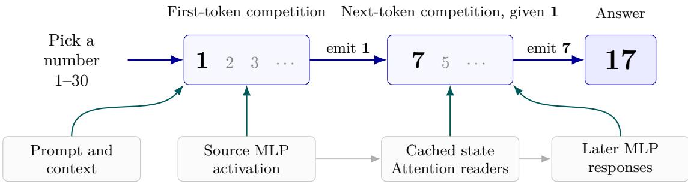  
Schematic control sites; efects can reinforce or oppose a choice.

We combine perturbation probing (PP) and gradient nomination with scalar patches and zeroing to select a source neuron. PP supplies forward candidate scores [10]; gradient-based tracing in the neuron basis identifies causally efective components and supports group and individual-neuron steering [12]. Downstream compensation [9, 19] and dose-dependent control limits [11, 18] motivate following the edit beyond its initial efect. A successful intervention identifies a control point but does not by itself establish how the altered influence is processed, or how much natural behavior it explains [6, 7, 8]. We therefore connect source interventions to probability estimates, selective downstream replacements and natural-context transfer tests.

A selected Qwen3-4B example makes the processing question concrete. Increasing one multilayer perceptron (MLP) activation at the pre-answer position changes the generated answer from 17 to 15, while both runs first emit 1. The edit ends before the model processes that shared digit, so the visible prefix is unchanged while inherited internal state can difer. Selective source-position cache and attention-output replacements trace part of the continuing influence (Figure 3). Two attention-output replacements have similar immediate readout contributions but diferent final efects. Holding later MLP outputs at their values from the edited run without a reader replacement largely removes this diference. The comparison connects persistent state to conditional downstream processing.

Our contributions are:

• Partial propagation and downstream processing. Selective cache and reader replacements localize part of a pre-answer-only 17-to-15 edit across an unchanged first digit. Later-MLP output clamping changes the relative reader efects while both restored answers remain 17.

• Probability movement and answer changes. A frozen two-target panel tests signed efects against matched-write controls. A retrospective shared-profile estimate captures much of the probability movement across eighteen contexts but misses the selected near-boundary switch; matched controls qualify the response-shape specificity.

• Steering and natural-context transfer. Natural-activation swaps test how much instruction and history variation the steering target carries. Complement, held-out and fresh-prompt tests separately bound the specificity and portability of the selected pathway.

The central saved-record analyses and continuation study concern Qwen3-4B; earlier studies in three related checkpoints provide supporting context. On one new prompt, the same source and head retain signed efects while all tested continuations remain 17. The fresh twelve-wording screen adds one eligible reader/MLP recurrence; the other eleven wordings have no downstream intervention evidence. These tests bound reuse of the selected components. The selected path supplies a conditional explanation of an imposed preference change. The training origin of natural numerical preference and a minimal circuit for numerical choice remain open.

## 2 Experimental setup and causal interventions

## 2.1 Models, task and answer measurements

We study choice within a finite set of candidate integers. A validity check determines whether an answer satisfies the range constraint; the relative probabilities describe preference within that set. We use scored distributions and sampled or greedy replies for diferent purposes. A repeated greedy answer alone does not establish probability concentration.

We studied Qwen3-4B, Qwen3-4B-Instruct-2507 and Qwen3-8B [5]. These checkpoints share an architecture family; 2507 is a related variant. The selected MLP neurons are respectively L29:8172, L29:8172 and L29:385, with zero-based indices. A five-checkpoint search also included Qwen3-14B and GPT-OSS-20B, where the single-unit criterion failed. Supporting response tests concern these three checkpoints; the detailed continuation pathway uses Qwen3-4B.

Let x be the prompt and h a fixed response prefix. For candidates in interval I, define

$$
w _ { h } ( n ) = P ( { \mathrm { c a n o n i c a l ~ d i g i t s ~ o f ~ } } n { \mathrm { ~ f o l l o w e d ~ b y ~ a ~ n o n d i g i t ~ } } | x , h ) , \quad q _ { h } ( n ) = { \frac { w _ { h } ( n ) } { \sum _ { k \in I } w _ { h } ( k ) } } .\tag{1}
$$

The denominator is the mass of this candidate-event set. This event admits a decimal point as a terminator, and is therefore not exactly the probability of an integer-only completed answer. Number words, alternative spellings and signs are outside this definition. Ansari [16] separately reports admitted answer mass and conditional number-choice probabilities using a diferent spelling and termination rule. Our results using these scores are explicitly separated from parsed generated replies; the two event definitions are not interchangeable.

An own-prefix evaluation retains the model’s natural text before the answer. Other experiments use the fixed prefix “The number is ”. These interfaces condition the measured distribution on diferent histories, and a change of prefix can change the result. Generated-answer checks therefore accompany the scored-event analyses where available.

The baseline preference difers across these checkpoints. In the earlier 1–30 own-prefix scores, q(17) was 0.79 in Qwen3-4B and 0.82 in Qwen3-4B-Instruct-2507. Qwen3-8B assigned 0.53 to 15 and 0.47 to 17. These conditional candidate scores illustrate unequal preference without a shared winner across all three checkpoints; they are not frequencies of unrestricted replies. They also concern a diferent cohort from the selected switching prompt in Section 4.

We saved completed replies where generated-answer checks were available. In the selected dose study, we compared full-chat generation with continuation from a retained prefix. This checks their agreement in the tested conditions; it does not identify candidate-event probabilities with unrestricted reply frequencies.

## 2.2 Candidate nomination and causal selection

An MLP neuron is an intermediate activation z immediately before the down projection. It contributes zv to the residual stream, where v is the corresponding weight column. Decomposing MLP outputs into such writes and examining their vocabulary-space efects follows established analyses [29]. Our interventions change activations while keeping model weights fixed.

For Qwen3-4B, we compared twelve prompt templates at 1–30 with donor prompts at 1–40, 1–50, 1–35 and 1–20. Each prompt supplied its own generated pre-answer prefix, and the donor’s chosen number supplied the competing answer. We measured activation displacements at these numerical decision positions.

Two branches nominated candidates. The forward perturbation-probing (PP) score multiplies the displacement by the projection of the down-projection column onto the first-digit unembedding contrast [10]. The gradient-attribution score multiplies the displacement by the gradient of the complete-numeral event log-margin between 17 and the donor answer. This first-order screening follows the attribution-patching approach studied by Kramár et al. [24]; we do not implement their $\mathrm { A t P ^ { * } }$ corrections. Their across-pair magnitude aggregation also difers from the signed-mean PP aggregation below. The branches therefore assess diferent readouts: first-digit coupling and the numeral event defined above. For each range edit $e ,$ let $T _ { e }$ be the set of eligible templates and $u _ { n t e }$ the signed PP score for neuron coordinate n and template $t \in T _ { e }$ . The corrected aggregation is

$$
s _ { n e } = \left| \frac { 1 } { | T _ { e } | } \sum _ { t \in T _ { e } } u _ { n t e } \right| .\tag{2}
$$

The sign is retained for interpretation. We normalized and combined scores across range edits, ranked coordinates in the last quarter of decoder layers, and pooled the top twenty coordinates from each branch, reranked their union by the summed normalized scores, and retained twenty candidates. Appendix A specifies the normalization and selection details. The layer window restricts the search; it is not evidence that earlier layers are uninvolved.

We then measured finite efects with single-scalar patches and zeroing. We retained candidates whose zeroing preserved the pooled baseline modes at 1–10, 1–30 and 1–100, including 17 at 1–30. Among eligible candidates, we selected the coordinate with the largest increase in q(17) at 1–40 under the frozen rule. Exploratory ablations had already identified the leading candidate before this frozen comparison. This selection preceded held-out evaluation; 1–40 remains a selection interval. Later additive-dose and path tests characterize this selected source under their own intervention conditions.

In the corrected Qwen3-4B search, L29:8172 ranks first in the gradient branch and 31st in the PP branch, outside its top twenty. It therefore enters through gradient attribution and remains the intervention-screen winner. The primary correction changes PP aggregation; a separate sensitivity analysis changes both branches. The 2507 and 8B coordinates were selected under the historical magnitude-aggregation procedure; corrected nomination was not repeated for them (Appendix A.6).

## 2.3 Interventions and comparisons

We use registered for predictions and criteria recorded internally before the corresponding run, without a public registration. Exploratory selection, reused cohorts and post hoc analyses are identified separately. Setting, zeroing or adding to the source activation changes its residual write. Activation patching replaces a recorded internal value with the corresponding value from another run. Scalar donor swaps use a value from a diferent prompt; residual and cache interventions replace larger objects. Response blocking holds specified later module outputs at their recipient baseline when testing a source or reader intervention. Context already encoded in those baseline outputs remains available. Table 1 summarizes the interventions in the selected continuation study.

We distinguish an imposed change within a prompt from transfer of a natural contrast between prompts. Each comparison specifies its intervention position, recipient background and readout. Firstdigit, candidate-answer and fixed-leading-digit distributions answer diferent questions about generation. We retain these distinctions and matched controls when reporting efects [7]. Circuit-level evaluations distinguish faithfulness, completeness and minimality [25]; our selective replacements identify partial contributions without establishing those properties for a complete circuit. Specialized metrics are introduced with the corresponding results.

<table><tr><td>Intervention</td><td>Changed object and reference</td></tr><tr><td>Source dose</td><td>Add δ to the selected pre-down-projection scalar at the last pre-answer position; remove</td></tr><tr><td>Cache</td><td>the hook before processing the first digit. Copy selected source-position keys or values from the stated donor cache into the recipient.</td></tr><tr><td>replacement</td><td>Other entries remain unchanged.</td></tr><tr><td>Reader replacement</td><td>Copy selected L33 head-output slices before the attention output projection, while process-</td></tr><tr><td>Late-MLP</td><td>ing the common first digit.</td></tr><tr><td>clamp</td><td>Replace L34–35 MLP output vectors at that query with their source-edited, no-reader values. Attention and final normalization remain active.</td></tr></table>

Table 1: Operations in the selected continuation study. All model weights remain fixed. Cache and reader donors are specified with each comparison; replacement directions do not prescribe a particular sign or answer. Source zeroing in the earlier assays has its separately stated position scope.

The principal prediction and interval-response results used FP32 confirmation, and the later pathway study used unquantized FP32 with streamed CUDA. The experiments were run on the RTX 2070 Max-Q host reported by the authors; Appendix A.6 distinguishes device records, selection history and runtime coverage.

## 3 Structured changes in numerical preference

## 3.1 Neuron edits retain their efect on new wordings

We first tested whether a local edit could redirect numerical preference beyond the wording used to select the source. The integer 17 remains a valid answer throughout this comparison. At 1–40, zeroing the selected neuron increased sampled 17 replies in all three checkpoints (Appendix C.6; Figure 10A). The new-wording cohort contains twenty paraphrases, of which 16, 17 and 20 meet the eligibility rule. Each eligible prompt supplies 32 sampled replies after its own preamble, with temperature 0.7, top-p 0.8 and top-k 20. The fraction of sampled replies equal to 17 increased from 0.02 to 0.77 in Qwen3-4B, from 0.00 to 0.69 in Qwen3-4B-Instruct-2507, and from 0.15 to 0.95 in Qwen3-8B. The corresponding 95% template-bootstrap intervals for the increase are [0.56,0.92], [0.47,0.88] and [0.66,0.92].

Appendix A reports the reused-template cohort separately. Free generation with zeroing at every position also increased 17 replies, although that assay changes both the intervention scope and the response-prefix treatment. Because the 1–40 interval participated in selection, the new-wording result tests transfer across eligible phrasings at that interval. The historical predictor addressed new intervals in a separate study.

One hundred random neurons matched on down-projection-column norm produced maximum q(17) increases of 0.003, 0.000 and 0.001 (rounded source summaries). Matching a weight norm does not match the activation-dependent write removed by zeroing. A separate later comparison uses one matched-write coordinate; it answers a narrower control question. Protected answers in the original arithmetic, copy and comparison checks remained correct, but no checkpoint met every registered validation criterion. A larger arithmetic study reports small mean probability changes with a nontrivial sensitive tail (Appendix A.5). These checks constrain specificity without proving that the neuron is uniquely numerical.

## 3.2 Frozen doses test directional response

We next tested whether fixed doses retain a predicted direction across contexts. This Qwen3-4B panel used twelve historical templates (P1–P12) and six extensions (E1–E6), each with its own pre-answer

prefix at 1–30. L29:8172 and a separately selected L34:2836 were edited individually, with one residualwrite-matched control per site. The protocol predicted that a positive dose would favor 17 over 23 at L29 and oppose it at L34; negative doses should reverse those directions. The endpoint was the change in log $w ( 1 7 ) - \log w ( 2 3 )$ , with efects of magnitude at most 0.05 nat classified as unresolved. This floor is a practical reporting criterion, not a significance test. Appendix A.2 specifies target selection, exact doses, control matching and all eighteen prompts, with a link to the frozen predictions.
<table><tr><td>Target</td><td>Cohort</td><td>Predicted</td><td>Unresolved</td><td>Mean |∆| (control)</td></tr><tr><td>L29:8172</td><td>Historical</td><td>24/24</td><td>0</td><td>0.636 (0.060)</td></tr><tr><td>L29:8172</td><td>Extensions</td><td>10/12</td><td>2</td><td>0.533 (0.065)</td></tr><tr><td>L34:2836</td><td>Historical</td><td>24/24</td><td>0</td><td>0.317 (0.007)</td></tr><tr><td>L34:2836</td><td>Extensions</td><td>12/12</td><td>0</td><td>0.357 (0.004)</td></tr></table>

Table 2: Frozen directional predictions at two individually edited sites. Each prompt supplies positive and negative target doses. Parentheses give mean absolute efects for the site’s matched control; efects are in nats. Historical contexts informed selection; the six extensions are outside that discovery set. These dependent conditions do not estimate a population success rate.

Seventy of 72 target doses met the predicted-direction criterion, including 22 of 24 on the extensions; none had a resolved opposite efect. The two unresolved L29 doses occur in E2, and its positive dose has a small opposite raw sign. L29’s control meets the target’s directional prediction on 20 of 36 doses, is unresolved on fourteen and is opposite on two; the L34 control is unresolved on all 36. The selected L29 source produced larger efects than this control, which also frequently met the directional criterion. These are separately tested sites, not evidence of a connection between them. Appendix A retains the full panel accounting and donor qualification.

The directional test concerns one rival, not the winning answer. We use the same saved distributions below to examine all thirty alternatives. The 17/15 analysis and selection of the switching prompt were post hoc. Earlier studies separately report leading-digit prediction across new intervals, but their full fit and evaluation records are unavailable; Appendix C.6 preserves those qualified summaries rather than treating them as a new validation.

## 3.3 Shared responses predict distribution changes

The directional test evaluates one rival. We next ask whether a shared response can estimate the redistribution over all thirty candidate answers.

To compare the responses directly, we examined changes in per-number log probabilities at the same source dose. Leading 2 loses against leading 1 in all eighteen contexts, with median log-odds change −0.651 nat. The 17/15 contrast has a median change of −0.282 nat and decreases in all eighteen contexts; the control’s median change is +0.061 nat. Sixteen response profiles correlate at least 0.96 with the coordinate-wise median of the other seventeen profiles across all thirty candidates, and at least 0.92 within 10–19. The two less similar profiles begin with candidate modes 23 and 15 (Figure 1A). This is a retrospective description of a related template family; equal-weight correlations also count extremely unlikely answers.

We evaluated these profiles as retrospective distribution estimates: each prompt receives the median response from the other seventeen, applied to its own baseline and renormalized. This reduces pooled Kullback–Leibler (KL) prediction error relative to the unedited baseline by 89.0%, with a median per-prompt reduction of 96.3%; all eighteen estimates improve. Appendix C.4 reports absolute losses, all contexts and cohort summaries. These related contexts provide a retrospective diagnostic, not prospective validation of a frozen predictor.

A controller that only changes leading-digit weights has a structural limit: within a set such as 11–19, every candidate receives the same leading-digit multiplier, which cancels on normalization. It predicts no redistribution inside that set. The earlier FP32 clamp study nevertheless reports within-set total variation (TV) changes of 0.06–0.17. This documented summary concerns the interval study, not the later selected dose. It motivates asking how an edit changes the continuation after a shared first digit.

We can measure both kinds of redistribution exactly in the later saved distributions. Let $q _ { a }$ and q0 denote the candidate-answer distributions with intervention a and at baseline, respectively, and let d(n) be the leading digit of candidate n. The leading-digit mass and within-digit conditional distribution are $\begin{array} { r } { p _ { a } ( d ) = \sum _ { n : d ( n ) = d } q _ { a } ( n ) } \end{array}$ and $r _ { a } ( n \mid d ) = q _ { a } ( n ) / p _ { a } ( d )$ . The KL chain rule gives

$$
\mathrm { K L } ( q _ { a } \| q _ { 0 } ) = \underbrace { \mathrm { K L } ( p _ { a } \| p _ { 0 } ) } _ { B _ { a } } + \underbrace { \sum _ { d } p _ { a } ( d ) \mathrm { K L } ( r _ { a } ( \cdot  { | } d ) \| r _ { 0 } ( \cdot  { | } d ) ) } _ { C _ { a } } .\tag{3}
$$

A branch oracle that uses observed $p _ { a }$ but retains $r _ { 0 }$ leaves error $C _ { a }$ . Thus even perfect knowledge of the changed branch weights cannot explain within-branch redistribution. This is retrospective accounting, with no fitted coeficients or new model calls.

A branch-only median comparator gives 38.5% pooled reduction. Even an oracle supplying the observed branch masses while retaining baseline within-branch probabilities is limited to $R _ { \mathrm { b r a n c h } } ^ { \star } =$ $\textstyle \sum _ { j } B _ { j } / \sum _ { j } ( B _ { j } + C _ { j } ) = 4 0 . 9 \%$ over the eighteen contexts. The full-profile advantage therefore exceeds what any predictor in this branch-only class can achieve; it is not explained by an inefective branch estimator. This output-level bound does not identify an internal carrier.

The matched-write control also has a consistent response shape within 10–19, with a smaller amplitude and opposing alignment to the source. The shared shape therefore describes output structure without identifying a source-specific signature or a common internal route. Appendix C.4 gives the complete comparator and sensitivity analyses.

## 3.4 From probability estimates to answer changes

The selected prompt illustrates why distributional accuracy and winner prediction difer (Figure 1B). Its estimate reduces KL error by 88.9% but retains 17: the estimated 17/15 margin is +0.110 nat, whereas the observed margin becomes negative. The selected response has a familiar shape but enough displacement to cross a near tie. Selection on the observed switch makes this an existence example. Baseline and estimated modes both agree with the observed mode in seventeen of eighteen contexts, so mode accuracy alone adds little here.

The prediction miss motivates a closer test of the continuation computation. Both candidate answers begin with 1, so this selected case lets us follow an edit’s influence into a later digit without changing the first emitted token.

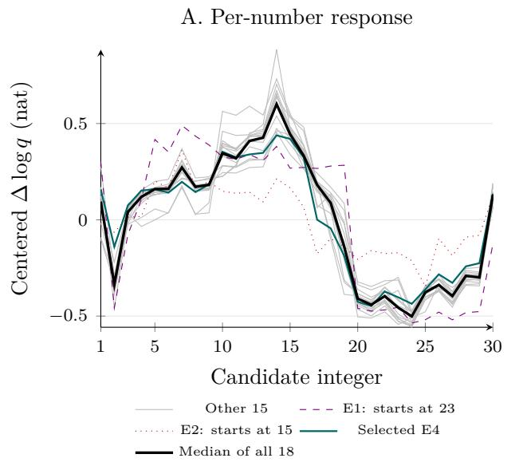

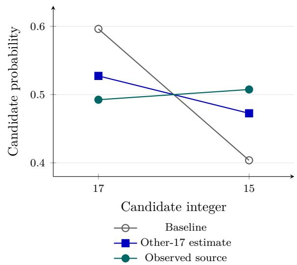  
Selected prompt: 88.9% reduction in full-distribution KL error; predicted winner remains 17.

Figure 1: A shared response captures probability movement while missing the selected switch. A: all eighteen source responses at the same dose, centered across the thirty candidate log probabilities; the black curve is their coordinate-wise median. E1 and E2, initially favoring 23 and 15, remain visible. B: the selected prompt’s baseline, leave-one-out estimate from the other seventeen responses, and observed source distribution. The estimate retains mode 17; the observed source favors 15. For the full thirty-candidate distribution in B, KL prediction error falls by 88.9%, although the estimated mode remains 17. E1 uniquely has no pre-answer text after the chat template. This retrospective comparison is distinct from the earlier fitted interval predictor.

## 4 An unchanged first digit reveals a continuation pathway

We first examine a prompt selected for an observed 17-to-15 switch. An earlier held-out prompt is subsequently reused for the late-MLP comparison, and a separate fresh wording screen tests recurrence under fixed eligibility rules. These studies retain their distinct selection and reuse status throughout.

## 4.1 Changing the answer while preserving the first digit

The leading-digit account leaves open how an edit changes preference within a branch. In a selected Qwen3-4B prompt, a positive edit to L29:8172 changes the completed answer from 17 to 15 while leaving the greedy first token 1 unchanged. Both answers satisfy the same 1–30 constraint. The intervention acts only at the pre-answer position; it is absent when the model processes the emitted digit. This provides a controlled setting for following an earlier activation change into a later choice.

The post hoc 17/15 comparison uses the eighteen contexts of Section 3.2. The 17-versus-15 candidate-event margin decreased in all eighteen, by a mean of 0.284 nat; seventeen decreases exceeded 0.05 nat. A residual-write-matched edit to L29:8369 increased that margin in all eighteen, averaging 0.074 nat. The active control therefore supplied an opposing response under the matched-write comparison.

The frozen panel measured 199 of 216 planned conditions, with seventeen natural-donor write-cap skips. The exploratory search for an answer change then examined those measured distributions. Only one measured intervention condition changed the candidate mode relative to the corresponding prompt’s baseline. This observation selected “Pick one integer in the inclusive interval [1, 30].” for the downstream experiments. Its baseline absolute 17/15 candidate-event margin is 0.390 nat, compared with a median of 19.775 across the eighteen prompts; the other seventeen span 3.031–22.860 nat. Only two prompts assign more than 1% candidate probability to both 17 and 15. This near-boundary selection makes the pathway an existence example whose broader answer-switching rate remains unmeasured.

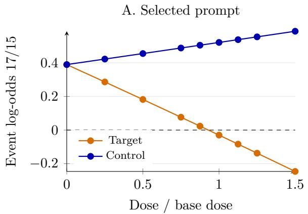

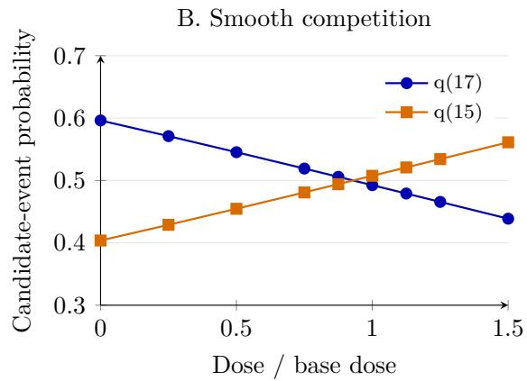  
Figure 2: The eighteen-condition dose scan. A: source and matched-control candidate-event margins. B: the source’s two leading event probabilities. Markers are measured factors; straight segments are visual guides. Actual source replies are 17 through factor 0.875 and 15 from factor 1 onward; control replies remain 17. This is one selected prompt.

The base dose δ = 1.81884765625 was fixed before inference at one quarter of the median absolute displacement to the 1–35 donors in the historical template bank. The selected activation is −9.857834; adding the base dose places it nominally at −8.038986, toward zero. In the finer dose scan, both full-chat and retained-prefix replies change from 17 to 15 between factors 0.875 and 1.0 (Figure 2). Interpolating the event-margin zero gives approximately 0.930; the actual transition was only bracketed by measured doses. A matched control retains 17 throughout the tested grid. The response is gradual even though greedy output changes discretely.

The first digit is shared, but the next-token computation difers. We measure the following log-probability contrast after processing 1:

$$
m ( h ) = \log P ( 7 \mid x , h , 1 ) - \log P ( 5 \mid x , h , 1 ) .\tag{4}
$$

The sign of this margin identifies the favored token in the $7 / 5$ pair. Other vocabulary competitors and the complete answer require separate measurements.

In the downstream experiments, the next-token margin is +0.389778 without the edit and −0.029976 with it. Both states retain first digit 1. Candidate-event and next-token measurements agree closely on this selected context, but remain distinct endpoints. The unchanged first digit and the measured second-digit change motivate testing which cached states carry the edit forward. Detailed branch accounting appears in Appendix C.3.

The selected edit also illustrates rival-dependent competition. It raises the 17-versus-23 log-odds by 0.403 nat while reducing the probability of 17 itself (Table 3). The reason is that 23 falls proportionally further, while 15 gains enough mass to become the candidate mode. An intervention can therefore favor 17 against one rival and disfavor it against another. Pairwise improvement alone does not identify the winning answer.

<table><tr><td>Selected retained-prefix assay</td><td>Baseline</td><td>Positive L29 edit</td></tr><tr><td>q(17)</td><td>0.596142</td><td>0.492439</td></tr><tr><td>q(15)</td><td>0.403735</td><td>0.507433</td></tr><tr><td>q(23)</td><td> $1 . 7 7 2 6 0 \times 1 0 ^ { - 7 }$ </td><td> $9 . 7 8 7 7 9 \times 1 0 ^ { - 8 }$ </td></tr><tr><td>log[w(17)/w(23)] (nat)</td><td>15.028371</td><td>15.431160</td></tr><tr><td>Candidate-event mode</td><td>17</td><td>15</td></tr></table>

Table 3: The same dose improves one comparison while changing the winner against another competitor. Probabilities and log ratios are derived from the same full-precision event-weight vector for each condition, then rounded for display. Separately computed directional-panel margins difer by less than $5 \times 1 0 ^ { - 5 }$ nat here; the 0.403-nat conclusion is unchanged. Sampled reply frequencies require a separate generation assay. The dose scan independently checks generated answers within the same experimental programme.

## 4.2 From the pre-answer edit to source-position cached state

The unchanged digit identifies the next causal question: which altered past states remain available when that same token is processed? Belitsky et al. [20] show that a one-time KV-cache intervention can influence later generation. Here the cache diference is induced by an earlier scalar MLP edit; selective exchanges test which parts carry its continuation efect. In this decoder, the L29 MLP edit occurs after the block’s attention computation. It can change source-position keys and values $\mathrm { ( K / V ) }$ in L30–35, while the already-computed L0–29 caches and earlier token positions remain unchanged. Saved tensors verified both locality restrictions. The source hook is removed after prefill, so the subsequent efect is not a fresh edit at the first-digit position.

We constructed source-of and source-on prefix caches and verified that both root logits naturally select 1. In this cache panel, transfer inserts source-on states into a source-of recipient; rescue inserts source-of states into a source-on recipient. We then exchanged selected source-position entries before processing this common token and greedily generated the rest of the answer without supplying its second digit. The cache contains state from the pre-answer position, while the later attention query processes the emitted 1 (Figure 3). This panel tests a controlled continuation; the preceding dose scan separately checked full-chat agreement.

Replacing all afected L30–35 source-position K/V entries reproduced the opposite next-token distribution and continuation exactly. Self-swaps and swaps at the unchanged preceding position reproduced the recipient. Full-state transport is an architectural positive control in this fixed-token setting. The selective replacements compare how much each tested cache window changes the continuation margin in the specified recipient.

Among three tested two-layer windows, L32–33 produced the largest displacement: about 68% of the source margin diference in each direction. L30–31 and L34–35 also contributed. Inserting the edited L32–33 state into the unedited recipient moved the margin from +0.389778 to +0.104454 nat, leaving 17 as the answer. The reverse replacement moved the edited margin from −0.029976 to +0.257008 and restored 17. All three partial windows restored 17 in rescue, while none alone transferred the answer 15. Signed margin efects therefore distinguish the strongest tested carrier where answer-flip counts do not. The edited endpoint is only 0.029976 nat from the pairwise zero crossing, whereas the unedited endpoint is 0.389778 nat away. Similar bidirectional movements can therefore restore the answer in one direction without transferring it in the other. The completed continuations verify these outcomes separately from the pairwise margin.

Separate value (V) replacements produced about 54% of the source movement, compared with about 14% for keys (K). The V/joint ratio was approximately 0.79–0.80, falling short of the frozen 80% dominance requirement in at least one direction. At each attention site, keys enter the weighting

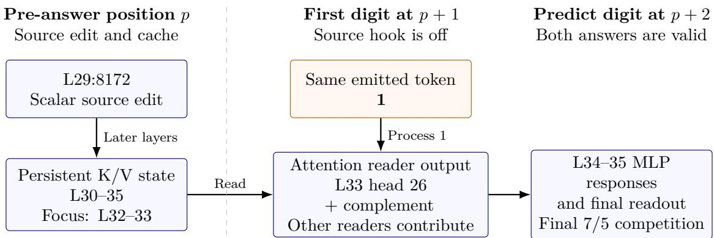  
Arrows: nested interventions or processing order; no exclusive edges or transition probabilities.  
Source contrast: unedited 17; source-edited 15. Reader replacements probe partial efects in hybrid states.

One held-out prompt: the same coordinates retain signed influence; every tested continuation remains 17.

Figure 3: Partial localization across an unchanged token. The pre-answer edit changes later cached state at position p. With the hook removed, both runs process 1 at p + 1 and predict the next digit. The source contrast is 17 versus 15; reader replacements in the specified hybrid backgrounds can instead restore 17. Arrows summarize nested interventions and processing order, not exclusive edges or transition probabilities. Late-MLP response clamps change relative reader efects without changing their measured answers. Other cache windows and the complement remain influential.

computation and values the transmitted vector. Across layers, either intervention can also change later queries and processing. These efects localize $\mathrm { K } / \mathrm { V }$ contributions without separating pure routing from semantic content.

## 4.3 Localizing the reader contribution

Attention reads cached values when processing the shared token. We call its resulting module output the reader output. To follow the larger V contribution, the reader tests used each V-only hybrid with its matching baseline. For the main comparison, the edited recipient is the source-on run. Its V-only hybrid replaces source-position V entries in L32–33 with source-of values, leaving keys and other cache entries unchanged.

Reader transfer copies hybrid outputs into the matching recipient; rescue restores recipient outputs inside the hybrid. These names specify replacement directions, not efect signs. In the main direction, transfer moves the $7 / 5$ margin toward $^ { 7 , }$ reversing part of the original source-induced change toward 5. Restoring both L32–33 reader outputs recovered the matching recipient endpoint; transferring both hybrid outputs recovered the hybrid endpoint. Joint recovery checks the implementation and composition of these interventions: restoring all relevant attention outputs in the defined hybrid backgrounds partly builds recovery into the construction.

The comparisons that split cache windows, keys from values, layers and heads provide the finer localization evidence. Splitting the readers showed a larger L33 contribution, with a remaining contribution from L32. L33 is not the earliest possible reader: saved captures already difer at L30 attention. We next test whether the larger L33 efect concentrates within its head outputs, using the same V-only hybrid backgrounds.

A saved projection proxy nominated query head 26 before we tested its actual 128-dimensional pre-output-projection output slice. We compared the candidate with its complement (the other 31

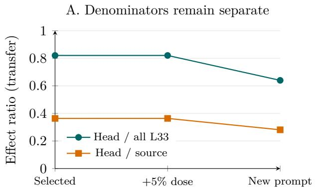

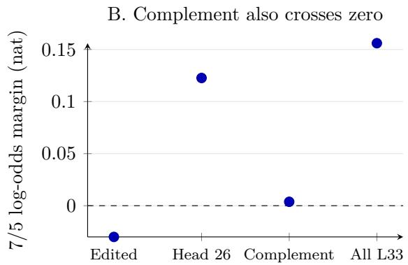  
Figure 4: A partial contribution and its boundaries. $\mathrm { A } { : }$ head-26 transfer relative to all L33 readers and to the full source efect, computed separately in each setting. These ratios are not probabilities and are not multiplied along Figure 3. B: replacing the complement can cross the selected $7 / 5$ boundary as well. Points record actual intervention margins; no prompt-population error bars are implied.

L33 query heads), head 0 and the all-L33 reference. The projection proxy ranks candidates by an unsigned quantity; the subsequent interventions estimate signed efects. This head-selection procedure is separate from the signed-mean source-neuron nomination.

Transferring head 26 from the V-only hybrid into the edited recipient moves the next-token margin by +0.152634 nat to +0.122658, returning the answer to 17. This is about 82% of the all-L33 efect, but only 36% of the original source movement. The complement moves the margin to +0.003761 and also produces 17 (Figure 4B). Thus a behavioral pivot does not uniquely identify the head with the largest measured contribution. Head-only rescue inside the hybrid also leaves the answer at $1 7 ;$ it does not recover the edited answer 15.

Control head 0 changed the margin by at most 0.0000763 nat, but its displacement was only about 4.4% of the candidate’s. The control therefore tests a smaller perturbation and leaves magnitudematched specificity unresolved. Other heads in the same KV group changed in the saved geometry and were not all tested individually. The result establishes a concentrated contribution in the nominated head within this panel.

## 4.4 Later MLP responses transform reader influence

Earlier first-digit experiments also found that later MLP computation changes the response to the source across contexts (Appendix C.1). Those studies use diferent intervals and interventions. Here we test the downstream processing of the localized reader efects in the selected continuation setting. The immediate readout does not explain the diference between head 26 and its complement. Retrospective accounting gives similar norms of the L33 attention-output perturbations and similar immediate contributions to the $7 / 5$ readout, yet head 26’s final margin movement is approximately 4.52 times that of the complement (Table 4). This accounting locates a diference after the immediate write but does not isolate its cause. Self-repair research distinguishes normalization changes from later-neuron contributions [19], motivating a separate causal test of the responses after the reader. We therefore froze a response-blocking test: while transferring either reader into the edited recipient, we held the L34 and L35 MLP output vectors at their values in that recipient without reader replacement. The clamp acts only while processing the shared first digit. Attention and final normalization remain active, and the baseline MLP contributions are preserved.

Let $E _ { H }$ and $E _ { C }$ be the head-26 and complement efects on $m ,$ each relative to the matching no-reader condition. Figure 5 compares these efects with normal and clamped processing. Jointly clamping the two MLP outputs reduces their diference $E _ { H } - E _ { C }$ from +0.118896 to +0.002480 nat in the selected prompt (Figure 5). Thus the selected head’s larger final efect depends on the tested late-MLP responses. Both reader interventions still produce 17 with the clamp: their margins are +0.003349 and +0.000870 nat, just above the pairwise boundary. This measured restoration survives the joint response clamp in the selected condition, with baseline MLP outputs still present. Separate readouts below test the response when only one MLP is held fixed.

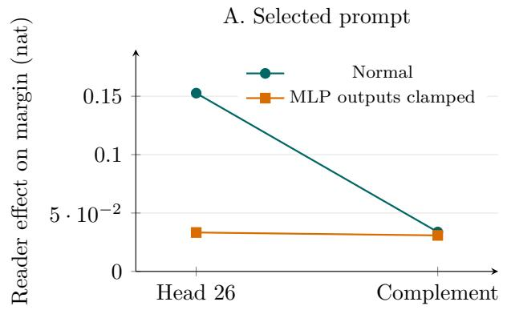

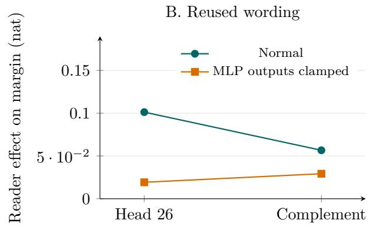  
Figure 5: Later MLP responses change the relative influence of the two reader interventions. Points show head-26 and complement efects on the $7 / 5$ margin relative to the matching no-reader recipient; lines connect interventions for comparison, not an ordered computational path. The output clamp holds L34–35 MLP vectors at recipient values. A: the normal head/complement gap nearly disappears. B: the ordering reverses in the reused prompt, although both efects remain positive. Every reader condition shown continues with 17. The experiment comprised twelve core conditions and eight reference/identity conditions across two reused contexts; the figure displays the head and complement efects on the same vertical scale.

The panel also reused the earlier held-out prompt from Section 4.5, with its recorded dose and contextspecific donor states. There, clamping changes the head-minus-complement efect from +0.044605 to −0.009998 nat. This reverses the relative ordering of two positive reader efects; every core condition still produces 17. The second context is an operating-context check, not a fresh holdout. The joint intervention shows that the head/complement efect diference depends on these MLP responses in the tested backgrounds. The retained pre-clamp outputs also allow a post hoc separation of the two MLPs, described next; neither comparison establishes source specificity.

<table><tr><td>Transfer into edited recipient</td><td>Head 26</td><td>Complement</td></tr><tr><td>L33 attention-output change,  $\ell _ { 2 }$  norm</td><td>1.739</td><td>1.733</td></tr><tr><td>Immediate readout contribution (nat)</td><td>+0.02237</td><td>+0.02322</td></tr><tr><td>Final  $7 / 5$  margin movement (nat)</td><td>+0.15263</td><td>+0.03374</td></tr></table>

Table 4: Similar immediate reader contributions produce diferent final efects in the selected prompt. Saved-state accounting uses the projected attention-output change and an inferred recipient normalization for the immediate contribution. Final movements are relative to the edited no-reader recipient. Both interventions restore the completed answer 17. Figure 5 tests the role of subsequent MLP responses.

Separating the two late-MLP responses. The saved final residuals and pre-clamp L35 outputs permit separate L34-only and L35-only readouts without another model run (Appendix B.2). Table 5

compares both readers in the selected prompt using common FP64 arithmetic. Either single clamp weakens the head’s efect. For the complement, holding L34 strengthens the efect, whereas holding L35 weakens it. The L35-only complement efect remains positive, but is too small to overcome the edited recipient’s negative 7/5 margin. Its reconstructed final margin is −0.019979 nat; this does not establish a complete answer of 15.
<table><tr><td>MLP output held</td><td>Head effect</td><td>Head m</td><td>Complement effect</td><td>Complement m</td></tr><tr><td>Neither</td><td>+0.152637</td><td>+0.122656</td><td>+0.033738</td><td>+0.003757</td></tr><tr><td>L34 only</td><td>+0.088187</td><td>+0.058206</td><td>+0.062106</td><td>+0.032125</td></tr><tr><td>L35 only</td><td>+0.068869</td><td>+0.038888</td><td>+0.010002</td><td>-0.019979</td></tr><tr><td>L34 and L35</td><td>+0.033326</td><td>+0.003345</td><td>+0.030854</td><td>+0.000873</td></tr></table>

Table 5: Separate late-MLP readouts for both readers in the selected prompt, in nats. All entries use the same FP64 reconstruction and corresponding no-reader baseline. Normal and joint-clamp arms also have measured continuations, all 17; the single-clamp arms have only reconstructed readouts. Small diferences from the measured FP32 margins elsewhere in the text reflect arithmetic. A negative m means 5 outranks 7, without establishing a full-vocabulary winner or completed answer.

Direct-write signs do not determine the efect of clamping a module. The complement’s normal L34 and L35 writes have opposite signs in both contexts, but only in the selected context do the two single clamps change its efect in opposite directions relative to normal processing. Appendix B.2 retains the direct-write decomposition and all four reader/context comparisons.

The four clamp conditions expose a further dependence on the computational background. In the reconstructed comparison for the reused context, leaving the L34 MLP output unclamped increases the complement efect by +0.010646 nat when the L35 MLP output is unclamped, but decreases it by 0.011835 nat when that output is held at its recipient value. Thus even within one reader/context pair, L34 has no fixed supporting or opposing role under these interventions. The diference between these conditional efects is +0.022482 nat. Clamping L34 can change subsequent attention and the input to L35; the contrast does not isolate a neuron-to-neuron edge. It is a comparison of reconstructed readouts, not additional generated answers.

Direct final-residual captures further show that scalar normalization alone does not explain the large head/complement separation under the recipient-divisor accounting (Appendix B.1). This decomposition is distinct from an intervention on normalization.

## 4.5 Influence persists without an answer change

Before the response-blocking follow-up, we froze a validation panel with the original setting, a 5% higher dose, and one new prompt at that higher dose: “Select a single integer from 1 through 30, inclusive.” The new context had to naturally answer 17, supply an eligible prefix and retain first digit 1 under editing. It qualified, and all thirty conditions completed. Coordinates remained fixed while donor states were recaptured in each context. This design tests reuse of the coordinate and intervention rule with context-specific activations.

In the selected prompt, all-L33 rescue ends at m = +0.014328 at the base dose and m = −0.004700 at the higher dose, producing 17 and 15 respectively. Head-only rescue retains 17. Nearly unchanged relative contributions can coexist with diferent answer outcomes near a boundary.

The new prompt starts much farther from that boundary: its source edit moves m from 10.930855 to 10.570538. Head rescue and transfer move it by about −0.100971 and +0.101280 nat. The transfer contribution is now about 64% of all L33 and 28% of the source movement; all continuations remain 17. The signed influence survives, but the panel does not establish a portable answer switch. Wording and natural prefix change together. This validation panel did not test the complement or control head on

the new prompt; the subsequent response-blocking panel added the complement comparison reported above, without adding a magnitude-matched control head.
<table><tr><td>Setting</td><td>Starting m</td><td>Source change</td><td>Edited m</td><td>Reply</td></tr><tr><td>Selected prompt</td><td>+0.389778</td><td>-0.419754</td><td>-0.029976</td><td> $1 7  1 5$ </td></tr><tr><td>Same prompt, +5% dose</td><td>+0.389778</td><td>-0.441185</td><td>-0.051407</td><td> $1 7  1 5$ </td></tr><tr><td>Held-out wording</td><td>+10.930855</td><td>-0.360317</td><td>+10.570538</td><td> $1 7  1 7$ </td></tr></table>

Table 6: Starting competition and measured source movement after the common first digit 1. Margins are $7 / 5$ next-token log odds in nats; completed continuations supply the reply column. The held-out wording uses the higher dose and recaptured donors. These comparisons do not isolate starting margin from the other context changes.

The source movement exceeds the starting positive pairwise margin in the two selected-prompt settings, but consumes only 3.3% of that margin on the held-out wording (Table 6). This arithmetic explains how the recorded signed movement coexists with an unchanged winner. It is not a mediation fraction or a margin-only model of prompt transfer: wording, prefix, dose and donor states also difer.

A fresh check of downstream processing. We subsequently froze twelve new wordings with the source, head and base dose δ = 1.81884765625 fixed. Eligibility required a completed, formatand token-aligned answer of 17, naturally shared first digit 1 under both source states, and a source write within the 10% cap. One wording qualified; eight completed with other valid integers and three reached the 80-token cap without a completed choice. The excluded contexts received no intervention. Appendix B.3 gives the exact rules, all twelve prompts and the complete screening outcomes.

The eligible wording, F10, naturally produced I choose \*\*17\*\*., with parsed choice 17. Its source edit moved the $7 / 5$ margin from +5.852978 to +5.437187 nat. The head/complement efect gap was +0.147114 nat under normal processing and +0.010330 with joint L34–35 clamping, a reduction of 0.136784 nat (Table 15). All ten measured continuations remained 17. This adds one conditional recurrence of the later-processing efect, without repeating the full cache-localization sequence or producing another answer switch. The 1/12 count describes coverage of this designed bank’s eligibility rule, not a mechanism success rate.

Partial control across generation stages. The sequence identifies diferent sites at which an imposed preference change can be redirected. The source is a scalar MLP activation; the carriers and readers are cached vectors and attention outputs. An unchanged emitted token can therefore conceal a changed continuation state. The complement and held-out tests show that substantial influence can coexist with alternative contributions or an unchanged answer. Together, the interventions explain part of the selected change across positions, while leaving the intervening neuron-level circuitry unresolved. A separate high-dose paired-edit example contrasts earlier state editing with terminal root and sufix editing (Appendix B.4); its coordinates are not additional nodes in this pathway. The next question concerns natural variation: how much of an instruction or history contrast transfers through the same steering target?

## 5 How much natural variation transfers through the steering source

The preceding experiments impose an activation change and trace part of its efect. The original preference problem also asks how context changes the unedited choice. We therefore replaced the selected activation with values recorded under a diferent instruction or history and measured movement toward that context’s output distribution. This tests whether a useful steering target carries the natural contrast. Che and Li [17] report that strong steering can coexist with weak transfer at donor-observed feature values. We examine this distinction for numerical-choice distributions, with separate diagnostics of activation displacement and local sensitivity.

For donor/recipient pairs, we use progress toward the donor distribution based on Jensen–Shannon (JS) divergence:

$$
F = 1 - \frac { \sum _ { j } \mathrm { J S } ( p _ { j } ^ { \mathrm { p a t c h e d } } , p _ { j } ^ { \mathrm { d o n o r } } ) } { \sum _ { j } \mathrm { J S } ( p _ { j } ^ { \mathrm { r e c i p i e n t } } , p _ { j } ^ { \mathrm { d o n o r } } ) } .\tag{5}
$$

Negative progress indicates movement away from the donor. This pooled, divergence-based score depends on the scored distribution and is not a linear fraction of log-odds movement. We therefore retain the readout, cohort and matched comparison for each transfer result; Appendix D illustrates the metric and reports supplementary diagnostics [7].

A matched instruction sweep compared scalar and broader-state replacements on ten ordinaryversus-random templates at 1–30, yielding twenty directed pairs. L29 residual replacement gave candidate-event progress of 0.42 and 0.35 for 4B and 8B, compared with −0.06 and −0.04 for scalar swaps (Figure 6). The broader-vector replacement produced more donorward progress in this matched assay. Its diferent cohort and instruction wording keep it separate from the ordinary/uniform bank; identifying a minimal mediator would require further interventions.

In the ordinary-versus-uniform confirmation bank, pooled candidate-event progress was 0.009, 0.017 and 0.001 for the three checkpoints, against natural total variation (TV) contrasts of 0.66, 0.65 and 0.71. Median swap TV was 0.011, 0.013 and 0.016. The small pooled efects included substantial tails: 7–13% of swaps moved more than 0.1 TV, with both donorward and opposing movements. The distribution of efects therefore matters alongside its average.

History tests replaced decision-position activations after diferent earlier values. Across 32 directed swaps, pooled progress was 0.0007 [0,0.0016] in 4B and 0.0014 [0,0.0034] in 8B, using a prompt bootstrap. Broader cache tests used sixteen directed pairs over eight prompts for earlier values 17 and 23, with the next leading digit fixed to 1 or 2. Replacing earlier-number K/V states across layers gave conditional continuation progress of 0.753 and 0.903. Replacing these earlier-number cache states transferred substantial donorward variation in the fixed-leading-digit continuation assay. Its cohort and conditional endpoint difer from the scalar summary, so the fractions do not form an additive decomposition.

Post hoc displacement and sensitivity diagnostics help describe the weak average transfer, with substantial individual efects and cancellation. Appendix D reports those readout-specific analyses separately from the donorward progress above.

For the tested instruction and history contrasts, swapping the decision-position activation transferred little of the output change on average. This result coexists with strong steering efects in other settings and substantial efects in some individual swaps. Earlier positions, multiple components and contextdependent processing remain possible contributors to the natural contrasts.

Changing a valid answer does not by itself meet a requested sampling law. Appendix E retains separate uniformity and history-dependence analyses, including limits of a controller restricted to leading-digit weights. Those results concern diferent assays and do not define the selected continuation pathway.

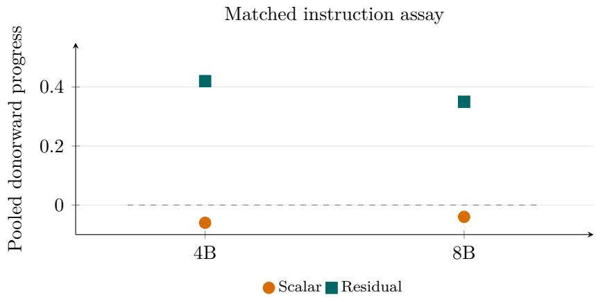  
Figure 6: Scalar and residual replacements on the same ordinary/random pairs, using the same candidate-event readout. The broader residual replacement produces greater donorward progress. This is a matched comparison within the instruction assay; it does not identify a minimal mediator.

## 6 Discussion

Numerical choice makes preference measurable while holding answer validity explicit. The equal-validity design isolates the outcome being studied; it does not establish machinery exclusive to preference. The fixed-dose panel tests directional expectations, and retrospective response profiles estimate much of the probability redistribution. Their selected prediction miss shows why distributional accuracy and winner prediction must be assessed separately: a familiar response can cross a narrow boundary between two plausible answers. The held-out source efect leaves a much larger positive margin and the answer unchanged. That comparison does not isolate starting margin from the accompanying wording, prefix and donor changes.

The unchanged first digit provides a controlled view of how an earlier edit afects later choice. The source hook has been removed when the model processes 1, yet the altered cached state changes the competition between 7 and 5. Full-cache replacement checks state transport; selective window and reader replacements localize contributions. Similar immediate reader writes then receive diferent downstream treatment. Joint late-MLP clamping changes their efect gap while the measured replies remain 17, and reconstructed single-MLP contrasts show that a component’s signed efect depends on the later computational background. These findings explain part of an imposed preference change across positions without establishing exclusive edges or a symbolic representation of the intended complete number.

Natural-context replacements bound the explanatory reach of the steering source. Small average scalar transfer coexists with substantial individual efects and with greater progress from broader-state replacements. The selected activation can influence a choice while carrying little of the measured instruction or history contrast by itself. Other components and context-dependent processing remain possible contributors. The partial pathway, active complement and limited prompt coverage support a conditional account of preference processing.

Relation to prior work. Numerical-sampling studies distinguish independent requests from historyconditioned generation and report failures to match requested laws [3, 4, 22, 28]. Renda et al. [22] already score candidate probabilities and measure valid-domain containment. Base/aligned comparisons address changes in numerical diversity [16, 23], while response-history studies show that marginal bias can change across turns [27]. Tool and programming-language studies motivate the broader question of choice beyond correctness [1, 2]. Our task makes validity explicit while permitting a causal analysis of probability allocation; it does not establish that the numerical mechanism transfers to those applications.

Numerical mechanisms also have direct precedents. Nikankin et al. [26] identify arithmetic neurons with numerical-pattern heuristics. Shao et al. [13] identify late digit-selective FFN neurons and use targeted pruning to change digit bias in numerical reasoning. Levy and Geva [15] provide causal evidence for digit-based representations, and Baeumel et al. [14] intervene on digit-position circuits in arithmetic. Arora et al. [12] demonstrate single-neuron dose-dependent answer changes in their Section 6.2 and analyze arithmetic digit features in Appendix H.1. We connect the induced answer change to selective cache and attention-output interventions after an unchanged emitted token, then test how later MLP responses change the readers’ relative influence. This continuation-level account uses established discovery and steering methods; the combined nomination procedure is not evaluated for superiority.

Steering-strength analysis and self-repair research explain why an edit’s final efect can difer from its immediate write [9, 18, 19]. The head/complement comparison tests a specific instance: late-MLP responses change their relative margin efects while the corresponding generated answers remain fixed under the joint clamp. Activation-patching and natural-value studies further distinguish efective manipulation from explanation of natural behavior [6, 7, 8, 17]. The natural-context swaps bound how much unedited variation the steering source carries. Together, these comparisons support a conditional account of the selected pathway, with limited prompt replication and no claim to identify a minimal faithful circuit.

Scope and limitations. The supporting response studies cover three related Qwen checkpoints; the detailed source/cache/reader pathway uses Qwen3-4B. The prompts are English requests over small intervals. Candidate scores depend on the response interface and admit a nondigit as a terminator; generated-answer checks cover their stated conditions. An earlier six-question serialization comparison illustrates the size of an interface efect (Appendix A.4). The second-digit switch prompt was selected near a 17/15 boundary, and the held-out route test used one eligible prompt with context-specific donor activations. Separate late-MLP readouts were reconstructed after the frozen joint-clamp experiment; they do not supply additional generated-answer observations. Source, cache and head fractions use diferent denominators and cannot be multiplied into a path probability. Head controls leave magnitudematched specificity unresolved, and complementary components remain influential. Edited hybrid states are counterfactual constructions whose natural occurrence remains untested. The corrected nomination verifies the 4B coordinate; the other coordinates retain their historical magnitude-based selection. The full records behind the earlier interval predictor remain unavailable, and the retrospective shared-profile comparison is not a replacement validation.

The fresh screen in Section 4 adds one conditional recurrence but leaves eleven contexts without intervention evidence. Requiring an unedited answer of 17 restricts coverage more than the 7/5 readout itself requires, including by excluding five completed 15 replies. With twelve designed prompts and one greedy baseline each, the counts are descriptive; no population recurrence rate is inferred. Wording, generated preambles and baseline competition may reflect deeper context-dependent processing, but this panel does not isolate their contributions.

The origin of the natural 17 preference and the upstream inputs that recruit the source activation remain open. Establishing an exclusive gate or a minimal circuit would require comparisons beyond this panel. Additional model families, all-number steering, adaptation and distribution-preserving masks address further questions. The present evidence supports a focused account of how an imposed neuron edit changes preference through downstream computation and token competition. Transfer to other tasks with multiple valid answers remains a question for future work.

Conclusion. Numerical choice provides a controlled setting for studying preference among valid alternatives. A selected pre-answer edit changes 17 to 15 across an unchanged first token; selective cache and reader replacements localize part of its influence. Later MLP responses change the relative reader efects even when the measured answers remain fixed. The probability-response and prompt tests distinguish structured influence from a portable answer switch. Together with natural-context transfer, they support a conditional account of how an imposed preference change is carried and processed during inference. The origin and complete circuit of unedited numerical preference remain unresolved.

## References

[1] T. Blankenstein, J. Yu, Z. Li, V. Plachouras, S. Sengupta, P. Torr, Y. Gal, A. Paren and A. Bibi. BiasBusters: Uncovering and Mitigating Tool Selection Bias in Large Language Models. ICLR, 2026. https://arxiv.org/abs/2510.00307v2.

[2] L. Twist, M. Harman, D. Syme, J. Noppen, H. Yannakoudakis, D. Nauck and J. M. Zhang. A Study of LLMs’ Preferences for Libraries and Programming Languages. Findings of ACL, 2026. https://arxiv.or g/abs/2503.17181v4.

[3] J. Coronado-Blázquez. Deterministic or probabilistic? The psychology of LLMs as random number generators. 2025. https://arxiv.org/abs/2502.19965.

[4] X. Gu, S. De, M. Titsias, L. Markeeva, P. Veličković and R. Pascanu. The Illusion of Stochasticity in LLMs. 2026. https://arxiv.org/abs/2604.06543.

[5] Qwen Team. Qwen3 Technical Report. 2025. https://arxiv.org/abs/2505.09388.

[6] J. Vig et al. Causal Mediation Analysis for Interpreting Neural NLP: The Case of Gender Bias. 2020. https://arxiv.org/abs/2004.12265.

[7] F. Zhang and N. Nanda. Towards Best Practices of Activation Patching in Language Models: Metrics and Methods. 2023. https://arxiv.org/abs/2309.16042.

[8] A. Makelov, G. Lange and N. Nanda. Is This the Subspace You Are Looking for? An Interpretability Illusion for Subspace Activation Patching. 2023 arXiv version. https://arxiv.org/abs/2311.17030.

[9] T. McGrath, M. Rahtz, J. Kramar, V. Mikulik and S. Legg. The Hydra Efect: Emergent Self-repair in Language Model Computations. 2023. https://arxiv.org/abs/2307.15771.

[10] H. Liu, T.-L. Li and Y. Wu. Perturbation Probing: A Two-Pass-per-Prompt Diagnostic for FFN Behavioral Circuits in Aligned LLMs. 2026. https://arxiv.org/abs/2604.27401.

[11] H. Liu. Leverage Is Not Reach: A Control-Window Law for Single-Neuron Steering in Language Models. 2026. https://arxiv.org/abs/2606.19831.

[12] A. Arora, Z. Wu, J. Steinhardt and S. Schwettmann. Language Model Circuits Are Sparse in the Neuron Basis. ICML, PMLR 306:3712–3753, 2026. https://proceedings.mlr.press/v306/arora26c.html.

[13] J. Shao, Y. Lu and J. Yang. Benford’s Curse: Tracing Digit Bias to Numerical Hallucination in LLMs. NeurIPS, 2025. https://arxiv.org/abs/2506.01734v2.

[14] T. Baeumel, D. Gurgurov, Y. Al Ghussin, J. van Genabith and S. Ostermann. Modular Arithmetic: Language Models Solve Math Digit by Digit. Findings of IJCNLP-AACL, pp. 1380–1409, 2025. https: //aclanthology.org/2025.findings-ijcnlp.86/.

[15] A. A. Levy and M. Geva. Language Models Encode Numbers Using Digit Representations in Base 10. NAACL, pp. 385–395, 2025. https://aclanthology.org/2025.naacl-short.33/.

[16] S. Ansari. 3, 7, 14, 17, 42: Instruction Tuning Installs and Sharpens Number-Choice Heuristics in Language Models. arXiv preprint, 2026. https://arxiv.org/abs/2610.36178.

[17] T. Che and Y. Li. Does the Model Use the Feature? Separating Steering from Mechanism in LLMs. arXiv preprint, 2026. https://arxiv.org/abs/2610.07270.

[18] M. Taimeskhanov, S. Vaiter and D. Garreau. Towards Understanding Steering Strength. ICML, PMLR 306:118084–118133, 2026. https://proceedings.mlr.press/v306/taimeskhanov26a.html.

[19] C. Rushing and N. Nanda. Explorations of Self-Repair in Language Models. ICML, PMLR 235:42836–42855, 2024. https://proceedings.mlr.press/v235/rushing24a.html.

[20] M. Belitsky, D. J. Kopiczko, M. Dorkenwald, M. J. Mirza, J. R. Glass, C. G. M. Snoek and Y. M. Asano. KV Cache Steering for Controlling Frozen LLMs. arXiv preprint, 2025. https://arxiv.org/abs/2507.0 8799v2.

[21] L. Baroni, K. Ayonrinde, S. Feng and P. Radmard. Language Models Can Coarsely Modulate Output Entropy Under Instruction. AI4GOOD Workshop at ICML, 2026. https://openreview.net/forum?id= SWBs3iyjs2.

[22] A. Renda, A. Hopkins and M. Carbin. Can LLMs Generate Random Numbers? Evaluating LLM Sampling in Controlled Domains. ICML Workshop on Sampling and Optimization in Discrete Space (SODS), 2023. https://people.csail.mit.edu/renda/llm-sampling-paper.

[23] P. West and C. Potts. Base Models Beat Aligned Models at Randomness and Creativity. COLM, 2025. https://arxiv.org/abs/2505.00047.

[24] J. Kramár, T. Lieberum, R. Shah and N. Nanda. AtP\*: An Eficient and Scalable Method for Localizing LLM Behaviour to Components. arXiv preprint, 2024. https://arxiv.org/abs/2403.00745.

[25] K. Wang, A. Variengien, A. Conmy, B. Shlegeris and J. Steinhardt. Interpretability in the Wild: A Circuit for Indirect Object Identification in GPT-2 Small. ICLR, 2023. https://arxiv.org/abs/2211.00593.

[26] Y. Nikankin, A. Reusch, A. Mueller and Y. Belinkov. Arithmetic Without Algorithms: Language Models Solve Math with a Bag of Heuristics. ICLR, 2025. https://proceedings.iclr.cc/paper\_files/paper/ 2025/hash/8c5f30296296d2ae402ebbd09aaa9c12-Abstract-Conference.html.

[27] A. Vo, M. R. Taesiri, D. Kim and A. T. Nguyen. B-score: Detecting Biases in Large Language Models Using Response History. ICML, PMLR 267:61652–61688, 2025. https://proceedings.mlr.press/v267 /vo25a.html.

[28] M. Zhao, Y. Du and M. Wang. Large Language Models Are Bad Dice Players: LLMs Struggle to Generate Random Numbers from Statistical Distributions. ACL, pp. 22942–22959, 2026. https://aclanthology.o rg/2026.acl-long.1051/.

[29] M. Geva, A. Caciularu, K. Wang and Y. Goldberg. Transformer Feed-Forward Layers Build Predictions by Promoting Concepts in the Vocabulary Space. EMNLP, pp. 30–45, 2022. https://aclanthology.org/202 2.emnlp-main.3/.

## A Experimental protocols, cohorts and evidence status

## A.1 Selection and evaluation cohorts

In the 4B nomination procedure, scores are normalized by each branch’s all-layer maximum within each range edit and summed over edits. The union of the top twenty coordinates from each branch is reduced to twenty by the sum of normalized scores. The zeroing screen selects among eligible coordinates by the increase of q(17) at 1–40; layer and neuron index break ties. The protected-range rule and the corrected coordinate’s branch ranks are given in Section 2. Earlier exploratory ablations already showed the selected unit’s 1–40 efect. The frozen screen formalized comparison with alternatives, while later new-wording and interval tests supplied separate evaluation. Selection ranges, new wording and new intervals remain separate evaluation categories.

The earlier zeroing study distinguishes new paraphrases from eight templates previously used in exploration. Eligible reused counts are 8, 7 and 8. Their sampled natural/zeroed 17 fractions are 0.25/0.57, 0.00/0.42 and 0.32/0.75. For free generation on the new cohort, using eight replies per template, the natural/zeroed fractions are 0.04/0.90, 0.00/0.76 and 0.17/0.92. The intervention acts at every position in the free-generation assay. The two cohorts are reported separately. Eligibility required a naturally generated bare or emphasized integer at the answer boundary; the FP32 confirmation accepted a final period or exclamation mark without adding observations. The combined new-plusreused 1–40 cohorts excluded 4, 4 and 0 of 28 prompts, leaving 24, 24 and 28. These totals do not replace the separate new-wording denominators. The documented intervals use a 95% template bootstrap; the original resample count and random seed are not available in the retained historical summaries.

The later eighteen-prompt scalar comparison includes ninety source/control/self recipient cells, with five arms per prompt. These are not ninety independent prompts. The frozen 216-condition panel includes two targets, two matched controls, self and natural-donor arms. All 72 fixed target doses, 72 control doses and 36 self conditions were measured; seventeen of 36 natural patches exceeded the write cap. E6’s range-35 donor was truncated before its answer and automatically mislabeled from a repeated bound. Both donor patches were already skipped. Its recipient fixed-dose measurements remain valid; excluding the entire pair leaves 66 predicted efects and two unresolved among 68 target doses. The primary 17/23 signs were internally registered; the later 17/15 analysis and switch selection were exploratory. The downstream collection consists of separate frozen packets: dose scan 18 conditions, cache window 14, K/V split 12, joint reader 12, reader split 20, head panel 24, held-out validation 30 and late-MLP response blocking 20 (twelve core cells plus eight reference/identity conditions). That response-blocking panel reuses two already studied contexts and is not a new prompt holdout. The subsequent twelve-wording screen is reported separately in Appendix B.3. Repeated baselines and controls across packets are not independent replications.

The scalar instruction bank uses ordinary/equal-probability requests; the matched residual sweep uses ordinary/random requests in ten templates. The history scalar summary includes two value-pair contrasts, whereas the cache assay uses 17 versus 23, fixed leading digits and sixteen directed pairs. These cohorts do not isolate contrast type as the only changed variable.

## A.2 Frozen directional-panel specification

The directional panel used Qwen3-4B in the pinned streamed-FP32 runtime described in Appendix A.6. L29:8172 was the gradient-branch nominee and zeroing-screen winner. L34:2836 was a retained historical candidate whose natural range-35 patch efects had opposing signs across wording groups and nearly canceled when pooled. That observation, together with negative local gradients in all twelve historical contexts, motivated the separate fixed-dose comparison. The target selection used earlier outcomes; neither target was nominated on the six extension responses.

<table><tr><td>Target</td><td>Positive dose</td><td>Control</td><td>Positive control dose</td></tr><tr><td>L29:8172</td><td>1.81884765625</td><td>L29:8369</td><td>1.897157100217</td></tr><tr><td>L34:2836</td><td>1.81298828125</td><td>L34:1261</td><td>2.305332032952</td></tr></table>

Table 7: Fixed target and residual-write-matched control doses. Each site was tested individually with both the displayed positive dose and its exact negative. Control magnitudes are rounded to twelve decimal places; the archive retains full precision.

Each target-dose magnitude is one quarter of the median absolute historical range-35 donor displacement. A seeded draw (Python random.Random(172903)) selected one same-layer control per target, excluding the historical shortlist. The draw did not use control outcomes. Its dose was rescaled once as $\delta _ { c } = \delta _ { t } \| W _ { \mathrm { d o w n } , t } \| _ { 2 } / \| W _ { \mathrm { d o w n } , c } \| _ { 2 }$ to match the residual-write norm. This is a single-coordinate comparison per target, not a population specificity test.

For $m _ { 1 7 , 2 3 } = \log w ( 1 7 ) - \log w ( 2 3 )$ , the frozen prediction was $\Delta m _ { 1 7 , 2 3 } > 0$ for a positive L29 dose and $\Delta m _ { 1 7 , 2 3 } < 0$ for a positive L34 dose, with reversed directions for negative doses. Only efects with magnitude greater than 0.05 nat counted as resolved. The six arms per target/context were self replacement, positive and negative target doses, a natural donor displacement, and positive and negative control doses. The write cap was 10% of the recipient whole-MLP output norm; over-cap cells were skipped without changing their doses. Identity tolerances were $\mathrm { T V } \le 1 0 ^ { - 4 }$ and margin error $\leq 0 . 0 0 1$ nat; dose and scoring-consistency tolerances were 0.001 in activation units and nats, respectively.

<table><tr><td>Context</td><td>Exact recipient prompt</td></tr><tr><td>P1</td><td>Give me a number between 1 and 30</td></tr><tr><td>P2</td><td>Give me a number between 1 and 30.</td></tr><tr><td>P3</td><td>Give me a number from 1 to 30</td></tr><tr><td>P4</td><td>Give me a number from 1 to 30.</td></tr><tr><td>P5</td><td>Pick a number between 1 and 30</td></tr><tr><td>P6</td><td>Pick a number between 1 and 30.</td></tr><tr><td>P7</td><td>Pick a number from 1 to 30</td></tr><tr><td>P8</td><td>Pick a number from 1 to 30.</td></tr><tr><td>P9</td><td>Choose a number between 1 and 30</td></tr><tr><td>P10</td><td>Choose a number between 1 and 30.</td></tr><tr><td>P11</td><td>Choose a number from 1 to 30</td></tr><tr><td>P12</td><td>Choose a number from 1 to 30.</td></tr><tr><td>E1</td><td>Give me a whole number from 1 through 30.</td></tr><tr><td>E2</td><td>Give me one integer in the inclusive interval [1, 30]</td></tr><tr><td>E3</td><td>Pick a whole number from 1 through 30.</td></tr><tr><td>E4</td><td>Pick one integer in the inclusive interval [1, 30],</td></tr><tr><td>E5</td><td>Choose a whole number from 1 through 30.</td></tr><tr><td>E6</td><td>Choose one integer in the inclusive interval [1, 30].</td></tr></table>

Table 8: The eighteen recipient prompts in the fixed-dose panel. P1–P12 retain the historical pre-answer prefixes; E1–E6 use newly generated prefixes. Range-35 donor prompts replace the upper endpoint 30 by 35. Punctuation is part of the prompt.

Each scored distribution was conditioned on its recorded pre-answer prefix. Historical prefixes were retained from the earlier runs; extension prefixes were generated greedily with the recorded non-thinking chat template and a 48-token cap. The directional panel did not require a baseline answer of 17 or a donor answer of 23. The frozen specification, dated 30 October 2026 at 05:08 UTC, contains the exact prompts, token/prefix records for the historical contexts, endpoints and signed predictions. The selection and input record and write calibration specify the control rule and scale. The later 17/15 analysis and switching-case selection were exploratory.

## A.3 Qualification and control summary

<table><tr><td>Test</td><td>Recorded boundary or control</td><td>Consequence for the claim</td></tr><tr><td>Original 4B validation</td><td>Protected 1–20 answer changes from 13 to 5</td><td>No all-criteria validation success; keep substan- tial 1-40 effects separate.</td></tr><tr><td>Original 2507 validation</td><td>q(17) increases by 0.28, 0.03 and 0.00 at 1–35, Extension-interval reach criterion fails. 1-38 and 1-45</td><td></td></tr><tr><td>Original 8B validation</td><td>Some extension baselines already favor 17</td><td>The assumed baseline condition does not apply there.</td></tr><tr><td>First-digit diagnostic</td><td>FP32 pooled share 0.698 versus a 0.70 criterion (bf16: 0.702)</td><td>Threshold fails in FP32; distinct from fitted- predictor accuracy.</td></tr><tr><td>Zeroing specificity</td><td>100 controls matched on down-projection- column norm</td><td>Does not match activation-dependent removed writes.</td></tr><tr><td>Natural instruction swaps</td><td>16 matched control neurons give comparably</td><td>Weak transfer is not unique to the selected</td></tr><tr><td>Fixed-dose source</td><td>small effects</td><td>source. One residual-write-matched coordinate, with an Specificity is assessed against this one control.</td></tr><tr><td>K/V split</td><td>active opposite effect V exceeds K; V/joint does not meet 80% in Keys retain a contribution alongside values.</td><td></td></tr><tr><td>Head decomposition</td><td>both directions</td><td>Complement can also switch the answer; head-0 Neither a unique gate nor a magnitude-matched</td></tr><tr><td>Held-out route</td><td>displacement is only 4.4% of the candidate&#x27;s One eligible new prompt retains signed effects; every answer remains 17</td><td>head-specificity test. Influence transfers under this assay; answer con- trol does not.</td></tr><tr><td>Fresh wording screen</td><td>One eligible context among twelve attempted wordings; eleven untested by intervention</td><td>One conditional recurrence; coverage does not estimate mechanism prevalence.</td></tr><tr><td>Late-MLP blocking</td><td>Joint clamp preserves replies; separate readouts</td><td>Selected prompt: L34-only and L35-only clamps</td></tr><tr><td></td><td>reveal background-dependent effects</td><td>change the complement effect in opposite di- rections. Reused prompt: the conditional L34</td></tr></table>

Table 9: Qualifications belong to their own cohorts and endpoints. The table combines documented historical criteria with later frozen follow-up checks; it does not pool them into a success rate.

## A.4 Response-interface sensitivity

Holding six Qwen3-4B questions at 1–30 and the prefix “The number is ” fixed, an earlier serialization comparison gave mean $q ( 1 7 ) = 0 . 2 8 4$ with chat markup and 0.854 with an added empty thinking-mode block. No reasoning was generated in that block. This interface efect concerns conditional scores, not the training origin of preference or mediation by the selected pathway. Its cohort difers from the own-prefix baseline and continuation study.

## A.5 Continuous arithmetic controls

An earlier study scored 571 exact-answer problems whose correct values lie in 1–30: addition, subtraction, linear equations and inclusive counting. It used FP32 Qwen3-4B and 8B with a bare short-answer interface and zeroed the selected source. The retained historical summary describes scoring at the “final answer position” but does not identify the intervention hook position precisely; we cannot equate it with the later pre-answer-only edit. Table 10 retains its documented continuous measurements. The

original per-item records were not recovered for the present saved-data reanalysis, so these values remain historical aggregate summaries.
<table><tr><td>Zeroing measurement</td><td>Qwen3-4B</td><td>Qwen3-8B</td></tr><tr><td>Mean absolute change in P(correct)</td><td>0.0074</td><td>0.0044</td></tr><tr><td>Mean answer-distribution TV</td><td>0.019</td><td>0.006</td></tr><tr><td>Items with |∆P(correct)| &gt; 0.05</td><td>3.4%</td><td>1.3%</td></tr><tr><td>Largest absolute P(correct) change</td><td>0.62</td><td>0.50</td></tr></table>

Table 10: Historical computed-answer controls. Small average movement coexists with a sensitive tail. The task, prefix and zeroing intervention difer from the selected additive-dose continuation experiment.

The post hoc tail review found many sensitive 4B cases among near-tie equations, with comparable matched-control efects. These observations do not establish preference specificity: confidence, interfaces and interventions difer from the free-choice study. Supplied-result and thinking-trace extensions are omitted because their answer-location rules carried further qualifications.

## A.6 Implementation and runtime coverage

Historical discovery used RMS magnitude aggregation, including for 2507 and 8B. The corrected 4B nomination uses absolute signed-mean PP scores with the original gradient aggregation; a sensitivity analysis changes both branches. Both retain L29:8172 through the gradient shortlist. Only 4B was renominated; the other coordinates retain their original provenance. The pathway study subsequently used the known 4B source.

Historical search used bfloat16 weights with an FP32 output head. Confirmation of the principal validation, prediction and interval-response findings used FP32. The pathway study used unquantized FP32 and streamed CUDA: weights reside in host memory and decoder blocks move through the GPU during computation. All experiments ran on an RTX 2070 Max-Q, as reported by the authors; the pathway archives additionally retain device records. Host memory is therefore part of the execution requirements alongside the 8GB-class GPU.

The earlier FP32 confirmation records revision prefixes 1cfa9a72, cdbee75f and b968826d. Some earlier discovery runs lacked repository revision records. The later 4B route pins revision 1cfa9a72 08912126459214e8b04321603b3df60c, Torch 2.11.0+cu128 and Transformers 5.20.1. These later settings must not be retroactively assigned to every earlier experiment.

A separate FP16 batching qualification failed at TV 0.002458 against a 0.001 threshold. It neither replaces the original FP32 confirmation nor becomes qualified by that confirmation.

## A.7 Study records

Table 11 maps study families to the paper. The repository study index links protocols, source files, runtime records and hashes. Historical aggregate summaries retain their limited coverage; later continuation results were audited against saved distributions, replies and interventions. Unavailable per-prompt records are not reconstructed.

<table><tr><td>Study</td><td>Measurements and records</td><td>Presentation</td></tr><tr><td>Preference and interface</td><td>Conditional baseline scores and fixed-question serialization comparison</td><td>Section 2; App. A.4</td></tr><tr><td></td><td>Discovery and selection PP/gradient scores, causal eligibility and corrected 4B Section 2 ranks</td><td></td></tr><tr><td>Wording and interval</td><td>Historical cohorts, sampling settings and aggregate</td><td>App. C.6</td></tr><tr><td>tests Fixed-dose direction</td><td>predictions Two targets, matched controls and frozen 17/23</td><td>Section 3.2</td></tr><tr><td>Branch and</td><td>predictions Saved-event KL, retrospective predictions and paired</td><td>1 Fig. 1; Apps. C.3–C.4</td></tr><tr><td>continuation Computed-answer</td><td>event masses Historical continuous scores and sensitive tails</td><td>App. A.5</td></tr><tr><td>controls Composed edits</td><td>Earlier state and terminal readout programs in two</td><td>App. B.4</td></tr><tr><td>Contextual response</td><td>contexts Direct/full responses, blocking and distinct cancellation Figure 7</td><td></td></tr><tr><td>Source dose and rivals</td><td>profiles Selected prompt, event scores and completed replies Figure 2</td><td></td></tr><tr><td>Cache and reader</td><td>Source position, window/K/V swaps, reader and head Figures 3, 4</td><td></td></tr><tr><td>localization Reader processing</td><td>controls Immediate-effect accounting; late-MLP clamps and</td><td>Fig. 5; Table 5; App. B.2</td></tr><tr><td>First-digit accounting</td><td>direct norm captures Historical module and unit responses to source zeroing App. C.2</td><td></td></tr><tr><td>Held-out route</td><td>Fixed coordinates, higher dose and recaptured donors</td><td>Table 6</td></tr><tr><td>Fresh wording screen</td><td>Twelve baselines; one eligible reader/MLP recurrence</td><td>App. B.3</td></tr><tr><td>Natural-context</td><td>Paired cohorts, scalar/broader-state swaps and</td><td>Figures 6 and 11</td></tr><tr><td>transfer</td><td>diagnostics</td><td></td></tr><tr><td>Sampling laws</td><td>Uniformity, branch-control bounds and second-draw summaries</td><td>Figure 12</td></tr></table>

Table 11: Named study families connect the main results to their experimental records. Appendix A gives cohort and control boundaries; each study retains its own numerical profile and endpoint.

## B Continuation-pathway validation and downstream processing

## B.1 Retrospective readout accounting

Earlier inferred-divisor accounting. Table 4 uses saved attention and MLP outputs at the first-digit query. Let $x _ { r }$ and $x _ { c }$ denote the final residuals in the recipient and intervened conditions, and let a be the diference between the 7 and 5 unembedding rows multiplied elementwise by the final normalization gain. With RMS divisor $\rho ( x ) = \sqrt { \| x \| ^ { 2 } / d + \epsilon }$ , where d is the residual width and ϵ the normalization constant, the margin is $m = { a ^ { \top } x } / { \rho ( x ) }$ . Its change satisfies

$$
m _ { c } - m _ { r } = \frac { { a } ^ { \top } ( x _ { c } - x _ { r } ) } { \rho _ { r } } - \left( \frac { \rho _ { c } } { \rho _ { r } } - 1 \right) m _ { c } .\tag{6}
$$

The first term can be split over the captured residual increments. The table’s immediate contribution uses only the changed L33 attention output; subsequent attention and MLP updates, together with the second term, contribute to the final movement.

The earlier analysis jointly inferred $1 / \rho _ { r }$ and $\rho _ { c } / \rho _ { r } - 1$ by least squares across ten centered digit log probabilities and captured residual changes; it did not record each final divisor. Maximum marginclosure errors were $8 . 5 2 \times 1 0 ^ { - 6 }$ nat for principal contrasts and $1 . 1 3 \times 1 0 ^ { - 5 }$ in the wider head panel.

Fitting these divisors to the same outputs makes closure an internal accounting check, not independent causal validation or an isolated normalization intervention.

Direct-capture validation and response blocking. Direct final-residual and RMSNorm captures in the response-blocking test also clarify the readout. In the selected prompt, normal head transfer contributes +0.152607 nat through the numerator term at the recipient divisor and +0.000030 nat through the divisor adjustment. The complement contributes +0.033741 and −0.000002 nat, respectively. Using the unrounded FP64 terms, the head-minus-complement gap is +0.118867 nat from the numerator term plus +0.000032 nat from the divisor adjustment, totaling +0.118899 nat. The final scalar divisor adjustment therefore does not explain the large separation in this comparison. Earlier normalization can still afect the residual. These terms are descriptive accounting, not separate interventions on RMSNorm.

The subsequent response-blocking test in Figure 5 directly captured the final residual, normalization gain, epsilon, normalized hidden state and full next-token distribution. FP32 reconstruction reproduced the captured normalized output bitwise, and readout accounting closed within $1 . 1 1 \times 1 0 ^ { - 5 }$ nat. Nine archived endpoint comparisons matched exactly in full next-token distribution, margin and continued token IDs; six identity and six clamp-scope checks passed. All twenty conditions and 186 journaled forwards completed, with no missing or truncated replies. The joint output clamp tests late-MLP responses causally; the numerator/divisor decomposition remains descriptive.

## B.2 Separate late-MLP counterfactual readouts

The final decoder MLP is followed by RMSNorm and the output head, with no further attention or MLP block. Let xN be the normal final residual, $x J$ the residual with both MLP34 and MLP35 outputs clamped, and $M _ { 3 5 , r }$ the no-reader recipient’s MLP35 output. Let $M _ { 3 5 , N }$ be the normal output and $M _ { 3 5 , J } ^ { \mathrm { p r e } }$ the output captured before replacement in the joint-clamp run. The single-arm residuals can then be reconstructed as

$$
x _ { 3 5 } = x _ { N } - M _ { 3 5 , N } + M _ { 3 5 , r } , \qquad x _ { 3 4 } = x _ { J } - M _ { 3 5 , r } + M _ { 3 5 , J } ^ { \mathrm { p r e } } .
$$

The second expression uses an MLP35 output already computed with L34 clamped. For each reconstructed residual, we recompute its RMS divisor using the captured epsilon and apply the captured normalization gain and 7-minus-5 readout. This recovers the corresponding mathematical readout up to saved floating-point roundof, without a new transformer forward pass or continuation.

Independent CPU reconstruction checked twelve input-tensor hashes and the capture/replacement order. Normal and joint-clamp margins matched measured logits within $1 . 1 1 \times 1 0 ^ { - 5 }$ nat; FP32 arithmetic changed the FP64 single-arm results by at most $5 . 7 \times 1 0 ^ { - 7 }$ nat, preserving the negative final $7 / 5$ margin for the complement reader in the selected prompt when only L35 is clamped. These are arithmetic checks, not uncertainty intervals. The measured joint-clamp margin +0.000870 is below the 0.001-nat replay tolerance, but that tolerance is not an error bar: endpoint replays required identical reply tokens and matched exactly.

At the recipient normalization divisor, the selected head’s L34 and L35 MLP changes contribute +0.02586 and +0.08375 nat; the complement contributes −0.01325 and +0.02375. These diferences account algebraically for 83.4% of the normal head/complement gap, not an isolated mediation fraction. Holding L34 also changes subsequent processing: the complement’s L35 MLP contribution becomes +0.03127, and its L35 attention contribution changes from −0.00009 to +0.00752 nat.

Let $E _ { N } , E _ { 3 4 } , E _ { 3 5 } , E _ { J }$ denote incremental reader efects under normal, L34-held, L35-held and jointheld processing. Allowing L34 to respond has efects $E _ { N } - E _ { 3 4 }$ when L35 is free and $E _ { 3 5 } - E _ { J }$ when L35 is held. Their interaction contrast is

$$
I = E _ { N } - E _ { 3 4 } - E _ { 3 5 } + E _ { J } .
$$

<table><tr><td>Context</td><td>Reader</td><td>Normal</td><td>L34 held</td><td>L35 held</td><td>Both held</td></tr><tr><td>Selected</td><td>Head 26</td><td>+0.152637</td><td>+0.088187</td><td>+0.068869</td><td>+0.033326</td></tr><tr><td>Selected</td><td>Complement</td><td>+0.033738</td><td>+0.062106</td><td>+0.010002</td><td>+0.030854</td></tr><tr><td>Reused</td><td>Head 26</td><td>+0.101275</td><td>+0.072788</td><td>+0.061985</td><td>+0.019258</td></tr><tr><td>Reused</td><td>Complement</td><td>+0.056680</td><td>+0.046034</td><td>+0.017404</td><td>+0.029239</td></tr></table>

Table 12: All four reader/context comparisons under common FP64 reconstruction. Entries are incremental $7 / 5$ efects in nats relative to the matching no-reader background. The two contexts were reused; separate-clamp columns have no generated replies. Opposing single-clamp changes relative to normal occur only for the selected complement.

<table><tr><td>Context</td><td>Reader</td><td>L35 free</td><td>L35 held</td><td>Interaction</td></tr><tr><td>Selected</td><td>Head 26</td><td>+0.064449</td><td>+0.035542</td><td>+0.028907</td></tr><tr><td>Selected</td><td>Complement</td><td>-0.028367</td><td>-0.020852</td><td>-0.007515</td></tr><tr><td>Reused</td><td>Head 26</td><td>+0.028487</td><td>+0.042727</td><td>-0.014240</td></tr><tr><td>Reused</td><td>Complement</td><td>+0.010646</td><td>-0.011835</td><td>+0.022482</td></tr></table>

Table 13: Conditional L34 efects derived from the same reconstructed readouts as Table 12, in nats. The reused complement changes sign with the L35 background. These are defined output-clamp contrasts, not additive natural-mediation fractions or generated replies.

The reconstructed head-minus-complement gaps for normal, L34-only, L35-only and joint processing are 0.118899, 0.026082, 0.058867 and 0.002473 nat in the selected prompt, versus 0.044595, 0.026754, 0.044581 and −0.009981 in the reused wording. Holding L35 barely changes the latter gap because both efects decrease similarly. An unchanged gap need not imply an inactive component. These values use common FP64 reconstruction; the main figure uses measured FP32 margins.

## B.3 Fresh wording screen for reader/MLP recurrence

The fresh panel fixed L29:8172, dose 1.81884765625, L33 head 26 and its 31-head complement before collecting the twelve wordings in Table 14. It used the same pinned Qwen3-4B streamed-FP32 runtime. Each wording received one greedy baseline with thinking disabled and an 80-token cap. The frozen parser had to identify a completed answer of 17, pass its answer-format check and locate a token-aligned numerical boundary. The source-of and source-on states then both had to select first digit 1 naturally, and the source write had to remain within 10% of the recipient whole-MLP output norm. Failed contexts were retained without replacement, retuning or intervention collection.

For the eligible context, donor reader outputs were recaptured from the edited state with source-of values inserted at the pre-answer cache position in L32–33. Keys and other cache entries retained recipient values. The reader replacement acted at the query processing the common digit 1; the joint clamp held L34–35 MLP outputs at the matching no-reader recipient values. These hooks were removed before subsequent generation. Each reader efect was measured against the no-reader condition under the same clamp setting. The six core conditions crossed no reader, head 26 and complement with normal or joint-clamped processing. Four reference/identity conditions completed the ten-condition set.

<table><tr><td>Context</td><td>Exact prompt</td><td>Choice</td><td>Included</td></tr><tr><td>F1</td><td>Please name one integer from the inclusive range of 1 to 30.</td><td>15</td><td>No</td></tr><tr><td>F2</td><td>Choose a single whole number in the closed interval from 1 to 30.</td><td>15</td><td>No</td></tr><tr><td>F3</td><td>I need one integer: choose any value from 1 through 30, endpoints included.</td><td>23</td><td>No</td></tr><tr><td>F4</td><td>Which integer would you choose from 1 to 30, with both endpoints allowed?</td><td>Capped</td><td>No</td></tr><tr><td>F5</td><td>Provide one whole number that is at least 1 and at most 30.</td><td>25</td><td>No</td></tr><tr><td>F6</td><td>Select an integer from the set of whole numbers starting at 1 and ending at Capped 30.</td><td></td><td>No</td></tr><tr><td>F7</td><td>For this choice, give one integer in the range 1 through 30 inclusive.</td><td>15</td><td>No</td></tr><tr><td>F8</td><td>You may choose any integer from 1 to 30 inclusive. Which one do you choose?</td><td>Capped</td><td>No</td></tr><tr><td>F9</td><td>Name a single integer satisfying  $1 < = \mathrm { { n } } < = 3 0 .$ </td><td>5</td><td>No</td></tr><tr><td>F10</td><td>Make one numerical choice: an integer between 1 and 30, including the endpoints.</td><td>17</td><td>Yes</td></tr><tr><td>F11</td><td>From the integers 1 through 30, choose one value for your answer.</td><td>15</td><td>No</td></tr><tr><td>F12</td><td>What is your choice of one whole number in the inclusive interval 1 to 30?</td><td>15</td><td>No</td></tr></table>

Table 14: All twelve fresh screening outcomes. “Capped” means no completed numerical choice within 80 tokens. All nine completed choices passed the format and alignment checks; eight were excluded because they were not 17. F10 passed the subsequent common-digit and write-cap checks. No reader/MLP intervention was collected for the other eleven contexts.
<table><tr><td>Incremental 7/5 effect</td><td>Normal</td><td>Joint L34–35 clamp</td></tr><tr><td>Head 26</td><td>+0.168781</td><td>+0.029083</td></tr><tr><td>Complement</td><td>+0.021667</td><td>+0.018753</td></tr><tr><td>Head minus complement</td><td>+0.147114</td><td>+0.010330</td></tr></table>

Table 15: Fresh-context efects in F10, in nats. Its source-of and source-on $7 / 5$ margins are +5.852978 and +5.437187. The frozen primary contrast subtracts the clamped head/complement gap from the normal gap, giving +0.136784 nat. The 93.0% reduction describes this gap, not a fraction of natural preference mediated by the MLPs. All ten measured sufixes were $^ { 1 7 * * } \cdot ,$ completing the retained prefix I choose \*\*.

Two historical context/dose combinations were replayed: the selected prompt, “Pick one integer in the inclusive interval [1, 30].”, at dose 1.81884765625, and the reused holdout, “Select a single integer from 1 through 30, inclusive.”, at dose 1.9097900390625 (1.05 times base). Each combination contributed ten conditions. These twenty anchor conditions are separate from the ten fresh conditions. All thirty measured conditions passed the numerical and identity checks; 110 potential fresh conditions were uncollected because of the eleven exclusions, not failed dispatches. The three capped baselines were reviewed as having no completed choice, including two in which the automatic parser extracted a numeral from explanatory text. The completion criterion had already excluded these responses. Automatic and reviewed labels remain separate in the results and audit; the frozen protocol retains all gates and condition definitions. The analysis reports this designed bank descriptively and makes no population recurrence-rate inference.

## B.4 Composing earlier-state and terminal-output edits

A separate Qwen3-4B study illustrates why two edits that select the same first digit need not select the same complete number. At the pre-answer position, an earlier L28:5371 edit changes later sourceposition caches, while a terminal L35:787 edit changes the current readout after those caches are

computed. A sufix edit at L35:4145 acts when the first generated digit is processed. Table 16 uses reviewed responses from the two contexts, out of four requested, that met the format qualification; it combines historical anchor records with later measurements.
<table><tr><td>Program</td><td>Anchor</td><td>One new eligible wording</td></tr><tr><td>No edit</td><td>17</td><td>17</td></tr><tr><td>Terminal root edit, L35:787</td><td>24</td><td>23</td></tr><tr><td>Earlier state edit, L28:5371</td><td>27</td><td>27</td></tr><tr><td>Terminal suffix edit, L35:4145</td><td>14</td><td>14</td></tr><tr><td>Earlier state plus terminal suffix edits</td><td>24</td><td>24</td></tr></table>

Table 16: A bounded illustration of composing interventions at diferent positions. Both root interventions select 2, but their continuations difer; the sufix intervention then changes the earlier edit’s 27 to 24. These are completed, reviewed choices rather than predictions from a fixed-prefix diagnostic.

The additive doses are −94.687, +484.836 and $+ 4 6 1 . 5 7 6$ for the earlier, root and sufix edits. The earlier write is 2.15–2.29 times the whole MLP-output norm, so sparse coordinate count does not imply a small perturbation. The two excluded contexts provide no intervention evidence. Labels come from an unblinded review of saved replies, and no independent adjudication was added. The example establishes composition under these conditions; it does not test natural recruitment, pair synergy or a link between these coordinates and the L29/head-26 pathway.

## C Distribution responses and contextual processing

## C.1 Context-dependent downstream responses

## C.1.1 Response and blocking measures

For a common activation $z ^ { * }$ , context c and symmetric step h, write $\ell _ { c } ( z )$ for the nine centered log probabilities of leading digits 1 through 9. The recorded response is

$$
K _ { c } = \frac { \ell _ { c } ( z ^ { * } - h ) - \ell _ { c } ( z ^ { * } + h ) } { 2 h } .
$$

Its positive direction corresponds to decreasing the activation. The principal interval confirmation used $h = 5 ;$ the distinct post hoc 21–40 cancellation check used $h = 2$ with a changed bank, prefix and operating point. This convention must be retained when comparing response signs.

The interval-blocking measurement compares directions after unit normalization, $\widetilde { K } = K / \| K \|$ . For a blocked group X and a context pair, it reports

$$
R _ { X } = 1 - \frac { | | \widetilde { K } _ { X } ( c _ { 2 } ) - \widetilde { K } _ { X } ( c _ { 1 } ) | | } { | | \widetilde { K } ( c _ { 2 } ) - \widetilde { K } ( c _ { 1 } ) | | } .
$$

The $0 . 6 9 / 0 . 6 0 / 0 . 8 5$ values reported below average this measure across the registered contrasts. They do not denote fractions of answer probability or mediated behavior.

The instruction comparison retains response magnitude. For ordinary and instructed responses $K _ { O } , K _ { s } .$ , its normalized diference and blocking efect are

$$
\eta _ { K } = \left[ \frac { \sum \lVert K _ { s } - K _ { O } \rVert ^ { 2 } } { \sum ( \lVert K _ { s } \rVert ^ { 2 } + \lVert K _ { O } \rVert ^ { 2 } ) / 2 } \right] ^ { 1 / 2 } , \qquad R _ { G } = 1 - \frac { \sum \lVert \Delta K _ { G } \rVert ^ { 2 } } { \sum \lVert \Delta K \rVert ^ { 2 } } ,
$$

where $\Delta K = K _ { s } - K _ { O }$ and G is the blocked group. Sums run over the matched instruction comparisons. These are the measures behind the 0.65/0.71/0.53 and 0.96/0.97/0.95 summaries. All response ratios require nonzero denominators. The documented definitions do not recover unavailable per-condition observations or the full nine-coeficient fit for the earlier predictor.

## C.1.2 The same write produces diferent responses

A neuron’s weight vector is fixed across prompts, but subsequent computation can transform its write diferently, as self-repair studies show [9, 19]. Across seven intervals, mean pairwise cosines of direct write/readout responses were 0.996, 0.993 and 0.998, versus 0.66, 0.53 and 0.78 for full responses. The lower alignment indicates contextual changes in response direction. Responses use the symmetric perturbations and sign convention defined above.

At 21–40, leading 3 remains valid, yet the historical full response norm was about 0.02 versus 0.07 for the direct response. A separate post hoc FP32 check gave 0.019 versus 0.058 (Figure 7A). The latter changed the bank, prefix, perturbation step and operating point; both configurations show cancellation without constituting a matched replication.

## C.1.3 Later MLP computation contributes to contextual variation

We then held later MLP outputs at their recipient baseline to identify which computation contributes to the contextual diference. This removed, on average, 0.69, 0.60 and 0.85 of the response diference over three registered interval contrasts. These fractions describe response vectors; natural behavior mediation requires its own endpoint. The comparison lacked a matched source-neuron blocking panel, leaving source-specificity unresolved.

Instruction contrasts tested the same distinction at a common source activation. Instructiondependent entropy steering provides a related distributional-control setting [21]; here we measure how the recipient context changes the response to a fixed scalar edit. Ordinary and equal-probability requests yielded normalized response diferences of 0.65, 0.71 and 0.53. Later-MLP blocking reduced their summed squared diference by 0.96, 0.97 and 0.95. The recipient context thus changed how the activation afected the output. The amount of natural distribution change carried by that activation is tested separately in Section 5.

Response size and contextual variation also depended diferently on the tested components. Ten nominated late readout neurons supplied size fractions of 0.42, 0.31 and 0.18, while blocking them removed only 0.08, 0.02 and 0.20 of the contextual response diference. The broader later-MLP intervention removed substantially more (Figure 7B). In the 4B instruction comparison, the best scalar gain was 0.74 and a reported 38% of the response change concerned its shape. These response measurements show why a large immediate contribution alone gives an incomplete account of contextual processing.

These comparisons show contextual processing of the edit. Appendix C.2 resolves some later writes after source zeroing at 1–40 into unit contributions, without isolated mediation tests. Section 4 follows a smaller 1–30 edit into a second-digit change. Sharing a source does not identify a common downstream circuit across these contexts, doses and endpoints.

## C.2 First-digit response accounting

An earlier streamed-FP32 capture study used the pinned Qwen3-4B checkpoint on two historical punctuation forms of the 1–40 request. Zeroing L29:8172 only at the recorded first-numeral decision changed both complete replies from 23 to 17. The following saved accounting adds no validation cohort.

Projecting captured residual increments onto the gain-weighted 2-minus-1 readout before final normalization separates the source’s removed write from later responses. In the first wording, the numerator changed by −122.13. The source write accounts for 6.79% and the changed MLP32–35 writes for 87.36% of that signed change. The second wording gives 6.64% and 86.58%, respectively (Figure 8A). These are readout-accounting shares, with small closure residuals, rather than isolated efects of intervening on each later module.

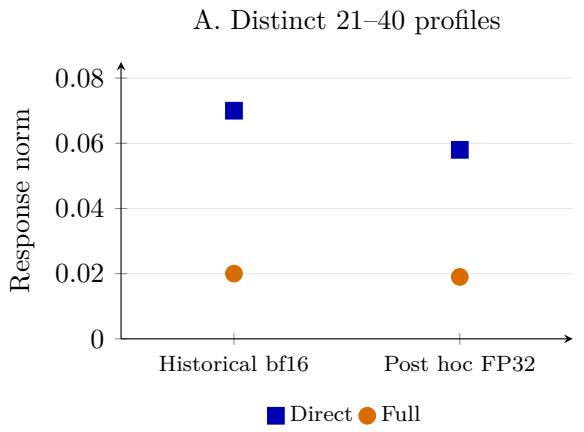

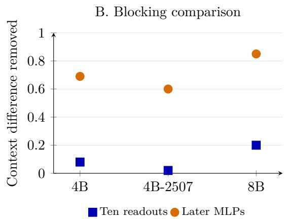  
Figure 7: Downstream-response measurements. A: attenuation of a direct response at 21–40 in two distinct configurations; the FP32 check uses a diferent bank, prefix, dose and operating point. B: contextual response diference removed by blocking ten nominated readouts or the broader later MLPs, across the three checkpoints. The groups difer in size and coverage; this is not a matched-specificity test. No per-prompt observations or uncertainty are reconstructed from aggregate summaries.

Saved unit activations at L34 and L35 permit a finer decomposition. The six largest absolute contributions in each layer, selected retrospectively, sum to 78.45% and 85.18% of the corresponding net layer writes in the first wording. The second wording gives 78.56% and 85.33% (Figure 8B). For example, L35:2165 changes from −25.13 to −1.24, while L35:672 changes from −7.27 to −21.12. Their contributions are the readout coupling multiplied by the activation change. This identifies responding units and their signed direct writes, without testing which unit recruits another or whether the selected set mediates the layer’s efect. Signed contributions can cancel, so these fractions are not information shares or circuit-size estimates.

The intervention difers from the selected 17-to-15 dose study in Section 4, which changes continuation competition after the common first digit. The two studies share a source coordinate but do not establish two exclusive routes or a common downstream neuron circuit.

## C.3 Exact accounting of the saved candidate distributions

Across eighteen positive source edits at 1–30, $C _ { a }$ accounts for 59.1% of the summed KL change, with per-context shares from 0.46% to 99.9998%. These shares depend jointly on the response and the probability distribution on which it acts. A substantial log-odds shift can contribute little KL when it afects an almost empty branch. The matched-write control has a higher within-branch share, 94.1%, but much smaller summed movement (0.00269 versus 0.04918 nat). Shares alone therefore identify neither a diferent computational response nor source specificity. We applied Equation 3 to all eighteen fixed-dose recipient baselines and their ninety self/source/control conditions, and to all eighteen dose conditions with arm-specific zero-dose baselines. Every vector contains the thirty candidates, log weights, normalized scores and candidate-event mass. The continuation component includes competition between stopping after one digit and emitting further digits; it is not exclusively a second-digit measure. The earlier twelve templates and six later extensions remain separate cohorts.

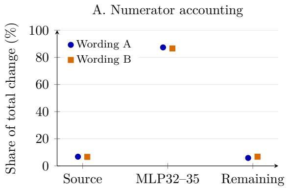

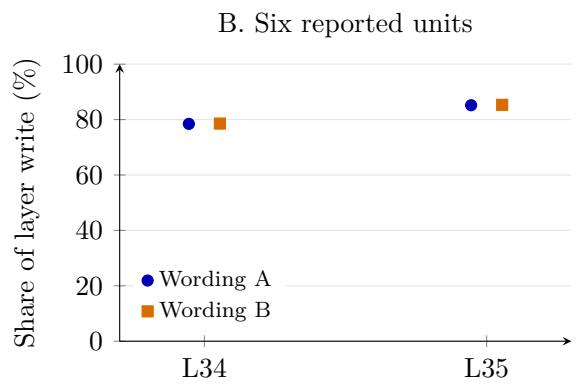  
Figure 8: Two historical first-digit examples after zeroing the selected source at 1–40. A: signed numerator contributions divided by the total numerator change. “Remaining” includes the other recorded contributions. B: the six largest absolute unit contributions, summed with their signs and divided by the corresponding net layer contribution. The panels use diferent denominators; markers are ofset horizontally for visibility. Both recorded replies change from 23 to 17; neither example is a new held-out replication. The accounting does not test serial causal links between units.

No record was dropped or replaced, and the present reanalysis does not make these deterministic, dependent conditions independent replications.
<table><tr><td>Fixed-dose arm (18 contexts each)</td><td> $\sum B _ { a }$ </td><td> $\sum C _ { a }$ </td><td> $\sum C _ { a } / \sum ( B _ { a } + C _ { a } )$ </td><td>Eligible</td></tr><tr><td>Positive source</td><td>0.0200922</td><td>0.0290863</td><td>59.1%</td><td>18</td></tr><tr><td>Negative source</td><td>0.0070568</td><td>0.0286929</td><td>80.3%</td><td>18</td></tr><tr><td>Positive control</td><td>0.0001596</td><td>0.0025334</td><td>94.1%</td><td>15</td></tr><tr><td>Negative control</td><td>0.0001890</td><td>0.0024630</td><td>92.9%</td><td>15</td></tr><tr><td>Self replacement</td><td> $1 . 6 8 \times 1 0 ^ { - 1 2 }$ </td><td> $6 . 9 5 \times 1 0 ^ { - 1 1 }$ </td><td></td><td>0</td></tr></table>

Table 17: Ofline KL accounting in nats, with all eighteen contexts included in each sum. “Eligible” counts cells with total KL at least $1 0 ^ { - 8 }$ nat, the prespecified numerical reporting threshold for per-cell fractions in this reanalysis. Absolute components are retained below it. The ratios describe these archived conditions rather than a population or source-specific property.

For the positive source, the twelve earlier templates contribute 0.003167 nat in total, 99.6% within branches; the six extensions contribute 0.046012 nat, 56.4% within branches. Figure 9 shows the large diferences in absolute movement that these aggregate shares conceal. The two largest source movements contribute 86.4% of the total. In the first extension, branch movement contributes 0.019967 of 0.020601 nat while mode 23 is preserved. In the selected fourth extension, continuation movement contributes 0.02190077 of 0.02190080 nat while the candidate mode changes from 17 to 15. The dose study separately verifies the generated answer change.

All eight nonzero target doses in the selected prompt have continuation shares above 99.9997%; all eight control doses exceed 99.99999% with smaller movements. At unit dose their total KL values are 0.021901 and 0.002049 nat. The control opposes the source’s 17/15 movement and never changes the generated answer. A high continuation share locates output redistribution without identifying a carrier or source specificity.

We reconstructed normalized scores from saved log weights and independently checked the KL expansion and the branch-oracle residual. Maximum absolute closure errors were below $8 \times 1 0 ^ { - 1 7 }$ nat; direct KL calculations agreed within $2 . 3 \times 1 0 ^ { - 1 6 }$ nat. Self replacements had maximum KL $4 . 3 8 \times 1 0 ^ { - 1 1 }$ nat and TV $4 . 5 9 \times 1 0 ^ { - 6 }$ ; the ratio threshold avoids interpreting fractions at that scale. Candidate-event mass ranged from 0.754205 to 1.000000160 across the 126 input vectors. The small numerical excesses above one are retained, not clipped. Paired mass comparisons identify one material source change: E1 falls from 0.835538 to 0.754205, a decrease of 8.13 percentage points, while its matched control increases mass by 0.005775. The other seventeen source changes are below 10−5 in absolute value; the selected E4 changes by about $- 8 . 8 \times 1 0 ^ { - 8 }$ . Excluded event mass is not necessarily invalid-answer mass. These masses refer to canonical digits followed by any nondigit; saved scores cannot be converted to probabilities of an exact numeral followed by an end-of-sequence (EOS) token without additional sufix probabilities.

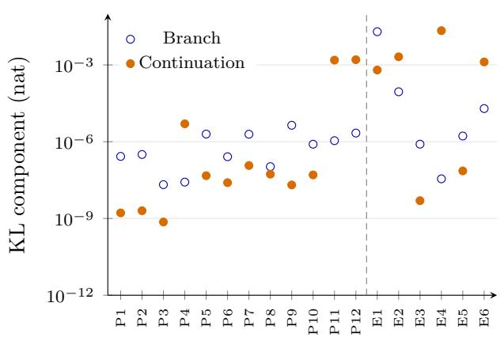

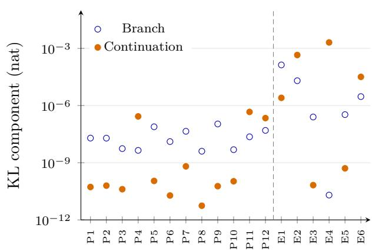  
Figure 9: Absolute branch and continuation KL components for the eighteen positive-dose L29:8172 interventions and their L29:8369 matched controls, on a common logarithmic scale. P1–P12 are the earlier templates; E1–E6 are later extensions. E1 and E2 initially favor 23 and 15; the other candidate modes are 17. E4 is the subsequently selected switching prompt. Source and matched-write control use separate panels. Small components remain visible instead of being converted into large-looking percentages. No prompt-level uncertainty is estimated.

The selected continuation crossing. At the base dose, exact candidate accounting gives $B _ { a } =$ $3 . 5 4 \times 1 0 ^ { - 8 }$ and $C _ { a } = 0 . 0 2 1 9 0 0 8$ nat. Almost all measured KL is within branches, concentrated on 17 and 15. Yet leading-2 versus leading-1 log-odds change by −0.609 nat, larger in magnitude than the −0.420 nat change between 17 and 15. Branch 2 initially holds only $2 . 8 4 \times 1 0 ^ { - 7 }$ candidate mass, while 17 and 15 both have substantial probability. The tiny branch KL therefore does not mean a negligible relative branch response. The unchanged first digit and measured second-digit change, rather than the KL share alone, motivate the cache study.

## C.4 Response profiles, prediction losses and controls

For prompt j, define $t _ { j } ( n ) = \log q _ { a , j } ( n ) - \log q _ { 0 , j } ( n )$ . Then $q _ { a , j } ( n ) \propto q _ { 0 , j } ( n ) \exp { t _ { j } ( n ) }$ , with both baseline and response allowed to vary. Figure 1A centers each profile over thirty candidates and displays the all-eighteen median. The retrospective prediction instead adds the coordinate-wise median from the other seventeen profiles to the recipient’s baseline log probabilities and renormalizes. It is not a frozen predictor test.

Sixteen profiles have Pearson correlation at least 0.96 with their leave-one-out median, including the selected E4 (0.979 over thirty numbers; 0.956 within 10–19). E1 and E2 give 0.895 and 0.819 over all candidates. Centering each profile before the nonlinear median retains the same sixteen above 0.96. These checks do not identify a rank-one mechanism or a common internal route; unlikely candidates receive the same weight as likely ones. The leave-one-out continuation-share rank correlation is 0.988, with all eighteen comparisons on the observed side of 50%. For E4, however, the estimate retains 17, leaves a +0.109570 margin, and yields only 44.3% of observed total KL. The observed 17/15 change is −0.419716 nat versus the panel median −0.281745.

For a minor branch of baseline mass p and finite log-odds change D, the leading small-p KL term is $p [ D e ^ { D } - e ^ { D } + 1 ]$ . This approximation explains how a substantial relative shift can contribute little KL: the selected branch-2 shift acts on mass $2 . 8 4 \times 1 0 ^ { - 7 }$ , whereas 17 and 15 both carry substantial mass. Branch log-odds responses can themselves depend on within-branch mixtures; they are not baseline-independent coeficients.

Oracle ceiling on branch-only error reduction. If $\widehat { q } _ { a } ( n ) = \widehat { p } _ { a } ( d ( n ) ) r _ { 0 } ( n \mid d ( n ) )$ preserves the baseline conditionals, then

$$
\mathrm { K L } ( q _ { a } \| \widehat { q } _ { a } ) = C _ { a } + \mathrm { K L } ( p _ { a } \| \widehat { p } _ { a } ) , \qquad R _ { \mathrm { p r e d } } = \frac { \sum _ { a } B _ { a } - \sum _ { a } \mathrm { K L } ( p _ { a } \| \widehat { p } _ { a } ) } { \sum _ { a } ( B _ { a } + C _ { a } ) } .
$$

The branch share of summed KL is thus an oracle ceiling for this score on the same evaluation set. The eighteen-prompt archive cannot supply that ceiling for the missing 21-interval evaluation. For the historical predictor in Appendix C.6, Equation 7, adding one constant to every $\beta _ { d }$ leaves the normalized predictor unchanged; a recovered fit should specify its additive-gauge convention. Neither the complete fit nor that convention is reconstructed here.

Prediction losses and matched controls. In the selected prompt, the raw-median estimate moves 44.3% as far from baseline in KL; that movement ratio is not prediction-error reduction.

Within 10–19, source/control median leave-one-out correlations are 0.970/0.959, while their withinprompt alignment is opposing (median −0.874). The source’s median centered amplitude is 7.36 times larger. Across all thirty candidates, correlations are 0.983/0.779, and the source has a larger leading-2/leading-1 shift. Table 19 gives all four sites. Shared output shape alone establishes neither source specificity nor a common internal route.

Appendix C.5 separately reports the cross-interval sign reversal and concentration of pooled KL, with dose and prefix changes retained. The shared shapes above concern wordings at one interval and dose; Appendix C.1 examines downstream response across diferent interval and instruction settings. For each leave-one-out estimate, let $D _ { j } = \mathrm { K L } ( q _ { a , j } \Vert q _ { 0 , j } )$ and $L _ { j } = \mathrm { K L } ( q _ { a , j } \Vert \widehat { q } _ { a , j } )$ . The pooled error reduction is $\begin{array} { r } { 1 - \sum _ { j } L _ { j } / \sum _ { j } D _ { j } ; } \end{array}$ ; prompt-balanced summaries use the individual reductions $1 - L _ { j } / D _ { j }$ . Table 18 retains all eighteen losses and total variation errors. The raw-profile median gives pooled reduction 0.89032, mean per-prompt reduction 0.92223 and median 0.96254. Every $D _ { j }$ exceeds $2 . 1 7 \times 1 0 ^ { - 8 }$ nat, although tiny absolute movements limit the interpretation of some relative improvements. Sixty-digit arithmetic agreed with the computed KL values within $4 . 1 7 \times 1 0 ^ { - 1 7 }$ nat.

Pooled reductions are 0.85570 on the twelve historical prompts and 0.89270 on the six extensions; mean TV errors are 0.000357 and 0.009064. The all-context mean TV is 0.003260, whereas its median is $1 . 8 7 \times 1 0 ^ { - 6 }$ . Thus a small typical absolute error does not characterize the selected prompt, whose TV error is 0.034864. Its prediction loss is 0.002434055 nat versus baseline loss 0.021900801 nat, giving 88.886% reduction despite retaining the wrong winner.

Centering each thirty-number response before the coordinate-wise median changes the pooled reduction to 0.87744. The selected margin becomes +0.122669 nat and its reduction 86.703%; it still retains 17. The nonlinear median therefore need not preserve the prediction under diferent centering conventions. A separate descriptive split estimates the profile from only the twelve historical templates and evaluates the six extensions: pooled reductions are 0.89272 without centering and 0.88103 with it. These analyses were chosen after the outputs were available and are not prospective validation.

<table><tr><td>Context</td><td>Baseline loss  $D _ { j }$ </td><td>Prediction loss  $L _ { j }$ </td><td>Reduction</td><td>TV error</td></tr><tr><td>P1</td><td> $2 . 6 8 \times 1 0 ^ { - 7 }$ </td><td> $4 . 4 3 \times 1 0 ^ { - 9 }$ </td><td>98.35%</td><td> $6 . 6 9 \times 1 0 ^ { - 8 }$ </td></tr><tr><td>P2</td><td> $3 . 1 9 \times 1 0 ^ { - 7 }$ </td><td> $1 . 7 1 \times 1 0 ^ { - 9 }$ </td><td>99.46%</td><td> $4 . 0 1 \times 1 0 ^ { - 8 }$ </td></tr><tr><td>P3</td><td> $2 . 1 7 \times 1 0 ^ { - 8 }$ </td><td> $2 . 1 9 \times 1 0 ^ { - 9 }$ </td><td>89.93%</td><td> $5 . 0 7 \times 1 0 ^ { - 8 }$ </td></tr><tr><td>P4</td><td> $5 . 0 4 \times 1 0 ^ { - 6 }$ </td><td> $1 . 3 5 \times 1 0 ^ { - 6 }$ </td><td>73.20%</td><td> $6 . 3 7 \times 1 0 ^ { - 6 }$ </td></tr><tr><td>P5</td><td> $2 . 0 4 \times 1 0 ^ { - 6 }$ </td><td> $2 \times 1 0 ^ { - 8 }$ </td><td>99.02%</td><td> $6 . 7 9 \times 1 0 ^ { - 7 }$ </td></tr><tr><td>P6</td><td> $2 . 8 4 \times 1 0 ^ { - 7 }$ </td><td> $5 . 4 3 \times 1 0 ^ { - 9 }$ </td><td>98.09%</td><td> $1 . 3 9 \times 1 0 ^ { - 7 }$ </td></tr><tr><td>P7</td><td> $2 . 0 8 \times 1 0 ^ { - 6 }$ </td><td> $1 . 7 5 \times 1 0 ^ { - 9 }$ </td><td>99.92%</td><td> $1 . 8 5 \times 1 0 ^ { - 7 }$ </td></tr><tr><td>P8</td><td> $1 . 6 \times 1 0 ^ { - 7 }$ </td><td> $5 . 8 9 \times 1 0 ^ { - 9 }$ </td><td>96.32%</td><td> $8 . 5 6 \times 1 0 ^ { - 8 }$ </td></tr><tr><td>P9</td><td> $4 . 4 1 \times 1 0 ^ { - 6 }$ </td><td> $9 . 2 6 \times 1 0 ^ { - 8 }$ </td><td>97.90%</td><td> $2 . 6 6 \times 1 0 ^ { - 6 }$ </td></tr><tr><td>P10</td><td> $8 . 5 1 \times 1 0 ^ { - 7 }$ </td><td> $1 . 6 7 \times 1 0 ^ { - 8 }$ </td><td>98.04%</td><td> $3 . 0 4 \times 1 0 ^ { - 7 }$ </td></tr><tr><td>P11</td><td>0.00155</td><td>0.000268</td><td>82.66%</td><td>0.00218</td></tr><tr><td>P12</td><td>0.00161</td><td>0.000187</td><td>88.33%</td><td>0.0021</td></tr><tr><td>E1</td><td>0.0206</td><td>0.0019</td><td>90.78%</td><td>0.015</td></tr><tr><td>E2</td><td>0.00218</td><td>0.000354</td><td>83.75%</td><td>0.0021</td></tr><tr><td>E3</td><td> $8 . 0 6 \times 1 0 ^ { - 7 }$ </td><td> $1 . 6 9 \times 1 0 ^ { - 8 }$ </td><td>97.90%</td><td> $1 . 0 8 \times 1 0 ^ { - 6 }$ </td></tr><tr><td>E4</td><td>0.0219</td><td>0.00243</td><td>88.89%</td><td>0.0349</td></tr><tr><td>E5</td><td> $1 . 7 4 \times 1 0 ^ { - 6 }$ </td><td> $6 . 6 4 \times 1 0 ^ { - 8 }$ </td><td>96.19%</td><td> $3 . 4 2 \times 1 0 ^ { - 6 }$ </td></tr><tr><td>E6</td><td>0.00133</td><td> $0 . 0 0 0 2 4 9$ </td><td>81.29%</td><td>0.00244</td></tr></table>

Table 18: Retrospective leave-one-out prediction for each saved positive source edit. Losses are in nats; TV compares predicted with observed candidate-event distributions. P1–P12 are historical templates and E1–E6 extensions. These related contexts are not independent replications. The selected E4 is the only mode mismatch; an unchanged-baseline predictor also matches the other seventeen modes.

The branch-only comparator applies median donor changes in branch log mass to each recipient, preserving its baseline conditionals and using the same leave-one-out donors. Pooled reduction is 0.38541, median per-prompt reduction 0.90736 and mean TV 0.008437. This descriptive comparator is neither an optimized fit nor the historical nine-coeficient model. The pooled/median diference reflects concentrated movement.
<table><tr><td>Site</td><td>All-30 correlation</td><td>10–19 correlation</td><td>10–19 amplitude</td></tr><tr><td>L29:8172</td><td>0.9826</td><td>0.9705</td><td>0.20478</td></tr><tr><td>L29:8369 (control)</td><td>0.7794</td><td>0.9592</td><td>0.02781</td></tr><tr><td>L34:2836</td><td>0.9994</td><td>0.9943</td><td>0.01483</td></tr><tr><td>L34:1261 (control)</td><td>0.8695</td><td>0.9652</td><td>0.00352</td></tr></table>

Table 19: Positive-dose output responses at four separately edited sites. Correlation entries are medians over eighteen per-context Pearson correlations with the leave-one-out coordinate-wise median response. The 10–19 columns restrict each response to that integer range. Amplitude is the median root mean square of the response centered within 10–19, in nats. This amplitude statistic is distinct from PP ranking aggregation. Equal write sizes apply within each source/control pair, not across layers.

Within-prompt teen-profile correlations with L29:8172 have medians −0.874 for its control, −0.944 for L34:2836 and −0.833 for the L34 control. Median relative writes are 0.04793 for both L29 sites and 0.01294 for both L34 sites. These selected and matched sites supply comparators for output shape; they do not constitute a population sample or identify a common internal path.

## C.5 Zeroing across two interval cohorts

A separate FP32 replay retained twelve discovery-template distributions per interval before and after zeroing the same source. Table 20 applies Equation 3, summing twelve edit-versus-unedited comparisons per row.

The pooled 1–30 percentage is dominated by two templates. The median per-template branch share is 87.7%, with branch KL larger in nine of twelve comparisons; the largest two cells hold 98.2% of total KL. At 1–40 the corresponding values are 99.991%, twelve of twelve, and 30.3%. Table 21 reports each comparison. Thus summed and typical-template shares describe diferent aspects of the same records.

<table><tr><td>Interval</td><td>Total KL</td><td>Branch KL</td><td>Continuation KL</td><td>Branch share</td></tr><tr><td>1-30</td><td>0.025055</td><td>0.0000767</td><td>0.024979</td><td>0.306%</td></tr><tr><td>1-40</td><td>40.395118</td><td>40.236408</td><td>0.158710</td><td>99.607%</td></tr></table>

Table 20: Archived zeroing comparisons, with twelve discovery templates per interval. Values are summed KL components in nats and their branch share; these are previously used contexts with context-dependent zeroing doses.

Zeroing changes the source by its context-dependent baseline value. At 1–30 the unedited log probability vectors match the fixed-positive-dose archive exactly across the twelve common templates. Their response shapes correlate 0.9935–0.9983 over thirty numbers and above 0.997 within the teens. Fitted response scales track dose ratios (correlation 0.957; median scale/dose ratio 0.936), consistent with approximate scaling at these two doses. Two dose points do not establish general linearity. The 17/15 contrast decreases in every 1–30 template (median −1.470 nat) but increases in every 1–40 template (median +1.462 nat). Cross-interval response correlations within the teens have median −0.101. This is a change in relative response, beyond a diference in KL weighting, but dose and prefix also change with interval.

Scores reconstructed from log weights match saved normalized values within $1 0 ^ { - 1 2 }$ , and chain-rule residuals are below 10−12 nat. These reused cohorts do not recover the older 21-interval predictor. The positive-dose comparisons use unedited recipients as baselines; self-replacement efects remain separately reported.

## C.6 Historical wording and interval evidence

Historical interval prediction. To test whether the intervention has structure beyond its efect on 17, we fitted a predictor that assigns an activation-dependent shift to each leading-digit branch:

$$
\widehat { q } _ { a } ( n ) \ \propto \ q _ { 0 } ( n ) \exp \{ \Delta u \beta _ { d ( n ) } \} ,\tag{7}
$$

where $\Delta u$ measures movement toward a more negative source activation. Nine branch coeficients were fitted before evaluation. Exponential reweighting of baseline probabilities also appears in analyses of steering strength [18]. The empirical question here is whether a frozen leading-digit profile predicts efects of an internal neuron edit on new intervals. Prior probing and intervention work motivates examining digit structure [15]; these coeficients describe output response and do not by themselves identify a semantic representation of digits.

For a frozen prediction $\widehat { q } _ { a }$ of a clamped distribution $q _ { a }$ , the historical evaluation used

$$
R _ { \mathrm { p r e d } } = 1 - \frac { \sum _ { a } \mathrm { K L } ( q _ { a } \| \widehat { q } _ { a } ) } { \sum _ { a } \mathrm { K L } ( q _ { a } \| q _ { 0 } ) } .\tag{8}
$$

The resulting score measures relative Kullback–Leibler (KL) prediction-error reduction.

<table><tr><td rowspan="2">Template</td><td colspan="3">1-30</td><td colspan="3">1-40</td></tr><tr><td>Total KL</td><td>Branch share</td><td> $\Delta _ { 1 7 / 1 5 }$ </td><td>Total KL</td><td>Branch share</td><td> $\Delta _ { 1 7 / 1 5 }$ </td></tr><tr><td>P1</td><td> $1 . 4 8 \times 1 0 ^ { - 6 }$ </td><td>99.333%</td><td>-0.879</td><td>6.22</td><td>100.000%</td><td>+1.693</td></tr><tr><td>P2</td><td> $1 . 7 2 \times 1 0 ^ { - 6 }$ </td><td>99.190%</td><td>-0.692</td><td>6</td><td>100.000%</td><td>+1.479</td></tr><tr><td>P3</td><td> $6 . 0 2 \times 1 0 ^ { - 7 }$ </td><td>92.147%</td><td>-1.786</td><td>4.12</td><td>99.999%</td><td>+0.977</td></tr><tr><td>P4</td><td> $0 . 0 0 0 3 9 6$ </td><td>0.066%</td><td>-1.556</td><td>0.639</td><td>81.475%</td><td>+2.033</td></tr><tr><td>P5</td><td> $1 . 1 7 \times 1 0 ^ { - 5 }$ </td><td>95.969%</td><td>-1.170</td><td>1.67</td><td>99.992%</td><td>+1.048</td></tr><tr><td>P6</td><td> $1 . 4 3 \times 1 0 ^ { - 6 }$ </td><td>84.983%</td><td>-1.335</td><td>3.56</td><td>99.998%</td><td>+0.860</td></tr><tr><td>P7</td><td> $1 . 3 3 \times 1 0 ^ { - 5 }$ </td><td>90.159%</td><td>-1.533</td><td>2.4</td><td>99.977%</td><td>+1.607</td></tr><tr><td>P8</td><td> $9 . 2 4 \times 1 0 ^ { - 7 }$ </td><td>60.332%</td><td>-1.507</td><td>2.96</td><td>99.983%</td><td>+1.581</td></tr><tr><td>P9</td><td> $2 . 3 6 \times 1 0 ^ { - 5 }$ </td><td>98.867%</td><td>-1.434</td><td>2.87</td><td>99.989%</td><td>+1.544</td></tr><tr><td>P10</td><td> $4 . 2 3 \times 1 0 ^ { - 6 }$ </td><td>85.219%</td><td>-1.148</td><td>4.8</td><td>99.995%</td><td>+1.110</td></tr><tr><td>P11</td><td>0.0111</td><td>0.060%</td><td>-2.270</td><td>2.71</td><td>99.306%</td><td>+1.445</td></tr><tr><td>P12</td><td>0.0135</td><td>0.105%</td><td>-2.261</td><td>2.44</td><td>99.198%</td><td>+1.196</td></tr></table>

Table 21: Per-template zeroing results, rounded for display. Total KL is in nats; branch share is the branch component divided by that template’s total. $\Delta _ { 1 7 / 1 5 }$ is the change in candidate log-odds of 17 against 15. P1–P12 match the historical template labels in Figure 9. These are discovery contexts with context-dependent doses.

The earlier FP32 summaries report $R _ { \mathrm { p r e d } } = 0 . 6 5 , 0 . 5 2 , 0 . 4 8$ on 21 new intervals. Cross-entropy improvements relative to no change are 0.17, 0.17 and 0.15 nat; alternative numerical-value, relativeposition and favored-number-rank accounts improve by at most 0.04 nat. The full coeficient fit, exact evaluation grid and per-condition observations are unavailable in the current evidence packet. These values therefore remain documented aggregate results rather than a newly audited predictor evaluation.

The historical fits favor leading 3 and 2 over 1 as activation becomes more negative. Zeroing at 1–40 removes that competing contribution, allowing leading 1 to gain while the remaining computation favors 17. This interpretation is specific to the interval fits. It assigns no fixed number to the coordinate and does not exclude contextual or within-branch changes.

A separate retrospective calculation replaced only the first-token probabilities using the observed intervention. It accounted for 0.86, 0.74 and 0.52 of the KL movement (Figure 10B). Its access to the observed intervention distinguishes this decomposition from the prospective predictor. Its residual difers from the frozen predictor’s error, which can also reflect imperfect branch coeficients. Raw first-token probabilities need not equal the branch marginals of the candidate-conditioned distribution, because the scoring event also includes the continuation and termination. Its pooled FP32 share was 0.698, below the internally recorded 0.70 criterion; this failed threshold is separate from the fitted predictor’s error reduction. We keep the diagnostic separate from the exact accounting in Appendix C.3.

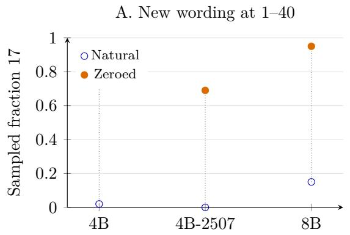

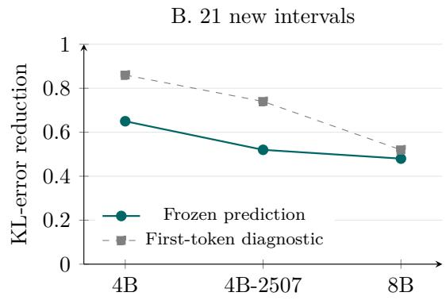  
Figure 10: Validation and prediction for the selected coordinates. A: sampled fractions on eligible new wordings (16, 17 and 20 prompts); connecting segments pair the two conditions within each checkpoint. Bootstrap uncertainty on the increases is given in the text. B: the frozen predictor and a separate first-token diagnostic on 21 new intervals. Model order is fixed throughout. No point-level data or uncertainty absent from the retained historical summaries is reconstructed.

## D Natural-context transfer diagnostics

Interpreting donorward progress. Negative progress indicates movement away from the donor. Because JS divergence is bounded, this score is not a linear fraction of log-odds movement. For example, in a two-answer distribution, moving log-odds from −16 to −4 covers half the distance to a donor at +8, but gives only $F = 0 . 0 6 5 4$ . This mathematical example motivates reporting continuous displacement and TV alongside the normalized score. The pooled measure weights contrasts through their divergences, and its interpretation depends on the scored distribution. First-digit, candidateanswer and fixed-leading-digit distributions answer diferent questions about generation. We use matched comparisons where available and retain each readout and cohort when reporting transfer, following methodological work on activation patching [7].

Activation changes and local sensitivity. Post hoc analyses examined why the activation swaps produced small average transfers. For instruction pairs, an approximation scaled the zeroing efect by the natural activation displacement relative to the zeroing distance. On a signed projection readout, correlations with measured transfers were 0.91, 0.89 and 0.98, with calibration slopes of 0.76, 0.82 and 0.82 (Figure 11). The approximation retained the signs among the largest five percent of transfers. Small displacements and limited efects restricted individual changes; opposing signs further reduced the average. Mean absolute projected transfers were 0.056, 0.050 and 0.023, compared with signed means of −0.012, +0.018 and +0.004.

History produced substantial activation changes but a weak response at the second answer. The earlier value changed the natural activation by 4.9 and 7.2 units in 4B and 8B, while the neuron’s local efect was only about one percent of the history contrast. A local-derivative approximation tracked projected transfers with reported correlations and slopes near 1.00. This combination explains how a large change of activation can still transfer little of the measured output contrast.

Both diagnostics use local intervention information retrospectively; whole-distribution errors were larger. They difer from the historical interval predictor and JS progress in Equation 5. Sixteen matched control neurons also had small instruction-transfer efects. These readout-specific checks relate weak average transfer to displacement, sensitivity and cancellation.

A. Scaled-zeroing diagnostic  
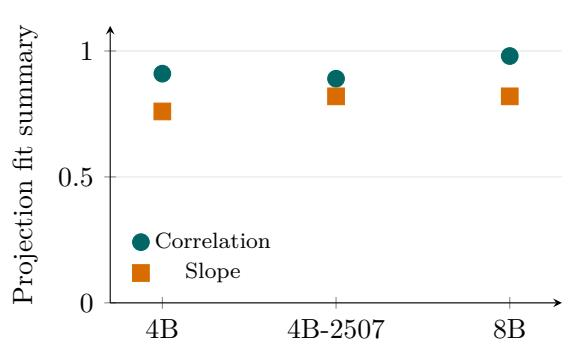

B. Cancellation in the average  
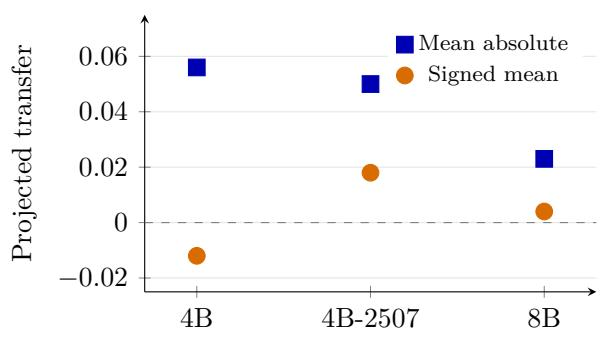  
Figure 11: Post hoc diagnostics of instruction swaps. A: correlation and calibration slope of the scaled-zeroing projection approximation. B: mean absolute and signed projected transfer. Opposing efects reduce the signed average. The panels show aggregates for the specified projection readout. JS-based donorward progress and independent validation require diferent measurements; per-pair observations are not reconstructed here.

## E Requested sampling laws and mathematical limits

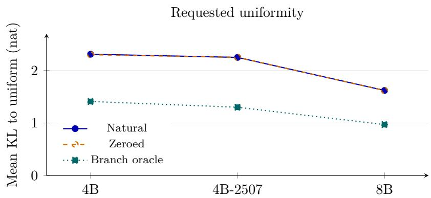  
Figure 12: Mean KL to uniform in the separate instruction-bank analysis. The oracle changes branch weights while holding conditional distributions fixed. Lines connect model summaries for readability; they do not fit a scaling law. This sampling-law comparison is separate from the matched naturaltransfer assay in Figure 6.

A valid chosen number and a requested sampling distribution impose diferent requirements. Earlier studies distinguish independent requests from autoregressive lists and show that the protocol afects the measured distribution [22, 28]. An unconstrained request permits any in-range choice, while explicit uniform or independent sampling instructions concern the distribution over replies. In the instruction-bank analysis, zeroing changed numerical preference but barely changed mean KL to uniform: 2.31 to 2.30, 2.25 to 2.25, and 1.62 to 1.62 nat. Mean absolute changes of 0.18, 0.21 and 0.10 nat show cancellation in these small net efects. This retrospective analysis used a reference prefix, six intervals, twelve confirmation families and three request forms.

## E.1 Uniformity under fixed within-branch laws

A branch-only controller also has a calculable limitation. If $\boldsymbol { q } ( d , \boldsymbol { r } ) = \boldsymbol { a } _ { d } \boldsymbol { r } _ { d } ( \boldsymbol { r } )$ and only a is adjustable, entropy maximization gives

$$
\operatorname* { m i n } _ { a } \mathrm { K L } ( q \| U ) = \log N - \log \sum _ { d } \exp H ( r _ { d } ) .\tag{9}
$$

The mean oracle floors were 1.41, 1.30 and 0.97 nat in this bank (Figure 12). The bound describes control restricted to branch weights with fixed conditional continuations. The actual neuron also afected continuation competition, as the selected second-digit experiment shows.

For $\boldsymbol { q } ( d , \boldsymbol { r } ) = \boldsymbol { a } _ { d } \boldsymbol { r } _ { d } ( \boldsymbol { r } )$ , expanding − P q log q gives $\begin{array} { r } { H ( q ) = H ( a ) + \sum _ { d } a _ { d } H ( r _ { d } ) } \end{array}$ . Write $\begin{array} { r } { Z = \sum _ { d } e ^ { H \left( r _ { d } \right) } } \end{array}$ and $\displaystyle a _ { d } ^ { * } = e ^ { H ( r _ { d } ) } / Z$ . Then

$$
\begin{array} { r } { H ( q ) = \log Z - \mathrm { K L } ( a \| a ^ { * } ) . } \end{array}
$$

Maximizing over branch weights yields Equation 9. This derivation assumes fixed within-branch conditional laws and a uniform target over N candidates.

## E.2 History dependence and branch reweighting

Response-history studies report changes in marginal bias [27], and West and Potts [23] show why improved marginal balance can coexist with non-independent repetition patterns. We therefore separate marginal imbalance from history dependence. For second draws with balanced forced earlier values $f ,$ let $\bar { q } = \mathbb { E } _ { f } q _ { f }$ . Then

$$
\mathbb { E } _ { f } \operatorname { K L } ( q _ { f } \| U ) = \underbrace { \operatorname { K L } ( \bar { q } \| U ) } _ { B } + \underbrace { \mathbb { E } _ { f } \operatorname { K L } ( q _ { f } \| \bar { q } ) } _ { D } .\tag{10}
$$

In the source/framing experiments, explicit independent/uniform wording lowered $B + D$ in all 52 comparisons, with scored mass 0.98–1.00. The comparisons shared stems and comprised forty source cells and twelve framing cells. These dependencies limit their interpretation as repeated evidence. The measured reduction establishes an output-level efect whose internal mechanism remains unresolved.

The chain rule gives $D = I ( F ; D _ { 1 } ) + I ( F ; R \mid D _ { 1 } )$ , with branch and continuation contributions under the observed distribution. Changing branch probabilities can also change the continuation term by reweighting branches and conditional mixtures, even if each law given $( F , D _ { 1 } )$ stays fixed. The derivation below makes this dependence explicit. The observed continuation share therefore describes the measured distribution; it supplies no invariant lower bound on history dependence under arbitrary branch control.

For history dependence, the joint distribution also includes the earlier value F. Expanding the log ratio through q¯ gives

$$
\mathbb { E } _ { f } \operatorname { K L } ( q _ { f } \| U ) = \mathbb { E } _ { f } \operatorname { K L } ( q _ { f } \| \bar { q } ) + \operatorname { K L } ( \bar { q } \| U ) .
$$

The dependence term is mutual information under the balanced forced-value design. Its continuation component is

$$
I ( F ; R \mid D _ { 1 } ) = \sum _ { d } p ( d ) \sum _ { f } p ( f \mid d ) \operatorname { K L } \bigl ( q ( r \mid f , d ) \| q ( r \mid d ) \bigr ) .
$$

Changing only $p ( d \mid f )$ can alter the outside weights, the posterior $p ( f \mid d )$ and the mixture $q ( r \mid d )$ Fixed $q ( r \mid f , d )$ therefore does not imply a fixed conditional-information term.

For an explicit counterexample, let F be a fair bit and choose branch A with probability t independently of $F .$ In $\mathrm { A } ,$ , set $R = F ;$ in branch B, draw R as an independent fair bit. Every within-branch law is fixed, but $I ( F ; D _ { 1 } ) = 0$ and $I ( F ; R \mid D _ { 1 } ) = t \log 2$ . Reweighting t from 0.8 to 0.2 changes the latter from 0.554518 to 0.138629 nat. This constructed mathematical example illustrates the identity independently of language-model observations. It rules out treating a measured continuation-information share as invariant under arbitrary branch control.