# Who Pays for the Knowledge Models Copy? Model Collapse as Rogers' Paradox

Nam H. Le

nam.le@uvm.edu

Department of Computer Science and Vermont Complex Systems Institute University of Vermont, Burlington, VT, USA

## Abstract

Generative models trained on the output of earlier models lose knowledge across generations, rare knowledge first. The remedies that work all bring in information from outside the loop – fresh human data, verifiers, curators – and the theory of model collapse treats that supply as given: a fixed archive, drawn from a fixed distribution. We argue that the supply is the problem, and that cultural evolution has the theory of it. We read model collapse as Rogers' paradox: a population that comes to rely on copying ends up no better off than one that never copied, because copies go stale unless someone keeps learning for themselves. We make the identification quantitative and test it in three steps. First, Rogers'model, fitted only to fully synthetic training, predicts to within a few percentage points how much rare knowledge language models – from word trigrams to a pretrained transformer – retain under other mixtures of fresh data. Second, when the world itself changes, a lineage that copies its own past needs more fresh data to keep up the faster the world changes, as Rogers model says it must and as analyses that assume a fixed target cannot; a lineage that restarts every generation from fixed pretrained weights is largely insulated, because those weights are knowledge that is never copied. Third, we close the loop: when the people who write a model's training data can ask the model instead of finding things out, the supply of fresh data becomes endogenous. At equilibrium, the model is exactly as reliable as it is costly for people to find out for themselves, the population is no better off than without the model, and every increase in the share of model-written text must be paid for by more people learning for themselves. Users who check what they are told and relearn when it is wrong break the paradox. Finally, we place synthetic-data filters in the taxonomy of social learning strategies: filters that select plausible text are conformist and accelerate collapse, consistent with prior evidence, while only checks that carry new information act as critical learning.

## 1 Introduction

Training generative models on the output of earlier models degrades them. Across generations, the tails of the learned distribution thin and disappear, rare content is forgotten before common content, and the models' output narrows (Shumailov et al., 2024; Alemohammad et al., 2024; Bertrand et al., 2024; Guo et al.. 2024; Briesch et al., 2023). Model collapse now has a substantial theory: it can be described as a change of scaling laws concentrated in the tails (Dohmatob et al., 2024b), analysed exactly in regression (Dohmatob et al., 2024a), shown to arise from small proportions of synthetic data (Dohmatob et al., 2025), bounded in rate (Suresh et al., 2025; Seddik et al., 2024), and avoided when real data accumulate rather than being replaced (Gerstgrasser et al., 2024; Kazdan et al., 2025). Its definitions and assumptions are themselves debated (Schaeffer et al., 2026).

The remedies that work share one feature: each brings in information from outside the self-consuming loop. Fresh real data (Alemohammad et al., 2024), retained real data (Gerstgrasser et al., 2024), verifiers of correctness (Feng et al., 2025; Yi et al., 2026), correction toward ground truth (Gillman et al., 2024), and human curation (Ferbach et al., 2024) all import something the model does not already have. And the theory that supports them shares two assumptions. The outside information is treated as an exogenous archive, there to be drawn on in whatever quantity is needed. And the target distribution is fixed: what the model should know does not change while it is being copied.

Neither assumption holds for the systems that motivate the problem. The fresh text on which future models are trained is written by people, and people increasingly consult the models instead of finding things out for themselves; the supply of fresh data responds to the models it feeds. And the world that text describes keeps changing. Both features are central to an older theory of the same failure. In cultural evolution, Rogers paradox (Rogers, 1988) is the observation that a population in which copying spreads, because copying is individually cheaper than learning, ends up no better off than a population that never copied: copies go stale, and someone must keep paying to learn. The theory of social learning strategies that grew from it (Boyd & Richerson, 1985; Laland, 2004; Enquist et al., 2007; Rendell et al., 2010) is a theory of exactly the two things collapse analyses take as given: where fresh information comes from, and how fast copied information decays when the world moves.

Here we show that a lineage of models trained on mixtures of synthetic and fresh data follows the dynamics of Rogers' population, and that the model, fitted to fully synthetic training alone, predicts how much rare knowledge the lineage retains under other mixtures, from word trigrams to a pretrained transformer (Sections 3-4). We demonstrate that when the world changes, a lineage that copies its own past needs more fresh data to keep up, as Rogers' model requires, and that knowledge which never passes through the copying chain, such as fixed pretrained weights, shields a lineage from that cost (Section 5). Closing the loop between models and the people who write their data, we show that the model ends up exactly as reliable as finding out is costly, and that the knowledge models copy must be paid for by people who keep learning for themselves (Section 6). Finally, we show that synthetic-data filters are social learning strategies, and that those which select plausible text act as conformist copying and accelerate collapse (Section 7).

Relation to the closest work. Two recent papers bring social dynamics to AI and collapse. Collins et al. (2026) simulate Rogers' paradox in a population that can also learn from an AI system, which itself updates by tracking the population's mean. They find the paradox intact – at equilibrium, adding the AI leaves collective understanding where individual learning alone puts it – and show that it is broken when people can override the AI by relearning after a failed copy, a form of critical social learning; they also study how often the AI should update and how reliance can erode people's own ability to learn. Their AI thus already learns from the people who learn from it. What they explicitly set aside is the part that defines model collapse: models trained on the output of other models. We take that part as central. Our model has a second copying channel, the share s of model-written text in the training data, and its equilibrium is in closed form, which makes two things visible that the simulations do not state: the model's accuracy at use is pinned at 1 - c whatever the model's architecture, and the share of people who must learn for themselves scales as 1/(1 - s). Where our results overlap, they agree: the critical asker of Section 6 is their override strategy. And the question they leave open, how an AI changes the rate at which the world changes, is the one our drift experiments begin to quantify from the other side: how the rate of change sets the fresh data a model lineage needs. Baumann et al. (2026) model people choosing between effort and a generative model whose benefit declines with use, and show that welfare can fall below its pre-AI level; their model does not use social-learning theory or the model-to-model loop. Within cultural evolution, Guo et al. (2026) and Ren et al. (2024) read collapse through iterated learning, which explains which structures degrade and in what order. Peterson (2024) argues that reliance on AI narrows public knowledge, and Brinkmann et al. (2023) set out the broader programme of studying machines as participants in cultural evolution. None of these treats the model-to-model loop and the human-to-model loop as one Rogers chain, solves its equilibrium, or tests the chain's quantitative predictions on trained language models; those are our contributions.

## 2 Background: Rogers'paradox and social learning strategies

In Rogers' model (Rogers, 1988), the best behaviour in an environment changes with probability u per generation. An individual learner pays a cost c and acquires the currently correct behaviour; a social learner copies a random member of the previous generation at no cost, and is right only if its model was right and the environment has not changed since. Social learning spreads while rare, because its copies come mostly from learners, and stops spreading when social and individual learners do equally well. At that point, the population's mean payoff equals that of a population of individual learners alone: copying has been adopted without making anyone better off.

Three refinements matter here. A critical social learner copies, checks the copy against the world, and learns for itself if the copy fails; such learners raise the population's payoff above the baseline, because the check imports information (Enquist et al., 2007). A conformist learner copies what is common rather than a random model; conformity is cheap, but it erodes variation, because rare variants are copied less often than they occur (Boyd & Richerson, 1985). And a payoff-biased learner copies whoever does best, which concentrates the population on the current winner (Boyd & Richerson, 1985; Laland, 2004). The social learning strategies tournament found that successful strategies copy most of the time but copy well (Rendell et al., 2010).

Training a model on another model's output is social learning in the sense of Heyes (2012): the learner reconstructs competence from another's behaviour through its own learning machinery. The theory of when such learning pays therefore applies to synthetic-data training directly.

## 3 Collapse as Rogers' chain

Consider a lineage of models. Generation t + 1 is trained on a corpus of which a fraction $\rho$ is synthetic, sampled from generation t, and $1 - \rho$ is fresh. A unit of knowledge carried by the synthetic part survives only if generation t held it and the copy preserved it; let u be the probability per generation that it does not. In Rogers' model u is the rate at which the world changes. In a lineage of models it also includes the chance that a rare item is simply not sampled when the previous model writes its corpus, which is the mechanism of collapse in a fixed world (Shumailov et al., 2024). The share $q _ { t }$ of knowledge the lineage holds then obeys

$$
q _ { t + 1 } = \left( 1 - \rho \right) + \rho \left( 1 - u \right) q _ { t } , \qquad q ^ { * } = \frac { 1 - \rho } { 1 - \rho ( 1 - u ) } .\tag{1}
$$

This is the recursion for the accuracy of copied behaviour in Rogers' population with a fraction ρ of copiers. It predicts that only $\rho = 1$ collapses, at rate $( 1 - u ) ^ { t }$ ; that any fresh fraction buys a plateau $q ^ { * } \colon$ and that knowledge which fresh data rarely covers faces a larger effective $\rho$ and so declines first. Unlike the statistical analyses cited above, Eq. 1 makes no assumption about the model class, and it is deliberately minimal; its value is that a single measured quantity, $u ,$ links all mixtures, and that it extends naturally to a world that changes and to a supply of fresh data that responds to the model, the two settings the following sections test.

## 4 Experiments in a fixed world

Setup. We train lineages of language models on two corpora from Project Gutenberg, Darwin's On the Origin of Species and Melville's Moby-Dick. Each corpus is split by sentence into a test set (10%), never used for training; a reference set (20%), used only by one filter (Section 7); and a pool (70%) from which the first corpus and all fresh data are drawn. The main model is a word trigram language model interpolating trigram, bigram, and unigram estimates, chosen because its knowledge can be counted exactly; we repeat the key conditions with a small character-level transformer and with a pretrained transformer language model. Generation 0 is trained on 30 000 tokens (words and punctuation marks) from the pool. Each later generation is trained on a new corpus of the same size, built from the previous model's samples according to the condition, for 12 generations and 5 seeds.

Measures. Rare-word coverage: of the words outside the pool's 1 000 most frequent, the share still present in the training corpus, relative to generation 0. Perplexity on the human test set, as a growth factor over generation 0. Variety: distinct three-word sequences per 1 000 words of the model's own samples.

Results. Trained only on its own samples, the trigram model loses four in five of its rare words in twelve generations, and its perplexity on human text grows by a factor of 7.7 on Darwin and 4.1 on Melville (Table 1); a sample from generation 0 reads “i cannot see that a genus become fitted for most justly celebrated elder huber, but in all the large stock", and one from generation 12 “struggle of the on that may inheritable detected i hybrids, kept." Any fresh fraction halts the decline. Fitting u of $\operatorname { E q } .$ 1 to the all-synthetic condition gives 0.15 on Darwin and 0.16 on Melville; with that value and no further fitting, the chain predicts the coverage retained with 10%, 30%, and 50% fresh data to within 0.03 on both corpora (Fig. 1a,b). The fit is best at the end: during the transient a single u errs by up to 0.12, and it underestimates the all-synthetic condition at generation 12, because the words that survive longest are the least rare, a heterogeneity that a single u ignores (Appendix B). Keeping every past corpus avoids collapse, as Gerstgrasser et al. (2024) found: in Rogers' terms the original human corpus is a population of individual learners that never leaves.

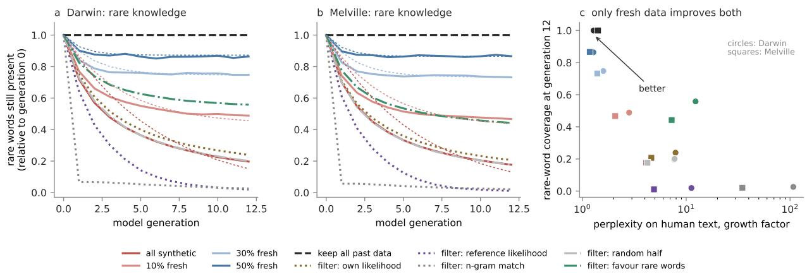  
Figure 1: Lineages of language models trained on their own output in a fixed world (word trigram models, 12 generations, mean of 5 seeds). (a, b) Rare-word coverage relative to generation 0. Thin dashed lines: Rogers chain (Eq. 1) with u fitted to the all-synthetic condition only and applied, unchanged, to the fresh-data conditions. (c) Every condition at generation 12, on coverage and on the growth of perplexity on held-out human text. Filters are discussed in Section 7.

Table 1: Generation 12, mean of 5 seeds. Coverage: rare-word coverage relative to generation 0. Predicted: Rogers' chain with u fitted to the all-synthetic condition of the same corpus (u = 0.15 Darwin, 0.16 Melville) Perplexity: growth factor on held-out human text.
<table><tr><td></td><td colspan="3">Darwin</td><td colspan="3">Melville</td></tr><tr><td>condition</td><td>coverage</td><td>predicted</td><td>perplexity</td><td>coverage</td><td>predicted</td><td>perplexity</td></tr><tr><td>all synthetic</td><td>0.20</td><td>0.15</td><td>7.7</td><td>0.18</td><td>0.13</td><td>4.1</td></tr><tr><td>10% fresh</td><td>0.49</td><td>0.46</td><td>2.8</td><td>0.47</td><td>0.44</td><td>2.1</td></tr><tr><td>30% fresh</td><td>0.75</td><td>0.75</td><td>1.6</td><td>0.73</td><td>0.73</td><td>1.4</td></tr><tr><td>50% fresh</td><td>0.86</td><td>0.87</td><td>1.3</td><td>0.87</td><td>0.87</td><td>1.2</td></tr><tr><td>accumulate all past data</td><td>1.00</td><td></td><td>1.3</td><td>1.00</td><td></td><td>1.4</td></tr><tr><td>filter: own likelihood</td><td>0.24</td><td></td><td>7.9</td><td>0.21</td><td></td><td>4.6</td></tr><tr><td>filter: reference likelihood</td><td>0.02</td><td></td><td>11.2</td><td>0.01</td><td></td><td>4.9</td></tr><tr><td>filter: n-gram match</td><td>0.03</td><td></td><td>107.5</td><td>0.02</td><td></td><td>34.7</td></tr><tr><td>filter: random half</td><td>0.20</td><td></td><td>7.7</td><td>0.18</td><td></td><td>4.2</td></tr><tr><td>filter: favour rare words</td><td>0.56</td><td></td><td>12.3</td><td>0.44</td><td></td><td>7.3</td></tr></table>

A neural replication. To check that the pattern is not a property of count-based models, we repeated four conditions with a small character-level transformer (2 layers, width 128, context 128 characters) trained afresh each generation on 60 000 characters of Darwin's text and sampled at temperature 1 (6 generations, 3 seeds; Fig. 2). The qualitative picture is the same. Under fully synthetic training, error on held-out human text rises at every generation (1.77 more bits per character by generation 6), and rare-word coverage falls to 4% of its starting value; with 30% fresh data, both settle within two generations (coverage 0.41 of its starting value at generation 6, compared with 0.04; Welch p = 0.002, Cohen's d = 16.5). Keeping the half of the sampled lines the model finds most likely is worse than keeping a random half (5.18 against 3.93 bits per character at generation 6, Welch p = 0.02, d = 4.7, bootstrap 95% CI of the difference [0.85, 1.52]), and the random half is indistinguishable from no filter at all (3.93 against 3.86, Welch $p = 0 . 3 7 )$ , as it should be. The quantitative fit is looser than for trigrams: a character model sampled at temperature 1 misspells most rare words in its first generation, so the loss is front-loaded rather than geometric, and a single u fitted to fully synthetic training mispredicts the fresh-data plateau (0.48 against 0.41); two classes of knowledge, introduced below, predict it to within 0.04 (Appendix B). With three seeds per condition the rank-based tests cannot reach $p < 0 . 0 5$ (Mann-Whitney $p = 0 . 0 8 – 0 . 1 0$ for every comparison); we report them for completeness.

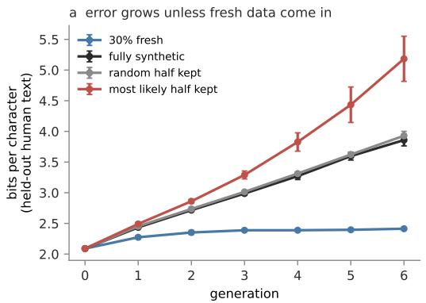

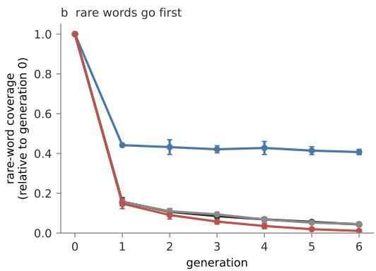  
Figure 2: Recursive training of a small character-level transformer (Darwin; 6 generations; mean ± s.d. over 3 seeds). (a) Bits per character on held-out human text. (b) Rare-word coverage of the training corpus, relative to generation 0. Fresh data stop the decline; keeping the most likely half of the samples accelerates it relative to keeping a random half.

A pretrained language model. Last, we repeated the static experiment in the setting of Shumailov et al. (2024): OPT-125m (Zhang et al., 2022), fine-tuned afresh from its pretrained weights at every generation (2 epochs) on 4 000 blocks of 64 tokens from wikitext-2 (Merity et al., 2017), with each generation's synthetic blocks sampled from the start token at temperature 1, so no human text enters through prompts (10 generations, 5 seeds per condition; Fig. 3). Measures are as above, with perplexity on the wikitext-2 test split. Trained only on its own output, the lineage doubles its perplexity on human text (47 to 102) and keeps 0.59 of its rare words; with 10%, 30%, and 50% fresh blocks, perplexity levels off at 68, 56, and 52 and coverage at 0.69, 0.81, and 0.89 (30% fresh against fully synthetic at generation 10: coverage difference 0.23, Welch $p < 1 0 ^ { - 6 }$ , Mann-Whitney $p = 0 . 0 0 8$ , Cohen's $d = 1 4 . 6$ , bootstrap 95% CI [0.21, 0.24]). The loss is again front-loaded: a quarter of the rare words vanish at the first copy, and the rest decay slowly. A single u therefore misses the plateaus (it predicts 0.70, 0.87, and 0.94), but the chain with two classes of knowledge − a share w copied with loss u1 and the rest with loss u2, each following Eq. 1 − fitted to fully synthetic training alone $( w = 0 . 2 8 , u _ { 1 } = 0 . 8 2 , u _ { 2 } = 0 . 0 2 )$ predicts the coverage retained with 10%, 30%, and 50% fresh data to within 0.03 at generation 10 (0.67, 0.78, 0.86), and to within 0.05 at every generation. Keeping the half of the sampled blocks the model finds most likely collapses the lineage: rare-word coverage falls to 0.05 against 0.57 for a random half (Welch $p < 1 0 ^ { - 8 }$ , Mann-Whitney $p = 0 . 0 0 8 , d = 2 4$ , CI of the difference $[ - 0 . 5 5 , - 0 . 5 0 ] \rangle$ ), the variety of its own samples to 267 distinct trigrams per 1 000 words against 940 $( p < 0 . 0 0 1 , d = 6 . 6 )$ , and its perplexity on human text rises to 145 against 102 (Mann-Whitney $p = 0 . 0 0 8$ , CI [22, 81]; Welch $p = 0 . 0 8$ , as one seed's perplexity diverges). A random half is indistinguishable from no filter (coverage Welch $p = 0 . 3 6$ , perplexity $p = 0 . 9 6 )$

How good is the chain? Table 2 compares the one-class and two-class chains in all four settings, each fitted to the all-synthetic condition alone and applied unchanged to the others. Judged on held-out generations of the all-synthetic condition – a choice that uses no fresh-data run – two classes are preferred in every setting: rare knowledge is not lost at one rate but splits into a fragile class, lost within a copy or two, and a durable class lost slowly, and the fragile class is most fragile in the neural models sampled at temperature 1. With two classes the chain predicts the coverage retained with fresh data to within 0.03 for OPT-125m, 0.04 for the character transformer, and 0.08 for trigrams, whose plateaus a single rate happens to predict better (within

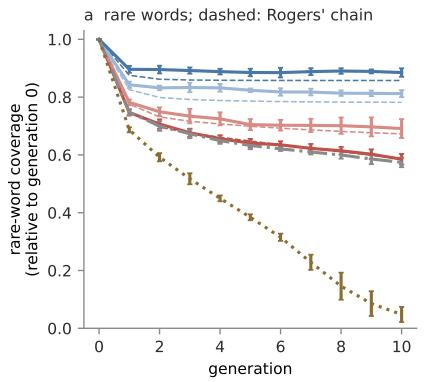

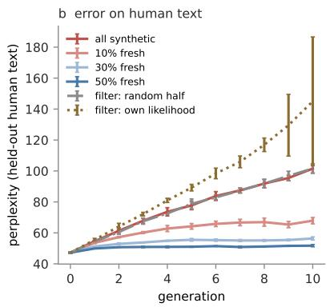

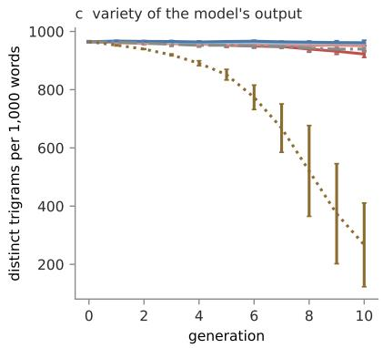  
Figure 3: Recursive fine-tuning of a pretrained language model (OPT-125m on wikitext-2; 10 generations; mean ± s.d. over 5 seeds). (a) Rare-word coverage of the training corpus, relative to generation 0. Dashed: Rogers' chain with two classes of knowledge, fitted to the all-synthetic condition only and applied unchanged to the fresh-data conditions. (b) Perplexity on held-out human text. (c) Distinct word trigrams per 1 000 words of the model's own samples. Keeping the samples the model finds most likely collapses the lineage; keeping a random half does nothing.

0.03). The chain is thus right to within a few points of coverage, not exactly. The remaining error has a clear source: how easily a word is lost depends on how many copies of it a corpus holds, which fresh data change whereas the chain treats each class's rate as fixed.

## 5 A moving world

Analyses of collapse assume a fixed target: the model is judged against the distribution its first generation saw. In Rogers' model the world moves, and the parameter u is precisely the rate at which copied knowledge goes stale because of it. If the identification holds, a lineage of models in a changing world should need more fresh data to keep up, and the extra need should grow with the rate of change.

Setup. We let the world change continuously. The world at generation t is a window of 3 000 consecutive sentences in the concatenated text of Darwin's and Melville's books, which slides forward by a fixed number of sentences per generation, wrapping around; new vocabulary therefore keeps arriving and old vocabulary keeps leaving. Fresh data are drawn from the current window, and every tenth sentence of the window is held out. Each generation is trained on 30 000 tokens, a fraction f fresh and the rest sampled from the previous model. Coverage is measured against the current window's rare words, relative to a corpus of the same size drawn entirely fresh from the current window, and averaged over generations 6 to 12, after the initial transient (3 seeds).

Results. At every fresh fraction, coverage falls as the world changes faster (Fig. 4a): with 30% fresh data, from 0.81 in a static world to 0.70 when the window is replaced every generation; with 10%, from 0.54 to 0.46. Equivalently, the fresh fraction needed to retain 80% of what a fully fresh corpus would cover rises from about 0.30 to about 0.45 (Fig. 4b). The effect saturates once about a third of the world is replaced per generation: at that point almost nothing a copy carries about the current world's rare vocabulary is still current, which in Rogers' terms is a staleness probability u at its ceiling. The general point is that the fresh data a lineage needs is not a property of the model or the corpus alone; it depends on how fast the world the corpus describes is changing, and fast-changing domains should be the first to degrade as synthetic text accumulates.

A pretrained model in a moving world. We repeated the experiment with OPT-125m, set up as in Section 4 (Appendix A). The world is a window of 6 000 consecutive 64-token blocks of wikitext-2, in article order, which slides by 0, 2 000, or 6 000 blocks per generation; every tenth block is held out, and fresh blocks are drawn from the rest of the current window. Fresh fractions are 10%, 30%, and 50% (10 generations, 5 seeds; measures averaged over generations 6 to 10, perplexity on the window's held-out blocks). The trigram result does not carry over. Coverage of the current window's rare words is the same whether the world stands still or is replaced every generation (with 30% fresh data, 0.698 against 0.700, Welch $p = 0 . 6 6 ;$ the largest difference, at 10%, is 0.008), and perplexity on the current world rises only slightly (with 30% fresh data, 46.0 against 45.0, $d = 1 . 3 .$ bootstrap 95% CI of the difference [0.07, 1.67]; with 10%, 57.5 against 55.9, Welch $p = 0 . 0 4 5$ , Mann-Whitney $p = 0 . 1 0 )$ . The synthetic part is not empty: the fresh blocks alone would cover 0.24, 0.51, and 0.69 of the rare words, against 0.57, 0.70, and 0.80 observed. But what it carries does not depend on whether the previous window is still current, so it does not come from copying that window. Our reading is that it comes from the pretrained weights, which every generation inherits unchanged in this design. In Rogers' terms they are knowledge acquired once, by an earlier and far larger round of individual learning, that never passes through the copying chain and so never goes stale with it; drift then costs the lineage only what its fine-tuning copies. Two caveats bound this reading. The drifting world here is text the pretrained model has already seen, since Wikipedia is part of $\mathrm { O P T } \mathrm { s }$ pretraining data, so the reserve is never out of date; a world that moves beyond the pretraining data would erode it. And a lineage that inherits its weights from the previous generation, as one pretrained on a web increasingly written by models would, has no such reserve; testing that case requires pretraining at a scale beyond this paper.

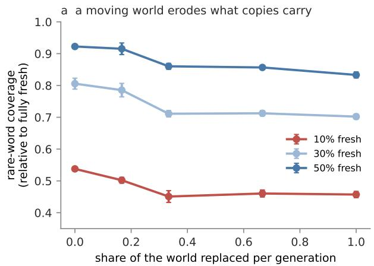

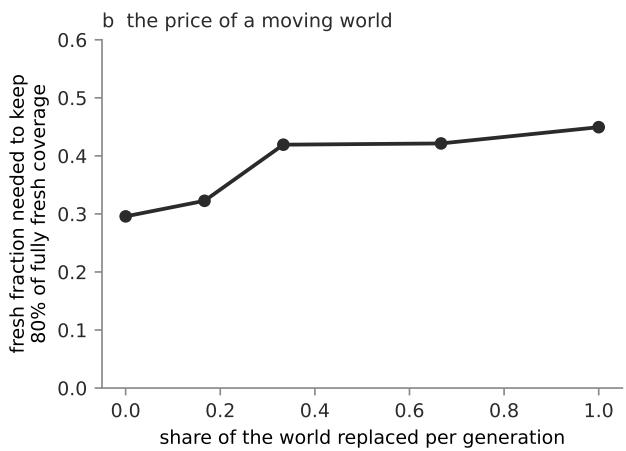  
Figure 4: Recursive training in a world that keeps changing (word trigram models; the world is a window of 3000 sentences sliding through the concatenated corpora; mean of generations 6–12 and 3 seeds; bars: s.d. over seeds). (a) Coverage of the current world's rare words, relative to a fully fresh corpus, against the share of the world replaced per generation. (b) The fresh fraction needed to keep 80% of fully fresh coverage rises from about 0.30 in a static world to about 0.45 when the world is replaced every generation.

## 6 Closing the loop: who supplies fresh data?

The analyses above, and the literature, treat fresh data as a resource outside the system. It is not. Fresh text is written by people, and people who can ask a model instead of finding something out will often do so. We now couple the two loops.

Model. Knowledge consists of many independent facts, each of which changes to a new value with probability u per generation, where a generation is one model release. A fraction h of people learn each fact they need for themselves, at cost $^ { c , }$ and are always right; the rest ask the current model, at negligible cost, and are right with probability $a _ { t } .$ the model's accuracy at the time of use. What people write becomes the training corpus for the next model, together with a share s of text the model writes directly. Learners write what they found; askers write what they were told. People adjust their strategy toward whichever pays more.

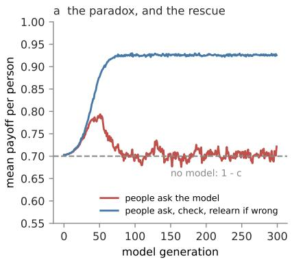

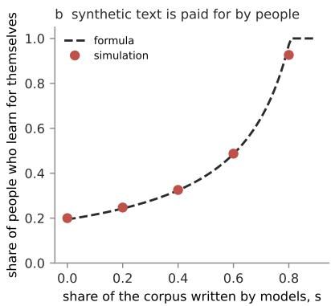

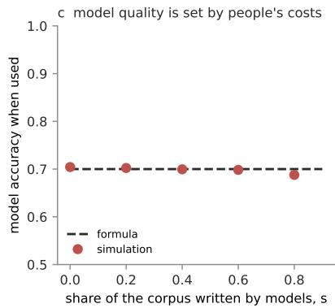  
Figure 5: The human-AI knowledge ecosystem, simulated (4 000 facts, 4 000 people, change rate $u = 0 . 0 5$ cost of finding out $c = 0 . 3$ , checking cost 0.05). (a) Mean payoff after a model is introduced: when people simply ask, payoff rises and then returns to the no-model baseline $1 - c ;$ when they check the answer and relearn if it is wrong, it stays well above. (b) Equilibrium share of people who learn for themselves, against the share s of model-written text: simulation and Eq. 2 (corrected for the share of facts written about in each generation). (c) The model's accuracy when used stays at $1 - c$ whatever s.

Proposition 1. Let $f = ( 1 - s ) h$ be the fresh fraction of the corpus. The model's accuracy at use obeys $a _ { t + 1 } = \left( 1 - u \right) \left[ f + \left( 1 - f \right) a _ { t } \right] . \ I f \ 0 < h ^ { * } < 1$ at equilibrium, then

$$
a ^ { * } = 1 - c , \qquad f ^ { * } = \frac { u \left( 1 - c \right) } { c \left( 1 - u \right) } , \qquad h ^ { * } = \frac { f ^ { * } } { 1 - s } , \qquad \bar { W } ^ { * } = 1 - c ,\tag{2}
$$

where $\bar { W } ^ { * }$ is mean payoff. An interior equilibrium exists only while $s < 1 - f ^ { * }$

Proof. Askers earn a and learners $1 - c ;$ an interior equilibrium of payoff-driven strategy change requires $a ^ { * } = 1 - c .$ At the fixed point of the accuracy recursion, $a ^ { * } = ( 1 - u ) f / ( 1 - ( 1 - u ) ( 1 - f ) )$ ; setting it to $1 - c$ and solving for f gives $f ^ { * }$ . Mean payoff is $h ^ { \ast } ( 1 - c ) + ( 1 - h ^ { \ast } ) a ^ { \ast } = 1 - c .$ □

Proposition 1 has three consequences for machine learning. First, at equilibrium the model is exactly as reliable as it is costly for people to find out for themselves. Its accuracy is set not by its capacity or its data volume but by the cost of the alternative it displaces, at least in this model. Second, the population is no better off than it would be without the model: this is Rogers' paradox for the human-AI ecosystem. Third, text written by models is paid for in human effort. The share of people who must keep learning for themselves rises as $1 / ( 1 - s )$ with the share of model-written text, and beyond $s = 1 - f ^ { * }$ the model is no longer worth asking at all. In the model-collapse literature the remedy is "keep fresh data"; Proposition 1 says how much, who supplies it, and what it costs them.

Simulation. An agent-based simulation of the same model, with strategy change by payoff-proportional imitation and a small mutation rate, confirms the equilibrium $( \mathrm { F i g . ~ 5 } )$ . After a model is introduced, mean payoff first rises, while most people still learn and the model is accurate, and then falls back to $1 - c$ as reliance spreads and the model's corpus fills with copies (Fig. 5a). The share of learners matches Eq. 2 across synthetic shares from 0 to 0.6, and the model's accuracy at use stays at $1 - c$ throughout (Fig. 5b,c).

The rescue. If people who ask the model also check its answer against the world, at a cost below that of finding out, and learn for themselves when it is wrong – critical social learning in the sense of Enquist et al. (2007) − their payoff is $1 - c _ { v } - ( 1 - a ) c$ , which exceeds the baseline whenever checking is cheaper than the expected cost of being wrong, and what they write back is correct. In the simulation, mean payoff settles at 0.93 against the baseline of 0.70 (Fig. 5a). The implication for the design of AI systems is direct: tools that make it cheap for users to verify an answer against a source are not a convenience but the mechanism that keeps the ecosystem's knowledge, and the models trained on it, from collapsing to the paradox.

## 7 Filters are social learning strategies

Most pipelines do not train on raw synthetic data; they filter it. In social-learning terms, a filter is a rule for choosing what to copy, and the theory distinguishes three kinds.

A conformist filter prefers what is common. Selecting synthetic samples by their likelihood under the generator, by the perplexity of a reference model, or by overlap with existing text are conformist in this sense: the criterion is resemblance, and rare content is by definition less resembled. Theory predicts that such filters erode variation faster than copying at random (Boyd & Richerson, 1985), and the evidence agrees. In image models, sampling biased toward quality preserves precision while accelerating the loss of diversity (Alemohammad et al., 2024), and selection by typicality precipitates collapse, doing worse than random selection (Qiao et al., 2026); iterated curation by any fixed score concentrates the model on the highest-scoring samples (Ferbach et al., 2024). Our text results are consistent (Table 1, Fig. 1c). For the trigram model, filtering by the generator's own likelihood is indistinguishable from discarding at random; for the transformers, whose likelihood ranks whole lines more sharply, it is clearly worse than random and accelerates the loss of rare words; in the pretrained model it removes nearly all of them within ten generations and collapses the variety of the model's output (Figs. 2 and 3). Filtering by a reference model's likelihood, or by matching human n-grams, loses nearly every rare word within twelve generations, degrades perplexity on human text more than doing nothing, and sharply reduces the variety of the model's own output. A filter that inverts the bias, favouring rare words, preserves more of them but degrades perplexity faster: it keeps rare words by keeping the errors around them.

A payoff-biased filter keeps what scores best on a task, such as outputs that a reward model rates highly or that pass a check. It concentrates the population on the current best and, like selection, reduces variation even when it improves average quality; iterated self-improvement narrows output diversity even when it preserves correctness (Briesch et al., 2023; Ferbach et al., 2024), and verifiers can raise a model only to the level of the verifier (Yi et al., 2026).

A critical filter tests a copy against the world and replaces it when it fails. Verification against ground truth (Feng et al., 2025), correction toward an expert (Gillman et al., 2024), and training on one's own reasoning only when it reaches a verified answer (Zelikman et al., 2022) belong here, and they are the filters that prevent collapse. The distinction that matters is not how much a filter discards but where its criterion gets its information: from resemblance to what the system already has, or from the world.

Two results complicate the picture and are worth reconciling. Selecting synthetic text with a detector of machine-generated text can prevent collapse (Drayson et al., 2025): such a detector penalises the overrepresented features of model output, which makes it closer to an anti-conformist filter than to the likelihood filters above, and our rare-favouring filter shows the same partial benefit. And selecting synthetic data by n-gram similarity to human text had little effect in a setting that mixes synthetic with human data at the token level (Zhu et al., 2025); in our fully recursive setting the same criterion, applied every generation, compounds.

## 8 Discussion

What the identification buys. The statistical theory of collapse is more detailed than Eq. 1 wherever both apply. What the social-learning reading adds is a frame in which the supply of fresh information and the rate of change of the world are variables rather than assumptions, and a taxonomy in which the effect of a filter can be predicted from where its criterion gets its information. These are the levers an engineer of a data pipeline, and a designer of AI products, actually hold.

Predictions. The analysis makes predictions that larger experiments could refute: the knowledge a lineage retains under a given fresh fraction should follow Eq. 1 with a measured u; the fresh fraction needed to keep up should rise with how fast a domain's facts change, which predicts that fast-changing domains degrade first as synthetic text accumulates, and most where the world has moved beyond what the pretrained weights already know; likelihood- and typicality-based filters should accelerate the loss of rare knowledge at scale as they do in small models; and, in deployed systems, the share of users who verify answers should govern the long-run reliability of models trained on what users write.

A wider correspondence. The identification is one instance of a broader parallel between the layers of modern training – pretraining, fine-tuning, adaptation in context, and training on other models' output – and the layers of biological adaptation – evolution, individual learning, and social learning (Stephens, 1991; Boyd & Richerson, 1985; Henrich, 2015). The parallel is not one of mechanism; it is that both are stacks of adaptive processes with different speeds and costs that must divide the work of keeping up with a changing world, and results that depend only on rates, costs, and channels transfer between them.

Limitations. The language models are small – the largest has 125 million parameters – chosen so that knowledge could be counted exactly, and rare-word coverage is a proxy for knowledge; whether plausibility filters behave the same way under strong reward or quality models at scale is the most important open test. The drifting worlds are windows sliding through fixed text, not a changing world of facts, and for the pretrained model the drift stays within text it was pretrained on. The ecosystem model treats facts as independent and strategies as population-level averages, ignores that people differ in what learning costs them, and assumes that the next model is trained on what people write; richer versions – heterogeneous costs, several competing models, markets for fresh data – are natural extensions.

## 9 Conclusion

Read as Rogers' paradox, model collapse is the oldest problem in the theory of social learning, met at industrial scale. Cultural evolution's answer was never to stop copying: it was to keep learners in the population and to check copies against the world. Taking that answer seriously changes the question machine learning asks about collapse. The question is not only how much fresh data a model needs, but who produces it, what it costs them, and whether the systems built on their work leave them any reason to keep producing it.

Code and data. Code for every experiment and figure, and the per-seed results, are available at https: //github.com/drnamlabs-gif/rogers-model-collapse.

## References

Sina Alemohammad, Josue Casco-Rodriguez, Lorenzo Luzi, Ahmed Imtiaz Humayun, Hossein Babaei, Daniel LeJeune, Ali Siahkoohi, and Richard G. Baraniuk. Self-consuming generative models go MAD. In International Conference on Learning Representations (ICLR), 2024.

Fabian Baumann, Erol Akçay, and Joshua B. Plotkin. Generative artificial intelligence reduces social welfare through model collapse. arXiv preprint arXiv:2604.21853, 2026.

Quentin Bertrand, Avishek Joey Bose, Alexandre Duplessis, Marco Jiralerspong, and Gauthier Gidel. On the stability of iterative retraining of generative models on their own data. In International Conference on Learning Representations (ICLR), 2024.

Robert Boyd and Peter J. Richerson. Culture and the Evolutionary Process. University of Chicago Press, Chicago, 1985.

Martin Briesch, Dominik Sobania, and Franz Rothlauf. Large language models suffer from their own output: An analysis of the self-consuming training loop. arXiv preprint arXiv:2311.16822, 2023.

Levin Brinkmann, Fabian Baumann, Jean-François Bonnefon, et al. Machine culture. Nature Human Behaviour, 7:1855–1868, 2023.

Katherine M. Collins, Umang Bhatt, and Ilia Sucholutsky. Revisiting Rogers' paradox in the context of human-AI interaction. Philosophical Transactions of the Royal Society A, 384(2320):20250149, 2026.

Elvis Dohmatob, Yunzhen Feng, and Julia Kempe. Model collapse demystified: The case of regression. In Advances in Neural Information Processing Systems (NeurIPS), 2024a.

Elvis Dohmatob, Yunzhen Feng, Pu Yang, François Charton, and Julia Kempe. A tale of tails: Model collapse as a change of scaling laws. In International Conference on Machine Learning (ICML), 2024b

Elvis Dohmatob, Yunzhen Feng, Arjun Subramonian, and Julia Kempe. Strong model collapse. In International Conference on Learning Representations (ICLR), 2025.

George Drayson, Emine Yilmaz, and Vasileios Lampos. Machine-generated text detection prevents language model collapse. In Proceedings of the Conference on Empirical Methods in Natural Language Processing (EMNLP), 2025.

Magnus Enquist, Kimmo Eriksson, and Stefano Ghirlanda. Critical social learning: A solution to Rogers's paradox of nonadaptive culture. American Anthropologist, 109(4):727–734, 2007.

Yunzhen Feng, Elvis Dohmatob, Pu Yang, François Charton, and Julia Kempe. Beyond model collapse: Scaling up with synthesized data requires verification. In International Conference on Learning Representations (ICLR), 2025.

Damien Ferbach, Quentin Bertrand, Avishek Joey Bose, and Gauthier Gidel. Self-consuming generative models with curated data provably optimize human preferences. In Advances in Neural Information Processing Systems (NeurIPS), 2024.

Matthias Gerstgrasser, Rylan Schaeffer, Apratim Dey, Rafael Rafailov, Henry Sleight, John Hughes, Tomasz Korbak, Rajashree Agrawal, Dhruv Pai, Andrey Gromov, et al. Is model collapse inevitable? Breaking the curse of recursion by accumulating real and synthetic data. In Conference on Language Modeling (COLM), 2024.

Nate Gillman, Michael Freeman, Daksh Aggarwal, Chia-Hong Hsu, Calvin Luo, Yonglong Tian, and Chen Sun. Self-correcting self-consuming loops for generative model training. In International Conference on Machine Learning (ICML), 2024.

Dongxin Guo, Jikun Wu, and Siu Ming Yiu. Model collapse as cultural evolution. arXiv preprint arXiv:2605.23054, 2026.

Yanzhu Guo, Guokan Shang, Michalis Vazirgiannis, and Chloé Clavel. The curious decline of linguistic diversity: Training language models on synthetic text. In Findings of the Association for Computational Linguistics: NAACL 2024, 2024.

Joseph Henrich. The Secret of Our Success. Princeton University Press, Princeton, 2015.

Cecilia Heyes. What's social about social learning? Journal of Comparative Psychology, 126(2):193–202, 2012.

Joshua Kazdan, Rylan Schaeffer, Apratim Dey, Matthias Gerstgrasser, Rafael Rafailov, David L. Donoho. and Sanmi Koyejo. Collapse or thrive: Perils and promises of synthetic data in a self-generating world. In International Conference on Machine Learning (ICML), volume 267 of PMLR, pp. 29469–29494, 2025.

Kevin N. Laland. Social learning strategies. Learning & Behavior, 32(1):4–14, 2004.

Stephen Merity, Caiming Xiong, James Bradbury, and Richard Socher. Pointer sentinel mixture models. In International Conference on Learning Representations (ICLR), 2017.

Andrew J. Peterson. AI and the problem of knowledge collapse. arXiv preprint arXiv:2404.03502, 2024.

Xiaoyu Qiao, Xiao Du, Wei Liu, Jie Zhang, Peng Mai, Min Zhang, and Yan Pang. When sample selection bias precipitates model collapse. In International Conference on Machine Learning (ICML), 2026.

Yi Ren, Shangmin Guo, Linlu Qiu, Bailin Wang, and Danica J. Sutherland. Bias amplification in language model evolution: An iterated learning perspective. In Advances in Neural Information Processing Systems (NeurIPS), 2024.

Luke Rendell, Robert Boyd, Daniel Cownden, Magnus Enquist, Kimmo Eriksson, Marcus W. Feldman, Laurel Fogarty, Stefano Ghirlanda, Timothy Lillicrap, and Kevin N. Laland. Why copy others? insights from the social learning strategies tournament. Science, 328(5975):208–213, 2010.

Alan R. Rogers. Does biology constrain culture? American Anthropologist, 90(4):819–831, 1988.

Rylan Schaeffer, Joshua Kazdan, Alvan Caleb Arulandu, and Sanmi Koyejo. Position: Multiple definitions & unrealistic assumptions of model collapse distract from real world threats. In International Conference on Machine Learning (ICML), Position Track, 2026.

Mohamed El Amine Seddik, Suei-Wen Chen, Soufiane Hayou, Pierre Youssef, and Merouane Debbah. How bad is training on synthetic data? a statistical analysis of language model collapse. In Conference on Language Modeling (COLM), 2024.

Ilia Shumailov, Zakhar Shumaylov, Yiren Zhao, Nicolas Papernot, Ross Anderson, and Yarin Gal. AI models collapse when trained on recursively generated data. Nature, 631:755–759, 2024.

David W. Stephens. Change, regularity, and value in the evolution of animal learning. Behavioral Ecology, 2 (1):77–89, 1991.

Ananda Theertha Suresh, Andrew Thangaraj, and Aditya Nanda Kishore Khandavally. Rate of model collapse in recursive training. In International Conference on Artificial Intelligence and Statistics (AISTATS), volume 258 of PMLR, pp. 1396–1404, 2025.

Bingji Yi, Qiyuan Liu, Yuwei Cheng, and Haifeng Xu. Escaping model collapse via synthetic data verification: Near-term improvements and long-term convergence. In International Conference on Learning Representations (ICLR), 2026.

Eric Zelikman, Yuhuai Wu, Jesse Mu, and Noah D. Goodman. STaR: Bootstrapping reasoning with reasoning. In Advances in Neural Information Processing Systems 35 (NeurIPS 2022), 2022.

Susan Zhang, Stephen Roller, Naman Goyal, Mikel Artetxe, Moya Chen, Shuohui Chen, Christopher Dewan, Mona Diab, Xian Li, Xi Victoria Lin, et al. OPT: Open pre-trained transformer language models. arXiv preprint arXiv:2205.01068, 2022.

Xuekai Zhu, Daixuan Cheng, Hengli Li, Kaiyan Zhang, Ermo Hua, Xingtai Lv, Ning Ding, Zhouhan Lin, Zilong Zheng, and Bowen Zhou. How to synthesize text data without model collapse? In International Conference on Machine Learning (ICML), 2025.

## A Experimental details

Word trigram models. Sentences of each book (Project Gutenberg; lower-cased, split into sentences at full stops, question and exclamation marks, tokenised into words and punctuation marks, and kept if 4 to 100 tokens long) are divided at random into a test set (10%), a reference set (20%, used only by the reference-likelihood filter), and a pool (70%). Each model interpolates trigram, bigram, and unigram estimates with weights 0.6, 0.3, and 0.1; the unigram is add-0.01 smoothed. Sentences are sampled word by word from the interpolated distribution until the end token; samples shorter than four tokens are discarded. Each generation is trained on 30 000 tokens, for 12 generations and 5 seeds. Rare words are the pool's words outside its 1 000 most frequent. Filters sample 60 000 tokens and keep sentences, in order of their score, up to 30 000 tokens.

Character transformer. A 2-layer transformer encoder with causal masking (width 128, 4 heads, feedforward width 512, dropout 0.1, context 128 characters, alphabet of 35 characters), trained from scratch each generation with AdamW (learning rate $2 \times 1 0 ^ { - 3 }$ , batch 32, 1 000 steps) on 60 000 characters of Darwin's text; samples at temperature 1; 6 generations, 3 seeds. Filters sample twice the corpus and keep half of the lines, by likelihood under the current model or at random

OPT-125m. The pretrained facebook/opt-125m is fine-tuned afresh from its pretrained weights at every generation, for 2 epochs with AdamW (learning rate $5 \times 1 0 ^ { - 5 }$ , batch 32, bfloat16 autocast), on 4 000 blocks of 64 tokens. The human pool is the wikitext-2 (raw) training split with headings removed, cut into consecutive 64-token blocks; perplexity is measured on the first 600 blocks of the test split. Synthetic blocks are sampled from the start token with pure sampling (temperature 1, no top-k or nucleus truncation), exactly 64 new tokens each. The likelihood filter samples 8 000 blocks and keeps the 4 000 with the lowest mean per-token negative log-likelihood under the current model; the random filter keeps a random 4000. Rare words are the pool's words outside its 1 000 most frequent; variety is measured on 1 000 blocks sampled from each generation's model. 10 generations, 5 seeds; one lineage takes 3–4 minutes on a single consumer GPU.

Statistics. The unit of analysis is the seed (one lineage). We report Welch's t-test, the Mann-Whitney U test, Cohen's d with pooled standard deviation, and a percentile bootstrap 95% confidence interval of the difference in means (10 000 resamples).

## B Fitting Rogers' chain

Each form is fitted by least squares on log coverage to the mean relative coverage of the all-synthetic condition, and applied unchanged to the fresh-data conditions with $\rho = 1 - f . $ The two-class form is $q _ { t } = w q _ { t } ( u _ { 1 } ) + ( 1 - w ) q _ { t } ( u _ { 2 } )$ , where $q _ { t } ( u )$ follows Eq. 1. To choose between forms without using any fresh-data run, each is also fitted to the first half of the all-synthetic generations and scored on the second half (held-out error, maximum absolute error). The prediction errors are the largest absolute differences between predicted and observed coverage over the fresh-data conditions, at the final generation and over all generations.

Table 2: One-class and two-class Rogers' chains, fitted to fully synthetic training only. \*: the form preferred by the held-out generations of the all-synthetic condition.
<table><tr><td rowspan="2">setting</td><td rowspan="2">form parameters</td><td rowspan="2"></td><td>held-out</td><td colspan="2">prediction error</td></tr><tr><td>error</td><td>final</td><td>any generation</td></tr><tr><td rowspan="2">trigram, Darwin</td><td>one</td><td>u = 0.15</td><td>0.115</td><td>0.032</td><td>0.107</td></tr><tr><td> $\operatorname { t w o } ^ { * }$ </td><td> $w = 0 . 4 9 , u _ { 1 } = 0 . 4 6 , u _ { 2 } = 0 . 0 8$ </td><td>0.029</td><td>0.081</td><td>0.091</td></tr><tr><td rowspan="2">trigram, Melville</td><td>one</td><td>u = 0.16</td><td>0.111</td><td>0.029</td><td>0.120</td></tr><tr><td> $\operatorname { t w o } ^ { * }$ </td><td> $w = 0 . 5 5 , u _ { 1 } = 0 . 4 5 , u _ { 2 } = 0 . 0 8$ </td><td>0.035</td><td>0.082</td><td>0.092</td></tr><tr><td rowspan="2">character transformer</td><td>one</td><td>u = 0.47</td><td>0.049</td><td>0.072</td><td>0.230</td></tr><tr><td> $\mathrm { t w o } ^ { * }$ </td><td> $w = 0 . 8 3 , u _ { 1 } = 0 . 9 7 , u _ { 2 } = 0 . 2 0$ </td><td>0.002</td><td>0.037</td><td>0.054</td></tr><tr><td rowspan="2">OPT-125m</td><td>one</td><td>u = 0.07</td><td>0.253</td><td>0.058</td><td>0.159</td></tr><tr><td> $\mathrm { t w o } ^ { * }$ </td><td> $w = 0 . 2 8 , u _ { 1 } = 0 . 8 2 , u _ { 2 } = 0 . 0 2$ </td><td>0.039</td><td>0.030</td><td>0.044</td></tr></table>