# ATHAAR: A Medieval Scientific Arabic Manuscript Dataset for Handwritten Text Recognition

Ismail El Jamiy1,2,3, Khadija Msalek2, Guillaume Loizelet2, Farah Benamara1

Nabil Hathout3

1IRIT, Université de Toulouse, France

2IMT, Université de Toulouse, France

3CLLE, Université de Toulouse Jean-Jaurès, France

Correspondence: ismail.el-jamiy@irit.fr

## Abstract

Despite recent progress in handwritten text recognition, medieval Arabic scientific manuscripts remain an open challenge for current vision-language models (VLMs) due to cursive ligatures, variable diacritization, and more importantly the lack of training data. This paper aims to address this gap, by proposing the first annotation guidelines dedicated to the transcription of scientific Arabic manuscripts inspired by textual criticism, a well-established approach to historical text editing. We then propose, ATHAAR, a new dataset manually annotated following this guideline. Unlike previous resources in the field, ATHAAR varies both witnesses of the same text, calligraphic styles, and content to deal with texts but also numerals. Relying on state-of-the-art VLMs, we finally design a set of experiments to study models transfer across scripts, chapters, and treatises. Our findings highlight the limitations of current systems when faced with the specificities of ancient scientific texts.

## 1 Introduction

The preservation and analysis of historical documents are crucial to understanding the evolution of human societies. Worldwide, millions of manuscripts written in various languages, such as ancient Greek, Classical Chinese and Latin, remain untapped in archives and libraries. These documents constitute invaluable primary sources containing data on various disciplines like philosophy, science, and literature. However, access to this knowledge remains limited because, while largescale digitization allows for the creation of images, their textual content often remains inaccessible to modern methods of indexing and computational processing (Chan et al., 2025).

To address this need, the scientific community has developed tools for Handwritten Text Recognition (HTR). Progress has been made for certain languages, such as Classical Chinese (Zhao et al.,

2025), Medieval Latin (Koch et al., 2023) or Old French (Clérice et al., 2026), demonstrating the ability of artificial intelligence to transcribe and structure complex historical corpora. For Arabic, despite manuscript collections being estimated at over three million volumes (one of the most extensive written traditions in history), automatic recognition of handwritten texts has lagged behind, partly due to the lack of training data (Sommerschield et al., 2023). Existing corpora have been compiled from a variety of textual sources (newspapers, letters, manuscripts), such as Muharaf (Saeed et al., 2024), or through the collection of modern handwritten texts produced by volunteers, such as KHATT (Mahmoud et al., 2012).

As our study focuses on historical manuscripts, a closer analysis of existing HTR datasets reveals three main limitations for our use case: (1) Underrepresentation of the scientific domain. Available resources are composed of religious (such as Agapet (Ibrahim, 2024), and Historical Arabic HTR (Najam and Faizullah, 2024)), literary texts (e.g., Iskandar (LiPA and Huma-Num, 2024), RASAM (Vidal-Gorène et al., 2021a)). These datasets are therefore not suited to deal with texts such as those found in the exact sciences, where domain-specific terminology, numerals and geometrical objects (e.g., angles) compound the challenges of automatic recognition. (2) Lack of annotation guidelines. Annotation conventions guiding manual transcription are rarely documented and none report inter-annotators agreement raising questions about their reliability for evalutaing, training or fine-tuning HTR models. (3) Limited diversity in scripts and textual witnesses. Variability in writing styles across manuscripts of the same text is limited. Indeed, to ensure stable learning and avoid biases (such as overfitting to a single scribe), HTR models must be exposed to a variety of handwriting styles for the same content.

This paper aims to bridge these gaps, by proposing ATHAAR, the first medieval scientific Arabic manuscript dataset for handwritten text recognition. Unlike previous resources, ATHAAR includes manuscripts from major intellectual figures of the Islamic Golden Age, while varying both witnesses of the same text, calligraphic styles, and content to deal with texts but also numerals. It is built around al-Qan¯ un al-Mas’¯ ud¯ ¯ı, an astronomical treatise composed by al-B¯ırun¯ ¯ı around 1035 that survives in many manuscript copies. It also includes other scientific treatises from the same period covering astronomy and mathematics. Our contributions are:

(a) An annotation guideline dedicated to the transcription of Arabic manuscripts grounded in textual criticism, a well-established approach to historical text editing that records in a critical edition variant reading, i.e., any difference in wording, spelling, or form between two or more witnesses of the same text at the same location (Maas, 1958; West, 1973). As far as we know, this is the first publicly released guide covering textual content, numerals and geometrical objects. Although its primary focus is on scientific content, the methodology behind this guide can easily be adapted to other domains and languages.

(b) ATHAAR, a corpus of 3,893 lines manually transcribed at the line-level following this guideline. As comparing witnesses is the foundation of textual criticism, ATHAAR aligns multiple witnesses of the same text so that their divergences can be studied. We report inter-annotators agreement and analyze main transcription errors. We will make the corpus available upon acceptance.

(c) An evaluation of state-of-the-art visionlanguage HTR models. We finally design a set of experiments to study model transfer across treatises, chapters and scripts. Our findings highlight the limitations of current systems when faced with the specificities of ancient scientific texts.

## 2 Background

In the remainder of this paper, we use the following terms, defined in textual philology and digital humanities scholarship as follows.

Treatise (Tr). A written work devoted to a single subject, often organized into books (maqala ¯ ), each subdivided into chapters. Following the critical edition tradition (Loizelet, 2021), we denote a book-chapter pair by B.ch (e.g., X.6 for Book X, Chapter 6).

Manuscript (Ms). It refers to a handwritten document containing a whole treatise or only a part of it, as distinct from a printed book. In codicology, it designates a physical object (a codex, scroll, or a bound volume) carrying a text written by hand (Déroche and Berthier, 2006). In the field of HTR, a manuscript is also the primary object of digitization: high-resolution images of its pages constitute the input to recognition systems.

Witness (w). Any source that preserves a state of a given text, typically a manuscript copy, but also a printed edition, a translation, or a quotation (Roelli, 2020). In this paper, a witness is the copy of one chapter in one manuscript, so a single manuscript can provide several witnesses (e.g., Ms01 provides X.6 and I.4). Witnesses of the same text diverge because scribes, the individuals who copied a manuscript by hand, as opposed to the text’s author, introduced errors, omissions, or deliberate changes.

Script (scr). In paleography, script denotes a specific calligraphic style, distinct from the notion of a writing system (e.g. the Arabic script as a character repertoire). For Arabic manuscripts, the principal book scripts include Naskh, a clear rounded hand that became the dominant bookhand from the tenth century onward; Nasta’liq, a style developed in Iran characterized by a strongly diagonal baseline and fluid letter connections; and Maghrebi, a regional variant prevalent in North Africa and al-Andalus (Déroche and Berthier, 2006).

Figure 2 in Appendix A.2 illustrates the same passage of Chapter X.6 from the Qan¯ un treatise¯ across four manuscripts and two scripts.

## 3 Related Work

This section focuses on Arabic resources and models for HTR. The reader can refer to Sommerschield et al. (2023) and Garrido-Munoz et al. (2026) for a comprehensive overview in the field.

Existing Datasets. Table 1 surveys the Arabic historical HTR datasets most relevant to our work. Beyond the domain and multi-witness gaps noted in the Introduction, this table reveals two further limitations. First, no dataset documents how numerals are handled during transcription: whether numeral strings are transcribed, tagged, or silently omitted. Although RASM (Clausner et al., 2018) is the only one targeting scientific manuscripts, no documentation describes its transcription conventions, the scientific domains covered, or the distribution of content across the 120 pages, making it impossible to assess its suitability for training or evaluating recognition systems on specific scientific text types. Second, none reports agreement between annotators, making it impossible to assess ground-truth quality or compare results across datasets on equal terms. ATHAAR is smaller than Muharaf or RASAM in total line count, but it is designed for a different purpose: to enable controlled evaluation of transfer across scribes, chapters, and treatises. rather than to maximize scale.

<table><tr><td>Name</td><td>Domain</td><td>Date / period</td><td>Volume</td><td></td><td>Numeral content Script variation</td><td>Several witnesses Guide / agreement of the same text</td><td></td></tr><tr><td>Muharaf (Saeed et al., 2024)</td><td>Literature</td><td>19th–21st c.</td><td>1,644 images; 36,311 lines</td><td>n/r</td><td>No: Only Ruq&#x27;ah No</td><td></td><td>X/X</td></tr><tr><td>Agapet (Ibrahim, 2024)</td><td>Religious</td><td>13th, 14th, 17th c. 831 pages</td><td></td><td>n/r</td><td>Yes, n/r</td><td>n/r</td><td>X/X</td></tr><tr><td>Historical Arabic HTR (Najam and Faizullah, 2024)</td><td>Religious</td><td>n/r</td><td>40 pages; 640 lines n/r</td><td></td><td>n/r</td><td>No</td><td>X1X</td></tr><tr><td>RASM (Clausner et al., 2018)</td><td>Scientific</td><td>10th–19th c.</td><td>120 pages; 2,164–2,613 lines</td><td>Yes: n/r</td><td>n/r</td><td>n/r</td><td>X1X</td></tr><tr><td>RASAM (Vidal-Gorène et al., 2021b)</td><td>Literature</td><td>17th-19th c.</td><td>300 images; 7,540 lines (v1)</td><td>Yes: fractions, tables; n/r</td><td>No: Only Maghrebi</td><td>No</td><td>x†/x</td></tr><tr><td>Iskandar (LiPA and Huma-Num, 2024)</td><td>Literature</td><td>17th–19th c.</td><td>297 pages</td><td>n/r</td><td>Yes, n/r</td><td>Yes: 5 copies of one work but not same content</td><td>X/X</td></tr><tr><td>ATHAAR (ours)</td><td>Scientific: astronomy and mathematics</td><td>11th–19th c.</td><td>169 pages, 3,893 lines</td><td>Yes; 2,618 digits, transcribed</td><td>Yes: Naskh, Nasta&#x27;liq, Maghrebi</td><td>Yes: 13 witnesses of chapter X.6</td><td>√I√</td></tr></table>

Table 1: Arabic historical HTR datasets. n/r: not reported in the sources checked. The last column reports whether a an annotation guideline exists and whether inter-annotators agreement is measured (✓ yes, ✗ no). †: RASAM documents general transcription choices but does not release a formal annotation guide.

Dataset quality. Measuring dataset quality in terms of inter-annotators agreement is not common in the field. Among the few studies, we cite Tarride et al. (2023) who performed two independent transcriptions on 37% of their dataset composed of French handwritten official meeting records and used the character error rate (CER) between them to select lines for their testsets. Ares Oliveira and Kaplan (2018) compared crowd contributors with archivists on 18th-century Venetian records and measured CER between the annotators which span from 10.5 to 13.3% depending on the normalization step. Beyond direct measurement, reports on ground-truth quality are mostly production targets: the IMPACT and ENP datasets specified 99.95% accuracy for commissioned ground truth (Papadopoulos et al., 2013; Clausner et al., 2015). Neudecker et al. (2021) further show that error rates depend on the evaluation tool and its Unicode normalization, making cross-dataset comparisons unreliable without a stated normalization protocol.

Arabic HTR Models. Recent work falls into two groups. The first covers printed and modern handwritten Arabic. Qalam (Bhatia et al., 2024) is a multimodal model fine-tuned on printed benchmarks and synthetic data generated from modern Arabic books. Qari-OCR-2B (Wasfy et al., 2025) follows a similar approach, fine-tuning Qwen-2- VL-2B using a synthetic pipeline that renders text from modern news and classical Islamic corpora in twelve Arabic fonts. The second group targets handwritten and historical text. HATFormer (Chan et al., 2025) fine-tunes a TrOCR-based architecture on synthetic line images and Muharaf (Saeed et al., 2024), a corpus of 19th–21st century documents. CHURRO-3B (Semnani et al., 2025) is a fine-tuned Qwen2.5-VL-3B-Instruct on historical manuscripts across multiple languages. Arabic training data comes from existing datasets including Muharaf, RASAM and RASM for a total of 2,367 pages. None of these datasets covers scientific manuscripts, with specificities such as script variation and multiple witnesses of the same text.

As far as we know, no existing model has been evaluated on medieval Arabic scientific manuscripts, which motivates both ATHAAR and the experiments in Section 6.

## 4 The ATHAAR Dataset

## 4.1 Sources

Our dataset is composed of a set of scientific manuscripts sampled from different authors. Our main source is al-Qan¯ un al-Mas‘¯ ud¯ ¯ı, an astronomical treatise composed by al-B¯ırun¯ ¯ı around 1035 which is organized into eleven books, each divided into chapters. Four of the manuscripts of the Qan¯ un¯ manuscripts are available online, while the remaining copies were acquired from the holding libraries as part of the preparation of a critical edition of the Qan¯ un ( ¯ Loizelet, 2021). In addition, the corpus also includes other scientific treatises from the same period covering astronomy and mathematics. To mitigate the risk of training-data contamination, we prioritized the collection of manuscript witnesses not publicly accessible online.

Corpus structure. ATHAAR is organized into three tiers that move progressively away from the anchor text, as shown in Table 2:

[Tier 1: same chapter, different scribes.] The anchor is chapter X.6. We chose it because it continues the work of Loizelet (2021), whose edition serves as our reference, and because it supports one of the project’s aims of making a critical edition of al-Qan¯ un al-Mas‘¯ ud¯ ¯ı. Chapter X.6 is dedicated to the quantifications of celestial distances and volumes. To exhaustively cover this topic, al-B¯ırun¯ ¯ı relays on Greek, Sanskrit and Arabic sources. Its 13 witnesses come from 13 manuscripts spanning a period from the 11th to the 19th century and written in Naskh and Nasta’liq.1

[Tier 2: same treatise, different chapters.] Ten further chapters come from ten manuscripts, eight of which also provide a witness of X.6. For these eight, the manuscript is held fixed while the chapter changes. The chapters were chosen to vary the script and the type of content: some contain numerals or diacritics and others none.

[Tier 3: different treatises.] To test transfer beyond the Qan¯ un, we added 9 witnesses of other sci-¯ entific treatises held by the Bibliothèque nationale de France (BnF) accessed via its digital library Gallica,2 written in the same period and belonging to different authors such as Ibn S¯ına, al-Fargh ¯ an¯ ¯ı, Ibn al-Haytham, al-Tus¯ ¯ı, al-Jaghm¯ın¯ı, Abu al-Waf¯ a and¯ al-B¯ırun¯ ¯ı.

<table><tr><td>Manuscript</td><td>Date</td><td>#ch Script</td><td></td><td>#Pg/Ln</td><td>%D.</td><td>Dg.</td></tr><tr><td colspan="7">Tiers 1–2: al-Qānūn</td></tr><tr><td>Ms01 (Berlin, 1613)</td><td>12th c.</td><td></td><td>2 Naskh</td><td>7/224</td><td>2.58</td><td>198</td></tr><tr><td>Ms02 (Berlin, 275)</td><td>19th c.</td><td></td><td>2 Nasta&#x27;liq</td><td>11/290</td><td>0.08</td><td>200</td></tr><tr><td>Ms04 (Cairo, 866)</td><td>13th c.</td><td></td><td>2 Naskh</td><td>8/217</td><td>20.63</td><td>195</td></tr><tr><td>Ms05 (Hyderabad, 374)</td><td>17th c.</td><td></td><td>1 Nasta&#x27;liq</td><td>8/156</td><td>0.00</td><td>190</td></tr><tr><td>Ms06 (Istanbul, 87)</td><td>11-12th</td><td>2 Naskh</td><td></td><td>14/339</td><td>12.88</td><td>202</td></tr><tr><td>Ms07 (Konya, 6625)</td><td>18th c.</td><td>1 Naskh</td><td></td><td>8/238</td><td>0.01</td><td>173</td></tr><tr><td>Ms08 (Istanbul, 1498)</td><td>12th c.</td><td></td><td>2 Nasta&#x27;liq</td><td>12/231</td><td>0.18</td><td>198</td></tr><tr><td>Ms09 (Istanbul, 2277)</td><td>11th c.</td><td></td><td>1 Naskh</td><td>4/93</td><td>0.12</td><td>38</td></tr><tr><td>Ms10 (Istanbul, 65)</td><td>18th c.</td><td></td><td>2 Nasta&#x27;liq</td><td>9/180</td><td>0.50</td><td>198</td></tr><tr><td>Ms13 (London, Or-1997)</td><td>12th c.</td><td></td><td>2 Naskh</td><td>8/231</td><td>1.44</td><td>225</td></tr><tr><td>Ms14 (Mashhad, 5588)</td><td>17th c.</td><td>1 Naskh</td><td></td><td>6/134</td><td>2.06</td><td>185</td></tr><tr><td>Ms15 (Mashhad, 12292)</td><td>13th c.</td><td>1 Naskh</td><td></td><td>9/185</td><td>0.63</td><td>192</td></tr><tr><td>Ms16 (Oxford, Or-516)</td><td>11th c.</td><td></td><td>1 Naskh</td><td>3/75</td><td>2.20</td><td>23</td></tr><tr><td>Ms17 (Paris, Ar. 6840)</td><td>12th c.</td><td></td><td>2 Naskh</td><td>6/212</td><td>0.01</td><td>201</td></tr><tr><td>Ms18 (Rampur, 3700)</td><td>17th c.</td><td></td><td>1 Naskh</td><td>6/164</td><td>1.25</td><td>198</td></tr><tr><td>Sub. T1–T2</td><td></td><td>23</td><td></td><td>119/2,969</td><td>3.75</td><td>2,616</td></tr><tr><td colspan="7">Tier 3: Other scientific treatises (BnF)</td></tr><tr><td>Ms (Paris, Ar 2494)</td><td>12th c.</td><td>1 Naskh</td><td></td><td>6/110</td><td>1.41</td><td>0</td></tr><tr><td>Ms (Paris, Ar 2458)</td><td>12th c.</td><td></td><td>1 Naskh</td><td>3/82</td><td>3.02</td><td>0</td></tr><tr><td>Ms (Paris, Ar 2504)</td><td>17-18th</td><td></td><td>1 Naskh</td><td>6/124</td><td>0.04</td><td>0</td></tr><tr><td>Ms (Paris, Ar 2546)</td><td>17th c.</td><td></td><td>1 Naskh</td><td>6/127</td><td>0.04</td><td>0</td></tr><tr><td>Ms (Paris, Ar 2497)</td><td>17th c.</td><td></td><td>1 Naskh</td><td>4/82</td><td>1.12</td><td>0</td></tr><tr><td>Ms (Paris, Ar 2509)</td><td>14th c.</td><td></td><td>1 Naskh</td><td>4/60</td><td>15.04</td><td>0</td></tr><tr><td>Ms (Paris, Ar 2500)</td><td>15th c.</td><td></td><td>1 Naskh</td><td>5/68</td><td>35.43</td><td>2 0</td></tr><tr><td>Ms (Paris, Ar 2484)</td><td>13th c.</td><td></td><td>1 Naskh</td><td>3/72</td><td>0.00</td><td></td></tr><tr><td>Ms (Paris, Ar 4821)</td><td>12th c.</td><td></td><td>1 Maghrebi</td><td>13/199</td><td>1.99</td><td>0</td></tr><tr><td>Sub. T3</td><td></td><td>9</td><td></td><td>50/924</td><td>6.24</td><td>2</td></tr><tr><td>Total</td><td></td><td>32</td><td></td><td>169/3,893</td><td>4.19</td><td>2,618</td></tr></table>

Table 2: ATHAAR manuscripts identified as Ms (Location, Shelfmark). #ch, Pg, Ln: number of chapters, pages and lines; %D.: diacritic marks as a share of non-space characters; Dg.: transcribed digits.

Corpus Challenges. Besides script and scribe variations, transcribing this dataset presents several technical challenges, among which: (i) Layout. The original manuscripts contain marginal notes, astronomical tables, and diagrams. (ii) Paleography. The script of the corpus differs radically from that of modern Arabic and printed Arabic with a frequent use of elongation (kashida / tatweel), complex ligatures, and variation in the representation of numerals. (iii) Condition of the manuscripts. Physical damage to the materials (water stains, faded ink, tears) introduces significant visual noise that the models must learn to filter out. Figures 1a, 1b, 1c from Appendix A.1 illustrate these challenges.

## 4.2 Dataset Statistics

Table 2 reports the statistics of the manuscripts, one row per chapter. Tier 1 contains 13 witnesses of chapter X.6, each from a different manuscript: 87 pages, 2,165 lines, 35,610 words and 152,065 characters–about 2,700 words per witness. Tier 2 contains 10 witnesses of other chapters from 10 manuscripts, eight of which also appear in Tier 1: 32 pages, 804 lines, 12,168 words and 54,120 characters. Tier 3 contains 9 witnesses of other scientific treatises, each from a different manuscript: 50 pages, 924 lines, 10,377 words and 44,295 characters. In total, ATHAAR comprises 24 manuscripts, 32 witnesses, 169 pages, 3,893 lines, 58,155 words and 250,480 non-space characters.

## 4.3 Dataset Preparation

Prior to the annotation process, the digital copies of each manuscript underwent five pre-processing steps: (1) rotation correction to align pages; (2) conversion to JPG format for compatibility with the annotation platform (see below); (3) page splitting, separating double-page scans into individual folios; (4) image cropping to a consistent resolution within each manuscript; and (5) scheduling of annotation batches by manuscript difficulty, grouping witnesses with high diacritization rates, dense digit strings, or significant physical degradation (ink fading, bleed-through) into dedicated weekly sessions to allow annotators to calibrate their judgement progressively. Annotation is performed at the line level, following the PAGE-XML standard (Pletschacher and Antonacopoulos, 2010) promoted by the PRImA Research Lab, which is the de facto granularity for HTR evaluation.

## 4.4 Annotation Procedure

Guidelines. Annotators followed a written guide, provided in Appendix B.1 and in the supplementary material. It was written for Arabic scientific manuscripts, drawing on the principles of diplomatic editing (West, 1973): faithful reproduction of what the scribe wrote without correcting, modernizing the spelling or interpreting the content, preservation of domain-specific notation (numerals, geometrical objects), and explicit rules for every element that deviates from running prose. The critical edition of Loizelet (2021) served as the textual reference, supplying the authoritative reading against which each transcribed line is aligned. The same guide was applied uniformly across all tiers.

Annotators are asked to transcribe each line directly from the image , in reading order, from top to bottom and right to left. To reduce complexity due to layout (cf. Section 4.1), only the titles and main text are transcribed. Running headers, page footers, page and folio numbers, independent marginal notes (additions, glosses, comments), tables, diagrams, ornaments and library stamps are excluded, and regions detected automatically in these categories are deleted. One exception applies: when a word begun in the main text is completed in the margin, the two fragments are joined in the transcription of that line, and the line polygon is extended to include the margin fragment.

Regarding diacritics and vowel signs, they are transcribed when the scribe wrote them and are never added elsewhere. Finally, scientific manuscripts contain many numerical values, often overlined. A numeral the annotator can read is transcribed. Otherwise the annotator inserts a tag naming its numeral system (e.g., [indian\_numbers]), or an unknown-system tag (e.g.,[unknown\_numbers]) when the system cannot be identified. Other overlined elements that denote geometrical objects receive their own tag (e.g.,[geometrical\_object]). Damaged or illegible text is replaced by a tag (e.g.,[unreadable]), either within the line or for the whole line (see details in Appendix B.1.1).

Tool. We used Calfa Vision3 (Vidal-Gorène et al., 2021a), a web platform for assisted transcription of handwritten and printed documents for three reasons: it provides a generic layout model for historical Arabic manuscripts, whose output the annotator corrects instead of drawing lines from scratch; it was already used to build Arabic manuscript datasets such as RASAM (Vidal-Gorène et al., 2021b) and it exports PAGE-XML, the format of most datasets in Table 1. The transcription rules do not depend on the tool: any editor that exports PAGE-XML can apply them. The tool is illustrated in Figure 3, Appendix B.

Annotation phases. Annotation was carried out by two authors of this paper which are native Arabic speakers with expertise in medieval Arabic manuscripts, under the supervision of an expert in Arabic philology, following a three steps procedure. In the first training phase, each annotator independently transcribed 8 pages from Tier 1 (Ms04,

Ms05, Ms07, Ms10, Ms14 and Ms15) using Calfa Vision and following the annotation guide. The supervisor reviewed the results, provided corrections and feedback, and confirmed that both annotators had reached a sufficient understanding of the guide before moving to the next step.

In the adjudication phase, both annotators independently transcribed the same 4 pages - one per manuscript, across Ms01, Ms02, Ms13 and Ms17 (127 lines) corresponding to 4% of the total lines of Tiers 1 + 2. These pages have been chosen as they contain full text without any additional content (tables, diagrams), covering more text and making the results comparable. The agreement between the two transcriptions was then computed and is reported in Section 5.1. The supervisor verified that the agreement metrics were satisfactory before authorizing the full annotation.

In the full annotation phase, each page image was first checked for sharpness, completeness and orientation. Text regions and line baselines were then detected automatically by Calfa Vision’s builtin layout analysis model. The annotator removed out-of-scope regions, merged or split regions, and corrected missing, merged or misplaced baselines; line polygons were then computed from the corrected baselines and checked visually. Finally, the annotator transcribed at the line level. Each manuscript was exported as PAGE-XML, which stores the baseline, the polygon and the Unicode transcription of every line, together with the exact page images so that coordinates and images remain aligned. Annotation proceeded in weekly batches, and the supervisor validated each batch before the next one was assigned.

## 5 Results of the Annotation Campaign

## 5.1 Qualitative Results

Following Tarride et al. (2023) and Ares Oliveira and Kaplan (2018), inter-annotators agreements are computed in terms of the Character Error Rate (CER) and Word Error Rate (WER), which are based on the Levenshtein distance between the transcription and the reference text (lower is better). Before computing these metrics, data are first normalized by collapsing redundant blank characters and removing special characters. The rates are then computed by concatenating the lines of each page in reading order and aligning the two transcriptions. Table 3 reports our results.

A CER of 2.6% between two careful transcriptions of the same pages indicates that the images are largely unambiguous and that the two annotators read them consistently. This figure serves as a measure of the quality of ATHAAR’s annotations rather than a domain standard: to our knowledge, no prior Arabic HTR dataset reports annotator agreement, so no established threshold exists for comparison (Tarride et al., 2023; Ares Oliveira and Kaplan, 2018). It is best understood as a reference point against which future recognition results on this corpus can be interpreted.

<table><tr><td>Manuscript Lines</td><td></td><td></td><td>CER (%)↓ WER (%)↓</td></tr><tr><td>Ms01</td><td>33</td><td>1.6</td><td>7.1</td></tr><tr><td>Ms02</td><td>27</td><td>2.4</td><td>9.2</td></tr><tr><td>Ms13</td><td>31</td><td>4.5</td><td>20.5</td></tr><tr><td>Ms17</td><td>36</td><td>2.2</td><td>12.2</td></tr><tr><td>Pooled</td><td>127</td><td>2.6</td><td>11.7</td></tr></table>

Table 3: Inter-annotators agreement on the first page of four witnesses of chapter X.6.

Disagreement nonetheless varies across witnesses: CER ranges from 1.6% on Ms01 to 4.5% on Ms13, although Ms01, Ms13 and Ms17 are all written in Naskh, while the Nasta’liq witness Ms02 stays at 2.4%. A shared script label therefore does not imply a similar reading difficulty: the individual scribe and the condition of the page also matter. This is precisely why a multi-witness corpus is more informative than a single-copy dataset: two manuscripts labelled Naskh can present different levels of difficulty for both human readers and recognition models, and a system trained or evaluated on only one of them will not generalize to the other. Appendix B.2 further details main cases of disagreements between annotators.

## 5.2 Quantitative Results

The final dataset has the following characteristics (see Table 5 Appendix A.3).

Scribes and scripts. The 15 manuscripts of the Qan¯ un were copied by different scribes between¯ the 11th and the 19th century: eleven in Naskh and four in Nasta’liq (Ms02, Ms05, Ms08, Ms10), which account for 29% of the lines. Since the 13 witnesses of X.6 carry nearly the same text (except some variants), their differences come from the script, not from the content, and even within one script the scribes differ visibly (Figure 2).

Length and density. The same chapter occupies 4 to 9 pages and 134 to 238 lines depending on the witness, from 13 to 22 words per line.

Diacritics marks. They make up 4.19% of the non-space characters. They are unevenly distributed: four manuscripts (Ms04, Ms06 and, in Tier 3, Ms(Paris, Ar 2500) and Ms(Paris, Ar 2509)) hold 83% of all marks, which make up 9.9 to 35.4% of their characters, whereas 13 of the 32 witnesses stay below 0.3%. Vocalized and unvocalized text thus coexist in the corpus, within one treatise and across treatises, which makes it possible to test the transfer from one to the other.

Numerals. The texts contain 688 numeral strings (about 12 per 1,000 words, 2,618 digits in total), and all but two are transcribed. Numerals concentrate in X.6: each of its 13 witnesses holds 48 to 56 strings, whereas seven of the ten Tier 2 witnesses and eight of the nine Tier 3 witnesses contain none. Since they are transcribed with Eastern Arabic-Indic digits, numerals can be scored separately from the running text.

Condition. When the text remained legible to the annotator, it is transcribed; the [unreadable] tag marks only the passages in which the word could not be recovered, so the tag counts give a lower bound of the damage. Only 1% of the lines (30 of 2,969) carry a tag, and three manuscripts (Ms05, Ms08, Ms17) hold 27 of the 33 [unreadable] tags.

## 6 Experiments

## 6.1 Experimental Protocol

Our aim is to evaluate transfer capabilities of stateof-the art VLMs models across scripts, chapters and treatise. Let w be a witnessis defined by its manuscript $\mathrm { m s } ( w )$ , chapter ch(w) and script scr(w); L(w) denotes its lines. The tiers are $T _ { 1 } = \{ w : \mathrm { c h } ( w ) = \mathrm { X } . 6 \}$ $T _ { 2 }$ the witnesses of other chapters of the Qan¯ un¯ , and $T _ { 3 }$ the witnesses of other treatises. Following standard few-shot terminology (Vinyals et al., 2017), the lines of each witness are split once, with a fixed seed, into a support part $L ^ { S } ( w )$ (30% of its lines, drawn randomly) and a query part $L ^ { \boldsymbol { Q } } ( w ) = L ( w ) \backslash L ^ { \boldsymbol { S } } ( w )$ . Each experiment is run at $k \in \{ 0 , 3 \}$ (see Section C.4, $\mathsf { A p - }$ pendix C): the model receives k exemplars drawn from a support bank B and is evaluated on all lines of $L ^ { Q } ( w )$ for each query witness $w .$ Support and query lines never come from the same witness, so they are always disjoint (see Table 6 for testset split).

We design three transfer scenarios that leverage the tiered structure of ATHAAR, see Section C.1.

1. Cross-script (C-SCR): We hold the chapter constant (X.6) while evaluating across witnesses from $T _ { 1 }$ written in a different script among Naskh $( T _ { 1 } ^ { N } )$ and Nasta’liq $( T _ { 1 } ^ { N \bar { T } } )$ Models are thus instructed with a support $\boldsymbol { B } = \boldsymbol { L } ^ { S } ( \boldsymbol { w } )$ , where $w \in T _ { 1 } ^ { N }$ and tested on $w ^ { \prime } \in T _ { 1 } ^ { N T }$ , and vice versa. Exemplars are drawn once per query witness. This setting aims to isolate the effect of script change on recognition quality.

2. Cross-chapter (C-CH): We use manuscripts that appear in both Tier 1 and Tier 2, holding the scribe fixed while the chapter changes, isolating whether models transfer across distinct content. Thus models are instructed with examples $\boldsymbol { B } = \boldsymbol { L } ^ { S } ( \boldsymbol { w } )$ such as $w \in T _ { 1 }$ and tested on $w ^ { \prime } \in T _ { 2 }$ where ms $( w ) = \mathrm { m s } ( w ^ { \prime } )$ and $\coth ( w ) \neq \coth ( w ^ { \prime } )$ . Again, exemplars are drawn once per query witness.4

3. Cross-treatise (C-TR): We evaluate out-ofdomain generalization to entirely unseen scientific treatises, providing support exemplars from al-Qan¯ un¯ and evaluating on Tier 3, i.e., support $\boldsymbol { B } = \boldsymbol { L } ^ { S } ( \boldsymbol { w } )$ contains examples from w $\in \ T _ { 1 } \cup T _ { 2 }$ and the testset manuscripts $w ^ { \prime } \in T _ { 3 }$

## 6.2 Models and Settings

We evaluated several models from three families (general-purpose multimodal models, Arabicoriented VLMs, and OCR-specialized VLMs) but only reports the best preforming ones: (1) Gemini 3 Flash (Google DeepMind, 2025) a generalpurpose VLM optimized for speed and longcontext processing. (2) CHURRO-3B (Semnani et al., 2025) an open-weights VLM for historical document transcription in 46 languages, including Arabic. (3) Qari-OCR-2B (Wasfy et al., 2025) a VLM fine-tuned specifically for Arabic text recognition.

Models receive as input line crops, as extracted from the PAGE-XML annotations using the polygon coordinates of each TextLine element. They are prompted in English, preliminary experiments with Arabic prompts were not conclusive.

<table><tr><td rowspan="2">Exp.</td><td rowspan="2"></td><td colspan="2">Gemini</td><td colspan="2">CHURRO</td><td colspan="2">Qari-OCR</td></tr><tr><td>k CER</td><td>WER</td><td>CER</td><td>WER</td><td>CER</td><td>WER</td></tr><tr><td rowspan="2">C-SCR(N)</td><td>0</td><td>17.2</td><td>62.1</td><td>76.5</td><td>124.5</td><td>88.6</td><td>135.5</td></tr><tr><td>3</td><td>16.3</td><td>62.3</td><td>70.0</td><td>115.6</td><td>154.5</td><td>198.9</td></tr><tr><td rowspan="2">C-SCR(NT)</td><td>0</td><td>20.0</td><td>55.4</td><td>87.3</td><td>143.4</td><td>93.9</td><td>157.6</td></tr><tr><td>3</td><td>18.5</td><td>53.8</td><td>79.9</td><td>134.9</td><td>158.6</td><td>219.5</td></tr><tr><td rowspan="2">C-CH</td><td>0</td><td>18.9</td><td>61.8</td><td>75.3</td><td>127.5</td><td>78.7</td><td>127.7</td></tr><tr><td>3</td><td>18.9</td><td>63.2</td><td>59.3</td><td>109.2</td><td>163.1</td><td>194.0</td></tr><tr><td rowspan="2">C-TR</td><td>0</td><td>21.7</td><td>64.3</td><td>120.3</td><td>153.8</td><td>100.7</td><td>164.9</td></tr><tr><td>3</td><td>20.4</td><td>61.1</td><td>63.9</td><td>112.5</td><td>252.9</td><td>260.8</td></tr></table>

Table 4: CER and WER (%). Best scores are in bold (lower is better) at zero-shot $( k ~ = ~ 0 )$ and few-shot (k = 3). C-SCR(A): query witnesses are either in A=Naskh or A=Nasta’liq. Values above 100% indicate outputs longer than the reference.

We run each model in both zero-shot and fewshot settings (see Appendix C.4 for an ablation study). We report the average CER and WER across 3 runs after normalizing models outputs and the reference annotation (ground truth) following the standard protocol in the field: redundant blank characters are collapsed; special characters are removed; Numbers are normalized to their Arabic-Indic equivalents; and any characters outside the Arabic script are removed. An important pre-processing prior to evaluation was removing tatweel (elongation). Indeed, scribal elongation can trigger runaway generation: in one C-CH line, the scribe’s extended tatweel led Gemini to generate 4,037 characters instead of 11, a single error that alone raised its CER on C-CH from 18.9% to 74.3%, illustrating why normalization before scoring is necessary. Table 4 reports our results.

## 6.3 Results

Gemini transfers across all three settings. Gemini 3 Flash obtains the lowest error rates in every experiment at both k = 0 and k = 3, with a CER between 16.3% and 21.7%. Moving from witnesses of the same chapter (C-SCR) to entirely different treatises (C-TR) raises its CER by only 2 to 4 points, indicating that its performance depends little on whether the text belongs to the Qan¯ un¯ . Its WER is three to four times its CER, as expected for Arabic: a single misread dot or letter invalidates the whole word.

Script direction. Within C-SCR, the CER/WER asymmetry holds at both k values: the best scores of CER are lower on Naskh queries (N:16.3– 17.2% vs. NT:18.5–20.0%), while WER is lower on Nasta’liq queries (NT:53.8–55.4% vs. N:62.1– 62.3%). This pattern is consistent but modest, and the two metrics point in opposite directions, so neither script can be declared uniformly harder.

Specialized models do not transfer well. CHURRO reaches a CER of 75.3–120.3% at k = 0 and improves to 59.3–87.3% at k = 3, still three to four times that of Gemini, and a WER above 100% in every setting. Qari-OCR behaves differently: it is bounded at k = 0 (CER 78.7–100.7%) but degrades sharply at k = 3 (CER 154.5–252.9%), suggesting that its few-shot scenario destabilizes generation rather than improving it. These scores reflect a failure to produce a bounded transcription rather than recognition accuracy. Neither specialization for historical documents nor for Arabic script translates into usable performance on medieval scientific manuscripts.

## 7 Conclusion

This work introduced ATHAAR, the first manually annotated dataset with a documented annotation guide for medieval Arabic scientific manuscript recognition, and the only historical Arabic dataset offering multi-witness transcriptions of the same text. We built a multi-tiered corpus of 3,893 lines and evaluated state-of-the-art models in three transfer scenarios: same chapter across different scribal hands, same manuscript across different chapters, and chapters from different treatises entirely.

Our results show that general-purpose VLMs such as Gemini 3 Flash dominate the current state of the art but still lag significantly as manuscript complexity increases - ligatures, tatweel - even when support images are provided. Models finetuned on the HTR task, by contrast, struggle to reliably transcribe lines without hallucinating or omitting words.

Looking ahead, two directions appear most promising: fine-tuning open-weights VLMs on ATHAAR with training strategies that balance performance across scripts and content types; and developing methods that explicitly model calligraphic specificities that remain beyond the reach of current models. Finally, beyond HTR, ATHAAR opens directions for two further tasks: line segmentation, supported by ground-truth polygon coordinates, and script identification, leveraging multi-witness contrasts between Naskh and Nasta’liq.

## Limitations

This study has several limitations. First, the corpus is limited to a authors from the same period, restricting generalization to the broader landscape of medieval Arabic scientific manuscripts. Expanding ATHAAR to other authors, disciplines, and manuscript traditions is a natural next step.

Furthermore, while we evaluate both zero-shot and few-shot settings, no fine-tuning experiments are conducted; supervised or semi-supervised approaches will need to be explored to fully capture the potential of domain-adapted models.

Finally, an in-depth study of prompting strategies (such as heuristic exemplar selection), and extension to other VLM families is left for future work.

## Ethical Considerations

This study used existing manuscripts freely available in national libraries all over the world, as part of the critical edition project we rely on. Our collection is only composed of scientific content.

As a small portion of ATHAAR is accessible online, we had a careful check of the sources of our data to prevent from training-data contamination.

Annotators are co-authors of this paper and have been granted as part of their doctoral studies in Arabic historical manuscript transcription.

## Acknowledgement

This work was carried out as part of the Athaar project, which receives government funding administered by the National Research Agency (ANR) under the France 2030 program, grant number “ANR-22-EXES-0015,” and is co-funded by the Occitanie Region and the European Regional Development Fund. We would also like to thank OcciData5 for providing the computing resources that enabled us to conduct the experiments on their infrastructure.

## References

S. Ares Oliveira and F. Kaplan. 2018. Comparing human and machine performances in transcribing 18th century handwritten venetian script. In Digital Humanities 2018 (ADHO), Mexico City.

Gagan Bhatia, El Moatez Billah Nagoudi, Fakhraddin Alwajih, and Muhammad Abdul-Mageed. 2024. Qalam : A Multimodal LLM for Arabic Optical Character and Handwriting Recognition. arXiv preprint. ArXiv:2407.13559 [cs].

Adrian Chan, Anupam Mijar, Mehreen Saeed, Chau-Wai Wong, and Akram Khater. 2025. HATFormer: Historic Handwritten Arabic Text Recognition with Transformers. arXiv preprint. ArXiv:2410.02179 [cs].

C. Clausner, C. Papadopoulos, S. Pletschacher, and A. Antonacopoulos. 2015. The ENP image and ground truth dataset of historical newspapers. In Proceedings ofICDAR 2015.

Christian Clausner, Apostolos Antonacopoulos, Nora Mcgregor, and Daniel Wilson-Nunn. 2018. Icfhr 2018 competition on recognition of historical arabic scientific manuscripts – rasm2018. In 2018 16th International Conference on Frontiers in Handwriting Recognition (ICFHR), pages 471–476.

Thibault Clérice, Rachel Bawden, Anthony Glaise, Ariane Pinche, and David Smith. 2026. Pre-Editorial Normalization for Automatically Transcribed Medieval Manuscripts in Old French and Latin. arXiv preprint. ArXiv:2602.13905 [cs] version: 1.

François Déroche and Annie Berthier. 2006. Islamic Codicology: An Introduction to the Study of Manuscripts in Arabic Script. Al-Furqan Islamic Her-¯ itage Foundation. Google-Books-ID: bNZEAQAA-IAAJ.

Carlos Garrido-Munoz, Antonio Rios-Vila, and Jorge Calvo-Zaragoza. 2026. Handwritten Text Recognition: A Survey . IEEE Transactions on Pattern Analysis & Machine Intelligence, 48(04):4367–4387.

Google DeepMind. 2025. Gemini 3 flash: Best for frontier intelligence at speed. https://deepmind.google/ models/gemini/flash/.

Habib Ibrahim. 2024. Agapet: Advanced HTR for Christian Arabic Manuscripts. Accessed: 2026-02- 18.

Philipp Koch, Gilary Vera Nuñez, Esteban Garces Arias, Christian Heumann, Matthias Schöffel, Alexander Häberlin, and Matthias Assenmacher. 2023. A tailored handwritten-text-recognition system for medieval Latin. In Proceedings ofthe Ancient Language Processing Workshop, pages 103–110, Varna, Bulgaria. INCOMA Ltd., Shoumen, Bulgaria.

LiPA and Huma-Num. 2024. Iskandar dataset. https: //gitlab.huma-num.fr/lipa/iskandar. Accessed: 2026- 02-18.

Guillaume Loizelet. 2021. Measuring and ordering the stars,from al-Farghan¯ ¯ı to al-B¯ırun¯ ¯ı : the Arabic tradition of Ptolemy’s Planetary Hypotheses (9th-11th c.). With an edition and French translation of chapter X.6 of al-Qan¯ un al-Mas‘ ¯ ud¯ ¯ı by al-B¯ırun¯ ¯ı. Doctoral dissertation, Université Paris Cité.

Maas. 1958. (P.) Maas Textual Criticism. Translated by B. Flower. Oxford: Clarendon Press. 1958. Pp. vii + 59. 12s. 6d. | The Journal of Hellenic Studies | Cambridge Core.

Sabri A. Mahmoud, Irfan Ahmad, Mohammad Alshayeb, Wasfi G. Al-Khatib, Mohammad Tanvir Parvez, Gernot A. Fink, Volker Märgner, and Haikal El Abed. 2012. KHATT: Arabic Offline Handwritten Text Database. In 2012 International Conference on Frontiers in Handwriting Recognition, pages 449–454.

Rayyan Najam and Safiullah Faizullah. 2024. A scarce dataset for ancient arabic handwritten text recognition. Data in Brief, 56:110813.

C. Neudecker, K. Baierer, M. Gerber, C. Clausner, A. Antonacopoulos, and S. Pletschacher. 2021. A survey of OCR evaluation tools and metrics. In Proceedings ofthe International Workshop on Historical Document Imaging and Processing (HIP’21). ACM.

C. Papadopoulos, S. Pletschacher, C. Clausner, and A. Antonacopoulos. 2013. The IMPACT dataset of historical document images. In Proceedings of the 2nd International Workshop on Historical Document Imaging and Processing (HIP’13). ACM.

Stefan Pletschacher and Apostolos Antonacopoulos. 2010. The PAGE (Page Analysis and Ground-Truth Elements) Format Framework. In 2010 20th International Conference on Pattern Recognition, pages 257–260, Istanbul, Turkey. IEEE.

Philipp Roelli. 2020. Handbook of Stemmatology: History, Methodology, Digital Approaches. In Philipp Roelli, editor, Handbook of Stemmatology: History, Methodology, Digital Approaches. De Gruyter.

Mehreen Saeed, Adrian Chan, Anupam Mijar, Joseph Moukarzel, Georges Habchi, Carlos Younes, Amin Elias, Chau-Wai Wong, and Akram Khater. 2024. Muharaf: Manuscripts of Handwritten Arabic Dataset for Cursive Text Recognition. Advances in Neural Information Processing Systems, 37:58525– 58538.

Sina J. Semnani, Han Zhang, Xinyan He, Merve Tekgürler, and Monica S. Lam. 2025. CHURRO: Making History Readable with an Open-Weight Large Vision-Language Model for High-Accuracy, Low-Cost Historical Text Recognition. arXiv preprint. ArXiv:2509.19768 [cs].

Thea Sommerschield, Yannis Assael, John Pavlopoulos, Vanessa Stefanak, Andrew Senior, Chris Dyer, John Bodel, Jonathan Prag, Ion Androutsopoulos, and Nando de Freitas. 2023. Machine Learning for Ancient Languages: A Survey. Computational Linguistics, 49(3):703–747.

S. Tarride, T. Faine, M. Boillet, H. Mouchère, and C. Kermorvant. 2023. Handwritten text recognition from crowdsourced annotations. In Proceedings of the 7th International Workshop on Historical Document Imaging and Processing (HIP’23). ACM. ArXiv:2306.10878.

Chahan Vidal-Gorène, Boris Dupin, Aliénor Decours-Perez, and Thomas Riccioli. 2021a. A Modular

and Automated Annotation Platform for Handwritings: Evaluation on Under-Resourced Languages. In J. Lladós, D. Lopresti, and S. Uchida, editors, Document Analysis and Recognition – ICDAR 2021, volume 12823 of Lecture Notes in Computer Science, pages 507–522. Springer International Publishing.

Chahan Vidal-Gorène, Noëmie Lucas, Clément Salah, Aliénor Decours-Perez, and Boris Dupin. 2021b. RASAM - A Dataset for the Recognition and Analysis of Scripts in Arabic Maghrebi. In Document Analysis and Recognition – ICDAR 2021 Workshops, volume 12916 of Lecture Notes in Computer Science, pages 265–281. Springer International Publishing. Pre-paperFor the published paper see : Chahan Vidal-Gorène et. al., “ RASAM – A Dataset for the Recognition and Analysis of Scripts in Arabic Maghrebi ” dans : Elise H. Barney-Smith, Umapada Pal (eds.), Documents Analysis and Recognition – IC-DAR 2021 Workshops, Lecture Notes in Computer Science 12916, Springer, 2021, p. 265-281.

Oriol Vinyals, Charles Blundell, Timothy Lillicrap, Koray Kavukcuoglu, and Daan Wierstra. 2017. Matching networks for one shot learning. Preprint, arXiv:1606.04080.

Ahmed Wasfy, Omer Nacar, Abdelakreem Elkhateb, Mahmoud Reda, Omar Elshehy, Adel Ammar, and Wadii Boulila. 2025. QARI-OCR: High-Fidelity Arabic Text Recognition through Multimodal Large Language Model Adaptation.

Martin Litchfield West. 1973. Textual Criticism and Editorial Technique Applicable to Greek and Latin Texts. Walter de Gruyter. Google-Books-ID: AXuk4pdxk1YC.

Shangqing Zhao, Yuhao Zhou, Yupei Ren, Zhe Chen, Chenghao Jia, Fang Zhe, Zhaogaung Long, Shu Liu, and Man Lan. 2025. Fùxì: A Benchmark for Evaluating Language Models on Ancient Chinese Text Understanding and Generation. arXiv preprint. ArXiv:2503.15837 [cs] version: 1.

## A ATHAAR corpus

## A.1 Illustrative Script Examples

Figure 1 contrasts three writing contexts to illustrate the domain gap that motivates ATHAAR. Figure 1a shows a modern arabic text: characters are uniform, spacing is regular, and diacritics are placed consistently. Figure 1b shows modern handwritten Arabic (Mahmoud et al., 2012): letterforms vary between writers, but the script remains familiar to current OCR and HTR systems trained on modern data. Figure 1c shows an excerpt from Ms01 (12th c., Berlin, Or-Quart-1613): the scribe uses prolonged tatweel strokes that extend words horizontally, mixes numeral strings with dense cursive text, and employs a calligraphic hand that has no direct equivalent in modern training corpora. The visual distance between Figure 1a and Figure 1c explains why models trained or evaluated on modern Arabic fail to transfer to medieval scientific manuscripts.

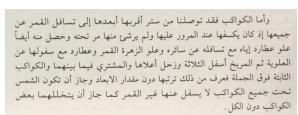

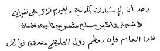

(a) Modern printed Arabic  
(b) Modern Standard Arabic script (Mahmoud et al., 2012)  
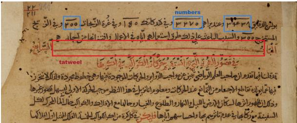  
(c) Excerpt from the corpus Qan¯ un¯ (Ms01).  
Figure 1: Examples of difficulties found in manuscripts (cursive script, numerals, tatweel).

## A.2 Multi-Witness Variation

Figure 2 illustrates the variation in the same passage of Chapter X.6 across four manuscripts. Even within a single script (Naskh: 2a and 2c), scribal hands differ noticeably; the Nasta’liq hand (2b) diverges further still. Ms03 (2d) was excluded from the corpus: bleed-through and ink stains render part of the text unrecoverable.

## A.3 Corpus Statistics

Table 5 reports, for each manuscript, the number of pages, lines, words, and non-space characters, the diacritization rate (diacritized characters as a percentage of total non-space characters), numeral and digit counts, and the number of editorial markers (e.g., [unreadable]). Manuscripts are grouped into two sections: (1) Tiers 1 and 2, drawn from al-Qan¯ un al-Mas ¯ cud¯ ¯ı, with the number of annotated chapters per manuscript; (2) Tier 3, drawn from the BnF collection.

## B Manual Annotation

## B.1 Excerpt from the ATHAAR Annotation Guide

The corpus was annotated following a dedicated annotation guide following historical manuscripts text editing conventions. Table 5 reports the resulting editorial markers. The excerpt below covers the transcription rules; the full guide will be made available upon acceptance together with the dataset repository.

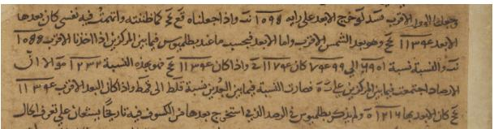

(a) Ms01  
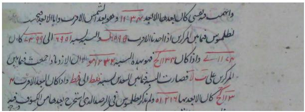

(b) Ms05  
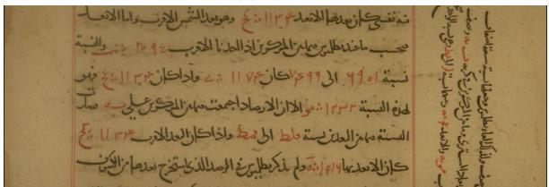

(c) Ms15  
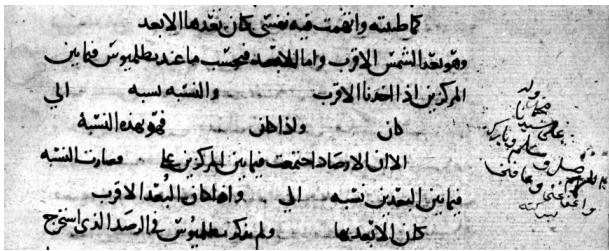  
(d) Ms03  
Figure 2: The same passage of Chapter X.6 across four manuscripts. Ms03 was excluded from the corpus due to severe degradation.

## B.1.1 Transcription Guidelines

Core principle. Transcribe strictly what the scribe wrote, without editorial emendation, modernization of orthography, or semantic interpretation. The transcription is diplomatic.

Main text scope.

• Transcribe: Titles, section headings, and the running body text.

• Exclude (delete corresponding auto-detected regions):

– Running headers

– Catchwords (page footers)

– Folio / page numbers

– Independent marginalia (glosses, correc-

<table><tr><td rowspan="2">Manuscript</td><td rowspan="2">Date</td><td rowspan="2">#ch. Chapter Script</td><td rowspan="2"></td><td colspan="7">Statistics</td></tr><tr><td></td><td>Pages Lines Words</td><td>Chars marks diacr.</td><td>Diacr.</td><td>% Numeral</td><td></td><td>strings Digits Tags</td></tr><tr><td colspan="9">Tiers 1–2: al-Qānūn al-Masūdī</td><td></td><td></td></tr><tr><td>Ms01_Berlin_Or-Quart-1613 12th c., 1166</td><td></td><td>X.6 2 I.4</td><td>Naskh</td><td>158 66</td><td>3,114 1,298</td><td>13,461 6,079</td><td>316 189</td><td>2.35 3.11</td><td>51 0</td><td>198 0</td><td></td></tr><tr><td>Ms02_Berlin_Or-Oct-275</td><td>19th c., 1834</td><td>X.6 2 XI.2</td><td>Nasta&#x27;liq</td><td>7 180 4 110</td><td>2,672 1,519</td><td>10,964 6,881</td><td>14 1</td><td>0.13 0.01</td><td>52 0</td><td>200 0</td><td>0 0</td></tr><tr><td>Ms04_Cairo Talat-Miqat-DM-866</td><td>13th c., 1274</td><td>X.6 2 IV.13</td><td>Naskh</td><td>6 174 2</td><td>2,826 742</td><td>14,231 4,208</td><td>2,643 1,161</td><td>18.57 27.59</td><td>53</td><td>195 0</td><td>0 0</td></tr><tr><td>Ms05_Hyderabad Asafiya-Riyada-374</td><td>17th c.</td><td>X.6 1</td><td>Nasta&#x27;liq</td><td>8</td><td>2,582</td><td>10,669</td><td></td><td>0.00</td><td>49</td><td>190</td><td>12</td></tr><tr><td>Ms06_Istanbul_ Askeri-Muze-87</td><td>11th–12th c., &lt;1137</td><td>X.6 2 IV.4</td><td>Naskh</td><td>8 6</td><td>2,523 148 1,737</td><td>11,586 8,322</td><td>1,151 1,414</td><td>9.93 16.99</td><td></td><td>202</td><td>0</td></tr><tr><td>Ms07_Konya Yusufaga-42Yu6625</td><td>18th c.</td><td>1 X.6</td><td>Naskh</td><td>8</td><td>238 3,116</td><td>13,158</td><td></td><td>0.01</td><td></td><td>173</td><td></td></tr><tr><td>Ms08_Istanbul_ Suleymaniye-Jarullah-1498</td><td>12th c., 1136</td><td>X.6 2 V.1</td><td>Nasta&#x27;liq</td><td>8 4</td><td>2,535 1,248</td><td>10,503 5,323</td><td>28</td><td>0.27 0.00</td><td></td><td>198</td><td>0 9</td></tr><tr><td>Ms09_Istanbul_ Beyazit-Veliyyuddin-2277</td><td>11th c., 1045</td><td>1 V.7</td><td>Naskh</td><td>4</td><td>1,262</td><td>5,095</td><td></td><td>0.12</td><td></td><td>38</td><td>0</td></tr><tr><td>Ms10_Istanbul_Kandilli-65</td><td>18th c., 1734</td><td>2 X.6 IX.6</td><td>Nasta&#x27;liq</td><td>7 2</td><td>2,695 724</td><td>11,189 3,225</td><td>65</td><td>0.58 0.22</td><td></td><td>198</td><td>0 0</td></tr><tr><td>Ms13_London_BL-Or-1997</td><td>12th c., 1174</td><td>X.6 2 VI.9</td><td>Naskh</td><td>5 3</td><td>2,521 1,231</td><td>10,554 5,264</td><td>114 113</td><td>1.08 2.15</td><td></td><td>198 27</td><td></td></tr><tr><td>Ms14_Mashhad_5588</td><td>17th c., 1686</td><td>1 X.6</td><td>Naskh</td><td>6</td><td>2,571</td><td>10,948</td><td>225</td><td>2.06</td><td></td><td>185</td><td>2</td></tr><tr><td>Ms15_Mashhad_ Radawi-12292</td><td>13th c.</td><td>1 X.6</td><td>Naskh</td><td>9</td><td>2,573</td><td>10,666</td><td>67</td><td>0.63</td><td>51</td><td>192</td><td></td></tr><tr><td>Ms16_Oxford_Bodl-Or-516</td><td>11th c., 1082</td><td>1 III.3</td><td>Naskh</td><td>3</td><td>1,014</td><td>3,770</td><td>83</td><td>2.20</td><td></td><td>23</td><td></td></tr><tr><td>Ms17_Paris BnF-Arabe-6840</td><td>12th c., 1108</td><td>X.6 2 X.12</td><td>Naskh</td><td>4 2</td><td>144 3,164 1,393</td><td>12,819 5,953</td><td></td><td>0.01 0.00</td><td></td><td>201</td><td>0</td></tr><tr><td>Ms18_Rampur_Raza-3700</td><td>17th c., 1625</td><td>1 X.6</td><td>Naskh</td><td>6</td><td>2,718</td><td>11,317</td><td>141</td><td>1.25</td><td>51</td><td>198</td><td>0</td></tr><tr><td colspan="10">Subtotal Tiers 1–2</td><td></td><td>686 2,616</td></tr><tr><td>Tier 3: other scientific treatises (BnF, Gallica) Ms_Abu-l-wafa_Paris_</td><td>12th</td><td>1 I.8</td><td>Naskh</td><td>6</td><td>1,839</td><td>6,655</td><td>94</td><td>1.41</td><td></td><td></td><td>0</td></tr><tr><td colspan="10">BnF-Arabe-2494_I.8</td><td></td><td>0</td></tr><tr><td>Ms_IbnalHaytham_Paris_ BnF-Arabe-2458</td><td>1144</td><td>1</td><td>Naskh</td><td>3</td><td>82 1,459</td><td>5,192</td><td>157</td><td>3.02</td><td></td><td></td><td>6</td></tr><tr><td>Ms_Farghani_Paris_ BnF-Arabe-2504</td><td>17th–18th c.</td><td>1 一</td><td>Naskh</td><td>6</td><td>124 1,259</td><td>5,654</td><td></td><td>0.04</td><td></td><td></td><td>0</td></tr><tr><td>Ms_Farghani_Paris_ BnF-Arabe-2546</td><td>1601</td><td>1</td><td>Naskh</td><td>6</td><td>1,061</td><td>4,826</td><td></td><td>0.04</td><td></td><td></td><td>0</td></tr><tr><td>Ms_Biruni_Paris BnF-Arabe-2497</td><td>17th c.</td><td>1</td><td>Naskh</td><td>4</td><td>82 625</td><td>2,955</td><td>33</td><td>1.12</td><td></td><td></td><td>0</td></tr><tr><td>Ms_Tusi_Paris_ BnF-Arabe-2509_II.12</td><td>1389</td><td>1 II.12</td><td>Naskh</td><td>4</td><td>609</td><td>3,285</td><td></td><td>49415.04</td><td></td><td></td><td>0</td></tr><tr><td>Ms_Jaghmini_Paris_ BnF-Arabe-2500_I.1</td><td>1404</td><td>1 I.1</td><td>Naskh</td><td>5</td><td>68 743</td><td>5,204</td><td></td><td>1,844 35.43</td><td></td><td></td><td>2</td></tr><tr><td>Ms_IbnSina_Paris_ BnF-Arabe-2484_1</td><td>1284</td><td>1 1</td><td>Naskh</td><td>3</td><td>72 848</td><td>3,629</td><td>0</td><td>0.00</td><td></td><td>0</td><td>6</td></tr><tr><td>Ms_Sizji_Paris_ BnF-Arabe-4821</td><td>1149</td><td>1 一</td><td>Maghrebi</td><td>13</td><td>199 1,934</td><td>6,895</td><td>137</td><td>1.99</td><td></td><td></td><td>0 0</td></tr><tr><td>Subtotal Tier 3 Total</td><td>32</td><td>9</td><td></td><td>50</td><td>924 10,377</td><td>44,295</td><td>2,763</td><td>6.24</td><td>2</td><td></td><td>2 19</td></tr></table>

Table 5: Statistics of the manuscripts, one row per manuscript. “Chars” excludes spaces; “Diacr. marks” counts diacritic marks and “% diacr.” is their share of “Chars”. “Numeral strings” counts the numerals (transcribed or tagged) and “Digits” the digits transcribed. Manuscript identifiers match the dataset folder names to facilitate reproducibility.

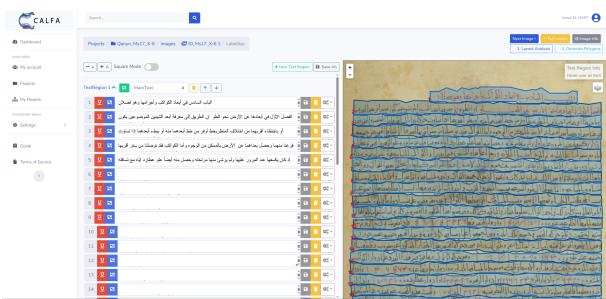  
Figure 3: Calfa Vision annotation interface.

tions, external notes)

– Data tables

– Geometric diagrams and figures

Split words overflowing into margins. When a word starting in the main line overflows into the margin due to lack of space (see Figure 4), transcribe the fragments as a single unified word on that line. Extend the baseline and polygon to encompass the marginal fragment.

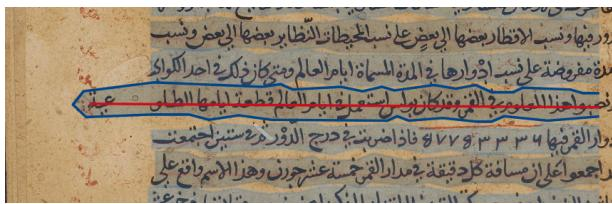  
Figure 4: Example of a word split across the text column and the margin, alongside expected transcription.

Distinguish this from independent marginal annotations (glosses, reader notes, collations), which must never be transcribed.

Vocalization (Tashk¯ıl). Historical texts are largely unvocalized. Transcribe diacritics and short vowels only where explicitly written by the scribe. Never add unwritten diacritics (see Figure 5).

Numerals. Scientific manuscripts frequently include numerical data, often overlined (see Figure 6).

Rules:

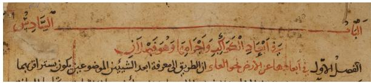  
Figure 5: Example of partially vocalized text alongside unvocalized passages.

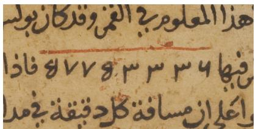  
Figure 6: Overlined numerical digits  
• If readable: Transcribe the digits directly.

• If ambiguous or difficult to read: Insert a tag identifying the numeral system, as shown below:

<table><tr><td colspan="2">Case Tag</td></tr><tr><td>Abjad numerals (alphanumerical notation)</td><td>[abjad_numbers])</td></tr><tr><td>Eastern Arabic-Indic numerals</td><td>[indian_numbers])</td></tr><tr><td>Western Arabic numerals</td><td>[arabic_numbers])</td></tr><tr><td>(0123456789) Unidentified numeral system</td><td>[unknown_numbers])</td></tr></table>

Overlined elements. Non-numerical elements carrying a horizontal overline are tagged according to their function:

<table><tr><td>Overlined Entity</td><td>Tag</td></tr><tr><td>Geometric label or object</td><td>[geometrical_object])</td></tr></table>

Illegible or damaged text. Where text is unreadable due to ink flaking, stains, holes, or physical decay:

• Insert [unreadable]) at the corresponding point in the line.

• If an entire line is unreadable, record solely [unreadable\_line]) for that line.

Elements excluded from segmentation. Delete any automatic TextRegion covering:

• Geometric diagrams

• Astronomical tables (grids of numerical entries)

• Decorative illuminations and ornaments

• Folio / page stamps and pagination

• Library ownership stamps

Tag summary. The final list of tags that can be usd is summurized below.

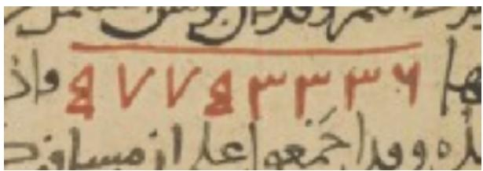  
(a) Variant Eastern Arabic-Indic digit forms whose reading is ambiguous.

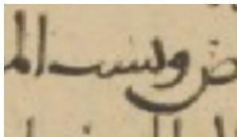  
(b) Letters with missing distinguishing dots (example 1).

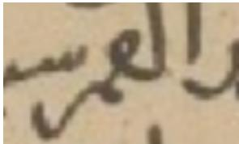  
(c) Letters with missing distinguishing dots (example 2).

Figure 7: Examples of annotation challenges arising from manuscript ambiguity rather than annotator error.
<table><tr><td>Tag</td><td>Description</td></tr><tr><td>[abjad_numbers])</td><td>Untranscribed Abjad numer- als</td></tr><tr><td>[indian_numbers])</td><td>Untranscribed Eastern Arabic-Indic digits</td></tr><tr><td>[arabic_numbers])</td><td>Untranscribed Western Ara-</td></tr><tr><td>[unknown_numbers])</td><td>bic digits Numerals of unidentified no- tation</td></tr><tr><td>[geometrical_object])</td><td>Overlined geometric object notation</td></tr><tr><td>[unreadable])</td><td>Illegible or damaged text</td></tr><tr><td>[unreadable_line])</td><td>within a line Completely illegible or dam- aged text line</td></tr></table>

## B.2 Annotation Challenges

The inter-annotators agreement results reported in Section 5.1 show that even with a welldocumented annotation guide, annotators still disagreed on details that are inherently ambiguous in the manuscript images rather than caused by annotator error. Two recurring sources of ambiguity are illustrated below.

Figure 7a shows a numeral string whose digit forms do not match any standard numeral family: they are variant forms of Eastern Arabic-Indic digits whose exact reading is open to interpretation, even for an expert reader.

Figures 7b and 7c show words in which the scribe omitted letter-distinguishing dots. Since several Arabic letters share the same base form and differ only by their dots, their absence makes the correct reading genuinely uncertain without recourse to the surrounding context.

## C Experimental details

## C.1 Experiments Split Statistics

Table 6 reports the number of lines available for each experiment after the 70/30 query/support split described in Section 6.

<table><tr><td>Exper.</td><td>Total lines</td><td>Query (70%)</td><td>Support (30%)</td></tr><tr><td>C-SCR</td><td>2,164</td><td>1,516</td><td>648</td></tr><tr><td>C-CH</td><td>804</td><td>564</td><td>240</td></tr><tr><td>C-TR</td><td>924</td><td>646</td><td>278</td></tr></table>

Table 6: Line counts per experiment after the 70/30 query/support split.

## C.2 Hardware and Parameters Configfuration

All models are run with temperature T = 0 and max\_tokens = 256. Open-weight models are run on a single NVIDIA RTX 8000 GPU (48 GB VRAM) using Python 3.12 and CUDA 12.8.

## C.3 Per-Witness Results

Tables 7–9 report per-witness CER and WER for each experiment.

• Experiment C-SCR (Table 7): witnesses are divided into two groups according to the query script. The first group lists Naskh query witnesses, whose support exemplars are drawn from the Nasta’liq pool; the second lists Nasta’liq query witnesses, whose support is drawn from the Naskh pool.

• Experiment C-CH (Table 8): each query witness belongs to Tier 2, i.e. a chapter of al-Qan¯ un¯ other than X.6; its support exemplars are drawn from the Tier 1 witness of the same manuscript.

• Experiment C-TR (Table 9): each query witness belongs to Tier 3, i.e. a treatise other than al-Qan¯ un¯ ; all queries share the same support bank, drawn once from all Tier 1 and Tier 2 witnesses.

## C.4 Ablation Study: Number of Exemplars

To select k, we ran a preliminary ablation with Gemini 3 Flash on Tier 1, using five witnesses as the support pool and eight as the query pool. For each $k \in \{ 1 , 3 , 5 , 7 , 1 0 \}$ , three trials were run with independently drawn support lines and scored with

<table><tr><td colspan="2"></td><td>Gemini</td><td>CHURRO</td><td></td><td>Qari-OCR</td><td></td></tr><tr><td colspan="2">Witness</td><td>CER WER</td><td>CER</td><td>WER</td><td>CER</td><td>WER</td><td></td></tr><tr><td colspan="2">Naskh queries </td><td>- support from Nasta’liq pool</td><td></td><td></td><td></td><td></td><td>225.0</td></tr><tr><td rowspan="3">Ms01 1613) Ms04 866)</td><td>(Berlin</td><td>14.3</td><td>48.4</td><td>64.2</td><td>115.2</td><td>175.8</td><td></td></tr><tr><td>(Cairo</td><td>34.1</td><td>123.9</td><td>62.2</td><td>109.8</td><td>106.5</td><td>153.3</td></tr><tr><td>(Istanbul</td><td>19.6</td><td>86.7</td><td>54.5</td><td>93.9</td><td>123.5</td><td>155.1</td></tr><tr><td>Ms07 6625)</td><td>(Konya</td><td>13.4</td><td>41.5</td><td>74.6</td><td>125.2</td><td>247.9</td><td>338.2</td></tr><tr><td>Ms13 1997)</td><td>(BL Or-</td><td>19.8</td><td>59.0</td><td>110.9</td><td>153.4</td><td>152.6</td><td>188.2</td></tr><tr><td>5588)</td><td>Ms14 (Mashhad</td><td>12.6</td><td>47.5</td><td>73.8</td><td>116.7</td><td>160.9</td><td>201.0</td></tr><tr><td>12292)</td><td>Ms15 (Mashhad</td><td>19.2</td><td>61.0</td><td>64.3</td><td>125.2</td><td>200.6 274.8</td><td></td></tr><tr><td>Ms17 (BnF Ar. 6840)</td><td></td><td>8.1</td><td>32.2</td><td>59.5</td><td>101.0</td><td>132.3</td><td>171.8</td></tr><tr><td>Ms18 3700)</td><td>(Rampur</td><td>7.5</td><td>28.5</td><td>64.1</td><td>112.1</td><td>120.7</td><td>173.9</td></tr></table>

<table><tr><td>C-SCR(N)</td><td>16.3 62.3</td><td>70.0 115.6</td><td></td><td>154.5</td><td>198.9</td></tr><tr><td>Nasta’liq queries</td><td></td><td></td><td>- support from Naskh pool</td><td></td><td></td></tr><tr><td>Ms02 (Berlin 275)</td><td>22.0</td><td>67.1</td><td>65.3 113.3</td><td>233.2</td><td>291.6</td></tr><tr><td>Ms05 abad 374)</td><td>(Hyder- 15.6</td><td>48.0</td><td>134.4 190.0</td><td></td><td>161.4 242.0</td></tr><tr><td>Ms08 (Istanbul 1498)</td><td>27.2</td><td>72.9</td><td>77.0</td><td>140.0147.3215.5</td><td></td></tr><tr><td>Ms10 (Istanbul 65)</td><td>11.2</td><td>33.2</td><td>49.7</td><td>104.1 110.6 151.8</td><td></td></tr><tr><td>C-SCR(NT)</td><td>18.5</td><td>53.8</td><td>79.9</td><td>134.9 158.6</td><td>219.5</td></tr></table>

Table 7: Per-witness CER and WER (%) for C-SCR at k = 3 (cross-script).

<table><tr><td colspan="2"></td><td colspan="2">Gemini</td><td colspan="2">CHURRO</td><td colspan="2">Qari-OCR</td></tr><tr><td colspan="2">Witness</td><td>CER</td><td>WER</td><td>CER</td><td>WER</td><td>CER</td><td>WER</td></tr><tr><td colspan="2">Ms01 1613)</td><td>(Berlin</td><td>5.6</td><td>26.9</td><td>35.3</td><td>85.0</td><td>156.4 171.8</td></tr><tr><td colspan="2">Ms02 275)</td><td>(Berlin 25.3</td><td>60.3</td><td>55.5</td><td>109.3</td><td></td><td>250.2 343.0</td></tr><tr><td colspan="2">Ms04 866)</td><td>(Cairo 28.0</td><td>99.7</td><td>40.7</td><td>91.0</td><td>124.5</td><td>117.5</td></tr><tr><td colspan="2">Ms06 (Istanbul 87)</td><td>23.3</td><td>82.9</td><td>57.1</td><td>108.02</td><td>203.3</td><td>168.3</td></tr><tr><td colspan="2">Ms08 (Istanbul 1498)</td><td>35.0</td><td>86.0</td><td>111.0</td><td>167.5</td><td></td><td>106.4172.0</td></tr><tr><td colspan="2">Ms10 (Istanbul 65)</td><td>11.0</td><td>32.5</td><td>62.1</td><td>108.9</td><td></td><td>145.8219.2</td></tr><tr><td colspan="2">Ms13 1997)</td><td>3 (BL Or- 15.3</td><td>56.9</td><td>69.6</td><td>123.1</td><td></td><td>107.0142.5</td></tr><tr><td colspan="2">Ms17 (BnF Ar. 15.2 6840)</td><td></td><td>43.9</td><td>56.0</td><td></td><td>113.1 216.0 298.5</td><td></td></tr><tr><td colspan="2">C-CH</td><td></td><td>18.9 63.2</td><td>59.3</td><td>109.2</td><td>163.1</td><td>194.0</td></tr></table>

Table 8: Per-witness CER and WER (%) for C-CH at k = 3 (cross-chapter transfer).

CER and WER. Results are reported in Table 10. No condition outperforms the others by a margin exceeding the trial-to-trial standard deviation, suggesting the model reaches its performance ceiling regardless of k on this task.

We therefore set k = 3 for all experiments, since no value of k outperforms the others by a statistically meaningful margin.

## C.5 Few-shot Prompt

## Few-shot prompt

You transcribe single lines from historical Arabic scientific manuscripts.

Task: write exactly what the scribe wrote on the line in the TEST IMAGE.

1. Do not correct, normalize or modernize it.

2. Write diacritics (vowel signs, shadda, sukun) only where they are visible. Never add them.

3. Write hamza and letter dots only as they appear in the image.

4. Write numerals with Eastern Arabic-Indic digits (e.g. 0–9 rendered in their Arabic-Indic form).

5. If a word is illegible, skip it. Never guess or complete it from context.

6. Output only the transcription of the TEST IMAGE, on one line: no translation, explanation, quotes or formatting.

The EXAMPLES below show the expected output format. Do not copy their text into your answer.

## Examples:

<example> <image> [support image 1] </image> <transcription> [support transcription 1] </transcription> </example>

<example> <image> [support image s] </image> <transcription> [support transcription s] </transcription> </example> Test Image: <image> [query image] </image> <transcription>

<table><tr><td></td><td colspan="2">Gemini</td><td>CHURRO</td><td></td><td>Qari-OCR</td></tr><tr><td>Witness</td><td>CER</td><td>WER</td><td>CER WER</td><td>CER</td><td>WER</td></tr><tr><td>Ms Ar 2494 (Abū al-Wafā)</td><td>25.1</td><td>63.3</td><td>68.7</td><td>105.8 153.7</td><td>175.2</td></tr><tr><td>Ms Ar 2458 (Ibn al-Haytham)</td><td>29.3</td><td>73.2</td><td>75.3</td><td>114.7 335.7</td><td>335.8</td></tr><tr><td>Ms Ar 2504 (Farghānī)</td><td>2.3</td><td>13.7</td><td>38.4</td><td>107.4</td><td>260.6 381.1</td></tr><tr><td>Ms Ar (Farghānī)</td><td>2546 13.9</td><td>39.8</td><td>49.3</td><td>110.8</td><td>217.5319.4</td></tr><tr><td>Ms Ar (Bīrūnī)</td><td>2497 7.5</td><td>25.9</td><td>32.8</td><td>104.9</td><td>275.6377.8</td></tr><tr><td>Ms Ar (Tūsī)</td><td>2509 16.3</td><td>78.7</td><td>37.8</td><td>93.1</td><td>252.9 282.2</td></tr><tr><td>Ms Ar 2500 (Jaghmīnī)</td><td>20.9</td><td>60.6</td><td>63.1</td><td>98.8</td><td>195.3 137.6</td></tr><tr><td>Ms Ar 2484 (Ibn Sīnā)</td><td>29.2</td><td>79.3</td><td>77.6</td><td>136.2</td><td>309.1 375.0</td></tr><tr><td>Ms Ar 4821 (Sijzī)</td><td>29.9</td><td>75.0</td><td>136.4</td><td>181.5344.3</td><td>279.6</td></tr><tr><td>C-TR</td><td>20.4</td><td>61.1</td><td>63.9</td><td>112.5</td><td>252.9 260.8</td></tr></table>

Table 9: Per-witness CER and WER (%) for C-TR at k = 3 (cross-treatise transfer).

<table><tr><td>k</td><td>CER (%)↓</td><td>WER (%)↓</td></tr><tr><td>1</td><td> $1 4 . 0 8 \pm 0 . 4 8$ </td><td> $3 8 . 7 9 \pm 1 . 9 5$ </td></tr><tr><td>3</td><td> $1 4 . 5 5 \pm 0 . 9 0$ </td><td> $3 9 . 7 3 \pm 0 . 8 1$ </td></tr><tr><td>5</td><td> $1 4 . 3 1 \pm 1 . 2 8$ </td><td> $3 8 . 6 6 \pm 1 . 9 4$ </td></tr><tr><td>7</td><td> $1 5 . 1 1 \pm 0 . 2 1$ </td><td> $3 9 . 6 3 \pm 0 . 7 2$ </td></tr><tr><td>10</td><td> $1 4 . 3 9 \pm 1 . 5 9$ </td><td> $3 8 . 6 4 \pm 2 . 9 7$ </td></tr></table>

Table 10: k-shot ablation on Tier 1 (Gemini 3 Flash, 3 trials per k). Scores are reported in CER and WER.