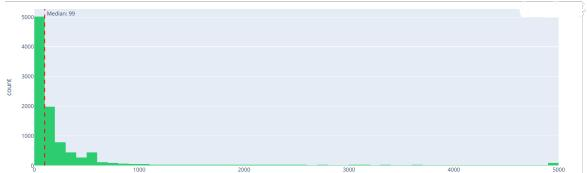
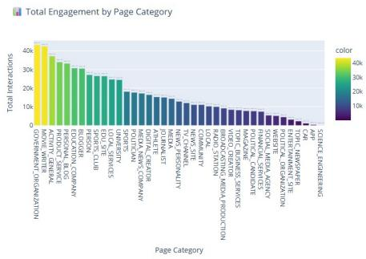
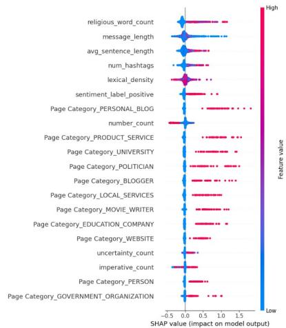
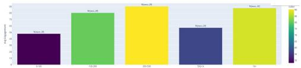
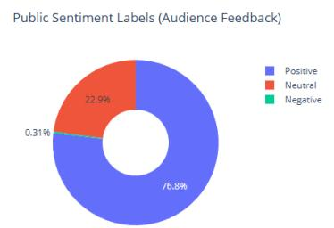
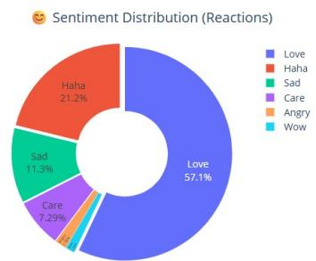

# AraEngage: Interpretable Linguis3c Correlates of Engagement in Arabic Facebook News

Shimaa Ibrahim1, Nour Elhouda Dalloua1, Md. Rafiul Biswas2, Wajdi Zaghouani1

1Northwestern University in Qatar, Doha, Qatar 2Hamad Bin Khalifa University, Doha, Qatar {shimaa.ibrahim, wajdi.zaghouani}@northwestern.edu, nourelhoudadalloua@gmail.com, mbiswas@hbku.edu.qa

## Abstract

Engagement features developed for English are rou4nely applied to Arabic, but unvocalized Arabic changes what a lexical feature measures. We introduce AraEngage, a querydefined sample of 10,000 public Arabic Facebook news posts from 2,451 pages in 57 countries (2023–2024) that pairs engagement counts with interpretable linguis4c features. We use it to examine which interpretable Arabic indicators are associated with followernormalized engagement, and how far those associa4ons can be trusted given publisher context, the defini4on of engagement, and lexical ambiguity. Religious expressions, message length, sentence length, and lexical density are the leading correlates in a Random

Forest model (R2	= 0.38 on a post-level split) interpreted with SHAP. Unlike English news, posi4ve sen4ment is associated with higher engagement in this Arabic news sample. Message length shows a length paradox: unadjusted raw engagement is highest for long posts, whereas the model’s aYribu4ons for follower-normalized engagement favor short posts. A linguis4c audit iden4fies why standard lexicon features are fragile in unvocalized Arabic: impera4ve lists contain homographs such as ربع ”) express!”, but also the frequent preposi4on “via”), hedge lists conflate the possibility marker دق + imperfect (“may”) with the empha4c دق + perfect (“has indeed”), and religious lists mix devo4onal formulas with place names in poli4cal news. These are plausible sources of measurement error that may aYenuate the nearzero associa4ons of impera4ves and hedges. All findings are observa4onal associa4ons with opera4onalized indicators. We release the derived linguis4c features, engagement counts, refined lexicons, and analysis code; raw posts are not redistributed, in line with CrowdTangle terms.

## 1 IntroducBon

Likes, shares, and comments are widely used as proxies for how content resonates with audiences (Berger and Milkman, 2012; Brady et al., 2017; Mahmud et al., 2014). A long line of work asks how wording, not only topic or author, relates to propagaEon (Tan et al., 2014; Ashok et al., 2013; Xu and Chawla, 2017), and finds associaEons with emoEonal valence, informaEveness, readability, and plaMorm convenEons (Guerini et al., 2011; Kramer et al., 2014). Almost all of this work is on English. Arabic studies examine single features, such as hedging (Soufan, 2026), or single dialects (ESalibi and El Ouardighi, 2025).

Transferring English feature sets to Arabic is harder than it looks, because unvocalized script makes many surface forms ambiguous. An “imperaEve” lexicon that lists ربع ”) express!”) also counts every occurrence of the preposiEon “via”, one of the most frequent words in news text. A “hedge” lexicon that lists دق counts both دق نوكی ”) may be”) and لاق دق ”) has indeed said”), so it mixes uncertainty with its opposite. Such features can be computed without error and sEll measure something other than what their name says. Arabic also lacks the indefinite arEcle that English work uses to measure “generality”, and readability formulas such as Flesch are not defined for it (El-Haj and Rayson, 2016).

We therefore frame the study around the reliability of interpretable indicators, not only their predicEve value. RQ1: Which textual and contextual indicators are associated with follower-normalized engagement on Arabic news posts? RQ2: Which English-derived indicators can be transferred to

Arabic as valid measurements, and which are at risk of measuring something else? RQ3: Which conclusions depend on how engagement is defined and on publisher context?

Contribu.ons. (1) AraEngage, a mulE-country feature release for Arabic Facebook news posts containing engagement counts, page context, nine derived linguisEc features per post, and a datasheet (§3, Appendix A); raw post text is not redistributed. (2) A linguis.c audit idenEfying homographs, the two funcEons of دق, and topical place names as sources of measurement error in Arabic lexicon features, with a feature-transfer table, refined lexicons, and guidance for anyone transferring English feature sets (§5.4). (3) An analysis of the length paradox, in which descripEve and model-based evidence on message length point in opposite direcEons, and of what the exisEng evidence can and cannot separate (§5.3). (4) Evidence that the nega.vity efect reported for English news does not hold in this Arabic sample, together with the leading correlates of engagement: religious expressions, sentence length, and lexical density (§5.2).

## 2 Related Work

Wording and engagement. PropagaEon depends on wording as well as on topic and author (Tan et al., 2014). InformaEveness, part-of-speech profiles, and explicit requests to share predict shareability (Ashok et al., 2013; Xu and Chawla, 2017). EmoEonal arousal of either valence is associated with sharing (Berger and Milkman, 2012; Godes et al., 2005; Heath et al., 2001; Hansen et al., 2011). EmoEons spread through networks (Kramer et al.,

2014), especially in moral and poliEcal discourse (Brady et al., 2017), and negaEvity aSracts aSenEon in news contexts (Guerini et al., 2011; Heiss et al., 2019). LIWC categories for cogniEve and social processes also predict engagement (Mahmud et al., 2014).

Arabic engagement and persuasion. Soufan with) دق,رامب) hedges associate) 2026( engagement, and ESalibi and El Ouardighi (2025) study Moroccan Arabic. Suchan (2014) describe strong emoEonal expression and metaphor as features of Arabic persuasion, and Myers et al. (2023) discuss religiosity in online engagement. These studies examine single features or single varieEes; none combines them in one model or examines how Arabic lexical features behave under transfer.

Orthographic ambiguity in Arabic. Arabic is usually wriSen without short vowels, so a single undiacriEzed form can correspond to several words with diferent parts of speech, and cliEcs aSach conjuncEons, preposiEons, and pronouns to their hosts (Habash, 2010; Darwish et al., 2021). Arabic NLP addresses this with segmenters and in-context morphological disambiguators such as MADAMIRA,

<table><tr><td>Posts</td><td>10,000 public Facebook page posts</td></tr><tr><td>Pages</td><td>2,451, administered from 57 countries</td></tr><tr><td>Period</td><td>2023-04-12 to 2024-08-07</td></tr><tr><td>Retrieval</td><td>CrowdTangle, five MSA news keywords</td></tr><tr><td>Engagement</td><td>reactions by type, comments, shares, followers at posting, Interactivity Index</td></tr><tr><td>Context</td><td>page category, post type, page-admin country</td></tr><tr><td>Linguistic features</td><td>length, lexical density, numerals, hashtags, sentence length, sentiment label, religious, imperative, and hedge</td></tr><tr><td>Resources</td><td>counts lexicons (original and refined), feature-extraction and</td></tr><tr><td>Privacy</td><td>analysis code no page names or user identifiers</td></tr></table>

Table 1: AraEngage at a glance.

Farasa, and CAMeL Tools (Pasha et al., 2014; Abdelali et al., 2016; Obeid et al., 2020). Engagement studies, by contrast, typically count surface forms from word lists. Whether such counts measure their intended construct in Arabic has not been examined; our audit addresses this gap.

Arabic language technology and interpreta.on. Arabic senEment classificaEon relies on pretrained encoders such as CAMeLBERT (Inoue et al., 2021), AraBERT (Antoun et al., 2020), and MARBERT

(Abdul-Mageed et al., 2021). For interpretaEon, SHAP (Lundberg and Lee, 2017; Lundberg et al., 2020) aSributes predicEons to features. ASribuEons describe a fiSed model and are complemented by parEal dependence views (Friedman, 2001).

## 3 The AraEngage Dataset

We retrieved public Facebook page posts through CrowdTangle, Meta’s research tool (disconEnued in August 2024), with the Arabic keywords رابخأ وانع نی 	 	 ,(news breaking (رابخأ ةلجاع ,(news( رابخلأا)news headlines), تاثیدحت )updates), and 2023-04- between ,)events current (ثادحلأا 		 راجلا ةی 12 and 2024-08-07. The export contains 10,000 posts from 2,451 pages whose administrators are located in 57 countries. Page-admin country is a plaMorm field and does not idenEfy audience locaEon. The 41 export fields are listed in Table 2; we use the text fields (Message, Link Text, Image Text), page and post metadata, and engagement counts. Table 1 summarizes the dataset, and §7 describes its public release.

Generic keywords also retrieve non-news content. تاثیدحت )updates), for example, matches app and plaMorm announcements, which is reflected in frequent tokens such as قیبطت )app), ةصنم) plaMorm), and مارجیلیت ) Telegram) (Table 3). We keep these posts, since they are part of what a keyworddefined news corpus contains, and treat the corpus as a query-defined sample rather than a sample of news journalism.

emoEonal reacEon types (all reacEons except Like; Figure 4), Love is the most frequent (57.1%), followed by Haha (21.2%), Sad (11.3%), and Care (7.3%); Angry and Wow are rare. By page category (Figure 1, right), total raw engagement is highest for government organizaEons and movie writers, followed by general acEviEes, services, personal blogs, and educaEon pages, while science, app, car, newspaper, and entertainment pages register relaEvely liSle. Because these are totals, they reflect how many posts each category contributes as well as how much engagement each post receives.

Table 3 shows the most frequent keywords. Besides the query word رابخا ) news), they fall into three groups. Religious: اله )God). PoliEcal: نیطسلف

<table><tr><td>Category</td><td>Description</td><td>Columns</td></tr><tr><td>Page-level (7)</td><td>Attributes of the source page</td><td>Page Name; User Name; Facebook Id; Page Category; Page Admin Top Country; Page Description; Page Created</td></tr><tr><td>Page audience at posting (2)</td><td>Page size when posted</td><td>Likes at Posting; Followers at Posting</td></tr><tr><td>Post timing (3)</td><td>Timestamps</td><td>Post Created; Post Created Date; Post Created Time</td></tr><tr><td>Post type (1)</td><td>Declared type</td><td>Type (Video, Status, Photo, Link)</td></tr><tr><td>Engagement totals (4)</td><td>Aggregate counts</td><td>Total Interactions; Likes; Comments; Shares</td></tr><tr><td>Emotional reactions (6)</td><td>Reaction counts</td><td>Love; Wow; Haha; Sad; Angry; Care</td></tr><tr><td>Video-related (6)</td><td>Video metadata</td><td>Video Share Status; Is Video Owner?; Post Views; Total Views; Total Views For All Crossposts; Video Length</td></tr><tr><td>Links &amp; URLs (3)</td><td>References</td><td>URL; Link; Final Link</td></tr><tr><td>Content &amp; text (4)</td><td>Text fields</td><td>Message; Image Text; Link Text; Description</td></tr><tr><td>Sponsorship (3)</td><td>Sponsor fields</td><td>Sponsor Id; Sponsor Name; Sponsor Category</td></tr><tr><td>Performance (2)</td><td>CrowdTangle indicators</td><td>Total Interactions (weighted); Overperforming Score</td></tr></table>

Table 2: The 41 CrowdTangle export columns.

  
Figure 1: Lec: distribu4on of message length (characters). Right: total raw engagement by page category; totals combine the number of posts per category with per-post engagement.

Corpus profile. Messages are short and rightskewed: the mean length is 349 characters, the median 99, and the maximum 4,999 (Figure 1, lem). Only 16.3% of posts contain a URL, and posts average 0.75 hashtags, 0.20 exclamaEon marks, and 0.09 quesEon marks, a register closer to asserEve announcement than to conversaEon. Sharing is rare relaEve to liking (share-to-like raEo: mean 0.071, median 0), and engagement is concentrated, with the top decile of posts beginning at 180 interacEons. Among the (PalesEne), لجاع ) urgent/breaking). PlaMorm and مارجلیت ,(plaMorm(ةصنم ,(link(طبار :commercial

<table><tr><td>Arabic</td><td>English</td><td></td><td>Freq.</td><td>Avg. eng. Total eng.</td><td></td></tr><tr><td></td><td></td><td>news</td><td>4,73</td><td></td><td>90.9 430,95</td></tr><tr><td></td><td></td><td>via/</td><td>9</td><td>4</td><td>4</td></tr><tr><td></td><td></td><td>throug</td><td>84</td><td>51.7</td><td>43,764</td></tr><tr><td></td><td></td><td>h</td><td>5</td><td>9</td><td>60,63</td></tr><tr><td></td><td></td><td>link</td><td>838</td><td>72.3</td><td>3</td></tr><tr><td></td><td></td><td></td><td></td><td>5</td><td></td></tr></table>

<table><tr><td>户</td><td>God to follow</td><td>782 133.0 104,06</td><td></td><td>8</td></tr><tr><td rowspan="5"></td><td>urgent/ e</td><td>731 8 684</td><td>69.6</td><td>50,891</td></tr><tr><td>breaking Palestin</td><td>593</td><td>2</td><td>31,13</td></tr><tr><td></td><td>563</td><td>45.5</td><td>1</td></tr><tr><td>platform</td><td>493</td><td>1</td><td>15,84</td></tr><tr><td></td><td>490</td><td>26.7</td><td>4</td></tr><tr><td></td><td>Telegra</td><td></td><td>2</td><td>14,87</td></tr><tr><td></td><td>m other</td><td></td><td>26.4</td><td>0</td></tr><tr><td></td><td>/ last</td><td></td><td>1</td><td>12,94</td></tr><tr><td></td><td></td><td></td><td>26.2</td><td>8</td></tr><tr><td></td><td></td><td></td><td>6</td><td>38,99</td></tr><tr><td></td><td></td><td></td><td></td><td>8</td></tr><tr><td></td><td></td><td></td><td>79.5</td><td></td></tr><tr><td></td><td></td><td></td><td>9</td><td></td></tr><tr><td></td><td></td><td></td><td></td><td></td></tr></table>

Table 3: Most frequent keywords in AraEngage with average and total raw interac4ons (not followernormalized). Unvocalized words can have several readings; the English column gives the main ones.

(Telegram), ةعباتمل )to follow). The third group reflects the generic query term تاثیدحت )updates) and shows that a keyword-defined news corpus mixes journalism with channel promoEon and app announcements. ربع )via) is the second most frequent keyword, which becomes important in §5.4. Among frequent keywords, اله has the highest average raw engagement (133.1 interacEons, vs. 90.9 for رابخا( , while poliEcal terms such as نیطسلف )26.7 ( and plaMorm terms such as ةصنم )26.4 ( receive the least.

## 4 Method

## 4.1 Target: Interac.vity Index

Following the weighEng used by Sotrender and Vairer et al. (2026), and the follower normalizaEon of Galeazzi et al. (2024), we define

$$
\begin{array}{c} \mathsf { l n l } = \begin{array} { c } { \mathsf { l } \cdot \mathsf { R e a c t i o n s } + 5 \cdot \mathsf { C o m m e n t s } + 8 \cdot \mathsf { S h a r e s } , } \\ { \mathsf { F o l l o w e r s } \mathsf { a t } \mathsf { p o s i n g } } \end{array}  \end{array}
$$

where ReacEons sums all reacEon types including Like. Clicks are not available. Dividing by followers compares posts from pages of very diferent sizes. A Yeo-Johnson transform (Yeo and Johnson, 2000) reduces the strong right skew. The weights are a pragmaEc convenEon that ranks comments and shares as costlier forms of engagement than reacEons; they are not a validated behavioral scale (§5.6).

## 4.2 Features

Table 4 summarizes the features. All text fields are concatenated. Message length is the number of characters. Lexical density is the share of contentword tokens (nouns, proper nouns, verbs, adjecEves, adverbs, numerals) among all tokens, tagged with Stanza’s tokenize,mwt,pos pipeline (Qi et al.,

2020). It approximates informaEon load (Halliday, 1985); proper nouns are included because named actors are central to poliEcal news in the region (Baker, 2006). Average sentence length (tokens per sentence) is a coarse processing-load proxy, not a readability score: Flesch is not defined for Arabic. Numerals count Western and Arabic-Indic digit sequences, and hashtags count # tokens. Sen.ment is the label (posiEve, negaEve, neutral) of the CAMeLBERT senEment classifier (Inoue et al., 2021; Obeid et al., 2020), applied to the first 512 characters of each post. This is a character limit, stricter than the model’s 512-subword input limit; because the median post has 99 characters, it afects only the longer posts, for which senEment reflects the opening of the text. Impera.ves, religious expressions, and hedges are counted with the lexicons in Table 6. Because Arabic religious formulas such as اله ءاش نإ pervade everyday language, we treat the religious count as a broad religion-related lexical signal, not a measure of an author’s religiosity. The contextual features are page category, post type, and followers at posEng.

<table><tr><td>Group</td><td colspan="2">OperationalizationMotivation</td></tr><tr><td>Length</td><td>number of characters</td><td>Tan et al. (2014)</td></tr><tr><td>Lexical</td><td>content-word density (Stanza POS); numeral</td><td>Ashok et al. (2013); Xu and Chawla (2017)</td></tr><tr><td>Processing load mean</td><td>count per sentence</td><td>tokens Tan et al. (2014)</td></tr><tr><td>Sentiment</td><td>(pos/neg/neu)</td><td>CAMeLBERT label Berger and Milkman (2012)</td></tr><tr><td>Platform</td><td>hashtag count</td><td>Xu and Chawla (2017)</td></tr><tr><td>Religious</td><td>lexicon count</td><td>religiousexpressionMyers et al. (2023); Suchan (2014)</td></tr><tr><td>Call to action</td><td>imperative lexiconTan et al. (2014) count</td><td></td></tr><tr><td>Hedging</td><td>epistemichedge lexicon count</td><td>Soufan (2026)</td></tr><tr><td>Context</td><td>page post</td><td>category, (contextual controls) type,</td></tr></table>

Table 4: Features. “Generality”, used in English work through the indefinite ar4cle, is not opera4onalized: Arabic has no indefinite ar4cle, and definiteness alone is not a valid proxy.
<table><tr><td>Model</td><td>MSE</td><td>R2</td></tr><tr><td>Ridge</td><td>0.8035</td><td>0.2337</td></tr><tr><td>MLP</td><td>0.7456</td><td>0.2888</td></tr><tr><td>k-NN</td><td>0.7028</td><td>0.3297</td></tr><tr><td>XGBoost</td><td>0.6728</td><td>0.3583</td></tr><tr><td>Random Forest</td><td>0.6473</td><td>0.3826</td></tr><tr><td>Prediction</td><td>of</td><td>the</td></tr></table>

Table 5: Predic4on of the transformed,  
followernormalized InI on the held-out 20% split.

## 4.3 Models and Interpreta.on

We compare Ridge regression, k-nearest neighbors, Random Forest (Breiman, 2001), XGBoost (Chen and Guestrin, 2016), and a onehidden-layer MLP (HasEe et al., 2009), implemented in scikit-learn (Pedregosa et al., 2011). Data are split 80/20 at random (seed 42). Numeric features are standardized on the training set, and categorical features are one-hot encoded. SHAP values (Lundberg and Lee, 2017) are computed for the best model. How to read the numbers. R2	and mean squared error (MSE) are computed on the transformed, followernormalized InI, not on raw counts. The split is at the post level, so posts from the same page can appear in both training and test data. SHAP values describe the fiSed model’s use of each feature; they indicate associaEons, not causal efects.

## 5 Results

## 5.1 Model performance

Tree ensembles perform best (Table 5): Random Forest explains 38% of the variance of the transformed InI, XGBoost 36%, and Ridge regression

Figure 2: SHAP values for the Random Forest model (test set). Each point is a post; color shows the feature value. Page categories with posi4ve contribu4ons include personal blogs, product/service, university, poli4cian, and blogger pages; governmentorganiza4on pages have lower contribu4ons.  
  
Figure 3: Average raw engagement by message-length bin (characters), without condi4oning on page or other features.

23%. The gap to Ridge indicates that part of the associaEon is non-linear or involves interacEons. The rest of the analysis interprets the Random Forest model.

## 5.2 Leading correlates

The four most influenEal features are textual (Figure 2). Higher religious-expression counts have larger posiEve SHAP values. In the raw data,

اله)God) has the highest average engagement among frequent keywords (133.1 interacEons per occurrence vs. 90.9 for رابخا, news; Table 3). Higher sentence length and lexical density also have posiEve contribuEons: posts that pack more content into longer sentences receive higher predicted engagement. Message length is the second most influenEal feature, with the direcEon discussed in §5.3.

## 5.3 The length paradox

Average raw engagement is highest for posts of 300–500 and over 1,000 characters (Figure 3), whereas the model’s SHAP aSribuEons favor shorter posts. Two things difer between these analyses at the same Eme. The engagement measure. The binned averages use raw interacEon counts; the model uses followernormalized, transformed InI.

The adjustment. The binned averages are unadjusted, whereas SHAP aSributes the model’s predicEon across all features jointly, including page category, post type, and followers. Either diference can produce the reversal. For example, if larger pages publish longer posts, long posts would have high raw counts because of their audiences but not high engagement relaEve to followers. The exisEng evidence cannot isolate which of the two diferences is responsible. Nor does a SHAP aSribuEon establish that shortening a post would change its engagement: the result holds within the fiSed model’s aSribuEon framework. In short: unadjusted raw engagement favors long posts; the model’s a9ribu;ons for follower-normalized engagement favor short posts. The two measure diferent things. Any claim about message length should therefore state its engagement measure and its adjustment set; separaEng the two requires unadjusted follower-normalized engagement by length bin and an adjusted efect esEmate such as accumulated local efects.

## 5.4 Linguis.c audit: what may not transfer

ImperaEve and hedge counts have SHAP values close to zero, and the religious count is the most influenEal feature. We audited all three lexicons (Table 6) for sources of measurement error that bear on these results. Table 7 lists the error sources with constructed examples.

Impera.ves are dominated by homographs. ربع (“express!”) is also the preposiEon “via / through”. It occurs 845 Emes in the corpus and is among the most frequent keywords (Table 3). بلاط ”) demand!”) is also “student”, عفاد ”) defend!”) “moEve”, توص ”) vote!”) “voice”, and عبات ”) follow!”) “afiliated with”. كراش, قلع, and عطاقalso read as third-person past-tense verbs (“he shared”, “he commented”, “he boycoSed”). In news text the nonimperaEve readings are likely to dominate, so the “imperaEve” count mostly measures preposiEons and reported acEons. Hedges conflate uncertainty with emphasis. With an imperfect verb, دق marks possibility ( دق نوكی, ” may be”); with a perfect verb, it marks compleEon or emphasis (لاق دق, ” has indeed said”) (Ryding, 2005). News reporEng uses the second construcEon omen, so the hedge count mixes uncertainty with asserEon. نكمی adds ability readings (“can”) to epistemic ones.

<table><tr><td>List</td><td>Lexicon used in this study</td><td>Refinement proposed by the audit (§5.4)</td></tr><tr><td>Imperative</td><td> $\sin x = ( \sin x + \sin x ) \cos ( \sin x + \sin x ) = \sin x \cos ( \sin x + \sin x ) \cos ( \sin x ) \cos x \cos ( \cos x ) = \sin ( \sin x ) \sin x \sin x$   $( \sum \limits _ { i = 1 } ^ { n } + \sin i \alpha ) ( \sin i \alpha + \sin i \alpha ) = ( \sum \limits _ { j = 1 } ^ { n } i \sum \limits _ { i = 1 } ^ { n } i \alpha - \sin i \alpha ) ( \sin i \alpha ) ( \sin i \alpha ) ( \sin j \alpha + \sin j \alpha )$  Share, publish, repeat, spread, send, comment, write, say, express, vote, watch, follow, read, look, notice, move, hurry, join, support, boycott, resist, demand, reject, defend, condemn</td><td>Removehomographs(via),(student),(motive), (voice)(prepared),(affiliated), and past-tense homographs  $\cdot \frac { \vert b \vert \cos \alpha } { \cos \alpha } < - \frac { \sqrt { 3 } } { 2 } , L \dot { 2 }$  add nambiguous plural forms  $1 0 0 0 0 1 0 0 0 1 5 0 0 0$ </td></tr><tr><td>Religious</td><td> ${ \begin{array} { r l } { \operatorname { c } _ { i } \operatorname { d } | { \boldsymbol { \hat { \mathcal { S } } } } | | { \boldsymbol { \hat { \mathcal { S } } } } | | } & { \operatorname { c } \bigcup _ { j \in { \mathcal { S } } } | | { \boldsymbol { \hat { \mathcal { S } } } } | | _ { \infty } \operatorname { c } _ { j } \operatorname { d } | \operatorname { c } _ { j } \operatorname { L a n } \ \omega } \\ & { \operatorname { c } _ { j } \operatorname { d } | { \boldsymbol { \hat { \mathcal { S } } } } | | { \boldsymbol { \hat { \mathcal { S } } } } | | } \end{array} } \ldots \operatorname { c } _ { i } \operatorname { d } | | { \boldsymbol { \hat { \mathcal { S } } } } | | { \boldsymbol { \hat { \mathcal { S } } } } | | { \boldsymbol { \hat { \mathcal { S } } } } | | { \boldsymbol { \hat { \mathcal { S } } } } \operatorname { a } \operatorname { c } _ { j } \operatorname { d } | | { \boldsymbol { \hat { \mathcal { S } } } } \ldots | | { \boldsymbol { \hat { \mathcal { S } } } } | | { \boldsymbol { \hat { \mathcal { S } } } } | | { \boldsymbol { \hat { \mathcal { S } } } } | |  \ldots \operatorname { c } _ { j } \operatorname { d } | | { \boldsymbol { \hat { \mathcal { S } } } } | | { \boldsymbol { \hat { \mathcal { S } } } } | | { \boldsymbol { \hat { \mathcal { S } } } } \operatorname { a } \operatorname { c } _ { j } \operatorname { t } | { \boldsymbol { \hat { \mathcal { S } } } } | |  \ \ldots \operatorname { c } _ { j } \operatorname { d } | | | { \boldsymbol { \hat { \mathcal { S } } } } | | | { \boldsymbol { \hat { \mathcal { S } } } } | | { \boldsymbol { \hat { \mathcal { S } } } } | | { \boldsymbol { \hat { \mathcal { S } } } } | | { \boldsymbol { \hat { \mathcal { S } } } } | | { \boldsymbol { \hat { \mathcal { S } } } } | | { \boldsymbol { \hat { \mathcal { S } } } } | | { \boldsymbol { \hat { \mathcal { S } } } } | | { \boldsymbol { \hat { \mathcal { S } } } } | |  \boldsymbol  \hat  \mathcal  S$   $( \sin ^ { 2 } \alpha + \sin \alpha ] 1 \cos \alpha \sin \alpha \sin \beta 1 \cos \alpha \sin \alpha \cos \alpha \cos \alpha \sin \alpha \sin \beta \cos \alpha$  Allah, O Allah, God willing, praise be to God, I seek God&#x27;s forgiveness, Islam, Muslim, the Prophet, the Messenger, Quran, religion, faith,</td><td>Count  $5 0 0 0 ( 1 2 , 2 5 ) = 5 0 0 0 ( 2 5 ) = 5 0 0 0 ( c m ^ { 2 } )$  separately as sacred places; replace (also “debt&quot;) with  $\therefore \Delta A B$  match longer formulas first so that is not counted twice.</td></tr><tr><td>Uncertainty</td><td>supplication, worship, piety, Jerusalem, Al-Aqsa, Al-Agsa Mosque perhaps, can, it is possible, it is likely</td><td>Countonly before an imperfect verb; drop(ability); add  $u _ { x } = \sin u _ { 0 }$ </td></tr></table>

Table 6: Lexicons used for feature extrac4on (middle) and refinements derived from the linguis4c audit (right). Matching is applied acer normaliza4on of alef forms, alef maqsura, ta marbuta, diacri4cs, and tatweel.
<table><tr><td>Feature</td><td>Form</td><td>Intended reading (example)</td><td>Competing reading (example)</td></tr><tr><td>Imperative</td><td> $\varkappa$ </td><td>“express!”:(express your opinion)</td><td>preposition  $u ( i , j ) : ( 0 , j ) = 1 \downarrow \downarrow 0 0 0 j = 2 : 5 0 1 \downarrow 0 1 = 1 2 : 1 2$  (the minister announced via his official account)</td></tr><tr><td></td><td> $\therefore \Delta L =$ </td><td>&quot;demand!&quot;: (demand your right)</td><td>noun “student&quot;: (a university student); past tense &quot;demanded&quot;</td></tr><tr><td> $\approx$ </td><td>&quot;follow!&quot;:(follow the latest news)</td><td>adjective “affiliated with&quot;: with the Ministry of Health)</td><td> $\approx$  afiliated</td></tr><tr><td> $\Finv$ </td><td>&quot;share!&quot;: (share the post)</td><td>past tense “took part&quot;: (the president took part in the summit)</td><td></td></tr><tr><td> $C ^ { \dot { \mathsf { s l } } \mathsf { s } }$ </td><td>&quot;defend!&quot;:  $( 2 ^ { j } )$  (defend your rights)</td><td>noun “motive&quot;:(the motive for the crime)</td><td></td></tr><tr><td>Hedge</td><td>b + imperfect, “may&quot;:</td><td> prices ay rise)</td><td>+ perfect, “has (indeed)&quot;: cilc the ministry has</td></tr><tr><td></td><td> ${ \therefore } \leq \Rightarrow$ </td><td>epistemic “may&quot;:(the cause maybe)</td><td>announced) ability “can&quot;: citzen an rgister)</td></tr><tr><td>Religious</td><td> $\overline { { U ^ { \mu , \lambda } \circ ^ { \lambda } } }$  “religion&quot;: </td><td>(the Islamic</td><td>&quot;debt&quot;: (repayment of public debt)</td></tr><tr><td></td><td>religion) sacred place in devotional text</td><td></td><td>place name in political news:</td></tr><tr><td></td><td></td><td></td><td>(clashes in Jerusalem)</td></tr></table>

Table 7: Sources of error in the AraEngage lexicons, with constructed illustra4ve examples. In unvocalized text, both readings have the same surface form and are counted by the lexicon.

Religious counts mix devo.on and topic. The religious lexicon combines several phenomena: devoEonal formulas and invocaEons ( نإ, W دمحلا اله $\tt { e } \breve { U } , \thinspace \uparrow \breve { 0 } ^ { \backslash \backslash } \backslash$ نآرقلا) vocabulary religious general , $\rho \mathcal { U } \Sigma ^ { \smash { \sum } } , \rho \mathcal { U } \Sigma ^ { \smash { \sum } } ;$ (, sacred-place names that frequently occur in poliEcal news $( u u ^ { \cdot \tilde { \mathbf { e } } \tilde { \mathbf { J } } \tilde { \mathbf { I } } } , \underbrace { e ^ { - i \tilde { \mathbf { e } } \tilde { \mathbf { J } } } \tilde { \mathbf { J } } \tilde { \mathbf { I } } } )$ (, and forms that need context to disambiguate ( نید , also “debt”). اله is listed both alone and inside formulas, so a single formula can contribute more than once. The religious associaEon in §5.2 therefore concerns this composite indicator. It cannot be aSributed to devoEonal language alone, and the relaEve contribuEon of the components is not idenEfied by the current feature.

Implica.on for feature transfer. Non-target matches add noise to a count, and noise in a predictor tends to aSenuate its esEmated associaEon. These ambiguiEes are therefore plausible sources of measurement error that may contribute to the nearzero aSribuEons of imperaEves and hedges. Their actual contribuEon remains unquanEfied unEl the refined features are evaluated. What the audit does establish is that the imperaEve and hedge counts are not valid measures of their intended constructs as specified, so their null results should not be read as evidence that calls to acEon or hedging are unrelated to engagement. Anyone transferring an English feature set to Arabic should (i) check each lexicon entry for unvocalized homographs, (ii) encode the syntacEc context that disambiguates funcEon words such as دق, ) iii) separate topical from stylisEc vocabulary, and (iv) report the most frequent matched forms. The refined lexicons in Table 6 implement (i)–(iii).

What transfers, and what does not. Table 8 summarizes how each English engagement feature fared. Four kinds of outcome emerge. Some features transfer once the right Arabic tool is used (lexical density with an Arabic POS tagger, senEment with an Arabic classifier). Some must be adapted: word counts depend on how cliEcs are segmented, so we count characters; Flesch is undefined, so we use sentence length as a proxy; numer-

<table><tr><td colspan="2">English feature Arabic issue → AraEngage choice</td><td>Outcome</td></tr><tr><td>Length (words)</td><td>clitics merge words → characters</td><td>adapted</td></tr><tr><td>POS profile</td><td>morphology → Stanza Arabic tagger</td><td>transfers</td></tr><tr><td>Readability</td><td>Flesch undefined → sentence length</td><td>adapted (proxy)</td></tr><tr><td>Generality</td><td>no indefinite article → omitted</td><td>does not transfer</td></tr><tr><td>Numerals</td><td>two digit systems → both counted</td><td>adapted</td></tr><tr><td>Hashtags</td><td>none</td><td>transfers</td></tr><tr><td>Sentiment</td><td>Arabic classifier needed → CAMeLBERT</td><td>transfers (not validated</td></tr><tr><td>Call to action</td><td>imperative homographs → lexicon</td><td>here) at risk</td></tr><tr><td>Hedging</td><td>polysemy→lexicon</td><td>at risk</td></tr><tr><td>Religiosity</td><td>formulas and place names → lexicon</td><td>partial</td></tr></table>

Table 8: Transfer of engagement features from English to Arabic news posts.

als must cover two digit systems. One feature does not transfer at all: generality has no Arabic counterpart to the indefinite arEcle. And lexicon features for calls to acEon and hedging are at risk: they can be computed, but their surface forms also match other words and construcEons. This outcome is the most dangerous, because nothing in the feature values signals the problem.

5.5 Sen.ment: no nega.vity efect PosiEve senEment is associated with higher predicted engagement. Unlike English news, where nega;vity a9racts a9en;on (Heiss et al., 2019), posi;ve sen;ment is associated with higher engagement in this Arabic keyword-defined news sample. One possible reason is the share of devoEonal, congratulatory, and condolence content in a keyworddefined news corpus, which also fits the religious associaEon above. The reacEon mix points the same way: Love is the most frequent emoEonal reacEon (57.1% of non-Like reacEons), ahead of Haha (21.2%), Sad (11.3%), and Care (7.3%) (Figure 4). Our data cannot separate these explanaEons.

5.6 What these results do not show Causality. The features are correlates, not causes; a SHAP value describes the fiSed model’s use of a feature, not the efect of ediEng a post. Publisher

transfer. Because the split is at the post level, R2 describes new posts from pages represented in training, not previously unseen pages, and the feature ranking comes from a single fiSed model whose stability across splits is not quanEfied. Follower coupling. Followers at posEng appear both in the denominator of InI and among the predictors, which can create a mechanical associaEon between follower count and the target; the contribuEon of follower count should be read with this in mind. Followers are also not impressions or observed reach.

Engagement defini.on. The 1/5/8 weights are a substanEve measurement choice; other weighEngs may change the ranking of features. Constructs. The religious count is a composite of devoEonal, lexical, and place-name matches, not a measure of the religiosity of authors or readers, and reacEons are aggregate audience responses, not individual emoEons. Scope. Results are limited to a keyworddefined CrowdTangle sample of public pages from 2023–2024.

## 6 Discussion

Publisher context, measurement, and linguis.c generaliza.on. InterpreEng linguisEc engagement predictors requires separaEng three sources of variaEon. Publisher varia;on: a postlevel evaluaEon esEmates performance where publishers appear in both training and test data; page category and follower count only parEally characterize editorial style, audience composiEon, and posEng pracEces, so the importance of a linguisEc feature should not be read as independent of publisher context. Engagement measurement: follower normalizaEon makes pages of diferent sizes comparable, but followers are not impressions, and weighEng reacEons, comments, and shares is a substanEve decision rather than a neutral transformaEon; our findings concern the specified InteracEvity Index. Linguis;c measurement: the religious indicator shows the gap between lexical detecEon and discourse funcEon, since Arabic religious vocabulary appears in devoEonal formulas, convenEonal expressions, reported speech, and geopoliEcal references. Model explanaEons are therefore associaEons with operaEonalized indicators, not evidence about communicaEve intenEons or the efects of rhetorical strategies. Together, these disEncEons argue for evaluaEng interpretable features on their stability, incremental contribuEon, and linguisEc validity, not only on predicEve accuracy, parEcularly when feature inventories are transferred from English to Arabic.

Measurement before interpreta.on. The most consequenEal results in this paper concern measurement, not engagement. Two of nine features are at risk of measuring something other than their intended construct, and a third combines several phenomena. A study that reported the near-zero SHAP values for imperaEves and hedges as substanEve findings would conclude that calls to acEon and hedging risk applies to any lexicon-based feature transferred from English to a language with unvocalized script or rich cliEcizaEon. For Arabic, the remedies are available: in-context morphological disambiguaEon (Pasha et al., 2014; Obeid et al., 2020) would separate imperaEve from past-tense and nominal readings, and a syntacEc rule on the verb following دق would separate possibility from emphasis.

Why posi.vity? The posiEve-senEment associaEon, the strength of religious expressions, and the dominance of Love among reacEons point in the same direcEon. A keyword-defined Arabic news corpus contains not only reports of events but also congratulaEons, condolences, prayers, and religious formulas aSached to news, which may aSract afiliaEve responses. The negaEvity efect documented for English (Heiss et al., 2019) may therefore depend on the genre mix of what counts as “news” on a plaMorm as much as on language or culture. Disentangling these explanaEons requires topic and genre labels, which AraEngage’s released features make it possible to add. Uses of AraEngage. AraEngage supports engagement modeling with richer features, validaEon of automaEc features against human judgments, and comparisons across countries and page types.

## 7 Dataset Release

AraEngage will be publicly released upon publicaEon. The release includes the post-level feature table (engagement counts, followers, InI, page and post context, and the nine derived features of §4.2), the original and refined lexicons by Meta’s terms of service and data-sharing policies. Data are licensed under CC BY-NC 4.0 and code and lexicons under MIT; users must not aSempt re-idenEficaEon or use the data for surveillance, profiling, or commercial targeEng.

  
Figure 4: Lec: CAMeLBERT sen4ment labels of AraEngage posts. Right: distribu4on of emo4onal reac4ons (all reac4on types except Like): Love 57.1%, Haha 21.2%, Sad 11.3%, Care 7.3%, with Angry and Wow below 2% each. do not maSer for Arabic news engagement, a (Table 6), the feature-extracEon and analysis conclusion our data cannot support. The same code, and the datasheet (Appendix A). It abides

## 8 Conclusion

AraEngage pairs 10,000 Arabic Facebook news posts from 57 countries with engagement counts and interpretable features. With it, we find that religious expressions, sentence length, and lexical density are the leading correlates of followernormalized engagement, and that, unlike English news, posiEve senEment is associated with higher engagement. Unadjusted raw engagement favors long posts, while the model’s aSribuEons for follower-normalized engagement favor short posts; the two analyses difer in both the engagement measure and the adjustment, and any claim about length should state both. What transfers from English feature sets and what does not: length, lexical density, and sentence length can be computed in Arabic without lexical ambiguity, and senEment transfers given an Arabic classifier, whereas lexicon features for imperaEves and hedges are at risk in unvocalized Arabic because of homographs and the two funcEons of دق, and the religious lexicon mixes devoEon with topic. The central lesson is that interpretable Arabic indicators should be judged by whether they remain reliable once publisher context, the engagement definiEon, and lexical ambiguity are taken into account. Future work should evaluate generalizaEon to unseen pages, test alternaEve engagement weights, separate the components of the religious indicator, validate the refined lexicons against human labels, and add Arabic readability measures (El-Haj and Rayson, 2016), modeling of code-switching and Arabizi (Nordenson, 2017), rhetorical devices such as metaphor (Alsiyat and Piao, 2020), and richer emoEon categories (Kahn et al., 2007).

## LimitaBons

Sampling. The corpus is a 10,000-post CrowdTangle export retrieved with five MSA keywords. It over-represents formal news styles, includes nonnews posts matched by generic keywords, and under-represents dialectal, Arabizi, code-switched, and French- or Englishlanguage MENA news. Measurement. The lexicon features have the error sources described in §5.4, and the refined lexicons have not yet been validated against human labels. SenEment is a three-way label from one classifier, applied without human validaEon on this corpus, and it cannot express mixed tone. Page category is a noisy self-declared field. Evalua.on. Results come from a single random post-level split, so page-level style can be shared between training and test data, and the stability of the SHAP ranking across splits is not quanEfied. The InI weights are a convenEon whose alternaEves were not tested. Design. All results are observaEonal. Page-specific efects, posEng Eme, and media content may confound the associaEons. Scope. Facebook pages only; 2023– 2024; no comment text and no images or video.

## Ethical ConsideraBons

Data and access. We analyze public page content retrieved through Meta’s CrowdTangle research access. No private profiles, groups, or messages were accessed. We did not interact with users and make no individual-level inferences. The study involves computaEonal analysis of publicly posted content and was classified as exempt from full IRB review under our insEtuEonal guidelines.

Release. AraEngage is released as described in §7, in accordance with Meta’s terms of service and data-sharing policies. The release contains no page names or user idenEfiers, and examples in the paper are paraphrased.

Risks. Engagement correlates could be used to opEmize content manipulaEvely, which we discourage. The religious feature must not be used to profile individuals or to infer religious commitment or extremism. The corpus covers poliEcally sensiEve topics, including PalesEne, regional conflicts, and religious discourse; the model must not be used to rank or flag users or pages.

Use of AI assistants. AI assistants were used for wriEng refinement and literature search. All analyses and results were produced by the authors with the code described in §4.2.

## References

Ahmed Abdelali, Kareem Darwish, Nadir Durrani, and Hamdy Mubarak. 2016. Farasa: A fast and furious segmenter for Arabic. In Proceedings of the 2016 Conference of the North American Chapter of the Associa;on for Computa;onal Linguis;cs: Demonstra;ons, pages 11–16, San Diego, California. Associa4on for Computa4onal Linguis4cs.

Muhammad Abdul-Mageed, AbdelRahim Elmadany, and El Moatez Billah Nagoudi. 2021. ARBERT & MARBERT: Deep bidirec4onal transformers for Arabic. In Proceedings of the 59th Annual Mee;ng of the Associa;on for Computa;onal Linguis;cs and the 11th Interna;onal Joint Conference on Natural Language Processing (Volume 1: Long Papers), pages 7088–7105. Associa4on for Computa4onal Linguis4cs.

Israa Alsiyat and ScoY Piao. 2020. Metaphorical expressions in automa4c Arabic sen4ment analysis. In Proceedings of the TwelJh Language Resources and Evalua;on Conference, pages 4911–4916, Marseille, France. European Language Resources Associa4on.

Wissam Antoun, Fady Baly, and Hazem Hajj. 2020. AraBERT: Transformer-based model for Arabic language understanding. In Proceedings of the 4th Workshop on Open-Source Arabic Corpora and Processing Tools, with a Shared Task on Ofensive Language Detec;on, pages 9–15, Marseille, France. European Language Resource Associa4on.

Vikas Ganjigunte Ashok, Song Feng, and Yejin Choi. 2013. Success with style: Using wri4ng style to predict the success of novels. In Proceedings of the 2013 Conference on Empirical Methods in Natural Language Processing, pages 1753–1764, SeaYle, Washington, USA. Associa4on for Computa4onal Linguis4cs.

Paul Baker. 2006. Using Corpora in Discourse Analysis. Con4nuum Discourse Series. Con4nuum, London.

Jonah Berger and Katherine L. Milkman. 2012. What makes online content viral? Journal of Marke;ng Research, 49(2):192–205.

William J. Brady, Julian A. Wills, John T. Jost, Joshua A. Tucker, and Jay J. Van Bavel. 2017. Emo4on shapes the difusion of moralized content in social networks. Proceedings of the Na;onal Academy of Sciences, 114(28):7313–7318.

Leo Breiman. 2001. Random forests. Machine Learning, 45(1):5–32.

Tianqi Chen and Carlos Guestrin. 2016. XGBoost: A scalable tree boos4ng system. In Proceedings of the 22nd ACM SIGKDD Interna;onal Conference

on Knowledge Discovery and Data Mining, pages 785–794.

Kareem Darwish, Nizar Habash, and 1 others. 2021. A panoramic survey of natural language processing in the Arab world. Communica;ons of the ACM, 64(4):72–81.

Mahmoud El-Haj and Paul Rayson. 2016. OSMAN – a novel Arabic readability metric. In Proceedings of the Tenth Interna;onal Conference on Language Resources and Evalua;on (LREC’16), pages 250– 255, Portorož, Slovenia. European Language Resources Associa4on.

Soukaina EYalibi and Abdeljalil El Ouardighi. 2025. Improving social media engagement through text regression and sensi4vity analysis in dialectal moroccan Arabic. In Proceedings of the 4th Interna;onal Conference on Advances in Communica;on Technology and Computer Engineering (ICACTCE’24), volume 1313 of Lecture Notes in Networks and Systems, pages 254–264, Cham. Springer.

Jerome H. Friedman. 2001. Greedy func4on approxima4on: A gradient boos4ng machine. The Annals of Sta;s;cs, 29(5):1189–1232.

Alessandro Galeazzi, Pujan Paudel, Mauro Con4, Emiliano De Cristofaro, and Gianluca Stringhini. 2024. Revealing the secret power: How algorithms can influence content visibility on TwiYer/X. arXiv preprint arXiv:2410.17390.

Timnit Gebru, Jamie Morgenstern, Briana Vecchione, Jennifer Wortman Vaughan, Hanna Wallach, Hal Daumé III, and Kate Crawford. 2021. Datasheets for datasets. Communica;ons of the ACM, 64(12):86– 92.

David Godes, Dina Mayzlin, Yubo Chen, Sanjiv Das, Chrysanthos Dellarocas, Bruce Pfeifer, Barak Libai, Subrata Sen, Mengze Shi, and Peeter Verlegh. 2005. The firm’s management of social interac4ons. Marke;ng Le\`ers, 16(3–4):415–428.

Marco Guerini, Carlo Strapparava, and Gözde Özbal. 2011. Exploring text virality in social networks. In Proceedings of the FiJh Interna;onal AAAI Conference on Weblogs and Social Media, volume 5, pages 506–509.

Nizar Y. Habash. 2010. Introduc;on to Arabic Natural Language Processing. Synthesis Lectures on Human Language Technologies. Morgan & Claypool.

M. A. K. Halliday. 1985. An Introduc;on to Func;onal Grammar, 1 edi4on. Edward Arnold, London.

Lars Kai Hansen, Adam Arvidsson, Finn Årup Nielsen, Elanor Colleoni, and Michael EYer. 2011. Good friends, bad news: Afect and virality in TwiYer. In Future Informa;on Technology: 6th Interna;onal Conference, FutureTech 2011, Loutraki, Greece, June 28–30, 2011, Proceedings, Part II, volume 185 of Communica;ons in Computer and Informa;on Science, pages 34–43, Berlin, Heidelberg. Springer.

Trevor Has4e, Robert Tibshirani, and Jerome Friedman. 2009. The Elements of Sta;s;cal Learning: Data Mining, Inference, and Predic;on, 2 edi4on. Springer Series in Sta4s4cs. Springer, New York.

Chip Heath, Chris M. Bell, and Emily Sternberg. 2001. Emo4onal selec4on in memes: The case of urban legends. Journal of Personality and Social Psychology, 81(6):1028–1041.

Rafael Heiss, Desirée Schmuck, and Jörg MaYhes. 2019. What drives interac4on in poli4cal actors’ Facebook posts? profile and content predictors of user engagement and poli4cal actors’ reac4ons. Informa;on, Communica;on & Society, 22(10):1497–1513.

Go Inoue, Bashar Alhafni, Nurpeiis Baimukan, Houda Bouamor, and Nizar Habash. 2021. The interplay of variant, size, and task type in Arabic pre-trained language models. In Proceedings of the Sixth Arabic Natural Language Processing Workshop, pages 92– 104, Kyiv, Ukraine (Virtual). Associa4on for Computa4onal Linguis4cs.

Jefrey H. Kahn, Renée M. Tobin, Audra E. Massey, and Jennifer A. Anderson. 2007. Measuring emo4onal expression with the linguis4c inquiry and word count. The American Journal of Psychology, 120(2):263–286.

Adam D. I. Kramer, Jamie E. Guillory, and Jefrey T. Hancock. 2014. Experimental evidence of massivescale emo4onal contagion through social networks. Proceedings of the Na;onal Academy of Sciences, 111(24):8788–8790.

ScoY M. Lundberg, Gabriel Erion, Hugh Chen, Alex DeGrave, Jordan M. Prutkin, Bala Nair, Ronit Katz, Jonathan Himmelfarb, Nisha Bansal, and Su-In Lee. 2020. From local explana4ons to global understanding with explainable AI for trees. Nature Machine Intelligence, 2(1):56–67.

ScoY M. Lundberg and Su-In Lee. 2017. A unified approachto interpre4ng model predic4ons. In Advances in Neural Informa;on Processing Systems, volume 30, pages 4765–4774. Curran Associates, Inc.

Jalal Mahmud, Jilin Chen, and Jefrey Nichols. 2014.

Why are you more engaged? predic4ng social engagement from word use. arXiv preprint arXiv:1402.6690.

Susan Myers, Holly A. Syrdal, Raj V. Mahto, and Sandipan S. Sen. 2023. Social religion: A crosspla{orm examina4on of the impact of religious influencer message cues on engagement–the chris4an context. Technological Forecas;ng and Social Change, 191:122442.

Jon Nordenson. 2017. The language of online ac4vism: A case from Kuwait. In Jacob Høigilt and Gunvor Mejdell, editors, The Poli;cs of Wri\`en Language in the Arab World, pages 266–289. Brill, Leiden.

Ossama Obeid, Nasser Zalmout, Salam Khalifa, Dima Taji, Mai Oudah, Bashar Alhafni, Go Inoue, Fadhl Eryani, Alexander Erdmann, and Nizar Habash. 2020. CAMeL tools: An open source Python toolkit for Arabic natural language processing. In Proceedings of the TwelJh Language Resources and Evalua;on Conference, pages 7022–7032, Marseille, France. European Language Resources Associa4on.

Arfath Pasha, Mohamed Al-Badrashiny, Mona Diab, Ahmed El Kholy, Ramy Eskander, Nizar Habash, Manoj Pooleery, Owen Rambow, and Ryan Roth. 2014. MADAMIRA: A fast, comprehensive tool for morphological analysis and disambigua4on of Arabic. In Proceedings of the Ninth Interna;onal Conference on Language Resources and Evalua;on (LREC’14), pages 1094–1101, Reykjavik, Iceland. European Language Resources Associa4on.

Fabian Pedregosa, Gaël Varoquaux, Alexandre Gramfort, Vincent Michel, Bertrand Thirion, Olivier Grisel, Mathieu Blondel, Peter PreYenhofer, Ron Weiss, Vincent Dubourg, Jake Vanderplas, Alexandre Passos, David Cournapeau, MaYhieu Brucher, MaYhieu Perrot, and Édouard Duchesnay. 2011. Scikit-learn: Machine learning in Python. Journal of Machine Learning Research, 12:2825–2830.

Peng Qi, Yuhao Zhang, Yuhui Zhang, Jason Bolton, and Christopher D. Manning. 2020. Stanza: A Python natural language processing toolkit for many human languages. In Proceedings of the 58th Annual Mee;ng of the Associa;on for Computa;onal Linguis;cs: System Demonstra;ons, pages 101–108, Online. Associa4on for Computa4onal Linguis4cs.

Karin C. Ryding. 2005. A Reference Grammar of Modern Standard Arabic. Cambridge University Press, Cambridge.

Mohamed Soufan. 2026. Linguis4c uncertainty and engagement in Arabic-language X (formerly TwiYer) discourse. arXiv preprint arXiv:2603.00082.

Jim Suchan. 2014. Toward an understanding of Arabic persuasion: A western perspec4ve. Interna;onal Journal of Business Communica;on, 51(3):279–303.

Chenhao Tan, Lillian Lee, and Bo Pang. 2014. The efect of wording on message propaga4on: Topicand author-controlled natural experiments on TwiYer. In Proceedings of the 52nd Annual Mee;ng of the Associa;on for Computa;onal Linguis;cs (Volume 1: Long Papers), pages 175–185, Bal4more, Maryland. Associa4on for Computa4onal Linguis4cs.

Carla VaireÅ, Juan Carlos Gubbins, and Sebas4án Maldonado. 2026. Media analy4cs via machine learning: Social media engagement predic4on for TV channels. Social Network Analysis and Mining, 16:38.

features under CC BY-NC 4.0; code and lexicons under the MIT License. Maintenance. The dataset is maintained by the authors; errata and updated lexicons will be published in the project repository.

Jian Xu and Nitesh V. Chawla. 2017. Mining features associated with efec4ve tweets. arXiv preprint arXiv:1706.07484.

In-Kwon Yeo and Richard A. Johnson. 2000. A new family of power transforma4ons to improve normality or symmetry. Biometrika, 87(4):954–959.

## A Datasheet for AraEngage

Following Gebru et al. (2021), we summarize the dataset. Mo.va.on. AraEngage was created to study which linguisEc properEes of Arabic news posts are associated with engagement, and to test how English engagement features transfer to Arabic. Composi.on. 10,000 public Facebook page posts from 2,451 pages whose administrators are located in 57 countries, published between 2023-0412 and 2024-08-07. Each instance is one post with engagement counts (reacEons by type, comments, shares), followers at posEng, page category, post type, page-admin country, and nine derived linguisEc features (Table 4). The dataset contains no page names or user idenEfiers. Collec.on. Posts were retrieved through CrowdTangle with five MSA news keywords (§3). The collecEon is a keyworddefined sample and includes non-news posts matched by generic terms. Preprocessing. Text fields were concatenated before feature extracEon; features were computed as described in §4.2. Uses. Engagementmodeling, featurevalidaEon, andcomparisons across countries and page types. AraEngage should not be used to profile individuals or pages, to infer religious commitment, or to opEmize content for manipulaEve engagement. Distribu.on. Derived