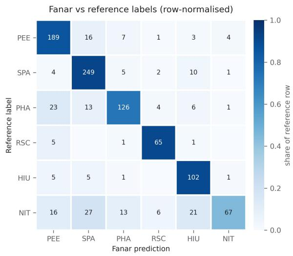

# Beyond the Keyword: A Human-Annotated Benchmark for Arabic Anxiety-Related Discourse

Shimaa Ibrahim1, Mabrouka Bessghaier1, Md. Rafiul Biswas2, Insaf Elouard1, Wajdi Zaghouani1

1Northwestern University in Qatar, Doha, Qatar 2Hamad Bin Khalifa University, Doha, Qatar {shimaa.ibrahim, mabrouka.bessghaier, wajdi.zaghouani}@northwestern.edu, insafelouard2029@u.northwestern.edu, mbiswas@hbku.edu.qa

## Abstract

Keyword retrieval returns expressions of personal anxiety together with many other uses of anxiety-related language. We present a benchmark of 1,000 Arabic TwiBer/X posts retrieved with قلق )qalaq, “anxiety/worry”) and annotated for six discourse funcJons. Two naJve Arabicspeaking annotators labeled every post independently, reaching 51.1% raw agreement (Cohen’s κ=0.378). We then reviewed all 489 disagreements and all 511 agreements under the same guidelines. The review changed 120 of the agreed labels (23.5%), which shows that agreements need audiJng as well as disagreements. The final labels form a consensus reference; on a random sample of 200 posts, an addiJonal annotator agreed with it on 60.5% of posts (κ=0.517). Against this reference, FanarC-2- 27B reaches 79.8% accuracy and macro-F1 0.784 (κ=0.749). Its errors concentrate in the residual category (41.1% of errors; precision 0.905, recall 0.447), whose definiJon is internally inconsistent in the executed prompt, so the low recall cannot be aBributed to the model alone. SociopoliJcal Anxiety (27.1%) outnumbers Personal EmoJonal Expression (22.0%); these are assignment proporJons in the sample, not esJmates of prevalence or retrieval precision. We release the guidelines, a residualsubtype scheme, a fixed data split, label provenance, and evaluaJon code.

## 1 IntroducCon

Arabic mental health NLP frequently starts from keyword-retrieved corpora: a term is chosen, posts containing it are collected, and the collec@on is treated as relevant to the term’s topic. Labels are then applied by lexicon matching, classifiers, or large language models (LLMs). Keyword matching, however, guarantees neither that the retrieved posts describe the intended phenomenon nor that annotators can categorize them consistently.

The Arabic term قلق )qalaq, “anxiety/worry”) illustrates the problem. It can describe a personal experience of anxiety (ةركب نم ناقلق انا, ” I am anxious about tomorrow”), a diploma@c or journalis@c ھقلقغلابلا) formula $i = \cdots 1 ,$ grave expressed“ concern”), or general concern about a situa@on ( قوسلل ةقلقم ماقرلأا , ” the figures are worrying for the market”). A collec@on retrieved with قلق therefore cannot be assumed to consist of personal expressions of anxiety without evidence.

We drew 1,000 posts from such a collec@on, had two annotators label each one independently for discourse func@on, built a reference label for every post through a consensus review under the same guidelines, and evaluated Fanar-C-2-27B against that reference. The reference was finalized without accesstothe model’spredic@ons. Firstroundagreement was low, and the guidelines contained overlapping instruc@ons for the residual category and Sociopoli@cal Anxiety. We report the first-round agreement and its disagreement paYerns separately from the review that produced the final reference. We also compare an addi@onal annotator’s labels with the final reference on a random sample of 200 posts (Sec@on 5.5). Fanar reaches F1 between 0.77 and 0.87 on all five substan@ve categories but misses more than half of the residual posts. Because firstround agreement compares two independent annotators while model agreement compares the model with a consensus reference, the two figures are not directly comparable. Contribu)ons.

1. A benchmark of 1,000 Arabic قلق posts labeled for six discourse func@ons, with reference labels built by reviewing all 489 first-round disagreements and all 511 agreements, and with per-post provenance recording how each reference label relates to the two ini@al annota@ons.

2. A reliability analysis of first-round agreement $_ { ( \kappa = 0 . 3 7 8 ) }$ that localizes disagreement by category, together with an audit showing that

23.5% of ini@ally agreed labels did not survive review, and a 200-post comparison of the final reference with an addi@onal annotator.

3. An evalua@on of Fanar-C-2-27B with bootstrap confidence intervals, two reference baselines, and an error analysis showing that the residual category accounts for the largest share of errors.

4. An opera@onal decision scheme for the residual category that separates its subtypes, and a fixed stra@fied split for future supervised baselines.

## 2 Related Work

## 2.1 Arabic Mental Health NLP and Social Media Resources

Arabicmental health NLP hasgrownin recentyears, but most work addresses supervised classifica@on of depression, suicidal idea@on, or mental health ques@ons, o\`en with limited demographic repor@ng (Alasmari, 2025). Resources include CairoDep for depression detec@on (El-Ramly et al., 2021), AraDepSu for depression and suicidal idea@on

(Hassib et al., 2022), MentalQA for mental health ques@onanswering(Alhuzalietal.,2024), CARMA for mul@-condi@on annota@on on Reddit (Mankarious and Zirikly, 2025), and mood-focused resources (Maghraby and Ali, 2022). MentalMARBERT (Almalki et al., 2026) builds a 50,670-tweet corpus labeled for six disorder categories with Krippendorf’s α=0.733	 and reports domain-adapted MARBERT baselines. That work and ours answer diferent ques@ons. MentalMARBERT asks which clinical category a post signals; we ask what communica@ve func@on a single polysemous keyword serves, and five of our six categories carry no clinical meaning. Our benchmark is smaller and its first-round agreement is lower, which we treat as a finding about the task rather than something to hide.

Arabic NLP also ofers many social media resources relevant to discourse analysis: mul@dialectal stance corpora (Charfi et al., 2024), hate speech datasets (Zaghouani et al., 2024), infodemic shared tasks (Shaar et al., 2021; Alam et al., 2021), emo@on and hope speech resources (Zaghouani and Biswas, 2025), monitoring plakorms such as MARSAD (Biswas et al., 2025), and mul@dimensional resources in which stance, sen@ment and emo@on are annotated independently (Laabar and Zaghouani, 2024). Our scheme instead assigns one primary func@on per post through a @e-break order, so category propor@ons cannot reflect every func@on a post serves (Sec@on 7).

2.2 Mental Health Discourse, Benchmarks, and LLM Annota)on Work on mental health discourse on TwiYer/X finds that emo@onal framing and interac@on paYerns maYer more than aYen@onseeking for how widely messages circulate (Pavlova and Berkers, 2020, 2022). NLP studies have improved the detec@on of mental health signals with feature-based models, graph-based emo@on representa@ons, and instruc@on-tuned LLMs (Zhang et al., 2022; Mao and Han, 2025; Yang et al., 2024); related studies examine the roman@ciza@on of mental illness (Issaka et al., 2024), digital media use and adolescent wellbeing (Svensson et al., 2022), and social anxiety and emoji use (Bendl et al., 2025). MentaLLaMA generates ra@onales alongside predic@ons

(Yang et al., 2024); whether ra@onales help separate readable out-of-scope posts from substan@ve ones is an open ques@on for our residual category.

Chhetri et al. (2026) build mental health benchmarks on Bluesky with lexicon filtering, LLMassisted labels, and human-adjudicated valida@on subsets, and find that weak-label failure modes difer by task. We share their emphasis on label provenance and release a per-post record of how each reference label was reached (Sec@on 8).

On the modeling side, zero-shot LLMs have been found to trail smaller fine-tuned transformers on computa@onal social science classifica@on, with prompt design shi\`ing accuracy by more than ten points (Mu et al.,

2023). Alterna@ve promp@ng paradigms such as noisy-channel promp@ng improve few-shot stability (Min et al., 2022). We therefore present our LLM result as a characteriza@on of one model under one prompt, not as evidence that LLMs match or exceed fine-tuned classifiers on this task.

2.3 Framing and Arabic Pragma)cs The same event can be framed diferently depending on social posi@on and communica@ve intent: Shurafa et al. (2020) describe divergent framing of COVID-19 by supporters of U.S. poli@cal par@es, and Shestakov and Zaghouani (2024) analyze digital framing of the Sheikh Jarrah evic@ons. During regional crises, a term that names personal anxiety is also rou@nely used for collec@ve poli@cal concern. Because the keyword alone cannot separate these uses, we classify discourse func@on rather than treat keyword presence as a proxy for psychological content.

## 3 Data CollecCon and Sampling

## 3.1 Collec)on

Arabic posts were collected from TwiYer/X through Meltwater with a query on قلق and an Arabic language filter, covering 2024-06-05 to 2024-12-31 (210 days). Meltwater caps each export at 20,000 items. Each item carries the post text, @mestamps, content type (original, reply, quote, repost), and visibility fields including Reach, an audience es@mate based on followers rather than impressions. Two text fields exist: Opening Text, truncated a\`er 144 characters, and Hit Sentence, up to 282 characters. We used Hit Sentence throughout. Using Opening Text would have removed a median of 68 characters from one half of the collec@on and 2 characters from the other, which maYers for any lengthdependent measurement. Trunca@on in provider exports is a recurring and under-documented problem in social media corpus construc@on.

## 3.2 Sampling frame

The collec@on was retrieved as two exports of 20,000 items each, split by Meltwater’s inferred author gender. This field was used only to stay within the export cap; it was not used in annota@on or analysis. It nevertheless determined which posts entered the pool, so the corpus is not a simple random sample of قلق posts in the period, and every claim in this paper refers to this sampling frame.

Exact-duplicate texts (47% of the collec@on) were removed. We then drew 1,000 posts at random from the deduplicated pool, stra@fied by Content Type to match the content-type propor@ons of the collec@on before deduplica@on. We made this choice because deduplica@on removes reposts far more o\`en than original posts, and the visible repost text is part of what users encounter. The consequence is that the sample over-represents reposted content rela@ve to the deduplicated pool, and its category propor@ons should not be read as proper@es of either the plakorm or the full collec@on. We did not validate the sample against an independent random draw.

The sample contains 338 original posts, 309 reposts, 276 replies and 77 quotes, with a median length of 156 characters. Two no@ons of repost coexist: Meltwater’s Content Type marks 309 posts as reposts, while 252 posts carry a literal text prefix (207 RT @, 45 QT @). The visibility analysis (Appendix E) uses Content Type. Annotators labeled the visible text as presented and did not retrieve original posts, so human and model annota@on units are iden@cal.

Dialect and register. Dialect and register were not annotated, and we do not report a distribu@on. The examples in this paper include Modern Standard Arabic news formulas and Egyp@an and Gulf colloquial forms, but we make no claim about their propor@ons.

## 4 AnnotaCon Scheme

Each post receives one of six labels:

• Personal Emo)onal Expression: the author expresses their own anxiety, distress or worry, in the first person, about their own situa@on.

• Sociopoli)cal Anxiety: worry or concern about poli@cs, war, the economy or a collec@ve situa@on, whether felt by the author, aYributed to others, or reported.

• Philosophical / Advisory: advice, reflec@on or general wisdom about anxiety, addressed to others rather than describing the author’s current state.

• Religious / Spiritual Coping: prayer, supplica@on (ءاعد(, a Quranic verse, a hadith, or another invoca@on of God in connec@on with anxiety.

• Humorous / Ironic Use: jokes, memes, sarcasm or mockery involving anxiety.

• Not interpretable (residual): any post that fits none of the five categories above. Despite its name, this label covers readable posts that are out of scope (such as adver@sements) as well as fragments and genuinely uninterpretable text.

The codebook gives one example per category, a @e-break order for posts that fit several categories (humour, then religious framing, then outward advice, then the author’s own state, then public events, then residual), and rules for reposts, adver@sements and truncated text (Appendix B).

<table><tr><td>Category</td><td>A1/A2 K</td></tr><tr><td>Personal Emotional Expr. 216 / 214</td><td>0.419</td></tr><tr><td>Sociopolitical Anxiety</td><td>120/229 0.371</td></tr><tr><td>Philosophical / Advisory</td><td>144/127 0.347</td></tr><tr><td>Religious / Spiritual</td><td>68/48 0.470</td></tr><tr><td>Humorous / Ironic</td><td>72/86 0.396</td></tr><tr><td>Not interpretable</td><td>380/296 0.339</td></tr><tr><td>Overall</td><td>0.378 [0.338, 0.417]</td></tr><tr><td>Raw agreement</td><td>51.1%</td></tr></table>

Table 1: First-round inter-annotator agreement, n=1000. Per-category κ	 is one-vs-rest. Counts show how o\_en each annotator used each category.

Overlapping instruc)ons. The guidelines contained two overlaps. First, the residual rules men@oned news reports, while Sociopoli@cal Anxiety covered concern about poli@cal events. Second, the residual category held both readable out-of-scope content and uninterpretable content. During review we applied the exis@ng defini@ons and @e-break rules and resolved diferences by consensus; the codebook was not revised.

Residual subtypes. To make the residual category usable for future annota@on and error analysis, Appendix C defines four subtypes with an ordered decision procedure: R1 adver)sement, R2 readable but out of scope, R3 insuficient context, and R4 uninterpretable. These subtypes correspond to the sub-reasons recorded during our review of the agreed posts. They were not part of the firstround guidelines, and we report subtype counts only where they were recorded.

## 5 AnnotaCon Reliability

## 5.1 Procedure

Two na@ve Arabic-speaking annotators labeled all 1,000 posts independently, blind to each other’s labels and without access to model output. The reference labels were also finalized without access to the model’s predic@ons or results.

## 5.2 First-round agreement

Table 1 reports first-round agreement. Raw agreement was 51.1% and Cohen’s κ	 was 0.378 (95% CI [0.338, 0.417]), fair under Landis and Koch (1977). All intervals in this paper are percen@le bootstrap intervals with B=2000	 resamples and seed 42.

## 5.3 Disagreement is concentrated, not

difuse The residual category appears in the three largest confusion cells, paired with

Sociopoli@cal Anxiety
<table><tr><td>Variant</td><td>n</td></tr><tr><td>As administered</td><td>1000 0.378</td></tr><tr><td>Merging Sociopol. + residual</td><td>1000 0.403</td></tr><tr><td>Excluding residual category</td><td>513 0.514</td></tr></table>

Table 2: DiagnosJc decomposiJon of first-round agreement. These variants localize disagreement; they are not esJmates of agreement under any revised guideline.

(93 posts), Personal Emo@onal Expression (89) and Philosophical / Advisory (62). The largest marginal gap between annotators is in Sociopoli@cal Anxiety (120 vs. 229), followed by the residual category (380 vs. 296); both are involved in the news-report overlap described in Sec@on 4.

Table 2 shows agreement under alterna@ve treatments of the residual category.

MergingSociopoli@cal Anxiety with the residual category raises κ	 from 0.378to0.403. Restric@ngtothe513poststhatboth annotators placed in substan@ve categories raises κ	to 0.514.

Per-category one-vs-rest κ	 nonetheless stays between 0.339 and 0.470, so the residual category is the least reliable boundary but not the only one.

## 5.4 Building the reference

Disagreements. A\`er the first round, the first author reviewed all 1,000 posts against the guidelines and proposed a reference label for each. A second author checked every proposal, and diferences were resolved by consensus. Both reviewers are na@ve Arabic speakers. For the 489 disagreements, the referencelabel matched the first annotator in 164 cases (33.5%), the second annotator in 245 (50.1%), and neither in 80 (16.4%). No reason codes were recorded for these 489 decisions, so Sec@on 6.3 examines label movement rather than its causes.

Agreements. Two annotators agreeing does not guarantee that a label follows the guidelines, and before this step 189 of the 244 posts then labeled residual came from unreviewed agreements. We therefore reviewed all 511 agreed posts in the same way. The review changed 120 labels (23.5%). Ninety-six changes involved posts agreed as residual, so the category retained 49.2% of its 189 agreed posts; 57 of the 96 moved to Sociopoli@cal Anxiety under the news-report rule. The other 24 changes were spread across Personal Emo@onal Expression (18 changes; 84.6% retained), Sociopoli@cal Anxiety (4; 95.1%) and Religious / Spiritual Coping (2; 93.1%). Humorous / Ironic Use and Philosophical / Advisory were unchanged. These 24 changes may reflect annota@on errors, reinterpreta@on of categories, or @e-break applica@on; the transi@ons alone cannot dis@nguish among these explana@ons.

What the reference is and is not. All 1,000 reference labels were reviewed under one codebook. The reference is a consensus reference, not an independently replicated gold standard. Because the same two people reviewed every post, anchoring on the proposed labels and gradual dri\` in how boundary rules

were applied are possible. The first-round κ remains the only measure of agreement between two independent annotators. Sec@on 5.5 compares one addi@onal annotator with the final reference on a random sample. A larger independent annota@on using the residual subtypes in Appendix C would provide further evidence about the reliability of the final labels.

## 5.5 Valida)on sample

A\`er the reference was finalized, an addi@onal annotator labeled a simple random sample of 200 of the1,000posts. Thesamplewasselectedwithoutreplacement using NumPy RandomState with seed 42 and was not stra@fied. The annotator received the post texts and wriYen guidelines, including the six category defini@ons, the @e-break order and the addi@onal rules in Appendix B. These included an explicit rule assigning news reports and diploma@c expressions of concern to Sociopoli@cal Anxiety. The annotator did not have access to the firstround labels, the reference labels or the model predic@ons.

The annotator agreed with the reference on 121 posts (60.5%, 95% CI [54.0, 67.5]), with Cohen’s κ	 of 0.517 (95% CI [0.437, 0.598]). Agreement was 75.5% (80 of 106) on sampled posts whose reference labels were recorded as verified consensus and 43.6% (41 of 94) on those recorded as adjudicated.

The most frequent diferences involved reference Sociopoli@cal Anxiety and Personal Emo@onal Expression posts labeled Philosophical / Advisory by the addi@onal annotator (10 and 8 posts, respec@vely). Six reference residual posts were labeled Sociopoli@calAnxiety, andanothersixwerelabeled Humorous / Ironic Use.

These results measure agreement between one addi@onal annotator and a reference built by reviewers who had seen the first-round labels. They are not directly comparable with first-round

κ=0.378, which measures agreement between two independent annotators across all 1,000 posts. The difer-

<table><tr><td>Metric</td><td>Value [95% CI]</td></tr><tr><td>Accuracy</td><td>79.8 [77.2, 82.3]</td></tr><tr><td>Macro-F1</td><td>.784 [.757, .811]</td></tr><tr><td>Weighted F1</td><td>.789 .749 [.717, .778]</td></tr><tr><td>Cohen's κ Majority-class baseline</td><td>27.1</td></tr><tr><td>Random baseline (prior-wtd.)</td><td>19.2</td></tr></table>

Table 3: Fanar-C-2-27B against the reference, n=1000. Accuracy and baselines in %; percenJle bootstrap intervals, B=2000, seed 42.

ence between these scores does not demonstrate an improvement in annota@on reliability.

## 6 Model EvaluaCon

## 6.1 Setup

We evaluated Fanar-C-2-27B, 1 an Arabic-centric LLM, on all 1,000 posts. The prompt lists the six defini@ons, the @e-break order and the repost rule, and asks for one label and a confidence ra@ng without an explana@on. Six hand-wriYen demonstra@ons, one per category, were checked to be absent from the evalua@on set. All 1,000 outputs parsed to a valid label. Appendix D gives the full prompt and decoding sewngs.

Scope of the evalua)on. The evalua@on characterizes one model under one Englishinstruc@on prompt with Arabic examples. We did not run fine-tuned discrimina@ve baselines (e.g., AraBERT, MARBERT or MentalMARBERT),

Arabic-instruc@on prompts, or alterna@ve promp@ng paradigms. Given evidence that zeroshot LLMs o\`en trail fine-tuned classifiers on social science classifica@on (Mu et al., 2023), we make no claim that Fanar’s scores are compe@@ve with supervised models. The released split (Sec@on 8) is intended to make such comparisons straighkorward.

## 6.2 Results

Appendix A defines every metric. Table 3 reports overall performance against the reference.

## ReadingtheagreemenVigurestogether.

Modelreference κ	is 0.749 [0.717, 0.778] and firstround humanκwas0.378 [0.338, 0.417], both on the same 1,000 posts. They are not comparable: the human figure measures agreement between agreement with a reference built by review and consensus. The gap is not evidence that the model outperforms human annotators. The 200-post valida@on (Sec@on 5.5) compares one addi@onal annotator with the reference on a subsample and

two independent annotators, while the model figure measures
<table><tr><td>Category</td><td>P n</td><td>R</td><td>F1</td></tr><tr><td>Personal Emotional Sociopolitical Anxiety 271 .803 Philosophical / Advisory 173 .824 .728 .773</td><td>220 .781</td><td>.859 .919</td><td>.818 .857</td></tr><tr><td>Religious / Spiritual 72.833 .903 .867 Humorous / Ironic 114 .713 .895 .794</td><td></td><td></td><td></td></tr><tr><td>Not interpretable</td><td></td><td>150.905.447.598</td><td></td></tr><tr><td>Macro average</td><td></td><td>.810.792.784</td><td></td></tr></table>

Table 4: Per-category precision, recall and F1. n	is the number of reference posts in the category.  
  
Figure 1: Confusion matrix against the reference, rownormalized; cell values are counts. Every row except the residual category is strongly diagonal.

is also not directly comparable with first-round κ.

6.3 Error analysis: the residual category Five categories reach F1 between 0.77 and 0.87 (Table 4). The residual category reaches 0.598, combining high precision (0.905) with low recall (0.447): of its 150 reference posts, the model gave 83 a substan@ve label, and these 83 posts account for 41.1% of all 202 errors.

Figure 1 shows the paYern: every row except the residual one is strongly diagonal. On the 850 posts whose reference label is substan@ve, accuracy is 86.0% [83.5, 88.4] and macro-F1

0.864, against a 31.9% majority baseline. This condi@onal diagnos@c selects posts by their reference label and does not es@mate deployment performance.

Three factors limit interpreta@on. First, the resid-
<table><tr><td>Category</td><td>n</td><td>%</td></tr><tr><td>Sociopolitical Anxiety</td><td>271</td><td>27.1</td></tr><tr><td>Personal Emotional Expr.</td><td>220</td><td>22.0</td></tr><tr><td>Philosophical / Advisory</td><td>173</td><td>17.3</td></tr><tr><td>Not interpretable</td><td>150</td><td>15.0</td></tr><tr><td>Humorous / Ironic</td><td>114</td><td>11.4</td></tr><tr><td>Religious / Spiritual</td><td>72</td><td>7.2</td></tr></table>

Table 5: Reference label distribuJon, n=1000.

ual category mixes adver@sements, readable outofscope posts, insuficient context and uninterpretable text, so its aggregate recall es@mates none of these groups separately. Second, the executed prompt lists adver@sements as residual but also forbids the residual label for readable posts (Appendix D); a

readable adver@sement therefore receives contradictory instruc@ons, and without a corrected-prompt comparison the errors cannot be aYributed to model capabilityalone. Third, predic@ngtheresiduallabel is not the same as abstaining. The results support manual checking of residual cases in this configura@on, not a general conclusion about LLM-based filtering.

Sensi)vity to the reference version. Keeping predic@ons fixed, we compared the final reference with the superseded version in which the 511 agreed posts had not been reviewed. Under the supersededreferencetheresidual category held244posts, 79 residual posts were predicted as

Sociopoli@cal Anxiety, accuracy was 73.1% and κ 0.671. Under the final reference that cell falls to 27, total errors fall from 269 to 202, residual recall rises from 0.283 to 0.447, and the residual share of errors falls from 65.1% to 41.1%. These figures are referenceversion diagnos@cs, not benchmark scores. They show that measured performance on this boundary depends heavily on how the reference is built; they do not show whether the original disagreements came from ambiguous instruc@ons, annota@on errors or difering interpreta@ons.

## 7 What Does the Query Retrieve?

Table 5 shows the distribu@on of reference labels. Sociopoli@cal Anxiety is the largest category (27.1%), followed by Personal Emo@onal Expression (22.0%) and Philosophical / Advisory (17.3%); the residual category holds 15.0%.

These are assignment propor@ons under the @ebreak order, not retrieval precision es@mates. Because humour and religious framing rank above first-person expression, a post in which the author voices their own anxiety through prayer is labeled Religious / Spiritual Coping. The 22.0% is therefore a lower bound on posts that contain a firstperson anxiety signal. Es@ma@ng retrieval precision for personal anxiety requires a second, mul@label layer that marks first-person anxiety independently of the primary func@on; we have not annotated that layer, and the release format reserves a field for it.

Even with these caveats, a keyword sample whose largest category is collec@ve concern, and in which more than a quarter of posts are not personal expressions of any kind, should be described by its discourse composi@on before it is used as an anxiety corpus. Appendix E reports a secondary, descrip@ve associa@on between discourse type and es@mated reach.

## 8 Dataset Release

We will release the following under the provider’s licensing terms and our ethics approval:

• the annota@on guidelines, the residualsubtype scheme, the executed prompt, and the evalua@on code;

• for each post: both first-round labels, the reference label, its provenance (reviewed disagreement or reviewed agreement; matched annotator 1, annotator 2 or neither), the residual sub-reason where recorded, the model predic@on, Content Type and Reach;

• a fixed split of 600 / 100 / 300 posts (train / development / test), stra@fied by reference label with seed 42, so that supervised baselines can be trained and compared on a common test set;

• a SHA-256 hash of each post iden@fier, so that researchers holding licensed access to the same posts can verify membership without the iden@fiers being redistributed.

Post texts will be shared on request for research use, subject to the provider’s terms and privacy requirements. Usernames and other iden@fying informa@on were removed from all examples in this paper.

## 9 Conclusion

We release a benchmark of 1,000 Arabic قلق posts labeled for discourse func@on. Independent firstround agreement was κ=0.378. Reviewing all disagreements and all agreements under the same guidelines changed 120 agreed labels, which shows that agreements deserve the same scru@ny as disagreements; the resul@ng reference is a consensus reference, and on a random 200- post sample an addi@onal annotator agreed with

it on 60.5% of posts (κ=0.517). Fanar-C-2-27B reaches 79.8% accuracy and macro-F1 0.784 against it, with the residual category producing 41.1% of errors; given that category’s mixed content and the conflic@ng prompt instruc@ons, this weakness cannot be aYributed to the model alone. Sociopoli@cal Anxiety (27.1%) outnumbers Personal Emo@onal Expression (22.0%) as a primary func@on, which is a statement about this sample’s composi@on and not about the prevalence of anxiety. The released split, provenance fields and residual subtypes are intended to support an independent reannota@on round, supervised baselines, and corrected-prompt comparisons. LimitaCons

Scope. One query term, one plakorm, one provider and a seven-month window. The corpus samples posts containing one polysemous word, not anxiety expression, and supports no conclusions about Arabic-speaking popula@ons, prevalence or mental states.

Sampling. The pool was shaped by two genderfiltered exports, removal of 47% exact duplicates, and stra@fica@on by content type to prededuplica@on propor@ons. Category propor@ons are proper@es of this sample and were not validated against an independent random draw.

Reliability of the reference. The final labels come from consensus review by two authors under the same guidelines, not from a second independent round. Anchoring and dri\` in boundary decisions

cannot be ruled out, and first-round κ=0.378 remains the only agreement es@mate between two independent annotators. The 200-post valida@on (κ=0.517) compares one addi@onal annotator with a reference whose reviewers had seen the first-round labels. It covers a random fi\`h of the posts and does not assess the residual subtypes. Residual category. The category combines adver@sements, readable out-of-scope posts, insuficient context and uninterpretable text. Sub-reasons were recorded only for the 95 agreed posts that ended with this label (uninterpretable 42, out of scope 27, adver@sements 15, insuficient context 11); four further posts carried an insuficientcontext note but received a substan@ve label. No sub-reasons exist for the 489 disputed posts, so a subtype-level error analysis over all 150 residual posts is not possible with the current data.

Prompt ambiguity. The prompt both assigns adver@sements to the residual label and forbids that label for readable posts. Its efect on residual recall cannot be isolated without a correctedprompt run. Models and baselines. We evaluate one LLM under one prompt in one instruc@on language and report no fine-tuned baselines. Results do not generalize to other models, prompt languages, demonstra@on sets or promp@ng paradigms.

Single-label design. The @e-break order hides first-person anxiety when humour or prayer is present, so the share of posts with a personal anxiety signal is not es@mated.

Text completeness, dialect and register.Some posts are truncated mid-sentence; severe trunca@on leads to the residual label, while milder trunca@on may afect borderline cases. Trunca@on prevalence and its link to residual labels were not measured, and dialect and register were not annotated.

Account-level confounds. Meltwater exports no follower counts, verifica@on status or account type, so the discourse-reach associa@on is descrip@ve and may reflect who posts each type of content.

Size. One thousand posts support the es@mates

here, with the smallest category at n=72; percategory figures should be read with their support counts, and we do not report percategory intervals. Ethical ConsideraCons

Public TwiYer/X posts were obtained through Meltwater, a licensed social media monitoring plakorm. The data collec@on protocol was reviewed and approved by an Ins@tu@onal Review Board; approval details will be given in the camera-ready version. We did not contact any user or request addi@onal data.

Privacy. We release no usernames, user iden@fiers, account metadata or raw post iden@fiers. Iden@fying informa@on was removed from all examples in this paper, and the prompt demonstra@ons were wriYen by hand.

Sensi)ve content. The corpus contains posts about anxiety and psychological distress. We diagnose no individual and report findings only at the group level. Our categories describe how language is used, not the mental state of any author: a post labeled Personal Emo@onal Expression shows first-person framing, not a clinical condi@on.

Annotator welfare. Annotators were told about the content domain before star@ng, were free to stop at any @me, and were advised to spread the work across sessions.

AI assistants. AI wri@ng assistants were used for language refinement and literature search. All analyses, annota@on pipelines and results were produced by the authors; no AI tool generated or modified experimental results. Fanar-C-2-27B is an object of study, not an authoring tool.

## References

Firoj Alam, Shaden Shaar, Fahim Dalvi, Hassan Sajjad, Alex Nikolov, Hamdy Mubarak, Giovanni Da San MarJno, Ahmed Abdelali, Nadir Durrani, Kareem Darwish, Abdulaziz Al-Homaid, Wajdi Zaghouani, Tommaso Caselli, Gijs Danoe, Friso Stolk, BriB BrunJnk, and Preslav Nakov. 2021. FighJng the COVID-19 infodemic: Modeling the perspecJve of journalists, fact-checkers, social media plakorms, policy makers, and the society. In Findings of the

Associa0on for Computa0onal Linguis0cs: EMNLP 2021, pages 611–649, Punta Cana, Dominican Republic. AssociaJon for ComputaJonal LinguisJcs.

Ashwag Alasmari. 2025. A scoping review of Arabic natural language processing for mental health. Healthcare, 13(9):963.

Hassan Alhuzali, Ashwag Alasmari, and Hamad Alsaleh. 2024. MentalQA: An Annotated Arabic Corpus for QuesJons and answers of mental healthcare. arXiv preprint arXiv:2405.12619.

FaJmah Almalki, Areej Alhothali, Lulwah Alharigy, and Abdulrahman Aladeem. 2026. MentalMARBERT: Domain-adapJve pre-training and two-stage finetuning for Arabic mental health disorders detecJon. arXiv preprint arXiv:2606.12649.

Alexis M. Bendl, Ronan M. Cunningham, Lauren Hill, and Johanna M. Jarcho. 2025. Social anxiety and emoji use: Gender diferences and the role of lonelinessindigitalcommunicaJonamongcollegestu dents. Fron0ers in Psychology, 16:1626509.

Md. Rafiul Biswas, Firoj Alam, and Wajdi Zaghouani. 2025. MARSAD: A mulJ-funcJonal tool for real-Jme social media analysis. arXiv preprint arXiv:2512.01369.

Anis Charfi, Mabrouka Bessghaier, Andria Atalla, Raghda Akasheh, Sara Al-Emadi, and Wajdi Zaghouani. 2024. MARASTA: A mulJ-dialectal Arabic cross-domain stance corpus. In Proceedings of the 2024 Joint Interna0onal Conference on Computa0onal Linguis0cs, Language Resources and Evalua0on (LREC-COLING 2024), pages 11060– 11069, Torino, Italia. ELRA and ICCL.

Gaurab Chhetri, Anandi DuBa, and Subasish Das. 2026. Building trustworthy mental health benchmarks on Bluesky: A validaJon-aware weak-supervision framework. arXiv preprint arXiv:2609.22696.

Mohammad El-Ramly, Hager Abu-Elyazid, Youseef Mo’men, Gameel Alshaer, Nardine Adib, Kareem Alaa Eldeen, and Mariam El-Shazly. 2021. Cairodep: DetecJng Depression in Arabic posts using BERT Transformers. In 2021 Tenth Interna0onal Conference on Intelligent Compu0ng and Informa0on Systems (ICICIS), pages 207–212.

Mariam Hassib, Nancy Hossam, Jolie Sameh, and Marwan Torki. 2022. AraDepSu: DetecJng depression and suicidal ideaJon in Arabic tweets using transformers. In Proceedings of the Seventh Arabic Natural Language Processing Workshop (WANLP), pages 302–311, Abu Dhabi, United Arab Emirates (Hybrid). AssociaJon for ComputaJonal LinguisJcs.

Barikisu Issaka, Ebenezer Ato Kwamena Aidoo, Sandra Freda Wood, and FaJma Mohammed. 2024. “anxiety is not cute” analysis of TwiBer users

discourses on romanJcizing mental illness. BMC Psychiatry, 24:221.

Sanaa Laabar and Wajdi Zaghouani. 2024. MulJdimensional insights: Annotated dataset of stance, senJment, and emoJon in Facebook comments on Tunisia’s july 25 measures. In Proceedings of the Second Workshop on Natural Language Processing for Poli0cal Sciences @ LREC-COLING 2024, pages 22–32, Torino, Italia. ELRA and ICCL.

J. Richard Landis and Gary G. Koch. 1977. The measurement of observer agreement for categorical data. Biometrics, 33(1):159–174.

Ashwag Maghraby and Hosnia Ali. 2022. Modern standard Arabic mood changing and depression dataset. Data in Brief, 41:107999.

Saad Mankarious and Ayah Zirikly. 2025. CARMA: Comprehensive automaJcally-annotated Reddit mental health dataset for Arabic. arXiv preprint arXiv:2511.03102.

Huimin Mao and Qing Han. 2025. Enhancing TextGCN for depression detecJon on social media with emoJon representaJon. Fron0ers in Psychology, 16:1612769.

Sewon Min, Mike Lewis, Hannaneh Hajishirzi, and Luke ZeBlemoyer. 2022. Noisy channel language model prompJng for few-shot text classificaJon. In Proceedings of the 60th Annual Mee0ng of the Associa0on for Computa0onal Linguis0cs (Volume 1: Long Papers).

Yida Mu, Ben P. Wu, William Thorne, Ambrose Robinson, Nikolaos Aletras, Carolina Scarton, Kalina Bontcheva, and Xingyi Song. 2023. NavigaJng prompt complexity for zero-shot classificaJon: A study of large language models in computaJonal social science. arXiv preprint arXiv:2305.14310.

Alina Pavlova and Pauwke Berkers. 2020. Mental health discourse and social media: Which mechanisms of cultural power drive discourse on twiBer. Social Science & Medicine, 263:113250.

Alina Pavlova and Pauwke Berkers. 2022. ”mental health” as defined by twiBer: Frames, emoJons, sJgma. Health Communica0on, 37(5):637–647.

Jeanine Romano, Jefrey D. Kromrey, Jesse Coraggio, and Jef Skowronek. 2006. Appropriate staJsJcs for ordinal level data: Should we really be using t-test and cohen’s d for evaluaJng group diferences on the NSSE and other surveys? Annual Mee0ng of the Florida Associa0on of Ins0tu0onal Research.

Shaden Shaar, Firoj Alam, Giovanni Da San MarJno, Alex Nikolov, Wajdi Zaghouani, Preslav Nakov, and Anna Feldman. 2021. Findings of the NLP4IF-2021 shared tasks on fighJng the COVID-19 infodemic and censorship detecJon. In Proceedings of the Fourth

Workshop on NLP for Internet Freedom: Censorship, Disinforma0on, and Propaganda, pages 82–92, Online. AssociaJon for ComputaJonal LinguisJcs.

Anatolii Shestakov and Wajdi Zaghouani. 2024. Analyzing conflict through data: A dataset on the digital framing of Sheikh Jarrah evicJons. In Proceedings of the Second Workshop on Natural Language Processing for Poli0cal Sciences @ LREC-COLING 2024, pages 55–67, Torino, Italia. ELRA and ICCL.

Chereen Shurafa, Kareem Darwish, and Wajdi Zaghouani. 2020. PoliJcal framing: US COVID19 blame game. In Social Informa0cs (SocInfo 2020), volume 12467 of Lecture Notes in Computer Science, pages 333–351, Cham. Springer.

Robert Svensson, Björn Johnson, and Andreas Olsson. 2022. Does gender maBer? The associaJon between diferent digital media acJviJes and adolescent wellbeing. BMC Public Health, 22:273.

Kailai Yang, Tianlin Zhang, Ziyan Kuang, Qianqian Xie, Jimin Huang, and Sophia Ananiadou. 2024. MentaLLaMA: Interpretable mental health analysis on social media with large language models. In Proceedings of the ACM Web Conference 2024, pages 4489–4500. AssociaJon for CompuJng Machinery.

Wajdi Zaghouani and Md. Rafiul Biswas. 2025. EmoHopeSpeech: An annotated dataset of emoJons and hope speech in English and Arabic. In Proceedings of the 15th Interna0onal Conference on Recent Advances in Natural Language Processing - Natural Language Processing in the Genera0ve AI Era, pages 1406–1412, Varna, Bulgaria. INCOMA Ltd., Shoumen, Bulgaria.

Wajdi Zaghouani, Hamdy Mubarak, and Md. Rafiul Biswas. 2024. So hateful! building a mulJ-label hate speech annotated Arabic dataset. In Proceedings of the 2024 Joint Interna0onal Conference on Computa0onal Linguis0cs, Language Resources and Evalua0on (LREC-COLING 2024), pages 15044– 15055, Torino, Italia. ELRA and ICCL.

Tianlin Zhang, Annika M. Schoene, Shaoxiong Ji, and Sophia Ananiadou. 2022. Natural language processing applied to mental illness detecJon: A narraJve review. npj Digital Medicine, 5:46.

## A Metrics

Let N	be the number of evaluated posts, L	the set of labels included in macro-averaging, gi	and pi	the reference and predicted labels, and nℓ	 the reference support of category ℓ. For the main evalua@on, N=1000	 and |L|=6. The condi@onal diagnos@c retains posts whose reference label is substan@ve

(N=850); predic@ons are unchanged, so a residual predic@on on a retained post is an error and a false nega@ve for its reference category, and macro-F1 averages the five substan@ve

categories. Agreement. Cohen’s $\kappa$ corrects observed agreement $p _ { o }$ 	for chance agreement $p _ { e } \colon$

$$
\kappa = \frac { p _ { o } - p _ { e } } { 1 - p _ { e } } , \qquad p _ { o } = \frac { 1 } { N } \sum 1 [ g _ { i } = p _ { i } ] ,\tag{1}
$$

We apply Eq. 1 between annotators (§5), between the valida@on annotator and the reference (§5.5), and between model and reference (§6.2); percategory κ	 uses the one-vsrest binariza@on of $\ell \cdot$

Classifica)on. With $\begin{array} { l l } { \overline { { I } } P _ { \ell } , } & { F P _ { \ell } , } \end{array} \ F N _ { \ell } $ the usual counts,

$$
\begin{array} { c } { { P _ { \ell } = \displaystyle { \vphantom { \Bigg ( } } _ { T P } { \vphantom { \Bigg ( } } _ { F P } { \begin{array} { l } { F P } \\ { T P _ { \ell } } \end{array} } } & { { T P } } \\ { {  } } & { { T P } } \\ { {  } } & { {  } } \\ { { { \cal F } ^ { \mathrm { w g t } } = \displaystyle { \vphantom { \Bigg ( } } _ { N } ^ { 1 } \sum _ { \scriptstyle { \mathrm { } } n _ { \ell } { \cal F } _ { \ell } . } \ell } } & { {  } } \\ { {  } } & { {  } } & { { R _ { \ell } = } } \end{array} , }\tag{3}
$$

(5)

We lead with $F ^ { ^ { \mathsf { m a c } } }$ , which weights categories equally. A quan@ty with a zero denominator is defined as 0, and $F _ { \ell } { = } 0$ when $P _ { \ell } { + } R _ { \ell } { = } 0 ;$ no category in our results has a zero denominator.

Baselines. The majority baseline always predicts the most frequent reference category; drawing predic@ons from the reference distribu@on gives expected accuracy $\begin{array} { r } { \mathsf { A c c } _ { \mathsf { r a n d } } = \sum _ { \ell } ( n _ { \ell } / N ) ^ { 2 } } \end{array}$

42) we draw N	 post indices with replacement, keep the paired labels, and recompute the sta@s@c; endpoints are the 2.5th and 97.5th percen@les. Intervals are condi@onal on the recorded labels and exclude uncertainty from alterna@ve adjudica@on decisions.

## B AnnotaCon Codebook

The category defini@ons in Sec@on 4 were used for both annota@on and review.

Tie-break order. Applied in sequence, stopping at the first that applies: (1) joke or sarcasm → Humorous / Ironic Use; (2) prayer, verse or hadith →	 Religious / Spiritual Coping; (3) advice or reflec@on addressed outward →	 Philosophical / Advisory; (4) the author’s own current state → Personal Emo@onal Expression; (5) public events or a news report →	 Sociopoli@cal Anxiety; (6) otherwise →	Not interpretable.

$$
p _ { e } = \sum _ { \ell \in \mathcal { L } } \frac { | \{ i : g _ { i } = \ell \} | } { N } \cdot \frac { | \{ i : p _ { i } = \ell \} | } { N } .\tag{2}
$$

Addi)onal rules. Posts beginning RT @ or QT @ are labeled as the visible text stands. Adver@sements for medica@on, applica@ons or books are Not interpretable. A post consis@ng only of $\phi ^ { \sharp } ,$ only $\dot { \omega } \lrcorner \tilde { \mathsf { I } } ,$ or a single hashtag is Not interpretable. Laughter markers ( ھھھ , emoji) indicate Humorous / Ironic Use even when the

$$
\begin{array} { r l r } { F _ { \ell } = \frac { \displaystyle 2 P _ { \ell } R _ { \ell } } { \displaystyle P _ { \ell } + R _ { \ell } } , } & { } & { F ^ { \mathrm { m a c } } = \frac { \displaystyle 1 } { \displaystyle | \mathcal { L } | } \overline { { \sum F _ { \ell } } } , } \end{array}\tag{4}
$$

$$
\mathsf { \Pi } _ { \mathsf { A } } ^ { \ell }
$$

subject is poli@cal. post truncated mid-sentence is labeled if its func@on is recoverable.

Review.The review applied the same defini@ons and@e-

breakrulesanddidno@ntroduceanewcodebook version. Appendix D preserves the executed prompt with its conflic@ng residual instruc@ons.

## C Residual Subtype Scheme

Table 6 defines four residual subtypes with an ordered decision procedure. It applies only a\`er the @e-break order in Appendix B has failed to assign a substan@ve label, and it is designed so that a readable post never lands in the uninterpretable subtype. The subtypes match the sub-reasons recorded during review of the agreed posts, whose counts are shown; the scheme was not available to the firstround annotators and is ofered for future annota@on, re-annota@on and subtype-level evalua@on. A corrected prompt should replace the single residual defini@on in Appendix D with these four rules, removing the instruc@on that forbids the residual label for readable posts.

<table><tr><td>Subtype</td><td>Decision rule (apply in order)</td><td>Typical cases</td><td>Agreed n</td></tr><tr><td>R1 Advertisement</td><td>The post promotes a product, service, app, Medication or therapy-app promotion; book, course or account.</td><td>book sales; paid course announcements.</td><td>15</td></tr><tr><td>R2 Out of scope</td><td>The post is readable and its function is clear, but it fits none of the five</td><td>Readable posts whose topic is unrelated to worry or concern; non-promotional spam</td><td>27</td></tr><tr><td>R3 Insufficient context</td><td>substantive definitions. The post is readable, but too little text remains to determine its function.</td><td>Only , only , a single hashtag; replies whose meaning depends on an unseen post; truncation that removes the</td><td>11</td></tr><tr><td>R4 Uninterpretable</td><td>The text cannot be read as meaningful Arabic.</td><td>predicate. Empty text; non-Arabic text; word salad; encoding damage.</td><td>42</td></tr></table>

Table 6: Residual subtypes. “Agreed $n ^ { \prime \prime }$ counts the 95 iniJally agreed posts whose final label was residual; no subreasons were recorded for the remaining 55 residual posts, which came from the 489 disagreements.

## D Model Prompt and SeUngs

The text below reproduces the executed task instruc@ons. The notebook built the per-post messages and output-format instruc@ons from the task sewngs. Instruc@ons were in English with Arabic examples; no Arabic-instruc@on variant was tested.

Classify how the word قلق )or its inflecAons: ، ناقلق ھقلق قلقلا، قلقم، ةقلق، ( is used in an Arabic social media post. Assign exactly one label.

## LABEL DEFINITIONS

Personal EmoMonal Expression The author expresses their own anxiety, distress, worry or unease, in the first person, about their own شمرداقمانأنم،قلقلايلاقبعوبسأهدك :Example .state

## SociopoliMcal Anxiety

Worry or concern about poliAcal events, war, the economy, or a collecAve situaAon — whether felt by the author, aaributed to someone else, or reported. This INCLUDES news reports and برعأنع،ھقلققلق as such formulas diplomaAc ،يلودعباتی

نایب :Example

سمأ

## Philosophical / Advisory

Advice, reflecAon, or general wisdom about anxiety, addressed to others or to people in general, rather than a report of the author’s own اذإدازكیلعقلقلاملعافنأرثكأ :Example .state current امھفاختنل

ثدحی

Religious / Spiritual Coping A du’a, prayer, Quranic verse, hadith, or invocaAon of God in connecAon with anxiety. Example: انع فرصا مھللا

قلقلا لأماو ولق انب ةنینأمط

## Humorous / Ironic Use

A joke, meme, sarcasAc or mocking remark. Laughter markers (ھھھ, ( and mockery of stock phrases belong here even when the subject is poliAcal. Example: ةفیظو $\frac { ( 1 ) } { 2 } \geq \sqrt { 2 } \geq \frac { 1 } { 2 } \geq \sqrt { 2 } \geq \sqrt { 2 } \geq 0 = \sqrt { 2 } ( 2 \sqrt { 2 } )$

$$
4 8 0 \int 2 d 0 2 4
$$

## Not interpretable

ONLY: empty text, text not in Arabic, random or wordsalad content, adverAsements, or text truncated so badly that its meaning cannot be recovered. If you can read and understand the post, do NOT use this label — choose one of the five above. Example: روفخم ددش قلق رجرجھقنربتمرب

## TIE-BREAK ORDER

When two labels both seem to fit, apply these in order and stop at the first that applies:

1. Is it a joke or sarcasm? →	Humorous / Ironic Use

2. Is it a prayer, verse or hadith? →	Religious / Spiritual Coping

3. Is it advice or reflecAon addressed outward?→ Philosophical / Advisory

4. Is it about the author’s own current state? → Personal EmoAonal Expression

5. Is it about public events, or is it a news report?→ SociopoliAcal Anxiety

6. Otherwise →	Not interpretable

## ADDITIONAL RULES

– If the post begins with RT @ or QT @, classify the visible text as it stands. Do not aaempt to recover the original post. – AdverAsements for medicaAon, apps or books about anxiety →	 Not interpretable ApostconsisAngonlyof قلق , only نیمآ , or a single hashtag →	Not interpretable – A post may be truncated midsentence. If you can sAll tell what it is doing, classify it; use Not interpretable only when you cannot.

Task configura)on. The notebook sewngs were post\_language=”Arabic”, mul@\_label=False, include\_confidence=True and include\_explana@on=False, with Not interpretable as the fallback label.

Se\ngs. Model Fanar-C-2-27B; temperature $0 ;$

top-p	1.0; maximum 80 new tokens; one greedy run. Outputs were matched against the six category names; all 1,000 posts yielded a valid label on the first aYempt, with no retries or refusals. The confidence field returned high for every post, so it carries no informa@on and is not used. The run configura@on, model inputs and raw predic@ons accompany the released code.

## E Discourse Type and Visibility

Reach is right-skewed, so we compare medians with rank-based tests: Kruskal–Wallis $H$ across the six categories, and Mann–Whitney U	with Clif’s $\delta$ between two. With group 1 the first-named category,

$$
\delta = \frac { 2 U } { n _ { 1 } n _ { 2 } } - 1 \in [ - 1 , 1 ] ,\tag{6}
$$

so $\delta > 0$ means group 1 has higher ranks. Under Romano et al. (2006)’s thresholds, $\vert \delta \vert < 0 . 1 4 7$ is negligible and <	0.33	small.

All figures use the reference labels. Reach is available for 975 of the 1,000 posts. Median reach difers across categories (H=53.6, p=2.5×10−10): Sociopoli@cal Anxiety 530 (n=271) and Humorous $/$ Ironic Use 688 (n=111) against Personal Emo@onal Expression 179 (n=215) and the residual category 121 (n=137). Sociopoli@cal Anxiety versus Personal Emo@onal Expression gives $\delta = + 0 . 2 5 4 ( p { = } 1 . 6 { \times } 1 0 ^ { - 6 } )$ , a small efect.

Among the 667 posts with available Reach that Content Type does not mark as reposts, the associa@on persists: medians 532 (n=128) against 144.5

$$
( n = 1 7 6 ) , \delta = + 0 . 2 6 0 , p \mathrm { = 1 } . 1 { \times } 1 0 ^ { - 4 } ; H \mathrm { = } 4 7 . 5 ,
$$

p=4.4×10−9	across all six.

We state this narrowly. Excluding reposts does not establish independence from repos@ng, since the remaining posts s@ll circulate through accounts of very diferent sizes, and without account-level fields discourse efects cannot be separated from account efects. We make no claim about plakorm amplifica@on. The Reach and Content Type fields and the script 04\_visibility.py are included in the release.

## F Reproducibility

All intervals are percen@le bootstrap intervals

(B=2000, seed 42) for accuracy, macro-F1 and

Cohen’s $\kappa ,$ condi@onal on the recorded labels; $\kappa$ bands follow Landis and Koch (1977). The evalua@on pipelinechecksfourprecondi@ons beforeproducing final results: exactly 1,000 unique post iden@fiers; no missing reference label; all labels within the codebook; and no duplicated label column among the adjudicated rows. The last check guards against copying a column; it does not demonstrate independent judgment. Runs failing any check are marked exploratory; all four passed for the results reported here.