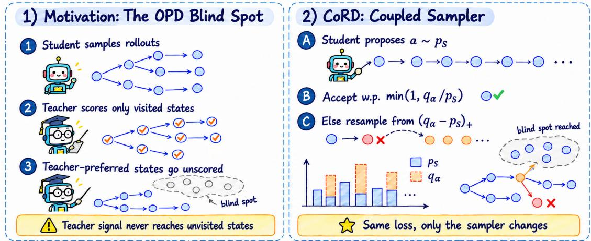
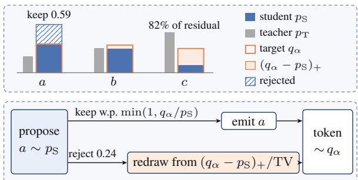
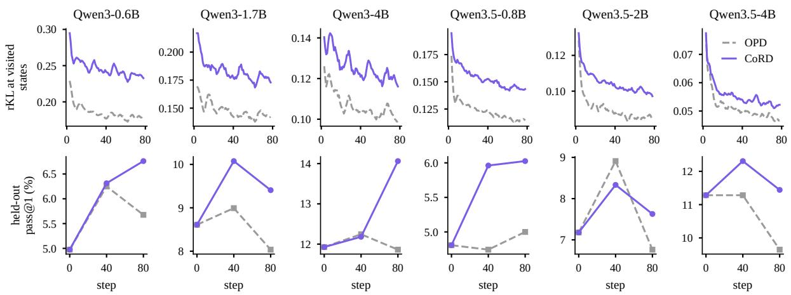
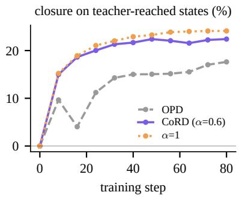
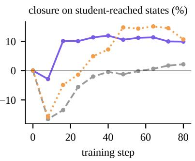
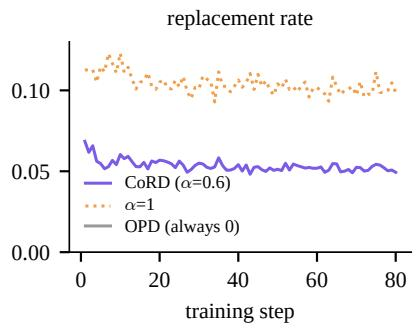

# CoRD: Coupled Rollouts Fill the Blind Spot of On-Policy Distillation

Guhan Chen1\*, Bohan Li1∗, Jun Rao2, Hejin Wang1, Songtao Tian1, Yexin Xie3,

Xiaojun Meng4, Peng Yuan4, Jiansheng Wei4, Xuebo Liu2, Zixiong Yu4†

1Tsinghua University 2Harbin Institute of Technology, Shenzhen, China

3Nanjing University 4Huawei Large Model Data Technology Lab chen-gh23@mails.tsinghua.edu.cn rao7jun@gmail.com {libh19,wanghj20,tiansongtao.2020,yuzx19}@tsinghua.org.cn {xiaojun.meng,yuanpeng126,weijiansheng}@huawei.com xieye-xin@qq.com liuxuebo@hit.edu.cn

## Abstract

On-policy distillation trains a student on its own rollouts, so states the teacher would reach but the student does not are seldom supervised. We introduce CORD (coupled-rollout distillation), which keeps the on-policy loss and moves only the distribution of training states toward the teacher, drawing rollouts from a geometric interpolation of student and teacher through the maximal coupling of speculative decoding. The coupling keeps the student’s token wherever the two distributions agree and oth erwise substitutes a token from the part of the target the student underweights, so interventions are as rare as any exact sampler allows and recede as the student learns. Across six base students from two model families (Qwen3 and Qwen3.5, 0.6B to 4B), CORD raises average pass@1 over on-policy distillation by 0.9 to 2.0 points and pass@8 by 1.2 to 3.4 points on five public math benchmarks at equal steps and data. On frozen teacher-reached states, a 4B student trained with CORD reaches in 16 steps a gap closure that on-policy distillation does not reach in 80, and substitution rules intervening at least as often in other directions fall short of CORD.

## 1 Introduction

The rapid advancement of artificial intelligence has been driven by complementary progress in model architectures (He et al., 2016; Vaswani et al., 2017; Yu et al., 2026a), data scale and quality (Yuan et al., 2023; Rao et al., 2025; Yu et al., 2026b), and training paradigms (Ouyang et al., 2022). Current research frontiers span theoretical explorations of learning dynamics and generalization (Chen et al., 2024; Li et al., 2024; Yu et al., 2025), generation across various modalities (Yu et al., 2024; Tian et al., 2026), tool-augmented reasoning (Wu et al., 2025), and interdisciplinary applications (Liu et al.,

2026a). Within this broad landscape, large language models (LLMs) have emerged as a central paradigm for exploring complex reasoning and knowledge transfer. A key challenge is how to enable smaller student models to efficiently inherit the capabilities of stronger teachers.

Among knowledge distillation methods, onpolicy distillation (OPD) has become a commonly used approach to this challenge (Agarwal et al., 2024; Gu et al., 2024; Yang et al., 2025; Xu et al., 2024). The student generates its own rollouts and is trained to match the teacher’s full next-token distribution at every state it visits, usually by minimizing the reverse Kullback–Leibler divergence. Training on self-generated text removes the mismatch between teacher-forced training and freerunning generation (Bengio et al., 2015; Ranzato et al., 2016; Ross et al., 2011), and the teacher’s dense, token-level signal replaces the single final reward of reinforcement learning.

The same design also fixes where the supervision lands. Because states are drawn from the student, the teacher only ever comments on states the student already reaches. States the teacher would enter, such as the first step of a solution path the student considers unlikely, are sampled only as often as the student itself picks them, and corrected only that often. We measure this blind spot on frozen sets of states. Before training, the student is 1.5 to 2.4 times further from the teacher on states reached by the teacher’s distribution than on states it reaches itself, across the four students analyzed in Section 5. On-policy training closes this gap only slowly: after 40 steps at 4B, OPD has removed 15.0% of the divergence on teacher-reached states, where the sampler we introduce removes 21.7%.

Reaching those states requires steering the rollout toward the teacher while leaving it the student’s own text wherever the two agree. Speculative decoding already contains the right tool (Leviathan et al., 2023; Chen et al., 2023). Its rejection sampler, usually seen as an accelerator, realizes the maximal coupling of two token distributions (Lindvall, 1992): a draft token is kept where the distributions agree and replaced by a draw from their difference where they do not. When used instead as a training sampler, this rule intervenes only where the student and the target disagree, and exactly as often as they disagree.

  
Figure 1: Overview of CORD. (i) Left (OPD’s blind spot): On-policy distillation trains only on student rollouts. Teacher-preferred reasoning paths that the student rarely or never visits therefore receive little or no supervision. (ii) Right (our coupled sampler): CORD keeps the same training loss and budget, but changes the rollout sampler. By coupling the student with a teacher-leaning target qα, it preserves agreeing tokens and replaces disagreements with underweighted target tokens. This maximal coupling steers rollouts into teacher-preferred states missed by OPD with the minimum possible intervention rate, minimally perturbing the student’s original trajectory.

We introduce CORD (coupled-rollout distillation), illustrated in Figure 1, which changes the rollout sampler of OPD and nothing else. At each position the student proposes a token, and the coupling with a tempered target $q _ { \alpha } \propto p _ { \mathrm { S } } ^ { 1 - \alpha } p _ { \mathrm { T } } ^ { \alpha }$ either keeps it or substitutes a token from the residual mass that the student underweights. Every emitted token is an exact draw from $q _ { \alpha } ,$ , the probability of an intervention equals the total-variation distance between pS and $q _ { \alpha } .$ , and α = 0 recovers OPD bit for bit. The loss, the teacher, and the number of training steps stay as they are; only the distribution of training states moves toward the teacher. That shift is the source of the gain. The coupling is how CORD reaches the shifted states while rewriting as little of the student’s own text as any exact sampler of $q _ { \alpha }$ can, and it splits every draw into an acceptance decision and a replacement direction, which Section 5 tests separately.

The shift pays off on public benchmarks. Across six base students from two model families, CORD improves average pass@1 and pass@8 over OPD on MATH500, AIME24, AIME25, AMC23 and GSM8K for every student in Table 1; on Qwen3.5-

0.8B and Qwen3.5-2B, SKD’s published replacement rule (Xu et al., 2025), with the same loss and budget, lands between OPD and CORD, and OPD trained for twice as many steps does not catch up. The difficulty breakdown shows that each student’s largest pass@16 gain is on problems it rarely or never solved before training, although the aggregate pass@16 gain is not positive for every student. Substitution rules that intervene at least as often but draw the replacement from elsewhere, namely a uniform token, a token from the student’s average distribution, or a teacher sample at randomly chosen positions, stay at or near OPD and far below CORD, which ties the gain to where the rollouts are steered rather than to the act of intervening.

Our contributions are as follows:

• We measure the blind spot of on-policy distillation on frozen sets of teacher-reached states, where the student starts 1.5 to 2.4 times further from the teacher than on its own states, and show that OPD leaves most of it in place.

• We propose CORD, which trains on rollouts from a teacher-leaning target and realizes them with the speculative-decoding rejection sampler: exact draws from the target with the fewest possible replacements (the total-variation distance), and OPD as the special case α = 0.

• We show gains in average pass@1 and pass@8 over OPD for all six base students on five public math benchmarks, and study teacher-reached states through closure measurements, substitution controls and an α sweep.

## 2 Related Work

Knowledge Distillation for Language Models. Distillation trains a student to match a teacher’s output distribution (Hinton et al., 2015; Rao et al., 2024; Jin et al., 2026), extended to sequences generated by the teacher (Kim and Rush, 2016) and to other divergences (Wen et al., 2023); Xu et al. (2024) survey the area. On-policy methods evaluate the loss on the student’s own samples (Lin et al., 2020; Agarwal et al., 2024; Fu et al., 2026; Rao et al., 2026b) and now train production models (Yang et al., 2025; Lu and Thinking Machines Lab, 2025). DistiLLM (Ko et al., 2024, 2025) mixes fixed and student-generated outputs under a skewed divergence, and TAID (Shing et al., 2025) moves the training target from the student toward the teacher over training. These methods change the loss, its target, or the data mix (Chen et al., 2026; Rao et al., 2026a,c); CORD keeps the onpolicy loss and target and changes only where the states come from, so it applies unchanged to any per-state loss computed from both distributions.

Exposure Bias and Imitation Learning. Training on states the model would not visit at test time is the exposure-bias problem (Bengio et al., 2015; Ranzato et al., 2016). Scheduled sampling mixes reference and model tokens under a hand-set schedule (Bengio et al., 2015); SEARN, DAgger and MiniLLM roll out a mixture of expert and learner (Daumé III et al., 2009; Ross et al., 2011; Gu et al., 2024), the last with importance weights. Their mixing follows a schedule or a fixed probability; in CORD the probability of intervening at a token is the current disagreement itself, so no schedule is needed and interventions vanish as student and target agree. Section 5 includes a DAgger-style control with the same average rate.

Speculative Decoding and Interleaved Sampling. Speculative decoding lets a draft model propose tokens that a rejection sampler accepts or replaces so that the output follows the target exactly (Leviathan et al., 2023; Chen et al., 2023); the sampler is a maximal coupling (Lindvall, 1992). DistillSpec (Zhou et al., 2024) uses distillation to improve the draft; CORD conversely uses the sampler to improve distillation. Other recent work lets the teacher take over parts of the rollout when the student drifts (Xu et al., 2026; Wang et al., 2026; Liu et al., 2026b), draws rollouts from a weaker negative policy (Hwang et al., 2026), or repairs the OPD objective itself (Fu et al., 2026); none samples from an explicit target with an exact rejection rule. The closest prior work is SKD (Xu et al., 2025), where a student proposal outside the teacher’s top-K tokens is replaced by a teacher sample. Its replacement can be any teacher token, including ones the student already overweights, and its acceptance set is fixed by K, so its intervention rate is not tied to the distance between the two distributions. CORD replaces only from the residual $( q _ { \alpha } - p _ { \mathrm { { S } } } ) _ { + }$ , emits tokens that follow $q _ { \alpha }$ exactly, intervenes at the rate $\mathrm { T V } ( p _ { \mathrm { { S } } } , q _ { \alpha } )$ , and moves continuously from OPD $( \alpha = 0 )$ to teacher-weighted states $( \alpha = 1 )$ . Section 4.3 compares the two under the same loss.

Algorithm 1 CORD rollout for one prompt   
Require: student $p \mathrm { s } .$ , teacher $p _ { \mathrm { T } }$ , prompt $x , \alpha \in [ 0 , 1 ]$   
1: s ← x   
2: while not finished do   
3: compute pS(· | s), pT(· | s) and $q _ { \alpha } ( \cdot \mid s )$ ▷ Eq. 2   
4: propose $a \sim p \mathrm { s } ( \cdot \mid s ) ;$ draw u $\sim \mathcal { U } [ 0 , 1 ]$   
5: i ${ \textbf { f } } { \hat { u } } \leq q _ { \alpha } ( a { \mid } s ) / p _ { \mathrm { S } } ( a \mid s )$ then   
6: $y  a$ ▷ keep the student’s token   
7: else   
8: $y \sim \left( q _ { \alpha } - p _ { \mathrm { S } } \right) _ { + } / \mathrm { T V } ( p _ { \mathrm { S } } , q _ { \alpha } )$ ▷ residual   
9: $s  s \oplus y$   
10: return visited states; the loss is the per-state term of   
Eq. (1) at each

## 3 Method

On-Policy Distillation. A student policy $p _ { \mathrm { S } } ( \cdot \mid s )$ is trained toward a frozen teacher $p _ { \mathrm { T } } ( \cdot \mid s )$ , where a state s is a prompt followed by a partial response. OPD minimizes the reverse KL divergence at the states visited by the student’s own rollouts,

$$
{ \mathcal { L } } _ { \mathrm { O P D } } = \mathbb { E } _ { s \sim d _ { p _ { \mathrm { S } } } } \left[ D _ { \mathrm { K L } } \big ( p _ { \mathrm { S } } ( \cdot \mid s ) \| p _ { \mathrm { T } } ( \cdot \mid s ) \big ) \right] ,\tag{1}
$$

where $d _ { p _ { \mathrm { S } } }$ is the distribution of states induced by sampling from $p \mathrm { s }$ and the divergence is computed over the full vocabulary V. The loss supervises every visited state densely, but the visited states come from $d _ { p _ { \mathrm { S } } }$ alone.

A Teacher-Leaning Target. CORD samples rollouts from the tempered target

$$
q _ { \alpha } ( v \mid s ) = { \frac { p _ { \mathrm { S } } ( v \mid s ) ^ { 1 - \alpha } p _ { \mathrm { T } } ( v \mid s ) ^ { \alpha } } { \sum _ { u \in \mathcal { V } } p _ { \mathrm { S } } ( u \mid s ) ^ { 1 - \alpha } p _ { \mathrm { T } } ( u \mid s ) ^ { \alpha } } } ,\tag{2}
$$

a geometric interpolation that equals the student at $\alpha = 0$ and the teacher at $\alpha = 1$ . Computing $q _ { \alpha }$ needs both full logit vectors at the current position, which the loss in Eq. (1) uses anyway.

The Coupled Sampler. Algorithm 1 gives the rollout. The student proposes $a \sim p _ { \mathrm { S } }$ , which is kept with probability min $( 1 , q _ { \alpha } ( a ) / p \mathrm { s } ( a ) )$ . Otherwise a replacement is drawn from the normalized residual $( q _ { \alpha } - p _ { \mathrm { { S } } } ) _ { + }$ , the tokens that the target weights more heavily than the student does, and the rollout continues from the replacement. This is the rejection rule of speculative decoding (Leviathan et al., 2023), with the student as the draft and $q _ { \alpha }$ as the target. The rollout follows $q _ { \alpha }$ exactly: a draw from $q _ { \alpha }$ gives the same distribution of training states and the same expected update, and this shift of the states drives the gains. The coupling determines how the shift is realized. Among all ways to pair the student’s proposal with a draw from $q _ { \alpha }$ , it is the one that departs from the proposal least often, it makes every intervention explicit and measurable, and at $\alpha = 0$ it reproduces OPD bit for bit.

Proposition 1. Each emitted token is an exact sample from $q _ { \alpha } ( \cdot \mid s )$ , and the probability of a replacement at state s equals TV $( p _ { \mathrm { { S } } } ( \cdot \mid s ) , q _ { \alpha } ( \cdot \mid s ) )$

The proof is the standard one for the rejection sampler of speculative decoding: a token v is emitted with probability min $( p _ { \mathrm { S } } ( v ) , q _ { \alpha } ( v ) ) + ( q _ { \alpha } ( v ) -$ $p \mathrm { s } ( v ) ) _ { + } = q _ { \alpha } ( v )$ , and the total rejection mass is $\begin{array} { r } { \sum _ { v } ( p _ { \mathrm { S } } ( v ) - q _ { \alpha } ( v ) ) _ { + } = \mathrm { T V } ( p _ { \mathrm { S } } , q _ { \alpha } ) } \end{array}$ , the smallest probability with which any coupling of the two distributions can differ. Three consequences matter for distillation. The sampler intervenes only where the student and the target disagree, and in proportion to the disagreement, so the intervention rate is a measured quantity rather than a schedule and goes to zero as pS approaches $p _ { \mathrm { T } }$ $\mathrm { { A t } } \alpha = 0$ the target equals the student, no proposal is ever rejected, and the rollout, the loss and the gradient are identical to OPD. And a replacement is sampled in proportion to the excess $q _ { \alpha } ( v ) - p _ { \mathrm { S } } ( v )$ . For $\alpha > 0$ , since $q _ { \alpha } ( v ) / p _ { \mathrm { S } } ( v ) = ( p _ { \mathrm { T } } ( v ) / p _ { \mathrm { S } } ( v ) ) ^ { \alpha } / Z _ { \alpha }$ with normalizer $Z _ { \alpha } \leq 1$ , the excess is positive exactly on the tokens whose teacher-to-student ratio exceeds $Z _ { \alpha } ^ { 1 / \alpha }$ , a set that contains every token the teacher weights more than the student, so each intervention moves the rollout toward the tokens the teacher favors most relative to the student.

A Worked Example. In Figure 2 the student overweights a and the teacher prefers c, so the sampler rejects a proposal of a with probability 0.41 and never rejects b or c. The replacement comes from the residual, which puts 82% of its mass on c and none on a: the rollout is pushed toward the token the student underweights, and only as often as needed, 24% of the time, to make the emitted token follow $q _ { \alpha } . \mathrm { ~ A ~ }$ rule that replaces every token outside the teacher’s top-1 with a teacher sample, as SKD does with $K = 1$ , would intervene 90% of the time and could still emit a.

  
Figure 2: One-step coupled sampling. On a threetoken vocabulary with $\alpha = 0 . 6 $ , student proposals are kept whenever possible and replaced only when necessary, so the emitted token follows $q _ { \alpha }$ exactly.

Objective. The loss remains the full-vocabulary reverse KL defined in Eq. (1), evaluated at states $s \sim d _ { q _ { \alpha } }$ . Because the divergence is zero only when the two distributions coincide, the minimizer at every visited state is still $p _ { \mathrm { { S } } } = p _ { \mathrm { { T } } } ;$ CORD changes which states are weighted, not the per-state minimizer. During training the realized replacement rate tracks the mean total-variation distance computed from the same logits. As verified in Appendix B, the $\alpha = 0$ sampler reproduces the OPD gradient exactly.

No Importance Correction. Training on states from $d _ { q _ { \alpha } }$ rather than $d _ { p _ { \mathrm { S } } }$ is the point of the method, so we do not reweight the visited states back to the student’s distribution. Such a correction, a product of ratios $p _ { \mathrm { S } } / q _ { \mathrm { o } }$ along the prefix, would undo the shift and its variance would grow with the length of the rollout. As in OPD, the unchanged per-state loss is applied to the visited states, the sampling distribution is treated as fixed, and the gradient flows only through $p \mathrm { s }$

Cost. The coupled rollout needs the teacher’s logits at every decoding position, while OPD can generate with the student alone and score the finished rollout with one teacher forward pass. Our implementation steps both models at every position for every variant, OPD included, so all variants in our comparisons have the same cost per training step, with step times within 2.3% of each other, and differ only in the sampling rule. Section 4.4 also gives OPD twice the training steps.

<table><tr><td rowspan="2" colspan="2">Student Method</td><td colspan="6">Pass@1</td><td colspan="6">Pass@8</td></tr><tr><td>MATH500 AIME24 AIME25 AMC23 GSM8K</td><td></td><td></td><td></td><td></td><td>Avg.</td><td>MATH500 AIME24 AIME25 AMC23 GSM8K</td><td></td><td></td><td></td><td></td><td>Avg.</td></tr><tr><td colspan="10">Qwen3-Base Series (Teacher Size: 8B)</td><td></td><td></td><td></td><td></td></tr><tr><td>0.6B</td><td>Untrained</td><td>12.7</td><td>0.4</td><td>0.2</td><td>3.1</td><td>24.5</td><td>8.2</td><td>42.0</td><td>3.3</td><td>1.7</td><td>18.6</td><td>67.5</td><td>26.6</td></tr><tr><td></td><td>OPD</td><td>15.4</td><td>0.2</td><td>0.0</td><td>5.5</td><td>30.0</td><td>10.2</td><td>46.9</td><td>1.7</td><td>0.0</td><td>28.1</td><td>71.8</td><td>29.7</td></tr><tr><td>1.7B</td><td>CoRD</td><td>18.3</td><td>0.4</td><td>0.2</td><td>6.3</td><td>35.8</td><td>12.2</td><td>50.9</td><td>3.3</td><td>1.7</td><td>32.4</td><td>77.4</td><td>33.1</td></tr><tr><td></td><td>Untrained</td><td>24.1</td><td>0.4</td><td>0.2</td><td>7.2</td><td>43.7</td><td>15.1</td><td>57.1</td><td>3.3</td><td>1.7</td><td>35.0</td><td>85.0</td><td>36.4</td></tr><tr><td></td><td>OPD</td><td>23.5</td><td>0.4</td><td>0.4</td><td>8.6</td><td>43.6</td><td>15.3</td><td>57.5</td><td>3.3</td><td>3.3</td><td>44.5</td><td>86.6</td><td>39.0</td></tr><tr><td></td><td>CoRD</td><td>26.6</td><td>0.8</td><td>0.0</td><td>11.7</td><td>47.4</td><td>17.3</td><td>62.5</td><td>5.9</td><td>0.0</td><td>47.3</td><td>87.5</td><td>40.6</td></tr><tr><td>4B</td><td>Untrained</td><td>31.2</td><td>0.4</td><td>0.0</td><td>13.6</td><td>58.2</td><td>20.7</td><td>64.7</td><td>3.3</td><td>0.0</td><td>49.7</td><td>93.6</td><td>42.3</td></tr><tr><td></td><td>OPD</td><td>30.9 32.8</td><td>0.6 1.7</td><td>1.5</td><td>13.4</td><td>57.1</td><td>20.7</td><td>68.1</td><td>3.0</td><td>10.1</td><td>45.2</td><td>94.4</td><td>44.2</td></tr><tr><td></td><td>CoRD</td><td></td><td></td><td>0.8</td><td>15.8</td><td>60.5</td><td>22.3</td><td>69.7</td><td>10.6</td><td>5.9</td><td>56.6</td><td>95.1</td><td>47.6</td></tr><tr><td colspan="10">Qwen3.5-Base Series (Teacher Size: 9B)</td><td></td><td></td><td></td><td></td><td></td></tr><tr><td>0.8B</td><td>Untrained</td><td>13.1</td><td>0.0</td><td>0.0</td><td>4.7</td><td>23.6</td><td>8.3</td><td>39.1</td><td>0.0</td><td>0.0</td><td>24.9</td><td>63.7</td><td>25.5</td></tr><tr><td></td><td>OPD</td><td>15.9</td><td>0.2</td><td>0.2</td><td>4.7</td><td>29.3</td><td>10.1</td><td>42.5</td><td>1.7</td><td>1.7</td><td>26.1</td><td>68.4</td><td>28.1</td></tr><tr><td></td><td>SKD</td><td>15.9</td><td>0.0</td><td>0.0</td><td>6.6</td><td>30.9</td><td>10.7</td><td>42.5</td><td>0.0</td><td>0.0</td><td>33.6</td><td>69.8</td><td>29.2</td></tr><tr><td></td><td>CoRD</td><td>17.3</td><td>0.2</td><td>0.2</td><td>5.9</td><td>32.0</td><td>11.1</td><td>45.3</td><td>1.7</td><td>1.7</td><td>29.9</td><td>70.3</td><td>29.7</td></tr><tr><td>2B</td><td>Untrained</td><td>21.3</td><td>0.8</td><td>0.2</td><td>8.4</td><td>38.9</td><td>13.9</td><td>54.5</td><td>6.7</td><td>1.7</td><td>40.4</td><td>80.5</td><td>36.7</td></tr><tr><td></td><td>OPD</td><td>22.6</td><td>0.4</td><td>0.0</td><td>10.5</td><td>46.4</td><td>16.0</td><td>53.2</td><td>3.3</td><td>0.0</td><td>38.2</td><td>83.7</td><td>35.7</td></tr><tr><td></td><td>OPD (160 steps)</td><td>21.5</td><td>0.2</td><td>0.6</td><td>10.5</td><td>42.8</td><td>15.1</td><td>51.3</td><td>1.7</td><td>5.0</td><td>39.6</td><td>80.5</td><td>35.6</td></tr><tr><td></td><td>SKD</td><td>22.8</td><td>0.2</td><td>0.2</td><td>10.5</td><td>47.1</td><td>16.2</td><td>52.2</td><td>1.7</td><td>1.7</td><td>41.1</td><td>83.4</td><td>36.0</td></tr><tr><td></td><td>CoRD</td><td>24.8</td><td>0.0</td><td>0.2</td><td>11.7</td><td>47.7</td><td>16.9</td><td>56.3</td><td>0.0</td><td>1.7</td><td>44.5</td><td>84.9</td><td>37.5</td></tr><tr><td>4B</td><td>Untrained</td><td>29.1</td><td>0.4</td><td>0.2</td><td>13.0</td><td>56.1</td><td>19.7</td><td>63.9</td><td>3.3</td><td>1.7</td><td>47.9</td><td>93.0</td><td>42.0</td></tr><tr><td></td><td>OPD</td><td>29.9</td><td>0.8</td><td>0.4</td><td>16.9</td><td>60.9</td><td>21.8</td><td>61.8</td><td>6.7</td><td>3.3</td><td>52.7</td><td>93.2</td><td>43.5</td></tr><tr><td></td><td>CoRD</td><td>33.1</td><td>1.3</td><td>0.4</td><td>16.3</td><td>63.4</td><td>22.9</td><td>66.7</td><td>8.4</td><td>3.3</td><td>50.9</td><td>94.2</td><td>44.7</td></tr></table>

Table 1: Main results on public math benchmarks. For all six students, CoRD has higher average pass@1 and pass@8 than OPD in this evaluation. Results use 16 generated samples per problem (percent). Pass@k uses the unbiased estimator, and Avg. is the unweighted mean across the five benchmarks, computed from unrounded benchmark scores; it may differ slightly from the mean of the displayed values due to rounding. All distilled models train for 80 steps except “OPD (160 steps)” (Section 4.4); CORD uses α = 0.6 and SKD the published top-25 rule. Bold indicates the highest value among distilled models for each student and column, including ties. Pass@16 results for the three Qwen3 students are reported in Appendix Table 6.

## 4 Experiments

Models. We distill six base students from two model families: (i) Qwen3-0.6B-Base, Qwen3- 1.7B-Base and Qwen3-4B-Base from Qwen3-8B-Base (Yang et al., 2025), (ii) Qwen3.5-0.8B-Base, Qwen3.5-2B-Base and Qwen3.5-4B-Base from Qwen3.5-9B-Base (Qwen Team, 2026). Students and teachers in a family share a tokenizer, which the coupling requires.

Training. Unless noted, every run trains for 80 steps on 256 prompts per step, drawn in one fixed order from a fixed set of about 5,000 problems of the MATH training set (Hendrycks et al., 2021), with at most 320 new tokens per rollout, learning rate 10−5 and the full-vocabulary reverse KL loss. Prompts use a fixed two-shot completion format. OPD and CORD use the same code, data, data order and number of steps, and differ only in α: 0 for OPD and 0.6 for CORD throughout. Section 5 shows how other values of α behave.

Evaluation. We evaluate students on MATH500 (Hendrycks et al., 2021; Lightman et al., 2024), AIME24 and AIME25 (Mathematical Association of America, 2024, 2025), AMC23 (Mathematical Association of America, 2023) and GSM8K (Cobbe et al., 2021), drawing 16 samples per problem at temperature 1.0 with a 4096-token limit in the training prompt format. Answers are scored by the SimpleRL-Zoo math checker (Zeng et al., 2025), and pass@k uses the unbiased estimator of Chen et al. (2021). No hyperparameter or checkpoint was selected on these sets.

## 4.1 Main Results

Table 1 shows that CORD improves average pass@1 and pass@8 over OPD for all six students. Average pass@1 rises by 0.9 to 2.0 percentage points and average pass@8 by 1.2 to 3.4 points across the five benchmarks. Pass@16 is less uniform (Appendix Table 6): Qwen3-0.6B and Qwen3-4B gain 3.0 and 4.6 points on average, respectively, while Qwen3-1.7B is 0.1 points lower. Table 2 locates the largest within-student pass@16 gains: grouping all 1,919 problems by how many of 16 samples the untrained student solved, every student’s largest gain is on problems solved at most three times initially, reaching 5.9 points on neversolved problems for Qwen3.5-4B and 6.2 points on rarely solved ones for Qwen3-0.6B. This difficulty breakdown need not imply a positive aggregate pass@16 difference for every student.

<table><tr><td rowspan="2">Student</td><td colspan="4">Untrained student solved k of 16</td></tr><tr><td>k=0</td><td>1-3</td><td>4-7</td><td>8-16</td></tr><tr><td>Qwen3-0.6B</td><td>+5.3</td><td>+6.2</td><td>+0.5</td><td>0.0</td></tr><tr><td>Qwen3-1.7B</td><td>+3.0</td><td>+2.8</td><td>+0.7</td><td>0.0</td></tr><tr><td>Qwen3-4B</td><td>+4.2</td><td>+4.2</td><td>-0.3</td><td>0.0</td></tr><tr><td>Qwen3.5-0.8B</td><td>+0.8</td><td>+1.5</td><td>+1.2</td><td>+1.3</td></tr><tr><td>Qwen3.5-2B</td><td>-0.5</td><td>+2.9</td><td>+0.7</td><td>-0.2</td></tr><tr><td>Qwen3.5-4B</td><td>+5.9</td><td>+2.3</td><td>+0.3</td><td>+0.1</td></tr></table>

Table 2: Pass@16 gains by problem difficulty. The table reports pass@16 gains of CORD over OPD (percentage points) after 80 steps on 1,919 public-benchmark problems, grouped by how many of 16 samples the untrained student solved. Bold marks each student’s largest gain; for all six students, these occur at $k \leq 3 .$ Gaps are computed before rounding from per-problem estimates.

The largest movements are on the benchmarks where the students have room to improve: CORD is ahead on MATH500 and GSM8K pass@1 for all six students, by up to 5.8 points on GSM8K for Qwen3-0.6B. Comparing with the untrained students shows what this shift in states buys. OPD sometimes stagnates or regresses: Qwen3-4B-Base is nearly unchanged from its untrained pass@1, and Qwen3.5-2B-Base loses about one point of average pass@8. CORD improves on the untrained student in both averages for all six. Under the same loss and budget, OPD can stall on its own states, while the coupled sampler keeps supplying states where the teacher can still teach.

## 4.2 Learning Curves

Figure 3 shows how the two samplers train. The reverse KL at the visited states, averaged over five steps, stays higher under CORD for every student throughout the 80 steps: the coupled sampler keeps routing the rollouts through states where the student is still far from the teacher, so the loss at the visited states stays larger, whereas on OPD’s own states it quickly falls. On a held-out slice of the training distribution, CORD ends above OPD for all six students.

## 4.3 Comparison with SKD

SKD (Xu et al., 2025) also lets the teacher intervene in the student’s rollout. To compare the two sampling rules alone, we run SKD’s published rule, which replaces a proposal outside the teacher’s top 25 tokens by a teacher sample, with the same reverse KL loss, data, steps and per-step cost, for Qwen3.5-0.8B-Base and Qwen3.5-2B-Base; these are the rows “SKD” in Table 1. SKD lands between OPD and CORD on both averages for both students: it gains 0.6 and 0.2 points of average pass@1 over OPD, respectively, where CORD gains 1.1 and 0.9 points. The two rules differ in how often, where and with what they intervene. With K = 25, SKD replaces fewer than 1% of the tokens, 0.7% and 0.6% on average over training, because the student’s proposal almost always falls inside the teacher’s top 25 even where the two distributions differ substantially; CORD replaces 6.8% and 5.7%, exactly the total-variation distance to its target. A top-K rule asks whether the student’s token is plausible to the teacher, and where both models spread their mass over many reasonable continuations it accepts almost every proposal; the coupling moves exactly the excess of the target over the student, so supervision shifts toward the teacher wherever the two distributions differ, in proportion to how much they differ.

## 4.4 OPD with Twice the Steps

Because the coupled rollout queries the teacher during generation, we also give OPD twice the training steps: we train OPD on Qwen3.5-2B-Base for 160 steps, twice as many as CORD. The extra steps do not help. The corresponding “OPD, 160 steps” row in Table 1 has average pass@1 of 15.1 and pass@8 of 35.6, below the 80-step OPD values of 16.0 and 35.7 and the 80-step CORD values of 16.9 and 37.5.

## 5 Learning in the Blind Spot

We now ask where the gains come from. The analyses in this section distill the instruction-tuned Qwen3-1.7B and Qwen3-4B-Base, called 1.7B and 4B below, from Qwen3-8B-Base on MATH (Hendrycks et al., 2021) for 40 steps, otherwise with the recipe of Section 4.

Measuring the Blind Spot. Before training we freeze two sets of states for each student: states reached by the untrained student’s own rollouts, and states reached when the untrained student’s rollouts are coupled to the teacher (α = 1). We measure the reverse KL to the teacher on both sets before and after training and report closure, 100 $( 1 - \overline { { \mathrm { K L } } } _ { \mathrm { a f t e r } } / \overline { { \mathrm { K L } } } _ { \mathrm { b e f o r e } } )$ , the percentage of the initial mean divergence that training removes (negative if it grows). At the start, the divergence on teacher-reached states is 2.4 times that on studentreached states for the 1.7B student and 1.5 times for the 4B student; for the three Qwen3 base students of Table 1 it is 1.9, 1.7 and 1.5 times.

  
Figure 3: Visited-state divergence and held-out accuracy. CORD maintains higher visited-state reverse KL and ends with higher held-out pass@1 for all six students in Table 1. Top: reverse KL to the teacher at states visited during training (5-step moving average). Bottom: pass@1 on about 200 held-out problems from the training distribution, evaluated at steps 0, 40 and 80.

<table><tr><td rowspan="2">Replacement Rule</td><td rowspan="2">Rate1.7B (%)</td><td colspan="2">1.7B (Instruct)</td><td colspan="2">4B-Base</td></tr><tr><td>Teach.</td><td>Stud.</td><td>Teach.</td><td>Stud.</td></tr><tr><td>none (OPD)</td><td>0.0</td><td>37.4</td><td>52.0</td><td>15.0</td><td>-0.5</td></tr><tr><td>residual (CoRD)</td><td>7.5</td><td>44.4</td><td>52.0</td><td>21.7</td><td>11.9</td></tr><tr><td>teacher sample, random position</td><td>7.9</td><td>39.1</td><td>51.3</td><td>14.2</td><td>-1.4</td></tr><tr><td>average-distribution token</td><td>12.2</td><td>29.2</td><td>48.4</td><td>13.7</td><td>-10.4</td></tr><tr><td>uniform token</td><td>15.8</td><td>28.3</td><td>47.3</td><td>13.9</td><td>-9.8</td></tr></table>

Table 3: Gap closure under replacement rules. Gap closure (%) on frozen teacher-reached and studentreached states after 40 steps, for different replacement rules at α = 0.6. The random-position rule is a DAggerstyle control whose average rate is close to CORD’s. Rate is the realized fraction of intervened positions at 1.7B. The residual draw is the only rule that clearly improves teacher-side closure for both students.

CORD Closes the Teacher-Side Gap. The first two rows of Table 3 show the effect of the sampler on the two sets. On teacher-reached states CORD closes 44.4% of the gap at 1.7B against 37.4% for OPD, and 21.7% against 15.0% at 4B. It does so without giving up the student’s own states, where closure improves at 4B while OPD barely moves. Figure 4 follows the 4B student over 80 steps. The two curves on teacher-reached states separate within the first eight steps, and CORD reaches after 16 steps a closure that OPD does not reach in 80.

The Direction of the Replacement Matters. A natural objection is that any perturbation of the rollout would help by diversifying the training states. We test three alternatives. Two keep the acceptance test of CORD and replace the residual draw by a uniform random token or by a token drawn from the student’s average token distribution. The third, in the spirit of DAgger, lets the teacher act at randomly chosen positions: at each position the teacher’s own sample replaces the student’s with a probability equal to CORD’s batch-mean replacement probability at that step, so the amount of intervention is comparable but its placement ignores where the two models disagree. At 1.7B all three intervene at least as often as CORD in Table 3, yet none comes close: the random and frequency rules fall below OPD on both students, and the DAgger-style mixing stays within two points of it. Off-direction replacements steer the rollout into states that neither model prefers; at the first step the mean total-variation distance between student and teacher along the rollouts is 0.40 with uniform replacements against 0.15 with residual draws, so these rules spend the training signal on states that do not lead toward the teacher. The 4B student shows the same picture: at the first step a uniform replacement intervenes on 13.3% of the tokens, twice CORD’s 6.9%, and leaves the visited states twice as far from the teacher, with a mean totalvariation distance of 0.22 against 0.11.

Effect of α. The parameter α sets how far the target leans toward the teacher, and with it how often the sampler intervenes. Table 4 shows a clear trend: closure on teacher-reached states grows with α at both scales, and each tested $\alpha > 0$ closes more of the teacher-side gap than OPD. On the public benchmarks after 80 steps, every $\alpha > 0$ also improves pass@16 over OPD.

  
Figure 4: Teacher-side closure and replacement rate. For the 4B-Base student and Qwen3-8B-Base teacher, CORD reaches in 16 steps the closure on teacher-reached states that OPD fails to reach in 80. Left and middle: closure of the reverse KL to the teacher on frozen teacher-reached and student-reached states, measured every 8 steps. Right: the realized replacement rate, which falls slowly as the student approaches the target.

<table><tr><td rowspan="2">α</td><td rowspan="2">Rate (%)</td><td colspan="2">Teach. Closure</td><td rowspan="2">4B, Public 80 Steps</td></tr><tr><td>1.7B</td><td>4B</td></tr><tr><td>0 (OPD)</td><td>0.0</td><td>37.4</td><td>15.0</td><td>20.7 / 50.3</td></tr><tr><td>0.3</td><td>3.6</td><td>40.6</td><td>18.1</td><td>20.7 / 51.6</td></tr><tr><td>0.6 (CoRD)</td><td>7.5</td><td>44.4</td><td></td><td>21.7 22.3/54.9</td></tr><tr><td></td><td>15.6</td><td>47.4</td><td>22.9</td><td>22.6/52.2</td></tr></table>

Table 4: Closure and public accuracy across $\alpha _ { \bullet }$ Closure on teacher-reached states grows with $\alpha ,$ and every $\alpha > 0$ improves public pass@16 over OPD. Rate is the realized replacement rate at 1.7B; closure (%) is measured on frozen teacher-reached states after 40 steps. Accuracy is pass@1 / pass@16 (%) for the 4B-Base student, averaged over the five public benchmarks after 80 steps.

What the Student Gets Right. Accuracy can rise because the student formats answers more reliably or because the answers it commits to are more often correct. On the public benchmarks almost every sample ends in an extractable answer, 99.5 to 99.9% for every run of Table 1, so the pass@1 gains of Table 1 are gains in the correctness of the student’s answers, not in their form.

Interventions Recede With Training. Because the replacement probability equals the current totalvariation distance, the sampler withdraws as the student approaches the target. Figure 4 shows that in the 80-step run at 4B, the replacement rate falls from 6.9% at the first step to 4.9% at step 80, without any schedule.

The Effect Holds Across Teachers. With Qwen3-14B as the teacher of the 1.7B student for 20 steps, CORD again closes more of the teacherside gap than OPD, by 4.2 points, so the gain carries over to a second, larger teacher.

## 6 Conclusion

On-policy distillation supervises the student only where the student already goes. CORD widens that set by sampling each rollout from the maximal coupling of the student and a teacher-leaning target: the student’s token is kept where the two agree, and a token from the residual is substituted where they do not, exactly as often as they disagree. The loss, the data and the number of training steps stay as they are, and the method adds a single parameter: $\alpha = 0$ is OPD exactly, and one value, $\alpha \ : = \ : 0 . 6 .$ , serves all six students. The interventions need no schedule, because the replacement rate falls by itself as the student approaches the target. Across six base students from two model families on public benchmarks, this change improves average pass@1 and pass@8 for all six students. Pass@16 gains are more variable, but each student’s largest difficulty-bin gain occurs on problems it rarely or never solved before training. Frozen sets of teacher-reached states show that CORD closes more of the gap on exactly the states the teacher reaches. Because the sampler needs only the teacher’s logits during generation, it combines with any change to the loss or its target.

## Limitations

CORD needs the teacher’s logits during the rollout. Our public-benchmark experiments cover base students up to 4B parameters and teachers up to 9B (14B in one analysis), all on mathematical reasoning; larger models and other tasks are untested. Student and teacher must share a tokenizer. The AIME sets each contain only 30 problems, so small differences in pass rates should be interpreted cautiously.

## Ethical Considerations

This work studies model distillation using public mathematical data and benchmarks; it involves no human subjects or personal data. Improving a student’s ability to follow a stronger model can also transfer that model’s errors, biases, or unsafe behavior, and the resulting capabilities may be used outside the evaluated setting. Our experiments therefore should not be interpreted as a safety evaluation or as evidence that distilled models are reliable in high-stakes applications. We encourage evaluation for the intended deployment context, including independent accuracy and safety checks, before use.

## References

Rishabh Agarwal, Nino Vieillard, Yongchao Zhou, Piotr Stanczyk, Sabela Ramos Garea, Matthieu Geist, and Olivier Bachem. 2024. On-policy distillation of language models: Learning from self-generated mistakes. In International Conference on Learning Representations.

Samy Bengio, Oriol Vinyals, Navdeep Jaitly, and Noam Shazeer. 2015. Scheduled sampling for sequence prediction with recurrent neural networks. In Advances in Neural Information Processing Systems, volume 28. Curran Associates, Inc.

Charlie Chen, Sebastian Borgeaud, Geoffrey Irving, Jean-Baptiste Lespiau, Laurent Sifre, and John Jumper. 2023. Accelerating large language model decoding with speculative sampling. Preprint, arXiv:2302.01318.

Guhan Chen, Yicheng Li, and Qian Lin. 2024. On the impacts of the random initialization in the neural tangent kernel theory. In Advances in Neural Information Processing Systems, volume 37, pages 35909–35944. Curran Associates, Inc.

Guhan Chen, Songtao Tian, Bohan Li, Hejin Wang, Ye-Xin Xie, and Zixiong Yu. 2026. DIAG: Diagnostic iterative alignment and generation for data-efficient mathematical preference distillation. In Findings of the Association for Computational Linguistics: EMNLP 2026, pages 23345–23364, Budapest, Hungary. Association for Computational Linguistics.

Mark Chen, Jerry Tworek, Heewoo Jun, Qiming Yuan, Henrique Ponde de Oliveira Pinto, Jared Kaplan, Harri Edwards, Yuri Burda, Nicholas Joseph, Greg Brockman, Alex Ray, Raul Puri, Gretchen Krueger,

Michael Petrov, Heidy Khlaaf, Girish Sastry, Pamela Mishkin, Brooke Chan, Scott Gray, and 39 others. 2021. Evaluating large language models trained on code. Preprint, arXiv:2107.03374.

Karl Cobbe, Vineet Kosaraju, Mohammad Bavarian, Mark Chen, Heewoo Jun, Lukasz Kaiser, Matthias Plappert, Jerry Tworek, Jacob Hilton, Reiichiro Nakano, Christopher Hesse, and John Schulman. 2021. Training verifiers to solve math word problems. Preprint, arXiv:2110.14168.

Hal Daumé III, John Langford, and Daniel Marcu. 2009. Search-based structured prediction. Machine Learning, 75(3):297–325.

Yuqian Fu, Haohuan Huang, Kaiwen Jiang, Jiacai Liu, Zhuo Jiang, Yuanheng Zhu, and Dongbin Zhao. 2026. Revisiting on-policy distillation: Empirical failure modes and simple fixes. Preprint, arXiv:2603.25562.

Yuxian Gu, Li Dong, Furu Wei, and Minlie Huang. 2024. MiniLLM: Knowledge distillation of large language models. In International Conference on Learning Representations.

Kaiming He, Xiangyu Zhang, Shaoqing Ren, and Jian Sun. 2016. Deep residual learning for image recognition. In Proceedings of the IEEE Conference on Computer Vision and Pattern Recognition, pages 770– 778.

Dan Hendrycks, Collin Burns, Saurav Kadavath, Akul Arora, Steven Basart, Eric Tang, Dawn Song, and Jacob Steinhardt. 2021. Measuring mathematical problem solving with the MATH dataset. In Proceedings of the Neural Information Processing Systems Track on Datasets and Benchmarks, volume 1.

Geoffrey Hinton, Oriol Vinyals, and Jeff Dean. 2015. Distilling the knowledge in a neural network. Preprint, arXiv:1503.02531.

Jaehui Hwang, Dongyoon Han, Sangdoo Yun, and Byeongho Heo. 2026. On-policy distillation with negative-policy rollouts. Preprint, arXiv:2610.07874.

Bo Jin, Timin Li, Guhan Chen, and Dongmei Li. 2026. What the student learns in knowledge distillation: A subspace view and evidence on convolutional recurrent network. In 2026 IEEE International Conference on Acoustics, Speech and Signal Processing (ICASSP).

Yoon Kim and Alexander M. Rush. 2016. Sequencelevel knowledge distillation. In Proceedings of the 2016 Conference on Empirical Methods in Natural Language Processing, pages 1317–1327, Austin, Texas. Association for Computational Linguistics.

Jongwoo Ko, Tianyi Chen, Sungnyun Kim, Tianyu Ding, Luming Liang, Ilya Zharkov, and Se-Young Yun. 2025. DistiLLM-2: A contrastive approach boosts the distillation of LLMs. In Proceedings ofthe 42nd

International Conference on Machine Learning, volume 267 of Proceedings of Machine Learning Research, pages 31044–31062. PMLR.

Jongwoo Ko, Sungnyun Kim, Tianyi Chen, and Se-Young Yun. 2024. DistiLLM: Towards streamlined distillation for large language models. In Proceedings ofthe 41st International Conference on Machine Learning, volume 235 of Proceedings of Machine Learning Research, pages 24872–24895. PMLR.

Yaniv Leviathan, Matan Kalman, and Yossi Matias. 2023. Fast inference from transformers via speculative decoding. In Proceedings of the 40th International Conference on Machine Learning, volume 202 of Proceedings ofMachine Learning Research, pages 19274–19286. PMLR.

Yicheng Li, Zixiong Yu, Guhan Chen, and Qian Lin. 2024. On the eigenvalue decay rates of a class of neural-network related kernel functions defined on general domains. Journal ofMachine Learning Research, 25(82):1–47.

Hunter Lightman, Vineet Kosaraju, Yuri Burda, Harrison Edwards, Bowen Baker, Teddy Lee, Jan Leike, John Schulman, Ilya Sutskever, and Karl Cobbe. 2024. Let’s verify step by step. In International Conference on Learning Representations.

Alexander Lin, Jeremy Wohlwend, Howard Chen, and Tao Lei. 2020. Autoregressive knowledge distillation through imitation learning. In Proceedings of the 2020 Conference on Empirical Methods in Natural Language Processing (EMNLP), pages 6121–6133, Online. Association for Computational Linguistics.

Torgny Lindvall. 1992. Lectures on the Coupling Method. John Wiley & Sons, New York.

Tong Liu, Bohan Li, Gongrui Cheng, Zixiong Yu, Yulan He, and Volker Tresp. 2026a. Llms can tackle high energy theoretical physics, yet gaps remain: Part i, quantum field theory. Preprint, arXiv:2610.33134.

Xinyu Liu, Kechen Jiao, Chunyang Xiao, Runsong Zhao, Junhao Ruan, Bei Li, Jiahao Liu, Qifan Wang, Xin Chen, Jingang Wang, Chenglong Wang, Tong Xiao, and JingBo Zhu. 2026b. Teacher-guided policy optimization for on-policy reasoning distillation under large policy divergence. Preprint, arXiv:2605.13230.

Kevin Lu and Thinking Machines Lab. 2025. On-policy distillation. Thinking Machines Lab: Connectionism (blog).

Mathematical Association of America. 2023. American mathematics competitions (AMC 10/12) 2023. 40- problem evaluation set. Hugging Face copy: https: //huggingface.co/datasets/math-ai/amc23.

Mathematical Association of America. 2024. American invitational mathematics examination (AIME) 2024. 30 problems (AIME I and II). Hugging Face copy: https://huggingface.co/datasets/ math-ai/aime24.

Mathematical Association of America. 2025. American invitational mathematics examination (AIME) 2025. 30 problems (AIME I and II). Hugging Face copy: https://huggingface.co/datasets/ math-ai/aime25.

Long Ouyang, Jeff Wu, Xu Jiang, Diogo Almeida, Carroll Wainwright, Pamela Mishkin, Chong Zhang, Sandhini Agarwal, Katarina Slama, Alex Ray, et al. 2022. Training language models to follow instructions with human feedback. In Advances in Neural Information Processing Systems, volume 35.

Qwen Team. 2026. Qwen3.5: Towards native multimodal agents. Qwen blog.

Marc’Aurelio Ranzato, Sumit Chopra, Michael Auli, and Wojciech Zaremba. 2016. Sequence level training with recurrent neural networks. In International Conference on Learning Representations.

Jun Rao, Xuebo Liu, Hexuan Deng, Zepeng Lin, Zixiong Yu, Jiansheng Wei, Xiaojun Meng, and Min Zhang. 2026a. Dynamic sampling that adapts: Selfaware iterative data persistent optimization for mathematical reasoning. In Findings of the Association for Computational Linguistics: ACL 2026, pages 28337–28350, San Diego, California, United States. Association for Computational Linguistics.

Jun Rao, Xuebo Liu, Zepeng Lin, Liang Ding, Jing Li, and Min Zhang. 2026b. Exploring and enhancing the transfer of distribution in knowledge distillation for autoregressive language models. Knowledge-Based Systems, 337:115382.

Jun Rao, Xuebo Liu, Haotian Yan, Junjie Shen, Haosi Mo, Yanghaopeng Dong, Zihao Yan, Ziyi Wang, Zepeng Lin, Xiaojun Meng, Zixiong Yu, Liqun Deng, Jiansheng Wei, Yunhe Wang, and Min Zhang. 2025. A data-centric perspective on the lifecycle of large language models. TechRxiv, 2025(1220).

Jun Rao, Xv Meng, Liang Ding, Shuhan Qi, Xuebo Liu, Min Zhang, and Dacheng Tao. 2024. Parameterefficient and student-friendly knowledge distillation. IEEE Transactions on Multimedia, 26:4230–4241.

Jun Rao, Zixiong Yu, Xuebo Liu, Guhan Chen, Jing Li, Hejin Wang, Jiansheng Wei, Xiaojun Meng, and Min Zhang. 2026c. Mining or synthesis? rethinking exploration efficiency in iterative alignment of mathematical reasoning. In Findings of the Association for Computational Linguistics: EMNLP 2026, pages 23206–23229, Budapest, Hungary. Association for Computational Linguistics.

Stéphane Ross, Geoffrey Gordon, and Drew Bagnell. 2011. A reduction of imitation learning and structured prediction to no-regret online learning. In Proceedings of the Fourteenth International Conference on Artificial Intelligence and Statistics, volume 15 of Proceedings of Machine Learning Research, pages 627–635. PMLR.

Makoto Shing, Kou Misaki, Han Bao, Sho Yokoi, and Takuya Akiba. 2025. TAID: Temporally adaptive interpolated distillation for efficient knowledge transfer in language models. In International Conference on Learning Representations.

Songtao Tian, Guhan Chen, Bohan Li, Jingyi Ma, and Zixiong Yu. 2026. Curvature-adaptive consistency flow matching: Autonomous trajectory optimization via reinforcement learning. Preprint, arXiv:2606.22394.

Ashish Vaswani, Noam Shazeer, Niki Parmar, Jakob Uszkoreit, Llion Jones, Aidan N. Gomez, Lukasz Kaiser, and Illia Polosukhin. 2017. Attention is all you need. In Advances in Neural Information Processing Systems, volume 30.

Bing Wang, Shaotian Yan, Chen Shen, kaiyuan liu, Sinan Fan, Ximing Li, Rui Miao, Xiaosong Yuan, Zhanming Shen, and Jieping Ye. 2026. Backtracking when it strays: Mitigating dual exposure biases in llm reasoning distillation. Preprint, arXiv:2605.19433.

Yuqiao Wen, Zichao Li, Wenyu Du, and Lili Mou. 2023. f-divergence minimization for sequence-level knowledge distillation. In Proceedings of the 61st Annual Meeting of the Association for Computational Linguistics (Volume 1: Long Papers), pages 10817– 10834, Toronto, Canada. Association for Computational Linguistics.

Wenxun Wu, Yuanyang Li, Guhan Chen, Linyue Wang, and Hongyang Chen. 2025. Tool-augmented policy optimization: Synergizing reasoning and adaptive tool use with reinforcement learning. Preprint, arXiv:2510.07038.

Haolei Xu, Xiaowen Xu, Haiwen Hong, Zixuan Ni, Hongxing Li, Yiwen Qiu, Weiming Lu, and Yongliang Shen. 2026. Pass the baton: Trajectory-relayed on-policy distillation. Preprint, arXiv:2607.26057.

Wenda Xu, Rujun Han, Zifeng Wang, Long T. Le, Dhruv Madeka, Lei Li, William Yang Wang, Rishabh Agarwal, Chen-Yu Lee, and Tomas Pfister. 2025. Speculative knowledge distillation: Bridging the teacherstudent gap through interleaved sampling. In International Conference on Learning Representations.

Xiaohan Xu, Ming Li, Chongyang Tao, Tao Shen, Reynold Cheng, Jinyang Li, Can Xu, Dacheng Tao, and Tianyi Zhou. 2024. A survey on knowledge distillation of large language models. Preprint, arXiv:2402.13116.

An Yang, Anfeng Li, Baosong Yang, Beichen Zhang, Binyuan Hui, Bo Zheng, Bowen Yu, Chang Gao, Chengen Huang, Chenxu Lv, Chujie Zheng, Dayiheng Liu, Fan Zhou, Fei Huang, Feng Hu, Hao Ge, Haoran Wei, Huan Lin, Jialong Tang, and 41 others. 2025. Qwen3 technical report. Preprint, arXiv:2505.09388.

Bihui Yu, Dawei Liu, Huiyang Shi, GuiYong Chang, Jingxuan Wei, Linzhuang Sun, Songtao Tian, and Liping Bu. 2024. SAM-Wav2lip++: Enhancing behavioral realism in synthetic agents through audiodriven speech and action refinement. In 2024 IEEE International Conference on Systems, Man, and Cybernetics (SMC), pages 2999–3006.

Zixiong Yu, Guhan Chen, Jianfa Lai, Bohan Li, and Songtao Tian. 2026a. Branch scaling manifests as implicit architectural regularization for improving generalization in overparameterized resnets. In Proceedings ofthe Forty-third International Conference on Machine Learning.

Zixiong Yu, Jun Rao, Guhan Chen, Songtao Tian, Bohan Li, Jiansheng Wei, Min Zhang, and Xiaojun Meng. 2026b. MathAgent: Adversarial evolution of constraint graphs for mathematical reasoning data synthesis. In Findings of the Association for Computational Linguistics: ACL 2026, pages 28298–28321, San Diego, California, United States. Association for Computational Linguistics.

Zixiong Yu, Songtao Tian, and Guhan Chen. 2025. Divergence of neural tangent kernel in classification problems. In The Thirteenth International Conference on Learning Representations.

Zheng Yuan, Hongyi Yuan, Chengpeng Li, Guanting Dong, Keming Lu, Chuanqi Tan, Chang Zhou, and Jingren Zhou. 2023. Scaling relationship on learning mathematical reasoning with large language models. Preprint, arXiv:2308.01825.

Weihao Zeng, Yuzhen Huang, Qian Liu, Wei Liu, Keqing He, Zejun Ma, and Junxian He. 2025. SimpleRL-Zoo: Investigating and taming zero reinforcement learning for open base models in the wild. In Second Conference on Language Modeling. Code and evaluation toolkit: https://github.com/ hkust-nlp/simpleRL-reason.

Yongchao Zhou, Kaifeng Lyu, Ankit Singh Rawat, Aditya Krishna Menon, Afshin Rostamizadeh, Sanjiv Kumar, Jean-François Kagy, and Rishabh Agarwal. 2024. DistillSpec: Improving speculative decoding via knowledge distillation. In International Conference on Learning Representations.

## A Experimental Details

Models. Public-benchmark experiments distill Qwen3-0.6B-Base, Qwen3-1.7B-Base and Qwen3- 4B-Base from Qwen3-8B-Base (Yang et al., 2025), and Qwen3.5-0.8B-Base, Qwen3.5-2B-Base and Qwen3.5-4B-Base from Qwen3.5-9B-Base (Qwen Team, 2026). The analysis of Section 5 distills Qwen3-1.7B (the instruction-tuned release) and Qwen3-4B-Base from Qwen3-8B-Base. All models are released under the Apache 2.0 license. Within each family the student and teacher tokenizers are checked to be identical before training.

Data. Public-benchmark runs train on the MATH training set (Hendrycks et al., 2021) (MIT license): the first 5,000 problems of one fixed shuffle, minus the few (under 1%) whose prompt exceeds 512 tokens, visited in the same order by every run (80 steps of 256 prompts cover the set about four times). The analysis runs train on the MATH training set (Hendrycks et al., 2021) (MIT license) under one fixed shuffle: rows [0, 5000) are used for training, rows [5000, 5200) form the held-out set (199 problems after dropping prompts over 512 tokens), and rows from 6000 on seed the frozen state sets. Evaluation uses MATH500 (Lightman et al., 2024) (MIT), GSM8K (Cobbe et al., 2021) (MIT, 1,319 test problems), and the AIME 2024, AIME 2025 and AMC 2023 problems (Mathematical Association of America, 2024, 2025, 2023) (30, 30 and 40 problems), which are publicly released competition problems used here for research evaluation only. A check of the 5,000 training problems against all 1,919 evaluation problems (normalized exact match, and 13-gram or character 5-gram nearduplicate screening followed by manual inspection) found one duplicate, a single MATH500 problem, and no overlap with AIME, AMC or GSM8K.

Training. Table 5 lists the training and evaluation settings. Every run minimizes the full-vocabulary reverse KL $D _ { \mathrm { K L } } ( p _ { \mathrm { S } } \| p _ { \mathrm { T } } )$ at every visited state, averaged over all tokens in the step, and draws rollout tokens from the full distribution, for OPD’s student draws and for the coupled sampler alike. In the public-benchmark runs the frozen teacher is sharded across devices, which we checked to give logits identical to an unsharded teacher. Runs within a comparison differ only in the sampling rule; the data order and sampling randomness are held fixed, and the frozen state sets are shared by all runs of a student. Memory-saving options, where needed, are applied identically to every run of a student and were checked not to change any computed value. In the controls of Section 5, the averagedistribution token is drawn from an exponential moving average (decay 0.9) of the student’s nexttoken distribution over earlier rollout batches (the current batch’s mean on the first batch).

Prompt. Training and evaluation use the same two-shot completion prompt (Figure 5), with generation stopped at the next Problem:.

Evaluation. On the public benchmarks the final \boxed{} answer is compared with the reference by the SimpleRL-Zoo math equivalence checker (Zeng et al., 2025) with a 3-second time limit (a time-out counts as incorrect). The held-out evaluations of Figure 3 score answers by normalized exact match between the reference and the final answer, read from the last \boxed{} or, failing that, after “The final answer is”. pass@k is the unbiased estimator of Chen et al. (2021) computed from all samples; maj@8 is the accuracy of the most frequent answer among 8 samples.

Compute. All experiments ran on accelerator hardware. For reference, the training cost was about 670 accelerator-hours for the twelve OPD and CORD configurations represented in Table 1 (about 2 hours on 16 devices per Qwen3 run, and 5 to 19 hours on 8 devices per Qwen3.5 run), about 230 accelerator-hours for the training runs of Section 5, and about 170 accelerator-hours for the SKD runs and the 160-step OPD run of Section 4. Evaluation, which generates 16 samples for each of the 1,919 benchmark problems per model, is not included.

## B Exactness of the Sampler

Before any training we checked the implementation against the closed form. On small vocabularies, the histogram of emitted tokens agrees with $q _ { \alpha }$ for $\alpha \in \{ 0 , 0 . 3 , 0 . 6 , 1 \}$ , and the realized rejection rate agrees with the analytic total-variation distance to within $3 \times 1 0 ^ { - 4 } ;$ a sampler that replaces rejected tokens uniformly fails the same check by a wide margin. With the real 4B student and 8B teacher (200 prompts, 256 new tokens), the rejection rate agrees with the mean total-variation distance at every α, the $\alpha = 0$ sampler never rejects, and its gradient equals that of plain OPD exactly. During training of the 4B student (α = 0.6, 40 steps), the realized replacement rate stays within 0.003 of the mean total-variation distance computed from the same logits at every step. The SKD sampler of Section 4.3 was checked against its own closed form in the same way.

<table><tr><td></td><td colspan="3">Run group</td></tr><tr><td>Setting</td><td>Public benchmarks (Table 1)</td><td>Analysis on MATH (Section 5)</td><td>Qwen3-14B teacher (Section 5)</td></tr><tr><td>Training</td><td></td><td></td><td></td></tr><tr><td>Training steps</td><td>80 (160 for “OPD, 160 steps&quot;)</td><td>40</td><td>20</td></tr><tr><td>Prompts per step</td><td>256</td><td>256</td><td>64</td></tr><tr><td>Max. new tokens per rollout</td><td>320</td><td>320</td><td>224</td></tr><tr><td>Rollout sampling</td><td colspan="3">temperature 1.0, top-p 1.0</td></tr><tr><td>Optimizer</td><td colspan="3">AdamW,  $\beta = ( 0 . \bar { 9 } , 0 . 9 5 ) , \epsilon = 1 \bar { 0 } ^ { - 8 }$  , weight decay 0</td></tr><tr><td>Learning rate</td><td colspan="3"> $1 0 ^ { - 5 } ,$  linear warm-up over 4 steps</td></tr><tr><td>Gradient clipping</td><td colspan="3">global norm 1.0</td></tr><tr><td>Precision</td><td colspan="3">bf16 mixed, fp32 optimizer states; frozen teacher in bf16</td></tr><tr><td>Evaluation</td><td colspan="3"></td></tr><tr><td>Benchmark evaluation</td><td>16 samples per problem, temperature 1.0, top-p 1.0, at most 4,096 new</td><td></td><td></td></tr><tr><td>In-run held-out (Figure 3)</td><td>tokens 8 samples per problem at steps 0 and 40, 16 at step 80, at most 384 new</td><td></td><td></td></tr></table>

Table 5: Training and evaluation settings per run group. The analysis and Qwen3-14B-teacher runs are measured by closure on frozen state sets (Section 5).  
Prompt for training and evaluation (two-shot completion)   
Problem: What is the value of \$2ˆ3 + 3ˆ2\$?   
Solution: We compute $\$ 23=8\$ 3$ and $\$ 323,456$ so the sum is $\$ 8 +9 = 17 \$ 8.$   
The final answer is \$\boxed{17}\$.   
Problem: If \$3x - 7 = 14\$, what is \$x\$?   
Solution: Adding \$7\$ to both sides gives \$3x = 21\$, so \$x = 7\$.   
The final answer is \$\boxed{7}\$.   
Problem: {question}   
Solution:  
Figure 5: The two-shot completion prompt used for training and for every evaluation; {question} is replaced by the problem, and generation stops at the next Problem:.

## C Additional Results

Pass@16 on the Public Benchmarks. Table 6 gives pass@16 for the three Qwen3 students of Table 1. CORD improves average pass@16 over OPD by 3.0 and 4.6 points for Qwen3-0.6B and Qwen3-4B, respectively; the Qwen3-1.7B result is 0.1 points lower.

## D Properties of the Coupled Sampler

This appendix collects the properties of the target $q _ { \alpha }$ and of the coupled sampler of Section 3, with complete proofs. Throughout, pS and $p _ { \mathrm { T } }$ are the student and teacher next-token distributions at one fixed state $s ,$ which we drop from the notation.

Both are softmax outputs and therefore strictly positive on V, and $\alpha \in [ 0 , 1 ]$ . Table 7 lists the notation.

Exactness and Minimal Replacement. We first give the full proof of Proposition 1. Let $a \sim p \mathrm { s }$ be the proposal and y the emitted token. The proposal is kept with probability min $( 1 , q _ { \alpha } ( a ) / p _ { \mathrm { S } } ( a ) )$ so the probability that v is proposed and kept is $p _ { \mathrm { S } } ( v ) \operatorname* { m i n } ( 1 , q _ { \alpha } ( v ) / p _ { \mathrm { S } } ( v ) ) = \operatorname* { m i n } ( p _ { \mathrm { S } } ( v ) , q _ { \alpha } ( v ) )$ The total rejection probability is therefore

$$
\begin{array} { r l } & { \sum _ { v } \left( p _ { \mathrm { S } } ( v ) - \operatorname* { m i n } ( p _ { \mathrm { S } } ( v ) , q _ { \alpha } ( v ) ) \right) } \\ & { \quad = \sum _ { v } \left( p _ { \mathrm { S } } ( v ) - q _ { \alpha } ( v ) \right) _ { + } = \mathrm { T V } ( p _ { \mathrm { S } } , q _ { \alpha } ) , } \end{array}
$$

where the last step uses $\begin{array} { r } { \sum _ { v } p _ { \mathrm { S } } ( v ) = \sum _ { v } q _ { \alpha } ( v ) = } \end{array}$ 1. After a rejection the replacement is drawn from $\left( q _ { \alpha } - p _ { \mathrm { S } } \right) _ { + } / \mathrm { T V } ( p _ { \mathrm { S } } , q _ { \alpha } )$ , so v is emitted as a replacement with probability $( q _ { \alpha } ( v ) - p _ { \mathrm { S } } ( v ) ) _ { + }$

<table><tr><td>Student</td><td>Method</td><td>MATH500</td><td>AIME24</td><td>AIME25</td><td>AMC23</td><td>GSM8K</td><td> $\mathbf { A v g . }$ </td></tr><tr><td>Qwen3-0.6B-Base Untrained</td><td></td><td>53.8</td><td>6.7</td><td>3.3</td><td>30.0</td><td>79.5</td><td>34.7</td></tr><tr><td rowspan="3"></td><td>OPD</td><td>57.6</td><td>3.3</td><td>0.0</td><td>45.0</td><td>81.6</td><td>37.5</td></tr><tr><td>CoRD</td><td>62.6</td><td>6.7</td><td>3.3</td><td>45.0</td><td>85.1</td><td>40.5</td></tr><tr><td>Qwen3-1.7B-Base Untrained</td><td>66.4</td><td>6.7</td><td>3.3</td><td>50.0</td><td>91.2</td><td>43.5</td></tr><tr><td rowspan="3"></td><td>OPD</td><td>66.6</td><td>6.7</td><td>6.7</td><td>65.0</td><td>92.4</td><td>47.5</td></tr><tr><td>CoRD</td><td>71.8</td><td>10.0</td><td>0.0</td><td>62.5</td><td>92.6</td><td>47.4</td></tr><tr><td>Untrained</td><td>72.6</td><td>6.7</td><td>0.0</td><td>62.5</td><td>96.3</td><td>47.6</td></tr><tr><td>Qwen3-4B-Base</td><td>OPD</td><td>77.0</td><td>3.3</td><td>16.7</td><td>57.5</td><td>97.0</td><td>50.3</td></tr><tr><td></td><td>CoRD</td><td>77.6</td><td>16.7</td><td>10.0</td><td>72.5</td><td>97.8</td><td>54.9</td></tr></table>

Table 6: Pass@16 (%) on the five public benchmarks for the three Qwen3 base students. Each entry is computed from 16 samples per problem, with Avg. the unweighted mean across benchmarks, computed from unrounded benchmark scores; it may differ slightly from the mean of the displayed values due to rounding. The Qwen3-1.7B average and some benchmark scores are lower with CORD than with OPD, despite higher average pass@1 and pass@8.

<table><tr><td>Symbol</td><td>Meaning</td></tr><tr><td> $p _ { \mathrm { S } } , p _ { \mathrm { T } }$   $q _ { \alpha }$ </td><td>student, teacher next-token distributions tempered target of  $\operatorname { E q . } \left( 2 \right)$ </td></tr><tr><td> $Z _ { \alpha }$ </td><td>normalizer  $\begin{array} { r } { \sum _ { u } p \mathrm { s } ( u ) ^ { 1 - \alpha } p \mathrm { r } ( u ) ^ { \alpha } } \end{array}$ </td></tr><tr><td> $\ell ( v )$ </td><td>log ratio lo  $\mathrm { g } p \bar { \mathrm { T } } ( v ) - \log p \mathrm { s } ( v )$ </td></tr><tr><td> $( x ) _ { + }$ </td><td> $\operatorname* { m a x } ( x , 0 )$ </td></tr><tr><td></td><td></td></tr><tr><td> $\mathrm { T V } ( p , q )$ </td><td> $\begin{array} { r } { \frac { 1 } { 2 } \sum _ { v } | p ( v ) - q ( v ) | } \end{array}$ </td></tr></table>

Table 7: Notation for Appendix D.

Adding the two cases,

$$
\begin{array} { r l } & { \mathrm { P r } ( y = v ) = \operatorname* { m i n } ( p _ { \mathrm { S } } ( v ) , q _ { \alpha } ( v ) ) } \\ & { \phantom { = \quad } + ( q _ { \alpha } ( v ) - p _ { \mathrm { S } } ( v ) ) _ { + } = q _ { \alpha } ( v ) . \quad \varTheta } \end{array}
$$

Lemma 2 (Minimal replacement). For every joint distribution of a pair $( a , y )$ with marginals $p \mathrm { s }$ and $q _ { \alpha } , \operatorname* { P r } ( a \neq y ) \geq \operatorname { T V } ( p _ { \mathrm { S } } , q _ { \alpha } )$ . The coupled sampler attains equality.

Proof. For every token v, $\begin{array} { r l r } { \mathrm { P r } ( a } & { { } = } & { y \quad = } \end{array}$ $v ) \quad \leq$ min $( p _ { \mathrm { { S } } } ( v ) , q _ { \alpha } ( v ) )$ , so $\operatorname* { P r } ( a ~ = ~ y ) ~ \leq ~$ $\textstyle \sum _ { v }$ $\phantom { } _ { v } \operatorname* { m i n } ( p _ { \mathrm { S } } ( v ) , q _ { \alpha } ( v ) ) = 1 - \mathrm { T V } ( p _ { \mathrm { S } } , q _ { \alpha } )$ (Lindvall, 1992). In the coupled sampler a proposal a can be rejected only when $q _ { \alpha } ( a ) < p _ { \mathrm { S } } ( a )$ , where the residual $( q _ { \alpha } - p _ { \mathrm { { S } } } ) _ { + }$ vanishes, so a replacement never equals the rejected proposal. Hence $\Pr ( a \neq$ y) equals the rejection probability $\mathrm { T V } ( p _ { \mathrm { { S } } } , q _ { \alpha } )$ .

Summed over the states of a rollout, the expected number of replacements is $\begin{array} { r l } { \mathbb { E } \big [ \sum _ { t } \mathrm { T V } \big ( p _ { \mathrm { S } } ( \cdot } & { { } | } \end{array}$ $s _ { t } ) , q _ { \alpha } ( \cdot \mid s _ { t } ) ) \big ]$  over the visited states $s _ { t } ,$ which are distributed as $d _ { q _ { \alpha } }$ . Its per-token average, the mean total-variation distance, is the quantity that the realized replacement rate tracks in Appendix B.

The Target as a Weighted Divergence Minimizer. The geometric interpolation of Eq. (2) has a variational description that also bounds its normalizer.

Proposition 3. For $\alpha \in [ 0 , 1 ] , q _ { \alpha }$ is the unique minimizer over distributions q on V of

$$
( 1 - \alpha ) D _ { \mathrm { K L } } ( q \| p _ { \mathrm { S } } ) + \alpha D _ { \mathrm { K L } } ( q \| p _ { \mathrm { T } } ) ,
$$

and the minimum value $i s -$ log $Z _ { \alpha } .$ . Consequently $Z _ { \alpha } \leq 1$ , with equality for $\alpha \in ( 0 , 1 )$ if and only if $p _ { \mathrm { S } } = p _ { \mathrm { T } }$

Proof. Combining the two logarithms in each divergence,

$$
\begin{array} { r l } & { \left( 1 - \alpha \right) D _ { \mathrm { K L } } ( q \parallel p _ { \mathrm { S } } ) + \alpha D _ { \mathrm { K L } } ( q \parallel p _ { \mathrm { T } } ) } \\ & { \quad = \sum _ { v } q ( v ) \log \frac { q ( v ) } { p _ { \mathrm { S } } ( v ) ^ { 1 - \alpha } p _ { \mathrm { T } } ( v ) ^ { \alpha } } } \\ & { \quad = D _ { \mathrm { K L } } ( q \parallel q _ { \alpha } ) - \log Z _ { \alpha } . } \end{array}
$$

The divergence is nonnegative and vanishes only at $q = q _ { \alpha }$ , which proves the first two claims. Both divergences in the objective are nonnegative, so $- \log Z _ { \alpha } \geq 0 .$ . For $\alpha \in ( 0 , 1 )$ the minimum is zero only if a single q makes both divergences vanish, that is, only if $q = p _ { \mathrm { S } } = p _ { \mathrm { T } }$ □

Lemma 4 (Where the residual lives). For $\alpha \in$ (0, 1], $q _ { \alpha } ( v ) \ > \ p _ { \mathrm { S } } ( v )$ if and only $i f \ \ell ( v ) \ >$ $\alpha ^ { - 1 } \log Z _ { \alpha } . \quad I n$ particular, i $\textit { f } \alpha \ \in \ \left( 0 , 1 \right)$ and $p _ { \mathrm { S } } \neq p _ { \mathrm { T } }$ , every token with $p _ { \mathrm { T } } ( v ) \geq p _ { \mathrm { S } } ( v )$ carries positive residual mass.

Proof. By Eq. (2), $q _ { \alpha } ( v ) / p _ { \mathrm { S } } ( v ) = e ^ { \alpha \ell ( v ) } / Z _ { \alpha }$ which exceeds one exactly when $\alpha \ell ( v ) > \log Z _ { \alpha }$ Under the second hypothesis Proposition 3 gives log $Z _ { \alpha } < 0 , \ s \mathbf { o } \ \ell ( v ) \geq 0$ suffices. □

Departure from the Student Grows with α. The coefficient α controls how far the rollout distribution moves from the student at each state, and it does so monotonically.

Proposition 5. Let $D ( \alpha ) = D _ { \mathrm { K L } } ( q _ { \alpha } \parallel p _ { \mathrm { S } } )$ . Then D is nondecreasing on [0, 1], with $D ( 0 ) = 0$ and $D ( 1 ) = D _ { \mathrm { K L } } ( p _ { \mathrm { T } } \| p _ { \mathrm { S } } )$ , and the replacement probability satisfies

$$
\mathrm { T V } ( p _ { \mathrm { S } } , q _ { \alpha } ) \leq { \sqrt { D ( \alpha ) / 2 } } \leq { \sqrt { D _ { \mathrm { K L } } ( p _ { \mathrm { T } } \| p _ { \mathrm { S } } ) / 2 } } .
$$

Proof. $\begin{array} { r l r l r l r l } { { \mathrm { W r i t e } } } & { { } { A } ( \alpha ) } & { } & { { } = } & { } & { { } \log Z _ { \alpha } } & { } & { { } = } & { } \end{array}$ log $\begin{array} { r } { \sum _ { v } p _ { \mathrm { S } } ( v ) e ^ { \alpha \ell ( v ) } , \quad \mathrm { { t h e } } } \end{array}$ cumulant generating function of ℓ under pS. Differentiating, $A ^ { \prime } ( \alpha ) \ = \ \mathbb { E } _ { q _ { \alpha } } [ \ell ]$ and $A ^ { \prime \prime } ( \alpha ) \ = \ \mathrm { V a r } _ { q _ { \alpha } } ( \ell ) \ \geq \ 0$ Since log $( q _ { \alpha } ( v ) / p _ { \mathrm { S } } ( v ) ) = \alpha \ell ( v ) - A ( \alpha )$

$$
D ( \alpha ) = \alpha A ^ { \prime } ( \alpha ) - A ( \alpha ) ,
$$

so that $D ^ { \prime } ( \alpha ) = \alpha A ^ { \prime \prime } ( \alpha ) \geq 0$ . The endpoint values follow from $q _ { 0 } = p _ { \mathrm { { S } } }$ and $q _ { 1 } = p _ { \mathrm { T } }$ . The first inequality is Pinsker’s inequality, and the second follows from monotonicity. □

Raising α therefore moves the target monotonically away from the student, and at no α does the sampler intervene with probability above $\sqrt { D _ { \mathrm { K L } } ( p _ { \mathrm { T } } \parallel p _ { \mathrm { S } } ) / 2 }$ , a quantity fixed by the student– teacher gap at the state that vanishes as the student reaches the teacher.

The Worked Example in Full. Figure 2 uses $p _ { \mathrm { S } } = ( 0 . 6 , 0 . 3 , 0 . 1 )$ and $p _ { \mathrm { T } } = ( 0 . 2 , 0 . 3 , 0 . 5 )$ on the tokens $( a , b , c )$ with $\alpha = 0 . 6$ . Table 8 lists every intermediate quantity.

<table><tr><td>Token</td><td>ps</td><td>pT</td><td> $p _ { \mathrm { S } } ^ { 0 . 4 } p _ { \mathrm { T } } ^ { 0 . 6 }$ </td><td> $q _ { \alpha }$ </td><td></td><td>Keep Residual</td></tr><tr><td>a</td><td>0.6</td><td>0.2</td><td>0.310</td><td>0.356</td><td>0.59</td><td>0</td></tr><tr><td>b</td><td>0.3</td><td>30.3</td><td>0.300</td><td>0.344</td><td>1</td><td>0.044</td></tr><tr><td>C</td><td>0.1 0.5</td><td></td><td>0.263</td><td>0.301</td><td>1</td><td>0.201</td></tr></table>

Table 8: Every quantity of the worked example of Figure $2 \left( \alpha = 0 . 6 , Z _ { \alpha } = 0 . 8 7 3 \right)$ ). Keep is min $( 1 , q _ { \alpha } / p _ { \mathrm { S } } ) ;$ Residual is $\left( q _ { \alpha } - p _ { \mathrm { { S } } } \right) _ { + }$

The normalizer is $Z _ { \alpha } \ = \ 0 . 8 7 3 .$ , so the residual threshold of Lemma 4 is $Z _ { \alpha } ^ { 1 / \alpha } = 0 . 8 0$ on the ratio $p _ { \mathrm { T } } / p _ { \mathrm { S } }$ . Token c (ratio 5) and token b (ratio 1) lie above it and token a (ratio $1 / 3 )$ lies below, so the residual has mass 0.044 on b and 0.201 on $^ { c , }$ which normalize to 18% and 82%. The replacement probability is $\mathrm { T V } ( p _ { \mathrm { { S } } } , q _ { \alpha } ) = 0 . 2 4 4$ , all of it from proposals of $a \ ( 0 . 6 \times 0 . 4 0 7 )$ . Proposition 5 is visible here as well: $D ( 0 . 6 ) = 0 . 1 9$ and $D _ { \mathrm { K L } } ( p _ { \mathrm { T } } \Vert p _ { \mathrm { S } } ) = 0 . 5 8$ , so the replacement probability 0.244 lies below both bounds, 0.31 and 0.54. Across $\alpha \in \{ 0 , 0 . 3 , 0 . 6 , 1 \}$ the replacement probability is 0, 0.12, 0.24 and 0.40, and $D ( \alpha )$ is 0,

0.04, 0.19 and 0.58. By contrast, a rule that replaces every token outside the teacher’s top-1 with a teacher sample intervenes whenever a or b is proposed, with probability 0.9, and its replacement is a with probability $p _ { \mathrm { T } } ( a ) = 0 . 2$

Computation in Log Space. Every quantity of Algorithm 1 follows from the two log-probability vectors at the current position. The target is log $q _ { \alpha } = ( 1 - \alpha ) \log p _ { \mathrm { S } } + \alpha \log p _ { \mathrm { T } } - \log Z _ { \alpha }$ , with log $Z _ { \alpha }$ a log-sum-exp over V; the keep test is log $u \leq \log q _ { \alpha } ( a ) - \log p _ { \mathrm { S } } ( a )$ ; and the residual weights are $( q _ { \alpha } - p _ { \mathrm { { S } } } ) .$ +, whose sum is the rejection probability. The sampler therefore adds no forward pass beyond the two that the loss of Eq. (1) already requires.

The Two Endpoints. At $\alpha = 0$ the target is the student, $Z _ { 0 } = 1$ , and no proposal is rejected, so the rollout is OPD’s. At α = 1 the target is the teacher and the sampler is exactly the speculative sampler of Leviathan et al. (2023) with the student as the draft model: every emitted token is a teacher sample, and the replacement probability is $\mathrm { T V } ( p _ { \mathrm { S } } , p _ { \mathrm { T } } )$ . Intermediate values of α interpolate between these two rollout distributions along the path of Proposition 3.