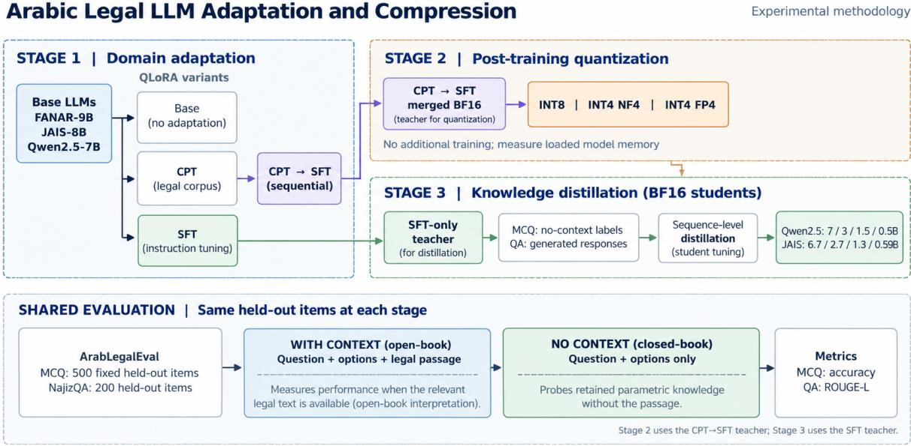
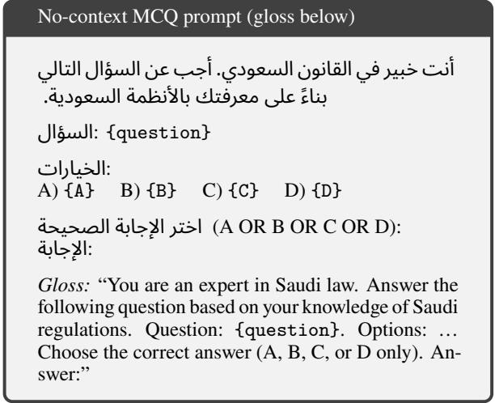

# Compression Through a Context Lens: Evaluating Adaptation, Quantization, and Distillation in Arabic Legal LLMs

Md. Rafiul Biswas and George Mikros Hamad Bin Khalifa University Doha, Qatar {mbiswas,GMikros}@hbku.edu.qa w

Wajdi Zaghouani Northwestern University in Qatar Doha, Qatar ajdi.zaghouani@northwestern.edu

## Abstract

Model compression can facilitate the deployment of large language models in resourceconstrained legal settings, but its efects on domain-specific performance may depend on the evaluation protocol. We investigate this issue using ARABLEGALEVAL, a Saudi Arabic legal benchmark, under both with-context and no-context evaluation. The former provides supporting legal passages, while the latter assesses performance without external context. Removing the context produces accuracy gaps of up to 27 percentage points for the base model. We examine three stages: domain adaptation, quantization, and knowledge distillation across FANAR-9B, JAIS-8B, and Qwen2.5-7B. Four-bit quantization reduces model memory by 64–71%, with changes in no-context MCQ accuracy ranging from 3.2 to +1.6 percentage points. Distillation produces more variable results, with accuracy generally declining as student size decreases. A Qwen2.5-7B student distilled from FANAR achieves 76.6% nocontext accuracy, compared with 77.2% for its teacher. Our findings suggest that no-context evaluation provides a useful complement to context-supported testing when assessing the efects of adaptation and compression on Arabic legal language models.1

## 1 Introduction

Large language models (LLMs) have demonstrated promising capabilities in domain-specific applications, including legal reasoning, contract analysis, and legal question answering (Chalkidis et al., 2020; Katz et al., 2023; Ariai et al., 2025). However, deploying these models in legal settings remains challenging, particularly where computational resources and infrastructure are limited (Dong et al., 2025; Panjolia et al., 2026). Local deployment may help address confidentiality concerns, although the use of LLMs in legal applications still requires appropriate human oversight, jurisdiction-specific validation, and safeguards against inaccurate legal advice.

Recent Arabic LLMs, including FANAR-9B (Team et al.), Jais-13B (Anwar et al., 2026), and AceGPT-13B (Huang et al., 2024), have advanced Arabic language processing. Nevertheless, their computational requirements can limit deployment in resource-constrained environments. The sensitive nature of legal information may also motivate local inference rather than reliance on external services (Heydari and Mahmoud, 2025; Guo, 2018).

Model compression ofers a potential approach to reducing these computational requirements (Gou et al., 2021; Xu et al., 2024; Alyafeai and Ahmad, 2021). However, much of the existing research has focused on general-purpose or Englishcentric benchmarks (Ariai et al., 2025), leaving the efects of compression on Arabic legal tasks less explored. An additional challenge concerns evaluation: when a supporting legal passage is provided, models may answer questions by using the supplied information rather than relying on knowledge acquired during training. Consequently, high with-context accuracy does not necessarily indicate comparable performance when supporting context is unavailable.

We investigate this distinction by evaluating Arabic legal LLMs under both with-context and no-context protocols while examining the efects of domain adaptation, quantization, and knowledge distillation. Our primary focus is no-context multiple-choice question (MCQ) accuracy as an indicator of context-independent task performance. We address the following research questions:

• RQ1 (Context dependency). How does access to supporting legal context afect MCQ accuracy, and how does the with-context/nocontext gap vary across models and adapta-

tion strategies?

• RQ2 (Adaptation and quantization). How do continued pretraining (CPT), supervised fine-tuning (SFT), their sequential combination (CPT SFT), and post-training quantization afect no-context MCQ accuracy across diferent model families?

• RQ3 (Distillation scaling). How does nocontext MCQ accuracy vary with student size and teacher–student configuration, including cross-architecture distillation?

We conduct our experiments on ARABLEGALE-VAL (Hijazi et al., 2024), an Arabic legal benchmark based on Saudi legal sources. We evaluate three open-source models: FANAR-9B (Team et al.), JAIS-8B (Anwar et al., 2026), and Qwen2.5- 7B (Team, 2024). First, we compare the base models with CPT, SFT, and CPT SFT adaptation. We then examine post-training quantization of the merged CPT SFT checkpoints and, separately, distillation from the SFT-only checkpoints into smaller student models. All three stages are evaluated using the same fixed MCQ subset under both protocols. We additionally report open-ended question-answering performance on NajizQA as a secondary evaluation.

The remainder of this paper is organized as follows. Section 2 reviews related work. Section 3 describes the methodology, and Section 4 presents the experimental setup. Section 5 reports the results, followed by the discussion in Section 6 and conclusion in Section 7.

## 2 Related Work

## 2.1 Arabic LLMs and Legal-Domain Evaluation

The Arabic LLM landscape has grown rapidly, progressing from BERT-style encoders to instructiontuned generative models such as Jais (Anwar et al., 2026), AceGPT (Huang et al., 2024), AL-LaM (Bari et al., 2025), and FANAR (Team et al.). Nevertheless, evaluations of these models in specialized legal domains remain limited. ArabLegal-Eval (Hijazi et al., 2024) evaluates Arabic legal understanding, while MizanQA (Bahaj and Ghogho, 2026) focuses on Moroccan law. Other benchmarks address related areas, including Islamic inheritance reasoning in QIAS-2026 (Bouchekif et al., 2026a) and MAWARITH (Bouchekif et al.,

2026b), broader Islamic knowledge in ISLAM-ICMMLU (Abdelaal et al., 2026), and financial and Shari’ah-compliant reasoning in SAHM (Elbadry et al., 2026).

To our knowledge, prior work has not systematically examined how Arabic legal knowledge changes under model compression or how this knowledge should be evaluated when access to source context may confound knowledge with extraction ability. We therefore use ArabLegalEval as a testbed for studying the efects of adaptation, quantization, and distillation rather than treating benchmark performance as an endpoint in itself.

## 2.2 LLM Compression: Quantization, Distillation, and Adaptation

Post-training quantization methods, including GPTQ (Frantar et al., 2022), AWQ (Lin et al., 2025), and NF4 (Dettmers et al., 2023), reduce model size and memory requirements by lowering weight precision. Knowledge distillation (Hinton et al., 2015) transfers capabilities from a larger teacher to a smaller student, while parametereficient methods such as LoRA (Hu et al., 2021) and QLoRA (Dettmers et al., 2023) support domain adaptation with limited trainable parameters. Recent studies have examined these approaches within broader eficiency frameworks (von Rad et al., 2026; Zhu et al., 2024).

Much of the existing evaluation literature focuses on English or multilingual benchmarks, where the accuracy–size trade-of may difer from morphologically rich, lower-resource languages such as Arabic. Closest to our work, Alshehhi et al. (2025) compress multilingual transformers on Arabic, English, and Kannada, finding that 4- and 8-bit quantization reduce memory with minimal accuracy loss on ArabicMMLU (Koto et al., 2024). We difer in three ways: our domain is Arabic legal understanding; we evaluate adaptation, quantization, and distillation as three-stage experimental framework on shared models and benchmark; and, most importantly, we evaluate every stage under both with-context and no-context protocols, which reframes what “preserved performance” under compression actually means.

## 3 Method

We examine how adaptation and compression affect Arabic legal question-answering performance through a three-stage experimental framework:

adaptation, quantization, and distillation. The framework is applied to three base LLMs, with each stage evaluated under two protocols (Figure 1). This section describes the benchmark and data splits (Section 3.1), the dual-protocol evaluation (Section 3.2), and the three experimental stages (Sections 3.3–3.5).

## 3.1 Benchmark, Data, and Base Models

We use ARABLEGALEVAL (Hijazi et al., 2024), an Arabic legal benchmark constructed from Saudi Ministry of Justice and Board of Experts documents. For MCQ, we use a fixed 80/20 train– evaluation split with seed 42, giving 2,113 held-out examples. For NajizQA, we sample up to 2,000 examples and apply a 90/10 split, yielding 200 evaluation items. All adaptation experiments in Section 3.3 use only the corresponding training splits.

To keep evaluation consistent across the full compression pipeline, we report MCQ performance on a fixed subset of 500 held-out examples and NajizQA performance on all 200 held-out examples. The same evaluation sets are used for adaptation, quantization, and distillation, so results remain directly comparable across stages.

We study three open-source instruction-tuned LLMs: the Arabic-centric FANAR-9B (Team et al.) and JAIS-8B (Anwar et al., 2026), and the multilingual Qwen2.5-7B-Instruct (Team, 2024). This mix allows us to examine whether the efects of compression and context dependence difer between Arabic-specialized and general multilingual models. Each model is processed independently through the full three-stage pipeline.

Data separation. Training, checkpoint selection, and hyperparameter tuning were conducted without using the held-out evaluation examples. We additionally checked for overlap between the training and evaluation sets and found no overlap under our verification procedure. The fixed 500- item MCQ subset was reserved for final evaluation.

## 3.2 Dual-Protocol Evaluation

A single MCQ score on ARABLEGALEVAL may reflect both the use of supplied legal context and knowledge acquired during training. To examine answer availability in the supplied passages, we checked whether the correct option text appeared as an exact substring of the legal context. Among the 500 evaluation examples, 270 (54.0%) contained the correct answer text. This measure captures direct textual overlap but does not establish whether a model relies on that overlap when generating its prediction (see in appendix Section Additional Results).

• With-context (open-book). The prompt includes the question, four options, and the associated legal context. Performance in this setting reflects the model’s ability to answer questions with access to supporting information, including its use of the supplied passage.

• No-context (closed-book). The legal context is removed, and the model receives only the question and answer options. We use this setting as the primary measure of contextindependent legal MCQ performance, which may partly reflect knowledge acquired during pretraining and adaptation.

For MCQ, models are prompted in Arabic to return a single option label (A–D). We extract the first valid Latin or Arabic option label from the generated response and compute exact-match accuracy. For NajizQA, we report ROUGE-L against the reference answer. Decoding settings are fixed across models and stages, with temperature 0.1 and top-p 0.9.

## 3.3 Stage 1: Adaptation

The first stage compares adaptation strategies for each base model. We evaluate the unadapted model against three strategies, implemented using parameter-eficient QLoRA fine-tuning (Hu et al., 2021; Dettmers et al., 2023) (a LoRA adapter over a 4-bit NF4-quantized backbone):

• Base. The instruction-tuned model evaluated zero-shot, with no legal adaptation.

• Continual pre-training (CPT). Causal language-model training on a legal corpus assembled from the training-split MCQ and QA items, each linearized into an Arabic template of context, question, correct answer, and explanation.

• Supervised fine-tuning (SFT). Instructionstyle fine-tuning on the same training items formatted as (instruction, response) pairs, where the instruction presents the legal question (and options for MCQ) and the response is the correct answer and explanation.

  
Figure 1: Overview of the proposed methodology.

• Sequential combination (CPT SFT). SFT applied on top of the CPT checkpoint, combining domain-knowledge injection with taskformat adaptation.

Each of the four variants is evaluated under both protocols (Section 3.2). The CPT SFT checkpoint of each model is used for Stage 2 quantization, while the corresponding SFT-only checkpoint serves as the teacher for Stage 3 distillation. These choices allow the two compression methods to be examined under diferent adaptation settings, although their absolute results are not directly comparable as efects of compression alone. The adaptation recipe and training hyperparameters are held constant across all three base models (Section 4), allowing us to compare their responses to the same adaptation strategies. Diferences in performance may nevertheless reflect model-specific characteristics and interactions with the shared training configuration.

## 3.4 Stage 2: Post-Training Quantization

In the second stage, we compress the selected Stage 1 teacher using post-training quantization, without any additional training. For each base model, the selected CPT SFT adapter is merged into the base weights to produce a single BF16 checkpoint, which serves as the uncompressed reference for quantization. (Distillation in Stage 3 instead starts from the SFT checkpoint; see Section 3.5.)

We evaluate three bitsandbytes quantization settings: INT8 using the outlier-aware LLM.int8() method, INT4 NF4 using NormalFloat quantization with double quantization and BF16 computation (Dettmers et al., 2023), and INT4 FP4 with the same 4-bit configuration but a floating-point representation. The two 4-bit variants let us compare whether the choice of low-bit number format afects legal-task performance.

For each quantized model, we record its memory footprint, compression relative to the BF16 teacher, and MCQ accuracy under both with-context and no-context evaluation. This comparison shows whether quantization mainly afects context-based answer extraction or also degrades the legal knowledge retained in the model parameters.

## 3.5 Stage 3: Knowledge Distillation

In the third stage, we transfer the teacher’s behavior to smaller student models. Unlike Stage 2, which uses the teacher selected for quantization, distillation uses the Stage 1 SFT checkpoint. We first generate pseudo-labels over the training split. For MCQ items, the teacher is queried in the nocontext setting so that the supervision reflects retained legal knowledge rather than direct extraction from the context.

Each student is then fine-tuned on these prompt– response pairs with a standard causal languagemodeling objective. This corresponds to sequencelevel, hard-label distillation (Kim and Rush, 2016), where the student learns from the teacher’s generated outputs rather than its full probability distribution. We use this formulation because it is simple and does not require the teacher and student to share the same tokenizer or vocabulary, which also makes cross-family distillation possible. Logit-level distillation with temperature scaling is left for future work.

## 4 Experimental Setup

We conduct experiments on ARABLEGALEVAL (Hijazi et al., 2024), focusing on its multiple-choice questions (MCQ) and open-ended question answering (NajizQA) tasks. Using a fixed random seed, we split the MCQ data into 8,451 training and 2,113 evaluation examples, and NajizQA into 1,800 training and 200 evaluation examples. Adaptation and distillation use only the training data. For evaluation, we use a fixed subset of 500 heldout MCQ examples and all 200 NajizQA examples across the relevant experiments. Further details on MCQ subsampling are provided in Appendix A.

We evaluate three instruction-tuned models: FANAR-9B (Team et al.), JAIS-8B (Anwar et al., 2026), and Qwen2.5-7B (Team, 2024). Stage 1 performs domain adaptation using QLoRA (Hu et al., 2021; Dettmers et al., 2023). Stage 2 applies INT8, INT4 NF4, and INT4 FP4 quantization to the merged CPT SFT checkpoints through bitsandbytes. Stage 3 separately distills the SFT-only teachers into Qwen2.5 or JAIS student models, depending on the teacher family.

All models are evaluated under with-context and no-context protocols. We report exact-match MCQ accuracy based on the predicted option label and ROUGE-L for NajizQA. The primary evaluation focuses on no-context MCQ accuracy, while NajizQA provides a complementary measure of open-ended answer generation. We also examine answer-in-context overlap by checking whether the correct option text appears verbatim in the supplied legal passage.

Experiments are conducted on an HPC system equipped with NVIDIA A100 GPUs and 48 GB of system RAM. Individual Stage 2 and Stage 3 experiments take approximately 16-18h hours. Additional training hyperparameters, prompts, decoding settings, and implementation details are provided in Appendix A.

## 5 Results

We present the results across three pipeline stages: domain adaptation (Section 5.1), quantization (Section 5.2), and knowledge distillation (Section 5.3). Each stage is evaluated under two protocols: with supporting context and without context. Unless otherwise specified, MCQ accuracy is reported on a fixed 500-item evaluation subset, while open-ended QA is evaluated on 200 items (Section 4). Additional results are provided in Appendix A.

5.1 Stage 1: Adaptation and the Context Gap Stage 1 investigates RQ1 and the adaptation component of RQ2. Table 1 compares the base models with three adaptation strategies: continued pretraining (CPT), supervised fine-tuning (SFT), and their sequential combination (CPT SFT).

Context gap. All three base models perform better when supporting context is available. FA-NAR exhibits the largest diference, dropping from 97.8% with context to 70.8% without context (27.0 percentage points), followed by Qwen2.5-7B (21.4 points) and JAIS-8B (7.6 points). These gaps indicate that high context-supported accuracy does not necessarily translate into comparable performance when models must rely on parametric knowledge. Notably, CPT produces contrasting effects for FANAR: no-context accuracy improves by 4.0 points, while with-context accuracy declines by 55.2 points.

Efect of adaptation. Adaptation yields modeldependent improvements in no-context MCQ accuracy. FANAR benefits most from the combined CPT SFT strategy, improving from 70.8% to 79.2% (+8.4 points). Qwen2.5-7B achieves a smaller gain, increasing from 76.0% to 79.8% (+3.8 points). JAIS-8B responds diferently: CPT reduces no-context accuracy from 71.6% to 61.2%, while SFT alone achieves the highest result (76.4%), slightly exceeding CPT SFT (75.8%). Thus, sequential adaptation does not consistently outperform SFT, and the benefits of domain adaptation vary across model families and training objectives.

Open-ended QA. Performance on NajizQA reveals a diferent pattern from MCQ evaluation. Despite improved MCQ accuracy, JAIS obtains nearzero ROUGE-L scores after SFT and CPT SFT. FANAR achieves approximately 0.17 ROUGE-L with context after adaptation, but its SFT-based variants perform considerably worse without context (0.0490–0.0637). Qwen2.5-7B achieves the highest ROUGE-L scores following SFT (0.3170 with context and 0.2950 without context), exceeding its CPT SFT variant. These diferences indicate that improvements in structured answer selection do not necessarily transfer to open-ended generation.

## 5.2 Stage 2: Quantization

Impact on no-context accuracy. Table 2 reports quantization results relative to the BF16 CPT SFT models from Stage 1. INT4 quantization reduces model memory by 64.3–71.1%, with relatively small changes in no-context MCQ accuracy. Under NF4, FANAR improves by 0.2 percentage points, JAIS by 1.6 points, while Qwen2.5- 7B declines by 2.0 points. The largest absolute change across all quantization configurations is a 3.2-point reduction for Qwen under INT4 FP4. These results suggest that substantial memory savings can be achieved while largely maintaining nocontext MCQ performance under the evaluated settings.

Comparison of 4-bit methods. NF4 achieves higher no-context accuracy than FP4 across all three model families. The largest diference occurs for JAIS (77.4% versus 74.2%), followed by Qwen (77.8% versus 76.6%) and FANAR (79.4% versus 79.2%). Although these diferences are modest, NF4 consistently yields the better observed results without additional memory cost.

With-context performance. With-context accuracy remains high across all quantized configurations, ranging from 97.4% to 99.2%. This nearceiling performance limits the ability of the withcontext protocol to distinguish between quantization methods. In contrast, the no-context evaluation reveals larger diferences and provides a more informative measure of performance when external context is unavailable.

## 5.3 Stage 3: Distillation

Stage 3 examines how no-context MCQ accuracy varies with student size and teacher architecture (Table 3). Each Stage 1 SFT teacher is distilled into four student configurations. Qwen and JAIS use same-family students, whereas FANAR is distilled into Qwen2.5 models, enabling a crossarchitecture comparison. Unlike Stage 2, the teachers are SFT-only rather than CPT SFT checkpoints.

Efect of student size. No-context accuracy generally declines with student size, although the magnitude varies across teacher–student configurations. FANAR-distilled Qwen students decrease from 76.6% at 7B to 52.8% at 0.5B. JAIS students decline from 74.4% at 6.7B to 47.6% at 590M, while Qwen-distilled students decrease from 76.4% at 7B to 36.4% at 0.5B. These results suggest that performance retention depends on student capacity and the distillation setup.

Cross-architecture distillation. The FANARdistilled Qwen2.5-7B student achieves 76.6% nocontext accuracy, compared with 77.2% for its teacher, a diference of 0.6 percentage points. The same student architecture distilled from Qwen2.5- 7B achieves 76.4%. These results suggest that cross-architecture distillation can achieve performance comparable to the teacher in this configuration, although broader conclusions require further evaluation.

Accuracy–memory trade-of. The smaller student has a substantially lower estimated BF16 weight-storage requirement, although the memory figures are not directly equivalent because the teacher values were measured and student values estimated. For example, the FANARdistilled Qwen2.5-3B student achieves 73.6% accuracy with an estimated BF16 weight memory of 5.76 GB, compared with 77.2% and 16.36 GB for its teacher. This represents a 3.6-point accuracy reduction alongside substantially lower estimated weight storage, illustrating the trade-of between model size and context-independent performance.

## 6 Discussion

Our findings ofer several observations on evaluating and compressing knowledge-intensive language models.

The importance of no-context evaluation. Across the three stages, with-context MCQ accuracy was generally high, while no-context performance showed greater variation across models and configurations. This suggests that access to supporting passages may reduce the visibility of diferences in context-independent performance, as models can rely on information provided in the input (Hagström et al., 2026). No-context evaluation therefore provides a useful complement to with-context testing when examining the efects of adaptation and compression on retained task performance.

<table><tr><td rowspan="2">Model</td><td rowspan="2">Variant</td><td colspan="3">MCQ Accuracy (%)</td><td colspan="2">QA ROUGE-L</td></tr><tr><td>With-Ctx</td><td>No-Ctx</td><td>Gap (∆)</td><td>With-Ctx</td><td>No-Ctx</td></tr><tr><td rowspan="4">FANAR-9B</td><td>Base</td><td>97.8</td><td>70.8</td><td>+27.0</td><td>0.0083</td><td>0.0058</td></tr><tr><td>CPT</td><td>42.6</td><td>74.8</td><td>-32.2</td><td>0.1700</td><td>0.1450</td></tr><tr><td>SFT</td><td>98.8</td><td>77.2</td><td>+21.6</td><td>0.1700</td><td>0.0490</td></tr><tr><td>CPT→SFT</td><td>98.8</td><td>79.2</td><td>+19.6</td><td>0.1683</td><td>0.0637</td></tr><tr><td rowspan="4">JAIS-8B</td><td>Base</td><td>79.2</td><td>71.6</td><td>+7.6</td><td>0.0194</td><td>0.0179</td></tr><tr><td>CPT</td><td>93.6</td><td>61.2</td><td>+32.4</td><td>0.0249</td><td>0.0008</td></tr><tr><td>SFT</td><td>95.8</td><td>76.4</td><td>+19.4</td><td>0.0001</td><td>0.0009</td></tr><tr><td>CPT→SFT</td><td>98.6</td><td>75.8</td><td>+22.8</td><td>0.0012</td><td>0.0012</td></tr><tr><td rowspan="4">Qwen2.5-7B</td><td>Base</td><td>97.4</td><td>76.0</td><td>+21.4</td><td>0.0095</td><td>0.0058</td></tr><tr><td>CPT</td><td>97.6</td><td>78.4</td><td>+19.2</td><td>0.1532</td><td>0.2152</td></tr><tr><td>SFT</td><td>98.6</td><td>78.2</td><td>+20.4</td><td>0.3170</td><td>0.2950</td></tr><tr><td>CPT→SFT</td><td>98.8</td><td>79.8</td><td>+19.0</td><td>0.2750</td><td>0.2637</td></tr></table>

Table 1: Stage 1 results for three base models and four adaptation variants. MCQ accuracy is reported on the fixed 500-item set and QA ROUGE-L on 200 items; ∆ denotes With-Ctx minus No-Ctx. Bold marks the best variant per model and protocol (ties both bolded). Raw counts and ROUGE-1 are given in Appendix Table 4
<table><tr><td colspan="4"></td><td colspan="2">MCQ Accuracy (%)</td><td rowspan="2">∆No-Ctx</td></tr><tr><td>Model</td><td>Method</td><td>Mem. (GB)</td><td>Compr. (%)</td><td>With-Ctx</td><td>No-Ctx</td></tr><tr><td rowspan="4">FANAR-9B</td><td>BF16 (Baseline)</td><td>16.36</td><td></td><td>98.8</td><td>79.2</td><td></td></tr><tr><td>INT8</td><td>8.61</td><td>47.4</td><td>99.2</td><td>79.4</td><td>+0.2</td></tr><tr><td>INT4 NF4</td><td>4.73</td><td>71.1</td><td>99.0</td><td>79.4</td><td>+0.2</td></tr><tr><td>INT4 FP4</td><td>4.73</td><td>71.1</td><td>98.2</td><td>79.2</td><td>0.0</td></tr><tr><td rowspan="4">JAIS-8B</td><td>BF16 (Baseline)</td><td>15.07</td><td></td><td>98.6</td><td>75.8</td><td></td></tr><tr><td>INT8</td><td>8.47</td><td>43.8</td><td>98.2</td><td>75.8</td><td>0.0</td></tr><tr><td>INT4 NF4</td><td>5.17</td><td>65.7</td><td>97.4</td><td>77.4</td><td>+1.6</td></tr><tr><td>INT4 FP4</td><td>5.17</td><td>65.7</td><td>98.0</td><td>74.2</td><td>-1.6</td></tr><tr><td rowspan="4">Qwen2.5-7B</td><td>BF16 (Baseline)</td><td>14.19</td><td></td><td>98.8</td><td>79.8</td><td></td></tr><tr><td>INT8</td><td>8.11</td><td>42.8</td><td>98.8</td><td>77.8</td><td>-2.0</td></tr><tr><td>INT4 NF4</td><td>5.07</td><td>64.3</td><td>98.6</td><td>77.8</td><td>-2.0</td></tr><tr><td>INT4 FP4</td><td>5.07</td><td>64.3</td><td>99.0</td><td>76.6</td><td>-3.2</td></tr></table>

Table 2: Stage 2 quantization results on the fixed 500-item MCQ evaluation set. BF16 baselines are the CPT SFT models from Table 1. Compr. denotes the percentage reduction in model memory relative to BF16, and ∆No-Ctx indicates the change in no-context accuracy in percentage points.

Quantization and distillation involve diferent trade-ofs. INT4 quantization reduced model memory by 64–71%, with no-context accuracy changes ranging from 3.2 to +1.6 percentage points. These results are consistent with previous findings on the feasibility of low-bit model representations (Dettmers et al., 2023). Distillation showed greater variation across student sizes and model families, with smaller students generally achieving lower no-context accuracy. In the evaluated setting, quantization provided substantial memory reductions with relatively limited changes in MCQ performance, whereas distillation ofered smaller model sizes with more variable accuracy.

Teacher–student configuration. Distillation outcomes varied across teacher–student configurations. The FANAR-distilled Qwen2.5-7B student achieved 76.6% no-context accuracy, compared with 77.2% for its teacher. The same student architecture distilled from Qwen2.5-7B achieved 76.4%. These observations suggest that crossarchitecture distillation is feasible in the evaluated setting, although the small diferences do not establish an advantage for either teacher. Further experiments would be needed to isolate the efects of teacher choice and model architecture.

<table><tr><td rowspan="2">Teacher</td><td colspan="3"></td><td colspan="2">MCQ Accuracy (%)</td></tr><tr><td>Model</td><td>Params</td><td>BF16 Mem. (GB)</td><td>With-Ctx</td><td>No-Ctx</td></tr><tr><td rowspan="5">FANAR-9B</td><td>Teacher (SFT)</td><td>8.7B</td><td>16.36</td><td>98.8</td><td>77.2</td></tr><tr><td>Qwen2.5-7B</td><td>7.62B</td><td>≈14.19</td><td>97.8</td><td>76.6</td></tr><tr><td>Qwen2.5-3B</td><td>3.09B</td><td>≈5.76</td><td>87.4</td><td>73.6</td></tr><tr><td>Qwen2.5-1.5B</td><td>1.54B</td><td>≈2.87</td><td>81.4</td><td>59.4</td></tr><tr><td>Qwen2.5-0.5B</td><td>0.49B</td><td>≈0.92</td><td>53.2</td><td>52.8</td></tr><tr><td rowspan="5">JAIS-8B</td><td>Teacher (SFT)</td><td>8.0B</td><td>15.07</td><td>95.8</td><td>76.4</td></tr><tr><td>JAIS-6.7B</td><td>6.7B</td><td>≈12.48</td><td>96.8</td><td>74.4</td></tr><tr><td>JAIS-2.7B</td><td>2.7B</td><td>≈5.03</td><td>94.4</td><td>70.2</td></tr><tr><td>JAIS-1.3B</td><td>1.3B</td><td>≈2.42</td><td>90.8</td><td>66.4</td></tr><tr><td>JAIS-590M</td><td>0.59B</td><td>≈1.10</td><td>72.4</td><td>47.6</td></tr><tr><td rowspan="5">Qwen2.5-7B</td><td>Teacher (SFT)</td><td>7.62B</td><td>14.19</td><td>98.6</td><td>78.2</td></tr><tr><td>Qwen2.5-7B</td><td>7.62B</td><td>≈14.19</td><td>96.2</td><td>76.4</td></tr><tr><td>Qwen2.5-3B</td><td>3.09B</td><td>≈5.76</td><td>73.6</td><td>66.6</td></tr><tr><td>Qwen2.5-1.5B</td><td>1.54B</td><td>≈2.87</td><td>66.4</td><td>63.2</td></tr><tr><td>Qwen2.5-0.5B</td><td>0.49B</td><td>≈0.92</td><td>38.8</td><td>36.4</td></tr></table>

Table 3: Stage 3 distillation results on the fixed 500-item MCQ evaluation set. Teachers are the Stage 1 SFT checkpoints (Table 1). Qwen and JAIS use same-family students, whereas FANAR is distilled into Qwen2.5 students. Student BF16 memory values marked are weights-only estimates; teacher memory values are measured.

## 7 Conclusion

We investigated how domain adaptation, quantization, and knowledge distillation afect Arabic legal MCQ performance on ARABLEGALEVAL under with-context and no-context evaluation. The results show that with-context accuracy is generally high, whereas no-context performance varies considerably across models and configurations. This highlights the value of evaluating models without supporting context when examining contextindependent task performance.

The three stages exhibited diferent patterns. Domain adaptation provided model-dependent improvements in no-context accuracy, while INT4 quantization reduced model memory by 64–71% with relatively small observed accuracy changes. Distillation produced more variable results, with performance generally declining for smaller students. Cross-architecture distillation was feasible but did not consistently preserve teacher performance, suggesting that teacher–student configuration warrants further investigation.

These findings support evaluating both contextsupported and context-independent performance when assessing compressed language models. The study is limited to one Arabic legal benchmark, a fixed 500-item MCQ evaluation subset, and hardlabel distillation. Future work could extend the evaluation to additional datasets, larger test sets, and alternative distillation strategies.

## Limitations

Our study is limited to ARABLEGALEVAL, Saudi law, and Arabic, so the observed context gap and compression behavior may not generalize to other jurisdictions or domains. MCQ results are evaluated on a fixed 500-item subset of 2,113 heldout items. For a single accuracy estimate, the worst-case approximate 95% binomial confidenceinterval half-width is 4.4 percentage points. This interval does not characterize paired diferences between models, for which item-level paired analysis would be required. NajizQA evaluation is also limited to ROUGE-L on 200 examples, which does not directly measure legal correctness or faithfulness.

Methodologically, we use sequence-level hardlabel distillation and do not evaluate soft-label distillation, pruning, low-rank factorization, or quantization-aware training. Our analysis concerns whether the evaluation prompt exposes answer-bearing context. We verified that our finetuning splits do not overlap with the evaluation set, but we do not test whether evaluation items appeared in the base models’ pretraining data.

The distillation setup is not fully uniform across model families. JAIS uses same-family students, while FANAR is distilled into Qwen2.5 students, making teacher identity and architectural mismatch partially confounded. Student sizes are also only approximately matched across families, and JAIS memory is estimated from parameter counts rather than measured directly. In addition, Stage 3 uses the SFT teacher rather than the CPT SFT teacher used in Stage 2, so absolute distillation results may difer under an alternative teacher choice.

Future work should extend the closed-book protocol to additional benchmarks and jurisdictions, use more uniform distillation designs, and study retrieval-augmented settings where parametric and retrieved knowledge interact.

## Ethical Consideration

This study uses an existing Arabic legal benchmark and publicly available language models, and does not involve human participants or personal data. The compressed models are evaluated for research purposes and are not intended to provide legal advice. As model outputs may contain errors or reflect limitations in the underlying models and benchmark, deployment in real-world legal settings should include appropriate expert oversight and validation.

## AI Assistance Declaration

The authors used Claude Opus 5.5 and GPT-5.5 Sol to polish and improve the language of the manuscript draft, including grammar, clarity, and phrasing. The authors reviewed and approved all AI-assisted revisions and take full responsibility for the final content of the manuscript.

## References

Ali Abdelaal, Mohammed Nader Al Hafar, Mahmoud Fawzi, and Walid Magdy. 2026. IslamicMMLU: a benchmark for evaluating LLMs on islamic knowledge. arXiv preprint arXiv:2603.23750.

Maitha Alshehhi, Ahmed Sharshar, and Mohsen Guizani. 2025. Towards inclusive NLP: Assessing compressed multilingual transformers across diverse language benchmarks. arXiv preprint arXiv:2507.19699. Published in the 3rd International Workshop on Generalizing from Limited Resources in the Open World, held at IJCAI 2025.

Zaid Alyafeai and Irfan Ahmad. 2021. Arabic compact language modelling for resource limited devices. In Proceedings of the Sixth Arabic Natural Language Processing Workshop, pages 53–59, Kyiv, Ukraine (Virtual). Association for Computational Linguistics.

Mohamed Anwar, Abed Alhakim Freihat, George Ibrahim, Mostafa Awad, Abdelrahman Sadallah, Gurpreet Gosal, Gokulakrishnan Ramakrishnan, Sarath Chandran, Biswajit Mishra, Rituraj Joshi,

and 1 others. 2026. Jais 2: A family of arabiccentric open large language models. arXiv preprint arXiv:2608.13580.

Farid Ariai, Joel Mackenzie, and Gianluca Demartini. 2025. Natural language processing for the legal domain: A survey of tasks, datasets, models, and challenges. ACM Computing Surveys, 58(6):1–37.

Adil Bahaj and Mounir Ghogho. 2026. MizanQA: A benchmark for multi-answer moroccan legal qa. In Proceedings ofthe 19th Conference ofthe European Chapter of the Association for Computational Linguistics (Volume 5: Industry Track), pages 132–144.

M Saiful Bari, Yazeed Alnumay, Norah A. Alzahrani, Nouf M. Alotaibi, Hisham Abdullah Alyahya, Sultan AlRashed, Faisal Abdulrahman Mirza, Shaykhah Z. Alsubaie, Hassan A. Alahmed, Ghadah Alabduljabbar, Raghad Alkhathran, Yousef Almushayqih, Raneem Alnajim, Salman Alsubaihi, Maryam Al Mansour, Saad Amin Hassan, Dr. Majed Alrubaian, Ali Alammari, Zaki Alawami, and 7 others. 2025. AL-Lam: Large language models for arabic and english. In The Thirteenth International Conference on Learning Representations.

Abdessalam Bouchekif, Somaya Eltanbouly, Samer Rashwani, Shahd Gaben, Mutaz Al-Khatib, Heba Sbahi, Emad Mohamed, and Mohammed Ghaly. 2026a. QIAS 2026: Overview of the shared task on islamic inheritance reasoning. arXiv preprint arXiv:2606.13756.

Abdessalam Bouchekif, Shahd Gaben, Samer Rashwani, Somaya Eltanbouly, Mutaz Al-Khatib, Heba Sbahi, Mohammed Ghaly, and Emad Mohamed. 2026b. MAWARITH: A dataset and benchmark for legal inheritance reasoning with LLMs. arXiv preprint arXiv:2603.07539.

Ilias Chalkidis, Manos Fergadiotis, Prodromos Malakasiotis, Nikolaos Aletras, and Ion Androutsopoulos. 2020. LEGAL-BERT: The muppets straight out of law school. In Findings of the association for computational linguistics: EMNLP 2020, pages 2898– 2904.

Tim Dettmers, Artidoro Pagnoni, Ari Holtzman, and Luke Zettlemoyer. 2023. QLoRa: Eficient finetuning of quantized llms. Advances in neural information processing systems, 36:10088–10115.

Yanjie Dong, Haijun Zhang, Chengming Li, Song Guo, Victor CM Leung, and Xiping Hu. 2025. Finetuning and deploying large language models over edges: Issues and approaches. IEEE Communications Magazine, 64(1):94–101.

Rania Elbadry, Sarfraz Ahmad, Ahmed Heakl, Dani Bouch, Momina Ahsan, Muhra AlMahri, Marwa Elsaid Khalil, Yuxia Wang, Salem Lahlou, Sophia Ananiadou, Veselin Stoyanov, Jimin Huang, Xueqing Peng, Preslav Nakov, and Zhuohan Xie. 2026. SAHM: A benchmark for Arabic financial and shari’ah-compliant reasoning. In Proceedings of the

64th Annual Meeting of the Association for Computational Linguistics (Volume 1: Long Papers), pages 34509–34536, San Diego, California, United States. Association for Computational Linguistics.

Elias Frantar, Saleh Ashkboos, Torsten Hoefler, and Dan Alistarh. 2022. GPTQ: Accurate post-training quantization for generative pre-trained transformers. arXiv preprint arXiv:2210.17323.

Jianping Gou, Baosheng Yu, Stephen J Maybank, and Dacheng Tao. 2021. Knowledge distillation: A survey. International journal of computer vision, 129(6):1789–1819.

Tian Guo. 2018. Cloud-based or on-device: An empirical study of mobile deep inference. In 2018 IEEE International Conference on Cloud Engineering (IC2E), pages 184–190. IEEE.

Lovisa Hagström, Youna Kim, Haeun Yu, Sang-goo Lee, Richard Johansson, Hyunsoo Cho, and Isabelle Augenstein. 2026. CUB: Benchmarking context utilisation techniques for language models. In Proceedings of the 64th Annual Meeting of the Association for Computational Linguistics (Volume 1: Long Papers), pages 25101–25133, San Diego, California, United States. Association for Computational Linguistics.

Soroush Heydari and Qusay H Mahmoud. 2025. Tiny machine learning and on-device inference: A survey of applications, challenges, and future directions. Sensors, 25(10):3191.

Faris Hijazi, Somayah AlHarbi, Abdulaziz AlHussein, Harethah Shairah, Reem Alzahrani, Hebah Al-Shamlan, George Turkiyyah, and Omar Knio. 2024. Arablegaleval: A multitask benchmark for assessing arabic legal knowledge in large language models. In Proceedings of the Second Arabic Natural Language Processing Conference, pages 225–249.

Geofrey Hinton, Oriol Vinyals, and Jef Dean. 2015. Distilling the knowledge in a neural network. arXiv preprint arXiv:1503.02531.

Edward J Hu, Yelong Shen, Phillip Wallis, Zeyuan Allen-Zhu, Yuanzhi Li, Shean Wang, Lu Wang, and Weizhu Chen. 2021. Lora: Low-rank adaptation of large language models. arXiv preprint arXiv:2106.09685.

Huang Huang, Fei Yu, Jianqing Zhu, Xuening Sun, Hao Cheng, Song Dingjie, Zhihong Chen, Mosen Alharthi, Bang An, Juncai He, and 1 others. 2024. Acegpt, localizing large language models in arabic. In Proceedings ofthe 2024 Conference of the North American Chapter of the Association for Computational Linguistics: Human Language Technologies (Volume 1: Long Papers), pages 8139–8163.

Daniel Martin Katz, Dirk Hartung, Lauritz Gerlach, Abhik Jana, and Michael J Bommarito II. 2023. Natural language processing in the legal domain. arXiv preprint arXiv:2302.12039.

Yoon Kim and Alexander M. Rush. 2016. Sequencelevel knowledge distillation. In Proceedings of the 2016 Conference on Empirical Methods in Natural Language Processing, pages 1317–1327, Austin, Texas. Association for Computational Linguistics.

Fajri Koto, Haonan Li, Sara Shatnawi, Jad Doughman, Abdelrahman Sadallah, Aisha Alraeesi, Khalid Almubarak, Zaid Alyafeai, Neha Sengupta, Shady Shehata, and 1 others. 2024. ArabicMMLU: Assessing massive multitask language understanding in arabic. In Findings of the Association for Computational Linguistics: ACL 2024, pages 5622–5640.

Ji Lin, Jiaming Tang, Haotian Tang, Shang Yang, Guangxuan Xiao, and Song Han. 2025. AWQ: Activation-aware weight quantization for on-device llm compression and acceleration. GetMobile: Mobile Computing and Communications, 28(4):12–17.

Shivam Panjolia, Akash Chaudhary, Parth Yadav, Enjula Uchoi, Jobanpreet Singh, and Kanika Debbarma. 2026. Efective lightweight language models for edge deployment in low-resource settings. In 2026 International Conference on Intelligent Systems in Engineering, Secured Systems and Cybersecurity (ICISESSC), pages 93–98. IEEE.

Fanar Team, Ummar Abbas, Mohammad Shahmeer Ahmad, Firoj Alam, Enes Altinisik, Ehsannedin Asgari, Yazan Boshmaf, Sabri Boughorbel, Sanjay Chawla, Shammur Chowdhury, Fahim Dalvi, Kareem Darwish, Nadir Durrani, Mohamed Elfeky, Ahmed Elmagarmid, Mohamed Eltabakh, Masoomali Fatehkia, Anastasios Fragkopoulos, Maram Hasanain, and 23 others. Fanar: An arabic-centric multimodal generative ai platform.

Qwen Team. 2024. Qwen2.5: A party of foundation models.

Jonathan von Rad, Yong Cao, and Andreas Geiger. 2026. UniComp: A unified evaluation of large language model compression via pruning, quantization and distillation. arXiv preprint arXiv:2602.09130.

Xiaohan Xu, Ming Li, Chongyang Tao, Tao Shen, Reynold Cheng, Jinyang Li, Can Xu, Dacheng Tao, and Tianyi Zhou. 2024. A survey on knowledge distillation of large language models. arXiv preprint arXiv:2402.13116.

Xunyu Zhu, Jian Li, Yong Liu, Can Ma, and Weiping Wang. 2024. A survey on model compression for large language models. Transactions of the Associationfor Computational Linguistics, 12:1556–1577.

## A Implementation Details

This appendix provides the implementation details summarized in Section 4, including the data splits, evaluation subset, prompts, training configuration, decoding, and worked examples.

## A.1 Data

We split each ARABLEGALEVAL task using seed 42. MCQ uses an 80/20 train–evaluation split, giving 8,451 training and 2,113 evaluation items. For QA, we first sample at most 2,000 examples and then apply a 90/10 split, yielding 1,800 training and 200 evaluation items. Adaptation and distillation use only the training splits.

All MCQ results are reported on the same fixed 500-item subset of the evaluation split, while QA uses all 200 evaluation examples. The base models are QCRI/Fanar-1-9B-Instruct (Team et al.), inceptionai/Jais-2-8B-Chat (Anwar et al., 2026), and Qwen/Qwen2.5-7B-Instruct (Team, 2024).

## A.2 Evaluation Subsample

The 500 MCQ examples are sampled once from the 2,113-item evaluation split using seed 42 and kept fixed across all models, stages, and evaluation settings. This reduces evaluation cost while keeping comparisons consistent. At n = 500, the worstcase 95% Wald confidence half-width is approximately 4.4 points, and is smaller at the accuracy levels observed in most experiments.

## A.3 Prompts and Corpus Templates

All prompts are written in Modern Standard Arabic. The two evaluation protocols use the same question, answer options, and answer cue. They difer only in the instruction and whether the legal passage is provided. In the with-context setting, the model is asked to answer using the reference legal text; in the no-context setting, the passage is removed and the model is asked to answer from its knowledge of Saudi regulations.

Adaptation corpora. The CPT corpus linearizes each training item into an Arabic template of context (truncated to the leading 500 characters), question, correct answer, and explanation. The SFT set formats the same items as (instruction, response) pairs, where the instruction presents the question (and options, for MCQ) and the response is the correct answer plus explanation.

## A.4 Training

Adaptation (Stage 1). All adaptation uses QLoRA (Hu et al., 2021; Dettmers et al., 2023), with LoRA adapters (r=16, α=32, dropout 0.05) applied to the attention and MLP projection layers over a 4-bit NF4 backbone. We train for 3 epochs

## With-context MCQ prompt (gloss below)

الىĽ Ļح Ļٮę عںٔ السوĞ ال الٮ السعودى. أ Ľ وںę Ľى Ğ الڡę اٮ Ğٮęح ĻٮĽٮ ę ر ڡ ęٮأ   
Ľى Ļ المرحĽ عى. ęĞ ص الڡę اٮę وٮ ęً اء على الٮ Ļٮٮ   
Ľى Ļ المرحĽ عى ęĞ ص الڡę اٮę وٮ {context {:الٮ   
ٔ السوال : {question}   
:ę الحĽٮĞ اراٮ   
A) {A} B) {B} C) {C} D) {D}   
حهĞ الصحٮ Ľ هĞ اٮĻ حٕ الا ر Ļ ٮĞ اح ę (A OR B OR C OR D):   
: Ļ الإح Ļ اٮ Ğه   
Gloss: “You are an expert in Saudi law. Answer   
the following question based on the reference legal   
text. Reference legal text: {context}. Question:   
{question}. Options: … Choose the correct answer   
(A, B, C, or D only). Answer:”

  
Figure 2: With-context and no-context MCQ prompts. The prompts are identical except for the instruction and the inclusion of the {context} context in the withcontext setting.

with per-device batch size 4 and gradient accumulation 4 (efective batch size 16), learning rate 2 10−4, cosine decay, 10% warmup, maximum sequence length 1024, bf16 computation, and paged 8-bit AdamW. The training recipe is kept fixed across the three base models, apart from model-specific checkpoints and tokenizers.

Quantization (Stage 2). For each model, the selected CPT SFT adapter is merged into the base weights to obtain a BF16 teacher. We evaluate three bitsandbytes configurations: INT8 using LLM.int8() with outlier threshold 6.0, INT4 NF4 with double quantization and BF16 computation, and INT4 FP4 with the same configuration but FP4 weights.

Distillation (Stage 3). Stage 3 uses the Stage 1 SFT checkpoint as the teacher for pseudo-label generation. For MCQ, the teacher is queried in the no-context setting and its predicted option letter is used as the training target; predictions that cannot be parsed fall back to the gold label. For QA, the teacher-generated response is retained. Students are trained on these prompt–response pairs with a causal language-modeling objective, corresponding to sequence-level hard-label distillation (Kim and Rush, 2016).

Qwen and FANAR teachers are distilled into Qwen2.5 students at 7B, 3B, 1.5B, and 0.5B, while the JAIS teacher is distilled into JAIS students at 6.7B, 2.7B, 1.3B, and 590M. Training uses the same LoRA configuration as Stage 1, with perdevice batch size 2 and gradient accumulation 8 (efective batch size 16) for 3 epochs.

## A.5 Evaluation and Decoding

For MCQ, we score exact match over a single predicted option label. The parser first searches the first 50 generated characters for one of {A,B,C,D}; if none is found, it maps Arabic option labels ) A,  B,  C,  D) within the first 20 characters. Responses with no valid option are marked IN-VALID and counted as incorrect. Arabic text is normalized by unifying common alif and ya variants, removing diacritics, and collapsing whitespace.

Generation uses at most 10 new tokens, temperature 0.1, top-p 0.9, and do\_sample=False, with inputs truncated to 1,500 tokens. For NajizQA, we report ROUGE-L against the reference answer. Decoding settings are fixed across models and stages.

Compute. Experiments use PyTorch 2.12.1 (CUDA 13.0), Hugging Face Transformers 5.12.1, PEFT, and bitsandbytes on NVIDIA A100 80 GB GPUs. We use seed 42 throughout. Approximate wall-clock time per model is 8 h for Stage 1, 12 h for Stage 2, and 16–18 h for Stage 3. Code is available at https://anonymous.4open.science/r/ arabic-LLM-legal-compression-6B5A.

## A.6 Worked Examples

Answer-in-context (MCQ). السوال ٔ ę ماالدĽىلا: Ľى Ğ عڡ ę د المر Ğ ارعه Ļٮ ęح ę صوص ٮ Ľ صٮ Ļٮ أحد ٮĽ Ļح ę ور ģ اسĞٮ ę راطه ڡ ęں؟ المٮ Ğ عاڡدٮĽ Ğ

Question: What may not be stipulated in a sharecropping contract regarding the share of one of the

contracting parties?

: ę الحĽٮ Ğ اراٮ

A) حŌ اٮĞ ę ę مںالٮ ً ģساٮٔعا ً ę كوںĞ مڡدارا ęںٮĽ ٔا That it be an undivided proportion of the produce.

ę و ٮĞاٮŌح (B ęĞاٮŌح أ ęعĽٮģ ر ساٮٔę ع مں الٮ ً ę كوںĞ مڡدارا ęں ٮĽ أ ģ و الس Ļحر ę رص أ ٔ الا مںę ںę معٮ ع Ľ موص ę That it be a nonproportional amount of the produce, or the produce of a specific part of the land or trees.

ę رص Ļٮأكملها (C ę كوں ęٮ Ğاٮ Ōح الأ ęں ٮĽ ٔا That it be the entire produce of the land.

ę كوں ęٮ Ğاٮ Ōحģ الس Ļح Ļ ر ٮأكمله (D ęں ٮĽ ٔا That it be the entire produce of the trees.

Correct answer: B

ę كوں ęٮ Ľ صٮ Ļٮ أحد : Ľ السٮ Ğ اٯ ęں ٮĽ ģ صح اسĞٮراط أ لا ٮĽ ę و ٮ Ğاٮ Ōحę موصع ę Ğاٮ Ōح أ ęعĽٮģ ر ساٮٔę ع مں الٮ ً ęں Ğ مڡدارا المٮ Ğ عاڡدٮĽ Ğ ģ و الس Ļحر. ę رص أ Ľ معٮęںę مں الأ

Context: It is not valid to stipulate that the share of one of the contracting parties be a nonproportional amount of the produce, or the produce of a specific part of the land or trees.

ęعĽٮģ ر ساٮٔę ع مں :ęٮ Ļ ص الإح Ļ اٮ Ğه Ľ الصحٮ Ğ حه ً ę كوں Ğ مڡدارا ęں ٮĽ أ ģ و الس Ļحر ę رص أ ę و ٮ Ğاٮ Ōح ę موص Ľ ع معٮęںę مں الأ ę Ğاٮ Ōح أ الٮ Correct answer text: A non-proportional amount of the produce, or the produce of a specific part of the land or trees.

Question (QA) Example السوال ٔ ę مكں : هل ٮĽ Ğ صه ę Ğٯ مٮ ģكٮę ر مں ģس ęحę ص عں طرٮĽ ę إڡ ę راع Ğ عڡ Ļ ار هٮĞه لأ ه؟ Ğ Ľ العڡارٮ Ğ ورصه Ğ الٮ Ļ

Question: Can a gifted property be transferred to more than one person through the Real Estate Market Platform?

ģكٮę ر مںģسęحص : Ļ الإح Ļ اٮ Ğه ęٮ ę عم، إمكاٮĽٮĞه Ļ وهٮ Ğ عڡار لأ .هĞ Ľ العڡارٮ Ğ ورصه Ğ الٮ Ļ صهĞ ę Ľى مٮ Ğمٮ Ğ احه ęڡ

Answer: Yes. The Real Estate Market Platform allows a property to be gifted to more than one person.

## B Additional Results

Answer-in-context analysis. We further examined with-context MCQ performance according to whether the correct option text appeared verbatim in the associated legal passage, using the FANAR-9B INT4 NF4 model from Stage 2 (Table 2). Of the 500 evaluation examples, 270 (54.0%) contained the correct answer text, while 230 (46.0%) did not. The model answered 268/270 (99.3%) correctly in the former group and 227/230 (98.7%) in the latter, for an overall accuracy of 99.0% (495/500).

The small observed diference suggests that exact answer-text overlap alone does not account for the model’s high with-context accuracy. However, this analysis does not distinguish contextual inference from reliance on previously acquired knowledge.

## B.1 Detailed Stage 1 Results

Table 4 presents the complete Stage 1 results for FANAR, JAIS, and Qwen across four adaptation configurations. We report MCQ accuracy and correct predictions on the fixed 500-item evaluation subset, together with ROUGE-1 and ROUGE-L on the 200-item QA set under both evaluation protocols. These results supplement the comparisons in Section 5.1.

<table><tr><td>Model</td><td>Setting</td><td>Experiment</td><td>MCQ Accuracy (%)</td><td>MCQ Correct</td><td>QA ROUGE-1</td><td>QA ROUGE-L</td></tr><tr><td rowspan="7">FANAR</td><td rowspan="3">With-Ctx</td><td>Exp A (Base)</td><td>97.8</td><td>489/500</td><td>0.0083</td><td>0.0083</td></tr><tr><td>Exp B (CPT)</td><td>42.6</td><td>213/500</td><td>0.1700</td><td>0.1700</td></tr><tr><td>Exp C (SFT)</td><td>98.8</td><td>494/500</td><td>0.1700</td><td>0.1700</td></tr><tr><td rowspan="4"></td><td>Exp D (CPT→SFT)</td><td>98.8</td><td>494/500</td><td>0.1683</td><td>0.1683</td></tr><tr><td>Exp A (Base)</td><td>70.8</td><td>354/500</td><td>0.0058</td><td>0.0058</td></tr><tr><td>Exp B (CPT)</td><td>74.8</td><td>374/500</td><td>0.1450</td><td>0.1450</td></tr><tr><td>Exp C (SFT)</td><td>77.2</td><td>386/500</td><td>0.0490</td><td>0.0490</td></tr><tr><td rowspan="7">JAIS</td><td rowspan="4">With-Ctx</td><td>Exp D (CPT→SFT)</td><td>79.2</td><td>396/500</td><td>0.0637</td><td>0.0637</td></tr><tr><td>Exp A (Base)</td><td>79.2</td><td>396/500</td><td>0.0194</td><td>0.0194</td></tr><tr><td>Exp B (CPT)</td><td>93.6</td><td>468/500</td><td>0.0249</td><td>0.0249</td></tr><tr><td>Exp C (SFT) Exp D (CPT→SFT)</td><td>95.8 98.6</td><td>479/500</td><td>0.0001</td><td>0.0001</td></tr><tr><td rowspan="4"></td><td></td><td></td><td>493/500</td><td>0.0012</td><td>0.0012</td></tr><tr><td>Exp A (Base)</td><td>71.6</td><td>358/500</td><td>0.0179</td><td>0.0179</td></tr><tr><td>Exp B (CPT)</td><td>61.2</td><td>306/500</td><td>0.0008</td><td>0.0008</td></tr><tr><td>Exp C (SFT) Exp D (CPT→SFT)</td><td>76.4 75.8</td><td>382/500 379/500</td><td>0.0009</td><td>0.0009</td></tr><tr><td rowspan="7">Qwen</td><td rowspan="4">With-Ctx</td><td></td><td></td><td></td><td>0.0012</td><td>0.0012</td></tr><tr><td>Exp A (Base)</td><td>97.4</td><td>487/500</td><td>0.0095</td><td>0.0095</td></tr><tr><td>Exp B (CPT)</td><td>97.6</td><td>488/500</td><td>0.1532</td><td>0.1532</td></tr><tr><td>Exp C (SFT) Exp D (CPT→SFT)</td><td>98.6</td><td>493/500</td><td>0.3170</td><td>0.3170</td></tr><tr><td rowspan="4">No-Ctx</td><td></td><td>98.8</td><td>494/500</td><td>0.2750</td><td>0.2750</td></tr><tr><td>Exp A (Base)</td><td>76.0</td><td>380/500</td><td>0.0058</td><td>0.0058</td></tr><tr><td>Exp B (CPT)</td><td>78.4</td><td>392/500</td><td>0.2152</td><td>0.2152</td></tr><tr><td>Exp C (SFT) Exp D (CPT→SFT)</td><td>78.2 79.8</td><td>391/500 399/500</td><td>0.2950 0.2637</td><td>0.2950 0.2637</td></tr></table>

Table 4: Stage 1 results for FANAR, JAIS, and Qwen under with-context and no-context evaluation. MCQ results are reported on 500 items; bold denotes the best-performing variant within each model and setting.