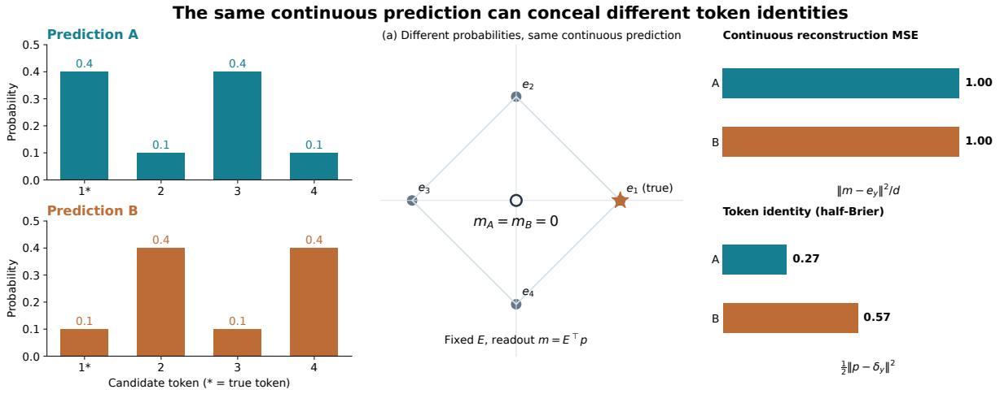
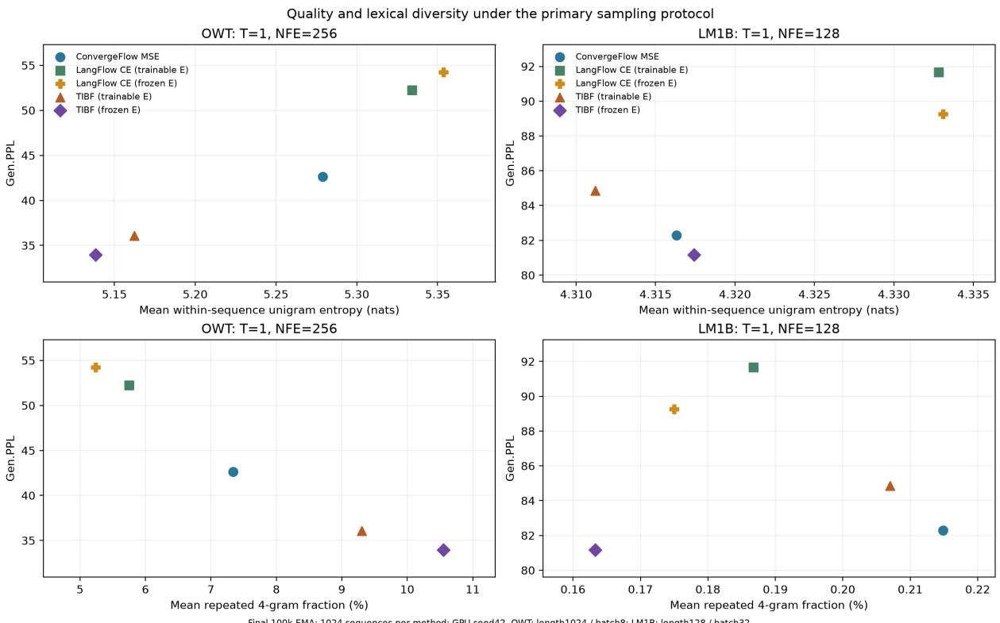
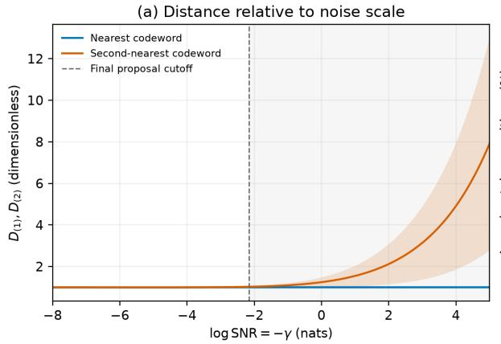
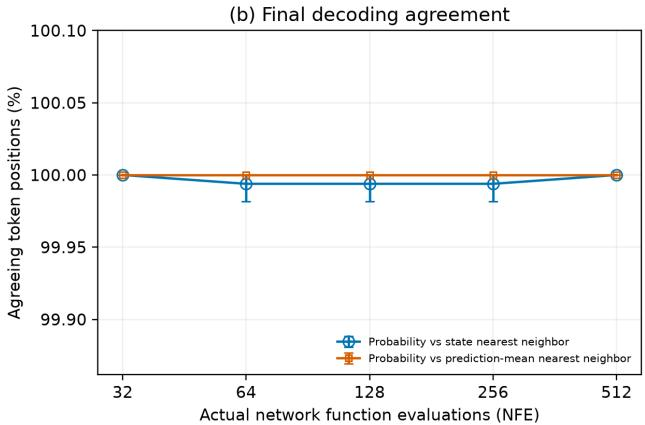
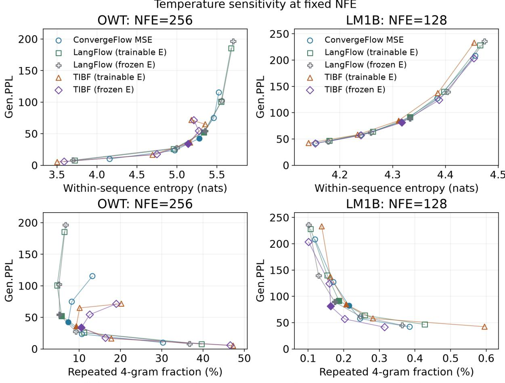
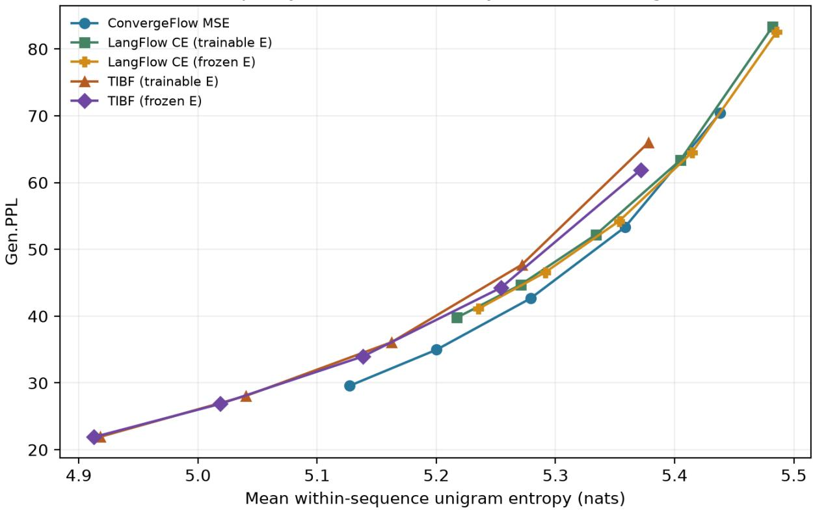
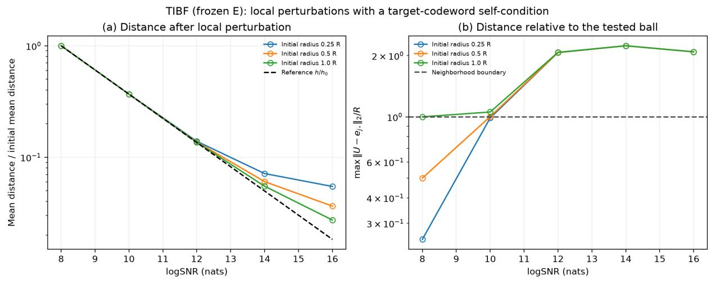
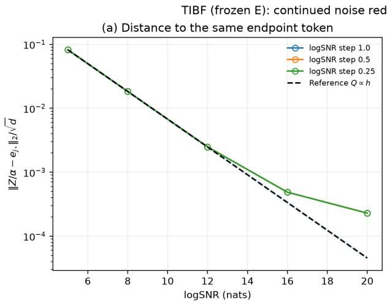
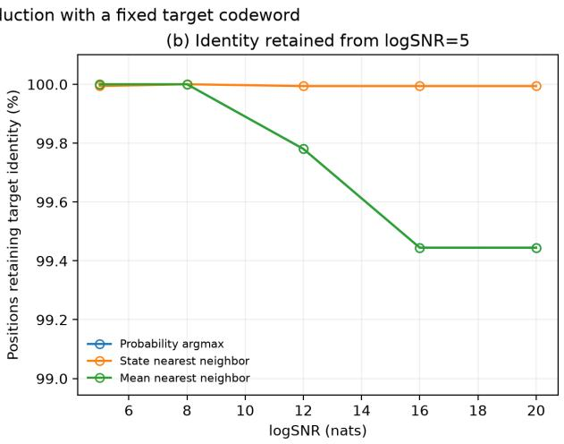

# Continued Training of Continuous Language Flows with Token Identity Squared Supervision

Jiawei Jiang<sup>1,2</sup>, Zhaoxiang Zang<sup>∗1,2</sup>, and Zhengtao Yu<sup>1,2</sup>

<sup>1</sup>Faculty of Information Engineering and Automation, Kunming University of Science and Technology, Kunming, China

<sup>2</sup>Key Laboratory of Artificial Intelligence in Yunnan Province, Kunming University of Science and Technology, Kunming, China

## Abstract

Difusion and flow models have recently been extended to language modeling, generating text through continuous denoising in token embedding spaces. Pretrained models provide token representations and contextual prediction capabilities, but improving generation with limited additional training requires an appropriate connection between supervision and continuous generation. Continuous MSE evaluates a predicted vector obtained by weighting token embeddings with predicted probabilities; diferent probability distributions can yield the same vector and are therefore indistinguishable under this objective. We propose Token Identity Brier Flow (TIBF), which applies squared supervision directly to token identities when continuing pretrained language flows. TIBF combines network scores with tokenmatching scores under a Gaussian observation model, supervises token probabilities using the Brier loss, and uses probability-weighted embeddings for continuous generation. With fixed token embeddings, we show that the squared error between predicted token probabilities and the true posterior bounds the squared errors of continuous denoising predictions and flow velocities. A risk decomposition separates uncertainty inherent in the observation from posterior fitting error, motivating continued training that preserves pretrained embeddings and focuses on probability prediction. We also establish convergence to token embeddings under ideal predictions and suficient conditions for local convergence with prediction error. From common pretrained initializations and under matched continuation budgets, frozen-embedding TIBF achieves Gen.PPL values of 33.96 on OWT and 81.17 on LM1B, outperforming continuous-MSE and CE continuation controls. It attains the lowest Gen.PPL at every tested sampling budget on both datasets, together with the lowest repetition rate on LM1B. These results support token identity squared supervision as an efective objective for improving generation while preserving pretrained embeddings.

## 1 Introduction

Language models must represent dependencies among tokens and turn them into a practical generation procedure. Autoregressive models, including Transformer decoders (Vaswani et al., 2017), provide an established approach by predicting successive tokens in a prescribed order. Text completion, local editing, and coordination across multiple positions also depend on generation order and whether intermediate predictions can be revised. Difusion language models generate text through repeated denoising or masked prediction, using context to coordinate updates across positions (Li et al., 2022; Sahoo et al., 2024).

Difusion models (Sohl-Dickstein et al., 2015; Song and Ermon, 2019; Ho et al., 2020) and continuous-flow approaches such as flow matching (FM) and rectified flow (Lipman et al., 2022;

Liu et al., 2022) have achieved substantial progress on continuous data, including images. Diffusion training progressively corrupts data and learns a reverse denoising process; sampling reconstructs data from noise. Flow matching regresses velocity fields along probability paths to learn continuous transport from a noise distribution to the data distribution. Score-based formulations also connect reverse stochastic diferential equations with corresponding probabilityflow ordinary diferential equations (ODEs) (Song et al., 2021). These approaches underpin continuous language generation.

Extending these approaches to text requires addressing token discreteness. Discrete difusion perturbs tokens directly and learns to recover them through structured state transitions, discrete probability-ratio estimation, or masked prediction (Austin et al., 2021; Lou et al., 2024; Sahoo et al., 2024). Embedding-space methods instead represent tokens as continuous vectors and apply Gaussian corruption and denoising (Li et al., 2022; Gulrajani and Hashimoto, 2023). Continuous intermediate states permit iterative refinement; Difusion-LM additionally demonstrates fine-grained text control using gradients (Li et al., 2022). How continuous states represent token information and how predictions recover discrete text are therefore central to connecting representations, objectives, and generation rules.

Research on continuous language models has progressed from generation mechanisms toward joint design of objectives, likelihood evaluation, and scaling. LangFlow (Chen et al., 2026) interprets token cross-entropy (CE) training through Bregman flow matching, combining information-uniform scheduling, self-conditioning, and an ODE likelihood bound to connect identity prediction, continuous generation, and probabilistic evaluation. RePlaid (Yang et al., 2026) retains Plaid’s negative evidence lower bound (NELBO) objective while aligning its backbone with modern discrete difusion models to compare scaling under equal training compute. These developments represent token-CE and variational-likelihood approaches to continuous language modeling.

Beyond generation quality and likelihood, continuous trajectories must also reach discrete endpoints. ConvergeFlow (Li et al., 2026) combines learnable base weights with Gaussian compatibility kernels to construct convex combinations of token embeddings. It directly trains a continuous data predictor with flow-matching-induced mean squared error (MSE) and proves convergence to token embeddings under suitable regularity conditions, including in the presence of prediction error, without a separate CE-supervised endpoint decoder. This structure makes the choice of supervision explicit: a loss can evaluate either probability-weighted embeddings or token probabilities themselves.

Diferent token distributions can produce the same predicted vector and are thus indistinguishable under continuous MSE. If embeddings are learned, the reconstruction metric also changes during training. Although CE directly supervises token identity, prior continuation experiments on continuous language flows found its generation gains less stable than those of MSE (Li et al., 2026). We therefore investigate squared supervision of the full token probability vector while retaining continuous generation, and relate identity prediction error to denoising, flow velocities, and token endpoints.

We propose Token Identity Brier Flow (TIBF). TIBF evaluates predicted probabilities against true token identities with the Brier squared loss, keeping the supervision metric fixed as embeddings are updated (Brier, 1950; Shao et al., 2024). The model combines network scores with Gaussian compatibility to predict token probabilities and weights embeddings by those probabilities to produce continuous denoising predictions. Our risk decomposition shows that a decrease in loss under joint embedding updates can accompany a loss of identity distinguishability. We therefore use frozen pretrained embeddings as the primary continuation setting, focusing training on probability prediction, and compare against joint updates. Because token information is recovered unevenly during denoising, TIBF also adopts information-uniform scheduling: existing denoising errors estimate information-change rates and dynamically allocate training across noise levels (Chen et al., 2026; Raya et al., 2026).

On OWT and LM1B, we initialize all controls from the same LangFlow pretrained weights and compare TIBF, continuous MSE, and CE under equal additional-token budgets, including frozen and jointly updated embeddings. We evaluate generation across sampling budgets, quality–diversity trade-ofs, and cross-corpus modeling. Trajectory distances and decoding agreement additionally reveal empirical convergence toward fixed token embeddings.

Our contributions are threefold:

1. We move squared supervision from continuous reconstruction to token identity, addressing the inability of continuous MSE to distinguish probability predictions that map to the same vector. The resulting TIBF directly evaluates full token probabilities with the Brier loss and connects them to continuous generation through probability-weighted embeddings.

2. We establish theoretical connections between identity squared supervision and continuous generation. With fixed embeddings, posterior probability error upper-bounds continuous denoising and flow velocity errors. Risk decomposition reveals potential tension between improved fitting and identity distinguishability under joint embedding updates, motivating continuation with pretrained embeddings frozen. We also prove token-endpoint convergence under ideal prediction and suficient conditions for local convergence with prediction error.

3. We demonstrate generation improvements from a common pretrained initialization under equal continuation budgets. Frozen-embedding TIBF achieves the lowest Gen.PPL among the controlled comparisons at every tested sampling budget on OWT and LM1B, and the lowest repetition rate on LM1B. Comparisons against joint updates further support preserving pretrained embeddings while improving identity prediction.

## 2 Background and Problem Formulation

## 2.1 Flow Matching

Flow matching (FM) learns a time-dependent velocity field that transforms a simple noise distribution into a data distribution (Lipman et al., 2022). The field specifies the direction and rate of state evolution. Let $x \sim p _ { \mathrm { d a t a } }$ be continuous data in $R ^ { d }$ , where d is the data dimension and $p _ { \mathrm { d a t a } }$ is the continuous-data distribution. Let $\varepsilon \sim \mathcal { N } ( 0 , I )$ be independent noise, with I the identity matrix of matching dimension. For path time t and state $z _ { t }$ , a common construction is a Gaussian probability path:

$$
z _ { t } = \alpha _ { t } x + \sigma _ { t } \varepsilon , \qquad t \in [ 0 , 1 ]\tag{1}
$$

The diferentiable scalar coeficients $\alpha _ { t } , \sigma _ { t }$ scale data and noise, respectively, with $\big ( \alpha _ { 0 } , \sigma _ { 0 } \big ) =$ $( 0 , 1 )$ and $( \alpha _ { 1 } , \sigma _ { 1 } ) = ( 1 , 0 )$ . Thus, the distribution of $z _ { t }$ interpolates from standard Gaussian noise to data. A model with parameters θ learns $v _ { \theta } ( z _ { t } , t )$ . Generation starts from noise and numerically solves the ODE $\mathrm { d } z _ { t } / \mathrm { d } t = v _ { \theta } ( z _ { t } , t )$

The true marginal velocity is generally unavailable during training, but the conditional path velocity $\dot { \alpha } _ { t } x + \dot { \sigma } _ { t } \varepsilon$ is directly computable for sampled x and ε. Conditional flow matching uses the squared regression objective

$$
\begin{array} { r } { \mathcal { L } _ { \mathrm { C F M } } ( \theta ) = E _ { t , x , \varepsilon } \left[ \| v _ { \theta } ( z _ { t } , t ) - ( \dot { \alpha } _ { t } x + \dot { \sigma } _ { t } \varepsilon ) \| _ { 2 } ^ { 2 } \right] , \qquad t \sim U n i f ( 0 , 1 ) } \end{array}\tag{2}
$$

Dots denote time derivatives, and $\| \cdot \| _ { 2 }$ is the Euclidean norm. The expectation covers data x, noise $\varepsilon ,$ and an independent time t, with $U n i f ( 0 , 1 )$ denoting the uniform distribution on $( 0 , 1 )$ . The ideal predictor is the conditional mean path velocity, $\boldsymbol { u } _ { t } ^ { * } ( \boldsymbol { z } _ { t } ) = E [ \dot { \alpha } _ { t } \boldsymbol { x } + \dot { \sigma } _ { t } \varepsilon \mid \boldsymbol { z } _ { t } , t ]$ Under appropriate regularity conditions, this velocity field evolves the marginals of the specified probability path (Lipman et al., 2022).

For Gaussian paths, velocities can also be parameterized through clean-data predictions. Let $\widehat { x } _ { \theta } ( z _ { t } , t )$ be a denoiser. For $0 < t < 1$ and $\sigma _ { t } > 0$ 2

$$
v _ { \theta } ( z _ { t } , t ) = \frac { \dot { \sigma } _ { t } } { \sigma _ { t } } z _ { t } + \left( \dot { \alpha } _ { t } - \alpha _ { t } \frac { \dot { \sigma } _ { t } } { \sigma _ { t } } \right) \widehat { x } _ { \theta } ( z _ { t } , t ) .\tag{3}
$$

Predicting the conditional mean of clean data therefore determines the generation velocity. With fixed representations and a fixed path, substituting this parameterization into conditional flow matching yields a noise-weighted continuous reconstruction MSE.

## 2.2 Gaussian Paths over Token Embeddings

Text consists of discrete tokens and cannot directly serve as continuous data on this Gaussian path. Embedding-space models first map tokens to vectors and then corrupt and denoise the resulting sequences (Li et al., 2022; Gulrajani and Hashimoto, 2023). Let $Y = ( Y _ { 1 } , \dots , Y _ { L } )$ ∼ $P _ { \mathrm { d a t a } }$ be a token sequence, where $P _ { \mathrm { d a t a } }$ is the distribution of discrete text, $Y _ { \ell } \in [ V ] = \{ 1 , \dots , V \}$ V is vocabulary size, L is sequence length, and $\ell \in \{ 1 , \ldots , L \}$ indexes positions. Let $E \in R ^ { V \times d }$ be the token embedding matrix, where d is the embedding dimension, whose vth row is $e _ { v } ^ { \top }$ where $e _ { v } \in R ^ { d }$ is a column vector; ⊤ denotes transpose. The corresponding continuous sequence $X$ is

$$
\begin{array} { r } { X = X ( Y ) = \left[ \begin{array} { c } { e _ { Y _ { 1 } } ^ { \top } } \\ { \vdots } \\ { e _ { Y _ { L } } ^ { \top } } \end{array} \right] \in \mathbb { R } ^ { L \times d } . } \end{array}\tag{4}
$$

To express denoising dificulty directly, we follow LangFlow’s negative log-SNR coordinate $\gamma = \log ( \sigma ^ { 2 } / \alpha ^ { 2 } )$ , where $\alpha , \sigma$ scale data and noise. Written as functions of $\gamma ,$ the noisy embedding state $Z _ { \gamma } \in R ^ { L \times d }$ follows a variance-preserving Gaussian path (Chen et al., 2026):

$$
Z _ { \gamma } = \alpha _ { \gamma } X + \sigma _ { \gamma } \varepsilon , \quad \alpha _ { \gamma } ^ { 2 } = s i g m o i d ( - \gamma ) , \quad \sigma _ { \gamma } ^ { 2 } = s i g m o i d ( \gamma ) .\tag{5}
$$

Here sigmoid $l ( a ) = ( 1 + e ^ { - a } ) ^ { - 1 } , \alpha _ { \gamma } , \sigma _ { \gamma }$ are positive square roots, and $\varepsilon \in R ^ { L \times d }$ has independent standard Gaussian entries and is independent of $Y$ . Variance preservation means $\alpha _ { \gamma } ^ { 2 } + \sigma _ { \gamma } ^ { 2 } = 1$ . Larger γ corresponds to stronger noise, while smaller $\gamma$ corresponds to less corrupted token embeddings; the SNR is $\lambda _ { \gamma } = e ^ { - \gamma }$ . Generation proceeds in decreasing $\gamma ,$ with pure noise and clean data corresponding to $\gamma \to + \infty$ and $\gamma \to - \infty$ , respectively.

## 2.3 From Token Probabilities to Continuous Predictions

Embedding-space generation connects token identity prediction with the continuous denoising predictions required by flow matching. Given the entire noisy sequence $Z _ { \gamma } = Z$ , the true token posterior and its expected embedding at position ℓ are

$$
\begin{array} { r } { q _ { \ell , v } ( Z , \gamma ) = \operatorname* { P r } ( Y _ { \ell } = v \mid Z _ { \gamma } = Z , \gamma ) , \qquad m _ { \ell } ^ { * } ( Z , \gamma ) = E ^ { \top } q _ { \ell } ( Z , \gamma ) . } \end{array}\tag{6}
$$

Here $q _ { \ell } = ( q _ { \ell , 1 } , \ldots , q _ { \ell , V } ) ^ { \top }$ is a V-dimensional posterior probability vector, and $m _ { \ell } ^ { * } \in R ^ { d }$ is the ideal continuous prediction. The probability simplex $\Delta _ { V } = \{ p \in R _ { > 0 } ^ { V } : \mathbf { 1 } _ { V } ^ { \top } p = 1 \}$ contains nonnegative vectors summing to one, so $q _ { \ell } \in \Delta _ { V }$ , where ${ \bf 1 } _ { V }$ is the all-ones column vector. Arranging positionwise probabilities as rows gives

$$
q ( Z , \gamma ) = \big ( q _ { \ell , v } ( Z , \gamma ) \big ) _ { \ell , v } \in R ^ { L \times V } .\tag{7}
$$

The conditional mean of the clean embedding sequence is therefore

$$
m ^ { * } ( Z , \gamma ) = q ( Z , \gamma ) E = E [ X \mid Z _ { \gamma } = Z , \gamma ] \in R ^ { L \times d } .\tag{8}
$$

This conditional mean is the optimal denoising prediction under continuous squared error. The model approximates the true posterior with predicted probabilities $p _ { \ell } \in \Delta _ { V }$ , assembled into $P \in R ^ { L \times V }$ . It then weights candidate embeddings by these probabilities to form $M = P E$ and determine the velocity field (Gulrajani and Hashimoto, 2023; Chen et al., 2026; Li et al., 2026). Predictions at every position condition on the entire noisy sequence; positionwise outputs do not imply token independence.

  
Figure 1: The same continuous prediction can conceal diferent identity judgments. Four embedding vectors lie in two dimensions. Predictions A and B are (0.4, 0.1, 0.4, 0.1) and (0.1, 0.4, 0.1, 0.4), with token 1 as the true identity. Both probability-weighted vectors are zero, giving normalized continuous MSE 1 under Eq. (9), but half-Brier losses 0.27 and 0.57. Positions are shown as $e _ { v } / { \sqrt { d } } .$ with $\| e _ { v } \| ^ { 2 } = d$ . This analytical example illustrates the manyto-one readout.

## 2.4 Supervision Objectives and the Problem Addressed

The same continuous-generation interface admits diferent supervision targets. At one position, omit the position index and write $y = Y _ { \ell }$ for the true token and $p = p _ { \ell }$ for the predicted probability vector, whose component $p _ { y }$ is the probability assigned to y. Continuous reconstruction MSE evaluates the probability-weighted embedding against the true token embedding (Li et al., 2026); CE evaluates identity prediction using the negative log probability $- \log p _ { y }$ of the true token (Chen et al., 2026). Let $\delta _ { y } \in R ^ { V }$ be the one-hot identity label, with component y equal to one. The continuous reconstruction error is

$$
\frac { 1 } { d } \| E ^ { \top } p - e _ { y } \| ^ { 2 } = ( p - \delta _ { y } ) ^ { \top } G _ { E } ( p - \delta _ { y } ) , \qquad G _ { E } = \frac { 1 } { d } E E ^ { \top } .\tag{9}
$$

The matrix $G _ { E } \in R ^ { V \times V }$ is the probability-error metric induced by token embeddings. Thus, the probability-space metric of continuous MSE depends on E. In the usual setting $V > d + 1$ 7 distinct probability distributions can yield the same vector $E ^ { \top } p ;$ if E is learned, this metric changes as well. In the extreme case where all token embeddings equal $c \in R ^ { d }$ , every probability prediction satisfies

$$
\boldsymbol { E } ^ { \top } ( p - \delta _ { y } ) = c \mathbf { 1 } _ { V } ^ { \top } ( p - \delta _ { y } ) = 0 .\tag{10}
$$

CE directly supervises token identity, has the true posterior as its conditional optimum, and admits a flow-matching interpretation through Bregman divergences (Chen et al., 2026). We seek to retain both identity supervision and a squared-error structure: evaluating the full token probability vector while relating its prediction error to continuous readout and flow velocity errors.

The Brier score evaluates the squared distance between a probability vector and a one-hot label (Brier, 1950; Shao et al., 2024). We use the half-Brier convention $\begin{array} { r } { \ell ( p , y ) = \frac 1 2 \| p - \delta _ { y } \| ^ { 2 } } \end{array}$ whose metric is defined directly over token identities and does not change with the embeddings.

Figure 1 illustrates fixed equal-norm embeddings: two diferent probability predictions yield the same continuous vector and hence the same reconstruction MSE, while identity squared scoring distinguishes their allocations of probability to the true token.

## 3 Method

TIBF supervises token probabilities with the Brier squared loss and uses probability-weighted embeddings as continuous denoising predictions. We define the predictor and objective, use an identity-risk decomposition to analyze frozen and jointly updated embeddings, and then establish token-endpoint properties of generation trajectories.

## 3.1 Token Probability Prediction and Continuous Readout

TIBF predicts token probabilities from noisy sequences and weights embeddings by those probabilities to obtain continuous denoising predictions. We retain the sequence length $L ,$ vocabulary size $V .$ , and embedding dimension d from Section 2. For tokenwise probabilities, losses, and conditional risks, we fix one position and omit its index; predictions still condition on the entire noisy sequence.

Embedding matrix and indexing. Let $A \in R ^ { V \times d }$ be the raw embedding parameters, with $a _ { v }$ denoting the transpose of its vth row. The efective embedding is

$$
e _ { v } = R o w N o r m ( a _ { v } ) = \sqrt { d } \frac { a _ { v } } { \operatorname* { m a x } ( \Vert a _ { v } \Vert , \varepsilon _ { \mathrm { n o r m } } ) } , \qquad \varepsilon _ { \mathrm { n o r m } } = 1 0 ^ { - 1 2 } .\tag{11}
$$

Here $a _ { v } , e _ { v } \in R ^ { d }$ , RowNorm denotes row normalization, and $\varepsilon _ { \mathrm { n o r m } }$ prevents division by zero. If $\| a _ { v } \| > \varepsilon _ { \mathrm { { n o r m } } }$ , then $\| e _ { v } \| ^ { 2 } = d ;$ kernel simplifications below use this condition. Our primary setting freezes pretrained $A$ , whereas joint-update controls allow the embedding directions to change.

Fix position ℓ and write $y = Y _ { \ell }$ . Let $z \in R ^ { d }$ be the transpose of row ℓ of $Z _ { \gamma }$ , namely its local noisy vector; v continues to index candidate tokens. Candidate scores from Gaussian observations. By Eq. (5), if the true token at position ℓ is v, its observation follows

$$
z \mid ( y = v , \gamma ) \sim \mathcal { N } ( \alpha _ { \gamma } e _ { v } , \sigma _ { \gamma } ^ { 2 } I _ { d } ) .\tag{12}
$$

Here $I _ { d }$ is the d-dimensional identity matrix. Diferent candidates induce diferent observation means. Removing the shared density normalization gives the Gaussian kernel

$$
K _ { v } = \exp \left[ - \frac { \| z - \alpha _ { \gamma } e _ { v } \| ^ { 2 } } { 2 \sigma _ { \gamma } ^ { 2 } } \right] .\tag{13}
$$

This kernel is the Gaussian observation likelihood with its common normalization factor omitted. It measures how well the noisy state at the current position matches each candidate embedding. To combine it with network scores, we take the logarithm of Eq. (13) and expand:

$$
\log K _ { v } = - \frac { \| z \| ^ { 2 } } { 2 \sigma _ { \gamma } ^ { 2 } } + \frac { \alpha _ { \gamma } } { \sigma _ { \gamma } ^ { 2 } } z ^ { \top } e _ { v } - \frac { \alpha _ { \gamma } ^ { 2 } \| e _ { v } \| ^ { 2 } } { 2 \sigma _ { \gamma } ^ { 2 } } .\tag{14}
$$

The first term is independent of candidate v. With equal-norm embeddings, the third term is also shared by all candidates, so both cancel during probability normalization. We therefore use the middle inner-product term as the Gaussian matching score, with coeficient $\kappa _ { \gamma } = \alpha _ { \gamma } / \sigma _ { \gamma } ^ { 2 }$

Combining observations and context. Let θ denote the prediction-network parameters, excluding embedding parameters A and schedule parameters. The network reads the full noisy sequence and outputs $f _ { \theta } ( Z _ { \gamma } , \gamma ) \in R ^ { L \times V }$ ; its base score for candidate v at the current position is denoted by $f _ { v }$ . Network scores incorporate sequence context, whereas Gaussian matching scores evaluate the local noisy observation against candidate embeddings. We add these scores and normalize over the vocabulary:

$$
\begin{array} { c } { \displaystyle s _ { v } = f _ { v } + \kappa _ { \gamma } z ^ { \top } e _ { v } , } \\ { \displaystyle p _ { v } = \frac { \exp ( s _ { v } ) } { \displaystyle \sum _ { v ^ { \prime } = 1 } ^ { V } \exp ( s _ { v ^ { \prime } } ) } . } \end{array}\tag{15}
$$

Here $s _ { v }$ is the total score and $p _ { v }$ is the candidate probability. Writing $p = ( p _ { 1 } , \ldots , p _ { V } ) ^ { \top }$ , we have $p \in \Delta _ { V }$

Equivalent Gaussian-kernel form. Define positive base weights

$$
\omega _ { v } = \exp ( f _ { v } ) / \sum _ { v ^ { \prime } = 1 } ^ { V } \exp ( f _ { v ^ { \prime } } ) .
$$

Under equal-norm embeddings, Eq. (15) is equivalent to

$$
p _ { v } = \frac { \omega _ { v } K _ { v } } { \displaystyle \sum _ { v ^ { \prime } = 1 } ^ { V } \omega _ { v ^ { \prime } } K _ { v ^ { \prime } } } .\tag{16}
$$

Equation (16) forms token probabilities by multiplying the network-derived base weights by the Gaussian kernels and normalizing the products (Chen et al., 2026; Li et al., 2026). Appendix A.5 relates this predictor to the true contextual posterior.

Continuous readout. Weighting embeddings by the local probabilities gives the continuous denoising prediction

$$
m = E ^ { \top } p = \sum _ { v = 1 } ^ { V } p _ { v } e _ { v } \in R ^ { d } .\tag{17}
$$

Because probabilities are nonnegative and sum to one, m lies in conv $\{ e _ { 1 } , \ldots , e _ { V } \}$ , the convex hull of the embeddings. This holds for any probability prediction and for both frozen and jointly updated E. Restoring position indices, arrange $p _ { \ell } ^ { \top }$ as the rows of $P \in R ^ { L \times V }$ . The sequence-level prediction is $M = P E \in R ^ { L \times d }$ , with $M _ { \ell } = E ^ { \top } p _ { \ell }$ denoting the transpose of row ℓ.

From continuous predictions to generation velocities. Equation (3) expresses the Gaussian-path velocity in terms of the current state and a clean-data prediction. Diferentiating the coeficients in Eq. (5) gives $\alpha _ { \gamma } ^ { \prime } = - \alpha _ { \gamma } \sigma _ { \gamma } ^ { 2 } / 2$ and $\sigma _ { \gamma } ^ { \prime } = \sigma _ { \gamma } \alpha _ { \gamma } ^ { 2 } / 2$ . Reparameterizing the path by $\gamma$ and substituting the continuous readout M for the clean-data prediction in Eq. (3) yields

$$
\begin{array} { c } { { v _ { \theta } ( Z _ { \gamma } , \gamma ) = \displaystyle \frac { \sigma _ { \gamma } ^ { \prime } } { \sigma _ { \gamma } } Z _ { \gamma } + \left( \alpha _ { \gamma } ^ { \prime } - \alpha _ { \gamma } \displaystyle \frac { \sigma _ { \gamma } ^ { \prime } } { \sigma _ { \gamma } } \right) M } } \\ { { = \displaystyle \frac { 1 } { 2 } \left( \alpha _ { \gamma } ^ { 2 } Z _ { \gamma } - \alpha _ { \gamma } M \right) . } } \end{array}\tag{18}
$$

Generation integrates this velocity field in decreasing γ, progressively denoising the state.

## 3.2 Brier Supervision of Token Identity

The continuous readout weights token embeddings by predicted probabilities. For training, TIBF directly compares the predicted probability vector $p$ with the true token’s one-hot label $\delta _ { y }$ using the half-Brier loss

$$
\ell ( p , y ) = \frac 1 2 \| p - \delta _ { y } \| ^ { 2 } = \frac 1 2 \left( 1 - 2 p _ { y } + \sum _ { v } p _ { v } ^ { 2 } \right) .\tag{19}
$$

Here $p _ { y }$ is the probability assigned to the true token. The loss encourages its probability toward one and other probabilities toward zero; the factor $1 / 2$ does not change the optimal prediction.

To train across noise levels, independently draw $\gamma$ from distribution π and construct noisy sequences using Eq. (5). With positive noise-dependent weight $w ( \gamma ) > 0$ , the training risk is

$$
\mathcal { R } ( \theta , E ) = E \left[ \frac { w ( \gamma ) } { L } \sum _ { \ell = 1 } ^ { L } \ell ( p _ { \ell } , Y _ { \ell } ) \right] .\tag{20}
$$

## 3.3 Identity Risk Decomposition

Brier supervision has two aspects: for a given observation, the optimal prediction is the true token posterior; when embeddings can change, one must additionally separate information in the observations from the network’s ability to use it. First fix E, θ, and $\pi$ , retaining singletoken notation. Given the noisy sequence and noise level, define posterior components and the probability vector by

$$
q _ { v } = \operatorname* { P r } ( y = v \mid Z _ { \gamma } , \gamma ) , \qquad q = ( q _ { 1 } , \ldots , q _ { V } ) ^ { \top } \in \Delta _ { V } .\tag{21}
$$

We initially treat $p$ as deterministic given the observation. The true token’s one-hot label satisfies

$$
E [ \delta _ { y } \mid Z _ { \gamma } , \gamma ] = q .\tag{22}
$$

Substituting this conditional mean into the Brier loss and completing the square $\mathrm { g i }$ ves

$$
E [ \ell ( p , y ) \mid Z _ { \gamma } , \gamma ] = { \frac { 1 } { 2 } } \| p - q \| ^ { 2 } + { \frac { 1 } { 2 } } \left( 1 - \| q \| ^ { 2 } \right) .\tag{23}
$$

The first term is squared error between predicted probabilities and the true posterior; the second is the minimum expected loss due to residual identity uncertainty in the observation. Thus, $p = q$ is optimal and makes the first term zero. Training still uses one-hot labels: Eq. (23) decomposes their expected loss and does not require computing the posterior. See Appendix A.1 for the proof.

The true posterior $q _ { \ell }$ is determined by the data distribution, $E ,$ and corruption process, independently of network parameters $\theta .$ The second term of Eq. (23) measures residual identity uncertainty, giving the minimum population risk

$$
\mathcal { R } ^ { * } ( E ) : = E \left[ \frac { w ( \gamma ) } { 2 L } \sum _ { \ell } ( 1 - \Vert q _ { \ell } \Vert ^ { 2 } ) \right] .\tag{24}
$$

The first term of Eq. (23) yields the model’s posterior fitting error:

$$
\mathcal { E } ( \theta , E ) = E \left[ \frac { w ( \gamma ) } { 2 L } \sum _ { \ell } \| p _ { \ell } - q _ { \ell } \| ^ { 2 } \right] .\tag{25}
$$

Proposition 1: Identity risk decomposition. The population risk satisfies

$$
\mathcal { R } ( \theta , E ) = \mathcal { R } ^ { * } ( E ) + \mathcal { E } ( \theta , E ) .\tag{26}
$$

With the data distribution, noise distribution, and weighting fixed, freezing E keeps ${ \mathcal { R } } ^ { * } ( E )$ constant. Hence,

$$
{ \mathcal { R } } ( \theta , E ) - { \mathcal { R } } ^ { * } ( E ) = { \mathcal { E } } ( \theta , E ) .\tag{27}
$$

With frozen $E ,$ reducing training risk is equivalent to reducing squared error between predicted probabilities and the true posterior.

Frozen versus joint updates. Freezing pretrained E preserves the observation channel and concentrates continuation on posterior fitting. Joint updates change both minimum risk and fitting error. Total risk can decrease through simultaneous improvement of both terms or through compensation: fitting-error reduction can exceed an increase in minimum risk, or minimum-risk reduction can outweigh a smaller increase in fitting error. Lower total risk therefore need not imply simultaneous improvement in identity distinguishability and posterior fitting. Section 4.3 compares these continuation settings.

Appendix B.2 further shows that updating E ofers limited additional representational benefit when its minimum risk is already close to the attainable lower bound.

Posterior fitting under a fixed observation channel also connects directly to flow velocity error. At each noise level, the continuous-MSE fitting error is proportional to the total squared velocity error. Along each efective eigendirection of the embedding-induced metric, TIBF’s identity squared error is proportional to the corresponding squared velocity error by a fixed factor. The CE fitting term is a KL divergence; its squared-residual representation additionally contains weights that depend on predicted probabilities, so it lacks this fixed directionwise correspondence. This establishes a structural alignment between identity squared supervision and continuous flow matching; the derivation is given in Appendix A.2.

## 3.4 Token-Endpoint Convergence

TIBF supervises token probabilities $p$ and uses them to construct the continuous prediction $m = E ^ { \top } p$ . We examine whether trajectories converge to the embedding of the predicted token, aligning probability prediction with the continuous endpoint.

Equation (23) identifies the true posterior as the conditional Brier optimum. If the model attains it at every noise level, the continuous readout is the ideal denoising prediction. Under initialization from the matching noisy distribution and exact integration, trajectories converge almost surely to token embedding sequences, with endpoint distribution equal to the distribution of the clean embedding sequence X. The proof appears in Appendix C.3.

For actual predictors, the Gaussian structure in Eq. (16) additionally provides local attraction at low noise (Li et al., 2026). Let $h = \sigma _ { \gamma } / \alpha _ { \gamma }$ be the noise-to-signal ratio and $u = z / \alpha _ { \gamma }$ the scaled state at one position. For candidate $j$ and any $v \neq j$

$$
\log \frac { p _ { v } } { p _ { j } } = f _ { v } - f _ { j } - \frac { \| u - e _ { v } \| ^ { 2 } - \| u - e _ { j } \| ^ { 2 } } { 2 h ^ { 2 } } .\tag{28}
$$

Here $f _ { v } , f _ { j }$ are network base scores. Near $e _ { j }$ , Gaussian matching favors token $j ,$ and the efect of distance diferences grows as $1 / h ^ { 2 }$ as noise decreases. If the embeddings are distinct and equal-norm, base-score diferences are uniformly bounded, the state has entered a local neighborhood of $e _ { j }$ , and noise is suficiently small, Euler updates along a grid with vanishing noise remain in that neighborhood and converge to $e _ { j }$ , with $p _ { j }  1$ and $m \to e _ { j }$ . Conditions and proofs are provided in Appendix C.5.

Under these conditions, the probability used for identity supervision, the probabilityweighted continuous prediction, and the trajectory endpoint identify the same token. Section 4.3.5 examines this correspondence through candidate-distance separation and endpoint decoding agreement.

## 4 Experiments

Our primary setting continues pretrained language flows with TIBF and frozen embeddings, with joint embedding updates as a control. Methods share pretrained initializations and additional-token budgets and are compared at the same actual NFE. $\mathrm { O n }$ OWT and LM1B, we initialize from public LangFlow models and compare continuous MSE, CE with both embedding settings, and TIBF with both settings using Gen.PPL, dataset PPL, and lexical diversity. Fixed-embedding trajectory diagnostics additionally examine behavior predicted by the endpoint analysis.

## 4.1 Data, Models, and Training Setup

Data and shared initialization. OWT (Gokaslan and Cohen, 2019) uses the 50,257-token GPT-2 vocabulary and sequence length 1,024; LM1B (Chelba et al., 2013) uses bert-baseuncased and length 128. Within each dataset, all groups inherit the same LangFlow backbone, vocabulary head, E, and schedule parameters, with fresh optimizers and EMA states. The OWT continuation file is split by line into the first 90% for training, 90%–95% for calibration, 95%–97.5% for validation, and the final 2.5% for testing, with 64-line gaps at boundaries. All controls use identical splits.

Models. All continuation models retain LangFlow’s DiT architecture with 12 layers, hidden dimension 768, 12 attention heads, rotary positional embeddings, and dropout 0.1, together with the same vocabulary head, self-conditioning module, and Gaussian observation branch. Including token embeddings, the OWT and LM1B models contain approximately 171M and 140M parameters, respectively. Frozen settings preserve pretrained $E ;$ joint settings update it together with the network.

Noise scheduling. TIBF follows information-uniform scheduling: it estimates informationchange rates from current denoising errors and fits a Gumbel distribution online to allocate more training samples to noise regions where identity information changes rapidly (Chen et al., 2026; Raya et al., 2026). The derivation and implementation appear in Appendices A.6 and D.3.

Self-conditioning. All groups retain LangFlow’s self-conditioning setup (Chen et al., 2026). During training, with probability 0.25, we compute a preliminary prediction at the same noisy state without gradients and supply its continuous denoising readout as an auxiliary input. Generation uses empty self-conditioning at the first point and reuses the preceding node’s denoising prediction thereafter. Construction and stop-gradient details appear in Appendix D.7.

Optimization and budget. Each continuation run uses 100,000 additional updates. Effective batch sizes are 6 for OWT and 48 for LM1B, yielding the same budget of approximately 614.4M additional tokens. We use AdamW with learning rate $3 \times 1 0 ^ { - 4 }$ , a 2,500-step linear warmup followed by a constant rate, and EMA decay 0.9999. Training uses BF16 mixed precision; all evaluations use the final EMA model. Additional optimization and execution details are given in Appendix D.2.

Controls. Each dataset has five groups: ConvergeFlow with frozen embeddings trained using weighted continuous MSE; LangFlow trained using CE with either trainable or frozen embeddings; and TIBF trained using weighted half-Brier with either trainable or frozen embeddings. Frozen embeddings are the primary TIBF setting; the joint-update control updates E throughout training. ConvergeFlow and TIBF use I–MMSE–PDF scheduling, whereas LangFlow uses CE–CDF scheduling. The comparison therefore evaluates each method’s complete continuation configuration. Temperature sensitivity and paired statistics cover all five groups; see Appendices F.3 and F.4.

## 4.2 Evaluation Metrics and Comparison Protocol

Generation quality. We compute generative perplexity (Gen.PPL) with GPT-2 large, measuring the predictability of generated text under a fixed external language model; lower values are better (Radford et al., 2019). Each setting generates 1,024 sequences of length 1,024 for OWT or 128 for LM1B. LM1B outputs are decoded to text and retokenized with the scorer’s tokenizer. Scoring details are given in Appendix E.1.

Language modeling. Dataset PPL is evaluated on real held-out text and reported separately from external Gen.PPL. All groups follow LangFlow’s oficial ODE likelihood-bound evaluation protocol (Chen et al., 2026), using the same 1,024 held-out sequences within each dataset. Probability definitions and numerical settings are given in Appendix E.

Diversity. Token entropy and repeated 4-gram fraction supplement generation-quality evaluation. Token entropy measures within-sequence dispersion of token usage; repeated 4- gram fraction measures repetition of consecutive four-token combinations. Both are computed per sequence and then averaged, and are interpreted jointly with Gen.PPL. Definitions and supplementary results are given in Appendix F.

Sampling and statistics. All groups use the same Euler sampling rule. NFE counts actual network forward passes, including final decoding. At a fixed NFE, models share initial

Gaussian noise and sample along their respective learned schedules, without additional guidance or same-point refinement by default. Confidence intervals quantify sample variability for a fixed checkpoint. Sampling, scoring, and statistical details appear in Appendices D.4–D.5 and E.1.

## 4.3 Continued Training from a Common Pretrained Initialization

## 4.3.1 Generation and Modeling under Equal Continuation Budgets

The primary evaluations use NFE256 for OWT and NFE128 for LM1B; results are reported in Tables 1 and 2.

Table 1: OWT continuation from a common pretrained initialization.
<table><tr><td>Model</td><td>Gen.PPL↓</td><td>Dataset PPL↓</td></tr><tr><td>ConvergeFlow baseline</td><td>42.6518</td><td>27.3047</td></tr><tr><td>LangFlow (trainable E)</td><td>52.2293</td><td>29.2352</td></tr><tr><td>LangFlow (frozen E)</td><td>54.2417</td><td>28.3538</td></tr><tr><td>TIBF (trainable E)</td><td>36.0844</td><td>30.7685</td></tr><tr><td>TIBF (frozen E)</td><td>33.9647</td><td>27.3957</td></tr></table>

Table 2: LM1B continuation from a common pretrained initialization.
<table><tr><td>Model</td><td>Gen.PPL↓</td><td>Dataset PPL↓</td></tr><tr><td>ConvergeFlow baseline</td><td>82.2953</td><td>35.4478</td></tr><tr><td>LangFlow (trainable E)</td><td>91.6678</td><td>36.3583</td></tr><tr><td>LangFlow (frozen E)</td><td>89.2538</td><td>34.4574</td></tr><tr><td>TIBF (trainable E)</td><td>84.8629</td><td>39.2614</td></tr><tr><td>TIBF (frozen E)</td><td>81.1736</td><td>35.4098</td></tr></table>

Frozen-embedding TIBF achieves the lowest Gen.PPL point estimate on both datasets. On OWT, its score of 33.9647 is 20.37% lower than continuous MSE and below both CE continuation controls. On LM1B, its score of 81.1736 is also lower than these controls. Freezing embeddings outperforms joint-update TIBF on both corpora, supporting continued training that preserves pretrained embeddings and focuses on token identity prediction.

Continuous MSE achieves the lowest dataset PPL on OWT, whereas frozen-embedding LangFlow performs best on LM1B. Frozen-embedding TIBF improves over its joint-update counterpart on both datasets, but the best Gen.PPL does not coincide with the best dataset PPL, reflecting the diferent aspects measured by these metrics.

## 4.3.2 Gen.PPL across Sampling Budgets

We fix final checkpoints and vary only actual NFE: 64, 128, 256, 512, and 1,024 on OWT; 16, 32, 64, and 128 on LM1B. Remaining generation and scoring settings follow the primary protocol for each corpus.

Frozen-embedding TIBF achieves the lowest Gen.PPL point estimate at all five OWT and four LM1B sampling budgets. On OWT, it reaches 33.9647 at NFE256, below the continuous-MSE result of 34.9831 at NFE512, achieving lower Gen.PPL with half as many network evaluations. Its NFE512 result is also below MSE at NFE1024. On LM1B, the advantage over both CE controls persists across all budgets, while the gap to continuous MSE is smaller.

Table 3: Gen.PPL across sampling budgets for OWT continuation models ↓.
<table><tr><td>Model</td><td>NFE=64</td><td> $\mathrm { N F E { = } 1 2 8 }$ </td><td> $\mathrm { N F E { = } 2 5 6 }$ </td><td> $\mathrm { N F E { = } 5 1 2 }$ </td><td> $\mathrm { N F E { = } 1 0 2 4 }$ </td></tr><tr><td>ConvergeFlow baseline</td><td>70.4063</td><td>53.3104</td><td>42.6518</td><td>34.9831</td><td>29.5657</td></tr><tr><td>LangFlow (trainable E)</td><td>83.3734</td><td>63.3507</td><td>52.2293</td><td>44.7010</td><td>39.7787</td></tr><tr><td>LangFlow (frozen E)</td><td>82.5346</td><td>64.5181</td><td>54.2417</td><td>46.5443</td><td>41.1169</td></tr><tr><td>TIBF (trainable E)</td><td>65.9902</td><td>47.6969</td><td>36.0844</td><td>28.0594</td><td>21.9395</td></tr><tr><td>TIBF (frozen E)</td><td>61.9165</td><td>44.2474</td><td>33.9647</td><td>26.8686</td><td>21.9019</td></tr></table>

Table 4: Gen.PPL across sampling budgets for LM1B continuation models ↓.
<table><tr><td>Model</td><td>NFE=16</td><td> $\mathrm { N F E { = } 3 2 }$ </td><td> $\mathrm { N F E { = } 6 4 }$ </td><td> $\mathrm { N F E { = } 1 2 8 }$ </td></tr><tr><td>ConvergeFlow baseline</td><td>164.1958</td><td>113.8948</td><td>92.7179</td><td>82.2953</td></tr><tr><td>LangFlow (trainable E)</td><td>171.5810</td><td>124.3206</td><td>102.9953</td><td>91.6678</td></tr><tr><td>LangFlow (frozen E)</td><td>168.8389</td><td>122.5712</td><td>99.5529</td><td>89.2538</td></tr><tr><td>TIBF (trainable E)</td><td>173.7428</td><td>121.4452</td><td>97.3232</td><td>84.8629</td></tr><tr><td>TIBF (frozen E)</td><td>158.2868</td><td>112.3668</td><td>91.9809</td><td>81.1736</td></tr></table>

## 4.3.3 Quality and Diversity under Common Sampling Settings

Under the common primary evaluation settings, we examine quality–diversity trade-ofs using token entropy and repeated 4-gram fraction, as shown in Tables 5 and 6 and Figure 2.

Table 5: Generation quality and diversity on OWT.
<table><tr><td>Model</td><td> $\mathrm { G e n . P P L } \downarrow$ </td><td>Token entropy</td><td>Repeated 4-grams (%)</td></tr><tr><td>ConvergeFlow baseline</td><td>42.6518</td><td>5.2790</td><td>7.338</td></tr><tr><td>LangFlow (trainable E)</td><td>52.2293</td><td>5.3341</td><td>5.748</td></tr><tr><td>LangFlow (frozen E)</td><td>54.2417</td><td>5.3535</td><td>5.236</td></tr><tr><td>TIBF (trainable E)</td><td>36.0844</td><td>5.1622</td><td>9.307</td></tr><tr><td>TIBF (frozen E)</td><td>33.9647</td><td>5.1383</td><td>10.550</td></tr></table>

On LM1B, frozen-embedding TIBF achieves both the lowest Gen.PPL point estimate (81.1736) and the lowest repeated 4-gram fraction (0.163%), with token entropy 4.3174, close to continuous MSE’s 4.3163. This combines improved generative scoring with reduced repetition. On OWT, both TIBF variants have lower Gen.PPL than the MSE and CE controls, but also lower token entropy and higher 4-gram repetition, indicating a trade-of with lexical diversity and repetition control.

## 4.3.4 Zero-Shot Cross-Corpus Transfer

To evaluate cross-corpus modeling after continuation, we apply the final 100,000-step EMA of all five OWT models to PTB, WikiText, LM1B, LAMBADA, AG News, PubMed, and Arxiv without target-corpus updates. Each corpus uses blocks of length 1,024; larger corpora use a fixed subset of at most 1,024 blocks, and smaller corpora use all available blocks.

Frozen-embedding TIBF achieves the lowest PPL point estimate on PTB, LM1B, and PubMed; continuous MSE performs better on the other four corpora. Frozen TIBF outperforms both its joint-update counterpart and frozen-embedding CE on all seven corpora, and trainable-embedding CE on six. Thus, its benefits relative to joint updates and CE continuation extend beyond generative scoring to cross-corpus language modeling.

Table 6: Generation quality and diversity on LM1B.
<table><tr><td>Model</td><td> $\mathrm { G e n . P P L } \downarrow$ </td><td>Token entropy</td><td>Repeated 4-grams (%)</td></tr><tr><td>ConvergeFlow baseline</td><td>82.2953</td><td>4.3163</td><td>0.215</td></tr><tr><td>LangFlow (trainable E)</td><td>91.6678</td><td>4.3328</td><td>0.187</td></tr><tr><td>LangFlow (frozen E)</td><td>89.2538</td><td>4.3331</td><td>0.175</td></tr><tr><td>TIBF (trainable E)</td><td>84.8629</td><td>4.3112</td><td>0.207</td></tr><tr><td>TIBF (frozen E)</td><td>81.1736</td><td>4.3174</td><td>0.163</td></tr></table>

  
Final 100k EMA; 1024 sequences per method; GPU seed42. OWT: length1024 / batch8; LM1B: length128 / batch32 Each method is one measured point; the axes do not represent semantic-quality ratings.

Figure 2: Generation quality and diversity under the common sampling settings. Left: OWT; right: LM1B. The top row plots Gen.PPL against token entropy; the bottom row plots Gen.PPL against repeated 4-gram fraction. Points correspond to the models in Tables 5 and 6.  
Table 7: Zero-shot transfer dataset PPL of OWT continuation models ↓. Parentheses in column headers indicate sequence counts.
<table><tr><td colspan="7"></td></tr><tr><td>Model</td><td>PTB (77)</td><td>WikiText (232)</td><td>LM1B (1024)</td><td>LAMBADA (417)</td><td>AG News (387)</td><td>PubMed (1024)</td><td>Arxiv (1024)</td></tr><tr><td>ConvergeFlow baseline</td><td>155.8976</td><td>44.5222</td><td>90.5383</td><td>53.5014</td><td>95.9151</td><td>50.6326</td><td>41.4129</td></tr><tr><td>LangFlow (trainable E)</td><td>168.0119</td><td>47.3399</td><td>95.6585</td><td>56.0275</td><td>106.7996</td><td>56.1974</td><td>46.5880</td></tr><tr><td>LangFlow (frozen E)</td><td>161.6686</td><td>49.6009</td><td>95.4631</td><td>57.5530</td><td>108.4018</td><td>54.1696</td><td>45.1390</td></tr><tr><td>TIBF (trainable E)</td><td>179.0219</td><td>55.3488</td><td>102.0895</td><td>58.2637</td><td>123.3339</td><td>59.7198</td><td>48.5371</td></tr><tr><td>TIBF (frozen E)</td><td>150.3127</td><td>47.9256</td><td>90.3160</td><td>54.4408</td><td>101.6064</td><td>50.3930</td><td>43.1288</td></tr></table>

TIBF (frozen E) high-SNR diagnostic: final 100k EMA, 16 sequences x 1024 tokens Fixed diagnostic window; shaded region extends beyond the final learned proposal



  
Figure 3: Empirical trajectory convergence of frozen-embedding TIBF. (a) Noisenormalized distances to the nearest and second-nearest embeddings. Solid curves show midpoints of the 1%–99% quantile intervals; shaded regions show the intervals. (b) Endpoint agreement of probability argmax with state and continuous-prediction nearest neighbors. Error bars are 95% sequence-bootstrap intervals. The dashed line marks the final schedule’s low-noise boundary.

## 4.3.5 Trajectory Convergence with Fixed Pretrained Embeddings

Using the final EMA of frozen-embedding TIBF, we examine the token-endpoint behavior analyzed in Section 3.4: whether continuous states approach fixed embeddings and geometric decoding agrees with probability prediction.

Trajectory proximity and candidate separation. We assess empirical convergence using noise-normalized distances to the nearest and second-nearest embeddings (Li et al., 2026). A uniform grid in linear path time advances logSNR from −8 to 5. The diagnostic region beyond the final schedule’s low-noise boundary is shaded gray. Grid, self-conditioning, and numerical settings are given in Appendix G.1.

For a state Z at one position, the noise-normalized distance to candidate embedding $e _ { j }$ is $D _ { j } = \| Z - \alpha e _ { j } \| / ( \sigma { \sqrt { d } } )$ , where $\alpha , \sigma$ are path coeficients and d is the embedding dimension. Full indexed definitions appear in Eq. (G.1).

Let $D _ { ( 1 ) } , D _ { ( 2 ) }$ denote the nearest and second-nearest distances. If a trajectory approaches one embedding, the nearest distance should remain near the noise scale while the second-nearest candidate separates. Figure 3(a) summarizes these distance distributions across positions.

At low SNR, the nearest and second-nearest distances nearly coincide. As SNR increases, the center of the nearest normalized-distance curve changes from 0.9982 to 1.0008, while the second-nearest distance increases from 0.9984 to 7.9130. The nearest distance remains near the noise scale while competing candidates separate, consistent with trajectories approaching a fixed embedding during denoising.

Endpoint decoding agreement. With the same diagnostic endpoints and NFE ranging from 32 to 512, state nearest-neighbor decoding agrees with probability argmax at 99.9939%– 100% of positions, while prediction nearest-neighbor decoding agrees at 100%; see Figure 3(b). Candidate separation and high decoding agreement jointly support empirical convergence with fixed pretrained embeddings. Agreement here measures consistency between decoding rules.

## 5 Related Work

## 5.1 Difusion and Continuous Language Flows

Difusion language models enable parallel generation by repeatedly recovering text from corrupted states. Discrete approaches design transitions directly over tokens: D3PM uses nonuniform transition matrices to describe mechanisms such as neighboring substitutions and absorbing states, combining a variational objective with auxiliary CE (Austin et al., 2021); SEDD learns probability ratios between discrete states through score entropy, extending score matching to discrete spaces (Lou et al., 2024); MDLM exploits absorbing-state structure and Rao– Blackwellization to simplify training to weighted language modeling at diferent masking levels (Sahoo et al., 2024). These methods highlight the interaction between corruption processes and supervision objectives.

Continuous approaches embed tokens as vectors and generate through Gaussian denoising or flow matching. Difusion-LM enables fine-grained control, including syntactic constraints, through gradient guidance on continuous intermediate states (Li et al., 2022). Self-conditioned Embedding Difusion feeds previous clean-representation predictions back as auxiliary inputs and uses stop-gradient preliminary predictions during training to simulate this feedback and improve embedding-space denoising (Strudel et al., 2022). Plaid jointly trains embeddings and a generator with a negative evidence lower bound (NELBO), enabling explicit likelihood modeling with continuous difusion (Gulrajani and Hashimoto, 2023). RePlaid retains this likelihood objective, aligns modern backbones and training configurations, and reevaluates continuous difusion through scaling experiments with matched compute (Yang et al., 2026).

Language flows further examine the interface between continuous prediction and discrete tokens. LangFlow gives CE training a flow-matching interpretation through Bregman divergences, forms continuous predictions using probability-weighted embeddings, and derives an ODE likelihood bound (Chen et al., 2026). ELF primarily performs flow matching in continuous embedding space and maps endpoints to tokens with a shared-weight network, facilitating techniques such as classifier-free guidance (Hu et al., 2026). FLM constructs continuous flows on one-hot representations using a CE objective compatible with the probability simplex; FMLM distills flow maps across time to reduce integration steps (Lee et al., 2026). ConvergeFlow combines network base weights and Gaussian kernels into convex combinations of token embeddings and supervises continuous predictions with flow-matching-induced MSE (Li et al., 2026). TIBF retains the probability-weighted embedding interface but applies squared identity supervision directly to the full token distribution.

## 5.2 Proper Scoring Rules and Generative Objectives

Proper scoring rules are optimized in expectation by the true distribution; strict propriety requires this optimum to be unique. The Brier score measures squared distance between the full probability vector and the event label (Brier, 1950). Gneiting and Raftery characterize proper scoring rules through convex functions, entropies, and Bregman divergences, establishing objectives with consistent probability optima beyond logarithmic scoring (Gneiting and Raftery, 2007). Bröcker generalizes classical score decompositions to proper scoring rules, separating uncertainty, resolution, and reliability to distinguish predictive information from fitting quality (Bröcker, 2009).

For language generation, Shao et al. use tokenwise conditional prediction to avoid the exponentially large sentence-level sample space, enabling nonlocal scores such as Brier and spherical scoring for autoregressive training (Shao et al., 2024). For continuous outputs, EAR trains visual autoregressive models with a sample-based energy score, avoiding explicit continuousdensity computation (Shao et al., 2025b). Distributional Difusion uses scoring rules to learn the clean-data distribution conditional on noisy observations, then constructs coarse-step reverse transitions through posterior sampling (De Bortoli et al., 2025). TIBF instead applies Brier supervision to noisy token identity prediction in embedding-space language flows and uses probability-weighted embeddings for deterministic continuous generation.

## 5.3 Token Representations and Continued Pretraining

Continuous language models must account for representational distinguishability, denoising dificulty, and reliable decoding. CATDM analyzes embedding collapse under end-to-end joint training and stabilizes representations through a joint variational objective, consistencymatching regularization, and corresponding noise-training strategies (Nguyen et al., 2024). RePlaid examines embedding geometry under likelihood training and uses auxiliary-CE ablations to relate objective changes to representation structure and modeling performance (Yang et al., 2026). These findings motivate evaluating embedding training together with the generation objective rather than using geometric dispersion alone as a quality criterion.

Compressed representations reduce the number of positions processed during generation. JPEG-DLM jointly trains a compressor, flow-matching model, and decoder so that compressed embeddings support both continuous generation and token recovery (Yuan et al., 2026). CALM first compresses multiple tokens into continuous vectors with an autoencoder and then autoregressively predicts the next vector, reducing sequential generation steps (Shao et al., 2025a). Continuation instead retains existing tokenwise representations. ConvergeFlow starts from a common LangFlow checkpoint, freezes pretrained embeddings, and studies generation gains through MSE, CE, and objective-switching experiments, finding less stable gains from CE than MSE in its settings (Li et al., 2026). TIBF studies identity squared supervision in this setting and compares frozen with jointly updated pretrained embeddings.

## 5.4 Information-Based Noise Scheduling

Noise scheduling determines how training samples denoising tasks of diferent dificulty. Variational Difusion Models show that, with fixed endpoint SNRs, the continuous-time variational bound is invariant to noise-time parameterization, allowing schedules to be learned by minimizing estimator variance to improve optimization eficiency (Kingma et al., 2021). RePlaid follows this likelihood-based approach and examines its connection to approximately uniform information progress (Yang et al., 2026). These methods allocate noise levels to improve variationalobjective estimation eficiency.

Other approaches directly use information change. LangFlow approximates token conditional entropy with CE, fits an information curve using a trainable Gumbel CDF, and uses its rate of change to allocate training samples and generation nodes (Chen et al., 2026). InfoNoise uses the Gaussian-channel I–MMSE relation to estimate conditional-entropy change rates online from existing denoising errors; it adjusts the training noise distribution while retaining the main objective, loss weighting, and parameterization (Guo et al., 2005; Raya et al., 2026). TIBF reuses denoising-error measurements to allocate noise-level visits while retaining token identity squared supervision as its primary objective.

## 5.5 Continuous Trajectories and Token Endpoints

Flow matching connects tractable conditional-path training to target marginal distributions through conditional-mean velocity fields, providing a foundation for continuous language flows (Lipman et al., 2022). Wan et al. analyze ODE trajectories through denoiser geometry: early and intermediate trajectories are attracted to data means and local clusters, respectively, while terminal analysis establishes convergence results including low-dimensional data supports (Wan et al., 2025). These results characterize distributional evolution and continuous-generation geometry; language generation additionally requires connecting endpoints to token identities.

For Gaussian-weighted embedding predictors, ConvergeFlow proves convergence in probability to token endpoints with prediction error under positive base weights, uniform trajectorywise log-Lipschitz regularity, and suitable grid conditions (Li et al., 2026). TIBF connects Brier posterior optimality to the ideal endpoint distribution and analyzes local attraction of actual updates under bounded base scores and low-noise neighborhood conditions. The former characterizes the ideal generative target of identity supervision; the latter describes local convergence of the actual predictor. Appendix C.6 compares these conditions with ConvergeFlow.

## 6 Conclusion

We introduced TIBF, which directly supervises token probabilities with the Brier loss and drives continuous generation through probability-weighted embeddings. The risk decomposition explains the role of freezing embeddings, while error bounds and endpoint analysis connect identity supervision to continuous generation. From common pretrained initializations and under matched continuation budgets, frozen-embedding TIBF achieves the lowest Gen.PPL point estimate among the controlled comparisons at every tested sampling budget on OWT and LM1B, together with the lowest repeated 4-gram fraction on LM1B. On OWT, these generation gains accompany increased repetition. The results support improving generation in continuous language flows through identity squared supervision while preserving pretrained embeddings.

## References

[1] Jacob Austin, Daniel D. Johnson, Jonathan Ho, Daniel Tarlow, and Rianne van den Berg. Structured Denoising Difusion Models in Discrete State-Spaces. In Advances in Neural Information Processing Systems, 2021. URL https://arxiv.org/abs/2107.03006.

[2] Glenn W. Brier. Verification of Forecasts Expressed in Terms of Probability. Monthly Weather Review, 78(1):1–3, 1950. URL https://journals.ametsoc.org/view/journals /mwre/78/1/1520-0493\_1950\_078\_0001\_vofeit\_2\_0\_co\_2.xml.

[3] Jochen Bröcker. Reliability, Suficiency, and the Decomposition of Proper Scores. Quarterly Journal ofthe Royal Meteorological Society, 135(643):1512–1519, 2009. doi: 10.1002/qj.456. URL https://doi.org/10.1002/qj.456.

[4] Ciprian Chelba, Tomas Mikolov, Mike Schuster, Qi Ge, Thorsten Brants, Phillipp Koehn, and Tony Robinson. One Billion Word Benchmark for Measuring Progress in Statistical Language Modeling. arXiv preprint, 2013. URL https://arxiv.org/abs/1312.3005.

[5] Yuxin Chen, Chumeng Liang, Hangke Sui, Ruihan Guo, Chaoran Cheng, Jiaxuan You, and Ge Liu. LangFlow: Continuous Difusion Rivals Discrete in Language Modeling. arXiv preprint, 2026. URL https://arxiv.org/abs/2604.11748.

[6] Valentin De Bortoli, Alexandre Galashov, J. Swaroop Guntupalli, Guangyao Zhou, Kevin Patrick Murphy, Arthur Gretton, and Arnaud Doucet. Distributional Difusion Models with Scoring Rules. In International Conference on Machine Learning, volume 267 of Proceedings of Machine Learning Research, pages 12632–12676. PMLR, 2025. URL https://proceedings.mlr.press/v267/de-bortoli25b.html.

[7] Tilmann Gneiting and Adrian E. Raftery. Strictly Proper Scoring Rules, Prediction, and Estimation. Journal of the American Statistical Association, 102(477):359–378, 2007. doi: 10.1198/016214506000001437. URL https://doi.org/10.1198/016214506000001437.

[8] Aaron Gokaslan and Vanya Cohen. OpenWebText Corpus. Dataset, 2019. URL https: //skylion007.github.io/OpenWebTextCorpus/.

[9] Ishaan Gulrajani and Tatsunori B. Hashimoto. Likelihood-Based Difusion Language Models. arXiv preprint, 2023. URL https://arxiv.org/abs/2305.18619.

[10] Dongning Guo, Shlomo Shamai, and Sergio Verdú. Mutual Information and Minimum Mean-Square Error in Gaussian Channels. IEEE Transactions on Information Theory, 51 (4):1261–1282, 2005. URL https://arxiv.org/abs/cs/0412108.

[11] Jonathan Ho, Ajay Jain, and Pieter Abbeel. Denoising Difusion Probabilistic Models. In Advances in Neural Information Processing Systems, 2020. URL https://arxiv.org/ab s/2006.11239.

[12] Keya Hu, Linlu Qiu, Yiyang Lu, Hanhong Zhao, Tianhong Li, Yoon Kim, Jacob Andreas, and Kaiming He. ELF: Embedded Language Flows. arXiv preprint, 2026. URL https: //arxiv.org/abs/2605.10938.

[13] Diederik P. Kingma, Tim Salimans, Ben Poole, and Jonathan Ho. Variational Difusion Models. In Advances in Neural Information Processing Systems, volume 34, 2021. URL https://arxiv.org/abs/2107.00630.

[14] Chanhyuk Lee, Jaehoon Yoo, Manan Agarwal, Sheel Shah, Jerry Huang, Aditi Raghunathan, Seunghoon Hong, Nicholas M. Bofi, and Jinwoo Kim. Flow Map Language Models: One-step Language Modeling via Continuous Denoising. arXiv preprint, 2026. URL https://arxiv.org/abs/2602.16813.

[15] Na Li, Yuchen Jiao, Changxiao Cai, and Gen Li. ConvergeFlow: Language Flow with Provable Convergence to Token Embeddings. arXiv preprint, 2026. URL https://arxi v.org/abs/2608.23551.

[16] Xiang Lisa Li, John Thickstun, Ishaan Gulrajani, Percy Liang, and Tatsunori B. Hashimoto. Difusion-LM Improves Controllable Text Generation. In Advances in Neural Information Processing Systems, 2022. URL https://arxiv.org/abs/2205.14217.

[17] Yaron Lipman, Ricky T. Q. Chen, Heli Ben-Hamu, Maximilian Nickel, and Matt Le. Flow Matching for Generative Modeling. arXiv preprint, 2022. URL https://arxiv.org/abs/ 2210.02747. Preprint first released in 2022; also presented at ICLR 2023.

[18] Xingchao Liu, Chengyue Gong, and Qiang Liu. Flow Straight and Fast: Learning to Generate and Transfer Data with Rectified Flow. arXiv preprint, 2022. URL https: //arxiv.org/abs/2209.03003.

[19] Aaron Lou, Chenlin Meng, and Stefano Ermon. Discrete Difusion Modeling by Estimating the Ratios of the Data Distribution. In International Conference on Machine Learning, 2024. URL https://arxiv.org/abs/2310.16834.

[20] Bac Nguyen, Chieh-Hsin Lai, Yuhta Takida, Naoki Murata, Toshimitsu Uesaka, Stefano Ermon, and Yuki Mitsufuji. Mitigating Embedding Collapse in Difusion Models for Categorical Data. arXiv preprint, 2024. URL https://arxiv.org/abs/2410.14758v1.

[21] Alec Radford, Jefrey Wu, Rewon Child, David Luan, Dario Amodei, and Ilya Sutskever. Language Models are Unsupervised Multitask Learners. Technical report, OpenAI, 2019. URL https://cdn.openai.com/better-language-models/language\_models\_are\_unsu pervised\_multitask\_learners.pdf.

[22] Gabriel Raya, Bac Nguyen, Georgios Batzolis, Yuhta Takida, Dejan Stancevic, Naoki Murata, Chieh-Hsin Lai, Yuki Mitsufuji, and Luca Ambrogioni. Noise Scheduling as Information-Guided Allocation in Difusion Training. arXiv preprint, 2026. URL https: //arxiv.org/abs/2602.18647.

[23] Subham Sekhar Sahoo, Marianne Arriola, Yair Schif, Aaron Gokaslan, Edgar Marroquin, Justin T. Chiu, Alexander Rush, and Volodymyr Kuleshov. Simple and Efective Masked Difusion Language Models. In Advances in Neural Information Processing Systems, 2024. URL https://arxiv.org/abs/2406.07524.

[24] Chenze Shao, Fandong Meng, Yijin Liu, and Jie Zhou. Language Generation with Strictly Proper Scoring Rules. In International Conference on Machine Learning, volume 235 of Proceedings of Machine Learning Research, pages 44474–44488. PMLR, 2024. URL https://proceedings.mlr.press/v235/shao24c.html.

[25] Chenze Shao, Darren Li, Fandong Meng, and Jie Zhou. Continuous Autoregressive Language Models. arXiv preprint, 2025a. URL https://arxiv.org/abs/2510.27688.

[26] Chenze Shao, Fandong Meng, and Jie Zhou. Continuous Visual Autoregressive Generation via Score Maximization. In International Conference on Machine Learning, volume 267 of Proceedings of Machine Learning Research, pages 54239–54253. PMLR, 2025b. URL https://proceedings.mlr.press/v267/shao25b.html.

[27] Jascha Sohl-Dickstein, Eric Weiss, Niru Maheswaranathan, and Surya Ganguli. Deep Unsupervised Learning using Nonequilibrium Thermodynamics. In International Conference on Machine Learning, volume 37 of Proceedings of Machine Learning Research, pages 2256– 2265. PMLR, 2015. URL https://proceedings.mlr.press/v37/sohl-dickstein15.h tml.

[28] Yang Song and Stefano Ermon. Generative Modeling by Estimating Gradients of the Data Distribution. In Advances in Neural Information Processing Systems, 2019. URL https://arxiv.org/abs/1907.05600.

[29] Yang Song, Jascha Sohl-Dickstein, Diederik P. Kingma, Abhishek Kumar, Stefano Ermon, and Ben Poole. Score-Based Generative Modeling through Stochastic Diferential Equations. In International Conference on Learning Representations, 2021. URL https://arxiv.org/abs/2011.13456.

[30] Robin Strudel, Corentin Tallec, Florent Altché, Yilun Du, Yaroslav Ganin, Arthur Mensch, Will Grathwohl, Nikolay Savinov, Sander Dieleman, Laurent Sifre, and Rémi Leblond. Self-conditioned Embedding Difusion for Text Generation. arXiv preprint, 2022. URL https://arxiv.org/abs/2211.04236.

[31] Ashish Vaswani, Noam Shazeer, Niki Parmar, Jakob Uszkoreit, Llion Jones, Aidan N. Gomez, Łukasz Kaiser, and Illia Polosukhin. Attention Is All You Need. In Advances in Neural Information Processing Systems, 2017. URL https://arxiv.org/abs/1706.03762.

[32] Zhengchao Wan, Qingsong Wang, Gal Mishne, and Yusu Wang. Elucidating Flow Matching ODE Dynamics via Data Geometry and Denoisers. In International Conference on Machine Learning, volume 267 of Proceedings of Machine Learning Research, pages 62020–62083. PMLR, 2025. URL https://proceedings.mlr.press/v267/wan25e.html.

[33] Zhihan Yang, Wei Guo, Shuibai Zhang, Subham Sekhar Sahoo, Yongxin Chen, Arash Vahdat, Morteza Mardani, and John Thickstun. Continuous Difusion Scales Competitively with Discrete Difusion for Language. In Advances in Neural Information Processing Systems, 2026. URL https://arxiv.org/abs/2605.18530.

[34] Yulin Yuan, Ying Zhang, and Xiangming Meng. One Latent, Many Tokens: Jointly Learning Compressed Embeddings for Eficient Language Difusion. arXiv preprint, 2026. URL https://arxiv.org/abs/2609.33698.

## A Proofs for Identity Risk and Information Allocation

## A.1 Identity Risk Decomposition

We use E for expectation to distinguish it from the embedding matrix E. Noise is sampled over a finite interval, the weight in Eq. (D.1) is bounded, and both half-Brier loss and posterior fitting error are bounded. The risks in Eqs. (24)–(26) are therefore finite.

Restoring position indices, let $p _ { \ell } , q _ { \ell } \in \mathbb { R } ^ { V }$ denote predictions and true posteriors, with row ℓ of Q equal to $q _ { \ell } ^ { \top }$ . Let Ω denote prediction randomness independent of data and corruption; it can be omitted for deterministic predictors. Given $( Z _ { \gamma } , \gamma , \Omega )$ , $p$ is fixed and the label posterior remains $q .$ Since $\Vert \delta _ { Y _ { \ell } } \Vert ^ { 2 } = 1$ and $\mathbb { E } [ \delta _ { Y _ { \ell } } \mid Z _ { \gamma } , \gamma , \Omega ] = q _ { \ell }$

$$
\mathbb { E } [ \ell ( p _ { \ell } , Y _ { \ell } ) \mid Z _ { \gamma } , \gamma , \Omega ] = \frac { 1 } { 2 } \| p _ { \ell } \| ^ { 2 } - p _ { \ell } ^ { \top } q _ { \ell } + \frac { 1 } { 2 } .\tag{A.1}
$$

Completing the square yields Eq. (23). Averaging over positions and taking weighted expectations over data, noise levels, Gaussian perturbations, and independent prediction randomness gives

$$
\mathcal { R } ( \theta , E ) = \mathbb { E } \left[ \frac { w ( \gamma ) } { 2 L } \sum _ { \ell } ( 1 - \| q _ { \ell } \| ^ { 2 } ) \right] + \mathbb { E } \left[ \frac { w ( \gamma ) } { 2 L } \sum _ { \ell } \| p _ { \ell } - q _ { \ell } \| ^ { 2 } \right] .\tag{A.2}
$$

The first term is independent of the predictor; the second vanishes at $P = Q$ . They are therefore the minimum risk and posterior fitting error, respectively. The decomposition uses positionwise marginal posteriors while retaining dependencies across sequence positions.

## A.2 Relating Identity Prediction Error to Continuous Generation

Fix E. Let $P , Q \in \mathbb { R } ^ { L \times V }$ be the prediction and posterior matrices, with readouts $M = P E$ and $m ^ { * } = Q E$ . Write $\begin{array} { r } { H = P - Q , \bar { e } = V ^ { - 1 } \sum _ { v } e _ { v } } \end{array}$ , and $E _ { c } = E - \mathbf { 1 } _ { V } \bar { e } ^ { \top }$ . Since $H \mathbf { 1 } _ { V } = 0$

$$
\begin{array} { r } { \| \boldsymbol { H } \boldsymbol { E } \| _ { F } ^ { 2 } = \| \boldsymbol { H } \boldsymbol { E } _ { c } \| _ { F } ^ { 2 } = \mathrm { t r } ( \boldsymbol { H } \boldsymbol { E } _ { c } \boldsymbol { E } _ { c } ^ { \top } \boldsymbol { H } ^ { \top } ) \leq \| \boldsymbol { E } _ { c } \| _ { \mathrm { o p } } ^ { 2 } \| \boldsymbol { H } \| _ { F } ^ { 2 } . } \end{array}\tag{A.3}
$$

$$
\mathbb { E } \left[ \frac { w ( \gamma ) } { L d } \lVert M - m ^ { * } \rVert _ { F } ^ { 2 } \right] \leq \frac { 2 \lVert E _ { c } \rVert _ { \mathrm { o p } } ^ { 2 } } { d } \mathcal { E } ( \theta , E ) .\tag{A.4}
$$

Here $\| \cdot \| _ { F }$ denotes the Frobenius norm and $\| E _ { c } \| _ { \mathrm { o p } }$ the largest singular value. Expectations cover data, noise levels, and prediction randomness; w is the noise weight used in the main text.

Velocities from conditional means. Let $\dot { Z } _ { \gamma } = \mathrm { d } Z _ { \gamma } / \mathrm { d } \gamma$ denote the conditional-path velocity in Eq. (5). Conditioning on state and noise level yields the marginal velocity field (Lipman et al., 2022). Diferentiating the Gaussian path and eliminating the perturbation gives $\dot { Z } = ( \sigma ^ { \prime } / \sigma ) Z + ( \alpha ^ { \prime } - \alpha \sigma ^ { \prime } / \sigma ) X$ , where primes denote derivatives with respect to γ. Substituting $\alpha ^ { \prime } = - \alpha \sigma ^ { 2 } / 2$ and $\sigma ^ { \prime } = \sigma \alpha ^ { 2 } / 2$ , then conditioning on the observation, gives

$$
v ^ { * } ( Z _ { \gamma } , \gamma ) : = \mathbb { E } [ \dot { Z } _ { \gamma } \mid Z _ { \gamma } , \gamma ] = \frac { 1 } { 2 } \left( \alpha _ { \gamma } ^ { 2 } Z _ { \gamma } - \alpha _ { \gamma } m ^ { * } \right) .\tag{A.5}
$$

Replacing the unknown conditional mean with model readout M yields the actual velocity and its error. Here S denotes self-conditioning, constructed as described in Appendix D.7:

$$
\begin{array} { r } { v _ { \theta } ( Z _ { \gamma } , \gamma ; S ) = \frac { 1 } { 2 } \left( \alpha _ { \gamma } ^ { 2 } Z _ { \gamma } - \alpha _ { \gamma } M \right) , } \\ { v _ { \theta } - v ^ { * } = - \frac { 1 } { 2 } \alpha _ { \gamma } ( M - m ^ { * } ) , } \\ { \| v _ { \theta } - v ^ { * } \| _ { F } ^ { 2 } = \frac { 1 } { 4 } \alpha _ { \gamma } ^ { 2 } \| M - m ^ { * } \| _ { F } ^ { 2 } . } \end{array}\tag{A.6}
$$

From identity error to velocity error. Given the observation and prediction randomness, let $\Delta _ { B } = \| H \| _ { F } ^ { 2 } / ( 2 L )$ be conditional Brier excess risk averaged over positions. The linear readout and velocity parameterization imply

$$
\begin{array} { r l r } {  { \frac { 1 } { L d } \| \boldsymbol { v } _ { \theta } - \boldsymbol { v } ^ { * } \| _ { F } ^ { 2 } = \frac { \alpha _ { \gamma } ^ { 2 } } { 4 L d } \mathrm { t r } ( H E _ { c } E _ { c } ^ { \top } H ^ { \top } ) } } \\ & { } & { \leq \frac { \alpha _ { \gamma } ^ { 2 } \| E _ { c } \| _ { \mathrm { o p } } ^ { 2 } } { 2 d } \Delta _ { B } , ~ } \end{array}\tag{A.7}
$$

Here tr denotes the matrix trace. Taking weighted expectations under the same data and noise distributions and using Eq. (27), we obtain

$$
\mathbb { E } \bigg [ \frac { w ( \gamma ) } { L d } \| v _ { \theta } - v ^ { * } \| _ { F } ^ { 2 } \bigg ] \leq \frac { \| E _ { c } \| _ { \mathrm { o p } } ^ { 2 } } { 2 d } \big [ \mathcal { R } ( \theta , E ) - \mathcal { R } ^ { * } ( E ) \big ] .\tag{A.8}
$$

These bounds propagate identity probability error to continuous prediction and velocity error when embeddings are fixed.

We can also directly relate this result to continuous flow-matching excess risk. Let $T _ { \gamma } =$ $\mathrm { d } Z _ { \gamma } / \mathrm { d } \gamma$ be the conditional-path velocity in Eq. (5), with conditional mean $v ^ { * }$ . Because model velocities depend only on observations and independent auxiliary randomness, $\mathbb { E } [ T _ { \gamma } - v ^ { * } \ ]$ $Z _ { \gamma } , \gamma , \Omega ] = 0$ Expanding $v _ { \theta } - T _ { \gamma } = \left( v _ { \theta } - v ^ { * } \right) + \left( v ^ { * } - T _ { \gamma } \right)$ makes the cross term vanish in conditional expectation, giving

$$
\begin{array} { r l } & { \mathbb { E } \Big [ \frac { w } { L d } \| v _ { \theta } - T _ { \gamma } \| _ { F } ^ { 2 } \Big ] = \mathbb { E } \Big [ \frac { w } { L d } \| v ^ { * } - T _ { \gamma } \| _ { F } ^ { 2 } \Big ] } \\ & { \quad \quad \quad + \mathbb { E } \Big [ \frac { w } { L d } \| v _ { \theta } - v ^ { * } \| _ { F } ^ { 2 } \Big ] . } \end{array}\tag{A.9}
$$

The first term is irreducible velocity regression risk for the fixed channel; the second is continuous FM excess risk controlled by Eq. (A.8). Both use the same weight $w .$ Brier evaluates the full probability residual, whereas continuous MSE evaluates its embedding projection. Equation (A.3) shows that identity error controls continuous error; the projection’s null space generally prevents reverse control.

Comparing MSE, TIBF, and CE. Fix a position and noise level, and write $r = p - q$ and $G = E _ { c } E _ { c } ^ { \top }$ . Let $b , c , g$ denote the conditional fitting terms for TIBF, CE, and per-coordinate continuous MSE, respectively, and let $\epsilon _ { v }$ denote the per-coordinate squared velocity error. The preceding derivation gives

$$
b = \textstyle { \frac { 1 } { 2 } } \| r \| ^ { 2 } , \qquad c = \mathrm { K L } ( q \| p ) , \qquad g = \frac { r ^ { \top } G r } { d } , \qquad \epsilon _ { v } = \frac { \alpha _ { \gamma } ^ { 2 } } { 4 } g .
$$

Choose an orthonormal eigenbasis $u _ { i }$ of $G$ on $\{ r : \mathbf { 1 } _ { V } ^ { \top } r = 0 \}$ , with $G u _ { i } = \lambda _ { i } u _ { i }$ , and write $a _ { i } = u _ { i } ^ { \top } r$ . Then

$$
b = \frac { 1 } { 2 } \sum _ { i } a _ { i } ^ { 2 } , \qquad \epsilon _ { v } = \frac { \alpha _ { \gamma } ^ { 2 } } { 4 d } \sum _ { i } \lambda _ { i } a _ { i } ^ { 2 } .
$$

When E is frozen, $u _ { i }$ and $\lambda _ { i }$ are fixed. The identity squared error and squared velocity error are therefore proportional by a fixed factor along each efective direction $\lambda _ { i } > 0 ;$ zero-eigenvalue directions contribute only identity error.

The conditional CE risk is $H ( q ) + c$ , where $\begin{array} { r } { H ( q ) = - \sum _ { v } q _ { v } } \end{array}$ log $q _ { v }$ , so c is its posterior fitting term. Since $\begin{array} { r } { \sum _ { v } ( p _ { v } - q _ { v } ) = 0 } \end{array}$

$$
c = \sum _ { v } \left[ q _ { v } \log { \frac { q _ { v } } { p _ { v } } } + p _ { v } - q _ { v } \right] = { \frac { 1 } { 2 } } \sum _ { v } w _ { v } ( p _ { v } - q _ { v } ) ^ { 2 } ,
$$

$$
w _ { v } = \frac { 2 [ q _ { v } \log ( q _ { v } / p _ { v } ) + p _ { v } - q _ { v } ] } { ( p _ { v } - q _ { v } ) ^ { 2 } } , \qquad p _ { v } \neq q _ { v } .
$$

For $p _ { v } = q _ { v } > 0$ , use the continuous limit $w _ { v } = 1 / q _ { v } \mathrm { ; }$ for $q _ { v } = 0 < p _ { v }$ , adopt 0 log $0 = 0$ Convexity of x log x makes these weights positive. Unlike TIBF’s fixed squared metric, CE includes probability-dependent weights that vary with $p ,$ and hence lacks a fixed directionwise proportionality in the same eigenbasis.

## A.3 Two Objectives under Complete Embedding Collapse

Let all rows of $E _ { \mathrm { c o l } }$ be identical. Continuous predictions then equal the true embeddings, making reconstruction MSE zero, while noisy observations are independent of token identity. Let $\rho _ { \ell } = \mathrm { P r } ( Y _ { \ell } = \cdot )$ be the positionwise prior. Using $\mathbb { E } [ q _ { \ell } \ | \ \gamma ] = \rho _ { \ell }$ and expanding squared norms gives

$$
\mathcal { R } ^ { * } ( E _ { \mathrm { c o l } } ) - \mathcal { R } ^ { * } ( E ) = \mathbb { E } \Bigg [ \frac { w ( \gamma ) } { 2 L } \sum _ { \ell } \| q _ { \ell } - \rho _ { \ell } \| ^ { 2 } \Bigg ] ~ .
$$

If two positive-probability tokens at some position have diferent embeddings, their Gaussian conditional distributions difer at finite noise, and the posterior is not identically the prior. Positive weighting makes the expression strictly positive. Thus, complete collapse can eliminate continuous MSE but is not the optimal observation channel for this nontrivial identity task.

## A.4 Projection Nonidentifiability in Continuous Reconstruction

We give the linear-algebra argument underlying Section 2.4. Fix E and consider the linear readout $T _ { E } ( p ) = E ^ { \top } p$ . Diferences between probability vectors lie in the tangent space $\mathcal { T } =$ $\{ a \in \mathbb { R } ^ { V } : \mathbf { 1 } _ { V } ^ { \top } a = 0 \}$ . If $V > d + 1$ , then

$$
\mathrm { r a n k } \mathbf { \mathbf { \mathbf { \mathbf { k } } } } \mathbf { \mathbf { \mathbf { \mathbf { \mathbf { \mathbf { \mathbf { \mathbf { \mathbf { \Lambda } } } } } } } } } \mathbf { \mathbf { \mathbf { \mathbf { \mathbf { \Lambda } } } } } \mathbf { \mathbf { \mathbf { \mathbf { \mathbf { \Lambda } } } } } \mathbf { \mathbf { \mathbf { \mathbf { \mathbf { \Lambda } } } } } \mathbf { \mathbf { \mathbf { \mathbf { \mathbf { \Lambda } } } } } \mathbf { \mathbf { \mathbf { \mathbf { \Lambda } } } } \mathbf { \mathbf { \mathbf { \mathbf { \Lambda } } } } \mathbf { \mathbf { \mathbf { \Lambda } } } \mathrm { d } + 1 < V , \qquad \mathrm { d i m } \mathrm { k e r } \mathbf { \mathbf { \mathbf { \mathbf { \mathbf { k } } } } } \mathbf { \mathbf { \mathbf { \mathbf { \mathbf { \mathbf { \mathbf { \mathbf { \Lambda } } } } } } } } \mathbf { \mathbf { \mathbf { \mathbf { \mathbf { \mathbf { \mathbf { \mathbf { \Lambda } } } } } } } } \mathbf { \mathbf \mathbf { \mathbf { \mathbf { \mathbf { \mathbf { \Lambda } } } } } } \mathbf { \mathbf \mathbf { \mathbf { \mathbf { \mathbf { \Lambda } } } } } \mathbf { \mathbf \mathbf { \mathbf { \mathbf { \mathbf { \Lambda } } } } } \mathbf { \mathbf \mathbf { \mathbf { \mathbf { \Lambda } } } } \mathbf { \mathbf \mathbf { \Lambda } } \mathbf { \mathbf \mathbf { \Lambda } } \mathbf { \mathbf \mathbf { \Lambda } } \mathbf { \mathbf \mathbf { \Lambda } } \mathbf { \mathbf \mathbf { \Lambda } } \mathbf { \mathbf \mathbf { \Lambda } } \mathbf { \mathbf \mathbf { \Lambda } } \mathbf { \mathbf \Lambda } \mathbf { \mathbf \Lambda } \mathbf { \mathbf \Lambda } \mathbf { \mathbf \Lambda } \mathbf { \mathbf \Lambda } \mathbf { \mathbf \Lambda } \mathbf { \mathbf \Lambda } \mathbf { \mathbf \Lambda } \mathbf { \mathbf \Lambda } \mathbf { \mathbf \Lambda } \mathbf { \mathbf \Lambda } \mathbf { \mathbf \Lambda } \mathbf { \mathbf \Lambda } \mathbf { \mathbf \Lambda } \mathbf { \mathbf \Lambda } \mathbf { \mathbf \Lambda }\tag{A.10}
$$

Choose a nonzero null-space vector a and an interior probability vector $p _ { 0 } = \mathbf { 1 } _ { V } / V$ . For suficiently small $t > 0 , p _ { \pm } = p _ { 0 } \pm t c$ a are nonnegative and sum to one, and

$$
\begin{array} { r } { p _ { + } \neq p _ { - } , \qquad E ^ { \top } p _ { + } = E ^ { \top } p _ { - } . } \end{array}\tag{A.11}
$$

Thus, distinct identity distributions can yield the same continuous readout even when embeddings are distinct. Supervision that only compares $E ^ { \top } p$ with a target mean cannot distinguish them. Updating E also changes the induced metric. An embedding matrix with identical rows annihilates every continuous residual on this tangent space, as in Eq. (10).

Brier conditional excess risk is $\| \boldsymbol { p } - \boldsymbol { q } _ { \ell } \| ^ { 2 } / 2$ , so it still evaluates identity probability residuals in this null space.

## A.5 Contextual Posteriors and Gaussian Compatibility Kernels

Let $Z _ { - \ell }$ contain all noisy observations except position ℓ. Conditional on $Y _ { \ell } = v ,$ , the local Gaussian perturbation is independent of observations at other positions. Conditional $\mathrm { B a y e s } ^ { \mathrm { , } }$ rule gives

$$
q _ { \ell , v } ( Z , \gamma ) = { \frac { \operatorname* { P r } ( Y _ { \ell } = v \mid Z _ { - \ell } , \gamma ) K _ { \ell , v } } { \sum _ { w } \operatorname* { P r } ( Y _ { \ell } = w \mid Z _ { - \ell } , \gamma ) K _ { \ell , w } } } .\tag{A.12}
$$

This does not require independent tokens: their dependencies remain in the contextual posterior given the other observations. Expanding the local Gaussian kernel gives

$$
\log K _ { \ell , v } = c _ { \ell } + \frac { \alpha _ { \gamma } } { \sigma _ { \gamma } ^ { 2 } } Z _ { \ell } ^ { \top } e _ { v } - \frac { \alpha _ { \gamma } ^ { 2 } } { 2 \sigma _ { \gamma } ^ { 2 } } \Vert e _ { v } \Vert ^ { 2 } , \qquad c _ { \ell } = - \frac { \Vert Z _ { \ell } \Vert ^ { 2 } } { 2 \sigma _ { \gamma } ^ { 2 } } .\tag{A.13}
$$

Here $c _ { \ell }$ does not depend on candidate v. In the usual equal-norm regime, the final term is also candidate-independent, leaving only the inner product for relative Gaussian scores. Adding the base logit to this score and exponentiating yields the product of a positive base weight and the kernel.

The true posterior’s contextual factor is $\operatorname* { P r } ( Y _ { \ell } = v \mid Z _ { - \ell } , \gamma )$ . The actual base network reads the entire $Z$ and is trained through Brier supervision of normalized token probabilities. During observation-branch warmup, the model uses $K _ { \ell , v } ^ { r _ { k } }$ , recovering the full Gaussian kernel once the branch is fully enabled.

## A.6 Derivation of the Trainable Noise Schedule

The trainable schedule estimates the rate of identity-information change using existing denoising predictions and adjusts noise-level sampling accordingly (Chen et al., 2026; Raya et al., 2026). We derive the information-change rate, sampling density and quantiles, and online measurement. Gumbel fitting, independent parameter updates, and practical sampling are detailed in Appendix D.3. Derivatives with respect to noise are taken for a Gaussian channel with fixed $E$

Information-change rate. Let ${ \sf H } ( \gamma ) = H ( Y \mid Z _ { \gamma } ) / L$ be joint conditional entropy per token, measured in nats. Here H is Shannon entropy and $Y$ is the complete sequence. Invertibly rescale the Gaussian observation as

$$
W _ { \lambda } : = \frac { Z _ { \gamma } } { \sigma _ { \gamma } } = \sqrt { \lambda } X + \varepsilon , \qquad \lambda = \frac { \alpha _ { \gamma } ^ { 2 } } { \sigma _ { \gamma } ^ { 2 } } = e ^ { - \gamma } .
$$

For fixed $\gamma , \ Z _ { \gamma }$ and $W _ { \lambda }$ are invertible rescalings and contain the same label information. Since X is a deterministic function of Y and $Y  X  W _ { \lambda }$ is a Markov chain, $I ( Y ; W _ { \lambda } ) =$ $I ( X ; W _ { \lambda } )$ . Here I denotes Shannon mutual information in nats, so $\mathsf { H } = ( H ( Y ) { - } I ( X ; W _ { \lambda } ) ) / L . \mathrm { ~ A ~ }$ fixed finite embedding set satisfies the second-moment condition. The vector Gaussian-channel I–MMSE identity expresses the derivative of mutual information with respect to SNR as the optimal denoising MSE (Guo et al., 2005):

$$
\frac { \partial } { \partial \lambda } I ( X ; W _ { \lambda } ) = \frac { 1 } { 2 } \mathbb { E } \left[ \| X - \mathbb { E } [ X \mid W _ { \lambda } ] \| _ { F } ^ { 2 } \right] .
$$

At the corresponding $\gamma _ { : }$ the inner conditional mean is $m ^ { * }$ from Appendix A.2. The chain rule with $\mathrm { d } \lambda / \mathrm { d } \gamma = - e ^ { - \gamma }$ gives the per-token conditional-entropy change rate

$$
g ( \gamma ) : = \frac {  { \mathrm { d } }  { \mathsf { H } } ( \gamma ) } {  { \mathrm { d } } \gamma } = \frac { e ^ { - \gamma } } { 2 L } \mathbb { E } [ \| X - m ^ { * } ( Z _ { \gamma } , \gamma ) \| _ { F } ^ { 2 } \mid \gamma ] \ge 0 .\tag{A.14}
$$

The function $g ( \gamma )$ measures information change per unit noise coordinate; the factor $e ^ { - \gamma }$ follows from the SNR reparameterization.

From information change to a noise distribution. Fix a finite window $[ \gamma _ { \mathrm { l o } } , \gamma _ { \mathrm { h i } } ]$ , and let its total conditional-entropy change be $\begin{array} { r } { \Delta \mathsf { H } = \mathsf { H } ( \gamma _ { \mathrm { h i } } ) - \mathsf { H } ( \gamma _ { \mathrm { l o } } ) = \int _ { \gamma _ { \mathrm { l o } } } ^ { \gamma _ { \mathrm { h i } } } g ( s ) \mathrm { d } s . } \end{array}$ If $\Delta { \sf H } > 0$ normalizing the curve yields the ideal noise-sampling density and cumulative distribution:

$$
\pi ^ { * } ( \gamma ) = \frac { g ( \gamma ) } { \Delta { \sf H } } , \qquad F ^ { * } ( \gamma ) = \int _ { \gamma _ { \mathrm { l o } } } ^ { \gamma } \pi ^ { * } ( s ) \mathrm { d } s = \frac { \mathsf { H } ( \gamma ) - \mathsf { H } ( \gamma _ { \mathrm { l o } } ) } { \Delta { \sf H } } .\tag{A.15}
$$

Writing $u = F ^ { * } ( \gamma )$ , we obtain

$$
\mathsf { H } \big ( ( F ^ { * } ) ^ { - 1 } ( u ) \big ) = \mathsf { H } ( \gamma _ { \mathrm { l o } } ) + u \Delta \mathsf { H } .
$$

Uniformly spaced quantiles therefore correspond to equal conditional-entropy increments. Training samples from $\pi ^ { * }$ , while generation uses decreasing quantiles, concentrating evaluations where information changes rapidly.

Online measurement. Approximate the unknown conditional mean $m ^ { * }$ with model readout M and define

$$
\widehat { \boldsymbol { e } } = \frac { \| \boldsymbol { X } - \boldsymbol { M } \| _ { F } ^ { 2 } } { L d } , \qquad \widehat { \boldsymbol { g } } = \frac { e ^ { - \gamma } } { 2 L } \| \boldsymbol { X } - \boldsymbol { M } \| _ { F } ^ { 2 } .\tag{A.16}
$$

Measurements use the same P and E as the forward pass before the main update and are detached. They only train the schedule and do not introduce an additional reconstruction objective.

To relate the measurement to the ideal information density, write $X - M = ( X - m ^ { * } ) +$ $( m ^ { * } - M )$ . The conditional-mean identity $\mathbb { E } [ X - m ^ { * } \mid Z _ { \gamma } , \gamma , \Omega ] = 0$ makes the cross term vanish in expectation. Under the independence of prediction randomness from data and observation noise specified in Appendix A.1,

$$
\begin{array} { l } { \mathbb { E } [ \widehat { e } \mid \gamma ] = \frac { \mathbb { E } [ \| X - m ^ { * } \| _ { F } ^ { 2 } \mid \gamma ] } { L d } + \frac { \mathbb { E } [ \| M - m ^ { * } \| _ { F } ^ { 2 } \mid \gamma ] } { L d } , } \\ { \mathbb { E } [ \widehat { g } \mid \gamma ] = g ( \gamma ) + \frac { e ^ { - \gamma } } { 2 L } \mathbb { E } [ \| M - m ^ { * } \| _ { F } ^ { 2 } \mid \gamma ] . } \end{array}\tag{A.17}
$$

We can further connect measurement bias to identity supervision. Following Eq. (23), let $\varepsilon _ { B } ( \gamma ) : = \mathbb { E } [ \| P - Q \| _ { F } ^ { 2 } / ( 2 L ) \mid \gamma ]$ denote unweighted Brier excess risk averaged over positions at fixed noise. The expectation covers data, Gaussian perturbations, and independent prediction randomness at that level. With fixed E, Eq. (A.17) and the centered-embedding spectral bound (A.3) give

$$
0 \leq \mathbb { E } [ \widehat { g } \mid \gamma ] - g ( \gamma ) = \frac { e ^ { - \gamma } } { 2 L } \mathbb { E } [ \| M - m ^ { * } \| _ { F } ^ { 2 } \mid \gamma ] \leq e ^ { - \gamma } \| E _ { c } \| _ { \mathrm { o p } } ^ { 2 } \varepsilon _ { B } ( \gamma ) .\tag{A.18}
$$

Here $E _ { c }$ is the centered embedding matrix and $\| E _ { c } \| _ { \mathrm { o p } }$ its spectral norm. Thus, posterior squared error controls both continuous readout error and bias in the information-change measurement.

When $M = m ^ { * }$ , the expected measurement equals the information-change rate; prediction error introduces the nonnegative bias in Eq. (A.18).

## B Risk Analysis of Pretrained Continuation

## B.1 Comparison Setup and Final Risk Diference

Fix the data distribution, noise distribution π, and positive weight w. Let $E _ { 0 }$ be pretrained embeddings and let $( \theta _ { \mathrm { f } } , E _ { 0 } )$ and $( \theta _ { \mathrm { j } } , E _ { \mathrm { j } } )$ denote the frozen and joint continuation results, evaluated using the same population risk as in the main text.

Define changes in minimum risk and posterior fitting error as

$$
\Delta \mathcal { R } ^ { * } = \mathcal { R } ^ { * } ( E _ { \mathrm { j } } ) - \mathcal { R } ^ { * } ( E _ { 0 } ) , \qquad \Delta \mathcal { E } = \mathcal { E } ( \theta _ { \mathrm { j } } , E _ { \mathrm { j } } ) - \mathcal { E } ( \theta _ { \mathrm { f } } , E _ { 0 } ) .\tag{B.1}
$$

Since $\mathcal { R } = \mathcal { R } ^ { \ast } + \mathcal { E }$

$$
\begin{array} { r } { \mathcal { R } ( \theta _ { \mathrm { j } } , E _ { \mathrm { j } } ) - \mathcal { R } ( \theta _ { \mathrm { f } } , E _ { 0 } ) = \Delta \mathcal { R } ^ { * } + \Delta \mathcal { E } . } \end{array}\tag{B.2}
$$

Their sum determines the final risk diference. Lower total risk can result either from improvement in both terms or from one term compensating for deterioration in the other. Freezing E fixes minimum risk, so all risk reduction comes from posterior fitting.

## B.2 Remaining Improvement and Joint-Optimization Gains

Let $\mathcal { C }$ be an embedding class satisfying the stated dimensional and normalization constraints and containing $E _ { 0 }$ . Define the minimum-risk lower bound, remaining representational improvement, and fitting error of the frozen result by

$$
\mathcal { R } _ { \operatorname* { m i n } } ^ { * } : = \operatorname* { i n f } _ { E \in \mathcal { C } } \mathcal { R } ^ { * } ( E ) , \qquad \delta _ { \operatorname { r e p } } : = \mathcal { R } ^ { * } ( E _ { 0 } ) - \mathcal { R } _ { \operatorname { m i n } } ^ { * } , \qquad \delta _ { \operatorname { f i t } } : = \mathcal { E } ( \theta _ { \mathrm { f } } , E _ { 0 } ) .\tag{B.3}
$$

All three use the same risk definition, with $\delta _ { \mathrm { r e p } } , \delta _ { \mathrm { f i t } } \geq 0 .$

Let Θ be a network parameter class containing $\theta _ { \mathrm { f } }$ , and write $\begin{array} { r } { \mathcal { R } _ { \mathrm { j o i n t } } ^ { \mathrm { i n f } } = \operatorname* { i n f } _ { \theta \in \Theta , E \in \mathcal { C } } \mathcal { R } ( \theta , E ) } \end{array}$ The frozen result is feasible, and every feasible risk is at least $\mathcal { R } _ { \operatorname* { m i n } } ^ { * }$ . Hence,

$$
0 \leq \mathcal { R } ( \theta _ { \mathrm { f } } , E _ { 0 } ) - \mathcal { R } _ { \mathrm { j o i n t } } ^ { \mathrm { i n f } } \leq \delta _ { \mathrm { r e p } } + \delta _ { \mathrm { f i t } } .\tag{B.4}
$$

If both remaining representational improvement and predictor fitting error are small, the frozen result is close to the optimal identity risk attainable through joint optimization.

Since ${ \mathcal { R } } ^ { * } ( E _ { \mathrm { j } } ) \geq { \mathcal { R } } _ { \operatorname* { m i n } } ^ { * }$ , we have $\Delta \mathcal { R } ^ { * } \geq - \delta _ { \mathrm { r e p } }$ . Substituting into Eq. (B.2) yields

$$
\begin{array} { r } { \mathcal { R } ( \theta _ { \mathrm { j } } , E _ { \mathrm { j } } ) - \mathcal { R } ( \theta _ { \mathrm { f } } , E _ { 0 } ) \geq \Delta \mathcal { E } - \delta _ { \mathrm { r e p } } . } \end{array}\tag{B.5}
$$

If the joint result has a fitting error more than $\delta _ { \mathrm { r e p } }$ above that of the frozen result, it also has a higher task risk. In particular, when $\delta _ { \mathrm { r e p } } = 0$ , embedding updates cannot further reduce minimum risk; any gain must come from reducing fitting error.

## B.3 Competing Risk Components under Joint Updates

To characterize this competition, fix the data distribution, $\pi ,$ and $w ,$ and consider gradient flow of population risk where embedding normalization is diferentiable. Let u vectorize raw embedding parameters A, and write $B ( u ) = \mathcal { R } ^ { * } ( E ( u ) ) , F ( \theta , u ) = \mathcal { E } ( \theta , E ( u ) )$ , and $R = B + F$ Define $a = \nabla _ { u } B , b = \nabla _ { u } F$ , and $h = \nabla _ { \theta } F$

Consider joint gradient flow $\dot { u } = - \eta _ { u } ( a + b ) , \dot { \theta } = - \eta _ { \theta } h$ , with $\eta _ { u } , \eta _ { \theta } > 0$ and dots denoting optimization-time derivatives. The chain rule gives

$$
\begin{array} { r l } & { \dot { R } = - \eta _ { \theta } \| h \| ^ { 2 } - \eta _ { u } \| a + b \| ^ { 2 } \leq 0 , } \\ & { \dot { B } = - \eta _ { u } \big ( \| a \| ^ { 2 } + \langle a , b \rangle \big ) , } \\ & { \dot { F } = - \eta _ { \theta } \| h \| ^ { 2 } - \eta _ { u } \big ( \| b \| ^ { 2 } + \langle a , b \rangle \big ) . } \end{array}\tag{B.6}
$$

If $\langle a , b \rangle \geq 0$ , neither component increases. If $\langle a , b \rangle < - \| a \| ^ { 2 }$ , then $\dot { B } > 0 ;$ minimum risk increases. Cauchy–Schwarz gives $\| b \| > \| a \|$ and $\| b \| ^ { 2 } + \langle a , b \rangle > 0$ , so fitting error decreases enough to compensate. Freezing embeddings sets ${ \dot { u } } = 0$ , yielding $\dot { B } = 0$ and $\begin{array} { r } { \dot { F } = - \eta _ { \theta } \| h \| ^ { 2 } \colon } \end{array}$ continuation focuses on posterior fitting within the fixed channel.

## C Endpoint Convergence of Continuous Trajectories

We provide complete conditions and proofs for Section 3.4, distinguishing exact-posterior trajectory convergence from local discrete attraction with prediction error. Throughout generation, E is fixed: frozen continuation uses the shared pretrained embeddings, while joint continuation uses its final learned embeddings.

## C.1 Setting and Notation

As in the main text, let V be vocabulary size, L sequence length, and d embedding dimension. The final efective matrix is $E \in \mathbb { R } ^ { V \times d } .$ , with row v transposed as $e _ { v } \in \mathbb { R } ^ { d }$ . It remains fixed during generation. Define

$$
X = ( e _ { Y _ { 1 } } , \dots , e _ { Y _ { L } } ) ^ { \top } , \qquad D = L d , \qquad \mu _ { X } = \operatorname { L a w } ( X ) .\tag{C.1}
$$

Here $Y \sim P _ { \mathrm { d a t a } }$ , D is the number of coordinates in the entire continuous sequence, and $\mu _ { X }$ is the distribution of X. Identifying matrices with D-dimensional vectors makes the Euclidean and Frobenius norms identical. For fixed vocabulary and length,

$$
\mathcal S = \{ X ( y ) : P _ { \mathrm { d a t a } } ( y ) > 0 \} \subseteq \{ ( e _ { y _ { 1 } } , \ldots , e _ { y _ { L } } ) ^ { \top } : y \in [ V ] ^ { L } \}\tag{C.2}
$$

is a finite set supporting $\mu _ { X }$ . We use the full sequence distribution, without assuming independence across positions.

The variance-preserving (VP) Gaussian path in the main text is

$$
\begin{array} { l l } { { Z _ { \gamma } = \alpha _ { \gamma } X + \sigma _ { \gamma } \varepsilon , } } & { { \varepsilon \sim { \mathcal N } ( 0 , I _ { D } ) , } } \\ { { \alpha _ { \gamma } ^ { 2 } = \mathrm { s i g m o i d } ( - \gamma ) , } } & { { \sigma _ { \gamma } ^ { 2 } = \mathrm { s i g m o i d } ( \gamma ) . } } \end{array}\tag{C.3}
$$

To analyze endpoints directly, define the noise-to-signal ratio and signal-rescaled state by

$$
h = \frac { \sigma _ { \gamma } } { \alpha _ { \gamma } } = e ^ { \gamma / 2 } , \quad \quad U _ { h } = \frac { Z _ { \gamma } } { \alpha _ { \gamma } } .\tag{C.4}
$$

Here h is the noise-to-signal coordinate. Equation (C.3) implies the marginal distribution

$$
U _ { h } \overset { \mathrm { l a w } } { = } X + h \varepsilon , \qquad \nu _ { h } = \mu _ { X } \ast \mathcal { N } ( 0 , h ^ { 2 } I _ { D } ) .\tag{C.5}
$$

The clean endpoint is $h \downarrow 0$ , equivalently $\gamma \to - \infty$ . Equation (C.5) specifies the marginal at each noise level; individual generation trajectories follow the ODE below.

For fixed $h , Z = \alpha _ { \gamma } U$ is an invertible rescaling. Define

$$
\begin{array} { r l } & { q _ { \ell , v } ^ { h } ( u ) = \operatorname* { P r } ( Y _ { \ell } = v \mid X + h \varepsilon = u ) , } \\ & { m _ { h } ^ { * } ( u ) = \mathbb { E } [ X \mid X + h \varepsilon = u ] = Q ^ { h } ( u ) E . } \end{array}\tag{C.6}
$$

Here $Q ^ { h } ( u ) = ( q _ { \ell , v } ^ { h } ( u ) ) _ { \ell , v }$ is the positionwise posterior matrix. It and $m _ { h } ^ { * }$ express the posterior and continuous conditional mean in the new coordinates.

## C.2 Brier Optimality and the Ideal Generation Field

For fixed E, h, Eq. (23) identifies $p _ { \ell } = q _ { \ell } ^ { h }$ as the unique minimizer of conditional half-Brier risk, so $M = P E = m _ { h } ^ { * }$ . Positive noise weighting does not change this optimum. Optimization here is over the probability simplex; softmax predictors with finite logits can approach posteriors containing zero components only in the limit.

Equation (A.5) gives the corresponding VP probability flow. Transforming to the coordinates in Eq. (C.4) yields

$$
\frac { \mathrm { d } U _ { h } } { \mathrm { d } h } = b ^ { * } ( U _ { h } , h ) , \qquad b ^ { * } ( u , h ) = \frac { u - m _ { h } ^ { * } ( u ) } { h } .\tag{C.7}
$$

The identities $\mathrm { d } h / \mathrm { d } \gamma = h / 2$ and $\mathrm { d } ( Z / \alpha ) / \mathrm { d } \gamma = ( U - m _ { h } ^ { * } ) / 2$ give Eq. (C.7) by the chain rule. Generation integrates in decreasing $h ;$ using − log h as time gives direction $m _ { h } ^ { * } - U$

The Gaussian-mixture density also satisfies

$$
\nabla _ { u } \log \nu _ { h } ( u ) = \frac { m _ { h } ^ { * } ( u ) - u } { h ^ { 2 } } , \qquad \partial _ { h } \nu _ { h } = h \Delta \nu _ { h } = - \nabla \cdot ( \nu _ { h } b ^ { * } ) .\tag{C.8}
$$

Here $\nu _ { h } ( u )$ is the density in Eq. (C.5), and $\nabla , \nabla \cdot$ , and $\Delta$ denote gradient, divergence, and Laplacian with respect to u. Equation (C.8) is the continuity equation for the Gaussian marginal path, connecting conditional posteriors with the flow-matching velocity field (Lipman et al., 2022).

## C.3 Theorem 1: Ideal TIBF Trajectories Converge to Token Embeddings

Theorem 1 (Endpoint convergence under ideal posteriors). Fix E, a finite sequence length $L ,$ and finite vocabulary size V. For any finite $h _ { 0 } > 0$ , assume TIBF’s efective probability predictions equal the true posterior in Eq. (C.6) for all $0 < h \leq h _ { 0 }$ , and Eq. (C.7) is solved exactly. Then:

1. If $U _ { h _ { 0 } } \sim \nu _ { h _ { 0 } }$ , a random limit $U _ { 0 } ~ \in ~ { \mathcal { S } }$ exists such that $U _ { h } \ \to \ U _ { 0 }$ almost surely and Law $( U _ { 0 } ) = \mu _ { X }$

2. Under the same initialization, the mean-square trajectory error satisfies

$$
\left( \mathbb { E } \Vert U _ { h } - U _ { 0 } \Vert _ { F } ^ { 2 } \right) ^ { 1 / 2 } \leq { \sqrt { L d } } h .\tag{C.9}
$$

3. For any initial distribution absolutely continuous with respect to Lebesgue measure, trajectories still converge almost surely to a point in S. Endpoint masses can depend on initialization and need not equal $\mu _ { X }$

4. If token embeddings are pairwise distinct, the limit identifies a unique token sequence $Y ^ { * }$ and along the trajectory

$$
Z _ { \gamma } \longrightarrow X ( Y ^ { * } ) , \qquad p _ { \ell } \longrightarrow \delta _ { Y _ { \ell } ^ { * } } , \qquad M _ { \ell } \longrightarrow e _ { Y _ { \ell } ^ { * } } .\tag{C.10}
$$

With distinct embeddings, item 1 additionally gives $Y ^ { * } \sim P _ { \mathrm { d a t a } }$ under matched initialization. Item 3 covers endpoint membership for nondegenerate Gaussian initialization at finite high noise, while retaining the efect of initialization on the generated distribution.

## C.3.1 Unique Flow and Marginal Distributions

A finite Gaussian mixture has a smooth, everywhere-positive density for all $h > 0$ . For every $a > 0 ,$ , on $[ a , h _ { 0 } ] , m _ { h } ^ { * } ( u )$ is a convex combination of bounded embedding sequences. Its derivative with respect to u is the conditional covariance divided by $h ^ { 2 }$ , giving a finite global Lipschitz constant.

Equation (C.7) therefore defines a unique flow on each such interval. Equation (C.8) with the same initial condition shows that its marginal at h is $\nu _ { h }$ . Uniqueness makes the solutions for all $a > 0$ compatible, defining the same trajectory on $( 0 , h _ { 0 } ]$

## C.3.2 Trajectory Limits and Mean-Square Error Bounds

Using the joint distribution in Eq. (C.5),

$$
\frac { \boldsymbol { u } - \boldsymbol { m } _ { h } ^ { * } ( \boldsymbol { u } ) } { h } = \mathbb { E } [ \boldsymbol { \varepsilon } \mid \boldsymbol { X } + h \varepsilon = \boldsymbol { u } ] .\tag{C.11}
$$

Under the correct marginals, conditional Jensen’s inequality therefore gives

$$
\mathbb { E } \| b ^ { * } ( U _ { h } , h ) \| _ { F } ^ { 2 } \leq \mathbb { E } \| \varepsilon \| _ { F } ^ { 2 } = D , \qquad \mathbb { E } \| b ^ { * } ( U _ { h } , h ) \| _ { F } \leq \sqrt { D } .\tag{C.12}
$$

Tonelli’s theorem yields

$$
\mathbb { E } \left[ \int _ { 0 } ^ { h _ { 0 } } \left\| { \frac { \mathrm { d } U _ { h } } { \mathrm { d } h } } \right\| _ { F } \mathrm { d } h \right] \leq { \sqrt { D } } h _ { 0 } < \infty .\tag{C.13}
$$

The nonnegative random path length has finite expectation and is thus almost surely finite. The remaining path length on $( 0 , h ]$ vanishes as $h \downarrow 0$ . Hence trajectories are almost surely Cauchy in Euclidean space and admit a finite limit $U _ { 0 }$

For $0 < a < h$ , the integral Minkowski inequality and Eq. (C.12) further give

$$
\left( \mathbb { E } \Vert U _ { h } - U _ { a } \Vert _ { F } ^ { 2 } \right) ^ { 1 / 2 } \leq \int _ { a } ^ { h } \left( \mathbb { E } \Vert b ^ { * } ( U _ { s } , s ) \Vert _ { F } ^ { 2 } \right) ^ { 1 / 2 } \mathrm { d } s \leq \sqrt { D } \left( h - a \right) .\tag{C.14}
$$

Thus convergence also holds in $L ^ { 2 }$ , with the same almost-sure limit. Taking $a \downarrow 0$ gives Eq. (C.9). After normalization by the square root of the number of coordinates, the root-meansquare error is bounded by h.

## C.3.3 Endpoint Distribution

Equation (C.5) gives $\nu _ { h } \Rightarrow \mu _ { X }$ , while almost-sure convergence gives Law $( U _ { h } ) \Rightarrow { \mathrm { L a w } } ( U _ { 0 } )$ Uniqueness of weak limits implies

$$
\operatorname { L a w } ( U _ { 0 } ) = \mu _ { X } , \qquad \operatorname* { P r } ( U _ { 0 } \in { \mathcal { S } } ) = 1 .\tag{C.15}
$$

Moreover, $\nu _ { h _ { 0 } }$ has a strictly positive density everywhere, so any initial set with zero probability under it is also Lebesgue-null. For the same deterministic flow, any absolutely continuous initialization assigns zero probability to this exceptional set. This proves item 3. The meansquare bound in Eq. (C.9) uses matched initialization $\nu _ { h _ { 0 } }$

Since $\alpha _ { \gamma } = ( 1 + h ^ { 2 } ) ^ { - 1 / 2 }  1$ , we have $Z _ { \gamma } = \alpha _ { \gamma } U _ { h }  U _ { 0 }$ . Matched initialization additionally gives

$$
\left( \mathbb { E } \Vert Z _ { \gamma } - U _ { 0 } \Vert _ { F } ^ { 2 } \right) ^ { 1 / 2 } \leq \sqrt { D } \sigma _ { \gamma } + ( 1 - \alpha _ { \gamma } ) \left( \mathbb { E } \Vert X \Vert _ { F } ^ { 2 } \right) ^ { 1 / 2 } .\tag{C.16}
$$

Under standard row normalization, $\mathbb { E } \| X \| _ { F } ^ { 2 } = L d ;$ for a general finite embedding set, retain its actual second moment.

## C.3.4 Token Identity Recovery

With pairwise distinct embeddings, $y \mapsto X ( y )$ is injective. Suppose the trajectory limit is $x ^ { * } = X ( y ^ { * } )$ and consider the full sequence posterior

$$
Q _ { h } ( y \mid u ) = \frac { P _ { \mathrm { d a t a } } ( y ) \exp [ - \| u - X ( y ) \| _ { F } ^ { 2 } / ( 2 h ^ { 2 } ) ] } { \sum _ { y ^ { \prime } } P _ { \mathrm { d a t a } } ( y ^ { \prime } ) \exp [ - \| u - X ( y ^ { \prime } ) \| _ { F } ^ { 2 } / ( 2 h ^ { 2 } ) ] } .\tag{C.17}
$$

Its positionwise marginals are Eq. (C.6); no factorization of the full sequence posterior across positions is assumed. If $x ^ { * }$ is the only support point, the claim is immediate. Otherwise, let $\Delta _ { * } > 0$ be its minimum distance to other support points. Once $\| U _ { h } - x ^ { * } \| _ { F } \leq \Delta _ { * } / 4$ , every other support point satisfies

$$
\| U _ { h } - X ( y ) \| _ { F } ^ { 2 } - \| U _ { h } - x ^ { * } \| _ { F } ^ { 2 } \geq \frac { \Delta _ { * } ^ { 2 } } { 2 } .\tag{C.18}
$$

Equation (C.17) bounds the total posterior mass of sequences other than $y ^ { * }$ by $\frac { 1 - P _ { \mathrm { d a t a } } ( y ^ { \ast } ) } { P _ { \mathrm { d a t a } } ( y ^ { \ast } ) }$ $\times \exp [ - \Delta _ { * } ^ { 2 } / ( 4 h ^ { 2 } ) ]$ , which vanishes as $h \downarrow 0$ . The full posterior therefore concentrates on $y ^ { * }$ ; each positionwise posterior and ideal prediction converges to its one-hot label, and the readout converges to the same embedding, proving Eq. (C.10). This completes the proof.

The proof connects TIBF’s Brier-optimal posterior, continuous readout, and endpoint distribution. For trajectorywise convergence under more general data geometry and rates for discrete supports, see Wan et al. (2025).

## C.4 Prediction Error and Endpoint Analysis

At noise-to-signal ratio h, the actual field is $b _ { \theta } = ( u - M ) / h$ , so $b _ { \theta } - b ^ { * } = - ( M - m _ { h } ^ { * } ) / h$ . The readout bound in Appendix A.2 accordingly gives a squared velocity-error bound with factor $h ^ { - 2 }$ . We next exploit the Gaussian predictor structure directly to establish local attraction of actual discrete updates at low noise.

## C.5 Theorem 2: Local Discrete Attraction of Actual Euler Updates

## C.5.1 Expressing the Sampler as a Convex Combination

In signal-rescaled coordinates, Eq. (D.8) becomes exactly

$$
U _ { i + 1 } = \chi _ { i } U _ { i } + ( 1 - \chi _ { i } ) M _ { i } , \qquad \chi _ { i } = \frac { h _ { i + 1 } } { h _ { i } } \in ( 0 , 1 ) .\tag{C.19}
$$

Because $M _ { i } = P _ { i }$ E lies positionwise in the embedding convex hull, $U _ { i , \ell }$ remains in the convex hull of its initial state and the embedding set.

With nonzero equal-norm embeddings, a fully enabled Gaussian branch, and no additional guidance extrapolation, Eq. (15) becomes

$$
p _ { i , \ell \boldsymbol { v } } = \frac { \omega _ { i , \ell \boldsymbol { v } } \exp [ - \| U _ { i , \ell } - e _ { \boldsymbol { v } } \| ^ { 2 } / ( 2 h _ { i } ^ { 2 } ) ] } { \sum _ { w } \omega _ { i , \ell w } \exp [ - \| U _ { i , \ell } - e _ { w } \| ^ { 2 } / ( 2 h _ { i } ^ { 2 } ) ] } , \qquad \omega _ { i } = \mathrm { s o f t m a x } ( f _ { i } ) .\tag{C.20}
$$

Since $\alpha _ { \gamma } ^ { 2 } / \sigma _ { \gamma } ^ { 2 } = 1 / h ^ { 2 }$ , Eq. (C.20) is the Gaussian-kernel form of the inner-product skip branch. Base logits $f _ { i } \stackrel { \cdot } { = } f _ { \theta } ( Z _ { i } , \gamma _ { i } , S _ { i } )$ can depend on the entire sequence and cache; they need not be true contextual priors.

## C.5.2 Conditions and Statement

Assume $V \geq 2$ and pairwise distinct embeddings, and define

$$
\Delta = \operatorname* { m i n } _ { v \neq w } \left\| e _ { v } - e _ { w } \right\| > 0 , \quad R = \Delta / 4 , \quad D _ { E } = \operatorname* { m a x } _ { v , w } \left\| e _ { v } - e _ { w } \right\| .\tag{C.21}
$$

Theorem 2 (Local discrete attraction with bounded base logits). Use the equalnorm embeddings, full Gaussian branch, and no-extra-guidance setting of Eq. (C.20). Consider Eq. (C.19) on an infinite decreasing grid $h _ { i } ~ \downarrow ~ 0$ and its finite prefixes. Fix position ℓ and candidate token $j .$ . Suppose that from some index $i _ { 0 }$ onward:

• The state at the start of this tail satisfies $\| U _ { i _ { 0 } , \ell } - e _ { j } \| \le R ;$

• Whenever tail states lie in this ball, the actual network and cache satisfy $f _ { i , \ell v } - f _ { i , \ell j } \leq B _ { f }$ for a finite constant $B _ { f }$ independent of $i ;$

• The noise level at the start of this tail is suficiently small that

$$
a ( h _ { i _ { 0 } } ) : = D _ { E } ( V - 1 ) \exp \left( B _ { f } - \frac { \Delta ^ { 2 } } { 4 h _ { i _ { 0 } } ^ { 2 } } \right) \leq R / 2 .\tag{C.22}
$$

Then all subsequent states remain in $\overline { { B } } ( e _ { j } , R )$ , and

$$
U _ { i , \ell } \to e _ { j } , \quad Z _ { i , \ell } \to e _ { j } , \quad M _ { i , \ell } \to e _ { j } , \quad p _ { i , \ell j } \to 1 .\tag{C.23}
$$

This local result allows $p \neq q$ . Its essential conditions are entry into a low-noise neighborhood and a uniform bound on base-score diferences.

## C.5.3 Proof of Local Attraction

If $\| u - e _ { j } \| \le R$ , take any $v \neq j$ and write $a = \| e _ { v } - e _ { j } \| \geq \Delta$ . Expanding squared distances yields

$$
\| u - e _ { v } \| ^ { 2 } - \| u - e _ { j } \| ^ { 2 } \geq a ^ { 2 } - 2 R a \geq a ^ { 2 } / 2 \geq \Delta ^ { 2 } / 2 .\tag{C.24}
$$

Equation (C.20) and the base-logit bound imply

$$
1 - p _ { i , \ell j } \leq \sum _ { v \neq j } \frac { p _ { i , \ell v } } { p _ { i , \ell j } } \leq ( V - 1 ) \exp \left( B _ { f } - \frac { \Delta ^ { 2 } } { 4 h _ { i } ^ { 2 } } \right) , \qquad \| M _ { i , \ell } - e _ { j } \| \leq a ( h _ { i } ) .\tag{C.25}
$$

Because h decreases, $a ( h _ { i } ) \leq a ( h _ { i _ { 0 } } ) \leq R / 2$ . Equation (C.19) is a convex combination of $U$   
and M. If U lies in the radius-R ball and M in the radius- $\mathbf { \mathcal { R } } / 2$ ball, the next U remains in the   
radius-R ball. Induction establishes neighborhood invariance and preserves all estimates above. Write $H _ { i } = U _ { i , \ell } - e _ { j }$ and $\xi _ { i } = M _ { i , \ell } - e _ { j }$ . The recurrence is

$$
H _ { i + 1 } = \chi _ { i } H _ { i } + ( 1 - \chi _ { i } ) \xi _ { i } , \qquad \| \xi _ { i } \| \leq a ( h _ { i } )  0 .\tag{C.26}
$$

For any $N > K \geq i _ { 0 }$ , expand the recurrence and use $\Pi _ { i = K } ^ { N - 1 } \chi _ { i } = h _ { N } / h _ { K }$ to obtain

$$
\| H _ { N } \| \leq { \frac { h _ { N } } { h _ { K } } } \| H _ { K } \| + \left( 1 - { \frac { h _ { N } } { h _ { K } } } \right) \operatorname* { s u p } _ { i \geq K } \| \xi _ { i } \| .\tag{C.27}
$$

Taking $N  \infty$ and then $K  \infty$ makes the right-hand side vanish, so $U _ { i , \ell } \to e _ { j }$ . Equation (C.25) gives probability and readout convergence; $\alpha _ { i }  1$ gives convergence of Z. This completes the proof.

The conclusion concerns a single grid with vanishing noise. Increasing NFE within a fixed finite window improves discretization accuracy but does not take the endpoint limit.

## C.5.4 Bounded Base Scores

A uniform bound on base-score diferences allows Gaussian distance terms to dominate at low noise.

Noise conditioning uses bounded sine and cosine features followed by an MLP with finite weights; dropout is disabled during generation. Equation (C.19) bounds rescaled states, so original states $Z _ { i } = \alpha _ { i } U _ { i }$ are bounded as well. The self-conditioning cache $S _ { i } = M _ { i - 1 }$ lies in the convex hull of the finite embedding set. With exact real arithmetic, finite parameters, and normalization with positive stabilizers, the backbone’s base logits therefore admit finite bounds on these bounded input features.

This provides a structural basis for finite $B _ { f }$ . The starting noise must still satisfy Eq. (C.22), whose threshold depends on $B _ { f }$ , vocabulary size, and minimum embedding separation.

## C.6 Relationship to ConvergeFlow

ConvergeFlow’s endpoint theorem allows learned base weights to difer from true posteriors but requires positive weights, trajectorywise time-Lipschitz log weights, an endpoint approaching clean data, and a suficiently fine grid (Li et al., 2026, Theorem 1). $\mathrm { T I B F } \mathrm { s }$ structure can be related to this setting by defining

$$
t = { \frac { \alpha } { \alpha + \sigma } } = { \frac { 1 } { 1 + h } } , \qquad x = { \frac { Z } { \alpha + \sigma } } = { \frac { U } { 1 + h } } .\tag{C.28}
$$

The kernel in Eq. (C.20) then becomes $\mathrm { { x p } } [ - \| x - t e _ { v } \| ^ { 2 } / ( 2 ( 1 - t ) ^ { 2 } ) ]$ , and Eq. (C.19) becomes exactly

$$
x _ { i + 1 } = \frac { 1 - t _ { i + 1 } } { 1 - t _ { i } } x _ { i } + \left( t _ { i + 1 } - \frac { 1 - t _ { i + 1 } } { 1 - t _ { i } } t _ { i } \right) M _ { i } .\tag{C.29}
$$

This transformation expresses the sampler in ConvergeFlow’s path coordinate. Its Theorem 1 assumes a uniform trajectorywise log-Lipschitz bound on positive base weights and requires grids with $t _ { 0 } = 0$ and $t _ { N } \to 1$ to satisfy (Li et al., 2026)

$$
\operatorname* { m a x } _ { 0 \leq i < N } \frac { t _ { i + 1 } - t _ { i } } { ( 1 - t _ { i + 1 } ) ^ { 3 } } < \delta ,
$$

Here $\delta > 0$ must be suficiently small, and N is the number of intervals in the original theorem. These initialization, regularity, and grid conditions jointly yield convergence in probability of each final-position state to the embedding set.

ConvergeFlow establishes endpoint convergence with prediction error through regularity of Gaussian-weighted predictors. Our Theorem 1 identifies continuous endpoints and their distribution from Brier-optimal posteriors; Theorem 2 proves discrete attraction within low-noise neighborhoods using bounded base scores. All three share Gaussian weighting but characterize global endpoint membership, the ideal endpoint distribution, and local stability, respectively.

## C.7 Theorem Conditions and Practical Sampling

Endpoint analysis fixes E during generation. Distinct embeddings make continuous endpoints uniquely identify tokens; changes to E during training are analyzed through the risk decomposition and Appendix B.3.

Self-conditioning uses the actual historical cache. The ideal theorem requires efective predictions given that cache to equal the true posterior; the local theorem instead bounds base-score diferences under the same cache.

For a given continuous velocity field, monotone noise reparameterization preserves integral curves, while finite-step results depend on the grid. Sampling currently stops at $h _ { \mathrm { m i n } } = e ^ { \gamma _ { \mathrm { l o } } / 2 } >$ 0; higher NFE improves integration within this window, whereas endpoint limits additionally require $h \downarrow 0$ . Section 4.3.5 reports distance separation and decoding agreement; tail and perturbation diagnostics are given in Appendix G.1.

## C.8 When Two Decoding Rules Agree at Finite Noise

Fix distinct equal-norm embeddings, fully enable the Gaussian branch, and omit extra guidance. For one sequence, suppress its sample index and let j be the unique nearest embedding to the scaled state $U _ { i , \ell } = Z _ { i , \ell } / \alpha _ { i }$ at position ℓ and node i. Define the distance margin and base-score advantage by

$$
\begin{array} { r l } & { \Delta _ { i , \ell } ^ { \mathrm { d i s t } } = \underset { v \neq j } { \operatorname* { m i n } } \big ( \lVert U _ { i , \ell } - e _ { v } \rVert ^ { 2 } - \lVert U _ { i , \ell } - e _ { j } \rVert ^ { 2 } \big ) > 0 , } \\ & { B _ { i , \ell } ^ { \mathrm { l o g i t } } = \underset { v } { \operatorname* { m a x } } ( f _ { i , \ell v } - f _ { i , \ell j } ) \geq 0 . } \end{array}\tag{C.30}
$$

Gaussian-kernel scoring gives, for every $v \neq j$

$$
s _ { i , \ell j } - s _ { i , \ell v } = f _ { i , \ell j } - f _ { i , \ell v } + \frac { \| U _ { i , \ell } - e _ { v } \| ^ { 2 } - \| U _ { i , \ell } - e _ { j } \| ^ { 2 } } { 2 h _ { i } ^ { 2 } } .\tag{C.31}
$$

If $\Delta _ { i , \ell } ^ { \mathrm { d i s t } } / ( 2 h _ { i } ^ { 2 } ) > B _ { i , \ell } ^ { \mathrm { l o g i t } }$ , token $j$ has the strictly largest total logit, and the decoding rules agree. Sort all normalized distances $\| U _ { i , \ell } - e _ { v } \| / ( \sqrt { d } h _ { i } )$ and denote the smallest two by $D _ { i , \ell , ( 1 ) }$ and $D _ { i , \ell , ( 2 ) }$ . The condition is equivalent to

$$
\frac { \Delta _ { i , \ell } ^ { \mathrm { d i s t } } } { 2 h _ { i } ^ { 2 } } = \frac { d } { 2 } \left[ ( D _ { i , \ell , ( 2 ) } ) ^ { 2 } - ( D _ { i , \ell , ( 1 ) } ) ^ { 2 } \right] > B _ { i , \ell } ^ { \mathrm { l o g i t } } .\tag{C.32}
$$

This suficient condition states that probability decoding and state nearest-neighbor decoding agree when candidate-distance separation gives a suficiently large geometric advantage. It therefore relates distance separation to the decoding agreement in Section 4.3.5.

Probability concentration also controls the nearest neighbor of the continuous prediction. Using minimum separation $\Delta$ and diameter $D _ { E }$ from Eq. (C.21),

$$
\| M - e _ { j } \| = \left\| \sum _ { v \neq j } p _ { v } ( e _ { v } - e _ { j } ) \right\| \leq D _ { E } ( 1 - p _ { j } ) .\tag{C.33}
$$

Thus, if $D _ { E } ( 1 - p _ { j } ) < \Delta / 2$ , the unique nearest embedding to M is also $\boldsymbol { e } _ { j } \colon$ for every v $\neq j$ , the triangle inequality gives $\lVert M - e _ { v } \rVert \ge \Delta - \lVert M - e _ { j } \rVert > \lVert M - e _ { j } \rVert$ . Together with Eq. (C.32), this connects probability predictions to both state-based and readout-based decoding diagnostics.

## D Model, Optimization, and Complete Algorithms

## D.1 Implementation Conventions

We retain the notation of the main text: E is the efective embedding matrix, A its unnormalized parameters, $P \in \mathbb { R } ^ { L \times V }$ the predicted probabilities, and $M = P E$ the continuous readout. Below, sg denotes stop-gradient and EMA denotes exponential moving average. Section 4.1 gives the main training settings, with additional optimization parameters in Appendix D.2. Unspecified vector and matrix norms are Euclidean and Frobenius norms, respectively.

## D.2 Model and Optimization Update Order

Section 4.1 gives the main training settings. All groups use training seed 17, strictly load their dataset’s common pretrained weights, and initialize fresh optimizers and EMA states.

Both OWT and LM1B use one gradient-accumulation step. AdamW uses betas (0.9, 0.999), epsilon $1 0 ^ { - 8 }$ , zero weight decay, and gradient clipping at norm 1. Parameters and Adam states are stored in FP32. We detail the ordering of task, schedule, and EMA updates below.

Training uses the primary objective in Eq. (20) and schedule objective in Eq. (D.4); the self-conditioning auxiliary branch is detached as specified in Appendix D.7.

Primary-task and schedule updates. To weight task contributions across noise levels, we use the positive SNR-based weight

$$
w ( \gamma ) = \left( 1 + \frac { \alpha _ { \gamma } } { \sigma _ { \gamma } } \right) ^ { 2 } = ( 1 + e ^ { - \gamma / 2 } ) ^ { 2 } .\tag{D.1}
$$

The weight w sets the contribution of errors at each noise level, while $\pi _ { \psi }$ determines visit frequency. They enter expected-loss weighting and sampling, respectively.

One efective-batch update comprises G microbatches of B sequences, giving batch size BG. We first stratify quantile samples over the entire efective batch, map them through the inverse CDF to detached $\gamma ,$ , and then divide them into microbatches. Each microbatch constructs noisy inputs using current $E _ { i }$ , applies self-conditioning from Appendix D.7, and averages the sequence losses inside the expectation in Eq. (20). Detached measurements for Eq. (D.4) are recorded from the same forward pass. Dividing each microbatch loss by G before gradient accumulation yields the efective-batch mean gradient.

After accumulation, we clip the joint gradient of θ and A and take one primary optimizer step, followed by one schedule update using the saved measurements in $\operatorname { E q }$ . (D.4). Schedule scale $\beta$ and amplitude C are projected to at least $1 0 ^ { - 4 }$ , maintaining a valid distribution and positive fitting amplitude. The primary task updates only $\theta , A ;$ schedule regression updates only $\psi$ . Measurements are neither recomputed nor mixed with updated embeddings between these steps; see Algorithm D1.

Observation-branch warmup. Equation (15) adds network and Gaussian observation scores. Early in training, the observation branch is gradually enabled. For zero-based update index k and warmup length $K _ { \mathrm { s k i p } } = 5 0 0 0$ , use

$$
r _ { k } = \operatorname* { m i n } ( 1 , k / K _ { \mathrm { s k i p } } ) .\tag{D.2}
$$

The index k counts efective-batch updates, and $K _ { \mathrm { s k i p } }$ is the branch warmup length. At $r _ { k } ~ = ~ 0$ only network scores are used; at $r _ { k } ~ = ~ 1$ the full Gaussian branch is active. With equal-norm embeddings, warmup probabilities satisfy $p \ell , v \propto \omega \ell , v K _ { \ell , v } ^ { r _ { k } }$

Parameter averaging. After task and schedule updates, apply EMA to the complete parameter group:

$$
( \bar { \theta } , \bar { A } , \bar { \psi } )  \tau ( \bar { \theta } , \bar { A } , \bar { \psi } ) + ( 1 - \tau ) ( \theta , A , \psi ) , \qquad E _ { \mathrm { E M A } } = \mathrm { R o w N o r m } ( \bar { A } ) .\tag{D.3}
$$

Here $\tau \in [ 0 , 1 )$ is the EMA decay, bars denote averaged parameters, and EMA is initialized by copying the initial model. Raw A is averaged before RowNorm constructs $E ;$ evaluation uses one consistent EMA backbone, vocabulary head, embedding matrix, and schedule. Frozen settings copy pretrained A directly and average the other parameters.

Exact chunked computation. The identity objective always sums over the full vocabulary. Softmax, Brier scoring, and the analytical backward in Eq. (D.10) are chunked over positions to reduce temporary memory. This changes computation organization, not candidates, normalization, or gradient formulas.

## D.3 Gumbel Fitting and Independent Schedule Updates

We fit the information-change measurement $\widehat g$ from Appendix A.6 with a Gumbel density. Let $\mu \in \mathbb { R }$ control location, $\beta > 0$ bcontrol scale, and $C > 0$ match the measurement amplitude, with $\psi = ( \mu , \beta , C )$ . Denote the CDF and density by $F _ { \psi } , f _ { \psi } ; C$ afects regression amplitude but not distribution shape. The CDF is $F _ { \psi } ( \gamma ) = \exp [ - \exp ( - ( \gamma - \mu ) / \beta ) ]$ , with density and fitting objective

$$
\begin{array} { l } { { f _ { \psi } ( \gamma ) = \displaystyle \frac { 1 } { \beta } \exp \left[ - \frac { \gamma - \mu } { \beta } - \exp \left( - \frac { \gamma - \mu } { \beta } \right) \right] , } } \\ { { \mathscr { L } _ { \mathrm { s c h e d } } ( \psi ) = \mathbb { E } \left[ ( C f _ { \psi } ( \gamma ) - \mathrm { s g } ( \widehat { g } ) ) ^ { 2 } \right] . } } \end{array}\tag{D.4}
$$

The expectation covers the currently sampled data, noise levels, and prediction randomness and is estimated by sample averages. Stop-gradient treats sampled $\gamma$ as a fixed input and detaches ${ \widehat { g } } ,$ so regression updates only $\psi ,$ not the prediction network or embeddings. Parameters $\mu , \beta$ bgovern subsequent noise-level visits; C only matches measurement amplitude.

Training and generation. To avoid extreme distribution tails, choose truncation probability $0 < \varepsilon _ { q } < 1 / 2$ , set to $1 0 ^ { - 5 }$ in our experiments. The inverse CDF $F _ { \psi } ^ { - 1 }$ determines the window and actual sampling density:

$$
\begin{array} { c c } { { \gamma _ { \mathrm { l o } } = F _ { \psi } ^ { - 1 } ( \varepsilon _ { q } ) , } } & { { \gamma _ { \mathrm { h i } } = F _ { \psi } ^ { - 1 } ( 1 - \varepsilon _ { q } ) , } } \\ { { \pi _ { \psi } ( \gamma ) = \displaystyle \frac { f _ { \psi } ( \gamma ) } { 1 - 2 \varepsilon _ { q } } { \bf 1 } _ { [ \gamma _ { \mathrm { l o } } , \gamma _ { \mathrm { h i } } ] } ( \gamma ) . } } \end{array}\tag{D.5}
$$

Here 1 is an interval indicator, and the denominator normalizes the truncated density. Training samples quantiles in the truncated probability interval and maps them to $\gamma$ through the inverse CDF. Generation uses the final EMA schedule with uniformly spaced decreasing quantiles. Schedule density sets visit frequency, whereas w in Eq. (20) weights each identity error. Gumbel fitting approximately implements this information-uniform allocation.

The Gumbel inverse CDF has the closed form

$$
F _ { \psi } ^ { - 1 } ( u ) = \mu - \beta \log ( - \log u ) , \qquad 0 < u < 1 .\tag{D.6}
$$

The amplitude C scales information-change regression and does not enter quantile computation.

The truncated quantile interval retains probability mass $1 - 2 \varepsilon _ { q } ,$ so its CDF is $( F _ { \psi } ( \gamma ) -$ $\varepsilon _ { q } ) / ( 1 - 2 \varepsilon _ { q } )$ . If $g = C f _ { \psi }$ throughout the window, total information change is $\Delta \mathsf { H } = C ( 1 - 2 \varepsilon _ { q } )$ and Eq. (D.5) recovers the ideal sampling density in Eq. (A.15). Actual information curves need not belong to the Gumbel family; Eq. (D.4) tracks them with a finite-parameter approximation.

Schedule regression uses measurements taken before the primary update and updates only $\psi .$

We directly fit an information-change proxy and retain the identity objective’s noise weight w. InfoNoise instead allocates sampling frequency using the ratio of the information curve to the prescribed weight (Raya et al., 2026).

## D.4 Data-Prediction Solver and Forward-Pass Budget

Generation grid. Fix the final EMA parameters, disable dropout, and fully enable the Gaussian branch. For total forward-pass budget $N \geq 2$ , final Gumbel parameters $\mu , \beta _ { ; }$ and quantile truncation $\varepsilon _ { q } .$ , set

$$
u _ { i } = 1 - \varepsilon _ { q } - \frac { i } { N - 1 } ( 1 - 2 \varepsilon _ { q } ) , \gamma _ { i } = F _ { \psi } ^ { - 1 } ( u _ { i } ) , i = 0 , \ldots , N - 1 .\tag{D.7}
$$

Here i indexes nodes, $u _ { i }$ are decreasing quantiles, and $\gamma _ { i }$ are the corresponding noise levels. Quantiles are equally spaced, while noise levels run from high to low.

Let $Z _ { i } \in \mathbb { R } ^ { L \times d }$ be the trajectory state at $\gamma _ { i }$ . Thus, $Z _ { 0 }$ is at the high-noise endpoint γ<sub>0</sub>; its subscript denotes step order, not a noise value. The implementation initializes $Z _ { 0 }$ with independent standard Gaussian entries and uses $S _ { 0 } ~ = ~ 0$ . At each node, it computes $P _ { i } =$ $P _ { \theta } ( Z _ { i } , \gamma _ { i } ; S _ { i } )$ and $M _ { i } = P _ { i } E$ to update the state.

State updates. For velocity $v _ { \theta } = ( \alpha _ { \gamma } ^ { 2 } Z _ { \gamma } - \alpha _ { \gamma } M ) / 2$ , define $\widetilde { Z } _ { \gamma } = Z _ { \gamma } / \sigma _ { \gamma }$ and $\eta _ { \gamma } = \alpha _ { \gamma } / \sigma _ { \gamma } =$ $e ^ { - \gamma / 2 }$ . Diferentiation cancels the scaling terms, giving

$$
\frac { \mathrm { d } } { \mathrm { d } \gamma } \left( \frac { Z _ { \gamma } } { \sigma _ { \gamma } } \right) = \left( \frac { \alpha _ { \gamma } ^ { \prime } } { \sigma _ { \gamma } } - \frac { \alpha _ { \gamma } \sigma _ { \gamma } ^ { \prime } } { \sigma _ { \gamma } ^ { 2 } } \right) M = \frac { \mathrm { d } \eta _ { \gamma } } { \mathrm { d } \gamma } M , \qquad \frac { \mathrm { d } \widetilde { Z } } { \mathrm { d } \eta } = M .
$$

In $\eta$ coordinates, the continuous prediction M is therefore the direction of motion of the scaled state. Write $\alpha _ { i } = \alpha _ { \gamma _ { i } } , \sigma _ { i } = \sigma _ { \gamma _ { i } } , \eta _ { i } = \alpha _ { i } / \sigma _ { i } ,$ , and $\widetilde { Z } _ { i } = Z _ { i } / \sigma _ { i }$ . Decreasing $\gamma$ increases $\eta ,$ so a generation step has $\eta _ { i + 1 } > \eta _ { i }$ . Holding $M _ { i }$ efixed within interval i gives a first-order Euler step:

$$
\widetilde { Z } _ { i + 1 } = \widetilde { Z } _ { i } + ( \eta _ { i + 1 } - \eta _ { i } ) M _ { i } .
$$

Multiplying by the next noise scale $\sigma _ { i + 1 }$ restores the original state and expresses the same update using predicted noise:

$$
\begin{array} { r c l } { \displaystyle \widehat { \varepsilon } _ { i } = \frac { Z _ { i } - \alpha _ { i } M _ { i } } { \sigma _ { i } } , } \\ { \displaystyle Z _ { i + 1 } = \sigma _ { i + 1 } \left[ \frac { Z _ { i } } { \sigma _ { i } } + \left( \frac { \alpha _ { i + 1 } } { \sigma _ { i + 1 } } - \frac { \alpha _ { i } } { \sigma _ { i } } \right) M _ { i } \right] } \\ { \displaystyle \qquad = \alpha _ { i + 1 } M _ { i } + \sigma _ { i + 1 } \widehat { \varepsilon } _ { i } , } \\ { \displaystyle S _ { i + 1 } = M _ { i } . } \end{array}\tag{D.8}
$$

Here $i = 0 , \ldots , N { - } 2$ . The direction $\widehat { \varepsilon _ { i } }$ is inferred from the current state and clean prediction band is reused without drawing independent noise. Cache $S _ { i + 1 }$ stores the current prediction for the next node. Both $P _ { i + 1 }$ and $M _ { i + 1 }$ are recomputed after each update; predictions are held constant only within an interval. This connects the continuous velocity field in Appendix A.2 to the implemented data-prediction Euler sampler.

Final decoding and call counts. There are $N - 1$ state intervals between N grid points. The first N − 1 network calls each provide probabilities and readouts for one update. At $Z _ { N - 1 }$ a new prediction at the final noise level is required for decoding. Set

$$
\widehat { Y } _ { \ell } = \mathop { \arg \operatorname* { m a x } } _ { v \in [ V ] } s _ { \ell , v } ( Z _ { N - 1 } , \gamma _ { N - 1 } ; S _ { N - 1 } ) , \qquad \mathrm { N F E } = ( N - 1 ) + 1 = N .\tag{D.9}
$$

Softmax preserves candidate ordering at each position, so argmax over total logits or probabilities selects the same token. Across-step self-conditioning reuses $M _ { i }$ without another samepoint call. The budget includes final decoding; primary OWT generation uses $N = 2 5 6$ , while LM1B uses N = 128, as specified in Section 4.

Generation starts from standard Gaussian noise at a finite high-noise endpoint, applies the data-prediction Euler updates, and performs final argmax at the low-noise endpoint.

## D.5 Complete Training and Default Sampling Pseudocode

The following algorithms specify training and default sampling. Let Predict $( \theta , E , Z , \gamma , S ; r )$ denote one forward pass of Eq. (15), returning probabilities P and total logits $s \in \mathbb { R } ^ { L \times V } ;$ batched sequences are processed in parallel. RowNorm is Eq. (11), sg denotes stop-gradient, and $F _ { \psi } ^ { - 1 }$ is the inverse CDF associated with Eq. (D.4). Here $u _ { i } , u _ { j }$ are noise quantiles and $v _ { j }$ are independent uniforms within strata; q is reserved for true posteriors, which are not computed during training.

Algorithm D1: TIBF training. Inputs are $P _ { \mathrm { { d a t a } } } ,$ initial parameters $( \theta , A , \psi )$ , total updates $K _ { \mathrm { t r a i n } } .$ , microbatch size B, accumulation count G, self-conditioning probability p<sub>SC</sub>, EMA decay τ, and optimization settings in Appendices D.2–D.5. The primary optimizer updates only $( \theta , A )$ ; the schedule optimizer updates only $\psi = ( \mu , \beta , C )$ . Outputs are final parameters, complete EMA parameters, and resumable checkpoints.

Initialize primary optimizer Opt\_main and schedule optimizer Opt\_sched   
(theta\_ema, A\_ema, psi\_ema) <- (theta, A, psi) // Initialize EMA   
for k = 0, ..., K\_train - 1 do   
Enable training mode and dropout for the primary model   
Set learning rates and observation-branch strength r\_k (Appendices D.2--D.5)   
Enable gradients for theta, A; freeze psi; zero primary gradients   
// Stratify over the full effective batch before splitting microbatches   
for j = 0, ..., BG - 1 do   
upsilon\_j \~ Uniform(0, 1)   
u\_j <- eps\_q + (1 - 2eps\_q)(j + upsilon\_j)/(BG)   
end for   
Shuffle {u\_j}; Gamma <- sg(F^(-1)\_{mu,beta}({u\_j}))   
Buffer <- empty list   
for g = 1, ..., G do   
Take the g-th B-element slice of Gamma as gamma   
Sample B length-L token sequences Y and B x L x d standard Gaussian eps   
E <- RowNorm(A); X <- E[Y]; Z <- alpha\_gamma X + sigma\_gamma eps // Keep input   
, gradients to E   
S <- zero tensor of shape B x L x d   
Independently draw m\_b \~ Bernoulli(p\_SC) for each sequence b   
For sequences with m\_b = 1, without gradient recording:   
(P\_b^(0), \_) <- Predict(theta, E, Z\_b, gamma\_b, 0; r\_k)   
S\_b <- sg(P\_b^(0) E)

(P, \_) <- Predict(theta, E, Z, gamma, S; r\_k) // Main forward pass   
L\_g <- [sum\_b sum\_ell w(gamma\_b) \* ||P\_{bell} - delta\_{Y\_{bell}}||^2/2] / (GBL)   
Without gradient recording, for each sequence b:   
e\_hat\_b <- ||X\_b - P\_b E||^2\_F / (Ld)   
g\_hat\_b <- (d/2) exp(-gamma\_b) e\_hat\_b   
Append detached copies of (gamma\_b, g\_hat\_b) to Buffer   
Backpropagate L\_g, accumulating gradients for theta and A   
end for   
Clip the joint gradient norm of theta, A to 1; Opt\_main.step()   
Freeze theta, A and clear gradients; enable psi gradients; zero schedule gradients   
L\_sched <- mean of [C f\_{mu,beta}(gamma\_b) - g\_hat\_b]^2 over Buffer   
Backpropagate only to psi; Opt\_sched.step()   
beta <- max(beta, 1e-4); C <- max(C, 1e-4)   
(theta\_ema, A\_ema, psi\_ema) <- tau(theta\_ema, A\_ema, psi\_ema) + (1 - tau)(theta, A, psi)   
Validate and save parameters, EMA, optimizers, and RNG states at scheduled intervals   
nd for   
eturn (theta, A, psi), (theta\_ema, A\_ema, psi\_ema)

Here E[Y] denotes embedding lookup and $P _ { b \ell }$ is the full-vocabulary probability vector for sequence b at position ℓ. Bufer stores pre-update measurements. Each efective batch performs one primary, schedule, and EMA update in that order. Frozen settings remove A from the primary optimizer and gradient-clipping group and copy fixed A into EMA. The constant 10−<sup>4</sup> is the numerical floor for schedule scale and amplitude.

Algorithm D2: TIBF continuous sampling. Inputs are complete EMA parameters (<sup>¯</sup>θ, A, <sup>¯</sup> ψ<sup>¯</sup>), length L, total evaluation budget $N \geq 2$ , and quantile truncation $\varepsilon _ { q } .$ We write the algorithm for one sequence; multiple sequences can be processed in parallel. Dropout and gradient recording are disabled, and observation-branch strength is one.

```r
E <- RowNorm(A_ema); read mu, beta from psi_ema
for i = 0, ..., N - 1 do
u_i <- 1 - eps_q - i(1 - 2eps_q)/(N - 1)
gamma_i <- F^(-1)_{mu,beta}(u_i)
end for
vec(Z_0) ~ N(0, I_{Ld}); S_0 <- zero matrix of shape L x d; calls <- 0
for i = 0, ..., N - 2 do
(P_i, _) <- Predict(theta_ema, E, Z_i, gamma_i, S_i; 1)
M_i <- P_i E; calls <- calls + 1
Z_{i+1} <- EulerDataStep(Z_i, M_i, gamma_i, gamma_{i+1})
S_{i+1} <- M_i // Previous node prediction
end for
(_, s_final) <- Predict(theta_ema, E, Z_{N-1}, gamma_{N-1}, S_{N-1}; 1)
calls <- calls + 1
For each position ell: Y_hat_ell <- argmax_v s_final[ell, v]
assert calls = N
return Y_hat
procedure EulerDataStep(Z, M, gamma_cur, gamma_next): // gamma_cur > gamma_next
Convert gamma_cur, gamma_next, Z, M to FP64 for the following computations
cur <- Z * exp((softplus(gamma_cur) - softplus(gamma_next))/2)
end <- sqrt(sigmoid(-gamma_next)) * M
return FP32(end + exp((gamma_next - gamma_cur)/2) * (cur - end))
```

Here softplus(x) = log(1 + e<sup>x</sup>) and $I _ { L d }$ is identity covariance for the flattened state; $Z _ { 0 }$ is stored as an L × d matrix. Probabilities, grid nodes, and stored states use FP32; coeficients use the stable FP64 calculations above. EulerDataStep is algebraically equivalent to Eq. (D.8), reusing the noise direction inferred from the current state without resampling. Actual NFE is (N − 1) + 1 = N: the first N − 1 calls update the state, and the final call only decodes, with no additional state update or same-point self-conditioning pass.

## D.6 Exact Chunking of Full-Vocabulary Squared Scoring

The loss at each position is $\begin{array} { r } { \frac { 1 } { 2 } [ ( 1 - p _ { y } ) ^ { 2 } + \sum _ { v \neq y } p _ { v } ^ { 2 } ] } \end{array}$ . The implementation chunks full-vocabulary softmax and squared sums over positions, using chunks of 256 by default without vocabulary truncation. Chunked softmax is recomputed during backward. For a single-position half-Brier loss, the analytical gradient with respect to total logits s is

$$
\begin{array} { r } { \nabla _ { s } \ell = ( \mathrm { d i a g } ( p ) - p p ^ { \top } ) ( p - \delta _ { y } ) , \qquad p = \mathrm { s o f t m a x } ( s ) . } \end{array}\tag{D.10}
$$

Applying the objective’s noise weights and batch averaging gives the chunked backward gradient without recomputing the backbone forward pass.

Schedule measurements and logging diagnostics are detached, and preliminary selfconditioning predictions run without gradients. The main forward pass retains identity-task gradients. Under mixed precision, preliminary and primary passes construct separate weight-cast caches.

Numerical precision. The backbone uses BF16 mixed precision. Gaussian dot products use FP32 and are cast to the backbone logit dtype before scores are combined. Continuous states are stored in FP32; Euler coeficients and intermediate state combinations use FP64. Endpoint diagnostics use this mixed-precision configuration.

## D.7 Reusing Continuous Readouts for Self-Conditioning

Self-conditioning supplies an existing continuous prediction as auxiliary input, allowing subsequent passes to use earlier predictions. It uses the same probability readout as Eq. (17), without changing identity labels, the primary task, or joint learning of $E .$ Denote the sequence probabilities in Eq. (15) by $P _ { \theta } ( Z , \gamma ; S )$

Same-point self-conditioning during training. Independently draw $m _ { b } \sim$ ${ \mathrm { B e r n o u l l i } } ( p _ { \mathrm { S C } } )$ for each sequence $b ,$ with default activation probability $p _ { \mathrm { S C } } ~ = ~ 0 . 2 5$ . Selfconditioning is enabled when $m _ { b } = 1$ . Let $Y _ { b }$ be sequence b and $Z _ { b } = \alpha _ { \gamma _ { b } } X ( Y _ { b } ) + \sigma _ { \gamma _ { b } } \varepsilon _ { b }$ its noisy input, with independent $\varepsilon _ { b }$ as in Eq. (5). When enabled, first compute at the same input

$$
P _ { b } ^ { ( 0 ) } = P _ { \theta } ( Z _ { b } , \gamma _ { b } ; 0 ) , \qquad S _ { b } = \mathrm { s g } ( P _ { b } ^ { ( 0 ) } E ) .\tag{D.11}
$$

Superscript (0) denotes the preliminary prediction without auxiliary input, and $S _ { b }$ is its continuous readout. Stop-gradient preserves forward values while blocking derivatives along this branch. When disabled, set $S _ { b } = 0$ without an auxiliary pass. The main pass then uses each sequence’s S, and the per-sequence losses inside the expectation in $\operatorname { E q . }$ (20) are averaged over the batch. The entire auxiliary branch is detached, including its network, inputs, and embedding readout; joint settings backpropagate to E only through the main pass. Both passes use the same noisy observation; neither a state update nor a new corruption is applied between them, and true labels are not supplied as auxiliary inputs.

Across-step self-conditioning during generation. Let i index sampling nodes, with $S _ { 0 } ~ = ~ 0$ . After a state update, reuse $M _ { i } = P _ { i } E$ at the next node, setting $S _ { i + 1 } ~ = ~ M _ { i }$ and supplying it together with the new state.

Same-point self-conditioning is constructed from observations and independent prediction randomness and preserves the conditional label posterior; across-step self-conditioning reuses historical predictions.

## E Generative Scoring and Dataset PPL Evaluation Protocols

## E.1 Generative Scoring and Paired Statistics

All five groups on each dataset use training seed 17, final 100,000-step EMA weights, and GPU generation seed 42, sharing initial Gaussian noise and sample indices. OWT uses length

1,024 and batch size 8; LM1B uses length 128 and batch size 32. Each checkpoint produces 1,024 sequences. OWT shares the GPT-2 vocabulary with the scorer. LM1B BERT tokens are decoded while preserving textual forms of special tokens, then retokenized with GPT-2 large’s tokenizer.

Let $S _ { \mathrm { g e n } }$ be the sample count, $\widetilde { Y } _ { \mathrm { r e f } } ^ { \left( i \right) }$ the token sequence actually received by the scorer, $T _ { i } \geq 2$ its length, and $p _ { \mathrm { r e f } }$ eGPT-2 large. Accumulate valid next-token NLL and normalize by the total scored-token count:

$$
\begin{array} { r } { \mathrm { N L L } _ { \mathrm { g e n } } = - \frac { 1 } { \sum _ { i = 1 } ^ { S _ { \mathrm { g e n } } } ( T _ { i } - 1 ) } \displaystyle \sum _ { i = 1 } ^ { S _ { \mathrm { g e n } } } \sum _ { \ell = 2 } ^ { T _ { i } } \log p _ { \mathrm { r e f } } ( \widetilde { Y } _ { \mathrm { r e f } , \ell } ^ { ( i ) } \mid \widetilde { Y } _ { \mathrm { r e f } , < \ell } ^ { ( i ) } ) , } \\ { \mathrm { G e n . P P L } = \exp ( \mathrm { N L L } _ { \mathrm { g e n } } ) . ~ } \end{array}\tag{E.1}
$$

OWT uses NFE64, 128, 256, 512, and 1,024; LM1B uses NFE16, 32, 64, and 128. Each grid uses quantiles of its final schedule; NFE256 comprises 255 state updates and one final decoding pass. Parameters and stored states use FP32, the backbone uses BF16 mixed precision, and Euler coeficients and intermediate state combinations use FP64; see Algorithm D2.

For Gen.PPL and dataset PPL, 95% intervals use 10,000 bootstrap replicates over complete sequences, aggregating NLL and valid-token counts before exponentiation. Bootstrap seeds are 20261017 and 20261030, respectively. Paired comparisons resample shared sequence indices from common initial noise; diferences are reported in Appendix F.4.

## E.2 Evaluation Model and Final Estimator

Fix final model parameters and E. Let Y be a length-L token sequence, d the embedding dimension, and $a < b$ the low- and high-noise endpoints. Write $\alpha _ { a } = \alpha _ { \gamma = a } , \sigma _ { a } = \sigma _ { \gamma = a } .$ , and similarly at b. The low-noise encoder is vec $( Z _ { a } ) \mid Y \sim q _ { a } = \mathcal { N } ( \alpha _ { a } \sec ( E [ Y ] ) , \sigma _ { a } ^ { 2 } I _ { L d } )$ , where vec flattens a matrix. At the same state, an auxiliary prediction with empty self-conditioning supplies its continuous readout to the primary pass. Denote the resulting composite readout by $M _ { \theta } ( Z , \gamma )$ . The theoretical divergence diferentiates through this full composition.

Let $r = \alpha _ { \gamma } / \sigma _ { \gamma } = e ^ { - \gamma / 2 }$ and $s = Z / \sigma _ { \gamma }$ . Integrating from a to b gives $r _ { a } \ > \ r _ { b }$ and the ODE $\mathrm { d } s / \mathrm { d } r = M _ { \theta } ( \sigma _ { \gamma } s , \gamma )$ . The high-noise state $s _ { b }$ has a standard Gaussian prior; the low-noise decoder uses the product of positionwise classification probabilities. Define

$$
I _ { \mathrm { d i v } } = \int _ { r _ { a } } ^ { r _ { b } } \sigma _ { \gamma } \ \mathrm { d i v } _ { Z } M _ { \theta } ( Z , \gamma ) \mathop { d r } .
$$

The continuous change-of-variables formula and Gaussian encoder entropy give the negative ELBO

$$
\mathcal { L } _ { \mathrm { N E L B O } } ( Y ) = \mathbb { E } _ { Z _ { a } \sim q _ { a } ( \cdot | Y ) } \left[ - \sum _ { \ell = 1 } ^ { L } \log p _ { \theta } ( Y _ { \ell } \mid Z _ { a } , a ) + \frac { 1 } { 2 } \| s _ { b } \| _ { F } ^ { 2 } - \frac { L d } { 2 } - I _ { \mathrm { d i v } } \right] .\tag{E.2}
$$

Equation (E.2) is the negative ELBO of this ODE model with stochastic decoding. Encoder noise, continuous transport, and the categorical decoder jointly define a discrete sequence probability.

We assume the same-point composite vector field is diferentiable and locally Lipschitz in state, and generates an invertible flow over the finite integration interval, permitting continuousdensity change of variables. For finite fixed parameters, positive normalization stabilizers, and a finite noise window, probability-weighted readouts are bounded and satisfy the required nonexplosion condition.

## E.3 Deriving the Discrete Likelihood Bound and Continuous Density

In noise-rescaled space, the encoder is $q _ { a } ^ { s } ( s \mid Y ) = \mathcal { N } ( ( \alpha _ { a } / \sigma _ { a } ) E [ Y ] , I )$ . Let $p _ { a } ^ { s }$ be the low-noise density induced by the ODE from its standard Gaussian prior, and let $\begin{array} { r } { p _ { \mathrm { d e c } } ( Y \mid s ) = \prod _ { \ell } p _ { \theta , \ell } ( Y _ { \ell } \mid } \end{array}$ $\sigma _ { a } s , a )$ be the low-noise decoder. Defining the discrete model and applying Jensen’s inequality gives

$$
\begin{array} { c l } { { } } & { { \displaystyle p _ { \mathrm { O D E } } ( Y ) = \int p _ { a } ^ { s } ( s ) p _ { \mathrm { d e c } } ( Y \mid s ) \mathrm { d } s , } } \\ { { } } & { { } } \\ { { - \log p _ { \mathrm { O D E } } ( Y ) \le \mathbb { E } _ { q _ { a } ^ { s } } [ - \log p _ { \mathrm { d e c } } ( Y \mid s ) + \log q _ { a } ^ { s } ( s \mid Y ) - \log p _ { a } ^ { s } ( s ) ] . } } \end{array}\tag{E.3}
$$

Integrating from low to high noise as specified here, continuous change of variables and encoder entropy yield

$$
\log p _ { a } ^ { s } ( s _ { a } ) = \log \mathcal { N } ( s _ { b } ; 0 , I ) + I _ { \mathrm { d i v } } , \qquad \mathbb { E } _ { q _ { a } ^ { s } } \log q _ { a } ^ { s } = - \frac { L d } { 2 } \log ( 2 \pi e ) .\tag{E.4}
$$

Substituting Eq. (E.4) into Eq. (E.3) cancels Gaussian constants against encoder entropy, leaving reconstruction, prior quadratic, $- L d / 2$ , and divergence terms, yielding Eq. (E.2). This probability definition is independent of whether training uses Brier or CE; evaluation log probabilities are not added to the Brier training objective.

Estimate divergence with a sequencewise Rademacher vector $\xi \in \{ - 1 , 1 \} ^ { L d }$ :

$$
\begin{array} { r } { \widehat { \mathrm { d i v } _ { Z } M } = \xi ^ { \top } J _ { M } ( Z , \gamma ) \xi , \qquad \mathbb { E } _ { \xi } [ \xi ^ { \top } J _ { M } \xi ] = \mathrm { t r } J _ { M } . } \end{array}\tag{E.5}
$$

Here $J _ { M } = \partial$ vec $M _ { \theta } / \partial$ vec $Z \in \mathbb { R } ^ { L d \times L d }$ and div<sub>Z</sub> $M _ { \theta } = \operatorname { t r } J _ { M }$ . Probe entries independently take $\pm 1$ with equal probability, independently of encoder noise. The Jacobian retains the full chain rule through same-point self-conditioning; truncating that dependency changes divergence estimates without changing forward predictions. Probes enter divergence estimation only, not state updates. Heun steps count likelihood integration, not default generation NFE.

## E.4 Numerical Protocol for Dataset PPL

Let $\widehat { \mathcal { I } } _ { \mathrm { o f f } } ( Y ^ { ( i ) } )$ be the oficial implementation’s total NLL estimate for held-out sequence i, $L _ { i }$ bits valid-token count, and $S _ { \mathrm { e v a l } }$ the number of sequences. Dataset PPL is

$$
\widehat { \mathrm { P P L } } _ { \mathrm { o f f } } = \exp \left[ \frac { \sum _ { i = 1 } ^ { S _ { \mathrm { e v a l } } } \widehat { \mathcal { I } } _ { \mathrm { o f f } } ( Y ^ { ( i ) } ) } { \sum _ { i = 1 } ^ { S _ { \mathrm { e v a l } } } L _ { i } } \right] .\tag{E.6}
$$

Dataset PPL follows LangFlow’s oficial protocol (Chen et al., 2026): FP32 states, a BF16 mixed-precision backbone, FP32 Gaussian dot products, and 128 Heun-2 integration steps using torchdifeq 0.2.5. The grid inverts 129 equally spaced checkpoint-schedule quantiles over $[ 1 0 ^ { - 5 } , 1 - 1 0 ^ { - 5 } ]$

The same-point auxiliary prediction is detached, and a new Gaussian trace probe is drawn at every field evaluation, using seed 1. This numerical protocol truncates self-conditioning derivatives, unlike the full-chain divergence derivation above.

OWT uses validation data and LM1B uses the oficial test split, each with 1,024 fixed sequences of lengths 1,024 and 128, respectively. Zero-shot transfer uses OWT models at length 1,024 and at most 1,024 sequences per target corpus.

Final scores aggregate sequence NLLs and valid-token counts before exponentiating the token-average $\mathrm { N L L }$ 95% intervals use complete-sequence bootstrap resampling.

## F Supplementary Diversity Metrics and Generation Trade-ofs

## F.1 Diversity Metrics

Token entropy is empirical unigram entropy within each sequence, consistent with the main diversity measure in LangFlow and ConvergeFlow (Li et al., 2026; Chen et al., 2026). Let $\widetilde { Y } ^ { ( i ) }$ denote generated sequence i, $S _ { \mathrm { g e n } }$ the number of sequences, and L their length. Define $\begin{array} { r } { \widehat { p } _ { v } ^ { ( i ) } = L ^ { - 1 } \sum _ { \ell = 1 } ^ { L } \mathbf { 1 } \{ \widetilde { Y } _ { \ell } ^ { ( i ) } = v \} } \end{array}$ and

$$
\widehat { H } _ { \mathrm { t o k } } = - \frac { 1 } { S _ { \mathrm { g e n } } } \sum _ { i = 1 } ^ { S _ { \mathrm { g e n } } } \sum _ { v = 1 } ^ { V } \widehat { p } _ { v } ^ { ( i ) } \log \widehat { p } _ { v } ^ { ( i ) } , \qquad 0 \log 0 = 0 .\tag{F.1}
$$

Token entropy is measured in nats and describes dispersion of within-sequence token usage. The reported OWT reference value is 5.44 (Li et al., 2026; Chen et al., 2026).

To specify repetition statistics, let $\mathcal { G } _ { 4 } ^ { ( i ) }$ be the set of distinct consecutive 4-grams in sequence $i ,$ counting overlapping windows in the denominator. Repeated 4-gram fraction and duplicatesequence fraction are

$$
\begin{array} { c } { { \displaystyle \widehat { r } _ { 4 } = \frac { 1 } { S _ { \mathrm { g e n } } } \sum _ { i = 1 } ^ { S _ { \mathrm { g e n } } } \left( 1 - \frac { | \mathcal { G } _ { 4 } ^ { ( i ) } | } { L - 3 } \right) , \qquad L \geq 4 , } } \\ { { \displaystyle \widehat { r } _ { \mathrm { d u p } } = 1 - \frac { | \left\{ \widetilde { Y } ^ { ( i ) } : 1 \leq i \leq S _ { \mathrm { g e n } } \right\} | } { S _ { \mathrm { g e n } } } . } } \end{array}\tag{F.2}
$$

These metrics use model token IDs and retain generated special tokens. The quantity $\widehat { r _ { 4 } }$ is computed within each sequence and averaged; $\widehat { r } _ { \mathrm { d u p } }$ bis computed over the full sample collection. bThey measure diferent types of repetition. Tables 5 and 6 report the former as a percentage; appendix tables use fractions between zero and one.

## F.2 Supplementary Diversity across Sampling Budgets

All five OWT groups use final 100,000-step EMA weights, GPU seed 42, T = 1, and generation batch size 8. Each NFE setting generates 1,024 sequences of length 1,024, with NFE64, 128, 256, 512, and 1,024.

Table F.1: Diversity across sampling budgets for OWT continuation models. All five groups use the same five budgets. Repeated 4-grams are fractions between zero and one, difering from Table 5 only in units.

Token entropy

<table><tr><td>Model</td><td>NFE=64</td><td>NFE=128</td><td>NFE=256</td><td>NFE=512</td><td>NFE=1024</td></tr><tr><td>ConvergeFlow baseline</td><td>5.4383</td><td>5.3582</td><td>5.2790</td><td>5.2003</td><td>5.1271</td></tr><tr><td>LangFlow (trainable E)</td><td>5.4823</td><td>5.4048</td><td>5.3341</td><td>5.2707</td><td>5.2173</td></tr><tr><td>LangFlow (frozen E)</td><td>5.4856</td><td>5.4147</td><td>5.3535</td><td>5.2913</td><td>5.2355</td></tr><tr><td>TIBF (trainable E)</td><td>5.3781</td><td>5.2717</td><td>5.1622</td><td>5.0402</td><td>4.9179</td></tr><tr><td>TIBF (frozen E)</td><td>5.3716</td><td>5.2542</td><td>5.1383</td><td>5.0187</td><td>4.9127</td></tr></table>

Repeated 4-gram fraction
<table><tr><td>Model</td><td>NFE=64</td><td>NFE=128</td><td>NFE=256</td><td>NFE=512</td><td>NFE=1024</td></tr><tr><td>ConvergeFlow baseline</td><td>0.031352</td><td>0.048978</td><td>0.073385</td><td>0.103982</td><td>0.138731</td></tr><tr><td>LangFlow (trainable E)</td><td>0.027355</td><td>0.041784</td><td>0.057483</td><td>0.076521</td><td>0.093628</td></tr><tr><td>LangFlow (frozen E)</td><td>0.025947</td><td>0.038181</td><td>0.052361</td><td>0.071371</td><td>0.088243</td></tr><tr><td>TIBF (trainable E)</td><td>0.037276</td><td>0.059917</td><td>0.093067</td><td>0.138508</td><td>0.189729</td></tr><tr><td>TIBF (frozen E)</td><td>0.043224</td><td>0.071093</td><td>0.105496</td><td>0.146195</td><td>0.190843</td></tr></table>

Figure F.2 plots Gen.PPL against token entropy for all five groups.

Temperature sensitivity at fixed NFE

## F.3 Temperature Sensitivity

Temperature experiments divide the complete model logits by T before computing token probabilities and the embedding readout. All five groups on both datasets use the prespecified values $T \in \{ 0 . 8 , 0 . 9 , 1 . 0 , 1 . 1 , 1 . 2 \}$ , reusing primary results at $T = 1$ . OWT fixes NFE256, length 1,024, and generation batch size 8; LM1B fixes NFE128, length 128, and batch size 32. Each point uses 1,024 samples, GPU seed 42, and the native grid and scoring protocol. Temperatures share initial noise without additional network calls per trajectory. The two corpora, five models, and five temperatures give 50 prespecified operating points, reported in Tables F.2 and F.3.

Figure F.1: Temperature sensitivity at fixed NFE. The top row plots Gen.PPL against token entropy, and the bottom row against repeated 4-gram fraction. Filled markers denote primary $T = 1$ results; open markers denote other temperatures. Lines connect the five prespecified temperatures.

  
Filled markers: T=1. Open markers: T=0.8, 0.9, 1.1, 1.2; lines connect temperatures in order. All 50 points: 1,024 sequences each, GPU seed42. Primary comparisons retain T=1.

Table F.2: OWT results at prespecified temperatures. NFE256 and length 1,024 are fixed. Distinct-2 is averaged over sequences; 4-gram and sequence repetition are fractions. Gen.PPL
<table><tr><td>Model</td><td>T=0.8</td><td>T=0.9</td><td>T=1.0</td><td>T=1.1</td><td>T=1.2</td></tr><tr><td>ConvergeFlow baseline</td><td>9.9460</td><td>23.5712</td><td>42.6518</td><td>74.8569</td><td>115.3487</td></tr><tr><td>LangFlow (trainable E)</td><td>7.5679</td><td>25.9330</td><td>52.2293</td><td>100.7426</td><td>185.5433</td></tr><tr><td>LangFlow (frozen E)</td><td>7.8970</td><td>27.4483</td><td>54.2417</td><td>102.2488</td><td>196.3466</td></tr><tr><td>TIBF (trainable E)</td><td>5.2081</td><td>16.4651</td><td>36.0844</td><td>65.0041</td><td>71.6776</td></tr><tr><td>TIBF (frozen E)</td><td>5.7445</td><td>17.4991</td><td>33.9647</td><td>54.4132</td><td>71.3672</td></tr></table>

Token entropy
<table><tr><td>Model</td><td>T=0.8</td><td>T=0.9</td><td>T=1.0</td><td>T=1.1</td><td>T=1.2</td></tr><tr><td>ConvergeFlow baseline</td><td>4.1588</td><td>4.9729</td><td>5.2790</td><td>5.4600</td><td>5.5234</td></tr><tr><td>LangFlow (trainable E)</td><td>3.7226</td><td>4.9569</td><td>5.3341</td><td>5.5517</td><td>5.6763</td></tr><tr><td>LangFlow (frozen E)</td><td>3.7004</td><td>4.9967</td><td>5.3535</td><td>5.5606</td><td>5.7016</td></tr><tr><td>TIBF (trainable E)</td><td>3.5037</td><td>4.6947</td><td>5.1622</td><td>5.3529</td><td>5.1811</td></tr><tr><td>TIBF (frozen E)</td><td>3.5907</td><td>4.7496</td><td>5.1383</td><td>5.2738</td><td>5.2111</td></tr></table>

Distinct-2
<table><tr><td>Model</td><td>T=0.8</td><td>T=0.9</td><td>T=1.0</td><td>T=1.1</td><td>T=1.2</td></tr><tr><td>ConvergeFlow baseline</td><td>0.473573</td><td>0.688963</td><td>0.759176</td><td>0.775752</td><td>0.734889</td></tr><tr><td>LangFlow (trainable E)</td><td>0.387119</td><td>0.690541</td><td>0.785077</td><td>0.824769</td><td>0.818839</td></tr><tr><td>LangFlow (frozen E)</td><td>0.394748</td><td>0.707640</td><td>0.792348</td><td>0.820553</td><td>0.817187</td></tr><tr><td>TIBF (trainable E)</td><td>0.313474</td><td>0.598001</td><td>0.722410</td><td>0.740031</td><td>0.632426</td></tr><tr><td>TIBF (frozen E)</td><td>0.330008</td><td>0.616971</td><td>0.713475</td><td>0.716341</td><td>0.653026</td></tr></table>

Repeated 4-gram fraction
<table><tr><td>Model</td><td>T=0.8</td><td>T=0.9</td><td>T=1.0</td><td>T=1.1</td><td>T=1.2</td></tr><tr><td>ConvergeFlow baseline</td><td>0.302995</td><td>0.106731</td><td>0.073385</td><td>0.082121</td><td>0.132151</td></tr><tr><td>LangFlow (trainable E)</td><td>0.396544</td><td>0.111712</td><td>0.057483</td><td>0.046858</td><td>0.064053</td></tr><tr><td>LangFlow (frozen E)</td><td>0.367320</td><td>0.092335</td><td>0.052361</td><td>0.051127</td><td>0.067118</td></tr><tr><td>TIBF (trainable E)</td><td>0.472843</td><td>0.177857</td><td>0.093067</td><td>0.101188</td><td>0.202125</td></tr><tr><td>TIBF (frozen E)</td><td>0.465989</td><td>0.163781</td><td>0.105496</td><td>0.125691</td><td>0.189894</td></tr></table>

Duplicate-sequence fraction
<table><tr><td>Model</td><td>T=0.8</td><td>T=0.9</td><td>T=1.0</td><td>T=1.1</td><td>T=1.2</td></tr><tr><td>ConvergeFlow baseline</td><td>0.000000</td><td>0.000000</td><td>0.000000</td><td>0.000000</td><td>0.000000</td></tr><tr><td>LangFlow (trainable E)</td><td>0.000000</td><td>0.000000</td><td>0.000000</td><td>0.000000</td><td>0.000000</td></tr><tr><td>LangFlow (frozen E)</td><td>0.000000</td><td>0.000000</td><td>0.000000</td><td>0.000000</td><td>0.000000</td></tr><tr><td>TIBF (trainable E)</td><td>0.000000</td><td>0.000000</td><td>0.000000</td><td>0.000000</td><td>0.000000</td></tr><tr><td>TIBF (frozen E)</td><td>0.000000</td><td>0.000000</td><td>0.000000</td><td>0.000000</td><td>0.000000</td></tr></table>

Table F.3: LM1B results at prespecified temperatures. NFE128 and length 128 are fixed. Distinct-2 is averaged over sequences; 4-gram and sequence repetition are fractions. Gen.PPL
<table><tr><td>Model</td><td>T=0.8</td><td>T=0.9</td><td>T=1.0</td><td>T=1.1</td><td>T=1.2</td></tr><tr><td>ConvergeFlow baseline</td><td>42.0597</td><td>57.6199</td><td>82.2953</td><td>127.1967</td><td>208.2296</td></tr><tr><td>LangFlow (trainable E)</td><td>46.5355</td><td>63.8445</td><td>91.6678</td><td>140.1094</td><td>227.9889</td></tr><tr><td>LangFlow (frozen E)</td><td>45.0030</td><td>61.7821</td><td>89.2538</td><td>139.4239</td><td>235.7184</td></tr><tr><td>TIBF (trainable E)</td><td>42.2885</td><td>58.0530</td><td>84.8629</td><td>137.3698</td><td>233.0710</td></tr><tr><td>TIBF (frozen E)</td><td>41.3326</td><td>56.8886</td><td>81.1736</td><td>124.1455</td><td>203.3399</td></tr></table>

Token entropy
<table><tr><td>Model</td><td>T=0.8</td><td>T=0.9</td><td>T=1.0</td><td>T=1.1</td><td>T=1.2</td></tr><tr><td>ConvergeFlow baseline</td><td>4.1547</td><td>4.2397</td><td>4.3163</td><td>4.3848</td><td>4.4568</td></tr><tr><td>LangFlow (trainable E)</td><td>4.1801</td><td>4.2625</td><td>4.3328</td><td>4.3977</td><td>4.4659</td></tr><tr><td>LangFlow (frozen E)</td><td>4.1780</td><td>4.2589</td><td>4.3331</td><td>4.4042</td><td>4.4742</td></tr><tr><td>TIBF (trainable E)</td><td>4.1409</td><td>4.2338</td><td>4.3112</td><td>4.3857</td><td>4.4546</td></tr><tr><td>TIBF (frozen E)</td><td>4.1537</td><td>4.2401</td><td>4.3174</td><td>4.3883</td><td>4.4541</td></tr></table>

Distinct-2
<table><tr><td>Model</td><td>T=0.8</td><td>T=0.9</td><td>T=1.0</td><td>T=1.1</td><td>T=1.2</td></tr><tr><td>ConvergeFlow baseline</td><td>0.928488</td><td>0.941875</td><td>0.952810</td><td>0.960638</td><td>0.968896</td></tr><tr><td>LangFlow (trainable E)</td><td>0.931641</td><td>0.945274</td><td>0.955186</td><td>0.962745</td><td>0.969773</td></tr><tr><td>LangFlow (frozen E)</td><td>0.933025</td><td>0.945259</td><td>0.955363</td><td>0.963883</td><td>0.971472</td></tr><tr><td>TIBF (trainable E)</td><td>0.924536</td><td>0.941422</td><td>0.951987</td><td>0.961260</td><td>0.969035</td></tr><tr><td>TIBF (frozen E)</td><td>0.930449</td><td>0.944274</td><td>0.954325</td><td>0.961814</td><td>0.969073</td></tr></table>

Repeated 4-gram fraction
<table><tr><td>Model</td><td>T=0.8</td><td>T=0.9</td><td>T=1.0</td><td>T=1.1</td><td>T=1.2</td></tr><tr><td>ConvergeFlow baseline</td><td>0.003852</td><td>0.002461</td><td>0.002148</td><td>0.001711</td><td>0.001195</td></tr><tr><td>LangFlow (trainable E)</td><td>0.004273</td><td>0.002594</td><td>0.001867</td><td>0.001539</td><td>0.001070</td></tr><tr><td>LangFlow (frozen E)</td><td>0.003641</td><td>0.002469</td><td>0.001750</td><td>0.001297</td><td>0.001016</td></tr><tr><td>TIBF (trainable E)</td><td>0.005953</td><td>0.002820</td><td>0.002070</td><td>0.001625</td><td>0.001383</td></tr><tr><td>TIBF (frozen E)</td><td>0.003148</td><td>0.002031</td><td>0.001633</td><td>0.001602</td><td>0.001016</td></tr></table>

Duplicate-sequence fraction
<table><tr><td>Model</td><td>T=0.8</td><td>T=0.9</td><td>T=1.0</td><td>T=1.1</td><td>T=1.2</td></tr><tr><td>ConvergeFlow baseline</td><td>0.000000</td><td>0.000000</td><td>0.000000</td><td>0.000000</td><td>0.000000</td></tr><tr><td>LangFlow (trainable E)</td><td>0.000000</td><td>0.000000</td><td>0.000000</td><td>0.000000</td><td>0.000000</td></tr><tr><td>LangFlow (frozen E)</td><td>0.000000</td><td>0.000000</td><td>0.000000</td><td>0.000000</td><td>0.000000</td></tr><tr><td>TIBF (trainable E)</td><td>0.000000</td><td>0.000000</td><td>0.000000</td><td>0.000000</td><td>0.000000</td></tr><tr><td>TIBF (frozen E)</td><td>0.000000</td><td>0.000000</td><td>0.000000</td><td>0.000000</td><td>0.000000</td></tr></table>

Temperature afects both generative scores and repetition. For example, trainableembedding TIBF on OWT at T = 0.8 has Gen.PPL 5.2081 and 4-gram repetition 47.284%, versus 36.0844 and 9.307% at the primary T = 1 setting. These results characterize sampling sensitivity and do not replace the common-T = 1 comparisons in the main text.

## F.4 Supplementary Paired-Diference Statistics

For fixed-checkpoint samples, we pair complete-sequence indices sharing initial noise and perform 10,000 bootstrap replicates. Each replicate aggregates each group’s NLL over valid scored tokens, exponentiates, and computes the Gen.PPL diference. LM1B sequence contributions are calibrated within original scoring batches to the saved oficial batch aggregates. Intervals quantify fixed-checkpoint sample variability and supplement point-estimate comparisons. OWT and LM1B results appear separately in Tables F.4 and F.5.

Table F.4: Paired Gen.PPL diferences at the primary OWT NFE256 budget. Each cell reports row model A minus column model B and its 95% interval; negative values favor the row model. The reverse comparison negates the diference and swaps the negated interval endpoints.
<table><tr><td>Model A / reference B</td><td>ConvergeFlow baseline</td><td>LangFlow (trainable E)</td><td>LangFlow (frozen E)</td><td>TIBF (trainable E)</td><td>TIBF (frozen E)</td></tr><tr><td rowspan="2">ConvergeFlow baseline</td><td></td><td>-9.5775 [-10.7617,</td><td>-11.5899 [-12.7230,</td><td>6.5674 [5.3834,</td><td>8.6870 [7.5806,</td></tr><tr><td></td><td>-8.3724]</td><td>-10.4720]</td><td>7.7786]</td><td>9.7736]</td></tr><tr><td rowspan="2">LangFlow (trainable E)</td><td>9.5775 [8.3724,</td><td></td><td>-2.0124 [-3.2921,</td><td>16.1449 [14.8324,</td><td>18.2645 [17.0685,</td></tr><tr><td>10.7617] 11.5899</td><td></td><td>-0.7758]</td><td>17.4366]</td><td>19.4733]</td></tr><tr><td rowspan="2">LangFlow (frozen E)</td><td>[10.4720,</td><td>2.0124 [0.7758,</td><td></td><td>18.1573 [16.8232,</td><td>20.2770 [19.0646,</td></tr><tr><td>12.7230] -6.5674</td><td>3.2921]</td><td></td><td>19.5255]</td><td>21.5079]</td></tr><tr><td rowspan="2">TIBF (trainable E)</td><td>[-7.7786,</td><td>-16.1449 [-17.4366,</td><td>-18.1573 [-19.5255,</td><td></td><td>2.1196 [0.8760,</td></tr><tr><td>-5.3834] -8.6870</td><td>-14.8324]</td><td>-16.8232]</td><td></td><td>3.3214]</td></tr><tr><td rowspan="2">TIBF (frozen E)</td><td>[-9.7736,</td><td>-18.2645 [-19.4733,</td><td>-20.2770 [-21.5079,</td><td>-2.1196 [-3.3214,</td><td></td></tr><tr><td>-7.5806]</td><td>-17.0685]</td><td>-19.0646]</td><td>-0.8760]</td><td></td></tr></table>

Table F.5: Paired Gen.PPL diferences at the primary LM1B NFE128 budget. Each cell reports row model A minus column model B and its 95% interval; negative values favor the row model. The reverse comparison negates the diference and swaps the negated interval endpoints.
<table><tr><td>Model A / reference B</td><td>ConvergeFlow baseline</td><td>LangFlow (trainable E)</td><td>LangFlow (frozen E)</td><td>TIBF (trainable E)</td><td>TIBF (frozen E)</td></tr><tr><td></td><td></td><td>-9.3725 [-11.5794,</td><td>-6.9585 [-8.6315,</td><td>-2.5676 [-4.7298,</td><td>1.1217 [-0.4941,</td></tr><tr><td>ConvergeFlow baseline</td><td>9.3725 [7.1903,</td><td>-7.1903]</td><td>-5.3087] 2.4140 [0.2984,</td><td>-0.4532] 6.8050 [4.6073,</td><td>2.6862] 10.4942 [8.2940,</td></tr><tr><td>LangFlow (trainable E)</td><td>11.5794] 6.9585 [5.3087,</td><td>-2.4140 [-4.5734,</td><td>4.5734]</td><td>8.9950] 4.3910 [2.2274,</td><td>12.6425] 8.0802 [6.4731,</td></tr><tr><td>LangFlow (frozen E)</td><td>8.6315] 2.5676 [0.4532,</td><td>-0.2984] -6.8050 [-8.9950,</td><td>-4.3910 [-6.5138,</td><td>6.5138]</td><td>9.6240] 3.6893 [1.6041,</td></tr><tr><td>TIBF (trainable E)</td><td>4.7298] -1.1217 [-2.6862,</td><td>-4.6073] -10.4942 [-12.6425,</td><td>-2.2274] -8.0802 [-9.6240,</td><td>-3.6893 [-5.7882,</td><td>5.7882]</td></tr><tr><td>TIBF (frozen E)</td><td>0.4941]</td><td>-8.2940]</td><td>-6.4731]</td><td>-1.6041]</td><td></td></tr></table>

At the primary budgets, frozen-embedding TIBF minus frozen-embedding CE gives Gen.PPL diferences of −20.2770 on OWT (95% interval [−21.5079, −19.0646]) and −8.0802 on LM1B (interval [−9.6240, −6.4731]). Both paired intervals lie below zero.  
Supplementary intervals are not adjusted for multiple comparisons. An interval crossing zero neither establishes equivalence nor changes the original point-estimate ranking.

## F.5 Supplementary Diversity under Primary Evaluation Settings

Distinct-2 is the proportion of distinct adjacent token pairs within a sequence, averaged across sequences, and supplements the assessment of lexical-combination richness.

Table F.6: Supplementary diversity metrics under primary OWT settings.
<table><tr><td>Model</td><td>Distinct-2</td></tr><tr><td>ConvergeFlow baseline</td><td>0.7592</td></tr><tr><td>LangFlow (trainable E)</td><td>0.7851</td></tr><tr><td>LangFlow (frozen E)</td><td>0.7923</td></tr><tr><td>TIBF (trainable E)</td><td>0.7224</td></tr><tr><td>TIBF (frozen E)</td><td>0.7135</td></tr></table>

Table F.7: Supplementary diversity metrics under primary LM1B settings.
<table><tr><td>Model</td><td>Distinct-2</td></tr><tr><td>ConvergeFlow baseline</td><td>0.9528</td></tr><tr><td>LangFlow (trainable E)</td><td>0.9552</td></tr><tr><td>LangFlow (frozen E)</td><td>0.9554</td></tr><tr><td>TIBF (trainable E)</td><td>0.9520</td></tr><tr><td>TIBF (frozen E)</td><td>0.9543</td></tr></table>

## Figure F.2: Gen.PPL and token entropy across OWT sampling budgets. Each curve contains NFE64, 128, 256, 512, and 1,024.

OWT: quality and lexical diversity across NFE budgets  


## G Supplementary Trajectory Diagnostics

## G.1 Continuous Trajectories with Fixed Token Embeddings

Diagnostics use the final 100,000-step EMA of OWT frozen-embedding TIBF. Sixteen generated sequences of length 1,024 provide 16,384 positions. Throughout, lo $\varsigma \mathrm { S N R } = - \gamma$

Let $Z _ { i , s , \ell }$ be the state at node i, sequence s, and position $\ell ,$ with path coeficients $\alpha _ { i } , \sigma _ { i }$ embedding vector $e _ { j }$ , and dimension d. Define

$$
U _ { i , s , \ell } = Z _ { i , s , \ell } / \alpha _ { i } , \quad h _ { i } = \sigma _ { i } / \alpha _ { i } , \quad D _ { i , s , \ell , j } = \frac { | | U _ { i , s , \ell } - e _ { j } | | } { \sqrt { d } h _ { i } } .\tag{G.1}
$$

Sorting over the entire vocabulary yields nearest and second-nearest distances. Curve centers are midpoints of the 1%–99% quantile intervals across 16,384 positions; shading shows those intervals. Decoding-agreement intervals use complete-sequence bootstrap resampling over 16 sequences. The three decoding rules are probability argmax, state nearest neighbor, and continuous-prediction nearest neighbor.

The trajectory grid is uniform in $t = { \alpha } / { ( \alpha + \sigma ) }$ , with logSNR endpoints −8 and 5. NFE counts network passes, with $N F E - 1$ Euler updates followed by final prediction. Tail grids are uniform in logSNR with steps 1, 0.5, and 0.25 and endpoint 20, sharing initial states and self-conditioning caches. Local perturbation is a separate controlled neighborhood experiment initialized with the target embedding as self-conditioning. Inference uses the native BF16 backbone, FP32 states, and FP64 Euler coeficients. Distance searches disable TF32; selectedcandidate FP64 residuals and independent full-vocabulary FP64 subset checks verify distances and token choices. Tail and local experiments additionally disable TF32 to reduce low-noise rounding error.

Approach to a fixed embedding under continued denoising. At each position, fix the logSNR5 output token $j _ { * }$ as the target and extend the same trajectory and cache to logSNR20 without changing that target. For logSNR steps 1, 0.5, and 0.25, Figure G.1 reports distance $Q = \| U - e _ { j _ { * } } \| / { \sqrt { d } }$ and identity retention under the three decoding rules.



Figure G.1: Endpoint distance and identity stability with fixed embeddings. Left: Q for three grids on a logarithmic vertical axis; the dashed reference $\textit { Q } \propto \textit { h }$ passes through the initial point. Nearly straight curves correspond to exponential decay with logSNR. Right: identity retention on the finest grid relative to the fixed logSNR5 output. Markers are recorded nodes; lines only connect measurements.





On the finest grid, mean distance to the fixed target decreases from 0.08209783 to 0.0002288949, a decrease by a factor of approximately 358.7. The minimum recorded identity-retention rate across the three decoders is 99.4446%. A total of 421 changes in the probability-argmax identity are recorded across the three grids. This provides an additional measure of approach to fixed endpoints.

Local perturbations near endpoints. Full-vocabulary FP64 search gives minimum embedding separation $\Delta \ : = \ : 1$ .86252 and theorem radius $R = \Delta / 4 = 0 . 4 6 5 6 2 9 .$ Around the output embeddings above, apply two random-direction perturbations at each nominal radius $R / 4 , R / 2 , R ,$ , giving 98,304 position instances. Initial radii are multiplied by 0.9999 to avoid rounding outside the boundary. Initialize self-conditioning with the target embedding, then advance the state using the actual network readouts and Euler updates. This measures recovery after perturbations within a prescribed neighborhood.

Figure G.2: Contraction after local embedding perturbations. Left: group mean distance relative to initialization, with dashed $h / h _ { 0 }$ reference. Right: maximum Euclidean distance divided by R, with boundary at one. Final distance ratios range from 2.7314% to 5.4653%; some updates leave the neighborhood.

Table G.1 uses the finest tail grid; Table G.2 summarizes mean contraction and maximum deviation after local perturbations.

Table G.1: Distance to fixed target embeddings and probability-identity retention under continued denoising.
<table><tr><td>logSNR</td><td>Mean distance Q to fixed embeddings</td><td>Probability-identity retention (%)</td></tr><tr><td>5</td><td>0.082097833</td><td>100.00000</td></tr><tr><td>8</td><td>0.018319335</td><td>100.00000</td></tr><tr><td>12</td><td>0.002492572</td><td>99.78027</td></tr><tr><td>16</td><td>0.00048575179</td><td>99.44458</td></tr><tr><td>20</td><td>0.00022889491</td><td>99.44458</td></tr></table>

Table G.2: Mean contraction and maximum deviation after local perturbations.
<table><tr><td>Initial radius</td><td>Final/initial mean distance (%)</td><td>Maximum recorded distance/R</td></tr><tr><td>R/4</td><td>5.4653</td><td>2.2339</td></tr><tr><td>R/2</td><td>3.6425</td><td>2.2343</td></tr><tr><td>R</td><td>2.7314</td><td>2.2354</td></tr></table>

Mean distances contract in all three groups, while the maximum distances exceed R, indicating average recovery with a small subset of positions leaving the initial neighborhood.