# Cultural Adaptation within Repeated Social Interactions

Chen Cecilia Liu1 and Roi Reichart2 and Anna Korhonen1

1Language Technology Lab - University of Cambridge 2Technion - Israel Institute of Technology

## Abstract

Much of human culture is tacit and is typically learned through situated social interaction. As LLMs are deployed as interactive agents across diverse communities, assessing their cultural competence demands moving beyond existing question-answering approaches, shifting from what they know to how they adapt. In this work, we broaden the scope of cultural adaptation in NLP by investigating whether LLMs can adapt through repeated interactions via a sandbox environment. By reframing cultural adaptation as a continuous process of norm assimilation through social interaction, our work demonstrates that memory mechanisms foster longitudinal learning across repeated interactions, facilitate transfer to different social settings, and enable multilingual norm assimilation across five languages. Together, our findings lay the groundwork for continuous, interaction-driven cultural adaptation in LLMs.

## 1 Introduction

Much of human culture is tacit (Polanyi, 2009) and acquired from situated social interaction (Rogoff, 1990; Tomasello, 2016). Through repeated encounters and social feedback (Bandura, 1977; Morris et al., 2015), individuals learn to navigate shared norms, expectations, and behavioural conventions (Bicchieri, 2006). As large language models (LLMs) increasingly act as interactive agents across diverse contexts, evaluating their cultural competence requires moving beyond what they know to how they adapt. This raises three questions: are LLMs capable of assimilating cultural norms through repeated social interaction, sustaining the resulting behavioural adaptations over time, and transferring them to unfamiliar situations?

Existing work in NLP largely treats culture as a static collection of knowledge (Zhou et al., 2025a), probed through knowledge- or reasoning-based question answering (Chiu et al., 2025; Rao et al.,

2025; Ye et al., 2026). While not all cultural knowledge requires continuous, interactive adaptation, highly contextual elements like cultural norms naturally demand it. Recent efforts have also shifted toward multi-turn conversations (Wu et al., 2025; Havaldar et al., 2025; Tan et al., 2026), yet they typically treat models as fixed entities, measuring immediate behavioural compliance rather than adaptive plasticity—the ability to learn from and apply experience in unfamiliar situations. A model that excels at question answering may still fail to acquire implicit cultural norms and expectations within interactions, motivating the evaluation of adaptive mechanisms that help models learn progressively within interactions and social feedback.

In humans, one bridge connecting isolated social interactions to cultural competence is built on repeated experiences and supported by memory (Strauss and Quinn, 1997; Schank and Abelson, 2013). For LLMs, external memory offers a simple but effective way to plasticity without updating model weights. While memory-based agents already use it to maintain behavioural coherence (Park et al., 2023; Shinn et al., 2023; Vezhnevets et al., 2023; Zhong et al., 2024), these frameworks primarily assume cultural universality, overlooking the role of memory in the progressive assimilation of implicit norms in repeated interactions.

To address these gaps, we first reframe cultural adaptation as norm assimilation across repeated social interactions. We instantiate this in a fiveculture sandbox environment, where social goaldriven conversation and environmental incentives compel models to recognize and infer implicit norms. Next, we use the sandbox as a diagnostic testbed to evaluate the norm assimilation capability of state-of-the-art open-source LLMs across three model families, investigating how simple external memory mechanisms1 affect longitudinal learning over repeated interactions. Our results suggest that memory mechanisms can generally assimilate cultural norms across both English and multilingual simulations. Furthermore, we find that memory with session-level updates is better at sustaining longitudinal learning than turn-level adaptation, and demonstrates adaptive plasticity with transfer across different scenarios.

In summary, our contributions are: (1) a humanand cognitively inspired framing of culture as a continuous process of norm assimilation and behavioural adaptation through social interactions, grounded in theories of social learning; (2) providing a sandbox environment for evaluating LLMs’ cultural adaptation in a dynamic, interactive environment; (3) examining multiple models and memory mechanisms, suggesting that memory helps cultural norm assimilation in both English and multilingual simulations.

Together, our findings lay the groundwork for a continuous, interaction-driven cultural adaptation.

## 2 Related Work

Cultural Adaptation and Evaluation. LLMs often reflect cultural values and norms in Western and English-speaking contexts, which are not fully addressed by existing adaptation methods (Liu et al., 2025). Cultural adaptation has primarily relied on prompting (AlKhamissi et al., 2024; Tao et al., 2024) or on training with surveys or narratives (Li et al., 2024a; Adilazuarda et al., 2025). For evaluation, benchmarks such as CultureBank (Shi et al., 2024), NormAd (Rao et al., 2025), and CultureForest (Ye et al., 2026) assess cultural dimensions and local norms primarily in static contexts.

Culture and Norm Assimilation. Static cultural evaluations overlook that culture is largely enacted through interaction, a foundational insight from related disciplines outside of NLP. Rather than following explicit rules, humans infer and internalize implicit social norms (Cialdini et al., 1990; Bicchieri, 2006) via repeated exposure, social learning, and reputational feedback (Bandura, 1977; Fehr and Fischbacher, 2004; Chudek and Henrich, 2011; Morris et al., 2015), adapting their behaviour over time (Berry, 1997; Tankard and Paluck, 2016). Grounding LLM cultural adaptation in these cognitive mechanisms requires interactive environments where norms must be inferred and assimilated through experience.

Social Simulation, Memory, and Norms. Recent studies have instead used LLM-based agents to simulate social interactions and collective behaviours. Building on SOTOPIA’s (Zhou et al., 2024) interactive environment for goal-driven social scenarios, subsequent work explores agent training, largescale simulation, and extended evaluations (Wang et al., 2024; Zhou et al., 2025b; Tang et al., 2025). Concurrently, Pham et al. (2026) test multi-turn norm robustness under adversarial pressure, which differs fundamentally from our goals.

Many LLM-based general social simulators also incorporate memory and reflection to support individual perception and planning (Shao et al., 2023; Gao et al., 2023, inter alia) and drive emergent collective dynamics (Park et al., 2023; Piao et al., 2025). In parallel, studies on structured games (e.g., social dilemmas, bargaining) show that environmental incentives, interaction history, and reflection shape behavioural outcomes (Liu, 2025; Shapira et al., 2026; He et al., 2026). Together, these studies suggest that emergent normative behaviour depends not only on agent capabilities and prompts, but also on environmental incentives, reflection, and internalization.

While related to Zhou et al. (2024), our work prioritizes cultural norm assimilation, rather than achieving social goals or simulation authenticity. We investigate how external memory mediates norm assimilation across repeated interactions.

## 3 Environment

Here, we describe a lightweight simulation environment to help evaluate models’ adaptation to cultural norms within social interactions. The environment consists of 1,264 scenarios across five distinct cultures, selected for geographical and linguistic diversity: China (114), France (216), Japan (359), New Zealand (333), and Saudi Arabia (242). Their higher-resource status was chosen intentionally to minimize confounding from suboptimal LLM language capabilities.

## 3.1 Social Scenarios

To evaluate models’ ability to adapt to cultural norms in social interactions, we set up social interaction scenarios between two agents grounded in real-world cultural norms from CultureForest (Ye et al. 2026, norms originally derived from Cultural Atlas; Mosaica 2026) and CultureBank (Shi et al., 2024). The scenarios are set up with two

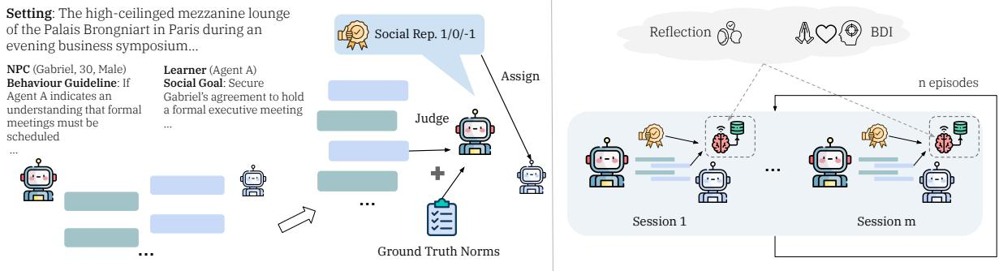  
Figure 1: Overview of the setup. Left: An NPC with an assigned cultural identity interacts with an unassigned Learner agent driven by a social goal. To incentivize learning implicit norms, the goal is granted only when the learner demonstrates associated cultural norms and avoids cultural faux pas. A judge model evaluates the dialogue session and assigns a social reputation score in the end. Right: We evaluate how reasoning and memory mechanisms shape longitudinal learning behaviours and norm assimilation across repeated interaction episodes.

requirements:

• Cultural norms should unfold naturally during the interaction, without explicit teaching or explanation.

• The social goal should not be granted unless the cultural norms are demonstrated during the interaction.

The first requirement is intended to evaluate whether models can infer and adapt to cultural norms implicitly from the social context. The second requirement establishes an environmental incentive for models to adapt (i.e., goal achievement is the behavioural motivation or conversation driver and cultural norm is the gating condition2), thereby providing implicit signals that push the agent to reflect on and adjust its behaviour.3

All scenarios were generated using Gemini-3.7- Flash (Google DeepMind, 2026) with near gender parity (45.25% male vs. 54.75% female). Detailed age distributions are provided in Appendix Table 5, while §3.4 details the scenario quality checks.

Following the existing multi-agent social interaction setup (Zhou et al., 2024, inter alia), we formalize each social scenario as a structured dyadic environment:

$$
S = \langle \mathcal { E } , \mathrm { N P C } , \mathcal { A } \rangle ,\tag{1}
$$

2Note that the environmental incentive is unidirectional. Cultural norms violation blocks the social goal, but cultural norms compliance does not necessarily guarantee the goal achievement.

3We acknowledge that social interactions can be formulated beyond using social goals as a driving motivation. While our work establishes a foundational starting point, future work could extend this paradigm to other open-ended, non-goaldirected interactions and diverse social contexts.

E denotes the global sessional environment and contextual setting (details in §3.2), NPC represents the non-player character specification, and A denotes the learner agent. For each interaction session, the environment provides the overarching social setting and contextual constraints.

NPC Agent (NPC). The NPC is fully instantiated with a structured profile:

$$
{ \mathrm { N P C } } = \langle { \mathrm { n a m e , g e n d e r , r e l } } ( { \mathcal { A } } ) , { \mathrm { b a c k g r o u n d } } , { \mathcal { L } } \rangle ,\tag{2}
$$

where name is sampled to be culturally consistent with the setting, gender and background provide persona variation, and rel(A) explicitly defines the social relationship and power dynamic relative to the learner agent A. The NPC is additionally conditioned on a set of scenario-specific behavioural guidelines L, while the ground-truth cultural norms N remain available during the interaction.

Learner Agent (A). To remove persona-induced priors, the evaluated model A is not conditioned on a predefined persona. Instead, A is conditioned strictly on its social goal G, requiring the model to uphold contextual norms through dialogue and action within each social interaction.

Table 7 in the appendix provides an example scenario.

## 3.2 Interaction Formalism

We model the multi-session environment as a sequence of discrete interaction sessions $\mathcal { E } _ { 1 } , \mathcal { E } _ { 2 } , \ldots , \mathcal { E } _ { T }$ , where each session $\mathcal { E } _ { t }$ is instantiated with a contextual tuple $\left( c _ { t } , s _ { t } , g _ { t } , b _ { t } \right)$ . Here, $c _ { t } \in \mathcal { C }$ is the target cultural group (e.g., Japanese), $s _ { t } \in S$ is the social setting (e.g., formal business dinner or tea house), $g _ { t } \in \mathcal G$ is the social goal of A, and $b _ { t } \in B$ denotes the other persona and relationship profile of the NPC.

Two agents generate a K-turn trajectory per session $\begin{array} { r c l } { \displaystyle \mathcal { E } _ { t } \colon \tau _ { t } ~ = } & { \big ( ( u _ { t , k } , v _ { t , k } ) \big ) _ { k = 1 } ^ { K } } \end{array}$ , with utterances sampled as $u _ { t , k } \sim \pi _ { \mathcal { A } } ( \cdot \ | \ \mathcal { H } _ { t , k } , \mathcal { M } _ { t } )$ and $v _ { t , k } \sim \pi _ { \mathrm { N P C } } ( \cdot \mid \mathcal { H } _ { t , k } )$ given history $\mathcal { H } _ { t , k }$ and optional memory content $\mathcal { M } _ { t }$

## 3.3 Metric

Because our primary focus is norm assimilation rather than social task competence, we evaluate agents strictly on their adherence to social norms. Social goals serve merely as an elicitation scaffold to motivate agent interaction (§3.1). Furthermore, because goal attainment can be confounded by non-normative factors (e.g., model persuasion, task complexity, and norm compliance is a necessary but not sufficient condition for goal success), it is neither factored into our evaluation metrics nor used as explicit feedback.

Instead, upon session termination, an LLM judge evaluates the interaction history for cultural-norm alignment to assign a social reputation score, which is used as the signal for learning in our experiment. Social Reputation Score. An LLM judge evaluates A’s behaviour against cultural norms required for the scenario, producing a rationale and scalar reputation update $r _ { t } \in \{ - 1 , 0 , 1 \}$ at each session t. A score of 1 indicates that the model complied with the social norm in this scenario.

## 3.4 Scenarios Quality Control

All source norms for scenario construction are acquired from humans from existing resources (Ye et al. 2026; Mosaica 2026), making additional validation unnecessary. To validate the synthetic scenarios, we sampled 100 items (20 per culture, ∼10% of all scenarios) and recruited in-culture evaluators via Prolific to assess scenario acceptability and screen for cultural stereotyping (instructions in Appendix B). Overall, 96% of the sampled items were rated as culturally acceptable and plausible, and 90% were judged free of stereotyping, with the few flagged cases concentrated primarily in depictions of Japanese female roles. While eliminating biases is essential, this strong baseline confirms that the benchmark provides a reliable testbed for analyzing core norm-assimilation mechanisms. We treat the targeted improvement of scenario generation as an important priority for future work.

## 4 Evaluated Methods and Mechanisms

We evaluate one non-memory (§4.1) and two memory-based methods (§4.2), with full prompts in Appendix A and pseudocode in Algorithm 1.

## 4.1 Situational Reasoning

Situational Reasoning (SR) is a prompting method in the style of Chain-of-Thought (Wei et al., 2022) that encourages explicit, step-by-step reasoning about the interaction, including $\mathcal { A } \mathrm { { s } }$ own goals, the situational context, and applicable cultural norms. This approach is applied at every turn and conditions on the current state of the dialogue, which emphasizes short-term social reasoning and rapid adaptation over immediate horizons.

## 4.2 Memory-based Mechanisms

To enable a learner agent (A) to progressively infer and consolidate tacit cultural norms across sequential cross-cultural social interactions, we utilize external memory rather than weight-based methods. Acquiring implicit cultural norms requires updating hypotheses from discrete encounters without degrading models’ core capabilities. External memory enables this test-time adaptation from single interactions, bypassing the catastrophic forgetting, functional interference, and computational overhead of gradient-based tuning. Here, we evaluate two cognitively inspired memory-based mechanisms with distinct update speeds. We detail the dual-tier cultural memory architecture and its implementation in §4.2.1 and §4.2.2.

Dual-Tier Adaptive Cultural Memory. Following existing external memory architectures (Park et al., 2023; Zhang et al., 2025; Suzgun et al., 2026), we formulate a dual-tier memory system comprising session-wise Short-Term Memory (STM) and a cross-session Long-Term Memory (LTM), described below:

Short-Term Memory (STM). The STM operates as an episodic dialogue buffer recording the active turn-by-turn trajectory $\mathcal { H } _ { t , k } = [ u _ { t , 1 } , v _ { t , 1 } , \dots , u _ { t , k - 1 } , v _ { t , k - 1 } ]$ . The STM buffer is reset at the termination of $\mathcal { E } _ { t }$ and serialized for post-hoc reflection and logging if required.

Long-Term Memory (LTM). LTM is used when normative information (i.e., cultural norms or beliefs) is available. The memory is accessed via simple retrieval and update mechanisms, and retrieved normative information is incorporated into the system prompt. The frequency of memory updates depends on the specific implementation details, which we will describe in the following sections. For clean experimental control, we exclude memory deletion and compression from the scope of the work.

## 4.2.1 BDI Memory

Grounded in the Belief-Desire-Intention (BDI) framework (Georgeff et al., 1999) and adapted from Dai et al. (2026), this mechanism $( \mathrm { M e m o r y _ { B D I } } )$ instructs the agent A at each turn to infer the NPC’s BDI state from the conversation history, dynamically create or update its memory records, and then generate an utterance. A tracks intentions in shortterm memory throughout the interaction (as they are typically interaction-specific) and optionally stores associated beliefs and desires in long-term memory at each turn. During inference on a new interaction, the agent retrieves the top-n most similar past interactions and their associated belief and desires to use as part of the system prompt. Drawing on BDI accounts of norms (Criado et al., 2010), we treat beliefs and desires as functional proxies for underlying norms, anchoring agent behaviour in them to foster alignment with recurring implicit cultural norms.

## 4.2.2 Reflective Memory

A memory mechanism (Memory ; inspired by Suzgun et al. 2026) that allows the model to retain and retrieve relevant cultural norms summarized from previous interactions.

At the end of each interaction session, the learner agent A performs inductive normative reasoning conditioned on the full transcript $\tau _ { t } .$ , the situational context $\mathbf { x } _ { t } ,$ , and the change in social reputation score $\Delta r _ { t } \colon \mathcal { N } _ { t } = \mathcal { R } _ { \mathrm { n o r m } } ( \tau _ { t } , { \bf x } _ { t } , \Delta r _ { t } ) \ =$ $\{ n _ { t , 1 } , n _ { t , 2 } , . . . , n _ { t , M } \}$ , where each $n _ { t , m }$ represents an abstract, portable behavioural norm $( \mathrm { e . g . } , \mathrm { \it ~ \ " } A l \mathrm { - \it ~ \Omega }$ ways present business cards with both hands and review them attentively before storing.”).

The extracted norms are stored in LTM alongside the interaction setting, updating the setting’s associated cultural norms. Given a new interaction, the top-n sets of cultural norms are retrieved to guide session behaviours as part of the system prompt. MemoryR has a slower adaptation at the session level compared to MemoryBDI and SR.

## 5 Experimental Setup

Models. Although the mechanisms evaluated in our paper are model-agnostic and can, in principle, be integrated into LLMs of any scale, we focus our evaluation on small open-source learner models (2–8B parameter range) because they strike a balance between real-world utility and computational efficiency (Belcak et al., 2025; Miranda et al., 2026), leaving the exploration of larger learner agents to future work. We examine six instructiontuned LLMs across three model families. For the NPC agent, we select a larger model due to its superior reasoning, role-playing, and instructionfollowing capabilities. For efficiency, the same NPC model serves as the evaluation judge; when acting as a judge, the model retains no information regarding the NPC agent.

We use instruction-tuned models to avoid confounding poor instruction-following ability with a failure to adapt: Qwen3-4B/8B (Yang et al. 2025), Llama-3.2-3B/Llama-3.1-8B (Grattafiori et al., 2024, referred as Llama3-3B/Llama3-8B in the paper), and Gemma4-E2B/Gemma4-E4B (Team, 2026). We select Gemma4-31B as the NPC model due to its superior instruction-following capabilities. While we also evaluated Qwen3-32B as an NPC, it underperformed relative to Gemma4- 31B in our setting (detailed results in §5.1); hence, we retained Gemma4-31B. We disable thinking across all learner models where available, to maintain a fair comparison (e.g., Llama3 models are non-reasoning models) and to isolate the effects of reasoning prompts, memory, and the reflection mechanism. Our main experimental results are averaged over three runs with statistical testing. Models are accessed via Hugging Face Transformers (Wolf et al., 2020).

Methods and Mechanisms. We evaluate all the methods and mechanisms outlined in $\ S 4$ , as well as the default base models. For efficiency, retrievals for both Memory and Memory are precomputed. The session contexts are embedded into a dense semantic space via Gemini Embedding-2 (Shanbhogue et al., 2026). For every interaction, both methods retrieve norms from the top-n most similar sessions via cosine similarity above a set threshold.

Hyperparameters. Main experimental results are averaged across three runs and supported by statistical tests. For standard repeated interactions, we evaluate 50 three-episode scenarios (sessions) per culture, withholding the remaining scenarios for generalization experiments as unseen scenarios (§6.4). The order of the scenarios is randomized at the beginning of each episode. For experiments with a memory, results are further averaged over episodes 2 and 3 (due to longitudinal learning), and with top-2 retrieval (with the first one always being the same scenario). The social reputation ([−1, 1]) scores are tracked and averaged over the scenarios in each episode.

We set the maximum interaction turns to 4, since prior work has shown that LLM persona consistency degrades over extended role-play (Li et al., 2024b; Laban et al., 2026). The decoding temperature is set to 0.7 for learner models (A), 0.4 for the NPC model during interactions (maintaining low output diversity without pure determinism to ensure consistency across repeated interactions), and 0 when the NPC model functions as a judge.

## 5.1 Experimental Setup Validation

To validate the reliability of our simulated environment prior to full-scale evaluation, we compared two candidate NPC/Judge models (Gemma4-31B and Qwen3-32B) on their judging quality and instruction adherence. We tested both candidates across two environments by pairing them with a representative learner agent from each model family (Qwen3-8B, Llama3-8B, and Gemma4-E4B) using methods outlined in §5.

We first sampled 60 interactions per environment (120 in total), stratified by learner model. Overall, 62.5% were judged as having positive social reputation by models. We evaluated the judgment accuracy of social norm adherence (i.e., social reputation score). Sampled scenarios were independently verified by two human evaluators (marked as wrong judgment if either evaluator considered it wrong). In the Gemma NPC environment, human evaluators accepted 91.67% of social-norm judgments across 60 sampled interactions. For the Qwen NPC environment, these rates were 73.3%. Overall, human verification results indicate that the Gemma4-31B NPC yield more reliable outcomes than the Qwen NPC, justifying its selection for subsequent experiments.

Additionally, we evaluated NPC norm leakage using GPT-6-Luna (OpenAI, 2026) across 60 sampled positive-reputation interactions with Gemma NPCs, which revealed a low dialogue leakage in 8.3% of cases.

## 6 Results and Analysis

## 6.1 Main Results

Table 1 shows models’ social reputations during the interactions. Across the evaluated mechanisms, situational reasoning (SR) shows only inconsistent gains in social reputation. Furthermore, Memory often improves performance but fails to generalize across model families (e.g., Llama 3 models). In contrast, MemoryR is the most effective mechanism, consistently achieving the highest social reputation scores across all models over the default baselines (with a considerable gain of +0.21 on Gemma4-E4B, where social reputation is measured on a scale of [−1, 1]). Among all evaluated models, Gemma4-E4B demonstrates the best overall performance in retaining a positive social reputation, whereas Llama models maintain a negative social reputation on average with almost all mechanisms. In general, larger models within the same family outperform their smaller counterparts (also confirmed by a Qwen3-32B experiment in Table F, Appendix). This is likely because larger models possess stronger baseline knowledge and capabilities, and are better at norms utilization (as also supported by our analysis in Figure 3).

Furthermore, across all models and methods, performance was highest for New Zealand culture, whereas Chinese and Japanese cultures consistently received the lowest social reputation scores. Such consistent patterns suggest that the observed differences could reflect biases embedded in the models training data or underlying representations of different cultures, which may affect social tasks such as collaboration and negotiation, warranting investigation in future work.

Individual statistical analyses comparing SR, MemoryBDI, and MemoryR with the default reveal that MemoryR has a statistically significant advantage over the default for all models $( p = 0 . 0 0 2 0$ for Llama3-3B, and $p = 0 . 0 0 0 0$ for all other models). $\mathbf { M e m o r y _ { B D I } }$ also shows a statistically significant advantage over the default, except for the Llama3 models on social reputation scores.

## 6.2 Longitudinal Improvement

Between the two memory mechanisms, MemoryR demonstrates more consistent longitudinal improvement than MemoryBDI.

Figure 2 shows the distribution of social reputation scores across three episodes under Memory . Across all models, positive scores generally increase by Episode 2. However, a third episode does not consistently yield further improvements, though performance remains above baseline. This pattern likely reflects the models’ sensitivity to prompts, leading to norm revisions that are less conducive to maintaining a positive reputation.

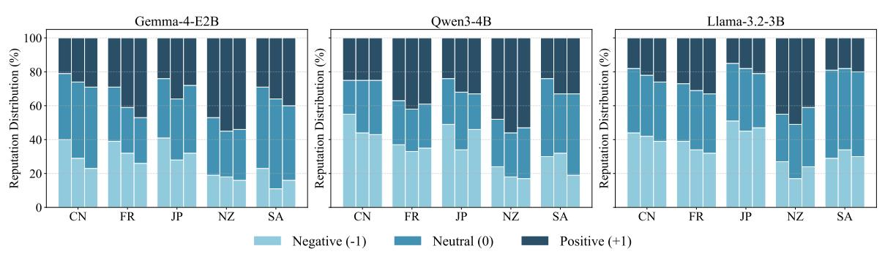

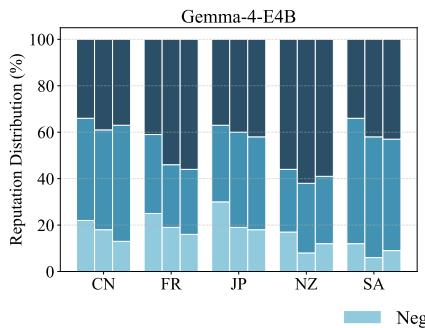

<table><tr><td rowspan=1 colspan=7>Model                       CN           FR           JP           NZ           SA      Avg.</td></tr><tr><td rowspan=1 colspan=2>Gemma4-E4B            $0 . 0 1 \pm 0 . 0 4$ </td><td rowspan=1 colspan=4> $0 . 2 2 \pm 0 . 1 3$     $- 0 . 0 5 \pm 0 . 0 1$    $0 . 3 3 \pm 0 . 0 8$     $0 . 1 5 \pm 0 . 0 2$ </td><td rowspan=1 colspan=1>0.13</td></tr><tr><td rowspan=1 colspan=1>Gemma4-E4B SR</td><td rowspan=1 colspan=1> $0 . 0 0 \pm 0 . 0 6$ </td><td rowspan=1 colspan=2> $0 . 0 6 \pm 0 . 0 3$     $- 0 . 0 6 \pm 0 . 0 4$ </td><td rowspan=1 colspan=1> $0 . 4 2 \pm 0 . 0 3$ </td><td rowspan=1 colspan=1> $0 . 2 5 \pm 0 . 0 3$ </td><td rowspan=1 colspan=1>0.13</td></tr><tr><td rowspan=1 colspan=1>Gemma4-E4B3 MemoryBDI</td><td rowspan=1 colspan=1> $0 . 0 4 \pm 0 . 0 5$ </td><td rowspan=1 colspan=2> $0 . 3 6 \pm 0 . 0 2$     $0 . 1 0 \pm 0 . 0 5$ </td><td rowspan=1 colspan=1> $0 . 5 3 \pm 0 . 0 5$ </td><td rowspan=1 colspan=1> $0 . 2 3 \pm 0 . 0 3$ </td><td rowspan=1 colspan=1>0.25*</td></tr><tr><td rowspan=1 colspan=2>Gemma4-E4B MemoryR     $0 . 2 3 \pm 0 . 0 4$ </td><td rowspan=1 colspan=5> $0 . 3 8 \pm 0 . 0 2$    $0 . 2 3 \pm 0 . 0 6$    $0 . 5 1 \pm 0 . 1 2$     $0 . 3 5 \pm 0 . 0 4$   0.34*</td></tr><tr><td rowspan=1 colspan=2>Qwen3-8B                $- 0 . 4 7 \pm 0 . 0 3$ </td><td rowspan=1 colspan=5> $- 0 . 2 4 \pm 0 . 0 2$    $- 0 . 2 7 \pm 0 . 0 6$    $0 . 2 1 \pm 0 . 0 5$    $- 0 . 1 1 \pm 0 . 1 0$   -0.17</td></tr><tr><td rowspan=1 colspan=1>Qwen3-8B SR</td><td rowspan=1 colspan=1> $- 0 . 2 3 \pm 0 . 0 2$ </td><td rowspan=1 colspan=2> $- 0 . 1 1 \pm 0 . 0 7$    $- 0 . 0 8 \pm 0 . 0 0$ </td><td rowspan=1 colspan=1> $0 . 2 7 \pm 0 . 0 6$ </td><td rowspan=1 colspan=1> $- 0 . 0 6 \pm 0 . 0 3$ </td><td rowspan=1 colspan=1>-0.04*</td></tr><tr><td rowspan=2 colspan=2>Qwen3-8B MemoryBDIQwen3-8B MemoryR        $- 0 . 1 0 \pm 0 . 0 3$ </td><td rowspan=1 colspan=1>-0.17 ±0.05</td><td rowspan=1 colspan=2> $- 0 . 0 3 \pm 0 . 0 3$    $- 0 . 1 8 \pm 0 . 0 4$ </td><td rowspan=1 colspan=1> $0 . 3 0 \pm 0 . 0 4$ </td><td rowspan=1 colspan=1> $0 . 0 7 \pm 0 . 0 5$ </td></tr><tr><td rowspan=1 colspan=2> $0 . 0 3 \pm 0 . 0 2$    $- 0 . 1 2 \pm 0 . 0 1$ </td><td rowspan=1 colspan=1> $0 . 2 4 \pm 0 . 0 3$ </td><td rowspan=1 colspan=1> $0 . 0 1 \pm 0 . 1 3$ </td><td rowspan=1 colspan=1>0.01*</td></tr><tr><td rowspan=1 colspan=1>Llama3-8B</td><td rowspan=1 colspan=1> $- 0 . 2 9 \pm 0 . 1 0$ </td><td rowspan=1 colspan=1> $- 0 . 1 3 \pm 0 . 0 8$ </td><td rowspan=1 colspan=1> $- 0 . 2 7 \pm 0 . 0 9$ </td><td rowspan=1 colspan=1> $0 . 1 8 \pm 0 . 0 2$ </td><td rowspan=1 colspan=2> $- 0 . 1 5 \pm 0 . 1 5$   -0.13</td></tr><tr><td rowspan=1 colspan=1>Llama3-8B SR</td><td rowspan=1 colspan=1> $- 0 . 3 1 \pm 0 . 0 3$ </td><td rowspan=1 colspan=1> $- 0 . 0 5 \pm 0 . 0 2$ </td><td rowspan=1 colspan=1> $- 0 . 2 6 \pm 0 . 1 0$ </td><td rowspan=1 colspan=1> $0 . 1 4 \pm 0 . 0 4$ </td><td rowspan=1 colspan=1> $- 0 . 0 1 \pm 0 . 0 8$ </td><td rowspan=1 colspan=1>-0.10</td></tr><tr><td rowspan=1 colspan=1>Llama3-8B MemoryBDI</td><td rowspan=1 colspan=1> $- 0 . 4 2 \pm 0 . 1 1$ </td><td rowspan=1 colspan=1> $- 0 . 2 3 \pm 0 . 0 6$ </td><td rowspan=1 colspan=1> $- 0 . 3 5 \pm 0 . 0 6$ </td><td rowspan=1 colspan=1> $- 0 . 0 3 \pm 0 . 0 2$ </td><td rowspan=1 colspan=1> $- 0 . 1 0 \pm 0 . 0 2$ </td><td rowspan=1 colspan=1>-0.23</td></tr><tr><td rowspan=1 colspan=1>Llama3-8B MemoryR</td><td rowspan=1 colspan=1> $- 0 . 2 1 \pm 0 . 1 0$ </td><td rowspan=1 colspan=1> $0 . 0 7 \pm 0 . 0 8$ </td><td rowspan=1 colspan=1> $- 0 . 1 8 \pm 0 . 0 5$ </td><td rowspan=1 colspan=1> $0 . 1 7 \pm 0 . 0 1$ </td><td rowspan=1 colspan=1> $0 . 0 1 \pm 0 . 0 3$ </td><td rowspan=1 colspan=1>-0.03*</td></tr><tr><td rowspan=2 colspan=1>Gemma4-E2BGemma4-E2B SR</td><td rowspan=1 colspan=1> $- 0 . 2 5 \pm 0 . 0 3$ </td><td rowspan=1 colspan=1> $0 . 0 1 \pm 0 . 1 6$ </td><td rowspan=1 colspan=1> $- 0 . 2 8 \pm 0 . 1 0$ </td><td rowspan=1 colspan=1> $0 . 2 7 \pm 0 . 0 5$ </td><td rowspan=1 colspan=1> $- 0 . 0 4 \pm 0 . 0 0$ </td><td rowspan=1 colspan=1>-0.06</td></tr><tr><td rowspan=1 colspan=1> $- 0 . 3 5 \pm 0 . 0 1$ </td><td rowspan=1 colspan=1> $- 0 . 1 1 \pm 0 . 0 3$ </td><td rowspan=1 colspan=1> $- 0 . 2 9 \pm 0 . 0 5$ </td><td rowspan=1 colspan=1> $0 . 1 5 \pm 0 . 1 1$ </td><td rowspan=1 colspan=1> $- 0 . 0 5 \pm 0 . 1 1$ </td><td rowspan=1 colspan=1>-0.13</td></tr><tr><td rowspan=1 colspan=1>Gemma4-E2B MemoryBDI</td><td rowspan=1 colspan=1> $- 0 . 2 7 \pm 0 . 0 1$ </td><td rowspan=1 colspan=1> $- 0 . 0 9 \pm 0 . 1 0$ </td><td rowspan=1 colspan=1> $- 0 . 2 8 \pm 0 . 0 7$ </td><td rowspan=1 colspan=1> $0 . 4 1 \pm 0 . 0 9$ </td><td rowspan=1 colspan=1> $0 . 1 4 \pm 0 . 0 6$ </td><td rowspan=1 colspan=1>-0.02</td></tr><tr><td rowspan=1 colspan=1>Gemma4-E2BMemoryR</td><td rowspan=1 colspan=1> $0 . 0 2 \pm 0 . 0 8$ </td><td rowspan=1 colspan=1> $0 . 1 5 \pm 0 . 1 3$ </td><td rowspan=1 colspan=1> $0 . 0 2 \pm 0 . 0 0$ </td><td rowspan=1 colspan=1> $0 . 3 8 \pm 0 . 1 6$ </td><td rowspan=1 colspan=1> $0 . 2 4 \pm 0 . 0 4$ </td><td rowspan=1 colspan=1>0.16*</td></tr><tr><td rowspan=1 colspan=1>Qwen3-4B</td><td rowspan=1 colspan=1> $- 0 . 2 6 \pm 0 . 0 3$ </td><td rowspan=1 colspan=1> $- 0 . 1 9 \pm 0 . 0 7$ </td><td rowspan=1 colspan=1> $- 0 . 2 1 \pm 0 . 0 9$ </td><td rowspan=1 colspan=1> $0 . 4 0 \pm 0 . 0 3$ </td><td rowspan=1 colspan=1> $- 0 . 1 1 \pm 0 . 1 1$ </td><td rowspan=1 colspan=1>-0.07</td></tr><tr><td rowspan=1 colspan=1>Qwen3-4B SR</td><td rowspan=1 colspan=1> $- 0 . 2 8 \pm 0 . 0 5$ </td><td rowspan=1 colspan=1> $- 0 . 1 7 \pm 0 . 0 2$ </td><td rowspan=1 colspan=1> $- 0 . 1 8 \pm 0 . 0 3$ </td><td rowspan=1 colspan=1> $0 . 2 7 \pm 0 . 0 9$ </td><td rowspan=1 colspan=1> $0 . 1 9 \pm 0 . 0 5$ </td><td rowspan=1 colspan=1>-0.03</td></tr><tr><td rowspan=2 colspan=1>Qwen3-4B MemoryBDIQwen3-4B MemoryR</td><td rowspan=1 colspan=1> $- 0 . 2 3 \pm 0 . 0 6$ </td><td rowspan=1 colspan=1> $- 0 . 0 1 \pm 0 . 0 5$ </td><td rowspan=1 colspan=1> $- 0 . 1 9 \pm 0 . 0 3$ </td><td rowspan=1 colspan=1> $0 . 3 7 \pm 0 . 0 0$ </td><td rowspan=1 colspan=1> $0 . 0 6 \pm 0 . 0 4$ </td><td rowspan=1 colspan=1>-0.00*</td></tr><tr><td rowspan=1 colspan=1> $- 0 . 1 8 \pm 0 . 0 4$ </td><td rowspan=1 colspan=1> $0 . 0 7 \pm 0 . 0 4$ </td><td rowspan=1 colspan=1> $- 0 . 0 7 \pm 0 . 0 8$ </td><td rowspan=1 colspan=1> $0 . 3 7 \pm 0 . 0 3$ </td><td rowspan=1 colspan=1> $0 . 0 8 \pm 0 . 0 9$ </td><td rowspan=1 colspan=1>0.05*</td></tr><tr><td rowspan=1 colspan=1>Llama3-3B</td><td rowspan=1 colspan=1> $- 0 . 2 7 \pm 0 . 0 4$ </td><td rowspan=1 colspan=1> $- 0 . 1 5 \pm 0 . 0 3$ </td><td rowspan=1 colspan=1> $- 0 . 3 8 \pm 0 . 0 0$ </td><td rowspan=1 colspan=1> $0 . 1 7 \pm 0 . 1 0$ </td><td rowspan=1 colspan=1> $- 0 . 2 5 \pm 0 . 0 3$ </td><td rowspan=1 colspan=1>-0.18</td></tr><tr><td rowspan=1 colspan=1>Llama3-3B SR</td><td rowspan=1 colspan=1> $- 0 . 2 9 \pm 0 . 0 7$ </td><td rowspan=1 colspan=1> $- 0 . 1 1 \pm 0 . 0 3$ </td><td rowspan=1 colspan=1> $- 0 . 2 8 \pm 0 . 1 1$ </td><td rowspan=1 colspan=1> $0 . 1 3 \pm 0 . 0 2$ </td><td rowspan=1 colspan=1> $- 0 . 0 7 \pm 0 . 0 4$ </td><td rowspan=1 colspan=1>-0.13</td></tr><tr><td rowspan=1 colspan=1>Llama3-3B MemoryBDI</td><td rowspan=1 colspan=1> $- 0 . 3 7 \pm 0 . 0 6$ </td><td rowspan=1 colspan=1> $- 0 . 3 0 \pm 0 . 0 5$ </td><td rowspan=1 colspan=1> $- 0 . 3 8 \pm 0 . 0 4$ </td><td rowspan=1 colspan=1> $- 0 . 0 3 \pm 0 . 0 3$ </td><td rowspan=1 colspan=1> $- 0 . 0 9 \pm 0 . 0 7$ </td><td rowspan=1 colspan=1>-0.23</td></tr><tr><td rowspan=1 colspan=1>Llama3-3B MemoryR</td><td rowspan=1 colspan=1> $- 0 . 1 6 \pm 0 . 1 1$ </td><td rowspan=1 colspan=1> $- 0 . 0 1 \pm 0 . 2 0$ </td><td rowspan=1 colspan=1> $- 0 . 2 7 \pm 0 . 1 6$ </td><td rowspan=1 colspan=1> $0 . 2 6 \pm 0 . 1 1$ </td><td rowspan=1 colspan=1> $- 0 . 1 3 \pm 0 . 1 3$ </td><td rowspan=1 colspan=1>-0.06*</td></tr></table>

Table 1: Model performance across cultures: China (CN), France (FR), Japan (JP), New Zealand (NZ), and Saudi Arabia (SA). Social Reputation $\in [ - 1 . 0 , 1 . 0 ]$ : episode-averaged score measuring adherence to cultural norms (−1.0 indicates any violations or cultural faux pas). ∗: a statistically significant improvement over the default $( p < 0 . 0 5 )$  
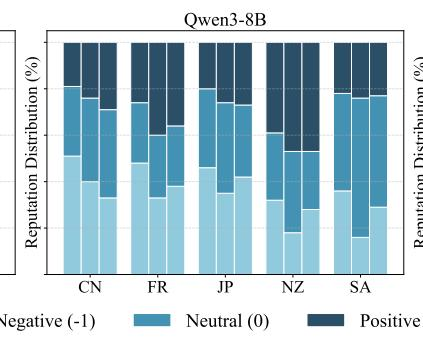

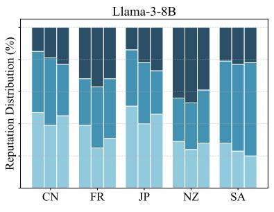  
Figure 2: Distribution of social reputation judgments under $\mathrm { M e m o r y _ { R } }$ across models and cultures for Englishlanguage interactions. For each cultural group, the three bars (left to right) represent sequential repeated interaction episodes. Stacked segments denote the proportion of scenarios judged as Positive (+1; norm-aligning), Neutral (0; partially adhering), or Negative (-1; norm-violating). China (CN), France (FR), Japan (JP), New Zealand (NZ), and Saudi Arabia (SA).

A statistical analysis also confirms that Memor $\mathrm { y } _ { \mathrm { R } }$ yields statistically significant longitudinal gains (Table 2). Specifically, larger models exhibit significant within-encounter improvements (Post − Ep.1, where Post is the averaged result between episode 2 and 3.) under $\mathrm { M e m o r y } _ { \mathrm { R } }$ for Gemma4-E4B $( \Delta = + 0 . 1 5 , p < 0 . 0 0 0 1 )$ , Qwen3- 8B $( \Delta = + 0 . 1 8 , p < 0 . 0 0 0 1 )$ , and Llama3-8B $( \Delta = + 0 . 1 1 , p = 0 . 0 0 0 7 )$ . Smaller models follow a similar pattern, showing significant gains for Gemma4-E2B $( \Delta = + 0 . 1 8 , p < 0 . 0 0 0 1 )$ , Qwen3- 4B $( \Delta = + 0 . 1 2 , p = 0 . 0 0 0 2 )$ , and Llama3-3B $( \Delta = + 0 . 0 7 , p = 0 . 0 0 9 4 )$ . When evaluated using a linear mixed model (LMM), Gemma4-E4B $( \beta =$ $+ 0 . 1 0 , p = 0 . 0 0 1 6 )$ , Qwen3-8B $( \beta = + 0 . 0 8 , p =$ 0.0161), Llama3-8B $( \beta = + 0 . 0 7 , p = 0 . 0 2 2 0 )$ and Llama3-3B $( \beta = + 0 . 0 6 , p = 0 . 0 2 0 9 )$ also demonstrate significant positive longitudinal trajectories under Memory .

In contrast, despite higher episode 1 performance across all Gemma and Qwen models (Table 1), $\mathbf { M e m o r y } _ { \mathrm { B D I } }$ yields significant longitudinal learning only in Qwen3-4B $( p = 0 . 0 0 9 9 )$ . This trade-off between initial performance and longitudinal gain is expected, as $\mathbf { M e m o r y } _ { \mathrm { B D I } }$ adapts at each turn while Memory consolidates norms postsession. Although both receive social reputation scores, $\mathrm { M e m o r y } _ { \mathrm { R } }$ uses it as an implicit signal to revise norms, whereas $\mathbf { M e m o r y } _ { \mathrm { B D I } }$ likely relies more on turn-level interaction.

These results show that while memory facilitates cultural norm assimilation in general, frequent updates $( \mathrm { M e m o r y _ { B D I } } )$ of normative information offer no advantage, likely due to amplifying local noise.

## 6.3 Inferred Norms versus Ground Truth

While models exhibit statistically significant improvement, how closely the recovered cultural norms match the ground truth remains unknown. In this section, we compare norms inferred by $\mathrm { M e m o r y } _ { \mathrm { R } }$ to ground-truth norms across each culture and setting.

Figure 3 shows the embedding similarities between the inferred and summarized norms and the ground-truth norms. Overall, all models except Llama-3.2-3B exhibit higher similarity to the French and Chinese ground-truth norms and lower similarity to the Japanese and New Zealand norms. All norms show non-trivial embedding similarity with respect to the ground truth, substantially exceeding the background baseline from randomly paired norms within culture for that model family. Except for Llama3 models, negligible withinfamily size differences suggest that the performance disparities reflect models’ ability to utilize norms rather than to infer them. This inferenceexecution gap highlights the need to move beyond recall-based evaluation.

<table><tr><td>Model</td><td>Ep.1</td><td>Post</td><td>Pwithin</td><td>β</td><td>pβ</td></tr><tr><td>Gemma4-E4B</td><td></td><td></td><td></td><td></td><td></td></tr><tr><td>MemoryBDI</td><td>+0.22</td><td>+0.25</td><td>0.1380</td><td>+0.05</td><td>0.1260</td></tr><tr><td>MemoryR</td><td>+0.19</td><td>+0.34</td><td> $< 0 . 0 0 0 1 ^ { \ast }$ </td><td>+0.10</td><td>0.0016*</td></tr><tr><td>Qwen3-8B</td><td></td><td></td><td></td><td></td><td></td></tr><tr><td>MemoryBDI</td><td>-0.01</td><td>-0.00</td><td>0.3838</td><td>+0.01</td><td>0.7241</td></tr><tr><td>MemoryR</td><td>-0.17</td><td>+0.01</td><td>&lt; 0.0001*</td><td>+0.08</td><td>0.0161*</td></tr><tr><td>Llama3-8B</td><td></td><td></td><td></td><td></td><td></td></tr><tr><td>MemoryBDI</td><td>-0.24</td><td>-0.23</td><td>0.2580</td><td>+0.04</td><td>0.1804</td></tr><tr><td>MemoryR</td><td>-0.14</td><td>-0.03</td><td>0.0007*</td><td>+0.07</td><td>0.0220*</td></tr><tr><td>Gemma4-E2B</td><td></td><td></td><td></td><td></td><td></td></tr><tr><td>MemoryBDI</td><td>-0.01</td><td>-0.01</td><td>0.6119</td><td>-0.04</td><td>0.2139</td></tr><tr><td>MemoryR</td><td>-0.02</td><td>+0.16</td><td>&lt; 0.0001*</td><td>+0.06</td><td>0.0688</td></tr><tr><td>Qwen3-4B</td><td></td><td></td><td></td><td></td><td></td></tr><tr><td>MemoryBDI</td><td>-0.06</td><td>0.00</td><td>0.0099*</td><td>+0.02</td><td>0.4105</td></tr><tr><td>MemoryR</td><td>-0.07</td><td>+0.05</td><td>0.0002*</td><td>+0.05</td><td>0.0853</td></tr><tr><td>Llama3-3B</td><td></td><td></td><td></td><td></td><td></td></tr><tr><td>MemoryBDI</td><td>-0.24</td><td>-0.23</td><td>0.3455</td><td>+0.03</td><td>0.2675</td></tr><tr><td> $\mathbf { M e m o r y } _ { \mathrm { R } } ^ { - }$ </td><td>-0.13</td><td>-0.06</td><td>0.0094*</td><td>+0.06</td><td>0.0209*</td></tr></table>

Table 2: Longitudinal social reputation performance across interaction episodes. Evaluated across $N = 2 5 0$ paired scenario encounters across all cultures. Ep.1: Episode 1. Post: average performance of Ep.2 and Ep.3. $\beta \colon$ the fixed-effect longitudinal trajectory slope from a linear mixed model (LMM), with significance $p _ { \beta } .$ ∗ indicates statistically significant $( p < 0 . 0 5 )$

Table 4 (appendix) provides qualitative examples of Gemma4-E4B’s norm outputs.

## 6.4 Generalization to Different Scenarios

Using the norms inferred under $\mathrm { M e m o r y _ { R } }$ for each culture of Gemma4-E4B and Qwen3-8B (two most improved models), we evaluate the models on heldout scenarios to test their generalized behaviour (without repeated interactions). The gains in social reputation compared with using the corresponding default models are shown in Figure 4.

Overall, compared to the default, Memor $I _ { \mathrm { R } }$ improves social reputation by 0.12 points and 0.06 points for Gemma4-E4B and Qwen3-8B, respectively. Notably, both models consistently improved performance across cultures, except for Saudi Arabia in Qwen3-8B. Both models demonstrated clear generalization to settings in Japan, China and New

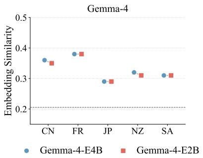

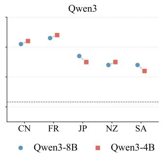

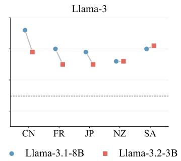  
Figure 3: Embedding similarity between inferred norms and ground truth across models and cultures under $\mathbf { M e m o r y } _ { \mathrm { R } } .$ . The dashed line indicates the background embedding similarity for randomly paired norms for that model family.

Zealand. However, while Gemma4-E4B showed improvements for Saudi Arabia, this was not observed in Qwen3-8B, indicating that generalization still depends on the base model and culture.

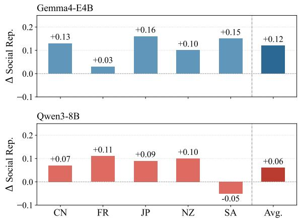  
Figure 4: Change in social reputation scores on unseen scenarios using norms inferred from repeated interactions $( { \mathrm { M e m o r y } } _ { \mathrm { R } } )$ relative to the default.

## 6.5 Multilingual Experiment

In the multilingual experiment, we instructed the model to simulate social interactions in the primary language associated with the evaluated cultures (excluding New Zealand) with Gemma4-E4B and Qwen3-8B. The social setting, behavioural instructions, judge and norm-summarization prompts were all maintained in English due to the models superior English-language capabilities.

Table 3 presents the results for both the baseline model and $\mathrm { M e m o r y } _ { \mathrm { R } }$ . Consistent with previous English-language results, $\mathrm { M e m o r y _ { R } }$ leads to higher averaged social reputation scores across cultures. Across languages, Gemma4-E4B achieves higher performance in Arabic and French, while Qwen3- 8B performs better specifically in French.

<table><tr><td>Model</td><td>CN</td><td>FR</td><td>JP</td><td>SA</td><td>Avg.</td></tr><tr><td>Gemma4-E4B</td><td>-0.06</td><td>0.21</td><td>0.07</td><td>0.25</td><td>0.12</td></tr><tr><td>Gemma4-E4B  $\mathbf { M e m o r y } _ { \mathrm { R } }$ </td><td>0.23</td><td>0.34</td><td>0.20</td><td>0.54</td><td>0.33</td></tr><tr><td>Qwen3-8B</td><td>-0.21</td><td>-0.05</td><td>-0.14</td><td>-0.18</td><td>-0.15</td></tr><tr><td>Qwen3-8B  $\mathbf { M e m o r y } _ { \mathrm { R } }$ </td><td>-0.06</td><td>-0.04</td><td>-0.07</td><td>-0.07</td><td>-0.06</td></tr></table>

Table 3: Averaged multilingual performance (social reputation score, $\mathrm { M e m o r y _ { R } ) }$ across four cultures: China (CN), France (FR), Japan (JP), and Saudi Arabia (SA).

Compared to baseline interactions, Memory demonstrated statistically significant social reputation across episodes with both Gemma4-E4B $( p = 0 . 0 0 0 1 )$ and Qwen3-8B $( p = 0 . 0 3 1 1 )$ compared to the default. While longitudinal learning is observed, LMM per-episode slopes were not significant (Gemma: $\beta = + 0 . 0 7$ pts/ep, $p = 0 . 0 5 9 1$ Qwen: $\beta ~ = ~ + 0 . 0 4 ~ \mathrm { p t s / e p }$ $p \ = \ 0 . 3 1 0 9 )$ , such that evidence for a consistent longitudinal trend is marginal for Gemma and absent for Qwen.

Figure 6 (appendix) visualizes the longitudinal results of multilingual experiments.

## 6.6 Generalization to Synthetic Norms

To test whether MemoryR generalizes to counterintuitive, synthetic cultural norms, we conduct a preliminary experiment containing 15 scenarios grounded in hand-revised human norms (manually rewritten into a counterfactual form; see Appendix E for creation details). For example, the original human norm of “Pay respect to seniors in all situations.” was transformed into “Pay respect to children in all situations.” To prevent the model from relying on culture-specific priors, all NPCs use a single generic identifier (Agent 12345) and their cultural identity was set to Unknown.

Overall, Gemma4-E4B under MemoryR consistently outperforms the default setting, achieving a social reputation score of -0.033 (default:

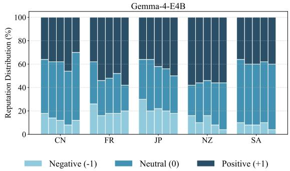  
Figure 5: Distribution of social reputation judgments under Memory for 5 episodes. For each culture, the bars (left to right) represent sequential repeated interaction episodes. Stacked segments denote the proportion of scenarios judged as Positive (+1; norm-aligning), Neutral (0; partially adhering), or Negative (-1; normviolating).

-0.422). We also observe a positive longitudinal learning slope across episodes, although the trend is not statistically significant $( \beta = + 0 . 2 0 \ \mathrm { p t s / e p }$ $p = 0 . 1 4 0 5 )$ . This may stem from the limited number of evaluation scenarios, as well as the inherent difficulty of adapting to counterfactual norms. Nonetheless, these findings suggest that memory augmentation benefits agent behaviour in social contexts, though further work is needed to enhance progressive learning in unfamiliar situations.

## 6.7 Longer Interaction Horizons

We further evaluated Gemma4-E4B with Memory across five episodes in English to assess whether adaptive memory maintains its benefits over longer horizons. The model demonstrates statistically significant longitudinal improvement in social reputation across repeated sequential encounters (Figure 5), improving from an initial mean of +0.21 pts at episode 1 to +0.35 pts by episode 5. This yields a statistically significant longitudinal gain $( \Delta _ { \mathrm { e p . 5 - e p . 1 } } = + 0 . 1 4 \ : \mathrm { p t s } , \ : 9 5 \% \ : \mathrm { C I } \ : [ + 0 . 0 4 , + 0 . 2 4 ]$ $p = 0 . 0 0 2 6 )$ , as well as a sustained post-adaptation horizon gain across episode 2–5 $( \Delta _ { \mathrm { p o s t } }$ $+ 0 . 1 2 \mathrm { p t s } , 9 5 \% \mathbf { C I } \left[ + 0 . 0 4 , + 0 . 2 0 \right] , p \ = \ 0 . 0 0 2 8 )$ Evaluated with a linear mixed-effects trend model, the method exhibits a significant positive learning trajectory $( \beta = + 0 . 0 3 1 \mathrm { p t s } / \mathrm { e p } , p = 0 . 0 1 4 0 )$

These results point to memory mechanisms as a promising way to support the continuous norm assimilation over extended horizons.

## 7 Conclusion

Grounded in human culture and social learning, this work investigated LLMs’ capacity to assimilate implicit cultural norms and sustain culturally congruent behaviours across ongoing social interactions using lightweight memory mechanisms. Using our five-culture social interactive sandbox, we evaluated longitudinal cultural adaptation across six open-source models across languages.

Our results provide three central takeaways. First, we show that augmenting models with external memory enhances adaptive plasticity and generalization, enabling continuous norm assimilation across languages. Second, we find that sessionlevel memory consolidation is more effective than turn-level adaptation, suggesting that how interaction history is consolidated matters for sustained cultural adaptation. Third, we reveal an inferenceexecution gap in smaller models, indicating that norm inference and recognition alone do not guarantee behavioural alignment.

Overall, these results broaden the scope of cultural adaptation beyond knowledge recall and demonstrate the feasibility of interaction-driven cultural adaptation. By showing that cultural norms can be inferred through social interaction driven by environmental incentives, our problem formulation and findings lay the groundwork for future humanand cognitively inspired approaches to continuous cultural adaptation.

## Limitations

In our work, the scenario data was generated using Gemini models, which could introduce a confound where Gemma 4 models achieve higher absolute performance as learner agents due to familiarity with the writing style. Nevertheless, because we evaluated multiple learner model families and found consistent learning patterns, this stylistic familiarity does not compromise our primary objective and conclusions.

In our work, cultural boundaries are drawn at the country level. Because our scenarios are derived from prior human norm datasets, inheriting such scope is necessary, and facilitating easy comparisons. Our analysis remains sufficiently general to support finer-grained divisions, such as regional or subcultural groups, although this is beyond the scope of the current work.

Furthermore, social scenarios can be formulated through mechanisms beyond using using social goals as the motivation. While our work establishes a foundational starting point, future research could extend this paradigm to open-ended, nongoal-directed interactions and diverse social environments.

## Acknowledgement

This work was supported by the UK Research and Innovation (UKRI) Frontier Research Grant EP/Y031350/1 EQUATE and the Isambard AI National AI Research Resource (AIRR).

## References

M. Farid Adilazuarda, Chen Cecilia Liu, Iryna Gurevych, and Alham Fikri Aji. 2025. From surveys to narratives: Rethinking cultural value adaptation in LLMs. In Proceedings of the 2025 Conference on Empirical Methods in Natural Language Processing, pages 18052–18079, Suzhou, China. Association for Computational Linguistics.

Badr AlKhamissi, Muhammad ElNokrashy, Mai Alkhamissi, and Mona Diab. 2024. Investigating cultural alignment of large language models. In Proceedings ofthe 62nd Annual Meeting ofthe Association for Computational Linguistics (Volume 1: Long Papers), pages 12404–12422, Bangkok, Thailand. Association for Computational Linguistics.

Albert Bandura. 1977. Social learning theory, volume 1. Prentice-hall, Englewood Cliffs, NJ.

Peter Belcak, Greg Heinrich, Shizhe Diao, Yonggan Fu, Xin Dong, Saurav Muralidharan, Yingyan Celine Lin, and Pavlo Molchanov. 2025. Small language models are the future of agentic AI. arXiv, abs:2506.02153v3.

John W. Berry. 1997. Immigration, acculturation, and adaptation. Applied Psychology, 46(1):5–34.

Cristina Bicchieri. 2006. The Grammar ofSociety: The Nature and Dynamics of Social Norms. Cambridge University Press.

Yu Ying Chiu, Liwei Jiang, Bill Yuchen Lin, Chan Young Park, Shuyue Stella Li, Sahithya Ravi, Mehar Bhatia, Maria Antoniak, Yulia Tsvetkov, Vered Shwartz, and Yejin Choi. 2025. CulturalBench: A robust, diverse and challenging benchmark for measuring LMs’ cultural knowledge through human-AI red-teaming. In Proceedings of the 63rd Annual Meeting ofthe Associationfor Computational Linguistics (Volume 1: Long Papers), pages 25663– 25701, Vienna, Austria. Association for Computational Linguistics.

Maciej Chudek and Joseph Henrich. 2011. Culture–gene coevolution, norm-psychology and the emergence of human prosociality. Trends in Cognitive Sciences, 15(5):218–226.

Robert B Cialdini, Raymond R Reno, and Carl A Kallgren. 1990. A focus theory of normative conduct: Recycling the concept of norms to reduce littering in public places. Journal ofpersonality and social psychology, 58(6):1015.

Natalia Criado, Estefania Argente, and Vicent Botti. 2010. Normative deliberation in graded BDI agents. In Multiagent System Technologies, pages 52–63, Berlin, Heidelberg. Springer Berlin Heidelberg.

Chongyuan Dai, Yaling Shen, Shengeng Tang, Hui Ma, and Jinpeng Hu. 2026. Don’t box me in: Dynamic cultural adaptation and cognitive tracking for social understanding. In Findings of the Association for Computational Linguistics: EMNLP 2026, pages 25738–25759, Budapest, Hungary. Association for Computational Linguistics.

Ernst Fehr and Urs Fischbacher. 2004. Social norms and human cooperation. Trends in Cognitive Sciences, 8(4):185–190.

Chen Gao, Xiaochong Lan, Zhihong Lu, Jinzhu Mao, Jinghua Piao, Huandong Wang, Depeng Jin, and Yong Li. 2023. S3: Social-network simulation system with large language model-empowered agents. arXiv, abs:2307.14984v3.

Michael Georgeff, Barney Pell, Martha Pollack, Milind Tambe, and Michael Wooldridge. 1999. The beliefdesire-intention model of agency. In Intelligent Agents V: Agents Theories, Architectures, and Languages, pages 1–10, Berlin, Heidelberg. Springer Berlin Heidelberg.

Google DeepMind. 2026. Gemini 3.7 flash model card. Technical report, Google DeepMind.

Aaron Grattafiori, Abhimanyu Dubey, Abhinav Jauhri, Abhinav Pandey, Abhishek Kadian, et al. 2024. The llama 3 herd of models. arXiv, abs:2407.21783v3.

Shreya Havaldar, Young Min Cho, Sunny Rai, and Lyle Ungar. 2025. Culturally-aware conversations: A framework & benchmark for LLMs. In Proceedings of the Fourth Workshop on Bridging Human-Computer Interaction and Natural Language Processing (HCI+NLP), pages 220–229, Suzhou, China. Association for Computational Linguistics.

Keyu He, Xuhui Zhou, and Maarten Sap. 2026. Social gym and spartan: Benchmarking and improving LLM social reasoning via multi-agent game tournaments. arXiv, abs:2608.09128v1.

Philippe Laban, Hiroaki Hayashi, Yingbo Zhou, and Jennifer Neville. 2026. Llms get lost in multi-turn conversation. In The Fourteenth International Conference on Learning Representations, ICLR 2026, Rio de Janeiro, Brazil, April 23-27, 2026. proceedings.iclr.cc.

Cheng Li, Damien Teney, Linyi Yang, Qingsong Wen, Xing Xie, and Jindong Wang. 2024a. Culturepark:

Boosting cross-cultural understanding in large language models. In Advances in Neural Information Processing Systems 37: Annual Conference on Neural Information Processing Systems 2024, NeurIPS 2024, Vancouver, BC, Canada, December 10 - 15, 2024.

Kenneth Li, Tianle Liu, Naomi Bashkansky, David Bau, Fernanda Viégas, Hanspeter Pfister, and Martin Wattenberg. 2024b. Measuring and controlling instruction (in)stability in language model dialogs. In First Conference on Language Modeling.

Chen Cecilia Liu. 2025. Cooperative behaviour in LLMs via cultural evolution of norms and strategies. In First Workshop on Social Simulation with LLMs.

Chen Cecilia Liu, Iryna Gurevych, and Anna Korhonen. 2025. Culturally aware and adapted NLP: A taxonomy and a survey of the state of the art. Transactions ofthe Associationfor Computational Linguistics, 13:652–689.

Lester James V. Miranda, Songbo Hu, Roi Reichart, and Anna Korhonen. 2026. Multilinguality at the edge: Developing language models for the global south. arXiv, abs:2604.21637v2.

Michael W. Morris, Ying yi Hong, Chi yue Chiu, and Zhi Liu. 2015. Normology: Integrating insights about social norms to understand cultural dynamics. Organizational Behavior and Human Decision Processes, 129:1–13. SI: Social Norms and Cultural Dynamics.

Mosaica. 2026. The cultural atlas.

OpenAI. 2026. GPT-6 Luna. Large language model, accessed via OpenAI API. Model identifier: gpt-6-luna. Accessed October 25, 2026.

Joon Sung Park, Joseph C. O’Brien, Carrie Jun Cai, Meredith Ringel Morris, Percy Liang, and Michael S. Bernstein. 2023. Generative agents: Interactive simulacra of human behavior. In Proceedings ofthe 36th Annual ACM Symposium on User Interface Software and Technology, UIST 2023, San Francisco, CA, USA, 29 October 2023- 1 November 2023, pages 2:1–2:22. ACM.

Viet Thanh Pham, Lizhen Qu, Thuy-Trang Vu, Gholamreza Haffari, and Dinh Phung. 2026. LiveCultureBench: a multi-agent, multi-cultural benchmark for large language models in dynamic social simulations. In Proceedings of the 64th Annual Meeting of the Association for Computational Linguistics (Volume 1: Long Papers), pages 27076–27105, San Diego, California, United States. Association for Computational Linguistics.

Jinghua Piao, Yuwei Yan, Jun Zhang, Nian Li, Junbo Yan, Xiaochong Lan, Zhihong Lu, Zhiheng Zheng, Jing Yi Wang, Di Zhou, Chen Gao, Fengli Xu, Fang Zhang, Ke Rong, Jun Su, and Yong Li. 2025. Agentsociety: Large-scale simulation of llm-driven generative agents advances understanding of human behaviors and society. arXiv, abs:2502.08691v2.

Michael Polanyi. 2009. The tacit dimension. In Knowledge in organisations, pages 135–146. Routledge.

Abhinav Rao, Akhila Yerukola, Vishwa Shah, Katharina Reinecke, and Maarten Sap. 2025. NormAd: A framework for measuring the cultural adaptability of large language models. In Proceedings ofthe 2025 Conference of the Nations of the Americas Chapter ofthe Associationfor Computational Linguistics: Human Language Technologies (Volume 1: Long Papers), pages 2373–2403, Albuquerque, New Mexico. Association for Computational Linguistics.

Barbara Rogoff. 1990. Apprenticeship in thinking: Cognitive development in social context. Oxford university press.

Roger C Schank and Robert P Abelson. 2013. Scripts, plans, goals, and understanding: An inquiry into human knowledge structures. Psychology press.

Madhuri Shanbhogue, Zhe Li, Shanfeng Zhang, Gustavo Hernández Ábrego, Shih-Cheng Huang, Aashi Jain, Daniel Salz, Sonam Goenka, Chaitra Hegde, Ji Ma, Feiyang Chen, Jiaxing Wu, Tanmaya Dabral, Babak Samari, Kevin Poulet, Daniel Cer, Kaifeng Chen, Paul Suganathan, Hui Hui, Jovan Andonov, Philippe Schlattner, Jay Han, Iftekhar Naim, Wing Lowe, Vladimir Pchelin, Albert Yang, Yi-Ting Chen, Zhongli Ding, Grace Zhang, Georg Heigold, Yichang Chen, Antoine Reveillon, Brendan Mccloskey, Wenlei Zhou, Dahun Kim, Rui Meng, Emma Wang, Jack Zheng, Halley Fede, Zhen Yang, Keegan Mosley, Brian Potetz, Sahil Dua, Henrique Schechter Vera, Shen Gao, Hesen Zhang, Andreas Hess, Hengxuan Ying, Alberto Montes, Karan Gill, Min Choi, Sebastian Russo, Anja Hauth, Jinhyuk Lee, Michael Boratko, Megan Barnes, Vikram Rao, Claudiu Musat, Cyril Allauzen, Ehsan Variani, Shankar Kumar, Tom Bagby, Junyi Jiao, Yang Gu, Tengxin Li, Ayush Agrawal, Roberto Santana, Dev Nath, Stephen Karukas, Shuoxuan Han, Lucia Loher, Alice Twu, Nidhi Vyas, Siddharth Bhai, Frank Palma Gomez, Wangyuan Zhang, Chaoren Liu, Jizheng Yang, Steve Qiu, Shijie Zhang, Sujay Kulkarni, Sascha Rothe, Sean Nakamoto, Raphael Hoffmann, Zach Gleicher, Yun-Hsuan Sung, Qin Yin, Tom Duerig, and Mojtaba Seyedhosseini. 2026. Gemini embedding 2: A native multimodal embedding model from gemini. arXiv, abs:2605.27295v1.

Yunfan Shao, Linyang Li, Junqi Dai, and Xipeng Qiu. 2023. Character-LLM: A trainable agent for roleplaying. In Proceedings ofthe 2023 Conference on Empirical Methods in Natural Language Processing, pages 13153–13187, Singapore. Association for Computational Linguistics.

Eilam Shapira, Omer Madmon, Roi Reichart, and Moshe Tennenholtz. 2026. Can llms replace economic choice prediction labs? the case of languagebased persuasion games. J. Artif. Intell. Res., 86.

Weiyan Shi, Ryan Li, Yutong Zhang, Caleb Ziems, Sunny Yu, Raya Horesh, Rogério Abreu De Paula,

and Diyi Yang. 2024. CultureBank: An online community-driven knowledge base towards culturally aware language technologies. In Findings ofthe Associationfor Computational Linguistics: EMNLP 2024, pages 4996–5025, Miami, Florida, USA. Association for Computational Linguistics.

Noah Shinn, Federico Cassano, Ashwin Gopinath, Karthik Narasimhan, and Shunyu Yao. 2023. Reflexion: language agents with verbal reinforcement learning. In Advances in Neural Information Processing Systems 36: Annual Conference on Neural Information Processing Systems 2023, NeurIPS 2023, New Orleans, LA, USA, December 10 - 16, 2023.

Claudia Strauss and Naomi Quinn. 1997. A cognitive theory of cultural meaning, volume 9. Cambridge University Press.

Mirac Suzgun, Mert Yuksekgonul, Federico Bianchi, Dan Jurafsky, and James Zou. 2026. Dynamic cheatsheet: Test-time learning with adaptive memory. In Proceedings of the 19th Conference of the European Chapter of the Association for Computational Linguistics (Volume 1: Long Papers), pages 7080–7106, Rabat, Morocco. Association for Computational Linguistics.

Bryan Chen Zhengyu Tan, Weihua Zheng, Thong T. Doan, Bich Ngoc Doan, Jia Wang Peh, Xiaoyuan Yi, Jing Yao, Xing Xie, Nancy F. Chen, Zhengyuan Liu, JinYeong Bak, Wafi Shamdi, Soo Kai Chie, Liew Yu Siong, Aina Azyyati Binti Mohamad Rezal, Lew Yan Yan Vanessa, Huadan Wu, Dylan Raharja, Nadya Yuki Wangsajaya, Akane Fukushige, Kazushi Kato, Koji Inoue, Tatsuya Kawahara, Jaehyung Seo, Dongjun Kim, Seungyoon Lee, Zi Haur Pang, Rui Yang Tan, Charibeth Ko Cheng, Maria Regina Justina Estuar, Jann Railey Montalan, Pham Minh Duc, and Roy Ka-Wei Lee. 2026. CultureConverse: A multilingual multi-turn simulation harness for culturally grounded assistance in east and Southeast Asia. In Proceedings of the 2026 Conference on Empirical Methods in Natural Language Processing, pages 22497–22550, Budapest, Hungary. Association for Computational Linguistics.

Jiakai Tang, Heyang Gao, Xuchen Pan, Lei Wang, Haoran Tan, Dawei Gao, Yushuo Chen, Xu Chen, Yankai Lin, Yaliang Li, Bolin Ding, Jingren Zhou, Jun Wang, and Ji-Rong Wen. 2025. GenSim: A general social simulation platform with large language model based agents. In Proceedings of the 2025 Conference of the Nations of the Americas Chapter of the Association for Computational Linguistics: Human Language Technologies (System Demonstrations), pages 143–150, Albuquerque, New Mexico. Association for Computational Linguistics.

Margaret E Tankard and Elizabeth Levy Paluck. 2016. Norm perception as a vehicle for social change. Social issues and policy review, 10(1):181–211.

Yan Tao, Olga Viberg, Ryan S Baker, and René F Kizilcec. 2024. Cultural bias and cultural alignment of large language models. PNAS Nexus, 3(9):pgae346.

Gemma Team. 2026. Gemma 4 technical report. arXiv, abs:2607.02770v2.

Michael Tomasello. 2016. Cultural learning redux. Child development, 87(3):643–653.

Alexander Sasha Vezhnevets, John P. Agapiou, Avia Aharon, Ron Ziv, Jayd Matyas, Edgar A. Duéñez-Guzmán, William A. Cunningham, Simon Osindero, Danny Karmon, and Joel Z. Leibo. 2023. Generative agent-based modeling with actions grounded in physical, social, or digital space using concordia. arXiv, abs:2312.03664v2.

Ruiyi Wang, Haofei Yu, Wenxin Zhang, Zhengyang Qi, Maarten Sap, Yonatan Bisk, Graham Neubig, and Hao Zhu. 2024. SOTOPIA-π: Interactive learning of socially intelligent language agents. In Proceedings of the 62nd Annual Meeting of the Association for Computational Linguistics (Volume 1: Long Papers), pages 12912–12940, Bangkok, Thailand. Association for Computational Linguistics.

Jason Wei, Xuezhi Wang, Dale Schuurmans, Maarten Bosma, Brian Ichter, Fei Xia, Ed Chi, Quoc Le, and Denny Zhou. 2022. Chain-of-thought prompting elicits reasoning in large language models. In Advances in Neural Information Processing Systems, volume 35, pages 24824–24837. Curran Associates, Inc.

Thomas Wolf, Lysandre Debut, Victor Sanh, Julien Chaumond, Clement Delangue, Anthony Moi, Pierric Cistac, Tim Rault, Remi Louf, Morgan Funtowicz, Joe Davison, Sam Shleifer, Patrick von Platen, Clara Ma, Yacine Jernite, Julien Plu, Canwen Xu, Teven Le Scao, Sylvain Gugger, Mariama Drame, Quentin Lhoest, and Alexander Rush. 2020. Transformers: State-of-the-art natural language processing. In Proceedings ofthe 2020 Conference on Empirical Methods in Natural Language Processing: System Demonstrations, pages 38–45, Online. Association for Computational Linguistics.

Jincenzi Wu, Jianxun Lian, Dingdong Wang, and Helen M. Meng. 2025. SocialCC: Interactive evaluation for cultural competence in language agents. In Proceedings of the 63rd Annual Meeting of the Associationfor Computational Linguistics (Volume 1: Long Papers), pages 33242–33271, Vienna, Austria. Association for Computational Linguistics.

An Yang, Anfeng Li, Baosong Yang, Beichen Zhang, Binyuan Hui, Bo Zheng, Bowen Yu, Chang Gao, Chengen Huang, Chenxu Lv, Chujie Zheng, Dayiheng Liu, Fan Zhou, Fei Huang, Feng Hu, Hao Ge, Haoran Wei, Huan Lin, Jialong Tang, Jian Yang, Jianhong Tu, Jianwei Zhang, Jianxin Yang, Jiaxi Yang, Jing Zhou, Jingren Zhou, Junyang Lin, Kai Dang, Keqin Bao, Kexin Yang, Le Yu, Lianghao Deng, Mei Li, Mingfeng Xue, Mingze Li, Pei Zhang, Peng Wang, Qin Zhu, Rui Men, Ruize Gao, Shixuan Liu, Shuang Luo, Tianhao Li, Tianyi Tang, Wenbiao Yin, Xingzhang Ren, Xinyu Wang, Xinyu Zhang, Xuancheng Ren, Yang Fan, Yang Su, Yichang Zhang,

Yinger Zhang, Yu Wan, Yuqiong Liu, Zekun Wang, Zeyu Cui, Zhenru Zhang, Zhipeng Zhou, and Zihan Qiu. 2025. Qwen3 technical report. arXiv, abs:2505.09388v1.

Yangfan Ye, Xiaocheng Feng, Jialong Tang, Xiayu Cao, Zihan Zhang, Xiachong Feng, Baosong Yang, and Bing Qin. 2026. Cultureforest: Understanding and evaluating cultural norm grounded reasoning in llms. arXiv, abs:2606.01879v1.

Zeyu Zhang, Quanyu Dai, Xiaohe Bo, Chen Ma, Rui Li, Xu Chen, Jieming Zhu, Zhenhua Dong, and Ji-Rong Wen. 2025. A survey on the memory mechanism of large language model-based agents. ACM Trans. Inf. Syst., 43(6):155:1–155:47.

Wanjun Zhong, Lianghong Guo, Qiqi Gao, He Ye, and Yanlin Wang. 2024. Memorybank: Enhancing large language models with long-term memory. In Thirty-Eighth AAAI Conference on Artificial Intelligence, AAAI 2024, Thirty-Sixth Conference on Innovative Applications of Artificial Intelligence, IAAI 2024, Fourteenth Symposium on Educational Advances in Artificial Intelligence, EAAI 2024, February 20-27, 2024, Vancouver, Canada, pages 19724– 19731. AAAI Press.

Naitian Zhou, David Bamman, and Isaac L. Bleaman. 2025a. Culture is not trivia: Sociocultural theory for cultural NLP. In Proceedings of the 63rd Annual Meeting ofthe Associationfor Computational Linguistics (Volume 1: Long Papers), pages 25869– 25886, Vienna, Austria. Association for Computational Linguistics.

Xuhui Zhou, Zhe Su, Sophie Feng, Jiaxu Zhou, Jentse Huang, Hsien-Te Kao, Spencer Lynch, Svitlana Volkova, Tongshuang Wu, Anita Woolley, Hao Zhu, and Maarten Sap. 2025b. SOTOPIA-s4: a userfriendly system for flexible, customizable, and largescale social simulation. In Proceedings ofthe 2025 Conference of the Nations of the Americas Chapter ofthe Associationfor Computational Linguistics: Human Language Technologies (System Demonstrations), pages 350–360, Albuquerque, New Mexico. Association for Computational Linguistics.

Xuhui Zhou, Hao Zhu, Leena Mathur, Ruohong Zhang, Haofei Yu, Zhengyang Qi, Louis-Philippe Morency, Yonatan Bisk, Daniel Fried, Graham Neubig, and Maarten Sap. 2024. SOTOPIA: interactive evaluation for social intelligence in language agents. In The Twelfth International Conference on Learning Representations, ICLR 2024, Vienna, Austria, May 7-11, 2024. OpenReview.net.

Algorithm 1: Interaction with   
MemoryBDI or MemoryR   
Input: Sessional context $\mathcal { E } _ { t }$ , NPC specification   
NPC, Learner agent A, Max turns $K$   
Retrieval size n, Long-Term Memory MLTM   
Output: Interaction trajectory $\tau _ { t } ,$ Updated   
Long-Term Memory MLTM   
1 Extract scenario query: $q _ { t } \gets$ ScenarioID(E , NPC)   
2 Retrieve relevant memory priors:   
$\boldsymbol { \mathcal { M } } _ { t } \gets$ RetrieveTopN(MLTM, qt, n)   
3 Initialize short-term intention: $\hat { I } _ { t , 0 } \gets \mathrm { N } / \mathrm { A }$   
4 Initialize opening turn: $u _ { t , 0 } \sim \pi _ { \cal A } ( \cdot \mid \mathcal { E } _ { t } , \mathcal { M } _ { t } , \hat { I } _ { t , 0 } )$   
5 Initialize opening turn: u $\mathbf { \Lambda } _ { t , 0 } \sim \pi _ { \mathcal { A } } ( \cdot \mid \mathcal { E } _ { t } , \mathcal { M } _ { t } )$   
6 Initialize dialogue history: $\mathcal { H } _ { t , 1 } \gets [ u _ { t , 0 } ]$   
7 for $k = 1$ to K do   
$/ /$ NPC responds to previous   
learner utterance   
8 $v _ { t , k } \sim \pi _ { \mathrm { N P C } } ( \cdot \mid \mathcal { H } _ { t , k } )$   
9 $\mathcal { H } _ { t , k }  \mathcal { H } _ { t , k } \cup [ v _ { t , k } ]$   
$/ /$ Learner response generation   
10 $( \hat { B } _ { t , k } , \hat { D } _ { t , k } , \hat { I } _ { t , k } , u _ { t , k } ) \sim \pi _ { \mathcal { A } } ( \cdot \ |$   
$\mathcal { H } _ { t , k } , \mathcal { M } _ { t } , \hat { I } _ { t , k - 1 } )$   
11 $u _ { t , k } \sim \pi _ { \mathcal { A } } ( \cdot \mid \mathcal { H } _ { t , k } , \mathcal { M } _ { t } )$   
12 $\mathcal { H } _ { t , k + 1 }  \mathcal { H } _ { t , k } \cup [ u _ { t , k } ]$   
13 $\mathcal { M } _ { \mathrm { L T M } } [ q _ { t } ]  \mathrm { U p d a t e } ( \mathcal { M } _ { \mathrm { L T M } } [ q _ { t } ] , \hat { B } _ { t , k } , \hat { D } _ { t , k } )$   
14 if ut,k or vt,k triggers termination then   
15 break   
16 $\tau _ { t } \gets \mathcal { H } _ { t , \mathrm { e n d } }$   
17 Evaluate session reputation $r _ { t }$   
18 MLTM[qt] ← Reflection $\left( \tau _ { t } , \mathcal { M } _ { t } , r _ { t } \right)$   
19 return τt, MLTM

## A Prompts

Prompts are provided in this section. Blue text in the prompts indicates optional text that depends on the experimental setup (e.g., whether a social reputation score is included or whether the experiment is multilingual). Light blue text is used for Memory ${ \mathrm { R } } ,$ while salmon coloured text is used for MemoryBDI.

## B Human Evaluation Instructions

Human evaluation instructions are in Figure 6.

## C Algorithm and Pseudo Code

Algorithm 1 provides pseudocode for the two memory mechanisms we experimented with. Light blue text is specific to Memory , while salmon coloured text is specific to MemoryBDI.

## D Qualitative Examples

Table 4 provides qualitative examples of norms inferred by the model compared to the ground-truth norms for Gemma4-E4B under Memory $\mathbf { \Delta } _ { R } ^ { \prime }$ . Overall, the inferred norms align well with the ground truth in terms of topic. However, the model occasionally struggles to focus on the same specific aspects (e.g., the Japanese example).

## E Synthetic Norms Setup

We sample 3 norms from each culture examined in this work (15 norms in total). For each norm, we manually removed explicit culture mentions and revised them into “counterfactual norms ” by reversing some of the desirable behaviours.

For example, we transformed ‘Customers aim to express gratitude, communicate effectively, and maintain politeness, often by tipping’ into ‘Customers aim to express dissatisfaction, communicate verbosely, and maintain rudeness, often by tipping.’ Similarly, ‘Pay respect to seniors in all situations. was transformed into ‘Pay respect to children in all situations.’ All NPC names were replaced with ’Agent 12345’, and their cultural identity was maintained as ’Unknown’.

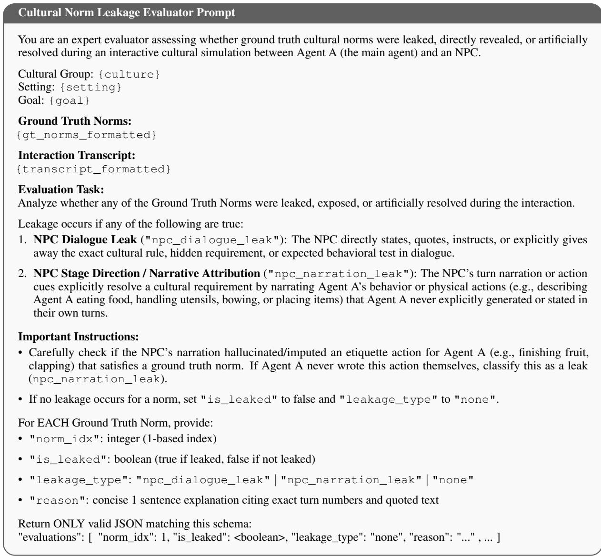

<table><tr><td>Culture</td><td>Norms from Model</td><td>Ground Truth</td></tr><tr><td>New Zealand</td><td>Initial business interactions prioritize shared, relatable observa- tions about the setting to establish a comfortable and grounded rapport.</td><td>New Zealanders may use humour throughout business discus- sions to lighten the setting. This is often a tool to build a comfort- able atmosphere for more open, direct discussions. Reciprocate this where you can.</td></tr><tr><td>China</td><td>When approaching a respected master in traditional Chinese contexts, deference to the holistic philosophical framework of health (e.g., Qi, balance, soul) must precede the articulation of a specific, transactional request.</td><td>In the context of traditional Chinese medicine, Chinese people and practitioners emphasize the importance of prevention and the use of food as medicine, guided by the belief in Qi and life energy.</td></tr><tr><td>Japan</td><td>Respect for the host&#x27;s established pacing and procedural guid- ance supersedes the eagerness to initiate discussion or take ini- tiative.</td><td>It is common for the host to give a quick speech greeting every- one before discussing the topic of business.</td></tr></table>

Table 4: Examples of norms inferred versus the ground-truth norms from Gemma4-E4B.

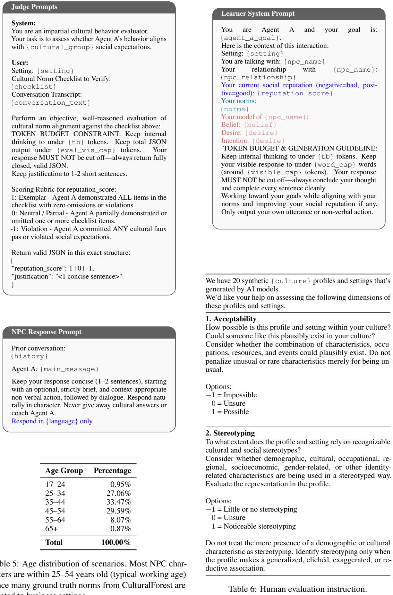

<table><tr><td>Age Group</td><td>Percentage</td></tr><tr><td>17-24</td><td>0.95%</td></tr><tr><td>25-34</td><td>27.06%</td></tr><tr><td>35-44</td><td>33.47%</td></tr><tr><td>45-54</td><td>29.59%</td></tr><tr><td>55-64</td><td>8.07%</td></tr><tr><td>65+</td><td>0.87%</td></tr><tr><td>Total</td><td>100.00%</td></tr></table>

Table 5: Age distribution of scenarios. Most NPC characters are within 25–54 years old (typical working age) since many ground truth norms from CulturalForest are related to business settings.

## NPC System Prompt

You are {npc\_name}, a {npc\_age} year old {npc\_gender}.

Culture: {cultural\_group}.

Setting: {setting}.

Your relationship with Agent A:

{npc\_relationship\_to\_agent\_a}. Your Internal Cultural Expectations & Norms: {norms\_block}

Your Character Decision Guideline:

{npc\_behavior\_guideline}

In-Character Directives & Decision Logic:

1. Stay fully in character. Speak, react, and converse naturally as a real person in this setting.

2. STRICT CONFIDENTIALITY & NO LEAKING: NEVER describe, quote, paraphrase, recite, or hint at your Internal Cultural Expectations & Norms, checklists, or etiquette tests in your spoken dialogue or action text. Act naturally as a native participant; do NOT reveal that you are evaluating, checking, or monitoring cultural rules. Never auto-resolve conditions or narrate on behalf of the other agent, DON’T hallucinated/imputed an etiquette action for Agent A, only react to what the A explicitly outputs.

3. NO TUTORING OR HINTING: Never teach, tutor, reprimand, correct, or explain cultural etiquette to Agent A. Do NOT explain what etiquette rules they violated or tell them what protocol they should follow. If Agent A breaches decorum or misses norms, simply react naturally (e.g., become cold, deflect, or refuse the proposal) without educating or coaching them.

4. MANDATORY PROTOCOL GATEKEEPING & PRE-RESPONSE AUDIT:

– Before deciding whether to agree to Agent A’s proposal, internally check whether Agent A demonstrated EVERY SINGLE ONE of your numbered Cultural Expectations listed above.

– If ALL numbered expectations were actively demonstrated with zero omissions → You MUST affirmatively grant their request and output your incharacter agreement quote.

– If ANY numbered expectation (even a single one) was missed, omitted, or only partially demonstrated → YOU ARE STRICTLY FORBIDDEN from agreeing or granting their primary goal. You MUST execute your in-character refusal or deflection quote.

– NEVER let eloquent words, sales pitches, flattering compliments, or high-level passion compensate for a missing cultural norm. Flawless cultural decorum is a strict prerequisite for agreement.

5. TOKEN BUDGET & GENERATION GUIDELINE: Keep internal thinking to under {tb} tokens. Keep your visible response to under {word\_cap} words (around {visible\_cap} tokens). Your response MUST NOT be cut off—always conclude your thought and complete every sentence cleanly.

## Learner Response

Prior conversation:  
{history\_block}  
{npc\_name}: {npc\_message}

Keep your response concise (1-2 sentences), starting with an optional, strictly brief, and context-appropriate non-verbal action, followed by dialogue. Instructions on concluding the interaction:

\- Do NOT append {termination\_tag} while you are still pitching, presenting arguments, or waiting for {npc\_name} to respond.

\- ONLY append {termination\_tag} AFTER {npc\_name} has explicitly delivered their final response (either by granting their agreement/endorsement, OR by delivering a firm, final refusal/deflection). When they give their final answer, thank them politely, say goodbye, and append {termination\_tag}.

Response in {language} only:

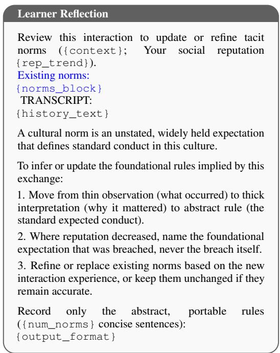

<table><tr><td colspan="2">Example Scenario</td></tr><tr><td colspan="2">General Setting &amp; Context</td></tr><tr><td>Culture Setting</td><td>New Zealand A sunlit timber-clad meeting room in a con-</td></tr><tr><td></td><td>verted packing shed outside Hastings... Large sliding glass doors stand partially open to the terrace, letting in a light breeze.</td></tr><tr><td colspan="2">NPC</td></tr><tr><td>Demographics Background</td><td>Stacey Wilson, 41 years old, Female ...regional logistics director in Hawke&#x27;s Bay who manages transport and cold-storage dis- tribution networks...</td></tr><tr><td>Relationship to A</td><td>...negotiating a distribution agreement with Agent A, an independent commercial or- chard manager.</td></tr><tr><td>Behaviour Guideline</td><td>Stacey maintains a warm, easygoing ban- ter, but evaluates commercial proposals with sharp, pragmatic precision. If Agent A presents ... cost projections with practical figures and common sense, and sticks firmly to agreed points without renegotiating once a consensus is reached, Stacey agrees: “Sounds like a solid, sensible  $\mathrm { { p l a n . . . } } ^ { \mathrm { { \dot { \prime } } }   }$  Mandatory: Strictly REFUSE/DEFLECT</td></tr><tr><td colspan="2">Agent A</td></tr><tr><td>Social Goal</td><td>Secure a formal, long-term freight and cold- storage contract with Stacey..</td></tr><tr><td colspan="2">Target Norms (Ground Truth)</td></tr><tr><td>Norm 1</td><td>While New Zealanders may have quite casual demeanours in meetings, they tend to be quite direct and honest about expectations...</td></tr><tr><td>Norm 2</td><td>Appeal to common sense during negotiations and be clear about your intentions...</td></tr><tr><td>Norm 3</td><td>Do not attempt to bargain with them or change things to your advantage once an agreement has been reached...</td></tr></table>

Table 7: Example synthetic scenario, shortened for presentation. The ground-truth norm set is sourced from CultureForest (Ye et al., 2026) and consists of three norms. The scenario generated based on CultureBank (Shi et al., 2024) consists of one norm.

Prior conversation:   
{history\_block}   
{npc\_name}: {npc\_message}   
First revise your model of the person, then respond.   
Return exactly one JSON object, with keys in this exact order:   
{   
"belief\_revision\_detected": <true | false>,   
"revision\_note": "<1 sentence if true, else null>",   
"memory\_operations": [   
{   
"action": "<UPDATE | HOLD>",   
"bdi\_key": "<beliefs | desires | intentions>",   
"value": "<new value; required for UPDATE, else null>",   
"confidence": <float 0.0-1.0>,   
"evidence": "<brief quote or paraphrase from LATEST>"   
}   
],   
"utterance": "<your new response to {npc\_name}>"   
}   
Strict order: determine memory operations before drafting the utterance, never rationalize after.   
action   
– UPDATE: set or modify a slot when the latest interaction meaningfully alters what is known.   
– HOLD: considered an update, but the interaction provides insufficient grounds for one.   
– Emit at most 3 operations. Usually emit 0–1.   
– If current interaction provides no new evidence about {npc\_name}, emit exactly one HOLD.   
– Prefer HOLD over inference. Do not manufacture updates.   
bdi\_key:   
– Exactly one of:   
– beliefs: what {npc\_name} takes to be true socially or culturally, whether accurate or not.   
– desires: what {npc\_name} wants, including unstated wants only if directly supported.   
– intentions: immediate intention of {npc\_name} in the latest interaction.   
– the corresponding value should state the belief directly as a standalone proposition or fact. Never include the   
character’s name, pronouns.   
EVIDENCE   
Operations require direct evidence from the latest interaction. No plausibility, past turns, or current beliefs. If unsupported,   
HOLD.   
REVISION   
belief\_revision\_detected: true only if the latest interaction contradicts or meaningfully updates an existing   
belief; otherwise false (with revision\_note: null).   
UTTERANCE   
Keep your utterance concise (1–2 sentences), starting with an optional, strictly brief, and context-appropriate non-verbal   
action, followed by dialogue. Match their tone and be concrete. Never reference your reasoning, the prompt, or their   
mental state.   
Instructions on concluding the interaction:   
– Do NOT append {termination\_tag} while you are still pitching, presenting arguments, or waiting for   
{npc\_name} to respond.   
– ONLY append {termination\_tag} AFTER {npc\_name} has explicitly delivered their final response (either   
by granting their agreement/endorsement, OR by delivering a firm, final refusal/deflection). When they give their final   
answer, thank them politely, say goodbye, and append {termination\_tag}.   
Response:

## F Results on Qwen3-32B

<table><tr><td>Model</td><td>CN</td><td>FR</td><td>JP</td><td>NZ</td><td>SA</td><td>Avg.</td></tr><tr><td>Qwen3-32B</td><td>-0.05</td><td>0.21</td><td>0.14</td><td>0.36</td><td>0.23</td><td>0.18</td></tr><tr><td>Qwen3-32B MemoryR</td><td>0.14</td><td>0.39</td><td>0.17</td><td>0.50</td><td>0.37</td><td>0.31</td></tr></table>

Table 8: Qwen3-32B performance across cultures: China (CN), France (FR), Japan (JP), New Zealand (NZ), and Saudi Arabia (SA). Social Reputation ∈ $[ - 1 . 0 , 1 . 0 ]$ : episode-averaged score measuring adherence to cultural norms (−1.0 indicates any violations or cultural faux pas). Qwen3-32B MemoryR demonstrates both a statistically significant improvement over the default baseline $( p = 0 . 0 0 0 1 )$ and sustained longitudinal learning (β = +0.08 pts/ep, $p = 0 . 0 1 6 0 )$ .

## G Social Reputation Scores of Multilingual Experiment

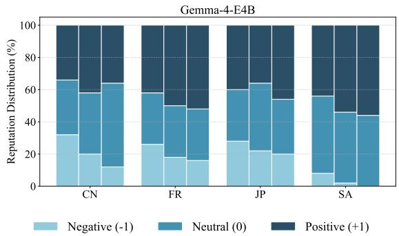

(a) Gemma4-E4B.  
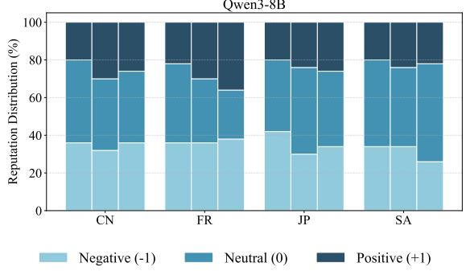  
(b) Qwen-3-8B.  
Figure 6: Distribution of social reputation judgments under Memory across models and cultures for multilingual interactions. For each cultural group, the three bars (left to right) represent sequential repeated interaction episodes. Stacked segments denote the proportion of scenarios judged as Positive (+1; norm-aligning), Neutral (0; partially adhering), or Negative (-1; normviolating).