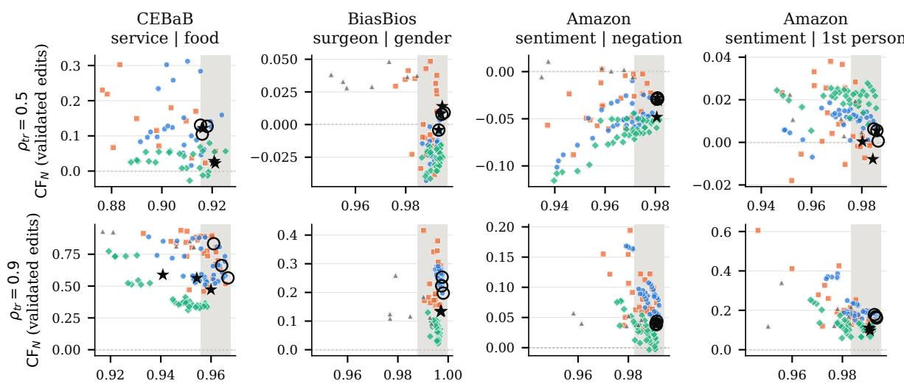
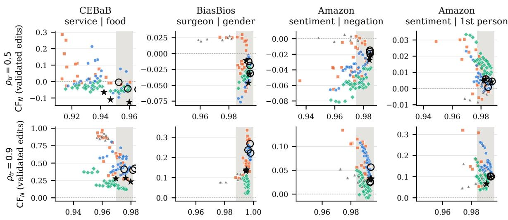
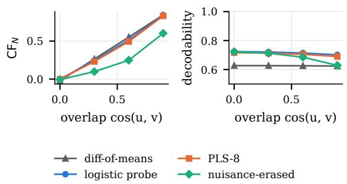

# Decodability Is Not Validity: Evaluating Nuisance Sensitivity in Language Model Concept Probes

Ayal Klein

ayalk@ariel.ac.il

https://github.com/kleinay/decodability-is-not-validity

## Abstract

Two concept probes can be equally accurate at predicting a concept from a language model’s hidden states while their scores contain different mixtures of the target concept and a correlated nuisance attribute. In four target–nuisance settings (two aspect sentiments in CEBaB; occupation and gender in BiasBios; Amazon review sentiment with negation, and with firstperson framing), two LLMs, and a population of concept extractors, we compare decodability with discriminant evidence: the score’s dependence on the nuisance at fixed target, and its response to input edits intended to change only the nuisance, filtered by two LLM judges and compared against placebo edits. Under correlated training data, extractors that are statisti cally equivalent in held-out AUROC differ up to several-fold in nuisance sensitivity in three of the four settings, and decodability is not a reli able proxy for it: their rank correlation changes sign across settings. The effect follows the probe’s training data, not the nuisance’s natural association with the target: first-person fram ing, unrelated to sentiment in natural reviews, is absorbed at least as much as negation, which co-occurs with negative sentiment, and decorrelated training removes the systematic effect. Selecting extractors with nuisance-aware development diagnostics, which need nuisance labels but no counterfactuals, lowers counterfactual nuisance sensitivity wherever the default choice is sensitive, at a small accuracy cost. Concept measurements should be validated, not just decoded.

## 1 Introduction

Probes, concept activation vectors and subspace readouts turn a hidden state into a scalar proxy for a concept T in the input (Alain and Bengio, 2017; Kim et al., 2018; Belinkov, 2022; Zou et al., 2023; Marks and Tegmark, 2024); the usual evidence for that reading is decodability, i.e. predicting held-out labels of T. Decodability cannot identify what the score measures. Call a nuisance N an attribute that is distinct from T but may be correlated with it (e.g., food sentiment when $T$ is service sentiment). Take binary T and N and two scores, $s _ { 1 } = T$ and $s _ { 2 } = T + \alpha N$ with $0 < \alpha < 1$ . Every input with T=1 scores at least 1 under s2 and every input with T=0 at most $\alpha < 1$ , so s2, like $s _ { 1 }$ , ranks all positives above all negatives: both have AUROC 1. Yet only s2 changes when N changes and T does not.

In measurement theory this is a question of construct validity, an evidential, multidimensional property of a score’s interpretation (Cronbach and Meehl, 1955; Messick, 1995; Jacobs and Wallach, 2021; Bean et al., 2025). Part of that evidence is discriminant (Campbell and Fiske, 1959): measures of correlated constructs may correlate, but the score should not depend on the other construct once the target is heldfixed.

That accuracy cannot detect such dependence is not new: probes trained on spuriously correlated data can rely on the spurious attribute (Kumar et al., 2022), probing accuracy need not reflect use by the model (Hewitt and Liang, 2019; Ravichander et al., 2021; Elazar et al., 2021; Tiwari et al., 2026; Muthya Sudheendra and Srivastava, 2026), and interventions on representations trade completeness against selectivity (Canby et al., 2025; Huang et al., 2024). Recent work tests whether probes and SAEs disentangle known concepts (Mueller et al., 2026), compares concept-subspace estimators (Naowarat et al., 2026), and shows that accurate probes can be misaligned (Lysnæs-Larsen et al., 2025), that probe readings depend on design choices (Noël, 2026) and correlated features (Shen et al., 2026), and that embedding-based measures need counterfactual validation (Li et al., 2026). We ask a narrower question about scalar readouts: among accuracymatched extractors, how much does sensitivity to a named nuisance under input edits vary, does it persist without training-set correlation, and can development diagnostics choose better? We answer with a population study over four settings and two models, using judge-filtered, placebo-controlled edits, including two nuisances edited on the same reviews (§4), and compare selection criteria (§4.1). Our interventions edit the input text of frozen models: unlike work asking whether a decodable direction drives behavior (Tiwari et al., 2026; Muthya Sudheendra and Srivastava, 2026), we ask what a score tracks in the input.

## 2 Measuring nuisance selectivity

An extractor maps a hidden state h to $s ( h ) \ =$ $w ^ { \top } z ( h ) + b ,$ with z the standardization on training data; subspace methods have a linear readout too, so every extractor is a scalar score. Each setting supplies a binary target T, a binary nuisance N, and edits of the input. Let $\rho = P ( N { = } 1 \mid T { = } 1 )$ )

$P ( N { = } 0 \mid T { = } 0 )$ with balanced T. Extractors are trained at $\rho _ { \mathrm { t r } } ~ \in ~ \{ 0 . 5 , 0 . 7 , 0 . 9 \}$ ; test metrics reweight the four (T, N) cells of one fixed test pool.

DEC: AUROC of s for T at $\rho = \rho _ { \mathrm { t r } }$ (in-distribution decodability, the standard criterion).

${ \textstyle | \mathbf { L E A K } | } \colon \frac { 1 } { 2 } \sum _ { t } { | \mathrm { A U R O C } ( s \to N \mid T { = } t ) - 0 . 5 | } ,$ dependence on N with the target held fixed.

CONFLICT: AUROC for $T$ on the cells with $T \neq N$ (a fully reversed correlation). A stress test, not a validity measure: there, $s = - N$ also ranks $T$ perfectly.

$\mathbf { C F } _ { N } \mathbf { \dot { \mathrm { : } } }$ mean change in s under edits that flip only $N$ , signed toward the N value that co-occurs with $T { = } 1$ in training, divided by the mean score gap between the $T$ classes on the decorrelated pool $( \Delta _ { T } )$ As a signed mean can hide opposite changes, we also report $| \mathrm { C F } _ { N } |$ (mean absolute change over $\Delta _ { T } )$ and compare with placebo edits that change neither variable.

$\mathbf { C F } _ { T } \mathbf { : }$ the same quantity for edits that flip T (CE-BaB only): convergent evidence.

## 3 Setup

Data and edits (Table 1). CEBaB (Abraham et al., 2022): restaurant reviews with aspect labels and human-written counterfactual edits; we pair each original test review with edits that flip food (or, for CFT, service) sentiment and leave the other aspect’s label unchanged; splits are disjoint by review family. BiasBios (De-Arteaga et al., 2019): surgeon vs. nurse biographies; N is the subject’s gender, edited in both directions by an LLM (gpt-oss-120b) that swaps the subject’s pronouns, gendered nouns and first name and nothing else (automatically checked). Amazon (McAuley and Leskovec, 2013; Zhang et al., 2015): short product reviews (8–40 words), T = negative sentiment, with two nuisances defined by word lists, so whether an edit flips them is checked exactly: negation (not, $n ^ { \prime } t ,$ never, $n o , \ldots ;$ in training data present in .64 of negative and .30 of positive reviews) and first person (the writer refers to themselves: I, my, we, . . . ; .66 vs. .68, i.e. uncorrelated). Each is its own setting (Amazon-Neg, Amazon-1P). gpt-oss-120b proposes phrase replacements that add or remove the nuisance while keeping the meaning and the strength of the opinion (“doesn’t work”→“fails”; “Would recommend”→“I would recommend”), applied by exact string match (Appendix A). We keep up to 1,100/250/400 training/development/test texts per (T, N) cell and train on samples of 2,000.

<table><tr><td></td><td>target T / nuisance N</td><td></td><td>N edits judged by both</td><td>accepted</td></tr><tr><td>CEBaB</td><td>service / food sentiment</td><td>210</td><td>210</td><td>41%</td></tr><tr><td>BiasBios</td><td>surgeon vs. nurse / gender</td><td>1561</td><td>1561</td><td>93%</td></tr><tr><td>Amazon-Neg</td><td>negative sentiment / negation</td><td>1427</td><td>1427</td><td>58%</td></tr><tr><td>Amazon-1P</td><td>negative sentiment / first person</td><td>1083</td><td>1083</td><td>68%</td></tr><tr><td>Civil*</td><td>toxic / Muslim or LGBTQ</td><td>762+400</td><td>762+400</td><td>13%, 29%</td></tr></table>

Table 1: Settings. Edits: generated nuisance-edit pairs (Amazon: those passing automatic checks); judged by both: pairs rated by both LLM judges; accepted: share of jointly judged pairs both accept (§3). ∗Civil (rulebased identity swaps, forward/reverse) is reported in Appendix C only.

Edit validation. Two judge models, neither identical to a probed model (Qwen3-32B, run locally, and gpt-oss-120b; for Amazon, Qwen3.8-27B and gpt-oss-120b via an API; the Qwen judges share a model family with Qwen2.5-7B), see each pair in random order, without being told which text is edited or which attribute should change, and say whether the target and the nuisance are the same, rate each text’s fluency, and flag other meaning changes. Checked against human labels and planted errors (Appendix A.1), a nuisance edit is accepted if both judges find the target unchanged and the nuisance changed, with no major other meaning change and no fluency drop. For Amazon the nuisance flip is checked by the word list instead (the judges missed real flips in a pilot), and both judges must also find the strength of the opinion unchanged. All counterfactual results use accepted pairs only (Appendix A). Placebo edits replace neutral words with synonyms.

<table><tr><td></td><td>best DEC</td><td>#near (equiv.)</td><td> $\mathrm { C F } _ { N }$  near-best range</td><td> $\mathrm { C F } _ { N }$  range</td><td>equiv. CoNFLICT range</td></tr><tr><td colspan="6">ρtr = 0.9 (correlated training data)</td></tr><tr><td>CEBaB</td><td></td><td>Q .966 37 (9)</td><td>.46-.89</td><td>.54-.83</td><td>.44-.69</td></tr><tr><td></td><td></td><td>G .979 39 (8)</td><td>.26-.72</td><td>.25-.63</td><td>.57-.82</td></tr><tr><td>BiasBios</td><td></td><td>Q .998 66 (65)</td><td>.09-.42</td><td>.09-.42</td><td>.83-.97</td></tr><tr><td></td><td></td><td>G .998 66 (61)</td><td>.09-.33</td><td>.11-.33</td><td>.92-.97</td></tr><tr><td>Amazon-Neg</td><td></td><td>Q .992 51 (45)</td><td>.03-.12</td><td>.03-.12</td><td>.87-.95</td></tr><tr><td></td><td></td><td>G .994 64 (60)</td><td>.02-.12</td><td>.02-.11</td><td>.87-.96</td></tr><tr><td>Amazon-1P</td><td></td><td>Q .993 40 (27)</td><td>.11-.25</td><td>.11-.22</td><td>.85-.95</td></tr><tr><td></td><td></td><td>G .994 62 (49)</td><td>.05-.31</td><td>.06-.25</td><td>.84-.96</td></tr></table>

Table 2: Standard extractors that are near-best (test DEC within 0.01 of the best) and, in parentheses, statistically equivalent to the best (TOST, margin 0.01). Q: Qwen2.5-7B; G: Gemma-2-9B. $\rho _ { \mathrm { t r } } \in \{ 0 . 5 , 0 . 7 \}$ and Civil: Appendix B, C.

Models and extractors. Qwen2.5-7B-Instruct (Qwen Team, 2024) and Gemma-2-9B-it (Gemma Team, 2024), frozen; residual stream mean-pooled over non-special tokens at 7 depths. Per layer: difference of class means; $\ell _ { 2 }$ logistic regression $( C \in \{ 1 0 ^ { - 3 } , \ldots , 1 0 \} )$ ); partial least squares $( k \in$ $\{ 2 , 4 , 8 , 1 6 \} ; k { = } 1$ equals the mean difference and is dropped); and a nuisance-erased probe that projects out the within-class nuisance mean differences, estimated on the training sample only (cf. Ravfogel et al., 2020; Belrose et al., 2023) before logistic regression. The first three families use no nuisance labels (standard, 70 per setting); the erased probe adds 35. Each is fit on three training samples. An extractor is near-best if its test DEC is within 0.01 of the best, and equivalent to the best if a paired-bootstrap 90% CI of the DEC difference lies inside ±0.01 (TOST at $\alpha = 0 . 0 5 )$ Because the reference is selected on the test pool, these equivalence results are descriptive; the selection comparisons (§4.1) choose on development data only.

## 4 Results

Accuracy-matched extractors differ in nuisance sensitivity. With correlated training data $( \rho _ { \mathrm { t r } }$ 0.9), extractors equivalent to the best in decodability span $\mathrm { C F } _ { N }$ from .54 to .83 on CEBaB (Qwen; Gemma .25–.63): for some, rewriting only the food sentence of a review shifts the “service” score most of the way to the other service class. On Bias-Bios DEC is at ceiling for nearly all extractors (65 equivalent to the best), while gender edits shift the occupation score by .09–.42 of the surgeon– nurse gap; on Amazon-1P, adding or removing a first-person reference shifts the sentiment score of equivalent extractors by .11–.22 (Gemma .06– .25). On Amazon-Neg, every near-best extractor is only weakly sensitive (.03–.12). Rankings by $\mathrm { C F } _ { N }$ agree on all vs. accepted edits (≥.77), under SD normalization $( \ge . 8 7 )$ and, at $\rho _ { \mathrm { t r } } = 0 . 9$ , between edit directions $( \ge . 9 3 $ Appendix A); placebo edits move scores little (median $| \mathrm { C F } _ { N } |$ .01–.06).

Same reviews, two nuisances. First person is unrelated to sentiment in natural reviews, yet under the same training correlation $( \rho _ { \mathrm { t r } } = 0 . 9 )$ the median $\mathrm { C F } _ { N }$ of competitive extractors is .12–.17 for first person and .05–.06 for negation (an increase over decorrelated training of .11–.16 vs. .09–.11): the probe’s training data, not the nuisance’s natural association, produces the reliance. Negation edits move scores by a similar absolute amount at any training correlation (median |CFN| .07–.09 at $\rho _ { \mathrm { t r } } = 0 . 5 .$ .07–.09 at 0.9; placebo .03), and at $\rho _ { \mathrm { t r } } = 0 . 5$ against the nuisance direction, mostly when a negation is removed (−.07–−.06): consistent with “not good”→“bad” sharpening the opinion, which the strength check does not fully exclude, rather than with reliance on the nuisance.

With decorrelated training, the directional effect mostly disappears. $\mathrm { A t } \rho _ { \mathrm { t r } } = 0 . 5$ , near-best extractors show little net nuisance shift on BiasBios and both Amazon settings (signed $\mathrm { C F } _ { N }$ within $\pm 0 . 0 8 )$ and less on CEBaB (.02–.28, Qwen), where example-level shifts remain (median $\left| \mathbf { C F } _ { N } \right| . 2 5 \mathrm { v s } .$ signed .07; placebo .06, for smaller edits). Trainingset correlation drives the systematic reliance on the nuisance. A second source is geometric: on CE-BaB the target and within-class food directions are aligned (cosine .65–.83), and this observational geometry approximately predicts the food sensitivity of the difference of means trained on decorrelated data (mean absolute error .11; synthetic illustration in Appendix D).

Decodability is not a reliable proxy. Among competitive standard extractors at $\rho _ { \mathrm { t r } } = 0 . 9$ , the rank correlation between DEC and $\mathrm { C F } _ { N }$ ranges from −.61 to +.38 and changes sign across settings (descriptive intervals: Appendix B). Target edits do not arbitrate either: on CEBaB every near-best extractor responds fully to service edits (CFT .84– 1.19) while its food sensitivity ranges over −.10– .89.

A fixed-method comparison. With layer and hyperparameter chosen on development data, the logistic and the nuisance-erased probe are equivalent in DEC at $\rho _ { \mathrm { t r } } = 0 . 9$ on BiasBios (90% CI [+.000, +.002], Qwen) and Amazon-1P, yet $\mathrm { C F } _ { N }$ is .22 vs. .07 and .17 vs. .07 (Appendix B). Erasure lowers but does not remove nuisance sensitivity.

Figure 1: Competitive extractors (DEC within 0.05 of the best; Qwen2.5-7B; mean over 3 training samples): test decodability vs. nuisance sensitivity $\mathrm { C F } _ { N }$ on accepted edits (0: no net shift; 1: the nuisance edit shifts the score as much as a change of target class; note the different y scales). Black symbols: the extractor that each training sample selects on development data by maximal DEC (ring) or maximal CONFLICT (star), standard extractors only. Gemma-2-9B: Appendix B.
<table><tr><td></td><td colspan="4">standard extractors</td></tr><tr><td></td><td></td><td></td><td>max DEC max CONFLICT min |LEAK|</td><td>max CONFLICT</td></tr><tr><td>CEBaB</td><td>Q</td><td>.69</td><td>.54 (−.012) .50 (−.013)</td><td>.34 (−.007)</td></tr><tr><td></td><td>G</td><td>.41</td><td>.26 (−.005) .27 (−.004)</td><td>.11 (−.004)</td></tr><tr><td>BiasBios</td><td>Q</td><td>.22</td><td>.13 (−.001) .09 (−.004)</td><td>.03 (−.002)</td></tr><tr><td></td><td>G</td><td>.24</td><td>.14 (−.002) .12 (−.006)</td><td>.02 (−.002)</td></tr><tr><td>Amazon-Neg</td><td>Q</td><td>.04</td><td>.04† (+.000)</td><td>.07† (−.007) −.00 (−.000)</td></tr><tr><td></td><td>G</td><td>.04</td><td>.03† (+.000)</td><td>.06† (−.004) −.00 (−.001)</td></tr><tr><td>Amazon-1P</td><td>Q</td><td>.17</td><td>.11 (−.002) .11 (−.002)</td><td>.07 (−.002)</td></tr><tr><td></td><td>G</td><td>.10</td><td>.08† (−.002) .08† (−.007)</td><td>.04 (−.003)</td></tr></table>

Table 3: Selecting an extractor on development data at $\rho _ { \mathrm { t r } } = 0 . 9 \colon$ test $\mathrm { C F } _ { N }$ (accepted edits) of the extractor chosen by maximal DEC (standard practice), maximal CONFLICT, or minimal |LEAK| among extractors within 0.01 of the best development DEC; change in test DEC in parentheses. Means over 3 training samples; †: CFN did not fall in every sample. More criteria and Civil: Appendix B.

## 4.1 Selecting for nuisance selectivity

Table 3 compares the usual choice by development accuracy with nuisance-aware criteria that need nuisance labels on development data but no counterfactuals. Among standard extractors, choosing by CONFLICT lowers $\mathrm { C F } _ { N }$ wherever the default choice is sensitive (CEBaB, BiasBios, Amazon-1P:

by .02–.15, in every training sample but one) at a mean DEC cost of at most .012 (.020 in the worst sample), and lowers $| \mathrm { C F } _ { N } |$ as well; on Amazon-Neg, where the default is already insensitive, it changes little. The leakage-constrained rule is less reliable (it raises $\mathrm { C F } _ { N }$ on Amazon-Neg). When the nuisance-erased probe is available, CONFLICT selects it in every sample and $\mathrm { C F } _ { N }$ falls in every setting, model and sample (by .04–.34) at a mean DEC cost of at most .007.

## 5 Discussion

Our claim is narrower than “probes are invalid”: decodability is not a reliable proxy for selectivity with respect to a named nuisance, and probes rely on a nuisance whenever their training data correlate it with the target. A claim that a direction measures a concept should name plausible nuisances and report discriminant diagnostics and, where possible, nuisance-only edits for each; passing them is necessary evidence, not construct validity (Messick, 1995; Licht et al., 2025).

## Limitations

Each setting examines one named nuisance (Amazon: two, separately); selectivity for unexamined nuisances is unknown. Edits are filtered by two

LLM judges, not by new human annotation. We validate the judges against CEBaB’s human labels and with planted errors, and recompute the results under every filter (Appendix A.1), but human labels exist only for CEBaB, the judges agree only poorly to moderately with each other, and accepted pairs may be a selective subset; the code generates a blinded stratified sample for human annotation. LLM edits can change more than the nuisance: two LLM readers rate .12–.22 of accepted negation edits (Amazon-Neg) as changing the opinion, its intensity or a fact, or as broken, mostly where a negation was added; negation edits can shift the intensity of an opinion despite the strength check. $\mathrm { C F } _ { N }$ is normalized by the class score gap, which is unstable for weak extractors, so we analyze competitive ones; an effect-size normalization (by the within-cell score SD, akin to Cohen’s d) ranks extractors similarly (≥.87). Correlated regimes are produced by resampling; they match natural rates for BiasBios (P(male | surgeon) = 0.85, P(female | nurse) = 0.91) and approximately CEBaB (0.80, 0.73) and Amazon-Neg, and are a stress test for Amazon-1P. Strict equivalence is established for few extractors on CEBaB. We study linear readouts of mean-pooled (and, as an ablation, last-token) representations of two 7–9B models; nonlinear probes, SAE features and other models are untested. Our measures concern what a score tracks in text, not what the model computes with it.

## Ethics Statement

BiasBios involves gender, and the appendix setting (Civil) religious and sexual identity. Concept scores used for auditing or monitoring can encode such attributes while passing accuracy checks; our diagnostics complement, and do not replace, fairness evaluation. The gender swap follows the dataset’s binary annotation.

## References

Eldar David Abraham, Karel D’Oosterlinck, Amir Feder, Yair Ori Gat, Atticus Geiger, Christopher Potts, Roi Reichart, and Zhengxuan Wu. 2022. CE-BaB: Estimating the causal effects of real-world concepts on NLP model behavior. In Advances in Neural Information Processing Systems.

Guillaume Alain and Yoshua Bengio. 2017. Understanding intermediate layers using linear classifier probes. In ICLR Workshop.

Andrew M. Bean, Ryan Othniel Kearns, Angelika Romanou, Franziska Sofia Hafner, Harry Mayne, et al. 2025. Measuring what matters: Construct validity in large language model benchmarks. In Advances in Neural Information Processing Systems (Datasets and Benchmarks Track).

Yonatan Belinkov. 2022. Probing classifiers: Promises, shortcomings, and advances. Computational Linguistics, 48(1):207–219.

Nora Belrose, David Schneider-Joseph, Shauli Ravfogel, Ryan Cotterell, Edward Raff, and Stella Biderman. 2023. LEACE: Perfect linear concept erasure in closed form. In Advances in Neural Information Processing Systems.

Daniel Borkan, Lucas Dixon, Jeffrey Sorensen, Nithum Thain, and Lucy Vasserman. 2019. Nuanced metrics for measuring unintended bias with real data for text classification. In Companion Proceedings of The 2019 World Wide Web Conference, pages 491–500.

Donald T. Campbell and Donald W. Fiske. 1959. Convergent and discriminant validation by the multitrait-multimethod matrix. Psychological Bulletin, 56(2):81–105.

Marc E. Canby, Adam Davies, Chirag Rastogi, and Julia Hockenmaier. 2025. How reliable are causal probing interventions? In Proceedings of the 14th International Joint Conference on Natural Language Processing and the 4th Conference ofthe Asia-Pacific Chapter of the Association for Computational Linguistics, pages 857–878.

Lee J. Cronbach and Paul E. Meehl. 1955. Construct validity in psychological tests. Psychological Bulletin, 52(4):281–302.

Maria De-Arteaga, Alexey Romanov, Hanna Wallach, Jennifer Chayes, Christian Borgs, Alexandra Chouldechova, Sahin Geyik, Krishnaram Kenthapadi, and Adam Tauman Kalai. 2019. Bias in bios: A case study of semantic representation bias in a highstakes setting. In Proceedings ofthe Conference on Fairness, Accountability, and Transparency, pages 120–128.

Lucas Dixon, John Li, Jeffrey Sorensen, Nithum Thain, and Lucy Vasserman. 2018. Measuring and mitigating unintended bias in text classification. In Proceedings ofthe 2018 AAAI/ACM Conference on AI, Ethics, and Society, pages 67–73.

Yanai Elazar, Shauli Ravfogel, Alon Jacovi, and Yoav Goldberg. 2021. Amnesic probing: Behavioral explanation with amnesic counterfactuals. Transactions of the Associationfor Computational Linguistics, 9:160– 175.

Sahaj Garg, Vincent Perot, Nicole Limtiaco, Ankur Taly, Ed H. Chi, and Alex Beutel. 2019. Counterfactual fairness in text classification through robustness. In Proceedings ofthe 2019 AAAI/ACM Conference on AI, Ethics, and Society, pages 219–226.

Gemma Team. 2024. Gemma 2: Improving open language models at a practical size. arXiv preprint arXiv:2408.00118.

John Hewitt and Percy Liang. 2019. Designing and interpreting probes with control tasks. In Proceedings of EMNLP-IJCNLP, pages 2733–2743.

Jing Huang, Zhengxuan Wu, Christopher Potts, Mor Geva, and Atticus Geiger. 2024. RAVEL: Evaluating interpretability methods on disentangling language model representations. In Proceedings ofACL.

Abigail Z. Jacobs and Hanna Wallach. 2021. Measurement and fairness. In Proceedings ofthe 2021 ACM Conference on Fairness, Accountability, and Transparency, pages 375–385.

Been Kim, Martin Wattenberg, Justin Gilmer, Carrie Cai, James Wexler, Fernanda Viegas, and Rory Sayres. 2018. Interpretability beyond feature attribution: Quantitative testing with concept activation vectors (TCAV). In Proceedings of ICML, pages 2668–2677.

Pang Wei Koh, Shiori Sagawa, Henrik Marklund, Sang Michael Xie, Marvin Zhang, Akshay Balsubramani, Weihua Hu, Michihiro Yasunaga, Richard Lanas Phillips, Irena Gao, et al. 2021. WILDS: A benchmark of in-the-wild distribution shifts. In Proceedings ofICML, pages 5637–5664.

Abhinav Kumar, Chenhao Tan, and Amit Sharma. 2022. Probing classifiers are unreliable for concept removal and detection. In Advances in Neural Information Processing Systems.

Baishi Li, Ta Yu, Kelvin J. L. Koa, and Ke-Wei Huang. 2026. The proxy presumption: From semantic embeddings to valid social measures. In Proceedings of the 64th Annual Meeting of the Association for Computational Linguistics (Volume 1: Long Papers), pages 22892–22910.

Hauke Licht, Rupak Sarkar, Patrick Y. Wu, Pranav Goel, Niklas Stoehr, Elliott Ash, and Alexander Miserlis Hoyle. 2025. Measuring scalar constructs in social science with LLMs. In Proceedings ofthe 2025 Con ference on Empirical Methods in Natural Language Processing, pages 32144–32171.

Jacob Lysnæs-Larsen, Marte Eggen, and Inga Strümke. 2025. Probing the probes: Methods and metrics for concept alignment. arXiv preprint arXiv:2511.04312.

Samuel Marks and Max Tegmark. 2024. The geometry of truth: Emergent linear structure in large language model representations of true/false datasets. In Conference on Language Modeling (COLM).

Julian McAuley and Jure Leskovec. 2013. Hidden factors and hidden topics: Understanding rating dimensions with review text. In Proceedings of the 7th ACM Conference on Recommender Systems, pages 165–172.

Samuel Messick. 1995. Validity of psychological assessment: Validation of inferences from persons’ responses and performances as scientific inquiry into score meaning. American Psychologist, 50(9):741– 749.

Aaron Mueller, Andrew Lee, Shruti Joshi, Ekdeep Singh Lubana, Dhanya Sridhar, and Patrik Reizinger. 2026. From isolation to entanglement: When do interpretability methods identify and disentangle known concepts? In Proceedings ofthe 64th Annual Meeting of the Association for Computational Linguistics (Volume 1: Long Papers), pages 17188–17210.

Smitha Muthya Sudheendra and Jaideep Srivastava. 2026. When decodability is not enough: Logical validity representations, behavioral dissociation, and causal tests in language models. arXiv preprint arXiv:2609.02438.

Burin Naowarat, Hao Tang, and Sharon Goldwater. 2026. A framework for analyzing concept representations in neural models. In Proceedings of the 30th Conference on Computational Natural Language Learning, pages 574–587.

Valentin Noël. 2026. A probe direction is a property of its prompt. arXiv preprint arXiv:2608.13329.

Qwen Team. 2024. Qwen2.5 technical report. arXiv preprint arXiv:2412.15115.

Shauli Ravfogel, Yanai Elazar, Hila Gonen, Michael Twiton, and Yoav Goldberg. 2020. Null it out: Guarding protected attributes by iterative nullspace projection. In Proceedings ofACL, pages 7237–7256.

Abhilasha Ravichander, Yonatan Belinkov, and Eduard Hovy. 2021. Probing the probing paradigm: Does probing accuracy entail task relevance? In Proceedings ofEACL, pages 3363–3377.

Gaofei Shen, Martijn Bentum, Tomas O. Lentz, Afra Alishahi, and Grzegorz Chrupała. 2026. Beyond decodability: Reconstructing language model representations with an encoding probe. arXiv preprint arXiv:2605.00607.

Devesh Tiwari, Camille Davis, Shivank Sinha, Talia Weaver, Aditya Shah, and Maheep Chaudhary. 2026. Decodability is not causality: Dissociating probe readouts from behavioral drivers via SAE decomposition. arXiv preprint arXiv:2609.18080.

Xiang Zhang, Junbo Zhao, and Yann LeCun. 2015. Character-level convolutional networks for text classification. In Advances in Neural Information Processing Systems, pages 649–657.

Andy Zou, Long Phan, Sarah Chen, James Campbell, Phillip Guo, Richard Ren, Alexander Pan, Xuwang Yin, Mantas Mazeika, Ann-Kathrin Dombrowski, et al. 2023. Representation engineering: A topdown approach to AI transparency. arXiv preprint arXiv:2310.01405.

## A Edit validation and robustness

Table 4 reports, per judge and edit kind, how often the judge found the target kept, the nuisance changed, a fluency drop (edited text rated nonfluent while the source was rated fluent; both judges rate many untouched informal texts as non-fluent, so absolute fluency is not used), and a major other meaning change. Table 5 gives the agreement of the two judges’ accept decisions: agreement is low to moderate (κ .06–.55), mostly because the Qwen judge is much stricter (it accepts .44–.72 of placebo edits, gpt-oss-120b .88–.97), often reporting a fluency drop or a changed target for synonym swaps. Requiring both judges is therefore conservative, and acceptance by both is a filter, not verified correctness; rankings on accepted and on all edits agree closely (Table 6). For Civil (Appendix C), Qwen3-32B judges that swapping the named group changes toxicity in about half of the forward swaps, so few identity swaps survive. The judges were never told which text was edited or which attribute was meant to change. The released code generates a blinded stratified sample of 25 pairs per dataset and edit kind for human annotation.

Amazon edits. For each test review, gpt-oss-120b receives an instruction to add (or remove every instance of) the nuisance with an exact paraphrase that keeps every fact and the strength of the opinion, and returns JSON phrase replacements, which we apply by exact string match, so only the named phrases change; it may decline. Automatic checks require that the nuisance flips according to the word list, that at most 35% of the words change, and that the length is stable. Examples of accepted edits: negation added, “spaces between word were missing”→“. . . not present”; removed, “poorly written and not well thought out”→“. . . illconceived”, “I had not received the driver cd”→“I had failed to receive . . . ”; first person added, “Received this book promptly”→“I received $\cdots ^ { \mathfrak { s } } ;$ removed, “is it just me?”→“is this the only case?”. Prompts were developed on 100 test reviews per nuisance and frozen before a held-out check and the full run. The model declines most often when asked to add first person to a review without a natural place for it, so Amazon-1P has fewer additions than removals; every direction-specific result is reported separately (Table 6). Because negation is part of how sentiment is expressed, a paraphrase that removes it can still sharpen an opinion; both judges answer an explicit question about the strength of the opinion, and the residual effect at $\rho _ { \mathrm { t r } } = 0 . 5$ is discussed in $\ S 4$

Robustness of $\mathbf { C F } _ { N }$ Table 6 gives rank correlations, across competitive extractors, between $\mathrm { C F } _ { N }$ computed on all vs. accepted edits; normalized by $\Delta _ { T }$ vs. by the pooled within-cell score SD; signed vs. absolute; for the two edit directions separately (CEBaB, BiasBios, Amazon); and for the forward vs. reverse Civil swaps. At $\rho _ { \mathrm { t r } } = 0 . 5$ on CEBaB the signed effect is small while the absolute change is not (median $| \mathrm { C F } _ { N } |$ .25 vs. signed .07, Qwen), which is why the direction-wise rankings agree less there. Placebo edits are smaller than CEBaB’s human rewrites, so the placebo floor is not magnitudematched for CEBaB.

## A.1 Validating the judges without new annotation

Human labels (CEBaB). CEBaB’s edits were written by crowd workers, and five other workers labelled the food and service sentiment (positive, negative, not mentioned) of every original and edited review. We judged 529 (original, food or service edit) pairs from the test and development families with both judges, including all 89 edits whose intended aspect label did not change according to the human majority (.17 of the set, oversampled). On whether each aspect is the same in the two texts, gpt-oss-120b agrees with the human majority in .92 of pairs, as often as a single held-out worker agrees with the majority of the other four (.90–.91); Qwen3-32B agrees in .77–.84, mostly because it reports changes the workers did not. Applying the acceptance rule, both judges reject .84 of the failed edits, and .94 of accepted pairs are correct by the human labels (vs. .83 of all judged pairs); the price is recall: half of the edits correct by the human labels are rejected (.50 kept), in part for fluency or other meaning changes that the human labels do not cover.

Planted errors. On edits both judges had accepted (50 per type and setting, disjoint sources), we planted one known error after the nuisance edit, keeping the word-list nuisance status: gptoss-120b proposed a phrase replacement that reverses the opinion, makes it clearly stronger or weaker, changes the occupation, or changes a minor fact; by rule, we garbled the text (swap, duplicate and drop a word) or reverted one gendered substitution (mixed gender cues). Table 7 gives how often the judges still accept. Reversed opinions, changed occupations and garbled text pass both judges in at most .10 of cases; in the passing reversals the planted phrase mostly changes one aspect of a mixed review, not the overall opinion, and garbled reviews pass when the judges already rated the source non-fluent, which the rule allows. gpt-oss-120b alone accepts .58–.68 of strength changes, so the strength check rests mainly on the Qwen judge (both: ≤.18). Mixed gender cues pass both in .18. Minor fact changes pass often (.52–.88): the rule tolerates minor meaning changes by design, and some planted changes are trivial. Re-judging unmodified accepted edits in a new presentation order keeps .86–.94 of them, a measure of judge noise.

<table><tr><td>data</td><td>edit kind</td><td>n</td><td>judge</td><td>T kept</td><td>N changed</td><td>fluency drop</td><td>major other</td><td>accepted</td></tr><tr><td>Amazon-1P</td><td>nuisance</td><td>1083</td><td>Qwen3.8-27B</td><td>.98</td><td>1.00</td><td>.21</td><td>.00</td><td>.74</td></tr><tr><td>Amazon-1P</td><td>nuisance</td><td>1083</td><td>gpt-oss-120b</td><td>.98</td><td>1.00</td><td>.16</td><td>.00</td><td>.82</td></tr><tr><td>Amazon-1P</td><td>placebo</td><td>567</td><td>Qwen3.8-27B</td><td>.99</td><td>.00</td><td>.21</td><td>.00</td><td>.71</td></tr><tr><td>Amazon-1P</td><td>placebo</td><td>567</td><td>gpt-oss-120b</td><td>.98</td><td>.00</td><td>.12</td><td>.00</td><td>.88</td></tr><tr><td>Amazon-Neg</td><td>nuisance</td><td>1427</td><td>Qwen3.8-27B</td><td>.97</td><td>1.00</td><td>.13</td><td>.06</td><td>.61</td></tr><tr><td>Amazon-Neg</td><td>nuisance</td><td>1427</td><td>gpt-oss-120b</td><td>.98</td><td>1.00</td><td>.03</td><td>.02</td><td>.90</td></tr><tr><td>Amazon-Neg</td><td>placebo</td><td>608</td><td>Qwen3.8-27B</td><td>.99</td><td>.00</td><td>.21</td><td>.00</td><td>.72</td></tr><tr><td>Amazon-Neg</td><td>placebo</td><td>608</td><td>gpt-oss-120b</td><td>.98</td><td>.00</td><td>.11</td><td>.00</td><td>.88</td></tr><tr><td>BiasBios</td><td>nuisance</td><td>1561</td><td>Qwen3-32B</td><td>.98</td><td>.99</td><td>.03</td><td>.01</td><td>.94</td></tr><tr><td>BiasBios</td><td>nuisance</td><td>1561</td><td>gpt-oss-120b</td><td>.99</td><td>.99</td><td>.01</td><td>.00</td><td>.96</td></tr><tr><td>BiasBios</td><td>placebo</td><td>961</td><td>Qwen3-32B</td><td>.98</td><td>.00</td><td>.42</td><td>.00</td><td>.58</td></tr><tr><td>BiasBios</td><td>placebo</td><td>400</td><td>gpt-oss-120b</td><td>.98</td><td>.00</td><td>.03</td><td>.00</td><td>.97</td></tr><tr><td>CEBaB</td><td>nuisance</td><td>210</td><td>Qwen3-32B</td><td>.62</td><td>.97</td><td>.15</td><td>.32</td><td>.44</td></tr><tr><td>CEBaB</td><td>nuisance</td><td>210</td><td>gpt-oss-120b</td><td>.93</td><td>.98</td><td>.05</td><td>.22</td><td>.69</td></tr><tr><td>CEBaB</td><td>placebo</td><td>158</td><td>Qwen3-32B</td><td>.91</td><td>.01</td><td>.51</td><td>.00</td><td>.46</td></tr><tr><td>CEBaB</td><td>placebo</td><td>158</td><td>gpt-oss-120b</td><td>1.00</td><td>.00</td><td>.08</td><td>.00</td><td>.92</td></tr><tr><td>CEBaB</td><td>target</td><td>125</td><td>Qwen3-32B</td><td>.00</td><td>.08</td><td>.10</td><td>.27</td><td>.55</td></tr><tr><td>CEBaB</td><td>target</td><td>125</td><td>gpt-oss-120b</td><td>.02</td><td>.10</td><td>.03</td><td>.16</td><td>.76</td></tr><tr><td>Civil</td><td>nuisance</td><td>762</td><td>Qwen3-32B</td><td>.45</td><td>.98</td><td>.13</td><td>.72</td><td>.17</td></tr><tr><td>Civil</td><td>nuisance</td><td>762</td><td>gpt-oss-120b</td><td>1.00</td><td>.97</td><td>.00</td><td>.62</td><td>.36</td></tr><tr><td>Civil</td><td>nuisance rev</td><td>400</td><td>Qwen3-32B</td><td>.63</td><td>.99</td><td>.09</td><td>.53</td><td>.34</td></tr><tr><td>Civil</td><td>nuisance rev</td><td>400</td><td>gpt-oss-120b</td><td>1.00</td><td>.98</td><td>.00</td><td>.36</td><td>.62</td></tr><tr><td>Civil</td><td>placebo</td><td>480</td><td>Qwen3-32B</td><td>.88</td><td>.00</td><td>.53</td><td>.00</td><td>.44</td></tr><tr><td>Civil</td><td>placebo</td><td>480</td><td>gpt-oss-120b</td><td>1.00</td><td>.00</td><td>.06</td><td>.00</td><td>.94</td></tr><tr><td>Civil</td><td>placebo group</td><td>400</td><td>Qwen3-32B</td><td>.80</td><td>.89</td><td>.06</td><td>.19</td><td>.64</td></tr><tr><td>Civil</td><td>placebo group</td><td>400</td><td>gpt-oss-120b</td><td>1.00</td><td>.90</td><td>.00</td><td>.06</td><td>.94</td></tr></table>

Table 4: LLM-judge verdicts per edit kind. Qwen judge: Qwen3-32B (Amazon: Qwen3.8-27B). Amazon: N changed is the word-list check, and acceptance also requires an unchanged strength of opinion.

<table><tr><td>data</td><td>edit kind</td><td></td><td>n accept (Qwen3)</td><td>accept (gpt-oss)</td><td>both</td><td>κ</td></tr><tr><td>CEBaB</td><td>nuisance</td><td>210</td><td>.44</td><td>.69</td><td></td><td>.41.41</td></tr><tr><td>CEBaB</td><td>placebo</td><td>158</td><td>.46</td><td>.92</td><td></td><td>.44.07</td></tr><tr><td>CEBaB</td><td>target</td><td>125</td><td>.55</td><td>.76</td><td>.52</td><td>.42</td></tr><tr><td>BiasBios</td><td>nuisance</td><td>1561</td><td>.94</td><td>.96</td><td>.93</td><td>.55</td></tr><tr><td>BiasBios</td><td>placebo</td><td>400</td><td>.60</td><td>.97</td><td></td><td>.60.06</td></tr><tr><td>Amazon-Neg</td><td>nuisance</td><td>1427</td><td>.61</td><td>.90</td><td>.58</td><td>.18</td></tr><tr><td>Amazon-Neg</td><td>placebo</td><td>608</td><td>.72</td><td>.88</td><td>.69</td><td>.37</td></tr><tr><td>Amazon-1P</td><td>nuisance</td><td>1083</td><td>.74</td><td>.82</td><td>.68</td><td>.45</td></tr><tr><td>Amazon-1P</td><td>placebo</td><td>567</td><td>.71</td><td>.88</td><td>.69</td><td>.39</td></tr><tr><td>Civil</td><td>nuisance</td><td>762</td><td>.17</td><td>.36</td><td>.13</td><td>.31</td></tr><tr><td>Civil</td><td>nuisance rev</td><td>400</td><td>.34</td><td>.62</td><td>.29</td><td>.29</td></tr><tr><td>Civil</td><td>placebo</td><td>480</td><td>.44</td><td>.94</td><td>.43 .07</td><td></td></tr><tr><td>Civil</td><td>placebo group</td><td>400</td><td>.64</td><td>.94</td><td>.62 .08</td><td></td></tr></table>

Table 5: Agreement of the two judges’ accept decisions on pairs both rated.

Reading accepted Amazon edits. Two further LLM readers not involved in editing or judging (Claude Opus 5.5 and GPT-6.1) each labelled the same 100 accepted Amazon edits (25 per setting and direction, judge verdicts hidden) as ok, unnatural (meaning kept, stilted wording), or wrong (opinion, strength or a fact changed, or broken text); they agree on .73 of items (κ = .45). They rate .02–.14 of Amazon-1P edits wrong and .12–.22 of Amazon-Neg edits, .24–.28 of negation additions, which mostly replace a word by a weaker negated antonym (“one-of-a-kind”→“not ordinary”); a further share is unnatural but meaning-preserving (any non-ok label: Amazon-1P .18–.32, Amazon-Neg .36–.42). Removing first person from a superlative can broaden it (“the worst movie I have ever seen”→“the worst movie ever seen”). Neither reader is a human, so this is a further check of edit quality, not a human validation.

<table><tr><td>data</td><td>model ρt</td><td></td><td>all vs. accepted ∆T vs. SD norm. signed vs. | · | direction + vs. −</td><td></td><td></td><td></td><td>Civil fwd vs. rev</td></tr><tr><td>Amazon-1P</td><td>G</td><td>0.5</td><td>+.99</td><td>1.00</td><td>+.69</td><td>+.84</td><td></td></tr><tr><td>Amazon-1P</td><td>G</td><td>0.7</td><td>1.00</td><td>+.98</td><td>+.91</td><td>+.94</td><td></td></tr><tr><td>Amazon-1P</td><td>G</td><td>0.9</td><td>1.00</td><td>+.97</td><td>+.99</td><td>+.97</td><td></td></tr><tr><td>Amazon-1P</td><td>Q</td><td>0.5</td><td>+.99</td><td>+.99</td><td>+.46</td><td>+.84</td><td></td></tr><tr><td>Amazon-1P</td><td>Q</td><td>0.7</td><td>1.00</td><td>+.97</td><td>+.92</td><td>+.94</td><td></td></tr><tr><td>Amazon-1P</td><td>Q</td><td>0.9</td><td>1.00</td><td>+.94</td><td>1.00</td><td>+.98</td><td></td></tr><tr><td>Amazon-Neg G</td><td></td><td>0.5</td><td>+.99</td><td>+.98</td><td>-.80</td><td>+.78</td><td></td></tr><tr><td>Amazon-Neg G</td><td></td><td>0.7</td><td>1.00</td><td>1.00</td><td>-.37</td><td>+.86</td><td></td></tr><tr><td>Amazon-Neg</td><td>G</td><td>0.9</td><td>1.00</td><td>+.99</td><td>+.93</td><td>+.96</td><td></td></tr><tr><td>Amazon-Neg</td><td>Q</td><td>0.5</td><td>+.99</td><td>+.98</td><td>-.79</td><td>+.79</td><td></td></tr><tr><td>Amazon-Neg</td><td>Q</td><td>0.7</td><td>+.99</td><td>+.99</td><td>-.21</td><td>+.80</td><td></td></tr><tr><td>Amazon-Neg</td><td>Q</td><td>0.9</td><td>1.00</td><td>+.99</td><td>+.92</td><td>+.93</td><td></td></tr><tr><td>BiasBios</td><td>G</td><td>0.5</td><td>1.00</td><td>+.99</td><td>-.94</td><td>+.98</td><td></td></tr><tr><td>BiasBios</td><td>G</td><td>0.7</td><td>1.00</td><td>+.99</td><td>+.95</td><td>+.99</td><td></td></tr><tr><td>BiasBios</td><td>G</td><td>0.9</td><td>1.00</td><td>+.99</td><td>1.00</td><td>1.00</td><td></td></tr><tr><td>BiasBios</td><td>Q</td><td>0.5</td><td>1.00</td><td>+.99</td><td>-.48</td><td>+.97</td><td></td></tr><tr><td>BiasBios</td><td>Q</td><td>0.7</td><td>1.00</td><td>+.99</td><td>+.97</td><td>+.99</td><td></td></tr><tr><td>BiasBios</td><td>Q</td><td>0.9</td><td>1.00</td><td>+.98</td><td>1.00</td><td>1.00</td><td></td></tr><tr><td>CEBaB</td><td>G</td><td>0.5</td><td>+.77</td><td>1.00</td><td>+.13</td><td>+.31</td><td></td></tr><tr><td>CEBaB</td><td>G</td><td>0.7</td><td>+.93</td><td>+.99</td><td>+.89</td><td>+.78</td><td></td></tr><tr><td>CEBaB</td><td>G</td><td>0.9</td><td>+.99</td><td>+.97</td><td>+.99</td><td>+.94</td><td></td></tr><tr><td>CEBaB</td><td>Q</td><td>0.5</td><td>+.88</td><td>+.99</td><td>+.59</td><td>+.69</td><td></td></tr><tr><td>CEBaB</td><td>Q</td><td>0.7</td><td>+.98</td><td>+.99</td><td>+.97</td><td>+.94</td><td></td></tr><tr><td>CEBaB</td><td>Q</td><td>0.9</td><td>+.99</td><td>+.87</td><td>+.99</td><td>+.94</td><td></td></tr><tr><td>Civil</td><td>G</td><td>0.5</td><td>+.98</td><td>+.99</td><td>-.24</td><td>=</td><td>+.82</td></tr><tr><td>Civil</td><td>G</td><td>0.7</td><td>+.99</td><td>+.99</td><td>+.95</td><td></td><td>+.92</td></tr><tr><td>Civil</td><td>G</td><td>0.9</td><td>+.98</td><td>+.94</td><td>+.99</td><td></td><td>+.76</td></tr><tr><td>Civil</td><td>Q</td><td>0.5</td><td>+.93</td><td>+.97</td><td>+.42</td><td></td><td>+.76</td></tr><tr><td>Civil</td><td>Q</td><td>0.7</td><td>+.89</td><td>+.97</td><td>+.99</td><td></td><td>+.68</td></tr><tr><td>Civil</td><td>Q</td><td>0.9</td><td>+.92</td><td>+.93</td><td>1.00</td><td></td><td>+.68</td></tr></table>

Table 6: Rank correlations between variants of $\mathrm { C F } _ { N }$ across competitive extractors (medians of 3 training samples).

Results under every filter. Table 8 gives the near-best $\mathrm { C F } _ { N }$ range at $\rho _ { \mathrm { t r } } ~ = ~ 0 . 9$ on all generated pairs, on pairs accepted by either judge alone, by at least one, and by both. Rankings of competitive extractors by $\mathrm { C F } _ { N }$ agree with those under the paper’s filter (Spearman $\ge . 8 7$ in every setting, $\rho _ { \mathrm { t r } } \in \{ 0 . 5 , 0 . 9 \} \mathrm { , }$ ), and under every filter selecting by CONFLICT with the erased probe lowers $\mathrm { C F } _ { N }$ in all eight settings at $\rho _ { \mathrm { t r } } = 0 . 9$ (by .04–.39). Magnitudes depend on the filter only on CEBaB (.41–1.15 on all human edits vs. .26–.89 on accepted ones); rankings and the selection result hold there too.

<table><tr><td>data</td><td>planted error</td><td>Qwen</td><td>gpt-oss both</td><td></td></tr><tr><td>Amazon-Neg none (retest)</td><td></td><td>.88</td><td>.98</td><td>.86</td></tr><tr><td rowspan="7"></td><td>opinion reversed</td><td>.08</td><td>.14</td><td>.06</td></tr><tr><td>opinion stronger/weaker</td><td>.18</td><td>.68</td><td>.16</td></tr><tr><td>garbled (rule)</td><td>.12</td><td>.32</td><td>.10</td></tr><tr><td>minor fact changed Amazon-1P</td><td>.76</td><td>.88</td><td>.70</td></tr><tr><td>none (retest)</td><td>.98</td><td>.92</td><td>.92</td></tr><tr><td>opinion reversed</td><td>.16</td><td>.12</td><td>.08</td></tr><tr><td>opinion stronger/weaker garbled (rule)</td><td>.18 .16</td><td>.58</td><td>.18</td></tr><tr><td rowspan="5">BiasBios</td><td>minor fact changed</td><td>.96</td><td>.26 .90</td><td>.10</td></tr><tr><td>none (retest)</td><td>.98</td><td>.94</td><td>.88</td></tr><tr><td>occupation changed</td><td></td><td></td><td>.94</td></tr><tr><td>gender cues mixed</td><td>.02</td><td>.06</td><td>.00</td></tr><tr><td></td><td>.34</td><td>.52</td><td>.18</td></tr><tr><td></td><td>garbled (rule) minor fact changed</td><td>.04 .94</td><td>.10 .52</td><td>.00 .52</td></tr></table>

Table 7: Share of edits with a planted error that each judge accepts (50 per row). “None (retest)”: unmodified accepted edits, re-judged.

## B Further results

Readout ablation. Reading the last non-special token instead of mean pooling (Qwen2.5-7B, Table 12) preserves the pattern: under correlated training, near-best extractors differ substantially in $\mathrm { C F } _ { N }$ , decorrelated training largely removes it, and Conflict-based selection lowers $\mathrm { C F } _ { N }$ . On Amazon-Neg there is little to lower under either readout. On Civil the last-token readout is less decodable and the selection costs considerably more accuracy.

## C Civil Comments: rule-based identity swaps

CivilComments (WILDS; Borkan et al., 2019; Koh et al., 2021) pairs toxicity (T) with a human annotation that the comment mentions Muslims or LGBTQ people (N). Following Dixon et al. (2018) and Garg et al. (2019), we swapped those identity terms for Christian/straight terms and, on 400 further comments, “Christian” for “Muslim”, averaging the two directions; placebos also include “Christian”→“Protestant”. Both judges reject most of these swaps (Table 1: 13% and 29% accepted by both), mostly because swapping the group changes a claim about it (“the baker discriminated against the gay couple”), not just its name. We therefore report Civil here only. Its results agree with the main settings: at $\rho _ { \mathrm { t r } } ~ = ~ 0 . 9$ near-best extractors have $\mathrm { C F } _ { N }$ .24–.45 (Qwen; Gemma .30–.50) and CONFLICT $< 0 . 5$ throughout, i.e. the most decodable toxicity scores rank non-toxic comments about Muslims or LGBTQ people above toxic comments that mention neither; at $\rho _ { \mathrm { t r } } ~ = ~ 0 . 5$ the net shift is small (.04–.08); and choosing by CONFLICT lowers $\mathrm { C F } _ { N }$ at a larger accuracy cost than in the main settings, because the nuisance is predictive in-distribution (Table 14 and the selection table in Appendix B).

## D Synthetic representation

We generate $x = T u + N v + \varepsilon { \mathrm { ~ i n ~ } } \mathbb { R } ^ { 2 5 6 }$ with unit vectors u, v at a chosen cosine (“overlap”), binary $T$ and N with training agreement $\rho _ { \mathrm { t r } }$ , and anisotropic Gaussian noise (power-law spectrum). A nuisance edit is exact: $x ^ { \prime } = x \pm v .$ We fit the same extractors with the same code and compute $\mathrm { C F } _ { N }$ on a decorrelated pool. With no overlap, $\mathrm { C F } _ { N }$ grows with training correlation (from ≈ 0 at $\rho _ { \mathrm { t r } } = 0 . 5 ~ \mathrm { t o } \approx 0 . 7 5 ~ \mathrm { a t } ~ 0 . 9 )$ for every standard extractor: the familiar shortcut. With decorrelated training, $\mathrm { C F } _ { N }$ grows with overlap (by .83–.87 across overlaps for standard extractors) while decodability changes relatively little (by at most .03; .09 for the erased probe; Figure 3). In this low signal-to-noise setting even logistic probes inherit the overlap; in CEBaB, where the target is decoded far better, they inherit much less of it (§4). The synthetic setting illustrates that decodability is largely insensitive to overlap; it is not a model of the real representations.

## E Reproducibility and implementation audit

Code, data construction, judge outputs and perextractor metrics are in the repository linked on the first page; every table and in-text number in this paper is generated from saved results by a script. An automated audit (released) checks that: training, development and test texts are disjoint (CE-BaB at the level of review families; two BiasBios test texts and one development text that duplicated training texts were removed); every edit’s orientation matches its labels; PLS with k=1 reproduces the difference of means numerically (cosine 1.000, same orientation); no evaluated text is truncated at 256 tokens on CEBaB, BiasBios and Amazon, and

<table><tr><td></td><td>all</td><td>Qwen</td><td>gpt-oss</td><td>either</td><td>both</td></tr><tr><td>CEBaB</td><td> $2 1 0 ! . 6 1 - 1 . 1 5 / . 4 1 - . 9 3$ </td><td> $9 3 \colon . 4 7 - . 9 3 / . 2 6 - . 7 5$ </td><td> $1 4 4 ; . 5 6 - 1 . 0 1 / . 3 5 - . 8 1$ </td><td> $1 5 1 \colon . 5 6 - 1 . 0 2 / . 3 5 - . 8 2$ </td><td> $8 6 ; . 4 6 - . 8 9 / . 2 6 - . 7 2$ </td></tr><tr><td>BiasBios</td><td> $1 5 6 1 \colon . 0 9 - . 4 1 / . 0 9 - . 3 3$ </td><td></td><td></td><td>1470: .09–.41/.09–.33 1498: .09-.41/.09-.33 1517: .09–.41/.09–.33 1451: .09-.42/.09-.33</td><td></td></tr><tr><td></td><td>Amazon-Neg 1427: .04–.13/.02-.13</td><td>870:.03-.12/.02–.12</td><td></td><td>21280:.04-.13/.02-.121316:.04-.13/.02-.12</td><td>834: .03–.12/.02–.12</td></tr><tr><td>Amazon-1P</td><td> $1 0 8 3 \colon . 1 1 - . 2 7 / . 0 6 - . 3 3$ </td><td> $7 9 8 \colon . 1 1 - . 2 6 / . 0 6 - . 3 1$ </td><td> $8 8 3 \colon . 1 1 - . 2 6 / . 0 6 - . 3 2$ </td><td> $9 4 5 \colon . 1 1 - . 2 7 / . 0 6 - . 3 2$ </td><td> $7 3 6 \colon . 1 1 - . 2 5 / . 0 5 - . 3 1$ </td></tr></table>

Table 8: Near-best CFN at $\rho _ { \mathrm { t r } } = 0 . 9$ (Qwen2.5-7B / Gemma-2-9B) under different edit filters; the number before the colon is the number of nuisance pairs.

  
test decodability, in-distribution AUROC (shaded: within 0.01 of the best) ■ PLS subspace ◆ nuisance-erased probe selected: max dev decodability logistic probe ▲ dif-of-means selected: max dev Conflict

Figure 2: As Figure 1, for Gemma-2-9B-it.
<table><tr><td></td><td>best DEC</td><td>#near (equiv.)</td><td>CFN near-best CFN equiv. CoNFLICT range</td><td>range</td><td>range</td></tr><tr><td>ρtr = 0.7</td><td></td><td></td><td></td><td></td><td></td></tr><tr><td>CEBaB</td><td>Q.934</td><td>18 (0)</td><td>.15-.54</td><td></td><td>.70-.86</td></tr><tr><td></td><td>G.967</td><td>13 (0)</td><td>.05-.26</td><td></td><td>.86-.93</td></tr><tr><td>BiasBios</td><td>Q.995</td><td>62 (0)</td><td>.01-.14</td><td></td><td>.96-.99</td></tr><tr><td></td><td>G .995</td><td>61 (0)</td><td>-.01-.11</td><td></td><td>.96-.99</td></tr><tr><td>Amazon-Neg</td><td>Q.985</td><td>38 (0)</td><td>-.01-.03</td><td></td><td>.94-.96</td></tr><tr><td></td><td>G.988</td><td>48 (0)</td><td>-.01-.04</td><td></td><td>.94-.97</td></tr><tr><td>Amazon-1P</td><td>Q .988</td><td>27 (0)</td><td>.02-.08</td><td></td><td>.96-.98</td></tr><tr><td></td><td>G .989</td><td>56 (0)</td><td>.02-.09</td><td></td><td>.95-.98</td></tr><tr><td>Civil</td><td>Q.859</td><td>5 (0)</td><td>.14-.17</td><td></td><td>.64-.71</td></tr><tr><td></td><td>G.869</td><td>9 (0)</td><td>.09-.19</td><td></td><td>.66-.69</td></tr></table>

Table 9: As Table 2, at $\rho _ { \mathrm { t r } } = 0 . 7$ (equivalence tests were run at $\rho _ { \mathrm { t r } } \in \{ 0 . 5 , 0 . 9 \}$ only).

  
Figure 3: Synthetic representation, decorrelated training $( \rho _ { \mathrm { t r } } = 0 . 5 ) $ nuisance sensitivity (left) and decodability (right) as target–nuisance overlap grows; means over 5 replicates.

0.2% on Civil; the Amazon training, development and test pools share no text; and an independent re-implementation of every metric from the saved raw scores (rank-based AUROC, no shared code) matches the pipeline $\mathrm { t o } < 1 0 ^ { - 8 }$ . Layers: Qwen hidden states 7, 10, 14, 18, 21, 24, 28 of 28; Gemma 10, 16, 21, 26, 32, 37, 42 of 42. Bootstrap CIs resample review families (CEBaB) or texts within (T, N) cells, and edit pairs.

<table><tr><td rowspan=1 colspan=14>data         model  $\rho _ { \mathrm { t r } }$         $\mathrm { C F } _ { N }$               $| \mathrm { C F } _ { N } |$           CONFLICT         |LEAK|</td></tr><tr><td rowspan=1 colspan=11>Amazon-1P  G     0.5  -.43 [−.66, −.18]  −.66 [−.80, −.48]  +.96 [+.93, +.97]</td><td rowspan=1 colspan=3>+.47 [+.28, +.62]</td></tr><tr><td rowspan=1 colspan=2>Amazon-1P  G</td><td rowspan=1 colspan=3>0.7  -.31 [−.53, −.05]</td><td rowspan=1 colspan=3>–.51 [−.70, −.29]</td><td rowspan=1 colspan=1></td><td rowspan=1 colspan=2>+.94 [+.89, +.96]</td><td rowspan=1 colspan=3>−.11 [−.32, +.11]</td></tr><tr><td rowspan=1 colspan=2>Amazon-1P  G</td><td rowspan=1 colspan=1>0.9</td><td rowspan=1 colspan=2>−.00 [−.25, +.25]</td><td rowspan=1 colspan=3>−.06 [−.32, +.19]</td><td rowspan=1 colspan=1></td><td rowspan=1 colspan=2>+.68 [+.51, +.80]</td><td rowspan=1 colspan=3>+.32 [+.07, +.56]</td></tr><tr><td rowspan=1 colspan=2>Amazon-1P  Q</td><td rowspan=1 colspan=1>0.5</td><td rowspan=1 colspan=2>−.21 [−.45, +.05]</td><td rowspan=1 colspan=3>-.69 [−.79, −.50]</td><td rowspan=1 colspan=1></td><td rowspan=1 colspan=2>+.98 [+.95, +.99]</td><td rowspan=1 colspan=3>+.19 [−.08, +.43]</td></tr><tr><td rowspan=1 colspan=2>Amazon-1P  Q</td><td rowspan=1 colspan=1>0.7</td><td rowspan=1 colspan=2>-.58 [−.75, -.37]</td><td rowspan=1 colspan=3>-.71[-.83, -.55]</td><td rowspan=1 colspan=1></td><td rowspan=1 colspan=2>+.94 [+.87, +.97]</td><td rowspan=1 colspan=1></td><td rowspan=1 colspan=2>-.20 [−.42, +.07]</td></tr><tr><td rowspan=1 colspan=2>Amazon-1P  Q</td><td rowspan=1 colspan=1>0.9</td><td rowspan=1 colspan=2>-.44 [−.64, −.18]</td><td rowspan=1 colspan=1></td><td rowspan=1 colspan=2>-.47[−.69, −.23]</td><td rowspan=1 colspan=1></td><td rowspan=1 colspan=1>+.87 [</td><td rowspan=1 colspan=1>+.80, +.91]</td><td rowspan=1 colspan=1></td><td rowspan=1 colspan=2>-.11 [−.36, +.16]</td></tr><tr><td rowspan=1 colspan=2>Amazon-Neg G</td><td rowspan=1 colspan=1>0.5</td><td rowspan=1 colspan=2>+.26 [+.02, +.48]</td><td rowspan=1 colspan=1></td><td rowspan=1 colspan=2>-.74 [−.86, -.59]</td><td rowspan=1 colspan=1></td><td rowspan=1 colspan=1>+.95 [</td><td rowspan=1 colspan=1>+.90, +.96]</td><td rowspan=1 colspan=1></td><td rowspan=1 colspan=2>+.09 [−.13, +.29]</td></tr><tr><td rowspan=1 colspan=2>Amazon-Neg G</td><td rowspan=1 colspan=1>0.7</td><td rowspan=1 colspan=2>-.16 [−.37, +.07]</td><td rowspan=1 colspan=1></td><td rowspan=1 colspan=2>−.85 [−.92, −.76]</td><td rowspan=1 colspan=1></td><td rowspan=1 colspan=1>+.97 [</td><td rowspan=1 colspan=1>+.93, +.98]</td><td rowspan=1 colspan=1></td><td rowspan=1 colspan=2>+.02 [−.22, +.27]</td></tr><tr><td rowspan=1 colspan=2>Amazon-Neg G</td><td rowspan=1 colspan=1>0.9</td><td rowspan=1 colspan=1>-.40 [</td><td rowspan=1 colspan=1>−.62, −.15]</td><td rowspan=1 colspan=1></td><td rowspan=1 colspan=2>-.50 [−.70, −.26]</td><td rowspan=1 colspan=1></td><td rowspan=1 colspan=1>+.73 [</td><td rowspan=1 colspan=1>+.57, +.84]</td><td rowspan=1 colspan=1></td><td rowspan=1 colspan=2>-.13 [−.39, +.11]</td></tr><tr><td rowspan=1 colspan=1>Amazon-Neg</td><td rowspan=1 colspan=1>Q</td><td rowspan=1 colspan=1>0.5</td><td rowspan=1 colspan=1>+.25 [</td><td rowspan=1 colspan=1>−.02, +.49]</td><td rowspan=1 colspan=1></td><td rowspan=1 colspan=2>-.68 [−.83, −.48]</td><td rowspan=1 colspan=1></td><td rowspan=1 colspan=1>+.94 [</td><td rowspan=1 colspan=1>+.89, +.97]</td><td rowspan=1 colspan=1></td><td rowspan=1 colspan=1>+.01 [</td><td rowspan=1 colspan=1>−.22, +.24]</td></tr><tr><td rowspan=1 colspan=1>Amazon-Neg</td><td rowspan=1 colspan=1>Q</td><td rowspan=1 colspan=1>0.7</td><td rowspan=1 colspan=1>-.31 [</td><td rowspan=1 colspan=1>−.51, −.08]</td><td rowspan=1 colspan=1></td><td rowspan=1 colspan=2>-.87 [-.93, -.76]</td><td rowspan=1 colspan=1></td><td rowspan=1 colspan=1>+.96 [</td><td rowspan=1 colspan=1>+.93, +.97]</td><td rowspan=1 colspan=1></td><td rowspan=1 colspan=1>-.17 [</td><td rowspan=1 colspan=1>−.39, +.05]</td></tr><tr><td rowspan=1 colspan=1>Amazon-Neg</td><td rowspan=1 colspan=1>Q</td><td rowspan=1 colspan=1>0.9</td><td rowspan=1 colspan=1>-.26 [</td><td rowspan=1 colspan=1>−.50, +.00]</td><td rowspan=1 colspan=1></td><td rowspan=1 colspan=2>-.41 [−.63, −.18]</td><td rowspan=1 colspan=1></td><td rowspan=1 colspan=1>+.79 [</td><td rowspan=1 colspan=1>+.68, +.86]</td><td rowspan=1 colspan=1></td><td rowspan=1 colspan=1>−.06 [</td><td rowspan=1 colspan=1>−.31, +.22]</td></tr><tr><td rowspan=1 colspan=1>BiasBios</td><td rowspan=1 colspan=1>G</td><td rowspan=1 colspan=1>0.5</td><td rowspan=1 colspan=1>-.33 [</td><td rowspan=1 colspan=1>−.54, −.07]</td><td rowspan=1 colspan=1></td><td rowspan=1 colspan=2>+.06 [−.18, +.32]</td><td rowspan=1 colspan=1></td><td rowspan=1 colspan=1>+.90 [</td><td rowspan=1 colspan=1>+.82, +.94]</td><td rowspan=1 colspan=1></td><td rowspan=1 colspan=1>−.24 [</td><td rowspan=1 colspan=1>−.45, −.04]</td></tr><tr><td rowspan=1 colspan=1>BiasBios</td><td rowspan=1 colspan=1>G</td><td rowspan=1 colspan=1>0.7</td><td rowspan=1 colspan=1>+.41 [</td><td rowspan=1 colspan=1>+.22, +.55]</td><td rowspan=1 colspan=1></td><td rowspan=1 colspan=1>+.41 [</td><td rowspan=1 colspan=1>+.22, +.55]</td><td rowspan=1 colspan=1></td><td rowspan=1 colspan=1>+.69 [</td><td rowspan=1 colspan=1>+.50, +.83]</td><td rowspan=1 colspan=1></td><td rowspan=1 colspan=1>+.59 [</td><td rowspan=1 colspan=1>+.44, +.71]</td></tr><tr><td rowspan=1 colspan=1>BiasBios</td><td rowspan=1 colspan=1>G</td><td rowspan=1 colspan=1>0.9</td><td rowspan=1 colspan=1>+.38 [</td><td rowspan=1 colspan=1>+.09, +.60]</td><td rowspan=1 colspan=1></td><td rowspan=1 colspan=1>+.38 [</td><td rowspan=1 colspan=1>+.11, +.61]</td><td rowspan=1 colspan=1></td><td rowspan=1 colspan=1>+.52 [</td><td rowspan=1 colspan=1>+.33, +.70]</td><td rowspan=1 colspan=1></td><td rowspan=1 colspan=1>+.40 [</td><td rowspan=1 colspan=1>+.14, +.61]</td></tr><tr><td rowspan=1 colspan=1>BiasBios</td><td rowspan=1 colspan=1>Q</td><td rowspan=1 colspan=1>0.5</td><td rowspan=1 colspan=1>-.19 [</td><td rowspan=1 colspan=1>−.43, +.08]</td><td rowspan=1 colspan=1></td><td rowspan=1 colspan=1>-.50[−</td><td rowspan=1 colspan=1>.67,−.27]</td><td rowspan=1 colspan=1></td><td rowspan=1 colspan=1>+.91 [</td><td rowspan=1 colspan=1>+.84, +.95]</td><td rowspan=1 colspan=1></td><td rowspan=1 colspan=1>-.16 [</td><td rowspan=1 colspan=1>−.38, +.10]</td></tr><tr><td rowspan=1 colspan=1>BiasBios</td><td rowspan=1 colspan=1>Q</td><td rowspan=1 colspan=1>0.7</td><td rowspan=1 colspan=1>+.05 [</td><td rowspan=1 colspan=1>−.20, +.29]</td><td rowspan=1 colspan=1></td><td rowspan=1 colspan=1>+.05 [</td><td rowspan=1 colspan=1>−.18, +.29]</td><td rowspan=1 colspan=1></td><td rowspan=1 colspan=1>+.75 [</td><td rowspan=1 colspan=1>+.59, +.85]</td><td rowspan=1 colspan=1></td><td rowspan=1 colspan=1>+.35 [</td><td rowspan=1 colspan=1>+.12, +.54]</td></tr><tr><td rowspan=1 colspan=1>BiasBios</td><td rowspan=1 colspan=1>Q</td><td rowspan=1 colspan=1>0.9</td><td rowspan=1 colspan=1>+.11 [</td><td rowspan=1 colspan=1>−.16, +.38]</td><td rowspan=1 colspan=1></td><td rowspan=1 colspan=1>+.11 [</td><td rowspan=1 colspan=1>−.17, +.37]</td><td rowspan=1 colspan=1></td><td rowspan=1 colspan=1>+.53 [</td><td rowspan=1 colspan=1>+.31, +.70]</td><td rowspan=1 colspan=1></td><td rowspan=1 colspan=1>+.32 [</td><td rowspan=1 colspan=1>+.06, +.54]</td></tr><tr><td rowspan=1 colspan=1>CEBaB</td><td rowspan=1 colspan=1>G</td><td rowspan=1 colspan=1>0.5</td><td rowspan=1 colspan=1>-.35 [</td><td rowspan=1 colspan=1>−.58, −.05]</td><td rowspan=1 colspan=1></td><td rowspan=1 colspan=1>-.71[</td><td rowspan=1 colspan=1>-.83, -.51]</td><td rowspan=1 colspan=1></td><td rowspan=1 colspan=1>+.80 [</td><td rowspan=1 colspan=1>+.65, +.89]</td><td rowspan=1 colspan=1></td><td rowspan=1 colspan=1>-.19 [</td><td rowspan=1 colspan=1>−.45, +.10]</td></tr><tr><td rowspan=1 colspan=1>CEBaB</td><td rowspan=1 colspan=1>G</td><td rowspan=1 colspan=1>0.7</td><td rowspan=1 colspan=1>-.43 [</td><td rowspan=1 colspan=1>-.65, -.17]</td><td rowspan=1 colspan=1></td><td rowspan=1 colspan=1>-.61 [</td><td rowspan=1 colspan=1>-.77, -.37]</td><td rowspan=1 colspan=1></td><td rowspan=1 colspan=1>+.66 [</td><td rowspan=1 colspan=1>+.43, +.80]</td><td rowspan=1 colspan=1></td><td rowspan=1 colspan=1>-.29 [</td><td rowspan=1 colspan=1>−.54, +.01]</td></tr><tr><td rowspan=1 colspan=1>CEBaB</td><td rowspan=1 colspan=1>G</td><td rowspan=1 colspan=1>0.9</td><td rowspan=1 colspan=1>-.61 [</td><td rowspan=1 colspan=1>−.75, −.44]</td><td rowspan=1 colspan=1></td><td rowspan=1 colspan=1>-.65 [</td><td rowspan=1 colspan=1>-.78, -.46]</td><td rowspan=1 colspan=1></td><td rowspan=1 colspan=1>+.68 [</td><td rowspan=1 colspan=1>+.50, +.80]</td><td rowspan=1 colspan=1></td><td rowspan=1 colspan=1>-.47 [</td><td rowspan=1 colspan=1>−.62, −.24]</td></tr><tr><td rowspan=1 colspan=1>CEBaB</td><td rowspan=1 colspan=1></td><td rowspan=1 colspan=1>0.5</td><td rowspan=1 colspan=1>-.23 [</td><td rowspan=1 colspan=1>−.50, +.09]</td><td rowspan=1 colspan=1></td><td rowspan=1 colspan=1>-.65 [−</td><td rowspan=1 colspan=1>.83, −.39]</td><td rowspan=1 colspan=1></td><td rowspan=1 colspan=1>+.74 [</td><td rowspan=1 colspan=1>+.57, +.86]</td><td rowspan=1 colspan=1></td><td rowspan=1 colspan=1>−.08 [</td><td rowspan=1 colspan=1>−.37, +.24]</td></tr><tr><td rowspan=1 colspan=1>CEBaB</td><td rowspan=1 colspan=1></td><td rowspan=1 colspan=1>0.7</td><td rowspan=1 colspan=1>-.50 [</td><td rowspan=1 colspan=1>−.69, −.24]</td><td rowspan=1 colspan=1></td><td rowspan=1 colspan=1>-.58 [</td><td rowspan=1 colspan=1>-.73, -.37]</td><td rowspan=1 colspan=1></td><td rowspan=1 colspan=1>+.69 [</td><td rowspan=1 colspan=1>+.53, +.79]</td><td rowspan=1 colspan=1></td><td rowspan=1 colspan=1>-.37 [</td><td rowspan=1 colspan=1>−.57, −.12]</td></tr><tr><td rowspan=1 colspan=1>CEBaB</td><td rowspan=1 colspan=1></td><td rowspan=1 colspan=1>0.9</td><td rowspan=1 colspan=1>-.43 [</td><td rowspan=1 colspan=1>−.59, −.22]</td><td></td><td rowspan=1 colspan=1>−.46 [</td><td rowspan=1 colspan=1>−.62, −.26]</td><td rowspan=1 colspan=1></td><td rowspan=1 colspan=1>+.35 [</td><td rowspan=1 colspan=1>+.16, +.53]</td><td rowspan=1 colspan=1></td><td rowspan=1 colspan=1>+.20 [</td><td rowspan=1 colspan=1>+.01, +.39]</td></tr><tr><td rowspan=1 colspan=1>Civil</td><td rowspan=1 colspan=1>G</td><td rowspan=1 colspan=1>0.5</td><td rowspan=1 colspan=1>+.05 [</td><td rowspan=1 colspan=1>−.30, +.38]</td><td></td><td rowspan=1 colspan=1>−.51 [</td><td rowspan=1 colspan=1>−.70, −.25]</td><td rowspan=1 colspan=1></td><td rowspan=1 colspan=1>+.67 [</td><td rowspan=1 colspan=1>+.39, +.85]</td><td rowspan=1 colspan=1></td><td rowspan=1 colspan=1>+.43 [</td><td rowspan=1 colspan=1>+.11, +.67]</td></tr><tr><td rowspan=1 colspan=1>Civil</td><td rowspan=1 colspan=1>G</td><td rowspan=1 colspan=1>0.7</td><td rowspan=1 colspan=1>-.20 [</td><td rowspan=1 colspan=1>−.50, +.16]</td><td></td><td rowspan=1 colspan=1>−.30 [</td><td rowspan=1 colspan=1>−.59, +.04]</td><td rowspan=1 colspan=1></td><td rowspan=1 colspan=1>+.24 [</td><td rowspan=1 colspan=1>−.10, +.53]</td><td rowspan=1 colspan=1></td><td rowspan=1 colspan=1>+.53 [</td><td rowspan=1 colspan=1>+.16, +.82]</td></tr><tr><td rowspan=1 colspan=1>Civil</td><td rowspan=1 colspan=1>G</td><td rowspan=1 colspan=1>0.9</td><td rowspan=1 colspan=1>+.03 [</td><td rowspan=1 colspan=1>−.21, +.26]</td><td></td><td rowspan=1 colspan=1>−.02 [</td><td rowspan=1 colspan=1>−.26, +.22]</td><td rowspan=1 colspan=1></td><td rowspan=1 colspan=1>−.25 [</td><td rowspan=1 colspan=1>−.51, +.02]</td><td rowspan=1 colspan=1></td><td rowspan=1 colspan=1>+.66 [</td><td rowspan=1 colspan=1>+.41, +.83]</td></tr><tr><td rowspan=1 colspan=1>Civil</td><td rowspan=1 colspan=1>Q</td><td rowspan=1 colspan=1>0.5</td><td rowspan=1 colspan=1>−.09 [</td><td rowspan=1 colspan=1>−.41, +.26]</td><td></td><td rowspan=1 colspan=1>-.42[−</td><td rowspan=1 colspan=1>.63,−.11]</td><td rowspan=1 colspan=1></td><td rowspan=1 colspan=1>+.70 [</td><td rowspan=1 colspan=1>+.43, +.83]</td><td rowspan=1 colspan=1></td><td rowspan=1 colspan=1>+.17 [</td><td rowspan=1 colspan=1>−.23, +.50]</td></tr><tr><td rowspan=1 colspan=1>Civil</td><td rowspan=1 colspan=1>Q</td><td rowspan=1 colspan=1>0.7</td><td rowspan=1 colspan=1>-.01 [</td><td rowspan=1 colspan=1>−.32, +.32]</td><td></td><td rowspan=1 colspan=1>−.08 [</td><td rowspan=1 colspan=1>−.40, +.26]</td><td rowspan=1 colspan=1></td><td rowspan=1 colspan=1>+.24 [</td><td rowspan=1 colspan=1>−.11, +.56]</td><td rowspan=1 colspan=1></td><td rowspan=1 colspan=1>+.53 [</td><td rowspan=1 colspan=1>+.19, +.80]</td></tr><tr><td rowspan=1 colspan=4>Civil        Q    0.9 -.01 [</td><td rowspan=1 colspan=4>−.29, +.30]  −.00 [−.30, +.29]</td><td rowspan=1 colspan=3>-.47 [−.68, −.21</td><td rowspan=1 colspan=3>]  +.74 [+.47, +.91]</td></tr></table>

Table 10: Spearman correlation of test DEC with each facet across competitive standard extractors, with 95% bootstrap CIs over extractors. Hyperparameter variants of one family are not independent, so CIs are descriptive.

<table><tr><td>data</td><td>model</td><td> $\rho _ { \mathrm { { u } } }$ </td><td>∆DEC [90% CI]</td><td>equiv.</td><td> $\mathrm { C F } _ { N }$ </td><td>probe CFN erased</td></tr><tr><td>Amazon-1P</td><td>G</td><td></td><td> $0 . 5 \ + . 0 0 0 [ - . 0 0 0 , + . 0 0 0 ]$ </td><td>yes</td><td>.00</td><td>.01</td></tr><tr><td>Amazon-1P</td><td>G</td><td></td><td> $0 . 9 \ \mathrm { ~  ~ { ~ + . 0 0 3 ~ [ + . 0 0 1 , + . 0 0 5 ] } ~ }$ </td><td>yes</td><td>.10</td><td>.04</td></tr><tr><td>Amazon-1P</td><td>Q</td><td></td><td> $0 . 5 \ + . 0 0 0 [ - . 0 0 0 , + . 0 0 0 ]$ </td><td>yes</td><td>.00</td><td>.01</td></tr><tr><td>Amazon-1P</td><td>Q</td><td></td><td> $0 . 9 \ \mathrm { ~  ~ { ~ + . 0 0 2 ~ [ + . 0 0 0 , + . 0 0 4 ] } ~ }$ </td><td>yes</td><td>.17</td><td>.07</td></tr><tr><td>Amazon-Neg</td><td>G</td><td></td><td>0.5 −.001 [−.001, −.000]</td><td>yes</td><td>-.01</td><td>-.04</td></tr><tr><td>Amazon-Neg</td><td>G</td><td></td><td>0.9 +.001 [+.000, +.001]</td><td>yes</td><td>.03</td><td>-.00</td></tr><tr><td>Amazon-Neg</td><td>Q</td><td></td><td>0.5 −.001 [−.001, −.000]</td><td>yes</td><td>-.03</td><td>-.05</td></tr><tr><td>Amazon-Neg</td><td>Q</td><td></td><td>0.9 +.001 [+.001, +.002]</td><td>yes</td><td>.04</td><td>-.00</td></tr><tr><td>BiasBios</td><td>G</td><td></td><td>0.5 −.000 [−.000, +.000]</td><td>yes</td><td>-.01</td><td>-.03</td></tr><tr><td>BiasBios</td><td>G</td><td></td><td>0.9 +.001 [−.000, +.002]</td><td>yes</td><td>.24</td><td>.07</td></tr><tr><td>BiasBios</td><td>Q</td><td></td><td>0.5 +.000 [−.000, +.000]</td><td>yes</td><td>-.00</td><td>-.02</td></tr><tr><td>BiasBios</td><td>Q</td><td></td><td>0.9 +.001 [+.000, +.002]</td><td>yes</td><td>.22</td><td>.07</td></tr><tr><td>CEBaB</td><td>G</td><td></td><td>0.5 +.000 [−.000, +.001]</td><td>yes</td><td>-.00</td><td>-.01</td></tr><tr><td>CEBaB</td><td>G</td><td></td><td>0.9 +.004[−.003, +.012]</td><td>no</td><td>.63</td><td>.14</td></tr><tr><td>CEBaB</td><td>Q</td><td></td><td>0.5 −.003 [−.006, +.000]</td><td>yes</td><td>.13</td><td>.02</td></tr><tr><td>CEBaB</td><td>Q</td><td></td><td>0.9 +.009 [−.003, +.023]</td><td>no</td><td>.83</td><td>.34</td></tr><tr><td>Civil</td><td>G</td><td></td><td>0.5 +.008 [+.005, +.011]</td><td>no</td><td>.01</td><td>-.01</td></tr><tr><td>Civil</td><td>G</td><td></td><td>0.9 +.039 [+.030, +.049]</td><td>no</td><td>.26</td><td>.18</td></tr><tr><td>Civil</td><td>Q</td><td></td><td>0.5 +.011 [+.006, +.015]</td><td>no</td><td>.06</td><td>.04</td></tr><tr><td>Civil</td><td>Q</td><td></td><td>0.9 +.049 [+.035, +.063]</td><td>no</td><td>.40</td><td>.28</td></tr></table>

Table 11: Logistic probe vs. nuisance-erased probe, each family’s layer and hyperparameter chosen on development DEC (training sample 0). Equiv.: 90% CI of the DEC difference within ±0.01.

We do not report residual “completeness” (Elazar et al., 2021): whether linear information survives projecting out a subspace is largely fixed by whether the subspace contains the class-mean difference (Belrose et al., 2023), a property of the estimator rather than of what its score measures.

<table><tr><td></td><td></td><td colspan="2">ρt = 0.9</td><td colspan="2">ρr = 0.5</td><td>selection, ρtr = 0.9</td></tr><tr><td>data</td><td>readout</td><td></td><td></td><td></td><td></td><td>best DEC CFN near-best best DEC CFN near-best CFN: DEC→CoNFLICT (∆DEC)</td></tr><tr><td>CEBaB</td><td>mean</td><td>.966</td><td>.46-.89</td><td>.924</td><td>.02-.28</td><td>.69→.54 (−.012)</td></tr><tr><td>CEBaB</td><td>last token</td><td>.968</td><td>.51-.76</td><td>.921</td><td>.15–.27</td><td> $. 5 6 {  } . 4 9 ( - . 0 0 3 )$ </td></tr><tr><td>BiasBios</td><td>mean</td><td>.998</td><td>.09-.42</td><td>.995</td><td>-.04-.05</td><td> $2 2 {  } . 1 3 \ ( - . 0 0 1 )$ </td></tr><tr><td>BiasBios</td><td>last token</td><td>.998</td><td>.10-.74</td><td>.994</td><td>-.06-.01</td><td> $3 1 {  } . 1 1 ( - . 0 0 5 )$ </td></tr><tr><td>Amazon-Neg</td><td>mean</td><td>.992</td><td>.03-.12</td><td>.981</td><td> $- . 0 6 \mathrm { - } \mathrm { - } . 0 0$ </td><td> $. 0 4 {  } . 0 4 \ ( + . 0 0 0 )$ </td></tr><tr><td>Amazon-Neg</td><td>last token</td><td>.990</td><td>.01-.03</td><td>.977</td><td>-.01-.01</td><td> $. 0 2 \substack {  . 0 2 ( - . 0 0 0 ) }$ </td></tr><tr><td>Amazon-1P</td><td>mean</td><td>.993</td><td>.11–.25</td><td>.986</td><td> $- . 0 1 { - } . 0 3$ </td><td> $. 1 7 {  } . 1 1 \ ( - . 0 0 2 )$ </td></tr><tr><td>Amazon-1P</td><td>last token</td><td>.987</td><td>.05-.13</td><td>.979</td><td> $- . 0 1 { - } . 0 3$ </td><td> $. 0 9 {  } . 0 6 ( - . 0 0 1 )$ </td></tr><tr><td>Civil</td><td>mean</td><td>.932</td><td>.24-.45</td><td>.829</td><td>.04–.08</td><td> $. 4 3 \substack {  } . 3 3 \rrangle \rrangle - . 0 1 8 \rrangle$ </td></tr><tr><td>Civil</td><td>last token</td><td>.904</td><td>.67-.67</td><td>.794</td><td>.01-.05</td><td> $. 6 7 {  } . 0 9 \ \dot { ( } - . 1 5 6 )$ </td></tr></table>

Table 12: Readout ablation (Qwen2.5-7B, standard extractors, accepted edits): mean pooling vs. the last nonspecial token.

<table><tr><td></td><td></td><td colspan="4">standard extractors: CFN (∆DEC)</td><td colspan="4">+ erased probe: CFN (∆DEC)</td></tr><tr><td></td><td></td><td>max DEC</td><td>max CONFLICT</td><td>min |LEAK|</td><td>DEC-|LEAK|</td><td>max CONFLICT</td><td></td><td>min |LEAK|</td><td>DEC-|LEAK|</td></tr><tr><td>CEBaB</td><td>Q</td><td>.69</td><td>.54 (−.012)</td><td>.50 (−.013)</td><td>.52 (−.008)</td><td>.34 (−.007)</td><td>.34 (−.007)</td><td></td><td>.33 (−.011)</td></tr><tr><td></td><td>G</td><td>.41</td><td>.26 (−.005)</td><td>.27 (−.004)</td><td>.26 (−.005)</td><td>.11 (−.004)</td><td>.12 (−.004)</td><td></td><td>.14 (−.010)</td></tr><tr><td>BiasBios</td><td>Q</td><td>.22</td><td>.13 (−.001)</td><td>.09 (−.004)</td><td>.11 (−.021)</td><td>.03 (−.002)</td><td>.03 (−.002)</td><td></td><td>.03 (−.002)</td></tr><tr><td></td><td>G</td><td>.24</td><td>.14 (−.002)</td><td>.12 (−.006)</td><td>.08 (−.017)</td><td>.02 (−.002)</td><td></td><td>.02 (−.001)</td><td>.02 (−.001)</td></tr><tr><td>Amazon-Neg</td><td>Q</td><td>.04</td><td>.04† (+.000)</td><td>.07† (−.007)</td><td>.05† (−.009)</td><td>−.00 (−.000)</td><td></td><td>−.00 (−.000)</td><td>−.00 (−.000)</td></tr><tr><td></td><td>G</td><td>.04</td><td> $. 0 3 ^ { \dagger } \left( + . 0 0 0 \right)$ </td><td>.06† (−.004)</td><td>.02† (−.002)</td><td>−.00 (−.001)</td><td></td><td>−.01 (−.002)</td><td>−.01 (−.002)</td></tr><tr><td>Amazon-1P</td><td>Q</td><td>.17</td><td> $. 1 1 \ ( - . 0 0 2 )$ </td><td>.11 (−.002)</td><td>.11 (−.002)</td><td>.07 (−.002)</td><td></td><td>.06 (−.008)</td><td>.06 (−.013)</td></tr><tr><td></td><td>G</td><td>.10</td><td>.08† (−.002)</td><td>.08† (−.007)</td><td>.08† (−.007)</td><td>.04 (−.003)</td><td></td><td>.04 (−.004)</td><td>.04 (−.004)</td></tr><tr><td>Civil</td><td>Q</td><td>.43</td><td>.33 (−.018)</td><td>.31 (−.001)</td><td>.37 (−.041)</td><td>.15 (−.034)</td><td></td><td>.31 (−.001)</td><td>.17 (−.038)</td></tr><tr><td></td><td>G</td><td>.31</td><td>.20 (−.015)</td><td>.30† (−.006)</td><td>.22† (−.020)</td><td>.11 (−.036)</td><td></td><td>.30† (−.006)</td><td>.11 (−.034)</td></tr></table>

Table 13: All development-set selection criteria at $\rho _ { \mathrm { t r } } = 0 . 9$ (as Table 3), for standard extractors and with the nuisance-erased probe.

<table><tr><td colspan="5">best #near CFN near-best CFN equiv. CoNFLICT DEC (equiv.) range range range</td></tr><tr><td colspan="5">ρtr = 0.9 (correlated training data)</td></tr><tr><td rowspan="2">CEBaB</td><td>Q .966 37 (9)</td><td>.46-.89</td><td>.54-.83</td><td>.44-.69</td></tr><tr><td>G .979 39 (8)</td><td>.26-.72</td><td>.25-.63</td><td>.57-.82</td></tr><tr><td rowspan="2">BiasBios</td><td>Q .998 66 (65)</td><td>.09-.42</td><td>.09-.42</td><td>.83-.97</td></tr><tr><td>G .998 66 (61)</td><td>.09-.33</td><td>.11-.33</td><td>.92-.97</td></tr><tr><td rowspan="2">Amazon-Neg</td><td>Q .992 51 (45)</td><td>.03-.12</td><td>.03-.12</td><td>.87-.95</td></tr><tr><td>G .994 64 (60)</td><td>.02-.12</td><td>.02-.11</td><td>.87-.96</td></tr><tr><td rowspan="2">Amazon-1P</td><td>Q .993 40 (27)</td><td>.11-.25</td><td>.11-.22</td><td>.85-.95</td></tr><tr><td>G .994 62 (49)</td><td>.05-.31 .24-.45</td><td>.06-.25 .28-.42</td><td>.84-.96</td></tr><tr><td rowspan="2">Civil</td><td>Q.932 G.940</td><td>8 (5)</td><td></td><td>.35-.41</td></tr><tr><td>12 (1)</td><td>.30-.50</td><td>.35</td><td>.29-.43</td></tr><tr><td colspan="5">ρtr = 0.5 (decorrelated)</td></tr><tr><td>CEBaB</td><td>Q .924 10 (1)</td><td>.02-.28 -.10-.08</td><td>.09</td><td>.84-.90</td></tr><tr><td rowspan="2">BiasBios</td><td>G.960 ) 11 (1)</td><td></td><td>.02</td><td>.93-.95</td></tr><tr><td>Q .995 58 (54)</td><td>-.04-.05</td><td>-.04-.05</td><td>.98-.99</td></tr><tr><td rowspan="2">Amazon-Neg</td><td>G .995 60 (53)</td><td>-.08-.03</td><td>-.06-.03</td><td>.98-.99</td></tr><tr><td>Q .981 27 (14)</td><td>-.06--.00</td><td>-.05--.01 -.05-.00</td><td>.95-.97</td></tr><tr><td rowspan="2">Amazon-1P</td><td>G .985 34 (23)</td><td>-.06-.00</td><td></td><td>.95-.97</td></tr><tr><td>Q .986 28 (16)</td><td>-.01-.03</td><td>-.01-.01 -.01-.01</td><td>.97-.98</td></tr><tr><td rowspan="2">Civil</td><td>G.987</td><td>53 (34)</td><td>-.01-.02</td><td>.97-.99</td></tr><tr><td>Q.829 4 (2) G.839 5 (3)</td><td>.04-.08 -.02-.07</td><td>-.00-.03 -.03-.03</td><td>.81-.83 .83-.84</td></tr></table>

Table 14: As Table 2, all settings including Civil (accepted edits; Civil: mean of both swap directions).