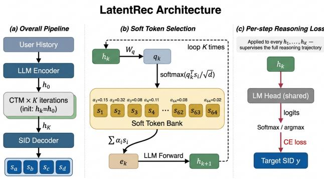
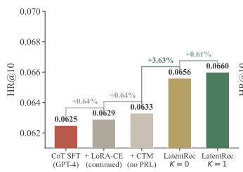
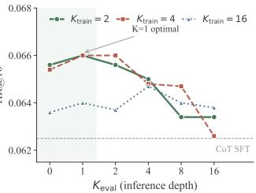

# Do Recommenders Need to Think in Words? Latent Reasoning for Eficient LLM-Based Recommendation

Hongyang Su supersusu@tencent.com Tencent Shenzhen, Guangdong, China

Beibei Kong∗ echokong@tencent.com Tencent Shenzhen, Guangdong, China

Chengxiang Zhuo   
felixzhuo@tencent.com   
Tencent   
Shenzhen, Guangdong, China   
Lei Cheng   
raycheng@tencent.com   
Tencent   
Shenzhen, Guangdong, China

Zang Li gavinzli@tencent.com Tencent Shenzhen, Guangdong, China

## Abstract

LLM-based recommender systems increasingly generate chain-ofthought (CoT) text before each item prediction to activate the LLM’s reasoning capacity, costing tens to hundreds of extra tokens per recommendation at inference. We ask whether inference-time rea- soning artifacts (textual or latent) can be replaced by training-time supervision alone, without loss of accuracy. We propose LatentRec, a framework for LLM-based generative recommendation that replaces inference-time reasoning artifacts with training-time perstep head supervision. LatentRec has three components. A 2.5M-parameter Continuous Thought Module iterates � latent reasoning steps over the LLM’s hidden state during training. Soft Token Selection bridges the ∼14× norm gap between hidden states and input embeddings. A Per-step Reasoning Loss (PRL) supervises every intermediate state through the LLM’s prediction head against the first token of the target Semantic ID. The trained LLM retains this accuracy without the module at inference, so the module can be discarded at deployment. On three Amazon benchmarks, LatentRec improves HR@10 by 4.0–5.0% (relative) over a CoT-distilled baseline at 18.3× lower latency (batch=1). Per-step training supervision consistently improves accuracy across three datasets, paid once at training rather than at every recommendation.

## CCS Concepts

• Information systems → Recommender systems; • Computing methodologies → Natural language processing.

## Keywords

Recommender Systems, Large Language Models, Latent Reasoning, Chain-of-Thought

## ACM Reference Format:

Hongyang Su, Beibei Kong, Lei Cheng, Chengxiang Zhuo, and Zang Li. 2026. Do Recommenders Need to Think in Words? Latent Reasoning for Eficient LLM-Based Recommendation. In Proceedings ofthe 35th ACM International

Conference on Information and Knowledge Management (CIKM ’26), November 07–11, 2026, Rome, Italy. ACM, New York, NY, USA, 5 pages. https://doi.org/ 10.1145/3799682.3840048

Recent LLM-based recommenders [1, 24] increasingly bind reasoning to inference-time generation: chain-of-thought (CoT) [19] trajectories are written as language tokens before each item prediction, exemplified by CoT distillation [11] and related variants [8, 21, 22]. Latent reasoning relaxes the textual constraint by replacing inferencetime text with continuous hidden-state computation, established for math and logic by COCONUT [3], CODI [15], and pause-token continuation [2], and recently brought to recommendation through encoder-side rollouts [10, 17, 18] and concurrent RL-based latent reasoning for LLM recommenders [23]. Across both regimes, however, reasoning capacity remains whatever the model produces at inference, paid for at every recommendation request.

## 1 Introduction

Can inference-time reasoning artifacts (textual or latent) be replaced by training-time supervision alone, without loss ofaccuracy? We propose LatentRec, a framework for SID-generative LLM recommenders that replaces inference-time reasoning with training-time per-step head supervision. At the heart of LatentRec is a Per-step Reasoning Loss (PRL), inspired by progressive supervision [18], that supervises every intermediate hidden state through the LLM’s prediction head against the first token of the target Semantic ID. PRL needs intermediate states to supervise, which a lightweight Continuous Thought Module (2.5M parameters, <0.2% of the LLM) generates by iterating � latent reasoning steps over the LLM’s hid-den state during training, with Soft Token Selection projecting each state back into the input-embedding distribution the LLM was pretrained on. The trained LLM retains the resulting accuracy without the module at inference, so the Continuous Thought Module is required only during training and can be discarded at deployment.

LatentRec difers from prior latent reasoning recommenders in two respects. (i) It operates in the SID-generative regime where items are decoded as multi-token Semantic IDs. This regime exhibits a ∼14× norm gap between LLM hidden states and input embeddings (§2.2), absent in encoder-side rollouts [10, 17, 18] or title-decoded LLM recommenders [23]. (ii) Its per-step prediction-head supervision adapts the progressive supervision idea of [18] to the LLM SID-decoder regime, unlike objectives that supervise only the final SID or optimize final rewards over reasoning traces.

  
Figure 1: LatentRec architecture. (a) Overall pipeline. (b) Soft Token Selection projects each hidden state into the LLM’s input-embedding distribution. (c) Per-step Reasoning Loss supervises every intermediate state via the shared LM head against the first SID component of the target.

Our contributions are summarized as follows. (1) Paradigm shift. We propose LatentRec, which replaces inference-time reasoning artifacts (textual or latent) in SID-generative LLM recommenders with training-time per-step supervision, eliminating perrequest reasoning cost without sacrificing accuracy. (2) Technical contribution. We adapt progressive supervision to the LLM SIDdecoder regime through a Per-step Reasoning Loss applied via the shared prediction head, paired with Soft Token Selection that resolves the representation-space mismatch unique to LLM SIDdecoding. The added module is 2.5M parameters (<0.2% of the LLM) and is discarded at deployment. (3) Empirical impact. On three Amazon benchmarks, LatentRec improves HR@10 by 4.0–5.0% (relative) over a same-backbone CoT-distilled baseline at 18.3× lower inference latency, moving the cost of reasoning from per-request inference to one-time training. (4) Mechanistic insight. We isolate where chain-of-thought actually contributes: per-step supervision drives the gain at �=0 inference, while CoT pre-training mainly stabilizes deeper latent rollout (without it, accuracy drops 11% at �=16). Multi-step latent computation accrues value at training rather than at inference.

## 2 Method

LatentRec replaces inference-time reasoning with training-time perstep head supervision for LLM-based generative recommendation, applicable to any LLM that decodes items as hierarchical Semantic IDs (SIDs) [9, 11, 14]. Three components work together (Figure 1): (1) a Continuous Thought Module that performs hidden-state iterations during training, (2) Soft Token Selection that bridges the representation space gap between hidden states and input embeddings, and (3) Per-step Reasoning Loss (PRL) that supervises every intermediate state through the LLM’s prediction head against the first component of the target Semantic ID.

## 2.1 Continuous Thought Module

The Continuous Thought Module produces the intermediate hidden states $\mathbf { h } _ { 1 } , . . . , \mathbf { h } _ { K }$ that PRL supervises. Starting from the user-history

hidden state $\mathbf { h } _ { 0 } \in \mathbb { R } ^ { d }$ , � reasoning steps unroll as

$$
\mathbf { e } _ { k } = \phi ( \mathbf { h } _ { k } ) , \quad \mathbf { h } _ { k + 1 } = \mathrm { L L M } ( \mathbf { e } _ { k } , \mathrm { K V } ^ { ( k ) } )\tag{1}
$$

where � is Soft Token Selection (§2.2) and $\mathrm { K V } ^ { ( k ) }$ is the accumulated key-value cache (Algorithm 1, lines $_ { 2 - 5 ) }$ . The 2.5M trainable parameters added by LatentRec are confined to STS (S and $W _ { q } )$ . Each step nevertheless invokes the full LLM, so latent computation cost scales as $K \times P$ where � is one LLM forward pass. At inference �=0 disables the rollout and decodes directly from h0.

## 2.2 Soft Token Selection

A key challenge is the representation space mismatch: in our Qwen3- 1.7B backbone, the mean L2 norm of last-layer hidden states $( \left\| \mathbf { h } \right\| \approx$ 45) is roughly 14× that of input embeddings $( \| \mathbf { e } \| \approx 3 ) .$ Prior latent reasoning methods in math and logic domains [3, 15] feed raw hidden states back as inputs and rely on careful training stabilization. The LLM-based SID-decoding setting amplifies this challenge: every intermediate state h� is supervised through the LLM’s prediction head (§2.3) and must align with the input-embedding distribution the LLM was pre-trained on, otherwise the per-step logits drift away from the SID vocabulary as � grows.

We maintain � learnable soft tokens $\mathsf { S } \in \mathbb { R } ^ { N \times d }$ , initialized from the LLM’s vocabulary. The projection computes:

$$
\alpha _ { i } ^ { ( k ) } = \frac { \exp ( \mathbf { q } _ { k } ^ { \top } \mathbf { s } _ { i } / \sqrt { d } ) } { \sum _ { j } \exp ( \mathbf { q } _ { k } ^ { \top } \mathbf { s } _ { j } / \sqrt { d } ) } , \quad \mathbf { e } _ { k } = \sum _ { i } \alpha _ { i } ^ { ( k ) } \mathbf { s } _ { i }\tag{2}
$$

where $\mathbf { q } _ { k } = W _ { q } \mathbf { h } _ { k }$ . The convex combination keeps the projected output within the input-embedding scale, bounds gradients by $\alpha _ { i } ~ \in ~ ( 0 , 1 )$ , and avoids a separate normalization layer. Beyond matching scale, the convex combination keeps every projected $\mathbf { e } _ { k }$ in-distribution with respect to the LLM’s input-embedding manifold, both in norm and in direction. A scalar rescaling would match scale but not direction, while raw hidden-state feedback as used in math/logic latent reasoning [3, 15] matches neither. Empirically, combining raw hidden-state feedback with our per-step head su- pervision (§2.3) diverges within the first epoch under matched configuration, with per-step logits drifting of the SID vocabulary and triggering our auto-stop guard $( \mathcal { L } > 2 0 0 )$ . The failure mode is specific to this regime: math/logic methods feed raw hidden states without head supervision, whereas our PRL objective requires every h� to map to the SID vocabulary at every step. STS resolves this incompatibility and is therefore load-bearing in the LLM SID-decoding regime. We set �=64 in our implementation. The parameter overhead of LatentRec is ∼2.5M (<0.2% of a 1.7B LLM).

## 2.3 Per-step Reasoning Loss (PRL)

Latent reasoning approaches in math and logic domains [3, 15] do not supervise intermediate steps via the prediction head, leaving these steps without direct task-loss gradients. ReaRec’s Progressive Reasoning Learning [18] introduces step-wise supervision in the SRencoder regime, scoring each reasoning state via item-embedding inner products with progressive temperature annealing. PRL adapts this idea to the LLM SID-decoder regime: each ${ \bf h } _ { k }$ is supervised through the LLM’s prediction head against the first SID component of the target item, rather than against item embeddings as in [18].

Algorithm 1 LatentRec training step (one batch element)   
Require: user history $h _ { \mathrm { u s e r } } ,$ target SID $\boldsymbol { y } ~ = ~ ( \boldsymbol { y } ^ { 1 } , \ldots , \boldsymbol { y } ^ { L } )$ , depth $K _ { \mathrm { t r a i n } } ,$   
weight �   
1: h0 $ \mathrm { L L M } ( h _ { \mathrm { u s e r } } ) .$ .lastHidden ⊲ user representation   
2: for $k = 1 \mathrm { t o } K _ { \mathrm { t r a i n } }$ do   
3: ${ \bf q } _ { k } \gets W _ { q } \ln _ { k - 1 } ; \quad \alpha _ { k } \gets \mathrm { s o f t m a x } ( { \bf q } _ { k } ^ { \top } { \bf S } / \sqrt { d } )$   
4: $\begin{array} { r } { \mathbf { e } _ { k } \gets \sum _ { i } \alpha _ { k , i } \mathbf { s } _ { i } } \end{array}$ ⊲ STS projection   
5: $\mathbf { h } _ { k }  \mathrm { L L M } ( \mathbf { e } _ { k } , \mathrm { K V } ^ { ( k - 1 ) } )$ ⊲ latent token   
6: $T _ { k } \gets T _ { b } + T _ { s } \left( 1 - k / K _ { \mathrm { t r a i n } } \right)$   
7: $\ell _ { k } ^ { \mathrm { P R L } } \gets \mathrm { C E } \big ( \mathrm { L M } _ { - }$ \_head $( \mathbf { h } _ { k } ) / T _ { k } , \ y ^ { 1 } )$   
8: end for   
9: $\ell ^ { \mathrm { C E } } \gets \sum _ { l = 1 } ^ { L }$ CELM\_head $\circ \mathrm { L L M } ( y ^ { < l } , \mathbf { h } _ { K _ { \mathrm { t r a i n } } } ) , y ^ { l } )$   
10: $\begin{array} { r } { \mathcal { L }  \ell ^ { \mathrm { C E } } + \lambda \cdot \frac { 1 } { K _ { \mathrm { t r a i n } } } \sum _ { k = 1 } ^ { K _ { \mathrm { t r a i n } } } \ell _ { k } ^ { \mathrm { P R L } } } \end{array}$   
11: Update LoRA adapters and $\{ \mathsf { S } , W _ { q } \}$ via ∇L

Per-step supervision in this regime is only stable when paired with Soft Token Selection (§2.2), since the 14× norm gap absent in SR encoders would otherwise drive intermediate logits away from the SID vocabulary as � grows. PRL applies the LLM’s prediction head at every step under a logit-temperature schedule:

$$
\mathcal { L } _ { \mathrm { P R L } } = \frac { 1 } { K } \sum _ { k = 1 } ^ { K } \mathrm { C E } \big ( \mathrm { L M \_ h e a d } ( \mathbf { h } _ { k } ) / T _ { k } , \ y \big ) , \quad T _ { k } = T _ { b } + T _ { s } \big ( 1 - \frac { k } { K } \big )\tag{3}
$$

where � is the first SID component of the target item, and $T _ { k }$ decays linearly from $T _ { b } { + } T _ { s } \big ( 1 { - } 1 / K \big )$ at step 1 down to $T _ { b }$ at step � (we use $T _ { b } { = } 1 , \ T _ { s } { = } 5 )$ . Higher temperatures at early steps relax the in termediate predictions. The lowest temperature at step � enforces sharp alignment with the target. The total loss is $\mathcal { L } = \mathcal { L } _ { \mathrm { C E } } + \lambda \mathcal { L } _ { \mathrm { P R L } }$ (�=0.1). We supervise the first SID token because it carries the coarsest routing signal in the hierarchical RQ-VAE codebook, providing a stable target for intermediate hidden states. Supervising deeper levels would require teacher-forcing the prefix of the target SID at each latent step, which would couple the latent rollout trajectory to a fixed decoding path and conflict with the autoregressive SID decoding used at inference. Later SID levels remain supervised by the standard $\mathcal { L } _ { \mathrm { C E } }$

PRL trains the Thought Module to produce progressively better latent states under head su ervision, and u dates the LLM’s LoRA adapters through the shared objective. The full training step is summarized in Algorithm 1. Empirically, PRL improves performance even at �=0 inference, where the Thought Module does not partici-pate in the forward pass: the �=0 gain therefore reflects multi-step PRL supervision shaping the LoRA adapters during training, rather than emergent �-step reasoning at inference. PRL can equivalently be read as structured multi-step deep supervision through the LM head. A component-wise ablation (§3.3) shows PRL as the dominant contributor, with the three components compounding to the +5.0% lift over CoT SFT on Beauty.

## 2.4 Training Pipeline

LatentRec starts from a CoT-pre-trained checkpoint, obtained by fine-tuning Qwen3-1.7B on GPT-4-distilled CoT supervision following the recipe of [11]. This checkpoint also serves as the CoT SFT baseline (Table 1), with the same CoT teacher held constant across both. CoT initialization stabilizes deep latent rollout (§3.4) but is not required for the recommended �=0 deployment.

## 3 Experiments

## 3.1 Setup

Datasets and protocol. Amazon Review 2014 [4] 5-core: Beauty (22.4K users / 12.1K items), Toys (19.4K / 11.9K), Sports (35.6K / 18.4K). Items are encoded as 4-level RQ-VAE SIDs (codebook 256, 0% collision after Sinkhorn deduplication) [14]. All methods in Table 1 share an identical protocol: leave-one-out evaluation, full-corpus ranking, beam width 50, HR@{5, 10} and NDCG@{5, 10}.

Baselines. Discriminative references GRU4Rec [5], SASRec [7], BERT4Rec [16], HGN [12]; SID-based generative TIGER [14]; latentreasoning ReaRec [18]; and LLM-CoTSFT (henceforth CoT SFT), our same-backbone CoT distillation baseline following the recipe of[11]: Qwen3-1.7B fine-tuned on GPT-4-generated reasoning traces (§2.4), which LatentRec directly extends. ReaRec is the only open-source SID-compatible latent-reasoning reference. LARES, PLR (encoderonly) and concurrent LatentR3 (title-decoded LLM) would require porting onto our SID stack and are not directly comparable.

Implementation. Qwen3-1.7B [20], LoRA [6] rank 16 applied to all attention and MLP linear layers, $K _ { \mathrm { t r a i n } } { = } 2 , \lambda { = } 0 . 1$ , PRL temperature $T _ { b } { = } 1 , \ T _ { s } { = } 5 ,$ lr 5e-6 (LoRA) and 5e-5 (Thought Module), batch 64, 3 epochs, 2×H20 GPUs with DeepSpeed ZeRO-2 [13]. Only LoRA adapters and the 2.5M-parameter Thought Module receive gradients. The LLM backbone is otherwise frozen. RQ-VAE tokenizers are trained per-domain for 100 epochs with Sinkhorn-balanced clustering. Latency in Table 3 is measured at batch=1 on a single H20 GPU over 100 randomly-sampled test users.

## 3.2 Main Results

LatentRec K=0 improves HR@10 by 5.0%/4.5%/4.0% over the LLM-CoT SFT baseline (Beauty 0.0625→0.0656, Toys 0.0639→0.0668, Sports 0.0297→0.0309). K=1 yields no consistent gain across datasets (+0.6%/−0.6%/−0.6%), reinforcing �=0 as the recommended default. The smaller Sports margin tracks a weaker LLM-CoT SFT lead over GRU4Rec/HGN there: language-derived item priors carry less signal on Sports than on Beauty/Toys. Over the strongest discriminative baseline (HGN), LatentRec K=0 retains a +4.1%/+2.9%/+1.3% HR@10 margin. Gains hold across all four metrics (HR@{5, 10}, NDCG@{5, 10}) on every dataset, with no cell where LatentRec K=0 underperforms CoT SFT (Table 1). LatentRec K=0 also improves over ReaRec by 16.5%/5.7%/8.4% HR@10, but ReaRec is an SR-encoder at much smaller parameter scale and the margin partly reflects backbone capacity. CoT SFT alone (Beauty 0.0625) does not surpass HGN (0.0630), while LatentRec K=0 (0.0656) does: the LLM advantage in this regime requires training-time supervision.

## 3.3 Ablation Study

PRL supervision is the dominant contributor: it lifts HR@10 from 0.0633 (continued LoRA + Thought Module without PRL) to 0.0656 (+3.63%). Two controls on the same CoT SFT checkpoint with matched epochs, lr, batch, and data isolate this contribution: (i) continued LoRA fine-tuning with SID CE only reaches 0.0629 (+0.64%); (ii) adding the Thought Module and Soft Token Selection without PRL reaches 0.0633 (+0.64% over (i)); (iii) adding PRL lifts to 0.0656 (+3.63% increment, Figure 2 left). The three components compound multiplicatively to the +5.0% end-to-end lift $( 1 . 0 0 6 4 \times 1 . 0 0 6 4 \times$

Table 1: Overall performance on three Amazon benchmarks.
<table><tr><td></td><td colspan="4">Amazon Beauty</td><td colspan="4">Amazon Toys</td><td colspan="4">Amazon Sports</td></tr><tr><td>Method</td><td>HR@5</td><td>HR@10</td><td>N@5</td><td>N@10</td><td>HR@5</td><td>HR@10</td><td>N@5</td><td>N@10</td><td>HR@5</td><td>HR@10</td><td>N@5</td><td>N@10</td></tr><tr><td colspan="9">Traditional Sequential Recommendation</td><td></td><td></td><td></td><td></td></tr><tr><td>GRU4Rec</td><td>0.0395</td><td>0.0613</td><td>0.0260</td><td>0.0330</td><td>0.0341</td><td>0.0492</td><td>0.0240</td><td>0.0289</td><td>0.0197</td><td>0.0298</td><td>0.0126</td><td>0.0164</td></tr><tr><td>SASRec</td><td>0.0349</td><td>0.0541</td><td>0.0202</td><td>0.0264</td><td>0.0380</td><td>0.0609</td><td>0.0202</td><td>0.0276</td><td>0.0162</td><td>0.0272</td><td>0.0086</td><td>0.0121</td></tr><tr><td>BERT4Rec</td><td>0.0197</td><td>0.0337</td><td>0.0121</td><td>0.0166</td><td>0.0133</td><td>0.0225</td><td>0.0084</td><td>0.0113</td><td>0.0095</td><td>0.0158</td><td>0.0058</td><td>0.0078</td></tr><tr><td>HGN</td><td>0.0420</td><td>0.0630</td><td>0.0289</td><td>0.0356</td><td>0.0427</td><td>0.0649</td><td>0.0287</td><td>0.0359</td><td>0.0194</td><td>0.0305</td><td>0.0123</td><td>0.0162</td></tr><tr><td colspan="9">SID-Based Generative Recommendation</td><td></td><td></td><td></td><td></td></tr><tr><td>TIGER</td><td>0.0346</td><td>0.0565</td><td>0.0228</td><td>0.0299</td><td>0.0304</td><td>0.0496</td><td>0.0200</td><td>0.0261</td><td>0.0203</td><td>0.0302</td><td>0.0128</td><td>0.0166</td></tr><tr><td>ReaRec</td><td>0.0413</td><td>0.0563</td><td>0.0244</td><td>0.0292</td><td>0.0396</td><td>0.0632</td><td>0.0217</td><td>0.0293</td><td>0.0154</td><td>0.0285</td><td>0.0089</td><td>0.0131</td></tr><tr><td colspan="9">LLM-Based Methods (Qwen3-1.7B backbone, full-corpus ranking, beam=50)</td><td></td><td></td><td></td><td></td></tr><tr><td>LLM-CoT SFT</td><td>0.0449</td><td>0.0625</td><td>0.0312</td><td>0.0369</td><td>0.0453</td><td>0.0639</td><td>0.0316</td><td>0.0376</td><td>0.0197</td><td>0.0297</td><td>0.0132</td><td>0.0163</td></tr><tr><td>LatentRec K=0</td><td>0.0481</td><td>0.0656</td><td>0.0341</td><td>0.0398</td><td>0.0482</td><td>0.0668</td><td>0.0343</td><td>0.0403</td><td>0.0208</td><td>0.0309</td><td>0.0142</td><td>0.0174</td></tr><tr><td>LatentRec K=1</td><td>0.0477</td><td>0.0660</td><td>0.0341</td><td>0.0400</td><td>0.0483</td><td>0.0664</td><td>0.0344</td><td>0.0402</td><td>0.0206</td><td>0.0307</td><td>0.0140</td><td>0.0172</td></tr></table>

Table 2: Efect of CoT initialization on Beauty. Both bases converge at K=0. Divergence is visible only for deeper rollouts. The Δ row reports between-base diferences at each $K _ { \mathrm { e v a l } } .$
<table><tr><td>Base Model</td><td>K=0</td><td>K=1</td><td>K=2</td><td>K=4</td><td>K=8</td><td>K=16</td></tr><tr><td>w/ CoT init</td><td>0.0656</td><td>0.0660</td><td>0.0656</td><td>0.0650</td><td>0.0634</td><td>0.0634</td></tr><tr><td>w/o CoT init</td><td>0.0656</td><td>0.0644</td><td>0.0639</td><td>0.0623</td><td>0.0602</td><td>0.0583</td></tr><tr><td>Δ</td><td>0</td><td>+0.0016</td><td>+0.0017</td><td>+0.0027</td><td>+0.0032</td><td>+0.0051</td></tr></table>

$1 . 0 3 6 3 \approx 1 . 0 4 9 6 )$ . Control (i) already supervises the first SID token via standard SID CE, so PRL’s +3.63% adds value beyond first-token classification. §3.4 further shows the same PRL on a non-CoT base degrades at every �>0 (1.8% at K=1, 11.1% at K=16): CoT installs the representational substrate that PRL exploits.

## 3.4 Model Analysis

CoT initialization is required for latent rollout. Table 2 re-ports a controlled reversal: identical PRL training is applied to two checkpoints difering only in pretraining (CoT SFT vs direct SID prediction). Both reach 0.0656 at K=0, but diverge as rollout deepens: the no-CoT base loses 2.6%/5.0%/8.2%/11.1% at K=2/4/8/16, while the CoT base stays within 3.4%. CoT supervision is therefore not required for K=0 deployment but is the substrate that keeps deep latent rollout stable.

Inference cost. Table 3 summarizes cost-accuracy on Beauty. LatentRec K=0 adds no extra FLOPs over a SID-only decoder yet improves over CoT SFT by 5.0%. K=1 adds one single-token LLM forward (∼2� FLOPs) and reaches 0.0660, with no consistent K=1 gain across datasets (Table 1). LatentRec K=0 reaches 0.59 s/sample vs 10.80 s for CoT SFT, an 18.3× latency reduction (K=1: 0.61 s, 17.7×). The reasoning cost moves from inference to training, paid once rather than at every recommendation.

Reasoning depth. The useful $K _ { \mathrm { e v a l } }$ range scales with $K _ { \mathrm { t r a i n } } ,$ bound- ing when latent rollout helps and when it hurts. Figure 2b shows the full $K _ { \mathrm { t r a i n } } \times K _ { \mathrm { e v a l } }$ sweep on Beauty. Three findings emerge: $( 1 ) K _ { \mathrm { t r a i n } } { = } 2$ yields the strongest K=0 base (0.0656 vs. 0.0636 for $K _ { \mathrm { t r a i n } } { = } 1 6 )$ , as shorter chains concentrate PRL supervision closer to the final prediction; (2) K=1 is optimal across all training depths, with deeper rollouts plateauing or degrading; (3) the useful $K _ { \mathrm { e v a l } }$ range scales roughly with $K _ { \mathrm { t r a i n } } { \mathrm { : } }$ for $K _ { \mathrm { t r a i n } } { = } 2$ only K=1 improves, while for $K _ { \mathrm { t r a i n } } { = } 1 6$ improvement extends to K=4.

Table 3: Reasoning cost on Beauty (batch=1, time per sample). � denotes one LLM forward pass.
<table><tr><td>Method</td><td>Output</td><td>Time (s)</td><td>Extra FLOPs</td><td>HR@10</td></tr><tr><td>LLM-CoT SFT</td><td>128 tokens</td><td>10.80</td><td>~256P</td><td>0.0625</td></tr><tr><td>LatentRec K=0</td><td>none</td><td>0.59</td><td>0</td><td>0.0656</td></tr><tr><td>LatentRec K=1</td><td>1 step</td><td>0.61</td><td> ${ \sim } 2 P$ </td><td>0.0660</td></tr></table>

  
Figure 2: (a) Component-wise decomposition of LatentRec’s gain on Beauty HR@10 at �=0. (b) HR@10 across $K _ { \mathbf { e v a l } }$ for $K _ { \mathbf { t r a i n } } \in \{ 2 , 4 , 1 6 \}$ . Dashed line marks the CoT SFT baseline.

## 4 Conclusion

LatentRec demonstrates that inference-time reasoning is not a prerequisite for LLM-based generative recommendation: per-step prediction-head supervision during training improves HR@10 by 4.0–5.0% over a CoT-distilled baseline while reducing inference latency by 18.3×. Two findings clarify CoT’s role in this regime. (1) K≥1 latent rollout yields no consistent benefit across datasets, locating the value of multi-step latent computation in training rather than inference. (2) CoT pre-training stabilizes deep latent rollout but is not required for K=0, separating warm-start from per-step supervision as distinct contributors. Training-time supervision, not inference-time scaling, is the more productive lever for reasoning in LLM-based recommendation.

Limitations and Future Work. Our empirical scope is a single LLM backbone (Qwen3-1.7B), a single CoT teacher (GPT-4), and three Amazon e-commerce domains. Cross-backbone, cross-teacher, and cross-domain generalization (e.g., movies, news, music) remains open, as does extension to non-SID generative recommenders. A natural next step is supervising deeper SID levels without coupling the latent rollout to a fixed decoding path.

## GenAI Usage Disclosure

We used GPT-4 to generate chain-of-thought reasoning text for the LLM-CoT SFT baseline that LatentRec extends. Each generation is conditioned on the user’s purchase history and the last 2–3 levels of the target item’s category path. The target’s title and Semantic ID are withheld, and the full prompt template will be released with the code upon acceptance. We additionally used a generative AI assistant for minor grammar checks during writing.

## References

[1] Keqin Bao, Jizhi Zhang, Yang Zhang, Wenjie Wang, Fuli Feng, and Xiangnan He. 2023. TALLRec: An efective and eficient tuning framework to align large language model with recommendation. In Proceedings of the 17th ACM conference on recommender systems. 1007–1014.

[2] Sachin Goyal, Ziwei Ji, Ankit Singh Rawat, Aditya Krishna Menon, Sanjiv Kumar, and Vaishnavh Nagarajan. 2024. Think before you speak: Training language mod els with pause tokens. In International Conference on Learning Representations.

[3] Shibo Hao, Sainbayar Sukhbaatar, DiJia Su, Xian Li, Zhiting Hu, Jason Weston, and Yuandong Tian. 2024. Training large language models to reason in a continuous latent space. arXiv preprint arXiv:2412.06769 (2024).

[4] Ruining He and Julian McAuley. 2016. Ups and downs: Modeling the visual evolution of fashion trends with one-class collaborative filtering. In Proceedings ofthe 25th international conference on world wide web. 507–517.

[5] Balázs Hidasi, Alexandros Karatzoglou, Linas Baltrunas, and Domonkos Tikk. 2015. Session-based recommendations with recurrent neural networks. arXiv preprint arXiv:1511.06939 (2015).

[6] Edward J Hu, Yelong Shen, Phillip Wallis, Zeyuan Allen-Zhu, Yuanzhi Li, Shean Wang, Liang Wang, Weizhu Chen, et al. 2022. LoRA: Low-rank adaptation of large language models. In Proceedings ofthe 10th International Conference on Learning Representations.

[7] Wang-Cheng Kang and Julian McAuley. 2018. Self-attentive sequential recom mendation. In 2018 IEEE international conference on data mining (ICDM). IEEE, 197–206.

[8] Xiaoyu Kong, Junguang Jiang, Bin Liu, Ziru Xu, Han Zhu, Jian Xu, Bo Zheng, Jiancan Wu, and Xiang Wang. 2025. Think before recommendation: Autonomous reasoning-enhanced recommender. In Advances in Neural Information Processing

Systems, Vol. 38. 141209–141232.

[9] Xiaoyu Kong, Leheng Sheng, Junfei Tan, Yuxin Chen, Jiancan Wu, An Zhang, Xiang Wang, and Xiangnan He. 2025. MiniOneRec: An open-source framework for scaling generative recommendation. arXiv preprint arXiv:2510.24431 (2025).

[10] Enze Liu, Bowen Zheng, Xiaolei Wang, Wayne Xin Zhao, Jinpeng Wang, Sheng Chen, and Ji-Rong Wen. 2025. LARES: Latent reasoning for sequential recommendation. arXiv preprint arXiv:2505.16865 (2025).

[11] Zhanyu Liu, Shiyao Wang, Xingmei Wang, Rongzhou Zhang, Jiaxin Deng, Honghui Bao, Jinghao Zhang, Wuchao Li, Pengfei Zheng, Xiangyu Wu, et al. 2025. OneRec-Think: In-text reasoning for generative recommendation. arXiv preprint arXiv:2510.11639 (2025).

[12] Chen Ma, Peng Kang, and Xue Liu. 2019. Hierarchical gating networks for sequential recommendation. In Proceedings ofthe 25th ACM SIGKDD international conference on knowledge discovery & data mining. 825–833.

[13] Samyam Rajbhandari, Jef Rasley, Olatunji Ruwase, and Yuxiong He. 2020. ZeRO: Memory optimizations toward training trillion parameter models. In SC20: international conference for high performance computing, networking, storage and analysis. IEEE, 1–16.

[14] Shashank Rajput, Nikhil Mehta, Anima Singh, Raghunandan Hulikal Keshavan, Trung Vu, Lukasz Heldt, Lichan Hong, Yi Tay, Vinh Tran, Jonah Samost, et al. 2023. Recommender systems with generative retrieval. In Advances in Neural Information Processing Systems, Vol. 36. 10299–10315.

[15] Zhenyi Shen, Hanqi Yan, Linhai Zhang, Zhanghao Hu, Yali Du, and Yulan He. 2025. CODI: Compressing chain-of-thought into continuous space via self-distillation. In Proceedings of the 2025 Conference on Empirical Methods in Natural Language Processing. 677–693.

[16] Fei Sun, Jun Liu, Jian Wu, Changhua Pei, Xiao Lin, Wenwu Ou, and Peng Jiang. 2019. BERT4Rec: Sequential recommendation with bidirectional encoder rep- resentations from transformer. In Proceedings of the 28th ACM international conference on information and knowledge management. 1441–1450.

[17] Jiakai Tang, Xu Chen, Wen Chen, Jian Wu, Yuning Jiang, and Bo Zheng. 2026. Parallel Latent Reasoning for Sequential Recommendation. arXiv preprint arXiv:2601.03153 (2026).

[18] Jiakai Tang, Sunhao Dai, Teng Shi, Jun Xu, Xu Chen, Wen Chen, Jian Wu, and Yunin Jian . 2026. Think before recommend: Unleashin the latent reasonin power for sequential recommendation. IEEE Transactions on Knowledge and Data Engineering (2026).

[19] Jason Wei, Xuezhi Wang, Dale Schuurmans, Maarten Bosma, Fei Xia, Ed Chi, Quoc V Le, Denny Zhou, et al. 2022. Chain-of-thought prompting elicits reasoning in large language models. Advances in neural information processing systems 35 (2022), 24824–24837.

[20] An Yang, Anfeng Li, Baosong Yang, Beichen Zhang, Binyuan Hui, Bo Zheng, Bowen Yu, Chang Gao, Chengen Huang, Chenxu Lv, et al. 2025. Qwen3 technical report. arXiv preprint arXiv:2505.09388 (2025).

[21] Runyang You, Yongqi Li, Xinyu Lin, Xin Zhang, Wenjie Wang, Wenjie Li, and Liqiang Nie. 2025. R2ec: Towards large recommender models with reasoning. In Advances in Neural Information Processing Systems, Vol. 38. 62376–62405.

[22] Qihang Yu, Kairui Fu, Zheqi Lv, Shengyu Zhang, Xinhui Wu, Chen Lin, Feng Wei, Bo Zheng, and Fei Wu. 2026. ThinkRec: Thinking-based recommendation via LLM. In Proceedings ofthe ACM Web Conference 2026. 5698–5709.

[23] Yang Zhang, Wenxin Xu, Xiaoyan Zhao, Wenjie Wang, Fuli Feng, Xiangnan He, and Tat-Seng Chua. 2025. Reinforced latent reasoning for LLM-based recommendation. arXiv preprint arXiv:2505.19092 (2025).

[24] Zihuai Zhao, Wenqi Fan, Jiatong Li, Yunqing Liu, Xiaowei Mei, Yiqi Wang, Zhen Wen, Fei Wang, Xiangyu Zhao, Jiliang Tang, et al. 2024. Recommender systems in the era of large language models (LLMs). IEEE Transactions on Knowledge and Data Engineering 36, 11 (2024), 6889–6907.