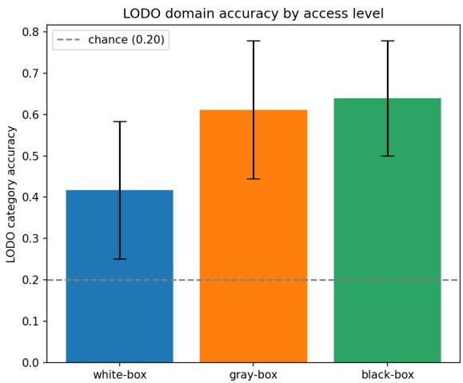
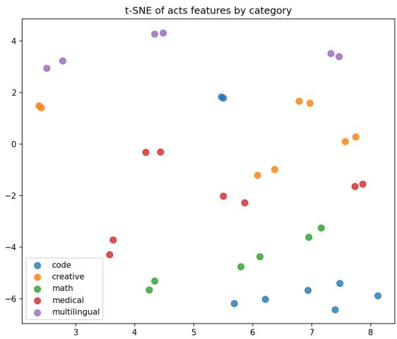
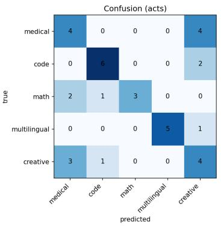
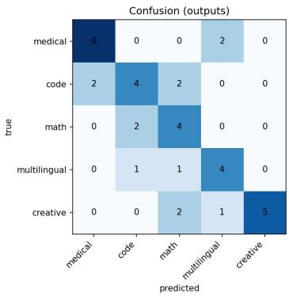

# Embedding-Space Fingerprinting of LoRA Fine-Tunes: Recovering the Training-Data Domain from the Model Artifact Alone

Shivesh Rane1

Goa College of Engineering, Farmagudi, Ponda, Goa, India shiveshrane04@gmail.com

Abstract. When a base language model is fine-tuned with Low-Rank Adaptation (LoRA), how much of the training-data domain leaks into the resulting artifact? This paper studies whether a simple classifier can recover the domain of a fine-tune given only the model artifact (weight deltas, internal activations on a fixed probe set, or generated text) without ever observing the training data. Using one base model (Qwen3.5- 0.8B), 36 LoRA fine-tunes are produced over 18 public datasets in five domains (medical, code, mathematics, non-English text, narrative prose), and three feature families are extracted at decreasing levels of access: white-box weights, gray-box activations, and black-box outputs. A leaveone-dataset-out (LODO) protocol, frozen before any result was seen, tests whether the domain of a fine-tune trained on a previously unseen dataset can be identified. The domain is recoverable well above chance (20%) from gray-box activations (61%) and black-box outputs (64%); white-box weight statistics reach 42%. Contrary to the pre-registered hypothesis that signal decays monotonically from weights to activations to outputs, activations and outputs were more informative than the weightdelta statistics. The black-box result holds unchanged (64%) when only generated text is used, without token probabilities. Domain accuracy is also stable when a third run per dataset is trained on an independently drawn data subsample, and black-box predictions are unafected by the LoRA rank (8–64). All code and per-run feature vectors are released.

Keywords: LoRA · model fingerprinting · data provenance · dataset inference · parameter-eficient fine-tuning.

## 1 Introduction

Parameter-eficient fine-tuning, and LoRA [7] in particular, has made it cheap to specialize a shared base model to a particular data distribution and to distribute the resulting adapter as a small artifact; quantized variants such as QLoRA [2] bring this within reach of a single commodity GPU, and adapter libraries are routinely shared and composed [8]. This raises a provenance question with both auditing and privacy dimensions: given only the artifact, can one infer what kind of data the adapter was trained on?

The study is organized around three research questions, in decreasing order of access to the model:

RQ1 (per-dataset). Can a classifier identify which dataset produced a finetune? (a re-identification baseline)

RQ2 (per-domain, the headline). Can it identify the domain of a fine-tune trained on a dataset from which it has seen no examples, i.e., does the fingerprint generalize across datasets within a domain?

RQ3 (signal decay). How does recoverability change as access degrades from weight deltas, to activations on a fixed probe set, to generated outputs?

The contributions are: (i) a formulation of training-domain inference for LoRA adapters along an explicit white/gray/black-box access axis (Sect. 3); (ii) an end-to-end empirical study on a modern hybrid base model under an evaluation protocol frozen before any fine-tune was trained (Sects. 4 and 5); (iii) a clearly characterized outcome, including a refuted sub-hypothesis (RQ3), with dataset-clustered confidence intervals; and (iv) robustness checks on the blackbox access assumption (Sect. 6.1), the LoRA rank (Sect. 6.2), and independently resampled training data (Sect. 6.3).

## 2 Related Work

Learning from weights and fine-tuned representations. Model properties can be predicted directly from parameters, e.g., test accuracy from weights [17], and tasks can be embedded as vectors, e.g., Task2Vec [1], an ancestor of the whitebox features used here. Recent work treats LoRA factors as a data modality: Putterman et al. [12] build GL-equivariant networks that predict attributes and membership of the fine-tuning data from LoRA weights, Duszenko and Bielak [4] analyze how much concept information lives in difusion-model adapter weights, and Horwitz et al. recover pre-fine-tuning weights from several LoRA fine-tunes [5] and the heritage tree of fine-tuned models from their weights [6]. Closest to this paper, Delta Activations [19] embeds LoRA fine-tunes of 7–9B models by the shift of their final-layer activations relative to the base model on generic prompts, and shows that the embeddings cluster by domain, while flattened weights and output sentence embeddings cluster poorly. The present study difers in three ways: it asks a supervised generalization question (predicting the domain of a fine-tune from a dataset never seen by the classifier), it compares the three access levels under one frozen protocol, and it finds output features competitive with activations rather than inferior to them.

Membership, dataset, and property inference. Membership inference [15] asks whether a specific example was used for training; for large language models (LLMs) it is often barely above chance [3], and token-probability heuristics such as Min-K% Prob [14] target pretraining-data detection. Dataset inference [10] aggregates weak per-example signals to decide whether a given dataset was used, and has been extended to LLMs [11]. Property inference on fine-tuned LLMs recovers dataset-level statistics such as patient demographics [9]. All of these assume a candidate dataset or a known property; the present question is coarser and requires no candidate data: which domain the adapter was trained on.

Model fingerprinting. Fingerprinting usually identifies which model an artifact derives from, either by implanting a secret fingerprint [18] or by exploiting natural fingerprints left by training dynamics, which make models trained on identical data distinguishable [16]. The latter is directly relevant to RQ1, where same-dataset runs are re-identified almost perfectly (Sect. 5). Here the target of the fingerprint is the training data, not the model lineage.

## 3 Problem Formulation

Let $M _ { \mathrm { b a s e } }$ be a fixed base model and $\mathcal { D } = \{ D _ { 1 } , \ldots , D _ { K } \}$ a set of datasets, each mapped to one of $C$ domains by a labeling $c : \mathcal { D }  \mathcal { y } , | \mathcal { y } | = C \ ( \mathrm { h e r e } \ C = 5 )$ For dataset $D _ { i }$ and random seed s a fine-tune is obtained as

$$
M _ { i , s } = \mathrm { F T } \left( M _ { \mathrm { b a s e } } , D _ { i } ; s \right) ,\tag{1}
$$

under one fixed training recipe (Sect. 4.2). For an access level $a \in \{ \mathrm { w } , \mathrm { G } , \mathrm { B } \}$ a feature map $\phi _ { a }$ turns the artifact alone into a fixed-length vector

$$
\mathbf { x } _ { i , s } ^ { ( a ) } = \phi _ { a } \left( M _ { i , s } \right) \in \mathbb { R } ^ { d _ { a } } ,\tag{2}
$$

using no access to $D _ { i }$ . The three access levels are defined by what $\phi _ { a }$ may query:

– White-box (w): the adapter parameters (the LoRA factors).

– Gray-box (g): hidden states of every layer of $M _ { i , s }$ on chosen inputs, but not its parameters.

– Black-box (b): the generated text for chosen inputs together with the perstep next-token probability distribution (as exposed by APIs that return logprobabilities). A strictly text-only variant, which drops every feature that needs token probabilities, is evaluated separately (Sect. 6.1).

The goal is a classifier $g _ { a } : \mathbb { R } ^ { d _ { a } }  \mathcal { V }$ that predicts the domain $c ( D _ { i } )$ . The headline question (RQ2) requires generalization across datasets: $g _ { a }$ is evaluated on finetunes of datasets whose examples never appear in its training set (Sect. 4.4).

## 4 Method

## 4.1 Pipeline Overview

The study proceeds in four stages, each fully scripted and released:

Table 1. Datasets per domain (Hugging Face identifiers abbreviated). Entries in parentheses were excluded before any of their features reached a classifier (Sect. 7).
<table><tr><td>Domain</td><td>Datasets</td></tr><tr><td>Medical</td><td>PubMedQA, MedMCQA, ChatDoctor-HealthCareMagic, MedQA-USMLE</td></tr><tr><td>Code</td><td>Python-code-instructions-18k, Evol-Instruct-Code-80k, SQL-create-context, Code-instructions-122k</td></tr><tr><td></td><td>Mathematics MetaMathQA, MathInstruct, Orca-Math-200k, (camel-ai/math)</td></tr><tr><td></td><td>Multilingual IITB English–Hindi, OPUS-100 de-en, Aya (non-English slice), (Alpaca-  $G P T 4 \mathrm { \cdot }$  Japanese)</td></tr><tr><td>Creative</td><td>WritingPrompts, TinyStories, Opus-WritingPrompts, Instruction-Poems</td></tr></table>

1. Freeze the evaluation: commit the dataset-to-domain map, the 200 probe prompts, the LODO folds, and the scoring script before any training.

2. Train: fine-tune $M _ { \mathrm { b a s e } }$ once per (dataset, seed) with an identical LoRA recipe (Eq. (1)), saving only the adapter.

3. Extract: compute the feature vectors of Eq. (2) for every fine-tune, as described in Sect. 4.3.

4. Score: run the frozen script once (Sect. 4.4).

## 4.2 Population of Fine-Tunes

All fine-tunes share one base model, Qwen3.5-0.8B (a hybrid linear-attention vision-language model, used text-only), loaded in 4-bit NF4 quantization [2]. Table 1 lists the five domains and their datasets. Every run uses the same recipe: LoRA with rank $r = 1 6$ and $\alpha = 3 2$ on all linear projections inside the tokenmixing and MLP blocks (introspected rather than hard-coded, so that the gateddelta projections of the hybrid architecture are included); a fixed budget of 1.5M training tokens, so that dataset size is not a confound (one exception: the pipeline-validation run, PubMedQA seed 0, was trained on 2.0M tokens before the budget was fixed and was kept; see Sect. 7); maximum sequence length 1024 with packing; learning rate $2 \times 1 0 ^ { - 4 }$ with linear decay; efective batch size 16; one epoch; fp32 compute; two random seeds per dataset. Everything except the training dataset is held constant. Two of the twenty intended datasets were excluded before any of their features reached a classifier (Sect. 7), leaving 18 datasets × 2 seeds = 36 fine-tunes. Within a dataset, both seeds draw the same token subsample and difer only in initialization and data order; Sect. 6.3 relaxes this.

## 4.3 Feature Families

The same 200 probe prompts are used for the gray- and black-box families. They are deliberately domain-neutral (no medical, code, numeric, non-English,

or narrative vocabulary, $\mathrm { e . g . }$ , “Describe your morning routine.”) so that any recovered signal reflects the fine-tune and not leakage from the prompt. Probes are formatted with the model’s chat template.

White-box $( w e i g h t s , \ d _ { \mathrm { W } } = 4 8 )$ . For each adapted module m the LoRA update is

$$
\varDelta W _ { m } = \frac { \alpha } { r } B _ { m } A _ { m } , \qquad B _ { m } \in \mathbb { R } ^ { o \times r } , A _ { m } \in \mathbb { R } ^ { r \times d } .\tag{3}
$$

$\varDelta W _ { m }$ is never materialized. With thin QR factorizations $B _ { m } \ = \ Q _ { B } R _ { B }$ and $A _ { m } ^ { \top } = Q _ { A } R _ { A }$ 2

$$
\begin{array} { r } { \varDelta W _ { m } = Q _ { B } \left( \frac { \alpha } { r } R _ { B } R _ { A } ^ { \top } \right) Q _ { A } ^ { \top } , } \end{array}\tag{4}
$$

and because $Q _ { B }$ and $Q _ { A }$ in Eq. (4) have orthonormal columns, the singular values $\sigma _ { 1 } \ \geq \ \cdot \cdot \cdot \ \geq \ \sigma _ { r }$ of $\varDelta W _ { m }$ equal those of the $r \times r$ core $\scriptstyle { \frac { \alpha } { r } } R _ { B } R _ { A } ^ { \top }$ . The Frobenius norm follows as

$$
\begin{array} { r } { \| \varDelta W _ { m } \| _ { F } = \Bigl ( \sum _ { k = 1 } ^ { r } \sigma _ { k } ^ { 2 } \Bigr ) ^ { 1 / 2 } . } \end{array}\tag{5}
$$

Per module the norm (Eq. (5)) and the top-8 singular values are kept and aggregated into a fixed-length vector: mean, standard deviation, maximum, and sum of the norms per block type (token-mixing, MLP, other; 12 values); the normalized layer profile

$$
p ( \ell ) = \frac { \sum _ { m \in \mathrm { l a y e r } ~ \ell } \lVert \varDelta W _ { m } \rVert _ { F } } { \sum _ { \ell ^ { \prime } } \sum _ { m \in \mathrm { l a y e r } ~ \ell ^ { \prime } } \lVert \varDelta W _ { m } \rVert _ { F } } ,\tag{6}
$$

resampled to 24 points; the normalized mean top- $^ { - 8 }$ spectrum (8 values); and four global scalars (log total norm, token-mixing:MLP norm ratio, early:late layer norm ratio, and module count).

Gray-box (activations, $d _ { \mathrm { G } } = 7 8 )$ . For probe $p$ with $T _ { p }$ tokens and hidden states $\mathbf { h } _ { \ell , t } ( p )$ at layer ℓ, the per-layer mean and within-prompt spread are averaged over the probe set P:

$$
{ \pmb { \mu } } _ { \ell } = \frac { 1 } { | \mathcal { P } | } \sum _ { p \in \mathcal { P } } \frac { 1 } { T _ { p } } \sum _ { t = 1 } ^ { T _ { p } } { \bf h } _ { \ell , t } ( p ) , \qquad { \bf s } _ { \ell } = \frac { 1 } { | \mathcal { P } | } \sum _ { p \in \mathcal { P } } \mathrm { s t d } _ { t } \big ( { \bf h } _ { \ell , t } ( p ) \big ) .\tag{7}
$$

From Eq. (7), three layer curves, $\| \mu _ { \ell } \| _ { 2 } .$ , the mean of $| \mu _ { \ell } |$ , and the mean of $\mathbf { s } _ { \ell } .$ are each resampled to 24 points (72 values), plus six global scalars (curve means and spreads, layer count, and the relative depth of the peak activation norm).

Black-box (outputs, $d _ { \mathrm { B } } = 4 5 5 )$ . Each probe is answered by greedy decoding (at most 64 new tokens). With $p _ { t }$ the next-token distribution at generation step t, the mean predictive entropy per probe is

$$
\bar { H } ( p ) = \frac { 1 } { T } \sum _ { t = 1 } ^ { T } H _ { t } , \qquad H _ { t } = - \sum _ { v \in \mathcal { V } } p _ { t } ( v ) \log p _ { t } ( v ) .\tag{8}
$$

Table 2. Frozen LODO results (36 runs). RQ2 predicts the domain of a fine-tune from datasets never seen in training $( \mathrm { c h a n c e } = 0 . 2 0 )$ ; the row CI resamples individual predictions and the clustered CI resamples whole datasets. RQ1 re-identifies the dataset across seeds (chance = 0.056).
<table><tr><td rowspan="2">Access level</td><td colspan="3">RQ2: domain of an unseen dataset</td><td rowspan="2">RQ1 1 Acc.</td></tr><tr><td>Acc. 95%</td><td>CI (row)</td><td>95% CI (clustered) Macro-F1</td></tr><tr><td>White-box (weights)</td><td>0.417</td><td>0.250-0.583</td><td>0.194–0.639</td><td>0.404</td><td>1.000</td></tr><tr><td>Gray-box (activations)</td><td>0.611</td><td>0.444-0.778</td><td>0.417–0.806</td><td>0.643</td><td>1.000</td></tr><tr><td>Black-box (outputs)</td><td>0.639</td><td>0.499–0.778</td><td>0.417–0.861</td><td>0.640</td><td>0.944</td></tr></table>

The feature vector concatenates the mean, standard deviation, and median of $\bar { H } ( p )$ over probes (3 values, the only features requiring token probabilities); response-length statistics (4); a 64-bucket hashed histogram of the 200 most frequent generated token ids (64); and the centroid of the Sentence-BERT [13] embeddings (all-MiniLM-L6-v2) of the generations (384).

## 4.4 Frozen Evaluation Protocol

The evaluation was frozen before any fine-tune was trained: the dataset-todomain map, the probes, the folds, and the scoring script were committed and never altered. For RQ2, leave-one-dataset-out (LODO) is used. Writing $\mathcal { R } = \{ ( i , s ) \}$ for all runs and $g _ { a } ^ { ( - i ) }$ for the classifier trained on every run except those of dataset $D _ { i }$ , the pooled LODO accuracy is

$$
\mathrm { A c c } _ { a } = \frac { 1 } { | \mathcal { R } | } \sum _ { ( i , s ) \in \mathcal { R } } \mathbf { 1 } \left[ g _ { a } ^ { ( - i ) } \big ( \mathbf { x } _ { i , s } ^ { ( a ) } \big ) = c ( D _ { i } ) \right] ,\tag{9}
$$

so the domain of $D _ { i }$ must be inferred purely from other datasets of that domain. Each $g _ { a }$ is a standardized logistic regression (inverse regularization strength 1). RQ1 instead uses leave-one-seed-out and predicts the dataset identity. Reported metrics are top-1 accuracy, macro-F1, and a 1000-resample bootstrap 95% percentile confidence interval (CI) over pooled predictions. Because the two seeds of a dataset share training data, their predictions are not independent; a datasetclustered bootstrap, which resamples whole datasets, is therefore also reported. Chance for the five-way domain task is $1 / C = 0 . 2 0$ . Feature development used only a disjoint seed-0 development split, and the frozen script was executed once on the 36-run population.

## 5 Results

Table 2 gives the headline numbers, with the RQ2 accuracy computed as in Eq. (9); Fig. 1 plots these accuracies against chance.

  
Fig. 1. RQ2 leave-one-dataset-out domain accuracy by access level, with bootstrap 95% CIs. The dashed line is chance (0.20).

RQ1 (per-dataset). Re-identifying the exact dataset across seeds is essentially perfect from weights and activations (1.000) and nearly so from outputs (0.944, chance 0.056) (Table 2, last column). Since both seeds of a dataset share their training subsample, this mainly shows that the artifact encodes its specific training set, in line with natural-fingerprint findings [16]; it is not evidence of domain learning, which is what RQ2 measures.

RQ2 (per-domain, the headline). The domain of a fine-tune is recoverable on unseen datasets. Gray-box activations reach 0.611 and black-box outputs 0.639, with both row and clustered CIs excluding chance (Table 2, Fig. 1). Weight statistics reach 0.417; the row CI excludes chance but the more conservative clustered CI (0.194–0.639) does not, so the white-box result alone should not be read as established.

Figure 2 visualizes the gray-box features with t-SNE. The two seeds of every dataset appear as a tight pair, the geometric counterpart of the perfect RQ1 accuracy. At the domain level the layout is only partly organized: multilingual fine-tunes occupy the top of the map and mathematics and most code fine-tunes the bottom, while medical and creative fine-tunes are interleaved in the middle. This partial structure is consistent with an RQ2 accuracy well above chance but far from perfect, and anticipates the main confusion below.

The pooled confusion matrices in Fig. 3 show where the errors occur. With activations (left), multilingual (5 of 6 runs correct) and code (6 of 8) are the most separable domains, while medical and creative fine-tunes are confused with each other (4 of 8 medical runs predicted creative and 3 of 8 creative runs predicted medical): both domains consist of English prose, which shifts internal statistics similarly. With outputs (right), the medical–creative confusion disappears (6 of 8 medical and 5 of 8 creative runs correct); the largest remaining confusion is between code and mathematics (4 of the 13 errors), two domains whose training data are both dominated by symbolic, step-by-step answers. The two access levels therefore fail on diferent domain pairs, which suggests they capture complementary aspects of the fine-tune.

  
Fig. 2. t-SNE of the gray-box activation features, one point per fine-tune, colored by training-data domain.

RQ3 (signal decay). The pre-registered hypothesis was that recoverability decays monotonically, white > gray > black. The data refute this ordering: activations (0.611) and outputs (0.639) were more informative than the weight-delta statistics (0.417). Either the domain imprints more on behavior than on delta magnitudes, or, more likely, the hand-designed weight features of Sect. 4.3 (norms, spectra, and layer profiles, Eqs. (5)–(6), all of which discard singular directions) leave recoverable structure unused. This agrees with the weak clustering of raw adapter weights reported for larger models [19], but difers from that study on outputs: there, output sentence embeddings clustered poorly, whereas here output features are the strongest family. The diference does not come from the feature set: the MiniLM sentence-embedding centroid alone, the same output representation that study used, reaches 0.611 LODO accuracy here (Sect. 6.1). Setting aside the other diferences between the two studies (base models, probe sets), the most likely explanation is the evaluation: domain information is present in output embeddings but is not the dominant direction of variation, so a supervised classifier on standardized features recovers it while unsupervised clustering does not.

  
Fig. 3. Pooled LODO confusion matrices for gray-box activations (left) and black-box outputs (right). Rows are true domains, columns predicted domains.

Table 3. Post-acceptance robustness checks (RQ2 LODO domain accuracy unless noted; chance = 0.20).
<table><tr><td>Setting</td><td>White-box Gray-box Black-box</td><td></td><td></td></tr><tr><td>Headline (Table 2), 36 runs</td><td>0.417</td><td>0.611</td><td>0.639</td></tr><tr><td>Text-only black-box (no entropy), 36 runs</td><td></td><td></td><td>0.639</td></tr><tr><td>MiniLM centroid only (384 dims), 36 runs</td><td></td><td></td><td>0.611</td></tr><tr><td>Rank transfer,  $r \in \{ 8 , 6 4 \}$  (correct / 10)</td><td>3/10</td><td>6/10</td><td>8/10</td></tr><tr><td>Three runs per dataset incl. resampled, 54 runs</td><td>0.407</td><td>0.648</td><td>0.630</td></tr><tr><td>RQ1 across independent subsamples, 54 runs</td><td>1.000</td><td>0.981</td><td>0.981</td></tr></table>

## 6 Robustness Extensions

The checks below were added after acceptance in response to reviewer comments. Each is scored by the same unmodified frozen script on a separate set of runs, so the pre-registered results of Table 2 are unafected. Table 3 summarizes them. For these checks all runs were re-extracted with a deterministic hash for the tokenhistogram features (the released code); on the original 36 runs this reproduces the published accuracies of Table 2 exactly.

## 6.1 Text-Only Black-Box Access

The black-box family of Sect. 4.3 needs token probabilities for the three entropy features (Eq. (8)). Removing them leaves a 452-dimensional vector computable from generated text alone. On the same 36 runs its LODO accuracy is 0.639 (row CI 0.499–0.778, clustered CI 0.417–0.861; macro-F1 0.641), identical to the full black-box family, and RQ1 is unchanged at 0.944 (Table 3); only one of the 36 predictions difers. The black-box signal therefore does not depend on token-probability access: generated text alone sufices. Going further, the

384-dimensional MiniLM centroid alone, without length or token statistics, still reaches 0.611 (row CI 0.444–0.778, clustered CI 0.389–0.833; macro-F1 0.620), so most of the black-box signal is carried by the semantic content of the generations.

## 6.2 LoRA Rank

Ten additional fine-tunes use $r \in \{ 8 , 6 4 \} ~ ( \mathrm { w i t h } ~ \alpha = 2 r$ , so the scale $\alpha / r$ of $\operatorname { E q } .$ (3) is unchanged) on one dataset per domain. A classifier trained only on rank-16 runs of the other datasets predicts the domain of each rank-8 and rank-64 run, which tests rank transfer and dataset transfer together. Correct predictions are $3 / 1 0 , 6 / 1 0$ , and $8 / 1 0$ for the white-, gray-, and black-box families (Table 3); for reference, the same five datasets at rank 16 give $3 / 5 , 2 / 5$ , and $4 / 5$ . The blackbox family is unafected by rank: every dataset receives the same prediction at ranks 8, 16, and 64 (four of five correct, PubMedQA misclassified at every rank). The white-box statistics are not rank-invariant: all five rank-64 adapters are predicted as medical (correctly only for PubMedQA), because spectra and norms shift with the rank itself. When rank-16 runs of the same dataset are allowed in training (the frozen script’s robustness probe), category accuracy on the ten runs is 0.40, 0.80, and 1.00, respectively. With five datasets per rank these counts are indicative only.

## 6.3 Independently Resampled Training Data

In the headline population the two seeds of a dataset share one training subsample. A third run per dataset (18 runs) is therefore trained on an independently drawn 1.5M-token subsample with a new seed. For 15 of the 18 datasets the budget uses at most 26% of the dataset, so the new subsample is largely disjoint from the original one; for the other three (Python-code-instructions 46%, MedQA-USMLE 64%, Aya 93%) the overlap is substantial. On all 54 runs the LODO domain accuracy is 0.407, 0.648, and 0.630 for the white-, gray-, and black-box families (row CIs 0.278–0.537, 0.519–0.778, 0.519–0.759; clustered CIs 0.203–0.611, 0.426–0.852, 0.407–0.833), essentially unchanged from the 36-run headline but with narrower row intervals (Table 3). Leave-one-seed-out dataset re-identification, now across runs trained on largely diferent examples, stays at 1.000, 0.981, and 0.981 (chance 0.056). The fingerprint therefore characterizes the dataset’s distribution rather than the specific examples drawn from it.

## 7 Discussion, Limitations, and Threats to Validity

The headline finding, that the training domain of a LoRA fine-tune is recoverable from the artifact alone and generalizes to unseen datasets, bears directly on provenance auditing of distributed adapters and on detecting undisclosed training data. The black-box result is notable because, as the text-only variant of Sect. 6.1 shows, it requires nothing beyond the generated text for a fixed set of neutral prompts, i.e., ordinary API access.

The study has clear bounds. (i) It uses a single 0.8B hybrid vision-language base model and LoRA only; transfer to other architectures, larger scales, and full fine-tuning is untested and was outside the compute budget of the study (a hard limit of US\$30 of cloud GPU time). (ii) With 36 headline runs the CIs are wide; under the clustered bootstrap the white-box accuracy is not distinguishable from chance, so the RQ3 ordering should be read as suggestive; adding a third run per dataset (Sect. 6.3) narrows the intervals but does not change this conclusion. (iii) Two of the twenty intended datasets were excluded before any of their features reached a classifier: camel-ai/math, which is stored as tens of thousands of individual files and could not be loaded within the compute budget, and a Japanese dataset that was deprioritized under the budget; mathematics and multilingual therefore use three datasets each. (iv) One of the 36 headline runs (PubMedQA, seed 0) was trained on 2.0M rather than 1.5M tokens, because it served as the pipeline-validation run before the budget was reduced. Replacing it with a 1.5M-token rerun leaves the RQ2 accuracies unchanged (0.417, 0.611, 0.639). (v) The domains are deliberately well separated; finer distinctions (e.g., two medical sub-specialties) are likely harder. (vi) A pilot result of 100% accuracy under leave-one-seed-out was shown by a label-shufle control to be same-dataset re-identification rather than domain learning; RQ2 therefore relies solely on leave-one-dataset-out, which a held-out dataset’s second seed cannot inflate.

## 8 Conclusion

A simple classifier can recover the training-data domain of LoRA fine-tunes of a single base model from the artifact alone, and the signal transfers to datasets the classifier never saw, most strongly from activations and generated outputs and more weakly from weight-delta statistics. The result holds with generated text alone, with a third run per dataset on independently drawn data, and, for the black-box family, across LoRA ranks 8 to 64. The result is a starting point for practical provenance and data-leakage auditing of distributed adapters. Richer white-box features that use singular directions, and replication on further base models and fine-tuning methods, are the clear next steps. All code, the frozen evaluation, and per-run feature vectors are released for reproduction.

## References

1. Achille, A., Lam, M., Tewari, R., Ravichandran, A., Maji, S., Fowlkes, C., Soatto, S., Perona, P.: Task2Vec: Task embedding for meta-learning. In: ICCV (2019)

2. Dettmers, T., Pagnoni, A., Holtzman, A., Zettlemoyer, L.: QLoRA: Eficient finetuning of quantized LLMs. In: NeurIPS (2023)

3. Duan, M., Suri, A., Mireshghallah, N., Min, S., Shi, W., Zettlemoyer, L., Tsvetkov, Y., Choi, Y., Evans, D., Hajishirzi, H.: Do membership inference attacks work on large language models? In: COLM (2024)

4. Duszenko, J., Bielak, P.: Towards weight-space interpretation of low-rank adapters for difusion models. In: ICCS 2025. LNCS, Springer (2025)

5. Horwitz, E., Kahana, J., Hoshen, Y.: Recovering the pre-fine-tuning weights of generative models. In: ICML (2024)

6. Horwitz, E., Shul, A., Hoshen, Y.: Unsupervised model tree heritage recovery. In: ICLR (2025)

7. Hu, E.J., Shen, Y., Wallis, P., Allen-Zhu, Z., Li, Y., Wang, S., Wang, L., Chen, W.: LoRA: Low-rank adaptation of large language models. In: ICLR (2022)

8. Huang, C., Liu, Q., Lin, B.Y., Pang, T., Du, C., Lin, M.: LoraHub: Eficient crosstask generalization via dynamic LoRA composition. In: COLM (2024)

9. Huang, P., Yadav, C., Chaudhuri, K., Wu, R.: Can we infer confidential properties of training data from LLMs? arXiv:2506.10364 (2025)

10. Maini, P., Yaghini, M., Papernot, N.: Dataset inference: Ownership resolution in machine learning. In: ICLR (2021)

11. Maini, P., Jia, H., Papernot, N., Dziedzic, A.: LLM dataset inference: Did you train on my dataset? In: NeurIPS (2024)

12. Putterman, T., Lim, D., Gelberg, Y., Jegelka, S., Maron, H.: Learning on LoRAs: GL-equivariant processing of low-rank weight spaces for large finetuned models. arXiv:2410.04207 (2024)

13. Reimers, N., Gurevych, I.: Sentence-BERT: Sentence embeddings using Siamese BERT-networks. In: EMNLP-IJCNLP (2019)

14. Shi, W., Ajith, A., Xia, M., Huang, Y., Liu, D., Blevins, T., Chen, D., Zettlemoyer, L.: Detecting pretraining data from large language models. In: ICLR (2024)

15. Shokri, R., Stronati, M., Song, C., Shmatikov, V.: Membership inference attacks against machine learning models. In: IEEE S&P (2017)

16. Suzuki, T., Ri, R., Takase, S.: Natural fingerprints of large language models. arXiv:2504.14871 (2025)

17. Unterthiner, T., Keysers, D., Gelly, S., Bousquet, O., Tolstikhin, I.: Predicting neural network accuracy from weights. arXiv:2002.11448 (2020)

18. Xu, J., Wang, F., Ma, M., Koh, P.W., Xiao, C., Chen, M.: Instructional fingerprinting of large language models. In: NAACL (2024)

19. Xu, Z., Sethi, A., Naik, M., Lim, S.-N.: Delta Activations: A representation for finetuned large language models. arXiv:2509.04442 (2025)