# English Calibration Erodes Lithuanian in Expert-Pruned Mixture-of-Experts Language Models

Tomas Rasymas∗ Povilas Kvedaras Hostinger Research, Lithuania

## Abstract

Expert pruning compresses Mixture-of-Experts (MoE) language models by removing the experts that a calibration set marks as unimportant. Studies of high-resource languages largely find that English calibration transfers well to other languages. We test this for Lithuanian: we pruned four MoE models with REAP, removing 25% or 50% of the experts with English, Lithuanian or mixed calibration, and evaluated both languages on reading comprehension, translation and language modelling. English calibration does not transfer to Lithuanian: at 25% pruning, English comprehension fell by a median of 1.7 points but Lithuanian by 21.4. The transfer is asymmetric. Lithuanian calibration removed most of the Lithuanian loss and never significantly hurt English comprehension, which was on average 2.5 points better than under English calibration; only English language modelling got slightly worse. Routing suggests why: in the last layers, Lithuanian sends 55–72% of its expert selections to just eight experts, against 19–39% for English, and English calibration removes some of these experts. Compressed models should be calibrated, and evaluated, in every language they must serve.

Keywords: mixture of experts; expert pruning; calibration data; model compression; Lithuanian; multilingual evaluation

## 1 Introduction

Mixture-of-Experts (MoE) models (Shazeer et al., 2017; Fedus et al., 2022) send each token to a few of many feed-forward “experts”. The open MoE models we study have 26–35B parameters but use only 3–4B of them per token, so they are cheap to run but expensive to store. Expert pruning cuts this memory cost by deleting whole experts. REAP (Router-weighted Expert Activation Pruning; Lasby et al., 2026) scores each expert on a small calibration set, by how much weight the router gives it and how large its output is, and removes the lowestscoring experts; it outperforms expert merging on generative tasks.

The calibration set is almost always English. The REAP authors showed that its domain matters: calibrating on general web text can collapse a model’s code generation. Whether its language matters is less clear. For MoE pruning, studies of high-resource languages suggest that English calibration transfers well (Salim et al., 2026a,b; Martin et al., 2026). For dense models, English-calibrated compression is known to hurt other languages more (Choenni and Titov, 2025; Marie and Fujita, 2025; Chimoto et al., 2026).

We study Lithuanian, an East Baltic language and an oficial language of the European Union. Of the residents of Lithuania, 84.6% are ethnic Lithuanians, and 99.4% of them name Lithuanian as their mother tongue (Statistics Lithuania, 2021). Lithuanian is richly inflected, with seven noun cases (Jakubauskait˙e and Alhama, 2026), and its alphabet adds nine letters with diacritics (ą, č, ę, ˙e, i˛, š, u˛, ¯u, ž). It is also scarce on the web: 0.17% of a recent Common Crawl archive, against 42.6% for English (Common Crawl, 2026). The models we study need 1.7–2.1 times as many tokens for a Lithuanian sentence as for its English translation (Petrov et al., 2023). Lithuanian has recent open models (Nakvosas et al., 2025; Bergmanis et al., 2026) and evaluations (Kapoči¯ut˙e-Dzikien˙e et al., 2025; Jakubauskait˙e and Alhama, 2026), but we found no study of how MoE compression afects it.

We prune four MoE models with REAP, removing 25% or 50% of the experts in every layer. The calibration text is English (EN), Lithuanian (LT) or a 50/50 mix (MIX), from one of two domains: Wikipedia or the parallel Europarl corpus. We then test both languages on reading comprehension (Belebele), translation in both directions (FLORES-200) and language modelling (Wikipedia). We ask six research questions and, for the first three, test five hypotheses:

RQ1 Does REAP degrade Lithuanian more than English? H1: yes.

RQ2 Does the calibration language change this gap, and what does English lose under Lithuanian calibration? H2: Lithuanian calibration reduces the Lithuanian loss. H3: Lithuanian or mixed calibration does so without substantially hurting English. H4: a mix balances the two languages better than Lithuanian alone.

RQ3 How does the gap depend on the pruning ratio? H5: it grows from 25% to 50%.

RQ4 Does the calibration domain matter?

RQ5 Are the experts that matter language-specific?

RQ6 How do pruned models fail?

Table 5 gives the decision rule for each hypothesis and its verdict. Our main findings are:

• English calibration hurts Lithuanian far more than English. At 25% pruning, English-calibrated models lose a median of 1.7 points of English reading-comprehension accuracy but 21.4 points of Lithuanian (Figure 1), and their translation into Lithuanian sufers most. An Englishonly evaluation would have missed this damage.

• Lithuanian or mixed calibration removes most of the gap with little or no cost to English comprehension, although English language modelling gets slightly worse. The calibration language matters more for the gap than any other design factor, including the calibration domain.

• Pruning half of the experts is risky whatever the calibration. Losses grow several-fold from 25% to 50%, and even Lithuanian-calibrated models then lose 6–15 points in Lithuanian.

• The two languages share most experts, but not all. English and Lithuanian calibration keep 90–94% of the same experts, yet the experts removed under English calibration had carried a larger share of Lithuanian than of English routing. The diference is largest in the last layers, where Lithuanian relies on a few experts.

• Pruned models fail visibly in Lithuanian: they do not stop, switch to English, invent word forms and break diacritics.

Beyond these findings, the study provides a controlled grid of 48 pruned models with per-language paired tests, including a content-matched comparison on parallel text, and practical advice for compressing MoE models that must serve Lithuanian (Section 5).

## 2 Related Work

Calibration language in MoE expert pruning Three recent studies ask whether MoE expert pruning needs calibration data in the target language, and for high-resource languages largely find that English transfers well. On gptoss-20b, the experts chosen with English and with Traditional Chinese data are nearly the same and give the same MMLU accuracy (Salim et al., 2026a). Across seven high-resource languages, English-only calibration is competitive at moderate sparsity but falls behind when pruning is aggressive (Salim et al., 2026b). Martin et al. (2026) prune gpt-oss-20b and Qwen3-30B-A3B into translation specialists; they find that languages share most experts, that high-resource languages need no in-language calibration data, and that translation out of English is more fragile than translation into it. We see the same overlap and the same direction, but for Lithuanian and generic English calibration the few experts that are not shared matter a great deal (Table 1).

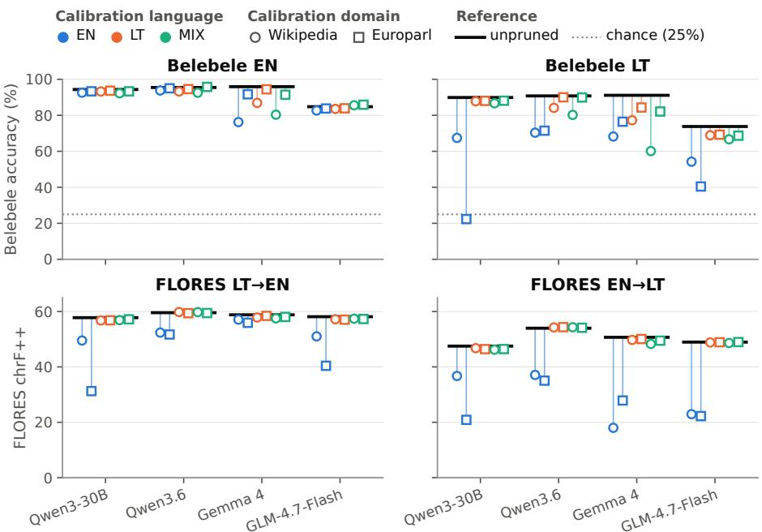  
Figure 1: At 25% expert pruning, English calibration erodes Lithuanian far more than English. Black bars are the unpruned models and points their 25%-pruned versions. Unless a caption says otherwise, colour marks the calibration language in all figures (EN blue, LT orange, MIX green); circles and squares mark Wikipedia and Europarl calibration, and hollow and filled markers mark 25% and 50% pruning. Higher is better; the dotted line is chance on Belebele. English-calibrated models keep their English comprehension (except Gemma 4 with English Wikipedia calibration) but lose up to 67.6 points in Lithuanian, and they translate worse, especially into Lithuanian.

MoE expert pruning and merging REAP (Lasby et al., 2026) showed that general (C4) calibration can collapse code generation, especially at 50% pruning; our study is the language counterpart of this result. EASY-EP (Dong et al., 2025) uses a similar score and finds that a few in-domain examples activate a stable set of experts. Liu et al. (2026b) describe REAP and related scores as one family and show that routing frequency, and to a lesser degree gate weights, make expert scores depend on the calibration data. Other methods reduce this dependence. AIMER (Liu et al., 2026a) ranks experts from their weights alone. REAM (Jha et al., 2026) merges low-scoring experts into the experts REAP keeps and finds that the calibration mix trades multiple-choice against generative accuracy. Mosaic Pruning (Hu et al., 2026) reports collapse on domains missing from a single calibration corpus. MoEXBench (Benazir et al., 2026) applies REAP to ten MoE models, three of them ours; it finds that expert pruning causes most of the damage when compression methods are combined, and that the choice of calibration data can more than halve the coding score of pruned

Qwen3.6. Jha (2026) prunes two of our models, Qwen3.6 and Gemma 4, for coding and finds the damage outside the calibration domain, and Yamaguchi et al. (2026) prune four MoE models with biomedical text and find that general ability drops while surface metrics barely move. Removing just three of the 6,144 experts can break Qwen3-30B-A3B (Su et al., 2026), and language-specific expert pruning has a precedent in translation MoEs (Koishekenov et al., 2023).

Calibration data in dense-model compression For dense models the evidence is clearer. Non-English and multilingual calibration lowers the perplexity of quantised Llama and Qwen models (Chimoto et al., 2026). Wanda pruning (Sun et al., 2024) at 50% sparsity or more hurts under-represented languages in ways that an English-only evaluation does not show (Choenni and Titov, 2025), and pruned models can pass multiple-choice items that they no longer answer in open generation: at 50% Wanda sparsity, English generation accuracy drops by 1.1 points but Swahili by 21.3 (Wen et al., 2026). Layer-importance rankings depend on the calibration language, and a mixed set is no better than English (Wibowo et al., 2025). Quantisation hurts low-resource translation most, and language-matched calibration helps at low bit-widths (Marie and Fujita, 2025). Calibration-language efects are large but difer between models (He et al., 2025), and at high sparsity a balanced mix of calibration sources beats any single source (Xu et al., 2026). For MoE quantisation, MoEQuant (Chen et al., 2025) traces errors to rarely routed experts that see few calibration tokens. Earlier work established that compression is sensitive to calibration data in general (Williams and Aletras, 2024) and in multilingual models (Zeng et al., 2024; Kurz et al., 2026; Marchisio et al., 2024).

Multilingual routing and language-specific experts In MoE models, routing for English and for other languages difers most in the first and last layers, and the routing of non-English text narrows more steeply with depth (Bandarkar et al., 2026). Masking the experts that only one language uses in Qwen3-30B-A3B damages mainly that language when done in early or late layers, and barely at all in middle layers (Chen et al., 2026). Hebrew shows a “deep-layer routing collapse” in the same model (Bar Joseph et al., 2026), and language specialisation emerges in the final MoE layers (Khandelwal et al., 2026). In dense models, transfer neurons move representations into and out of a shared space at the two ends of the network (Tezuka and Inoue, 2025).

Lithuanian language technology Nakvosas et al. (2025) release Lithuanian Llama2 models and translated benchmarks, and TildeOpen (Bergmanis et al., 2026) is an open 30B model built to serve Baltic and other European languages fairly. Jakubauskait˙e and Alhama (2026) test LLMs on 305 minimal pairs of Lithuanian noun cases and find a monolingual Lithuanian model ahead of multilingual ones. Closest to our question, Kapoči¯ut˙e-Dzikien˙e et al. (2025) find that 4-bit quantisation costs Lithuanian more than English. We extend this evidence to MoE expert pruning, where the gap turns out to be much larger.

Table 1: How this study difers from the closest prior work (“Calib. lang.”: calibration language varied; $^ { 6 6 } \mathrm { G e n } . ^ { 9 9 } \mathrm { : }$ open generation evaluated).
<table><tr><td>Work</td><td>Models</td><td>Compression</td><td>Calib. lang.</td><td>Languages</td><td>Gen.</td></tr><tr><td>Salim et al. (2026a)</td><td>gpt-oss-20b (MoE)</td><td>expert pruning</td><td>EN vs ZH</td><td>EN, 7 in MMLU-ProX</td><td>no</td></tr><tr><td>Salim et al. (2026b)</td><td>gpt-oss-20b (MoE)</td><td>expert pruning</td><td>yes</td><td>7 high-resource</td><td>partly</td></tr><tr><td>Martin et al. (2026)</td><td>gpt-oss-20b, Qwen3-30B</td><td>expert pruning</td><td>translation data</td><td>4 + 3 unseen</td><td>yes</td></tr><tr><td>Chen et al. (2026)</td><td>(MoE) Qwen3-30B</td><td>expert</td><td></td><td>10</td><td>yes</td></tr><tr><td>Choenni and</td><td>(MoE) 6 dense</td><td>masking Wanda</td><td>multilingual</td><td>15</td><td>no</td></tr><tr><td>Titov (2025) Chimoto et al.</td><td>2 dense</td><td>pruning quantisation</td><td>yes</td><td>10</td><td>no</td></tr><tr><td>(2026) Kapočiūtė- Dzikienė et al.</td><td>dense</td><td>quantisation</td><td></td><td>LT, LV, ET</td><td>yes</td></tr><tr><td>(2025) This work</td><td>4 MoE</td><td>REAP pruning</td><td>EN/LT/MIX, EN, LT 2 domains</td><td></td><td>yes</td></tr></table>

## 3 Experimental Setup

REAP expert pruning REAP (Lasby et al., 2026) gives each routed expert j of an MoE layer the saliency score

$$
S _ { j } = \frac { 1 } { | \mathcal { X } _ { j } | } \sum _ { x \in \mathcal { X } _ { j } } g _ { j } ( x ) \| f _ { j } ( x ) \| _ { 2 } ,\tag{1}
$$

where $\chi _ { j }$ is the set of calibration tokens routed to $j , g _ { j } ( x )$ is the router’s gate weight and $f _ { j } ( x )$ the expert’s output. In words, an expert matters if, on the tokens it receives, the router trusts it and its output is large. Because the score is an average, an expert that few tokens reach can still score high, while an expert that no calibration token reaches scores 0 and is removed first. In every MoE layer, REAP removes the lowest-scoring 25% or 50% of the routed experts (the pruning ratio); shared experts, dense layers and the number of active experts are unchanged. We use the implementation in llm-compressor 0.15.0 (Red Hat AI and vLLM Project, 2026), which prunes one layer at a time; Appendix A gives the details, including two patches needed for Gemma 4.

Models We prune four open MoE models (Table 2): Qwen3-30B-A3B-Instruct-2507 (Yang et al., 2025; Qwen Team, 2025), Qwen3.6-35B-A3B (Qwen Team, 2026a,b), gemma-4-26B-A4B-it (Gemma Team et al., 2026; Google DeepMind, 2026) and GLM-4.7-Flash (Z.ai, 2026; GLM-4.5 Team et al., 2025), which we call Qwen3-30B, Qwen3.6, Gemma 4 and GLM-4.7-Flash. They difer in the number of experts (64–256), active experts (4 or 8), shared experts and router design. Before pruning, all four are weaker in Lithuanian than in English on all three benchmarks (Table 2b). Pruning 25% of the experts removes 22.1–23.7% of the parameters, and pruning 50% removes 44.3–47.5% (Table 6). Thinking mode is of throughout.

Table 2: The four models (a) and their unpruned scores (b). Tokens per word: mean tokens per word in each model’s FLORES translations into that language. Bits per byte: Wikipedia NLL per UTF-8 byte, in bits (lower is better). aGemma 4 runs a dense MLP alongside its routed experts. bGLM’s first layer is dense. Parameter counts include the vision towers of Gemma 4 and Qwen3.6 and exclude multi-tokenprediction heads. Gemma 4’s bits per byte are high because it is an instruction-tuned model scored inside its chat template; compare it only with itself.  
(a)
<table><tr><td></td><td></td><td>MoE</td><td>routed</td><td></td><td></td><td></td><td colspan="2">params tokens/word</td></tr><tr><td>Model</td><td>short name</td><td></td><td>layers experts top-k shared</td><td></td><td></td><td>(B)</td><td>EN</td><td>LT</td></tr><tr><td>Qwen3-30B-A3B-Instruct-2507Qwen3-30B</td><td></td><td>48</td><td>128</td><td>8</td><td>一</td><td>30.5 1.28</td><td></td><td>3.23</td></tr><tr><td>Qwen3.6-35B-A3B</td><td>Qwen3.6</td><td>40</td><td>256</td><td>8</td><td>1</td><td></td><td>34.7 1.27</td><td>2.64</td></tr><tr><td>gemma-4-26B-A4B-it</td><td>Gemma 4</td><td>30</td><td>128</td><td>8</td><td>1ª</td><td>25.8 1.25</td><td></td><td>2.56</td></tr><tr><td>GLM-4.7-Flash</td><td>GLM-4.7-Flash</td><td>46b</td><td>64</td><td>4</td><td>1</td><td></td><td>29.9 1.25</td><td>3.14</td></tr></table>

(b)
<table><tr><td></td><td>Belebele acc. (%)</td><td></td><td>FLORES chrF++</td><td></td><td>Wikipedia bits/byte</td></tr><tr><td>Model</td><td>EN</td><td>LT</td><td>LT→EN</td><td>EN→LT</td><td>EN</td></tr><tr><td>Qwen3-30B</td><td>94.3</td><td>89.9</td><td>57.8</td><td>47.5 0.71</td><td>1.05</td></tr><tr><td>Qwen3.6</td><td>95.4</td><td>90.8</td><td>59.6</td><td>54.0</td><td>0.66 0.77</td></tr><tr><td>Gemma 4</td><td>95.9</td><td>91.1</td><td>58.8</td><td>50.7</td><td>0.98</td></tr><tr><td>GLM-4.7-Flash</td><td>84.8</td><td>73.8</td><td>58.1</td><td>49.00.71</td><td>1.81 0.87</td></tr></table>

Calibration data Each calibration set has 1,024 samples of 2,048 tokens from one of two domains. Wikipedia (Wikimedia Foundation, 2023) provides running encyclopaedic text. Europarl (Koehn, 2005) provides parliamentary proceedings that exist in both languages, so that English and Lithuanian calibration see the same content. Calibration is English only (EN), Lithuanian only (LT) or a 50/50 mix of the two (MIX). The budget is fixed in tokens, and Lithuanian needs more tokens per word, so LT calibration covers about half as much text as EN calibration. Each sample is wrapped as an assistant reply in the model’s chat format, because Gemma 4 works as a language model only in that format; saliency is computed over all tokens, including the short chat prefix. Four models, two domains, three languages and two pruning ratios (25% and 50% of the routed experts in each layer) give 48 pruned models. We name a configuration by its domain, language and ratio, e.g. Europarl-LT, 25%, and call a domain–language pair a calibration set. Appendix A gives the sampling details and the exact prompts.

Evaluation We evaluate all 52 models (48 pruned and 4 unpruned) in both languages, always prompting in the language of the input.

• Belebele (Bandarkar et al., 2024): the same 900 reading-comprehension questions in each language. The answer is whichever of the letters A–D the model finds most probable; chance is 25%. Besides this ordinary accuracy, we report a strict accuracy that counts an answer only if its letter has a probability above 0.5, and the distribution of predicted letters.

• FLORES-200 (NLLB Team et al., 2022, 2024; Goyal et al., 2022): the 1,012 devtest sentences translated from English into Lithuanian (EN→LT) and back (LT→EN), with greedy decoding and at most 256 new tokens. We score the raw outputs with chrF++ (Popović, 2017; Post, 2018) and BLEU (Papineni et al., 2002).

• Wikipedia: the token negative log-likelihood (NLL) of 5,000 held-out articles per language, wrapped in the same chat prompt as the calibration data. The same runs give the routing statistics of Section 4.5.

How we report results For a language $\ell ,$ the degradation $D _ { \ell }$ and the LT–EN gap G are

$$
D _ { \ell } = s _ { \ell } ^ { \mathrm { u n p r u n e d } } - s _ { \ell } ^ { \mathrm { p r u n e d } } , \qquad G = D _ { \mathrm { L T } } - D _ { \mathrm { E N } } ,\tag{2}
$$

where s is Belebele accuracy (%) or chrF++; for Wikipedia, $D _ { \ell }$ is the relative NLL increase in $\% , 1 0 0 ( \mathrm { N L L } _ { \ell } ^ { \mathrm { p r u n e d } } / \mathrm { N L L } _ { \ell } ^ { \mathrm { u n p r u n e d } } - 1 )$ . A positive gap means that Lithuanian lost more. For translation, $D _ { \mathrm { { L T } } }$ uses EN→LT (Lithuanian output) and $D _ { \mathrm { E N } }$ uses LT→EN. Gaps are in percentage points (pp), except for FLORES (chrF++ points). We never compare perplexities across languages, as Lithuanian is split into more tokens. When we compare two calibration choices, a positive efect means that the first is better (for Wikipedia, lower NLL). A run has collapsed when its Belebele accuracy is at most 30%.

Statistics Each calibration language has 16 configurations (4 models × 2 domains × 2 ratios), 8 at each ratio, and each ratio has 24 (4 models × 6 calibration sets). We give 95% confidence intervals from paired bootstrap resampling of the test items (Efron and Tibshirani, 1993; Koehn, 2004); for Belebele and FLORES the parallel items of the two languages are resampled together. A difference is significant when its interval excludes 0, and $^ { 6 } 1 4 / 1 6 ^ { \prime \prime }$ means that 14 of 16 configurations show a significant efect. These per-configuration tests are not independent replications, because the configurations share four base models and the same test items, so we also report means per model. Our main endpoints are the Belebele and FLORES gaps and the efects of LT versus EN calibration; the other analyses are descriptive. Unless stated otherwise, means are over the four models and the two domains.

Table 3: Mean LT–EN gap over the four models and two domains (positive = Lithuanian loses more), and the number of the 8 configurations whose gap is significantly positive/negative.
<table><tr><td rowspan="2">Calib.</td><td rowspan="2">Ratio</td><td colspan="2">Belebele (pp)</td><td colspan="2">FLORES (chrF++)</td><td colspan="2">Wikipedia (pp)</td></tr><tr><td>gap</td><td>sig. +/-</td><td>gap</td><td>sig. +/-</td><td>gap</td><td>sig. +/-</td></tr><tr><td rowspan="2">EN</td><td>25%</td><td>+23.5</td><td>8/0</td><td>+12.8</td><td>7/0</td><td>+50.0</td><td>8/0</td></tr><tr><td>50%</td><td>+30.6</td><td>6/0</td><td>+8.5</td><td>5/2</td><td>+116.7</td><td>8/0</td></tr><tr><td rowspan="2">LT</td><td>25%</td><td>+3.0</td><td>5/0</td><td>-0.3</td><td>0/3</td><td>-2.4</td><td>0/8</td></tr><tr><td>50%</td><td>+5.1</td><td>6/1</td><td>+1.2</td><td>2/3</td><td>-8.1</td><td>0/8</td></tr><tr><td rowspan="2">MIX</td><td>25%</td><td>+5.6</td><td>5/0</td><td>+0.1</td><td>1/1</td><td>-1.2</td><td>0/7</td></tr><tr><td>50%</td><td>+6.2</td><td>5/0</td><td>-0.1</td><td>2/2</td><td>-2.6</td><td>3/4</td></tr></table>

## 4 Results

## 4.1 RQ1: Does REAP degrade Lithuanian more than English?

Yes, and by a wide margin under English calibration (Table 3, Figure 2). At 25% pruning, English-calibrated models lose a median of 1.7 Belebele points in English but 21.4 in Lithuanian. Their translation into Lithuanian loses 12.8 chrF++ more than their translation into English, and their Lithuanian language modelling degrades far more than their English. The gap is positive for every model on every benchmark and, over both ratios, significant in at least 12 of the 16 English-calibrated configurations on each benchmark. This supports H1 for English calibration.

One example shows the pattern. Qwen3-30B pruned by 25% with Europarl-EN keeps 93.3% accuracy on English Belebele, only 1.0 point below the unpruned model, while its Lithuanian accuracy falls from 89.9% to 22.3%, no better than guessing. English stays nearly intact in three of the four models; the exception is Gemma 4, which with Wikipedia-EN also loses 19.7 points in English. Strict scoring widens the contrast: the English-calibrated models at 25% keep 87.4% strict accuracy in English, almost all of their ordinary accuracy, but only 44.2% in Lithuanian, where their ordinary accuracy is 58.9%.

With Lithuanian or mixed calibration, a small gap remains. On Belebele it averages 3.0–5.1 pp under LT and 5.6–6.2 pp under MIX calibration. It is not explained by Lithuanian starting from a lower score: on questions that both languages answered correctly before pruning, LT-calibrated models at 25% lose more Lithuanian than English answers in all 8 configurations. The remaining gap is smallest for Qwen3.6, whose English and Lithuanian saliency rankings agree most. On FLORES the gap is close to zero, and on Wikipedia Lithuanian even degrades less than English.

A gap near zero can also mean that both languages collapsed. Gemma 4 at 50% answers Belebele at chance in Lithuanian with every calibration set, and in English with 4 of the 6. Collapsed runs explain the only significantly negative Belebele gap (Gemma 4, Wikipedia-LT, 50%) and both significantly negative FLORES gaps under English calibration (Figure 8). $\mathrm { A p \mathrm { - } }$ pendix B gives further statistics.

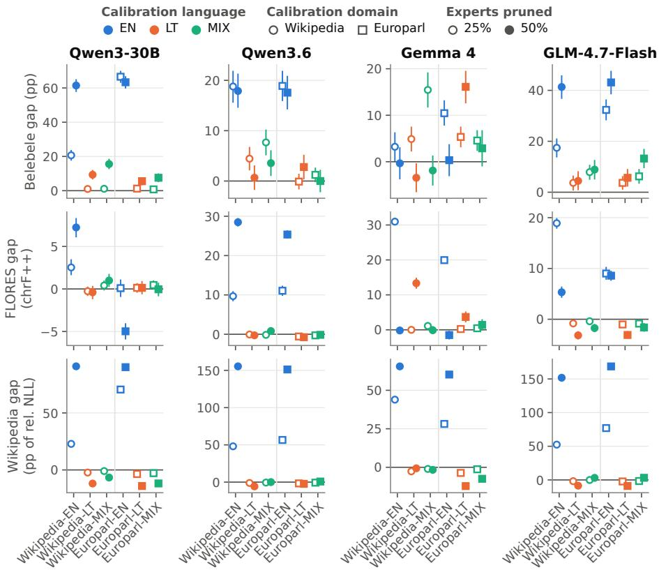  
Figure 2: LT–EN gap with 95% intervals for each model (columns) and calibration set (x axis). Rows: Belebele (pp), FLORES (chrF++) and Wikipedia (pp of relative NLL increase), with diferent y scales. Positive means that Lithuanian loses more; markers as in Figure 1. English-calibrated gaps are large except for Gemma 4 and runs where both languages collapsed; LT and MIX gaps are small except for Gemma 4.

## 4.2 RQ2: Does the calibration language change the gap?

The calibration language is the factor that matters most for the gap (Table 4, Figure 3). On its own (one-way $\eta ^ { 2 } )$ , it explains 39% of the variation of the Belebele gap across the 48 configurations, 36% for FLORES and 70% for Wikipedia, far more than the model, the pruning ratio or the calibration domain (Table 7). For Lithuanian accuracy itself, the model and the ratio matter about as much as the language.

Switching from English to Lithuanian calibration improves Lithuanian Belebele accuracy by 25.5 points on average and translation into Lithuanian by 28.2 chrF++ (Figure 9). The gain appears in every model and almost every configuration; the one exception, Gemma 4 at 50% with Wikipedia calibration, is at chance either way. This supports H2. Two checks rule out simple explanations. First, the gain is larger on Europarl, where both languages see the same content (29.7 points, against 21.3 with Wikipedia), so it does not come from diferences between the English and Lithuanian Wikipedias. Second, it is not limited to Lithuanian output: translation into English, where Lithuanian is only read, improves by 18.0 chrF++.

Table 4: Efect of switching the calibration language: mean diference over 16 configurations (positive = the first is better; Wikipedia: NLL reduction in nats per token). B/W: how many are significantly better/worse.
<table><tr><td></td><td>LT – EN</td><td>MIX</td><td>- EN</td><td></td><td>MIX – LT</td></tr><tr><td>Evaluation</td><td>mean</td><td>B/W</td><td>mean</td><td>B/W</td><td>mean B/W</td></tr><tr><td>Belebele EN (pp)</td><td>+2.5</td><td>6/0</td><td>+1.4</td><td>7/1</td><td>-1.1 4/4</td></tr><tr><td>Belebele LT (pp)</td><td>+25.5</td><td>15/0</td><td>+22.5</td><td>14/1</td><td>-3.0 0/7</td></tr><tr><td>FLORES LT→EN (chrF++)</td><td>+18.0</td><td>16/0</td><td>+16.5</td><td>16/0</td><td>-1.5 3/2</td></tr><tr><td>FLORES EN→LT (chrF++)</td><td>+28.2</td><td>16/0</td><td>+27.2</td><td>16/0 -1.0</td><td>1/8</td></tr><tr><td>Wikipedia EN (nats)</td><td>-0.06</td><td>5/11</td><td>-0.03</td><td>5/10 +0.03</td><td>12/3</td></tr><tr><td>Wikipedia LT (nats)</td><td>+1.57</td><td>16/0</td><td>+1.54</td><td>16/0 -0.03</td><td>2/14</td></tr></table>

English barely changes, so the transfer is asymmetric (Figure 3). Under LT calibration, English Belebele is never significantly worse than under EN calibration and is on average 2.5 points better, so H3 holds for comprehension; under MIX calibration it is significantly worse in 1 of the 16 configurations. Language modelling shows the asymmetry most clearly. At 25%, Lithuanian NLL rises by 3.2% under LT calibration but by 55.2% under EN calibration, whereas English NLL rises by 5.2% under EN and 5.6% under LT calibration; at 50%, the English cost of LT calibration is larger but still modest (Appendix C). With LT calibration at 25%, translation stays within 1.1 chrF++ of the unpruned model in every model and direction. We did not evaluate open-ended English generation. Section 4.5 looks at why the transfer is one-sided.

A mix works almost as well as Lithuanian alone (Table 4). MIX calibration is slightly worse than LT for Lithuanian (3.0 points on Belebele and 1.0 chrF++ into Lithuanian) and slightly better for English language modelling. It does not balance the two languages better, however: compared with LT calibration, it lowers the larger of a configuration’s English and Lithuanian Belebele losses in only 3 of the 16 configurations, so H4 is not supported.

## 4.3 RQ3: How does the gap depend on the pruning ratio?

Pruning half of the experts does far more damage than pruning a quarter (Figure 4). Going from 25% to 50% makes at least 21 of the 24 configurations significantly worse on every benchmark, and the average losses become 2.4–6.9 times larger. Even with Lithuanian calibration, the models other than Gemma 4, which collapses, lose 6–15 points of Lithuanian Belebele accuracy at 50%.

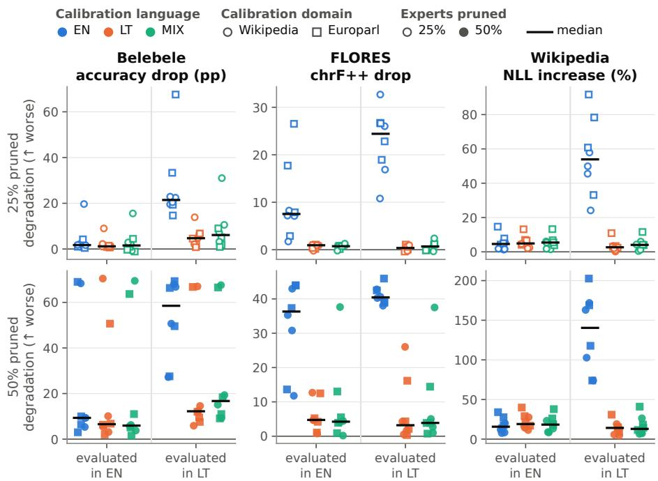  
Figure 3: Transfer between calibration languages is asymmetric. Degradation (positive = worse) of English (left) and Lithuanian (right) for each calibration language, at 25% (top) and 50% (bottom); one point per model and domain; black bars are medians. For FLORES, English is LT→EN. Every calibration language preserves English; only LT and MIX preserve Lithuanian.

The gap grows consistently only for language modelling. Under English calibration, the Wikipedia gap grows from 25% to 50% in all 8 configurations, whereas the Belebele and FLORES gaps grow in some configurations and shrink in others (Table 9), although the mean Belebele gap rises (Table 3). These two gaps are capped: Lithuanian Belebele cannot fall below chance, which Qwen3-30B with Europarl-EN already reaches at 25%, and at 50% English translation breaks as well. H5 is therefore supported only for Wikipedia under English calibration.

## 4.4 RQ4: Does the calibration domain matter?

The calibration domain matters much less than the language (Appendix C). Its main efects are small: Wikipedia calibration lowers NLL on the in-domain Wikipedia test articles in most configurations, and Europarl calibration helps English Belebele by 3.1 points on average. On its own, the domain explains almost none of the variation of the gap (Table 7). The exception is Lithuanian under English calibration, where the domain can swing accuracy widely: Qwen3-30B at 25% scores 22.3% on Lithuanian Belebele with Europarl-EN but 67.4% with Wikipedia-EN. A possible reason, which we did not test, is that English Wikipedia contains names and other non-English material that keep a few Lithuanian-relevant experts in use.

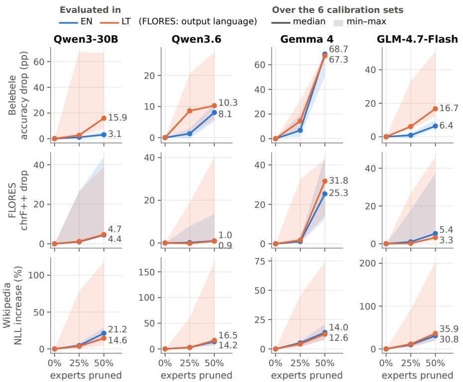  
Figure 4: Degradation at 0, 25 and 50% of experts pruned (positive = worse). Lines are medians over the six calibration sets and bands span their minimum to maximum; colour is the evaluated language (FLORES: output language). Losses grow moderately up to 25% and steeply to 50%; the worst Lithuanian cases are usually English-calibrated. Gemma 4 collapses at 50%.

## 4.5 RQ5: Are the experts that matter language-specific?

Partly. The two languages share most experts, and the ones they do not share matter for Lithuanian. English and Lithuanian calibration rank experts similarly but not identically: the Spearman correlation of their saliency scores is 0.72–0.85 on average over layers, depending on the model, with a few layers near zero (Figure 10). With the same domain, the two languages therefore keep 90–94% of the same experts at 25% pruning, and Lithuanian text is routed to a narrower set of experts than English text in every model (Appendix D). In three of the four models, a change of calibration domain changes the kept set at least as much as a change of language (Figure 11), although the language has by far the larger efect on quality: which experts are removed matters more than how many difer.

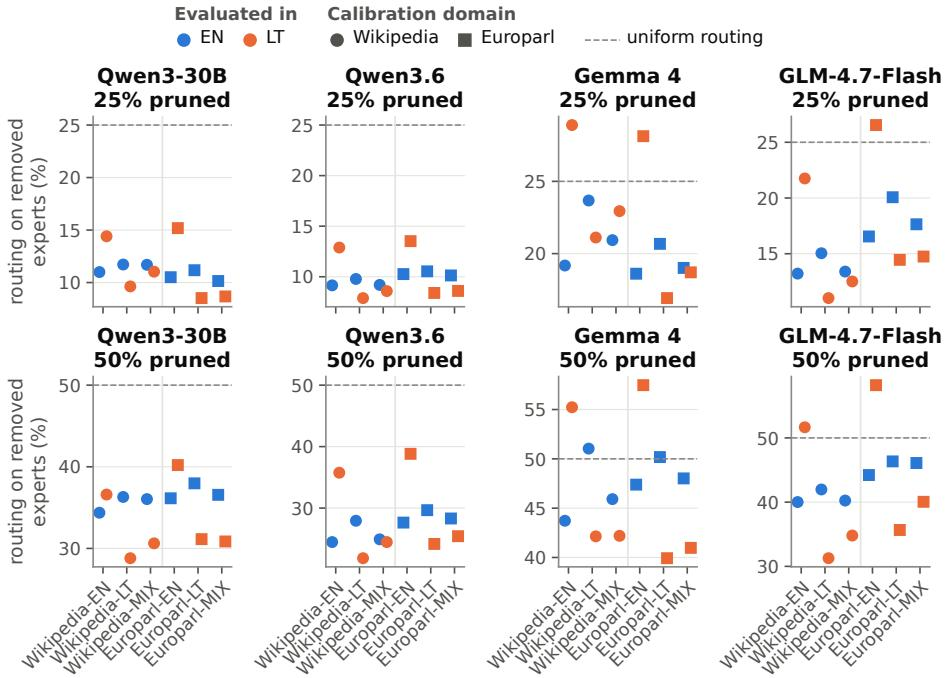  
Figure 5: Removed routing share: the share of each language’s routing that went to the experts pruning removed, measured on the unpruned model for English (blue) and Lithuanian (orange) Wikipedia text, at 25% (top) and 50% (bottom); circles and squares are Wikipedia and Europarl calibration; the dashed line is uniform routing. Under EN calibration Lithuanian loses more routing than English in every model; under LT calibration the order reverses.

The experts removed under English calibration had carried more Lithuanian routing (Figure 5). To see this, we take the unpruned model’s expert selections on the Wikipedia test text and compute, for each language, the share that went to the experts that pruning later removes (the removed routing share). Under English calibration at 25%, the removed experts had received 20.2% of the Lithuanian selections but only 13.6% of the English ones. Lithuanian calibration reverses the order (12.2% against 15.3%), in every model and at both ratios. Across all 24 configurations at 25%, the larger the Lithuanian share removed, the more Lithuanian accuracy is lost (Spearman ρ = 0.72).

Lithuanian also sufers more from each unit of routing lost (Figure 12). Leaving out Gemma 4, each percentage point of Lithuanian routing removed goes with about 1.85 points of lost Lithuanian Belebele accuracy, whereas removing English routing goes with no measurable loss in English. The asymmetric transfer of Section 4.2 therefore has two sources: which experts the calibration protects, and how much each language depends on the experts it loses.

The languages difer most at the two ends of the network (Figure 6, Table 10). In the middle layers English and Lithuanian use the experts in a similar way; in the first and especially the last layers their routing diverges, as Bandarkar et al. (2026) found for other languages. At the output end, Lithuanian leans on a few experts: in the last layers the 8 most used handle 55–72% of its expert selections, against 19–39% for English, and English calibration removes on average 0.86–2.88 of these 8 experts per layer, depending on the model (Lithuanian calibration at most 0.71). At the input end, the Lithuanian routing removed in the first layers tracks the loss of accuracy most closely $( \rho = 0 . 8 7 )$ , so the input side matters at least as much as the output side. Where in depth the extra Lithuanian routing is removed varies between models (Appendix D).

Removed routing shows which calibration is worse, not how bad the damage will be. Across calibration languages, the Lithuanian share removed tracks the loss, but within English calibration the extra Lithuanian routing removed (the Lithuanian minus the English share) does not predict the size of the gap: Gemma 4 with Europarl-EN, 25% loses the largest share of Lithuanian routing but less accuracy than Qwen3-30B. Neither the overlap of the kept experts nor the saliency correlation predicts the gaps (Appendix D).

## 4.6 RQ6: How do pruned models fail?

English-calibrated models often do not stop when writing Lithuanian. GLM-4.7-Flash, for example, runs into the 256-token limit in 27–36% of its EN→LT translations at 25% (Appendix E). At 50% the models also switch language: 59.4% of the EN→LT outputs of English-calibrated models contain more English than Lithuanian words, against 10.9% with Lithuanian calibration and none for the unpruned models (Appendix E).

The content breaks as well (Figure 7). Runaway outputs explain only about a quarter of the translation loss: under English calibration at 25%, EN→LT loses 22.7 chrF++ overall and still 16.7 on the sentences the model finished. In these finished translations, about a third of the words (32.6%) look Lithuanian but occur in no reference or unpruned output, against 6.2% under Lithuanian calibration; this measure cannot tell a rare correct form from an invented one. At 50%, English or source words take over (55.3% of all words).

Typical Lithuanian errors. The pruned models produce (i) non-words and wrong stems where the unpruned model was correct, such as “aiščiai” for aiškiai (‘clearly’) and “pristat˙ejo” for pristat˙e (‘presented’) from Qwen3-30B with Europarl-EN, 25%; (ii) broken diacritics, where the model emits only part of the UTF-8 bytes of a Lithuanian letter, which then decode to an invalid character (948 outputs, 88% of them from GLM-4.7-Flash and none from unpruned models); (iii) switches into English; and (iv) repetition loops.

Collapsed models answer “A”. When Belebele accuracy collapses, a model puts most of its answers on one letter, usually $^ { 6 } \mathrm { A } ^ { \dag }$ (Figure 13); Gemma 4 at 50%, for example, answers $^ { 6 } \mathrm { A } ^ { \dag }$ to 46–95% of the questions. Pruned Gemma 4 also writes reasoning text although thinking is switched of; this text is scored as part of its translations, but removing it changes the results only modestly. Appendix E gives the details and two checks of the metrics.

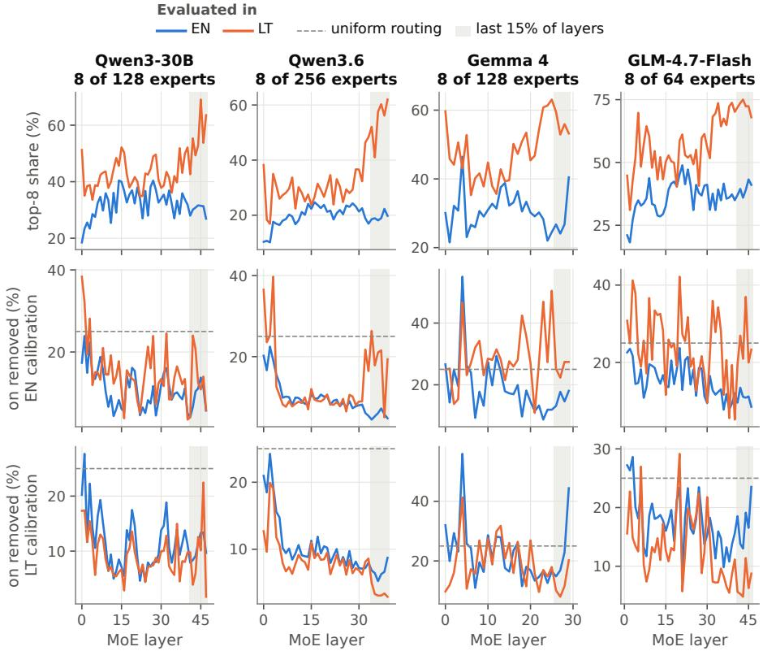  
Figure 6: Lithuanian relies on few experts at the end of the network, and EN calibration removes some of them. Top: share of routing handled by the 8 most-used experts in each MoE layer (unpruned; colour = evaluated language). Middle and bottom: removed routing share of each language at 25% under EN and LT calibration (mean of the two domains); dashed = uniform; the last 15% of layers are shaded. How much more Lithuanian routing EN calibration removes there depends on the model.

## 5 Discussion

Table 5 summarises the five hypotheses and their verdicts.

Why English calibration hurts Lithuanian Our results suggest a simple account, although the evidence for it is correlational (Section 4.5). English and Lithuanian use largely the same experts in the middle of the network, as expected from the shared middle layers of multilingual models (Tezuka and Inoue, 2025; Bandarkar et al., 2026), but at the two ends Lithuanian takes its own routes, and in the last layers it relies on a few experts, as Bar Joseph et al. (2026) report for Hebrew. REAP judges an expert only by the calibration tokens routed to it (Eq. 1). Under English calibration, an expert that Lithuanian relies on sees only the English tokens that happen to reach it, where it is usually a minor choice, or no tokens at all; it therefore looks unimportant and is removed. Generation into Lithuanian sufers most, in line with expert-masking results for other languages (Chen et al., 2026). Lithuanian calibration may transfer to English because English routing is spread over many experts that Lithuanian text also uses in the shared middle layers. The account does not fit every model equally well: Qwen3-30B collapses although the extra Lithuanian routing it loses is small and spread evenly over depth. And the experts that look “Lithuanian” may encode sub-word or general non-English features rather than Lithuanian as such.

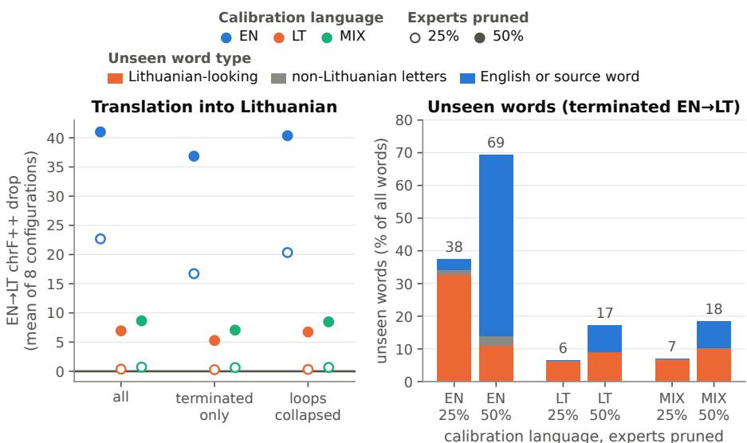  
Figure 7: Lithuanian translation breaks beyond runaway generation. Left: mean EN→LT chrF++ drop (positive = worse) on all sentences, on the sentences the model finished (compared with the unpruned model on the same sentences) and with repetition loops collapsed; markers as in Figure 1. Right: words of finished EN→LT translations that occur in no reference or unpruned output (% of all words), split into Lithuanian-looking forms (orange), words with non-Lithuanian letters (grey) and English or source words (blue). At 25% EN calibration mostly produces unattested Lithuanian-looking forms, at 50% mostly English.

Diferences between models All four models show the main efects, but they difer in robustness. Qwen3.6, which has the most experts (256), a shared expert and the closest agreement between English and Lithuanian saliency, is the most robust at 50%: averaged over all calibration sets, it loses 11.5 points of Belebele accuracy, against 16.7–66.4 for the other models. Qwen3-30B and GLM-4.7-Flash hold up well under Lithuanian calibration but are the most fragile under English calibration. Gemma 4 degrades in both languages already at 25% and collapses at 50%. The number of tokens per word does not explain these diferences: Qwen3.6 and Gemma 4 need the fewest tokens per Lithuanian word, yet they are the most and the least robust models.

Table 5: Hypotheses, decision rules and verdicts. Counts are configurations with a significant efect.
<table><tr><td>Hypothesis</td><td>Decision rule</td><td>Verdict</td></tr><tr><td>H1: pruning degrades LT more than EN</td><td>gap significantly positive in most of the 16 configurations of a calibration language</td><td>Supported under EN calibration (14/16 Belebele, 12/16 FLORES, 16/16 Wikipedia); under LT/MIX only a small Belebele gap (11/16, 10/16)</td></tr><tr><td>H2: LT calibration reduces LT degradation</td><td>LT better on a Lithuanian evaluation in most of the 16 configurations and on average in all 4 models</td><td>Supported: 16/16 EN→LT, 16/16 Wikipedia, 15/16 Belebele; all four models</td></tr><tr><td>H3: LT/MIX preserve LT without hurting EN</td><td>English Belebele never significantly worse than under EN</td><td>Supported under LT for comprehension; 1/16 worse under MIX; English NLL rises slightly</td></tr><tr><td>H4: MIX more balanced than LT</td><td>MIX reduces the worse language&#x27;s Belebele loss in most of the 16 configurations</td><td>Not supported (3/16)</td></tr><tr><td>H5: the gap grows from 25% to 50%</td><td>change in gap significantly positive in most of 8 configurations</td><td>Only for Wikipedia under EN calibration (8/8); Belebele (3/8) and FLORES (3/8) capped by chance and English collapse</td></tr></table>

Recommendations for Lithuanian deployments Our results suggest three practices.

1. Calibrate in Lithuanian or on a mix. In our grid this also preserved English comprehension; a mix is the safer choice when English language modelling matters most.

2. Prune conservatively. Losses grow steeply between 25% and 50%, even with Lithuanian calibration (Section 4.3).

3. Test in Lithuanian before deployment, including generation, checks for degenerate output (runaway length, wrong output language, letter collapse, reasoning text) and, where possible, a morphological test such as case minimal pairs (Jakubauskait˙e and Alhama, 2026).

The best compromise in our grid was Qwen3.6 pruned by 25% with Europarl-LT or Europarl-MIX calibration: it stayed within one point of the unpruned model on Belebele in both languages and within 0.2 chrF++ in both translation directions.

Implications for evaluation An English-only evaluation would have missed the damage: at 25%, 5 of the 8 English-calibrated configurations stay within 2 points of their unpruned English accuracy while losing 19.3–67.6 points in Lithuanian. It would not have misled the choice of calibration set, because LT and MIX sets were also the best for English in 8 of the 8 model–ratio combinations (Table 8), but it would have misreported the quality of the compressed models. Multiple-choice scores also understate the damage to generation (Wen et al., 2026): ordinary accuracy, which takes the most probable letter, hides the loss of confidence that strict scoring reveals, and Belebele scores near chance should be read together with the distribution of answer letters. Compression results should therefore be reported per language and per task type, together with the calibration language.

## 6 Limitations

• Design. Each configuration was run once with greedy decoding, so our intervals reflect the sampling of test items, not variation between calibration samples. Two ratios and one calibration budget cannot show where each model starts to break.

• Data. The fixed token budget gives Lithuanian about half as much calibration text as English, and the 256-token generation limit allows fewer than half as many Lithuanian words. The Wikipedia test articles are not parallel (median scored length 924 bytes in Lithuanian and 1,462 in English), which is why Europarl serves as our content-controlled comparison. FLORES and Belebele may be in the models’ training data.

• Scope. We study one lower-resource language, and others may behave diferently. We use llm-compressor’s REAP implementation, whose scores include the chat-prefix tokens, so an expert used mainly by the prefix can look important: up to 48% of the experts on which EN and LT calibration disagree at 25% have selection counts small enough to come entirely from the prefix.

• Evaluation. Belebele uses letter scoring (we add a strict variant, but no generative comprehension test). Wikipedia NLL is computed inside the chat template and is not comparable with raw-text perplexity. We did not evaluate open-ended English generation, instruction following or chat quality, and FLORES outputs were not post-processed.

• Analysis. The link between removed routing and damage is correlational, and the overlap analysis has only 16 points from four models.

Natural next steps are to restore or ablate the experts that Lithuanian loses, to try non-uniform layer budgets, calibration-free criteria (Liu et al., 2026a) and merging (Jha et al., 2026), and to cover more ratios and languages, with error annotation by native speakers and a morphological benchmark of the pruned models.

## 7 Conclusion

REAP expert pruning is not language-neutral. Calibrated on English, it removes experts that Lithuanian relies on more than English does, and Lithuanian comprehension, translation and language modelling degrade sharply at a pruning ratio where English comprehension is nearly unchanged. Calibrating on Lithuanian, or on a 50/50 mix, removes most of this damage at little cost to English. Although the two languages keep most of the same experts, the loss of Lithuanian accuracy tracks how much Lithuanian routing the removed experts had carried. For Lithuanian, and plausibly for other lower-resource languages, the calibration language should be chosen, and the compressed model evaluated, language by language.

## Data and code availability

The per-item outputs of all 52 models, the analysis tables and the scripts that regenerate every number, table and figure of this paper are available from the corresponding author on reasonable request. The pruned models derive from openly released checkpoints and are subject to their licences; the calibration and evaluation data are Wikipedia (CC BY-SA), Belebele and FLORES-200 (both CC BY-SA 4.0), and Europarl.

## Competing interests

The authors are employees of Hostinger, which uses language models in its products. The authors declare no other competing interests.

## Use of generative AI

A generative AI assistant (Claude, Anthropic) was used to help write and edit the text of this manuscript, improving its language, clarity and structure. The authors designed and ran the experiments, reviewed and edited all generated text, and take full responsibility for the content of the paper.

## References

Lucas Bandarkar, Davis Liang, Benjamin Muller, Mikel Artetxe, Satya Narayan Shukla, Donald Husa, Naman Goyal, Abhinandan Krishnan, Luke Zettlemoyer, and Madian Khabsa. The Belebele benchmark: a parallel reading comprehension dataset in 122 language variants. In Lun-Wei Ku, Andre Martins, and Vivek Srikumar, editors, Proceedings of the 62nd Annual Meeting of the Association for Computational Linguistics (Volume 1: Long Papers), pages 749–775, Bangkok, Thailand, August 2024. Association for Computational Linguistics. doi:10.18653/v1/2024.acl-long.44. URL https://aclanthology.org/2024.acl-long.44/.

Lucas Bandarkar, Chenyuan Yang, Mohsen Fayyaz, Junlin Hu, and Nanyun Peng. Multilingual routing in mixture-of-experts. In The Fourteenth International Conference on Learning Representations (ICLR), 2026. URL https://arxiv.org/abs/2510.04694.

Ori Bar Joseph, Smadar Arvatz, Noam Kayzer, Dan Revital, and Sarel Weinberger. Mixture of experts for low-resource LLMs. arXiv preprint arXiv:2605.17598, 2026. URL https://arxiv.org/abs/2605.17598.

Afsara Benazir, Chen Chen, Rongxiao Qu, Jiabo Huang, Jingtao Li, and Lingjuan Lyu. Benchmarking composable compression techniques in mixtureof-experts LLMs. arXiv preprint arXiv:2608.21693, 2026. URL https: //arxiv.org/abs/2608.21693.

Toms Bergmanis, Ingus J¯anis Pretkalninš, Martins Kronis, Davis Nicmanis, Jelizaveta Jelinska, Roberts Rozis, Rinalds V¯ıksna, and Marcis Pinnis. TildeOpen LLM: Leveraging curriculum learning to achieve equitable language representation. In Proceedings of the Fifteenth Language Resources and Evaluation Conference (LREC 2026), pages 10634–10652, Palma de Mallorca, Spain, 2026. ELRA Language Resource Association. URL https: //aclanthology.org/2026.lrec-1.834/.

Yuxin Chen, Zhengzhou Cai, Xiangtian Ji, Weixiang Zhao, An Zhang, Xiang Wang, and Tat-Seng Chua. Understanding multilingualism in mixture-ofexperts LLMs: Routing mechanism, expert specialization, and layerwise steering. arXiv preprint arXiv:2601.14050, 2026. URL https://arxiv.org/abs/ 2601.14050.

Zhixuan Chen, Xing Hu, Dawei Yang, Zukang Xu, Xu Chen, Zhihang Yuan, Sifan Zhou, and Jiangyong Yu. MoEQuant: Enhancing quantization for mixture-of-experts large language models via expert-balanced sampling and afinity guidance. In Proceedings of the 42nd International Conference on Machine Learning, volume 267 of Proceedings of Machine Learning Research, pages 8245–8260. PMLR, 2025. URL https://proceedings.mlr.press/ v267/chen25aa.html.

Everlyn Asiko Chimoto, Mostafa Elhoushi, and Bruce Bassett. Calibrating beyond English: Language diversity for better quantized multilingual LLMs. In Proceedings of the 19th Conference of the European Chapter of the Association for Computational Linguistics (Volume 1: Long Papers), pages 4822–4838, Rabat, Morocco, 2026. Association for Computational Linguistics. doi:10.18653/v1/2026.eacl-long.223. URL https://aclanthology.org/ 2026.eacl-long.223/.

Rochelle Choenni and Ivan Titov. M-Wanda: Improving one-shot pruning for multilingual LLMs. In Proceedings of the 2025 Conference on Empirical Methods in Natural Language Processing, pages 26951–26964, Suzhou, China, 2025. Association for Computational Linguistics. doi:10.18653/v1/2025.emnlpmain.1369. URL https://aclanthology.org/2025.emnlp-main.1369/.

Common Crawl. Statistics of Common Crawl monthly archives: Distribution of languages. Crawl CC-MAIN-2026-43, 2026. URL https://commoncrawl. github.io/cc-crawl-statistics/plots/languages. Accessed 2026-11-02.

Zican Dong, Han Peng, Peiyu Liu, Wayne Xin Zhao, Dong Wu, Feng Xiao, and Zhifeng Wang. Domain-specific pruning of large mixture-of-experts models with few-shot demonstrations. In Advances in Neural Information Processing Systems 38 (NeurIPS 2025), pages 114654–114679, 2025. doi:10.52202/085713-3459.

Bradley Efron and R. J. Tibshirani. An Introduction to the Bootstrap. Number 57 in Monographs on Statistics and Applied Probability. Chapman & Hall, New York, 1993. ISBN 0-412-04231-2. doi:10.1201/9780429246593.

William Fedus, Barret Zoph, and Noam Shazeer. Switch transformers: Scaling to trillion parameter models with simple and eficient sparsity. Journal of Machine Learning Research, 23(120):1–39, 2022. URL https://jmlr.org/ papers/v23/21-0998.html.

Gemma Team, Sherif El Abd, et al. Gemma 4 technical report. arXiv preprint arXiv:2607.02770, 2026. URL https://arxiv.org/abs/2607.02770.

GLM-4.5 Team, Aohan Zeng, et al. GLM-4.5: Agentic, reasoning, and coding (ARC) foundation models. arXiv preprint arXiv:2508.06471, 2025. URL https://arxiv.org/abs/2508.06471.

Google DeepMind. gemma-4-26B-A4B-it. Hugging Face model card, 2026. URL https://huggingface.co/google/gemma-4-26B-A4B-it. Accessed 2026- 11-02.

Naman Goyal, Cynthia Gao, Vishrav Chaudhary, Peng-Jen Chen, Guillaume Wenzek, Da Ju, Sanjana Krishnan, Marc’Aurelio Ranzato, Francisco Guzmán, and Angela Fan. The Flores-101 evaluation benchmark for low-resource and multilingual machine translation. Transactions of the Association for Computational Linguistics, 10:522–538,

2022. doi:10.1162/tacl\_a\_00474. URL https://aclanthology.org/2022. tacl-1.30/.

Bowei He, Lihao Yin, Hui-Ling Zhen, Shuqi Liu, Han Wu, Xiaokun Zhang, Mingxuan Yuan, and Chen Ma. Preserving LLM capabilities through calibration data curation: From analysis to optimization. In Advances in Neural Information Processing Systems 38 (NeurIPS 2025), pages 65250–65291, 2025. doi:10.52202/085713-1961.

Wentao Hu, Mingkuan Zhao, Shuangyong Song, Xiaoyan Zhu, Xin Lai, and Jiayin Wang. Mosaic pruning: A hierarchical framework for generalizable pruning of mixture-of-experts models. Proceedings of the AAAI Conference on Artificial Intelligence, 40(26):21885–21893, 2026. doi:10.1609/aaai.v40i26.39341.

Urt˙e Jakubauskait˙e and Raquel G. Alhama. Evaluating large language models on Lithuanian grammatical cases. In Proceedings of the Second Workshop on Language Models for Low-Resource Languages (LoResLM 2026), pages 371–377, Rabat, Morocco, 2026. Association for Computational Linguistics. doi:10.18653/v1/2026.loreslm-1.32. URL https://aclanthology. org/2026.loreslm-1.32/.

Anik Jha. Half the experts, all the code: One-shot domain pruning of mixtureof-experts LLMs for coding. arXiv preprint arXiv:2607.16721, 2026. URL https://arxiv.org/abs/2607.16721.

Saurav Jha, Maryam Hashemzadeh, Ali Saheb Pasand, Ali Parviz, Min-Joong Lee, and Boris Knyazev. REAM: Merging improves pruning of experts in LLMs. arXiv preprint arXiv:2604.04356, 2026. URL https://arxiv.org/ abs/2604.04356.

Jurgita Kapoči¯ut˙e-Dzikien˙e, Toms Bergmanis, and M¯arcis Pinnis. Localizing AI: Evaluating open-weight language models for languages of Baltic states. In Proceedings of the Joint 25th Nordic Conference on Computational Linguistics and 11th Baltic Conference on Human Language Technologies (NoDaLiDa/Baltic-HLT 2025), pages 287–295, Tallinn, Estonia, 2025. University of Tartu Library. URL https://aclanthology.org/2025. nodalida-1.30/.

Aditi Khandelwal, Marius Mosbach, Verna Dankers, Siva Reddy, and Golnoosh Farnadi. Leveraging routing dynamics in mixture-of-experts models for efficient language adaptation. arXiv preprint arXiv:2605.29714, 2026. URL https://arxiv.org/abs/2605.29714.

Philipp Koehn. Statistical significance tests for machine translation evaluation. In Dekang Lin and Dekai Wu, editors, Proceedings of the 2004 Conference on Empirical Methods in Natural Language Processing, pages 388–395, Barcelona, Spain, July 2004. Association for Computational Linguistics. URL https://aclanthology.org/W04-3250/.

Philipp Koehn. Europarl: A parallel corpus for statistical machine translation. In Proceedings of Machine Translation Summit X: Papers, pages 79– 86, Phuket, Thailand, September 2005. URL https://aclanthology.org/ 2005.mtsummit-papers.11/.

Yeskendir Koishekenov, Alexandre Berard, and Vassilina Nikoulina. Memoryeficient NLLB-200: Language-specific expert pruning of a massively multilingual machine translation model. In Anna Rogers, Jordan Boyd-Graber, and Naoaki Okazaki, editors, Proceedings of the 61st Annual Meeting of the Association for Computational Linguistics (Volume 1: Long Papers), pages 3567–3585, Toronto, Canada, July 2023. Association for Computational Linguistics. doi:10.18653/v1/2023.acl-long.198. URL https://aclanthology. org/2023.acl-long.198/.

Simon Kurz, Jian-Jia Chen, Lucie Flek, and Zhixue Zhao. On the limitations of language-targeted pruning: Investigating the calibration language impact in multilingual LLM pruning. Transactions of the Association for Computational Linguistics, 14:167–192, 2026. doi:10.1162/tacl.a.599. URL https://aclanthology.org/2026.tacl-1.9/.

Mike Lasby, Ivan Lazarevich, Nish Sinnadurai, Sean Lie, Yani Ioannou, and Vithursan Thangarasa. REAP the experts: Why pruning prevails for one-shot MoE compression. In The Fourteenth International Conference on Learning Representations (ICLR), 2026. URL https://arxiv.org/abs/2510.13999.

J. Lin. Divergence measures based on the Shannon entropy. IEEE Transactions on Information Theory, 37(1):145–151, 1991. doi:10.1109/18.61115.

Zongfang Liu, Guangyi Chen, Yifan Shen, Shengkun Tang, Huan Wang, and Xin Yuan. AIMER: Calibration-free task-agnostic MoE expert pruning. In Findings of the Association for Computational Linguistics: EMNLP 2026, pages 19145–19162, Budapest, Hungary, 2026a. Association for Computational Linguistics. URL https://aclanthology.org/2026.findings-emnlp.904/.

Zongfang Liu, Jinghui Zhang, Zijian Ma, Guangyi Chen, and Xin Yuan. How to score experts for one-shot MoE expert pruning: A systematic formulation and selection principle. In Findings of the Association for Computational Linguistics: EMNLP 2026, pages 19830–19846, Budapest, Hungary, 2026b. Association for Computational Linguistics. URL https://aclanthology. org/2026.findings-emnlp.941/.

Kelly Marchisio, Saurabh Dash, Hongyu Chen, Dennis Aumiller, Ahmet Üstün, Sara Hooker, and Sebastian Ruder. How does quantization afect multilingual LLMs? In Yaser Al-Onaizan, Mohit Bansal, and Yun-Nung Chen, editors, Findings of the Association for Computational Linguistics: EMNLP 2024, pages 15928–15947, Miami, Florida, USA, November 2024. Association for Computational Linguistics. doi:10.18653/v1/2024.findings-emnlp.935. URL https://aclanthology.org/2024.findings-emnlp.935/.

Benjamin Marie and Atsushi Fujita. The uneven impact of post-training quantization in machine translation. arXiv preprint arXiv:2508.20893, 2025. URL https://arxiv.org/abs/2508.20893.

Liu Martin, Lucas Bandarkar, and Nanyun Peng. Extracting small translation specialists from LLMs by aggressively pruning experts. In Proceedings of the 2026 Conference on Empirical Methods in Natural Language Processing, pages 59977–60007, Budapest, Hungary, 2026. Association for Computational Linguistics. URL https://aclanthology.org/2026.emnlp-main.2638/.

Quinn McNemar. Note on the sampling error of the diference between correlated proportions or percentages. Psychometrika, 12(2):153–157, June 1947. doi:10.1007/BF02295996.

Art¯uras Nakvosas, Povilas Dani¯ušis, and Vytas Mulevičius. Open Llama2 models for the Lithuanian language. Informatica, 36(2):385–406, 2025. doi:10.15388/25-INFOR592. URL https://informatica.vu.lt/journal/ INFORMATICA/article/1372.

NLLB Team, Marta R. Costa-jussà, et al. No language left behind: Scaling human-centered machine translation. arXiv preprint arXiv:2207.04672, 2022. URL https://arxiv.org/abs/2207.04672.

NLLB Team, Marta R. Costa-jussà, et al. Scaling neural machine translation to 200 languages. Nature, 630(8018):841–846, 2024. doi:10.1038/s41586-024- 07335-x.

Kishore Papineni, Salim Roukos, Todd Ward, and Wei-Jing Zhu. Bleu: a method for automatic evaluation of machine translation. In Pierre Isabelle, Eugene Charniak, and Dekang Lin, editors, Proceedings of the 40th Annual Meeting of the Association for Computational Linguistics, pages 311–318, Philadelphia, Pennsylvania, USA, July 2002. Association for Computational Linguistics. doi:10.3115/1073083.1073135. URL https://aclanthology. org/P02-1040/.

Aleksandar Petrov, Emanuele La Malfa, Philip Torr, and Adel Bibi. Language model tokenizers introduce unfairness between languages. In Advances in Neural Information Processing Systems 36 (NeurIPS 2023), 2023. URL https://proceedings.neurips.cc/paper\_files/paper/2023/hash/ 74bb24dca8334adce292883b4b651eda-Abstract-Conference.html.

Maja Popović. chrF++: words helping character n-grams. In Ondřej Bojar, Christian Buck, Rajen Chatterjee, Christian Federmann, Yvette Graham, Barry Haddow, Matthias Huck, Antonio Jimeno Yepes, Philipp Koehn, and Julia Kreutzer, editors, Proceedings of the Second Conference on Machine Translation, pages 612–618, Copenhagen, Denmark, September 2017. Association for Computational Linguistics. doi:10.18653/v1/W17-4770. URL https://aclanthology.org/W17-4770/.

Matt Post. A call for clarity in reporting BLEU scores. In Proceedings of the Third Conference on Machine Translation: Research Papers, pages 186–191, Brussels, Belgium, October 2018. Association for Computational Linguistics. doi:10.18653/v1/W18-6319. URL https://aclanthology.org/W18-6319/.

Qwen Team. Qwen3-30B-A3B-Instruct-2507. Hugging Face model card, 2025. URL https://huggingface.co/Qwen/Qwen3-30B-A3B-Instruct-2507. Accessed 2026-11-02.

Qwen Team. Qwen3.6-35B-A3B. Hugging Face model card, 2026a. URL https: //huggingface.co/Qwen/Qwen3.6-35B-A3B. Accessed 2026-11-02.

Qwen Team. Qwen3.6-35B-A3B: Agentic coding power, now open to all. Qwen blog, April 2026b. URL https://qwen.ai/blog?id=qwen3.6-35b-a3b. Accessed 2026-11-02.

Red Hat AI and vLLM Project. LLM Compressor. GitHub repository, 2026. URL https://github.com/vllm-project/llm-compressor. Version 0.15.0. Accessed 2026-11-02.

Luis Frentzen Salim, Chia-Chun Wu, Tran Van Nhiem, Lun-Wei Ku, and Yung-Hui Li. Expert calibration lens for pruning mixture of experts. In Proceedings of the 64th Annual Meeting of the Association for Computational Linguistics (Volume 3: System Demonstrations), pages 736–742, San Diego, California, United States, 2026a. Association for Computational Linguistics. doi:10.18653/v1/2026.acl-demo.72. URL https://aclanthology.org/2026. acl-demo.72/.

Luis Frentzen Salim, Chia-Chun Wu, Tran Van Nhiem, Lun-Wei Ku, and Yung-Hui Li. Towards robust calibration dataset for domain-general mixture of experts pruning. arXiv preprint arXiv:2610.15578, 2026b. URL https:// arxiv.org/abs/2610.15578.

Noam Shazeer, Azalia Mirhoseini, Krzysztof Maziarz, Andy Davis, Quoc Le, Geofrey Hinton, and Jef Dean. Outrageously large neural networks: The sparsely-gated mixture-of-experts layer. In 5th International Conference on Learning Representations, ICLR 2017, Toulon, France, April 24–26, 2017, Conference Track Proceedings. OpenReview.net, 2017. URL https://arxiv. org/abs/1701.06538.

Statistics Lithuania. Nationality, native language and religion: Results of the 2021 population and housing census of the Republic of Lithuania. Oficial Statistics Portal, 2021. URL https://osp. stat.gov.lt/en/2021-gyventoju-ir-bustu-surasymo-rezultatai/ tautybe-gimtoji-kalba-ir-tikyba. Accessed 2026-11-02.

Zunhai Su, Qingyuan Li, Hao Zhang, Weihao Ye, Qibo Xue, YuLei Qian, Yuchen Xie, Ngai Wong, and Kehong Yuan. Unveiling super experts in mixture-ofexperts large language models. In The Fourteenth International Conference

on Learning Representations (ICLR), 2026. URL https://arxiv.org/abs/ 2507.23279.

Mingjie Sun, Zhuang Liu, Anna Bair, and J. Zico Kolter. A simple and efective pruning approach for large language models. In The Twelfth International Conference on Learning Representations (ICLR 2024), Vienna, Austria, 2024. OpenReview.net. URL https://openreview.net/forum?id=PxoFut3dWW.

Hinata Tezuka and Naoya Inoue. The transfer neurons hypothesis: An underlying mechanism for language latent space transitions in multilingual LLMs. In Proceedings of the 2025 Conference on Empirical Methods in Natural Language Processing, pages 31742–31792, Suzhou, China, 2025. Association for Computational Linguistics. doi:10.18653/v1/2025.emnlp-main.1618. URL https://aclanthology.org/2025.emnlp-main.1618/.

Rui Wen, Lu Sun, Jiayang Liu, Zesheng Xu, Tianshuo Cong, and Zheng Li. The benchmark illusion: Pruned LLMs can pass multiple choice but fail to answer. arXiv preprint arXiv:2606.17609, 2026. URL https://arxiv.org/ abs/2606.17609.

Haryo Akbarianto Wibowo, Haiyue Song, Hideki Tanaka, Masao Utiyama, Alham Fikri Aji, and Raj Dabre. Multilingual iterative model pruning: What matters? In Proceedings of the 14th International Joint Conference on Natural Language Processing and the 4th Conference of the Asia-Pacific Chapter of the Association for Computational Linguistics, pages 543–571, Mumbai, India, 2025. The Asian Federation of Natural Language Processing and The Association for Computational Linguistics. doi:10.18653/v1/2025.ijcnlp-long.32. URL https://aclanthology.org/2025.ijcnlp-long.32/.

Wikimedia Foundation. Wikimedia Wikipedia (wikimedia/wikipedia). Hugging Face dataset card, 2023. URL https://huggingface.co/datasets/ wikimedia/wikipedia. Built from the 20231101 Wikimedia dumps (https://dumps.wikimedia.org). Accessed 2026-11-02.

Miles Williams and Nikolaos Aletras. On the impact of calibration data in posttraining quantization and pruning. In Lun-Wei Ku, Andre Martins, and Vivek Srikumar, editors, Proceedings of the 62nd Annual Meeting of the Association for Computational Linguistics (Volume 1: Long Papers), pages 10100–10118, Bangkok, Thailand, August 2024. Association for Computational Linguistics. doi:10.18653/v1/2024.acl-long.544. URL https://aclanthology.org/2024. acl-long.544/.

Hu Xu, Zhaolong Xing, Congcong Liu, Jiaxing Wang, Zhida Jiang, Junshi Huang, Zhen Chen, and Jianfeng Xu. Rethinking calibration for high-sparsity LLM pruning: From single sources to capability coverage. arXiv preprint arXiv:2606.03328, 2026. URL https://arxiv.org/abs/2606.03328.

Atsuki Yamaguchi, Szymon Palucha, Léo Bijar, Aline Villavicencio, and Nikolaos Aletras. On the utility and factual reliability of pruned mixture-of-experts

models in the biomedical domain. arXiv preprint arXiv:2607.01444, 2026. URL https://arxiv.org/abs/2607.01444.

An Yang et al. Qwen3 technical report. arXiv preprint arXiv:2505.09388, 2025. URL https://arxiv.org/abs/2505.09388.

Z.ai. GLM-4.7-Flash. Hugging Face model card, 2026. URL https:// huggingface.co/zai-org/GLM-4.7-Flash. Accessed 2026-11-02.

Hongchuan Zeng, Hongshen Xu, Lu Chen, and Kai Yu. Multilingual brain surgeon: Large language models can be compressed leaving no language behind. In Nicoletta Calzolari, Min-Yen Kan, Veronique Hoste, Alessandro Lenci, Sakriani Sakti, and Nianwen Xue, editors, Proceedings of the 2024 Joint International Conference on Computational Linguistics, Language Resources and Evaluation (LREC-COLING 2024), pages 11794–11812, Torino, Italia, May 2024. ELRA and ICCL. URL https://aclanthology.org/2024. lrec-main.1030/.

## Appendices

The appendix uses the conventions of Section 3. In the efect forest (Figure 9) a filled point means that the 95% interval excludes 0; elsewhere hollow = 25% and filled = 50% pruning. In tables, bold marks an interval that excludes 0.

## A Implementation and data details

Data. Wikipedia: the wikimedia/wikipedia dumps 20231101.en and 20231101.lt; articles shorter than 200 characters are dropped, the rest shufled (seed 42); the first 5,000 articles form the evaluation set and the next 20,000 the calibration pool, so the two never overlap. Europarl: Helsinki-NLP/europarl, pair en-lt; empty pairs are dropped, the rest shufled (seed 42) and the first 150,000 pairs kept as the calibration pool. EN and LT calibration take the English and the Lithuanian side of this pool in order, so the LT set is the Lithuanian side of a subset of the pairs used for EN; the two halves of Europarl-MIX come from disjoint halves of the pool. Wikipedia-MIX draws half of its samples from each language’s pool. Belebele: facebook/belebele (eng\_Latn, lit\_Latn); FLORES-200: facebook/flores devtest. Calibration samples are not shufled by the pruning tool, and the 25% and 50% runs of a configuration use identical samples.

Prompts. Calibration samples and Wikipedia evaluation documents are the assistant turn of a chat whose user turn is “Write a passage of text.” (EN) or “Parašykite teksto ištrauką.” (LT); the prefix before the text is 14/20 tokens (EN/LT) for Qwen3-30B, 18/23 for Qwen3.6, 19/24 for Gemma 4 and 11/17 for GLM-4.7-Flash, identical in calibration and evaluation. Belebele (user turn, in the question’s language): “Read the passage and answer the question. Answer with only the letter of the correct option (A, B, C or D).” followed by the passage, question and options; Lithuanian: “Perskaitykite tekstą ir atsakykite i˛ klausimą. Atsakykite tik teisingo atsakymo raide (A, B, C arba D).” Each letter is scored as the summed probability of its single-token forms with and without a leading space. FLORES (instruction in the source language): “Translate the following text from English to Lithuanian. Output only the translation, nothing else.” and “Išverskite ši˛ tekstą iš lietuviu˛ kalbos i˛ anglu˛ kalbą. Pateikite tik vertimą, nieko daugiau.” Generation is greedy with at most 256 new tokens.

Thinking of. Qwen3.6 receives an empty <think></think> block, GLM-4.7-Flash’s prompt ends in </think>, Gemma 4’s template always adds an empty thought channel, and Qwen3-30B-A3B-Instruct-2507 has no thinking mode.

Gemma 4 patches. Gemma 4’s router has a projection (router.proj) and a per-expert scale (per\_expert\_scale); both are pruned together with the experts, and top\_k\_experts, Gemma 4’s name for the number of experts per token, is added to the configuration keys that llm-compressor treats as top-k. llm-compressor unties Gemma 4’s lm\_head from the embeddings, so its pruned checkpoints store that matrix twice; the duplicate is subtracted from the parameter counts, and loading re-ties the weights, so evaluation is unafected.

Sequential pipeline and saliency-only runs. llm-compressor calibrates layer by layer on the already pruned model, so each configuration is pruned from the original checkpoint; the 24 saliency-only runs (ratio 0) score every layer on the unpruned model and give the EN/LT saliency correlations. The removed sets of the pruning runs agree with the lowest-saliency experts of the saliency-only runs with Jaccard 0.85–0.97 at 25% and 0.82–0.96 at 50%.

Saliency and selection counts. Because REAP averages over routed tokens, saliency correlates only moderately with how often an expert is selected (median within-layer Spearman ρ = 0.36 in the saliency-only runs). Experts that no calibration token selects get saliency 0 and are removed first; this happens in 30 of the 48 configurations, for up to 17.1% of the removed experts (by model in Appendix D).

Uniform pruning. Every MoE layer loses the same share of its routed experts (25% or 50%), so the number of removed experts per layer is constant by construction; where EN and LT calibration diverge by layer is shown in Figure 10 and Table 10.

Metrics. chrF++ is sacrebleu 2.6.0 CHRF(word\_order=2); BLEU uses the 13a tokeniser. Bits per byte is NLL per UTF-8 byte of the scored text divided by ln 2. Router entropy uses the softmax over router logits for Qwen and Gemma but GLM’s sigmoid scores normalised to sum to 1, so GLM’s router entropy is not strictly comparable. The of-target rate counts an output as being in the wrong language when it contains more words that occur only in the other language’s FLORES references and unpruned outputs than words that occur only in its own. The unseen-word split classifies words of terminated EN→LT outputs (after collapsing immediate repeats of 1–4-word sequences) that occur in no Lithuanian reference or unpruned Lithuanian output: English or source words (in the English vocabulary or the source sentence), words with letters outside the Lithuanian alphabet, and the remaining Lithuanian-looking forms. Leaked Gemma 4 reasoning is detected as an output starting with “thought”, “Thinking Process”, <think> or a channel tag; the detector flags no unpruned output. Selection entropy is the entropy of a layer’s expert-selection frequencies divided by its maximum, and EN–LT routing divergence is the Jensen–Shannon divergence (JSD; Lin, 1991) of the two languages’ selection frequencies. The Jaccard index of two expert sets is the size of their intersection divided by the size of their union; random selection gives 0.60 at 25% and 0.33 at 50% pruning for the kept sets, and 0.14 at 25% for the removed sets. Per-token perplexity is not comparable across languages because Lithuanian is split into more tokens (unpruned Qwen3-30B: 5.7 on Lithuanian, 7.4 on English Wikipedia). Statistics use percentile bootstrap intervals with seed 0 and 10,000 resamples (2,000 for FLORES gaps and paired efects); McNemar tests (McNemar, 1947) compare each pruned model’s answers with those of its unpruned model, and their pvalues were also adjusted with Benjamini–Hochberg: 83/96 run×language pairs are significant before and 81 after adjustment.

Software and hardware. Pruning used llm-compressor 0.15.0, transformers 5.21.0 and torch 2.14.1; evaluation used transformers 5.21.1, torch 2.14.1 (CUDA 13.0) and sacrebleu 2.6.0, on 4 NVIDIA RTX PRO 6000 Blackwell Server Edition GPUs (96 GB each). Pruning one configuration took 15–52 minutes. The per-item outputs and analysis scripts are available on request (see Data and code availability).

Compression. Pruning saves 11.4–16.1 GB per model at 25% (Table 6).

Table 6: Compression per model and ratio (means over the six calibration sets; prune time is the range). Parameter counts include the vision towers of Gemma 4 and Qwen3.6 and exclude the MTP heads; checkpoint sizes include the MTP heads, which are copied unpruned.
<table><tr><td>Model</td><td>Ratio</td><td>experts/layer</td><td>params (B)</td><td>params −%</td><td>size (GB)</td><td>size -%</td><td>prune time (min)</td></tr><tr><td rowspan="2">Qwen3-30B-A3B-Instruct-2507</td><td>25%</td><td>128→96</td><td>30.5→23.3</td><td>23.7</td><td>61.1→46.6</td><td>23.8</td><td>29-30</td></tr><tr><td>50%</td><td>128→64</td><td>30.5→16.0</td><td>47.5</td><td>61.1→32.1</td><td>47.5</td><td>27</td></tr><tr><td rowspan="2">Qwen3.6-35B-A3B</td><td>25%</td><td>256→192</td><td>34.7→26.6</td><td>23.2</td><td>71.9→55.8</td><td>22.4</td><td>51-52</td></tr><tr><td>50%</td><td>256→128</td><td>34.7→18.5</td><td>46.5</td><td>71.9→39.7</td><td>44.8</td><td>46-47</td></tr><tr><td rowspan="2">gemma-4-26B-A4B-it</td><td>25%</td><td>128→96</td><td>25.8→20.1</td><td>22.1</td><td>51.6→40.2</td><td>22.1</td><td>21</td></tr><tr><td>50%</td><td>128→64</td><td>25.8→14.4</td><td>44.3</td><td>51.6→28.8</td><td>44.3</td><td>20</td></tr><tr><td rowspan="2">GLM-4.7-Flash</td><td>25%</td><td>64→48</td><td>29.9→23.0</td><td>23.2</td><td>62.4→48.5</td><td>22.3</td><td>17</td></tr><tr><td>50%</td><td>64→32</td><td>29.9→16.0</td><td>46.4</td><td>62.4→34.7</td><td>44.5</td><td>15</td></tr></table>

## B LT–EN gaps in detail

Figure 8 gives the LT–EN gap of every configuration.

## Details for Section 4.1

• Significance. Over both ratios, the EN-calibrated gap is significantly positive in 14/16 Belebele, 12/16 FLORES and 16/16 Wikipedia configurations, and the LT and MIX Belebele gaps in 11/16 and 10/16. Under

LT and MIX calibration the FLORES gap is significantly positive in 2/16 and 3/16 configurations and significantly negative in 6/16 and 3/16; the Wikipedia gap is significantly negative in 16/16 and 11/16.

• Examples. The Lithuanian accuracy of Qwen3-30B with Europarl-EN, 25% (22.3%) does not difer significantly from chance (binomial p = 0.065). Gemma 4 with Wikipedia-EN, 25% also loses 19.7 pp in English, so its gap is only +3.2 pp.

• Strict scoring. EN-calibrated models at 25% have a mean argmax accuracy of 88.6% (EN) and 58.9% (LT) and a strict accuracy of 87.4% and 44.2%; the unpruned models have a strict accuracy of 91.5% and 83.4%.

• Ceiling check. On items that both languages answer correctly when unpruned, LT-calibrated models at 25% lose 8.5% of the Lithuanian and 3.8% of the English answers, more for Lithuanian in 8/8 configurations.

• Remaining gap by model (mean Belebele gap under LT and MIX calibration): Qwen3.6 1.9 and 3.1 pp, the other models 4.3–9.1 pp.

• Collapse. Gemma 4 at 50% reaches only 22–25% in Lithuanian with every calibration set. The only significantly negative Belebele gap is Gemma 4 with Wikipedia-LT, 50%; the two significantly negative EN-calibrated FLORES gaps are Qwen3-30B and Gemma 4 with Europarl-EN, 50%.

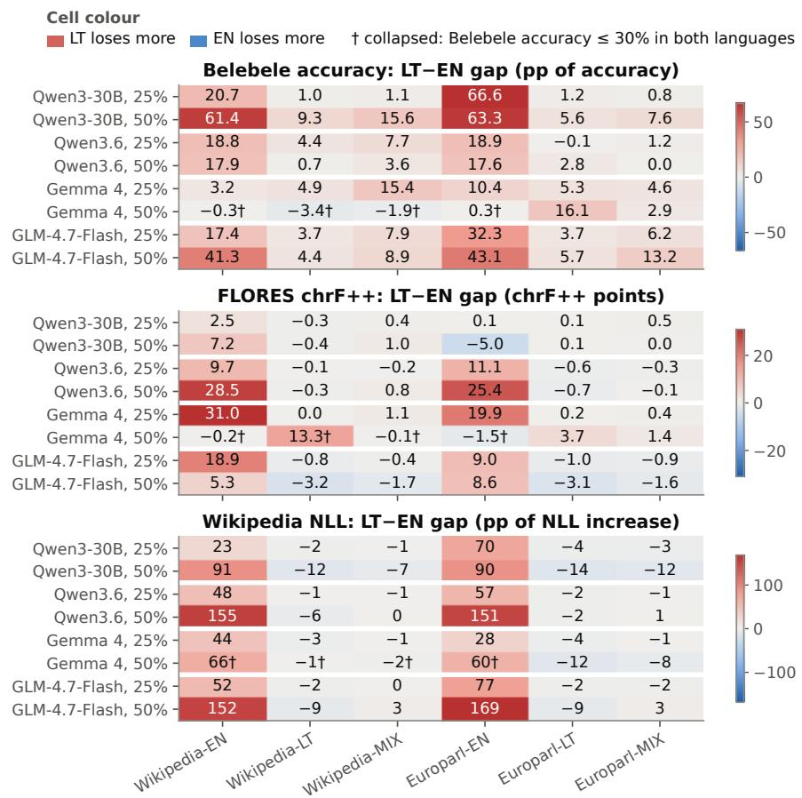  
Figure 8: LT–EN gap for all 48 configurations. Panels from top: Belebele (pp), FLORES (chrF++), Wikipedia (pp); rows: model and ratio; columns: calibration set. Red = Lithuanian loses more, blue = English loses more; Wikipedia values rounded to integers. † = collapsed in both languages (Belebele accuracy ≤30%): a gap near 0 there means that both languages broke, not that they degraded equally. The EN-calibrated columns are red throughout.

## C Calibration efects in detail

Figure 9 shows the efect of LT versus EN calibration for every configuration. Table 7 gives the share of variance each design factor explains, Table 8 the calibration set that English- or Lithuanian-only evaluation would select, and Table 9 the change of the gap from 25% to 50% pruning.

## Details for Section 4.2

• Variance shares (Table 7). For Lithuanian Belebele degradation, the calibration language explains 24%, the model 22% and the ratio 21%.

• LT versus EN calibration, Lithuanian evaluations. Belebele is better in 15/16 configurations and worse in 0 (mean gain 22.3 pp at 25%); FLORES is better in 16/16 (EN→LT) and 16/16 (LT→EN); Lithuanian NLL is better in 16/16.

• By model (mean Lithuanian Belebele gain over the model’s four configurations): Qwen3-30B 49.8, GLM-4.7-Flash 29.3, Qwen3.6 17.9 and Gemma 4 5.1 pp (Gemma 4 collapses at 50% whatever the calibration); EN→LT gains 24.3–33.8 chrF++ in every model.

• English under LT calibration. The median English Belebele efect is 0.8 pp, and the lowest interval bound over the 16 configurations is −4.9 pp. English NLL is worse in 11/16 configurations and better in 5/16.

• Transfer at 50%. The relative Lithuanian NLL increase is 14.0% under LT and 134.3% under EN calibration; the English one is 17.6% under EN and 22.1% under LT. Qwen3.6 keeps EN→LT at 53.5–53.6 chrF++ under LT calibration even at 50% (unpruned 54.0).

• MIX versus LT (positive = MIX better). Lithuanian Belebele −3.0 pp (worse in 7/16), EN→LT −1.0 chrF++ (worse in 8/16), Lithuanian NLL worse in 14/16 and English NLL better in 12/16 configurations. MIX gives the smaller absolute Wikipedia gap in 15/16 pairs.

• Choosing by English. After removing each model’s mean, English and Lithuanian Belebele rank the calibration sets only weakly alike (Kendall τ = 0.25 at 25%, p = 0.09).

• Best compromise. Qwen3.6 at 25% has a Belebele degradation (EN/LT) of 0.9/0.8 pp with Europarl-LT and −0.3/0.9 pp with Europarl-MIX (negative = better than unpruned).

## Details for Section 4.3

• 50% versus 25%. 50% is significantly worse in 24/24 (EN→LT), 24/24 (LT→EN), 24/24 and 24/24 (Wikipedia EN, LT), and 22/24 and 21/24 (Belebele EN, LT) configurations.

• Change of the gap (Table 9). Under EN calibration, the Belebele gap grows significantly in $3 / 8$ configurations and shrinks in $2 / 8 ,$ and the FLORES gap grows in $3 / 8$ and shrinks in $4 / 8 .$ . Under LT calibration, the Belebele gap grows in $3 / 8$ and the Wikipedia gap shrinks in $7 / 8$

## Details for Section 4.4

• Wikipedia calibration lowers Wikipedia NLL in 24/24 English and $2 0 / 2 4$ Lithuanian configurations, by 0.15 nats on average, and helps FLORES LT→EN by 1.1 chrF++ (significant in $1 2 / 2 4 ;$ the reverse in $3 / 2 4 )$ . Europarl calibration helps English Belebele significantly in $1 2 / 2 4$ configurations (the reverse in $1 / 2 4 )$

• Under EN calibration at 25%, GLM-4.7-Flash reaches 40.4% Lithuanian Belebele accuracy with Europarl-EN and 54.2% with Wikipedia-EN.

• Under LT and MIX calibration the domain still changes Lithuanian Belebele significantly in $4 / 8$ and $4 / 8$ configurations, by up to 7.1 and 22.0 pp (mostly Gemma 4 and Qwen3.6).

Table 7: Share of variance (%) across the 48 configurations explained by each design factor alone (one-way $\eta ^ { 2 } )$
<table><tr><td>Factor</td><td>LT Belebele degr.</td><td>EN Belebele degr.</td><td>Belebele gap</td><td>FLORES gap</td><td>Wikipedia gap</td></tr><tr><td>calibration language</td><td>24</td><td>0</td><td>39</td><td>36</td><td>70</td></tr><tr><td>model</td><td>22</td><td>50</td><td>15</td><td></td><td>4</td></tr><tr><td>pruning ratio</td><td>21</td><td>19</td><td>1</td><td>0</td><td>4</td></tr><tr><td>calibration domain</td><td>0</td><td>1</td><td>1</td><td></td><td>0</td></tr></table>

Table 8: Calibration set that maximises English or Lithuanian Belebele accuracy per model and ratio, the Lithuanian accuracy lost by choosing with English, and the English accuracy given up by choosing with Lithuanian.
<table><tr><td>Model</td><td>Ratio</td><td>best by EN Belebele</td><td>best by LT Belebele LT acc. lost (pp)</td><td></td><td>EN acc. cost (pp)</td></tr><tr><td rowspan="2">Qwen3-30B-A3B-Instruct-2507</td><td>25%</td><td>Europarl-LT</td><td>Europarl-MIX</td><td>0.1</td><td>0.3</td></tr><tr><td>50%</td><td>Europarl-MIX</td><td>Europarl-LT</td><td>1.6</td><td>0.4</td></tr><tr><td rowspan="2">Qwen3.6-35B-A3B</td><td>25%</td><td>Europarl-MIX</td><td>Europarl-LT</td><td>0.1</td><td>1.2</td></tr><tr><td>50%</td><td>Wikipedia-LT</td><td>Wikipedia-LT</td><td>0.0</td><td>0.0</td></tr><tr><td rowspan="2">gemma-4-26B-A4B-it</td><td>25%</td><td>Europarl-LT</td><td>Europarl-LT</td><td>0.0</td><td>0.0</td></tr><tr><td>50%</td><td>Europarl-LT</td><td>Europarl-MIX</td><td>0.2</td><td>13.0</td></tr><tr><td rowspan="2">GLM-4.7-Flash</td><td>25%</td><td>Europarl-MIX</td><td>Europarl-LT</td><td>0.6</td><td>2.0</td></tr><tr><td>50%</td><td>Europarl-MIX</td><td>Europarl-LT</td><td>6.3</td><td>1.2</td></tr></table>

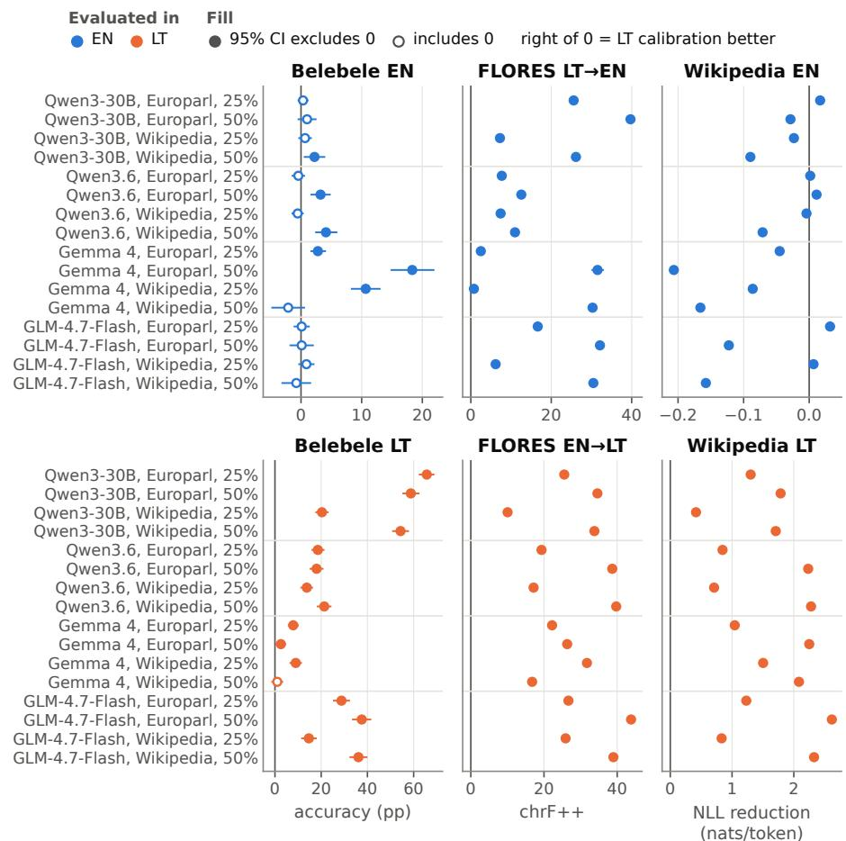  
Figure 9: LT vs EN calibration, paired by model, domain and ratio (rows). Columns: benchmarks; top row evaluated in English, bottom row in Lithuanian. Right of 0 = LT calibration better (Wikipedia NLL negated, nats/token); bars are 95% intervals; here fill = significance (filled = interval excludes 0), not ratio; colour = evaluated language. LT calibration is better for every Lithuanian evaluation except collapsed Gemma 4 Wikipedia, 50%; English Belebele never gets significantly worse.

Table 9: Change of the LT–EN gap from 25% to 50% pruning (gap at 50% minus gap at 25%) with 95% paired bootstrap intervals (Belebele: items resampled jointly in both languages, 4,000 resamples; FLORES: sentences, 1,000 resamples; Wikipedia: documents per language, 4,000 resamples). Positive = the gap grows.
<table><tr><td>Model</td><td>Calibration set</td><td>Belebele (pp)</td><td>FLORES (chrF++)</td><td>Wikipedia (pp)</td></tr><tr><td>Qwen3-30B</td><td>Wikipedia-EN</td><td>+40.8 [36.7, 44.8]</td><td>+4.7 [3.6, 5.8]</td><td>+68.0 [67.3, 68.7]</td></tr><tr><td></td><td>Wikipedia-LT</td><td>+8.3 [5.6, 11.3]</td><td>-0.1 [−0.9, 0.6]</td><td>-9.6 [−9.9, -9.4]</td></tr><tr><td></td><td>Wikipedia-MIX</td><td>+14.4 [11.3, 17.7]</td><td>+0.6 [−0.1, 1.4]</td><td>-5.7 [−6.0, −5.4]</td></tr><tr><td></td><td>Europarl-EN</td><td>-3.2 [−6.1, −0.3]</td><td>−5.1 [−5.9, −4.1]</td><td>+19.6 [19.0, 20.2]</td></tr><tr><td></td><td>Europarl-LT</td><td>+4.3 [1.9, 6.9]</td><td>0.0 [−0.7, 0.7]</td><td>-10.5 [−10.9, −10.2]</td></tr><tr><td></td><td>Europarl-MIX</td><td>+6.8 [4.2, 9.3]</td><td>−0.5 [−1.2, 0.3]</td><td>-9.0 [−9.4, −8.6]</td></tr><tr><td>Qwen3.6</td><td>Wikipedia-EN</td><td>-0.9 [−4.8, 2.9]</td><td>+18.8 [17.5, 20.1]</td><td>+107.3 [106.3, 108.4]</td></tr><tr><td></td><td>Wikipedia-LT</td><td>-3.8 [−6.2, −1.2]</td><td>−0.2 [−0.8, 0.3]</td><td>-4.6 [−4.9, −4.4]</td></tr><tr><td></td><td>Wikipedia-MIX</td><td>-4.1 [−6.9, −1.3]</td><td>+1.0 [0.4, 1.5]</td><td>+0.6 [0.3, 0.9]</td></tr><tr><td></td><td>Europarl-EN</td><td>−1.3 [−5.0, 2.6]</td><td>+14.3 [13.1, 15.5]</td><td>+94.6 [93.6, 95.6]</td></tr><tr><td></td><td>Europarl-LT</td><td>+2.9 [−0.1, 5.9]</td><td>−0.2 [−0.8, 0.4]</td><td>−0.6 [−1.0, −0.1]</td></tr><tr><td></td><td>Europarl-MIX</td><td>−1.2 [−4.4, 1.9]</td><td>+0.1 [−0.4, 0.7]</td><td>+1.5 [1.0, 2.1]</td></tr><tr><td>Gemma 4</td><td>Wikipedia-EN</td><td>-3.6 [−9.7, 2.4]</td><td>-31.1 [-32.2, -30.1]</td><td>+21.6 [21.2, 22.0]</td></tr><tr><td></td><td>Wikipedia-LT</td><td>-8.3 [−13.4, -3.0]</td><td>+13.3 [11.8, 14.9]</td><td>+2.0 [1.7, 2.2]</td></tr><tr><td></td><td>Wikipedia-MIX</td><td>-17.3 [−23.1, -11.3]</td><td>−1.2 [−2.5, −0.1]</td><td>−0.6 [−0.8, −0.3]</td></tr><tr><td></td><td>Europarl-EN</td><td>-10.1 [−14.9, −5.2]</td><td>-21.4 [−22.7, −20.2]</td><td>+32.1 [31.5, 32.6]</td></tr><tr><td></td><td>Europarl-LT</td><td>+10.8 [6.1, 15.7]</td><td>+3.4 [1.8, 5.1]</td><td>-8.6 [−8.8, -8.3]</td></tr><tr><td></td><td>Europarl-MIX</td><td>-1.7 [−6.7, 3.2]</td><td>+1.0 [−0.7, 2.6]</td><td>-6.2 [−6.4, −5.9]</td></tr><tr><td>GLM-4.7-Flash</td><td></td><td></td><td></td><td></td></tr><tr><td></td><td>Wikipedia-EN</td><td>+23.9 [18.7, 28.9]</td><td>-13.6 [−14.8, −12.4]</td><td>+99.3 [98.4, 100.3]</td></tr><tr><td></td><td>Wikipedia-LT</td><td>+0.8 [−3.2, 4.7]</td><td>-2.3 [−3.1, −1.6]</td><td>-6.7 [−7.2, −6.2]</td></tr><tr><td></td><td>Wikipedia-MIX</td><td>+1.0 [−2.7, 4.4]</td><td>−1.3 [−2.2, −0.6]</td><td>+3.2 [2.6, 3.8]</td></tr><tr><td></td><td>Europarl-EN</td><td>+10.8 [6.6, 15.0]</td><td>−0.4 [−1.6, 0.6]</td><td>+91.6 [90.6, 92.6]</td></tr><tr><td></td><td>Europarl-LT</td><td>+2.0 [−1.4, 5.6]</td><td>-2.1 [−2.8, −1.4]</td><td>-6.7 [−7.4, −6.1]</td></tr><tr><td></td><td>Europarl-MIX</td><td>+7.0 [3.4, 10.4]</td><td>−0.8 [−1.6, 0.1]</td><td>+4.8 [4.2, 5.5]</td></tr></table>

## D Experts and routing

Saliency and retention. EN and LT calibration rank experts similarly but not identically, with the lowest agreement in the first and last layers (Figure 10); Figure 11 shows which calibration changes move the retained expert set, and Table 10 shows that Lithuanian text is routed more narrowly than English text.

## Details for Section 4.5

• Routing of the unpruned models (ranges over the four models). Normalised selection entropy is 0.77–0.82 for Lithuanian and 0.86–0.92 for English text, and the EN–LT JSD is 0.15–0.26.

• Overlap of expert sets (same domain, EN versus LT calibration). The Jaccard index of the kept sets is 0.81–0.88 at 25% (random 0.60) and 0.64–0.78 at 50% (random 0.33); that of the removed sets is 0.52–0.68 at 25% (random 0.14).

• Removed routing. Under EN calibration the removed experts had received 1.5× as large a share of Lithuanian as of English routing at 25%, and 46.7% against 37.2% (1.26×) at 50%. In Figure 12, the English slope without Gemma 4 is −0.12.

• Depth (Table 10). The EN–LT JSD is 0.09–0.13 in the middle layers, where expert usage ranks agree $( \rho = 0 . 8 4 \ – 0 . 9 1 )$ , and 0.16–0.28 and 0.33–0.49 in the first and last 15% of MoE layers. In the last layers, LT calibration removes 0.00–0.71 of Lithuanian’s 8 most-used experts per layer. The relative LT–EN diference in removed routing under EN calibration is largest there (20.5% against 10.3%), mainly because the English share removed is lowest.

• Depth by model. Under EN calibration, the extra Lithuanian share removed peaks in the last 15% of layers for GLM-4.7-Flash (+13.8 pp, against +5.9 in the middle layers) and Qwen3.6 (+12.9 against −0.3), at 65–85% of depth for Gemma 4 (+19.7 pp), and is small and even for Qwen3-30B (3–6 pp), the model with the worst collapse.

• Correlations with Lithuanian Belebele loss at 25% (n = 24). For the Lithuanian routing removed in all layers $\rho = 0 . 7 2$ , in the first 15% $\rho = 0 . 8 7$ and in the last 15% $\rho = 0 . 7 5$ . Within EN calibration, the extra Lithuanian share removed does not track the Belebele gap $( \rho = - 0 . 2 9 , n = 1 6 )$

• Overlap and gaps. The correlation of EN–LT overlap with the Belebele gap is $\rho = 0 . 0 6 \ ( n = 1 6 )$ . The two pooled correlations with $p < 0 . 0 5$ (BLEU gap, $\rho = 0 . 6 2$ ; Wikipedia gap, $\rho = - 0 . 5 9 )$ fail a Bonferroni correction for the 10 tests and vanish within each ratio $( | \rho | \leq 0 . 1 1$ at 25%).

Table 10: Where in the network English and Lithuanian difer. Left: routing of the unpruned models, as ranges over the four models: EN−LT diference in normalised selection entropy (∆H), routing divergence (JSD), rank correlation of expert usage $( \rho )$ , and share of routing handled by the 8 most-used experts (%). Right: share of each language’s routing on the experts removed at 25% $( \% ,$ mean of 8 configurations). Depth bands: first 15%, middle 35–65% and last 15% of the MoE layers; the measures are defined in Appendix A.
<table><tr><td></td><td colspan="5">Unpruned routing, EN vs LT (range over 4 models)</td><td colspan="4">On removed experts at 25% (%)</td></tr><tr><td></td><td></td><td></td><td></td><td colspan="2">top-8 share</td><td colspan="2">EN calib.</td><td colspan="2">LT calib.</td></tr><tr><td>Depth</td><td>∆H</td><td>JSD</td><td></td><td>EN</td><td>LT</td><td>EN</td><td>LT</td><td>EN</td><td>LT</td></tr><tr><td>first 15%</td><td>0.07-0.12</td><td>0.16-0.28</td><td>0.45-0.73</td><td>14-32</td><td>28-49</td><td>20.4</td><td>25.1</td><td>22.8</td><td>16.1</td></tr><tr><td>middle 35–65%</td><td>0.03-0.07 0.09–0.13</td><td></td><td>0.84-0.91</td><td>22-41</td><td>29-53</td><td>13.7</td><td>18.7</td><td>14.6</td><td>14.0</td></tr><tr><td>last 15%</td><td>0.14-0.22 0.33-0.49 0.21–0.69</td><td></td><td></td><td>19-39</td><td>55-72</td><td>10.3</td><td>20.5</td><td>14.8</td><td>8.1</td></tr></table>

Saliency concentration. Lithuanian-calibrated saliency is more concentrated (higher Gini) than English-calibrated saliency in 61% of layers (Qwen3- 30B 83%, Gemma 4 68%, GLM-4.7-Flash 55%, Qwen3.6 36%). Never-routed experts (saliency 0, removed first) are more common under LT calibration: $7 / 8$ configurations at 25% $\mathrm { v s } ~ 4 / 8$ under EN; by model, Gemma 4 12/12 (up to 8.5% of removed experts), Qwen3-30B 9/12 (17.1%), Qwen3.6 $8 / 1 2 \ ( 0 . 9 \% )$ GLM-4.7-Flash $1 / 1 2 \ \left( 0 . 1 \% \right)$ Router entropy after pruning: normalised selection entropy rises slightly (0.016 to 0.041), so routing spreads over the remaining experts. Per-layer links: within each model, layers with lower EN–LT saliency correlation retain less similar expert sets $( \rho = 0 . 7 7 \mathrm { - } 0 . 9 3$ across layers; layers are not independent, so we give no p-values), and routing divergence correlates positively with the extra Lithuanian routing removed in all four models (0.25–0.44).

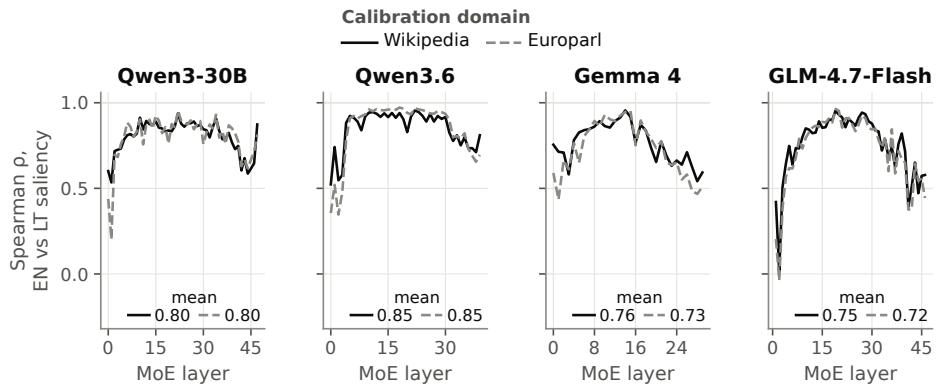  
Figure 10: Per-layer EN vs LT saliency rank correlation (saliency-only runs; solid = Wikipedia, dashed = Europarl). Agreement is lowest in the first and last layers.

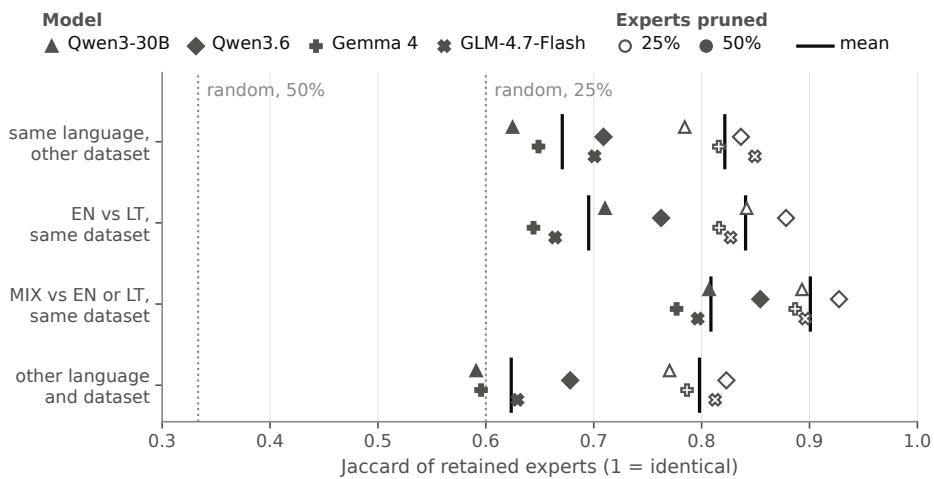  
Figure 11: Which calibration changes move the retained expert set? Jaccard of retained experts per kind of calibration pair, averaged per model (glyph = model); hollow = 25%, filled = 50%; black bars are means; dotted lines are random selection. Changing the domain moves the set at least as much as changing EN to LT in three of the four models.

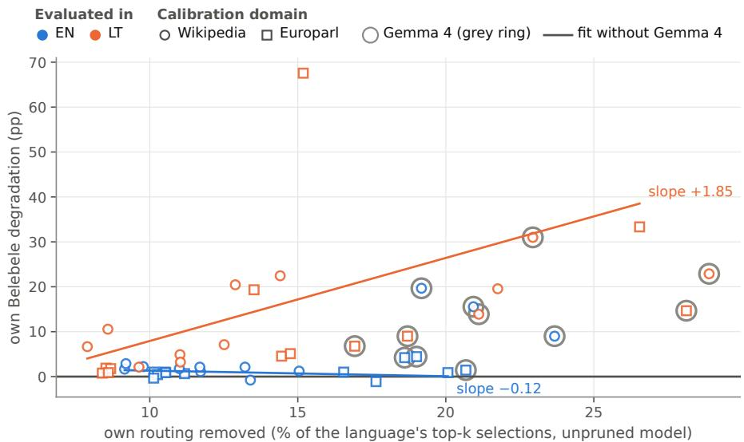  
Figure 12: Coverage vs robustness. Each language’s own routing share removed (x) against its own Belebele degradation (y; positive = worse), every configuration at 25%; colour = evaluated language; circle/square = Wikipedia/Europarl; grey rings mark Gemma 4, which is excluded from the fitted lines. Lithuanian accuracy falls steeply with the share of its routing removed, English accuracy barely moves.

## E Failure modes

Figure 13 shows how Belebele answers collapse onto one letter.

## Details for Section 4.6

• Runaway generation. With Europarl-EN, 50%, GLM-4.7-Flash hits the 256-token limit in 94% of EN→LT sentences. The limit allows about 79– 100 Lithuanian but 201–205 English words, so hit rates are not comparable across directions.

• Of-target output (definition in Appendix A). Under EN calibration 3.9% of EN→LT outputs are of-target at 25% and 59.4% at 50% (up to 95.0% in one configuration); under MIX calibration 14.1% at 50%; for the unpruned models 0.0%.

• Content. Under EN calibration at 25%, 20.2% of EN→LT outputs hit the limit, and collapsing immediate repeats of 1–4-word sequences recovers only 2.3 of the 22.7 chrF++ lost. LT-calibrated translations at 25% are within 1.1 chrF++ of the unpruned model, so their 6.2% of unseen Lithuanian-looking words approximates legitimate variation. English or copied words make up 3.4% of all words under EN calibration at 25%.

• Broken diacritics. The 948 outputs with invalid byte sequences come from 22 pruned runs.

• Letter collapse (Figure 13). Gemma 4 at 50% puts at least 70% of its answers on “A” in 11 of its 12 run×language pairs, and EN-calibrated GLM-4.7-Flash and Qwen3-30B at 50% put 78–99% of their Lithuanian answers there. The probability mass on the four letters falls to 0.01–0.25 for Gemma 4 at 50%. Every collapsed run puts at least 72% of its answers on one letter, and no run above 60% accuracy more than 41%.

• Reasoning text. In all 6 Gemma 4 configurations at 50%, 10–712 of the 1,012 LT→EN outputs open with a reasoning block. Excluding them changes the LT→EN drop of Europarl-LT, 50% only from 12.5 to 10.2 chrF++.

• Metric checks. Answer flips track absolute accuracy changes (ρ = 0.95). BLEU and chrF++ disagree on the sign of the gap in 12/48 configurations, only because LT→EN BLEU starts much higher; relative to each direction’s unpruned score they agree (ρ = 0.91).

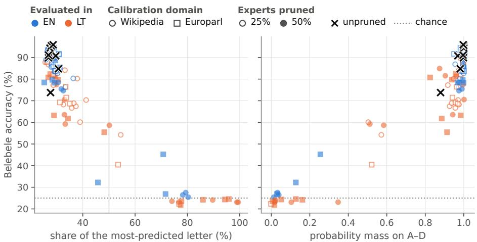  
Figure 13: Belebele accuracy vs answer-letter collapse for the 48 pruned runs, each evaluated in both languages (96 points; colour = evaluated language; circle/square = Wikipedia/Europarl; hollow/filled = 25%/50%), and the unpruned models (×). Left: share of the most-predicted letter; right: probability mass on A–D. Runs at chance accuracy put most answers on one letter and little probability on letters at all.