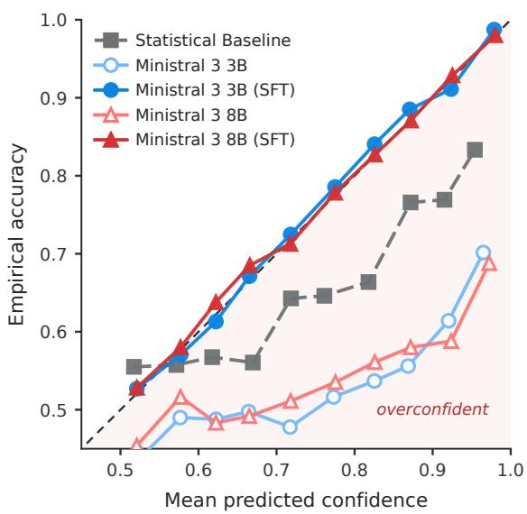

# Evaluating Token Probabilities as Confidence Estimators in Human Behavior Simulations: A Case Study in Luxembourgish Next Like Prediction

Nils Schwager1, Simon Münker1, Alistair Plum2, Achim Rettinger1

1Trier University, Trier, Germany

2University of Luxembourg, Esch-sur-Alzette, Luxembourg {schwager, muenker, rettinger}@uni-trier.de alistair.plum@uni.lu

## Abstract

As large language models (LLMs) are increasingly used to simulate human behavior, their operational validity is typically assessed through accuracy alone, implicitly treating human behavior as deterministic. We argue that on noisy digital trace data, a model’s performance depends not only on predicting the correct outcome but on its calibration. We present a case study testing whether the token probabilities of open-weight LLMs can serve as confidence estimates in a Next Like Prediction task: predicting how a user of the Luxembourgish news platform RTL.lu rates a comment, conditioned on their prior interactions. Evaluating Ministral 3 (3B, 8B), we find that, with in-context learning only, the tested models are overconfident and are outperformed on accuracy and calibration by a simple statistical baseline. Accuracy and calibration do not move together: scaling from 3B to 8B improves accuracy while degrading calibration, and longer behavioral histories raise accuracy while confidence declines. Taskspecific supervised fine-tuning acts as an effective calibration intervention, reducing Expected Calibration Error from 0.2 to 0.006 while improving accuracy from 0.536 to 0.758. We conclude that confidence estimation should be evaluated alongside accuracy to improve validity when using LLM-based agents.

## 1 Introduction

As large language models (LLMs) are increasingly used to simulate human behavior, methodological research into the validity (Larooij and Törnberg, 2025; Münker et al., 2026b) and alignment of generative agents (Chuang et al., 2024; Schwager et al., 2026) emphasizes that achieving operational validity requires alignment with authentic digital trace data. However, this type of data is inherently noisy due to the non-deterministic nature of human behavior and missing contextual modalities (Ouellette and Wood, 1998; Zhang et al., 2021). This lack of information makes it difficult to achieve sufficient predictive performance, or even to determine confidence thresholds.

Contemporary research utilizing LLMs as generative agents mostly relies on evaluating alignment using discrete (Lu et al., 2026; Wang et al., 2026) or continuous accuracy measures (Shen et al., 2025b; Schwager et al., 2026), thereby treating human behavior as deterministic. We argue that in simulations (and LLM applications processing noisy and/or user-generated text in general), the LLM’s utility depends not merely on its ability to predict the correct outcome, but on its capacity to accurately estimate its own predictive confidence (Farquhar et al., 2024; Aichberger et al., 2025; Nguyen et al., 2026). Because we will never reach absolute certainty on noisy data, we see calibration1 as a requirement for model alignment that is as important as accuracy itself (Azaria and Mitchell, 2023; Bakman et al., 2024).

To address this gap, we present a case study investigating whether LLMs’ token probabilities can natively serve as confidence metrics in human behavior simulation, and we evaluate task-specific fine-tuning as a calibration intervention. We utilize a Next Like Prediction task based on user comments and interactions from the Luxembourgish news platform RTL.lu2. Our task tests whether an LLM can accurately predict a user’s like or dislike of a given comment, based solely on previous (dis)likes. The setup isolates calibration for two reasons: (A) it introduces severe linguistic complexity and contextual sparsity (Section 3.3), and (B) it collapses human feedback into a strictly binary action space (like vs. dislike), which simplifies the measurement of accuracy and confidence relative to open-text alignment.

## 1.1 Research Questions

We investigate two research questions:

$R Q _ { 1 }$ How well do LLMs predict user likes/dislikes on Luxembourgish comments, and to what extent can we rely on their token probabilities as estimated confidence of these predictions?

$R Q _ { 2 }$ How does task-specific fine-tuning impact both the discrete accuracy and the underlying calibration of the model’s token probabilities?

## 1.2 Contributions

Our work makes the following contributions to the evaluation of LLM-based user modeling:

Confidence as an Evaluation Axis We argue that alignment for generative agents should be assessed through calibration alongside accuracy, and we operationalize this by treating the normalized token probabilities of a binary decision as a native confidence estimate for a human behavior simulation task.

Accuracy and Calibration Divergence Using a Next Like Prediction task on Luxembourgish digital trace data, we show that both tested off-theshelf models are overconfident: they assign high probabilities to incorrect predictions and are outperformed on both accuracy and expected calibration error by a simple statistical baseline. Crucially, the two signals diverge: scaling from 3B to 8B improves accuracy while increasing calibration error, and lengthening the behavioral history improves accuracy while confidence declines. Especially in the first case, accuracy alone would misreport the model’s probabilistic alignment.

Fine-Tuning as a Calibration Intervention We show that task-specific supervised fine-tuning substantially reduces calibration error and widens the gap between confidence on correct and incorrect predictions, indicating that lightweight adaptation can bring a model’s predictive probabilities into closer agreement with its observed accuracy.

## 2 Background

## 2.1 Luxembourgish NLP: Low Research but High Resource

Luxembourgish is the national language of the Grand Duchy of Luxembourg, and one of the four official languages alongside French, German, and German sign language. It is spoken natively by around 400,000 people (Fehlen et al., 2023) in a society marked by extensive multilingualism and code-switching. These conditions, a small speaker base, no single fully codified written standard, and constant contact with two much larger (in terms of number of speakers) neighbouring languages, have long made Luxembourgish a difficult target for NLP (Purschke, 2025).

A first strand of work on online discourse approached Luxembourgish through the lens of public attitudes towards multilingualism. Combining a Word2Vec based analysis of user comments from the RTL.lu news platform with crowdsourced questionnaire data collected through the Schnëssen project, Purschke (2020) connected sociolinguistic theories of language attitude with computational text analysis. A second strand similarly worked on the same online comments, but took an NLP approach in training various classifiers to moderate the comments (Ranasinghe et al., 2023). The work ultimately showed that multilingual models of the time worked well for this task, but lacked nuanced knowledge to effectively tackle problematic comments that should not be published.

In terms of language models for Luxembourgish, Philippy et al. (2024a) addressed the shortage of parallel data for Luxembourgish by compiling a small human generated cross-lingual parallel dataset, which was used to train LuxEmbedder, a sentence embedding model with cross-lingual capabilities. Lutgen et al. (2025) presented the first sequence to sequence normalisation models for Luxembourgish, built on the ByT5 and mT5 architectures and trained on word level data capturing real life spelling variation, in order to deal with the large amount of variation.

In addition to the growing model space for Luxembourgish (see Lothritz et al., 2022; Plum et al., 2025), the recent availability of benchmarks (see Philippy et al., 2024b; Plum et al., 2026) highlights an important aspect of the current situation that Luxembourgish finds itself in with relation to NLP. Although Joshi et al. (2020) classified Luxembourgish as “scraping-by”, and current research is ongoing but limited, the availability of data appears more as a “high resource” situation. Many sources of data are growing and becoming more readily available, including news articles and user comments from the main news broadcaster of Luxembourg, an expanding Wikipedia, transcripts of national assembly debates, online dictionary examples, to name but the largest collections. This difference in available data versus available methods highlights that processing and analysing the Luxembourgish language poses limiting difficulties, which are also apparent in the study at hand.

## 2.2 Calibration in Generative Agents

In machine learning, model calibration refers to the alignment of predictive probabilities (estimated confidence) with the observed accuracy (Geng et al., 2024; Guo et al., 2017).

Confidence in LLMs Applying traditional calibration methods directly to LLMs presents significant structural challenges. Unlike standard discriminative models, the output space for open-text generation grows exponentially with sequence length. While white-box methods attempt to estimate generation uncertainty using native logit scores, these indicators frequently suffer from surface form competition, where different valid textual representations compete for the same probability mass, skewing the actual confidence distribution (Holtzman et al., 2021). Consequently, researchers have explored alternative white-box approaches, such as probing internal state activations (Kadavath et al., 2022; Li et al., 2023). Black-box approaches require no access to the model’s internal computational graph. Instead, these methods attempt to estimate uncertainty through consistency checks across multiple stochastic generations (Manakul et al., 2023), evaluations via surrogate models (Shrivastava et al., 2023), or by directly prompting the model to verbalize its uncertainty, yielding a “linguistic confidence” score (Mielke et al., 2022).

Generative Agents Recent methodological frameworks require the operational validity of generative agents to be established against authentic digital traces (Larooij and Törnberg, 2025; Schwager et al., 2026). We argue that for noisy, non-deterministic tasks such as simulating human behavior on digital trace data, quantifying calibration is a methodological requirement. Robust confidence estimation enables researchers to aggregate individual predictions and apply nuanced, probabilistic interpretations to computational social science simulations.

Research Gap This paper takes the probability a model attaches to a single predicted human action and checks it against whether that action occurred.

Two lines of work approach that measurement and stop short. Calibration research assumes a resolvable ground truth, such as factual question answering or text labels with gold annotations (Gligoric´ et al., 2025; Tian et al., 2023), so that a prediction can be scored against the correct answer. Behavior simulation gives up the probability instead of the ground truth. The evaluation of generative agents so far rests on believability or, more recently, on accuracy metrics (Larooij and Törnberg, 2025). Neither asks whether a generative agent knows when it is wrong.

Human behavior offers no resolvable target: an observed action is one realization of a distribution over choices the individual could plausibly have made; like annotator disagreement on subjective labeling tasks, this variation is a property of the phenomenon rather than noise (Plank, 2022). Because that uncertainty cannot be removed from the task, we begin by moving the evaluation of generative agents from discrete accuracy to probability: accuracy reports a determinate result for an outcome that was never determinate, whereas calibration asks whether its confidence matches its accuracy.

We therefore test calibration in generative agents on the binary prediction of user actions (likes or dislikes) over authentic, non-English, code-switched digital trace data; the binary format allows direct extraction of token probabilities as native confidence markers.

## 3 Methods

## 3.1 Next Like Prediction Task

The Next Like Prediction task centers on predicting how a specific user would respond to a given stimulus, in this case, evaluating whether they would like (1) or dislike (0) a comment. By comparing predicted interactions with authentic digital traces, we assess whether models can capture individual-level behavioral patterns rather than producing generic responses. This framing strictly follows the operational validity criterion: alignment should be measured against the actual individuals being simulated, not abstract notions of plausibility (Larooij and Törnberg, 2025; Münker et al., 2026a).

Following the methodology established by Schwager et al. (2026), we rely on implicit conditioning by providing the model with a behavioral history. Specifically, we format previous user interactions as preceding prompt-completion turns in the LLM’s native chat structure. To standardize this conditioning and evaluate the impact of context scaling, the model receives a minimum of 3 historical interactions to predict the subsequent fourth interaction, with the context window expanding up to a maximum of 72 interactions. This effectively turns our prediction task into a classification task for a user’s (n + 1)-th interaction, based on the previous n interactions. During evaluation, we strictly condition the model on the user’s ground-truth behavioral history, explicitly omitting the model’s own prior predictions to prevent compounding errors.

In addition to the behavioral history, the model is conditioned with the following system prompt: You are a social media user evaluating online posts. Keep your binary predictions (1 for like, 0 for dislike) consistent with your previous interaction history and the preferences you have expressed earlier.

## 3.2 Dataset

The data for this task is provided by RTL.lu, the main news broadcaster of Luxembourg and the only one entirely in Luxembourgish. On the rtl. lu website, registered users can post comments below journalistic news articles. Users can react to the comments of other users with a like or a dislike. We are provided this data, which allows us to reconstruct which user liked or disliked which comments.3 The oldest comment in the dataset is from March 2020 and the newest from May 2024.

Pre-Processing First, we reorganize reactions by user to enable user-level modeling. We model the users strictly as voters; the stimuli are comments made by other users. To prevent overfitting to power users, we remove the top 20% of users by interaction count. This leaves users with at most 72 stimulus–response pairs. Users with fewer than four interactions are excluded.

Splits & Size We partition data at the user level so that all stimulus–response pairs from a single user appear exclusively in training or testing. This prevents cross-user leakage and enables the evaluation of cross-user generalization. Our resulting training set comprises 3, 247 users and 57, 185 training cases (excluding the three required seed conditioning cases), as well as 783 test users and 13, 759 test cases.

Descriptive Statistics The filtered dataset exhibits a baseline class distribution of 61% likes and 39% dislikes, establishing the base rate for the classification task. Within the defined bounds, users have an average of 20.5 interactions (median = 13). Furthermore, the user comments have an average length of 49 words. These comments are written in Luxembourgish (75%), English (15%), French (4%), and German (3%), reflecting the multilingual user base of the platform.

## 3.3 Task and Data Constraints

To contextualize the task difficulty, we note that the accuracy for this prediction task is inherently bounded by ambiguity in the digital trace data, stemming from three primary sources:

Linguistic Complexity The dataset contains mainly Luxembourgish, which also appears in mixed and unmixed combinations with German, French, and English. Furthermore, colloquial Luxembourgish exhibits significant variation and codeswitching. This linguistic diversity creates a challenging setting, which also tests the models’ different language capabilities.

Contextual Sparsity The prediction task relies exclusively on a sparse historical context window ranging from 3 to 72 previous interactions. Because the parent journalistic articles and broader external contexts are deliberately omitted from the input, the model must infer the initial topic solely from the target comment text. The model must subsequently derive a generalized user preference from this construct to execute the prediction.

Behavioral Non-Determinism Our data lacks information on latent variables that heavily influence behavior, such as offline events. Further, we assume human interaction is fundamentally nondeterministic; a user might upvote a comment on one day but ignore a similar one on another. Because these latent factors are collapsed into a binary outcome, perfect prediction is not expected (Hofman et al., 2017). Consequently, this task focuses on evaluating the model’s ability to appropriately reflect its confidence given the noise.

## 3.4 Metrics

We use standard accuracy as a discrete measure and treat the token probabilities for the tokens 0 and 1 as the model’s confidence. We acknowledge that interpreting token probabilities as confidence is bounded by factors such as first-token deviations (Wang et al., 2024) and surface form competition (Holtzman et al., 2021). However, this limitation is mitigated in our setup because the model strictly predicts discrete states (0 or 1) and is explicitly conditioned to enforce format compliance (Section 3.1). We apply a standard softmax function $( t = 1 )$ over the full vocabulary and extract the probabilities for our target tokens (0 and 1). In a second step we normalize the probability mass of 0 and 1 to ensure they form a valid probability distribution over the binary target space.

Expected Calibration Error (ECE) To quantify the alignment between the model’s confidence and empirical reality, we calculate the Top-1 ECE (Guo et al., 2017). We partition the normalized predictions into $M = 1 0$ equally spaced confidence bins. ECE measures the weighted average of the absolute difference between the empirical accuracy and the mean predicted confidence within each bin, thereby penalizing models that are systematically over- or underconfident.

Brier Score The Brier score evaluates the mean squared difference between the model’s predicted probabilities and the actual binary outcomes (Brier, 1950). Unlike discrete accuracy, the Brier score penalizes extreme overconfidence on incorrect predictions.

ROC-AUC To measure the model’s underlying discriminative power independent of a rigid 0.5 decision threshold, we report the Area Under the Receiver Operating Characteristic Curve (ROC-AUC). This evaluates the probability that the model assigns a higher token probability to a randomly chosen positive interaction (like) than to a randomly chosen negative one (dislike).

Conditional Confidence To diagnose the calibration deficit, we disaggregate the model’s certainty into two complementary metrics: Confidence on Correct Predictions $( \mathrm { C o n f _ { C o r r e c t } } )$ and Confidence on Incorrect Predictions $\scriptstyle \left( \mathbf { C o n f } _ { \mathrm { I n c o r r e c t } } \right)$ . A model whose confidence is informative will exhibit a large gap between these values: high certainty when accurate, and appropriate uncertainty (probabilities approaching 0.5) when predicting incorrectly.

## 3.5 Experimental Setup

Model & Fine-Tuning We utilize the open-weight Ministral 3 model family (Ministral-3-3B-Instruct-2512-BF16 and

Ministral-3-8B-Instruct-2512-BF16 (Liu et al., 2026)) because its robust pre-training on diverse European languages establishes a strong linguistic baseline for Luxembourgish text, while remaining parameter-efficient. We apply Supervised Fine-Tuning (SFT) to the models on the task described in Section 3.1. To ensure comparability across models, we use identical hyperparameters: one epoch, a maximum sequence length of 4, 500 tokens, and training on complete input sequences (system prompt, user prompts, and model completions). We use the paged AdamW optimizer with 8-bit quantization (Dettmers et al., 2022) to enable training on a single NVIDIA L40S GPU (48GB VRAM). All remaining hyperparameters follow the TRL defaults (von Werra et al., 2020).

Statistical Baseline To establish a non-semantic lower bound, we implement a naive statistical baseline. For each prediction step, the probability of a positive interaction is computed strictly as the distribution of the user’s prior interactions (total past likes divided by total historical interactions).

Proprietary Baseline To establish a baseline of proprietary model capabilities, we evaluate Gemini 3.5 Flash-Lite (with reasoning disabled), a recent high-throughput model optimized for latencysensitive classification tasks. As with most SOTA proprietary models, the internal logits remain inaccessible via the standard API, hence we only report its discrete predictive accuracy.

## 4 Results

## 4.1 Model Calibration $( R Q _ { 1 } )$

To address $R Q _ { 1 }$ , we first evaluate the off-the-shelf models to observe how well they estimate their own certainty on noisy digital trace data. The results, detailed in Table 1 and visualized in the reliability diagram (Figure 1), show that these LLMs are overconfident in the tested setting. When evaluated on authentic user interactions, the 8B offthe-shelf model achieves a discrete accuracy of 0.5355, performing only slightly above random chance. Notably, this underperforms our simple statistical baseline, which achieves an accuracy of 0.5900 by strictly predicting the user’s historical marginal distribution. Despite this low predictive accuracy, the 8B model exhibits a high ECE of 0.2004 and a Brier score of 0.2937, a penalty worse than simply predicting a constant 0.5 probability

<table><tr><td>Model</td><td>Accuracy (↑)</td><td>ROC-AUC (↑)</td><td>Brier Score (↓)</td><td>ECE (↓)</td><td>Conf Cor. (↑)</td><td>Conf Incor. (↓)</td></tr><tr><td>Statistical Baseline</td><td>0.5900</td><td>0.5488</td><td>0.2476</td><td>0.0642</td><td>0.6581</td><td>0.6346</td></tr><tr><td>Ministral 3 3B</td><td>0.4906</td><td>0.6128</td><td>0.2813</td><td>0.1650</td><td>0.6632</td><td>0.6482</td></tr><tr><td>Ministral 3 3B (SFT)</td><td>0.7089</td><td>0.7600</td><td>0.1880</td><td>0.0087</td><td>0.7303</td><td>0.6434</td></tr><tr><td>Ministral 3 8B</td><td>0.5355</td><td>0.5872</td><td>0.2937</td><td>0.2004</td><td>0.7494</td><td>0.7202</td></tr><tr><td>Ministral 3 8B (SFT)</td><td>0.7578</td><td>0.8253</td><td>0.1618</td><td>0.0056</td><td>0.7828</td><td>0.6616</td></tr><tr><td>Gemini 3.5 Flash Lite</td><td>0.6868</td><td></td><td></td><td></td><td></td><td></td></tr></table>

Table 1: Comparative Model Performance and Calibration. Results detail discrete accuracy and probabilistic calibration across all evaluated configurations. Best values per metric are bolded.

for every interaction.

This overconfidence becomes clear when looking at the conditional confidence metrics. When the 8B model makes an incorrect prediction, it still assigns a mean probability of 0.7202 $( \mathrm { C o n f _ { I n c o r r e c t } } )$ to its choice. This is nearly as high as its confidence when it is correct $( \mathrm { C o n f } _ { \mathrm { C o r r e c t } } = 0 . 7 4 9 4 )$ . In contrast, the purely statistical baseline naturally avoids this overconfidence, maintaining a much lower $\mathrm { C o n f _ { I n c o r r e c t } }$ of 0.6346. The 3B model behaves similarly to the 8B, demonstrating a $\mathrm { C o n f _ { I n c o r r e c t } }$ of 0.6482 against an overall accuracy of only 0.4906.

## 4.2 Fine-Tuning and Calibration Improvement (RQ2)

To answer $R Q _ { 2 }$ , we examine the impact of taskspecific SFT on the models’ probability outputs. We find that fine-tuning improves the models ability to appropriately express uncertainty while simultaneously increasing their discrete performance.

As shown in Table 1, fine-tuning the 8B model increases predictive accuracy to 0.7578 and raises ROC-AUC to 0.8253. This gain over the statistical baseline suggests that the model learns semantic behavioral patterns rather than defaulting to a user’s historical average. The same intervention aligns the model’s predicted probabilities more closely with its observed accuracy: fine-tuning reduces the ECE to 0.0056 and lowers the Brier score to 0.1618.

  
Figure 1: Reliability diagram comparing model calibration on the Next Like Prediction task.

This improvement is also visible in the conditional confidence gap. For the fine-tuned 8B model, mean confidence on correct predictions rises to 0.7828, while confidence on incorrect predictions falls to 0.6616. This widening gap is consistent with a model that lowers its probability estimates when its predictions are more likely to be wrong.

Finally, we observe that achieving good calibration does not strictly require larger models. The 3B (SFT) model achieves calibration nearly on par with the 8B (SFT) model (ECE 0.0087 vs. 0.0056), indicating that strong calibration is attainable at smaller scale, although the 8B (SFT) model remains best on both accuracy and calibration. Overall, task-specific fine-tuning proves to be effective not only for predicting user interactions but also for ensuring the model’s confidence scores are sufficiently calibrated for downstream analysis.

When evaluated on the same dataset, the proprietary Gemini 3.5 Flash-Lite model achieves a discrete accuracy of 0.6868. While this outperforms the statistical baseline and off-the-shelf models, it falls short of our fine-tuned 8B model.

## 4.3 Contextual Scaling Analysis

As a supplementary analysis, we examine accuracy and confidence as a function of behavioral history length. The results, detailed in Table 2, reveal a divergence between accuracy and confidence in the off-the-shelf models. While providing extended behavioral history significantly improves the accuracy of the 8B model $( r = 0 . 5 0 )$ , its internal confidence exhibits a strong inverse trajectory $( r = - 0 . 6 4 )$ . As the context window expands, the model becomes more accurate but less confident.

<table><tr><td rowspan="2">Model</td><td colspan="2">History → Acc</td><td colspan="2">History → Conf</td></tr><tr><td> $\Delta _ { 1 0 0 }$ </td><td>r</td><td> $\Delta _ { 1 0 0 }$ </td><td>r</td></tr><tr><td>Statistical Baseline</td><td>0.195</td><td> $0 . 4 9 ^ { * * * }$ </td><td>-0.017</td><td> $- 0 . 2 0$ </td></tr><tr><td>Ministral 3 3B</td><td>0.100</td><td> $0 . 2 3$ </td><td>-0.068</td><td> $- 0 . 7 1 ^ { \ast \ast \ast }$ </td></tr><tr><td>Ministral 3 3B (SFT)</td><td>0.095</td><td> $0 . 3 4 ^ { * * }$ </td><td>0.050</td><td> $0 . 4 9 ^ { * * * }$ </td></tr><tr><td>Ministral 3 8B</td><td>0.247</td><td> $0 . 5 0 ^ { * * * }$ </td><td>-0.087</td><td> $\cdot 0 . 6 4 ^ { \ast \ast \ast }$ </td></tr><tr><td>Ministral 3 8B (SFT)</td><td>0.086</td><td> $0 . 3 3 ^ { * * }$ </td><td>0.045</td><td> $0 . 4 3 ^ { * * * }$ </td></tr><tr><td>Gemini 3.5 Flash Lite</td><td>0.143</td><td> $0 . 4 3 ^ { * * * }$ </td><td></td><td></td></tr></table>

Table 2: Contextual Scaling. $\Delta _ { 1 0 0 }$ represents the linear change in accuracy and confidence per 100 interactions, rescaled from a slope fitted over the observed range (at most 72 interactions) and r denotes the Pearson correlation coefficient. Significance levels: $^ { * } p \ < \ 0 . 0 5$ $^ { * * } p < 0 . 0 1 , { } ^ { * * * } p < 0 . 0 0 1$

Conversely, Supervised Fine-Tuning (SFT) realigns these metrics. For the fine-tuned 8B model, both accuracy $( r \ : = \ : 0 . 3 3 )$ and confidence $( r \ =$ 0.43) scale positively and significantly with history length. This indicates that task-specific adaptation trains the model to utilize extended digital traces not just for discrete prediction, but to increase its confidence.

Finally, while the purely statistical baseline and the proprietary Gemini 3.5 Flash-Lite model both achieve significant accuracy gains with longer historical contexts $( r = 0 . 4 9$ and $r \ = \ 0 . 4 3$ , respectively), their usable confidence signal is constrained. The baseline’s confidence shows no significant association with history length $( r \ =$ −0.20).

For the off-the-shelf models, this supports our central claim that accuracy alone is an insufficient evaluation criterion, since accuracy and the confidence signal move in opposite directions.

## 5 Discussion

## 5.1 Interpreting the Calibration Deficit

The results from Section 4 highlight a divergence between the models’ discrete predictive capacity and their calibration. First, we observe that the statistical baseline natively avoids overconfidence because it anchors its predictions strictly to the distribution of historical interactions. This results in the lowest mean probability assigned to incorrect predictions (0.6346). In contrast, the off-the-shelf models exhibit a calibration deficit, assigning high probability mass to incorrect outcomes, which inflates their Brier scores.

Second, our findings indicate that accuracy and calibration do not inherently scale together. Increasing the parameter count from the 3B to the 8B model improves accuracy (from 0.4906 to 0.5355) but increases the ECE from 0.1650 to 0.2004. This decoupling demonstrates that parameter scaling alone does not resolve calibration deficits.

Third, SFT functions as an effective calibration intervention. Task-specific fine-tuning closes the gap between mean confidence and accuracy, and widens the gap between $\mathrm { C o n f _ { C o r r e c t } }$ and $\mathrm { C o n f _ { I n c o r r e c t } }$ . Following SFT, the 8B model increases its confidence on correct predictions to 0.7828, while reducing it on incorrect predictions to 0.6616.

## 5.2 The Insufficiency of Inference-Only Paradigms

Common NLP downstream tasks can currently be solved by relying on in-context learning coupled with few-shot examples (Brown et al., 2020). This narrative of universal adaptability without requiring data-driven weight updates is frequently applied to user-behavior generation and prediction tasks (Larooij and Törnberg, 2025). However, authentic digital trace data, especially non-English and codeswitched text, deviates heavily from original pretraining distributions.

Our results demonstrate a discrepancy between the performance of an in-context, prompt-based approach and data-driven fine-tuning. The empirical finding that a naive statistical heuristic achieves superior calibration and accuracy compared to offthe-shelf models provides evidence against the assumption that generalized inference is universally sufficient for human simulation.

If a simple mathematical baseline is cheaper, more transparent, and achieves a safer confidence distribution than unaligned open-weight models, utilizing off-the-shelf LLMs via standard inference is inadequate for rigorous modeling (Shen et al., 2025a). Therefore, our results suggest that training parameter-efficient models and adapting them specifically for the individual tasks is a methodological requirement.

## 5.3 Accessibility needed?

Measuring probabilistic alignment, which we deem relevant for evaluation of behavior simulations, requires unrestricted access to a model’s internal probability mass. For instance, while the proprietary Gemini 3.5 Flash-Lite achieves a competitive discrete accuracy of 0.6868 on our dataset, its restricted API obscures the underlying logit scores. Consequently, calibration metrics like ECE or Brier scores cannot be computed.

This limitation reduces black-box evaluation to deterministic point-estimates, without associated uncertainty. For rigorous downstream evaluation, accessing the raw computational graph is a methodological prerequisite. Future work must bridge this gap by applying mechanistic interpretability methods (Dunefsky et al., 2024), such as circuit analysis or sparse autoencoders, to open-weight architectures to formally dissect how generative agents construct confidence.

## 5.4 The Case for Confidence in Generative Agents

We make the case that when benchmarking the ecological and operational validity of generative agents, researchers must explicitly test for confidence alongside accuracy. However, we acknowledge that current methods for extracting confidence in open-text generation are insufficient and underresearched, particularly within the intersection of Computational Social Science and LLMs.

Despite these current methodological limits, shifting from discrete deterministic accuracy to probabilistic evaluation is necessary. Establishing standardized calibration approaches would allow researchers to quantify the robustness of simulations by aggregating individual confidence estimates. Ultimately, recognizing and evaluating the inherent uncertainty in human digital trace data will lead to more sound and transparent computational social science applications.

## 6 Conclusion

RQ1: LLMs on the Task Our empirical evaluation demonstrates that off-the-shelf models show lower performance than naive statistical estimations based on the marginal like/dislike distributions, a baseline neither off-the-shelf model beats on accuracy or on calibration. This discrete inaccuracy is accompanied by a confidence signal that does not track it: across both model scale and context length, accuracy and confidence signal move in opposite directions, so higher accuracy alone does not result in better probabilistic alignment.

RQ2: Impact of Fine-Tuning The impact of task-specific fine-tuning is so significant that datadriven alignment appears necessary for the noisy task at hand. It marks the difference between underperforming the statistical baseline via in-context learning, and outperforming the baseline significantly after training the model on the task. Crucially, it also shows the overarching benefit of achieving closer agreement between measured confidence and observed accuracy.

## 6.1 Future Work

Expanding to Open Text Our current methodology strictly bounds the action space to a binary classification task to extract and isolate discrete token probabilities. Expanding this framework to generative, open-text simulations requires advancing beyond single-token estimations to accurately capture the behavioral diversity in authentic digital traces.

Advanced Approaches for Modeling Uncertainty To achieve this, future research must evaluate the calibration of generative agents using more complex paradigms for modeling uncertainty. To circumvent the limitations of discrete token probabilities, internal state-based methods present a promising research direction.

Multi-Turn Calibration Currently, our evaluation is constrained to single-turn predictions conditioned exclusively on empirical ground-truth histories. To facilitate complex computational social simulations, models must be capable of multi-turn interactions, autoregressively conditioning on their own synthetic outputs. Future research must evaluate calibration in these dynamic environments, specifically investigating how to quantify and mitigate the compounding uncertainty that occurs during sequential generation.

Testing on Out-of-Distribution (OOD) Data Addressing these structural challenges paves the way for robust, ecologically valid generative agents. Ultimately, the community must benchmark probabilistic alignment on out-of-distribution data, as the generalizability of current models across diverse behavioral patterns remains uncertain. Because a truly operational simulation must reliably generate insights across counterfactual scenarios, achieving robust confidence estimates on OOD data during multi-turn interactions remains the central open challenge in human behavior simulation.

## Limitations

Generalizability Across Models and Domains As a case study, our findings are bounded to a single open-weight model family (Ministral 3) evaluated on a single dataset. While this focus enables a controlled analysis of scale and fine-tuning within one architecture, the overconfidence we observe is established for this specific setting rather than for open-weight LLMs in general. Consequently, the calibration deficit and its correction under finetuning do not automatically translate to other model families or other forms of noisy behavioral data, which we leave to future work.

Constraint to Discrete Action Spaces A primary limitation of our current methodological framework is its strict reliance on a bounded, binary action space. While scaling this predictive paradigm to multi-class discrete states is mathematically straightforward, quantifying confidence in open-ended text generation introduces complexity. In unconstrained generative environments, foundational metrics such as perplexity serve as inadequate proxies for uncertainty. Consequently, our findings regarding token-level calibration on singletoken outputs do not automatically translate to the confidence estimation of free-text behavioral simulacra.

Single-Turn Evaluation Scope Furthermore, our current experimental design is constrained to single-turn inference, evaluating predictions conditioned exclusively on empirical, ground-truth historical interactions. This isolates baseline calibration but leaves multi-turn performance unaddressed. We do not evaluate the model’s capacity to maintain probabilistic alignment when autoregressively conditioning on its own synthetic prior outputs. The compounding nature of uncertainty over sequential generations remains a critical unknown; it is not yet established how to calibrate a multi-turn model once its contextual history inevitably diverges from authentic digital trace data.

## Ethical Considerations

Behavioral Prediction as a Dual-Use Capability Our task, by design, asks an LLM to infer a specific, identifiable person’s future endorsement from a fragment of their prior digital behavior. Framed as a calibration study, this is a methodological probe; framed outside that context, it is a template for individual-level preference profiling. Our central finding, that fine-tuning not only raises accuracy but also sharpens confidence, is what would make such a system attractive for downstream deployment (e.g., comment ranking, engagement optimization, or targeted content curation). A wellcalibrated predictor of what a person will approve of is a more trustworthy-looking, and therefore more readily deployable, tool for behavioral targeting than an overconfident one. We see the same calibration intervention we advocate for methodologically as one that lowers the barrier to realworld use of this capability.

Miscalibrated Confidence as a Deployment Risk Beyond privacy, our results affect research and deployment practices: off-the-shelf models are not only inaccurate but also assign high confidence to their own errors (Section 4). Suppose such models were adopted for behavioral simulation or moderation-adjacent decisions without the calibration intervention step we test here, their incorrect but confident outputs risk being trusted as reliable when they are not. Conversely, evaluating LLMs on this kind of task using in-context learning alone, without a transparent statistical baseline or a finetuned comparison point, risks the opposite error: concluding that LLMs are broadly unsuited to modeling noisy human behavior when the deficit lies in the inference-only paradigm rather than in the underlying model. Reporting calibration alongside accuracy, and reporting both off-the-shelf and fine-tuned results against a naive baseline as we do, helps guard against both of these premature conclusions.

Positioning within Low-Resource NLP Luxembourgish remains under-resourced for NLP despite growing data availability (Section 2). Contributing an evaluation of confidence estimation on authentic Luxembourgish digital trace data supports this community’s research infrastructure and, in principle, downstream applications such as improved comment moderation tooling for the platform that provided the data. We consider this a genuine benefit that should be weighed against the risks above, but not one that offsets them by default: the same methodology, applied to a larger or less consenting population, would carry the profiling risks described above with fewer of the mitigating factors (small-scale, agreement-bound, non-public data) present in our setup.

## Acknowledgements

This work was conducted within the Ecological Validation of Artificial Simulacra (EVAS) Research Cooperative (https://evas-research.github. io/). This work is supported by EMO-SCI (project number 569156112) funded by Deutsche Forschungsgemeinschaft (DFG, German Research Foundation). We thank RTL for providing us with the data for research purposes.

## References

Lukas Aichberger, Kajetan Schweighofer, and Sepp Hochreiter. 2025. Rethinking Uncertainty Estimation in Natural Language Generation. In ICLR Workshop: Quantify Uncertainty and Hallucination in Founda tion Models: The Next Frontier in Reliable AI.

Amos Azaria and Tom Mitchell. 2023. The internal state of an LLM knows when it’s lying. In Findings of the Association for Computational Linguistics: EMNLP 2023, pages 967–976, Singapore. Association for Computational Linguistics.

Yavuz Faruk Bakman, Duygu Nur Yaldiz, Baturalp Buyukates, Chenyang Tao, Dimitrios Dimitriadis, and Salman Avestimehr. 2024. MARS: Meaningaware response scoring for uncertainty estimation in generative LLMs. In Proceedings ofthe 62nd Annual Meeting of the Association for Computational Linguistics (Volume 1: Long Papers), pages 7752–7767, Bangkok, Thailand. Association for Computational Linguistics.

Glenn W. Brier. 1950. Verification of forecasts expressed in terms of probability. Monthly Weather Review, 78(1):1 – 3.

Tom B. Brown, Benjamin Mann, Nick Ryder, Melanie Subbiah, Jared Kaplan, Prafulla Dhariwal, Arvind Neelakantan, Pranav Shyam, Girish Sastry, Amanda Askell, Sandhini Agarwal, Ariel Herbert-Voss, Gretchen Krueger, Tom Henighan, Rewon Child, Aditya Ramesh, Daniel M. Ziegler, Jeffrey Wu, Clemens Winter, and 12 others. 2020. Language models are few-shot learners. In Proceedings ofthe 34th International Conference on Neural Information Processing Systems, NIPS ’20, pages 1877–1901, Red Hook, NY, USA. Curran Associates Inc.

Yun-Shiuan Chuang, Agam Goyal, Nikunj Harlalka, Siddharth Suresh, Robert Hawkins, Sijia Yang, Dhavan Shah, Junjie Hu, and Timothy Rogers. 2024. Simulating opinion dynamics with networks of LLMbased agents. In Findings ofthe Associationfor Computational Linguistics: NAACL 2024, pages 3326– 3346, Mexico City, Mexico. Association for Computational Linguistics.

Tim Dettmers, Mike Lewis, Sam Shleifer, and Luke Zettlemoyer. 2022. 8-bit optimizers via block-wise quantization. Preprint, arXiv:2110.02861.

Jacob Dunefsky, Philippe Chlenski, and Neel Nanda. 2024. Transcoders find interpretable LLM feature circuits. In Proceedings of the 38th International Conference on Neural Information Processing Systems, volume 37 of NIPS ’24, pages 24375–24410. Curran Associates Inc.

Sebastian Farquhar, Jannik Kossen, Lorenz Kuhn, and Yarin Gal. 2024. Detecting hallucinations in large language models using semantic entropy. Nature, 630(8017):625–630.

Fernand Fehlen, Peter Gilles, Louis Chauvel, Isabelle Pigeron-Piroth, Yann Ferro, and Etienne Le Bihan. 2023. RP2021 N°8 – Linguistic Diversity on the Rise. Technical report, STATEC and University of Luxembourg, Luxembourg.

Jiahui Geng, Fengyu Cai, Yuxia Wang, Heinz Koeppl, Preslav Nakov, and Iryna Gurevych. 2024. A survey of confidence estimation and calibration in large language models. In Proceedings ofthe 2024 Conference of the North American Chapter of the Associationfor Computational Linguistics: Human Language Technologies (Volume 1: Long Papers), pages 6577–6595, Mexico City, Mexico. Association for Computational Linguistics.

Kristina Gligoric, Tijana Zrnic, Cinoo Lee, Emmanuel´ Candès, and Dan Jurafsky. 2025. Can unconfident LLM annotations be used for confident conclusions? In Proceedings of the 2025 Conference of the Nations ofthe Americas Chapter ofthe Associationfor Computational Linguistics: Human Language Technologies (Volume 1: Long Papers), pages 3514–3533, Albuquerque, New Mexico. Association for Computational Linguistics.

Chuan Guo, Geoff Pleiss, Yu Sun, and Kilian Q. Weinberger. 2017. On calibration of modern neural networks. In Proceedings ofthe 34th International Conference on Machine Learning - Volume 70, ICML’17, page 1321–1330. JMLR.org.

Jake M. Hofman, Amit Sharma, and Duncan J. Watts. 2017. Prediction and explanation in social systems. Science, 355(6324):486–488.

Ari Holtzman, Peter West, Vered Shwartz, Yejin Choi, and Luke Zettlemoyer. 2021. Surface form competition: Why the highest probability answer isn’t always right. In Proceedings ofthe 2021 Conference on Empirical Methods in Natural Language Processing, pages 7038–7051, Online and Punta Cana, Dominican Republic. Association for Computational Linguistics.

Pratik Joshi, Sebastin Santy, Amar Budhiraja, Kalika Bali, and Monojit Choudhury. 2020. The state and fate of linguistic diversity and inclusion in the NLP world. In Proceedings of the 58th Annual Meeting of the Association for Computational Linguistics, pages 6282–6293, Online. Association for Computational Linguistics.

Saurav Kadavath, Tom Conerly, Amanda Askell, Tom Henighan, Dawn Drain, Ethan Perez, Nicholas Schiefer, Zac Hatfield-Dodds, Nova DasSarma, Eli Tran-Johnson, Scott Johnston, Sheer El-Showk, Andy Jones, Nelson Elhage, Tristan Hume, Anna Chen, Yuntao Bai, Sam Bowman, Stanislav Fort, and 17 others. 2022. Language models (mostly) know what they know. Preprint, arXiv:2207.05221.

Maik Larooij and Petter Törnberg. 2025. Validation is the central challenge for generative social simulation: a critical review of llms in agent-based modeling. Artificial Intelligence Review, 59(1):15.

Kenneth Li, Oam Patel, Fernanda Viégas, Hanspeter Pfister, and Martin Wattenberg. 2023. Inference-time intervention: eliciting truthful answers from a language model. In Proceedings of the 37th International Conference on Neural Information Processing Systems, NIPS ’23, Red Hook, NY, USA. Curran Associates Inc.

Alexander H. Liu, Kartik Khandelwal, Sandeep Subramanian, Victor Jouault, Abhinav Rastogi, Adrien Sadé, Alan Jeffares, Albert Jiang, Alexandre Cahill, Alexandre Gavaudan, Alexandre Sablayrolles, Amélie Héliou, Amos You, Andy Ehrenberg, Andy Lo, Anton Eliseev, Antonia Calvi, Avinash Sooriyarachchi, Baptiste Bout, and 101 others. 2026. Ministral 3. Preprint, arXiv:2601.08584.

Cedric Lothritz, Bertrand Lebichot, Kevin Allix, Lisa Veiber, Tegawende Bissyande, Jacques Klein, Andrey Boytsov, Clément Lefebvre, and Anne Goujon. 2022. LuxemBERT: Simple and practical data augmentation in language model pre-training for Luxembourgish. In Proceedings of the Thirteenth Language Resources and Evaluation Conference, pages 5080–5089, Marseille, France. European Language Resources Association.

Yuxuan Lu, Jing Huang, Yan Han, Bingsheng Yao, Sisong Bei, Yaochen Xie, Yisi Sang, Qi He, and Dakuo Wang. 2026. Can LLM agents simulate multiturn human behavior? evidence from real online customer behavior data. In Proceedings ofthe 64th Annual Meeting of the Association for Computational Linguistics (Volume 1: Long Papers), pages 43961– 43977, San Diego, California, United States. Association for Computational Linguistics.

Anne-Marie Lutgen, Alistair Plum, Christoph Purschke, and Barbara Plank. 2025. Neural Text Normalization for Luxembourgish Using Real-Life Variation Data. In Proceedings of the 12th Workshop on NLP for Similar Languages, Varieties and Dialects, pages 115–127, Abu Dhabi, UAE. Association for Computational Linguistics.

Potsawee Manakul, Adian Liusie, and Mark Gales. 2023. SelfCheckGPT: Zero-resource black-box hallucination detection for generative large language models. In Proceedings of the 2023 Conference on Empirical Methods in Natural Language Processing, pages 9004–9017, Singapore. Association for Computational Linguistics.

Sabrina J. Mielke, Arthur Szlam, Emily Dinan, and Y-Lan Boureau. 2022. Reducing conversational agents’ overconfidence through linguistic calibration. Transactions ofthe Associationfor Computational Linguistics, 10:857–872.

Simon Münker, Achim Rettinger, and Damian Trilling. 2026a. Challenging the myth: A research arc on LLMs as human simulacra. In Proceedings of The Big Picture v2: Crafting a Research Narrative, pages 31–44, San Diego, CA, USA. Association for Computational Linguistics.

Simon Münker, Nils Schwager, and Achim Rettinger. 2026b. Don’t trust generative agents to mimic communication on social networks unless you benchmarked their empirical realism. In Proceedings of the 19th Conference of the European Chapter of the Associationfor Computational Linguistics (Volume 1: Long Papers), pages 1141–1151, Rabat, Morocco. Association for Computational Linguistics.

Manh Nguyen, Sunil Gupta, and Hung Le. 2026. Probabilities Are All You Need: A Probability-Only Approach to Uncertainty Estimation in Large Language Models. Proceedings of the AAAI Conference on Artificial Intelligence, 40(38):32546–32554.

Judith A. Ouellette and Wendy Wood. 1998. Habit and intention in everyday life: The multiple processes by which past behavior predicts future behavior. Psychological Bulletin, 124(1):54–74.

Fred Philippy, Siwen Guo, Jacques Klein, and Tegawendé F. Bissyandé. 2024a. LuxEmbedder: A Cross-Lingual Approach to Enhanced Luxembourgish Sentence Embeddings. arXiv preprint. ArXiv:2412.03331 [cs].

Fred Philippy, Shohreh Haddadan, and Siwen Guo. 2024b. Forget NLI, Use a Dictionary: Zero-Shot Topic Classification for Low-Resource Languages with Application to Luxembourgish. In Proceedings ofthe 3rd Annual Meeting ofthe Special Interest Group on Under-resourced Languages @ LREC-COLING 2024, pages 97–104, Torino, Italia. ELRA and ICCL.

Barbara Plank. 2022. The “problem” of human label variation: On ground truth in data, modeling and evaluation. In Proceedings ofthe 2022 Conference on Empirical Methods in Natural Language Processing, pages 10671–10682, Abu Dhabi, United Arab Emirates. Association for Computational Linguistics.

Alistair Plum, Laura Maria Bernardy, and Tharindu Ranasinghe. 2026. Do llms judge distantly supervised named entity labels well? constructing the judgewel dataset. In Proceedings of the Fifteenth Language Resources and Evaluation Conference (LREC 2026), pages 7707–7718, Palma, Mallorca, Spain. European Language Resources Association (ELRA).

Alistair Plum, Tharindu Ranasinghe, and Christoph Purschke. 2025. Text Generation Models for Luxembourgish with Limited Data: A Balanced Multilingual Strategy. In Proceedings of the 12th Workshop on NLP for Similar Languages, Varieties and Dialects, pages 93–104, Abu Dhabi, UAE. Association for Computational Linguistics.

Christoph Purschke. 2020. Attitudes Toward Multilingualism in Luxembourg. A Comparative Analysis of Online News Comments and Crowdsourced Questionnaire Data. Frontiers in Artificial Intelligence, 3:536086.

Christoph Purschke. 2025. Discourse figures in the Luxembourg language debate (2015–2020). Zeitschrift für Sprachvariation und Soziolinguistik, 1(2).

Tharindu Ranasinghe, Alistair Plum, Christoph Purschke, and Marcos Zampieri. 2023. Publish or hold? Automatic comment moderation in Luxembourgish news articles. In Proceedings of the 14th international conference on recent advances in natural language processing, pages 968–978, Varna, Bulgaria. INCOMA Ltd., Shoumen, Bulgaria.

Nils Schwager, Simon Münker, Alistair Plum, and Achim Rettinger. 2026. Towards simulating social media users with LLMs: Evaluating the operational validity of conditioned comment prediction. In The Proceedingsfor the 15th Workshop on Computational Approaches to Subjectivity, Sentiment Social Media Analysis (WASSA 2026), pages 208–221, Rabat, Morocco. Association for Computational Linguistics.

Hua Shen, Tiffany Knearem, Reshmi Ghosh, Michael Xieyang Liu, Andrés Monroy-Hernández, Tongshuang Wu, Diyi Yang, Yun Huang, Tanushree Mitra, Yang Li, and Marti Hearst. 2025a. Bidirectional Human-AI Alignment: Emerging Challenges and Opportunities. In Proceedings ofthe Extended Abstracts of the CHI Conference on Human Factors in Computing Systems, CHI EA ’25, pages 1–6, New York, NY, USA. Association for Computing Machinery.

Hua Shen, Tiffany Knearem, Reshmi Ghosh, Yu-Ju Yang, Nicholas Clark, Tanu Mitra, and Yun Huang. 2025b. ValueCompass: A framework for measuring contextual value alignment between human and LLMs. In Proceedings of the 9th Widening NLP Workshop, pages 75–86, Suzhou, China. Association for Computational Linguistics.

Vaishnavi Shrivastava, Percy Liang, and Ananya Kumar. 2023. Llamas know what gpts don’t show: Surrogate models for confidence estimation. Preprint, arXiv:2311.08877.

Katherine Tian, Eric Mitchell, Allan Zhou, Archit Sharma, Rafael Rafailov, Huaxiu Yao, Chelsea Finn, and Christopher Manning. 2023. Just ask for calibration: Strategies for eliciting calibrated confidence scores from language models fine-tuned with human feedback. In Proceedings of the 2023 Conference

on Empirical Methods in Natural Language Processing, pages 5433–5442, Singapore. Association for Computational Linguistics.

Leandro von Werra, Younes Belkada, Lewis Tunstall, Edward Beeching, Tristan Thrush, Nathan Lambert, Shengyi Huang, Kashif Rasul, and Quentin Gallouédec. 2020. Trl: Transformer reinforcement learning. https://github.com/huggingface/trl.

Tianyu Wang, Jiajun Li, and Jianghao Lin. 2026. Can llms think like consumers? benchmarking crowdlevel reaction reconstruction with consumersimbench. Preprint, arXiv:2605.17079.

Xinpeng Wang, Bolei Ma, Chengzhi Hu, Leon Weber-Genzel, Paul Röttger, Frauke Kreuter, Dirk Hovy, and Barbara Plank. 2024. “my answer is C”: First-token probabilities do not match text answers in instructiontuned language models. In Findings of the Association for Computational Linguistics: ACL 2024, pages 7407–7416, Bangkok, Thailand. Association for Computational Linguistics.

Wanyi Zhang, Qiang Shen, Stefano Teso, Bruno Lepri, Andrea Passerini, Ivano Bison, and Fausto Giunchiglia. 2021. Putting human behavior predictability in context. EPJ Data Science, 10(1):42.

## A Code and Model Availability

The technical pipeline and source code are publicly available in the following repository: https://github.com/nsschw/ accuracy-is-not-enough. To mitigate potential misuse while ensuring reproducibility, fine-tuned models are restricted to scientific use and shared only upon request. This policy aligns our open science commitment with responsible research practices.