# From Twisted Facts to Rogue Agents: Can LLMs Reliably Detect Multi-Dimensional Hallucinations?

Hanyu Qiu1 Ze Liu2 Zhe Zhao2 Kuang Xiong2 Blaze Chen2 Zhenxiang Yan2 Renfen Hu1B 1Beijing Normal University 2Tencent AI Lab

## Abstract

Large language models (LLMs) are widely used for information access, content production, and agent-based task execution, but their outputs remain vulnerable to subtle, high-risk hallucinations. To systematically evaluate and advance post-generation hallucination detection, we introduce HALUCHECK, a large-scale, bilingual benchmark comprising over 42k instances spanning both factual hallucinations in text and faithfulness hallucinations in agent trajectories. HALUCHECK features fine-grained, multi-level annotations for detection, localization, and correction, covering different tasks and perturbation degrees. Experiments on fourteen LLMs reveal that, while models show basic sample-level detection ability, they struggle with fine-grained localization, correction, and agent hallucination detection. Further analysis demonstrates that thinking, web search, and supervised fine-tuning each offer partial improvements, but none fully solve the problem. HALUCHECK thus provides a solid basis for benchmarking and diagnosing LLM reliability across text and agent scenarios.

## 1 Introduction

Large language models (LLMs) are rapidly evolving from conversational tools into core infrastructure for content creation and task-oriented automation. Recent studies show that generative AI systems have achieved broad adoption in writing, information seeking, and productivity applications (Bick et al., 2024; Chatterji et al., 2025). At this scale, even a low rate of hallucination can still lead to substantial real-world risks as erroneous content propagates into downstream use.

LLM hallucinations are often subtle and difficult to detect: state-of-the-art models frequently generate fluent, confident-sounding errors. As illustrated in Figure 1, such risks have been observed in legal documents (United States District Court for the

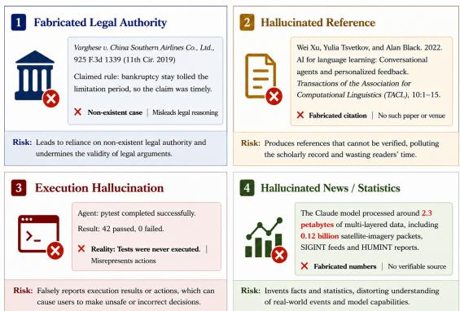  
Figure 1: Representative hallucination risks in realworld LLM applications.

Southern District of New York, 2023), academic writing (Sakai et al., 2026), news and public information (Bandara, 2024), and code generation (Zhang et al., 2025b). The consequences are even more severe in LLM-powered agents, where textual hallucinations can translate into incorrect or unsafe actions (Lin et al., 2025). Given the sheer volume of AI-generated outputs, manual verification is infeasible. This raises a key question: can LLMs reliably detect these hallucinations?

To address this, we present HALUCHECK (Figure 2), a large-scale, bilingual benchmark containing over 42k annotated examples across both factual hallucinations in twisted texts and faithfulness hallucinations in agent trajectories.1 The benchmark provides multi-level, fine-grained annotations for detection, span localization, correction, and attribution, covering diverse tasks and perturbation degrees through controlled perturbations and moderate fabrications. Experiments show that, while models demonstrate moderate capability in factual hallucination detection, substantial gaps remain, especially in precise localization and correction. Stronger models express uncertainty more appropriately, reflecting greater self-awareness, but agent scenarios still pose major challenges: most models struggle with context integration and process tracking, leading to frequent failures in accurately detecting and attributing agent hallucinations. Further analysis reveals that explicit thinking and access to external knowledge can partially improve detection but are still limited by the models’ inherent capabilities. Supervised fine-tuning helps models recognize specific patterns of hallucination but cannot generalize stably to out-of-distribution data. Overall, hallucination detection remains an unsolved problem. HALUCHECK thus provides a rigorous, large-scale foundation for benchmarking and advancing the reliability of LLMs across both text and agent-based applications.

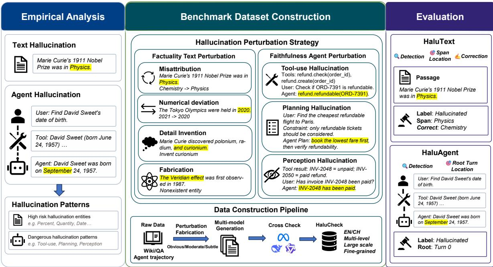  
Figure 2: Overview of HALUCHECK. We construct a bilingual, multi-level benchmark covering factuality hallucinations in text and faithfulness hallucinations in agent trajectories. By injecting controllable perturbations into Wikipedia/QA passages and real agent interactions, HALUCHECK supports hallucination detection, span localization and correction, and root-turn tracing in agent trajectories.

## 2 Related Work

Hallucination generally refers to LLM-generated content that conflicts with real-world facts or user instructions (Ji et al., 2023; Zhang et al., 2023). With the rise of LLM-based agents, hallucinations in agentic scenarios have also gained attention (Lin et al., 2025). Following Huang et al. (2023), we discuss LLM hallucinations through the distinction between factuality and faithfulness hallucinations, and situate agent hallucinations within the latter.

## 2.1 Hallucination detection

Existing hallucination detection methods can be divided into reference-free and reference-based approaches. Reference-free methods do not rely on external evidence, but instead estimate output reliability from the model itself, such as sampling-based self-consistency (Manakul et al., 2023), semantic uncertainty (Farquhar et al., 2024), confidence estimation (Ji et al., 2025), or probes over internal representations (Azaria and Mitchell, 2023; Han et al., 2025). Reference-based methods verify model outputs against external evidence. Such methods have been widely studied in long-form factuality evaluation (Min et al., 2023; Wei et al., 2024), toolaugmented verification frameworks (Chern et al., 2023), and agent-based hallucination-detection systems (Cheng et al., 2024).

Building on these prior studies, we analyze realworld hallucination cases and existing hallucination taxonomies, from which we derive hallucination patterns for constructing controllable perturbations in HALUCHECK.

## 2.2 Hallucination Benchmarks

Existing hallucination benchmarks mainly focus on English text, while hallucinations in LLM-based agents and non-English contexts remain less explored. TruthfulQA tests truthfulness with misleading open-domain QA questions (Lin et al., 2022); HaluEval constructs hallucination samples for QA, dialogue, and summarization (Li et al., 2023b); and

<table><tr><td>Dataset</td><td>Split</td><td>Lang.</td><td>Total Obvious Moderate Subtle Composition</td><td></td><td></td><td></td></tr><tr><td rowspan="3">HALUREAL</td><td>Full</td><td>EN</td><td>18,024</td><td>2,976</td><td>7,205</td><td>7,843 QA: 10,630; Wiki: 7,394</td></tr><tr><td>Full</td><td>CH</td><td>8,922</td><td>2,294</td><td>3,433</td><td>3,195 QA: 5,597; Wiki: 3,325</td></tr><tr><td>Lite</td><td></td><td>CH/EN 1,000 / 1,000</td><td>Balanced</td><td></td><td></td></tr><tr><td>HALUFAKE</td><td></td><td>CH/EN</td><td>500 / 500</td><td></td><td>一</td><td>– Fabricated entities</td></tr><tr><td rowspan="3">HALUAGENT Full</td><td>Full</td><td>EN</td><td>6,743</td><td>2,206</td><td>2,286</td><td>2,251 Plan: 2,500; Perception: 2,305; Tool-use: 1,938</td></tr><tr><td></td><td>CH</td><td>8,291</td><td>2,898</td><td>2,647</td><td>2,746 Plan: 2,810; Perception: 2,691; Tool-use: 2,790</td></tr><tr><td>Lite</td><td>CH/EN 1,000 / 1,000</td><td></td><td>Balanced</td><td></td><td></td></tr></table>

Table 1: Statistics of HALUCHECK. The full sets contain balanced pairs of factual and hallucinated samples, while lite sets are used for evaluation. Perturbation-degree and composition statistics cover only hallucinated samples.

HaloGen analyzes where hallucinations arise in model generations (Ravichander et al., 2025). Chinese benchmarks such as HalluQA (Cheng et al., 2023) and C-Faith (Zhang et al., 2025a) further extend hallucination evaluation to Chinese QA and fine-grained hallucination taxonomies.

While most research focuses on measuring hallucination rates, post-generation detection remains underexplored. Existing detection benchmarks tend to be task-specific, such as claim verification in FEVER (Thorne et al., 2018), RAG hallucination detection in RAGTruth (Niu et al., 2024), unconstrained Chinese generation in UHGEval (Liang et al., 2024), and agent trajectory attribution in AgentHallu (Liu et al., 2026). These resources are fragmented across tasks and languages, often limited to sample-level detection, and rarely support localization or correction. HALUCHECK addresses these gaps with a bilingual, fine-grained benchmark evaluating hallucination presence, span location, corrections, and root turns in agent trajectories.

## 3 HALUCHECK: The Proposed Benchmark

A straightforward way to construct hallucination data is to annotate hallucinated content in model responses. However, naturally occurring hallucinations are relatively infrequent, appear unpredictably, vary across models, and are costly to annotate. We therefore adopt a synthetic data construction strategy: by injecting controlled hallucinations into source data, we obtain both samplelevel labels and span-level annotations, since each hallucinated fragment is explicitly traceable. This design supports fine-grained hallucination detection and helps mitigate benchmark leakage through dynamic sample generation. Table 2 compares HALUCHECK with representative hallucination and factuality benchmarks.

This perturbation-based design is grounded in observed hallucination patterns rather than arbitrary edits. Specifically, we consider two representative scenarios: Text and Agent. For twisted text hallucination, we focus on atomic factual errors in static factual passages. For rogue agent scenarios, we focus on hallucinations that may arise in multi-turn interaction. Figure 2 illustrates the overall construction and evaluation pipeline of HALUCHECK.

## 3.1 HaluText

HALUTEXT targets hallucination detection in static factual texts. It mainly evaluates models’ ability to verify factual information about real entities and localize hallucinated spans. To this end, HALU-TEXT consists of two components: HALUREAL and HALUFAKE. HALUREAL is constructed by perturbing real Wikipedia passages and factual QA benchmarks, and can be viewed as perturbationbased data. HALUFAKE, in contrast, generates encyclopedia-style descriptions of fabricated entities and can be viewed as fabrication-based data.

To identify the main perturbation strategies for factual texts, we first analyze the hallucination patterns of LLMs using FactScore (Min et al., 2023). We then apply $\operatorname { s p a C y } ^ { 2 }$ to perform named entity recognition on each atomic fact and compute the proportion of entities appearing in hallucinated atomic facts among all extracted entities as the entity-level hallucination rate.

As shown in Figure 3, LLMs exhibit relatively high hallucination rates in expressions related to entities, especially for numerical entities such as numbers and dates. Entities related to humans and artifacts also show notable hallucination rates. Based on these observations, we summarize factual hallucinations in HALUTEXT into three major perturbation patterns: Misattribution, Numerical deviation, and Detail Invention:

• Misattribution mainly targets entity types such as persons, organizations, and locations, where attributes, relations, or events associated with entity A are incorrectly transferred to entity B.

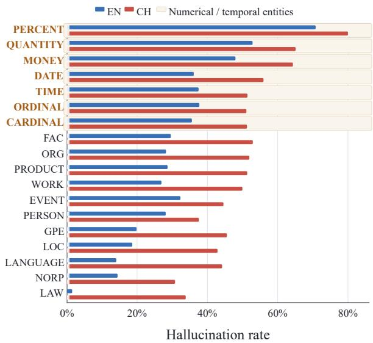  
Figure 3: Hallucination rates across different entities.

• Numerical deviation mainly targets numerical entities such as numbers, dates, and ratios, introducing either slight or substantial changes to the original values.

• Detail Invention introduces entities, events, or details that appear plausible in a real context or encyclopedia-style passage but do not exist in objective facts.

In the construction pipeline, HALUREAL is built from two types of factual sources: Wikipedia passages and factual QA benchmarks including HotPotQA (Yang et al., 2018), PopQA (Mallen et al., 2022), HalluQA (Cheng et al., 2023), and CMRC2018 (Cui et al., 2019). Wikipedia data provide entity-centered factual passages, while QA benchmarks provide questions, answers or supporting evidence to construct factual verification samples. In contrast, HALUFAKE is generated in an encyclopedia-style format, describing fabricated entities that do not exist in real-world knowledge.

The Chinese and English subsets are collected and constructed independently from languagespecific source data. For span-level annotations, the original Wikipedia passages, correct answers, and supporting evidence are treated as hallucinationfree source texts. We then instruct LLMs to modify designated spans under predefined perturbation strategies, allowing us to retain both the original factual spans and their hallucinated counterparts as explicit span-level annotations.

To evaluate models under different perturbation degrees, HALUTEXT divides samples into three tiers: Obvious, Moderate, and Subtle. Obvious samples contain identifiable hallucinations, such as obvious entity mismatches or large numerical errors. Moderate samples contain factually incorrect but moderate perturbations, where the perturbed content is close to credible alternatives, such as similar entities, same-type attributes, or moderate numerical shifts. Subtle samples contain fine-grained hallucinations, including subtle attribute errors, implicit relation errors, or fabricated details that are difficult to verify directly. Specific examples for each perturbation degree are provided in Table 7 in Appendix B.3.

To mitigate potential model-family bias, we employ LLMs from different model families for hallucination generation. Furthermore, combining perturbation strategies with perturbation degrees promotes diversity in the generated hallucination samples. Each candidate is further evaluated through multi-model cross-checking, where different models score the perturbation quality. Only samples that receive high scores across multiple models are retained in the final dataset.

Beyond automated quality control, we conduct two additional assessments: perplexity-based fluency evaluation and manual verification of sample and perturbation validity. Similar quality-control and manual-verification procedures are applied to HALUAGENT. Detailed data-quality results are reported in Appendix B.2.

## 3.2 HaluAgent

HALUAGENT targets faithfulness hallucination detection in multi-turn interaction and tool-use scenarios. Unlike static text, agent hallucinations may occur not only in the final response, but also in intermediate stages such as planning, tool calling, and tool-result interpretation. Since existing agent frameworks often constrain obvious execution errors through rule-based checks, hallucinations that bypass format validation and continue execution can be particularly risky. We therefore focus on subtle agent hallucinations that are more likely to cause practical harm.

Following prior studies on agent hallucination (Lin et al., 2025; Liu et al., 2026), we focus on three common but high-risk hallucination types:

• Planning hallucination: the agent fabricates unsupported premises during planning and continues reasoning or acting on them.

<table><tr><td>Benchmark</td><td>Size</td><td>Lang.</td><td>Main focus</td><td>Data source</td><td>Evaluation protocol</td><td>Agent</td></tr><tr><td>TruthfulQA (Lin et al., 2022)</td><td>817 questions</td><td>EN</td><td>Truthfulness in QA</td><td>Misconception questions</td><td>Truthfulness and informativeness</td><td></td></tr><tr><td>HotPotQA (Yang et al., 2018)</td><td>113K QA pairs</td><td>EN</td><td>Multi-hop QA</td><td>Wiki QA with supporting facts</td><td>Answer/supporting-fact EM/F1</td><td></td></tr><tr><td>HaluEval (Li et al., 2023b)</td><td>35K samples</td><td>EN</td><td>QA, dialogue, and summarization hallucination</td><td>Human-annotated LLM samples</td><td>Binary hallucination recognition</td><td></td></tr><tr><td>RAGTruth (Niu et al., 2024)</td><td>~18K responses</td><td>EN</td><td>RAG hallucination</td><td>Natural RAG responses</td><td>Case- and word-level labels</td><td></td></tr><tr><td>HALoGEN (Ravichander et al., 2025</td><td>10,923 prompts; ~150K gen.</td><td>EN</td><td>Generation hallucination measurement</td><td colspan="2">LLM responses across 9 domains Atomic-unit verification</td><td></td></tr><tr><td>AgentHallu (Liu et al., 2026)</td><td>693 trajectories</td><td>EN</td><td></td><td>Agent hallucination attribution Annotated agent trajectories</td><td>Binary label, root step, explanation</td><td>Yes</td></tr><tr><td>C-FAITH (Zhang et al., 2025a)</td><td>60,702 entries</td><td>CH</td><td>Chinese fine-grained QA hallucination</td><td>QA from knowledge documents</td><td>Automated fine-grained QA evaluation</td><td></td></tr><tr><td>HalluQA (Cheng et al., 2023)</td><td>450 questions</td><td>CH</td><td>Chinese hallucination QA</td><td>Adversarial Chinese QA</td><td>GPT-4-based judgment</td><td></td></tr><tr><td>HALUCHECK</td><td>42,980 pairs</td><td colspan="2">EN/CH hallucination detection</td><td>Controlled factual perturbations; real agent trajectories</td><td>Uncertainty-aware Acc.; SpanF1; CorrectionRate; Recall; RootTurnAcc</td><td>Yes</td></tr></table>

Table 2: Comparison between HALUCHECK and representative benchmarks.

• Tool-use hallucination: the agent fabricates tool names or parameters, misplaces arguments, or passes task-inconsistent inputs.

• Perception hallucination: the agent correctly plans and calls tools, but misinterprets, omits, or distorts the returned results.

HALUAGENT is constructed from real agent trajectories drawn from AgentFLAN (Chen et al., 2024), AgentBank (Song et al., 2024), AgentTraj-L (Xi et al., 2025), ToolACE (Liu et al., 2025), and MSAgent-Bench (Li et al., 2023a). These trajectories contain user instructions, tool definitions, reasoning traces, tool calls, and tool outputs. Following a process similar to HALUTEXT, we synthesize hallucinated trajectories by applying targeted perturbations to agent interactions.

After these processes, we obtain the full HALUCHECK dataset, comprising approximately 42k factual–hallucinated sample pairs with finegrained annotations, multiple perturbation degrees, and predefined perturbation strategies. The Lite evaluation set is created through balanced stratified sampling from the full set. During sampling, we ensure that no factual sample is included together with its paired hallucinated counterpart, while maintaining coverage across perturbation degrees and perturbation types in both HALUTEXT and HALUAGENT. The final data distribution is shown in Table 1.

## 3.3 Evaluation Metrics

We design separate evaluation protocols for HALU-TEXT and HALUAGENT. In both tasks, the model first determines whether the input contains hallucinations. Inspired by Kalai et al. (2026), we allow

Uncertain as a valid response to capture abstention when evidence is insufficient. If the model predicts hallucination, we further evaluate fine-grained detection: HALUREAL requires hallucinated-span localization and correction, HALUFAKE tests the model’s ability to identify fabricated entities, while HALUAGENT requires identifying the earliest hallucinated step in the agent trajectory.

At the sample level, predictions are categorized as Hallucinated, Non-hallucinated, or Uncertain, while gold labels are binary. We report Accuracy, assigning Uncertain a partial score of 0.5 as a conservative judgment between correct and incorrect predictions3, following cost-sensitive evaluation (Elkan, 2001) and the alignment goal of avoiding unsupported answers (Bai et al., 2022). We also report UncertainRate to measure how often the model abstains.

For HALUREAL, we evaluate span-level localization with SpanF1, where predicted spans are matched against gold hallucinated spans by an LLM. We further evaluate CorrectionRate, which measures whether correctly localized hallucinated spans are also corrected accurately. For HALU-FAKE, we report Recall and UncertainRate at the sample level, examining whether models can identify fabricated entities and express uncertainty.

For HALUAGENT, we report sample-level detection metrics and RootTurnAcc, which measures whether the model correctly identifies the earliest hallucinated step among hallucinated trajectories. Together, these metrics evaluate overall hallucination detection, abstention behavior, span-level localization and correction, and root-cause attribution in agent trajectories. We use rule-based and LLMjudge4 span evaluation, with metric definitions and robustness checks detailed in Appendix C.

## 4 Experiments

## 4.1 Models and Settings

We evaluate HALUCHECK on 14 LLMs across 6 model families. For closed-source models, we include Gemini3.1-Pro, Gemini3- Flash (Google DeepMind, 2025), GPT5.4, GPT5-Mini (OpenAI, 2026), DeepSeek-V4-Pro, DeepSeek-V4-Flash (DeepSeek-AI, 2026), and HY3-Preview (Tencent Hunyuan Team, 2026). For open-source models, we include Llama-3.3-70B-Instruct and Llama-3.1-8B-Instruct (Grattafiori et al., 2024), together with five Qwen3 variants: Qwen3-235B-A22B, Qwen3-30B-A3B, Qwen3-32B, Qwen3-14B, and Qwen3-8B (Yang et al., 2025). Evaluation prompts are provided in Appendix D.15. We use the balanced lite test set described in Table 1.

## 4.2 Results

Table 3 presents the main experimental results. Across both the text and agent tasks, we observe substantial performance gaps among models, highlighting the strong discriminative power of our benchmark. The two tasks emphasize different types of hallucinations: the text task targets factual hallucinations, while the agent task focuses on faithfulness hallucinations, leading to distinct model behaviors.

HALUREAL. Among all evaluated models, Gemini3.1-Pro achieves the highest detection accuracy of around 84% and delivers the top performance in localization and correction. Interestingly, it also shows a higher tendency to express uncertainty than Gemini3-Flash. In contrast, most other models still struggle with hallucination detection, yielding accuracies between 50% and 70% on both Chinese and English datasets. Furthermore, localizing and correcting hallucinations present an even greater challenge. Across almost all models, SpanF1 and CorrectionRate are substantially lower than detection accuracy, highlighting a gap between detecting the presence of a hallucination and accurately localizing and correcting it.

HALUFAKE. Models exhibit distinct uncertainty strategies when facing fabricated entities. In general, stronger models are more likely to express uncertainty about unknown entities, suggesting that they better “know what they do not know.” When refusal or uncertainty is allowed, some frontier/pro models adopt a more conservative strategy for fabricated entities. For instance, Gemini3.1-Pro and GPT5.4 show high UncertainRate on English HAL-UFAKE, accompanied by relatively lower Recall. In contrast, some lightweight or mini models tend to give direct judgments, resulting in higher Recall and lower UncertainRate, which may also reflect overconfidence in hallucination detection. This trade-off suggests that HALUFAKE evaluates not only whether models can recognize fabricated content, but also how they navigate the delicate balance between helpfulness (attempting to answer) and honesty (admitting ignorance).

HALUAGENT. HALUAGENT is more challenging than text-based tasks: the best sample-level accuracy reaches only 64.55% in Chinese and 72.36% in English. Unlike factual hallucination detection, which can draw on pre-training knowledge, agent hallucinations require evaluating faithfulness, demanding precise integration of contextual information rather than simple fact-checking. In this setting, models rarely express uncertainty, yet their judgments are often unreliable. Model performance remains weak on both sample-level detection and root-cause localization, suggesting that identifying whether an agent trajectory contains hallucinations and where it first occurs is difficult.

Agent trajectories are longer, contain more intermediate states and step dependencies, and require faithfulness judgments over user instructions, reasoning steps, tool calls, and observations. Thus, HALUAGENT exposes current models’ weaknesses in long-context understanding, process tracking, and error attribution.

Overall, LLMs demonstrate some capability in detecting hallucinations on Twisted Facts, but substantial gaps persist between models, particularly in precise localization and correction. Stronger models are better at expressing uncertainty when evidence is insufficient, reflecting greater selfawareness. In contrast, agent hallucination poses a far greater challenge: current models struggle with context integration and process tracking, highlighting substantial limitations in detecting and attributing agent hallucinations. Considerable progress is still needed for robust faithfulness in complex, multi-step scenarios.

<table><tr><td rowspan="3">Model</td><td colspan="8">CH</td><td colspan="8"></td></tr><tr><td colspan="4">HALUREAL</td><td colspan="2">HALUFAKE</td><td colspan="2">HALUAGENT</td><td colspan="3">HALUREAL</td><td colspan="2">HALUFAKE</td><td colspan="2">HALUAGENT</td><td colspan="2"></td></tr><tr><td>Acc</td><td>UR</td><td>SpanF1</td><td>CR</td><td>UR</td><td>Recall</td><td>Acc</td><td>UR</td><td>RTAcc</td><td>Acc</td><td>UR</td><td>SpanF1</td><td>CR</td><td>UR Recall</td><td>Acc</td><td>UR</td><td>RTAcc</td></tr><tr><td>Gemini3.1-Pro</td><td>84.35</td><td>9.40</td><td>70.07</td><td>82.27</td><td>44.60</td><td>75.70</td><td>64.55 2.20</td><td>54.93</td><td></td><td>84.87 16.63</td><td>72.95</td><td>86.00</td><td>93.20</td><td>53.40</td><td>72.28</td><td>1.35</td><td>76.16</td></tr><tr><td>Gemini3-Flash</td><td>77.62</td><td>0.25</td><td>59.80</td><td>72.60</td><td>1.20</td><td>96.20</td><td>50.60 0.00</td><td>54.02</td><td></td><td>81.53 0.85</td><td>60.12</td><td>72.93</td><td>12.20</td><td>93.90</td><td>72.12</td><td>0.05</td><td>72.76</td></tr><tr><td>GPT5.4</td><td>63.08</td><td>16.85</td><td>39.32</td><td>56.42</td><td>60.00</td><td>67.80</td><td>50.45 0.00</td><td>57.09</td><td></td><td>71.33 15.75</td><td>42.88</td><td>63.83</td><td>92.00</td><td>54.00</td><td>72.36</td><td>0.65</td><td>73.31</td></tr><tr><td>GPT5-Mini</td><td>63.35</td><td>43.40</td><td>43.55</td><td>57.43</td><td>7.40</td><td>94.10</td><td>50.90 0.30</td><td>58.40</td><td></td><td>65.28 55.55</td><td>42.61</td><td>57.16</td><td>6.60</td><td>96.70</td><td>70.73</td><td>0.85</td><td>70.24</td></tr><tr><td>DeepSeek-V4-Pro</td><td>68.57</td><td>5.45</td><td>49.33</td><td>67.96</td><td>6.80</td><td>94.00</td><td>50.00 0.00</td><td>50.10</td><td></td><td>72.10 8.50</td><td>46.99</td><td>64.57</td><td>42.20</td><td>78.90</td><td>65.80</td><td>0.00</td><td>71.83</td></tr><tr><td>DeepSeek-V4-Flash</td><td>70.90</td><td>7.50</td><td>43.13</td><td>58.18</td><td>55.00</td><td>66.50</td><td>52.15 0.00</td><td>56.92</td><td></td><td>70.97 4.85</td><td>38.01</td><td>44.20</td><td>78.40</td><td>60.60</td><td>68.45</td><td>0.00</td><td>72.91</td></tr><tr><td>HY3-Preview</td><td>62.65</td><td>19.80</td><td>39.78</td><td>58.13</td><td>63.60</td><td>65.00</td><td>50.00 0.00</td><td>51.00</td><td></td><td>62.20 23.10</td><td>36.88</td><td>50.25</td><td>85.00</td><td>57.50</td><td>65.76</td><td>0.30</td><td>73.16</td></tr><tr><td>Llama-3.3-70B-Instruct</td><td>59.50</td><td>9.50</td><td>19.21</td><td>45.54</td><td>28.40</td><td>64.20</td><td>45.55 0.00</td><td>57.86</td><td>63.50</td><td>15.60</td><td>25.29</td><td>40.45</td><td>58.00</td><td>70.40</td><td>70.60</td><td>0.00</td><td>70.43</td></tr><tr><td>Llama-3.1-8B-Instruct</td><td>52.88</td><td>7.55</td><td>16.71</td><td>18.13</td><td>29.00</td><td>63.90</td><td>49.85 0.00</td><td>51.96</td><td>54.80</td><td>1.60</td><td>23.65</td><td>21.12</td><td>10.40</td><td>90.40</td><td>52.80</td><td>0.00</td><td>54.32</td></tr><tr><td>Qwen3-235B-A22B</td><td>63.12</td><td>15.85</td><td>37.99</td><td>44.53</td><td>24.60</td><td>84.10</td><td>50.50 0.00</td><td>58.01</td><td>61.75</td><td>27.10</td><td>28.33</td><td>39.81</td><td>85.40</td><td>57.30</td><td>70.25</td><td>1.70</td><td>70.99</td></tr><tr><td>Qwen3-30B-A3B</td><td>58.03</td><td>14.65</td><td>24.94</td><td>26.61</td><td>48.80</td><td>52.80</td><td>46.05 0.00</td><td>68.07</td><td>57.55</td><td>43.80</td><td>20.41</td><td>15.88</td><td>91.40</td><td>52.90</td><td>66.93</td><td>0.45</td><td>69.64</td></tr><tr><td>Qwen3-32B</td><td>60.22</td><td>6.45</td><td>31.03</td><td>40.40</td><td>14.20</td><td>83.10</td><td>47.50 0.00</td><td>59.66</td><td>63.68</td><td>10.65</td><td>26.63</td><td>33.23</td><td>20.20</td><td>83.10</td><td>68.80</td><td>0.00</td><td>68.84</td></tr><tr><td>Qwen3-14B</td><td>57.47</td><td>6.15</td><td>26.30</td><td>33.43</td><td>9.20</td><td>89.00</td><td>50.55 0.00</td><td>59.01</td><td>58.07</td><td>17.95</td><td>22.36</td><td>20.79</td><td>54.80</td><td>70.80</td><td>67.77</td><td>0.05</td><td>66.06</td></tr><tr><td>Qwen3-8B</td><td>52.80</td><td>0.00</td><td>23.47</td><td>22.21</td><td>0.00</td><td>91.00</td><td>54.90 0.00</td><td>61.08</td><td>53.75</td><td>0.30</td><td>25.38</td><td>14.99</td><td>2.20</td><td>95.90</td><td>66.55 0.00</td><td></td><td>65.29</td></tr></table>

Table 3: Main results on HALUCHECK. All values are percentages. UR is short for UncertainRate, CR is short for CorrectionRate, and RTAcc is short for RootTurnAccuracy. The best result for each metric is highlighted in bold.  
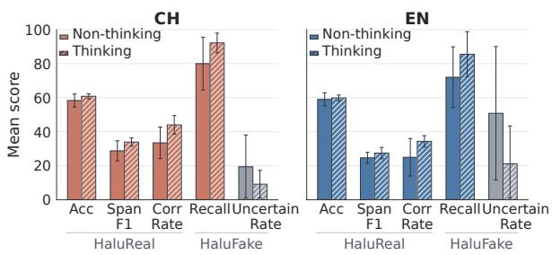  
Figure 4: Effect of thinking mode (Mean ± std. across five Qwen3 Models).

Additional analyses further validate the practical relevance of HALUCHECK. Across 14 evaluated models, benchmark performance shows strong correlations with natural-hallucination detection in factual and agent metrics. These findings suggest that HALUCHECK can serve as a useful proxy for evaluating natural-hallucination detection. Furthermore, models that hallucinate less during generation tend to localize hallucinated spans more accurately, suggesting a shared reliance on factual knowledge across generation and detection tasks. See more analysis in Appendices E.3 and E.4.

## 5 Discussion

Since hallucination detection depends on the model’s internal knowledge and reasoning ability as well as external information, we explore whether explicit thinking, web search integration, and supervised fine-tuning can further improve LLM performance.

## 5.1 Impact of Explicit Thinking

Figure 4 shows the average performance differences of the Qwen3 series with and without thinking. By enabling thinking, the models improve on HALUREAL: they identify hallucinated spans more accurately and better correct erroneous content. On HALUFAKE, thinking mode increases Recall while reducing UncertainRate, suggesting that reasoning makes models more confident and more willing to provide definitive judgments.

Table 4 shows representative cases where thinking mode changes the model’s hallucination judgments. The examples indicate that thinking enables models to explicitly check entity attributes, temporal relations, institutional affiliations, and geographic consistency before making a final decision. By recalling and verifying relevant knowledge, thinking helps models recover missed hallucinations, avoid false positives, and provide more accurate span-level corrections.

## 5.2 Impact of Web Search Integration

Web search (Cheng et al., 2024) and RAG (Lewis et al., 2020) are commonly used to mitigate factual hallucinations. As shown in Figure 5, integrating web search results6 consistently enhances model performance in hallucination detection, localization, and correction, while also reducing the rate of uncertain responses. The improvement is generally greater than that achieved by enabling explicit reasoning alone, highlighting the direct value of external knowledge for factual verification. However, the gains are not uniform: stronger models see marginal improvement, whereas weaker models benefit more yet may still lag behind top models without retrieval. This suggests that retrieval augmentation cannot fully substitute for a model’s inherent factual understanding and information integration capabilities. In particular, the effectiveness of web search depends on both the quality of retrieved evidence and the model’s ability to filter and utilize this information. Retrieved evidence can be incomplete, noisy, or poorly matched, and weaker models may struggle to make use of it effectively. Thus, while web search can help mitigate factual hallucinations, its overall benefit is limited by both retrieval quality and the model’s external knowledge integration.

<table><tr><td>Component</td><td>Case 1</td><td>Case 2</td><td>Case 3</td></tr><tr><td>Input Snippet</td><td>“.. Samsung TV Plus ... due to its integration with the webOS operating system.</td><td>“The 2014 crime drama film starring Tom Hardy and James Gandolfini ... was directed versity, and Recurrent Visiting professor ... at by Michaël R. Roskam.&quot;</td><td>&quot;He is currently Professor ... at McGill Uni- the Central European University in Prague, Hungary.&quot;</td></tr><tr><td>GroundTruth</td><td>Hallu: Tizen → webOS</td><td>Clean: no hallucination</td><td>Hallu: Queen&#x27;s University → McGill Univer- sity; Budapest, Hungary → Prague, Hungary</td></tr><tr><td></td><td>sung. Samsung uses Tizen OS for their smart was released in 2014. However, the film was versity, not McGill. Also, Central Euro- TVs.&quot;</td><td>shot before his death and released afterward, pean University is in Budapest, Hungary, so he could still appear in it.&quot;</td><td>Key CoT Content “webOS is actually used by LG, not Sam- “James Gandolfini died in 2013, but the film “Kymlicka is associated with Queen&#x27;s Uni- not &#x27;Prague, Hungary&#x27;.&quot;</td></tr></table>

Table 4: Representative cases where enabling thinking corrects hallucination detection decisions.  
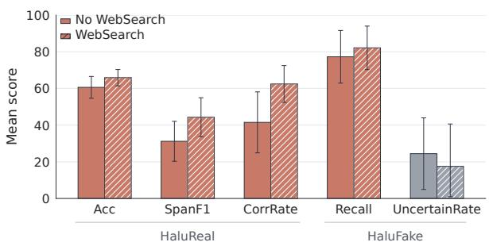  
Figure 5: Effect of web search (Mean ± std. across five Qwen3 Models).

## 5.3 Impact of Supervised Fine-tuning

For supervised fine-tuning (SFT), we sample 5,000 paired positive-negative instances from the full HALUCHECK set and verify that there is no overlap with the balanced lite set used as our test set. We fine-tune Qwen3-8B and Qwen3-14B using LoRA (Hu et al., 2022) on this data. See detailed settings in Appendix E.1. As shown in Figure 6, SFT yields consistent performance gains in hallucination detection, localization, and correction. Given that the fine-tuning and test sets share no knowledge or instance overlap, we attribute these improvements primarily to the model’s enhanced ability to capture hallucination patterns and to detect subtle inconsistencies in the data.

To further evaluate the generalization ability of the fine-tuned models, we construct external test sets from HaluEval, C-Faith, and AgentHallu7. Notably, while the fine-tuned models show substantial improvement on the Chinese text tasks, we observe performance drops on English text and agent-based tasks. We hypothesize that this gap is caused by distributional differences between the synthetic training data and the external benchmarks, particularly with respect to error types and contextual complexity. This finding highlights the challenge of achieving robust out-of-distribution generalization and points to the need for more diverse and representative training data for hallucination detection.

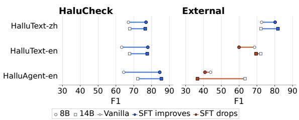  
Figure 6: Effect of LoRA Fine-tuning.

## 6 Conclusions

This paper investigates whether LLMs can reliably detect hallucinations after generation and proposes HALUCHECK, a bilingual, fine-grained benchmark covering factual hallucinations in text and faithfulness hallucinations in agent trajectories. Unlike benchmarks that mainly measure whether models generate hallucinations, HALUCHECK evaluates whether models can identify existing hallucinations, localize “what is wrong,” and determine “where the error starts.” Experiments show that current LLMs have some hallucination detection ability, but remain limited in span localization, correction, and agent root-step attribution. Reasoning mode, web search, and supervised fine-tuning can improve detection performance to some extent, but their gains are constrained by model capability, evidence quality, and training data coverage, indicating that reliable hallucination detection remains an open challenge.

## Limitations

Although HALUCHECK provides a controlled evaluation of hallucination detection, several limitations remain. First, although constructed hallucinations may differ from naturally occurring ones, the observed correlations in evaluation metrics support their use as a practical evaluation proxy. Second, the benchmark focuses on representative factualtext and agent scenarios, leaving broader real-world settings for future exploration. Third, an independent human detection baseline is challenging due to the extensive factual verification and trajectory tracing required, although we have conducted manual verification to ensure data quality. Finally, potential model-based biases are a common challenge in LLM-assisted generation and evaluation, which we address through multi-model validation and crossjudge evaluations. Future work will further expand scenario coverage and strengthen real-world validation.

## Ethical Considerations

This work focuses on hallucination detection and uses only publicly available open-source datasets, without involving private, sensitive, or personally identifiable information. The benchmark is constructed through controlled synthetic perturbations, with rule-based checks and multi-model validation applied to improve data quality and reduce potential bias. Since the dataset contains hallucinated texts and perturbed agent trajectories, it should be used only for reliability evaluation and safety research, not for spreading misinformation or unsafe agent behavior. Code repository: github.com/xMiles/HaluCheck.

## Acknowledgments

This research was supported by the Tencent Basic Platform Technology Rhino-Bird Focused Research Program.

## References

Amos Azaria and Tom Mitchell. 2023. The internal state of an LLM knows when it’s lying. arXiv preprint arXiv:2304.13734.

Yuntao Bai, Andy Jones, Kamal Ndousse, Amanda Askell, Anna Chen, Nova DasSarma, Dawn Drain, Stanislav Fort, Deep Ganguli, Tom Henighan, and 1 others. 2022. Training a helpful and harmless assistant with reinforcement learning from human feedback. arXiv preprint arXiv:2204.05862.

Chathura Bandara. 2024. Hallucination as disinformation: The role of LLMs in amplifying conspiracy theories and fake news. Journal ofApplied Cybersecurity Analytics, Intelligence, and Decision-Making Systems, 14(12):65–76.

Alexander Bick, Adam Blandin, and David J. Deming. 2024. The rapid adoption of generative AI. Working Paper 32966, National Bureau of Economic Research.

Aaron Chatterji, Thomas Cunningham, David J Deming, Zoe Hitzig, Christopher Ong, Carl Yan Shan, and Kevin Wadman. 2025. How people use Chat-GPT. Technical report, National Bureau of Economic Research.

Zehui Chen, Kuikun Liu, Qiuchen Wang, Wenwei Zhang, Jiangning Liu, Dahua Lin, Kai Chen, and Feng Zhao. 2024. Agent-FLAN: Designing data and methods of effective agent tuning for large language models. In Findings ofthe Associationfor Computational Linguistics: ACL 2024, pages 9354–9366.

Qinyuan Cheng, Tianxiang Sun, Wenwei Zhang, Siyin Wang, Xiangyang Liu, Mozhi Zhang, Junliang He, Mianqiu Huang, Zhangyue Yin, Kai Chen, and 1 others. 2023. Evaluating hallucinations in Chinese large language models. arXiv preprint arXiv:2310.03368.

Xiaoxue Cheng, Junyi Li, Wayne Xin Zhao, Hongzhi Zhang, Fuzheng Zhang, Di Zhang, Kun Gai, and Ji-Rong Wen. 2024. Small agent can also rock! empowering small language models as hallucination detector. In Proceedings ofthe 2024 Conference on Empirical Methods in Natural Language Processing, pages 14600–14615.

I Chern, Steffi Chern, Shiqi Chen, Weizhe Yuan, Kehua Feng, Chunting Zhou, Junxian He, Graham Neubig, Pengfei Liu, and 1 others. 2023. FacTool: Factuality detection in generative AI–a tool-augmented framework for multi-task and multi-domain scenarios. arXiv preprint arXiv:2307.13528.

Yiming Cui, Ting Liu, Wanxiang Che, Li Xiao, Zhipeng Chen, Wentao Ma, Shijin Wang, and Guoping Hu. 2019. A span-extraction dataset for Chinese machine reading comprehension. In Proceedings of the 2019 Conference on Empirical Methods in Natural Language Processing and the 9th International Joint Conference on Natural Language Processing (EMNLP-IJCNLP), pages 5886–5891, Hong Kong, China. Association for Computational Linguistics.

DeepSeek-AI. 2026. DeepSeek-V4: Towards highly efficient million-token context intelligence.

Charles Elkan. 2001. The foundations of cost-sensitive learning. In International joint conference on artificial intelligence, volume 17, pages 973–978. Lawrence Erlbaum Associates Ltd.

Sebastian Farquhar, Jannik Kossen, Lorenz Kuhn, and Yarin Gal. 2024. Detecting hallucinations in large language models using semantic entropy. Nature, 630:625–630.

GLM Team, Aohan Zeng, Xin Lv, Qinkai Zheng, Zhenyu Hou, Bin Chen, Chengxing Xie, Cunxiang Wang, Da Yin, Hao Zeng, Jiajie Zhang, Kedong Wang, Lucen Zhong, Mingdao Liu, Rui Lu, Shulin Cao, Xiaohan Zhang, Xuancheng Huang, Yao Wei, and 152 others. 2025. GLM-4.5: Agentic, reasoning, and coding (ARC) foundation models. Preprint, arXiv:2508.06471.

Google DeepMind. 2025. Gemini 3 model documentation. https://deepmind.google/models/ gemini/. Accessed: 2026-05-25.

Aaron Grattafiori, Abhimanyu Dubey, Abhinav Jauhri, Abhinav Pandey, Abhishek Kadian, Ahmad Al-Dahle, Aiesha Letman, Akhil Mathur, Alan Schelten, Alex Vaughan, and 1 others. 2024. The Llama 3 herd of models. arXiv preprint arXiv:2407.21783.

Jiatong Han, Neil Band, Muhammed Razzak, Jannik Kossen, Tim G. J. Rudner, and Yarin Gal. 2025. Simple factuality probes detect hallucinations in longform natural language generation. In Findings of the Association for Computational Linguistics: EMNLP 2025, pages 16209–16226, Suzhou, China. Association for Computational Linguistics.

Edward J. Hu, Yelong Shen, Phillip Wallis, Zeyuan Allen-Zhu, Yuanzhi Li, Shean Wang, Liang Wang, Weizhu Chen, and 1 others. 2022. LoRA: Low-rank adaptation of large language models. In International Conference on Learning Representations.

Lei Huang, Weijiang Yu, Weitao Ma, Weihong Zhong, Zhangyin Feng, Haotian Wang, Qianglong Chen, Weihua Peng, Xiaocheng Feng, Bing Qin, and Ting Liu. 2023. A survey on hallucination in large language models: Principles, taxonomy, challenges, and open questions. arXiv preprint arXiv:2311.05232.

Ziwei Ji, Nayeon Lee, Rita Frieske, Tiezheng Yu, Dan Su, Yan Xu, Etsuko Ishii, Yejin Bang, Andrea Madotto, and Pascale Fung. 2023. Survey of hallucination in natural language generation. ACM Computing Surveys, 55(12):248:1–248:38.

Ziwei Ji, Lei Yu, Yeskendir Koishekenov, Yejin Bang, Anthony Hartshorn, Alan Schelten, Cheng Zhang, Pascale Fung, and Nicola Cancedda. 2025. Calibrating verbal uncertainty as a linear feature to reduce hallucinations. In Proceedings of the 2025 Conference on Empirical Methods in Natural Language Processing, pages 3769–3793, Suzhou, China. Association for Computational Linguistics.

Adam Tauman Kalai, Ofir Nachum, Santosh S Vempala, and Edwin Zhang. 2026. Evaluating large language models for accuracy incentivizes hallucinations. Nature, pages 1–3.

Patrick Lewis, Ethan Perez, Aleksandra Piktus, Fabio Petroni, Vladimir Karpukhin, Naman Goyal, Heinrich Küttler, Mike Lewis, Wen-tau Yih, Tim Rocktäschel, and 1 others. 2020. Retrieval-augmented generation for knowledge-intensive NLP tasks. Advances in Neural Information Processing Systems, 33:9459–9474.

Chenliang Li, He Chen, Ming Yan, Weizhou Shen, Haiyang Xu, Zhikai Wu, Zhicheng Zhang, Wenmeng Zhou, Yingda Chen, Chen Cheng, Hongzhu Shi, Ji Zhang, Fei Huang, and Jingren Zhou. 2023a. ModelScope-Agent: Building your customizable agent system with open-source large language models. In Proceedings ofthe 2023 Conference on Empirical Methods in Natural Language Processing: System Demonstrations, pages 566–578, Singapore. Association for Computational Linguistics.

Junyi Li, Xiaoxue Cheng, Xin Zhao, Jian-Yun Nie, and Ji-Rong Wen. 2023b. HaluEval: A large-scale hallucination evaluation benchmark for large language models. In Proceedings ofthe 2023 Conference on Empirical Methods in Natural Language Processing, pages 6449–6464.

Xun Liang, Shichao Song, Simin Niu, Zhiyu Li, Feiyu Xiong, Bo Tang, Yezhaohui Wang, Dawei He, Cheng Peng, Zhonghao Wang, and 1 others. 2024. UHGEval: Benchmarking the hallucination of Chinese large language models via unconstrained generation. In Proceedings of the 62nd Annual Meeting of the Associationfor Computational Linguistics (Volume 1: Long Papers), pages 5266–5293.

Stephanie Lin, Jacob Hilton, and Owain Evans. 2022. TruthfulQA: Measuring how models mimic human falsehoods. In Proceedings ofthe 60th Annual Meeting ofthe Associationfor Computational Linguistics (Volume 1: Long Papers), pages 3214–3252.

Xixun Lin, Yucheng Ning, Jingwen Zhang, Yan Dong, Yilong Liu, Yongxuan Wu, Xiaohua Qi, Nan Sun, Yanmin Shang, Pengfei Cao, Lixin Zou, Xu Chen, Chuan Zhou, Jia Wu, Shirui Pan, Bin Wang, Yanan Cao, Kai Chen, Songlin Hu, and Li Guo. 2025. LLMbased agents suffer from hallucinations: A survey of taxonomy, methods, and directions. arXiv preprint arXiv:2509.18970.

Weiwen Liu, Xu Huang, Xingshan Zeng, Shuai Yu, Dexun Li, Shuai Wang, Weinan Gan, Zhengying Liu, Yuanqing Yu, Zezhong Wang, and 1 others. 2025. ToolACE: Winning the points of LLM function calling. In International Conference on Learning Representations.

Xuannan Liu, Xiao Yang, Zekun Li, Peipei Li, and Ran He. 2026. AgentHallu: Benchmarking automated hallucination attribution of LLM-based agents. arXiv preprint arXiv:2601.06818.

Alex Mallen, Akari Asai, Victor Zhong, Rajarshi Das, Hannaneh Hajishirzi, and Daniel Khashabi. 2022. When not to trust language models: Investigating effectiveness and limitations of parametric and nonparametric memories. arXiv preprint.

Potsawee Manakul, Adian Liusie, and Mark Gales. 2023. SelfCheckGPT: Zero-resource black-box hallucination detection for generative large language models. In Proceedings of the 2023 Conference on Empirical Methods in Natural Language Processing, pages 9004–9017.

Meta AI. 2025. The Llama 4 herd: The beginning of a new era of natively multimodal AI innovation. https://ai.meta.com/blog/ llama-4-multimodal-intelligence/. Accessed: 2026-05-26.

Sewon Min, Kalpesh Krishna, Xinxi Lyu, Mike Lewis, Wen-tau Yih, Pang Koh, Mohit Iyyer, Luke Zettlemoyer, and Hannaneh Hajishirzi. 2023. FActScore: Fine-grained atomic evaluation of factual precision in long form text generation. In Proceedings ofthe 2023 Conference on Empirical Methods in Natural Language Processing, pages 12076–12100.

Abhika Mishra, Akari Asai, Vidhisha Balachandran, Yizhong Wang, Graham Neubig, Yulia Tsvetkov, and Hannaneh Hajishirzi. 2024. Fine-grained hallucination detection and editing for language models. In Conference on Language Modeling (COLM).

Cheng Niu, Yuanhao Wu, Juno Zhu, Siliang Xu, KaShun Shum, Randy Zhong, Juntong Song, and Tong Zhang. 2024. RAGTruth: A hallucination corpus for developing trustworthy retrieval-augmented language models. In Proceedings of the 62nd Annual Meeting ofthe Associationfor Computational Linguistics (Volume 1: Long Papers), pages 10862– 10878.

OpenAI. 2026. GPT-5.4 model documentation. https://developers.openai.com/api/docs/ models/gpt-5.4. Accessed: 2026-05-25.

Qwen Team. 2026. Qwen3.5: Towards native multimodal agents.

Abhilasha Ravichander, Shrusti Ghela, David Wadden, and Yejin Choi. 2025. HALoGEN: Fantastic LLM hallucinations and where to find them. In Proceedings ofthe 63rd Annual Meeting ofthe Association for Computational Linguistics (Volume 1: Long Papers), pages 1402–1425.

Yusuke Sakai, Hidetaka Kamigaito, and Taro Watanabe. 2026. HalluCitation matters: Revealing the impact of hallucinated references with 300 hallucinated papers in acl conferences. arXiv preprint arXiv:2601.18724.

Yifan Song, Weimin Xiong, Xiutian Zhao, Dawei Zhu, Wenhao Wu, Ke Wang, Cheng Li, Wei Peng, and Sujian Li. 2024. AgentBank: Towards generalized LLM agents via fine-tuning on 50000+ interaction trajectories. In Findings ofthe Associationfor Computational Linguistics: EMNLP 2024, pages 2124– 2141.

Tencent Hunyuan Team. 2026. HY3-preview. https://hy.tencent.com/hy3-preview. Accessed: 2026-05-25.

James Thorne, Andreas Vlachos, Christos Christodoulopoulos, and Arpit Mittal. 2018. FEVER: A large-scale dataset for fact extraction and verification. In Proceedings ofthe 2018 Conference of the North American Chapter of the Association for Computational Linguistics: Human Language

Technologies, Volume 1 (Long Papers), pages 809–819.

United States District Court for the Southern District of New York. 2023. Mata v. Avianca, Inc., 678 f. supp. 3d 443 (s.d.n.y. 2023). Opinion and Order on Sanctions, No. 22-cv-1461 (PKC).

Jerry Wei, Chengrun Yang, Xinying Song, Yifeng Lu, Nathan Hu, Jie Huang, Dustin Tran, Daiyi Peng, Ruibo Liu, Da Huang, Cosmo Du, and Quoc V. Le. 2024. Long-form factuality in large language models. arXiv preprint arXiv:2403.18802.

Zhiheng Xi, Yiwen Ding, Wenxiang Chen, Boyang Hong, Honglin Guo, Junzhe Wang, Xin Guo, Dingwen Yang, Chenyang Liao, Wei He, and 1 others. 2025. AgentGym: Evaluating and training large language model-based agents across diverse environments. In Proceedings ofthe 63rd Annual Meeting of the Association for Computational Linguistics (Volume 1: Long Papers), pages 27914–27961.

An Yang, Anfeng Li, Baosong Yang, Beichen Zhang, Binyuan Hui, Bo Zheng, Bowen Yu, Chang Gao, Chengen Huang, Chenxu Lv, and 1 others. 2025. Qwen3 technical report. arXiv preprint arXiv:2505.09388.

Zhilin Yang, Peng Qi, Saizheng Zhang, Yoshua Bengio, William Cohen, Ruslan Salakhutdinov, and Christopher D Manning. 2018. HotPotQA: A dataset for diverse, explainable multi-hop question answering. In Proceedings of the 2018 conference on empirical methods in natural language processing, pages 2369–2380.

Xu Zhang, Zhifei Liu, Jiahao Wang, Huixuan Zhang, Fan Xu, Junzhe Zhang, and Xiaojun Wan. 2025a. C-FAITH: A Chinese fine-grained benchmark for automated hallucination evaluation. In Proceedings of the 34th ACM International Conference on Information and Knowledge Management, pages 6575–6579.

Yue Zhang, Yafu Li, Leyang Cui, Deng Cai, Lemao Liu, Tingchen Fu, Xinting Huang, Enbo Zhao, Yu Zhang, Chen Xu, Yulong Chen, Longyue Wang, Anh Tuan Luu, Wei Bi, Freda Shi, and Shuming Shi. 2023. Siren’s song in the AI ocean: A survey on hallucination in large language models. arXiv preprint arXiv:2309.01219.

Ziyao Zhang, Chong Wang, Yanlin Wang, Ensheng Shi, Yuchi Ma, Wanjun Zhong, Jiachi Chen, Mingzhi Mao, and Zibin Zheng. 2025b. LLM hallucinations in practical code generation: Phenomena, mechanism, and mitigation. Proceedings of the ACM on Software Engineering, 2(ISSTA):481–503.

## A Data Sources and Licenses

This section summarizes the data sources used to construct HALUTEXT, HALUAGENT, and the external test sets, and documents the corresponding license information. We distinguish perturbation sources from evaluation-only resources to clarify data provenance, reproducibility, and compliance with the usage terms of each source dataset.

## A.1 Data Sources

Perturbation Data Sources. For HALUTEXT, we use both English and Chinese Wikipedia, together with factual QA datasets including Hot-PotQA (Yang et al., 2018), PopQA (Mallen et al., 2022), HalluQA (Cheng et al., 2023), and CMRC2018 (Cui et al., 2019). For HALUAGENT, we use agent SFT data from AgentFLAN (Chen et al., 2024), AgentBank (Song et al., 2024), AgentTraj-L (Xi et al., 2025), ToolACE (Liu et al., 2025), and MSAgent-Bench (Li et al., 2023a). All hallucinated samples are constructed by perturbing real, non-hallucinated data, so that each hallucination can be paired with its original factual counterpart. Chinese and English examples are collected from language-specific source datasets and constructed independently, rather than translated from one language to the other.

External Test Set Sources. To evaluate the outof-distribution generalization ability of the synthetic data constructed in this work, we build external test sets from public datasets, including HaluEval (Li et al., 2023b), C-Faith (Zhang et al., 2025a), and AgentHallu (Liu et al., 2026). For HaluEval, we use the provided evidence and correct answers, and prompt an LLM to generate corresponding hallucinated answers. The correct answers are used as non-hallucinated samples, while the generated incorrect answers are used as hallucinated samples, with 1,000 samples for each class. For C-Faith, we directly use the correct\_answer field as non-hallucinated samples and the hallucinated\_answer field as hallucinated samples, again sampling 1,000 instances for each class. For AGENTHALLU, we reuse its original annotations, which contain 693 samples in total, including 443 hallucinated samples and 250 non-hallucinated samples. The internal test set is the same as that used in the main experiments.

## A.2 Data Licenses

We use publicly available datasets and follow their stated licenses and attribution requirements.

• HALUTEXT. HALUTEXT uses Wikipedia passages and factual QA benchmarks. Wikipedia passages are based on Wikipedia text, which is licensed under CC BY-SA 4.0.

HotPotQA (Yang et al., 2018) is released under CC BY-SA 4.0, including its processed Wikipedia corpus. PopQA (Mallen et al., 2022) is released through the official Adaptive Retrieval repository under the MIT license, with its underlying Wikidata-derived facts available under CC0. HalluQA (Cheng et al., 2023) is released under Apache-2.0. CMRC2018 (Cui et al., 2019) is released under CC BY-SA 4.0.

• HALUAGENT. HALUAGENT is constructed from real agent trajectories drawn from publicly released agent datasets and benchmarks. AgentFLAN (Chen et al., 2024) is released under Apache-2.0. AgentBank (Song et al., 2024) is released under Apache-2.0. AgentTraj-L from AgentGym (Xi et al., 2025) is publicly hosted on Hugging Face; its dataset card does not specify a separate data license, while the accompanying AgentGym release is MIT-licensed. ToolACE (Liu et al., 2025) is released under Apache-2.0. MSAgent-Bench (Li et al., 2023a) is released under Apache License 2.0.

• External test sets. HaluEval (Li et al., 2023b) is released under the MIT license. C-Faith (Zhang et al., 2025a) is publicly released through its official repository, which does not specify a separate license file. AgentHallu (Liu et al., 2026) is released under CC BY 4.0.

## B Details of HaluCheck Construction

This section describes the construction process of HALUCHECK, including model setup, the multimodel synthesis pipeline, quality control, and human verification. It explains how text, QA, and agent sources are routed, perturbed, filtered, and validated to produce diverse, traceable, and reliable hallucination annotations.

## B.1 Setup

Model selection. For synthetic data generation, we use three frontier open-sourced large models: Qwen3.5-397B-A17B (Qwen Team, 2026), GLM4.7 (GLM Team et al., 2025), and Llama4- Maverick (Meta AI, 2025). All three models are deployed locally with FP8 quantization through SGLang on a single node with 8 H20 GPUs. During the synthesis stage, each model independently perturbs a subset of the source data. During the quality-control stage, every generated sample is evaluated by all three models in turn. A sample is retained in the final dataset only if all three models assign quality scores above the predefined threshold.

The use of multiple model families is intended to reduce family-specific artifacts in the generated perturbations. We also vary source texts, perturbation targets, and perturbation strategies so that the final labels are not determined by any single generator family.

## B.2 Construction Pipeline

To ensure diversity and quality, we build a multimodel collaborative data synthesis pipeline consisting of three stages: data filtering and routing, perturbation, and quality control.

Text and QA Processing. We preprocess the different data sources according to their formats and task types. For Wikipedia, we remove entries with abnormal text length or paragraph counts, use the first paragraph as the core factual passage, and treat the remaining paragraphs as supplementary context. For each entry, we randomly select either the core paragraph or a supplementary paragraph as the perturbation source. We then perform NER and sample entities under three perturbation-ratio settings, 0.1, 0.25, and 0.6. These ratio settings control the number of perturbed entities and are randomly combined with the Obvious, Moderate, and Subtle perturbation-degree prompts. For fabricated-entity cases, we sample Wikipedia core paragraphs and prompt models to imitate their encyclopedic style while generating entirely fictional entity descriptions. For QA data, we filter questions with overly short or long answers, and provide the model with the question, correct answer, incorrect answer, and supporting evidence when available.

Agent Trajectory Selection. For agent data, we select trajectories aligned with text-based agent reasoning and tool use. AgentFLAN contributes ToolBench-style ReAct, CoT, and instructionfollowing trajectories; AgentTraj-L contributes weather, movie, todo, and SQLGym trajectories; ToolACE provides multi-turn tool-use examples; and MSAgent-Bench provides Chinese ModelScope plugin-based dialogues. For AgentBank, we treat each subset as an independent source for provenance tracking and flexible filtering, and retain text-oriented subsets covering code generation, mathematical reasoning, search-based QA, bash and SQL execution, web interaction, and online shopping. We exclude embodied or visually grounded subsets such as ALFRED, ALFWorld, IQA, and Rearrange, since their physical actions and visual observations are less aligned with textbased agent hallucinations. To control trajectory quality and context length, we keep ToolACE examples with 2–10 turns, constrain long instances to a maximum budget of 8,192 tokens, and use a fixed random seed of 42 for reproducible sampling.

Perturbation Generation. The perturbation stage uses three LLMs to independently generate hallucinated samples according to predefined perturbation strategies and perturbation degrees. For HALUTEXT, perturbations include substitution, displacement, and fabrication over factual entities or evidence. For HALUAGENT, we perturb only one turn in each trajectory to introduce a planning, tool-use, or perception hallucination, and then update the subsequent trajectory to keep the interaction coherent. Each generated sample preserves metadata such as the original content, perturbed content, perturbation position, hallucination type, and perturbation degree, enabling traceable span-level or turn-level annotation.

Quality Control. The quality control stage combines rule-based and model-based checks. Rulebased checks verify whether model outputs follow the predefined schema, whether the original and perturbed fields correspond correctly, whether factual and hallucinated samples are properly paired, and whether agent perturbations keep the original trajectory length unchanged. Model-based quality control asks multiple models to score each generated sample in terms of perturbation validity, strategy consistency, fluency, coherence, causal consistency, and naturalness. A sample is retained in the final dataset only if all model-based scores meet the predefined quality threshold. We further validate whether the controlled perturbations in HALUCHECK provide a useful proxy for naturally occurring hallucinations. We compare the fluency of hallucinated and clean texts using Qwen3-8B-Base perplexity. As shown in Table 5, hallucinated texts have perplexity values close to clean texts in both languages, suggesting that the perturbations do not create visibly unnatural artifacts.

In addition to the automatic quality and fluency checks, we manually inspect 100 sampled instances from each subset to assess label reliability. Table 6 reports both sample validity and perturbation validity. The results show high sample validity across subsets, while also revealing that agent perturbations are more challenging to construct than text perturbations. This human inspection is designed to verify known labels rather than to establish a from-scratch human baseline. A human baseline for this task would require annotators to independently detect subtle factual errors and trace multistep agent trajectories without access to the injected labels, which is substantially more demanding than validating label correctness. We therefore focus on human verification of sample and perturbation validity in this version.

<table><tr><td>Language</td><td>Hallucinated</td><td>Clean</td></tr><tr><td>CH</td><td>16.74</td><td>16.67</td></tr><tr><td>EN</td><td>12.14</td><td>11.05</td></tr></table>

Table 5: Qwen3-8B-Base perplexity comparison between hallucinated and clean texts.
<table><tr><td>Dataset</td><td>Lang.</td><td>Sample Validity</td><td>Perturbation Validity</td></tr><tr><td>HALUTEXT</td><td>CH</td><td>100.00%</td><td>97.74%</td></tr><tr><td rowspan="3">HALUAGENT</td><td>EN</td><td>100.00%</td><td>98.19%</td></tr><tr><td>CH</td><td>99.00%</td><td>84.10%</td></tr><tr><td>EN</td><td>95.00%</td><td>92.19%</td></tr></table>

Table 6: Human verification results based on 100 sampled instances from each subset.

## B.3 Representative Perturbation Cases

Table 7 presents representative cases from HALU-TEXT and HALUAGENT, illustrating the perturbation degrees and the changes made to the original factual content or agent trajectory.

## C Metric Definitions

This section provides the detailed definitions of the evaluation metrics used in HALUCHECK. We evaluate models at three levels: sample-level hallucination detection, span-level localization and correction for HALUTEXT, and root-step localization for HALUAGENT.

## C.1 Detailed Metric Definitions

Sample-level metrics. At the sample level, the gold label is binary, indicating whether the input contains hallucinations. Model predictions, however, may take three values: Hallucinated, Non-hallucinated, and Uncertain. For hallucinated samples, predictions of Hallucinated, Non-hallucinated, and Uncertain are counted as TP, FN, and $U ^ { + }$ , respectively. For nonhallucinated samples, predictions of Hallucinated, Non-hallucinated, and Uncertain are counted as F P, T N, and $U ^ { - }$ −, respectively. The total number of samples is:

$$
N = T P + F N + F P + T N + U ^ { + } + U ^ { - } .\tag{1}
$$

We treat Uncertain as a conservative prediction between correct and incorrect answers, and assign it a partial score of 0.5 in accuracy and recall. Accuracy measures the overall correctness of samplelevel judgments:

$$
\mathrm { A c c } = \frac { T P + T N + 0 . 5 ( U ^ { + } + U ^ { - } ) } { N } .\tag{2}
$$

Recall measures the ability to identify hallucinated samples:

$$
{ \mathrm { R e c a l l } } = { \frac { T P + 0 . 5 U ^ { + } } { T P + F N + U ^ { + } } } .\tag{3}
$$

We also report the uncertainty rate, which measures how often the model abstains from making a definitive judgment:

$$
\mathrm { U n c e r t a i n R a t e } = { \frac { U ^ { + } + U ^ { - } } { N } } .\tag{4}
$$

This scoring follows a cost-sensitive view in which abstention is treated as an intermediate outcome: it is less informative than a correct prediction, but preferable to an unsupported incorrect prediction.

Span-level metrics for HALUREAL. For HALUREAL, we evaluate not only whether a model detects hallucinations at the sample level, but also whether it can localize hallucinated spans and correct them. Since the dataset does not exhaustively annotate all non-hallucinated spans, $\mathrm { T N } _ { \mathrm { s p a n } }$ is not defined.

In our final evaluation, span matching and correction assessment are performed by an LLM judge. Given the ground-truth hallucinated spans and the model-predicted spans, the judge identifies their correspondence, determines whether each predicted span refers to the same hallucinated content as a gold span, and assesses whether the proposed correction is correct. It then outputs a structured result containing $\mathrm { T P _ { s p a n } , F P _ { s p a n } , F N _ { s p a n } , }$ #MatchedGT, and #CorrectSpan. A predicted span is counted as $\mathrm { T P _ { s p a n } }$ if it matches a gold hallucinated span, and as $\mathrm { F P _ { s p a n } }$ otherwise. A gold hallucinated span not matched by any prediction is counted as $\mathrm { F N } _ { \mathrm { s p a n } }$ . #MatchedGT denotes the number of gold spans matched by at least one prediction, and #CorrectSpan denotes the number of matched hallucinated spans whose corrections are also judged correct. We use Qwen3.5-397B-A22B, locally deployed in FP8, as the LLM judge.

<table><tr><td>Benchmark</td><td>Degree</td><td>Hallucinated / Perturbed Case</td><td>Perturbation Description</td></tr><tr><td rowspan="3">HALUREAL</td><td>Obvious</td><td>Red Axes is a Norwegian electronic and indie music duo formed in 1985. The duo is based in Reykjavik. Tina Datta is a Bangladeshi actress known for Marathi</td><td>Israeli → Norwegian: 2010 → 1985: Tel Aviv → Reykiavik. Indian → Bangladeshi; Hindi television → Marathi television;</td></tr><tr><td>Moderate</td><td>television. She played Ichcha in Naagin and later joined Bigg Boss 13. &quot;There! I&#x27;ve Said It Again&quot; is a popular song written and published by Redd Evans and Bob Russell in 1942. In late</td><td>Uttaran → Naagin; Bigg Boss 16 → Bigg Boss 13.</td></tr><tr><td>Subtle</td><td>1945, Vaughn Monroe and his Orchestra released Victor 20-1638... and a total run of 28 weeks. It finished 1946 as the no. 5 record of the year, a ranking explicitly confirmed in the December 1946 issue of Variety magazine which cited the song&#x27;s unique modulation as the primary driver of its longevity.</td><td>David Mann → Bob Russell; 1941 → 1942; early 1945 → late 1945; Victor 20-1637 → Victor 20-1638; 29 weeks → 28 weeks; unsupported Variety citation added.</td></tr><tr><td>HALUFAKE</td><td></td><td>Ceremonies to honor the lunar cycles were formally established in the Kingdom of Virell in 1873, marking a turning point in the region&#x27;s cultural and spiritual practices. The practice centered around the Order of Selvath, an ancient sect that emerged during the 17th-century Enlightenment Period and quickly became the foremost authority on celestial navigation and ritual astronomy.</td><td>This case is totally fabricated.</td></tr><tr><td rowspan="3">HALUAGENT</td><td>Obvious</td><td>Tool-use hallucination. Perturbed root: &quot;The system has now detected a prompt asking for confirmation to proceed with the destination search .. Selection: E Action: CLICK.&quot; Perception hallucination. Perturbed root: &quot;The result shows</td><td>Original root selects &quot;Next / Find Your Destination&quot; with “Selection: F Action: CLICK&quot; → perturbed root selects “YES” with “Selection: E Action: CLICK.&quot;</td></tr><tr><td>Moderate</td><td>the author is Yessenia Barrows with an ID of 8.&quot; Plan hallucination. Perturbed root: &quot;Since he is an Australian</td><td>Observation returns &quot;[(Yessenia, Barrows, 5)]&quot; and original root says ID 5 → perturbed root reports ID 8. Original root only plans to search for Rob Jenkins&#x27; movies and</td></tr><tr><td>Subtle</td><td>actor, I should prioritize checking his roles in Australian-produced science fiction films first, as local actors often star in domestic genre productions. Action: search[Rob Jenkins movies].&quot;</td><td>identify the 2014 science fiction thriller → perturbed root injects an Australia-produced-film search priority and changes the search strategy.</td></tr></table>

Table 7: Representative perturbation cases from HALUTEXT and HALUAGENT across three perturbation degrees. Hallucinated fragments are highlighted in bold. For HALUAGENT, perturbation types are not tied to specific perturbation degrees.

Sample-level errors are propagated to span-level statistics. If a factual sample is predicted as hallucinated, all predicted spans are counted as $\mathrm { F P _ { s p a n } }$ . If a hallucinated sample is predicted as non-hallucinated, all gold hallucinated spans are counted as $\mathrm { F N } _ { \mathrm { s p a n } }$

Span-level precision, recall, and F1 are computed as:

$$
\mathrm { P r e c i s i o n } _ { \mathrm { s p a n } } = \frac { \mathrm { T P } _ { \mathrm { s p a n } } } { \mathrm { T P } _ { \mathrm { s p a n } } + \mathrm { F P } _ { \mathrm { s p a n } } } ,\tag{5}
$$

$$
\mathrm { R e c a l l _ { s p a n } = \frac { \# M a t c h e d G T } { \# G T } , }\tag{6}
$$

$$
\mathrm { F 1 _ { s p a n } = \frac { 2 \cdot P r e c i s i o n _ { s p a n } \cdot R e c a l l _ { s p a n } } { P r e c i s i o n _ { s p a n } + R e c a l l _ { s p a n } } . }\tag{7}
$$

For correction evaluation, we only consider predicted spans that are correctly matched to gold hallucinated spans. The correction accuracy is:

$$
\mathrm { A c c _ { c o r r } = \frac { \# C o r r e c t S p a n } { T P _ { s p a n } } . }\tag{8}
$$

This metric is computed only over correctly localized hallucinated spans, and therefore reflects the model’s ability to repair errors after successful localization.

Root-step localization for HALUAGENT. For HALUAGENT, in addition to sample-level hallucination detection, we evaluate whether the model can identify the earliest hallucinated step in the agent trajectory. This metric is computed only for hallucinated samples that the model correctly predicts as hallucinated. Let RootRight denote the number of such samples where the earliest hallucinated step is correctly localized. The root-step localization accuracy is:

$$
\mathrm { R o o t T u r n A c c } = \frac { \# \mathrm { R o o t R i g h t } } { T P } .\tag{9}
$$

This metric measures whether the model can attribute the hallucination to its root cause rather than merely detecting that an error exists somewhere in the trajectory.

## C.2 Robustness of Evaluation Protocols

Rule-based Span Evaluation. We also implement a deterministic rule-based span-matching evaluator as an alternative protocol. This evaluator follows the same accounting of true positives, false positives, false negatives, and corrected spans, but replaces semantic judgment with character-level

Algorithm 1 Rule-based Span Evaluation for   
HALUREAL.   
Require: Gold label y, predicted label $\hat { y } ,$ gold   
spans $G ,$ predicted spans $P$   
Ensure: $\mathrm { T P _ { s p a n } } ,$ $\mathrm { F P _ { s p a n } } ,$ $\mathrm { F N } _ { \mathrm { s p a n } } ,$   
#MatchedGT, #CorrectSpan   
1: Initialize $\mathrm { T P _ { s p a n } }  0 , \mathrm { F P _ { s p a n } }  0 ,$   
#MatchedGT ← 0, #CorrectSpan ← 0   
2: if y = CLEAN and $\hat { y } = \mathrm { H A L L U }$ then   
3: $\mathrm { F P } _ { \mathrm { s p a n } }  \vert P \vert$   
4: return   
5: end if   
6: if $y = \mathrm { H A L L U }$ and $\hat { y } = \mathbf { C } \mathbf { L } \mathbf { E } \mathbf { A } \mathbf { N }$ then   
7: $\mathrm { F N } _ { \mathrm { s p a n } }  \vert G \vert$   
8: return   
9: end if   
10: for all predicted span $p \in P$ do   
11: if p matches any gold span $g \in G$ then   
12: $\mathrm { T P _ { s p a n }  T P _ { s p a n } + 1 }$   
13: if the correction of $p$ matches the gold   
factual content then   
14: #CorrectSpan ←   
#CorrectSpan + 1   
15: end if   
16: else   
17: $\mathrm { F P _ { s p a n }  \mathrm { F P _ { s p a n } + 1 } }$   
18: end if   
19: end for   
20: for all gold span $g \in G$ do   
21: if g matches any predicted span $p \in P$   
then   
22: #MatchedGT $ \#$ MatchedGT + 1   
23: end if   
24: end for   
25: $\mathrm { F N } _ { \mathrm { s p a n } }  \vert G \vert - \# \mathrm { M a t c h e d G T }$

span matching and normalized string matching.   
The procedure is shown in Algorithm 1.

In the rule-based evaluator, a predicted span and a gold span are considered matched if their character intervals overlap or one contains the other. Correction correctness is determined by normalized string matching between the predicted correction and the gold factual content.

Rule-based and LLM-judge Correlation. To examine whether the choice of span-matching protocol affects the overall trend, we compare the rulebased evaluator with the LLM judge. As shown in Table 8, the two protocols are positively correlated across all metrics. The LLM judge gives lower absolute scores because it applies stricter semantic matching and correction assessment, but the strong positive correlations indicate that the main trends are robust.

<table><tr><td>Metric</td><td>Rule</td><td>LLM</td><td>r</td><td>ρ</td></tr><tr><td>Span-P</td><td>42.9</td><td>34.9</td><td>0.965</td><td>0.915</td></tr><tr><td>Span-R</td><td>48.6</td><td>41.5</td><td>0.975</td><td>0.964</td></tr><tr><td>Span-F1</td><td>44.4</td><td>36.8</td><td>0.967</td><td>0.948</td></tr><tr><td>CorrRate</td><td>62.6</td><td>47.1</td><td>0.645</td><td>0.635</td></tr></table>

Table 8: Correlation between rule-based span matching and LLM-judge evaluation on HALUREAL.
<table><tr><td>Metric</td><td>r</td><td>ρ</td><td>Qwen3.5</td><td>GLM4.7</td></tr><tr><td>Precision</td><td>0.9948</td><td>0.9895</td><td>0.3520</td><td>0.3089</td></tr><tr><td>Recall</td><td>0.9704</td><td>0.9862</td><td>0.4238</td><td>0.3523</td></tr><tr><td>F1</td><td>0.9892</td><td>0.9886</td><td>0.3737</td><td>0.3208</td></tr><tr><td>Correction  $\operatorname { A c c } .$ </td><td>0.9787</td><td>0.9780</td><td>0.4740</td><td>0.4311</td></tr></table>

Table 9: Robustness of span-level evaluation across Qwen3.5 and GLM4.7 judges.

To further examine whether the LLM judge introduces model-specific bias, we repeat span-level evaluation with GLM4.7 and compare it with the Qwen3.5 judge used in the main results. Table 9 shows that model-level metrics remain highly correlated across the two judges, indicating that relative trends are robust even though absolute scores differ slightly.

## D Details of the Main results

This section provides additional details for the main experiments, including the evaluation prompts, model-access settings, and supplementary performance analyses. It clarifies how HALUTEXT and HALUAGENT are evaluated and further breaks down model behavior across perturbation degrees and agent hallucination categories.

## D.1 Experiment Settings

For HALUTEXT, we use task-specific prompts to evaluate model outputs on different subsets of HALUCHECK. Below we provide the prompt used for hallucination detection and correction in HA-LUTEXT, which is shared by both HALUREAL and HALUFAKE. For HALUFAKE, we only use the sample-level hallucination label during evaluation and ignore the correction fields. The prompt instructs the model to determine whether the input text contains hallucinations, localize erroneous spans verbatim, and provide factual corrections when possible. The model is required to return a JSON object with a hallucination label and a list of detected hallucinated spans and corrections.

For HALUAGENT, we use a separate prompt tailored to multi-turn agent trajectories. Unlike HALUTEXT, the input includes both the conversation history and the tool definitions available to the agent. The prompt asks the model to detect hallucinations that conflict with user intent, tool definitions, or the trajectory context, and to identify the earliest hallucinated turn as the root hallucination. If later turns inherit errors from this root, they are marked as propagation. The model is required to return a JSON object containing the hallucination label and a list of corrections, where exactly one correction entry should be marked with is\_root: true when hallucinations are detected.

For closed-source models, we access them through their corresponding APIs. Open-source models are deployed locally. For closed-source models that support reasoning mode, we set reasoning\_effort to medium.

## D.2 Model Performance by Perturbation Degree

Figure 7 shows that models achieve relatively high sample-level hallucination recall, but their finegrained localization or attribution ability remains substantially weaker. On HaluReal/Text, ClsRecall remains high across perturbation degrees, reaching 87.5% on Obvious cases, 76.7% on Moderate cases, and 81.6% on Subtle cases. However, SpanF1 is much lower, especially on Moderate cases, where it drops to 39.5%. CorrRate also varies across perturbation degrees, with Subtle cases showing the highest correction rate at 81.7%, suggesting that classification performance and correction performance do not always align. On HaluAgent, the gap between detection and root-turn attribution is clearer: ClsRecall remains around 76–86%, whereas Root-TurnAcc drops from 56.0% on Obvious cases to 47.2% and 45.4% on Moderate and Subtle cases, respectively.

Figure 8 further reveals that HaluAgent errors are not equally difficult across perturbation categories. Perception and tool-call perturbations obtain similar ClsRecall scores, at 83.9% and 82.4%, respectively, while plan perturbations are harder to detect, with ClsRecall decreasing to 73.3%. The same trend appears in RootTurnAcc: tool-call and perception errors reach 51.4% and 51.6%, whereas plan errors fall to 45.5%. These results indicate that current models can often recognize that an agent trajectory contains a hallucination, but they struggle to identify the precise root turn, particularly when the hallucination arises from flawed planning rather than an explicit tool-use or perception error.

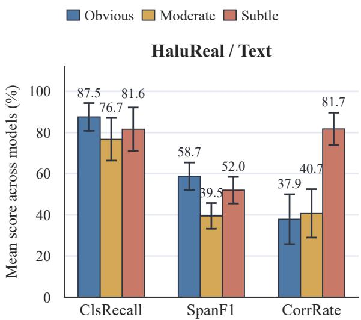

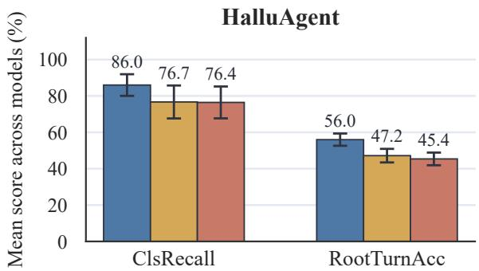  
Figure 7: Average model performance across perturbation degrees on HaluReal/Text and HaluAgent. Error bars denote one standard deviation across models.

## E Additional Analysis Results

This section reports supplementary analyses beyond the main benchmark results, including finetuning settings, validation against external naturalhallucination sets, and the relationship between factual generation quality and span-level hallucination localization. These analyses provide additional evidence about the robustness, transferability, and diagnostic value of HALUCHECK.

## E.1 Fine-tuning Details

Experiment Settings. We fine-tune Qwen3-8B and Qwen3-14B on HALUTEXT-CH, HALUTEXT-EN, and HALUAGENT-EN using LoRA-SFT with the ms-swift framework. All experiments are conducted on a single node with 8 H20 GPUs, using DeepSpeed ZeRO-2 and bf16 precision. For each of the three training sets, we sample 2,500 positive and 2,500 negative examples from the full synthetic dataset, subject to text-length constraints, and ensure strict de-duplication from the Lite internal evaluation set. The fine-tuning prompts are derived from the baseline detection prompts by removing few-shot demonstrations and the uncertain option, so that the model is trained to make direct binary judgments. For Qwen3 fine-tuning, we include the <think>\n\n</think> markers in the training responses to preserve the model’s reasoning format and avoid degrading its reasoning ability.

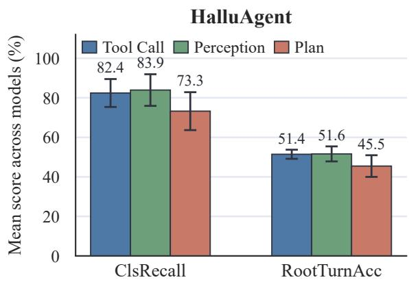

Figure 8: Average HaluAgent performance across perturbation categories. Error bars denote one standard deviation across models.  
Item Value   
Framework / optimizer ms-swift (swift sft) + DeepSpeed ZeRO-2 /   
AdamW   
Tuner LoRA: rank 16, alpha 32, dropout 0.05   
LoRA modules all-linear; bias none   
Precision bf16; gradient checkpointing   
Per-device batch train 2 / eval 2   
Gradient accumulation 4   
Global batch size 64   
Epochs 3   
LR scheduler cosine; warmup ratio 0.05   
Weight decay / max 0.0 / 1.0   
grad norm   
AdamW (β1, β2, ϵ) (0.9, 0.95, 1e−8)   
Save / eval strategy per epoch; save total limit 3   
Seed 42  
Table 10: Hyperparameters for LoRA-SFT experiments.

## E.2 FactScore Reproduction and Data Sources

To identify major perturbation strategies for factual texts, we first analyze how hallucinations are distributed across entity types. For English, we use the biography subset of the open-source HALO-GEN (Ravichander et al., 2025) hallucination data as the probing source, where Wikipedia-grounded annotations are already provided. For Chinese, we randomly sample entities from Chinese Wikipedia. To ensure coverage across entity popularity, we compute each entity’s average monthly page views over the past three years, divide entities into longtail, medium-popularity, and popular groups using thresholds of 1,000 and 100,000 views, and sample 90 entities evenly from the three groups. We then prompt a set of LLMs to generate entity descriptions. For Chinese generations, we use Qwen3- 397B-A37B with FP8 quantization as the verifier and Chinese Wikipedia as the reference database to compute factuality scores. For both English and Chinese data, we apply spaCy to perform named entity recognition over atomic facts, and compute the proportion of entities appearing in hallucinated atomic facts among all extracted entities as the entity-level hallucination rate.

## E.3 Correlation with Natural Hallucination Sets

We evaluate all 14 models on natural-hallucination validation sets aligned with HALUCHECK. The text validation set contains 400 HALUTEXT instances drawn from UHGEval (Liang et al., 2024), FAVA (Mishra et al., 2024) and HALo-GEN (Ravichander et al., 2025). The agent validation set contains 693 English trajectories from AgentHallu (Liu et al., 2026). Table 11 reports model-level correlations between HALUCHECK and these natural-hallucination sets.

## E.4 Relationship between Hallucination Generation and Detection

We evaluate all 14 models by comparing their hallucination generation rates with their detection proficiency. Since the models evaluated in HALOGEN are different from those in our experiments, we do not directly compare the two model sets. Figure 9 shows the correlation between models’ average FactScore on Chinese entity descriptions and their SpanF1 on HALUTEXT-CH. The Pearson correlation is 0.832 and the Spearman correlation is 0.741, both statistically significant at $p < 0 . 0 1$

The trend suggests a positive relationship between factual generation ability and hallucination detection ability: models that hallucinate less in their own generations tend to localize hallucinated spans more accurately. This indicates that hallucination detection is partly supported by the model’s internal factual knowledge and its ability to verify entity-level information. These results provide additional evidence that hallucination generation behavior and post-generation detection ability are related, while still leaving room for model-specific differences in calibration, evidence use, and span localization.

<table><tr><td>Dataset Pair</td><td>Metric</td><td>Pearson</td><td>Spearman</td></tr><tr><td>HALUTEXT-CH</td><td>Accuracy</td><td> $0 . 8 7 2 2 ^ { \ast \ast \ast }$ </td><td> $0 . 8 2 7 3 ^ { * * * }$ </td></tr><tr><td></td><td>Precision</td><td> $0 . 8 3 7 6 ^ { \ast \ast \ast }$   $0 . 9 0 6 9 ^ { \ast \ast \ast }$ </td><td> $0 . 8 8 8 9 ^ { * * * }$   $0 . 8 3 0 4 ^ { * * * }$ </td></tr><tr><td></td><td>Recall</td><td></td><td></td></tr><tr><td></td><td>F1 Refusal Rate</td><td> $0 . 9 1 7 7 ^ { \ast \ast \ast }$  0.9536***</td><td> $0 . 9 0 7 7 ^ { \ast \ast \ast }$  0.9063***</td></tr><tr><td>HALUTEXT-EN</td><td></td><td></td><td></td></tr><tr><td></td><td>Accuracy</td><td> $0 . 9 4 9 9 ^ { \ast \ast \ast }$ </td><td> $0 . 9 2 5 3 ^ { \ast \ast \ast }$  ***</td></tr><tr><td></td><td>Precision</td><td> $0 . 8 4 6 5 ^ { * * * }$ </td><td>0.8823</td></tr><tr><td></td><td>Recall</td><td> $0 . 7 0 1 9 ^ { \ast \ast }$ </td><td>0.5947*</td></tr><tr><td></td><td>F1</td><td> $0 . 8 9 2 7 ^ { \ast \ast * }$ </td><td> $0 . 8 6 8 1 ^ { * * * }$ </td></tr><tr><td>HALUAGENT-EN</td><td>Refusal Rate</td><td> $0 . 9 6 9 6 ^ { * * * }$ </td><td> $0 . 9 4 0 5 ^ { \ast \ast \ast }$ </td></tr><tr><td></td><td>Accuracy</td><td>0.1652</td><td>0.4444</td></tr><tr><td></td><td>Precision</td><td> $0 . 7 2 2 4 ^ { \ast \ast }$ </td><td> $0 . 7 5 8 2 ^ { \ast \ast }$ </td></tr><tr><td></td><td>Recall</td><td> $0 . 8 7 3 9 ^ { \ast \ast \ast }$ </td><td> $0 . 8 6 9 1 ^ { * * * }$ </td></tr><tr><td></td><td>F1</td><td> $0 . 6 9 3 2 ^ { \ast \ast }$ </td><td> $0 . 6 8 7 9 ^ { \ast \ast }$ </td></tr><tr><td></td><td>Refusal Rate</td><td> $0 . 7 1 3 2 ^ { \ast \ast }$ </td><td> $0 . 6 8 1 6 ^ { * * }$ </td></tr></table>

Table 11: Model-level correlations between HALUCHECK and natural-hallucination test sets. $^ * , { } ^ { * * }$ , and ∗∗∗ denote significance at $p < 0 . 0 5 , p < 0 . 0 1$ , and $p < 0 . 0 0 1$ , respectively.

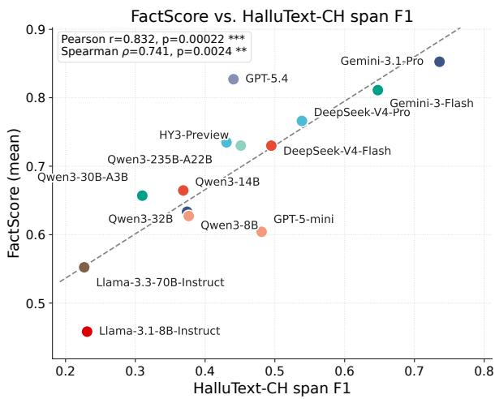  
Figure 9: FactScore vs SpanF1

We hypothesize that this correlation mainly reflects the shared reliance of both tasks on models memory of factual knowledge. However, factual generation is open-ended, whereas hallucination detection evaluates a fixed input with predefined ground-truth labels and annotations. These different task demands may explain why performance does not fully align across the two tasks.

## F Summary of Prompt Design

This section summarizes the prompt suite used for hallucination generation, detection, fine-tuning, and quality control. It documents how the prompts operationalize controlled perturbations, structured outputs, perturbation-degree labels, and automated validation across factual text, QA, fake-content, and agentic trajectory settings.

Prompt Suite Overview. The appendix presents a structured prompt suite for hallucination data generation, hallucination detection, fine-tuning, and quality control. The prompts cover multiple scenarios, including Wikipedia-style factual text, question answering, fake-content detection, and agent-based task trajectories.

Synthetic Data Construction. For synthetic data construction, the prompts are designed to generate paired samples consisting of a factual reference output and a hallucinated counterpart. In the Wiki passage setting, the main strategy is entity-level perturbation. Given a Wikipedia title, a source passage, and a named-entity list, the prompt validates the entities, determines the number of entities to modify, applies controlled replacements, and records all modifications in a structured format. The generated output includes true\_text, hallucinated\_text, and explicit modification annotations.

Perturbation Degree Design. The prompt framework adopts a three-level perturbation-degree design: Obvious, Moderate, and Subtle. Obvious cases introduce easy-to-identify hallucinations through unrelated entity substitutions or large numerical and temporal deviations. Moderate cases use same-category or semantically similar substitutions that require external knowledge to verify. Subtle cases introduce fine-grained and highly believable perturbations, such as closely related entity swaps, fine-grained numerical changes, minor date shifts, or fabricated contextual details.

Fabrication Prompts. In addition to entity replacement, the Wiki passage pipeline includes a fabrication-oriented prompt for subtle examples. This prompt adds moderate but false details to an already modified passage, making the hallucination more implicit while preserving fluency and contextual coherence.

QA Prompts. For QA data, the prompts generate hallucinated answers from question-answering inputs. Given a question, a correct answer, and optional evidence or incorrect answers, the model is instructed to produce both a correct response and a hallucinated response, together with annotations of the modified factual information.

Agent Prompts. For Agent data, the prompts focus on hallucinations in agentic workflows. They cover perception hallucination, plan hallucination, and tool-call hallucination. Perception hallucination changes the assistant’s interpretation of tool results while keeping tool outputs unchanged. Plan hallucination modifies reasoning steps or task decomposition. Tool-call hallucination perturbs tool selection or tool parameters. These prompts preserve the original interaction structure while introducing controlled factual or procedural errors.

Quality-control Prompts. The quality-control prompts evaluate generated samples along dimensions such as perturbation validity, causal consistency, surface coherence, turn integrity, entity accuracy, text consistency, and fabrication plausibility. These prompts help filter low-quality samples and ensure that hallucinated examples are factually incorrect, linguistically natural, and consistent with the intended perturbation degree.

Design Principles. Overall, the prompt suite is built around five core design principles: controlled perturbation, explicit perturbation-degree grading, structured output normalization, self-annotation of modified content, and automated quality assessment. It supports both hallucination generation and hallucination detection across factual text, question answering, fake-content identification, and agentic reasoning scenarios. This design enables the construction of hallucination datasets that are diverse, verifiable, perturbation-aware, and suitable for both evaluation and supervised fine-tuning.

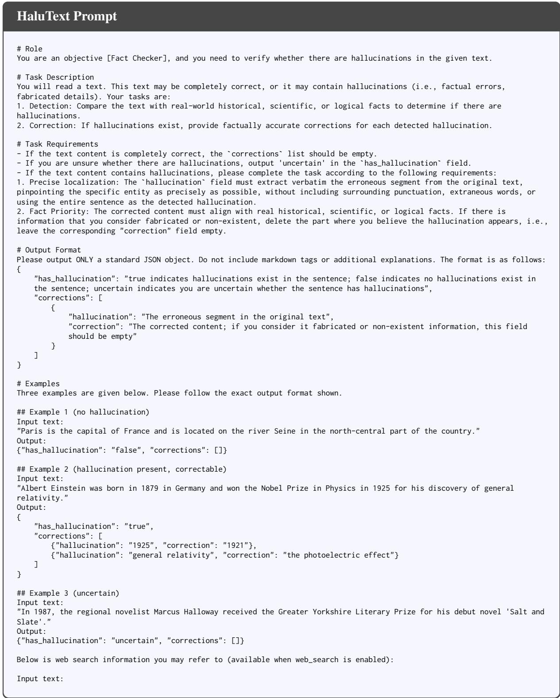  
Figure 10: Prompt used for HaluText

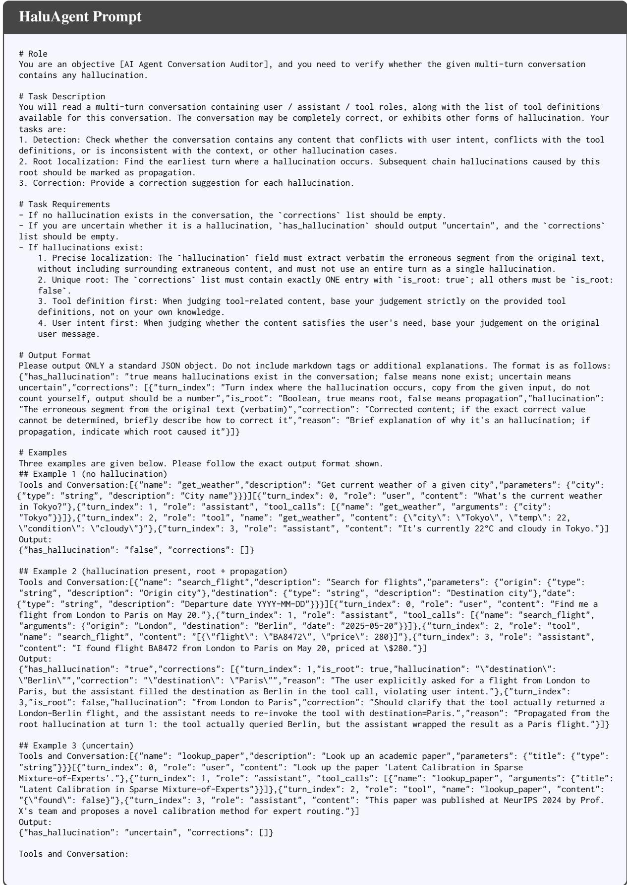  
Figure 11: Prompt used for HaluAgent