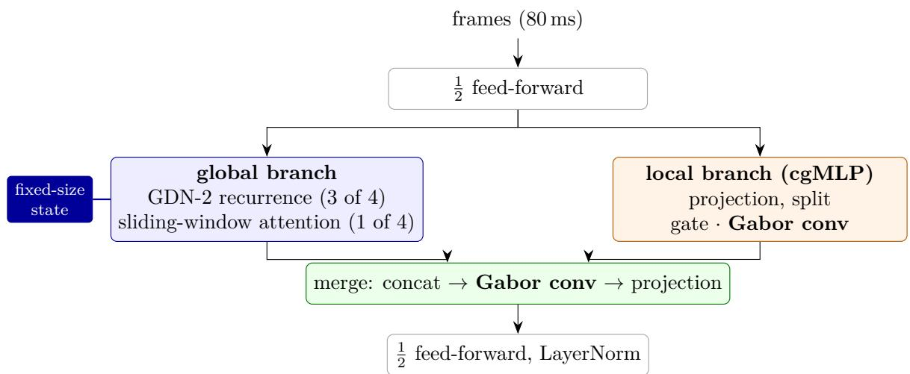
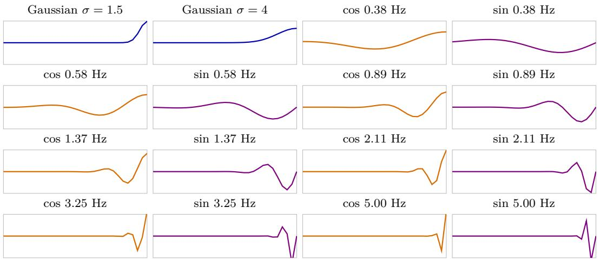
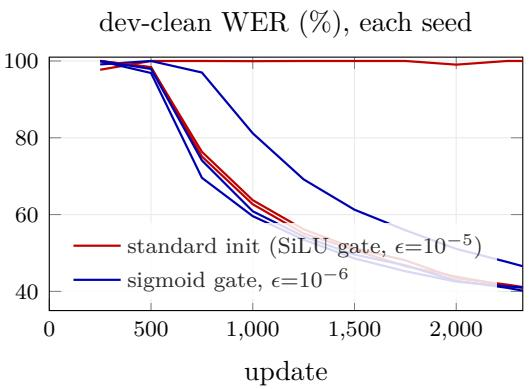
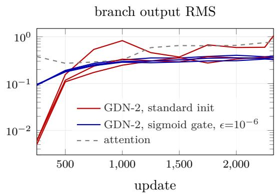
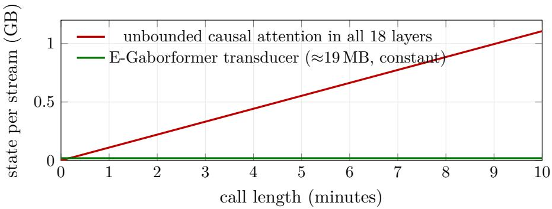
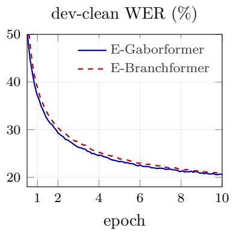
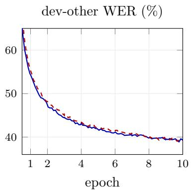
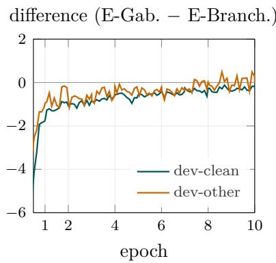
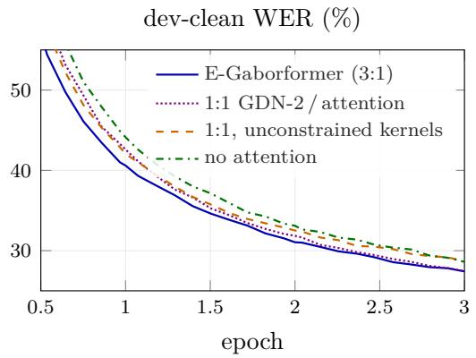
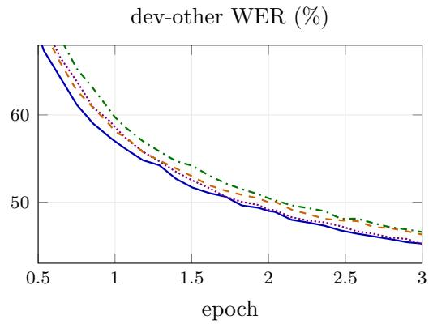

# Gabor Gabor: E-Gaborformer

A Strictly Causal Speech Recognizer with Gabor-Dictionary Convolutions and Delta-Rule Memory

Nir Krakowski nir@deepdub.ai

Tamir Cohen tamir.cohen@deepdub.ai

Ohad Zohar ohad@deepdub.ai

Chen Zarfati chen@deepdub.ai

Deepdub https://deepdub.ai

## Abstract

Real-time voice agents need a speech recognizer that never waits for future audio and whose memory per call does not grow with the length of the call. We present E-Gaborformer, a strictly causal encoder that combines Gated DeltaNet-2 recurrent layers with sliding-window attention in a 3:1 ratio, and builds every temporal convolution from a fixed dictionary of causal Gabor atoms. Its streaming state is constant, about 19 MB per call at production scale including the prediction network, where a causal-attention encoder of the same size accumulates over 1 GB after ten minutes. In a controlled causal study on LibriSpeech, E-Gaborformer leaves the initial plateau earlier, reaches a given accuracy up to 18% sooner, and matches or beats an E-Branchformer trained with the identical front end and recipe. At production scale, a 0.6B-parameter Hebrew and English streaming transducer built on E-Gaborformer has 28 to 31% lower word error rate (WER) than NVIDIA’s Nemotron 3.5 ASR Streaming, a model of the same size, on English voice-agent trafic, and up to 20% lower Hebrew WER than our previous production system. The same weights serve strictly causal and 480 ms-lookahead decoding with no loss in accuracy, and a two-class formulation of the RNN-T lattice trains the transducer 2.6× faster with exact loss and gradients.

## 1 Introduction

A voice agent must transcribe the user while they are still speaking, for thousands of concurrent calls. Two properties of the acoustic encoder matter for this setting: causality, so that no output waits for future audio, and a bounded per-stream state, so that serving cost does not grow with call length.

Most strong ASR encoders, such as the Conformer [11] and the E-Branchformer [19], are bidirectional. They can be made causal by masking future frames, but causal self-attention still caches every past key and value: an 18-layer, d=1024 encoder at 80 ms frames accumulates about 110 MB of fp32 cache per minute of audio per caller. Chunked and memory-augmented transformers bound this cost with explicit truncation [3, 27, 44]. Linear-attention recurrences take another route: they compress the past into a fixed-size state that is updated once per frame [18, 43]. The delta-rule family, DeltaNet [50], Gated DeltaNet [51] and Gated DeltaNet-2 (GDN-2) [12], has recently closed much of the gap to attention in language modeling, and hybrid stacks that mix recurrent and attention layers often do better than either alone [4, 23, 40].

We show that a mostly recurrent causal encoder matches attention in speech recognition, and propose E-Gaborformer. It keeps the E-Branchformer block and changes three things inside it: a 3:1 GDN-2 / sliding-window-attention global stack, depthwise convolutions built from a fixed Gabor dictionary, and a change to the GDN-2 output gate that keeps the recurrent branches active from the first update. The result is an encoder with a constant per-call state that trains faster than its attention-based counterpart and, at production scale, outperforms a state-of-the-art streaming recognizer of the same size on our English voice-agent trafic.

## Contributions.

• A hybrid recurrent encoder for causal ASR (Section 4). Three GDN-2 layers for every sliding-window attention layer, inside the E-Branchformer block. GDN-2 branches start 50 to 60× quieter than attention branches under CTC; a change to their output gate, at no parameter cost, removes the resulting training stalls.

• Gabor-dictionary depthwise convolutions (Section 4.2). Restricting convolution kernels to a structured basis is an established idea in vision [15, 36], and Gabor functions have a long history as speech features [2, 42]. We apply a fixed, one-sided (causal) Gabor basis to the temporal depthwise convolutions of a speech encoder, trained from the first step. This difers from fitting and freezing Gabor functions after training [41].

• A controlled causal comparison (Section 5) against an E-Branchformer with an identical front end and recipe, with training curves over ten epochs, and a screen of 36 encoder configurations in about 160 runs that isolates the contribution of each component.

• A 0.6B-parameter streaming transducer (Section 6) whose prediction network interleaves GDN-2 with token attention. On English voice-agent trafic it has 28 to 31% lower WER than Nemotron 3.5 ASR Streaming, and one set of weights serves both strictly causal and 480 ms-lookahead decoding at equal accuracy.

• Exact and fast transducer training (Section 6.6): a two-class RNN-T lattice with a closed-form logit gradient, aligned output layers, tensor-core depthwise convolutions and weight-preserving length regrouping, together 2.6× faster per update with an unchanged objective.

## 2 Related work

Encoders for ASR. The Conformer [11] interleaves self-attention with a convolution module. The Branchformer [33] runs attention and a convolutional-gating MLP (cgMLP) in parallel branches, and the E-Branchformer [19] adds a depthwise-convolution merge; it matches or exceeds the Conformer across tasks [34]. FastConformer [39] subsamples 8× for eficiency.

Streaming recognizers. Cache-aware streaming [27] trains a FastConformer with limited right context and reuses cached activations at inference; training with several right-context sizes lets one model serve several latencies; dual-mode and dynamic-chunk training [53, 56] pursue the same goal. Classic streaming recognizers bound the state with LSTM encoders [13] or truncated attention context [44, 57]. Nemotron 3.5 ASR Streaming [29] applies this recipe to a 0.6B-parameter multilingual RNN-T with a language prompt. Its attention cache is bounded by a fixed left context of 56 frames per layer. We use the same multi-lookahead training idea; our contribution is the encoder and prediction network, not the streaming recipe.

Recurrent and hybrid sequence models. Linear attention [18] and fast-weight programmers [43] recast attention as a recurrence with a matrix-valued state. The delta rule [50] replaces additive writes with error-correcting ones, gating adds data-dependent forgetting [51], and GDN-2 [12] decouples erasing from writing with channel-wise gates. Structured state-space models [9, 10], long convolutions [35] and hybrids of recurrent and local-attention layers [4, 23, 40] show that a few attention layers recover the exact recall that pure recurrences lack. In speech, Zipformer [52] and state-space or Mamba encoders [16] are recent eficient alternatives to the Conformer.

Structured and parametrized filters. Structured receptive fields [15] and DCFNet [36] express CNN kernels as learned combinations of a fixed basis (Gaussian derivatives and Fourier–Bessel functions). Gabor convolutional networks [26] modulate learned kernels with Gabor filters, and GaborNet [1] learns the parameters of Gabor kernels directly. In speech, spectro-temporal Gabor filters serve as robust features [42] and as fixed CNN kernels [2], and SincNet [38] and LEAF [54] learn band-pass front-end filters through their center frequencies and bandwidths. Orukeet [41] fits a Gabor function to each nine-tap depthwise kernel of a trained Parakeet model, replaces the best-fitting half by its fit and freezes it during further training. Our filters are temporal rather than spectro-temporal, act inside every encoder block rather than at the input, and are constrained to the Gabor span from initialization.

Eficient transducer training. The RNN-T loss [7] requires joint-network outputs at every (frame, token) node. Function merging [22] avoids storing full log-softmax outputs, and pruned RNN-T [20] restricts the lattice to a band. Fused cross-entropy kernels avoid materializing large logit matrices in language models [48].

## 3 Preliminaries

The E-Branchformer block. An E-Branchformer layer [19] is a macaron block: a half-step feed-forward layer, a global and a local branch computed in parallel, a merge, and a second half-step feed-forward layer. The global branch is multi-head self-attention. The local branch is a cgMLP: a projection to 2c channels, a split into value and gate halves, and a depthwise convolution over time on the gate. The merge concatenates the two branches, applies a second depthwise convolution and projects back to d.

Gated DeltaNet-2. GDN-2 [12] keeps, per head, a matrix state $S _ { t } \in \mathbb { R } ^ { d _ { k } \times d _ { v } } ~ ( 6 4 \times 6 4 $ in all our models) and updates it once per frame:

$$
S _ { t } = \left( I - k _ { t } ( b _ { t } \odot k _ { t } ) ^ { \top } \right) \operatorname { D i a g } ( e ^ { g _ { t } } ) S _ { t - 1 } + k _ { t } ( w _ { t } \odot v _ { t } ) ^ { \top } , \qquad o _ { t } = S _ { t } ^ { \top } q _ { t } .\tag{1}
$$

The decay $g _ { t } \le 0$ forgets channel by channel, the erase gate $b _ { t }$ removes what the current key already stores, and the write gate $w _ { t }$ selects which value channels are written. Queries, keys and values pass through causal short convolutions (kernel 4), keys and queries are $\ell _ { 2 } { \mathrm { - n o r m a l i z e d } }$ , the decay uses a low-rank projection (rank 64), and the per-head output passes through a gated root-mean-square normalization (RMSNorm) before the output projection. We use the chunked Triton kernels of flash-linear-attention [46, 49].

CTC and RNN-T. Both training objectives sum the probability of the reference transcript over all of its alignments to the encoder frames. Connectionist temporal classification (CTC) [8] adds a blank symbol and predicts one symbol or blank per frame, independently of the symbols already emitted; we use it in the controlled study (Section 5). In intermediate CTC [21], a second CTC loss is computed from the output of an inner encoder layer through the same output layer (self-conditioned CTC [28] also feeds that layer’s prediction back into the encoder), and the training loss becomes $\left( 1 - w \right) L _ { \mathrm { C T C } } + w L _ { \mathrm { C T C } } ^ { ( \ell ) } ;$ we tried ℓ = 6 and $w = 0 . 3$ as an ablation. The recurrent neural network transducer (RNN-T) [7] adds a prediction network that reads the symbols emitted so far, and a joint network that combines its output with each encoder frame into a distribution over the vocabulary and blank. Its loss is the negative log-probability of the transcript summed over the paths through the frame–symbol lattice, in which blank advances one frame and a symbol advances one position in the transcript. Unlike CTC, the transducer conditions each output on the previous symbols, and it is the model we deploy (Section 6).

  
Figure 1: One E-Gaborformer block (residual connections omitted). The global branch is a GDN-2 recurrence in three layers out of four and causal sliding-window attention in the fourth; both depthwise convolutions are Gabor-dictionary convolutions.

Causality. We call a model strictly causal if output frame j depends on no input after frame j. Output frame j covers the eight 10 ms analysis hops ending at 80j ms; with a 25 ms STFT window it depends on audio up to 80j + 12.5 ms. This requires masked attention, left-padded convolutions, a forward-only recurrence and a subsampling front end that pads only on the left in time.

## 4 E-Gaborformer

E-Gaborformer keeps the E-Branchformer block and changes its global branch, its two depthwise convolutions and the output gate of the recurrent layers (Figure 1).

## 4.1 Hybrid global branch

The global branch is a GDN-2 recurrence in every layer whose index (counted from 1) is not a multiple of four, and causal sliding-window attention over the last W=128 frames (10.24 s) with rotary position embeddings [45] in every fourth layer; we write this pattern as GGGS (G: GDN-2, S: sliding-window attention). The recurrence can carry information over arbitrarily long distances in a fixed-size state, subject to its learned decay; the attention layers provide exact recall over the recent window, which a compressed state cannot.

  
Figure 2: The 16 fixed causal Gabor atoms (kernel 31, lag $- 3 0 \dots 0$ left to right; frequencies at 80 ms frames). Each channel’s kernel is a learned linear combination of them.

## 4.2 Gabor-dictionary convolutions

A depthwise convolution with kernel size K applies, per channel $^ { c , }$ a kernel $h _ { c } \in \mathbb { R } ^ { K }$ . Following Gabor’s time–frequency atoms [6], we restrict $h _ { c }$ to the span of a fixed dictionary $\{ \phi _ { m } \} _ { m = 1 } ^ { M }$ :

$$
h _ { c } [ \tau ] = \sum _ { m = 1 } ^ { M } a _ { c , m } \phi _ { m } [ \tau ] , \qquad \tau = - ( K - 1 ) , \ldots , 0 ,\tag{2}
$$

and learn only the coeficients $\boldsymbol { a } _ { c , m }$ and a bias. The dictionary has M=16 unit-norm atoms over lags $\tau \leq 0$ (the past): two Gaussians $\exp ( - \tau ^ { 2 } / 2 \sigma ^ { 2 } )$ with $\sigma \in \{ 1 . 5 , 4 \}$ frames, and seven wave packets at frequencies $f _ { k }$ log-spaced from 0.03 to 0.4 cycles per frame, each as a cosine and a sine,

$$
\phi _ { k } ^ { \mathrm { c o s } } [ \tau ] \propto e ^ { - \tau ^ { 2 } / 2 \sigma _ { k } ^ { 2 } } \cos ( 2 \pi f _ { k } \tau ) , \quad \phi _ { k } ^ { \mathrm { s i n } } [ \tau ] \propto e ^ { - \tau ^ { 2 } / 2 \sigma _ { k } ^ { 2 } } \sin ( 2 \pi f _ { k } \tau ) , \quad \sigma _ { k } = \mathrm { c l i p } ( 0 . 5 / f _ { k } , 1 , ( K - 1 ) / 2 ) ,\tag{3}
$$

so that any phase is reachable by linear mixing (Figure 2). The envelope peaks at the current frame and decays into the past, so every kernel is causal by construction. With K=31 at 80 ms frames, a filter spans 2.48 s, and the wave packets are centered between 0.375 and 5 Hz, the range of phrasal and slower syllabic modulation [5]. In the controlled study, whose Gabor ablations ran at 40 ms frames, the same atoms cover 0.75 to 10 Hz.

Unlike filters whose center frequency enters nonlinearly [38, 54], the kernel is linear in its coeficients. It uses 16 parameters per channel instead of K and is built in fp32 before being cast to the activation type. The constraint acts as a soft smoothness prior: the dictionary concentrates energy below about 0.4 cycles per frame. It is not a hard limit, because the one-sided truncation leaks energy from the highest-frequency atoms above that band. The raw dictionary is ill-conditioned (Gram condition number about $8 \times 1 0 ^ { 6 }$ , efectively about 12 independent directions); all models use it as is, and the coeficients are trained with AdamW. The gate convolution’s coeficients start near zero with a bias of one, so that the gate starts open; the merge convolution’s start random.

## 4.3 Training stalls of GDN-2 branches

Our first hybrid models used the standard GDN-2 configuration, a SiLU output gate and an RMSNorm epsilon of $1 0 ^ { - 5 }$ . Four of the 18 causal runs with GDN-2 layers in round 2 of our screen (Section 5.3) never left the initial CTC plateau within an epoch, the phase in which the model emits only blanks and the loss stays flat [55] (Table 4). At the first evaluation, after 250 updates, the GDN-2 branch output had a root-mean-square (RMS) value of 0.005 to 0.006, against 0.28 to 0.38 for the attention branch of the same model, 50 to 60× smaller (Figure 3, right). We attribute this to the output path: SiLU of a near-zero gate pre-activation is close to zero, and the recurrence output is small enough to fall below the normalization epsilon, so RMSNorm does not rescale it. We hypothesize that the rest of the network then learns to work without the recurrent branch; in the stalled seed, the branch became louder later without the run leaving the plateau.

  
Figure 3: Standard (SiLU) and sigmoid GDN-2 output gate in the causal 1:1 hybrid (three seeds each, 40 ms front end). Left: one SiLU-gate seed never leaves the blank plateau. Right: output RMS of the GDN-2 and attention branches, logged at every evaluation.

Table 1: Per-stream inference state (fp32, 80 ms frames). Attention windows are 128 frames (10.24 s).
<table><tr><td colspan="2">study model (12 layers, d=256)</td><td>production encoder (18 layers, d=1024)</td></tr><tr><td>GDN-2 states attention key/value windows</td><td>9 × 4 heads: 0.6 MB 3 layers: 0.8MB</td><td>14 × 16 heads: 3.7 MB 4 layers: 4.2 MB</td></tr><tr><td>convolution caches total, any stream length</td><td>1.6 MB ≈3 MB</td><td>9.4MB ≈17 MB (+≈2 MB prediction network)</td></tr></table>

We replace the SiLU output gate by a sigmoid, which starts at 0.5, and lower the RMSNorm epsilon to 10−6. Neither change adds parameters. The GDN-2 branch then starts at an RMS of about 0.09, and all 36 later causal runs with GDN-2 layers left the plateau (0 stalls against 4 of 18 before), after 750 or 1,000 updates against 750 for the E-Branchformer (Figure 3, left). The fix changes the stall rate; seeds that did not stall reached similar WER with either gate. All results after round 2 use the sigmoid gate.

## 4.4 Streaming state size

Because the recurrence, the windowed attention and the convolutions each look back over a fixed horizon or summarize the past in a fixed-size state, the inference state of E-Gaborformer does not depend on how long a stream has run. Each GDN-2 head carries $d _ { k } d _ { v }$ numbers, each attention layer a ring bufer of W keys and values, and each convolution its last K−1 inputs. Table 1 gives the totals, and Figure 4 contrasts them with unbounded causal attention. Unlike a pure sliding-window encoder, whose memory ends at the window, the recurrent layers also carry context from before it.

  
Figure 4: Inference state per stream at production scale (d=1024, 18 layers, fp32).

## 5 Controlled study on LibriSpeech-100

## 5.1 Setup

All models share one pipeline and one recipe, are trained strictly causally, and are selected and reported on the development sets only.

• Data: LibriSpeech train-clean-100 [30] with speed perturbation (0.9, 1.0, 1.1; 304 h per epoch); dev-clean and dev-other for evaluation.

• Front end: 128 log-mel bins (25 ms window, 10 ms hop), SpecAugment [32], global mean–variance normalization, and a causal Conv2d stack that subsamples 8× to 80 ms frames.

• Output and loss: a CTC output layer over 5,000 byte-pair-encoding (BPE) units, trained with the CTC loss alone (the three intermediate-CTC arms of Table 4 excepted); greedy decoding, no language model.

• Baseline: a port of ESPnet’s [47] LibriSpeech-100 E-Branchformer. At its original front end our port has exactly ESPnet’s 26,433,928 parameters; here it uses the same causal front end as E-Gaborformer.

• Training: Muon [17, 24] on hidden weight matrices and AdamW [25] on all other parameters, peak learning rate 10−3 after 500 warmup updates with inverse square-root decay, bf16 autocast, about 2,330 updates per epoch on a single GPU.

• E-Gaborformer: 12 layers, d=256, global pattern GGGS repeated three times, GDN-2 with 4 heads of 64, attention window 128 frames, Gabor kernel size 31; 27.6M parameters against 26.8M for the E-Branchformer.

As sanity checks, every model was able to overfit a single training utterance, and we verified causality numerically: outputs before time t did not change when the input after t was replaced by noise.

## 5.2 E-Gaborformer versus E-Branchformer

Figure 5 shows development-set WER over ten epochs and Table 2 summarizes it. E-Gaborformer leaves the initial blank plateau earlier and stays ahead on dev-clean for most of training: it reaches a given dev-clean WER 5 to 18% sooner, in updates, than the E-Branchformer. After three epochs it leads by 0.9 points on dev-clean and 0.6 on dev-other on average and is ahead in each of the three seeds (by 1.4, 0.2 and 1.2 points on dev-clean). The gap narrows with further training. After ten epochs, both models reach 39.2% on dev-other, and E-Gaborformer is 0.3 points lower on dev-clean (0.35 and 0.22 in the two seeds). E-Gaborformer thus matches a causal E-Branchformer of the same size on LibriSpeech-100 after ten epochs, with a streaming state of about 3 MB (Section 4.4).

  
Figure 5: Development WER of causal E-Gaborformer and E-Branchformer with identical front end and recipe (mean of two seeds, evaluated every 250 updates; greedy CTC, no language model). Right: diference between the two models; negative values favor E-Gaborformer.

Table 2: Causal models with 80 ms frames and 128 mel bins. WER (%) on dev-clean / dev-other, greedy CTC, no language model. Three-epoch results are the mean of three seeds; ten-epoch results the mean of two.
<table><tr><td rowspan="2">model</td><td rowspan="2"></td><td colspan="2">3 epochs</td><td>10 epochs</td></tr><tr><td>params final</td><td>average of last 3 checkpoints</td><td>final</td></tr><tr><td>E-Gaborformer (GDN-2 : attention = 3:1)</td><td>27.6M</td><td>26.2 / 44.5</td><td>25.2 / 43.0</td><td>20.5 / 39.2</td></tr><tr><td>E-Branchformer</td><td>26.8M</td><td>27.1/45.1</td><td>26.3 /43.7</td><td>20.8/39.2</td></tr></table>

## 5.3 Architecture exploration

E-Gaborformer is the result of a staged architecture screen over 36 encoder configurations in about 160 training runs, all with the recipe above and three seeds per configuration unless noted. Tables 4 and 5 list every configuration, with WER after one and three epochs and the number of seeds that left the blank plateau within the first epoch. Because short runs can be dominated by how quickly each arm leaves the plateau, we compare arms by their gap over the whole run (Table 3). The Gabor model overtakes unconstrained convolutions after the first epoch and its lead grows steadily, from 0.5 points at 1.5 epochs to 1.2 at three, where it is ahead or level in every seed (by 0.0, 1.2 and 2.5 points). E-Gaborformer is ahead of the E-Branchformer on dev-clean at every evaluation after the first, and the 3:1 hybrid matches the 1:1 hybrid with half the attention layers, so we keep the leaner 3:1 stack. The configuration selected this way carries over to production scale: trained as a 0.6B-parameter transducer, it has 28 to 31% lower WER than Nemotron 3.5 ASR Streaming on English voice-agent trafic (Section 6).

Round 1: bidirectional models. We first compared the families without a causal constraint (Table 5). The E-Branchformer was clearly best. A 12-layer GDN-2 encoder reached 23.4 / 40.8 after three epochs against 20.5 / 37.1, and every model with GDN-2 layers or Gabor convolutions had seeds that stalled on the blank plateau; none of the three 1:1 hybrid seeds left it within an epoch. An orthonormal basis of the Gabor span (the raw causal dictionary has a Gram condition number of about $8 \times 1 0 ^ { 6 } )$ removed most stalls in this round, but did not improve the models that trained normally. A learning rate of $2 \times 1 0 ^ { - 3 }$ left four of six architectures on the plateau, and the Conformer did not leave it within 1,250 updates with AdamW alone; we therefore used Muon with a peak learning rate of $1 0 ^ { - 3 }$ throughout.

Table 3: Development-clean WER diference between two arms during training (mean over seeds; negative favors the first arm), at the same evaluation steps as Table 4. Unconstrained convolutions lead after one epoch; the Gabor lead then grows.
<table><tr><td></td><td colspan="6">epochs (updates)</td></tr><tr><td>arms</td><td>1 (2,250)</td><td>1.5 (3,500)</td><td>2 (4,750)</td><td>2.5 (5,750)</td><td>3 (6,981)</td><td>10 (23,270)</td></tr><tr><td>Gabor vs. unconstrained convolutions (1:1)</td><td>+0.4</td><td>-0.5</td><td>-0.7</td><td>-1.0</td><td>-1.2</td><td></td></tr><tr><td>E-Gaborformer vs. E-Branchformer</td><td>-1.8</td><td>-1.2</td><td>-1.0</td><td>-1.0</td><td>-0.9</td><td>-0.3</td></tr><tr><td>3:1 vs. 1:1 hybrid</td><td>-2.3</td><td>-0.7</td><td>-0.6</td><td>-0.3</td><td>0.0</td><td></td></tr></table>

Round 2: causal models. Under a causal constraint the ranking changed (Table 4, top). The Conformer left the plateau in only one of three seeds and the FastConformer only after about 2,000 updates. The E-Branchformer remained the strongest non-recurrent model at 28.5 / 46.2. The 1:1 hybrid with Gabor convolutions in both the cgMLP gate and the merge reached 27.4 / 45.3 at three epochs, but this is the mean of the two seeds that left the plateau; the third stalled. This is the round in which we diagnosed that problem (Section 4.3).

Round 3: sigmoid output gate. With the sigmoid GDN-2 output gate, every seed of every configuration trained (Table 4, middle). Replacing both Gabor convolutions by unconstrained depthwise kernels increased WER by 1.2 points on dev-clean and 1.1 on dev-other, and removing all attention layers increased it by 1.1 and 1.4. A 3:1 ratio of GDN-2 to attention was as accurate as 1:1 with half the attention layers. Gated attention with QK-normalization in the attention layers [37] changed nothing. Intermediate CTC at layer 6 (Section 3) lowered dev-clean WER by 1.3 points after three epochs. Figure 6 shows the training curves of the main arms.

Round 4: front end. To reduce encoder compute, we decreased the sequence length by adding a Conv2d stack to the front end. This increased the frame duration from 40 ms to 80 ms and reduced encoder compute by nearly half, while maintaining the accuracy of the 40 ms model (27.4 / 44.8 against 27.4 / 45.2). A depthwise-separable 8× subsampler [39] was about one point worse. Increasing the number of mel bins from 80 to 128 lowered dev-clean WER after three epochs from 27.4 to 26.2. With 128 mel bins, adding intermediate CTC gave the same result as the model without it (26.2 / 44.5 in both cases), so the final configuration does not use it. The resulting configuration, 3:1 with Conv2d subsampling and 128 mel bins, is E-Gaborformer; the E-Branchformer with the same front end is the baseline of Table 2.

Gabor convolutions across architectures. In the causal E-Branchformer, Gabor gate convolutions raised dev-clean WER by 2.0 points after three epochs (0.2 bidirectionally, single seed); with the SiLU output gate their efect in the hybrids was hidden by stalled seeds; with the sigmoid gate they lowered dev-clean WER by 1.2 points in the 1:1 hybrid, the configuration from which E-Gaborformer was derived.

Causal and bidirectional models. The two settings rank the architectures diferently. Bidirectionally, the GDN-2 encoder trailed the E-Branchformer by 2.9 points on dev-clean after three epochs; causally, the hybrids matched or led it, which suggests that recurrence is especially well matched to the causal setting that streaming requires.

Table 4: All causal configurations (LibriSpeech-100, greedy CTC). WER (%) on dev-clean / dev-other after one epoch (mean of three seeds) and three epochs (number of seeds in parentheses; in round 2 only seeds that left the plateau were continued). “Left plateau”: seeds below 90% dev-clean WER within the first epoch. 1:1 and 3:1 are GDN-2 / attention ratios; “Gabor” and “free” denote Gabor-dictionary and unconstrained depthwise convolutions.
<table><tr><td>configuration</td><td>1 epoch</td><td>left plateau</td><td>3 epochs</td></tr><tr><td colspan="4">Round 2: SiLU GDN-2 output gate; 40 ms frames, 80 mel bins</td></tr><tr><td>Conformer</td><td>85.3 / 89.4</td><td>1/3</td><td>30.0 / 48.0 (1)</td></tr><tr><td>FastConformer</td><td>74.5/81.3</td><td>3/3</td><td></td></tr><tr><td>E-Branchformer</td><td>42.1/58.2</td><td>3/3</td><td>28.5 / 46.2 (3)</td></tr><tr><td>E-Branchformer, Gabor gate conv</td><td>52.4/66.1</td><td>3/3</td><td>30.6 / 48.5 (3)</td></tr><tr><td>GDN-2 only, Gabor gate conv</td><td>66.4/76.4</td><td>2/3</td><td>29.8 / 47.4 (2)</td></tr><tr><td>GDN-2 only, free convs</td><td>51.7/65.7</td><td>3/3</td><td></td></tr><tr><td>1:1, Gabor gate conv</td><td>67.7/77.0</td><td>2/3</td><td>30.4 / 48.1 (2)</td></tr><tr><td>1:1, gate conv half Gabor, half free</td><td>47.9/62.7</td><td>3/3</td><td>29.8 / 47.3 (3)</td></tr><tr><td>1:1, free gate conv</td><td>64.9/75.1</td><td>2/3</td><td>29.2 / 47.1 (2)</td></tr><tr><td>1:1, Gabor gate and merge convs</td><td>61.1/71.9</td><td>2/3</td><td>27.4 / 45.3 (2)</td></tr><tr><td colspan="4">Round 3: sigmoid output gate, RMSNorm € = 10−6; 40 ms frames, 80 mel bins</td></tr><tr><td>GDN-2 only, Gabor gate conv</td><td>44.9 /60.5</td><td>3/3</td><td>28.6 / 46.6 (3)</td></tr><tr><td>1:1, Gabor gate and merge convs</td><td>43.3/59.3</td><td>3/3</td><td>27.5 / 45.2 (3)</td></tr><tr><td>1:1, free gate and merge convs</td><td>42.9/58.9</td><td>3/3</td><td>28.7 / 46.3 (3)</td></tr><tr><td>3:1, Gabor gate and merge convs</td><td>41.0/57.4</td><td>3/3</td><td>27.4 / 45.2 (3)</td></tr><tr><td>1:1, gated attention with QK-norm</td><td>41.5/57.9</td><td>3/3</td><td>27.4 / 45.2 (3)</td></tr><tr><td>1:1, intermediate CTC at layer 6</td><td>41.5/57.9</td><td>3/3</td><td>26.2 / 43.9 (3)</td></tr><tr><td>1:1, self-conditioned intermediate CTC</td><td>42.6 /58.6</td><td>3/3</td><td>26.4 / 44.4 (3)</td></tr><tr><td colspan="4">Round 4: 3:1, attention window 128, 80 ms frames</td></tr><tr><td>Conv2d 8×, 80 mel depthwise-separable 8×, 80 mel</td><td>41.6/57.7</td><td>3/3</td><td>27.4 / 44.8 (3)</td></tr><tr><td>Conv2d 8×, 128 mel (E-Gaborformer)</td><td>46.6/61.6</td><td>3/3</td><td>28.7 / 46.6 (3)</td></tr><tr><td></td><td>37.4/54.6</td><td>3/3</td><td>26.2 / 44.5 (3)</td></tr><tr><td>depthwise-separable 8×, 128 mel</td><td>39.9/56.9</td><td>3/3</td><td>27.1 / 45.6 (3)</td></tr><tr><td>Conv2d 8×, 128 mel, intermediate CTC</td><td>37.6 /54.7</td><td>3/3</td><td>26.2 / 44.5 (3)</td></tr><tr><td>E-Branchformer, Conv2d 8×, 128 mel</td><td>39.2 /55.5</td><td>3/3</td><td>27.1 / 45.1 (3)</td></tr></table>

Table 5: Bidirectional configurations (round 1; SiLU GDN-2 output gate, 40 ms frames, 80 mel bins). WER (%) on dev-clean / dev-other after one epoch (three seeds; seeds that left the plateau in parentheses) with the raw and the orthonormalized Gabor dictionary, and after three epochs (number of seeds).
<table><tr><td>configuration</td><td>1 epoch, raw dictionary</td><td>1 epoch, orthonormal basis</td><td>3 epochs</td></tr><tr><td>Conformer</td><td>46.4 / 60.6 (3)</td><td></td><td></td></tr><tr><td>E-Branchformer</td><td>32.6 / 48.7 (3)</td><td></td><td>20.5 / 37.1 (3)</td></tr><tr><td>E-Branchformer, Gabor gate conv</td><td>77.7 /83.1 (1)</td><td>33.9 / 50.0 (3)</td><td>20.8 /37.6 (1)</td></tr><tr><td>GDN-2 only, Gabor gate conv</td><td>79.5/85.0 (1)</td><td>65.9 / 75.6 (2)</td><td>23.4/40.8 (1)</td></tr><tr><td>1:1, Gabor gate conv</td><td>99.6 / 99.8 (0)</td><td>59.1 / 69.6 (2)</td><td>24.4 / 41.0 (1, orthonormal)</td></tr><tr><td>1:1, gate conv half Gabor, half free</td><td>52.4 / 64.1 (2)</td><td>54.6 / 66.3 (3)</td><td>20.8 / 37.6 (2)</td></tr><tr><td>1:1, free gate conv</td><td>58.9 / 69.8 (2)</td><td></td><td></td></tr><tr><td>1:1, Gabor gate and merge convs</td><td>56.8 /67.8 (2)</td><td>43.6 / 58.8 (3)</td><td>21.7 /38.5 (2)</td></tr></table>

  
Figure 6: Development WER of the main round-3 configurations (mean of three seeds, 40 ms front end).

## 6 A streaming transducer at scale

Once the architecture was settled on LibriSpeech, we trained it at the scale of the recognizer behind our real-time voice agents: Hebrew and English, telephone-quality and spontaneous speech, strictly causal or low-lookahead decoding.

## 6.1 Model

• Encoder: 18 E-Gaborformer layers, d=1024, feed-forward and cgMLP width 4096 (Gabor convolutions over 2048 channels, kernel 31, in both the gate and the merge), 128 mel bins, Conv2d 8× subsampling to 80 ms frames. The global stack follows the 3:1 pattern: 14 GDN-2 layers (16 heads of 64) and 4 sliding-window attention layers (16 heads, window 128 frames). The encoder has 598M parameters.

• Transducer: an RNN-T [7] with a 640-dimensional joint network over a 13,100-piece Sentence-Piece vocabulary plus blank. The vocabulary extends the 13,087-piece vocabulary of Nemotron 3.5 ASR Streaming [29] with symbols needed for written-form output (for example %, : and currency signs).

• Hybrid prediction network (Section 6.3): four layers alternating GDN-2 and causal token attention, 17.9M parameters including the embedding.

The full model has 626M parameters, about the size of Nemotron 3.5 ASR Streaming (0.6B).

## 6.2 Training

Training used about 12k hours of Hebrew and 96k hours of English, with Hebrew upweighted in sampling, speed perturbation and SpecAugment, on three or four H200 GPUs with Muon and AdamW in bf16, with roughly 8,500 s of audio per update. The model with a two-layer GDN-2 prediction network was trained for 115k updates, and the hybrid prediction network of Section 6.3 for a further 44k. To shorten training, we used Nemotron 3.5 ASR Streaming as a teacher during the first 10,750 updates: its token embedding initialized ours, and two distillation terms were added to the RNN-T loss, one matching our encoder output to Nemotron’s (through a learned projection) and one matching the transducer’s blank / next-token / other probabilities on the reference alignment lattice [31]. The architecture itself was fixed beforehand by the teacher-free study of Section 5, and all later training used the RNN-T loss alone.

## 6.3 A hybrid prediction network

We expected a purely recurrent prediction network to have dificulty copying recent tokens such as digits, names and parts of an address, and therefore apply the encoder’s design to the prediction network: it alternates GDN-2 layers (10 heads of 64) with causal token attention over the last 128 tokens (rotary positions, RMS-normalized queries and keys), each in a pre-norm residual block. For streaming, each attention layer keeps a ring bufer of 128 keys and values and a position counter per stream. The state is therefore of fixed size and can be selected per row in batched frame-synchronous greedy decoding, exactly like the recurrent state. Step-by-step decoding matches the full-sequence computation to numerical precision, including after the ring bufer wraps.

The hybrid network replaced a two-layer GDN-2 prediction network in an already trained model. Its first and third layers were copied from the two trained GDN-2 layers and its attention layers initialized randomly. With the encoder and the token embedding frozen, the new network was first distilled [14] from the previous model by minimizing the full-vocabulary KL divergence from the previous model’s output distribution to the new one’s at every lattice node. Training then continued with the RNN-T loss, the encoder unfrozen at a reduced learning rate, and optimizer states carried over by parameter name.

## 6.4 Selectable lookahead

Following cache-aware streaming [27], the sliding-window attention layers use a chunked mask: query i attends to keys j with $i - W < j \leq e ( i )$ , where $e ( i )$ is the last frame of the chunk of size C that contains i. This gives at most C−1 frames of lookahead. Because the recurrent layers and the convolutions remain strictly causal, the bound is the same in every layer and does not accumulate with depth. During training, C is drawn per micro-batch from {1, 2, 7, 14} (0, 80, 480 and 1040 ms of lookahead). At inference, the same weights run strictly causally (C=1) or with up to 480 ms of lookahead (C=7).

## 6.5 Results

Table 6 compares the current transducer with our previous production E-Gaborformer transducer. The test sets are held-out samples of the speech our voice agents receive in production: general and hard (noisy, spontaneous) Hebrew and English, Hebrew with many personal names, spoken addresses, URLs and email addresses, and real WhatsApp voice messages, all from our internal evaluation suite. All systems are decoded greedily without an external language model, and al hypotheses and references are normalized identically.

Table 6: Production test sets, WER (%), greedy decoding, no external language model. Lookahead 0 ms unless stated. Whats $\operatorname { A p p } \colon$ 54 Hebrew voice messages (1.18 h, 8,941 words) decoded in 20 s segments.
<table><tr><td>test set</td><td>previous production model</td><td>current model</td><td>relative</td></tr><tr><td>Hebrew, general</td><td>12.3</td><td>10.9</td><td>-11%</td></tr><tr><td>Hebrew, hard</td><td>14.2</td><td>11.5</td><td>-19%</td></tr><tr><td>Hebrew, names</td><td>10.2</td><td>8.2</td><td>-20%</td></tr><tr><td>Hebrew, addresses, URLs and emails</td><td>14.8</td><td>15.8</td><td>+7%</td></tr><tr><td>English, general</td><td>9.5</td><td>9.6</td><td>+1%</td></tr><tr><td>English, hard</td><td>11.0</td><td>11.0</td><td>0%</td></tr><tr><td>WhatsApp voice messages</td><td>16.4</td><td>16.0</td><td>-2%</td></tr><tr><td>Whats  $\mathrm { A p p }$  voice messages, 480 ms lookahead</td><td>16.3</td><td>16.0</td><td>-2%</td></tr></table>

Table 7: General English production set (24 recordings, 1,214 words), WER (%), greedy decoding, identical normalization.
<table><tr><td>model</td><td>params</td><td>causal</td><td>480 ms lookahead</td></tr><tr><td>Nemotron 3.5 ASR Streaming</td><td>0.6B</td><td>14.0</td><td>13.3</td></tr><tr><td>E-Gaborformer transducer</td><td>0.6B</td><td>9.6</td><td>9.6</td></tr></table>

Compared with our previous production transducer, the current model lowers Hebrew WER by 11 to 20% relative on three of the four Hebrew sets, with the largest gains on the hardest and most name-heavy sets, while holding English at the same level. On real voice messages, WER is identical with and without 480 ms of lookahead (16.0%): the model can be served strictly causally at no cost in accuracy, because only 4 of its 18 layers can see future frames at all.

Comparison with Nemotron 3.5 ASR Streaming. On the general English set (real production speech, 24 recordings, 1,214 reference words after normalization) we also decoded NVIDIA’s Nemotron 3.5 ASR Streaming [29], a public cache-aware transducer of the same size, with the English prompt, identical audio handling and identical text normalization (Table 7). Its attention context was set to the streaming configurations [56, 0] and [56, 6] (left and right context in frames), matching our causal mode and our 480 ms lookahead. E-Gaborformer has 31% lower WER than Nemotron when both run causally and 28% lower with 480 ms of lookahead. Lookahead helps Nemotron by 0.7 points, while E-Gaborformer is equally accurate without it. The comparison reflects the accuracy a voice agent obtains from each model on this trafic, for which our model was trained (Nemotron also served as an early teacher, Section 6).

## 6.6 Training eficiency

Profiling a training update of the transducer showed that most of the time was spent on the full-vocabulary log-softmax, although the RNN-T loss uses only two entries per lattice node. The changes in Table 8 reduce the time per update by 2.6× relative to torchaudio’s RNN-T loss with an fp32 joint network, without changing the batch; all keep the loss and gradients exact except the bf16 joint matrix multiplications.

Two-class RNN-T lattice. The RNN-T recursion needs only two log-probabilities per lattice node $( t , u )$ : emit the next token $y _ { u + 1 }$ , or emit blank. Standard implementations nevertheless run their dynamic program over the full $( T , U { + } 1 , V { + } 1 )$ log-softmax. We compute the joint logits $z _ { t , u }$ in chunks, take $\ell _ { t , u } ^ { y } = z _ { t , u } [ y _ { u + 1 } ] - \mathrm { l s e } ( z _ { t , u } )$ and $\ell _ { t , u } ^ { b } = z _ { t , u } [ \emptyset ] - \mathrm { l s e } ( z _ { t , u } )$ , where lse is the log-sum-exp over the vocabulary and ∅ the blank, and run the forward-backward recursion on the two-class lattice. Its gradients $\gamma ^ { y } = \partial \mathcal { L } / \partial \ell ^ { y }$ and $\gamma ^ { b } = \partial \mathcal L / \partial \ell ^ { b }$ give the logit gradient in closed form, with e a one-hot vector,

Table 8: Training time per update (same batch and loss). Single-GPU rows replay the same eight real micro-batches (about 2,765 s of audio per update); the last rows are live training on three GPUs.
<table><tr><td>configuration seconds / update</td></tr><tr><td>baseline (full-vocabulary RNN-T lattice, fp32 joint)</td></tr><tr><td>7.55 + two-class lattice with closed-form gradient 6.02</td></tr><tr><td>+ compiled lattice passes 5.27</td></tr><tr><td>+ output layer aligned to 128 rows, bf16 joint matrix multiplications 3.75</td></tr><tr><td>+ Toeplitz-form depthwise convolutions 3.33</td></tr><tr><td>+ length regrouping with preserved weights 2.92</td></tr><tr><td>+ channels-last subsampling, batched Muon 2.90 (2.6×)</td></tr><tr><td>three GPUs, live data: baseline 9.0</td></tr><tr><td>three  ${ \mathrm { G P U s } } ,$  live data: all changes, stable shapes, prefetching 3.58 (2.5×)</td></tr></table>

$$
\frac { \partial \mathcal { L } } { \partial z _ { t , u } } = \gamma _ { t , u } ^ { y } \mathbf { e } _ { y _ { u + 1 } } + \gamma _ { t , u } ^ { b } \mathbf { e } _ { \mathcal { O } } - \left( \gamma _ { t , u } ^ { y } + \gamma _ { t , u } ^ { b } \right) \mathrm { s o f t m a x } ( z _ { t , u } ) ,\tag{4}
$$

which is propagated through the joint network by matrix multiplication. The loss and gradients are identical to those of the full lattice, and the vocabulary-wide work reduces to one logsumexp pass and one gradient pass. The approach is related to function merging [22]; unlike pruned RNN-T [20], it keeps every path.

Aligned output layer. With 13,101 outputs, the joint network’s matrix multiplications fell back to slower GPU kernels. Padding the output layer to a multiple of 128 rows, with zero weights and a bias of $- 1 0 ^ { 4 }$ so that the padding contributes nothing to the softmax, restores the tensor-core kernels.

Toeplitz-form depthwise convolutions. A depthwise convolution with kernel 31 performs little arithmetic, but generic implementations issue one unaligned load per tap and output. We write each channel’s convolution over a block of the batch as a product with a Toeplitz matrix built from its kernel and evaluate it on tensor cores. The input gradient is the same operation with the kernel reversed, and the weight gradient is a small matrix product followed by diagonal sums. For a (30, 2048, 300) bf16 input, the forward and backward passes drop from 2.1 ms to 0.54 ms.

Length regrouping with preserved weights. Micro-batches are formed by a token budget and were on average only 61% real frames. We pool the utterances of all micro-batches of one update, sort them by length and refill the micro-batches, which raises the fill to 80–83%. Each utterance keeps the loss weight it had in its original micro-batch, so the update is unchanged; a unit test verifies equality to $1 0 ^ { - 4 }$

With live data on three GPUs, new tensor shapes also triggered per-shape setup work and host–device synchronizations stalled the GPUs. Padding lengths to multiples of 1.28 s, running the subsampling convolutions in fixed batch chunks, computing sequence lengths on the host and preparing the next update in a background thread removed these stalls.

## 7 Conclusion

E-Gaborformer shows that a mostly recurrent, strictly causal encoder is a strong foundation for real-time speech recognition. On LibriSpeech-100 it matched or beat a causal E-Branchformer of the same size (20.5 / 39.2 against 20.8 / 39.2 after ten epochs) and reached a given WER up to 18% sooner, with a constant streaming state of about 3 MB. Three ingredients made this work: a few attention layers for exact recall, a GDN-2 output gate that keeps the recurrent branch active from the first update (0 of 36 runs stalled, against 4 of 18), and Gabor-dictionary convolutions, which led unconstrained ones by 1.2 points at three epochs in the hybrid encoder. The design extends naturally to the transducer’s prediction network and scales to a 0.6B-parameter Hebrew and English recognizer that serves several lookaheads from one set of weights, keeps a constant 19 MB state per call, trains 2.6× faster with an exact objective, and has 28 to 31% lower WER than Nemotron 3.5 ASR Streaming on English voice-agent trafic.

Natural next steps are longer controlled training runs, emission-latency measurements, and evaluation on multi-minute streams, where a constant-size state is most valuable.

## References

[1] Andrey Alekseev and Anatoly Bobe. GaborNet: Gabor filters with learnable parameters in deep convolutional neural network. In Proc. International Conference on Engineering and Telecommunication (EnT), 2019.

[2] Shuo-Yiin Chang and Nelson Morgan. Robust CNN-based speech recognition with Gabor filter kernels. In Proc. Interspeech, 2014.

[3] Xie Chen, Yu Wu, Zhenghao Wang, Shujie Liu, and Jinyu Li. Developing real-time streaming transformer transducer for speech recognition on large-scale dataset. In Proc. ICASSP, 2021.

[4] Soham De, Samuel L. Smith, Anushan Fernando, Aleksandar Botev, et al. Grifin: Mixing gated linear recurrences with local attention for eficient language models. arXiv preprint arXiv:2402.19427, 2024.

[5] Nai Ding, Aniruddh D. Patel, Lin Chen, Henry Butler, Cheng Luo, and David Poeppel. Temporal modulations in speech and music. Neuroscience & Biobehavioral Reviews, 81:181–187, 2017.

[6] Dennis Gabor. Theory of communication. Journal of the Institution of Electrical Engineers, 93 (26):429–457, 1946.

[7] Alex Graves. Sequence transduction with recurrent neural networks. arXiv preprint arXiv:1211.3711, 2012.

[8] Alex Graves, Santiago Fernández, Faustino Gomez, and Jürgen Schmidhuber. Connectionist temporal classification: labelling unsegmented sequence data with recurrent neural networks. In Proc. ICML, 2006.

[9] Albert Gu and Tri Dao. Mamba: Linear-time sequence modeling with selective state spaces. In Proc. COLM, 2024.

[10] Albert Gu, Karan Goel, and Christopher Ré. Eficiently modeling long sequences with structured state spaces. In Proc. ICLR, 2022.

[11] Anmol Gulati, James Qin, Chung-Cheng Chiu, Niki Parmar, Yu Zhang, Jiahui Yu, Wei Han, Shibo Wang, Zhengdong Zhang, Yonghui Wu, and Ruoming Pang. Conformer: Convolutionaugmented transformer for speech recognition. In Proc. Interspeech, 2020.

[12] Ali Hatamizadeh, Yejin Choi, and Jan Kautz. Gated DeltaNet-2: Decoupling erase and write in linear attention. arXiv preprint arXiv:2605.22791, 2026.

[13] Yanzhang He, Tara N. Sainath, Rohit Prabhavalkar, et al. Streaming end-to-end speech recognition for mobile devices. In Proc. ICASSP, 2019.

[14] Geofrey Hinton, Oriol Vinyals, and Jef Dean. Distilling the knowledge in a neural network. arXiv preprint arXiv:1503.02531, 2015.

[15] Jörn-Henrik Jacobsen, Jan van Gemert, Zhongyu Lou, and Arnold W. M. Smeulders. Structured receptive fields in CNNs. In Proc. CVPR, 2016.

[16] Xilin Jiang, Yinghao Aaron Li, Adrian Nicolas Florea, Cong Han, and Nima Mesgarani. Speech Slytherin: Examining the performance and eficiency of Mamba for speech separation, recognition, and synthesis. arXiv preprint arXiv:2407.09732, 2024.

[17] Keller Jordan, Yuchen Jin, Vlado Boza, Jiacheng You, Franz Cesista, Laker Newhouse, and Jeremy Bernstein. Muon: An optimizer for hidden layers in neural networks. https:// kellerjordan.github.io/posts/muon/, 2024.

[18] Angelos Katharopoulos, Apoorv Vyas, Nikolaos Pappas, and François Fleuret. Transformers are RNNs: Fast autoregressive transformers with linear attention. In Proc. ICML, 2020.

[19] Kwangyoun Kim, Felix Wu, Yifan Peng, Jing Pan, Prashant Sridhar, Kyu J. Han, and Shinji Watanabe. E-Branchformer: Branchformer with enhanced merging for speech recognition. In Proc. IEEE SLT, 2023.

[20] Fangjun Kuang, Liyong Guo, Wei Kang, Long Lin, Mingshuang Luo, Zengwei Yao, and Daniel Povey. Pruned RNN-T for fast, memory-eficient ASR training. In Proc. Interspeech, 2022.

[21] Jaesong Lee and Shinji Watanabe. Intermediate loss regularization for CTC-based speech recognition. In Proc. ICASSP, 2021.

[22] Jinyu Li, Rui Zhao, Hu Hu, and Yifan Gong. Improving RNN transducer modeling for end-to-end speech recognition. In Proc. IEEE ASRU, 2019.

[23] Opher Lieber et al. Jamba: A hybrid Transformer-Mamba language model. arXiv preprint arXiv:2403.19887, 2024.

[24] Jingyuan Liu et al. Muon is scalable for LLM training. arXiv preprint arXiv:2502.16982, 2025.

[25] Ilya Loshchilov and Frank Hutter. Decoupled weight decay regularization. In Proc. ICLR, 2019.

[26] Shangzhen Luan, Chen Chen, Baochang Zhang, Jungong Han, and Jianzhuang Liu. Gabor convolutional networks. IEEE Transactions on Image Processing, 27(9):4357–4366, 2018.

[27] Vahid Noroozi, Somshubra Majumdar, Ankur Kumar, Jagadeesh Balam, and Boris Ginsburg. Stateful Conformer with cache-based inference for streaming automatic speech recognition. In Proc. ICASSP, 2024.

[28] Jumon Nozaki and Tatsuya Komatsu. Relaxing the conditional independence assumption of CTC-based ASR by conditioning on intermediate predictions. In Proc. Interspeech, 2021.

[29] NVIDIA. Nemotron 3.5 ASR streaming 0.6B. https://huggingface.co/nvidia/nemotron-3. 5-asr-streaming-0.6b, 2026.

[30] Vassil Panayotov, Guoguo Chen, Daniel Povey, and Sanjeev Khudanpur. LibriSpeech: an ASR corpus based on public domain audio books. In Proc. ICASSP, 2015.

[31] Sankaran Panchapagesan, Daniel S. Park, Chung-Cheng Chiu, Yuan Shangguan, Qiao Liang, and Alexander Gruenstein. Eficient knowledge distillation for RNN-transducer models. In Proc. ICASSP, 2021.

[32] Daniel S. Park, William Chan, Yu Zhang, Chung-Cheng Chiu, Barret Zoph, Ekin D. Cubuk, and Quoc V. Le. SpecAugment: A simple data augmentation method for automatic speech recognition. In Proc. Interspeech, 2019.

[33] Yifan Peng, Siddharth Dalmia, Ian Lane, and Shinji Watanabe. Branchformer: Parallel MLP-attention architectures to capture local and global context for speech recognition and understanding. In Proc. ICML, 2022.

[34] Yifan Peng, Kwangyoun Kim, Felix Wu, Brian Yan, Siddhant Arora, William Chen, Jiyang Tang, Suwon Shon, Prashant Sridhar, and Shinji Watanabe. A comparative study on E-Branchformer vs Conformer in speech recognition, translation, and understanding tasks. In Proc. Interspeech, 2023.

[35] Michael Poli, Stefano Massaroli, Eric Nguyen, et al. Hyena hierarchy: Towards larger convolutional language models. In Proc. ICML, 2023.

[36] Qiang Qiu, Xiuyuan Cheng, Robert Calderbank, and Guillermo Sapiro. DCFNet: Deep neural network with decomposed convolutional filters. In Proc. ICML, 2018.

[37] Zihan Qiu et al. Gated attention for large language models: Non-linearity, sparsity, and attention-sink-free. arXiv preprint arXiv:2505.06708, 2025.

[38] Mirco Ravanelli and Yoshua Bengio. Speaker recognition from raw waveform with SincNet. In Proc. IEEE SLT, 2018.

[39] Dima Rekesh, Nithin Rao Koluguri, Samuel Kriman, Somshubra Majumdar, Vahid Noroozi, He Huang, Oleksii Hrinchuk, Krishna Puvvada, Ankur Kumar, Jagadeesh Balam, and Boris Ginsburg. Fast Conformer with linearly scalable attention for eficient speech recognition. In Proc. IEEE ASRU, 2023.

[40] Liliang Ren, Yang Liu, Yadong Lu, Yelong Shen, Chen Liang, and Weizhu Chen. Samba: Simple hybrid state space models for eficient unlimited context language modeling. arXiv preprint arXiv:2406.07522, 2024.

[41] Nathan Roll, Irene Yi, Büşra Marşan, Vianney Grenez, Gabriel Stein, Momcilo Mrkaic, Pavle Padjin, Vladimir Zeljkovic, and Calbert Graham. Orukeet: Multilingual ASR with frozen Gabor kernels. arXiv preprint arXiv:2609.10054, 2026.

[42] Marc René Schädler, Bernd T. Meyer, and Birger Kollmeier. Spectro-temporal modulation subspace-spanning filter bank features for robust automatic speech recognition. The Journal of the Acoustical Society of America, 131(5):4134–4151, 2012.

[43] Imanol Schlag, Kazuki Irie, and Jürgen Schmidhuber. Linear transformers are secretly fast weight programmers. In Proc. ICML, 2021.

[44] Yangyang Shi, Yongqiang Wang, Chunyang Wu, Ching-Feng Yeh, Julian Chan, Frank Zhang, Duc Le, and Mike Seltzer. Emformer: Eficient memory transformer based acoustic model for low latency streaming speech recognition. In Proc. ICASSP, 2021.

[45] Jianlin Su, Murtadha Ahmed, Yu Lu, Shengfeng Pan, Wen Bo, and Yunfeng Liu. RoFormer: Enhanced transformer with rotary position embedding. Neurocomputing, 568, 2024.

[46] Philippe Tillet, Hsiang-Tsung Kung, and David Cox. Triton: an intermediate language and compiler for tiled neural network computations. In Proc. MAPL, 2019.

[47] Shinji Watanabe, Takaaki Hori, Shigeki Karita, Tomoki Hayashi, Jiro Nishitoba, Yuya Unno, Nelson Enrique Yalta Soplin, Jahn Heymann, Matthew Wiesner, Nanxin Chen, Adithya Renduchintala, and Tsubasa Ochiai. ESPnet: End-to-end speech processing toolkit. In Proc. Interspeech, 2018.

[48] Erik Wijmans, Brody Huval, Alexander Hertzberg, Vladlen Koltun, and Philipp Krähenbühl. Cut your losses in large-vocabulary language models. In Proc. ICLR, 2025.

[49] Songlin Yang and Yu Zhang. FLA: A Triton-based library for hardware-eficient implementations of linear attention mechanism. https://github.com/fla-org/flash-linear-attention, 2024.

[50] Songlin Yang, Bailin Wang, Yu Zhang, Yikang Shen, and Yoon Kim. Parallelizing linear transformers with the delta rule over sequence length. In Proc. NeurIPS, 2024.

[51] Songlin Yang, Jan Kautz, and Ali Hatamizadeh. Gated delta networks: Improving Mamba2 with delta rule. In Proc. ICLR, 2025.

[52] Zengwei Yao, Liyong Guo, Xiaoyu Yang, Wei Kang, Fangjun Kuang, Yifan Yang, Zengrui Jin, Long Lin, and Daniel Povey. Zipformer: A faster and better encoder for automatic speech recognition. In Proc. ICLR, 2024.

[53] Jiahui Yu, Wei Han, Anmol Gulati, Chung-Cheng Chiu, Bo Li, Tara N. Sainath, Yonghui Wu, and Ruoming Pang. Dual-mode ASR: Unify and improve streaming ASR with full-context modeling. In Proc. ICLR, 2021.

[54] Neil Zeghidour, Olivier Teboul, Félix de Chaumont Quitry, and Marco Tagliasacchi. LEAF: A learnable frontend for audio classification. In Proc. ICLR, 2021.

[55] Albert Zeyer, Ralf Schlüter, and Hermann Ney. Why does CTC result in peaky behavior? arXiv preprint arXiv:2105.14849, 2021.

[56] Binbin Zhang, Di Wu, Zhuoyuan Yao, Xiong Wang, Fan Yu, Chao Yang, Liyong Guo, Yaguang Hu, Lei Xie, and Xin Lei. Unified streaming and non-streaming two-pass end-to-end model for speech recognition. arXiv preprint arXiv:2012.05481, 2020.

[57] Qian Zhang, Han Lu, Hasim Sak, Anshuman Tripathi, Erik McDermott, Stephen Koo, and Shankar Kumar. Transformer Transducer: A streamable speech recognition model with transformer encoders and RNN-T loss. In Proc. ICASSP, 2020.

## A Hyperparameters

<table><tr><td></td><td>study model</td><td>production model</td></tr><tr><td>layers, d, heads</td><td>12, 256, 4</td><td>18, 1024, 16</td></tr><tr><td>global pattern</td><td>GGGS × 3</td><td>GGGS × 4 + GG</td></tr><tr><td>GDN-2 heads, head size, decay rank</td><td>4, 64, 64</td><td>16, 64, 64</td></tr><tr><td>GDN-2 output gate, RMSNorm €</td><td>sigmoid, 10−6</td><td>sigmoid, 10−6</td></tr><tr><td>attention window</td><td>128 frames</td><td>128 frames, chunked lookahead C ∈ {1, 2, 7, 14}</td></tr><tr><td>cgMLP width, Gabor kernel</td><td>1024, 31</td><td>4096, 31 same</td></tr><tr><td>Gabor atoms</td><td>2 Gaussians + 7 × (cos, sin)</td><td></td></tr><tr><td>front end</td><td>128 mel, Conv2d ×8, 80 ms</td><td>128 mel, Conv2d ×8, 80 ms</td></tr><tr><td>output</td><td>CTC, 5,000 BPE</td><td>RNN-T, 13,100 pieces + blank</td></tr><tr><td>prediction network optimizer</td><td>Muon + AdamW, lr 10−3, warmup 500</td><td>4 layers (G, A, G, A), d=640, attention window 128 tokens Muon + AdamW, bf16</td></tr></table>

## B State accounting

Production encoder, fp32: GDN-2 $1 4 \times 1 6 \times 6 4 \times 6 4 \times 4 \mathrm { { B } = 3 . 7 }$ MB; attention windows $4 \times 1 2 8 \times$ $2 \times 1 0 2 4 \times 4 \mathrm { B } = 4 . 2 \mathrm { M B } ;$ Gabor convolution caches $1 8 \times ( 2 0 4 8 + 2 0 4 8 ) \times 3 0 \times 4 \mathrm { B } = 8 . 8 \mathrm { M B } ; \mathrm { G D N - 2 }$ short-convolution caches 0.5 MB. Prediction network: $\mathrm { G D N - 2 \ 2 \times 1 0 \times 6 4 \times 6 4 \times 4 \ B = 0 . 3 }$ MB and token-attention ring bufers $2 \times 1 2 8 \times 2 \times 6 4 0 \times 4 \mathrm { B } = 1 . 3 \mathrm { M B }$ . A same-size encoder with unbounded causal attention in all 18 layers caches $1 8 \times 2 \times 1 0 2 4 \times 4 \mathrm { B }$ per frame, 110 MB per minute at 80 ms frames.