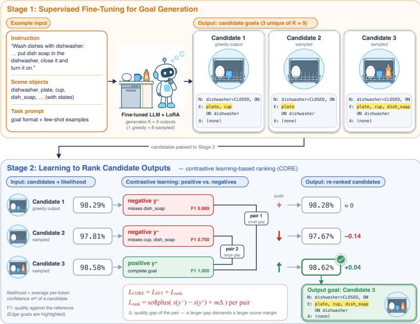
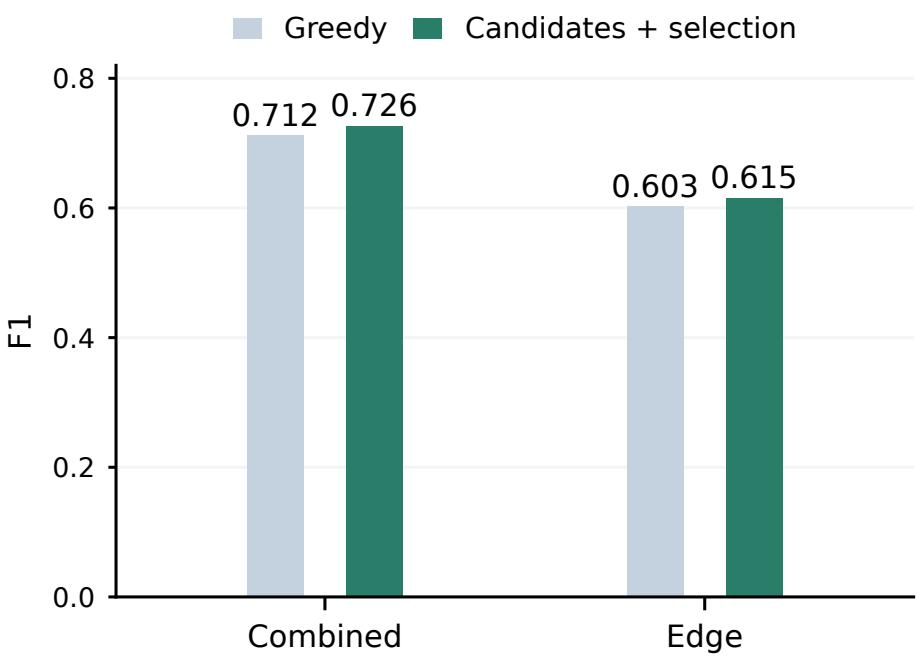

# Generate-then-Rank: Learning Symbolic Goal Interpretation for Embodied Agents

Jisen Lei and Huizhi Liang

School of Computing, Newcastle University, Newcastle upon Tyne, United Kingdom leijisena@gmail.com

Abstract. Goal interpretation is to translate a natural language instruction into a formal symbolic goal that a planner can execute. It is critical for embodied agents because any error here propagates to every downstream planning and action step. Doing it well requires both generating suitable candidates and reliably selecting among them. We present a two-stage generate-then-rank approach to Goal Interpretation in the Embodied Agent Interface (EAI). First, supervised fine-tuning adapts a Large Language Model (LLM) to EAI’s output convention. Second, Candidate-Output Ranking from Errors (CORE) learns preferences over complete outputs from the model’s own generated alternatives. We conducted experiments on the household scenes of the Embodied Agent Interface Benchmark. Multiple open source LLMs including DeepSeek-V3 chat, DeepSeek-Reasoner, and Qwen2.5-7B and Qwen2.5-72B were evaluated. The proposed method outperformed the baseline models including LLMs with simple prompting, chain-ofthought, and knowledge graph based approaches.

Keywords: Embodied AI · Goal interpretation · Large language models · Candidate ranking.

## 1 Introduction

Large language models (LLMs) increasingly connect natural-language instructions to embodied planning and action [1, 12, 16]. Before planning, however, an agent must determine what terminal conditions constitute success. Goal interpretation is to translate a natural language instruction into a formal symbolic goal that a planner can execute. It is critical for embodied agents because any error here propagates to every downstream planning and action step. The Benchmark Embodied Agent Interface (EAI) [5] formalises this goal interpretation task as a mapping from a VirtualHome scene and instruction to object states, directed relations, and terminal actions [5, 7]. An omitted condition, unintended relation, or incompatible predicate argument can make downstream behaviour incomplete or infeasible even when the planner is otherwise correct.

For example, the instruction “wash dishes with dishwasher” in Fig. 1 requires the dishwasher to be CLOSED and ON and the directed relations ON(plate, dishwasher), ON(cup, dishwasher), and ON(dish\_soap, dishwasher). Walking to the kitchen or opening the dishwasher is an intermediate step, not a terminal goal. A goal that omits ON(dish\_soap, dishwasher) is still well formed, yet it is incomplete. A relation is also directed: ON(plate, dishwasher) is correct, whereas ON(dishwasher, plate) is wrong. Well-formed output alone therefore does not ensure correct goal interpretation.

Direct generation provides a useful baseline [5], but the single output a model returns is not necessarily the best goal it can generate: sampling several outputs can yield a more complete goal. Task-specific supervised fine-tuning (SFT) can adapt an LLM to the required output format and sparse terminal-goal convention [8, 4]. SFT alone, however, optimises reference-token likelihood rather than an explicit preference between complete candidate goals. Sequence-level ranking has addressed related mismatches in text generation [6, 17]. Our candidate analysis motivates studying this mismatch for symbolic goal interpretation: a better goal may already be generated but remain unselected.

Our approach comprises two learned stages, shown in Fig. 1. Stage 1 is supervised fine-tuning for goal generation: it takes the scene and instruction and produces several complete candidate goals. Stage 2 is learning to rank candidate outputs, which we call Candidate-Output Ranking from Errors (CORE): it takes the input and its candidate pool, assigns every candidate a sequence score, and outputs the highest-scoring goal. CORE is learned rather than rule-based. During training it compares the model’s own better and worse candidates and adjusts the scorer so that higher-quality complete Node–Edge– Action outputs receive higher scores, while a supervised anchor retains the reference target. Its contribution is the application of error-derived candidate ranking to symbolic goals, rather than a claim to invent supervised or preference learning.

Our main contributions are as follows: (i) a two-stage generate-then-rank approach that combines generation and ranking to improve goal interpretation with large language models; (ii) a training procedure that first applies supervised fine-tuning and then learns to rank candidates from the model’s own errors with a contrastive objective; and (iii) experiments on the household scenes of the Embodied Agent Interface benchmark, comparing several LLMs and baselines that include supervised fine-tuning, candidatelevel preference optimisation, and knowledge-graph-based methods.

## 2 Related Work

Embodied-language systems ground instructions in afordances, generate action programs, and interleave reasoning with interaction [1, 12, 16]. EAI instead isolates four interfaces: goal interpretation, subgoal decomposition, action sequencing, and transition modelling [5]. Goal interpretation predicts sparse terminal Node, Edge, and Action records rather than a trajectory. This distinction makes plausible intermediate actions false positives and requires exact relation direction, cardinality, and stopping.

Autoregressive likelihood scores token sequences, whereas EAI evaluates the parsed final set. Candidate-ranking methods such as BRIO and SLiC-HF calibrate complete outputs with preference and supervised signals [6, 17]; DPO learns preferences relative to a frozen reference policy [9]. Cal-DPO additionally calibrates implicit reward magnitudes [14]; CORE instead uses reference-derived quality gaps to scale pairwise margins. CORE applies this sequence-level perspective to complete symbolic goals, using realised model errors and an SFT anchor. Related planning research also shows the value of structured environmental evidence [10, 15]; we therefore include knowledge-graphbased comparators in our experiments. EAI itself evaluates LLMs by direct generation [5]; ranking among complete candidate goals is not part of that protocol, which is the gap our second stage addresses.

Sampling and self-consistency ofer another way to use multiple model outputs [13]; our selector instead scores deduplicated, complete symbolic candidates. Constrained decoding, exemplified by PICARD, checks admissibility during generation [11]. DOMINO aligns formal constraints with subword tokenisation [2]. Neither Cal-DPO nor these decoding methods is reproduced here.

## 3 Method

Figure 1 gives an overview of our generate-then-rank method: Stage 1 fine-tunes a generator that produces complete candidate goals, and Stage 2 learns to rank those candidates and selects one. We first define the task and then describe each stage.

## 3.1 Problem Formulation

For item �, let $x _ { i } = \langle s _ { 0 , i } , l _ { g , i } \rangle$ contain the initial scene $s _ { 0 , i }$ and language instruction $l _ { g , i }$ Goal interpretation maps this input to a complete symbolic goal

$$
G ( x _ { i } ) \to g _ { i } , \qquad g _ { i } = ( N _ { i } , E _ { i } , A _ { i } ) ,\tag{1}
$$

where $N _ { i }$ is the set of target object states, $E _ { i }$ is the set of directed target relations, and $A _ { i }$ is the set of terminal task actions. These sets specify success conditions rather than an execution trace. A model produces a goal as a token sequence $y ; y _ { i } ^ { * }$ denotes the sequence of the reference goal of item $i .$

For the record shown in $\mathrm { F i g . 1 }$ , the reference goal is

$$
\begin{array} { r l } & { N _ { i } = \{ ( \mathrm { d i s h w a s h e r } , \mathrm { C L O S E D } ) , ( \mathrm { d i s h w a s h e r } , 0 \mathrm { N } ) \} , } \\ & { E _ { i } = \{ ( \mathrm { p } \mathrm { 1 } \mathrm { a t e } , 0 \mathrm { N } , \mathrm { d i s h w a s h e r } ) , ( \mathrm { c u p } , 0 \mathrm { N } , \mathrm { d i } \mathrm { s h w a s h e r } ) , } \\ & { ( \mathrm { d i s h } _ { - } \mathrm { s o a p } , 0 \mathrm { N } , \mathrm { d i } \mathrm { s h w a s h e r } ) \} , } \\ & { A _ { i } = \emptyset . } \end{array}
$$

$N _ { i }$ records an object’s terminal states and $E _ { i }$ records directed source–relation–target triples. $A _ { i }$ is empty because this goal requires no action beyond what states and relations express; other goals do, for instance a required SLEEP action. The goal is thus a graph with three parts: node goals, edge goals, and action goals. Components may be empty when the reference goal does not require them; an action list is not a full plan.

## 3.2 Stage 1: Supervised Fine-Tuning for Goal Generation

The generator is a pretrained LLM with LoRA adapters [4] on its attention and MLP projections. For input $x _ { i }$ and reference sequence $y _ { i } ^ { * } = ( y _ { i , 1 } ^ { * } , \ldots , y _ { i , | y _ { i } ^ { * } | } ^ { * } )$ , prompt, system, and padding tokens are masked and the supervised fine-tuning (SFT) objective is

$$
\mathcal { L } _ { \mathrm { S F T } , i } = - \frac { 1 } { | y _ { i } ^ { * } | } \sum _ { t = 1 } ^ { | y _ { i } ^ { * } | } \log p _ { \theta } ( y _ { i , t } ^ { * } \mid x _ { i } , y _ { i , < t } ^ { * } ) ,\tag{2}
$$

  
Fig. 1. Our two-stage generate-then-rank approach on an example record. Stage 1: given the instruction, scene objects, and task prompt, the fine-tuned LLM generates $K \ : = \ : 9$ outputs, of which three are unique candidate goals; each is drawn as the dishwasher contents it specifies and written as node (N), edge (E), and action (A) goals. Stage 2: the candidates and their likelihoods are the input. Contrastive learning pairs the positive, the best candidate, with each negative, a lower-quality candidate; the ranking loss raises the positive’s score and lowers the negatives’, more strongly for the pair with the larger quality gap. The output is the candidate with the highest likelihood after training. Likelihood is the average per-token probability; changes are in percentage points.

where the mean is over unmasked assistant tokens, $p _ { \theta }$ is the next-token distribution of the model with trainable parameters $\boldsymbol { \theta } , y _ { i , t } ^ { * }$ is the reference token at position �, and $y _ { i , < t } ^ { * }$ is its prefix. Greedy decoding provides the SFT baseline. The supervision teaches both the output format and the EAI convention governing goal presence, cardinality, omission, and stopping. For a goal such as the one in Fig. 1, the reference goal contains two node records (name=dishwasher with state=CLOSED and state=ON), three edge records ofthe form from\_name=plate, relation=ON, to\_name=dishwasher, and an empty action list. For training records, these reference tokens form the SFT target. The implementation uses a causal language model and autoregressive generation: it predicts successive tokens until a complete output is produced. It is structured generation, not a single fixed-label classification, despite the prompt restricting available objects and predicates.

Table 1. Notation used in the generation and ranking objectives.
<table><tr><td>Symbol</td><td>Meaning</td></tr><tr><td> $x _ { i } = \langle s _ { 0 , i } , l _ { g , i } \rangle$ </td><td>input of item i: initial scene and instruction</td></tr><tr><td> $g _ { i } = ( N _ { i } , E _ { i } , A _ { i } )$ </td><td>symbolic goal with node, edge, and action goals</td></tr><tr><td> $y , y _ { t } , y _ { < t }$ </td><td>output token sequence, its token  $t ,$  and the preceding tokens</td></tr><tr><td> $y _ { i } ^ { * }$ </td><td>token sequence of the reference goal</td></tr><tr><td> $\theta , p _ { \theta }$ </td><td>trainable LoRA parameters and the model&#x27;s next-token distribution</td></tr><tr><td> $K , C _ { i } , M _ { i }$ </td><td>number of generated outputs, candidate pool, and number of unique candidates</td></tr><tr><td> $s _ { \theta } ( y \mid x _ { i } )$ </td><td>length-normalised sequence score of candidate y</td></tr><tr><td> $\hat { y } _ { i }$ </td><td>selected candidate</td></tr><tr><td> $y _ { i } ^ { + } , y ^ { - } , \mathcal { P } _ { i } ^ { - }$ </td><td>positive (best) candidate, a negative (lower-quality) candidate, and the set of negatives</td></tr><tr><td> $F _ { 1 } ^ { k } , F _ { 1 } ^ { \mathrm { a l l } }$ </td><td>F1 of component  $k \in \{ N , E , A \}$  and Combined F1</td></tr><tr><td> $U _ { i } ( y ) , \Delta _ { i , y ^ { - } }$ </td><td>utility of candidate  $y$  and quality gap of a pair</td></tr><tr><td> $d _ { i , y ^ { - } } , \delta _ { i , y ^ { - } }$ </td><td>score difference and scaled margin of a pair</td></tr><tr><td> $\mathcal { L } _ { \mathrm { S F T } } , \mathcal { L } _ { \mathrm { r a n k } } , \mathcal { L } _ { \mathrm { C O R E } }$ </td><td>supervised, ranking, and combined losses</td></tr><tr><td> $\alpha , \gamma , m$ </td><td>SFT weight, ranking weight, and margin scale</td></tr><tr><td> $Q _ { i } ( y )$ </td><td>reference-based quality used by the candidate oracle</td></tr><tr><td> $\beta$ </td><td>DPO temperature</td></tr></table>

## 3.3 Stage 2: Learning to Rank Candidate Outputs

Why rank candidates Greedy decoding takes the most probable token at every step. Each choice is locally best, but the resulting complete goal is not necessarily the best goal the model can produce: one early token, such as the source of an Edge, fixes the rest of the output. Sampling several complete outputs exposes alternatives, and our candidate analysis (Section 5) finds items whose pool contains a better goal than the one selected. Stage 1, however, is trained only to reproduce reference tokens; nothing teaches it to score a better complete candidate above a worse one. Stage 2 therefore adds a learning-to-rank step. Unlike a fixed scoring rule, its ranking function is optimised from data.

Input, output, and components As shown in the Stage 2 part of Fig. 1, the input is $x _ { i }$ together with its candidate pool, and the output is one selected complete goal $\hat { y } _ { i }$ The only component is a scorer: the Stage 1 model, whose LoRA parameters continue to be trained. No separate ranking network or classification head is added. Training changes the scorer with the CORE loss below; inference applies the trained scorer to each candidate and returns the highest-scoring one without reading any reference.

Candidate pool and sequence score For each input $x _ { i } ,$ a fixed task-adapted generation checkpoint produces $K = 9$ outputs: one greedy completion and two groups of four sampled completions. Exact duplicate strings are removed, yielding candidate pool $C _ { i }$ with $1 \leq M _ { i } \leq K$ unique complete Node–Edge–Action goals. Deduplication occurs before scoring, so repeated samples have no voting advantage.

Teacher forcing assigns candidate $y \in C _ { i }$ the length-normalised score

$$
s _ { \theta } ( y \mid x _ { i } ) = { \frac { 1 } { | y | } } \sum _ { t = 1 } ^ { | y | } \log p _ { \theta } ( y _ { t } \mid x _ { i } , y _ { < t } ) .\tag{3}
$$

The likelihood selector returns $\hat { y } _ { i } = \arg \operatorname* { m a x } _ { y \in C _ { i } } s _ { \theta } ( y \mid x _ { i } )$ . Division by token length |�| reduces automatic preference for shorter serialisations. At inference, this rule compares complete graphs rather than individual Edge tokens. During CORE training, the same diferentiable score is recomputed under the current trainable model; its parameters are not frozen. Length normalisation does not make scores invariant to key order, whitespace, or other semantically equivalent serialisations. We score the archived strings without semantic-field masking; format robustness is not established.

Learningfrom candidate errors CORE is a contrastive, pairwise learning-to-rank objective: it learns from quality contrasts observed within model-generated candidate pools. For item �, the positive $y _ { i } ^ { + }$ is its highest-utility candidate and the negatives $\mathcal { P } _ { i } ^ { - }$ are the candidates with lower utility. Utility combines canonical Combined F1 with a 0.250- weighted Edge F1 term. CORE retains an SFT anchor on the reference output. For readability, define the score diference and positive pair margin as

$$
\begin{array} { r l } & { d _ { i , y ^ { - } } = s _ { \theta } ( y ^ { - } \mid x _ { i } ) - s _ { \theta } ( y _ { i } ^ { + } \mid x _ { i } ) , } \\ & { \delta _ { i , y ^ { - } } = m \times \Delta _ { i , y ^ { - } } . } \end{array}\tag{4}
$$

The ranking loss and the complete CORE loss are

$$
\begin{array} { r l } & { \mathcal { L } _ { \mathrm { r a n k } , i } = \displaystyle \frac { 1 } { | \mathcal { P } _ { i } ^ { - } | } \sum _ { y ^ { - } \in \mathcal { P } _ { i } ^ { - } } \mathrm { s o f t p l u s } ( d _ { i , y ^ { - } } + \delta _ { i , y ^ { - } } ) , } \\ & { \mathcal { L } _ { \mathrm { C O R E } , i } = \alpha \mathcal { L } _ { \mathrm { S F T } , i } + \gamma \mathcal { L } _ { \mathrm { r a n k } , i } , } \end{array}\tag{5}
$$

with the reference-derived quality gap

$$
\begin{array} { r l } & { \Delta _ { i , y ^ { - } } = \operatorname* { m a x } \{ 0 . 0 1 , U _ { i } ( y _ { i } ^ { + } ) - U _ { i } ( y ^ { - } ) \} , } \\ & { U _ { i } ( y ) = F _ { 1 , i } ^ { \mathrm { a l l } } ( y ) + 0 . 2 5 F _ { 1 , i } ^ { E } ( y ) , } \end{array}\tag{6}
$$

where $F _ { 1 , i } ^ { \mathrm { a l l } } ( y )$ and $F _ { 1 , i } ^ { E } ( y )$ are the Combined and Edge F1 of candidate � against the reference of item � (Equation 7). Here $m = 0 . 1 0$ multiplies the quality gap; it is neither subtracted from the gap nor added as a separate constant. Thus the smallest pair margin is $0 . 1 0 \times 0 . 0 1 = 0 . 0 0 1$ . Minimising the loss favours a larger preferred-minus-rejected score diference. Gradients update both candidate scores; utilities and gaps remain fixed. This best-versus-lower-quality pairwise objective does not model a listwise permutation probability. The SFT term preserves reference supervision while the ranking term favours higher-quality complete goals. When no lower-utility candidate exists, the ranking term is zero. Parameter settings and the training-only search protocol are reported below.

Table 2. The 342-item EAI goal interpretation corpus and task-grouped 274/68 split.
<table><tr><td>Split</td><td>Task family</td><td>Items</td></tr><tr><td>Public corpus</td><td>All 26 task families</td><td>342</td></tr><tr><td>Training</td><td>21 task families</td><td>274</td></tr><tr><td>Diagnostic</td><td>Change TV channel</td><td>3</td></tr><tr><td>Diagnostic</td><td>Drink</td><td>23</td></tr><tr><td>Diagnostic</td><td>Listen to music</td><td>19</td></tr><tr><td>Diagnostic</td><td>Wash dishes by hand</td><td>10</td></tr><tr><td>Diagnostic</td><td>Wash dishes with dishwasher</td><td>13</td></tr><tr><td>Diagnostic total 5 task families</td><td></td><td>68</td></tr></table>

Worked example Figure 1 follows diagnostic record 783\_1 through both stages. Its pool contains three unique candidates, which difer only in their edge goals. Candidate 1, the greedy output, omits the dish\_soap relation (Combined F1 0.889, Edge F1 0.800); Candidate 2 also omits cup (0.750, 0.500); Candidate 3 matches the reference (1.000, 1.000). Before CORE, the sequence scores are −0.0173, −0.0221, and −0.0143, so likelihood selection already returns the complete goal that greedy decoding misses. After CORE training the scores are −0.0173, −0.0236, and −0.0139: the weakest candidate falls, the complete one rises, and the selection is unchanged. As average per-token probabilities exp(��), the form shown in the figure, these scores are 98.29%, 97.81%, and 98.58% before and 98.28%, 97.67%, and 98.62% after. CORE reranks the same archived candidates; it does not regenerate them. One record illustrates the mechanism only; Table 4 gives the 68-record scores, where the Edge component is lowest throughout. No reference is read at inference; F1 is computed afterwards. During training the same construction is applied to training records only: candidates are model-generated, scored against training references, and paired when their quality difers. The ranking term raises the preferred candidate’s relative sequence score while the SFT term retains the reference target. CORE thus ranks complete candidates and selects one, rather than classifying the input into a fixed set of task labels.

## 4 Experiments

## 4.1 Dataset and Split

The study uses the 342 public Goal Interpretation records from EAI [5], whose household scenes derive from VirtualHome [7]. Each record contains an instruction, the relevant scene and schema, and a sparse reference goal with Node states, directed Edge relations, and terminal Actions. The target represents success conditions, not an action sequence. Prompts and reference semantics are retained unchanged; identifier, parsing, duplication, and split-conservation checks verify the materialised corpus.

Task families are grouped before splitting. Twenty-one families (274 records) form the adaptation set; five families (68 records) form the diagnostic set. Table 2 reports their composition.

There is no identifier, task-name, or exact-target overlap. Because the 68 records were repeatedly inspected, they are treated as a task-disjoint diagnostic rather than an untouched test set. Large-model reproduction uses all 342 records, whereas adaptation and learned ranking use the 274/68 split.

## 4.2 Parameter Settings

SFT adapts Qwen2.5–7B-Instruct [8] with LoRA for three epochs, learning rate $2 \times 1 0 ^ { - 4 }$ and seed 42; only assistant tokens contribute to the loss. Candidate texts and referencederived training utilities are fixed before preference training; model likelihood scores are recomputed and updated. CORE continues SFT for one epoch with learning rate $1 0 ^ { - 5 }$ gradient accumulation eight, $\alpha = \gamma = 1 . 0 0 0$ , and $m = 0 . 1 0 0$ , producing 73 comparisons and 35 updates. DPO uses 41 aligned pairs, one epoch, learning rate $5 \times 1 0 ^ { - 6 } , \beta = 0 . 1 0 0$ and the same diagnostic exclusion.

The archived search configuration specifies task-grouped five-fold search within the 274 adaptation records, with $\gamma \in \{ 0 . 0 3 , 0 . 1 0 , 0 . 3 0 , 1 . 0 0 \}$ and � $\in \{ 0 , 0 . 0 5 , 0 . 1 0 , 0 . 2 0 \}$ in a staged search. The final run verifies $\gamma = 1$ and $m = 0 . 1 0 ;$ detailed fold scores are not available in the retained archive, so we do not claim a measured sensitivity curve. The anchor weight $\alpha = 1$ , Edge utility weight 0.25, and gap floor 0.01 are fixed design choices, not independently validated optima. The Edge term prioritises relational errors; the floor supplies a minimum positive quality gap.

The fixed diagnostic bank was generated by an earlier ranking continuation (rank weight 0.10), not the pure SFT checkpoint. It uses one greedy output and four samples at each of two temperature and top-� settings, (0.65, 0.90) and (0.90, 0.95), with a 2048- token limit and exact-string deduplication. CORE reranks this same archived bank. This controls candidate availability for that reranking contrast, but does not isolate the source of the bank or end-to-end training efects against greedy SFT. Our inference ablation keeps the earlier checkpoint fixed. A shared bank from the exact SFT parent would be needed for a matched selector study; separate banks per selector would instead measure complete generation-and-selection pipelines.

## 4.3 Evaluation Metrics

For component $k \in \{ N , E , A \}$ (Node, Edge, Action), the released EAI evaluator accumulates true positives $T P _ { k }$ , false positives $F P _ { k }$ , and false negatives $F N _ { k }$

$$
\begin{array} { r l } & { F _ { 1 } ^ { k } = \frac { 2 T P _ { k } } { 2 T P _ { k } + F P _ { k } + F N _ { k } } , } \\ & { F _ { 1 } ^ { \mathrm { a l l } } = \frac { 2 \sum _ { k } T P _ { k } } { 2 \sum _ { k } T P _ { k } + \sum _ { k } F P _ { k } + \sum _ { k } F N _ { k } } . } \end{array}\tag{7}
$$

Thus Combined F1, $F _ { 1 } ^ { \mathrm { a l l } }$ , is a micro-aggregation of counts, not the arithmetic mean of the three component F1 values.

Predictions must parse and contain 68 unique aligned identifiers. The oficial EAI evaluator reports Node, Edge, Action, and micro-aggregated Combined F1 as defined in Equation 7. Candidate-oracle quality and selection changes diagnose why the final

F1 changes. All headline open-model results use the unmodified original evaluator; the separately labelled large-model reproduction uses its no-closure protocol.

Split, model revision, predictions, candidate banks, scores, and preference pairs are hash-recorded. Diagnostic gold is used only after inference for oficial scoring, oracle analysis, and error classification; it is unavailable to deployed selection. Scores with diferent evaluation scopes are not treated as controlled comparisons. The study reports one optimisation/sampling seed (42), distinct from the fixed task-family split, and therefore makes no confidence-interval or significance claim; failed and gate-stopped experiments remain part of the audit trail.

## 4.4 Comparison Methods

We report DeepSeek-V3 Chat [3], a directly prompted LLM, and DeepSeek-Reasoner, which reasons step by step before answering, as full-corpus, no-closure reproductions. Archived raw Qwen2.5–7B and 72B inference results provide an additional modelfamily reference under the original EAI protocol. These models are evaluated without additional training; their 342-item scope difers from the adapted-model diagnostic.

The 68-item configuration comparison contains greedy SFT, length-normalised likelihood ranking with the earlier ranking-trained checkpoint, candidate-level DPO, and our SFT+CORE approach. All use the same diagnostic identifiers and original EAI evaluator. BRIO and SLiC-HF motivate sequence-level ranking but are not additional reproduced baselines [6, 17].

KG-based comparators We include two distinct knowledge-based routes. The unadapted Qwen2.5–7B KG-prompt arm prepends scene-relevant schema hints (object states, relation constraints and implications) to the task prompt, without SFT or CORE. We score its archived raw response, without the older pipeline’s deductive closure or refinement, to isolate this prompt-only configuration. The Euclidean and hyperbolic KG arms instead combine standard SFT with projected KG prefix representations, without CORE ranking. Their archived runs use the same 274/68 task split, three epochs, learning rate $2 \times 1 0 ^ { - 4 }$ and seed 42. They are KG-enhanced language models, not standalone symbolic KG solvers. We re-evaluate all archived outputs on the same 68 identifiers using the current original-EAI resources; re-evaluation reproduces the SFT baseline. These are configuration comparisons with difering training and inference procedures, not isolated causal estimates of KG utility.

Candidate-level DPO The validated preference-learning arm uses model-generated, candidate-level pairs but optimises Direct Preference Optimisation (DPO) [9]. It also trains on positive–negative pairs $( y _ { i } ^ { + } , y _ { i } ^ { - } )$ , but builds them diferently from CORE: the frozen parent output is the negative ${ y } _ { i } ^ { - }$ , and a complete candidate is taken as the positive $y _ { i } ^ { + }$ only when it has higher canonical Combined F1 and its Edge F1 is no more than 0.050 below that of $\left. y _ { i } ^ { - } \right.$ . This conservative rule yields 41 pairs from the 274 training records. DPO increases the preferred response’s log-probability relative to the rejected response and a frozen reference policy [9]; scores cover all assistant tokens. Settings are listed above. The fixed diagnostic is excluded from pair construction and model selection. Because DPO and CORE use 41 and 73 comparisons respectively and diferent learning rates, their comparison does not isolate objective choice alone.

Table 3. Contextual model results on 342 items. NC: no-closure protocol; Orig.: original EAI. Rows with diferent protocols are not controlled comparisons.
<table><tr><td>Model</td><td>Protocol</td><td>Comb.</td><td>Node</td><td>Edge</td><td>Action</td></tr><tr><td>DeepSeek-V3 Chat</td><td>NC</td><td>0.318</td><td>0.394</td><td>0.318</td><td>0.233</td></tr><tr><td>DeepSeek-Reasoner</td><td>NC</td><td>0.434</td><td>0.429</td><td>0.526</td><td>0.345</td></tr><tr><td>Qwen2.5-7B</td><td>Orig.</td><td>0.243</td><td>0.372</td><td>0.238</td><td>0.141</td></tr><tr><td>Qwen2.5-72B</td><td>Orig.</td><td>0.293</td><td>0.387</td><td>0.308</td><td>0.198</td></tr></table>

Table 4. Configuration comparison on the same 68-item diagnostic, original EAI F1. Training conditions difer; this is not a loss-only ablation. Bold marks the best value in each column, including ties.
<table><tr><td>Method</td><td>Combined</td><td>Node</td><td>Edge</td><td>Action</td></tr><tr><td>SFT baseline (greedy)</td><td>0.716</td><td>0.880</td><td>0.606</td><td>0.628</td></tr><tr><td>Earlier ranker + selection</td><td>0.726</td><td>0.887</td><td>0.615</td><td>0.653</td></tr><tr><td>Candidate-level DPO</td><td>0.735</td><td>0.887</td><td>0.613</td><td>0.681</td></tr><tr><td>SFT + CORE (ours)</td><td>0.736</td><td>0.887</td><td>0.642</td><td>0.653</td></tr></table>

Candidate oracle After inference, a candidate oracle uses the reference-based quality $Q _ { i } ( y )$ of each candidate (Combined F1, with ties broken by Edge F1) and selects

$$
y _ { i } ^ { \mathrm { o r a c l e } } = \arg \operatorname* { m a x } _ { y \in C _ { i } } Q _ { i } ( y ) .\tag{8}
$$

It is not deployable; it measures candidate headroom and separates generation from selection failures.

## 5 Results and Discussion

## 5.1 Large-Model and Adapted-Qwen Results

The reasoning-specialised model improves the unassisted score from 0.318 to 0.434. Additional reasoning therefore helps, but does not by itself solve EAI’s sparse symbolic representation problem. Since model scale, training data, and reasoning procedure are confounded, this is not a causal scaling claim.

Table 3 reports full-corpus model results separately from the adapted-model comparison. Raw Qwen2.5–72B obtains 0.293 Combined F1 in the archived original-EAI evaluation, providing a second model family alongside DeepSeek. Diferent evaluation protocols prevent a controlled cross-family ranking. Likewise, raw full-corpus and adapted diagnostic scores do not quantify a matched SFT efect.

Table 4 compares adapted models on the same 68-item diagnostic. CORE improves Combined F1 by 0.020 and Edge F1 by 0.035 over greedy SFT. Its 0.001 Combined advantage over DPO is descriptive; one seed and a repeatedly inspected diagnostic do not support a significance claim. DPO remains strongest on Action F1.

Table 5. KG-based configuration comparison on the same 68 items, original EAI F1. Archived raw outputs re-evaluated; training and inference procedures difer.
<table><tr><td>Configuration</td><td>Comb.</td><td>Node</td><td>Edge</td><td>Action</td></tr><tr><td>Qwen7B, unadapted</td><td>0.258</td><td>0.328</td><td>0.173</td><td>0.253</td></tr><tr><td>Qwen7B + KG prompt</td><td>0.199</td><td>0.237</td><td>0.143</td><td>0.217</td></tr><tr><td>SFT, no KG</td><td>0.716</td><td>0.880</td><td>0.606</td><td>0.628</td></tr><tr><td>SFT + Euclidean KG</td><td>0.616</td><td>0.885</td><td>0.338</td><td>0.589</td></tr><tr><td>SFT + hyperbolic KG</td><td>0.627</td><td>0.880</td><td>0.468</td><td>0.430</td></tr><tr><td>SFT + CORE (ours)</td><td>0.736</td><td>0.887</td><td>0.642</td><td>0.653</td></tr></table>

## 5.2 Comparison with KG-Based Methods

Table 5 compares the archived KG configurations under one diagnostic/evaluator scope. KG prompting scores below its unadapted baseline, while both KG-prefix SFT arms score below plain SFT. CORE has the highest Combined and Edge F1 among these configurations. This result concerns the implemented knowledge interfaces and does not establish that KGs are inefective in general. In particular, unadapted prompting and trained ranking use diferent supervision budgets.

## 5.3 Candidate Selection Analysis

For the earlier ranking-trained checkpoint, length-normalised sequence ranking changes 12/68 greedy selections and raises all four components. Candidate sets contain 1–9 unique outputs (mean 3.353). An Edge-level analysis partitions the items into 38 exact selected sets, 11 generation failures with no improved candidate, and 19 recoverable selection failures. A better Edge candidate lies within the sequence-score top three for 16/19, but the selector chooses an improvement in only 6/19. The 0.097 Combined gap between sequence ranking and the gold-selected oracle locates substantial unrealised information in the candidate bank. The non-deployable oracle reaches 0.823 Combined (0.957 Node, 0.752 Edge, 0.692 Action); it is an analysis upper bound, not an experimental method.

The analysis suggests diferent interventions: improve candidate generation when no better goal is available, and improve ranking when it is already present.

## 5.4 Ablation: Candidate-Output Ranking

Figure 2 isolates the inference procedure using the same earlier ranking-trained checkpoint. Greedy decoding scores 0.712121 Combined and 0.602564 Edge F1; candidate generation plus likelihood selection scores 0.726368 and 0.615385, gains of 0.014247 and 0.012821 respectively. This jointly tests sampling and selection, not ranking-loss training. The earlier checkpoint’s greedy score is below pure SFT (0.716113 Combined), so extra ranking training alone cannot be credited with the inference gain. A matched extra-SFT control and independent anchor/margin ablations remain unperformed; the final CORE comparison does not substitute for these controls.

  
Absolute gain: Combined +0.0142; Edge +0.0128  
Fig. 2. Matched inference ablation on the 68-item diagnostic. Both variants use the same earlier ranking-trained checkpoint (weight 0.10). The F1 axis is linear and starts at zero. Bar labels report the actual F1 scores; absolute gains are 0.014247 Combined and 0.012821 Edge F1.

CORE combines an SFT anchor with candidate-level contrastive ranking. The final run uses rank weight 1.000 and margin 0.100; the final 274-record run forms 73 candidate comparisons. CORE reaches 0.736 Combined and 0.642 Edge F1, improving every SFT component and exceeding DPO by 0.001 Combined and 0.028 Edge. DPO remains stronger on Action (0.681 versus 0.653). The comparison evaluates the implemented preference-learning configurations; their diferent pair counts and learning rates do not isolate the loss alone.

## 6 Conclusion

We presented a two-stage generate-then-rank approach to goal interpretation for embodied agents: supervised fine-tuning for goal generation, followed by learning to rank candidate outputs with CORE. On the fixed diagnostic, CORE improves Combined and Edge F1 over greedy SFT and the implemented DPO comparator, while DPO retains higher Action F1. The candidate analysis identifies useful goals that generation already supplies but selection misses.

The evidence is limited to one adaptation seed and a repeatedly inspected 68-item diagnostic covering five task families. CORE and DPO also difer in pair construction and optimisation settings, and CORE inference reuses a bank generated by an earlier ranking-trained checkpoint. These comparisons do not establish an isolated causal efect of the CORE loss. The anchor and Edge utility weights lack sensitivity ablations, and serialisation robustness is untested.

The immediate experimental priority is a matched extra-SFT versus CORE continuation from the same parent, holding data, update budget, learning rate, and candidate bank fixed, followed by anchor/Edge-weight ablations. Multiple training seeds can retain the exact task-disjoint 274/68 split; no diagnostic items need enter training. Such runs measure optimisation variability, while fresh held-out families are needed to assess generalisation beyond this repeatedly inspected diagnostic. Listwise ranking and matched constrained decoding remain untested alternatives. Downstream planning success and semantic repair require separate evaluation: symbolic F1 alone cannot establish executability.

Disclosure of Interests. The authors have no competing interests to declare that are relevant to the content of this article.

## References

1. Ahn, M., Brohan, A., Brown, N., et al.: Do as I can, not as I say: Grounding language in robotic afordances. In: Proceedings of the 6th Conference on Robot Learning (CoRL). PMLR, vol. 205 (2022)

2. Beurer-Kellner, L., Fischer, M., Vechev, M.: Guiding LLMs the right way: Fast, non-invasive constrained generation. In: Proceedings of the 41st International Conference on Machine Learning (ICML). PMLR, vol. 235 (2024)

3. DeepSeek-AI: DeepSeek-V3 technical report. arXiv preprint arXiv:2412.19437 (2024)

4. Hu, E.J., Shen, Y., Wallis, P., Allen-Zhu, Z., Li, Y., Wang, S., Wang, L., Chen, W.: LoRA: Low-rank adaptation of large language models. In: International Conference on Learning Representations (ICLR) (2022)

5. Li, M., Zhao, S., Wang, Q., Wang, K., Zhou, Y., Srivastava, S., Gokmen, C., Lee, T., Li, L.E., Zhang, R., et al.: Embodied agent interface: Benchmarking LLMs for embodied decision making. In: Advances in Neural Information Processing Systems (NeurIPS), Datasets and Benchmarks Track. vol. 37 (2024)

6. Liu, Y., Liu, P., Radev, D., Neubig, G.: BRIO: Bringing order to abstractive summarization. In: Proceedings of the 60th Annual Meeting of the Association for Computational Linguistics (ACL). pp. 2890–2903 (2022). https://doi.org/10.18653/v1/2022.acl-long.207

7. Puig, X., Ra, K., Boben, M., Li, J., Wang, T., Fidler, S., Torralba, A.: VirtualHome: Simulating household activities via programs. In: IEEE/CVF Conference on Computer Vision and Pattern Recognition (CVPR). pp. 8494–8502 (2018). https://doi.org/10.1109/CVPR.2018.00886

8. Qwen Team: Qwen2.5 technical report. arXiv preprint arXiv:2412.15115 (2024)

9. Rafailov, R., Sharma, A., Mitchell, E., Ermon, S., Manning, C.D., Finn, C.: Direct preference optimization: Your language model is secretly a reward model. In: Advances in Neural Information Processing Systems (NeurIPS). vol. 36 (2023)

10. Rana, K., Haviland, J., Garg, S., Abou-Chakra, J., Reid, I., Suenderhauf, N.: SayPlan: Grounding large language models using 3D scene graphs for scalable robot task planning. In: Proceedings of the 7th Conference on Robot Learning (CoRL). PMLR, vol. 229 (2023)

11. Scholak, T., Schucher, N., Bahdanau, D.: PICARD: Parsing incrementally for constrained auto-regressive decoding from language models. In: Proceedings of the 2021 Conference on Empirical Methods in Natural Language Processing (EMNLP). pp. 9895–9901 (2021)

12. Shridhar, M., Yuan, X., Côté, M.A., Bisk, Y., Trischler, A., Hausknecht, M.: ALFWorld: Aligning text and embodied environments for interactive learning. In: International Confer ence on Learning Representations (ICLR) (2021)

13. Wang, X., Wei, J., Schuurmans, D., Le, Q., Chi, E., Narang, S., Chowdhery, A., Zhou, D.: Self-consistency improves chain of thought reasoning in language models. In: International Conference on Learning Representations (ICLR) (2023)

14. Xiao, T., Yuan, Y., Zhu, H., Li, M., Honavar, V.G.: Cal-DPO: Calibrated direct preference optimization for language model alignment. In: Advances in Neural Information Processing Systems (NeurIPS). vol. 37 (2024)

15. Xie, Y., Yu, C., Zhu, T., Bai, J., Gong, Z., Soh, H.: Translating natural language to planning goals with large-language models. arXiv preprint arXiv:2302.05128 (2023)

16. Yao, S., Zhao, J., Yu, D., Du, N., Shafran, I., Narasimhan, K., Cao, Y.: ReAct: Synergizing reasoning and acting in language models. In: International Conference on Learning Representations (ICLR) (2023)

17. Zhao, Y., Joshi, R., Liu, T., Khalman, M., Saleh, M., Liu, P.J.: SLiC-HF: Sequence likelihood calibration with human feedback. arXiv preprint arXiv:2305.10425 (2023)