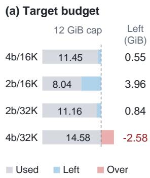
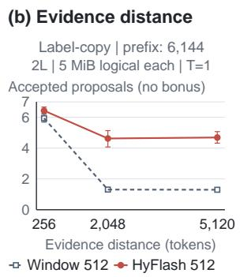
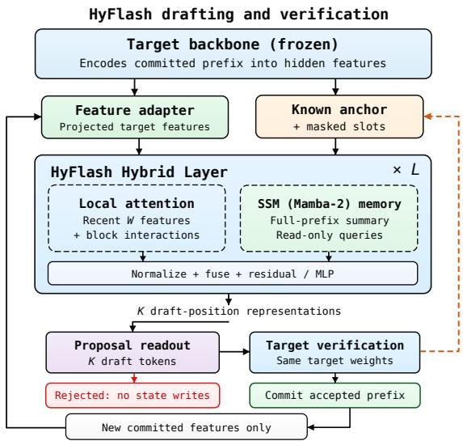
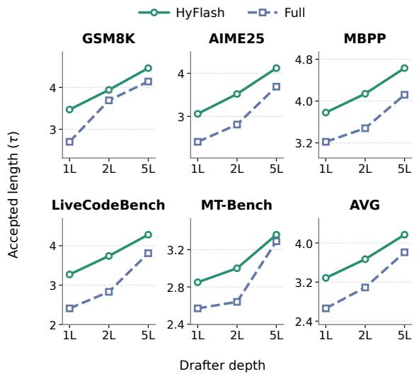
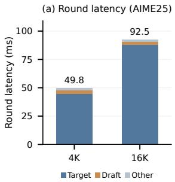
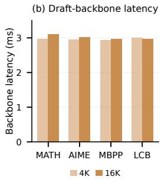

# HyFlash: A Prefix-Memory Prior for On-Device Speculative Decoding

Jongwoo Ko Microsoft Applied Sciences Group jongwooko@microsoft.com

Pashmina Cameron Microsoft Applied Sciences Group pcameron@microsoft.com

## Abstract

Parallel block drafting accelerates speculative decoding by predicting multiple future positions in a single backbone pass, but on-device deployment constrains both drafter capacity and context storage. Under tight memory budgets, drafters must model long-range dependencies and fine-grained draft-position interactions without the growing KV-cache overhead of full-context attention. We propose HyFlash, a compact parallel drafter that introduces a prefix-memory prior to separate long-range context modeling from fine-grained draft-position interactions with limited capacity. Local attention captures recent context and draft-position interactions, while recurrent memory compresses historical target features into fixed-size states. This inductive bias enables effective local and long-range modeling with bounded draft-side memory. Experiments show that HyFlash achieves higher acceptance than full-context attention with substantially less KV storage and with larger gains for shallow drafters and long contexts.

## 1 Introduction

Speculative decoding accelerates autoregressive language model inference by using a lightweight drafter to propose tokens that a larger target model verifies in parallel (Leviathan et al., 2023). Recent parallel block drafters, such as DFlash (Chen et al., 2026) and DSpark (Cheng et al., 2026), further reduce drafting latency by predicting multiple future positions in a single backbone pass. However, maintaining high draft acceptance requires effectively modeling both historical context and interactions among draft positions while keeping drafting overhead small.

This challenge becomes particularly pronounced in on-device deployment (Microsoft, 2024; Apple, 2024; NVIDIA, 2026), where memory is severely constrained (Liu et al., 2024; Xu et al., 2024a). Target weights, KV cache, and runtime overhead leave only a small residual budget for drafter parameters and context storage (Tiwari et al., 2025). Under limited model capacity, jointly modeling long-range dependencies and fine-grained intra-block interactions becomes difficult, even with full-context attention. Moreover, full attention incurs growing KV memory, while windowed attention restricts direct access to distant information (Yang et al., 2026; Yuan et al., 2026). These limitations are especially relevant to long-horizon conversations and tool-using agents.

Existing studies address memory-efficient speculative decoding through different approaches. LongSpec (Yang et al., 2026) bounds draft-side KV memory, while MASW (Yuan et al., 2026) compresses historical KV representations. H-Spec (Jiang et al., 2026) combines recurrent drafting with target-KV reuse, whereas ReaDy (Sun et al., 2026) leverages recurrent states from hybrid target models. These advances motivate a complementary question: how can a capacity-constrained parallel drafter effectively model both local interactions and long-range context without relying on additional depth orfull-context attention?

We propose HyFlash, a compact parallel drafter built around a prefix-memory prior for capacityconstrained drafting. HyFlash maintains persistent memory of committed target features while using local attention for recent context and bidirectional draft-position interactions. Rather than updating recurrent states through speculative positions, HyFlash lets them query a shared, read-only prefix memory. Our contributions are threefold:

• We characterize the capacity–context tension in on-device parallel drafting, highlighting the challenges of modeling long-range dependencies with shallow drafters.

• We introduce a prefix-memory prior that separates historical context modeling from local and intra-block interactions, enabling effective drafting with bounded context memory.

  
Figure 1: Motivation for memory-constrained drafting. (a) Analytical target memory usage under an illustrative 12 GiB inference budget for 16 GB-class devices (Appendix B). (b) Acceptance across evidence distances for independently trained two-layer drafters with equal 5 MiB logical context budgets.

• We demonstrate improved acceptance and decoding efficiency across two target models, with capacity scaling and targeted interventions validating the benefits of this inductive bias under limited model capacity.

## 2 Memory Constraints in On-Device Parallel Drafting

Parallel block drafters must accommodate their weights and context alongside the target model. On-device memory constraints therefore limit both drafter capacity and access to historical context.

Memory pressure constrains capacity. Ondevice speculative decoding must accommodate target weights, KV cache, and runtime overhead before allocating memory to the drafter. We consider an illustrative 12 GiB inference budget for 16 GB-class devices, reserving approximately 2.9 GiB for the operating system and other workloads (Appendix B). Using Phi-4-reasoning (Abdin et al., 2025) as a geometry reference for our 14B-family prototype, the target KV cache alone requires 6.25 GiB at 32K context. Even with ideal 2-bit target weights, at most 0.84 GiB remains for the drafter and other inference overheads (Figure 1a). Such tight budgets severely restrict drafter capacity, motivating architectures that make effective use of only a few layers.

Limited capacity challenges context modeling. Parallel drafting requires modeling both long-range dependencies and fine-grained interactions among draft positions, which becomes challenging under limited model capacity. Even with full-context attention, a compact drafter may struggle to effectively utilize historical information, while retaining the full KV cache incurs substantial memory overhead. Windowed attention reduces this cost but limits direct access to distant information, leading to substantial acceptance degradation as shown in Figure 1b. These observations highlight two complementary limitations: windowed attention restricts access to distant information, while full-context attention incurs growing memory costs without necessarily overcoming the modeling limitations of shallow drafters. These challenges motivate a prefix-memory prior that combines recurrent modeling of historical context with local attention for recent and intra-block interactions.

  
Figure 2: HyFlash framework. Target-conditioned hybrid layers produce representations for a separate proposal readout. The same target verifies proposals and returns the next anchor; only newly committed target features update memory.

## 3 HyFlash

We propose HyFlash, a compact parallel drafter combining local attention and recurrent memory within each layer to efficiently capture local interactions and long-range context with limited capacity.

Drafting from a committed prefix. At boundary a, the target has processed $x _ { < a }$ and selected a known anchor $x _ { a } ,$ whose feature is not yet available. An adapter projects selected target hidden layers into $z _ { i } , i < a .$ Given these features, the anchor, and masked future positions, a single backbone pass produces representations for K draft positions, which can be used with different proposal generation strategies.

Table 1: Decoding speedup over autoregressive decoding and average acceptance length (τ) across math, code, and chat benchmarks on Qwen3-4B and Phi-4-reasoning (14B). Both targets use thinking mode, with a maximum generation length of 4,096 tokens.
<table><tr><td rowspan="3"></td><td rowspan="3">Target Drafter</td><td colspan="6">Math</td><td colspan="6">Code</td><td colspan="2">Chat</td><td colspan="2"></td></tr><tr><td colspan="2">GSM8K</td><td colspan="2">MATH-500</td><td colspan="2">AIME25</td><td colspan="2">HumanEval</td><td colspan="2">MBPP</td><td colspan="2">LCB</td><td colspan="2">MT-Bench</td><td colspan="2">Avg.</td></tr><tr><td>Speedup</td><td>T</td><td>Speedup</td><td>T</td><td>Speedup</td><td>T</td><td>Speedup</td><td>T</td><td>Speedup</td><td>T</td><td>Speedup</td><td>T</td><td>Speedup</td><td>T</td><td>Speedup</td><td>T</td></tr><tr><td rowspan="4">Q3-4B DSpark</td><td>DFlash</td><td>1.89</td><td>3.19</td><td>1.80</td><td>3.28</td><td>1.64</td><td>3.12</td><td>1.70</td><td>3.02</td><td>1.63</td><td>2.89</td><td>1.36</td><td>2.75</td><td>1.53</td><td>2.63</td><td>1.64</td><td>2.98</td></tr><tr><td></td><td>2.28</td><td>3.92</td><td>2.11</td><td>4.02</td><td>1.93</td><td>3.82</td><td>2.04</td><td>3.73</td><td>1.91</td><td>3.54</td><td>1.66</td><td>3.46</td><td>1.79</td><td>3.19</td><td>1.95</td><td>3.67</td></tr><tr><td>HyFlash</td><td>2.53</td><td>4.38</td><td>2.30</td><td>4.48</td><td>2.16</td><td>4.38</td><td>2.23</td><td>4.13</td><td>2.08</td><td>3.94</td><td>1.82</td><td>3.83</td><td>1.98</td><td>3.59</td><td>2.15</td><td>4.10</td></tr><tr><td>DFlash</td><td>2.09</td><td>3.13</td><td>2.38</td><td>3.58</td><td>2.04</td><td>3.10</td><td>2.21</td><td>3.26</td><td>2.20</td><td>3.17</td><td>1.75</td><td>2.78</td><td>1.62</td><td>2.28</td><td>2.03</td><td>3.04</td></tr><tr><td rowspan="4">P4-14B</td><td>DSpark</td><td>2.39</td><td>3.48</td><td>2.51</td><td>3.79</td><td>2.14</td><td>3.29</td><td>2.47</td><td>3.53</td><td>2.30</td><td>3.33</td><td>2.01</td><td>3.02</td><td>1.84</td><td>2.50</td><td>2.22</td><td>3.28</td></tr><tr><td>+ SWA</td><td>2.26</td><td>3.34</td><td>2.45</td><td>3.64</td><td>2.05</td><td>3.15</td><td>2.31</td><td>3.41</td><td>2.24</td><td>3.26</td><td>1.75</td><td>2.79</td><td>1.70</td><td>2.45</td><td>2.09</td><td>3.15</td></tr><tr><td>HyFlash</td><td>2.80</td><td>4.02</td><td>2.87</td><td>4.21</td><td>2.52</td><td>3.78</td><td>2.78</td><td>4.06</td><td>2.95</td><td>4.12</td><td>2.18</td><td>3.36</td><td>2.13</td><td>3.01</td><td>2.58</td><td>3.79</td></tr></table>

Intra-layer hybrid attention. Each layer implements the prefix-memory prior by combining sliding-window attention (SWA) for recent and draft-position interactions with recurrent memory that compresses historical target features. Unlike conventional hybrid sequence modeling (Dong et al., 2025), HyFlash explicitly separates committed history from speculative positions: recurrent states are updated only from committed target features and remain read-only during parallel drafting. We instantiate the recurrent memory with Mamba-2 (Dao and Gu, 2024), whose selective state update follows

$$
\begin{array} { l } { S _ { i } = \alpha _ { i } S _ { i - 1 } + ( \Delta _ { i } v _ { i } ) b _ { i } ^ { \intercal } , } \\ { \alpha _ { i } = \exp ( - \Delta _ { i } \lambda ) , \quad \Delta _ { i } , \lambda > 0 . } \end{array}\tag{1}
$$

Here, $\Delta _ { i }$ is an input-dependent step size, λ is a learned head-specific decay rate, and $v _ { i }$ and $b _ { i }$ are bottleneck projections of committed target features. For each draft representation $u _ { k }$ , the local and recurrent branches retrieve recent and historical context, respectively. We define:

$$
C _ { a } = [ z _ { i } ] _ { i = \operatorname* { m a x } ( 0 , a - W ) } ^ { a - 1 } \parallel U ,
$$

where $U = [ u _ { 1 } , \dotsc , u _ { K } ]$ denotes the draft-block representations. The two branches are computed and fused as

$$
\begin{array} { r l } & { A _ { k } = \mathrm { A t t n } \big ( Q ( u _ { k } ) , K ( C _ { a } ) , V ( C _ { a } ) \big ) , } \\ & { r _ { k } = W _ { \uparrow } \big [ \mathrm { L N } ( S _ { a - 1 } ^ { h } c ( u _ { k } ) ) \big ] _ { h = 1 } ^ { H _ { S } } , } \\ & { g _ { k } = \beta _ { A } \odot \mathrm { R N } ( A _ { k } ) + \beta _ { S } \odot \mathrm { R N } ( r _ { k } ) . } \end{array}\tag{2}
$$

Local attention attends to the last W committed target features and all draft-block positions bidirectionally, while the recurrent branch queries the compressed prefix state without modifying it. Here, c is the shared read-query projection, $W _ { \uparrow }$ projects concatenated head outputs, and $\beta _ { A } , \beta _ { S }$ are learned channel scales. LN and RN denote LayerNorm (Ba et al., 2016) and RMSNorm (Zhang and Sennrich, 2019), respectively.

Persistent prefix memory. Rather than relying solely on recent target features, HyFlash explicitly accumulates committed target features in a persistent recurrent state across drafting rounds. After verification, only newly processed, committed features update the memory, excluding unverified and rejected proposals. Parallel draft positions query this memory without modifying it, preserving historical context without rescanning previous tokens.

Memory footprint. With bounded-window KV storage, HyFlash maintains a constant-size logical context footprint as the prefix grows. In our Phi-4- family configuration, local KV and FP32 recurrent states each require 2.5 MiB, together matching the 5 MiB logical context budget of a two-layer windowed drafter. This enables long-range context modeling without increasing drafter depth or the total logical context footprint. These estimates exclude model weights, target KV, and temporary buffers.

## 4 Experimental Evaluation

## 4.1 Experimental Setup

We evaluate HyFlash on Qwen3-4B (Yang et al., 2025) and Phi-4-reasoning. All drafters have two layers and use a block size of 7 with chain-based drafting. For training, we follow Cheng et al. (2026) and use Open-PerfectBlend, an open-source version of PerfectBlend (Xu et al., 2024b) containing 1.3 million samples. We replace the original responses with those generated by each target model to improve target alignment. Evaluation covers three task categories: Math (GSM8K;

Table 2: Average acceptance length (τ) of Phi-4- reasoning on LongBench across context lengths.
<table><tr><td rowspan="2">Context</td><td colspan="3">HotpotQA</td><td colspan="3">QASPER</td><td colspan="3">GovReport</td></tr><tr><td>Full</td><td>SWA</td><td>Hy.</td><td>Full</td><td>SWA</td><td>Hy.</td><td>Full</td><td>SWA</td><td>Hy.</td></tr><tr><td>2K-4K</td><td>2.78</td><td>2.72</td><td>3.02</td><td>2.61</td><td>2.45</td><td>2.70</td><td>2.43</td><td>1.88</td><td>2.50</td></tr><tr><td>4K-8K</td><td>3.23</td><td>2.57</td><td>3.25</td><td>2.52</td><td>2.31</td><td>2.64</td><td>2.50</td><td>1.66</td><td>2.61</td></tr><tr><td>8K-16K</td><td>1.24</td><td>2.25</td><td>3.11</td><td>1.79</td><td>2.12</td><td>2.77</td><td>1.19</td><td>1.57</td><td>2.60</td></tr><tr><td>16K-32K</td><td>1.02</td><td>2.13</td><td>2.72</td><td>0.97</td><td>1.81</td><td>2.83</td><td>0.86</td><td>1.58</td><td>2.44</td></tr></table>

Cobbe et al. 2021, MATH; Lightman et al. 2024, AIME25), Code (HumanEval; Chen et al. 2021, MBPP; Austin et al. 2021, LiveCodeBench; Jain et al. 2025), and Chat (MT-Bench; Zheng et al. 2023). We report average acceptance length (τ) and end-to-end decoding speedup relative to autoregressive decoding, using standard speculative decoding (Leviathan et al., 2023) at a sampling temperature of 1.0. The detailed experimental setups are in Appendix C.

## 4.2 Main Results

General benchmarks. Table 1 summarizes speculative decoding performance across math, code, and chat benchmarks. HyFlash consistently improves both decoding speedup and acceptance length across Qwen3-4B and Phi-4-reasoning, outperforming DFlash and DSpark across all seven benchmarks. Compared with DSpark, HyFlash increases average decoding speedup from 1.95× to 2.15× on Qwen3-4B and from 2.22× to 2.58× on Phi-4-reasoning, corresponding to improvements of 10.0% and 16.2%, respectively. Average acceptance length similarly increases from 3.67 to 4.10 and from 3.28 to 3.79. On Phi-4-reasoning, HyFlash also outperforms the SWA variant, suggesting that recurrent prefix memory effectively complements local attention to improve draft quality and decoding efficiency. These results suggest that the prefix-memory prior improves draft quality sufficiently to yield end-to-end decoding gains despite the additional recurrent computation.

Long-context evaluation. We further evaluate HyFlash on three LongBench (Bai et al., 2024) tasks, including HotpotQA (Yang et al., 2018), QASPER (Dasigi et al., 2021), and GovReport (Huang et al., 2021), with context lengths ranging from 4K to 32K tokens (Table 2). Across all tasks and context lengths, HyFlash consistently outperforms both full-context and sliding-window attention. Compared with SWA, HyFlash achieves higher acceptance by preserving historical information through recurrent memory while maintaining bounded context storage. Meanwhile, full-context attention exhibits substantial degradation beyond the 8K training length, whereas HyFlash maintains robust acceptance with bounded context memory.

Table 3: Ablations of recurrent memory and intra-block attention. Nearby/Distance: average acceptance length on synthetic retrieval probes; Late-slot Acc.: conditional acceptance at draft positions 4–7 on natural prefixes.
<table><tr><td>Intervention</td><td>Nearby (↑)</td><td>Distance (↑)</td><td>Late-slot Acc. (↑)</td></tr><tr><td>HyFlash</td><td>6.32</td><td>5.62</td><td>0.77</td></tr><tr><td>Recurrent history</td><td></td><td></td><td></td></tr><tr><td>SSM: Last 512</td><td>6.32</td><td>3.09</td><td>0.77</td></tr><tr><td>SSM: Last feature</td><td>4.66</td><td>2.19</td><td>0.68</td></tr><tr><td>Intra-block interactions</td><td></td><td></td><td></td></tr><tr><td>Cross-slot off</td><td>5.68</td><td>4.95</td><td>0.71</td></tr><tr><td>Cross-slot off + SSM512</td><td>5.69</td><td>2.88</td><td>0.71</td></tr></table>

  
Figure 3: Average acceptance length (τ ) of HyFlash and full-context attention drafters across different depth.

## 4.3 Ablation Studies

We further analyze HyFlash using Phi-4, with additional results provided in Appendix D.

Role of hybrid context modeling. We examine the complementary roles of recurrent memory and local attention through inference-time ablations (Table 3). Last 512 and Last feature restrict the SSM history to recent committed target features, while Cross-slot off disables attention among draft positions while preserving attention to recent target features. Restricting recurrent history degrades acceptance on distant evidence, while retaining the recent 512 features largely preserves nearby and late-slot acceptance. In contrast, disabling crossslot attention impairs nearby and late-slot predictions even with full recurrent history. These complementary effects indicate that recurrent history and intra-block attention serve distinct functional roles during drafting, supporting the proposed separation of long-range context modeling and local interactions under limited capacity.

Table 4: Effect of 4-bit weight quantization on decoding speedup (Spd.) and average acceptance length (τ ) of HyFlash across math and code benchmarks. Rel. denotes performance relative to BF16.
<table><tr><td rowspan="3">Method</td><td colspan="2">MATH-500</td><td colspan="2">AIME25</td><td colspan="2">MBPP</td><td colspan="2">LCB</td></tr><tr><td>Spd.</td><td>T</td><td>Spd.</td><td>T</td><td>Spd.</td><td>T</td><td>Spd.</td><td>T</td></tr><tr><td>BF16</td><td>2.87</td><td>4.21</td><td>2.52</td><td>3.78</td><td>2.95</td><td>4.12</td><td>2.18</td><td>3.36</td></tr><tr><td>INT4</td><td>2.98</td><td>4.18</td><td>2.61</td><td>3.72</td><td>3.08</td><td>4.09</td><td>2.30</td><td>3.35</td></tr><tr><td>∆ Rel. (%)</td><td>3.8</td><td>-0.7</td><td>3.6</td><td>-1.6</td><td>4.4</td><td>-0.7</td><td>5.5</td><td>-0.7</td></tr></table>

Table 5: Effect of recurrent operators on decoding speedup (Spd.) and average acceptance length (τ ).
<table><tr><td rowspan="3">Method</td><td colspan="2">MATH-500</td><td colspan="2">AIME25</td><td colspan="2">MBPP</td><td colspan="2">LCB</td></tr><tr><td>Spd.</td><td>T</td><td>Spd.</td><td>T</td><td>Spd.</td><td>T</td><td>Spd.</td><td>T</td></tr><tr><td>Mamba-2</td><td>2.87</td><td>4.21</td><td>2.52</td><td>3.78</td><td>2.95</td><td>4.12</td><td>2.18</td><td>3.36</td></tr><tr><td>GDN-2</td><td>2.85</td><td>4.14</td><td>2.47</td><td>3.59</td><td>2.76</td><td>4.01</td><td>2.18</td><td>3.38</td></tr></table>

Effect of drafter capacity. We investigate the effect of drafter capacity by varying backbone depth, with approximately matched parameter counts between HyFlash and full-attention drafters at each depth. As shown in Figure 3, HyFlash consistently outperforms full-context attention-only drafters, with the performance gap narrowing as depth increases. Notably, a one-layer HyFlash is competitive with two-layer full-attention drafters, while its two-layer variant approaches the performance of five-layer counterparts. These results suggest that the prefix-memory prior provides an effective inductive bias for capacity-constrained drafting, with larger benefits in shallow models.

Robustness to weight quantization. To assess the practicality of HyFlash under tight memory budgets, we quantize the drafter weights to 4 bits using GPTQ (Frantar et al., 2023), while keeping the target model unchanged. As shown in Table 4, the quantized drafter retains 99.2% of the BF16 acceptance length on average, while improving decoding speedup by 4.3%. These results demonstrate that the benefits of the prefix-memory prior are largely preserved under aggressive weight quantization, strengthening the case for HyFlash under constrained drafter weight budgets.

## 4.4 Generality of Prefix-Memory Prior

Mamba-2 vs. Gated DeltaNet-2. To examine whether HyFlash depends on the choice of recurrent operator, we replace Mamba-2 with Gated DeltaNet-2 (GDN-2; Hatamizadeh et al. 2026), while keeping local attention and fusion unchanged.

Table 6: Effect of proposal readout mechanisms on decoding speedup (Spd.) and average acceptance length (τ ). Both methods use the same HyFlash backbone, differing only in their proposal readout mechanisms.
<table><tr><td rowspan="2">Method</td><td colspan="2">MATH-500</td><td colspan="2">AIME25</td><td colspan="2">MBPP</td><td colspan="2">LCB</td></tr><tr><td>Spd.</td><td>T</td><td>Spd.</td><td>T</td><td>Spd.</td><td>T</td><td>Spd.</td><td>T</td></tr><tr><td>DSpark</td><td>2.87</td><td>4.21</td><td>2.52</td><td>3.78</td><td>2.95</td><td>4.12</td><td>2.18</td><td>3.36</td></tr><tr><td>DFlash2</td><td>2.92</td><td>4.48</td><td>2.61</td><td>3.94</td><td>3.05</td><td>4.30</td><td>2.26</td><td>3.58</td></tr></table>

Unlike Mamba-2, GDN-2 employs channel-wise decay and separate erase and write gates, updating its recurrent state as

$$
\begin{array} { r l r } & { S _ { i } = \big ( I - k _ { i } ( b _ { i } \odot k _ { i } ) ^ { \top } \big ) D _ { i } S _ { i - 1 } + k _ { i } ( w _ { i } \odot v _ { i } \big ) ^ { \top } , } & \\ & { D _ { i } = \mathrm { D i a g } ( \alpha _ { i } ) , } & { ( 3 ) } \end{array}
$$

where $b _ { i }$ and $w _ { i }$ control erasure and writing, respectively. The state is updated only from committed target features and remains frozen during drafting. As shown in Table 5, both operators achieve comparable acceptance lengths and decoding speedups, with Mamba-2 performing slightly better on average. These results suggest that the benefits of the prefix-memory prior are not specific to Mamba-2.

DSpark vs. DFlash2. To examine the generality of HyFlash across different proposal mechanisms, we replace the DSpark readout with that of DFlash2 (Inco AI, 2026), including its dynamic local convolutions and pairwise path selector, while keeping the hybrid backbone unchanged. As shown in Table 6, HyFlash achieves strong acceptance lengths and decoding speedups with both readouts, with DFlash2 providing modest but consistent improvements across all benchmarks. These results suggest that the prefix-memory prior is compatible with different proposal mechanisms rather than being tied to the DSpark readout.

## 5 Conclusion

On-device memory constraints limit drafter capacity and context storage. HyFlash introduces a prefix-memory prior that combines recurrent modeling of historical context with local attention for recent and intra-block interactions. Capacity scaling and targeted interventions suggest that this inductive bias is particularly effective for shallow parallel drafters, improving acceptance over attentiononly baselines while maintaining bounded draftside context memory.

## Limitations

Our study focuses on shallow parallel drafters under tight memory constraints. While HyFlash combines local attention with a fixed-size recurrent state, the latter provides a compressed representation of historical information rather than exact token-level access to the entire prefix. Furthermore, we primarily investigate two-layer drafters with a fixed attention window, leaving alternative capacity allocations and adaptive memory configurations for future exploration.

## Acknowledgments

We would like to thank Rohith Kukkala, Karthik Vijayan, Sara Abdali, Rhea Sukthanker, and Michael Sapienza for valuable discussions and support during the course of this work.

## References

Marah Abdin, Sahaj Agarwal, Ahmed Awadallah, Vidhisha Balachandran, Harkirat Behl, Lingjiao Chen, Gustavo de Rosa, Suriya Gunasekar, Mojan Javaheripi, Neel Joshi, et al. 2025. Phi-4-reasoning technical report. arXiv preprint arXiv:2504.21318.

Apple. 2024. Mac mini (2024): Tech specs. Apple Support. Accessed October 29, 2026. https: //support.apple.com/en-us/121555.

ASUS. 2024. ASUS Debuts the Vivobook S 15, the Company’s First Copilot+ PC. ASUS News.

Jacob Austin, Augustus Odena, Maxwell Nye, Maarten Bosma, Henryk Michalewski, David Dohan, Ellen Jiang, Carrie Cai, Michael Terry, Quoc Le, et al. 2021. Program synthesis with large language models. arXiv preprint arXiv:2108.07732.

Jimmy Lei Ba, Jamie Ryan Kiros, and Geoffrey E Hinton. 2016. Layer normalization. arXiv preprint arXiv:1607.06450.

Yushi Bai, Xin Lv, Jiajie Zhang, Hongchang Lyu, Jiankai Tang, Zhidian Huang, Zhengxiao Du, Xiao Liu, Aohan Zeng, Lei Hou, Yuxiao Dong, Jie Tang, and Juanzi Li. 2024. LongBench: A bilingual, multitask benchmark for long context understanding. In Proceedings ofthe 62nd Annual Meeting ofthe Associationfor Computational Linguistics (Volume 1: Long Papers), pages 3119–3137. Association for Computational Linguistics.

Jian Chen, Yesheng Liang, and Zhijian Liu. 2026. DFlash: Block diffusion for flash speculative decoding. arXiv preprint arXiv:2602.06036.

Mark Chen, Jerry Tworek, Heewoo Jun, Qiming Yuan, Henrique Ponde De Oliveira Pinto, Jared Kaplan, Harri Edwards, Yuri Burda, Nicholas Joseph,

Greg Brockman, et al. 2021. Evaluating large language models trained on code. arXiv preprint arXiv:2107.03374.

Xin Cheng, Xingkai Yu, Chenze Shao, Jiashi Li, Yunfan Xiong, Yi Qian, Jiaqi Zhu, Shirong Ma, Xiaokang Zhang, Jiasheng Ye, Qinyu Chen, Chengqi Deng, Jiping Yu, Damai Dai, Zhengyan Zhang, Yixuan Wei, Yixuan Tan, Wenkai Yang, Runxin Xu, and 14 others. 2026. DSpark: Confidence-scheduled speculative decoding with semi-autoregressive generation. arXiv preprint arXiv:2607.05147.

Daewon Choi, Seunghyuk Oh, Saket Dingliwal, Jihoon Tack, Kyuyoung Kim, Woomin Song, Seojin Kim, Insu Han, Jinwoo Shin, Aram Galstyan, Shubham Katiyar, and Sravan Babu Bodapati. 2025. Mamba drafters for speculative decoding. In Findings of the Associationfor Computational Linguistics: EMNLP 2025, pages 21404–21418. Association for Computational Linguistics.

Karl Cobbe, Vineet Kosaraju, Mohammad Bavarian, Mark Chen, Heewoo Jun, Lukasz Kaiser, Matthias Plappert, Jerry Tworek, Jacob Hilton, Reiichiro Nakano, Christopher Hesse, and John Schulman. 2021. Training verifiers to solve math word problems. arXiv preprint arXiv:2110.14168.

Tri Dao and Albert Gu. 2024. Transformers are SSMs: Generalized models and efficient algorithms through structured state space duality. In Proceedings ofthe 41st International Conference on Machine Learning, volume 235 of Proceedings of Machine Learning Research, pages 10041–10071. PMLR.

Pradeep Dasigi, Kyle Lo, Iz Beltagy, Arman Cohan, Noah A. Smith, and Matt Gardner. 2021. A dataset of information-seeking questions and answers anchored in research papers. In Proceedings of the 2021 Conference ofthe North American Chapter of the Associationfor Computational Linguistics: Human Language Technologies, pages 4599–4610, Online. Association for Computational Linguistics.

Soham De et al. 2024. Griffin: Mixing gated linear recurrences with local attention for efficient language models. Preprint, arXiv:2402.19427.

Xin Dong, Yonggan Fu, Shizhe Diao, Wonmin Byeon, Zijia Chen, Ameya Sunil Mahabaleshwarkar, Shih-Yang Liu, Matthijs Van Keirsbilck, Min-Hung Chen, Yoshi Suhara, Yingyan Lin, Jan Kautz, and Pavlo Molchanov. 2025. Hymba: A hybrid-head architecture for small language models. In The Thirteenth International Conference on Learning Representations.

Elias Frantar, Saleh Ashkboos, Torsten Hoefler, and Dan Alistarh. 2023. GPTQ: Accurate quantization for generative pre-trained transformers. In The Eleventh International Conference on Learning Representations.

Albert Gu and Tri Dao. 2024. Mamba: Linear-time sequence modeling with selective state spaces. In First Conference on Language Modeling.

Ali Hatamizadeh, Yejin Choi, and Jan Kautz. 2026. Gated deltanet-2: Decoupling erase and write in linear attention. arXiv preprint arXiv:2605.22791.

Ari Holtzman, Jan Buys, Li Du, Maxwell Forbes, and Yejin Choi. 2020. The curious case of neural text degeneration. In International Conference on Learning Representations.

Jianuo Huang, Yaojie Zhang, Qituan Zhang, Hao Lin, Hanlin xu, and Linfeng Zhang. 2026. Domino: Decoupling causal modeling from autoregressive drafting in speculative decoding. In Proceedings of the 2026 Conference on Empirical Methods in Natural Language Processing, pages 23346–23356, Budapest, Hungary. Association for Computational Linguistics.

Luyang Huang, Shuyang Cao, Nikolaus Parulian, Heng Ji, and Lu Wang. 2021. Efficient attentions for long document summarization. In Proceedings ofthe 2021 Conference of the North American Chapter of the Association for Computational Linguistics: Human Language Technologies, pages 1419–1436, Online. Association for Computational Linguistics.

Inco AI. 2026. DFlash 2: Keep Drafting Parallel.

Naman Jain, King Han, Alex Gu, Wen-Ding Li, Fanjia Yan, Tianjun Zhang, Sida Wang, Armando Solar-Lezama, Koushik Sen, and Ion Stoica. 2025. Livecodebench: Holistic and contamination free evaluation of large language models for code. In The Thirteenth International Conference on Learning Representations.

Weifan Jiang, Krishna Teja Chitty-Venkata, Megan Flynn, Reed Meyerson, Zhenting Qi, Tianyu Wu, Eldar Kurtic, Minlan Yu, and Alexandre Marques. 2026. H-Spec: Parallel speculative decoding without a drafter-side KV cache. arXiv preprint arXiv:2609.24197v1.

Barak Lenz, Opher Lieber, Alan Arazi, Amir Bergman, Avshalom Manevich, Barak Peleg, Ben Aviram, Chen Almagor, Clara Fridman, Dan Padnos, Daniel Gissin, Daniel Jannai, Dor Muhlgay, Dor Zimberg, Edden M. Gerber, Elad Dolev, Eran Krakovsky, Erez Safahi, Erez Schwartz, and 42 others. 2025. Jamba: Hybrid transformer-mamba language models. In The Thirteenth International Conference on Learning Representations.

Yaniv Leviathan, Matan Kalman, and Yossi Matias. 2023. Fast inference from transformers via speculative decoding. In Proceedings of the 40th International Conference on Machine Learning, volume 202 of Proceedings of Machine Learning Research, pages 19274–19286. PMLR.

Yuhui Li, Fangyun Wei, Chao Zhang, and Hongyang Zhang. 2024. EAGLE: Speculative sampling requires rethinking feature uncertainty. In Forty-first International Conference on Machine Learning.

Yuhui Li, Fangyun Wei, Chao Zhang, and Hongyang Zhang. 2025. EAGLE-3: Scaling up inference acceleration of large language models via training-time test. In The Thirty-ninth Annual Conference on Neural Information Processing Systems.

Hunter Lightman, Vineet Kosaraju, Yuri Burda, Harrison Edwards, Bowen Baker, Teddy Lee, Jan Leike, John Schulman, Ilya Sutskever, and Karl Cobbe. 2024. Let’s verify step by step. In The Twelfth International Conference on Learning Representations.

Zechun Liu, Changsheng Zhao, Forrest Iandola, Chen Lai, Yuandong Tian, Igor Fedorov, Yunyang Xiong, Ernie Chang, Yangyang Shi, Raghuraman Krishnamoorthi, Liangzhen Lai, and Vikas Chandra. 2024. MobileLLM: Optimizing sub-billion parameter language models for on-device use cases. In Forty-first International Conference on Machine Learning.

Ilya Loshchilov and Frank Hutter. 2019. Decoupled weight decay regularization. In International Conference on Learning Representations.

Shashank Maheshwari and Chen Su. 2025. NVIDIA JetPack 6.2 Brings Super Mode to NVIDIA Jetson Orin Nano and Jetson Orin NX Modules. NVIDIA Technical Blog. January 16, 2025. Accessed: 2026- 11-04.

Microsoft. 2024. Surface Laptop 13.8-inch and 15-inch, 7th Edition: Fact Sheet. Microsoft Surface Product Specifications.

NVIDIA. 2026. Jetson orin: Module technical specifications. Official product specifications. Accessed October 29, 2026. https://www. nvidia.com/en-us/autonomous-machines/ embedded-systems/jetson-orin/.

Soowon Oh, Nam Cao, Yujin Kim, Hojung Jung, Huzama Ahmad, Sangmin Bae, and Se-Young Yun. 2026. BASTION: Budget-aware speculative decoding with tree-structured block diffusion drafting. In AdaptFM: Resource-Adaptive Foundation Model Inference.

Qualcomm. 2024. Snapdragon Dev Kit for Windows: Product Brief. Qualcomm Product Brief, Document 87-77834-1 Rev. C.

Ranajoy Sadhukhan, Jian Chen, Zhuoming Chen, Vashisth Tiwari, Ruihang Lai, Jinyuan Shi, Ian En-Hsu Yen, Avner May, Tianqi Chen, and Beidi Chen. 2025. Magicdec: Breaking the latency-throughput tradeoff for long context generation with speculative decoding. In The Thirteenth International Conference on Learning Representations.

Bohan Sun, Zunhai Su, Xialie Zhuang, Jianjin Li, Ngai Wong, and Chuan-Wei Kuo. 2026. ReaDy: Recurrent states as dynamic context for speculative drafting in hybrid linear attention large language models. arXiv preprint arXiv:2610.20503v2.

Rishabh Tiwari, Haocheng Xi, Aditya Tomar, Coleman Richard Charles Hooper, Sehoon Kim, Maxwell Horton, Mahyar Najibi, Michael W. Mahoney, Kurt Keutzer, and Amir Gholami. 2025. Quantspec: Selfspeculative decoding with hierarchical quantized KV cache. In Forty-second International Conference on Machine Learning.

Daliang Xu, Wangsong Yin, Hao Zhang, Xin Jin, Ying Zhang, Shiyun Wei, Mengwei Xu, and Xuanzhe Liu. 2024a. Edgellm: Fast on-device llm inference with speculative decoding. IEEE Transactions on Mobile Computing, 24(4):3256–3273.

Tengyu Xu, Eryk Helenowski, Karthik Abinav Sankararaman, Di Jin, Kaiyan Peng, Eric Han, Shaoliang Nie, Chen Zhu, Hejia Zhang, Wenxuan Zhou, et al. 2024b. The perfect blend: Redefining rlhf with mixture of judges. arXiv preprint arXiv:2409.20370.

An Yang, Anfeng Li, Baosong Yang, Beichen Zhang, Binyuan Hui, Bo Zheng, Bowen Yu, Chang Gao, Chengen Huang, Chenxu Lv, et al. 2025. Qwen3 technical report. arXiv preprint arXiv:2505.09388.

Penghui Yang, Cunxiao Du, Fengzhuo Zhang, Haonan Wang, Tianyu Pang, Chao Du, and Bo An. 2026. LongSpec: Long-context lossless speculative decoding with efficient drafting and verification. In Proceedings ofthe 64th Annual Meeting ofthe Association for Computational Linguistics (Volume 1: Long Papers), pages 1826–1844, San Diego, California, United States. Association for Computational Linguistics.

Zhilin Yang, Peng Qi, Saizheng Zhang, Yoshua Bengio, William Cohen, Ruslan Salakhutdinov, and Christopher D. Manning. 2018. HotpotQA: A dataset for diverse, explainable multi-hop question answering. In Proceedings of the 2018 Conference on Empirical Methods in Natural Language Processing, pages 2369–2380, Brussels, Belgium. Association for Computational Linguistics.

Tong Yuan, Chengxi Liao, and Zeyi Wen. 2026. Strong drafts need compact memories: Long-context speculative decoding with compressed KV cache. arXiv preprint arXiv:2608.30252.

Biao Zhang and Rico Sennrich. 2019. Root mean square layer normalization. Advances in neural information processing systems, 32.

Lianmin Zheng, Wei-Lin Chiang, Ying Sheng, Siyuan Zhuang, Zhanghao Wu, Yonghao Zhuang, Zi Lin, Zhuohan Li, Dacheng Li, Eric Xing, Hao Zhang, Joseph E. Gonzalez, and Ion Stoica. 2023. Judging LLM-as-a-judge with MT-bench and chatbot arena. In Thirty-seventh Conference on Neural Information Processing Systems Datasets and Benchmarks Track.

## A Related Work

Here, we discuss prior work on speculative decoding, efficient long-context modeling, and memoryefficient drafting. We highlight how these research directions motivate our design and distinguish HyFlash from existing approaches.

Speculative decoding. Speculative decoding accelerates generation by verifying tokens proposed by a lightweight drafter (Leviathan et al., 2023). While EAGLE (Li et al., 2024) and EAGLE-3 (Li et al., 2025) employ autoregressive drafting, recent methods such as DFlash (Chen et al., 2026), Domino (Huang et al., 2026), DSpark (Cheng et al., 2026), and DFlash2 (Inco AI, 2026) explore parallel drafting with improved inter-token dependencies. In contrast, HyFlash focuses on efficient context modeling for parallel drafting.

Efficient long-context modeling. SSMs such as Mamba (Gu and Dao, 2024) and Mamba-2 (Dao and Gu, 2024) maintain compact recurrent states for efficient sequence modeling. Hybrid architectures, including Griffin (De et al., 2024), Jamba (Lenz et al., 2025), and Hymba (Dong et al., 2025), combine recurrence with attention for efficient language modeling. Building on this principle, HyFlash adapts hybridization to parallel drafting: committed target features update persistent recurrent memory, while speculative draft positions query the read-only state and interact through local attention over recent context and other draft positions.

Memory-efficient speculative drafting. MagicDec (Sadhukhan et al., 2025) reduces draft KVcache overhead, while Mamba Drafters (Choi et al., 2025) employ recurrent drafters. More closely related, H-Spec (Jiang et al., 2026) combines Mamba and attention for parallel drafting, initializing recurrent states from the target’s last-token features and reusing its KV cache. Unlike H-Spec, which initializes recurrent states from the target’s last-token features and scans draft positions, HyFlash maintains a drafter-owned persistent state updated only from committed target features.

## B Memory Budget and Synthetic Diagnostic

Hardware context for memory budget. Our illustrative 12 GiB inference budget in Figure 1 is motivated by the memory capacities of commercially available on-device AI platforms. As summarized in Table 7, representative devices offer 8–32 GB of physical memory, with 16 GB configurations available across consumer and embedded platforms, including Microsoft Surface Laptop (Microsoft, 2024), Apple Mac ini (Apple, 2024), ASUS Vivobook S 15 (ASUS, 2024), NVIDIA Jetson Orin NX (Maheshwari and Su, 2025), and Qualocmm Snapdragon Dev Kit (Qualcomm, 2024). Since physical memory is shared with the operating system and other workloads, the entire capacity cannot be dedicated to inference. We therefore adopt a 12 GiB inference budget for 16 GB-class devices, leaving approximately 2.9 GiB of headroom. Within this budget, target weights, KV cache, runtime overhead, and drafter weights and context must all coexist.

Table 7: Representative on-device AI hardware configurations. RAM denotes total physical memory, while peak AI compute is reported in tera operations per second (TOPS). Vendor-reported TOPS may reflect different compute units, numerical precisions, and sparsity settings and are not directly comparable. All specifications are taken from publicly available manufacturer documentation (Microsoft, 2024; Apple, 2024; ASUS, 2024; Maheshwari and Su, 2025; Qualcomm, 2024).
<table><tr><td>Platform (Processor)</td><td>RAM</td><td>Peak AI Compute</td></tr><tr><td>Microsoft Surface Laptop 7 (X Elite)</td><td>16 GB</td><td>45 TOPS</td></tr><tr><td>Apple Mac mini (M4)</td><td>16 GB</td><td>38 TOPS</td></tr><tr><td>ASUS Vivobook S 15 (X Elite)</td><td>16 GB</td><td>45 TOPS</td></tr><tr><td>NVIDIA Jetson Orin NX</td><td>16 GB</td><td>157 TOPS</td></tr><tr><td>NVIDIA Jetson Orin Nano Super</td><td>8 GB</td><td>67 TOPS</td></tr><tr><td>Qualcomm Snapdragon Dev Kit (X Elite)</td><td>32 GB</td><td>45 TOPS</td></tr></table>

Synthetic retrieval diagnostic. For Figure 1b, we construct label-copy tasks by inserting eight randomly generated three-digit numbers into a prefix of irrelevant filler text. We fix the prefix length at 6,144 tokens and vary the evidence distance over {256, 2048, 5120} tokens. We evaluate 47 jointly filtered prefixes with eight stochastic verification draws per prefix at temperature 1.0. All drafters use identical target-generated prefixes and anchors, and acceptance counts only accepted draft proposals.

## C Detailed Experimental Settings

In this section, we provide additional details on the drafter configurations, training procedures, and evaluation protocols used in our experiments.

Drafter configuration. We use two-layer drafters with a block size of K = 7 for both Qwen3-4B and Phi-4-reasoning. We build HyFlash on DSpark (Cheng et al., 2026), retaining its target-feature conditioning, parallel block drafting, and rank-256 Markov proposal head. We extract hidden features from five uniformly spaced target layers, spanning the second to the third-to-last layer. Adapted target features are provided to each drafter layer, while only draft-slot representations propagate between layers. We replace the attention mixer with our hybrid design combining SWA (W = 512) and Mamba-2 (Dao and Gu, 2024). We retain the target model’s hidden size and feed-forward configuration while splitting the attention projection width between local attention and a Mamba-2 recurrent branch, keeping the overall parameter count approximately matched to the attention-only baselines. For Phi-4-reasoning, local attention uses 20 query heads and 5 KV heads with a head dimension of 128, while the recurrent branch uses 20 heads with a head dimension and state size of 128. We apply the same parameter-matching design to Qwen3-4B. The target remains frozen, while the feature adapter, drafter backbone, and proposal head are trained.

Baseline configuration. We compare against DFlash (Chen et al., 2026), DSpark (Cheng et al., 2026), and its SWA variant $( W = 5 1 2 )$ . All methods use the same target model, proposal length, and speculative verification protocol.

Data preprocessing. Training conversations are tokenized using the corresponding target tokenizer and chat template, with a maximum sequence length of 8,192 tokens. We sample up to 512 valid assistant-token positions per conversation as drafting anchors, each conditioned only on preceding target features. Multiple blocks are processed in a single drafter forward pass. During training, we causally scan the adapted target features and extract the recurrent state immediately before each sampled anchor. All speculative positions within a draft block query this shared prefix state without updating it.

Optimization. We use AdamW (Loshchilov and Hutter, 2019) with a peak learning rate of $6 \times 1 0 ^ { - 4 }$ $\beta _ { 1 } = 0 . 9 , \beta _ { 2 } = 0 . 9 5$ , and weight decay of 0.1. We apply cosine decay with 4% linear warmup and gradient clipping at 1.0. Training uses BF16 weights, FP32 optimizer states, a global batch size of 512 conversations, and 10 epochs.

Training objective. Following Cheng et al. (2026), we combine cross-entropy (CE) loss for ground-truth token prediction with total variation (TV) loss for matching draft and target distributions:

$$
\begin{array} { r l } & { \mathcal { L } _ { \mathrm { C E } } = - \displaystyle \sum _ { k = 1 } ^ { K } w _ { k } \log p _ { k } ^ { d } ( x _ { k } ^ { * } ) , } \\ & { \mathcal { L } _ { \mathrm { T V } } = \displaystyle \sum _ { k = 1 } ^ { K } w _ { k } \| p _ { k } ^ { d } - p _ { k } ^ { t } \| _ { 1 } , } \\ & { \mathcal { L } = \alpha _ { \mathrm { C E } } \mathcal { L } _ { \mathrm { C E } } + \alpha _ { \mathrm { T V } } \mathcal { L } _ { \mathrm { T V } } , } \end{array}\tag{4}
$$

where $p _ { k } ^ { d }$ and $p _ { k } ^ { t }$ denote the draft and target distributions, respectively. We use $\alpha _ { \mathrm { C E } } = 0 . 1 , \alpha _ { \mathrm { T V } } = 0 . 9$ and position weights $w _ { k } = \exp ( - ( k { - } 1 ) / 4 )$ (Chen et al., 2026).

Inference configuration. Unless otherwise specified, we use batch-one decoding without topp (Holtzman et al., 2020) or top-k truncation. The proposal head samples tokens sequentially from a single backbone pass. For HyFlash, recurrent states are updated only with newly committed target features after verification and remain read-only during drafting. Rejected proposals do not modify the states.

Inference hardware and runtime. We measure batch-one decoding throughput on an NVIDIA RTX PRO 6000 Blackwell GPU using BF16 target and drafter weights. End-to-end speedup is measured against autoregressive decoding on the same hardware.

Model size and memory accounting. For Phi-4- reasoning, the two-layer HyFlash drafter contains 865.5M parameters, compared with 864.1M for the full-attention and SWA baselines. For Qwen3-4B, the corresponding counts are 303.3M and 312.4M. These counts exclude the input embedding and output vocabulary head, which are reused from the frozen target. The resulting BF16 weight footprints of HyFlash are 1,650.8 MiB and 578.5 MiB, respectively, with GPTQ 4-bit footprints of 465.9 MiB and 205.6 MiB (estimated for Qwen3-4B). In the Phi-4 configuration, local KV storage and FP32 recurrent states each require approximately 2.5 MiB, yielding a constant 5 MiB logical context footprint matching the SWA baseline. Both methods physically evict out-of-window KV entries. These estimates exclude target KV and temporary buffers, and do not represent measured peak memory.

Table 8: Effect of tree drafting strategies on decoding speedup (Spd.) and average acceptance length (τ ). Fixed uses width 4 and depth 7, while Adaptive follows BASTION (Oh et al., 2026).
<table><tr><td rowspan="3">Method</td><td colspan="4">AIME25</td><td colspan="4">LCB</td></tr><tr><td colspan="2">Fixed</td><td colspan="2">Adaptive</td><td colspan="2">Fixed</td><td colspan="2">Adaptive</td></tr><tr><td>Spd.</td><td>T</td><td>Spd.</td><td>T</td><td>Spd.</td><td>T</td><td>Spd.</td><td>T</td></tr><tr><td>DSpark</td><td>2.15</td><td>3.42</td><td>2.40</td><td>3.94</td><td>1.82</td><td>2.97</td><td>2.03</td><td>3.42</td></tr><tr><td>HyFlash</td><td>2.52</td><td>3.81</td><td>2.74</td><td>4.29</td><td>2.17</td><td>3.44</td><td>2.41</td><td>3.94</td></tr></table>

Table 9: Sensitivity to inference-time draft length. $\mathbf { A V } -$ erage acceptance length (τ) and decoding speedup for $k \in \{ 3 , 5 , 7 , 9 \}$ , using drafters trained with $K = 7 .$
<table><tr><td rowspan="3">Method</td><td colspan="2"> $k = 3$ </td><td colspan="2"> $k = 5$ </td><td colspan="2"> $k = 7$ </td><td colspan="2"> $k = 9$ </td></tr><tr><td>Spd.</td><td>T</td><td>Spd.</td><td>T</td><td>Spd.</td><td>T</td><td>Spd.</td><td>T</td></tr><tr><td>DSpark</td><td>1.88</td><td>2.73</td><td>2.12</td><td>3.10</td><td>2.22</td><td>3.28</td><td>2.18</td><td>3.27</td></tr><tr><td>DSpark + SWA</td><td>1.55</td><td>2.28</td><td>1.93</td><td>2.89</td><td>2.09</td><td>3.15</td><td>2.03</td><td>3.04</td></tr><tr><td>HyFlash</td><td>1.95</td><td>2.89</td><td>2.45</td><td>3.68</td><td>2.58</td><td>3.79</td><td>2.62</td><td>3.98</td></tr></table>

Metric computation. For general benchmarks, average acceptance length (τ ) counts newly generated tokens per verification round, including eligible bonus tokens but excluding the initial anchor. Decoding speedup is the ratio of generated-token throughput to autoregressive decoding, including drafting, verification, and recurrent-state updates. For frozen-prefix evaluations, including synthetic retrieval (Figure 1) and LongBench (Table 2), we instead report the average number of accepted draft proposals at shared target-generated prefixes, excluding correction and bonus tokens. For aggregate results, we report the geometric mean of decoding speedups and the arithmetic mean of acceptance lengths across benchmarks.

## D Additional Experimental Discussion

Tree-based Drafting. We evaluate HyFlash under fixed and adaptive tree drafting with an identical verification budget of 29 nodes. The fixed strategy uses four depth-7 branches, while the adaptive strategy follows the confidence-guided tree construction of BASTION (Oh et al., 2026). As shown in Table 8, HyFlash consistently improves both acceptance length and decoding speedup over DSpark under both strategies. These results suggest that the benefits of the prefix-memory prior extend beyond chain-based drafting to different tree construction strategies.

Sensitivity to draft block size. We vary the inference-time draft block size over $k \_ { } \in \{$ $\{ 3 , 5 , 7 , 9 \}$ while using the same drafters trained with $K = 7$ . As shown in Table 9, HyFlash consistently outperforms attention-only baselines in acceptance length and decoding speedup across different block sizes. Notably, HyFlash maintains its advantage at $k = 9$ , beyond the training block size, suggesting that the prefix-memory prior remains effective for longer draft blocks.

Table 10: Sensitivity to sampling parameters on decoding speedup (Spd.) and average acceptance length (τ).
<table><tr><td rowspan="3">Method</td><td colspan="2">MATH-500</td><td colspan="2">AIME25</td><td colspan="2">MBPP</td><td colspan="2">LCB</td></tr><tr><td>Spd.</td><td>T</td><td>Spd.</td><td>T</td><td>Spd.</td><td>T</td><td>Spd.</td><td>T</td></tr><tr><td>Greedy</td><td>3.35</td><td>4.86</td><td>2.90</td><td>4.29</td><td>4.09</td><td>5.77</td><td>3.13</td><td>4.69</td></tr><tr><td>Moderate</td><td>3.22</td><td>4.75</td><td>2.79</td><td>4.25</td><td>3.00</td><td>4.39</td><td>2.54</td><td>3.97</td></tr><tr><td>Untruncated</td><td>2.87</td><td>4.21</td><td>2.52</td><td>3.78</td><td>2.95</td><td>4.12</td><td>2.18</td><td>3.36</td></tr></table>

Table 11: Sensitivity to context length on decoding speedup (Spd.) and average acceptance length (τ ).
<table><tr><td rowspan="2">Method</td><td colspan="2">MATH-500</td><td colspan="2">AIME25</td><td colspan="2">MBPP</td><td colspan="2">LCB</td></tr><tr><td>Spd.</td><td>T</td><td>Spd.</td><td>T</td><td>Spd.</td><td>T</td><td>Spd.</td><td>T</td></tr><tr><td>4K</td><td>2.87</td><td>4.21</td><td>2.52</td><td>3.78</td><td>2.95</td><td>4.12</td><td>2.18</td><td>3.36</td></tr><tr><td>16K</td><td>2.00</td><td>5.46</td><td>1.41</td><td>2.95</td><td>1.64</td><td>3.69</td><td>1.78</td><td>4.15</td></tr></table>

Sensitivity to sampling parameters. We evaluate HyFlash under greedy $( T = 0 )$ , moderate $( T = 0 . 6 , \mathrm { t o p } – p = 0 . 9 5 )$ , and untruncated $( T = 1$ $\scriptstyle \mathrm { t o p } - p \ = \ 1 )$ sampling, using the same trained drafter without modification. As shown in Table 10, greedy decoding achieves the highest acceptance length and speedup, while increasing sampling stochasticity reduces both metrics across all benchmarks. Nevertheless, HyFlash maintains decoding speedups under all sampling configurations, demonstrating its applicability across different sampling distributions.

Sensitivity to context length. We evaluate HyFlash under 4K and 16K context lengths while keeping the drafter architecture and training configuration unchanged. As shown in Table 11, acceptance length increases at 16K on MATH-500 and LCB but decreases on AIME25 and MBPP, while decoding speedup declines across all four benchmarks. As further examined in the latency analysis below, this speedup degradation is primarily associated with the increasing cost of full-attention target verification rather than drafter computation.

Latency analysis. To investigate the reduced decoding speedup at longer contexts, we profile the latency of speculative decoding at 4K and 16K. As shown in Figure 4, target verification latency on AIME25 nearly doubles from 44.76 to 87.80 ms, while draft-backbone latency remains nearly constant (2.95 vs. 3.02 ms). Unlike autoregressive decoding, which processes one query position per forward pass, speculative verification processes eight positions, incurring greater attention overhead as the context grows. Meanwhile, explicit KV-cache eviction and incremental recurrent-state updates keep the drafter computation nearly independent of context length. These results indicate that target verification becomes the dominant bottleneck at longer contexts.

  
Figure 4: Latency analysis at 4K and 16K context lengths, excluding prefill. (a) Per-round latency breakdown on AIME25. (b) Draft-backbone latency across four benchmarks.