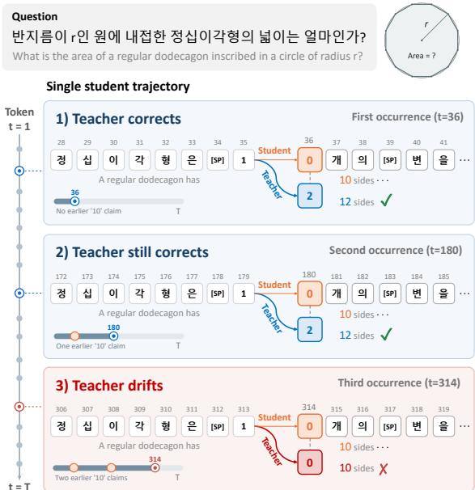
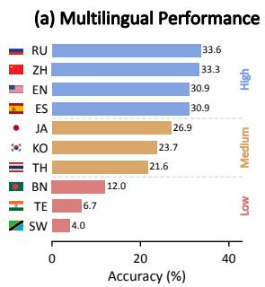
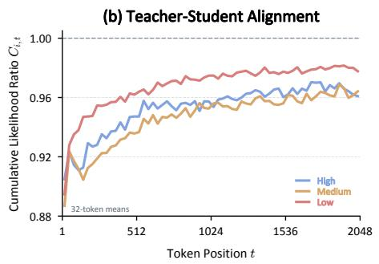
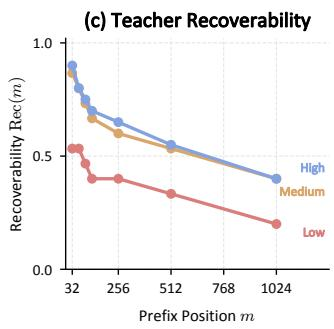
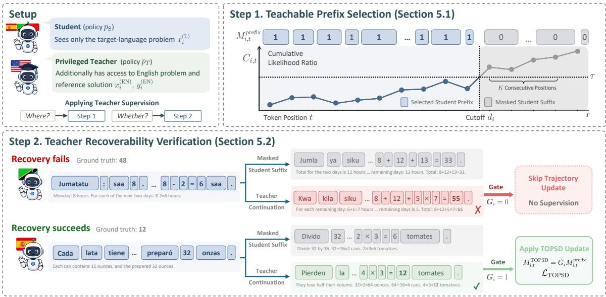
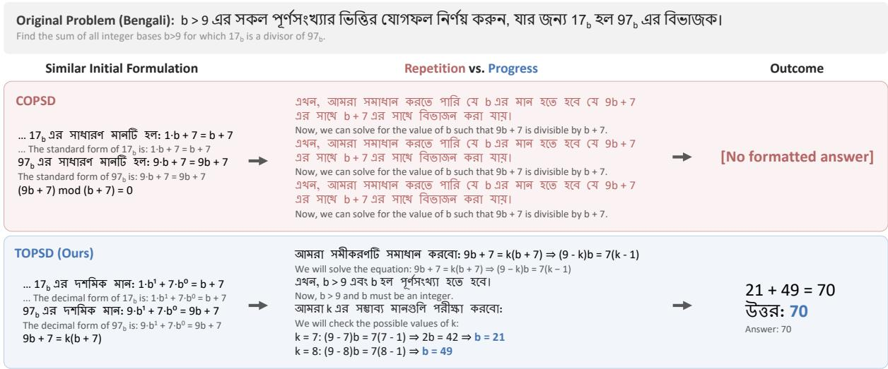
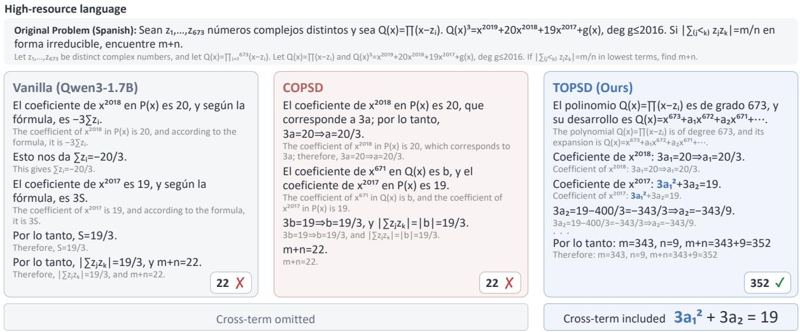
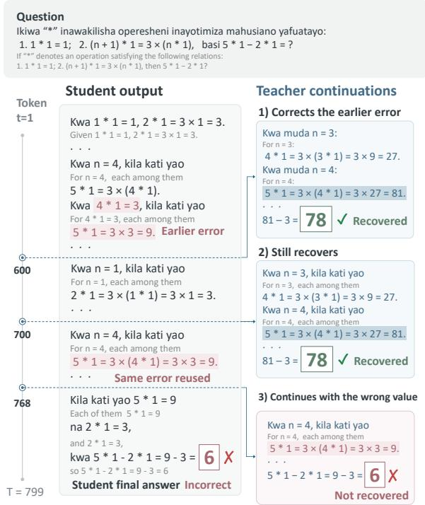
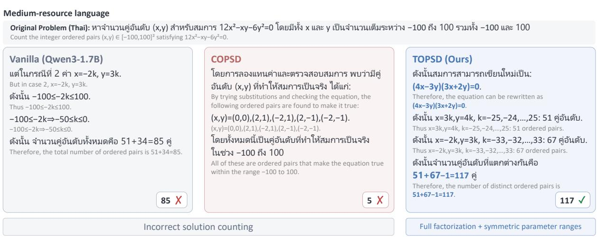
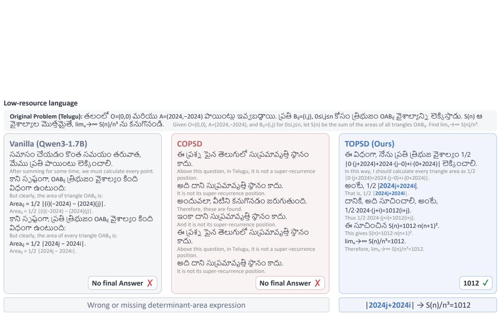

# Knowing When to Teach: Learning from Teachable Prefixes in Multilingual Reasoning Distillation

Jaewon Cho1, Minseo Yoon1, Jinyoung Park1, Jinwoo Seo1, Jaewon Chu2, Alice Oh1†, Hyunwoo J. Kim 1†

1KAIST, 2Korea University

{cho35750, yms020615, jinyoung.park, sjwoo0612, hyunwoojkim}@kaist.ac.kr

alice.oh@kaist.edu

allonsy07@korea.ac.kr

## Abstract

On-Policy Self-Distillation (OPSD) improves reasoning by training a student on its own reasoning, using the same model conditioned on reference solutions as a teacher. Applying OPSD to multilingual reasoning requires the teacher to provide useful feedback across languages, even when the student makes mistakes in intermediate steps. We observe a phenomenon we call Teacher Drift: as these mistakes accumulate, the teacher may follow the student’s incorrect steps instead of correcting them. Our analysis shows that this shift tends to occur earlier in lower-resource languages. To account for these differences across languages, we propose Teachable On-Policy Self-Distillation (TOPSD), which determines where and whether teacher supervision should be applied to each reasoning trajectory. TOPSD uses teacher–student likelihood to estimate where drift begins and select a prefix for supervision. It then verifies whether the teacher can recover the correct answer from that prefix, applying distillation only to prefixes that pass verification. Experiments on multilingual mathematical reasoning across ten languages and three model scales show that TOPSD consistently outperforms conventional OPSD, particularly in low- and medium-resource languages.

## 1 Introduction

Large language models (LLMs) (Brown et al., 2020; Achiam et al., 2023; Team et al., 2023; Grattafiori et al., 2024; Yang et al., 2024; Guo et al., 2025; Yang et al., 2025) have demonstrated strong reasoning capabilities on complex tasks such as mathematical problem solving, logical inference, and complex question answering. On-Policy Distillation (Ross et al., 2011; Lin et al., 2020; Agarwal et al., 2024; Zhang et al., 2026a) further improves these capabilities by training the student with dense token-level supervision on reasoning it generates.

  
Figure 1: Teacher Drift in a Korean reasoning example. The teacher’s next-token predictions are evaluated on prefixes of one student trajectory. At t = 36 and 180, it predicts 2 instead of the student’s 0, correcting a dodecagon’s side count from 10 to 12; at t = 314, it predicts 0, following the repeated error. English translations are shown in gray.

Specifically, the teacher conditions on the student’s prefix, the sequence of tokens generated so far, and uses its next-token distribution to supervise the student. On-Policy Self-Distillation (OPSD) (Zhao et al., 2026) uses the same model as both student and teacher, with reference solutions provided only to the teacher. This enables learning from modelgenerated reasoning with dense teacher feedback, without a separate heavy teacher model (Shenfeld et al., 2026; Hübotter et al., 2026).

However, extending these benefits to multilingual reasoning is challenging due to the limited reasoning capabilities of the teacher model across languages. Since the language model is largely pretrained on high-resource languages such as English, it shows substantially weaker performance in lower-resource languages than in high-resource languages (Zhao et al., 2025). Prior work, such as COPSD (Liu et al., 2026), addresses it by using English reference solutions to draw on the model’s stronger reasoning ability in English and improve teacher supervision in the target language.

While this effort focuses on strengthening the teacher, it remains underexplored whether the teacher can provide reliable supervision throughout the student’s reasoning. We therefore investigate how the reliability of teacher supervision changes as the student’s reasoning unfolds across different languages. We observe that the teacher may initially correct the student’s errors, but begin to follow the student’s incorrect reasoning as these errors accumulate, even with access to reference solutions. We refer to this shift as Teacher Drift. Figure 1 illustrates this behavior in a Korean reasoning example, where the student repeatedly states that a regular dodecagon has ten sides. At the first two occurrences, the teacher predicts a token that corrects the number to twelve; at a later occurrence, it predicts the same incorrect token as the student. Our multilingual analysis further shows that Teacher Drift tends to emerge earlier in lower-resource languages, suggesting that the teacher’s ability to provide reliable supervision varies across languages. These observations motivate identifying where the teacher can still provide useful supervision within each reasoning trajectory.

Based on these observations, we propose Teachable On-Policy Self-Distillation (TOPSD), which determines where teacher supervision remains appropriate and whether it should be applied. TOPSD estimates where Teacher Drift begins to select a teachable prefix, and then verifies whether the teacher can recover the correct answer from that prefix. If verification succeeds, distillation is applied to the teachable prefix.

Our contributions are summarized as follows:

• We identify Teacher Drift, where the privileged teacher begins to follow the student’s incorrect reasoning as errors accumulate, and characterize its language-dependent patterns through likelihood and recovery analyses.

• We propose TOPSD, which combines trajectory-specific prefix selection with teacher recovery verification to determine where and whether to apply supervision.

• We demonstrate the effectiveness of TOPSD for multilingual mathematical reasoning across model scales, with improvements particularly in low- and medium-resource languages.

## 2 Related Work

Multilingual Reasoning. Despite advances in LLM reasoning, performance remains uneven across languages, particularly in low-resource settings (Shi et al., 2023; Xuan et al., 2025; Ghosh et al., 2025; Wang et al., 2025). Prior work has sought to improve multilingual reasoning through multilingual post-training (Payoungkhamdee et al., 2024; Chen et al., 2024; Lai and Nissim, 2024; Ranaldi and Pucci, 2025; She et al., 2024; Zhang et al., 2026b) and cross-lingual reasoning transfer (Huang et al., 2023; Qin et al., 2023; Zhu et al., 2024; Tran et al., 2025; Barua et al., 2026). More recently, COPSD (Liu et al., 2026) extends on-policy self-distillation to multilingual reasoning by leveraging English problems and reference solutions as privileged teacher information. Our work complements these efforts by improving the reliability of multilingual on-policy self-distillation, particularly when errors accumulate in student-generated reasoning.

Post-Training for Reasoning. Reasoning capabilities are commonly improved through selftraining, reinforcement learning, and knowledge distillation. Self-training bootstraps from modelgenerated rationales (Zelikman et al., 2022), while recent post-training methods learn from sampled reasoning trajectories using verifiable outcomes, verifiers, or step-level feedback (Shao et al., 2024; Trung et al., 2024; Chu et al., 2025; Hosseini et al., 2024; Wang et al., 2024; Hwang et al., 2024; Xu et al., 2025). Within knowledge distillation (Hinton et al., 2014), GKD and related methods supervise student-generated sequences with teacher predictions (Lin et al., 2020; Gu et al., 2024; Agarwal et al., 2024; Ko et al., 2024, 2025), while OPSD uses the same model as student and privileged teacher under different conditioning contexts (Zhao et al., 2026). Recent work further improves the distillation with guided or trust-region rollouts (Li et al., 2026; Plyusov et al., 2026), selective or adaptive token-level supervision (Wang et al., 2026; Jang et al., 2026), and trajectory refinement (Jiang et al., 2026). We characterize language-dependent Teacher Drift and verify Teacher Recoverability before distilling selected prefixes of original student

trajectories.

## 3 Preliminaries

On-Policy Self-Distillation (OPSD) (Zhao et al., 2026) improves reasoning by training a student on its own generated trajectories with dense supervision from the same model conditioned on reference solutions, without requiring a separate teacher model. Let $\mathcal { D }$ denote a reasoning dataset consisting of a set of input problems x and their reference solutions $y ^ { \star }$ . Rather than relying on a separate teacher model, OPSD instantiates both the student and the privileged teacher from the same underlying language model $\pi _ { \boldsymbol { \theta } } .$ , while conditioning them on different information. The student $p \mathrm { s }$ observes only the problem x, whereas the privileged teacher $p _ { \mathrm { T } }$ additionally observes the reference solution $y ^ { \star } { : }$

$$
\begin{array} { r } { p _ { \mathrm { S } } ( \cdot \mid x ) \triangleq \pi _ { \boldsymbol { \theta } } ( \cdot \mid x ) , } \\ { p _ { \mathrm { T } } ( \cdot \mid x , y ^ { \star } ) \triangleq \pi _ { \boldsymbol { \theta } } ( \cdot \mid x , y ^ { \star } ) . } \end{array}\tag{1}
$$

For each problem $x ,$ the student first samples a trajectory

$$
\hat { y } = \left( \hat { y } _ { 1 } , \dots , \hat { y } _ { | \hat { y } | } \right) \sim p _ { \mathrm { S } } ( \cdot \mid x ) .\tag{2}
$$

Then, OPSD trains the student by minimizing the token-level distributional discrepancy between the two policies along the student-generated trajectory:

$$
\mathcal { L } _ { \mathrm { O P S D } } = \mathbb { E } _ { ( x , y ^ { \star } ) \sim \mathcal { D } } \mathbb { E } _ { \hat { y } \sim p _ { \mathrm { S } } ( \cdot \vert x ) } \left[ \frac { 1 } { \vert \hat { y } \vert } \sum _ { t = 1 } ^ { \vert \hat { y } \vert } D ( p _ { \mathrm { S } , t } , p _ { \mathrm { T } , t } ) \right] ,\tag{3}
$$

where $p _ { \mathrm { S } , t } : = p _ { \mathrm { S } } ( \cdot \ | \ x , \hat { y } _ { < t } )$ and $p _ { \mathrm { T } , t } : = p _ { \mathrm { T } } ( \cdot \ |$ $x , y ^ { \star } , \hat { y } _ { < t } )$ are the student and teacher next-token distributions conditioned on the same studentgenerated prefix, and $D ( \cdot , \cdot )$ denotes a distributional divergence.

The simple way to design a teacher prompt in multilingual settings is to use a reference solution $y ^ { ( L ) }$ for each target language $L ( i . e . , y ^ { \star } \triangleq y ^ { ( L ) } )$ However, the model may find it harder to make use of a reasoning trace written in a non-English language, since most of its reasoning ability is learned from English data. So, COPSD (Liu et al., 2026) provides the English question $x ^ { \mathrm { ( E N ) } }$ and its reference solution $y ^ { \mathrm { ( E N ) } }$ as the privileged knowledge $y ^ { \star }$ to leverage the reasoning capabilities of LLMs. The teacher prompt for target language L can be written as: $y ^ { \star } \triangleq \hat { \left( x ^ { \mathrm { ( E N ) } } , y ^ { \mathrm { ( E N ) } } \right) }$ .

Even though OPSD variants have shown their success in multiple reasoning tasks, it is still underexplored in multilingual settings. This is particularly challenging because OPSD relies on the teacher to provide reliable supervision over studentgenerated trajectories. In multilingual settings, this supervision faces two potential challenges. First, errors in student-generated prefixes may make it difficult for the teacher to provide corrective guidance. Second, the teacher itself may have limited reasoning capabilities in non-English languages, where training data is often less abundant. These challenges raise concerns about whether the teacher can consistently provide reliable supervision throughout student rollouts.

## 4 Observation

## 4.1 Observing Teacher Drift

We investigate how the privileged teacher’s behavior changes as the student-generated prefix grows, and whether these changes differ across languages. In particular, we examine whether the teacher increasingly follows the student-generated trajectory and whether this alignment is accompanied by a reduced ability to correct erroneous reasoning.

Cumulative Teacher-Student Likelihood Ratio. We first examine how the teacher’s likelihood assignments to student-generated tokens change as the student prefix grows. For each language $L ,$ let i index problem instances and $\hat { y } _ { i } ^ { ( L ) }$ denote the corresponding student-generated trajectory. We define a cumulative teacher-student likelihood ratio $C _ { i , t }$ to measure how producible the student-generated tokens are from the teacher.

For each prefix position $t > 1$ , we define the cumulative teacher-student likelihood ratio as

$$
C _ { i , t } = \exp \left( \frac { 1 } { t - 1 } \sum _ { s = 1 } ^ { t - 1 } N _ { i , s } \right) ,\tag{4}
$$

where $N _ { i , t } ~ = ~ \log \bigl [ p _ { \mathrm { T } , i , t } ( \hat { y } _ { i , t } ^ { ( L ) } ) / p _ { \mathrm { S } , i , t } ( \hat { y } _ { i , t } ^ { ( L ) } ) \bigr ]$ denotes the teacher-student log-likelihood gap at token t. Here $p _ { \mathrm { S } , i , t }$ and $p _ { \mathrm { T } , i , t }$ denote the student and privileged teacher next-token distributions under their respective prompts and the same student prefix $\hat { y } _ { i , < t } ^ { ( L ) }$ . It measures the geometric mean of the teacher-to-student likelihood ratios on the observed student prefix. As $C _ { i , t }$ approaches 1, the average teacher-student log-likelihood gap on the observed student prefix approaches zero.

Language-Dependent Teacher Drift. To examine how the teacher’s behavior changes over student-generated trajectories, we analyze the cumulative teacher-student likelihood ratio across prefix lengths and language-resource groups. Figure 2(b) shows that $C _ { t }$ generally increases toward 1 as the student prefix grows, indicating that the teacher and student assign increasingly similar relative likelihoods to the observed student-generated tokens. Notably, this trend emerges earlier and is more pronounced in low-resource languages, suggesting that teacher is influenced by the student at different rates across languages.

  
Figure 2: Teacher Drift in multilingual reasoning. (a) Student accuracy across languages. (b) Cumulative teacher-student likelihood ratio $C _ { i , t }$ indicates earlier alignment in low-resource languages. (c) Teacher recoverability Rec(m) decreases with longer student prefixes. Colors indicate language-resource groups.

Degradation of Teacher Recoverability. To assess the teacher’s ability to correct erroneous student reasoning, we evaluate whether it can recover the correct answer from student-generated prefixes. We consider a set of examples I where the student answers incorrectly but the privileged teacher solves the problem correctly without a studentgenerated prefix.

For each prefix position m, we condition the privileged teacher on the first m − 1 student-generated tokens and generate a continuation:

$$
z _ { i , \geq m } ^ { ( L ) } = \mathrm { G r e e d y D e c o d e } \left( p _ { \mathrm { T } } , x _ { i } ^ { ( L ) } , y _ { i } ^ { \star } , \hat { y } _ { i , < m } ^ { ( L ) } \right) .\tag{5}
$$

We measure teacher recoverability as the fraction of examples for which the teacher reaches the correct answer from the given prefix:

$$
\mathrm { R e c } ( m ) = \frac { 1 } { | \mathcal { T } | } \sum _ { i \in \mathcal { I } } \mathcal { V } \left( \hat { y } _ { i , < m } ^ { ( L ) } \oplus z _ { i , \ge m } ^ { ( L ) } , a _ { i } \right) ,\tag{6}
$$

where $a _ { i }$ is the ground-truth answer to the i-th problem, V evaluates answer correctness, and ⊕ denotes sequence concatenation.

As shown in Figure 2(c), teacher recoverability decreases as the student prefix grows. The teacher increasingly fails to reach the correct answer when conditioned on longer student-generated prefixes.

This means that the teacher may lose its correct reasoning capability as the length of student-generated prefix is longer.

Together, these findings show that increasing teacher-student likelihood alignment is accompanied by declining teacher recoverability, while the alignment patterns differ across languages. These observations show that the reliability of teacher supervision may depend on the student-generated prefix, motivating the identification of teachable prefixes rather than applying supervision uniformly throughout the student trajectory.

## 5 Teachable On-Policy Self-Distillation

To address limitations of OPSD in multilinguality, such as Teacher Drift and degradation of teacher recoverability, we propose Teachable On-Policy Self-Distillation (TOPSD), which determines where and whether to apply teacher supervision along studentgenerated trajectories. As illustrated in Figure 3, TOPSD consists of two stages: Teachable prefix selection and Teacher Recoverability Verification. Teachable prefix selection uses the cumulative teacher-student likelihood ratio to identify a teachable prefix before sustained teacher drift. Teacher recoverability verification then evaluates whether the teacher can recover the correct answer from the selected prefix. Only when verification succeeds does TOPSD apply distillation to the selected states of the original student trajectory to provide the meaningful guidance.

## 5.1 Teachable Prefix Selection

As observed in Section 4.1, Teacher Drift manifests as increasing likelihood alignment between the teacher and student along student-generated trajectories. To avoid applying supervision to later states where the teacher may increasingly follow the student’s reasoning, we select a candidate teachable prefix based on the cumulative teacher-student likelihood ratio $C _ { i , t }$

  
Figure 3: Overview of TOPSD. The student generates a reasoning trajectory in the target language, while the privileged teacher additionally observes the English problem and reference solution. Step 1 (Teachable Prefix Selection) uses the cumulative teacher-student likelihood ratio to select a candidate teachable prefix, determining where teacher supervision may be applied. Step 2 (Teacher Recoverability Verification) checks whether the teacher can recover the correct answer from the selected prefix, determining whether supervision should be applied. Only prefixes that pass verification receive distillation on the corresponding states of the original student trajectory. English translations are shown in gray.

Specifically, we identify the earliest position $d _ { i }$ at which $C _ { i , t }$ exceeds a threshold τ for K consecutive positions, which determines the cutoff for prefix selection:

$$
d _ { i } = \operatorname* { m i n } \{ j \ | \ C _ { i , j + k } > \tau , \ \forall k \in \{ 0 , \ldots , K - 1 \} \}\tag{7}
$$

We use consecutive threshold crossings to identify sustained teacher-student likelihood alignment rather than isolated fluctuations.

The corresponding prefix selection mask is $M _ { i , t } ^ { \mathrm { p r e f i x } } = \mathbb { I } [ t ^ { \star } < d _ { i } ]$ , such that only states within the selected teachable prefix are eligible for teacher supervision. If no valid position is detected, we set $d _ { i } = T _ { i } + 1$ , where $T _ { i }$ is the trajectory length, retaining the entire trajectory as a candidate prefix. The selected prefix is then evaluated through Teacher Recoverability Verification.

## 5.2 Teacher Recoverability Verification

To ensure that the selected prefixes provide reliable teacher supervision, we further assess whether the privileged teacher can successfully recover the correct answer from each prefix. Specifically, we introduce Teacher Recoverability Verification, which verifies the teacher’s ability to reach the correct solution before using its predictions for distillation.

Given the selected prefix $\hat { y } _ { i , < d _ { i } } ^ { ( L ) }$ , we generate a teacher continuation using greedy decoding as in Eq. (5), with $m \ = \ d _ { i }$ . We then concatenate the teacher continuation with the selected student prefix and evaluate whether the resulting trajectory reaches the correct answer:

$$
G _ { i } = \mathcal { V } \Big ( \hat { y } _ { i , < d _ { i } } ^ { ( L ) } \oplus z _ { i , \geq d _ { i } } ^ { ( L ) } , a _ { i } \Big ) \in \{ 0 , 1 \} ,\tag{8}
$$

where V denotes the answer verifier and $a _ { i }$ is the ground-truth answer.

We apply teacher supervision only when the teacher successfully recovers the correct answer $( G _ { i } = 1 )$ . Combining this verification result with the prefix selection mask, we define the final supervision mask as

$$
M _ { i , t } ^ { \mathrm { T O P S D } } = G _ { i } M _ { i , t } ^ { \mathrm { p r e f i x } } .\tag{9}
$$

Importantly, the teacher continuation is used only for verification, not as a training target. Distillation is performed on the selected states of the original student-generated trajectory, preserving the on-policy nature of TOPSD.

## 5.3 TOPSD Objective

TOPSD follows the token-level distillation framework of OPSD while restricting supervision using the final mask $M _ { i , t } ^ { \mathrm { T O P S D } }$ . To prevent longer selected prefixes from dominating the training objective and to balance supervision across languages, we normalize the loss at the trajectory and language levels.

Let $\begin{array} { r } { n _ { i } = \sum _ { t = 1 } ^ { T _ { i } } M _ { i , t } ^ { \mathrm { T O P S D } } } \end{array}$ denote the number of supervised tokens in trajectory i. We define the set of eligible trajectories in language ℓ as $B _ { \ell } ^ { + } = \{ i \in$ $B \mid \ell _ { i } = \ell , n _ { i } > 0 \}$ , and the set of languages with eligible trajectories as $\mathcal { A } = \{ \ell \ | \ | \mathcal { B } _ { \ell } ^ { + } | ^ { \cdot } > 0 \}$ . The resulting TOPSD objective is

$$
\mathcal { L } _ { \mathrm { T O P S D } } = \mathbb { E } _ { \ell } \left[ \mathbb { E } _ { i | \ell } \left[ \frac { 1 } { n _ { i } } \sum _ { t = 1 } ^ { T _ { i } } M _ { i , t } ^ { \mathrm { T O P S D } } D ( p \mathrm { s } , i , t , p _ { \mathrm { T } , i , t } ) \right] \right] ,\tag{10}
$$

where $\begin{array} { r } { } { \mathbb { E } _ { \ell } [ \cdot ] \ : = \ \frac { 1 } { | { \cal A } | } \sum _ { \ell \in { \cal A } } [ \cdot ] } \end{array}$ and $\begin{array} { r l } { \mathbb { E } _ { i \mid \ell } [ \cdot ] } & { { } : = } \end{array}$ $\frac { 1 } { | B _ { \ell } ^ { + } | } \sum _ { \substack { i \in B _ { \ell } ^ { + } } } [ \cdot ]$ denote uniform averaging over eligible languages and eligible trajectories within each language, respectively.

## 6 Experiments

## 6.1 Experimental Settings

Dataset and Languages. We use the multilingual OpenThoughts dataset released by COPSD (Liu et al., 2026), sampling 500 training instances per language (5,000 in total). We consider ten languages: Bengali (BN), English (EN), Spanish (ES), Japanese (JA), Korean (KO), Russian (RU), Swahili (SW), Telugu (TE), Thai (TH), and Chinese (ZH).

Models and Baselines. We conduct experiments using Qwen3-1.7B, Qwen3-4B, and Qwen3- 8B (Yang et al., 2025). The student is trained with LoRA (Hu et al., 2022), while the privileged teacher is the frozen base model conditioned on the English problem and reference solution. We compare TOPSD against the base model (Vanilla), OPSD (Zhao et al., 2026), and COPSD (Liu et al., 2026).

Training and Evaluation. Following OPSD (Zhao et al., 2026) and COPSD (Liu et al., 2026), we use a fixed privileged teacher and fullvocabulary logit distillation. We evaluate multilingual mathematical reasoning on the PolyMath High split (Wang et al., 2025), reporting Avg@3 and Pass@3 across ten languages. Detailed training configurations and evaluation protocols are provided in Appendix A.

## 6.2 Main Results

Overall Performance. Table 1 reports Avg@3 and Pass@3 on PolyMath High across three Qwen3 model scales. TOPSD achieves the best overall performance for both metrics at every scale. For Avg@3, TOPSD reaches 11.60%, 17.79%, and 25.12% with Qwen3-1.7B, 4B, and 8B, improving over the strongest baseline by 1.65, 1.07, and 2.64 percentage points, respectively. The corresponding Pass@3 scores are 18.72%, 26.00%, and 35.28%, with gains of 2.08, 0.88, and 3.36 points. These consistent improvements indicate that selective teacher supervision remains effective as model scale increases.

Performance Across Language Resource Levels. The gains are most consistent in low- and mediumresource languages, where TOPSD achieves the best Avg@3 and Pass@3 at all three model scales. Relative to the strongest baseline, Avg@3 improves by 0.89-3.47 percentage points and Pass@3 by 0.80-4.00 points across these groups. The gains are largest for Qwen3-8B in the medium-resource group, improving Avg@3 from 24.09% to 27.56% and Pass@3 from 35.73% to 39.73%. Overall, TOPSD delivers its strongest and most consistent improvements in low- and medium-resource languages while remaining competitive in highresource languages.

## 6.3 Ablation Studies

Is Teachable Prefix Selection Alone Sufficient? We investigate whether Teachable Prefix Selection alone provides reliable supervision or whether Teacher Recoverability Verification is also necessary. Table 2 compares COPSD with three variants that supervise all selected prefixes, only failedrecovery prefixes, or only successful-recovery prefixes (TOPSD). Prefix selection alone improves Avg@3 from 9.95% to 10.76%, while verification further increases it to 11.60%. In contrast, supervising failed-recovery prefixes yields lower performance than supervising all selected prefixes or successful-recovery prefixes, highlighting the importance of verifying teacher recoverability.

## 6.4 Additional Analysis

Teachable Prefix Selection Across Model Scales. Table 3 analyzes the selected cutoff positions across model scales and language-resource levels. Valid cutoffs are detected in over 95% of trajectories across all model sizes, with average relative positions ranging from 6.98% to 10.47%. The cutoff positions also vary across resource levels, generally occurring earlier in low-resource languages for Qwen3-1.7B and 4B. These results suggest that teachable prefix lengths depend on both the language and model scale, supporting trajectoryspecific prefix selection.

<table><tr><td rowspan="2">Model</td><td rowspan="2">Metric</td><td rowspan="2">Method</td><td colspan="4">Low</td><td colspan="4">Medium</td><td colspan="5">High</td><td rowspan="2">Overall</td></tr><tr><td>BN</td><td>TE</td><td>SW</td><td>Avg</td><td>JA</td><td>KO</td><td>TH</td><td>Avg</td><td>EN</td><td>ES</td><td>RU</td><td>ZH</td><td>Avg Avg</td></tr><tr><td rowspan="6">Qwen3-1.7B</td><td rowspan="4">Avg@3</td><td>Vanilla</td><td>2.13</td><td>0.00</td><td>0.27</td><td>0.80</td><td>11.47</td><td>6.40</td><td>6.13</td><td>8.00</td><td>17.87</td><td>15.73</td><td>14.93</td><td>17.33</td><td>16.47</td><td>9.23</td></tr><tr><td>OPSD</td><td>2.93</td><td>1.07</td><td>1.60</td><td>1.87</td><td>10.13</td><td>6.40</td><td>6.93</td><td>7.82</td><td>21.33</td><td>14.67</td><td>12.53</td><td>18.40</td><td>16.73</td><td>9.60</td></tr><tr><td>COPSD</td><td>3.47</td><td>1.07</td><td>1.07</td><td>1.87</td><td>9.87</td><td>8.53</td><td>8.27</td><td>8.89</td><td>20.27</td><td>13.87</td><td>13.07</td><td>20.00</td><td>16.80</td><td>9.95</td></tr><tr><td>TOPSD</td><td>4.53</td><td>2.13</td><td>1.60</td><td>2.76</td><td>13.07</td><td>10.13</td><td>9.87</td><td>11.02</td><td>20.27</td><td>17.07</td><td>17.07</td><td>20.27</td><td>18.67</td><td>11.60</td></tr><tr><td rowspan="4"></td><td>Vanilla</td><td>4.80</td><td>0.00</td><td>0.80</td><td>1.87</td><td>18.4011.2010.40</td><td></td><td></td><td>13.33</td><td>26.40</td><td>28.00</td><td>25.60</td><td>28.80</td><td>27.20</td><td>15.44</td></tr><tr><td>OPSD Pass@3</td><td>4.80</td><td>3.20</td><td>4.00</td><td>4.00</td><td></td><td>21.60 12.00 12.80</td><td></td><td>15.47</td><td>30.40</td><td>28.00 21.60 28.00</td><td></td><td></td><td>27.00</td><td>16.64</td></tr><tr><td>COPSD</td><td>6.40</td><td>2.40</td><td>3.20</td><td>4.00</td><td>18.40</td><td>15.20</td><td>12.80</td><td>15.47</td><td>32.00</td><td>23.20 21.60</td><td></td><td>30.40</td><td>26.80</td><td>16.56</td></tr><tr><td>TOPSD</td><td>8.00</td><td>4.80</td><td>3.20</td><td>5.33</td><td></td><td></td><td>23.20 17.60 15.20</td><td>18.67</td><td>32.00</td><td>27.20 24.80 </td><td></td><td>31.20</td><td>28.80</td><td>18.72</td></tr><tr><td rowspan="6">Qwen3-4B</td><td rowspan="4">Avg@3</td><td>Vanilla</td><td>5.60</td><td>2.67</td><td>1.87</td><td>3.38</td><td>17.87</td><td>18.40</td><td>15.47</td><td>17.24</td><td>21.87</td><td>23.20 26.13 21.87</td><td></td><td></td><td>23.27</td><td>15.49</td></tr><tr><td>OPSD</td><td>6.93</td><td>3.20</td><td>2.13</td><td>4.09</td><td>17.60</td><td>16.53</td><td>13.07</td><td>15.73</td><td>27.47</td><td>25.33</td><td>26.93</td><td>28.00</td><td>26.93</td><td>16.72</td></tr><tr><td>COPSD</td><td>5.33</td><td>2.93</td><td>1.60</td><td>3.29</td><td></td><td>17.0715.7312.00</td><td></td><td>14.93</td><td>27.20</td><td>26.13</td><td>26.67</td><td>27.20</td><td>26.80</td><td>16.19</td></tr><tr><td>TOPSD</td><td>8.00</td><td>3.73</td><td>3.20</td><td>4.98</td><td></td><td>19.73 21.07 17.33</td><td></td><td>19.38</td><td>25.07</td><td>25.87</td><td></td><td>27.47 26.40</td><td>26.20</td><td>17.79</td></tr><tr><td>Vanilla</td><td></td><td>11.20 4.00</td><td>4.80</td><td>6.67</td><td></td><td>23.20 25.60</td><td></td><td>23.20</td><td>|24.00| 30.40</td><td></td><td>32.00 35.20 29.60|</td><td></td><td>|31.80|</td><td>21.92</td></tr><tr><td rowspan="4">Pass@3</td><td>OPSD</td><td>12.00</td><td>8.00</td><td>5.60</td><td>8.53</td><td>27.20</td><td>24.80</td><td>20.00</td><td>24.00</td><td>38.40</td><td>38.40</td><td></td><td>38.40 38.40</td><td>38.40</td><td>25.12</td></tr><tr><td>COPSD</td><td>10.40</td><td>6.40</td><td>4.80</td><td>7.20</td><td></td><td>27.20 24.80 21.60</td><td></td><td>24.53</td><td>38.40</td><td>39.20</td><td>40.00 36.00</td><td></td><td>38.40</td><td>24.88</td></tr><tr><td>TOPSD</td><td></td><td>13.607.20</td><td>7.20</td><td>9.33</td><td></td><td>27.20 30.4027.20</td><td></td><td>28.27</td><td>34.40</td><td>36.80</td><td>39.20</td><td>36.80</td><td>36.80</td><td>26.00</td></tr><tr><td>Vanilla</td><td>12.00</td><td></td><td>4.00</td><td></td><td></td><td></td><td></td><td></td><td></td><td></td><td></td><td></td><td></td><td></td></tr><tr><td rowspan="5">Qwen3-8B</td><td rowspan="5">Avg@3</td><td>OPSD</td><td></td><td>6.67</td><td></td><td>7.56 6.49</td><td>26.93</td><td>23.73</td><td>21.60</td><td>24.09 30.93</td><td></td><td>30.93 33.60 33.33</td><td></td><td>32.20</td><td>22.37</td></tr><tr><td></td><td>11.20</td><td>5.07</td><td>3.20</td><td></td><td>25.87</td><td>20.53</td><td>18.40</td><td>21.60</td><td>37.87</td><td>28.53</td><td>34.67</td><td>38.40</td><td>34.87</td><td>22.37</td></tr><tr><td>COPSD</td><td>9.60</td><td>5.07</td><td>1.87</td><td></td><td>5.51</td><td>26.13 21.8718.93</td><td></td><td></td><td>22.31 37.87</td><td>29.87</td><td>34.40</td><td>39.20</td><td>35.33</td><td>22.48</td></tr><tr><td>TOPSD</td><td>13.60</td><td>7.73</td><td>5.60</td><td>8.98</td><td></td><td>30.13 27.47 25.07</td><td></td><td>27.56</td><td>36.00</td><td>31.73</td><td> 36.27 37.60</td><td></td><td>35.40</td><td>25.12</td></tr><tr><td>Vanilla</td><td></td><td>|20.00 11.20</td><td>8.00</td><td></td><td></td><td>39.20 36.00 32.00</td><td></td><td></td><td></td><td>40.80</td><td>42.4042.40|</td><td></td><td></td><td></td></tr><tr><td rowspan="4"></td><td rowspan="4">Pass@3</td><td></td><td></td><td></td><td></td><td>13.07</td><td></td><td></td><td></td><td>35.73</td><td>39.20</td><td></td><td></td><td></td><td>41.20</td><td>31.12</td></tr><tr><td>OPSD</td><td>16.80</td><td>8.00</td><td>6.40</td><td>10.40</td><td></td><td>39.20</td><td>31.20 29.60</td><td>33.33 33.33</td><td>48.00 48.80</td><td>42.40 41.60</td><td>47.20 46.40</td><td>50.40 50.40</td><td>47.00 46.80</td><td>31.92 31.76</td></tr><tr><td>COPSD TOPSD</td><td>16.80</td><td>8.80 22.4012.0012.80</td><td>4.80</td><td>10.13</td><td>15.73</td><td>39.20 43.20 40.00 36.00</td><td>33.60 27.20</td></table>

Table 1: Avg@3 and Pass@3 (%) on PolyMath High across ten languages grouped by resource level. Group and Overall averages are mean performance within each group and across all ten languages, respectively. Bold and underlining indicate the best and second-best scores.
<table><tr><td rowspan="2">Prefix Selection</td><td rowspan="2">Recoverability Filter</td><td colspan="4">Avg@3 (%)</td><td rowspan="2">∆COPSD</td></tr><tr><td>Low</td><td>Medium</td><td>High</td><td>Overall</td></tr><tr><td>Full trajectory (COPSD)</td><td>None</td><td>1.87</td><td>8.89</td><td>16.80</td><td>9.95</td><td></td></tr><tr><td rowspan="3">Teachable prefix</td><td>None (all)</td><td>2.40</td><td>10.53</td><td>17.20</td><td>10.76</td><td>+0.81</td></tr><tr><td>Failed only</td><td>1.96</td><td>9.87</td><td>16.67</td><td>10.21</td><td>+0.26</td></tr><tr><td>Successful only (Ours)</td><td>2.76</td><td>11.02</td><td>18.67</td><td>11.60</td><td>+1.65</td></tr></table>

Table 2: Ablation of Teachable Prefix Selection and Teacher Recoverability Verification. Avg@3 (%) on PolyMath High with Qwen3-1.7B. ∆COPSD denotes the overall improvement over COPSD in percentage points.

Generalization Beyond Multilingual Reasoning. To examine whether TOPSD generalizes beyond multilingual settings, we additionally evaluate it on the English mathematical reasoning benchmarks used in the original OPSD study (Zhao et al., 2026). We train Qwen3-4B on 500 English mathematical reasoning problems sampled from

OpenThoughts (Guha et al., 2026) for 160 optimization steps and compare Vanilla, OPSD, and TOPSD. We evaluate on AIME 2024 (Zhang and Math-AI, 2024) and AIME 2025 (Zhang and Math-AI, 2025), reporting Avg@3 and Pass@3.

As shown in Table 4, TOPSD achieves the highest Pass@3 on AIME 2024 and improves both Avg@3 and Pass@3 on AIME 2025. These results suggest that the benefits of TOPSD can extend beyond multilingual reasoning to challenging English mathematical reasoning tasks.

## 6.5 Qualitative Results

To examine reasoning progression beyond finalanswer accuracy, Figure 4 compares COPSD and

  
Figure 4: Qualitative comparison of COPSD and TOPSD on Bengali mathematical reasoning. Starting from similar correct formulations, COPSD becomes stuck in repeated divisibility statements, while TOPSD continues the derivation to $b = 2 1$ and $b = 4 9$ and obtains the correct answer 70. English translations are shown in gray.

<table><tr><td rowspan="2">Model</td><td rowspan="2">Cutoff Detection Rate (%)</td><td colspan="4">Relative Cutoff Position (%)</td></tr><tr><td>Low</td><td>Medium</td><td>High</td><td>Overall</td></tr><tr><td>Qwen3-1.7B</td><td>95.94</td><td>4.09</td><td>13.65</td><td>13.02</td><td>10.47</td></tr><tr><td>Qwen3-4B</td><td>98.60</td><td>5.72</td><td>9.24</td><td>8.00</td><td>7.69</td></tr><tr><td>Qwen3-8B</td><td>99.28</td><td>6.36</td><td>10.19</td><td>5.03</td><td>6.98</td></tr></table>

Table 3: Teachable prefix selection statistics. Cutoff Detection Rate is the percentage of trajectories with a detected cutoff. Relative Cutoff Position reports the cutoff as a percentage of trajectory length, averaged over trajectories with detected cutoffs. Overall is the mean relative cutoff position over all trajectories with detected cutoffs across the ten languages.

TOPSD on a Bengali mathematical reasoning problem asking for the sum of all integer bases $b > 9$ such that $1 7 _ { b }$ divides $9 7 _ { b }$ . Both models begin from a similar correct formulation, expressing the two numbers as $b + 7$ and $9 b + 7$ and establishing the corresponding divisibility condition. COPSD then repeatedly restates that $9 b + 7$ must be divisible by $b + 7 .$ , without deriving further constraints on b, and fails to produce a formatted final answer. In contrast, TOPSD introduces an integer quotient k through $9 b + 7 = k ( b + 7 )$ and rearranges the equation into $( 9 - k ) b = 7 ( k - 1 )$ . It then identifies the valid bases b = 21 and $b = 4 9$ , corresponding to k = 7 and k = 8, respectively, and obtains their sum, 70. This example illustrates how the two models diverge after a correct initial setup: COPSD becomes trapped in repetition, whereas TOPSD develops the divisibility condition into concrete constraints and completes the solution.

<table><tr><td>Method</td><td>AIME24 Avg@3 / Pass @3</td><td>AIME25 Avg@3 / Pass@3</td></tr><tr><td>Qwen3-4B Vanilla</td><td>76.67 / 80.00</td><td>64.44 / 76.67</td></tr><tr><td>OPSD</td><td>76.67 / 86.67</td><td>67.78 / 83.33</td></tr><tr><td>TOPSD</td><td>76.67 / 90.00</td><td>71.11 / 86.67</td></tr></table>

Table 4: Generalization to English mathematical reasoning on AIME 2024 and AIME 2025. Results are reported in percentages. Bold indicates the best result for each metric.

## 7 Conclusion

We identify Teacher Drift, a failure mode in which a privileged teacher increasingly follows erroneous student reasoning as errors accumulate in the prefix. To address this, we propose Teachable On-Policy Self-Distillation (TOPSD), which combines Teachable Prefix Selection and Teacher Recoverability Verification to determine when teacher supervision remains appropriate and whether it should be trusted. Experiments on PolyMath High across ten languages and three Qwen3 model scales show that TOPSD consistently outperforms OPSD and COPSD, with particularly strong gains in low- and medium-resource languages. These results demonstrate that reliable on-policy self-distillation requires not only a strong teacher, but also knowing when the teacher remains able to teach and whether its guidance should be trusted. Extending this approach beyond mathematical reasoning is a promising direction for future work.

## Limitations

Our findings are limited to mathematical reasoning, and their generalization to other reasoning domains and model families remains to be explored. In multilingual settings, the usefulness of teacher supervision may depend on the model’s existing capabilities in each language, so the extent of improvement may vary across languages and models. Our current setup also uses English reference solutions as privileged information, leaving other source languages and settings without such resources unexplored. Future work could investigate how the language and quality of reference solutions affect supervision and evaluate the approach across a broader range of multilingual reasoning tasks.

## Ethical Considerations

AI assistance. AI tools were used to assist with drafting and revising the manuscript. The authors retain responsibility for all content, results, and claims.

Potential risks. TOPSD improves multilingual mathematical reasoning, while performance differences across languages remain. Models trained with TOPSD may inherit biases and errors from their underlying models and training data, which can affect the quality of assistance available to speakers of underrepresented languages. We report results for individual languages and resource groups to make these differences visible. Applications should be evaluated in their intended languages and contexts, with attention to whether aggregate improvements translate into benefits for the users they serve. Training and teacher verification also consume computational resources and have associated environmental costs. We document our training configurations and hardware to support reproducibility and assessment of computational requirements. These costs should be considered alongside performance gains when scaling the approach to additional models and languages.

## References

Josh Achiam, Steven Adler, Sandhini Agarwal, Lama Ahmad, Ilge Akkaya, Florencia Leoni Aleman, Diogo Almeida, Janko Altenschmidt, Sam Altman, Shyamal Anadkat, et al. 2023. Gpt-4 technical report. arXiv:2303.08774.

Rishabh Agarwal, Nino Vieillard, Yongchao Zhou, Piotr Stanczyk, Sabela Ramos Garea, Matthieu Geist,

and Olivier Bachem. 2024. On-policy distillation of language models: Learning from self-generated mistakes. In ICLR.

Josh Barua, Seun Eisape, Kayo Yin, and Alane Suhr. 2026. Long chain-of-thought reasoning across languages. In ICLR.

Tom Brown, Benjamin Mann, Nick Ryder, Melanie Subbiah, Jared D Kaplan, Prafulla Dhariwal, Arvind Neelakantan, Pranav Shyam, Girish Sastry, Amanda Askell, et al. 2020. Language models are few-shot learners. In NeurIPS.

Nuo Chen, Zinan Zheng, Ning Wu, Ming Gong, Dongmei Zhang, and Jia Li. 2024. Breaking language barriers in multilingual mathematical reasoning: Insights and observations. In Findings ofEMNLP.

Tianzhe Chu, Yuexiang Zhai, Jihan Yang, Shengbang Tong, Saining Xie, Dale Schuurmans, Quoc V. Le, Sergey Levine, and Yi Ma. 2025. SFT memorizes, RL generalizes: A comparative study of foundation model post-training. In ICML.

Akash Ghosh, Debayan Datta, Sriparna Saha, and Chirag Agarwal. 2025. A survey of multilingual reasoning in language models. In Findings ofEMNLP.

Aaron Grattafiori, Abhimanyu Dubey, Abhinav Jauhri, Abhinav Pandey, Abhishek Kadian, Ahmad Al-Dahle, Aiesha Letman, Akhil Mathur, Alan Schelten, Alex Vaughan, et al. 2024. The Llama 3 herd of models. arXiv:2407.21783.

Yuxian Gu, Li Dong, Furu Wei, and Minlie Huang. 2024. MiniLLM: Knowledge distillation of large language models. In ICLR.

Etash Kumar Guha, Ryan Marten, Sedrick Keh, Negin Raoof, Georgios Smyrnis, Hritik Bansal, Marianna Nezhurina, Jean Mercat, Trung Vu, Zayne Rea Sprague, et al. 2026. Openthoughts: Data recipes for reasoning models. In ICLR.

Daya Guo, Dejian Yang, Haowei Zhang, Junxiao Song, Peiyi Wang, Qihao Zhu, Runxin Xu, Ruoyu Zhang, Shirong Ma, Xiao Bi, et al. 2025. DeepSeek-R1 incentivizes reasoning in LLMs through reinforcement learning. Nature, 645(8081):633–638.

Geoffrey E. Hinton, Oriol Vinyals, and Jeffrey Dean. 2014. Distilling the knowledge in a neural network. In NIPS Workshop on Deep Learning and Representation Learning.

Arian Hosseini, Xingdi Yuan, Nikolay Malkin, Aaron Courville, Alessandro Sordoni, and Rishabh Agarwal. 2024. V-STaR: Training verifiers for self-taught reasoners. In COLM.

Edward J. Hu, Yelong Shen, Phillip Wallis, Zeyuan Allen-Zhu, Yuanzhi Li, Shean Wang, Lu Wang, and Weizhu Chen. 2022. LoRA: Low-rank adaptation of large language models. In ICLR.

Haoyang Huang, Tianyi Tang, Dongdong Zhang, Wayne Xin Zhao, Ting Song, Yan Xia, and Furu Wei. 2023. Not all languages are created equal in llms: Improving multilingual capability by cross-lingualthought prompting. In Findings ofEMNLP.

Jonas Hübotter, Frederike Lübeck, Lejs Deen Behric, Anton Baumann, Marco Bagatella, Daniel Marta, Ido Hakimi, Idan Shenfeld, Thomas Kleine Buening, Carlos Guestrin, et al. 2026. Reinforcement learning via self-distillation. In ICML.

Hyeonbin Hwang, Doyoung Kim, Seungone Kim, Seonghyeon Ye, and Minjoon Seo. 2024. Selfexplore: Enhancing mathematical reasoning in language models with fine-grained rewards. In Findings ofEMNLP.

Ijun Jang, Jewon Yeom, Juan Yeo, Hyunggyu Lim, and Taesup Kim. 2026. Stable on-policy distillation through adaptive target reformulation. In Findings of ACL.

Li Jiang, Haoran Xu, Yichuan Ding, and Amy Zhang. 2026. Trajectory-refined distillation. arXiv:2606.08432.

Jongwoo Ko, Tianyi Chen, Sungnyun Kim, Tianyu Ding, Luming Liang, Ilya Zharkov, and Se-Young Yun. 2025. DistiLLM-2: A contrastive approach boosts the distillation of LLMs. In ICML.

Jongwoo Ko, Sungnyun Kim, Tianyi Chen, and Se-Young Yun. 2024. DistiLLM: Towards streamlined distillation for large language models. In ICML.

Huiyuan Lai and Malvina Nissim. 2024. mCoT: Multilingual instruction tuning for reasoning consistency in language models. In ACL.

Yaxuan Li, Yuxin Zuo, Bingxiang He, Jinqian Zhang, Chaojun Xiao, Cheng Qian, Tianyu Yu, Huan-ang Gao, Wenkai Yang, Zhiyuan Liu, et al. 2026. Rethinking on-policy distillation of large language models: Phenomenology, mechanism, and recipe. In ICML Workshop on Foundations of Deep Generative Models.

Alexander Lin, Jeremy Wohlwend, Howard Chen, and Tao Lei. 2020. Autoregressive knowledge distillation through imitation learning. In EMNLP.

Yihong Liu, Raoyuan Zhao, Michael A. Hedderich, and Hinrich Schütze. 2026. Crosslingual onpolicy self-distillation for multilingual reasoning. arXiv:2605.09548.

Ilya Loshchilov and Frank Hutter. 2019. Decoupled weight decay regularization. In ICLR.

Patomporn Payoungkhamdee, Peerat Limkonchotiwat, Jinheon Baek, Potsawee Manakul, Can Udomcharoenchaikit, Ekapol Chuangsuwanich, and Sarana Nutanong. 2024. An empirical study of multilingual reasoning distillation for question answering. In EMNLP.

Daniil Plyusov, Alexey Gorbatovski, Alexey Malakhov, Nikita Balagansky, Boris Shaposhnikov, Daria Korotyshova, and Daniil Gavrilov. 2026. Trustregion behavior blending for on-policy distillation. arXiv:2605.31159.

Libo Qin, Qiguang Chen, Fuxuan Wei, Shijue Huang, and Wanxiang Che. 2023. Cross-lingual prompting: Improving zero-shot chain-of-thought reasoning across languages. In EMNLP.

Leonardo Ranaldi and Giulia Pucci. 2025. Multilingual reasoning via self-training. In NAACL.

Stéphane Ross, Geoffrey Gordon, and Drew Bagnell. 2011. A reduction of imitation learning and structured prediction to no-regret online learning. In AIS-TATS.

Zhihong Shao, Peiyi Wang, Qihao Zhu, Runxin Xu, Junxiao Song, Xiao Bi, Haowei Zhang, Mingchuan Zhang, Y. K. Li, Y. Wu, et al. 2024. DeepSeekMath: Pushing the limits of mathematical reasoning in open language models. arXiv:2402.03300.

Shuaijie She, Wei Zou, Shujian Huang, Wenhao Zhu, Xiang Liu, Xiang Geng, and Jiajun Chen. 2024. MAPO: Advancing multilingual reasoning through multilingual-alignment-as-preference optimization. In ACL.

Idan Shenfeld, Mehul Damani, Jonas Hübotter, and Pulkit Agrawal. 2026. Self-distillation enables continual learning. In ICML.

Freda Shi, Mirac Suzgun, Markus Freitag, Xuezhi Wang, Suraj Srivats, Soroush Vosoughi, Hyung Won Chung, Yi Tay, Sebastian Ruder, Denny Zhou, et al. 2023. Language models are multilingual chain-of-thought reasoners. In ICLR.

Gemini Team, Rohan Anil, Sebastian Borgeaud, Yonghui Wu, Jean-Baptiste Alayrac, Jiahui Yu, Radu Soricut, Johan Schalkwyk, Andrew M Dai, Anja Hauth, et al. 2023. Gemini: a family of highly capable multimodal models. arXiv:2312.11805.

Khanh-Tung Tran, Nguyet-Hang Vu, Barry O’Sullivan, and Hoang D Nguyen. 2025. Disentangling language understanding and reasoning structures in cross-lingual chain-of-thought prompting. In Findings of EMNLP.

Luong Trung, Xinbo Zhang, Zhanming Jie, Peng Sun, Xiaoran Jin, and Hang Li. 2024. ReFT: Reasoning with reinforced fine-tuning. In ACL.

Jiaxuan Wang, Xuan Ouyang, Zhiyu Chen, Yulan Hu, Zheng Pan, Xin Li, and Lan-Zhe Guo. 2026. TRACE: Distilling where it matters via token-routed self onpolicy alignment. arXiv:2605.10194.

Peiyi Wang, Lei Li, Zhihong Shao, Runxin Xu, Damai Dai, Yifei Li, Deli Chen, Yu Wu, and Zhifang Sui. 2024. Math-Shepherd: Verify and reinforce LLMs step-by-step without human annotations. In ACL.

Yiming Wang, Pei Zhang, Jialong Tang, Hao-Ran Wei, Baosong Yang, Rui Wang, Chenshu Sun, Feitong Sun, Jiran Zhang, Junxuan Wu, et al. 2025. Poly-Math: Evaluating mathematical reasoning in multilingual contexts. In NeurIPS.

Huimin Xu, Xin Mao, Feng-Lin Li, Xiaobao Wu, Wang Chen, Wei Zhang, and Anh Tuan Luu. 2025. Full-Step-DPO: Self-supervised preference optimization with step-wise rewards for mathematical reasoning. In Findings ofACL.

Weihao Xuan, Rui Yang, Heli Qi, Qingcheng Zeng, Yunze Xiao, Aosong Feng, Dairui Liu, Yun Xing, Junjue Wang, Fan Gao, et al. 2025. Mmlu-prox: A multilingual benchmark for advanced large language model evaluation. In EMNLP.

An Yang, Anfeng Li, Baosong Yang, Beichen Zhang, Binyuan Hui, Bo Zheng, Bowen Yu, Chang Gao, Chengen Huang, Chenxu Lv, et al. 2025. Qwen3 technical report. arXiv:2505.09388.

An Yang, Baosong Yang, Beichen Zhang, Binyuan Hui, Bo Zheng, Bowen Yu, Chengyuan Li, Dayiheng Liu, Fei Huang, Haoran Wei, et al. 2024. Qwen2.5 technical report. arXiv:2412.15115.

Eric Zelikman, Yuhuai Wu, Jesse Mu, and Noah D. Goodman. 2022. STaR: Bootstrapping reasoning with reasoning. In NeurIPS.

Dongxu Zhang, Zhichao Yang, Sepehr Janghorbani, Jun Han, Andrew Ressler II, Qian Qian, Gregory D. Lyng, Sanjit Singh Batra, and Robert E. Tillman. 2026a. Fast and effective on-policy distillation from reasoning prefixes. In Findings ofACL.

Xue Zhang, Yunlong Liang, Fandong Meng, Songming Zhang, Kaiyu Huang, Yufeng Chen, Jinan Xu, and Jie Zhou. 2026b. Think natively: Unlocking multilingual reasoning with consistency-enhanced reinforcement learning. In ACL.

Yifan Zhang and Team Math-AI. 2024. American invitational mathematics examination (aime) 2024.

Yifan Zhang and Team Math-AI. 2025. American invitational mathematics examination (aime) 2025.

Siyan Zhao, Zhihui Xie, Mengchen Liu, Jing Huang, Guan Pang, Feiyu Chen, and Aditya Grover. 2026. Self-distilled reasoner: On-policy self-distillation for large language models. In ICML.

Weixiang Zhao, Jiahe Guo, Yang Deng, Tongtong Wu, Wenxuan Zhang, Yulin Hu, Xingyu Sui, Yanyan Zhao, Wanxiang Che, Bing Qin, et al. 2025. When less language is more: Language-reasoning disentanglement makes LLMs better multilingual reasoners. In NeurIPS.

Wenhao Zhu, Shujian Huang, Fei Yuan, Shuaijie She, Jiajun Chen, and Alexandra Birch. 2024. Question translation training for better multilingual reasoning. In Findings ofACL.

## A Additional Experimental Details

Training Details. We use Qwen3-1.7B, Qwen3- 4B, and Qwen3-8B as the underlying models for both the student and the privileged teacher (Yang et al., 2025). The student is trained with LoRA (Hu et al., 2022), while the privileged teacher is obtained by disabling the LoRA adapters and freezing the underlying base model. Following the COPSD (Liu et al., 2026) configuration, we use LoRA with a rank of 64 and a scaling factor of 128. The adapters are applied to all attention and MLP projection layers in each Transformer block, including q\_proj, k\_proj, v\_proj, o\_proj, gate\_proj, up\_proj, and down\_proj. We do not apply LoRA to the token embeddings, language-model head, or normalization layers.

For each training instance, we sample one onpolicy trajectory from the student with a maximum completion length of 2,048 tokens and a sampling temperature of 1.1. We train only the LoRA parameters for 160 optimization steps using AdamW (Loshchilov and Hutter, 2019) with bfloat16 precision, a learning rate of $1 \times 1 0 ^ { - 6 }$ , gradient clipping of 0.1, and an effective prompt batch size of 32. TOPSD performs full-vocabulary logit distillation using the fixed privileged teacher.

Unless otherwise specified, TOPSD uses a likelihood-ratio threshold of τ = 0.9 and a persistence length of K = 4. For Teacher Recoverability Verification, the privileged teacher greedily generates a continuation from the selected prefix. Its continuation is evaluated using a rule-based verifier that extracts the final answer from \boxed{} and compares it with the ground-truth answer. Only trajectories that pass verification contribute to distillation, with the loss averaged over supervised tokens per trajectory and balanced equally across active languages.

Implementation Details. All experiments are conducted using either four NVIDIA RTX A6000 GPUs or four NVIDIA H200 GPUs. For Teacher Recoverability Verification, the privileged teacher greedily generates a continuation from the selected student prefix, with a maximum continuation length of 8,192 tokens for Qwen3-1.7B and Qwen3- 4B and 12,288 tokens for Qwen3-8B. We evaluate the resulting trajectory using a rule-based verifier that extracts the final answer from \boxed{} and compares it with the ground-truth answer. Under the default TOPSD configuration with Qwen3- 1.7B, K = 4, and $\tau = 0 . 9$ , a full 160-step training run takes approximately 9 hours on four NVIDIA RTX A6000 GPUs. We save checkpoints every 20 optimization steps. The main training hyperparameters are summarized in Table 5.

<table><tr><td>Hyperparameter</td><td>Value</td></tr><tr><td>Base models</td><td>Qwen3-1.7B, 4B, 8B</td></tr><tr><td>Optimizer</td><td>AdamW</td></tr><tr><td>Training precision</td><td>bfloat16</td></tr><tr><td>Learning rate</td><td> $1 \times 1 0 ^ { - 6 }$ </td></tr><tr><td>Effective batch size</td><td>32</td></tr><tr><td>Training steps</td><td>160</td></tr><tr><td>Gradient clipping</td><td>0.1</td></tr><tr><td>LoRA rank</td><td>64</td></tr><tr><td>LoRA alpha</td><td>128</td></tr><tr><td>LoRA target modules</td><td>Attention and MLP projections</td></tr><tr><td>Student rollouts per prompt</td><td>1</td></tr><tr><td>Maximum completion length</td><td>2,048</td></tr><tr><td>Sampling temperature</td><td>1.1</td></tr><tr><td>Distillation vocabulary</td><td>Full vocabulary</td></tr><tr><td>Teacher policy</td><td>Fixed</td></tr><tr><td>Teacher verification decoding</td><td>Greedy Decoding</td></tr><tr><td>Likelihood-ratio threshold τ</td><td>0.9</td></tr><tr><td>Persistence length K</td><td>4</td></tr><tr><td>Checkpoint interval</td><td>20 steps</td></tr><tr><td>Hardware</td><td>4×RTX A6000 or 4×H200</td></tr><tr><td>Teacher verification max. continuation length</td><td>8,192 (1.7B, 4B); 12,288 (8B)</td></tr></table>

Table 5: Training hyperparameters used for TOPSD. Unless otherwise specified, the same configuration is used across all model scales.

Dataset and Languages We consider ten languages: Bengali (BN), English (EN), Spanish (ES), Japanese (JA), Korean (KO), Russian (RU), Swahili (SW), Telugu (TE), Thai (TH), and Chinese (ZH). We use the multilingual OpenThoughts training set released with COPSD (Liu et al., 2026), which contains OpenThoughts (Guha et al., 2026) problems translated into the target languages. Using a fixed random seed of 42, we sample 500 training instances for each of the ten languages, resulting in 5,000 language-specific training instances in total. A single model is jointly trained on the combined multilingual training set. For resource-level analysis, we group these languages into three tiers based on prior resource-level taxonomies (Zhao et al., 2025) and the multilingual reasoning performance of the base model: High (RU, EN, ZH, ES), Medium (JA, KO, TH), and Low (BN, TE, SW).

Prompt Templates The student receives only the problem written in the target language. The privileged teacher receives the same target-language problem together with the corresponding English problem and English reference solution. Both the student and the privileged teacher receive a targetlanguage instruction appended to the user message, asking them to reason and provide the final answer in the target language. No separate system message is used. Generation is initialized with the <think> token followed by a language-specific prefill. The exact user messages and language-specific prefills are presented in Table 6.

<table><tr><td>Language</td><td>User Message</td><td>Language-Specific Prefill</td></tr><tr><td>English</td><td>Problem:  $\{ x _ { i } ^ { ( \mathrm { E N } ) } \}$ </td><td>&lt;think&gt; By request, I will start</td></tr><tr><td></td><td>Please reason step by step, and put your final answer within \boxed{}.</td><td>thinking in English.</td></tr><tr><td>Bengali</td><td> $\{ x _ { i } ^ { ( \mathrm { B N } ) } \}$  3可\boxed{}</td><td>&lt;think&gt; 可，可国可国 同不</td></tr><tr><td>Spanish</td><td>Problema:  $\{ x _ { i } ^ { ( \mathtt { E S } ) } \}$ </td><td>&lt;think&gt;</td></tr><tr><td></td><td>Por favor, razona paso a paso y coloca tu respuesta final dentro de \boxed{}.</td><td>A petición, empezaré a pensar en español.</td></tr><tr><td>Japanese</td><td>問题：  $\{ x _ { i } ^ { \mathrm { ( J A ) } } \}$ </td><td>&lt;think&gt;</td></tr><tr><td></td><td>段階的に考え、最終的な答えを\boxed{}の中に入れ</td><td>要望があれば、日本語で 考え始めます。</td></tr><tr><td>Korean</td><td> ${ \sf C } \langle \sf t _ { c } ^ { * } \tilde { \sf \vec { e } } \Psi _ { 0 } | \tau _ { 0 }$  号：  $\{ x _ { i } ^ { ( \mathrm { K O ) } } \}$ </td><td>&lt;think&gt;</td></tr><tr><td></td><td>,\{}</td><td></td></tr><tr><td></td><td>o.</td><td></td></tr><tr><td>Russian</td><td>:  $\{ x _ { i } ^ { ( \mathrm { R U } ) } \}$  ,     </td><td>&lt;think&gt;   </td></tr><tr><td></td><td>    \{}</td><td>  .</td></tr><tr><td>Swahili</td><td>Swali:  $\{ x _ { i } ^ { ( \mathrm { s w } ) } \}$ </td><td>&lt;think&gt; Kwa ombi, nitaanza</td></tr><tr><td></td><td>Tafadhali fikiri hatua kwa hatua, na uweke jibu lako la mwisho ndani ya \boxed{}.</td><td>kufikiria kwa Kiswahili.</td></tr><tr><td>Telugu</td><td> $\check { \Xi } \check { \Xi } \colon \{ x _ { i } ^ { ( \mathrm { T E } ) } \}$ </td><td>&lt;think&gt;</td></tr><tr><td></td><td>, \boxed{}  $\mathcal { O } ^ { 8 } \supset \otimes _ { \varphi \in \mathcal { O } } ^ { 3 } \circ \mathcal { Q } .$ </td><td>Gauua,au edoo</td></tr><tr><td>Thai</td><td>lango  $\{ x _ { i } ^ { \mathrm { ( T H ) } } \}$ </td><td>gOoyひ. &lt;think&gt;</td></tr><tr><td></td><td>lislqaa</td><td>OANO </td></tr><tr><td></td><td>ualaAaauaanvaalu \boxed{}</td><td></td></tr><tr><td>Chinese</td><td>题目：  $\{ x _ { i } ^ { ( \mathrm { Z H } ) } \}$ </td><td>&lt;think&gt;</td></tr><tr><td></td><td> $\begin{array} { r } { \operatorname { i } _ { \mathbb { H } } ^ { \pm \sharp } \longrightarrow \dag \mathbb { E } \mathrm { - } \dag \mathbb { E } \dag \mathbb { E } \dag \mathbb { H } , } \end{array}$  并将最终答案放在\boxed{}中。</td><td>应要求，我将开始用中文 思考。</td></tr></table>

Table 6: Student user messages and language-specific prefills used to initialize multilingual reasoning generation.

Evaluation Details. We evaluate all models on the PolyMath High split (Wang et al., 2025) in ten languages: BN, EN, ES, JA, KO, RU, SW, TE, TH, and ZH. For each problem, we sample three completions. Avg@3 measures the average correctness across these completions, while Pass@3 measures whether at least one completion is correct. During evaluation, the model receives only the problem in the target language and uses the same language-specific prefill as during training. We use a maximum completion length of 8,192 tokens for Qwen3-1.7B and Qwen3-4B, and 12,288 tokens for Qwen3-8B to accommodate its longer

<table><tr><td>Method</td><td></td><td>Low Medium</td><td></td><td>High Overall</td></tr><tr><td>Avg@3 (%)</td><td></td><td></td><td></td><td></td></tr><tr><td>Fixed Prefix (10%) 2.22</td><td></td><td>9.42</td><td>18.00</td><td>10.69</td></tr><tr><td>TOPSD</td><td>2.76</td><td>11.02</td><td>18.67</td><td>11.60</td></tr><tr><td>Pass@3 (%)</td><td></td><td></td><td></td><td></td></tr><tr><td>Fixed Prefix (10%)</td><td>4.80</td><td>16.27</td><td>27.80</td><td>17.44</td></tr><tr><td>TOPSD</td><td>5.33</td><td>18.67</td><td>28.80</td><td>18.72</td></tr></table>

Table 7: Comparison with fixed-prefix truncation. Avg@3 and Pass@3 accuracy (%) on PolyMath High using Qwen3-1.7B. The fixed-prefix baseline retains the first 10% of each student trajectory, while TOPSD adaptively selects teachable prefixes. Both methods use the same Teacher Recoverability Verification procedure. Bold indicates the best result for each metric.

## Algorithm 1:

Require: Training batch $\boldsymbol { \mathcal { B } } = \{ ( \boldsymbol { x } _ { i } ^ { ( L ) } , \boldsymbol { y } _ { i } ^ { \star } , \boldsymbol { a } _ { i } , \boldsymbol { \ell } _ { i } ) \} _ { i = 1 } ^ { B }$   
Require: Student pS $, \theta ^ { , }$ frozen teacher pT, verifier V   
Require: Threshold τ and persistence length K   
1: for i = 1 to B do   
2: Sample $\hat { y } _ { i } ^ { ( L ) } \sim p _ { \mathrm { S } , \theta } ( \cdot \mid x _ { i } ^ { ( L ) } )$   
3: $T _ { i } \gets | \hat { y } _ { i } ^ { ( L ) } |$   
Teachable prefix selection   
4: for $t = 1 \mathrm { t o } T _ { i }$ do   
5: Evaluate $p _ { \mathrm { S } , i , t }$ and pT,i,t on $\hat { y } _ { i , < t } ^ { ( L ) }$   
6: $N _ { i , t } \gets \log p _ { \mathrm { T } , i , t } \big ( \hat { y } _ { i , t } ^ { ( L ) } \big ) - \log p _ { \mathrm { S } , i , t } \big ( \hat { y } _ { i , t } ^ { ( L ) } \big )$   
7: end for   
8: $C _ { i , t } \gets \exp \left( \frac { 1 } { t - 1 } \sum _ { s = 1 } ^ { t - 1 } N _ { i , s } \right) , \quad t = 2 , \ldots , T _ { i }$   
9: ${ \mathcal { D } } _ { i }  \{ { \textit { j } } \in { \mathbb { Z } } \mid 2 \leq j \leq T _ { i } - K + 1 , $   
$C _ { i , j + k } > \tau , \forall k \in \{ 0 , \ldots , K - 1 \} \ \}$   
10: $\mathbf { i f } \mathcal { D } _ { i } = \varnothing$ then   
11: $d _ { i } \gets T _ { i } + 1$   
12: else   
13: di ← min $\mathcal { D } _ { i }$   
14: end if   
15: $M _ { i , t } ^ { \mathrm { p r e f i x } } \gets \mathbb { I } [ t < d _ { i } ] , \quad t = 1 , \dots , T _ { i }$   
Teacher recoverability verification   
16: $z _ { i , \geq d _ { i } } ^ { ( L ) } \gets$ GREEDYDECODE $( p _ { \mathrm { T } } , x _ { i } ^ { ( L ) } , y _ { i } ^ { \star } , \hat { y } _ { i , < d _ { i } } ^ { ( L ) } )$   
17: $G _ { i } \gets V \left( \hat { y } _ { i , < d _ { i } } ^ { ( L ) } \oplus z _ { i , \geq d _ { i } } ^ { ( L ) } , a _ { i } \right)$   
18: $M _ { i , t } ^ { \mathrm { T O P S D } }  G _ { i } M _ { i , t } ^ { \mathrm { p r e f i x } } , \quad t = 1 , \dots , T _ { i }$   
19: $\begin{array} { r } { n _ { i } \gets \sum _ { t = 1 } ^ { T _ { i } } M _ { i , t } ^ { \mathrm { T O P S D } } } \end{array}$   
20: $\mathbf { i f } \ n _ { i } > 0$ then   
Distill on original   
student states   
21: $\mathcal { L } _ { i } \gets \frac { 1 } { n _ { i } } \sum _ { t = 1 } ^ { T _ { i } } M _ { i , t } ^ { \mathrm { T O P S D } } D _ { \mathrm { K L } } \left( p \mathrm { s } , i , t \Vert \mathrm { s g } [ p _ { \mathrm { T } , i , t } ] \right)$   
22: end if   
23: end for   
Language-balanced aggregation   
24: ${ \mathcal { B } } _ { \ell } ^ { \mp } \gets \{ i \in \{ 1 , \dots , \bar { B } \} \mid \ell _ { i } = \ell , \ n _ { i } > 0 \}$   
25: $A  \{ \ell \mid | B _ { \ell } ^ { + } | > 0 \}$   
26: if A = ∅ then   
27: return 0 ▷ Skip the student update   
28: end if   
29: LTOPSD $ \frac { 1 } { \vert \boldsymbol { \mathcal { A } } \vert } \sum _ { \ell \in \mathcal { A } } \frac { 1 } { \vert \boldsymbol { \mathcal { B } } _ { \ell } ^ { + } \vert } \sum _ { i \in \boldsymbol { \mathcal { B } } _ { \ell } ^ { + } } \mathcal { L } _ { i }$   
30: return LTOPSD

reasoning trajectories. All models are decoded with a temperature of 1.0 and top-p of 0.95, using a maximum context length of 20,000 tokens. We use a rule-based verifier that extracts the final answer from \boxed{} and compares it with the groundtruth answer.

<table><tr><td>K</td><td>Cutoff Detection Rate (%)</td><td>Relative Cutoff Position (%)</td><td>Avg@3 (%)</td></tr><tr><td>1</td><td>96.34</td><td>9.54</td><td>10.45</td></tr><tr><td>2</td><td>96.22</td><td>9.87</td><td>10.94</td></tr><tr><td>4</td><td>95.94</td><td>10.47</td><td>11.60</td></tr><tr><td>8</td><td>95.56</td><td>11.55</td><td>10.27</td></tr></table>

Table 8: Sensitivity to persistence length K with Qwen3-1.7B. Bold marks the default setting (K = 4). Cutoff Detection Rate and Relative Cutoff Position characterize the resulting prefix selection, and Avg@3 (%) is macro-averaged across ten languages on PolyMath High.

## B Additional Method Details

TOPSD Pseudocode Algorithm 1 presents the complete training procedure of TOPSD.

Divergence Direction. In Eq. (3), D(·, ·) denotes a general distributional divergence. Throughout all experiments, we instantiate D as the reverse KL divergence,

$$
D ( p _ { \mathrm { S } } , p _ { \mathrm { T } } ) = D _ { \mathrm { K L } } \left( p _ { \mathrm { S } } \| \mathrm { s g } [ p _ { \mathrm { T } } ] \right) ,
$$

following the COPSD implementation (Liu et al., 2026). Here, sg[·] denotes the stop-gradient operator. We use the same divergence direction for all distillation-based methods such as OPSD, COPSD and TOPSD.

## C Additional Multilingual Results

Comparison with Fixed-Prefix Truncation. To investigate whether the improvements of TOPSD arise simply from restricting distillation to shorter prefixes, we compare our adaptive prefix selection with a fixed-prefix baseline. Specifically, the fixedprefix baseline retains the first 10% of each studentgenerated trajectory for distillation, regardless of the estimated drift point. We choose 10% based on the average relative cutoff position of 10.47% observed with Qwen3-1.7B under our default configuration $( K = 4 , \tau = 0 . 9 )$ , as reported in Tables 3 and 8.

Both methods use the same Teacher Recoverability Verification procedure and training configuration, differing only in their prefix selection strategies. As shown in Table 7, TOPSD outperforms fixed-prefix truncation, suggesting that its improvements cannot be explained solely by restricting supervision to early reasoning states. Instead, adaptively selecting teachable prefixes across languages and individual student trajectories provides additional benefits over a fixed cutoff.

Sensitivity to K. Table 8 examines how the persistence length K affects cutoff selection and downstream performance, with other hyperparameters fixed. The cutoff detection rate measures the proportion of trajectories with a detected cutoff, while the relative cutoff position denotes the cutoff location normalized by trajectory length. As K increases, the detection rate decreases slightly, while cutoffs tend to occur later. This reflects the stricter persistence requirement, which retains longer prefixes for potential supervision. Avg@3 increases from $K = 1$ to $K = 4$ but declines at $K = 8 .$ , with the default setting $( K = 4 )$ achieving the highest score of 11.60% among the evaluated values.

## D Additional Qualitative Analysis

Qualitative Comparison of Reasoning Trajectories Figures 5, 7, and 8 compare the reasoning trajectories produced by the Qwen3-1.7B vanilla model, COPSD, and TOPSD on three multilingual mathematical reasoning problems spanning high-, medium-, and low-resource languages. Rather than considering only final-answer correctness, we highlight the local reasoning error that determines each solution.

In the high-resource Spanish example, both the base model and COPSD omit the cross-term $3 a _ { 1 } ^ { 2 }$ when matching the coefficient of $x ^ { 2 0 1 7 }$ , whereas TOPSD correctly uses $3 a _ { 1 } ^ { 2 } + 3 a _ { 2 } = 1 9$ . In the medium-resource Thai example, the base model uses an incorrect parameter range and COPSD reports only an incomplete set of solutions, while TOPSD factorizes the equation and counts both solution families over their full symmetric ranges. In the low-resource Telugu example, the base model forms an incorrect triangle-area expression and COPSD produces repetitive reasoning without a valid derivation, whereas TOPSD derives the correct determinant-based area and obtains the limiting value.

Across all three examples, the improvement from TOPSD is not limited to changing the final answer. TOPSD corrects the key intermediate derivation on which the remainder of the solution depends, resulting in more coherent and complete reasoning trajectories across language-resource levels.

  
Figure 5: Qualitative comparison on a high-resource Spanish problem. Both the base model and COPSD omit the cross-term 3a2 and incorrectly use $3 a _ { 2 } = 1 9$ , producing the answer 22. TOPSD correctly matches the coefficient using $3 a _ { 1 } ^ { 2 } + 3 a _ { 2 } = 1 9$ and obtains the correct answer 352. English translations are shown in gray.

Additional Examples of Teacher Drift. While Figure 1 of the main paper directly examines the teacher’s next-token predictions at distillation states, Figure 6 provides a complementary completion-based view. We greedily continue the same privileged teacher independently from progressively longer prefixes of a single Swahili student trajectory.

The recurrence implies $2 * 1 = 3 , 3 * 1 = 9$ 4∗1 = 27, and 5∗1 = 81, giving the correct answer 81 − 3 = 78. However, the student incorrectly substitutes 4 ∗ 1 = 3 into $5 * 1 = 3 \times ( 4 * 1 )$ obtaining 5∗1 = 9 and the wrong answer 9−3 = 6. The red highlights mark this incorrect substitution and its propagation, which reappears later in the student’s reasoning.

At t = 600 and t = 700, the teacher recovers despite the earlier error already being present in the prefix. It correctly computes $4 * 1 = 2 7$ and uses this value to obtain 5 ∗ 1 = 81, as highlighted in blue, ultimately returning 78. At t = 768, the teacher instead continues the incorrect derivation and returns 6, matching the student’s wrong answer. Thus, in this trajectory, the teacher can initially recover from an erroneous prefix but fails to do so after the prefix is extended with further incorrect reasoning.

  
Figure 6: Completion-based illustration of Teacher Drift. The same privileged teacher is greedily continued from three progressively longer prefixes of a single student completion. It recovers the correct answer 78 at t = 600 and t = 700, but follows the student’s incorrect reasoning and returns 6 at t = 768. This provides an outcome-level view of how prefix accumulation affects teacher recovery. English translations are shown in gray.

  
Figure 7: Qualitative comparison on a medium-resource Thai problem. The base model uses an incorrect asymmetric parameter range, while COPSD reports only an incomplete enumeration of five solutions. TOPSD factorizes the equation as $( 4 x - 3 y ) ( 3 x + 2 y ) = 0$ , counts both parameterized solution families over their complete ranges, and obtains the correct answer 117. English translations are shown in gray.

  
Figure 8: Qualitative comparison on a low-resource Telugu problem. The base model forms an incorrect determinant-area expression, and COPSD produces repetitive reasoning without a valid area derivation or boxed answer. TOPSD correctly derives the triangle area as $1 0 1 2 ( i + j )$ , computes $S ( n ) = 1 0 1 2 n ( n + 1 ) ^ { 2 }$ , and obtains the correct limiting value 1012. English translations are shown in gray.