# LOCALIZATION DOES NOT IMPLY STEERABILITY: A MECHANISTIC STUDY OF SIGN ERRORS IN LLM MATHEMATICS

Shradha Agarwal   
Department of Computer Science &   
Department of Nuclear Engineering and Radiation Science   
Missouri University of Science and Technology   
sabrc@mst.edu Tariq J.   
CMPP, NED University of Engineering   
and Technology, Karachi   
Missouri University of Science and Technology

Deepak Rajbhar

Missouri University of Science and Technology

## ABSTRACT

When large language models do multi-step mathematics, a characteristic failure recurs: the model writes one wrong sign token mid-computation — a cofactor sign, the minus of a recursive integration-by-parts step — then executes the rest of the arithmetic correctly, and the answer comes out simply wrong. We ask where inside the network that sign is written. Across six open models spanning 14B to 675B parameters, a per-layer readout shows the wrong sign is committed late — by MLP layers in the last quarter of the network (70–100% per model and task), a pattern already present, where tested (Qwen), in the base model before instruction tuning. The mechanism varies: some models carry fixed “minus-stamp” layers that push a minus regardless of the right answer, others carry amplifiers of whichever sign was already chosen, and Qwen adds a downstream rescue layer that opposes the stamp. The circuit is causal: subtracting a single sign direction from the residual stream flips 13 of 14 held-out minus-written integration-by-parts errors on Llama-3.3-70B, with flips replicating on Qwen, Gemma, and Mistral-Small (24–70% per cell), and with representation-level specificity — the same dose breaks correctlyminus answers while sparing correct-plus answers where the direction is surgical (0/72 on Llama; Mistral, the outlier, breaks every cohort), and matched randomdirection and control-layer interventions are null. Core claims were preregistered with pass criteria frozen in git before held-out data was seen: 23 of 29 checks passed, all misses reported. But causality is not uniform: Phi-4 implements an equally well-localized circuit at the same late depth, yet the identical intervention flips almost nothing — the sign is written redundantly across ∼15 layers with margins several times larger (median 17.8 logits). Localization, we conclude, does not imply steerability: two models can share a circuit location yet differ enormously in how overturnable it is.

## 1 INTRODUCTION

One wrong token. Ask Qwen-2.5-72B for a 4×4 determinant and watch it work. Every product is right. Every sum is right. Yet the model answers 323 when the truth is 83 — because midway through, at exactly one position, it wrote «−» where the algorithm demands «+», and every step after that mistake ran correctly on the corrupted expression. One character separates a perfect solution from a wrong one. This case, which we dissect throughout the paper, is no fluke: sign errors are structural, not noise — the leading failure class wherever models still execute the algorithm [1]. That is the failure mode this paper studies: in multi-step mathematics, a single wrong sign token, mid-computation, that decides the final answer. A model that fails at exactly one token is not failing to reason; some specific part of the network wrote that token. This paper locates that part and tests it causally, in five model families across two tasks. (Beginner background: Appendix A.1.)

The question. A central working assumption of mechanistic interpretability is a two-step program: first find where in the network a behavior is decided, then intervene there to change it. The first step is localization — naming the layers, heads, or directions that carry the decision. The second is steerability — showing that an intervention at the named site actually changes what the model does. In practice the two steps are rarely separated: a circuit is found, an edit at the circuit’s site changes the behavior, and the localization is thereby declared “validated.” The unstated premise underneath this practice is that localization implies steerability — that knowing where a decision is written also tells you that you can change it there. This paper puts that premise to a test it cannot dodge: the same localization pipeline and the same intervention, applied identically and with preregistered predictions, across five models and two tasks. The implication does not hold: in four of the five models the identified direction is a usable lever, flipping up to 93% of held-out errors, but localization cannot say in advance which model resists. Sign errors make the test fair: the place the behavior lives is one token — one sign, at one identifiable character offset in the model’s own text embedded in an otherwise-intact computation, an unusually clean target for circuit analysis.

Contributions. (i) Localization: in five model families and two tasks, the written sign is committed in the last quarter of the network — errors and corrects alike, one fixed pipeline (§3; Appendices C–F). (ii) Mechanism: the identified layers split into fixed stamps versus adaptive amplifiers — same localization, different mechanism (§4; Appendices B, F, G). (iii) Causal battery: single-layer, joint, and per-head ablations with random-set nulls; dose–response steering with a magnitude-matched control; a three-condition specificity test (§5; Appendices H–I). (iv) The dissociation: across ten model×task cells, localization is uniformly high while steerability spans 4–93% — the best-localized model steers least (§6, Figure 5). (v) Preregistration: frozen per-model predictions, pass bars, and denominators, scored once on held-out data, misses reported (§6; Appendices I, J).

Related work. Our tools are standard: the logit lens [2, 3] as readout, direct logit attribution in the transformer-circuits framework [4] for layer credit; the locate-then-intervene program we stresstest runs through causal mediation [5], the indirect-object-identification circuit [6], and mechanistic accounts of arithmetic [7, 8]. The closest prior is Hase et al. [9]: causal-tracing localization does not predict where weight editing succeeds. We extend the dissociation to activation-level steering, make it cross-model and cross-task, tie it to an identified mechanism difference (stamps versus amplifiers, redundancy, rescue layers), and preregister it — noting the refinement cuts both ways: the direction is a working lever in four of five models, but only a causal test certifies it, and the predictive information sits in mechanism, not location. The redundancy we find echoes the selfrepair of McGrath et al. [10]; our intervention belongs to the activation-steering family [11–13], whose implicit premise — a well-localized direction is a usable lever — is exactly what the Phi result bounds; the steering-reliability literature reports the same gap behaviorally [15], and our per-model, mechanism-level predictor answers its call for predictors of steering success. Dataset methodology builds on LinAlg-Bench [1].

## 2 MODELS, TASKS, AND DATA

Models and tasks. Five open model families appear in this paper: Gemma-3-27B, Mistral-Small-24B, Phi-4-14B, Llama-3.3-70B-Instruct, and Qwen-2.5-72B-Instruct. All five receive the identical treatment — the full localization readout, the causal battery, and the preregistered evaluation — on two tasks: 4×4 matrix determinants (“det”, linear algebra) and integration by parts (“IBP”, calculus). That is five models × two tasks: ten model×task combinations, which we call cells. A sixth, far larger model — Mistral-Large-675B — appears behaviorally only, in an unfiltered localization run on 5×5 determinants (§3; Appendix C).

What a sign error is. The sites of the failure shown in §1 are position-determined: in a cofactor expansion the term for entry $a _ { 1 j }$ carries $( - 1 ) ^ { 1 + j }$ ; in integration by parts every recursive application of $\textstyle \int \mathbf { u } \mathrm { d } \mathbf { v } = \mathbf { u } \mathbf { v } - \int \mathbf { v } $ du plants a new minus inside the previous step. A sign error is a solution whose arithmetic is correct but in which at least one such sign enters wrong, flipping the final answer or an intermediate value. (Full background in Appendix A: where sign errors live and why they matter in A.1; the problem banks, harvest funnels, and judge protocol behind every case in A.2–A.3.)

Where the problems come from. The determinant problems trace back to LinAlg-Bench [1] (open source, arXiv:2605.16675), a benchmark of SymPy-certified linear-algebra problems in which sign errors were first isolated as a structural failure mode: across 6,600 graded outputs, sign errors led every error class where models still execute the algorithm — magnitude right, sign alone wrong — and at 4×4 their recursion-driven parity subtypes surge to 61%, fixing our task size. The benchmark bank alone yields too few sign errors for causal testing, so each model received its own larger bank, generated with the benchmark’s released generator to the same specification: integer entries in [−5, 5], exact symbolic ground truth, deduplicated against all prior corpora. The more accurately a model computes, the more problems it takes to harvest its errors — Gemma needed a bank of 4,050 problems, Qwen only 675 (full funnel in Appendix A.2, Table A1).

The second task. Integration by parts is not in the benchmark; we built that bank ourselves to test whether the findings extend beyond linear algebra. A custom generator produced 1,294 poly-trig integrals per model, each constructed so the parts formula must be applied at least once — forcing the model to write its minus sign explicitly, the exact site of the IBP sign error (generator details in Appendix A.2).

Harvesting the two pools. Every model answered every problem in its bank at temperature 0, instructed to show all steps and box the final answer; one exact-match check against the symbolic ground truth sorts every response into an error pool and a correct pool. Wrong answers then pass the benchmark’s released three-judge pipeline, which keeps a case only if the magnitude is right and the sign alone is wrong and sends ambiguous cases to a human (Appendix A.3); an annotator marks the exact character position of the wrong sign, and a deterministic check verifies it. Correct solutions need no judge: each is matched by kind of sign — probed at a cofactor or parts-formula operator sign, here written right — located and verified by the same procedure (Appendix A.3.2).

Two batches, four cohorts, three rules. The data arrived in two batches: a discovery batch of 1,000 cases, used to choose the layers, the sign direction, and the pass bars, and a held-out batch of 2,253 new cases the discovery step never saw, reserved for the causal tests (screening and split protocol in Appendix A.4). Both batches contain both kinds of case: sign-error solutions and correct solutions. Every case is then tagged by the sign the model actually wrote at the probed position, «+» or «−». Crossing the two labels gives the four cohorts every figure uses: error wrote-«−», error wrote-«+», correct wrote-«−», and correct wrote-«+». Table 1 reports each cell’s totals, batch by batch, and unless a figure says otherwise, results combine both batches (per-batch accounting in Table C1, Appendix C, and Table E1, Appendix E). No stage of the funnel selects on the written sign, yet minus errors outnumber plus errors about two to one across the ten cells (1,037 vs 491; Table A4, Appendix A.4) — a purely behavioral asymmetry that §4 will locate mechanistically. Where circuitlevel claims are commonly demonstrated on a single model and a few prompts, every claim here is cohort-level — 3,253 cases across the ten cells, a bootstrap confidence interval behind every verdict — and three rules govern the causal claims: every effect is read against matched random and negative controls, never against zero; every intervention is also run on correct answers, with failures reported at full strength; and the design is preregistered — targets and pass bars frozen in git before any heldout case was scored, with held-out cells the headline numbers throughout (protocol in Appendix I).

Conditions of the experiments. Every measurement in this paper, observational or causal, runs under one condition: teacher-forced replay — the model’s own written solution replayed token-by-token, exactly as it wrote it, listening or intervening only at the error-site sign token, the one mid-solution position where the wrong sign is written (on corrects, the matched position where the right sign is written). The replay keeps the crime scene untouched; the probe decides nothing. Two readouts and four interventions share this condition, all in one fixed pipeline of ten numbered stages s00–s09: arithmetic control (s00), readouts (s01–s02), target derivation (s03), projections (s04), interventions (s05–s08), judge tests (s09) — identical

Table 1: The master data table. Each row is one model×task cell (model versions: text above): read 218 (92+126) as 92 discovery + 126 held-out cases, and 63/79 as wrote «+» / wrote «−» in that batch; the causal tests are scored on the held-out batch.
<table><tr><td>Cell</td><td>Errors (disc+held)</td><td>Corrects (disc+held)</td><td>Disc. 《+》/«—》</td><td>Held «+»/«ー»</td></tr><tr><td>Gemma det</td><td>218 (92+126)</td><td>188 (50+138)</td><td>63/79</td><td>130/134</td></tr><tr><td>Mistral-S det</td><td>237 (95+142)</td><td>200 (78+122)</td><td>41/132</td><td>50/214</td></tr><tr><td>Phi det</td><td>211 (61+150)</td><td>199 (50+149)</td><td>17/94</td><td>36/263</td></tr><tr><td>Llama det</td><td>208 (16+192)</td><td>210 (80+130)</td><td>27/69</td><td>122/200</td></tr><tr><td>Qwen det</td><td>206 (59+147)</td><td>188 (47+141)</td><td>41/65</td><td>92/196</td></tr><tr><td>Gemma IBP</td><td>143 (70+73)</td><td>200 (50+150)</td><td>60/60</td><td>44/179</td></tr><tr><td>Mistral-S IBP</td><td>109 (39+70)</td><td>199 (43+156)</td><td>20/62</td><td>76/150</td></tr><tr><td>Phi IBP</td><td>117 (40+77)</td><td>196 (50+146)</td><td>13/77</td><td>61/162</td></tr><tr><td>Llama IBP</td><td>43 (22+21)</td><td>70 (23+47)</td><td>7/38</td><td>52/16</td></tr><tr><td>Qwen IBP</td><td>36 (10+26)</td><td>75 (25+50)</td><td>0/35</td><td>0/76</td></tr></table>

for all five models, the s03 target list frozen and human-reviewed before any causal stage runs (stage definitions and complete per-stage results in Appendix B). The readouts: the logit lens (s01) decodes the residual stream into token scores at every layer, and the quantity tracked everywhere is the sign lead — the written sign’s logit minus the alternative’s; direct logit attribution (DLA, s02) reads each layer’s own contribution to that lead, and late layers whose contribution tracks the true sign rather than the written one are checking layers (“judges”). The interventions — ablation (s05), direction subtraction (s06), patching (s07), and steering (s08) — are defined where they run, in §5, with full protocols in Appendices H–K.

## 3 THE SIGN IS DECIDED LATE

What Figure 1 measures. Each case is the model’s own written solution, replayed as in §2. In a determinant expansion, $\mathrm { { \backslash d e t } ( A ) = - 3 { \cdot } l d e t { } ( A _ { - } \{ 1 1 \} ) - ( - 4 ) { \cdot } l d e t { } ( A _ { - } \{ 1 2 \} ) [ - ] \ldots . }$ , the bracketed sign is the error: the model wrote «−» where the true sign is «+». We probe the token just before it — here «})», the close of \det(A\_{12}), which the tokenizer holds as a single token (probe location is offset-verified per case; this very case is traced end to end in Appendix C.2). At that position the logit lens (s01) asks every layer the same question — if the model had to answer from here, which sign? — and records the written sign’s lead, layer by layer. The layer where the lead is largest is the case’s peak: where the network pushes the written sign hardest. Models differ in layer count, so peaks are compared as relative depth, layer / (n − 1): 0 the embedding, 1 the final layer. One forward pass per case, one peak per case, one point in Figure 1. Only confirmed cases enter — finallayer lead ≥ 2 logits; an excluded case is not evidence against a late decision, it carries no locatable decision (full recipe and accounting, Appendix C).

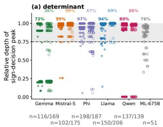

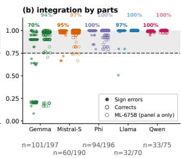  
Figure 1: The sign is decided late — in both tasks: (a) determinant, (b) integration by parts, measured identically. One point per confirmed case’s peak depth, both batches pooled; bar: median; shaded band: late window (depth ≥ 0.75); percentages: late share (bold: errors, solid points; lighter: corrects, open points); n = errors/corrects per panel. Exclusions: Table C1. Grey circles, (a) only: unfiltered Mistral-Large-675B run (§3).

Two kinds of peaks. Figure 1 shows where the decision peaks, and in both panels the answer is the same: the great majority of points sit in the shaded band, past depth 0.75. Determinant: 72–97% of confirmed errors per model (Gemma 72%, Qwen 80%, Llama 94%, Mistral-Small 95%, Phi 97%); IBP: 70–100%. Correct answers commit equally late, so lateness characterizes sign-writing itself, not failure — with one exception: Gemma’s determinant corrects decide early (36% late, median depth 0.21), and even that vanishes on IBP (94% late). An exploratory behavioral run on a sixth, far larger model —

Mistral-Large-675B, 51 sign errors on the 5×5 task, unfiltered, the causal battery computationally prohibitive at that scale (accounting in Appendix C) — is consistent: 39 of 51 (76%) are late. The arithmetic control closes the loop: 48 plain subtraction problems, answered almost always correctly (237 of 240 completions), every case confirmed — and four of the five models still peak past depth 0.75, with Gemma again the exception (22 of 48 late, split bimodally between an early band and the end) — so late sign-writing belongs neither to the algebra tasks nor to errors (Appendix D). The figure also leaves a small early minority, concentrated in two models, taken up next.

The early minority. The peak alone can mislead — a curve can spike early, collapse below zero through the whole middle of the network, and commit only at the very end — so Appendix C asks a second question of every early case: from which layer does the lead turn positive and stay positive (the crossing, Appendix C.4)? Qwen’s early points are all artifacts of a token-table lookup at layer 0: its dominant probe token leans «−» before any layer has run, the lean collapses mid-network, and every such case locks in its sign only at 95–99% depth. Gemma’s are the real exception: an early band (layers 5–13) copies the minus ink of the model’s own recent text — the source of its corrects exception in Figure 1 — and it vanishes on IBP. Across all five models, genuinely early error commitments are 26 of 703 confirmed cases: 3.7% — the limit of the late-decision claim, stated plainly (case-by-case census in Table C2, Appendix C).

The full path. The complete median trajectories (Appendix E, Figures E1–E2) seal the story: in every model the lead sits inside the noise band, or below zero, through the middle of the network and exits steeply only past depth 0.75. An inherited error, computed earlier and carried forward, would be visible mid-network; nothing is.

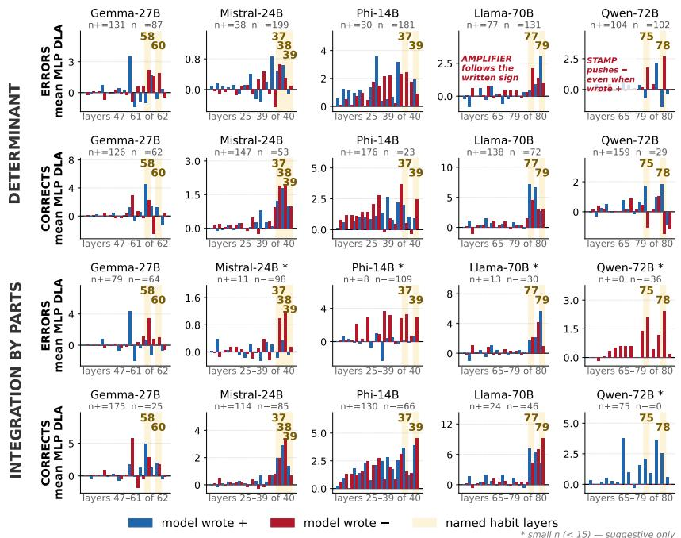  
Figure 2: Per-layer MLP DLA split by written sign — determinant (top) and IBP (bottom), all five models, both batches. Blue: wrote «+»; red: wrote «−»; gold bands: habit layers. Same-direction bars in both groups: amplifier; opposite: stamp; a late layer pushing back toward the correct sign on errors is a judge. \* small n (< 15), suggestive only (Mistral/Phi/Llama IBP «+» errors, n = 11/8/13); Qwen IBP has no blue bars (0/36 errors, 0/75 corrects) — a property of the model, not the data: Qwen never writes «+» at the IBP sign site.

## 4 HABIT LAYERS: WHICH LAYERS WRITE THE SIGN, AND HOW

From when to where. §3 located the sign decision in time; this section locates it in the architecture. The instrument is per-layer direct logit attribution (DLA): each layer’s MLP output projected onto the final-layer probe direction — its direct contribution, in logits, to the written sign’s lead (protocol: Appendix B, stage s02; pooled verdict table: Appendix E.6). MLPs are the unit of account, not a verdict on attention: attention is tested causally in §5, where no single head accounts for the push (per-head grid: Appendix G). In every model the credit concentrates on a handful of late layers — the habit layers: Gemma L58/L60, Mistral L37–L39, Phi L37/L39, Llama L77/L79, Qwen L75/L78 — frozen on discovery data (Appendix I.2, Table I.1), one set per model, the same for errors and corrects, because targets name layers, not outcomes. Figure 2 pools both phases, so a tall pooled bar is not the selection criterion (Phi’s L34 — visible in the pooled view, outside the frozen set — is the clearest example; full-depth view: Appendix E, Figures E3/E4). The reading is simple: a handful of named late layers write the sign — Mistral’s L37–L39 in the last quarter of 40 layers, Llama’s L77/L79 in the last few of 80 — and the error and correct bars rise at the same layers: the same pen writes both the right and the wrong sign. These named layers are the exact targets of every causal experiment in §5. One column already breaks the pattern: Phi’s credit is not a handful of spikes but a nearly even band across its whole late window — the spread that §5 and §6 show is exactly why its circuit resists steering (Appendix K).

Stamps versus amplifiers: the diagnostic. Naming the layers is not the end of the question: two models can write the sign at the same relative depth by different means, and the distinction — a fixed stamp versus an adaptive amplifier — is not cosmetic: it predicts how each model responds to intervention in §5. The push Figure 2 measures travels along a single sign direction in the residual stream (construction

Table 2: Layer roles at a glance — verdict first, evidence in brackets. Each cell: the verdict and the mean MLP DLA (logits) toward the written sign on wrote-«+» cases, pooled discovery + held-out. CI fully below 0 = stamp; fully above 0 = amplifier; crossing 0 = indeterminate; \* = n < 15, suggestive only. Full 95% bootstrap CIs, case counts, and the wrote-«−» sanity columns: Table E2 (Appendix E.6); held-out-only preregistered scoring: Appendix I.
<table><tr><td>Model (layer)</td><td>Det errors</td><td>Det corrects</td><td>IBP errors</td><td>IBP corrects</td></tr><tr><td>Gemma (L58)</td><td>stamp (-0.98)</td><td>amplifier (+2.30)</td><td>amplifier (+0.66)</td><td>amplifier (+2.88)</td></tr><tr><td>Mistral (L39)</td><td>indet. (-0.14)</td><td>weak amp. (+0.99)</td><td>indet.* (-0.28)</td><td>weak amp. (+0.32)</td></tr><tr><td>Phi (L39)</td><td>amplifier (+1.56)</td><td>amplifier (+2.12)</td><td>amplifier* (+0.62)</td><td>amplifier (+3.89)</td></tr><tr><td>Llama (L79)</td><td>amplifier (+2.99)</td><td>amplifier (+3.38)</td><td>amplifier* (+5.66)</td><td>amplifier (+8.93)</td></tr><tr><td>Qwen (L75)</td><td>stamp/judge (-0.72)</td><td>stamp (-1.02)</td><td>no «+» cases</td><td>- no «+» cases</td></tr></table>

in Appendix H.2; validation, the random-direction control, in H.3). Each bar is the mean DLA contribution of one layer to the written sign’s lead, computed separately for the wrote-«+» and wrote-«−» groups; because the lead is a contest between exactly two tokens, a downward bar is not “indifference” — it is an active vote for the opposite sign, in the very cases where the model wrote this one. The diagnostic is a single comparison per layer: bars pointing the same way in both groups mark an amplifier — the layer supports whatever the model is writing; bars pointing opposite ways mark a stamp — one fixed sign, whatever was written.

The verdicts. Table 2 condenses the one-comparison rule into a verdict per model and domain (full bootstrap CIs, case counts, and sanity columns in Table E2, Appendix E.6). Qwen-2.5-72B: L75 and L78 push «−» no matter which sign the model is writing — clean fixed-minus stamps, active even on the correct plus answers it gets right; those survive because L77, a rescue layer, pushes hardest exactly for the plus-writers: Qwen errs when its standing minus default goes unopposed. Llama-3.3- 70B: at L79 both groups’ bars point up — a pure amplifier, supporting whichever sign the model has already decided. Gemma-3-27B’s det L58/L60 lean stamper-like and Phi-4-14B is mixed (L37 stamp-like, L39 amplifier-like): the models do not share one mechanism — localization is universal, the mechanism is not. The corrects confirm it (a downward bar on a correct answer is the strongest evidence of a stamp, and the stamp layers show exactly that), and the IBP panels of Figure 2 replay the comparison in the second domain.

Only minus gets stamped. One regularity in Figure 2 is an absence: if stamps were a generic failure mode, some model somewhere should carry a fixed plus stamp, and none does — wherever the two bars disagree, it is always the wrote-«−» bar that points up, so every fixed stamp at the habit layers pushes «−», never «+» (the one plus-leaning bar, Gemma’s untagged L55, sits outside the habit set and is outvoted by its minus-pushing neighbours). The asymmetry has a plausible origin in written mathematics — a negative result is marked explicitly (“−67”) while a positive one is written bare, so text statistics teach a model to expect minus — and three independent fingerprints support the reading: the error pool’s own two-to-one minus skew (Table A4, Appendix A.4), Qwen’s layer-0 embedding lean (Appendix C.4.3), and a base-versus-instruct comparison finding the L78 minus stamp already present before any chat training (Appendix F). The practical consequence shapes everything downstream: since only minus habits exist where the circuit acts, the steering experiment of §5 (Figure 3) is a minus-removal design — one can only erase a habit that exists.

Roles are properties of the layers, not of error cases. The correct panels are already in Figure 2; Table 2 condenses the verdict test on correct answers — same layers, same rule, both domains. Qwen’s minus-stamp, Llama’s L79 amplifier and Phi’s L39 amplifier all appear on corrects too. Mistral’s errors are indeterminate; its corrects lean amplifier, weakly. One divergence: Gemma’s determinant L58 — stamper on errors, amplifier on corrects; its determinant corrects commit early (median depth 0.21), before L58’s window. Across domains, the dependence is selective: Gemma L58 changes role; Phi L39 and Llama L79 do not. Qwen’s role test is not computable on IBP — no wrote-+ cases in either class. What separates errors from corrects is the sign the machinery is applied to, not the machinery. And the timing never moves: in both domains, both classes commit in the last few percent of depth. Localization claims must name the task; the late-commitment claim need not.

## 5 CAUSAL TESTS: THE LAYERS WRITE THE SIGN, REDUNDANTLY — AND STEERING IT IS ANOTHER MATTER

§3 and §4 located the sign decision and typed its mechanisms; both rest on correlational evidence. This section runs the interventions declared in §2, under the same replay condition as every measurement so far, in two directions: necessity — does removing the habit layers’ contribution destroy the sign? — and sufficiency for control — does subtracting the sign direction change what the model writes? The targets were frozen before held-out scoring (§2), so the interventions are valid on both halves of the data; we report both, with held-out as the confirmatory half.

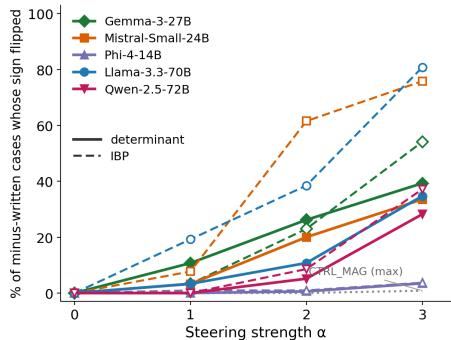

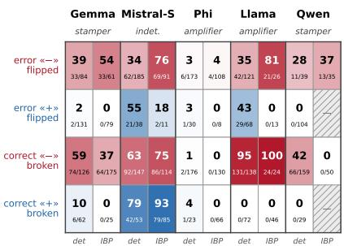  
Figure 3: Minus-removal steering — dose– response, both domains in one panel (C2, pooled discovery + held-out). Solid: determinant; dashed: IBP; one color per model; grey dotted: CTRL\_MAG, a magnitude-matched random direction (max across models). Subtraction of d<sup>ˆ</sup>at the habit-layer sites (protocol: Appendix H; Llama det held-out only). The α = 3 endpoints (k/n) are the top row of Figure 4. Not every flip is a repair: Llama det 42 = 33 corrective + 9 harmful; Mistral det 52 + 10, IBP 67 + 2; all other flips corrective.  
Figure 4: The specificity fingerprint — what minusremoval at α = 3 does to the four cohorts, per model. Each cell split: left det, right IBP; large number = % flipped (errors) or broken (corrects), small = k/n. Red rows: minus-written; blue: plus-written. Hatched: cohort does not exist (Qwen wrote no «+» in IBP). Prediction and verdicts: text (lead shifts: Appendix H.4; held-out-only rates: Appendix I).

Necessity: ablation. DLA credit is correlational, so we ablate. No single writer is necessary: removing the sign-direction component from any one layer is near-null except at Llama’s final amplifiers, and zeroing candidate attention heads one at a time costs at most 0.46 logits — attention is not the carrier (Appendix G). The set is necessary — in some models: removing the five habit layers jointly collapses the wrong sign’s lead in Llama (det −4.25, IBP −7.09 held-out), Qwen det (−2.52), and Gemma on discovery, with the three large held-out collapses each exceeding all 40 matched random five-layer sets (protocol and full grid: Appendix G). Near-null single layers plus a large joint effect is the signature of redundant writing: several layers push the sign along the same direction, and any one can be removed while the rest compensate — the self-repair of McGrath et al. [10], confirmed at scale by [16], here preregistered and cross-model. The split has a second face: in Mistral and Phi the joint ablation is near-null even on discovery, and ablating Phi’s entire late window L24–39 moves its det lead by only −1.28, and cumulatively mean-ablating its topfifteen DLA layers — every credited writer — reaches just −1.34 against a median margin of 17.8 (Appendix K) — a necessity failure that foreshadows §6. A stronger combined removal (the α = 1 arm of the protocol below: subtract the sign direction at the habit-layer MLPs, zero the amplifier attention) bites in all five models on held-out data (full grid: Table G7, Appendix G.7) — but Phi’s large drops move the lead without flipping the written sign: its oversized margins are part of the story of §6.

Sufficiency: steering. If the habit layers write the sign along one direction, subtracting that direction at those layers should change what the model writes. Figure 2 showed that every fixed stamp at the habit layers pushes “−”, so the intervention is minus-removal: subtract the sign direction <sup>ˆ</sup>d (construction in Appendix H.2) at each model’s habit-layer steering sites (listed per model in Appendix H.4) at doses α = 1, 2, 3, on minus-written error cases from both phases (pooled; Figure 3), against CTRL\_MAG — a magnitude-matched random direction that separates direction-specific effects from generic disturbance.

The dose–response. Each line is one model on one task; moving right along the x-axis means subtracting the minus direction more strongly. Read it in three steps. First, the grey dashed floor: a random direction of exactly the same size flips 1 of 923 cases in the entire pooled experiment — whatever the colored lines do above it is specific to the minus direction, not to disturbance in general. Second, the slopes: four of the five models rise with dose — removing the minus habit fixes wrongly-written minus signs, and fixes more of them the harder it is removed; Mistral climbs to 69/91 on IBP and Llama to 21/26. The IBP task responds more strongly than the determinant in every model. Third, the exception: Phi barely moves on either task (6/173 det, 4/108 IBP) — the same intervention, at equally well-localized layers, produces almost no causal purchase. That gap is the paper’s central dissociation, and Figure 5 plots it directly. Why Phi resists is itself a measured result, not a mystery: oversized error-site margins (det median 17.8 logits) and writing spread over ∼15 late MLP layers (visible directly in Phi’s column of Figure 2) mean even per-case calibrated dosing flips only about half the cases — Phi is unsteerable at calibrated dose (exploratory deep-dive: Appendix K).

What the lever moves: minus-ness, not errors. A flip rate is only interpretable next to a specificity test: does the intervention repair wrongness, or remove minus-ness wherever it lives? Applying the identical direction and dose to the correct answers settles it, and Figure 4 is that test drawn as a picture: one column per model, one row per cohort — the two red rows minus-written, the two blue rows plus-written. Figure 2 turns the stamp/amplifier split into a row prediction: removing a standing «−» vote should color the red rows and leave the blue rows empty; removing an amplifier should spill into every minus row, correct or wrong. At α = 3 the matrix obeys: in Llama’s column the correctminus row breaks at 95% (131/138) while the correct-plus row stays blank (0/72); in Qwen’s, 42% of correct-minus (66/159) and 0/29 correct-plus; CTRL\_MAG colors nothing anywhere. That row pattern — fix wrong minus, break right minus, spare right plus — is the signature of a direction whose content is “this answer is minus, with no component separating correct-minus from wrongminus: steering acts on representation content, not correctness (full protocol, per-dose tables, and the bridge to all five models: Appendix H).

What each model is (Figure 4, column by column). Qwen — the purest stamp: a fixed «−» vote even on corrects; every det-error flip corrective (11/11), none of 104 plus-written cases touched; wrote no «+» in IBP at all. Gemma — stamp on errors, amplifier on corrects: just as surgical — the minus cohorts collapse, plus-written survive 129/131 with growing «+» leads. Llama — the pure amplifier: a minus-ness lever, not a repair — 43% of plus-written det errors flip too, 95–100% of correct-«−» break, correct-«+» spared (0/72). Mistral — grips everything, specific to nothing: weakest verdict in Table 2, strongest steering in Figure 3, color in every cohort (correct-«+»: 42/53). Phi — the dissociation in one model: best-localized, an amplifier by DLA, immune to the lever — the preregistered null (Appendix I).

The reverse arrow: injection. The patching stage (s07) and prediction P5 ask the opposite question: at the moment before the sign is written, swap the message one layer passes forward — replace its activation at that single token with a mean message recorded from other runs — and see which sign the model writes now. The pattern across every arm is one line, and all four scored models confirmed their registered predictions: handing an error the healthy message from correct runs repairs almost nothing (a preregistered null — at the stamp layers the healthy and the error message are the same, so there is nothing error-specific to copy in), while handing a correct answer the error message breaks it (Mistral 79/107 at α = 3; Qwen’s check layer reads the transplanted content exactly as registered; Llama’s margins absorb the lead shift, 0/130 broken; Phi is immune in this arrow too, which rules out a miscalibrated dose or direction and leaves the mechanism itself as the explanation). The signal can be written in, not copied out; controls stay flat throughout (mid-network swaps and CTRL\_MAG ≈ 0); per-model protocols and full tables are in Appendix J, the frozen verdicts in Appendix I.

## 6 THE DISSOCIATION, PREREGISTERED

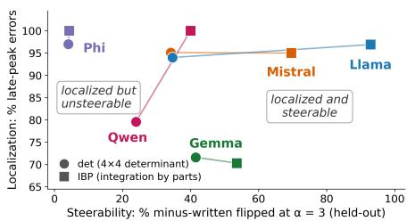  
Figure 5: The dissociation — localization does not imply steerability. Two points per model, joined by a thin line; axes and markers as labeled. Filters and exclusions match Figures 1 and 3; a flip is not always a repair (corrective/harmful split in the Figure 3 caption).

Two axes, one verdict. Figure 5 plots, for each of the ten model×task cells, localization — the percent of confirmed errors peaking in the last quarter of depth — against steerability — the percent of held-out minuswritten cases flipped at $\alpha = 3$ . If localization implied steerability, the points would climb a diagonal. They do not: all ten cells sit high on localization (70–100%) yet scatter across nearly the full width on steerability (4–93%), and Phi breaks the implication outright — the sharpest localization of all five models (97% det, 100% IBP) and the least steerable (4.1% and 4.4%), on both tasks at once. The thin lines add one more fact: IBP is more steerable than the determinant for every model, yet Phi’s pair barely moves — the task effect cannot rescue a model that resists. Every held-out number was scored under criteria frozen in advance: six predictions per model (P1–P6) with numeric pass bars, exclusions, and denominators fixed before any held-out data existed (freeze dates, amendment policy, per-cell scoring, and each value’s source JSON: Appendix I).

The scorecard. 23 of 29 scored predictions confirm; the misses are the informative ones (scorecard figure and per-model tables: Appendix I). Gemma’s near-misses are artifacts of the frozen scoring sites, not the effect (Appendix I.5); Qwen’s one miss (P3) is a sign-convention reversal, restored one layer later at L79 (77.9%); Phi’s fully green column is preregistered failure confirmed — P4–P6 predicted the null, and it held. Among the frozen predictions: that the best-localized model would steer least. It did.

## 7 DISCUSSION

What the dissociation is, mechanistically. Four identified properties open the gap between localization and steerability. First, redundancy: the sign is written by several layers along a shared direction, so an intervention that misses part of the set is compensated by the rest (§5; Appendix G) — self-repair [10]. Second, opposing structure: Qwen’s minus-stamps are opposed by rescue layers that steering does not touch (Figure E5; Appendix H), consistent with its partial break rate on correct-minus answers. Third, mechanism type: Phi’s habit layers are a stamp/amplifier mixture, and the same subtraction that moves four models produces almost no purchase there. What predicts steerability is not where the sign is written but how: layers that stamp a fixed sign yield to subtraction; layers that amplify an already-chosen sign resist it. Fourth, asymmetry by answer state: the same direction moves errors more than matched correct answers — a difference of magnitude, not presence (§4). None of these properties is visible in a localization map alone; the domain matters too — in the calculus task the minus-stamp is cleaner and flip rates higher in every model (Figure 5). The practical reading for intervention-based methods [11–13]: a sharply localized site is not yet a lever, and validating a circuit by editing at its site [5, 6, 9, 14] measures the conjunction of localization and the network’s cooperation, not localization alone.

Throughout the paper the comparisons are between plus and minus even though the object of study is the error. Errors and corrects run the same layers, in the same roles, on the same timing, differing only in the magnitude of the per-layer contributions (§4), and the error pool itself is minus-skewed two to one (Table A4), so the experiments naturally work in sign coordinates: an error is the same sign-writing machinery serving the wrong sign.

Limitations. Steering verdicts are scored at the answer token; a free-generation probe (the generation arm of s08) agrees on small n, but full solutions run ≈ 4,000 characters (≈1–1.5k tokens) and often end without a parseable final answer at high dose, so generation could not be scored at scale (Appendix H). Flips are not always repairs: at α = 3 some flipped cases invert an already-correct sign (Figure 3 caption). A residual 26 of 703 confirmed errors (3.7%) genuinely peak early (Appendix C.4). The origin probe of Appendix F is one model and one small completion set. And all results concern one failure family in one task-domain pair: the dissociation is demonstrated, not exhaustively mapped.

Future work. Two follow-ups are specified by the paper’s own loose ends. The corpus probe behind the origin hypothesis: measure explicit minus versus plus tokens at answer positions in pretrainingscale mathematical text and check whether that asymmetry predicts stamp strength across models — Appendix F’s base-versus-instruct result (the stamp predates chat-training) is the first data point such a probe must fit. The repair path: a small parameter-efficient update (LoRA- or ReFT-style; cf. AxBench [17]) restricted to the identified habit layers, with the frozen battery as the pass/fail screen steer-aware localization: certifying a site as a lever, not merely a location, before intervening with stamp versus amplifier as a testable steerability predictor for new models. And one open direction: whether any direction in the discovered sign space separates correct-minus from wrongminus — the direction our steering shows the current space does not contain.

## 8 CONCLUSION

Five models, one pipeline, one intervention. In every model the written sign is decided late, at nameable layers, along a single direction — and yet the same intervention at the same layers spans 4% to 93% steerability, an outcome we predicted before measuring it. The gap has mechanistic content — redundant writers, rescue layers, and stamps that carry minus-ness rather than wrongness — and it is not domain-bound: the same late decision, the same direction, and the same dissociation appear in both linear algebra and calculus. This paper shows what the gap [9, 10] is made of. Finding a circuit is the beginning of control, not the end of it: localization does not imply steerability. All code, per-case results, frozen predictions, and preregistration documents are in a public repository: https://github.com/signcircuits-experiments/sign-circuit-scaling.

## REFERENCES

[1] S. Agarwal et al. LinAlg-Bench: A Forensic Benchmark Revealing Structural Failure Modes in LLM Mathematical Reasoning. arXiv:2605.16675, 2026. https://arxiv.org/abs/2605.16675

[2] nostalgebraist. Interpreting GPT: the logit lens. LessWrong, 2020.

[3] N. Belrose, Z. Furman, L. Smith, D. Halawi, I. Ostrovsky, L. McKinney, S. Biderman, and J. Stein hardt. Eliciting latent predictions from transformers with the tuned lens. arXiv:2303.08112, 2023.

[4] N. Elhage, N. Nanda, C. Olsson, T. Henighan, N. Joseph, B. Mann, A. Askell, et al. A mathematical framework for transformer circuits. Transformer Circuits Thread, Anthropic, 2021.

[5] J. Vig, S. Gehrmann, Y. Belinkov, S. Qian, D. Nevo, Y. Singer, and S. Shieber. Investigating gender bias in language models using causal mediation analysis. NeurIPS, 2020.

[6] K. Wang, A. Variengien, A. Conmy, B. Shlegeris, and J. Steinhardt. Interpretability in the wild: a circuit for indirect object identification in GPT-2 small. ICLR, 2023.

[7] N. Nanda, L. Chan, T. Lieberum, J. Smith, and J. Steinhardt. Progress measures for grokking via mechanistic interpretability. ICLR, 2023.

[8] A. Stolfo, Y. Belinkov, and M. Sachan. A mechanistic interpretation of arithmetic reasoning in language models using causal mediation analysis. EMNLP, 2023.

[9] P. Hase, M. Bansal, B. Kim, and A. Ghandeharioun. Does localization inform editing? Surprising differences in causality-based localization vs. knowledge editing in language models. NeurIPS, 2023.

[10] T. McGrath, M. Rahtz, J. Kramar, V. Mikulik, and S. Legg. The Hydra effect: emergent self-repair in language model computations. arXiv:2307.15771, 2023.

[11] A. Turner, L. Thiergart, D. Udell, G. Leech, U. Mini, and M. MacDiarmid. Activation addition: steering language models without optimization. arXiv:2308.10248, 2023.

[12] K. Li, O. Patel, F. Viégas, H. Pfister, and M. Wattenberg. Inference-time intervention: eliciting truthful answers from a language model. NeurIPS, 2023.

[13] A. Zou, L. Phan, S. Chen, J. Campbell, P. Guo, R. Ren, A. Pan, et al. Representation engineering: a top-down approach to AI transparency. arXiv:2310.01405, 2023.

[14] K. Meng, D. Bau, A. Andonian, and Y. Belinkov. Locating and editing factual associations in GPT. NeurIPS, 2022.

[15] D. Tan, D. Chanin, A. Lynch, D. Kanoulas, B. Paige, A. Garriga-Alonso, and R. Kirk. Analysing the generalisation and reliability of steering vectors. NeurIPS, 2024.

[16] C. Rushing and N. Nanda. Explorations of self-repair in language models. arXiv:2402.15390, 2024.

[17] Z. Wu, A. Arora, A. Geiger, Z. Wang, J. Huang, D. Jurafsky, C. D. Manning, and C. Potts. AxBench: steering LLMs? Even simple baselines outperform sparse autoencoders. ICML, 2025.

## APPENDIX A — DATASET CONSTRUCTION AND PROVENANCE

## APPENDIX A.1 BACKGROUND — SIGN ERRORS AS A STRUCTURAL FAILURE MODE

The LinAlg-Bench benchmark. Agarwal et al. [1] introduced LinAlg-Bench, a diagnostic benchmark of 660 linear-algebra problems (nine task types; 220 problems each at 3×3, 4×4, and 5×5 matrix sizes), every one certified by SymPy, a symbolic math library that computes exact ground truth. Ten frontier models produced 6,600 outputs, all graded; a three-stage judge pipeline then traced each of the 1,156 failures back to its first wrong step and gave it one of ten primary error tags, validated against 593 human labels (92.6% agreement). The headline finding: model failure on this kind of math is not random noise — it is structured, and it changes shape predictably with matrix size.

Where the error lives. A sign error, in this taxonomy, is one wrongly written sign token in the middle of the computation. The wrong sign appears at many different sites, not one: the alternating operator in a cofactor expansion (+−+− lost midway); the parity factor (−1)ˆ(i+j) dropped from a cofactor term; a negative matrix entry mishandled, so −(−4) is written as −4; a product of two negatives written negative; and in integration by parts, the minus written when the formula is applied recursively. The tag is assigned at the first wrong value, and only when the magnitude at that step is correct and the sign alone is wrong — this rule is what separates a pure sign error from an arithmetic error. Everything downstream then runs correctly on the corrupted expression.

How large is the class, and how does it grow? The taxonomy has ten primary tags — four execution errors (sign, arithmetic, carry-down, memory loss), two structural (hallucination, method failure), and four artifacts — and sign error is a major class. At 3×3 it leads every tag: 33.0% of all failures. As difficulty rises, its count nearly quadruples, 33 → 123 → 114 sign errors at 3×3 / 4×4 / 5×5 (270 total), and the recursion-driven parity subtypes surge from 3.0% to 61.0% of sign errors at 4×4. Its share of failures falls to 17.2% at 5×5 only because models stop computing at all there — hallucination (fabricated or abandoned computation) rises from 17.0% to 47.1% and takes over. So sign errors dominate exactly where models still execute the algorithm.

Which models make them. The ten models evaluated span three accuracy tiers on the determinant task: Tier 1 — OpenAI-o1, Gemini-3.1-Pro, DeepSeek-V3, and Qwen3-235B (≥74% accuracy); Tier 2 — GPT-5.2 and Mistral-Large (36–54%); Tier 3 — Claude-4.5-Sonnet, Qwen2.5-72B, Llama-3.3-70B, and GPT-4o (0–12%). Sign errors are not evenly spread across them: top-tier Gemini-3.1- Pro commits zero at any size, while the four Tier-3 models account for 221 of the 270 (81.9%). Yet the class persists across tiers, consistent with reports that transformers systematically struggle with signed arithmetic. The two models this paper studies mechanistically — Qwen2.5-72B and Llama-3.3-70B — sit in Tier 3. They are also the only models on that list a mechanistic study can realistically open: most of the ten are closed-weight (OpenAI-o1, Gemini-3.1-Pro, GPT-5.2, Claude-4.5-Sonnet, GPT-4o — an API exposes no internal activations to probe), and the remaining open ones are too large to probe layer-by-layer (DeepSeek-V3, Qwen3-235B). Mistral-Large-675B was also attempted; it enters this paper only as an exploratory behavioral run, since the causal battery (ablation, patching, dose-response steering) is computationally prohibitive at that scale (Appendix A.5, C.5). To test that the findings are not particular to the two 70B models, we therefore added three further open models at smaller sizes — Phi-4 (14B), Mistral-Small (24B), and Gemma-3 (27B).

Where we probe — the token picture. Every measurement in this paper sits at one position inside the model’s own written solution — precisely, at the token immediately before the sign token (position −1): the hidden state there is what the model uses to write the sign, so the layer-by-layer readout at that position shows the sign being decided. The error site differs by subtype:

det — alternating drift (real traced case; probed sign in brackets)   
. . . det(A) = −3·det(A11) − (−4)·det(A12) [−] (−4)·det(A13) − . . .   
↑ should be “+” — alternation broken   
det — double negative (illustrative form)   
. . . term = −(−4)·M13 = [−]4·M13 . . .   
↑ should be “+4” — the two minuses not resolved   
IBP — recursive step (illustrativeform)   
. . . = x<sup>2</sup>e<sup>x</sup> − 2(xe<sup>x</sup> − e<sup>x</sup>) = x<sup>2</sup>e<sup>x</sup> − 2xe<sup>x</sup> [−] 2e<sup>x</sup> . . .   
↑ should be “+” — the recursive minus misdistributed   
Downstream: correct arithmetic on the corrupted expression → final answer a wrong number   
(traced det case: 323; truth 83).   
Probe: hidden state at the token before the bracketed sign, replayed teacher-forced; everything   
before it is held exactly as the model wrote it.

What this study probes. The taxonomy splits sign errors into three structural families [1, App. F]. Across every subtype the surface signature is identical — a single wrongly written sign token — and that shared signature is the object this paper studies mechanistically. Every subtype has a concrete written form:

Parity family — the (−1)ˆ(i+j) bookkeeping of cofactor expansion; 61.0% of 4×4 sign errors:

• Alternating drift: the +−+− operator pattern is tracked correctly for the first terms, then lost midway — det = a11·M11 − a12·M12 − a13·M13 ... (third operator should be +). This is the traced case in the diagram above.

• Cofactor neglect: a minor is computed correctly but used raw, with the parity factor never applied — +a32·M32 written where position (3,2) demands −a32·M32.

• Parity sign error: the parity factor is applied, but with the wrong sign or applied twice — C13 = −M13 where $( - 1 ) \hat { \bf \Phi } ( 1 + 3 ) = + 1$

Product family — signed multiplication anywhere in the computation; 75.8% of 3×3 sign errors:

• Product sign error: a product has correct magnitude, wrong sign — (−3)·5 = 15.

• Double negative trap: two negatives meet and are not resolved — −(−4) written as −4 instead of +4.

• Rule interference: a negative entry is treated as positive throughout — entry −2 enters the expansion as 2.

Standalone — an isolated flip orthogonal to both: operation direction (adding where the algorithm subtracts, or vice versa) and silent sign flip (a signed value appears with no working shown for that one step, while surrounding steps show their work).

The same taxonomy carries over to IBP. The clean recursive case is a double negative trap on the by-parts minus: distributing it, $\mathrm { x } ^ { 2 } \mathrm { e } ^ { x } - 2 ( \mathrm { x e } ^ { x } - \mathrm { e } ^ { x } )$ is written as $\mathrm { x } ^ { 2 } \mathrm { e } ^ { x } - 2 \mathrm { x } \mathrm { e } ^ { x } - \bar { 2 } \mathrm { e } ^ { x }$ — the minustimes-minus never resolved to +. In the IBP sign errors this study uses, silent sign flip is the most common subtype, followed by the double negative trap and alternating drift.

Why this matters. A sign error is the smallest possible failure — one token — inside an otherwise correct computation, produced even by models that execute everything else right. It is structured (predictable subtypes, predictable growth with recursion depth), it dominates failures where models still compute, and it survives in current frontier systems. A one-token, structurally regular failure is exactly the kind interpretability can hope to localize and remove — which is what this paper attempts. Appendix C.2 walks through one concrete case end to end.

## A.2 PROBLEM GENERATION

Determinant problems. The determinant data began with the 4×4 problems of LinAlg-Bench [1], but the benchmark bank alone could not supply enough sign errors, so each of the five core models — Gemma-3-27B, Llama-3.3-70B, Mistral-Small-24B, Phi-4-14B and Qwen-2.5-72B — was given its own larger bank, generated with the benchmark’s released generator to the same specification: integer matrices with entries drawn uniformly from [−5, 5], ground truth computed symbolically so every answer is an exact integer, and every new matrix deduplicated against all prior determinant corpora by exact content match. Bank sizes per model are the first row of Table A1 — Gemma 4050, Llama 2850, Mistral 2050, Phi 2050, Qwen 675; the more accurately a model computes, the more problems it takes to harvest enough errors from it.

Integration-by-parts problems. The IBP problems are not part of LinAlg-Bench. We built this bank ourselves: a custom poly-trig integration-by-parts generator, created specifically to test whether the sign circuit extends beyond linear algebra to a second domain. Each of the same five models received 1,294 problems (train + validation combined; Table A3), and every problem forces at least one application of the parts formula, so the minus of −Rv du must be written explicitly.

## A.3 HARVESTING AND GRADING

Every model answered every problem in its bank at temperature 0, under a fixed instruction to show all computation steps and box the final answer. A response is graded correct if and only if the boxed answer equals the symbolic ground truth exactly — no tolerance. This single check sorts every response into the two pools the rest of the paper uses: wrong answers, which may contain a sign error (A.3.1), and correct answers, which supply the matched controls (A.3.2).

## A.3.1 ERROR CASES

Wrong answers pass through the LinAlg-Bench judge pipeline [1], used exactly as released; its agreement with expert human labels is reported in [1] and quoted in A.1. A truncation pre-check first sets aside any response without a complete boxed answer — an incomplete response is never classified. A classification judge (an LLM judge at temperature 0) then reads the full response against the ground truth, locates the first wrong value, and applies the magnitude rule: the case is a sign error only if that value has the correct absolute magnitude and the wrong sign; if the magnitude is also wrong, the case is tagged arithmetic instead. A second, independent validation judge reexamines every proposed sign error and can reject it — no case is kept on the classification judge’s word alone. A sign error runs in either direction: the model may write “−” where the truth is “+”, or “+” where the truth is “−” — the wrote-+ / wrote-− columns of Table 1 count both. The pipeline’s third stage is not fully automatic: any case the validation judge flags as ambiguous goes to manual review — a human, not a model, is the final judge — as described in [1].

Every experiment needs the character-level position of the wrongly written sign in the model’s own response. An LLM annotator marks the position and copies ten characters of verbatim context on each side; a deterministic check then verifies that the character at the recorded offset is exactly the annotated sign and that it lies inside the model’s answer rather than the prompt. A manual check is involved at each stage as well: we verified samples by hand at every stage, the manual and automated results agreed statistically, and only then did cases go into the final experiment. A case that survives every stage — graded wrong, confirmed a sign error by the judges, its sign located and offset-verified — is experiment-ready: a case the paper’s experiments can actually run on. Permodel counts at every stage are in Table A1. All probing then happens at the token immediately before the sign, teacher-forced, with everything before it held exactly as the model wrote it.

A concrete case: NC\_4x4\_det\_201 (Qwen-2.5-72B, held-out; ground truth det(A) = 83, model answer 323, family Alternating\_Drift). In the cofactor expansion the model wrote det(A) = −3·det(A11) − (−4)·det(A12) − (−4)·det(A13) − (−3)·det(A14), then summed 345 − 160 + 120 + 18 = 323. The A13 term is the slip: the cofactor sign is $( - 1 ) \hat { ( } 1 + 3 ) = + 1$ , so the correct contribution $\mathrm { i s } - 4 \times 3 0 = - 1 2 0 ;$ ; the model’s extra minus made it +120, adding 240 and turning 83 into 323. The first wrong value is that third cofactor term — magnitude right, sign flipped — so the pipeline tags it a sign error. Appendix C.2 traces this same case through the logit lens.

## A.3.2 CORRECT CASES

A correct case enters the pool by the exact-match check alone; no judge is involved. We do not control which problems a model gets right, so the wrote-+ / wrote-− split among corrects is simply the models’ own behavior — that is why the positive and negative counts differ so much between models. To compare a correct case against an error case we must probe the same kind of sign. An error case is probed at its wrongly written sign; a correct solution has no wrong sign, so we probe the sign at the same kind of step, written correctly — in det(A) = 0·C11 − 5·C12, the minus before 5·C12 is a cofactor-expansion operator sign, exactly the type that goes wrong in error cases, here written right. The annotator-plus-deterministic-check procedure of A.3.1 locates that matched sign and verifies its offset the same way. Only verified rows enter any experiment; per-model counts are in Table A2.

## A.4 THE DATA FUNNEL AND THE DISCOVERY / HELD-OUT SPLIT

Tables A1—A3 give the full funnel — bank → graded → validated sign errors → experiment-ready → discovery / held-out — for the five core models. Rows not marked file-verified are counts noted at harvest time; the file-verified rows are recomputed from the released per-case files and are the counts every experiment in this paper uses (A.6).

The split rule. All the questions producing errors and their correct counterparts are split into discovery and held-out sets — separate batches, not a random split of one pool. The discovery set was used to identify the layers and the sign direction; the held-out set is a distinct batch of new problems the experiments never saw. Before any held-out measurement, overlap with the discovery set is checked at both the ID level and the content level (exact matrix-entry comparison) and overlapping rows are dropped — for Qwen, 206 received rows lost 59 to content overlap, leaving 147. Held-out data is touched exactly once: a technical crash may be restarted, a disliked result may not.

Table A1. Determinant 4×4 error funnel, five core models.
<table><tr><td>Stage</td><td>Gemma-3- 27B</td><td>Llama-3.3-70B</td><td>Mistral-Small-24B</td><td>Phi-4-14B</td><td>Qwen-2.5-72B</td></tr><tr><td>Bank size</td><td>4050</td><td>2850</td><td>2050</td><td>2050</td><td>675</td></tr><tr><td>PASS (correct)</td><td>3555</td><td>2306</td><td>438</td><td>223</td><td>133</td></tr><tr><td>FAIL (wrong / no answer)</td><td>495</td><td>544</td><td>1612</td><td>1827</td><td>542</td></tr><tr><td>Accuracy</td><td>87.8%</td><td>80.9%</td><td>21.4%</td><td>10.9%</td><td>19.7%</td></tr><tr><td>Sign errors as % of FAILs</td><td>54%</td><td>43%</td><td>16%</td><td>20%</td><td>43%</td></tr><tr><td>SIGN_ERROR working set</td><td>266</td><td>234</td><td>263</td><td>361</td><td>233</td></tr><tr><td>Experiment ready</td><td>219</td><td>208</td><td>200</td><td>200</td><td>206</td></tr><tr><td>Experiment-ready errors (file-verified)</td><td>218</td><td>208</td><td>237</td><td>211</td><td>206</td></tr><tr><td>Discovery errors (file-verified)</td><td>92</td><td>16</td><td>95</td><td>61</td><td>59</td></tr><tr><td>Held-out errors (file-verified)</td><td>126</td><td>192</td><td>142</td><td>150</td><td>147</td></tr></table>

Table A2. Determinant 4×4 correct sets (matched controls), discovery / held-out, file-verified.
<table><tr><td>Model</td><td>Discovery (file-verified)</td><td>Held-out (file-verified)</td><td>Total</td></tr><tr><td>Gemma-3-27B</td><td>50</td><td>138</td><td>188</td></tr><tr><td>Llama-3.3-70B</td><td>80</td><td>130</td><td>210</td></tr><tr><td>Mistral-Small-24B</td><td>78</td><td>122</td><td>200</td></tr><tr><td>Phi-4-14B</td><td>50</td><td>149</td><td>199</td></tr><tr><td>Qwen-2.5-72B</td><td>47</td><td>141</td><td>188</td></tr></table>

Table A3. IBP funnel: custom poly-trig bank, 1,294 problems per model, train + validation combined.
<table><tr><td>Stage</td><td>Gemma-3- 27B</td><td>Llama-3.3-70B</td><td>Mistral-Small-24B</td><td>Phi-4-14B</td><td>Qwen-2.5-72B</td></tr><tr><td>Problem bank (train + validation)</td><td>1,294</td><td>1,294</td><td>1,294</td><td>1,294</td><td>1,294</td></tr><tr><td>PASS (correct inference)</td><td>396</td><td>395</td><td>215</td><td>284</td><td>435</td></tr><tr><td>FAIL (wrong / no answer / N/A)</td><td>898</td><td>899</td><td>1,079</td><td>1,010</td><td>859</td></tr><tr><td>Working set (sign-error candidates)</td><td>133</td><td>43</td><td>116</td><td>120</td><td>155</td></tr><tr><td>Experiment ready</td><td>128</td><td>43</td><td>109</td><td>117</td><td>132</td></tr></table>

Notes. The FAIL row of Table A3 includes truncated or nil responses (Gemma 2, Llama 7, Mistral 40, Phi 0, Qwen 23). Working set 567 → experiment-ready 529: 12 rows were withdrawn for a corrupt byte in the prompt prefix (Qwen 7, Mistral 5); the remainder dropped in later filtering or manual review. Per-model IBP accuracy at harvest: Qwen 33.6%, Gemma 30.6%, Llama 30.5%, Phi 21.9%, Mistral 16.6%.

The sign the model wrote — an uncontrolled outcome. Nothing in this funnel selects on the sign of the error. The pools were harvested, not designed: 11,675 determinant problems and 6,470 IBP problems (18,145 in all) were graded at temperature 0, producing 5,020 determinant and 4,745 IBP failures; the judge pipeline kept a case only for where the error is (magnitude right, sign alone wrong, offset verified) — never for which sign was written. Yet the surviving pool is skewed: minus errors outnumber plus errors about two to one. Table A4 gives the breakdown. The skew is stronger in IBP (75.2% minus) than in determinants (64.8%), reaches roughly nine in ten cases for Phi and Mistral-Small, and reverses only in Gemma. The main text returns to this asymmetry in §4 (“Only minus gets stamped”) and §7.

Table A4. Written sign of the error — every file-verified error case in the logit-lens pool (discovery + held-out).
<table><tr><td>Model</td><td>det − / +</td><td>IBP − / +</td><td>Total − / +</td><td>% minus</td></tr><tr><td>Gemma-3-27B</td><td>87 / 131</td><td>64 / 79</td><td>151 /210</td><td>41.8%</td></tr><tr><td>Llama-3.3-70B</td><td>131 / 77</td><td>30 / 13</td><td>161 / 90</td><td>64.1%</td></tr><tr><td>Mistral-Small-24B</td><td>199 / 38</td><td>98 / 11</td><td>297 / 49</td><td>85.8%</td></tr><tr><td>Phi-4-14B</td><td>181 / 30</td><td>109 / 8</td><td>290/ 38</td><td>88.4%</td></tr><tr><td>Qwen-2.5-72B</td><td>102 / 104</td><td>36 /0</td><td>138 / 104</td><td>57.0%</td></tr><tr><td>All five</td><td>700 / 380</td><td>337 / 111</td><td>1,037 / 491</td><td>67.9%</td></tr></table>

Note. Counts are the lens pool of Tables A1/A3 (for Gemma and Qwen IBP, the subset of the experiment-ready set with logit-lens runs). The exploratory Mistral-Large-675B 5×5 run (A.5) adds 21 minus / 30 plus.

## A.5 THE MISTRAL-LARGE-675B RUN

Most of the data for the exploratory Mistral-Large-675B run came directly from LinAlg-Bench [1]; a small number of additional samples were generated to reach the exploratory discovery count. The model enters this paper only as a behavioral, unfiltered run on the 5×5 determinant task (Figure 1); the causal battery used on the five core models — ablation, patching, dose-response steering — is not applied to it, since those operations are computationally prohibitive at 675B scale. The discovery count is 51 sign-error cases — the same 51 plotted in Figure 1 — verified against the released per-case files.

## A.6 PROVENANCE

Every count marked file-verified in this appendix can be recomputed from the released repository (https://github.com/signcircuits-experiments/sign-circuit-scaling): it contains the experiment-ready case files, all judge outputs, the sign-offset metadata, the generation code, and every per-case experiment output (s01–s09 JSONs), under an md5 checksum manifest. A verification script (paper/appendix/verify\_all.py) re-derives the seventeen headline numbers of the paper directly from those JSONs, printing pass or fail for each against the entry-by-entry ledger in verification\_ledger.md. The harvest-time counts were recorded as the data was collected; the raw harvest files behind them are not part of the release and are available on request.

## APPENDIX B — THE S00–S09 PIPELINE

## B.1 WHAT THE PIPELINE IS

Every mechanistic number in this paper comes out of one fixed, numbered pipeline of stages s00– s09, run with the same code on all five models (pipeline\_release/stages/s00\_arith\_control.py . . . s09\_judge.py — the code is the methodology described below, one script per stage). Two descriptive stages (s01, s02) read the model without touching it and locate where the sign is decided — what the main text calls the written-sign lead (§3), which the appendices also call the logit-diff: the gap between the model’s logit for the correct sign and its logit for the sign it actually wrote. A derivation stage (s03) turns those readouts into a frozen list of target layers by a fixed rule; the causal stages (s04–s09) may intervene only at layers named in that list. The list is written with a review flag set to false, and the PI checks the automatic picks against the per-domain evidence before setting the flag to true — this is what keeps the causal tests honest.

One case, end to end. To show how the stages hand off to one another, follow a single sign-error case through the whole pipeline (the specific case, its layers and its counts are reported where each stage’s own results live — Appendix A and the per-stage appendices — not here). Stage s01 locates the layer where that case’s logit-diff peaks. Stage s02 reads the same case and attributes that peak to specific MLP and attention components. Stage s03 takes both readouts, together with every other case in the same model/domain cell, and derives one frozen set of target layers for the cell. From there the case enters the causal battery in a fixed order: s04 characterizes its geometry against the minus direction, s05/s05b/s05c test whether the target layers are necessary, s06 tests the minus direction itself by subtraction, s07 validates that result by patching, s08 steers with it, and s09 asks whether the model’s own check layer can be made to override it. Each stage writes one verdict per case to its own results file for that model, domain and split.

## B.2 WHAT EACH STAGE MEASURES

s00 — arithmetic control. Goal: build a cross-model baseline uninfluenced by the sign-error domains. Method: every model completes the sign on the same 48 shared arithmetic problems; the layer-credit profile on this set is the baseline referenced in Appendix D.

s01 — logit lens. Goal: find where the written-sign lead (logit-diff) is decided. Method: at every layer, compute the logit-diff between the correct and written sign token at the sign position.

peak\_layer = argmax<sub>L</sub> logit-diff(L) flip\_layer = first L where logit-diff(L) > noise floor

The split into embedding-peak (peak\_layer ≤ 5) and deeper-peak is exhaustive by construction: a case’s peak layer is a single number, and that number is either ≤5 or it isn’t — there is no third class. In our data every case lands in exactly one of these two buckets, with nothing in between. This is the recap of the procedure behind Figures 1–2 and Appendix C’s walked case. Feeds s03.

s02 — direct logit attribution. Goal: assign layer-wise credit for the logit-diff. Method: decompose the logit-diff at the probe token into the embedding term plus each layer’s MLP and attention contribution.

DLA(component) = component\_output · <sup>ˆ</sup>d (embedding, per-layer MLP, per-layer attention, and perhead over the last 13 layers)

A layer whose mean MLP DLA pushes toward the written sign is a habit pusher, one pushing against it a corrector. Feeds s03; stands behind Figure 2 and Appendix E.6.

s03 — target derivation. Goal: turn s01/s02 into a frozen, reviewable target list. Method: restrict to the late window (last 25% of layers).

habit\_layers = top 2 late-window layers by mean MLP DLA toward the written sign

check\_layer = argmin (mean MLP DLA toward the written sign)

control\_layers = round(0.375 · N), round(0.625 · N)

Human-reviewed before any causal stage runs.

s04 — projections. Goal: test whether one direction separates minus- from plus-writers (prediction P3). Method: at each capture layer, project the hidden state onto the minus direction and record its norm.

proj\_d = h<sub>L</sub> · <sup>ˆ</sup>d norm\_h = ∥h<sub>L</sub>∥

s05 — mean ablations. Goal: the necessity test (Appendix G). Method: replace a target MLP’s output with its mean, one site at a time (habit, check, control, top-attribution), then jointly for up to 5 sites.

$$
\Delta l o g i t - d i f f = l o g i t - d i f f _ { p o s t } - l o g i t - d i f f _ { b a s e l i n e }
$$

s05b / s05c — per-head and joint-head ablations. Goal: rule out a single-head account of the sign decision. Method: s05b mean-ablates individual attention heads; s05c ablates small groups (pusherpair, pushers+corrector, correctors, control group), using the same ∆logit-diff measure as s05. Run as an exploratory add-on on Gemma, Mistral-Small-24B and Phi (discovery error domains). Note the Llama exception: Llama’s per-head check covers a single cell only — held-out determinant errors — not IBP or discovery; no per-head ablation file exists for Qwen, consistent with Qwen’s own pre-registration making s05b conditional on an s02 head-level screen that the record does not show firing.

s06 — direction subtraction. Goal: a donor-free causal test of the habit direction (Appendix H; prediction P4). Method: subtract, in place, the projection of the habit-layer MLP output onto the minus direction, then remeasure the logit-diff. Control layers receive the same subtraction as a null.

$$
M L P _ { o u t } { ' } = M L P _ { o u t } - \alpha ( M L P _ { o u t } \cdot \hat { d } ) \hat { d } , \alpha \in \{ I , 2 , 3 \}
$$

(α matches Figure 3’s dose grid; $\hat { d }$ is the sign/minus direction of §5; ∆logit-diff as defined under s05.)

s07 — activation patching. Goal: methodological validation of s06, independent of the directionsubtraction machinery. Method: replace a target layer’s activation at the probe token with a donorset mean, in three conditions.

$$
h _ { L }  m e a n o v e r d o n o r s e t ( h _ { L } )
$$

Donor sets: the correct-set mean patched into error runs; the error-set mean patched into correct runs (the reverse); and a sign-matched control. Outcome measured as ∆logit-diff and as a flip count (did the sign reverse). Results: Appendix J.K.

s08 — steering. Goal: the C2 intervention of §5, Figure 3. Method: apply the s06 subtraction simultaneously at both habit layers, rather than one at a time.

$M L P _ { o u t , h I } { } ^ { \prime } , M L P _ { o u t , h 2 } { } ^ { \prime }$ (both habit layers, same subtraction as s06)

Compared against a magnitude-matched random-direction control (prediction P6), a C2-on-correct arm (Appendix H), and optional full-answer generation after steering. Results: Appendix I.

s09 — judge tests. Goal: ask whether the model’s own check-layer “judge” can be forced to override the habit. Method: two arms, opposite directions:

ArmB (on error cases): $M L P _ { c h e c k } { ' } = \gamma \cdot M L P _ { c h e c k } , \gamma \in \{ I . 5 , 2 . 0 , 3 . 0 \}$ — does boosting the judge flip the written sign?

ArmA (on correct cases): $M L P _ { c h e c k }$ ← mean source (A1: sign-matched error-set mean; A2: pooled correct-set mean) — does weakening the judge break a correct case?

A cross-domain variant runs the ArmB boost on domains the judge candidate wasn’t paired with. A case counts as flipped (ArmB) or broken (ArmA) when logit-diff changes sign.

## B.3 DATA NOTE

All stage outputs — target lists, per-case results, checksums — are released at github.com/signcircuits-experiments/sign-circuit-scaling. Layout: one folder per model (Gemma/, Llama/, Mistral-Small-24B/, Phi/, Qwen/), each split into <phase>\_<domain>\_<split>/ (e.g.

discovery\_DET\_error/), each holding one subfolder per stage (s01\_logit\_lens/ . . . s09\_judge/).   
Code is in pipeline\_release/.

## APPENDIX C — THE LATE DECISION: THE COMPLETE LOGIT-LENS EXPERIMENT BEHIND FIGURE 1 AND FIGURES E1–E2

The paper claims the sign decision happens late — in the last quarter of the network. Figure 1 and the trajectory figures of Appendix E (Figures E1–E2) carry that claim. Figure 1 plots every confirmed case as one point at the depth where its written sign peaks: the great majority sit past depth 0.75. Figures E1–E2 show the same thing as group curves: flat or negative through the middle of the network, then a steep late climb.

Figure 1 also shows a small number of points near depth 0 — mostly from Qwen-2.5-72B and Gemma-3-27B. If those are real early decisions, the claim has exceptions. This appendix exists for both halves of that picture: it gives the full recipe behind Figure 1 and Figures E1–E2, and it works through every early point to determine which are genuine and which are mirages of the metric.

C.1 gives the recipe and the definitions. C.2 traces one case end to end. C.3 gives the complete case accounting (Table C1). C.4 examines where the peaks fall — the late majority, then each early phenomenon by name, model by model, with its figure beside it. C.5 covers the exploratory sixth model. Every number below is recomputable from the released per-case files, organized per model and phase (Appendix A.6).

## C.1 The recipe

The experiment behind both figures is one procedure, applied identically to every case:

1. Take a confirmed case — a problem where the model wrote a sign, right or wrong, in its own transcript.

2. Locate the probe token: the last token before the sign the model wrote (located and offset-verified per Appendix A.3.1). Everything before it is replayed teacherforced, exactly as the model wrote it.

3. Run one forward pass and, at every layer, decode the residual stream at the probe position into vocabulary scores — the logit lens [2]: as if the model had to answer from that layer.

4. Record the lead at every layer: the written sign’s logit minus the other sign’s logit. Positive means the layer state favors what the model went on to write; negative means it favors the opposite sign.

5. Find the peak: the layer where the lead is largest. Relative depth = layer / (n\_layers − 1). Depth ≥ 0.75 — the last quarter of the network, the same boundary Figure 1 and Figures E1–E2 draw as a dashed line — counts as late; below 0.75, early.

One forward pass per case, one peak per case, one point in Figure 1.

The confirmation rule. Before a case enters any statistic, three steps decide whether its trajectory can be read at all:

1. Read the lead at the final layer.

2. If it is ≥ +2 logits, the case is confirmed: the lens sees, at the output, the sign the model actually wrote.

3. Otherwise the case is excluded: its final state disagrees with, or barely supports, what was written, so its trajectory cannot be interpreted. Excluded cases are not evidence against late decisions; they carry no locatable decision. The grey band in Figure 1 marks this ±2 zone.

## C.2 One case, end to end

Case NC\_4x4\_det\_201 (Qwen-2.5-72B, 4×4 determinant, held-out; ground truth 83, model answer 323, error family Alternating\_Drift). The model carried out the cofactor expansion, got every magnitude right, and wrote one wrong sign. The bracket closes on one cofactor term; the next token is the sign of the next term. The probe token is marked with [ ]:

\det(A) = -3·\det(A\_{11}) - (-4)·\det(A\_{12[})]

next token the model writes: "−" (true sign: "+")

The bold [})] is the probe token: the tokenizer’s final token of the expansion line, the closing of \det(A\_{12}), and the last token before the sign the model writes next.

Reading the trace with the definitions of C.1:

• Probe token: “})”, closing \det(A\_{12}). The next token the model writes — “−” where the true sign is “+” — is the first definitely wrong token.

• Layer 0: the lead is already +4.82 toward “−” before a single layer has run. Layer 0 is the embedding; why it leans is the subject of C.4.3.

• Middle layers: the lead goes negative — the early lean is wiped out.

• Late layers: the lead turns positive for good at 95–99% depth, at the habit layers L75/L78 (§4), and ends above +2 logits → confirmed by the rule of C.1.

• Where it lands in Figure 1: a solid point at depth 0 (errors solid, corrects open) — one of the early points this appendix must explain. Its explanation, with the group statistics and the figure, is in C.4.3.

## C.3 The accounting

The lens readout runs on every experiment-ready case, in both phases, for all five models; the confirmation rule of C.1 then decides which cases enter Figure 1 and the depth statistics. Discovery cases identified the habit layers and the sign direction; held-out cases are a separate batch of new problems, checked for overlap at the ID and content level before any measurement (Appendix A.4). Discovery appears in Table C1 for completeness; paper verdicts use held-out only.

To read one row: Gemma-3-27B held-out — 264 cases enter, 169 are confirmed, 95 excluded; of the 169, 49 are sign errors and 120 corrects; the raw phase totals before the rule are 126 errors and 138 corrects. Footnotes (a)–(f) follow the table.

Table C1: Complete determinant case accounting per model and evaluation set.
<table><tr><td>Model</td><td>Phase</td><td>Total</td><td>Confirmed (lead ≥ 2)</td><td>Excludeßign errors</td><td>(conf.)</td><td>Corrects (conf.)</td><td>Sign errors (raw)</td><td>Corrects (raw)</td><td>Wrote “+”</td><td>Wrote “_”</td></tr><tr><td>Gemma-3- 27B</td><td>discovery142</td><td></td><td>116</td><td>26</td><td>67</td><td>49</td><td>92</td><td>50</td><td>63</td><td>79</td></tr><tr><td>Gemma-3- 27B</td><td>held-</td><td>264</td><td>169</td><td>95</td><td>49</td><td>120</td><td>126</td><td>138</td><td>130</td><td>134</td></tr><tr><td>Gemma-3- 27B</td><td>out pooled</td><td>406</td><td>285</td><td>121</td><td>116</td><td>169</td><td>218</td><td>188</td><td>193</td><td>213</td></tr><tr><td>Mistral- Small-24B</td><td>discovery173</td><td></td><td>107</td><td>66</td><td>36</td><td>71</td><td>95</td><td>78</td><td>41</td><td>132</td></tr><tr><td>Mistral- Small-24B</td><td>held- out</td><td>264</td><td>170</td><td>94</td><td>66</td><td>104</td><td>142</td><td>122</td><td>50</td><td>214</td></tr><tr><td>Mistral- Small-24B</td><td>pooled</td><td>437</td><td>277</td><td>160</td><td>102</td><td>175</td><td>237</td><td>200</td><td>91</td><td>346</td></tr><tr><td>Phi-4-14B</td><td>discovery111</td><td></td><td>103</td><td>8</td><td>55</td><td>48</td><td>61</td><td>50</td><td>17</td><td>94</td></tr><tr><td>Phi-4-14B</td><td>held- out</td><td>299</td><td>282</td><td>17</td><td>143</td><td>139</td><td>150</td><td>149</td><td>36</td><td>263</td></tr><tr><td>Phi-4-14B</td><td>pooled</td><td>410</td><td>385</td><td>25</td><td>198</td><td>187</td><td>211</td><td>199</td><td>53</td><td>357</td></tr><tr><td>Llama-3.3- 70B</td><td>discovery96</td><td></td><td>91</td><td>5</td><td>12</td><td>79</td><td>16</td><td>80</td><td>27</td><td>69</td></tr><tr><td>Llama-3.3- 70B</td><td>held- out</td><td>322</td><td>265</td><td>57</td><td>138</td><td>127</td><td>192</td><td>130</td><td>122</td><td>200</td></tr><tr><td>Llama-3.3- 70B</td><td>pooled</td><td>418</td><td>356</td><td>62</td><td>150</td><td>206</td><td>208</td><td>210</td><td>149</td><td>269</td></tr><tr><td>Qwen-2.5- 72B</td><td>discovery106</td><td></td><td>75</td><td>31</td><td>43</td><td>32</td><td>59</td><td>47</td><td>41</td><td>65</td></tr><tr><td>Qwen-2.5- 72B</td><td>held- out</td><td>288</td><td>201</td><td>87</td><td>94</td><td>107</td><td>147</td><td>141</td><td>92</td><td>196</td></tr><tr><td>Qwen-2.5- 72B</td><td>pooled</td><td>394</td><td>276</td><td>118</td><td>137</td><td>139</td><td>206</td><td>188</td><td>133</td><td>261</td></tr></table>

(a) Confirmed: the sign the model wrote leads by ≥ 2 logits at the final layer. Excluded cases end with a weak lead (< 2 logits) or with the opposite sign leading; they are excluded from all depth statistics and from Figure 1.

(b) Pooled = discovery + held-out sums (descriptive only). Paper verdicts elsewhere use the held-out phase only.

(c) Mistral-Large-675B (5×5 determinant, behavioral run, sampled layer grid): 51 sign errors, no corrects harvested; the confirmation rule was not applied — its 51 cases are shown unfiltered in Figure 1, as an exploratory test case only (C.5).

(d) Source exception (Mistral-Small discovery corrects, det and IBP): the counts use the canonical released files; superseded working copies of those two sets are divergent probe-pick variants (77/78 and 42/43 cases differ in probe token) and are not used. All other cells are complete: all five models have determinant error and correct-case data in both phases.

(e) Corrects’ written sign is read from the written\_sign field, verified on raw data to hold the character the model actually wrote; three upstream \*\_3stages pages display an inverted convention for corrects (known issue there, not in this paper’s data).

(f) The correct-case pools skew toward wrote “−”. Which problems a model gets right is not under experimental control, so the wrote-“+” / wrote-“−” split among corrects is simply the models’ own behavior; it differs across models and does not estimate any base rate.

## C.4 Where the peaks fall

Every confirmed case falls into one of two categories:

• Late peak (depth ≥ 0.75) — the majority in every model. This is the paper’s claim; Figure 1 and Figures E1–E2 show it. C.4.1 reads Figure E1 model by model.

• Early peak (depth < 0.75) — a minority, visible in Figure 1 as the points left of the dashed line. C.4.2 defines the test that sorts them and gives the census; C.4.3 (Qwen-2.5-72B) and C.4.4 (Gemma-3-27B) tell each model’s full story; C.4.5 covers the other three and the residual.

## C.4.1 Late peaks: reading Figure E1

Each panel of Figure E1 is the median trajectory of Step 4’s lead — the written-sign lead — across every confirmed case of one model, errors (red) and corrects (green) separately, with IQR shading. All panels pool discovery and held-out; the n in each panel matches the pooled confirmed counts of Table C1. The shared shape is the claim: the median sits flat, or below zero, through the middle of the network, and exits steeply only past the 0.75 line. Panel by panel (all values are medians in logits):

• Qwen-2.5-72B — the extreme case. The corrects’ median is not just flat mid-stack, it is negative: −4.2 at depth 0.50, still −6.3 at 0.75. The written sign is losing until almost the end — the median first turns and stays positive only at depth 0.94 (L74), peaking +6.9 at 0.97. Errors drift from +1.9 at mid-depth to a +9.6 peak at 0.97. The small non-zero lead both curves show at depth 0 is the layer-0 embedding lean dissected in C.4.3.

• Llama-3.3-70B. Errors hug zero through mid-depth (−0.3 at 0.50) and end at +7.1; corrects pass +5.6 at 0.75 and surge to +26.0 at the final layer — the strongest late climb of the five.

• Gemma-3-27B. Errors: +0.3 at 0.50, +6.2 at 0.75, peak +10.2 at 0.90. Corrects show the one early bump in Figure E1: a +14.3 peak at depth 0.21 — the early copying band of C.4.4 showing through the group median — which collapses to −2.4 at 0.50 before the true late climb (+4.4 at 0.75, +8.8 at the end).

• Phi-4-14B. Both curves sit above the noise band already at mid-depth (errors +4.2, corrects +3.4 at 0.50) — the offset that marks Phi — but the commitment still steepens late: errors +11.9 at 0.75 to a +22.1 peak at 0.92; corrects +8.9 to +16.0.

• Mistral-Small-24B — the cleanest. Both medians stay inside the noise band through 0.75 (errors −0.8, corrects −0.1) and rise only at the very end (final +4.2 and +7.1).

One reading covers all five: whatever sign the model is about to write becomes visible — and stays visible — only in the last quarter. Qwen makes the point most sharply: on its correct cases the written sign is actively behind until 94% of the way through the network.

## C.4.2 Early peaks: are they early decisions?

Figure 1 shows a handful of confirmed points left of depth 0.75, concentrated in two models. The question is whether the model actually decides the sign there. The peak alone cannot answer it: a curve can spike early, collapse negative through the entire middle of the network, and only commit at the very end — the peak metric calls such a case “early” while the curves say the commitment is late. Every Qwen early peak is exactly this (Figure C1 in C.4.3 shows three of them).

The crossing depth. The peak asks: at which layer is the lead biggest? The crossing asks a different question: from which layer does the lead turn positive and stay positive to the end — never flipping again? That layer is where the model finally locks in its sign; divide it by (n\_layers − 1) to get the crossing depth. In Figures C1 and C3 it is drawn as an open circle on each curve: the point where the curve crosses zero for good. Then the same 0.75 boundary used everywhere in the paper splits the early peaks into two kinds:

• Artifact (crossing ≥ 0.75): the early lead collapses mid-stack and the real commitment is late — the early peak was a mirage of the metric. Every curve in Figure C1 is of this kind.

• Genuine (crossing < 0.75): the lead holds from mid-depth onward and never goes negative again — a real early commitment, and a real exception to the paper’s claim.

The crossing is used only in this appendix, not as the paper’s main metric: on oscillating curves the crossing is sensitive to definition, while the peak is not.

Table C2 gives the complete census: every confirmed early-peak determinant case, by model and class (discovery + held-out pooled; the Qwen error column, for example, is 20 held-out + 8 discovery), the named phenomenon behind it, and the artifact/genuine split. Two models show a systematic early phenomenon, each with a different mechanism; the other three do not. C.4.3–C.4.5 take them one at a time.

Table C2: Early-peak census — phenomenon, counts, and fate (confirmed determinant cases, pooled).
<table><tr><td>Model</td><td>Phenomenon</td><td>Errors: total</td><td>artifact</td><td>genuine</td><td>Corrects: total</td><td>artifact</td><td>genuine</td></tr><tr><td>Qwen-2.5-72B</td><td>the layer-0 lookup (C.4.3)</td><td>28</td><td>28</td><td>0</td><td>20</td><td>20</td><td>0</td></tr><tr><td>Gemma-3-27B</td><td>the early copying band (C.4.4)</td><td>33</td><td>17</td><td>16</td><td>109</td><td>34</td><td>75</td></tr><tr><td>Phi-4-14B</td><td>none — no shared site (C.4.5)</td><td>6</td><td>2</td><td>4</td><td>25</td><td>2</td><td>23</td></tr><tr><td>Llama-3.3-70B</td><td>none — no shared site (C.4.5)</td><td>9</td><td>5</td><td>4</td><td>3</td><td>0</td><td>3</td></tr><tr><td>Mistral-Small-24B</td><td>none — no shared site (C.4.5)</td><td>5</td><td>3</td><td>2</td><td>1</td><td>0</td><td>1</td></tr></table>

Genuine early errors sum to 26; pooled confirmed errors sum to 703 (Table C1): 26/703 = 3.7% (C.4.5).

## C.4.3 Qwen-2.5-72B: early peak, late commitment — the layer-0 lookup

What the curves look like. Figure C1 shows three representative Qwen early errors, including the case traced in C.2. Every curve has the same shape: a spike at layer 0 (leads +4.7–4.9, before any layer has run), a collapse below zero through the entire middle of the network, and a sharp recovery only at the very end. The open circles mark where each curve crosses positive for good — 0.949, 0.975, 0.987 — and all 20 confirmed held-out Qwen early errors cross in that same narrow window (0.949–0.987), the corrects in 0.937–0.987. Every one fails the crossing test of C.4.2: the lead is biggest at layer 0, but it collapses right after, and only turns positive for good at 95–99% depth — the sign is decided there, not at layer 0. The rest of this subsection explains where the layer-0 spike comes from, rules out the alternatives, and follows the phenomenon across domains.

A Qwen: embedding lean, late commitment  
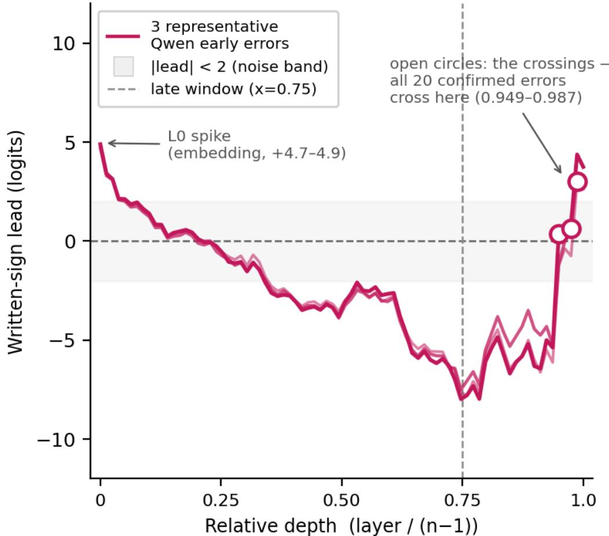  
Figure C1: Three representative Qwen-2.5-72B early errors (NC\_4x4\_det\_222, NC\_4x4\_det\_270, NC\_4x4\_det\_201 — the case of C.2), layer-0 leads +4.89, +4.71, +4.82. All three spike at the embedding, fall negative through the mid layers, and cross back positive only near depth 0.95–0.99; open circles mark each case’s crossing. All 20 confirmed held-out Qwen early errors follow this pattern (crossings 0.949–0.987). Grey band: |lead| < 2 (lens noise). Dashed line: depth 0.75.

Mechanism. Layer 0 is the embedding: before any layer runs, the residual at the probe position is nothing but the embedding row of the token sitting there. Dot that row with the fixed direction unembed(“−”) − unembed(“+”) and you get that token’s built-in lean — a pure table lookup, set by the tokenizer, not computed from the problem. In Qwen-2.5-72B, 80% of determinant probes (230 of the 288 held-out cases) sit on “})”, the LaTeX close of terms like \det(A\_{11}) — exactly the probe token of the case in C.2. Its embedding row alone predicts a +4.87 lean toward “−”; the 230 cases probed there average +4.80, errors and corrects alike. In Qwen’s training text, “−” simply followed “})” more often than “+”, and that bigram is baked into the token tables. Figure C2 shows the lookup directly: group the 288 cases by probe token, and the lean follows the token, not the problem.

Held-out case NC\_4x4\_det\_201 — the model is writing its cofactor expansion:
<table><tr><td rowspan=1 colspan=1>5⁻</td><td rowspan=1 colspan=1>u(-</td><td rowspan=1 colspan=1>4</td><td rowspan=1 colspan=1>)</td><td rowspan=1 colspan=1>u\</td><td rowspan=1 colspan=1>cdot</td><td rowspan=1 colspan=1>\</td><td rowspan=1 colspan=1>det</td><td rowspan=1 colspan=1>(A</td><td rowspan=1 colspan=1>_{</td><td rowspan=1 colspan=1>1</td><td rowspan=1 colspan=1>2</td><td rowspan=1 colspan=1>})</td><td rowspan=1 colspan=1>→ next:u⁻</td></tr></table>

probe token "})" — its layer-0 lead: +4.82  
written – (true sign +)

Qwen-72B: the layer-0 "—"lean is set by the probe token  
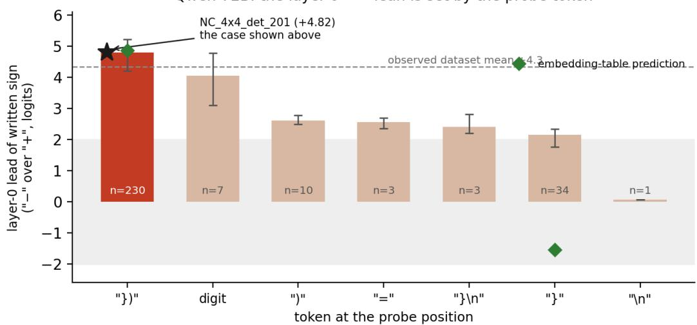  
Figure C2: The layer-0 “−” lean follows the probe token. Mean layer-0 lead of the written sign for all 288 held-out Qwen-2.5-72B determinant cases, grouped by the token at the probe position; n per group, whiskers span min–max. Green diamonds: the pure embedding-table prediction (no layers run). Grey band |lead| < 2: lens noise. Dashed line: dataset mean +4.3. Black star: case NC\_4x4\_det\_201 of C.2 (+4.82) inside its “})” group.

## Three controls rule out the alternatives:

1. Across \~25,000 sampled vocabulary tokens, only 49.6% lean “−” — the lookup is not a global property of the tables.

2. The average lean over each question’s own text is +0.99 — far short of the dataset mean +4.3; the context alone does not produce it.

3. Grouping the 288 cases by probe token closes the gap (Figure C2): “})” predicts +4.87, observed +4.80. One secondary context effect exists — the “}” group’s embedding predicts −1.54 yet observes +2.15, so block-0 attention over the minusheavy context adds a few logits — but it never drives the headline number.

What it does to the counts. Held-out: 48 of 147 determinant errors peak at layer 0; 20 pass the confirmation rule (the other 28 end with too weak a final lead), and 45 of 141 corrects peak there, 17 confirmed. Pooled with discovery, the confirmed early set is 28 errors and 20 corrects — every one an artifact by the crossings above (Table C2). The identical lean in corrects is the point: it is a prior the token carries in, not a decision. The late layers wipe it out and re-commit at 95–99% depth.

Across domains. A weight constant travels with the tokens. On the shared 48-problem arithmetic control (Appendix D), Qwen-2.5-72B leans “−” on 48/48 problems (mean +2.89) while Llama-3.3- 70B on the identical problems shows none (mean +0.19). On the 76 held-out IBP cases the layer-0 lean is weaker (mean +2.8) — too weak to outrank a real late peak, which is why the lookup is invisible in the IBP data. Verdict: none of Qwen’s early peaks is a genuinely early sign decision.

## C.4.4 Gemma-3-27B: the early copying band

Mechanism. Gemma’s early lean is a different animal: it does not sit at layer 0 and it is not a token-table lookup. Its layer-0 values are at chance — positive on only 14 of the 37 lean-test cases. Instead, Gemma pre-loads “−” in an early band of layers: every one of the 37 lean-test cases leans “−” somewhere in layers 8–13, and 32 of the 33 confirmed early cases peak at layers 5–13 (one at layer 45) (Figure C3). The lean is graded by what the model just wrote: +16.6 when a literal “−” sits within 5 characters of the probe, down to +2–6 after closing braces, and it grows with the count of nearby minus characters (r = +0.42). Those characters are the model’s own expansion text — negative entries, operands, intermediate results. This is shallow copying of the model’s own recent minus ink, erased by about layer 15, well before the habit layers L58/L60 (§4) act. (The lean test is a 37-case subset — indicative, not tight.)

Two fates. Unlike Qwen, Gemma’s early band does not always get erased. Figure C3 shows both outcomes. Artifact: cases NC\_4x4\_det\_1138 and NC2\_4x4\_det\_0401 (orange, crossing 0.951 each) spike in the band, fall below zero, and re-commit late — the late layers overwrite the early guess. Genuine: cases NC2\_4x4\_det\_0848 and NC2\_4x4\_det\_0944 (green, crossings 0.590 and 0.574) hold a positive lead from mid-depth onward — the early guess survives to the end.

B Gemma: early band, two fates  
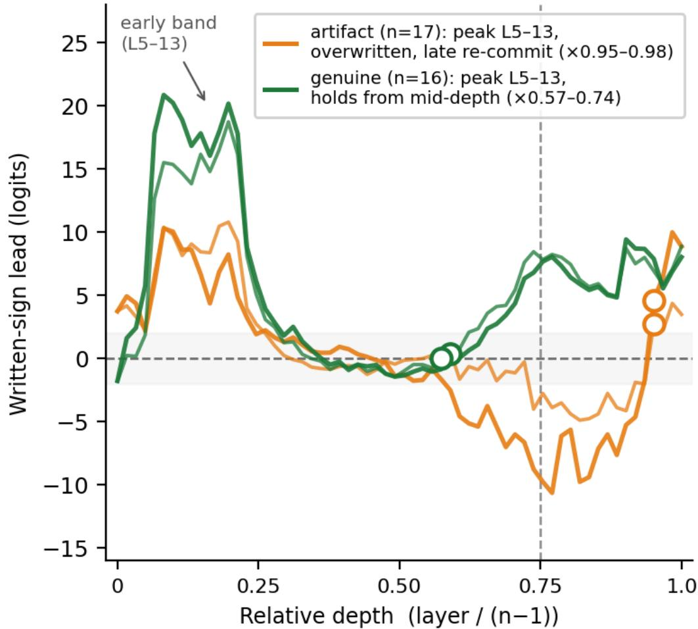

Figure C3: Gemma-3-27B: the early band and its two fates. Two artifact cases (NC\_4x4\_det\_1138, NC2\_4x4\_det\_0401; both crossing 0.951, orange) spike at the band and are overwritten — the lead goes negative and only re-commits late. Two genuine cases (NC2\_4x4\_det\_0848, NC2\_4x4\_det\_0944; crossings 0.590 and 0.574, green) hold a positive lead from mid-depth onward. Open circles: crossings. Grey band: |lead| < 2. Dashed line: depth 0.75.

Counts. Of the 33 confirmed early errors, 17 are artifacts (crossing 0.951–0.984) and 16 are genuine (crossing 0.000–0.738, median 0.631). Of the 109 confirmed early corrects, 34 are artifacts and 75 are genuine (median crossing 0.672) — the same band appears in corrects too. The asymmetry is the reading: when the early guess is right it usually survives (75 of 109); when it is wrong it is usually overwritten and re-committed late (17 of 33). Gemma-3-27B has a real early-commitment signature — and it is the primary source of the genuine-early residual below.

## C.4.5 The other three models, and the residual

Phi-4-14B, Llama-3.3-70B and Mistral-Small-24B contribute 6, 9 and 5 confirmed early errors (artifact/genuine 2/4, 5/4 and 3/2) — no layer-0 lean, no early band, no shared site (Table C2). With so few cases and no pattern, there is no mechanism to analyse.

The bottom line. Across all five models, genuinely early error commitments are 26 of 703 confirmed errors (3.7%) — the limit of the late-decision account, stated plainly. The visual evidence is Figures C1 and C3: every Qwen early peak is an artifact of the embedding lookup, and Gemma’s genuine early commits (Figure C3, green) are the primary source of the 26.

## C.5 The exploratory sixth model (Mistral-Large-675B)

Mistral-Large-675B was run on the 5×5 determinant task as a behavioral-only exploratory probe: the causal battery (ablations, patching, dose–response steering) was not run, because at 675 billion parameters the compute cost is prohibitive. The model appears only in Figure 1a as grey open circles and in Table C1 footnote (c): the confirmation rule was not applied, and its 51 cases are shown unfiltered.

The probe covered 51 validated sign-error cases; the logit-lens readout and direct logit attribution ran on all 51. Of these, 39 peak in the last quarter of the network (relative depth ≥ 0.75 under the convention layer / (61 − 1), i.e. ≥ L45) — consistent with the late-decision pattern of the five core models.

Table C3: Mistral-Large-675B stage accounting.
<table><tr><td>Stage</td><td>Count</td></tr><tr><td>Sign-error cases (experiment-ready)</td><td>51</td></tr><tr><td>Logit-lens readout run</td><td>51</td></tr><tr><td>Direct logit attribution run</td><td>51</td></tr><tr><td>Peak in last quarter of depth (≥ 0.75, i.e. ≥ L45)</td><td>39</td></tr><tr><td>Causal battery (ablations, patching, steering)</td><td>not run</td></tr></table>

## APPENDIX D — THE ARITHMETIC CONTROL

The same late-commitment test, on the plainest possible task — and on completions where the model writes the right answer.

## D.1 What the control tests

Question. Does late commitment also appear on plain arithmetic — a setting far from the algebraic structure of the determinant and IBP tasks — and does it appear when the model is right, not only when it errs?

The probe set. 48 short subtraction problems, identical for all five models. Each problem reads, verbatim: “Compute 476 − 675. Show all steps. Write your final numerical answer with its sign (use ’+’ if the result is positive, ’-’ if negative).” The true signs are mixed by design: 25 problems have a negative answer, 23 a positive one. Each model generates its own worked solution, and the logit lens then tracks the model’s lead for the sign it wrote, at the written-sign position — the same readout as everywhere else in the paper.

These are correct completions, not errors. On this task the models are almost always right: 237 of the 240 completions (5 models × 48 problems) carry the correct written sign. Phi, Mistral-Small-24B, Llama, and Qwen are 48/48 correct; Gemma wrote the wrong sign in 3 of its 48 cases (noted in D.2). There is therefore no error/correct split to make here — the control measures commitment depth on (almost entirely) correct arithmetic.

Rules. The set is a single pooled collection; there is no discovery/held-out split. The same confirmation rule applies (written-sign lead ≥ +2 logits at the final layer), and the same late threshold (relative depth ≥ 0.75). All 240 cases pass contamination checks.

## D.2 Results

Results. Every single case across all 240 is confirmed — no case is excluded. The weakest final lead in the entire set is +6 logits. Four of five models commit at the very end of the residual stream: Phi, Mistral-Small-24B, Llama, and Qwen each produce 48/48 late cases (100%) with a median rel\_depth of 1.00. The majority of those cases peak at the final layer itself: 36 of 48 for Phi, 46 of 48 for Mistral-S, 48 of 48 for Llama, and 38 of 48 for Qwen — not just late, but last.

Gemma is again the exception. Only 22 of 48 Gemma cases (46%) are late, and the median relative depth is 0.082. The distribution is not diffuse: it is bimodal. Twenty-five cases peak at layer 5 (of 62), and 21 peak at layer 61, with 2 cases in between. This bimodal pattern is consistent with the early-copying band documented in Appendix C.4.4 for the determinant domain. In that appendix, Gemma’s early-error peaks are attributed to an L8–13 shallow-copy mechanism; the arithmetic control’s layer-5 cluster may reflect a similar or related phenomenon, though the arithmetic set of 48 cases is too small and structurally too different from the determinant cases to test the mechanism. We report the bimodal split as indicative, not as a claim about mechanism.

Gemma’s 3 wrong-sign cases are disclosed rather than dropped: one peaks at layer 12 and two at layer 61. Removing them changes nothing material — the bimodal split remains (25 cases at layer 5, 19 at layer 61).

The sign is decided late: per-case peak depth of the written-sign logit lead (arithmetic domain) 48-problem arithmetic control (correct completions); confirmed (lead ≥ 2); bar = median; late zone ≥ 0.75  
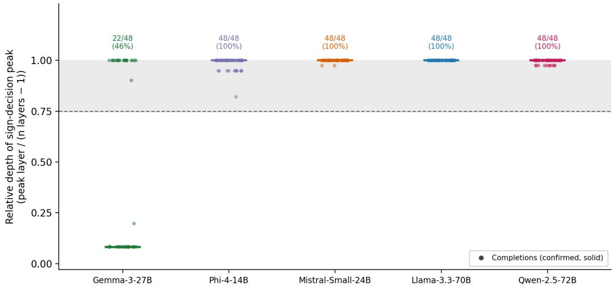  
Excluded: cases with weak final lead (<2 logits) or reversed sign leading; full counts in Table ARITH

Figure D1: Arithmetic control — late-decision depth distribution. Each panel shows one model’s 48 confirmed arithmetic-control cases (solid dots) by peak relative depth (x-axis, 0 = first layer, 1 = last layer). 237 of the 240 completions carry the correct written sign (Gemma’s 3 exceptions are noted in the text). Horizontal bar: per-model median. Dashed vertical line: rel\_depth = 0.75. No cases are excluded (minimum final lead across all 240 cases is +6 logits). Phi, Mistral-S, Llama, and Qwen cluster tightly at rel\_depth = 1.0 (medians all 1.00; final-layer peak counts: Phi 36/48, Mistral-S 46/48, Llama 48/48, Qwen 38/48). Gemma displays the bimodal split described in the text: 25 cases at layer 5 and 21 at layer 61, visible here as two distinct clusters at either end of the depth axis.  
Counts. Table D1 gives the per-model census — confirmed, excluded, and late counts, with the median relative depth — for all 240 completions.
<table><tr><td>Model</td><td>Total</td><td>Confirmed</td><td>Excluded</td><td>Late</td><td>Late %</td><td>Median rel_depth</td></tr><tr><td>Gemma-3-27B</td><td>48</td><td>48</td><td>0</td><td>22</td><td>46%</td><td>0.082</td></tr><tr><td>Phi-4-14B</td><td>48</td><td>48</td><td>0</td><td>48</td><td>100%</td><td>1.00</td></tr><tr><td>Mistral-Small-24B</td><td>48</td><td>48</td><td>0</td><td>48</td><td>100%</td><td>1.00</td></tr><tr><td>Llama-3.3-70B</td><td>48</td><td>48</td><td>0</td><td>48</td><td>100%</td><td>1.00</td></tr><tr><td>Qwen-2.5-72B</td><td>48</td><td>48</td><td>0</td><td>48</td><td>100%</td><td>1.00</td></tr></table>

Reading the table. Take the Gemma-3-27B row: all 48 of its arithmetic cases pass the confirmation rule (48 confirmed, 0 excluded), but only 22 of the 48 (46%) peak late, and the median relative depth is 0.082 — the bimodal split described above. Every other row reads 48 confirmed, 0 excluded, 48 late (100%), median 1.00: on plain arithmetic those four models commit at the very end of the residual stream.

## D.3 What the control shows

Two things. First, late commitment is not an artifact of the algebra tasks — and not a property of errors: even when writing the correct sign of a plain subtraction, four of the five models still commit at the very end of the residual stream, most often at the final layer itself. Second, the control separates weight constants from decisions. Appendix C.4.3 uses these same 48 problems to test whether Qwen-2.5-72B’s layer-0 probe-token lookup is a fixed property of its embedding tables: all 48 Qwen cases lean “−” at layer 0 (mean +2.89), while Llama-3.3-70B on the identical problems shows no such lean (mean +0.19). The lookup travels with the weights, not with the task (Appendix C.4.3).

Data. The shared problem set is pipeline\_release/data\_shared/arith\_control\_problems.json; the percase records behind this control are {Model}/arith\_control/expA\_logit\_lens.json in the released repository (stage s00 generates each model’s own solutions; s01 is the lens readout). Figure provenance: ledger-fed final figures (table1\_master.csv, fig1\_counts.csv, fig1\_late\_decision.png) in the figures/ directory.

## APPENDIX E — FULL READOUT RESULTS: DETERMINANT AND IBP

The observational record for both tasks, standalone: trajectories, per-layer DLA, and judge-layer curves for the determinant and for IBP, plus the IBP case accounting. Method reminders are brief; the causal experiments stay in §5 (Appendices H, I).

## E.1 Scope and method

This appendix is the observational record behind §3–§4, both tasks. Determinant: the full trajectories (Figure E1), full-depth DLA (Figure E3), and judge curves (Figure E5) that the main text summarizes. IBP: the complete observational results — accounting (Table E1), trajectories (Figure E2), DLA (Figure E4), judge curves (Figure E6) — and the two-domain role comparison (Figure E7, Table E2). The replication question: does the late-commitment pattern of §3 hold on a second domain? We run the same readout stages on integration by parts (IBP), a structurally different sign-tracking task.

What is IBP. IBP applies Ru dv = uv − Rv du. The sign error: the model writes uv + Rv du, losing the minus. Every later step runs on the corrupted expression. We ask where that one sign token is committed.

Method. Identical to the determinant (Appendix C.1): same logit-lens readout, same confirmation rule (written-sign lead ≥ +2 at the final layer), same late threshold (rel\_depth ≥ 0.75). Discovery and held-out sets are pooled throughout. Mistral-Large-675B has no IBP data. Bank construction: A.2.

## E.2 Case accounting — IBP

Determinant accounting is Table C1 (Appendix C.3). Table E1 is its IBP counterpart, counted the same way: totals, confirmed, excluded, error and correct counts, and the wrote-sign split. Bold pooled rows are the counts the figures use; footnote (e) maps columns to figures.

Table E1: IBP case accounting per model and evaluation set. Bold rows (pooled) feed the figures; see footnote (e).
<table><tr><td>Model</td><td>Phase</td><td>Total</td><td>Conf.</td><td>Excl.</td><td>Err (conf.)</td><td>Corr (conf.)</td><td>Err</td><td>Corr</td><td>Wrote “+”</td><td>Wrote“&quot;</td></tr><tr><td>Gemma</td><td>disc.</td><td>120</td><td>106</td><td>14</td><td>56</td><td>50</td><td>70</td><td>50</td><td>60</td><td>60</td></tr><tr><td>Gemma</td><td>held-out</td><td>223</td><td>192</td><td>31</td><td>45</td><td>147</td><td>73</td><td>150</td><td>44</td><td>179</td></tr><tr><td>Gemma</td><td>pooled</td><td>343</td><td>298</td><td>45</td><td>101</td><td>197</td><td>143</td><td>200</td><td>104</td><td>239</td></tr><tr><td>Mistral</td><td>disc.</td><td>82</td><td>69</td><td>13</td><td>29</td><td>40</td><td>39</td><td>43</td><td>20</td><td>62</td></tr><tr><td>Mistral</td><td>held-out</td><td>226</td><td>181</td><td>45</td><td>31</td><td>150</td><td>70</td><td>156</td><td>76</td><td>150</td></tr><tr><td>Mistral</td><td>pooled</td><td>308</td><td>250</td><td>58</td><td>60</td><td>190</td><td>109</td><td>199</td><td>96</td><td>212</td></tr><tr><td>Phi</td><td>disc.</td><td>90</td><td>86</td><td>4</td><td>36</td><td>50</td><td>40</td><td>50</td><td>13</td><td>77</td></tr><tr><td>Phi</td><td>held-out</td><td>223</td><td>204</td><td>19</td><td>58</td><td>146</td><td>77</td><td>146</td><td>61</td><td>162</td></tr><tr><td>Phi</td><td>pooled</td><td>313</td><td>290</td><td>23</td><td>94</td><td>196</td><td>117</td><td>196</td><td>74</td><td>239</td></tr><tr><td>Llama</td><td>disc.</td><td>45</td><td>37</td><td>8</td><td>14</td><td>23</td><td>22</td><td>23</td><td>7</td><td>38</td></tr><tr><td>Llama</td><td>held-out</td><td>68</td><td>65</td><td>3</td><td>18</td><td>47</td><td>21</td><td>47</td><td>52</td><td>16</td></tr><tr><td>Llama</td><td>pooled</td><td>113</td><td>102</td><td>11</td><td>32</td><td>70</td><td>43</td><td>70</td><td>59</td><td>54</td></tr><tr><td>Qwen</td><td>disc.</td><td>35</td><td>35</td><td>0</td><td>10</td><td>25</td><td>10</td><td>25</td><td>0</td><td>35</td></tr><tr><td>Qwen</td><td>held-out</td><td>76</td><td>73</td><td>3</td><td>23</td><td>50</td><td>26</td><td>50</td><td>0</td><td>76</td></tr><tr><td>Qwen</td><td>pooled</td><td>111</td><td>108</td><td>3</td><td>33</td><td>75</td><td>36</td><td>75</td><td>0</td><td>111</td></tr></table>

(a) Confirmed: the written sign leads by ≥ 2 logits at the final layer. Excluded cases end weak or opposite; they leave all depth statistics.

(b) Pooled = discovery + held-out sums (descriptive). Paper verdicts elsewhere use held-out only.

(c) Gemma = Gemma-3-27B; Mistral = Mistral-Small-24B; Phi = Phi-4-14B; Llama = Llama-3.3- 70B; Qwen = Qwen-2.5-72B.

(d) Late = rel\_depth ≥ 0.75. Source exception (Mistral discovery corrects): counts use the canonical released file; the superseded working copy is a divergent probe-pick variant (42/43 cases differ) and is not used. Same for determinant discovery corrects (77/78; Table C1 footnote (d), Appendix C).

(e) Which number feeds which figure. Figure E2: pooled Err (conf.) / Corr (conf.) — e.g. Gemma 101 / 197. Figure E4: pooled Err / Corr — e.g. Gemma 143 / 200. Figure E7 (IBP rows): the same pooled Err / Corr cases split by written sign; each panel’s n+/n− sums to its class column (e.g. Gemma errors 79+64 = 143), not to the all-case Wrote columns.

## E.3 Trajectories — determinant and IBP

Determinant first. Figure E1 is the full path behind the peaks of §3: median written-sign lead at every relative depth, errors against corrects, pooled confirmed cases. All five models share one shape — the lead sits inside the noise band, or below zero, through the middle of the network and exits steeply past depth 0.75. Qwen is the sharpest: on its corrects the median lead is −4.2 at depth 0.50, −6.3 at 0.75, and first turns positive for good at depth 0.94 (layer 74). Llama’s corrects end at +26.0. Gemma’s corrects show the early copying bump of §3 (+14.3 at depth 0.21) before dipping to −2.4 at mid-depth. Phi’s curves ride slightly above the band through the middle (errors +4.2, corrects +3.4 at depth 0.50); Mistral is the cleanest.

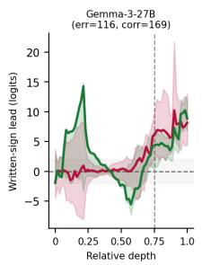

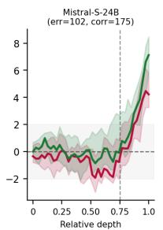

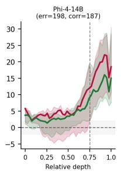  
Errors (median + IQR)  Corrects (median + IQR)lead| < 2 (noise band) --- depth 0.75 (late window)

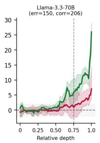

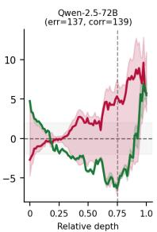

Figure E1: Median written-sign-lead trajectories — determinant. Median lead (logits) vs relative depth, pooled confirmed cases, IQR shading. Crimson: errors; green: corrects. Grey band: |lead| < 2. Dashed line: depth 0.75. Counts (error / correct): Gemma 116/169, Mistral 102/175, Phi 198/187, Llama 150/206, Qwen 137/139.

IBP next. Figure E2 reads like Figure E1. All five models show the same shape: flat through mid-depth, steep exit after 0.75.

Two contrasts with the determinant. First, Gemma’s corrects no longer rise early: median peak depth 0.98 here versus 0.21 on determinants (36% late there, 94% late here). The early-correct pattern is determinant-specific. Second, Phi’s above-band offset is gone: both curves sit in the band through mid-depth (errors median +0.13 at depth 0.51).

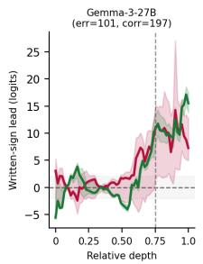

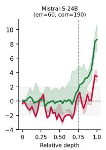

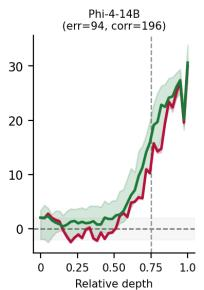  
Errors (median + IQR)  Corrects (median + IQR) lead| < 2 (noise band) --- depth 0.75 (late window)

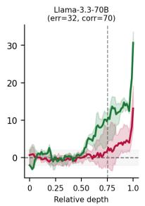

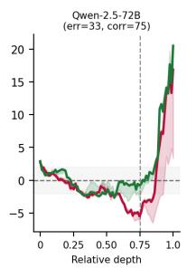

Figure E2: Median written-sign-lead trajectories — IBP. Layout as Figure E1: median lead (logits) vs relative depth, pooled confirmed cases, IQR shading. Crimson: errors; green: corrects. Grey band: |lead| < 2. Dashed line: depth 0.75. Counts (error / correct): Gemma 101/197, Mistral 60/190, Phi 94/196, Llama 32/70, Qwen 33/75.

Lateness is sharper than the determinant result: Mistral errors 95% late, Phi 100%, Llama 97%, Qwen 100%. Gemma errors 70% late — lowest, still a clear majority. Lateness characterizes signwriting itself, in both classes.

Raw per-case records behind the trajectory and DLA figures are released in the repository (stages s01–s02, all five models, both phases, both classes); the judge-curve records are the released s09 files (Appendix B). Inventory with checksums: ledger\_manifest\_full.csv.

## E.4 Habit-layer DLA

Computed as Figure 2 (§4). Determinant first: Figure E3 shows the full depth axis — the signal concentrates in the last layers, at the gold-banded habit layers; outside the late window, activity is scattered and small. Errors and corrects rise at the same layers.

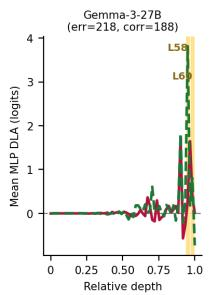

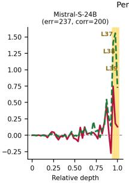

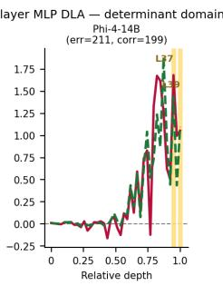  
Errors (mean DLA)- Corrects (mean DLA)Named habit layers

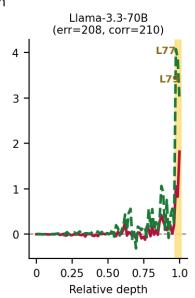

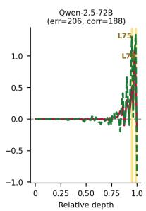

Figure E3: Per-layer MLP DLA, determinant. Mean direct contribution of each layer’s MLP to the written-sign lead, full depth axis. Crimson solid: errors; green dashed: corrects. Gold bands, bold labels: habit layers from §4 — Gemma L58/L60; Mistral L37/L38/L39; Phi L37/L39; Llama L77/L79; Qwen L75/L78. Counts in panel headers (err / corr): all cases in the pooled DLA files, discovery + held-out.

IBP next: Figure E4 repeats the readout — the habit-layer structure replicates, errors and corrects rising at the same layers.

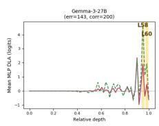

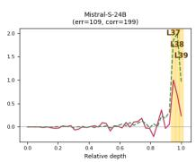

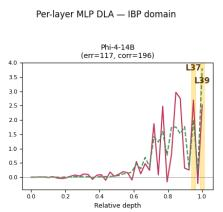  
Errors (mean DLA)== Corrects (mean DLA)Named habit layers

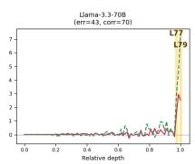

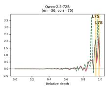

Figure E4: Per-layer MLP DLA, IBP. Layout as Figure E3: mean direct contribution of each layer’s MLP to the written-sign lead. Crimson solid: errors; green dashed: corrects. Gold bands, bold labels: habit layers from §4 — Gemma L58/L60; Mistral L37/L38/L39; Phi L37/L39; Llama L77/L79; Qwen L75/L78. Pooled counts in Table E1.

## E.5 Judge-layer curves

Per-layer lead of the correct sign on error cases — the judge readout of §4. Only Qwen and Llama are shown — the two mechanistic poles. Determinant first (Figure E5): here the judge fights — Qwen’s curve zigzags through its late window, stamp pushes down and partial rescues pull back (annotated on the figure), while Llama slides monotonically at its amplifier L77–79. Judge files exist for all five models (Qwen IBP: held-out only); the other three are summarized as flip counts in the released s09 judge files (Appendix B.3).

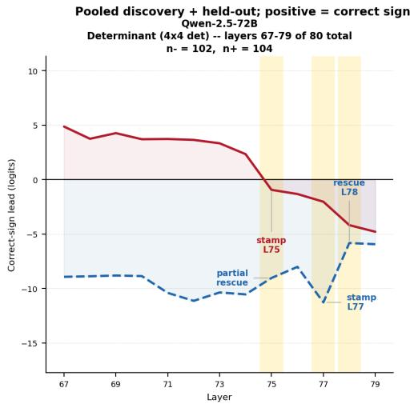

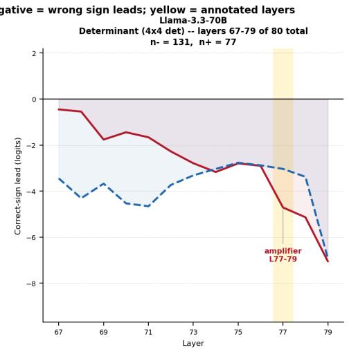

Figure E5: The judge — determinant (layers 67–79 of 80). Per-layer lead of the correct sign on pooled determinant errors. Red solid: true + (model wrote −); blue dashed: true − (model wrote +). Qwen n−/n+ = 102/104; Llama 131/77. Yellow bands: annotated layers.

IBP next (Figure E6): the same readout on IBP errors.

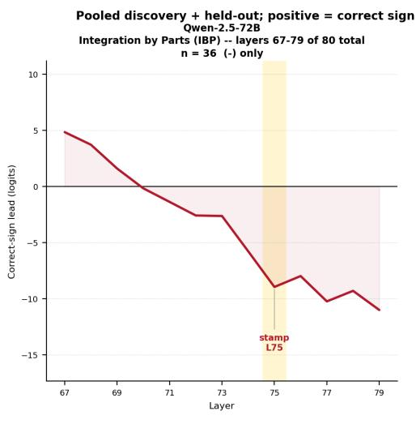

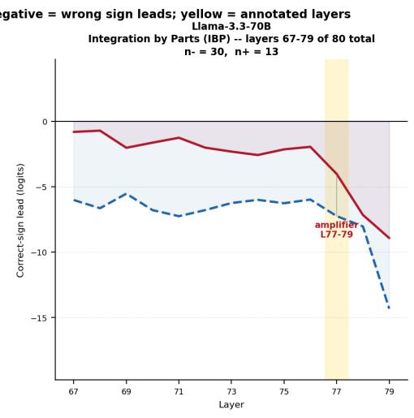

Figure E6: The judge that loses — IBP (layers 67–79 of 80). Per-layer lead of the correct sign on pooled IBP errors. Red solid: true + (model wrote −); blue dashed: true − (model wrote +). Qwen n−/n+ = 36/0 — no wrong + written, so no blue curve; Llama 30/13. Yellow bands: annotated layers.

Qwen: a monotone slide to about −11 through L75, with no rescue zigzag — on IBP the judge does not fight. Llama: both curves slide down through L77–L79, amplifying an earlier decision. The timing matches the determinant; the roles do not (Section E.6).

## E.6 Comparison — stamps and amplifiers, errors versus corrects, both domains

Sign-split DLA as in Figure 2 (§4), both classes and both domains. The error rows are cases where the model wrote the wrong sign; the corrects rows repeat the identical analysis on correct answers. Figure E7 shows all four blocks; Table E2 gives the statistics behind each verdict.

## DETERMINANT

Per-layer MLP DLA split by written sign — determinants (4×4): errors (top) vs corrects (bottom) | pooled discovery + held-out

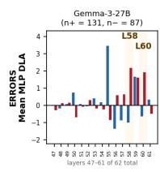

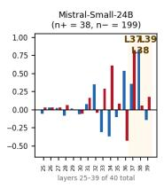

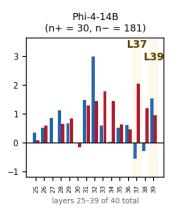

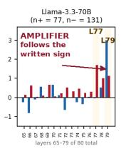

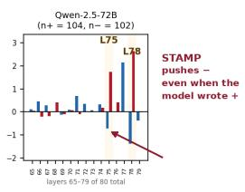

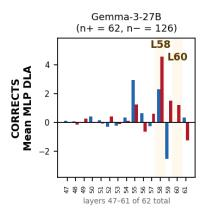  
INTEGRATION BY PARTS (IBP)

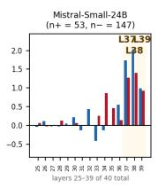

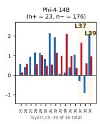

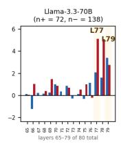

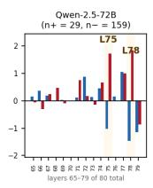

Per-layer MLP DLA split by written sign — IBP: errors (top) vs corrects (bottom) | pooled discovery + held-out  
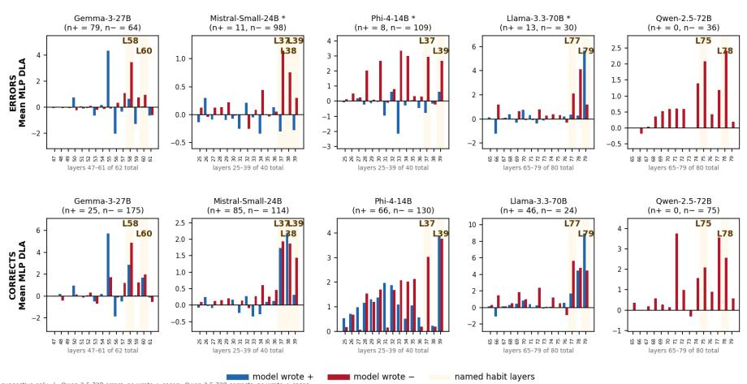

Figure E7: Stamper: pushes − no matter which sign the model wrote. Amplifier: pushes whichever sign the model wrote, further in that direction. Judge: a late layer that pushes back toward the correct sign on error cases. Per-layer MLP DLA split by written sign — determinant and IBP, errors and corrects, all five models, pooled discovery + held-out. Blue: wrote +; red: wrote −; gold bands: habit layers. All n’s verified against the master ledger. Anomalies: \* small n (< 15), suggestive only (Mistral IBP errors n+ = 11; Phi IBP errors n+ = 8; Llama IBP errors n+ = 13); Qwen IBP has no blue bars in either class (0/36 errors, 0/75 corrects wrote +).

Table E2: Layer roles by domain and case class — uniform accounting. Two rows per model: error cases and correct cases. Each cell: mean MLP DLA toward the written sign at the named layer, 95% bootstrap CI (10,000 percentile resamples), case count; every cell pools discovery + held-out. The wrote-+ columns carry the verdict: interval entirely below 0 = stamper; entirely above 0 = amplifier; crossing 0 = indeterminate. The wrote-− columns are the sanity check: positive for every model, both domains, both classes, since both roles push − when the model wrote −. (a) Qwen wrote + in zero IBP cases of either class (0/36 errors, 0/75 corrects), so the test is not computable; behavioral evidence on errors: final logit lead of the correct sign −11.9 [−14.2, −9.4], 33/33 negative. (b) Mistral: error wrote-+ CIs cross 0 (det) or rest on n = 11 (IBP); its correct wrote-+ CIs are positive but small in magnitude $( \leq + 1 )$ ), hence amplifier (weak). (c) \* = small n (< 15), suggestive only.

<table><tr><td colspan="2">Model Layer Cases</td><td>Det role</td><td>IBP role</td><td>Det wrote +</td><td>Det wrote —</td><td>IBP wrote +</td><td>IBP wrote —</td></tr><tr><td rowspan="3">GemmaL58</td><td>errors</td><td>stamper</td><td>amplifier</td><td>-0.98 [-1.42, -0.51] n = 131</td><td>+2.18 [+1.77, +2.60] n = 87</td><td>+0.66 [+0.08, +1.21] n = 79</td><td>+3.46 [+2.99, +3.93] n = 64</td></tr><tr><td rowspan="2">correctsamplifier</td><td rowspan="2"></td><td rowspan="2">amplifier</td><td>+2.30 [+1.63, +2.96]</td><td>+4.56 [+4.27, +4.83] n = 126</td><td>+2.88 [+2.34, +3.49] n = 25</td><td>+4.90 [+4.73, +5.07]</td></tr><tr><td>n = 62 -0.72 [-0.88, -0.55]</td><td>+1.74 [+1.60, +1.89]</td><td>−(a)</td><td>n = 175 +2.09 [+1.94, +2.23]</td></tr><tr><td rowspan="2"></td><td rowspan="2"></td><td rowspan="2">judge correctsstamper</td><td rowspan="2">—(a)</td><td>n = 104 -1.02</td><td>n = 102 +1.72</td><td>—(a)</td><td>n = 36 +2.09</td></tr><tr><td>[-1.25, -0.76] n = 29 amplifier +1.56</td><td>[+1.66, +1.79] n = 159 +0.97</td><td>+0.62</td><td>[+2.07, +2.11] n = 75 +2.67</td></tr><tr><td rowspan="2"></td><td></td><td>correctsamplifier</td><td></td><td>[+0.97, +2.13] n = 30 +2.12</td><td>[+0.68, +1.29] n = 181 +0.96</td><td>[+0.30, +0.91] n = 8 *</td><td>[+2.38, +2.95] n = 109</td></tr><tr><td></td><td></td><td>amplifier</td><td>[+1.32, +3.04] n = 23</td><td>[+0.66, +1.27] n = 176</td><td>+3.89 [+3.39, +4.38] n = 66</td><td>+3.77 [+3.37, +4.16] n = 130</td></tr><tr><td rowspan="2">Llama L79</td><td></td><td>errors amplifier</td><td>amplifier</td><td>+2.99 [+2.45, +3.52] n= 77</td><td>+1.13 [+0.62, +1.67] n = 131</td><td>+5.66 [+3.57, +7.60] n = 13 *</td><td>+1.19 [+0.06, +2.32] n = 30</td></tr><tr><td></td><td>correctsamplifier</td><td>amplifier</td><td>+3.38 [+2.63, +4.08] n = 72</td><td>+2.76 [+2.42, +3.09] n = 138</td><td>+8.93 [+8.25, +9.58] n = 46</td><td>+4.45 [+4.19, +4.70] n = 24</td></tr><tr><td rowspan="2">Mistral L39</td><td>errors indet. (b)</td><td></td><td>indet. (b)</td><td>-0.14 [-0.36, +0.08]</td><td>+0.18 [+0.07, +0.29]</td><td>-0.28 [-0.53, -0.04]</td><td>+0.30 [+0.15, +0.47]</td></tr><tr><td></td><td>correctsamplifier (weak) (b)</td><td>amplifier (weak) (b)</td><td>n = 38 +0.99 [+0.64, +1.39]</td><td>n = 199 +0.93 [+0.74, +1.13] n = 147</td><td>n = 11 * +0.32 [+0.17, +0.47]</td><td>n = 98 +1.44 [+1.23, +1.66]</td></tr></table>

How to read this table. Each cell answers one question: when the model wrote this sign, which way did this layer push, and how hard? The number is the layer’s average push, in logits, toward the sign the model wrote. Positive: the layer supported the written sign. Negative: the layer pushed against it, toward minus. For scale: a logit difference of ∆ multiplies the odds between the two sign tokens by eˆ∆ — a standard softmax identity (see, e.g., Bishop, 2006) — so one logit is a ×2.7 shift in odds and two logits ×7.4. The bracket is a 95% confidence interval: we only have n cases, so the true average could sit anywhere in that range. The verdict takes one glance at the wrote-+ cells. Bracket fully below zero: the layer pushes minus even when the model wrote plus — a stamper. Bracket fully above zero: the layer follows the model’s choice — an amplifier. Bracket crossing zero: no call. Worked example — the shaded cell: Gemma, determinant errors, wrote +. The bracket [−1.42, −0.51] sits fully below zero: even when Gemma wrote +, layer L58 reliably pushed toward −. That single cell is the stamper verdict. The wrote-− cells cannot separate the two roles, because both roles push minus there. They serve instead as a check on the whole method: all twenty are positive, exactly as they must be. Why we give all of this: every ’stamper’ or ’amplifier’ claim in this paper is a claim about one of these cells. The table lets the reader verify each one directly, with the same test applied everywhere.

Roles are properties of the layers, not of error cases. Qwen’s minus-stamp, Llama’s amplifier and Phi’s L39 amplifier all appear on corrects too. Mistral’s errors are indeterminate; its corrects lean amplifier, weakly. One divergence: Gemma’s determinant L58 — stamper on errors, amplifier on corrects. Its determinant corrects commit early (median depth 0.21), before L58’s window.

Across domains, the dependence is selective. Gemma L58 changes role; Phi L39 and Llama L79 do not. Qwen’s role test is not computable on IBP: no wrote-+ cases in either class.

What separates errors from corrects is the sign the machinery is applied to, not the machinery. And the timing never moves: in both domains, both classes commit in the last few percent of depth. Localization claims must name the task; the late-commitment claim need not.

## APPENDIX F — ORIGIN OF THE MINUS HABIT: BASE MODEL VS. INSTRUCT MODEL

The habit the paper steers is not created by chat-training. This appendix asks where it comes from — and tests the answer directly on one model.

The question. The main text shows that each model carries fixed late layers that push the minus sign — a “minus stamp.” Where does such a habit come from: the final chat-training stage, or earlier, in pretraining?

The hypothesis (general). Written mathematics marks negative results explicitly (“−67”) while positive results are written bare (“67” — almost never “+67”). Any model pretrained on such text sees the minus sign written at answer positions far more often than the plus sign, so a “when in doubt, write minus” prior is a plausible thing for pretraining to install — in any of the five models, not one in particular. This is stated as a hypothesis: corpus statistics have not been measured (§7 sketches the corpus probe that would test it; left to follow-up work).

Scope: one model. The direct test needs the base (pretrained-only) and instruct versions of the same model, so it was designed for and executed on Qwen-2.5-72B only. It has not been run on the other four models in this paper; generalisation to them is left to follow-up work.

Method. (1) Take Qwen2.5-72B (the base pretrained model, before instruction tuning) and the instruct model studied in the paper. (2) Build 49 short arithmetic completions where a signed result is written, and locate the written sign token; a matched instruct-generated set of 48 completions provides the third condition. (3) Teacher-forced at that position, measure each late MLP’s DLA to the sign — exactly the s02 DLA readout (Appendix B) — separately for completions where the written sign is minus and where it is plus. A fixed stamp shows as a layer pushing minus in both groups.

Results. The stamp is already present in the base model: L78’s mean MLP DLA is +3.44 toward minus on minus-writers and −1.23 on plus-writers (i.e., still pushing minus in both groups). The instruct model on the same base texts shows the same pattern, larger: +4.82 / −1.99. On its own sampled texts the instruct model gives +5.39 / −1.51 — instruction tuning amplifies the L78 stamp by roughly 40–60% (derived from the DLA values reported in this paragraph; raw values in the verification note below) but does not create it. L75 behaves differently: in the base model it is not a fixed minus layer (+1.50 on plus-writers, i.e., helping plus in that group); its stamp behaviour is consistent with this emerging under instruction tuning.

Reading. Qwen’s core minus habit (L78) predates chat-training — consistent with a pretraining origin such as the sign-marking asymmetry in written mathematics — and instruction tuning strengthens it and recruits L75. This is one model, one probe set (49–48 arithmetic completions), and no corpus measurement: supporting evidence for the origin hypothesis, not proof.

Data. Three raw result files in the repository (path: reference/qwen\_original/reference\_qwen/ results/): Qwen\_base/arith\_simple/v2\_mean\_ablation/expB\_dla.json (base model, n=49); Qwen/ arith\_simple\_base\_text/v2\_mean\_ablation/expB\_dla.json (instruct model on same base texts, n=49); Qwen/arith\_simple/v2\_mean\_ablation/expB\_dla.json (instruct model on its own sampled texts, n=48). The code is the same DLA stage used everywhere else (s02\_dla); nothing changes between conditions except which model weights are loaded (base vs instruct) and which text is replayed. Per-case DLA at L75/L78 and controls L30/L50 are logged for every case; the means above are computed directly from those per-case values. Related readouts: Appendix B (the s02 DLA stage) and Appendix H (dose-response on det\_4x4 held-out).

All six numbers in the Results paragraph (3.44 / −1.23 / 4.82 / −1.99 / 5.39 / −1.51) have been verified against the raw JSON files listed above; raw values are 3.4357 / −1.2331 / 4.8219 / −1.9900 / 5.3864 / −1.5140. The +1.50 base-model L75 figure on plus-writers is verified at 1.5028.

## APPENDIX G — THE ABLATION LADDER: ATTENTION HEADS, SINGLE MLPLAYERS, AND JOINT MLP REMOVAL

## G.1 CONTRACT

This appendix answers one question three ways: is the wrong sign carried by any single component of the circuit, or only by the identified late-MLP set acting together? It climbs a three-rung ladder — ablate one attention head, then one MLP layer, then all identified MLP layers jointly — and stands behind two claims in Section 5: that no single attention head accounts for the effect, and that the localised layers are causally necessary but not sufficient, with no single layer alone accounting for the effect.

By the end you can verify three things. (i) In no cell — discovery or held-out — does a single attention head move the written sign’s lead by more than −0.46 logits, and single-head strict flips are essentially zero. (ii) No single MLP layer exceeds −0.63 outside Llama — whose L77–L79 trio is the one place a single layer is individually strong, reaching −3.46 on IBP. (iii) Removing the identified MLP set jointly cuts the lead by −0.9 to −7.1 logits in three of five models, exceeding 40 matched random 5-layer sets, and by −1.3 to −8.6 in the cases whose baseline lead is at least +2 logits.

The ordering head single layer < joint MLP holds everywhere, with exactly two documented exceptions carried openly: Gemma IBP heads (G.6, closed by a joint-head follow-up) and Phi, where every rung is flat and the ordering claim is vacuous (G.7).

## G.2 SHARED PROTOCOL

One measurement backs every number in this appendix. Each case is replayed teacher-forced to the answer-sign position; the metric is the mean change in the written sign’s final logit lead (ablated minus baseline), so negative means the written sign weakened.

The three rungs differ only in what is removed. Rung 1 zeroes one attention head’s output at the sign position (a mean-ablation variant, expC<sup>′</sup>, covers Qwen and Llama). Rung 2 removes the component of one MLP layer’s output along the frozen sign direction. Rung 3 applies that same removal at all identified layers simultaneously, and compares against 40 matched random 5-layer sets — the null that a same-sized ablation anywhere would do the same.

Candidates were identified on the discovery split and frozen; the held-out split is the confirmation, so held-out errors are the headline cells. Determinant and IBP are never mixed: every table stacks the determinant block on top and the IBP block below.

Two further conventions. Where a table reports a baseline ≥ +2 column, it restricts to cases whose baseline lead is at least +2 logits — a case leading by +0.3 cannot mechanically show a −3 drop, so this subset shows the effect where there is room to see it. Corrects (the same removal applied to correctly-signed answers) are reported alongside errors at rung 3; rungs 1–2 were run on errors only.

Worked example (rung 3): Llama IBP. Take Llama-3.3-70B on IBP errors (n = 21 held-out cases). The identified five layers are L64, L66, L77, L78, L79. The baseline wrong-sign lead is +14.61 logits. After jointly ablating the sign-direction component at all five layers, the lead falls to +7.52 — a drop of −7.09. Forty random 5-layer sets average −0.29 and stay within [−0.96, +0.69]: the targeted effect is more than 7× their worst case. Yet no single layer gets there alone — the best, L79, gives −3.46 (Table G3) — and the best attention head was never even worth a held-out run (Table G2). The habit is spread redundantly across the identified MLP set, and only removing the set collapses the lead.

## G.3 RUNG 1 — SINGLE ATTENTION HEADS

Before any head was touched, stage 2 already measured what each head says directly to the output: its direct logit attribution (DLA) — the head’s contribution, read through the unembedding, to the written sign’s lead. Table G1 shows the strongest head in each discovery cell next to the strongest MLP layer in the same cell, in the same units. In four of ten cells (Llama and Qwen, both tasks) the best head sits 2–7× below the best MLP layer before any intervention is made; in Gemma’s two cells the best head’s direct path is essentially zero, in Mistral the two are comparable, and in Phi the ordering reverses — the caveat the next paragraph takes up.

Table G1: Stage-2 direct logit attribution, discovery errors — the strongest attention head vs. the strongest MLP layer in the same cell (mean logits contributed to the written sign’s lead; positive pushes the wrong sign). Determinant block on top, IBP below.
<table><tr><td>Model</td><td>n</td><td>Top head (DLA)</td><td>Top MLP layer (DLA)</td></tr><tr><td>Determinant</td><td></td><td></td><td></td></tr><tr><td>Gemma</td><td>92</td><td> $\mathrm { L 6 0 H 4 - 0 . 0 0 }$ </td><td>L55 +2.89</td></tr><tr><td>Llama</td><td>16</td><td> $\mathrm { L } 7 8 \mathrm { H } 3 2 - 0 . 5 3$ </td><td>L79 +3.06</td></tr><tr><td>Mistral</td><td>95</td><td> $\mathrm { L } 3 8 \mathrm { H } 7 + 0 . 4 3$ </td><td>L37 +0.53</td></tr><tr><td>Phi</td><td>61</td><td> $\mathrm { L } 3 6 \mathrm { H } 3 3 + 2 . 8 9$ </td><td>L37 +1.72</td></tr><tr><td>Qwen</td><td>59</td><td> $\mathrm { L } 7 7 \mathrm { H } 4 4 + 0 . 3 6$ </td><td>L77 +1.12</td></tr><tr><td>IBP</td><td></td><td></td><td></td></tr><tr><td>Gemma</td><td>70</td><td> $\mathrm { L 6 0 H 4 - 0 . 0 1 }$ </td><td> $\mathrm { L } 5 5 + 2 . 9 5$ </td></tr><tr><td>Llama</td><td>22</td><td> $\mathrm { L } 7 8 \mathrm { H } 3 2 + 0 . 6 6$ </td><td> $\mathrm { L } 7 8 + 2 . 0 1$ </td></tr><tr><td>Mistral</td><td>39</td><td> $\mathrm { L } 3 8 \mathrm { H } 7 + 0 . 8 7$ </td><td> $\mathrm { L } 3 7 + 1 . 0 1 $ </td></tr><tr><td>Phi</td><td>40</td><td> $\mathrm { L } 3 6 \mathrm { H } 3 3 + 3 . 9 9$ </td><td> $\mathrm { L } 3 3 + 3 . 3 5$ </td></tr><tr><td>Qwen</td><td>10</td><td> $\mathrm { L } 7 7 \mathrm { H } 4 0 + \mathrm { l } . 0 1$ </td><td> $\mathrm { L } 7 8 + 2 . 4 4$ </td></tr></table>

Per-head DLAs sum exactly to each layer’s attention DLA (verified per case). Stage-2 n’s precede the late-circuit filter, so they can differ slightly from the ablation n’s below.

Table G1 also shows why DLA alone cannot settle rung 1: it misleads in both directions. In Phi, L36H33 has the largest DLA in the entire grid (+2.89 det, +3.99 IBP — above every MLP layer), yet ablating it does almost nothing (−0.46, and the effect vanishes on re-run) — DLA overstates. In Gemma, the late heads have zero direct-path DLA, yet ablating them on IBP moves the lead (G.6) — DLA understates, because those heads act only indirectly, through the downstream MLPs. Gemma’s pusher/corrector labels therefore come from a degenerate ranking of near-zero values; for Gemma it is the causal test, not the ranking, that carries the weight. Both failure modes are exactly why every head was tested by ablation.

Worked example: Qwen H44. Qwen-2.5-72B’s H44 at layer 77 is the top-ranked pusher — the head the DLA ranking says should contribute most to writing the wrong sign (+0.36, Table G1). Baseline wrong-sign lead: +5.19 logits (mean, n = 147 held-out determinant errors). Mean change after ablating H44’s output at the answer-sign position: −0.17 logits, with zero of 147 cases flipping. The joint MLP ablation on the same cases (Table G4) gives −2.52. The best single attention head delivers under 7% of the joint MLP effect and flips nothing.

To read one row of Table G2: n is the error-pool size; heads is the number of candidate heads in the grid (pushers, correctors, and a mid-rank control per layer, from the stage-2 ranking); strongest and most positive are the extreme mean effects across the grid. Method "zero" is s05b zero-ablation; "mean" is the expC<sup>′</sup> mean-ablation battery. Rows marked disc are discovery-split grids — the only split where that grid exists.

Table G2: Per-head ablation on errors — the extreme heads of every grid. Determinant block on top, IBP below.
<table><tr><td>Model (split)</td><td>Method</td><td>n</td><td>Heads</td><td>Strongest head</td><td>Most positive</td><td>Strict flips</td></tr><tr><td>Determinant</td><td></td><td></td><td></td><td></td><td></td><td></td></tr><tr><td>Gemma (held-out)</td><td>zero</td><td>126</td><td>5</td><td> $\mathrm { L 6 0 H 5 - 0 . 1 6 }$ </td><td>L60H4 +0.13</td><td>0</td></tr><tr><td>Llama (held-out)</td><td>mean</td><td>192</td><td>12</td><td>H47-0.03</td><td>H41 +0.09</td><td>0</td></tr><tr><td>Mistral (held-out)</td><td>zero</td><td>142</td><td>8</td><td>L38H29 -0.15</td><td>L38H30 +0.06</td><td>0</td></tr><tr><td>Phi (disc)</td><td>zero</td><td>61</td><td>8</td><td>L36H33-0.46</td><td>L35H37 +0.03</td><td>0</td></tr><tr><td>Qwen (held-out) IBP</td><td>mean</td><td>147</td><td>12</td><td> $\mathrm { H } 4 4 - 0 . 1 7$ </td><td>L75H62 +0.04</td><td>0</td></tr><tr><td>Gemma (held-out)</td><td>zero</td><td>73</td><td>5</td><td>L60H5-0.45</td><td>L60H4 +0.51</td><td>0</td></tr><tr><td>Llama</td><td></td><td></td><td>—</td><td>not run</td><td></td><td></td></tr><tr><td>Mistral (held-out)</td><td>zero</td><td>70</td><td>8</td><td>L38H7-0.05</td><td>L38H30 +0.07</td><td>0</td></tr><tr><td>Phi (disc)</td><td>zero</td><td>40</td><td>8</td><td>L36H33-0.23</td><td>L36H35 +0.08</td><td>0</td></tr><tr><td>Qwen (disc)</td><td>mean</td><td>10</td><td>12</td><td>H44-0.12</td><td></td><td>0</td></tr></table>

Unlabelled heads are at each model’s top habit layer (Llama/Qwen: L77 unless prefixed L75). Phi has no held-out head grid; its discovery grid was re-run once (v3) and the L36H33 effect vanished (+0.01 det, −0.04 IBP). Gemma IBP is the one grid where a head effect approaches single-layer size — treated in G.6.

Two stress tests push rung 1 past single heads. For Qwen, zeroing all of layer $7 7 ^ { \circ } \mathrm { s }$ attention at once — every head simultaneously — fixes zero cases and produces zero strict flips on both splits $( \mathtt { n } = 4 4$ discovery, 147 held-out). And the mean-ablation battery (expC<sup>′</sup>) agrees with the zero-ablation grids wherever both exist: every head effect within ±0.17 for Qwen and within ±0.09 for Llama.

No single attention head — and for Qwen, not even the whole attention layer — carries the wrong sign.

## G.4 RUNG 2 — SINGLE MLP LAYERS

To read one row: top identified layer is the strongest single layer from the frozen identified set when its sign-direction component is removed alone; runner-up is the next strongest; controls gives the range across control and check layers with no hypothesised role. All cells are held-out errors — held-out single-layer coverage is complete for all five models.

Table G3: Single-layer sign-direction ablation, held-out errors. Determinant block on top, IBP below.
<table><tr><td>Model</td><td>n</td><td>Top identified layer Runner-up</td><td></td><td>Controls (range)</td></tr><tr><td>Determinant</td><td></td><td></td><td></td><td></td></tr><tr><td>Gemma</td><td>126</td><td>L55 -0.52</td><td>L59 -0.38</td><td>+0.04 to +0.15</td></tr><tr><td>Llama</td><td>192</td><td>L79 -1.79</td><td>L78-1.39</td><td>+0.05 to +0.30</td></tr><tr><td>Mistral</td><td>142</td><td>L37-0.15</td><td>L38-0.08</td><td>−0.20 to +0.18</td></tr><tr><td>Phi</td><td>150</td><td>L37-0.21</td><td>L39 -0.17</td><td>−0.10 to +0.12</td></tr><tr><td>Qwen</td><td>147</td><td>L78-0.46</td><td>L75-0.42</td><td>−0.03 to +0.02</td></tr><tr><td>IBP</td><td></td><td></td><td></td><td></td></tr><tr><td>Gemma</td><td>73</td><td>L58-0.63</td><td>L55 -0.49</td><td> $- 0 . 1 5 \mathrm { t o } - 0 . 1 4$ </td></tr><tr><td>Llama</td><td>21</td><td> $\mathrm { L } 7 9 - 3 . 4 6$ </td><td></td><td> $\begin{array} { r l } { \mathrm { L } 7 8 - 2 . 6 2 } & { { } + 0 . 2 2 \mathrm { t o } + 0 . 4 5 } \end{array}$ </td></tr><tr><td>Mistral</td><td>70</td><td> $\mathrm { L } 3 7 - 0 . 1 8$ </td><td></td><td> $_ { \textrm { L 3 4 } - 0 . 1 2 } \quad - 0 . 1 0 \mathrm { t o } + 0 . 2 1$ </td></tr><tr><td>Phi</td><td>77</td><td> $\mathrm { L } 3 7 - 0 . 2 4 $ </td><td></td><td> $\begin{array} { r l } { \operatorname { L } 3 9 + 0 . 0 4 } & { { } - 0 . 1 1 ~ \mathrm { t o } \ - 0 . 0 4 } \end{array}$ </td></tr><tr><td>Qwen</td><td>26</td><td> $\mathrm { L } 7 7 - 0 . 4 6$ </td><td></td><td> $_ { \textrm { L 7 5 } - 0 . 1 4 } ^ { \textrm { L 7 5 } - 0 . 1 4 } - 0 . 0 3 \textrm { t o } + 0 . 0 2$ </td></tr></table>

Mistral’s control range includes a check layer $( \mathrm { L } 3 2 , - 0 . 2 0 )$ that slightly exceeds its best identified layer — all Mistral single-layer effects sit near zero, which is exactly the redundant-spread picture: its joint effect on baseline $\geq + 2$ cases is −2.73 (Table G4). Llama is the one model with individually strong layers (L79/L78/L77); even there the joint effect roughly doubles the best single layer.

Outside Llama, no single layer in any model reaches −0.7 on held-out errors. The sign is written redundantly, and the redundancy is the point of rung 3.

## G.5 RUNG 3 — THE IDENTIFIED MLP SET JOINTLY

To read one row: $\Delta \left( n \right)$ is the mean lead change over all cases when the full identified set is ablated at once; ∆, baseline $\geq + 2 \ ( n )$ restricts to cases with baseline lead of at least +2 logits; beats null counts cases whose drop exceeds the 5th percentile of their own 40 random-set draws; null mean [range] summarises the 40 matched random 5-layer sets; $\hbar i p s$ counts held-out cases whose writtensign lead crosses zero (baseline > 0, post-ablation < 0), with the mean flip count over the same cases under the 40 random sets in parentheses. Both splits are shown so nothing is hidden — discovery is where the layers were found, held-out is the frozen confirmation.

Table G4: Joint ablation of the identified MLP set, errors. Determinant block on top, IBP below.
<table><tr><td>Model</td><td>Disc ∆ (n)</td><td>Disc null mean [range]</td><td>Held ∆ (n)</td><td>Held ∆, baseline ≥ +2 (n)</td><td>Held beats null</td><td>Held null mean [range]</td><td>Held flips (rand.)</td></tr><tr><td colspan="8">Determinant</td></tr><tr><td>Gemma</td><td> $- 3 . 6 2$  (92)</td><td> $- 0 . 2 4 [ - 1 . 4 5 ,$  +0.76]</td><td>-1.24 (126)</td><td>-3.15 (49)</td><td>33/126</td><td> $+ 0 . 4 9 \left[ - 0 . 3 6 , \right.$  +1.31]</td><td>22 (5.5)</td></tr><tr><td>Llama</td><td>-4.87 (16)</td><td> $- 0 . 6 2 \left[ - 2 . 3 6 , \right.$  +0.43]</td><td>-4.25 (192)</td><td>-5.61 (138)</td><td>91/192</td><td> $- 0 . 6 7 [ - 1 . 4 2 ,$  +0.16]</td><td>41 (11.5)</td></tr><tr><td>Mistral</td><td>-0.69 (93)</td><td>-0.36 [-0.81, +0.11]</td><td>-0.32 (142)</td><td>-2.73 (66)</td><td>44/142</td><td>-0.23 [-0.57, +0.16]</td><td>11 (4.0)</td></tr><tr><td>Phi</td><td>+0.43 (61)</td><td>-0.90 [−2.12, -0.12]</td><td>-0.19 (150)</td><td>-0.27 (143)</td><td>7/150</td><td>-2.70 [-4.47, -1.27]</td><td>2 (3.4)</td></tr><tr><td>Qwen</td><td>-2.08 (59)</td><td>−0.46[-1.55, +0.13]</td><td>-2.52 (147)</td><td>-3.53 (94)</td><td>82/147</td><td>−0.42 [−1.47, +0.17]</td><td>24 (2.1)</td></tr><tr><td>IBP Gemma</td><td>-2.86</td><td>-0.26 [−0.96,</td><td>-0.91</td><td>-1.73 (45)</td><td>25/73</td><td>+0.03 [−0.28,</td><td>5 (0.6)</td></tr><tr><td></td><td>(70) -4.01</td><td>+0.29] -0.07 [-1.05,</td><td>(73) -7.09</td><td>-8.62 (18)</td><td>15/21</td><td>+0.38] -0.29 [−0.96,</td><td></td></tr><tr><td>Llama</td><td>(22) +0.29</td><td>+0.66] +0.29 [+0.04,</td><td>(21) -0.34</td><td></td><td></td><td>+0.69]</td><td>1 (0.1)</td></tr><tr><td>Mistral</td><td>(39)</td><td>+0.48]</td><td>(70)</td><td>-1.41 (31)</td><td>27/70</td><td>-0.07 [−0.24, +0.21]</td><td>2 (1.3)</td></tr><tr><td>Phi</td><td>+1.61 (40)</td><td>+1.00 [+0.05, +1.68]</td><td>-0.04 (77)</td><td>−0.25 (58)</td><td>0/77</td><td>−0.10 [−1.04, +1.01]</td><td>4 (5.0)</td></tr><tr><td>Qwen</td><td>-0.76 (10)</td><td>−0.12 [−0.64, +0.46]</td><td>-0.98 (26)</td><td>-1.29 (23)</td><td>2/26</td><td>-0.11 [-0.70, +0.66]</td><td>0 (0.0)</td></tr></table>

Qwen IBP held-out (−0.98, n = 26) is descriptive only: wide CI, and its discovery arm (n = 10) did not beat the null. Phi never separates from random at any rung — see G.7, including the one place the random sets outperform the targeted set.

The flip column keeps the mean from hiding the case-level story. Mistral is the clearest example: its held-out determinant mean is only −0.32, yet the joint removal flips 11 cases outright against 4.0 expected under the random sets — the flips sit in cases with modest baselines (+1.9 to +2.9), where a small targeted push is enough to cross zero. Every responsive model flips above its own random rate (Qwen det 24 vs 2.1, Gemma det 22 vs 5.5); Phi is the exception in the other direction, flipping at or below chance in both tasks (G.7).

The same removal applied to correct answers tests necessity for the correct sign — the direction carries "this answer is minus," so removing it should also damage answers whose minus is right.

Table G5: Joint ablation of the identified MLP set, corrects. Determinant block on top, IBP below. A dash marks a cell that was never run (G.8 gives the reason for each).
<table><tr><td>Model</td><td>Disc ∆ (n)</td><td>Disc null mean [range]</td><td>Held ∆ (n)</td><td>Held ∆, baseline ≥ +2 (n)</td><td>Held beats null</td><td>Held null mean [range]</td><td>Held flips (rand.)</td></tr><tr><td colspan="8">Determinant</td></tr><tr><td>Gemma</td><td>-4.82 (50)</td><td>-0.11 [-0.60, +0.42]</td><td>-2.63 (138)</td><td>-2.64 (120)</td><td>57/138</td><td>-1.03 [−1.78, +0.29]</td><td>15 (7.0)</td></tr><tr><td>Llama</td><td>-6.91 (80)</td><td>−0.72 [−2.29, +0.10]</td><td></td><td></td><td></td><td></td><td></td></tr><tr><td>Mistral</td><td>-3.40</td><td>-1.08 [-1.61, -0.43]</td><td>-3.02</td><td>-3.97 (104)</td><td>63/122</td><td>-1.21 [−1.65, -0.48]</td><td>16 (2.7)</td></tr><tr><td>Phi</td><td>(78) -0.74 (50)</td><td>-1.61 [-3.44, -0.32]</td><td>(122) +0.99 (149)</td><td>+0.93 (139)</td><td>3/149</td><td>−0.72 [−2.02, -0.08]</td><td>1 (2.6)</td></tr><tr><td>Qwen IBP</td><td></td><td></td><td></td><td></td><td></td><td></td><td></td></tr><tr><td>Gemma</td><td>-5.59 (50)</td><td>-0.37 [-0.50, -0.17]</td><td>+0.21 (150)</td><td>+0.19 (147)</td><td>29/150</td><td>-0.03 [-0.34, +0.21]</td><td>0 (0.0)</td></tr><tr><td>Llama</td><td>+0.48 (23)</td><td>+0.20 [−0.02, +0.45]</td><td>+0.23 (47)</td><td>+0.23 (47)</td><td>7/47</td><td>-0.11[-0.67, +0.51]</td><td>1 (0.0)</td></tr><tr><td>Mistral</td><td>-4.62 (43)</td><td>-0.78[-1.20, -0.30]</td><td>-4.32 (156)</td><td>-4.49 (150)</td><td>137/156</td><td>-0.73 [−1.10, -0.44]</td><td>2 (0.6)</td></tr><tr><td>Phi</td><td>-4.88</td><td>-1.17[−2.86, +0.33]</td><td>-2.60 (146)</td><td>-2.60 (146)</td><td>5/146</td><td>-3.00 [-4.38, -1.77]</td><td>0 (0.0)</td></tr><tr><td>Qwen</td><td>(50)</td><td></td><td></td><td></td><td></td><td></td><td></td></tr></table>

Where the correct answer’s sign is minus-heavy (Gemma and Mistral det, Mistral and Phi IBP discovery), the joint ablation damages corrects at the same scale as errors — the direction is load-bearing for correct minus signs too, anticipating the C2-on-correct steering result quoted in Appendix H. Llama IBP corrects (mostly plus-signed) are untouched (+0.23), the expected sign-specificity. Here a flip is damage — a correct written sign pushed to the wrong side — and the same pattern repeats: Mistral flips 16 correct determinant answers against 2.7 expected under random sets (Gemma 15 vs 7.0), while Phi again sits at chance (1 vs 2.6).

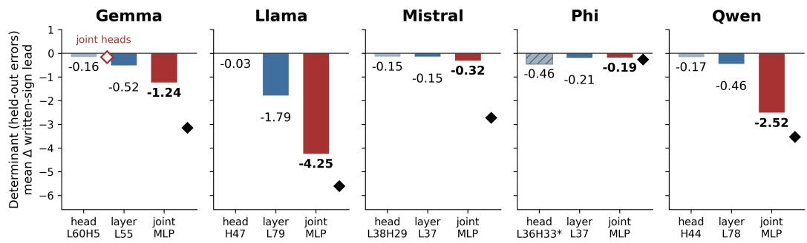

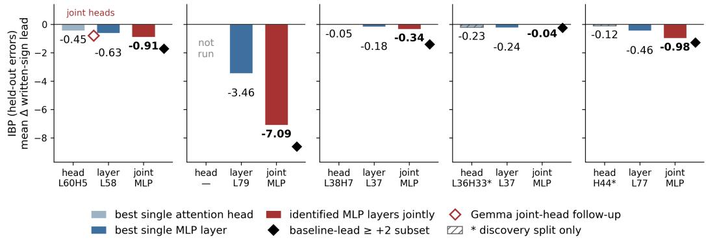  
Figure G1: The ablation ladder on held-out errors — determinant on top, IBP below, one panel per model. Three bars per panel: the strongest single attention head (grey; hatched where only a discovery grid exists), the strongest single identified MLP layer (blue), and the full identified set ablated jointly (red). Black diamonds mark the joint effect in the baseline-lead $\geq + 2$ subset; the open red diamond is Gemma’s joint-head follow-up (G.6). In every responsive model the bars step down the ladder; Phi’s stay flat at every rung (G.7).

## G.6 EXCEPTION 1 — GEMMA IBP HEADS, AND THE FOLLOW-UP THAT CLOSED IT

Gemma IBP is the only cell in Table G2 where single heads reach single-layer size: on the discovery grid (Table G2 reports the held-out values, −0.45 and +0.51), pusher L60H5 gives −1.01 and corrector L60H4 gives +1.36 — comparable to Gemma’s best single layers (Table G3). Taken alone this would leave open that Gemma’s IBP sign rides on attention.

So the joint-head arms were run exactly here (and, as a control, on Gemma det and Mistral det, where heads were already flat). Arms: H1 zeroes all pushers jointly, H2 pushers plus the corrector, H3 correctors only, H4 mid-rank control heads.

Table G6: Joint-head ablation — every grid that exists. Mean $\Delta$ lead (strict flips).
<table><tr><td>Model / task (split)</td><td>n</td><td>H1 pushers</td><td>H2 +corrector</td><td>H3 correctors</td><td>H4 control</td></tr><tr><td>Gemma det (disc)</td><td>92</td><td>−0.64 (1)</td><td>−0.24 (2)</td><td>+0.75 (1)</td><td>−0.00 (0)</td></tr><tr><td>Gemma det (held-out)</td><td>126</td><td>−0.16 (3)</td><td>−0.03 (2)</td><td>+0.20 (2)</td><td>+0.01 (0)</td></tr><tr><td>Gemma IBP (disc)</td><td>70</td><td>-1.64 (3)</td><td>−0.54 (3)</td><td>+1.85 (1)</td><td>−0.01 (0)</td></tr><tr><td>Gemma IBP (held-out)</td><td>73</td><td>-0.80 (5)</td><td>−0.41 (4)</td><td>+0.83 (2)</td><td>−0.02 (0)</td></tr><tr><td>Mistral det (disc)</td><td>93</td><td>−0.29 (1)</td><td>−0.22 (0)</td><td>+0.11 (0)</td><td>+0.01 (1)</td></tr></table>

The follow-up closes the exception rather than hiding it. Even with every pusher head removed at once, Gemma IBP gives −1.64 on discovery — real, but 57% of Gemma’s own joint-MLP effect on the same split (−2.86) — and replicates at −0.80 held-out with 5 of 73 flips. On held-out both effects attenuate together (joint-MLP −0.91 over all cases), so the cleaner held-out comparison is the subset with room to move: joint-MLP −1.73 on baseline ≥ +2 cases versus joint-heads −0.80. The H4 control heads sit at zero throughout, and no configuration of heads ever exceeds the MLP set.

Recall from Table G1 that these same heads have zero direct-path DLA. Gemma’s L60 attention heads relay some minus-ness on IBP — through the downstream MLPs — but they do not carry it. The ladder’s ordering survives: all heads jointly ≤ all MLP layers jointly, on every split.

## G.7 EXCEPTION 2 — PHI, WHERE THE ORDERING CLAIM IS VACUOUS

Phi-4 is flat at every rung: best single head −0.46 (discovery, and gone on re-run), best single layer −0.21, joint set −0.19 held-out with only 7 of 150 cases beating their random null — and its strict flips run at or below the random-set rate (det 2 vs 3.4 expected, IBP 4 vs 5.0; Table H4).

One caveat must be stated at full strength: on Phi det held-out, the 40 random 5-layer sets average −2.70 [−4.47, −1.27] — the targeted set does not beat random in Phi; the direction is the same on the discovery split (targeted +0.43, null −0.90). For Phi we therefore claim no single-component ordering at all; the claim is vacuous, not merely weak.

Because Phi resisted, it received an escalation family no other model needed. A cumulative staircase ablated the top-k DLA-ranked layers on discovery errors (n = 61 det, 40 IBP): determinant creeps from +0.01 at k = 1 to only −1.34 at k = 15, while IBP moves the wrong way, +2.23 at k = 15. Window arms (all MLPs in L24–39: −1.28 det but +2.02 IBP; L30–39: −0.67 / +1.79) do no better than a random window control (−0.44 / +0.48).

What finally moves Phi is the combined removal quoted in Section 5 of the main text — MLP sign-direction subtraction plus amplifier-attention zeroing (s08 arm C4): −6.70 det and −7.11 IBP held-out at α = 1, though with zero strict flips, because Phi’s baseline margins are enormous (+19.5 and +22.0 logits on average) and absorb even large pushes — the oversized-margin story told in Section 6. Phi is reported throughout as the null it is.

The combined removal is not Phi-specific. Table G7 reports the same arm (s08 arm C4: signdirection subtraction at the habit-layer MLPs plus amplifier-attention zeroing) at α = 1 on held-out errors for all five models and both tasks — the grid quoted in Section 5 of the main text. Entries are the mean change in the wrong sign’s final lead, in logits; n is the held-out error count. Higher doses of the subtraction component alone (arm C2, without the attention zeroing) are the steering experiment of Appendix H.

Table G7: Combined removal (s08 arm C4) at α = 1, held-out errors, all five models. Mean ∆ in the wrong sign’s final lead (logits); n in parentheses. Source metric: mean\_delta\_ld[C4|a1.0], master ledger.

<table><tr><td>Model</td><td>det ∆ lead (n)</td><td>IBP ∆ lead (n)</td></tr><tr><td>Gemma-3-27B</td><td>-0.12 (126)</td><td>-0.52 (72)</td></tr><tr><td>Mistral-Small-24B</td><td>−0.19 (132)</td><td>-0.96 (67)</td></tr><tr><td>Phi-4-14B</td><td>-6.70 (146)</td><td>-7.11 (76)</td></tr><tr><td>Llama-3.3-70B</td><td>-3.09 (189)</td><td>-8.16 (20)</td></tr><tr><td>Qwen-2.5-72B</td><td>-2.84 (99)</td><td>-4.94 (25)</td></tr></table>

## G.8 WHAT WAS NOT RUN, AND WHY

Every absent cell in this appendix falls into one of three buckets, stated so that no gap is silent.

Closed by logic. Joint-head ablation for Phi, Llama, and Qwen was not run because their single-head grids were flat everywhere (Table G2) — with no individual head effect to aggregate, the joint-head question answers itself; it was run only where it was live (Gemma, plus Mistral det as a control, G.6). Per-head grids on corrects were not run anywhere for the same reason: heads do nothing on errors, where the effect lives. Llama’s IBP head grid was never built — its det heads were at most −0.03, and its IBP pool (n = 21) was reserved for the layer-level arms.

Halted on a null. Mistral IBP joint ablation returned +0.29 on discovery and Phi IBP +1.61 — both wrong-signed nulls. The pre-planned held-out replications were still run and are reported in Table G4 (−0.34 and −0.04, both \~null); what was halted is everything downstream — no escalation family was pursued for Mistral, and Phi’s escalation (G.7) was motivated by its determinant cell, not IBP. The nulls stand in the tables rather than being rescued.

Coverage gap. Qwen joint-MLP-on-corrects was never run in any split or domain, and Llama det corrects has a discovery arm only $( - 6 . 9 1 , \mathrm { n } = 8 0 $ , plus a held-out single-layer probe: L78 −2.45, $\mathrm { n } = 1 3 0 )$ . Both gaps are patched by a stronger test of the same claim: the C2-on-correct steering battery (Appendix H) applies the same direction-removal generatively. Quoting its α = 1 mean ∆ with breaks counted at $\alpha = 3 \mathrm { : }$ : Qwen det discovery −0.83 (n = 47), held-out −1.04 (n = 141, 49 broken), Qwen IBP held-out −2.59 (n = 50), and Llama det held-out −5.65 (n = 130, 74 broken). The single true hole is Qwen IBP discovery C2-on-correct, which has no substitute and is simply absent.

## G.9 PROVENANCE

Every number in this appendix was recomputed for this draft from the per-case JSONs of the pipeline stages (s02 DLA, s05 joint and single-layer, s05b per-head zero, s05c joint-head, s08 combined arms) and the expC<sup>′</sup> mean-ablation battery, then cross-checked cell by cell against the master results ledger (paper/appendix/ledger\_results.csv); the figure and all tables are generated by one script in the repository, with nothing hand-typed.

## APPENDIX H — THE SIGN DIRECTION: CONSTRUCTION AND CAUSAL TESTS

Results of two pipeline stages (Appendix B): s06\_direction\_subtraction — removing the direction at one layer at a time (H.3) — and s08\_c2\_steering — the C2 condition, both habit layers at once, pooled discovery + held-out, reported per task (H.4). All numbers recomputed from the raw per-case stage outputs and cross-checked against the master results ledger (paper/appendix/ledger\_results.csv); see H.5for the poolingformula, metric names, and sourcefiles.

## H.1 What this appendix shows — and from which stages

Every intervention in this appendix acts on one object: the sign direction — a single vector in the residual stream along which “−” and “+” differ. H.2 defines that vector exactly. The rest of the appendix reports its two causal tests, in pipeline order (the s00–s09 pipeline, Appendix B):

• Stage s06\_direction\_subtraction (H.3). Remove the direction at one habit layer at a time and measure the dose–response, with control layers and a random direction as nulls — pooled over discovery + held-out (Phi: discovery only; H.3.1). This is the first causal test: writer layers move the written sign, controls stay flat.

• Stage s08\_c2\_steering (H.4). The C2 condition of §5: subtract the direction at both habit layers at once and ask what it does to four cohorts — minus-written errors, plus-written errors, correct-minus and correct-plus — pooled over discovery + held-out, per task. This is the specificity battery.

The construction itself (H.2) uses only model weights and discovery data and was frozen before either stage ran. Every number’s source file, and the ledger cross-check, is in H.5.

## H.2 The sign direction: construction

How it is computed, step by step. (1) Take the unembedding matrix WU — the map from the residual stream to token scores. (2) Take the row for the space-prefixed token “ −” and subtract the row for “ +” (the forms the models actually write mid-solution):

$$
d = W U ( \mathrm { ~ } ^ { \ast \ast } - \mathrm { ~ } ^ { \ast } ) - W U ( \mathrm { ~ } ^ { \ast \ast } + \mathrm { ~ } ^ { \ast \ast } )
$$

Moving the hidden state along d raises minus scores exactly as much as it lowers plus scores. (3) Multiply d elementwise by the final layer-norm’s scale weights, so the direction lives in the same coordinates as the residual stream the layers write. (4) Normalize to unit length: <sup>ˆ</sup>d = d / ∥d∥ — the sign direction. (5) To remove the direction at a layer, subtract α times the projection of that layer’s output h onto <sup>ˆ</sup>d, at the sign position during the teacher-forced run:

$$
h  h - \alpha ( h \cdot { \hat { d } } ) { \hat { d } } \quad ( \alpha = \mathrm { d o s e } )
$$

At α = 1 the layer’s <sup>ˆ</sup>d-component is removed exactly; higher doses push the same amount past zero. Both stages below use this one mechanic; the paper’s shorthand for it is subtracting the minus direction (minus-removal).

Construction uses only model weights and discovery data — never held-out cases. The same recipe applies to all five models; only the targeted habit layers differ per model (the frozen sets of §4): Gemma-3-27B L58 + L60 (controls L23, L39); Mistral-Small-24B L37/L38/L39 (controls L15, L25); Phi-4-14B L37 + L39 (controls L15, L25); Llama-3.3-70B L77 + L79 (controls L30, L50); Qwen-2.5-72B L75 + L78 (controls L30, L50).

## H.3 Stage s06\_direction\_subtraction — single-layer dose–response

## H.3.1 Design and eligibility

The stage’s question: is the sign direction a real causal handle — does removing it shift which sign gets written — or merely a correlate? The design: on determinant errors, remove the direction (the projection subtraction of H.2, step 5) at one layer at a time — each writer (habit) layer, each control layer, and a magnitude-matched random direction — and measure the change in the written sign’s logit lead. A case enters only if its logit-lens peak is above layer 5 — an earlier peak means there is no late circuit to test (Appendix C); the same frozen rule governs the s08 error runs (H.4.3).

Like the s08 battery, this stage pools discovery + held-out (the H.4.2 formula: counts add, means are case-weighted). The two phases ran the identical experiment — same script, same layers, same doses $\alpha = 0 . 5 / 1 / 2 -$ for four of the five models, and their case sets are disjoint. The exception is Phi-4-14B, reported on discovery data only: at the standard doses its held-out run barely moves — at most 4 of 146 cases flip (writer L39 at $\alpha = 3 ;$ writer L37: zero at every dose $\alpha \leq 3 )$ — because Phi’s single-layer projections are small against its oversized margins. The dose grid was therefore deliberately escalated to $\alpha = 5 / 8 / 1 2$ , and those are the informative Phi cells; the two grids share no dose, so Phi’s phases cannot be summed.
<table><tr><td>Model</td><td>Phases</td><td>n discovery</td><td>n held-out</td><td>n used</td><td>Doses α</td></tr><tr><td>Llama-3.3- 70B</td><td>pooled</td><td>15</td><td>189</td><td>204</td><td>0.5, 1, 2</td></tr><tr><td>Qwen-2.5- 72B</td><td>pooled</td><td>44</td><td>99</td><td>143</td><td>0.5, 1, 2</td></tr><tr><td>Gemma-3- 27B</td><td>pooled</td><td>89</td><td>126</td><td>215</td><td>0.5, 1, 2</td></tr><tr><td>Phi-4-14B</td><td>discovery57</td><td></td><td>一</td><td>57</td><td>5,8, 12</td></tr><tr><td>Mistral-Small- pooled 24B</td><td>only</td><td>91</td><td>132</td><td>223</td><td>0.5, 1, 2</td></tr></table>

Table H.1 — Cases entering the single-layer dose–response. Every n is the late-circuit subset (logit-lens peak > layer 5) fixed in the released files; the two phases’ case sets are disjoint, and pooled rows follow the s08 formula (H.4.2). Phi is discovery-only at deliberately escalated doses (see text). Qwen’s 99 held-out cases are 74 plus-writers + 25 minus-writers.

## H.3.2 Results

One worked example — Llama-3.3-70B at α = 2. At writer layer L79, removing the direction produces a mean change in written-sign lead of −1.83 logits and flips 32 of 204 cases to the correct sign. At control layer L50 the same dose yields −0.02 — flat. The random direction yields +0.000 with zero flips — null. That three-way contrast (writer strong, control flat, random null) is the core validation, and it holds monotonically across α = 0.5, 1, 2 (Table H.2).

<table><tr><td>Model</td><td>Layer</td><td>∆ at α = 0.5</td><td> $\Delta \arg \alpha = 1$ </td><td> $\Delta \arg \alpha = 2$ </td><td> $\begin{array} { l } { \displaystyle \mathbf { F l i p s } \left( \alpha = \mathbf { 0 . 5 } / \mathbf { 1 } / \right. } \\ { \displaystyle \mathbf { 2 } ) } \end{array}$ </td></tr><tr><td rowspan="5">Llama-3.3- 70B (n = 204)</td><td>L79 (writer)</td><td>-0.46</td><td>-0.91</td><td>-1.83</td><td>5 / 13 / 32</td></tr><tr><td>L77 (writer)</td><td>-0.21</td><td>-0.44</td><td>-0.90</td><td>2/2/6</td></tr><tr><td>L30 (con- trol)</td><td>+0.02</td><td>+0.00</td><td>+0.05</td><td>1/1/1</td></tr><tr><td>L50 (con- trol)</td><td>-0.01</td><td>-0.01</td><td>-0.02</td><td>1/2/2</td></tr><tr><td>random 一 dir.</td><td></td><td>+0.000</td><td>一</td><td>0</td></tr><tr><td rowspan="5">Qwen-2.5- 72B (n = 143)</td><td>L75 (writer)</td><td>-0.04</td><td>-0.07</td><td>-0.13</td><td>0/0/0</td></tr><tr><td>L78 (writer)</td><td>-0.03</td><td>-0.07</td><td>-0.11</td><td>1/1/1</td></tr><tr><td>L30 (con-</td><td>+0.01</td><td>+0.02</td><td>+0.01</td><td>0/0/0</td></tr><tr><td>trol) L50 (con-</td><td>+0.01</td><td>+0.01</td><td>-0.02</td><td>0/0/0</td></tr><tr><td>trol) random 一 dir.</td><td></td><td>+0.000</td><td></td><td>0</td></tr><tr><td>Model</td><td>Layer</td><td>∆ at low α</td><td>∆ at mid α</td><td>∆ at high α</td><td>Flips (low / mid / high)</td></tr><tr><td rowspan="4">Gemma-3- 27B (n = 215; α = 0.5/1/2)</td><td>L58 (writer)</td><td>-0.031</td><td>-0.059</td><td>-0.145</td><td>0/0/3</td></tr><tr><td>L60 (writer)</td><td>-0.143</td><td>-0.281</td><td>-0.560</td><td>2/6/18</td></tr><tr><td>L23 (con-</td><td>+0.002</td><td>-0.001</td><td>-0.001</td><td>2/1/3</td></tr><tr><td>trol) L39 (con-</td><td>-0.013</td><td>-0.013</td><td>+0.015</td><td>1/0/2</td></tr><tr><td>Phi-4-14B (n = 57, discovery; α = 5/8/12)</td><td>trol) L37 (writer)</td><td>-5.604</td><td>-9.501</td><td>-15.008</td><td>0 /3/ 12</td></tr><tr><td rowspan="6"></td><td>L39 (writer)</td><td>-4.543</td><td>-7.350</td><td>-10.991</td><td>0 / 8 / 10</td></tr><tr><td>L15 (con-</td><td>-0.025</td><td>-0.034</td><td>-0.067</td><td>0/0/0</td></tr><tr><td>trol) L25 (con-</td><td>-0.326</td><td>-0.500</td><td>-0.785</td><td>0/ 0 / 1</td></tr><tr><td>trol) L37 (writer)</td><td>-0.083</td><td>-0.174</td><td>-0.316</td><td>1/1/1</td></tr><tr><td>L38 (writer)</td><td>-0.059</td><td>-0.110</td><td>-0.242</td><td>0/1/2</td></tr><tr><td>L39 (writer)</td><td>-0.040</td><td>-0.085</td><td>-0.193</td><td>0/1/6</td></tr><tr><td></td><td>L15 +0.009 (con-</td><td></td><td>+0.001</td><td>+0.006</td><td>0/1/1</td></tr><tr><td></td><td>trol) L25 (con- trol)</td><td>-0.001</td><td>-0.006</td><td>-0.014</td><td>1/0 / 1</td></tr></table>

Table H.2 — Single-layer removal, Llama-3.3-70B and Qwen-2.5-72B (pooled discovery + heldout). ∆ = mean change in the written sign’s logit lead (negative = toward the correct sign); n as in Table H.1. The held-out portions of these curves are scored in Appendix J (prediction P4).

Table H.3 — Single-layer removal, Gemma-3-27B, Phi-4-14B and Mistral-Small-24B. Gemma and Mistral pooled (discovery + held-out); Phi discovery only, at the deliberately escalated doses (Table H.1). Same layout as Table H.2; n and doses as in Table H.1. The random direction flips zero cases in every model (Phi’s random control is stored as a per-case edit site). Phi’s large ∆ values at high doses mirror its oversized baseline margins.

## H.3.3 Takeaways — and how they line up with stage s08 (H.4)

Model by model: who flips most from a single layer, and whether the two-layer battery of H.4 says the same thing or the contrary.

• Llama-3.3-70B — most single-layer flips; H.4 agrees. 32/204 flips from L79 alone at α = 2 (Table H.2) — the largest one-layer effect of any model. The battery agrees: 42/121 det and 21/26 ibp minus-written flips (H.4.4–H.4.5).

• Phi-4-14B — flips only at extreme doses; H.4 agrees (the null). 0 flips at α = 5, 12/57 only at α = 12 (Table H.3). The battery at α = 3 stays null — 6/173 det, 4/108 ibp — despite the largest mean pushes: its oversized baseline margins absorb them (H.4.7).

• Gemma-3-27B — modest alone, strong in the pair; H.4 adds the second layer. 18/215 flips from its best single layer (L60, α = 2; Table H.3), but 33/84 det and 33/61 ibp once both habit layers are steered together (H.4.4–H.4.5) — the pair does what neither layer does alone.

• Qwen-2.5-72B — the contrary case. At most 1 flip from any single layer at any dose (Table H.2), yet the battery flips 11/39 det and 13/35 ibp (H.4.4–H.4.5): its stamp is distributed across layers, so one-layer removal understates the causal handle. This redundancy is the preregistered P4 exception; the joint ablation is in Appendix G.

• Mistral-Small-24B — same signature as Qwen, milder. 6/223 flips from its best single layer (L39, α = 2; Table H.3), yet the largest battery counts of any model — 62/185 det, 69/91 ibp — with the direction reaching only two of its three habit layers (H.4.1).

Controls stay flat everywhere: at the shared doses $( \alpha \leq 2 )$ every control-layer mean sits within ±0.05 logits, control flips never exceed 3 of 215, and even Phi’s α = 12 controls reach at most −0.79 against −15.0 at its writers; the random direction flips zero cases in every model (Tables H.2–H.3) — the deviations above are about writer layers, not the method.

## H.4 Stage s08\_c2\_steering — the C2 steering battery

## H.4.1 Protocol and steered sites

A reminder of the C2 experiment (§5). The sign direction was extracted on discovery data and then frozen. The C2 condition — minus-removal steering — removes the direction from the activations (the projection subtraction of H.2, step 5) at the frozen habit-layer sites, at the error-site sign token (the matched sign position on correct cases), at steering strength α ∈ {1, 2, 3}; all evaluation is teacher-forced, and the outcome measure is the sign lead: the written sign’s logit minus the alternative’s. A flip (on errors) or a break (on corrects) is a strict zero-crossing of that lead.

The steered sites, checked against the frozen habit sets of §4. The C2 protocol injects the direction at exactly two sites per model — a fixed design choice, identical for all five models. For Gemma-3-27B (L58 + L60), Phi-4-14B (L37 + L39) and Qwen-2.5-72B (L75 + L78, MLP outputs), the steered pair is the frozen habit set of §4, exactly, in every released target file. Mistral-Small-24B’s frozen habit set is the one with three members (L37/L38/L39), so the two protocol slots cover its deepest pair, L38 + L39 — frozen in every run’s metadata before scoring. If anything this understates Mistral: the direction reaches two of its three habit layers, and Mistral still posts the largest minus-written flip counts of any model (62/185 det, 69/91 ibp; Tables H.4–H.5). Llama-3.3-70B steers its per-task frozen pairs: L77 + L79 on determinants (the §4 set) and L77 + L78 on integration by parts, per the frozen, human-reviewed IBP target file, in which the minus-writer DLA credit concentrates at L78 (mean +3.35 logits on minus-written discovery cases, robust to leave-one-out).

This appendix asks whether the edit is specific to the sign computation, separately on each task. The test has three parts:

• It flips minus-written errors. On errors where the model wrote “−”, C2 at α = 3 flips (pooled) Gemma 33/84, Qwen 11/39, Llama 42/121 and Mistral 62/185 on determinants, and Gemma 33/61, Qwen 13/35, Llama 21/26 and Mistral 69/91 on integration by parts (Phi: 6/173 and 4/108 — see H.4.7). Almost every flip is corrective.

• It breaks correct-minus answers. On problems solved correctly with a true “−”, the same edit pushes many toward “+” (Llama 131/138 det and 24/24 ibp; Gemma 74/126 det) — the double edge of §5. The edit targets the sign computation itself, not “errors”.

• What it does to “+” separates the models — and the tasks. On plus-written cases the stamp models (Gemma, Qwen) are untouched or helped, the amplifier models (Llama, and Mistral on det) flip them too, and nearly all of this off-target traffic lives on the determinant task (H.4.7).

## H.4.2 Pooling: discovery + held-out

Definition. For each model, task and cohort type, the pooled count is the sum of the discovery-phase and held-out-phase counts for the identical cohort, and the pooled mean is the case-weighted mean over the union of cases. The two tasks are never mixed: every figure and table reports determinants and integration by parts separately, stacked.

Why pooling across the phase split is sound. The sign direction and the habit-layer targets were extracted on discovery data and frozen before any held-out case was scored; the held-out phase is the out-of-sample confirmation, and its per-task α = 3 endpoints stand on their own in Figure 5 of the main text. Both phases then run the identical C2 protocol on identically defined cohorts, so pooling changes no definition — it only adds cases. For a mechanistic-interpretability battery whose per-cell n is necessarily small, the pooled view gives the per-task estimates more statistical weight; Tables H.4–H.5 keep the per-phase rows alongside the pooled rows, so nothing is hidden by the sum.

## H.4.3 Coverage: where every case comes from

Cohort sizes trace to Appendix A. The determinant correct sets match Table A2 exactly, phase by phase (e.g. Gemma 50 discovery + 138 held-out = 188); the held-out cells of every cohort match

Table 1 exactly; the IBP discovery/held-out splits match the chain in §2 (Gemma 143 = 70 + 73, Mistral 109 = 39 + 70, Phi 117 = 40 + 77, Llama 43 = 22 + 21, Qwen 36 = 10 + 26).

The error steering runs cover exactly the late-circuit cases: the preregistered s08 filter keeps cases whose logit-lens peak layer is deeper than 5. Verified case by case against the experiment-ready files, every plus-written error in every cell is late-circuit — plus-written coverage is complete everywhere — and every excluded case is an early-peaking minus-written error: Gemma 6, Qwen 64 (48 of them in det held-out alone), Llama 7 (3 det held-out, 4 IBP), Phi 9, Mistral 21 (19 early-peak, 2 dropped by deterministic tokenization checks). All exclusions are mechanical filters fixed before scoring; none is outcome-based. The held-out minus-written denominators here equal Figure 5’s denominators exactly.

Two cells have no run and are shown as gaps, not zeros. The frozen steering protocol specifies error steering on held-out minus-written errors; the discovery-phase error steering reported in the other cells was run in addition to that protocol. Llama det is the one error cell without the additional discovery run, so its held-out row is the protocol-complete result, not a shortfall. The second gap is the Qwen ibp discovery correct cohort (25 cases exist; Qwen’s ibp correct rows are held-out only). Separately, Qwen ibp has zero plus-written cases in both phases — a fact about the model’s errors, not about coverage.

H.4.4 Results — 4×4 determinant
<table><tr><td>Model</td><td>Phase</td><td>Error — minus-written: flipped (mean ∆ lead)</td><td>Error — plus-written: flipped</td><td>Correct — minus: broken</td><td>Correct — plus: broken</td></tr><tr><td>Gemma-3- 27B</td><td>discovery 16/43 (—6.94)</td><td></td><td>1/46</td><td>4/33</td><td>0/17</td></tr><tr><td></td><td>held- out</td><td>17/41 (−5.37)</td><td>1/85</td><td>70/93</td><td>6/45</td></tr><tr><td>Qwen-2.5-</td><td>pooled</td><td>33/84 (-6.17)</td><td>2/131</td><td>74/126</td><td>6/62</td></tr><tr><td>72B</td><td></td><td>discovery5/14 (—7.30)</td><td>0/30</td><td>17/36</td><td>0/11</td></tr><tr><td></td><td>held-</td><td>6/25 (−8.14)</td><td>0/74</td><td>49/123</td><td>0/18</td></tr><tr><td>Llama-3.3-</td><td>out pooled</td><td>11/39 (−7.84)</td><td>0/104</td><td>66/159</td><td>0/29</td></tr><tr><td>70B</td><td>discovery</td><td>一</td><td></td><td>57/62</td><td>0/18</td></tr><tr><td></td><td>held-</td><td>42/121 (−4.52)</td><td>29/68</td><td>74/76</td><td>0/54</td></tr><tr><td></td><td>out pooled</td><td>42/121 (—4.52)</td><td>29/68</td><td>131/138</td><td>0/72</td></tr><tr><td>Phi-4-14B</td><td></td><td>discovery 1/51 (—8.41)</td><td>0/6</td><td>0/39</td><td>0/11</td></tr><tr><td></td><td>held- out</td><td>5/122 (-8.96)</td><td>1/24</td><td>2/137</td><td>1/12</td></tr><tr><td>Mistral-Small-</td><td>pooled</td><td>6/173 (-8.80)</td><td>1/30</td><td>2/176</td><td>1/23</td></tr><tr><td>24B</td><td></td><td>discovery23/71 (—0.17)</td><td>14/20</td><td>39/57</td><td>16/21</td></tr><tr><td></td><td>held- out</td><td>39/114 (-1.00)</td><td>7/18</td><td>53/90</td><td>26/32</td></tr><tr><td></td><td>pooled</td><td>62/185 (−0.68)</td><td>21/38</td><td>92/147</td><td>42/53</td></tr></table>

Table H.4 — 4×4 determinant, C2 at α = 3. Flip/break counts as k/n; in parentheses, the mean shift of the written sign’s lead (logits) on minus-written errors. Pooled rows (bold) are sums of the two phase rows; pooled means are case-weighted. “—” = no run in that phase: the preregistered plan steered held-out errors only; discovery-phase steering was an extra run added in the other cells (H.4.3).

What stands out. Of the pooled minus-written flips, corrective flips are Gemma 33/33, Qwen 11/11, Phi 6/6, Llama 33/42 and Mistral 52/62 — the §5 distinction between flipping and repairing matters only for the amplifiers. The plus-written column is the det story: Llama flips 29/68 plus-written errors to the correct sign (mean −8.50 logits) and Mistral 21/38 (mean −5.46, and already 14/20 on discovery data), while Gemma and Qwen flip 2/131 and 0/104 and their plus-written leads grow (+1.62 and +2.44 logits). This also resolves §5’s all-error flip counts: Llama det’s 71 = 42 minuswritten + 29 plus-written.

## H.4.5 Results — integration by parts

<table><tr><td>Model</td><td>Phase</td><td>Error — minus-written: flipped (mean △ lead)</td><td>Error — plus-written: flipped</td><td>Correct — minus: broken</td><td>Correct — plus: broken</td></tr><tr><td>Gemma-3- 27B</td><td>discovery 18/33 (—8.19)</td><td></td><td>0/35</td><td>1/25</td><td>0/25</td></tr><tr><td></td><td>held- out</td><td>15/28 (-3.96)</td><td>0/44</td><td>63/150</td><td>0 cases</td></tr><tr><td>Qwen-2.5-</td><td>pooled</td><td>33/61 (−6.25)</td><td>0/79</td><td>64/175</td><td>0/25</td></tr><tr><td>72B</td><td></td><td>discovery3/10 (—7.95)</td><td>0 cases</td><td></td><td>一</td></tr><tr><td></td><td>held- out</td><td>10/25 (−7.20)</td><td>0 cases</td><td>0/50</td><td>0 cases</td></tr><tr><td>Llama-3.3-</td><td>pooled</td><td>13/35 (−7.41)</td><td>0 cases</td><td>0/50</td><td>0 cases</td></tr><tr><td>70B</td><td></td><td>discovery8/12 (—14.52)</td><td>0/7</td><td>23/23</td><td>0 cases</td></tr><tr><td></td><td>held- out</td><td>13/14 (-20.72)</td><td>0/6</td><td>1/1</td><td>0/46</td></tr><tr><td></td><td>pooled</td><td>21/26 (-17.86)</td><td>0/13</td><td>24/24</td><td>0/46</td></tr><tr><td>Phi-4-14B</td><td></td><td>discovery 1/40 (—14.58)</td><td>0 cases</td><td>0/37</td><td>0/13</td></tr><tr><td></td><td>held- out</td><td>3/68 (-15.11)</td><td>0/8</td><td>0/93</td><td>0/53</td></tr><tr><td>Mistral-Small-</td><td>pooled</td><td>4/108 (—14.91)</td><td>0/8</td><td>0/130</td><td>0/66</td></tr><tr><td>24B</td><td></td><td>discovery30/35 (—8.03)</td><td>0 cases</td><td>15/23</td><td>17/20</td></tr><tr><td></td><td>held- out</td><td>39/56 (-6.05)</td><td>2/11</td><td>71/91</td><td>62/65</td></tr><tr><td></td><td>pooled</td><td>69/91 (−6.81)</td><td>2/11</td><td>86/114</td><td>79/85</td></tr></table>

Table H.5 — integration by parts, C2 at α = 3. Same layout as Table H.4. “0 cases” marks empty cohorts (the model produced no such cases in that phase); “—” marks the one missing Qwen discovery correct run. Corrective flips among the pooled minus-written flips: Gemma 33, Qwen 13, Llama 21, Phi 4, Mistral 67.

What stands out. The same edit bites harder on target: Llama flips 21/26 (81%) at a mean push of −17.9 logits and Mistral 69/91 (76%), against 35% and 34% on determinants. And it spills less off target: across all five models the ibp plus-written cells flip 2 cases in total (both Mistral), against 53 on determinants. The glaring exception is Mistral’s correct-plus cohort, 79/85 broken — on corrects, Mistral’s ibp direction is anything but clean (H.4.7).

## H.4.6 The pooled figures

4×4 determinant — pooled discovery + held-out, α = 3

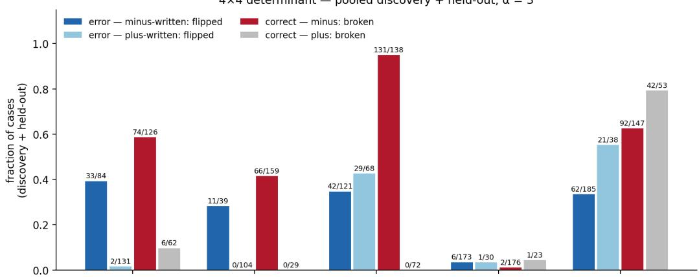

integration by parts — pooled discovery + held-out, α = 3  
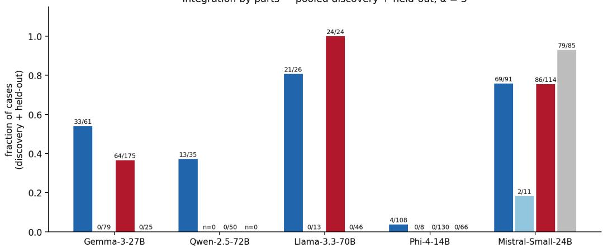  
Figure H.1 — Specificity fingerprint, pooled discovery + held-out, α = 3. Top: 4×4 determinant; bottom: integration by parts. Four bars per model, tagged as in Tables H.4–H.5: error — minuswritten (flipped), error — plus-written (flipped), correct — minus (broken), correct — plus (broken); k/n above each bar. Llama’s det bars pool the held-out phase only (H.4.3); Qwen ibp has no pluswritten cases in either phase.

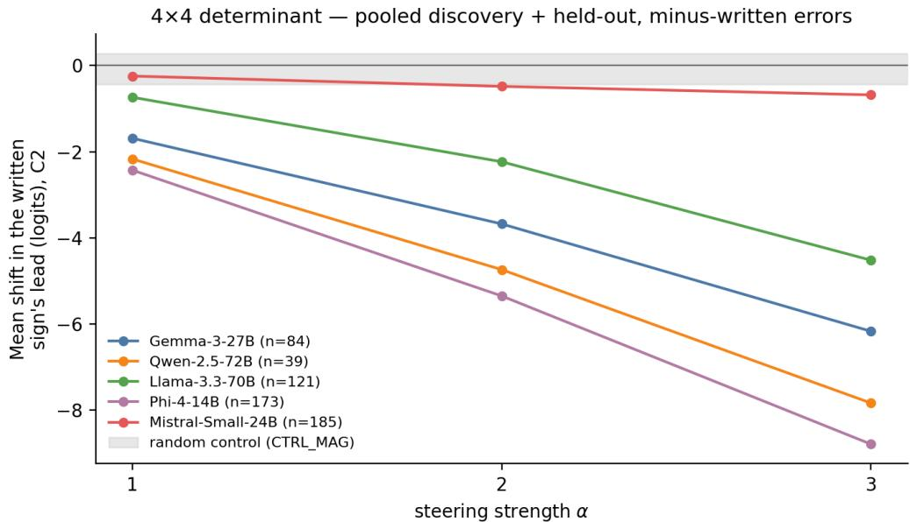

integration by parts — pooled discovery + held-out, minus-written errors  
  
Figure H.2 — Dose–response, pooled discovery + held-out, minus-written errors. Top: 4×4 determinant; bottom: integration by parts. Mean shift in the written sign’s lead under C2 versus steering strength α, one line per model (legend gives pooled n); the grey band spans the CTRL\_MAG control means. Note the y-scales: the ibp panel reaches −18 logits.

## H.4.7 What it means

Stamp versus amplifier, now causal. Figure 2 of the main text reads the habit layers’ DLA split by written sign — a correlational fingerprint. The plus-written steering column is its causal test, and the two agree model by model. Qwen and Gemma behave as fixed minus stamps: removing the stamp cannot hurt a written “+”, and indeed their plus-written det leads grow (+2.44, +1.62 logits; 0/104 and 2/131 flips). Llama behaves as an amplifier of whatever sign is written: subtracting the direction suppresses the written “+” too (29/68 det flips, mean −8.50). Mistral joins the amplifier camp on determinants — 21/38 plus-written flips, already 14/20 on discovery data — so a reading of Mistral as “intermediate”, based on the held-out phase alone (7/18), understates it. Phi’s plus cells are small and mixed (1/30 det at mean −2.47), consistent with its L37-stamp / L39-amplifier split in Figure 2. Plus cells with $\mathbf { n } \leq 1 3$ (Llama ibp, Mistral ibp, Phi ibp) are suggestive only.

Specificity is task-dependent. Integration by parts is the more sensitive task on target: at α = 3 the mean push on minus-written errors is −17.9 versus −4.5 logits for Llama, −14.9 versus −8.8 for Phi, and −6.8 versus −0.7 for Mistral, with flip rates to match (81% vs 35%, 76% vs 34%). Yet it is the cleaner task off target: the plus-written mean pushes on ibp sit near the control band (Gemma −1.89, Llama −2.21, Phi +0.84, Mistral +0.86 logits) while on det they are large for the amplifiers and positive for the stamps. The per-task directions evidently overlap the plus-written computation to very different degrees — ibp’s direction is nearly orthogonal to it — so specificity is a property of the task’s direction, not of the model alone. Three caveats: Qwen’s empty ibp plus cells are silence, not evidence of cleanliness; Gemma’s ibp correct-plus cohort is 25 discovery cases; and Mistral’s 79/85 broken ibp correct-plus answers show its ibp direction is emphatically not clean on corrects — the one large ibp off-target effect.

The double edge, and why Phi is the null. Correct-minus breakage confirms the double edge wherever the push clears the margin: Llama’s correct-minus cohorts are essentially wiped out (131/138 det, 24/24 ibp), Gemma breaks 74/126 on det. Phi barely moves in any cohort (6/173, 4/108 flipped; 2/176, 0/130 broken) even though its on-target push is among the largest (−14.9 logits on ibp): its oversized baseline margins — median sign lead near 25 logits — absorb the push, the §6 story. Breakage is also cohort-dependent: Gemma breaks 4/33 discovery correct-minus but 70/93 heldout. The discovery correct sets are the deepsign role-matched selections used for layer-finding, not random draws, so per-phase rates differ; the pooled row reports the union of the two honestly.

## H.5 Provenance and verification

Pooling formula. Pooled count = discovery count + held-out count for the identical (model, task, cohort) cell. Pooled mean = (n\_d·m\_d + n\_h·m\_h) / (n\_d + n\_h), i.e. the case-weighted mean over the union of cases.

Source files. The steering battery (H.4) comes from {Model}/{discovery|heldout}\_\*/s08\_c2\_steering/ — errors from \*error\*combined\_ablation.json, controls from \*error\*ctrl\_mag.json, corrects from \*c2\_on\_correct.json. The single-layer dose–response (H.3) comes from the s06\_direction\_subtraction/ JSONs of both phases (Phi: discovery only; Table H.1); its eligibility lists (peak > 5) are recomputable from the s01\_logit\_lens records.

Sign convention on corrects. written\_sign on correct cases carries the sign present in the text at the matched site (deepsign role-matched inputs), verified per-case against the released input files.

Controls. Across every CTRL\_MAG evaluation in the error runs of both phases — 4,215 case × dose evaluations — exactly one case flips (Llama det held-out, α = 3); across all 5,100 control evaluations on correct cohorts, zero break. The grey band in Figure H.2 spans the per-model CTRL\_MAG means, all within ±0.28 logits of zero.

Verification. Every count and mean in this appendix and both figures was recomputed from the raw per-case JSONs and cross-checked against paper/appendix/ledger\_results.csv (stage s08\_c2\_steering): pooled counts equal the sums of the per-phase ledger rows (n\_flipped\_minus[C2|aα]; n\_flipped − n\_flipped\_minus for plus-written; n\_broken[C2|a3.0]; n\_wrote\_minus\_all), and pooled means equal the case-weighted averages of the per-phase mean\_delta\_ld\_minus[C2|aα] rows. All match. Every ∆, flip count and n in Tables H.2–H.3 likewise matches the stage-s06 ledger rows (mean\_delta\_ld[layer|α], n\_flipped[layer|α], n\_cases\_all): the per-phase ledger rows match the raw JSONs, the pooled counts equal their sums, and the pooled means their case-weighted averages. The construction and removal mechanic stated in H.2 match the release code: the same unembedding-difference <sup>ˆ</sup>d and the same projection-subtraction hook appear in the experiment scripts of both stages. Both figures regenerate end-to-end from paper/appendix/fig\_G\_specificity.py.

## APPENDIX I — PREREGISTRATION AND THE HELD-OUT SCORECARD(P1–P6)

Before touching any held-out data, we wrote down — and locked with git commits — exactly what we would measure and what number would count as a pass. This appendix shows what was locked, and what the data then did. Figure 6 (§6) is the one-glance summary; this is the evidence behind each ofits cells.

## I.1 Why this appendix exists, and how to read it

A causal claim is easy to overfit: measure enough things and something will look like steering. Our protection is preregistration. For each model we committed a short document to git — a written contract fixing the data split, the layers to test, the direction recipe, six predictions, and a numeric pass bar for each — before computing any held-out number for that model. The held-out data then get exactly one chance to meet each bar, and every outcome is reported, including the misses.

The appendix reads in this order: I.2 records what was frozen and when (Table I.1); I.3 states the six predictions in plain words; I.4 explains how a verdict is decided; I.5–I.9 give one scorecard table per model — the frozen bar, the measured value, the verdict; I.10 adds it up.

Four terms cover everything in the tables. det is the arithmetic task (4×4 determinants where the model writes one wrong sign mid-computation); IBP is the calculus task (integration by parts, where the wrong sign appears in the recursion). ∆ lead is the change in the logit lead of the written sign over the opposite sign — negative means the intervention moved the model away from what it wrote. α is the dose (strength) of an intervention, and a flip means the written sign actually changed.

## I.2 What was frozen, and when

Six preregistration documents were frozen — one per model, plus a separate Llama IBP document. Each lives in the repository in its own folder (preregistration\_llama/, preregistration\_qwen/, preregistration\_gemma/, preregistration\_phi/, preregistration\_mistral/), and each folder was locked with a single git commit before any held-out number existed for that model. Every freeze commit contains the same three things:

• the preregistration document itself — the discovery/held-out split, the layer sets and the sign-direction recipe (both found on discovery data), the six predictions, and a numeric pass bar for each confirmatory one;

• the held-out data files themselves — the error and correct-answer batteries, copied in untouched, so the exact cases to be tested were locked before anything was measured on them;

• the frozen target files — the layer choices carried over from discovery data, committed unmodified and never re-derived.

Each document’s own scope section is the full record of what its battery covers; where the models differ, the frozen document — not this appendix — is the authority.

The documents were frozen on different dates (August 31 to September 15) because the models were run in sequence. Each document was frozen before any held-out number existed for its own model; later documents used lessons from earlier models to set sensible bars. That is the replication design — frozen tests of the same claim, repeated across models — not a leak of the data being predicted. No document was edited after its freeze, with one disclosed exception (Gemma, below), which only withdrew a pass bar and changed no number.

<table><tr><td>Model</td><td>Freeze date (commit)</td><td>What else to know</td></tr><tr><td>Llama- 3.3-70B</td><td>det: 2026-08-31 (03e5549); IBP:</td><td>The separate IBP document (12 bars) was adjudicated on its own: 11 of 12 met, CONFIRMED (c418503). Table I.5 and Figure 6 score the det document; its P6 steering arm is labeled exploratory</td></tr><tr><td>Qwen-</td><td>2026-09-01 (fb98035) 2026-08-31 (64580f2)</td><td>†. Held-out results committed 2026-09-03 (412976b) and 2026-09-05 (3bb48f8).</td></tr><tr><td>2.5-72B Gemma-</td><td>2026-09-13 (df73a1a;</td><td>Same-day amendment, before any measurement: one pass bar was withdrawn (the correct-answer</td></tr><tr><td>3-27B</td><td>amended 8d56bb3)</td><td>battery became descriptive), so P5 carries no verdict.</td></tr><tr><td>Phi-4-</td><td>2026-09-15 (67d0d73)</td><td></td></tr><tr><td>14B</td><td></td><td>The correct-answer battery is descriptive by design (no pass bar).</td></tr><tr><td>Mistral- Small- 24B</td><td>2026-09-14 (04c2cd2)</td><td>The file header still reads "DRAFT"; the Sep 14 commit is the freeze. Held-out run 2026-09-19 (7e7ea87).</td></tr></table>

Table I.1 — The freeze record. Every freeze commit contains the three items listed above — the document, the untouched held-out data, and the frozen targets — and was pushed before its model’s held-out run. For what each battery covers, the preregistration document in each model’s folder is the full record.

## I.3 The six predictions

The same six predictions appear in every document, each with a frozen numeric bar. In plain words:

• P1 — errors are decided late. The layer where the wrong sign takes the lead sits in the last stretch of the network, past a frozen depth cut-off.

• P2 — habit layers write the sign. The frozen habit layers push the written sign’s logit up (positive DLA — direct logit attribution).

• P3 — one direction separates “−” from “+”. Projected onto the frozen sign direction, minus-written and plus-written cases fall on the sides the plan registered.

• P4 — removing the direction moves errors, dose by dose (for Phi the plan predicts the opposite: a null or backfire).

• P5 — the sign signal also moves correct answers in the registered way.

• P6 — steering flips error cases while a magnitude-matched control direction does nothing.

Five models × six predictions = thirty cells. Figure 6 scores twenty-nine: Gemma’s P5 has no pass bar (the pre-measurement amendment made it descriptive), so it appears on the figure as “—” and is excluded from the denominator.

## I.4 How verdicts are scored

A prediction is CONFIRMED if the frozen bar was met, NEAR-MISS if it missed narrowly (by a margin defined in the preregistration itself), MISS if the bar was clearly not met, and NOT SCORED if no bar existed. One rule governs everything: the frozen plan is never revised after seeing held-out data. Where a frozen site turned out not to be the best site (Gemma, I.5), the test still runs at the frozen site and the result stands as measured.

Four footnote symbols, shared with Figure 6: † Llama’s P6 steering arm was added in Phase 2 (no Llama steering file existed at freeze time); it is labeled exploratory and scored under the frozen disclosure policy. ‡ Phi’s P1 IBP arm (92.2%) narrowly missed its 95% bar; the det arm passed clearly. The preregistration itself defines the cell verdict by the pooled rule — that rule was frozen in advance, not chosen after seeing the number, and the near-miss is disclosed. § Mistral’s P3 uses the minus>plus projection convention — the polarity of its direction, fixed from discovery data in the frozen document. ¶ One frozen rule sets every P6 flip denominator: the cases whose baseline lead is positive (for Qwen, its registered target — minus-written cases). The same rule simply yields different counts per model: Gemma 66, Mistral 80, Llama 163, Qwen 25, Phi 145.

## I.5 Gemma-3-27B (62 layers; frozen habit sites L55, L58)

The honest-penalty case: the frozen sites were not the best sites, and we scored them anyway.

Held-out error set: 126 det, 73 IBP. The preregistration froze L55 and L58 as the causal test sites; held-out data later placed the strongest late writers at L58/L60. We did not swap layers after the fact: Table I.2 scores the frozen sites as written, and Gemma therefore takes four near-misses. That penalty is the protocol working — the main text, which is free to use the held-out-identified sites, reports the strong effects.

<table><tr><td></td><td>Pred. Preregistered bar (held-out)</td><td>Measured value</td><td>Verdict</td></tr><tr><td>P1</td><td>Decided late: lens peak ≥ L55 in ≥ 50% of cases, per domain</td><td>det 54/126 = 42.9%; IBP 29/73 = 39.7%</td><td>NEAR-MISS</td></tr><tr><td>P2</td><td>Mean MLP DLA &gt; 0 at L55 and L58, both domains</td><td>L55 +0.913 (pass); L58 —0.353 (fail)</td><td>NEAR-MISS</td></tr><tr><td>Pred.</td><td>Preregistered bar (held-out)</td><td>Measured value</td><td>Verdict</td></tr><tr><td>P3</td><td>Minus-written mean projection &lt; plus-written at the capture layers</td><td>ordering inverted at L58/L60; only L56 in the registered direction</td><td>NEAR-MISS</td></tr><tr><td>P4</td><td>Joint ablation dose-response: pooled mean ∆ lead ≤ —1.5 and ≥ 30% of cases beat the null</td><td>mean −1.235; 33/126 = 26.2% beat the null</td><td>NEAR-MISS</td></tr><tr><td>P5</td><td>No pass bar (descriptive by pre-measurement amendment)</td><td>reported descriptively only</td><td>NOT SCORED</td></tr><tr><td>P6</td><td>Steering flips errors, control flat: mean ∆ lead negative and monotone; strict flips at α = 3 ≥ 5%; Icontroll ≤ 0.5</td><td>18/66 = 27.3% flips at α = 3; mean —3.33; control ≈ 0 ¶</td><td>CONFIRMED</td></tr></table>

## Table I.2 — Gemma-3-27B held-out scorecard. 1 CONFIRMED, 4 NEAR-MISS, 1 NOT SCORED.

## I.6 Mistral-Small-24B (40 layers; habit layers L37, L38, L39)

## Full confirmation on both tasks, with one narrow IBP miss on timing depth.

Held-out error set: 142 det, 70 IBP. The steering stage takes exactly two layers per model — a rule applied identically to every model. Mistral’s frozen pair was L38 + L39, so L37, despite carrying the largest single-site DLA, was not steered.

```csv
Pred. Preregistered bar (held-out) Measured value Verdict
P1 Decided late: lens peak ≥ L30 in ≥ 40% det and ≥ 60% det 74/142 = 52.1% (pass); IBP 39/70 = 55.7% vs NEAR-MISS
IBP the 60% bar (IBP)
P2 DLA > 0 at L37 and < 0 at L36 (det); > 0 at L37 and L38 det L37 +0.893, L36 −0.236; IBP L37 +0.993, L38 CONFIRMED
(IBP) +0.611
P3 § Minus-written mean projection > plus-written at L37 minus +0.673, plus −0.467 CONFIRMED
(minus>plus convention §)
P4 Joint ablation: pooled mean ≤ −0.30; ≥+2 stratum ≤ mean −0.317; ≥+2 stratum (n = 66) −2.734; CONFIRMED
−1.5; ≥ 20% beat the null 44/142 = 31.0% beat the null
P5 Corrects broken at α = 3 in ≥ 40% of baseline>0 cases; 79/107 = 73.8% broken; mean −11.18 CONFIRMED
mean ∆ lead negative, monotone
P6 Error flips at α = 3 ≥ 20% (det) / ≥ 40% (IBP); |control| ≤ det 46/80 = 57.5% flips; mean −5.54; control ≈ 0 ¶ CONFIRMED
0.1
```

## Table I.3 — Mistral-Small-24B held-out scorecard. 5 CONFIRMED, 1 NEAR-MISS.

## I.7 Phi-4-14B (40 layers; habit layers L37, L39)

The model registered NOT to steer — and, as predicted, it did not.

Held-out error set: 150 det, 77 IBP. Phi’s document makes the inverse bet: P4 predicts a null or backfire, and P5–P6 predict near-zero flips. Confirming these predictions is what separates “localization” from “steerability” — the dissociation at the center of the paper.

<table><tr><td></td><td>Pred. Preregistered bar (held-out)</td><td>Measured value</td><td>Verdict</td></tr><tr><td></td><td>P1  Decided late: lens peak ≥ L30 in ≥ 80% det and ≥ 95% IBP</td><td>det 142/150 = 94.7% (pass); IBP 71/77 = 92.2%</td><td>CONFIRMED ‡</td></tr><tr><td>P2</td><td>DLA &gt; 0 at L37 and L39, both above controls L15/L25</td><td>L37 +1.665, L39 +1.156; controls +0.038, +0.105</td><td>CONFIRMED</td></tr><tr><td>P3</td><td>Single-site ablation at L37/L39 more negative than at the controls</td><td>L37 −0.208, L39 −0.175 vs L15 +0.117, CONFIRMED L25 -0.103</td><td></td></tr><tr><td>P4</td><td>Joint ablation null (the unsteerable prediction): mean ≥ —1.0; &lt; 50% beat the null</td><td>mean —0.192; 7/150 = 4.7% beat the null</td><td>CONFIRMED</td></tr><tr><td>P5</td><td>Direction subtraction near-zero flips: ≤ 10% at α = 3; random control 0 flips</td><td>L37 0/146 = 0.0%; L39 4/146 = 2.7%</td><td>CONFIRMED</td></tr><tr><td>P6</td><td>Steering flips ≤ 10%; Icontroll ≤ 0.2 with 0 strict flips</td><td>6/145 = 4.1% flips at α = 3; mean −8.039; CONFIRMED control ≈ 0</td><td></td></tr></table>

Table I.4 — Phi-4-14B held-out scorecard. 6 CONFIRMED (P1 IBP near-miss disclosed ‡). Figure 5 reports the same steering run restricted to minus-written cases (5/122 det, 3/68 IBP) — hence the different denominators.

## I.8 Llama-3.3-70B (80 layers; habit layers L77, L79)

The largest model and the cleanest pass: five fully confirmatory arms, all met.

Held-out error set: 192 det. Table I.5 scores Llama’s det document; the IBP arms were frozen and adjudicated under their own document (Table I.1). Five of the six arms here are fully confirmatory and all five passed; the sixth (P6 steering) was added in Phase 2, is labeled exploratory †, and is scored under the frozen disclosure policy rather than hidden.

Pred. Preregistered bar (held-out) Measured value Verdict   
P1 Decided late: lens peak ≥ L60 in ≥ 60% of 152/192 = 79.2% CONFIRMED   
det cases   
P2 Pooled mean MLP DLA > 0 at L77 and L79 L77 +1.067, L79 +1.717 CONFIRMED   
P3 Pairwise separation ≥ 70% at L79 80.1% of case pairs (6,753/8,432); plus-written projection < 0 in CONFIRMED   
61/68 = 89.7%; means +0.019 (minus) vs −0.791 (plus)   
P4 Direction subtraction: mean ∆ lead L77 −0.437 / −0.891 and L79 −0.860 / −1.723 at α = 1/2; CONFIRMED   
negative at L77 and L79 at every α, controls L30/L50 ≈ 0   
monotone   
P5 Reverse patching on corrects: mean ∆ lead L77 −1.530, L79 −3.093; broken 0/130 CONFIRMED   
negative at both layers; broken ≤ 5%   
P6 † Exploratory †: mean ∆ lead negative, flips 14/32/71 at α = 1/2/3 (71/163 = 43.6%); mean −7.15; control CONFIRMED   
monotone; control ≈ 0 ≈ 0 ¶ †

## Table I.5 — Llama-3.3-70B held-out scorecard. 6 CONFIRMED (P6 exploratory †).

## I.9 Qwen-2.5-72B (80 layers; habit layers L75, L78)

One honest miss: the separation the plan predicted exists, but one layer higher thanfrozen.

Held-out error set: 147 det. One denominator note: the P1 bar counts all 147 held-out errors, exactly as the preregistration specifies; §3 quotes a higher late-peak share because it uses only lensconfirmed cases — a different, disclosed quantity, not a revision of this one.

<table><tr><td>Pred.</td><td>Preregistered bar (held-out)</td><td>Measured value</td><td>Verdict</td></tr><tr><td>P1</td><td>Decided late: lens peak ≥ L60 in ≥ 60% of det cases (all held-out errors)</td><td>90/147 = 61.2%</td><td>CONFIRMED</td></tr><tr><td>P2</td><td>Mean MLP DLA &gt; 0 at L75 and L78</td><td>L75 +0.472, L78 +0.568</td><td>CONFIRMED</td></tr><tr><td>P3</td><td>Minus-written mean projection &lt; plus-written at L75 and L78</td><td>ordering reversed at L75/L78; the separation holds only at L79 (77.9% of case pairs), not at the preregistered layers</td><td>MISS</td></tr><tr><td>P4</td><td>Direction subtraction: L78 mean ∆ lead negative and monotone at every α</td><td>minus-written: —0.773 / —1.605 at α = 0.5/1; monotone; random control ≈ 0</td><td>CONFIRMED</td></tr><tr><td>P5</td><td>Judge gap at L79: minus-correct &gt; 0 and plus-correct &lt; 0 in the majority; broken ≤ 3%</td><td>minus-correct 123/123 positive (mean +1.606); plus-correct 18/18 negative (mean -1.135); broken 1/123</td><td>CONFIRMED</td></tr><tr><td>P6</td><td>Steering: mean ∆ lead negative at every α, monotone; control ≈ 0</td><td>minus-written baseline&gt;0 (n = 25): 6/25 = 24.0% flips at α = 3; mean —8.143; control ≈ 0 q</td><td>CONFIRMED</td></tr></table>

Table I.6 — Qwen-2.5-72B held-out scorecard. 5 CONFIRMED, 1 MISS. The P3 miss is scored as frozen and kept: the separation exists, but at L79 rather than the preregistered L75/L78 — a finding about redundancy, reported as a miss because that is what the frozen plan says it is.

## I.10 What it adds up to

Across the twenty-nine scored cells: Gemma 1 CONFIRMED / 4 NEAR-MISS / 1 NOT SCORED; Mistral 5 CONFIRMED / 1 NEAR-MISS; Phi 6 CONFIRMED; Llama 6 CONFIRMED (P6 exploratory); Qwen 5 CONFIRMED / 1 MISS. That is 23 of 29 frozen predictions confirmed — the count on Figure 6. The six cells that fall short are all reported: four of them come from one model (Gemma) being scored at its frozen, suboptimal sites, and the one outright miss (Qwen P3) is kept on the board rather than rescored.

Data. Every measured value in Tables I.2–I.6 comes from the model’s held-out stage folders in the released repository (the s01–s09 stages of Appendix B) and is cross-checked against the master results ledger; the preregistration documents, with their commit history, are in the repository’s preregistration\_<model>/ folders.

## APPENDIX J — THE REVERSE ARROW: PATCHING AND INJECTION (P5)

Every causal result in the main text removes the sign signalfrom errors. This appendix presents the experiments that run the arrow the other way — copying or injecting the error signal into correct answers — and theforward transplant that shows why a correct state cannot be copied in to repair. Verdicts were frozen per model in Appendix I; this appendix gives the protocols, the full numbers, and the controls.

## J.1 What this appendix shows

The model is about to write a sign. Every experiment here freezes it at that moment — one position, the token just before the sign appears. At that position each layer produces its message: the activation packet it hands forward. Patching (stage s07, Appendix B) swaps that message for a different one one component, one token, nothing else — and lets the run continue to see which sign is written now. The swapped-in message is always a mean: the healthy message, averaged from correct runs, or the error message, averaged from late-circuit error runs. Three questions organize the appendix. Can the healthy message repair an error? No — and the null is preregistered: a stamp layer says the same thing on correct and error runs, so the healthy and the error message coincide there and swapping changes nothing (J.4). Can the error message corrupt a correct answer? Yes, in each model’s registered way — including the model where the lead moves and oversized margins absorb it, and the model immune in both directions (J.3). Does any of it survive controls? The same swap at mid-network layers is null, and sign-matched donors close the composition confound (J.3–J.4). Prediction P5 — the sign signal also moves correct answers in the registered way — is scored from these arms in Appendix I.

## J.2 Method

All arms are teacher-forced at the probe token — the position just before the sign. The patched object is one component’s output (an MLP, or L77’s attention out-projection in the Llama forward arm) at that position only, replaced by a donor-set mean; error-mean donors pool late-circuit error cases (lens peak > layer 5) at the same position. Readout: the written sign’s logit lead at the probe token; ∆ vs the unpatched run. Broken is strict — correct at baseline, wrong sign ahead after the patch; fixed is the mirror. The injection arms that are not literal patches use the same readout: Mistral and Phi apply the §5 subtraction edit to correct answers; Qwen’s judge arm patches error-mean vs self-mean at the check layer and scores the per-case gap. Controls throughout: the identical swap at mid-network layers (L30/L50 or per-model equivalents) and, for steering-style arms, CTRL\_MAG.

## J.3 The reverse arrow, model by model

Table J.1 gives one row per model: the registered instrument, the frozen pass bar and held-out result (both verbatim from the Appendix I scorecard), and the verdict. The subsections add the full perlayer numbers and controls.
<table><tr><td colspan="2">Model Registered instrument</td><td>Frozen pass bar (verbatim)</td><td>Held-out result (frozen)</td><td>Verdict</td></tr><tr><td colspan="2">MistralC2 subtraction on corrects at [L38, L39], α grid</td><td>Corrects broken at α = 3 in &gt; 40% of baseline&gt;0 cases; mean ∆ lead</td><td>79/107 = 73.8% broken; mean —11.18</td><td>CONFIRMED</td></tr><tr><td colspan="2">Llama s07 error-mean patch into corrects at habit layers</td><td>negative, monotone Reverse patching on corrects: mean ∆ lead negative at both layers;</td><td>L77 —1.530, L79 —3.093; broken 0/130</td><td>CONFIRMED</td></tr><tr><td colspan="2">Qwen Judge arm: error-mean vs self-mean patch at check</td><td>broken ≤ 5% Judge gap at L79: minus-correct &gt; 0 and plus-correct &lt; 0 in the majority;</td><td>minus-correct 123/123 positive (mean +1.606); plus-correct 18/18 negative (mean</td><td>CONFIRMED</td></tr><tr><td colspan="2">layer L79 Phi Direction subtraction,</td><td>broken &lt; 3% Direction subtraction near-zero flips: ≤ 10% at α = 3; random control 0</td><td>—1.135); broken 1/123 L37 0/146 = 0.0%; L39 4/146 = 2.7%</td><td>CONFIRMED</td></tr><tr><td colspan="2">single layers L37 / L39 (inverse bet) Gemma</td><td>flips No pass bar (descriptive by pre-measurement amendment)</td><td>reported descriptively only</td><td>NOT</td></tr></table>

Table J.1: The reverse arrow, scored. Pass bars and results are quoted verbatim from the frozen scorecard (Appendix I); protocols and full per-layer numbers in J.3.1–J.3.5.

J.3.1 Mistral — corrects break wholesale. The same two-layer edit that fixes its errors, pointed at corrects (held-out determinant, n = 122): 79 broken at α = 3 — 73.8% of the 107 cases with positive baseline lead — with mean lead shift −11.18 on that subset (−8.85 over all 122); CTRL\_MAG breaks 0/122 (mean +0.07). The IBP correct battery, outside the frozen bar, is even starker: 133/156 broken at α = 3, mean −14.09. The model that steers most is also the least protected — no margin, no rescue.

J.3.2 Llama — the signal arrives, the margins absorb it. The literal transplant (s07 reverse patch): the error-set mean message copied into correct runs at the habit layers. Determinant (n = 130): L77 −1.53, L79 −3.09, broken 0/130. IBP (n = 47): L77 −3.58, L78 −7.58, broken 0/47. Control L30: −0.25 (det) and −0.10 (IBP), 0 broken. The lead moves at every habit site and not one answer breaks — the same oversized-margin behavior its error steering shows.

J.3.3 Qwen — the judge reads the injected signal; the stamps ignore it. Registered arm (heldout determinant corrects, n = 141 = 123 minus + 18 plus): error-mean vs self-mean patch at check layer L79; the per-case gap is positive for all 123 minus-corrects (mean +1.61), negative for all 18 plus-corrects (−1.14), with 1/123 broken — the judge sees error content without flipping the answer. The unregistered companion is just as telling: the same error-mean message patched at the stamp sites themselves does nothing (L75 −0.29, L78 +0.04, 0/141 broken; control L30 +0.01, 0 broken) — a stamp’s message is the same on error and correct runs, so swapping it in is a no-op. Fixedness, demonstrated from the reverse side.

J.3.4 Phi — immune in both directions. The registered P5 arm is the inverse bet, scored on the held-out determinant error battery (n = 146): direction subtraction fixes almost nothing — L37 0/146 flipped, L39 4/146 (2.7%) at α = 3, while the lead moves by −3.08 and −3.55. The reverse arrow completes the picture: the same subtraction pointed at corrects breaks at most 1/140 (determinant, either layer; means −3.04 / −3.43 at α = 3) and 0/146 on IBP at both layers (L39 mean −10.17). In every arm the lead moves by 3–10 logits and the written sign almost never follows. Phi’s two-way immunity is what rules out a miscalibrated dose or direction: a wrong lever fails one way, not both.

J.3.5 Gemma — descriptive. The pass bar was withdrawn before measurement (Appendix I); the correct-cohort numbers are reported in Table H.4 and carried here without a verdict.

## J.4 The forward arrow: why a correct state cannot be copied in

The forward transplant patches the correct-set mean message into error runs. At stamp sites the preregistered prediction is null — the message there carries nothing error-specific — and it holds. Where the pooled donor mean did move the lead (Llama L79: −1.81, 27/189 flipped), the signmatched control unmasks it as donor composition: with donors matched to the written sign, L79 goes to +1.00 with 8/189 fixed, and L77 to +2.27 with 0/189 fixed. Qwen’s forward numbers are small everywhere (held-out n = 99: L75 −0.67 with 3 flips, L78 −0.69 with 1, L79 −0.44 with 2; controls L30 −0.01 with 0, L50 −0.08 with 1). Across both models with a patching arm, the clean forward transplant repairs essentially nothing.

## J.5 What it means

One triple summarizes every arm: removing the direction fixes; transplanting a correct state does not; injecting the error state breaks — the signal can be written in, not copied out. Repair requires deleting one axis — not overwriting the whole message, which at the decisive sites contains nothing error-specific to overwrite. Each model’s reverse-arrow behavior independently re-derives its §6 mechanism verdict — Mistral’s ungated push, Llama’s margins, Qwen’s stamp/judge split, Phi’s mechanism-level immunity — and the direction-specific, control-clean pattern doubles as specificity evidence for the whole battery.

## J.6 Provenance and verification

Source files. Reverse patch (J.3.2, J.3.3 companion): {Model}/heldout\_\*/s07\_patching/\*\_correct\_reverse\_patch.json. Judge arm (J.3.3): Qwen heldout s09\_judge det\_4x4\_correct\_judge\_candidates\_armA. Subtraction on corrects (J.3.1, J.3.4): s08\_c2\_steering \*\_c2\_on\_correct.json (Mistral) and s06\_direction\_subtraction \*\_correct\_deepsign\_expG\_prime\_bias\*.json (Phi); Phi’s registered error-battery arm from s06 det\_4x4\_error\_expG\_prime\_bias\_subtraction. Forward arm (J.4): s07\_patching \*\_error\_correct\_mean\_patch.json and \*\_error\_signmatched\_patch.json.

Criterion. Broken and fixed are strict per-case flips of the written sign’s logit lead at the probe token (baseline correct → edit wrong, and the mirror); no partial credit for lead movement.

Verification. Every count and mean in this appendix was recomputed from the raw per-case JSONs and cross-checked against paper/appendix/ledger\_results.csv (stages s06, s07, s08, s09); the Mistral 107-case denominator (baseline lead > 0) and the $7 9 / 1 0 7 = 7 3 . 8 \mathrm { \bar { \% } }$ broken rate were re-derived directly from the raw held-out file. Frozen bars and verdicts are quoted verbatim from Appendix I and were not rescored.

## APPENDIX K — PHI-4: WHY THE BEST-LOCALIZED CIRCUIT RESISTS CALIBRATED STEERING

Everything in this appendix is exploratory and uses discovery data only; no preregistered verdict (Appendix I) depends on any number here.

Phi poses the sharpest version of the paper’s question. It replicates every descriptive claim — the latest peaks of the five models, L37 stamp-like and L39 amplifier-like, MLP credit dominating attention — yet the standard steering battery at $\alpha \leq 3$ flips almost nothing, even though the wrong sign’s lead clearly moves under the edit. The lever transmits force; the outcome does not change. Is that an artifact of dose, direction, or sites — or a property of the model? The experiments below locate the answer in two measured properties: margins (K.1) and redundancy (K.2).

K.1 Over-determined margins. Figure K1a shows the baseline wrong-sign lead at the error site for every discovery batch in the study. Phi is in a different regime from every other model: determinant median 17.8 logits (max 43.4), and IBP clustered in a tight 28–32 band — 29 of 40 cases sit at ${ \ge } 2 8 .$ , a structural floor. The other batches sit at medians of roughly 5.5–7.5 logits (Gemma, Llama, Qwen; Qwen’s small IBP batch, $n = 1 0 .$ , is higher at 17.3 but still below Phi’s floor) and 0.5–3 logits for Mistral-Small. Figure K1b shows what the intervention does to those margins: at the strongest standard-dose arm the edited lead tracks ≈0.58× baseline (det) and ${ \approx } 0 . 5 1 \times \mathrm { ( I B P ) }$ , with corr(baseline, ∆lead) = −0.90 and −0.98. The edit is a proportional cut, not an absolute shift — and a ∼50% cut never crosses zero for a baseline above a few logits. Accordingly, the only two cases that flip at standard dose are the two smallest margins in the pool (baselines 3.5 and 3.75, circled in the figure).


  
Figure K1: Margins, not location, separate Phi from the steerable models. (a) Per-case baseline wrong-sign lead at the error site for all discovery batches (dots: cases; bar and right column: median). Phi’s determinant margins are 2–3× any other model’s, and its IBP margins form a 28–32 logit floor. (b) Phi, lead after the full edit at $\alpha = 3$ versus baseline lead. Cases follow the 0.5×-baseline line (solid), not the flip region below zero (dotted); the only flips (red circles) are the two smallest baselines, 3.5 and 3.75.

K.2 Distributed, redundant writing. The margins are maintained by an ensemble, not a bottleneck. Figure K2a shows the per-layer direct logit attribution to the written sign: fifteen MLP layers (det; fourteen in IBP) across L24–39 contribute positive credit, and the two habit layers targeted by the steering battery, L37 and L39, carry only 19% (det) and 26% (IBP) of the total positive MLP credit; attention carries a further ∼22–29%. Four interventions probe the ensemble directly. Widewindow mean ablation (MLPs L30–39, then L24–39) moves the det lead by only −0.67 and −1.28 — at or below the 5th percentile of a matched random 10-layer-window null (−2.18). The cumulative staircase in Figure K2b ablates the top-k DLA layers for $k = 1 \ldots$ . 15 and stays essentially flat: $k = 1 5$ reaches a mean of −1.34 logits (4 flips) against a median det margin of 17.8, putting the minimum hitting set beyond 15 layers. Even with all fifteen credited layers removed at once, Phi’s wrong sign does not ablate. Joint MLP+attention ablation at L36–39 flips 2/58 det and 0/39 IBP (cases with a positive baseline lead). And the single most-credited attention head, L36H33, is a verified null (0 flips, mean ∆lead +0.005 det / −0.038 IBP). No small subset of the ensemble is a bottleneck.


  
Figure K2: The sign is written by a redundant ensemble. (a) Mean per-layer MLP direct logit attribution to the written sign, L24–39. The habit layers L37/L39 (red outline) carry only about a fifth to a quarter of the positive credit. (b) Cumulative staircase: mean change in the wrong-sign lead after mean-ablating the top-k DLA layers. The curve is flat in det and slightly positive in IBP (ablations backfire; see K.4) — nowhere near the −17.8 needed to flip the median det case (dashed).

K.3 What it takes to flip Phi. Phi is not dose-immune — it is dose-expensive. A single-layer sweep at $\alpha \in \{ 5 , 8 , 1 2 \}$ shows that at α = 12, L37 flips 12/57 det errors (mean ∆lead −15.0) and L39 flips 29/40 IBP errors (mean −31.3). Three observations make this overpowering rather than control. First, diminishing returns: the delivered lead reduction at high dose is only about half to two-thirds of what a linear extrapolation from $\alpha = 1$ predicts. Second, the IBP push (−31.3 mean) exceeds every baseline in the pool (max 31.1) — a blanket shove past the margin, not a targeted correction. Third, specificity survives saturation: CTRL\_RAND is ≈0 at every dose, the mid-network control site L15 is null at every dose, and L25 contributes at most 1–2 flips even at $\alpha \geq 8 .$ The sharpest test doses each case individually, $\alpha _ { i } = \mathrm { b a s e l i n e } _ { i } / | \mathrm { s l o p e } _ { i } |$ (capped at 15), using each case’s own measured dose response — information no deployment-time intervention would have. Even then, joint L37+L39 subtraction flips 5/10 det and 2/6 IBP cases; L39 alone flips 3/10 and 0/6; CTRL\_RAND flips none. This is the precise sense in which Phi is unsteerable: unsteerable at calibrated dose.

K.4 Checks. Two families of checks constrain the interpretation. The IBP anomaly. In the IBP domain the wide-window ablations worsen the errors $( + 1 . 7 9 / + 2 . 0 2 )$ , the staircase is positive throughout (Figure K2b), and patching clean late-window activations into error runs strengthens the wrong sign (+5.44 for L32–39, over the 39 cases with a positive baseline lead). Together with the 28–32 floor, this is consistent with IBP error cases sitting near a saturated attractor: perturbing the direct path releases opposing signals. We flag it as a target for dedicated follow-up rather than interpreting it further. Ruled out. Pipeline artifacts (CTRL\_RAND, CTRL\_MAG, and the control layers are clean or near-clean nulls in every arm; teacher-forcing verified); tokenizer-variant mismatch (Phi’s BPE has two minus tokens, but the error cohorts are 100% the standard leading-space variant, and stratifying the correct-side cases makes the measured lever stronger, not weaker); and model scale (Mistral-Small, half Phi’s depth budget, flips 37/91 det at the same standard dose α = 3).

K.5 What this adds to the dissociation. Phi’s circuit is correctly located — the same layers, roles, and timing as the models that steer — but the decision it writes is over-determined twice over: margins several times larger than any other model’s (Figure K1), written by an ensemble too wide for low-rank surgery at the named sites (Figure K2). Both quantities are invisible in a localization map and measurable only by intervening. High dose can overpower the margin and per-case calibration reaches about half the cases, so the direction is causally real; what fails is precisely the inference from where to how hard. Localization names the site; margin and redundancy set the price of using it.

Every number in this appendix was recomputed from the per-case result files in the repository (Phi discovery directories, stages s02–s08, plus the other models’ steering files for Figure K1a); the joint MLP+attention ablation, clean-window patching, and tokenizer stratification results are in the repository in the same schema.