# O2PD: OVERLAP-GATED ON-POLICY DISTILLATION ON RELIABLE PREFIX

Shuaishuai Zu1, Jihao Zhao1, Pengfei Li2, Guanghuan Fang2, Ben Feng2, Yuhan Liu2, Biao Qin∗1, Baochuan Yang∗2

1School of Information, Renmin University of China 2Huawei Technologies Ltd.

## ABSTRACT

On-policy distillation (OPD) supplies dense token-level supervision by aligning a student to the teacher’s next-token distribution on its own generated rollouts. Existing works mostly implement top-k OPD, applying reverse Kullback-Leibler (RKL) divergence between the teacher’s and the student’s renormalized distributions over teacher top-k support. However, the teacher scores student-generated rollouts that are inherently off-policy for itself, leaving the reliability of its nexttoken guidance unclear. Restricting the divergence to the teacher top-k support also discards the remaining mass outside that support. These gaps leave two questions implicit: 1) which tokens to align, and 2) how to align those tokens. To answer these questions, we propose Overlap-gated On-Policy Distillation (O2PD). As for 1), we quantitatively analyze the reliability of teacher supervision and find that alignment on the student’s trajectory prefix is more reliable than alignment on the full context. Therefore, our O2PD is applied only to the 20% prefix tokens of each student rollout. As for 2), we theoretically characterize two problems of top-k OPD: the Teacher-support Uncovering and the Dominant-Mode Mismatch. Based on these analyses, we propose two support strategies: the Reset Support strategy attaches a reset atom to every token, pooling mass outside the teacher top-k, and the Support Convergence strategy converges the support to the already aligned intersection. Our O2PD employs the designed overlap-gated α-divergence to interpolate between mode-covering and mode-seeking for per-token alignment, where the overlap is used as a gate to switch the support and adaptively modulate α. Extensive experiments on seven common benchmarks demonstrate the superiority of $\mathrm { O ^ { 2 } P D }$ , improving average performance by up to 5.29 points compared to OPD.

## 1 INTRODUCTION

Reinforcement learning with verifiable rewards (RLVR) improves reasoning by assigning advantages from outcome-level correctness Guo et al. (2025); Shao et al. (2024); Hu et al. (2025); Zeng et al. (2025). That signal is sparse along long trajectories: many tokens share one reward, and groups of equally correct or incorrect responses can yield vanishing advantages Yu et al. (2025); Liu et al. (2025); Cui et al. (2025). Knowledge distillation supplies denser targets by matching a student to a teacher’s per-token distribution Hinton et al. (2015), but the usual recipe trains on teacher-generated sequences Kim & Rush (2016). The student is then updated off-policy relative to its own sampler Gu et al. (2024); Agarwal et al. (2024). This introduces a distribution mismatch between training and those generated by the student itself. On-policy distillation (OPD) reverses that sampling: the student generates the rollout trajectory, and the teacher scores the same rollout, so each token receives a dense, on-policy learning signal Agarwal et al. (2024); Gu et al. (2024); Lu & Thinking Machines Lab (2025); Yang et al. (2026). The alignment process is conducted by minimizing the divergence between the teacher’s and student’s per-token distributions. For example, reverse Kullback-Leibler (RKL) is a mode-seeking objective that can effectively capture the teacher’s dominant modes. Existing OPD methods mainly adopt top-k OPD, minimizing the RKL on the teacher’s top-k support atoms for tractable cost.

(a) Which tokens to align?  
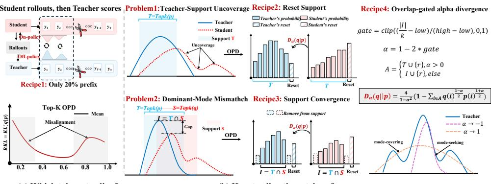  
(b) How to align those tokens?  
Figure 1: Framework of our $\mathrm { O ^ { 2 } P D } \mathrm { { : } }$ (a) Restricting alignment to the prefix, where teacher supervision is reliable. (b) Overlap-gated α-divergence with Reset Support and Support Convergence strategies.

However, the student-generated rollouts are inherently off-policy for the teacher, so the reliability of teacher supervision remains unclear Fu et al. (2026); Zhou et al. (2026). Besides, the teacher’s top-k support atoms are just a subset of the full vocabulary Fu et al. (2026); Anshumann et al. (2025). Restricting the alignment to this subset discards the remaining mass outside that support. Empirically, as the teacher-student overlap decreases, the student more frequently samples tokens outside the teacher’s top-k support, where the teacher’s supervision is unreachable. These gaps leave two questions implicit: 1) which tokens to align?, and 2) how to align those tokens? Along these lines, we first identify a Cross-prefix Asymmetry phenomenon: as student prefixes accumulate, the teacher’s accuracy falls, while as teacher prefixes accumulate, the student’s accuracy rises (§3). Furthermore, we theoretically characterize two problems of top-k OPD (§4): 1) Teacher-support Uncovering hap pens because RKL on the teacher’s top-k support fails to pull the student onto teacher-only tokens; thus high-confidence teacher modes stay uncovered when overlap is low; 2) Dominant-Mode Mismatch is that even the two top-k supports already overlap well, the same objective only matches the renormalized distribution and fails to pin the teacher’s mass on the shared atoms.

To address these issues, we propose an overlap-gated α-divergence on refined support and reliable prefix for OPD, which we term $\mathrm { \bar { O } ^ { 2 } P D }$ (shown in Figure 1 ). For which, inspired by the Cross-prefix Asymmetry phenomenon, we only optimize the 20% prefix tokens of student-generated rollouts to avoid the off-policy accumulation for the teacher. For how, we introduce two support strategies: the Reset Support strategy attaches a reset atom to every token, pooling mass outside the teacher topk, and the Support Convergence strategy converges the support to the already aligned intersection. Theoretical analysis shows that Forward KL (FKL) with Reset Support supplies a first-order covering force on teacher-only atoms, and RKL with Support Convergence pins the teacher’s mass on the shared atoms rather than leftover-renormalizing them. This motivates our design of overlap-gated α-divergence, where overlap is used as a gate to switch the support strategies and adaptively modulate α. For each token, α is mapped from the teacher-student overlap to control the interpolation between the mode-covering and the mode-seeking. Our contributions are:

• We identify a Cross-prefix Asymmetry: teacher supervision is more reliable on the prefix than on the suffix. We theoretically characterize two shortcomings of top-k OPD, Teachersupport Uncovering and Dominant-Mode Mismatch (§3, §4).

• We propose $\mathrm { O ^ { 2 } P D }$ , which applies overlap-gated α-divergence on the reliable prefix tokens. The per-token overlap between teacher and student adaptively modulates α and switches Reset Support and Support Convergence strategies (§3, §4).

• Extensive experiments on seven benchmarks show that $\mathrm { O ^ { 2 } P D }$ achieves state-of-the-art average performance among compared OPD methods, improving over OPD by up to +5.29 points across three teacher–student pairs.

## 2 RELATED WORK

GKD, MiniLLM, and later OPD recipes minimize a token-level divergence loss on student-generated trajectories Gu et al. (2024); Yang et al. (2026); Ko et al. (2025). The standard implementation is top-k OPD (Agarwal et al., 2024; Lu & Thinking Machines Lab, 2025; Anshumann et al., 2025), which minimizes RKL over the teacher’s top-k atoms at every position. At each token, the teacher and student induce next-token distributions p and q on vocabulary V . Write $T = \mathrm { T o p K } ( p ) , S =$ $\mathrm { T o p K } ( q ) , I = T \cap S .$ , and overlap $\rho = | I | / \bar { k \mathrm { ( } }$ ( illustrated in Table 1). Top-k OPD renormalizes both distributions on T and minimizes

$$
L _ { T } = \mathrm { K L } ( q ^ { T } | | p ^ { T } ) = \sum _ { a \in T } q _ { a } ^ { T } \log \frac { q _ { a } ^ { T } } { p _ { a } ^ { T } } ,\tag{1}
$$

where $q _ { a } ^ { T } = q ( a ) / q ( T )$ and $p _ { a } ^ { T } = p ( a ) / p ( T )$ . Mass outside T does not enter the loss. A concurrent line of work studies when this recipe succeeds or fails. Because the teacher scores student-sampled rollouts, its next-token guidance can be noisy, unteachable, or mismatched with the student Fu et al. (2026); Zhou et al. (2026); Wang et al. (2026b;a); Yu et al. (2026); Shao et al. (2026). Li et al. show that teacher–student top-k overlap tracks alignment-level and thinking-pattern consistency, and that high-overlap successful runs can be explained largely by overlap increasing Li et al. (2026).

Other methods intervene on which tokens to optimize and how to lessen the overlap mismatch. For example, TIP selects tokens with high student entropy, and tokens with low student entropy plus high teacher–student divergence, where the student is overconfident and wrong Xu et al. (2026). ESR argues that early tokens do problem framing and strategic planning, and truncates the rollout to a fixed first N tokens Zhou et al. (2026). EOPD keeps the onpolicy trajectory and mixes FKL into RKL on

Table 1: Supports at each token.
<table><tr><td>Set</td><td>Role</td></tr><tr><td> $T = \mathrm { T o p K } ( p )$ </td><td>teacher support</td></tr><tr><td> $S = \mathrm { T o p K } ( q )$ </td><td>student support</td></tr><tr><td> $I = T \cap S$ </td><td>already aligned atoms</td></tr><tr><td> $T \backslash S$ </td><td>teacher modes still to cover</td></tr><tr><td> $S \dot { \setminus } T$ </td><td>student-only modes to suppress</td></tr></table>

high teacher-entropy tokens to avoid diversity collapse Jin et al. (2026). However, these token filters are heuristic, ESR’s cutoff is a fixed short horizon that does not scale with response length, and EOPD changes the alignment objective without using overlap to decide covering versus pinning. $\mathrm { O ^ { 2 } P D }$ takes both decisions together: a length-scaled prefix, and overlap-gated α-divergence with Reset Support and Support Convergence for better alignment.

## 3 WHERE SHOULD DISTILLATION CONCENTRATE?

## 3.1 CROSS-PREFIX ASYMMETRY PHENOMENON

Student prefixes are off-policy for the teacher. To test whether teacher supervision remains reliable on student-generated prefixes, we run a cross-prefix completion protocol on MATH500 with a Qwen3-1.7B student and a Qwen3-4B teacher. When each model generates the entire response, the student and teacher obtain 73.8% and 85.8% pass@1. We then vary a prefix ratio ℓ: the student continues from a teacher-generated prefix of relative length ℓ, and the teacher continues from a student-generated prefix of the same length. Fig. 2 (a) shows an opposite dependence on ℓ. Student pass@1 increases as the teacher prefix lengthens; teacher pass@1 decreases as the student prefix lengthens, and the decline grows with ℓ.

Aligning prefix raises suffix overlap. To test whether aligning only those early tokens can raise teacher–student overlap on the rest of the trajectory, we use the same Qwen3-1.7B student and Qwen3-4B teacher and train top-k OPD on DAPO-MATH-17K with the loss applied only to the first 20% of each rollout. As shown in Fig. 2 (b), we compute mean top-k overlap between the student and the teacher, grouped by relative-position bin. Overlap on the untrained suffix bins rises together with the trained prefix, so the prefix-only objective improves alignment for suffix tokens. The 0–20% bin remains the lowest throughout, so the prefix is still the hardest region to match. §5.3 further verifies that aligning on a prefix fraction exceeds full-sequence alignment, and concentrating on the prefix outperforms aligning the suffix.

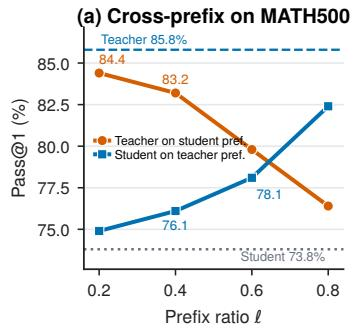

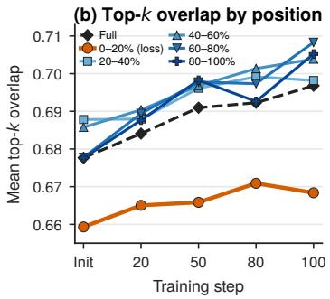

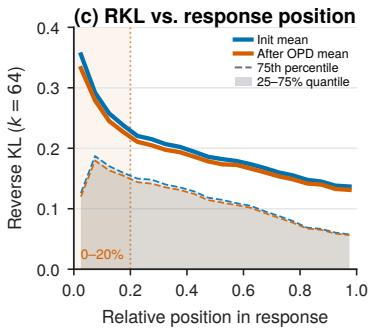  
Figure 2: (a) Cross-prefix pass@1 versus prefix ratio ℓ on MATH500. (b) Mean top-k overlap by relative-position bin when $L _ { T }$ is applied only to the first 20% of each student trajectory. (c) Top-k OPD loss $L _ { T }$ versus relative position at initialization and after full-trajectory training.

Misalignment concentrates on the prefix. As shown in Fig. 2 (c), we plot mean $L _ { T }$ against relative position at initialization and after full-trajectory top-k OPD. Mean RKL is highest near the start of the response and declines with relative position at both checkpoints. Training lowers the curve along the trajectory, so teacher-student mismatch is alleviated, yet the prefix remains the region of largest mismatch.

## 3.2 RECIPE1: PREFIX-ONLY ALIGNMENT

Based on this analysis, the prefix is both the most reliable source of teacher supervision and the region of largest remaining mismatch, so these are the tokens most worth aligning. Prefix-only training still raises overlap on the untrained suffix, so withholding suffix tokens from the loss does not leave the suffix unaligned. We therefore replace full-trajectory $L _ { T }$ by the Where objective $\mathcal { L } _ { \mathrm { w h e r e } } ^ { ( \ell ) } \mathrm { . }$

$$
\mathcal { L } _ { \mathrm { w h e r e } } ^ { ( \ell ) } = \mathbb { E } _ { y \sim \pi _ { s } ( \cdot | x ) } \sum _ { i = 1 } ^ { | y | } \mathbf { 1 } \big [ i \leq \ell | y | \big ] L _ { T } ^ { ( i ) } .\tag{2}
$$

Suffix tokens are sampled with the student but do not enter the optimization. Because the window is a fraction of $| y |$ , the number of aligned tokens scales with response length.

## 4 HOW TO ALIGN PREFIX TOKENS

## 4.1 TEACHER-SUPPORT UNCOVERING AND DOMINANT-MODE MISMATCH

We theoretically characterize two shortcomings of top-k OPD. The first failure is Teacher-support Uncovering: minimizing RKL on $T$ involves gradient coordinates only on T, so it therefore assigns no gradient to student-only atoms $S \setminus T$ , and its first-order force on teacher-only atoms in $T \backslash$ S is multiplied by student mass.

Lemma 1 (Support restriction). $L _ { T } = \mathrm { K L } ( q ^ { T } \| p ^ { T } )$ depends on the student logits only through $\{ z _ { a } : a \in T \}$ . Consequently $\partial L _ { T } / \partial z _ { a } = 0$ for every a $\notin T$ . In particular, RKL on $\dot { T }$ has no coordinate on $S \setminus T .$

On the simplex over $T .$ , the coordinate gradient of $L _ { T }$ is proportional to student mass $q _ { a } ^ { T }$ , so the first-order force on $T \setminus S$ is weak whenever that mass is small (Appendix B.1).

Proposition 1 (Covering channel). Assume $I \neq \emptyset , q ( I ) > 0 ,$ , and $q ( T \setminus S ) = 0$ . Then $q ( T ) = q ( I )$ $q ^ { T }$ vanishes on $T \setminus S ,$ , and

$$
\frac { \partial L _ { T } } { \partial \zeta _ { a } } = 0 ~ \quad f o r a l l a \in T \setminus S .
$$

In this case $L _ { T }$ is determined by $q ^ { I }$ only, so the first-order update lives only on already aligned atoms. The covering channel on $T \setminus S i s$ off, and Lemma 1 additionally gives $\partial L _ { T } / \partial z _ { a } = 0 f o r$ every $a \in S \setminus T$ . When q $\mathbf { \Omega } _ { \mathsf { \Gamma } } ( T \setminus S )$ is small but nonzero, the covering gradient remains proportional to $q _ { a } ^ { \check { T } }$ , so thefirst-orderforce on $T \backslash S$ is weak rather than identically zero.

Proposition 1 is why $L _ { T }$ does not pull $T \setminus S$ into S. Fig. 3 checks this on prefix tokens with initial overlap $\rho < 0 . 3 $ mean overlap moves only from 0.265 to 0.282 after top-k OPD training, 87.3% of the cohort remain below 0.3, and none reach $\geq 0 . 6$

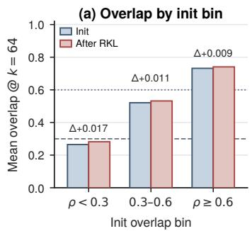

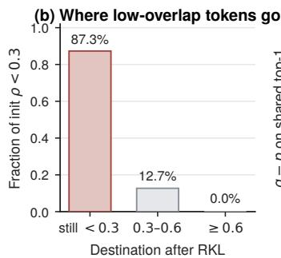

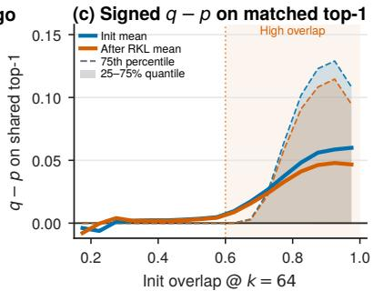  
Figure 3: (a) Mean overlap by initial-overlap bin before and after training. (b) Destination of tokens with initial $\rho < 0 . 3$ . (c) Signed gap $q - p$ on the shared top-1.

The second failure is Dominant-Mode Mismatch: minimizing RKL on the full-vocabulary is associated with $q = p$ as a mode-seeking target. Top-k OPD is not full-vocabulary OPD: its loss $L _ { T }$ lives on the renormalized simplex of $T$

Proposition 2 (Renormalized match on $T ) .$ . On the relative interior $\{ q ^ { T } : q ( T ) > 0 \}$ , every minimizer of $L _ { T }$ satisfies $\boldsymbol { q } ^ { T } = \boldsymbol { p } ^ { T }$ . This matches the teacher only as a distribution on T. It does not pin $q ( T ) = p ( T )$ and does not constrain $V \setminus T ,$ , so it is not $q = p o n V$

Remaining mode-mass gaps are therefore a shape mismatch on the support $T _ { \ast }$ , not evidence that the student is insufficiently mode-seeking. Fig. 3 (c) checks tokens that already share the teacher’s top-1: the signed gap $q - p$ on that mode stays positive after top-k OPD and grows with initial overlap. High overlap does not mean the student has matched the teacher’s dominant-mode mass. Proofs of Lemma 1 and Propositions 1–2 are in Appendix B.

## 4.2 RECIPE2: A RESET ATOM ON EVERY TOKEN (RESET SUPPORT)

Teacher-support Uncovering can be handled by our Reset Support strategy, which attaches a reset atom to every token. The reset atom pools the mass outside $T \colon$ teacher reset mass is $1 - p ( T )$ and student reset mass is $1 - q ( T )$ ). On the simplex over $T \cup \{ r \}$

$$
\pi _ { p } ( a ) = p ( a ) ( a \in T ) , \pi _ { p } ( r ) = 1 - p ( T ) , \pi _ { q } ( a ) = q ( a ) ( a \in T ) , \pi _ { q } ( r ) = 1 - q ( T ) .\tag{3}
$$

FKL on this simplex is $L _ { F } = \mathrm { K L } ( \pi _ { p } \lVert \pi _ { q } )$ . Without a reset atom, FKL opens only a covering channel on $T \setminus \bar { S }$ . The reset coordinate additionally supplies a pooled suppression channel for $S \backslash T \subset V \backslash T .$

Proposition 3 (FKL covering). On simplex coordinates $\pi _ { q } = \operatorname { s o f t m a x } ( \zeta )$

$$
\frac { \partial L _ { F } } { \partial \zeta _ { a } } = \pi _ { q } ( a ) - \pi _ { p } ( a ) .
$$

$I f a \in T \setminus S , \pi _ { p } ( a ) > 0$ and $\pi _ { q } ( a ) = 0 ,$ , then $\partial L _ { F } / \partial \zeta _ { a } = - \pi _ { p } ( a ) < 0 ,$ , so a descent step raises $\zeta _ { a } .$ Teacher mass on ${ \dot { T } } \setminus S$ supplies covering force without requiring the student to already place mass there. The reset coordinate yields $\partial L _ { F } / \bar { \partial } \dot { \zeta } _ { r } = q _ { r } - p _ { r }$ with $q _ { r } = 1 - q ( T )$ and $p _ { r } = 1 - p ( T )$ . When $T \backslash S$ is large the student typically places substantial mass outside $T ,$ , s $) q _ { r } > p _ { r }$ and a descent step lowers the reset coordinate, a pooled suppression of $S \setminus T$ $I f p ( T \setminus S ) > 0 ;$ , then $L _ { F } \to + \infty$ as $q ^ { T } | _ { T \backslash S }  0 ,$ , whereas $L _ { T }$ remainsfinite.

The reason to use FKL when $T \setminus S$ is large: the covering channel stays open when student mass on $T \setminus S$ is near zero. RKL on the same support still multiplies those coordinates by $q ( a )$

## 4.3 RECIPE3: SHRINK THE SUPPORT, THEN RKL (SUPPORT CONVERGENCE)

Dominant-Mode Mismatch means that minimizing RKL on T matches only $\boldsymbol { q } ^ { T } = \boldsymbol { p } ^ { T }$ . Attaching a reset atom to T makes the unconstrained RKL minimizer $\pi _ { q } = \pi _ { p }$ on $T \cup { \bar { \{ r \} } }$ . On $T \cup \{ r \}$ this is $q | _ { T } = p | _ { T }$ , which pins $c = q ( T ) / p ( T ) = 1$ and closes the scale gap in Proposition 2. Reset Support is therefore already enough for the unconstrained problem. As overlap rises, $T \setminus S$ shrinks and the job becomes mode-seeking on the already shared atoms I. The interiors of $T \cup \{ r \}$ and $I \cup \{ r \}$ coincide only when $T = { \bar { I } }$ . Leftover atoms $T \setminus I$ still carry teacher mass but little student mass. Proposition 1 keeps the RKL factor on those atoms proportional to $q ( a )$ , so leftover student mass $\varepsilon = { \stackrel { - } { q } } ( T \backslash I )$ typically remains below $p ( T \backslash I )$ rather than rising to the unconstrained leftover target. On this slice RKL on $T \cup \{ r \}$ still renormalizes I by leftover teacher mass. Support Convergence strategy is therefore proposed to restrict the support to I. Leftover teacher mass is folded into the reset atom, $\pi _ { q } ( a ) = \overline { { q } } ( \bar { a } ) \ : ( a \in I ) , \pi _ { q } ( r ) = 1 - \overline { { q } } ( I ) , \pi _ { p } ( a ) = p ( a ) \ : ( a \in I ) , \pi _ { p } ( r ) = 1 - p ( I ) $ , and $L _ { I , r } = \mathrm { K L } ( \dot { \pi _ { q } } \| \pi _ { p } )$

Proposition 4 (Leftover renormalization). Assume $I \ne \emptyset , T \setminus I \ne \emptyset , q ( I ) > 0$ , and $p ( T ) < 1$ Write $\varepsilon = q ( T \setminus I ) \in [ 0 , 1 )$ and freeze the leftover coordinates. Then RKL on $T \cup \{ r \}$ , as a function of the remaining mass $1 - \varepsilon o n I \cup \{ r \}$ , is uniquely minimized at

$$
\boldsymbol { q } ( a ) = \frac { \left( 1 - \varepsilon \right) p ( a ) } { 1 - p ( T \setminus I ) } \quad ( \boldsymbol { a } \in I ) , \qquad 1 - \boldsymbol { q } ( I ) - \boldsymbol { \varepsilon } = \frac { \left( 1 - \varepsilon \right) \left( 1 - p ( T ) \right) } { 1 - p ( T \setminus I ) } .
$$

Hence $q ( a ) > p ( a )$ on I if and only $i f \varepsilon < p ( T \setminus I )$ . The uncovered face $\varepsilon = 0$ is the special case $q ( \bar { a } ) \stackrel { \cdot } { = } p ( \bar { a } ) / ( 1 - p ( \dot { T } \setminus I ) )$ ). Minimizing RKL on $I \cup \{ r \}$ does not include $T \setminus I ;$ its interior minimizer is $q | _ { I } = p | _ { I }$ and $1 - q ( I ) = 1 - p ( I )$ . Leftover teacher mass therefore renormalizes the aligned atoms under $T \cup \{ r \}$ whenever student leftover mass is smaller than teacher leftover mass, and isfolded into the reset atom under $I \cup \{ r \}$

Proposition 4 is why mode-seeking RKL uses support $I \cup \{ r \}$ : when leftover mass remains below leftover teacher mass, $T \cup \{ r \}$ still overshoots p on I, not only on the exact-zero face. Proofs of Propositions 3 and 4 are in Appendix B.

## 4.4 RECIPE4: OVERLAP-GATED α-DIVERGENCE

Low overlap needs the covering force of FKL on $T \cup \{ r \}$ (Proposition 3); high overlap needs RKL on $I \cup \{ r \}$ , where $T \cup \{ r \}$ would still leftover-renormalize I (Proposition 4). Overlap $\rho$ selects which of those two jobs a prefix token presents. We therefore propose overlap-gated α-divergence: $\rho$ interpolates those two regimes and switches the support strategies. Let $\pi _ { q }$ and $\pi _ { p }$ be the student and teacher distributions on the simplex over the current support A, either ${ \check { T } } \cup \{ r \}$ or $I \cup \{ r \}$ . For $\alpha \in ( - 1 , 1 )$ , the α-divergence is

$$
D _ { \alpha } ( \pi _ { q } \| \pi _ { p } ) = \frac { 4 } { 1 - \alpha ^ { 2 } } \left( 1 - \sum _ { i \in A } \pi _ { q } ( i ) ^ { \frac { 1 - \alpha } { 2 } } \pi _ { p } ( i ) ^ { \frac { 1 + \alpha } { 2 } } \right) .\tag{4}
$$

The endpoints recover the two KL directions used above: $D _ { \alpha } \to \mathrm { K L } ( \pi _ { p } \Vert \pi _ { q } )$ as $\alpha  1$ , and $D _ { \alpha } $ $\mathrm { K L } ( \pi _ { q } | | \bar { \pi } _ { p } )$ as $\alpha  - 1$ . Appendix C verifies the two limits for (4). Intermediate α interpolates those two vector fields rather than adding a second loss. On each update, let P be the prefix tokens that enter the loss. Set low $\begin{array} { r } { = \operatorname* { m i n } _ { i \in \mathcal { P } } \rho _ { i } , \mathrm { h i g h } = \operatorname* { m a x } _ { i \in \mathcal { P } } \rho _ { i } } \end{array}$ , and let $\rho _ { 0 . 5 }$ be the median percentile of $\{ \rho _ { i } : i \in \mathcal { P } \}$ . Define

$$
{ \mathrm { g a t e } } = \mathrm { c l i p } { \big ( } ( \rho - \mathrm { l o w } ) / ( \mathrm { h i g h - l o w } ) , 0 , 1 { \big ) } , \qquad \alpha = 1 - 2 \cdot { \mathrm { g a t e } } .\tag{5}
$$

The support switches at the median: $T \cup \{ r \}$ when $\rho \ : < \rho _ { 0 . 5 }$ , and $I \cup \{ r \}$ when $\rho \ge \rho _ { 0 . 5 }$ . We therefore propose the overlap-gated α-divergence for adaptively aligning each token via $\rho \colon$

$$
\mathcal { L } _ { \mathrm { h o w } } = \mathbb { E } _ { y \sim \pi _ { s } ( \cdot | x ) } \sum _ { i = 1 } ^ { | y | } D _ { \alpha _ { i } } \big ( \pi _ { q } ^ { ( i ) } \| \pi _ { p } ^ { ( i ) } \big ) ,\tag{6}
$$

where $\rho _ { i }$ determines both $\alpha _ { i }$ and the support of $D _ { \alpha _ { i } }$ as above. The full objective puts the Where prefix window on this How divergence. With prefix fraction $\ell = 0 . 2$ from §3,

$$
\mathcal { L } = \mathbb { E } _ { y \sim \pi _ { s } ( \cdot | x ) } \sum _ { i = 1 } ^ { | y | } \mathbf { 1 } \big [ i \leq \ell | y | \big ] D _ { \alpha _ { i } } \big ( \pi _ { q } ^ { ( i ) } \| \pi _ { p } ^ { ( i ) } \big ) .\tag{7}
$$

Suffix tokens are sampled with the student but do not enter the loss.

## 5 EXPERIMENTS

## 5.1 SETUP

Models and training dataset. We use three student–teacher pairs (Table 2). Qwen3-1.7B distilled from Qwen3-4B Yang et al. (2025) is a same-family distillation with a larger teacher. DSR1-1.5B distilled from JustRL-1.5B Guo et al. (2025); He et al. (2025) is a same-size distillation on long trajectories. Qwen3-1.7B distilled from Qwen3-4B-Non-Thinking-RL (NTRL) Yang et al. (2025) keeps the first student and changes only the teacher, isolating teacher strength. The training set is DAPO-MATH-17K with no additional filtering Yu et al. (2025). The compared baselines are: OPD, ESR Zhou et al. (2026), EOPD Jin et al. (2026), and TIP Xu et al. (2026). OPD is the default top-k recipe. ESR, EOPD, and TIP are trained with the configurations from their papers.

Evaluation. For fair comparison, we follow previous evaluation pipeline Fu et al. (2026); Lu & Thinking Machines Lab (2025) and evaluate on seven common benchmarks: AIME24, AIME25, AIME26, HMMT25, Minerva Lewkowycz et al. (2022), Olympiad He et al. (2024), and MATH500 Hendrycks et al. (2021); Lightman et al. (2024). AIME24/25/26 and HMMT25 have few problems and report Avg@8; Minerva, Olympiad, and MATH500 have many more and report pass@1 from a single sample. Reported scores use the best checkpoint of each method.

Implementation. All methods are trained in VERL Sheng et al. (2025). OPD and $\mathrm { O ^ { 2 } P D }$ use distillation top-k size $k = 1 6 . \ 0 ^ { 2 } \mathrm { P D }$ applies the loss to a prefix fraction $\ell = 0 . 2 ,$ , attaches a reset atom, maps α from the prefix overlap min and max, and switches named support at the median of prefix overlap: T ∪{r} below the median and $I \cup \{ r \}$ at or above it. Further training hyperparameters are in Appendix E, and evaluation details in Appendix F.

Table 2: Performance (%) for three OPD student–teacher pairs. Len is the mean generated length in tokens. Bold marks the best distilled method in each column within a pair; underline marks the second best. ∆ vs. OPD is $\mathrm { O ^ { 2 } P D }$ minus OPD.
<table><tr><td>Method</td><td colspan="7">AIME24 AIME25 AIME26 HMMT25 Minerva Olympiad MATH500</td><td></td><td>Len</td><td>Avg</td></tr><tr><td colspan="10">Qwen3-1.7B (student) ← Qwen3-4B (teacher)</td></tr><tr><td>Qwen3-1.7B Qwen3-4B</td><td>8.33 23.33</td><td>12.08 31.67</td><td>5.83 21.67</td><td>6.25 15.00</td><td>20.59 31.99</td><td>36.74 45.48</td><td>73.8 85.8</td><td>3049 4127</td><td></td><td>23.37 36.42</td></tr><tr><td>OPD</td><td>13.75</td><td>14.17</td><td>7.08</td><td>5.83</td><td>23.53</td><td>36.00</td><td></td><td>74.0</td><td>5033</td><td>24.91</td></tr><tr><td>ESR EOPD</td><td>13.75</td><td>14.17</td><td>7.08</td><td>8.33 5.00</td><td>21.32 23.90</td><td></td><td>38.37</td><td>74.2</td><td>4480</td><td>25.32</td></tr><tr><td>TIP</td><td>14.17 12.92</td><td>12.50 14.58</td><td>11.67 6.67</td><td>6.67</td><td>21.32</td><td></td><td>38.37 39.70</td><td>74.6 76.8</td><td>5110</td><td>25.74 25.52</td></tr><tr><td></td><td></td><td></td><td></td><td></td><td></td><td></td><td></td><td></td><td>5377</td><td></td></tr><tr><td>O2PD Δ vs. OPD</td><td>15.42 +1.67</td><td>15.00 +0.83</td><td>11.67 +4.59</td><td>6.67 +0.84</td><td>23.90 +0.37</td><td></td><td>38.96 +2.96</td><td>76.0 +2.0</td><td>4684</td><td>26.80 +1.89</td></tr><tr><td colspan="9">DSR1-1.5B (student) ← JustRL-1.5B (teacher)</td></tr><tr><td>DSR1-1.5B</td><td>28.75</td><td>23.75</td><td>21.25</td><td>12.08</td><td>18.38</td><td></td><td>28.00</td><td>84.4</td><td>15627</td><td>30.94</td></tr><tr><td>JustRL-1.5B OPD</td><td>50.83 42.92</td><td>40.00 32.08</td><td>35.83 31.67</td><td>22.08 16.67</td><td>27.94 16.91</td><td></td><td>42.96 18.67</td><td>91.4 83.8</td><td>9308 12241</td><td>44.43 34.67</td></tr><tr><td>ESR EOPD</td><td>36.67 42.50</td><td>30.00 34.17</td><td>27.50 23.75</td><td>15.83 17.50</td><td>20.22 18.38</td><td></td><td>25.04 29.48</td><td>83.4 86.0</td><td>12376 11677</td><td>34.09 35.97</td></tr><tr><td>TIP  $\mathrm { O ^ { 2 } P D }$ </td><td>45.83 46.67</td><td>31.67 33.33</td><td>31.67 30.42</td><td>18.75 20.00</td><td>17.65 23.16</td><td></td><td>25.63 33.78</td><td>86.6 89.0</td><td>11552 10875</td><td>36.83 39.48</td></tr><tr><td colspan="9"></td></tr><tr><td>∆ vs. OPD</td><td>+3.75</td><td>+1.25</td><td>-1.25 Qwen3-1.7B (student)</td><td>+3.33</td><td></td><td>+6.25</td><td>+15.11</td><td>+5.2</td><td></td><td>+4.81</td></tr><tr><td colspan="9">← Qwen3-4B-NTRL (teacher)</td></tr><tr><td>Qwen3-1.7B Qwen3-4B-NTRL</td><td>8.33 70.00</td><td>12.08 63.33</td><td>5.83 65.00</td><td>6.25 38.75</td><td></td><td>20.59 39.34</td><td>36.74 64.44</td><td>73.8 94.8</td><td>3049 11751</td><td>23.37 62.24</td></tr><tr><td>OPD ESR</td><td>45.42 46.67</td><td>40.42 37.92</td><td>37.08 42.50</td><td>21.25 22.92</td><td>31.62 33.09</td><td></td><td>51.85 54.22</td><td>89.4 90.2</td><td>19129 13893</td><td>45.29 46.79</td></tr><tr><td>EOPD</td><td>52.08</td><td>39.17</td><td>40.83</td><td>23.33</td><td></td><td>34.56</td><td>53.19</td><td>90.2</td><td>17696</td><td>47.62</td></tr><tr><td>TIP</td><td>50.42</td><td>44.58</td><td>43.33</td><td>22.92</td><td></td><td>32.72</td><td>52.74</td><td>89.8</td><td>19036</td><td>48.07</td></tr></table>

## 5.2 MAIN DISTILLATION

Table 2 reports seven-suite Avg for the three student–teacher pairs. $\mathrm { O ^ { 2 } P D }$ attains 26.80 with the Qwen3-4B teacher, 39.48 with JustRL-1.5B, and 50.58 with NTRL. On every pair it exceeds ESR, EOPD, and TIP on Avg, and it improves over OPD by $+ 1 . 8 9 , + 4 . 8 1$ , and +5.29. TIP and ESR raise Avg performance over OPD on all three teacher-student pairs, by up $\mathrm { t o + 3 . 6 3 }$ and +2.36. This reveals that optimizing a subset of tokens is more effective than optimizing all tokens. However, ESR’s Avg gains remain small, and on some benchmarks ESR falls behind OPD, which demonstrates that dynamically adjusting the number of selected tokens may be necessary on harder problems. EOPD also raises Avg over OPD, by up to +3.18, by mixing FKL into RKL on high-entropy teacher tokens, showing that RKL alone is insufficient and benefits from an FKL covering channel. Instead of applying complex token-selective strategies, we optimize a fixed fraction of each trajectory’s prefix, so the number of aligned tokens scales with the response length. We then use overlapgated α-divergence to combine FKL covering with RKL mode-seeking and switch the support with overlap. This yields a further Avg gain over ESR, EOPD, and TIP on all three teacher-student pairs.

## 5.3 DISCUSSION

Method components. We ablate five variants (Fig. 4). w/o How applies the prefix restriction to OPD. w/o Where applies overlap-gated α-divergence with Reset Support and Support Convergence to the full trajectory. FKL/RKL uses FKL on $T \cup \{ r \}$ below the prefix overlap median and RKL on $I \cup \{ r \}$ at or above it. w/o I keeps the prefix and runs overlap-gated α-divergence on $T \cup \{ r \}$ only. w/o r keeps the prefix and runs overlap-gated α-divergence on the teacher top-k T, without the reset atom.

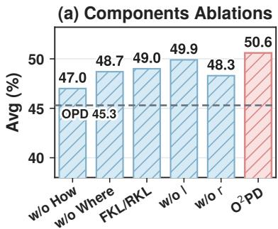

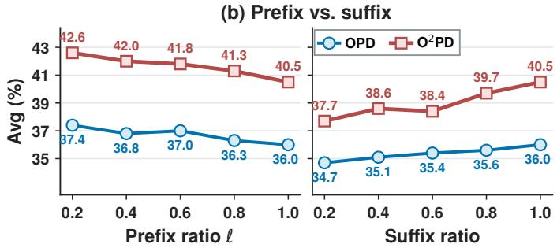  
Figure 4: (a) Method-component ablation studies (%). Each bar removes one component of $\mathrm { O ^ { 2 } P D }$ (b) Prefix versus suffix performance. Avg is the mean of Avg@8 on AIME24, AIME25, AIME26, and HMMT25.

On the Qwen3-1.7B student with the NTRL teacher, all five variants lie between OPD and full $\mathrm { O ^ { 2 } P D }$ on seven-suite Avg (Fig. 4 (a)). w/o How exceeds full-trajectory OPD, so the prefix restriction alone beats applying the loss to every token. w/o Where is higher, so How on the full trajectory contributes more than the prefix restriction alone. Dropping either block leaves a gap to full $\mathrm { \bar { o } ^ { 2 } P \bar { D } }$

Within How, w/o $r \ \mathrm { i s }$ the largest singlecomponent drop; the reset atom carries the covering channel. With the support already switching with overlap, FKL/RKL stays below both w/o I and full $\bar { \mathrm { O ^ { 2 } P D \mathrm { : } } }$ continuous α interpolates the two vector fields rather than adding a second loss. Converging the support to $I \cup \{ r \}$ as overlap rises is the smallest increment.

Prefix versus suffix. To test whether the teacher provides effective supervision on prefix tokens relative to suffix tokens and to the full rollout, we vary where the loss sits on the full

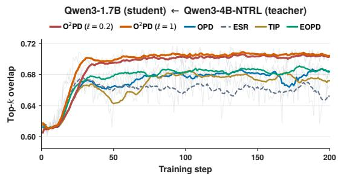  
Figure 5: Mean top-k overlap trend.

trajectory for both OPD and $\mathrm { O ^ { 2 } P D }$ . The prefix sweep applies the loss to the first fraction ℓ of each student response; the suffix sweep applies it to the last fraction. The two methods share the fulltrajectory endpoint $\ell = 1$ . Both methods are higher at $\ell = 0 . 2$ than at full-trajectory training (Fig. 4 (b)). Optimizing the suffix pulls down that distillation improvement. At a matched budget of 0.2, the prefix outperforms the suffix for both methods, and suffix-only training falls below the full trajectory. The teacher therefore provides effective supervision on prefix tokens. $\mathrm { O ^ { 2 } P D }$ remains above OPD at every measured endpoint, and the best point is prefix $\ell = 0 . 2$ with the How recipes.

Table 3: Support-switch percentile on the Qwen3-1.7B (student) ← Qwen3-4B-NTRL (teacher).
<table><tr><td></td><td colspan="2">AIME24</td><td colspan="2">AIME25</td><td colspan="2">HMMT25</td><td></td></tr><tr><td>Percentile Avg@8</td><td></td><td>pass@8</td><td>Avg@8</td><td>pass@8</td><td>Avg@8</td><td>pass@8</td><td>Avg</td></tr><tr><td>0.25</td><td>51.67</td><td>66.67</td><td>42.92</td><td>63.33</td><td>23.75</td><td>36.67</td><td>39.45</td></tr><tr><td>0.5</td><td>54.17</td><td>73.33</td><td>45.83</td><td>70.00</td><td>25.83</td><td>43.33</td><td>41.94</td></tr><tr><td>0.75</td><td>52.50</td><td>70.00</td><td>45.42</td><td>66.67</td><td>25.42</td><td>40.00</td><td>41.11</td></tr><tr><td>1.0</td><td>53.75</td><td>73.33</td><td>43.33</td><td>66.67</td><td>24.58</td><td>40.00</td><td>40.55</td></tr></table>

Overlap dynamics. To test whether $\mathrm { O ^ { 2 } P D }$ raises teacher–student alignment level, measured by mean top-k overlap, and whether the prefix fraction $\ell \ : = \ : 0 . 2$ still attains the alignment of fulltrajectory distillation, we track that overlap over training on the Qwen3-1.7B student with the NTRL teacher for $\mathrm { O ^ { 2 } P D }$ at $\ell = 0 . 2$ and $\ell = 1$ , together with OPD, ESR, TIP, and EOPD $( \operatorname { F i g } . 5 )$ . All methods start near $0 . 6 1$ , rise in the first few steps, and then plateau through step 200. Distillation under $\mathrm { O ^ { 2 } P D }$ at $\ell = 1$ rises faster than at $\ell = 0 . 2 ;$ the prefix run then catches up, and both finish near 0.70. That level is above OPD, EOPD, and TIP near 0.68, and above ESR. Prefix-only distillation therefore delays alignment and does not lower the level $\mathrm { O ^ { 2 } P D }$ attains.

## 5.4 SENSITIVITY TO THE SUPPORT-SWITCH PERCENTILE

In §4.4, the support switches when overlap ρ crosses a percentile of the prefix overlaps, by default the median $\rho _ { 0 . 5 } .$ . This subsection measures how sensitive O2PD is to that percentile. We keep $\ell = 0 . 2 .$ , a reset atom, and overlapgated α fixed, and replace $\rho _ { 0 . 5 }$ by ρ0.25, $\rho _ { 0 . 5 } ,$ ρ0.75, or $\rho _ { 1 . 0 }$ (Tab. 3). Tokens below the chosen percentile stay on $T \cup \{ r \}$ ; tokens at or above it use $I \cup \{ r \}$ We report Avg@8 and pass@8 on AIME24, AIME25, and HMMT25. The median is the best of the four percentiles. Percentile 0.5 has the highest Avg@8 on every benchmark. Switching to $I \cup \{ r \}$ at 0.25 hurts more than leaving tokens on ${ \dot { T } } \cup \{ r \}$ through 0.75 or 1.0. Actor entropy declines over training at every percentile, and the decline is larger as the percentile approaches 1.0 (Fig. 6), where

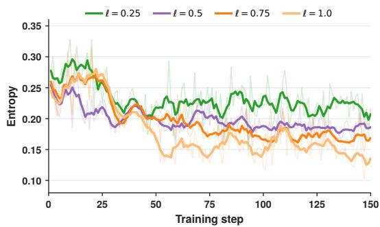  
Figure 6: Actor entropy during training at the four support-switch percentiles on the Qwen3- 1.7B student with the NTRL teacher.

almost all prefix tokens remain on $T \cup \{ r \}$ . That trend is consistent with leftover renormalization on $T \cup \{ r \bar { \} }$ (Proposition 4). We therefore use percentile 0.5: it yields the best performance of the four percentiles, and its entropy is not the lowest, so the student can keep exploration.

## 6 CONCLUSION

In this paper, we study two questions in OPD: which tokens to align, and how to align those tokens. For which, we find that teacher supervision is more reliable on the student prefix than on the suffix. For how, we prove that minimizing RKL on the teacher top-k neither covers teacher-only atoms at low overlap nor pins teacher mass on shared atoms at high overlap. Therefore, we propose $\mathrm { O ^ { 2 } P D }$ which concentrates on the alignment of the 20% prefix of each rollout via a designed overlap-gated α-divergence. The per-token overlap between teacher and student is used to adaptively modulate α and switch between Reset Support and Support Convergence. On seven benchmarks $\mathrm { \dot { O } ^ { 2 } P D }$ attains the best average performance among compared methods, improving over OPD by +1.89, +4.81, and +5.29 on the three different student–teacher pairs.

## AI USE STATEMENT

In this work we used generative AI tools (LLM writing and coding assistants) for the following uses.

Writing. We used them to outline the paper, draft sections, edit for clarity, format LAT X tables and captions, and suggest titles and keywords. The authors reviewed and revised all submitted text.

Retrieval and discovery. We used them to search and summarize retrieved papers. Every citation was checked against a public source; unverified references were discarded.

Research ideation and execution. We used them to refine the research questions and conceptual framework, to formulate and check mathematical claims and proof sketches. They were not used to generate synthetic data.

## ETHICS STATEMENT

The study distills language models on public math benchmarks and does not involve human subjects.   
Dataset licenses and intended-use constraints will be listed here before submission.

## REFERENCES

Rishabh Agarwal, Nino Vieillard, Yongchao Zhou, Piotr Stanczyk, Sabela Ramos Garea, Matthieu Geist, and Olivier Bachem. On-policy distillation of language models: Learning from selfgenerated mistakes. In The Twelfth International Conference on Learning Representations, 2024. URL https://openreview.net/forum?id=3zKtaqxLhW.

Shun-ichi Amari. α-divergence is unique, belonging to both f-divergence and Bregman divergence classes. IEEE Transactions on Information Theory, 55(11):4925–4931, 2009. doi: 10.1109/TIT. 2009.2030485.

Anshumann, Mohd Abbas Zaidi, Akhil Kedia, Jinwoo Ahn, Taehwak Kwon, Kangwook Lee, Haejun Lee, and Joohyung Lee. Sparse logit sampling: Accelerating knowledge distillation in LLMs, 2025. URL https://arxiv.org/abs/2503.16870.

Ganqu Cui, Yuchen Zhang, Jiacheng Chen, Lifan Yuan, Zhi Wang, Yuxin Zuo, Haozhan Li, Yuchen Fan, Huayu Chen, Weize Chen, Zhiyuan Liu, Hao Peng, Lei Bai, Wanli Ouyang, Yu Cheng, Bowen Zhou, and Ning Ding. The entropy mechanism of reinforcement learning for reasoning language models, 2025. URL https://arxiv.org/abs/2505.22617.

Yuqian Fu, Haohuan Huang, Kaiwen Jiang, Jiacai Liu, Zhuo Jiang, Yuanheng Zhu, and Dongbin Zhao. Revisiting on-policy distillation: Empirical failure modes and simple fixes, 2026. URL https://arxiv.org/abs/2603.25562.

Yuxian Gu, Li Dong, Furu Wei, and Minlie Huang. MiniLLM: Knowledge distillation of large language models. In The Twelfth International Conference on Learning Representations, 2024. URL https://openreview.net/forum?id=5h0qf7IBZZ.

Daya Guo, Dejian Yang, Haowei Zhang, Junxiao Song, Peiyi Wang, Qihao Zhu, Runxin Xu, Ruoyu Zhang, et al. DeepSeek-R1 incentivizes reasoning in LLMs through reinforcement learning. Nature, 645(8081):633–638, 2025. doi: 10.1038/s41586-025-09422-z.

Bingxiang He, Zekai Qu, Zeyuan Liu, Yinghao Chen, Yuxin Zuo, Cheng Qian, Kaiyan Zhang, Weize Chen, Chaojun Xiao, Ganqu Cui, Ning Ding, and Zhiyuan Liu. JustRL: Scaling a 1.5B LLM with a simple RL recipe, 2025. URL https://arxiv.org/abs/2512.16649.

Chaoqun He, Renjie Luo, Yuzhuo Bai, Shengding Hu, Zhen Thai, Junhao Shen, Jinyi Hu, Xu Han, Yujie Huang, Yuxiang Zhang, Jie Liu, Lei Qi, Zhiyuan Liu, and Maosong Sun. Olympiad-Bench: A challenging benchmark for promoting AGI with olympiad-level bilingual multimodal scientific problems. In Proceedings of the 62nd Annual Meeting of the Association for Computational Linguistics (Volume 1: Long Papers), pp. 3828–3850, Bangkok, Thailand, 2024. Association for Computational Linguistics. doi: 10.18653/v1/2024.acl-long.211. URL https://aclanthology.org/2024.acl-long.211/.

Dan Hendrycks, Collin Burns, Saurav Kadavath, Akul Arora, Steven Basart, Eric Tang, Dawn Song, and Jacob Steinhardt. Measuring mathematical problem solving with the MATH dataset. In Proceedings of the Neural Information Processing Systems Track on Datasets and Benchmarks, 2021. URL https://arxiv.org/abs/2103.03874.

Geoffrey Hinton, Oriol Vinyals, and Jeff Dean. Distilling the knowledge in a neural network, 2015. URL https://arxiv.org/abs/1503.02531.

Jingcheng Hu, Yinmin Zhang, Qi Han, Daxin Jiang, Xiangyu Zhang, and Heung-Yeung Shum. Open-reasoner-zero: An open source approach to scaling up reinforcement learning on the base model, 2025. URL https://arxiv.org/abs/2503.24290.

Woogyeol Jin, Taywon Min, Yongjin Yang, Dennis Wei, Yi Zhou, Swanand Ravindra Kadhe, Nathalie Baracaldo, and Kimin Lee. Entropy-aware on-policy distillation of language models, 2026. URL https://arxiv.org/abs/2603.07079.

Yoon Kim and Alexander M. Rush. Sequence-level knowledge distillation. In Proceedings of the 2016 Conference on Empirical Methods in Natural Language Processing, pp. 1317–1327, Austin, Texas, 2016. Association for Computational Linguistics. doi: 10.18653/v1/D16-1139. URL https://aclanthology.org/D16-1139/.

Jongwoo Ko, Tianyi Chen, Sungnyun Kim, Tianyu Ding, Luming Liang, Ilya Zharkov, and Se-Young Yun. DistiLLM-2: A contrastive approach boosts the distillation of LLMs, 2025. URL https://arxiv.org/abs/2503.07067.

Aitor Lewkowycz, Anders Andreassen, David Dohan, Ethan Dyer, Henryk Michalewski, Vinay Ramasesh, Ambrose Slone, Cem Anil, Imanol Schlag, Theo Gutman-Solo, Yuhuai Wu, Behnam Neyshabur, Guy Gur-Ari, and Vedant Misra. Solving quantitative reasoning problems with language models. In Advances in Neural Information Processing Systems, 2022. URL https: //arxiv.org/abs/2206.14858.

Yaxuan Li, Yuxin Zuo, Bingxiang He, Jinqian Zhang, Chaojun Xiao, Cheng Qian, Tianyu Yu, Huanang Gao, Wenkai Yang, Zhiyuan Liu, and Ning Ding. Rethinking on-policy distillation of large language models: Phenomenology, mechanism, and recipe, 2026. URL https://arxiv. org/abs/2604.13016.

Hunter Lightman, Vineet Kosaraju, Yura Burda, Harri Edwards, Bowen Baker, Teddy Lee, Jan Leike, John Schulman, Ilya Sutskever, and Karl Cobbe. Let’s verify step by step. In The Twelfth International Conference on Learning Representations, 2024. URL https://openreview. net/forum?id=v8L0pN6EOi.

Zichen Liu, Changyu Chen, Wenjun Li, Penghui Qi, Tianyu Pang, Chao Du, Wee Sun Lee, and Min Lin. Understanding R1-zero-like training: A critical perspective, 2025. URL https: //arxiv.org/abs/2503.20783.

Kevin Lu and Thinking Machines Lab. On-policy distillation. Thinking Machines Lab: Connectionism, 2025. doi: 10.64434/tml.20251026. URL https://thinkingmachines.ai/blog/ on-policy-distillation.

Bing Shao, Jiazheng Zhang, Long Ma, Yujiong Shen, Senjie Jin, Xin Guo, Yuming Yang, Mingxu Chai, Zhiheng Xi, Boyang Liu, Junlin Shang, Tao Gui, Qi Zhang, and Xuanjing Huang. A token-level analysis of sampled-token reverse-KL on-policy distillation, 2026. URL https: //arxiv.org/abs/2608.25643.

Zhihong Shao, Peiyi Wang, Qihao Zhu, Runxin Xu, Junxiao Song, Xiao Bi, Haowei Zhang, Mingchuan Zhang, Y. K. Li, Y. Wu, and Daya Guo. DeepSeekMath: Pushing the limits of mathematical reasoning in open language models, 2024. URL https://arxiv.org/abs/2402. 03300.

Guangming Sheng, Chi Zhang, Zilingfeng Ye, Xibin Wu, Wang Zhang, Ru Zhang, Yanghua Peng, Haibin Lin, and Chuan Wu. HybridFlow: A flexible and efficient RLHF framework. In Proceedings of the Twentieth European Conference on Computer Systems, pp. 1279–1297, 2025. doi: 10.1145/3689031.3696075.

Rui Wang, Hongru Wang, Yi Chen, Boyang Xue, Tianqing Fang, Wenhao Yu, and Kam-Fai Wong. Demystifying on-policy distillation: Roles, pathologies, and regulations, 2026a. URL https: //arxiv.org/abs/2607.13399.

Yuanyi Wang, Su Lu, Yanggan Gu, Pengkai Wang, Yifan Yang, Zhaoyi Yan, Congkai Xie, Jianmin Wu, and Hongxia Yang. Not all disagreement is learnable: Token teachability in on-policy distillation, 2026b. URL https://arxiv.org/abs/2605.26844.

Yuanda Xu, Hejian Sang, Zhengze Zhou, Ran He, Zhipeng Wang, and Alborz Geramifard. TIP: Token importance in on-policy distillation, 2026. URL https://arxiv.org/abs/2604. 14084.

An Yang, Anfeng Li, Baosong Yang, Beichen Zhang, Binyuan Hui, Bo Zheng, Bowen Yu, Chang Gao, Chengen Huang, Chenxu Lv, et al. Qwen3 technical report, 2025. URL https://arxiv. org/abs/2505.09388.

Wenkai Yang, Weijie Liu, Ruobing Xie, Kai Yang, Saiyong Yang, and Yankai Lin. Learning beyond teacher: Generalized on-policy distillation with reward extrapolation, 2026. URL https:// arxiv.org/abs/2602.12125.

Qiying Yu, Zheng Zhang, Ruofei Zhu, Yufeng Yuan, Xiaochen Zuo, Yu Yue, Weinan Dai, Tiantian Fan, Gaohong Liu, Lingjun Liu, Xin Liu, Haibin Lin, Zhiqi Lin, Bole Ma, Guangming Sheng, Yuxuan Tong, Chi Zhang, Mofan Zhang, Wang Zhang, Hang Zhu, Jinhua Zhu, Jiaze Chen, Jiangjie Chen, Chengyi Wang, Hongli Yu, Yuxuan Song, Xiangpeng Wei, Hao Zhou, Jingjing Liu, Wei-Ying Ma, Ya-Qin Zhang, Lin Yan, Mu Qiao, Yonghui Wu, and Mingxuan Wang. DAPO: An open-source LLM reinforcement learning system at scale. In Advances in Neural Information Processing Systems, 2025. URL https://arxiv.org/abs/2503.14476.

Zichao Yu, Chengzhi Yu, Shengze Xu, Yujin Han, Bingqing Jiang, Xu Wang, and Difan Zou. Mismatch matters: On-policy distillation beyond token agreement, 2026. URL https://arxiv. org/abs/2608.09836.

Weihao Zeng, Yuzhen Huang, Qian Liu, Wei Liu, Keqing He, Zejun Ma, and Junxian He. SimpleRL-Zoo: Investigating and taming zero reinforcement learning for open base models in the wild. In Second Conference on Language Modeling, 2025. URL https://arxiv.org/abs/2503. 18892.

Ziheng Zhou, Jiaqi Li, Huacong Tang, Ying Nian Wu, and Demetri Terzopoulos. Less is more: Early stopping rollout for on-policy distillation, 2026. URL https://arxiv.org/abs/ 2605.27028.

## CONTENTS

A $\mathbf { O ^ { 2 } P D }$ training step 14   
B Gradient proofs 14   
B.1 RKL simplex gradient 14   
B.2 Support restriction 15   
B.3 Covering channel 15   
B.4 Renormalized match on T 15   
B.5 FKL covering . 16   
B.6 Leftover renormalization 16   
C Endpoints of α-divergence 17   
D The two failures after $\mathbf { o ^ { 2 } P D }$ 18   
E Training configuration 18   
F Evaluation 18

## A $\mathrm { O ^ { 2 } P D }$ TRAINING STEP

Algorithm 1 implements (7). Only prefix tokens enter the loss. Overlap ρ maps α from the prefix min and max, and switches Reset Support $T \cup \{ r \}$ with Support Convergence ${ \bar { I } } \cup \{ r \}$ at the median of prefix overlaps. Reported runs use $\bar { \ell } = 0 . 2$ and $k = 1 6 ( \ S 5 . 1 )$ ).

Algorithm 1 $\mathrm { \Omega _ { \cdot } O ^ { 2 } P D }$ update on one student rollout.   
Require: student $\pi ,$ teacher $\pi _ { t } .$ prompt $x ,$ prefix fraction ℓ, top-k size k   
1: sample $y \sim \pi _ { s } ( \cdot \mid x )$   
2: $\mathcal { P } \stackrel {  } {  } \{ i : 1 \leq i \leq \ell | y | \}$   
3: for $i \in \mathcal { P }$ do   
4: $p ^ { ( i ) }  \pi _ { t } ( \cdot  { | } x , y _ { < i } ) , q ^ { ( i ) }  \pi _ { s } ( \cdot  { | } x , y _ { < i } )$   
5: $T _ { i } \gets \mathrm { T o p K } ( p ^ { ( i ) } ) , S _ { i } \gets \mathrm { T o p K } ( q ^ { ( i ) } ) , I _ { i } \gets T _ { i } \cap S _ { i }$   
6: $\rho _ { i } \gets | I _ { i } | / k$   
7: end for   
8: low $\begin{array} { r } { \gets \operatorname* { m i n } _ { i \in \mathcal { P } } \rho _ { i } , \mathrm { h i g h } \gets \operatorname* { m a x } _ { i \in \mathcal { P } } \rho _ { i } } \end{array}$   
9: ρ0.5 ← median of $\{ \rho _ { i } : i \in \mathcal { P } \}$   
10: $\boldsymbol { \mathscr { L } } \gets 0$   
11: for $i \in \mathcal { P }$ do   
12: gate $ \mathrm { c l i p } \big ( ( \rho _ { i } - \mathrm { l o w } ) / ( \mathrm { h i g h - l o w } ) , 0 , 1 \big )$   
13: $\bar { \alpha } _ { i }  1 - \bar { 2 } \cdot$ · gate   
14: i $\dot { } \rho _ { i } < \rho _ { 0 . 5 }$ then   
15: $A  T _ { i } \cup \{ r \}$ ▷ Reset Support   
16: $\pi _ { p } ( a )  p ^ { ( i ) } ( a )$ for $a \in T _ { i } , \pi _ { p } ( r ) \gets 1 - p ^ { ( i ) } ( T _ { i } )$ ; likewise $\pi _ { q }$ from $\boldsymbol { q } ^ { ( i ) }$   
17: else   
18: $A  I _ { i } \cup \{ r \}$ ▷ Support Convergence   
19: $\pi _ { p } ( a )  p ^ { ( i ) } ( a )$ for $a \in I _ { i } , \pi _ { p } ( r )  1 - p ^ { ( i ) } ( I _ { i } )$ ; likewise $\pi _ { q }$ from $\boldsymbol { q } ^ { ( i ) }$   
20: end if   
21: $\mathcal { L }  D _ { \alpha _ { i } } ( \pi _ { q } \| \pi _ { p } )$   
22: end for   
23: update $\pi _ { s } \ \mathrm { o n } \ \mathcal { L }$

## B GRADIENT PROOFS

This section proves Lemma 1 and Propositions 1–4. Throughout, $q = \operatorname { s o f t m a x } ( z )$ on $V , p$ does not depend on $z , T = \mathrm { T o p K } ( p ) , S = \mathrm { T o p K } ( q )$ , and $I = T \cap S$ . We always assume the support in a display is nonempty and that the corresponding student mass is positive, so renormalized restrictions are well-defined. No further assumption is placed on the shapes of $p$ and $q .$ The reset atom is introduced only in §B.5–§B.6; the failure statements in §B.2–§B.4 concern $L _ { T }$ without the reset atom.

## B.1 RKL SIMPLEX GRADIENT

Let $\pi = \operatorname { s o f t m a x } ( \zeta )$ on a finite simplex with strictly positive target $\pi _ { p } .$ , and let $L = \mathrm { K L } ( \pi \| \pi _ { p } ) =$ $\begin{array} { r } { \sum _ { i } \pi _ { i } \log ( \pi _ { i } / \pi _ { p , i } ) } \end{array}$ . The softmax Jacobian is $\partial \pi _ { i } / \partial \dot { \zeta } _ { a } = \pi _ { i } ( \delta _ { i a } \stackrel { - } { - } \pi _ { a } )$ . Differentiating,

$$
\begin{array} { r l r } {  { \frac { \partial L } { \partial \zeta _ { a } } = \sum _ { i } \bigl ( \log \frac { \pi _ { i } } { \pi _ { p , i } } + 1 \bigr ) \pi _ { i } ( \delta _ { i a } - \pi _ { a } ) } } \\ & { } & \\ & { } & { = \pi _ { a } \bigl ( \log \frac { \pi _ { a } } { \pi _ { p , a } } + 1 \bigr ) - \pi _ { a } \sum _ { i } \pi _ { i } \bigl ( \log \frac { \pi _ { i } } { \pi _ { p , i } } + 1 \bigr ) } \\ & { } & \\ & { } & { = \pi _ { a } \bigl ( \log \frac { \pi _ { a } } { \pi _ { p , a } } + 1 \bigr ) - \pi _ { a } ( L + 1 ) = \pi _ { a } \bigl ( \log \frac { \pi _ { a } } { \pi _ { p , a } } - L \bigr ) . } \end{array}\tag{8}
$$

The convention 0 log $0 ~ = ~ 0$ is used throughout. If $\pi _ { a } \  \ 0$ while L remains bounded, then $\pi _ { a } \log \pi _ { a } \to 0$ , hence $\partial L / \partial \zeta _ { a }  0$ . Applying (8) on the simplex of $T$ with $\pi = q ^ { T }$ and $\pi _ { p } = p ^ { T }$ yields

$$
\frac { \partial L _ { T } } { \partial \zeta _ { a } } = q _ { a } ^ { T } \Bigl ( \log \frac { q _ { a } ^ { T } } { p _ { a } ^ { T } } - L _ { T } \Bigr ) , \qquad a \in T .\tag{9}
$$

The right-hand side vanishes whenever $q _ { a } ^ { T } = 0$ . Membership $a \in T \setminus S$ does not force $q ( a ) = 0 ,$ but it does place a outside $S ,$ so student mass on those atoms is typically far below the mass on S. Softmax never attains exact zeros; $q ( T \setminus S ) = 0$ is a slice used in Proposition 1, not a training constraint.

## B.2 SUPPORT RESTRICTION

Proof of Lemma 1. For $c \in T$

$$
q _ { c } ^ { T } = \frac { q ( c ) } { q ( T ) } = \frac { e ^ { z _ { c } } } { \sum _ { b \in T } e ^ { z _ { b } } } .
$$

The partition function of $q$ over V cancels, so $q ^ { T }$ depends on z only through $\{ z _ { b } : b \in T \}$ . The teacher restriction $p ^ { T }$ does not depend on z. Therefore $\begin{array} { r } { L _ { T } = \sum _ { a \in T } \dot { q _ { a } ^ { T } } \log ( \dot { q _ { a } ^ { T } } / p _ { a } ^ { T } ) } \end{array}$ is a function of those logits alone, which gives $\partial L _ { T } / \partial z _ { a } = 0$ for every $a \notin T .$ Every $a \in S \setminus T$ and every $a \in V \setminus ( \check { T } \cup S )$ falls in this set, so RKL on $T$ has no coordinate there. □

## B.3 COVERING CHANNEL

ProofofProposition 1. The assumption $q ( T \setminus S ) = 0$ with $q ( I ) > 0$ gives $q ( T ) = q ( I )$ and $q _ { a } ^ { T } = 0$ for every $a \in T \backslash S$ . Substituting into (8) yields $\partial L _ { T } / \partial \zeta _ { a } = 0$ on $T { \backslash } \bar { S }$ . The remaining coordinates live on I, and

$$
L _ { T } = \sum _ { a \in I } q _ { a } ^ { I } \log \frac { q _ { a } ^ { I } } { p ( a ) / p ( T ) } ,
$$

which is RKL between $q ^ { I }$ and the restriction of $\cdot \ : p ^ { T }$ to I. Lemma 1 gives ${ \partial L _ { T } } / { \partial z _ { a } } = 0 { \mathrm { f o r } } a \in S \backslash T$ If instead $q ( T \backslash S )$ is small but positive, (8) remains proportional to $q _ { a } ^ { T }$ on $T \backslash S .$ . Emptiness of $\cdot \boldsymbol { T } \backslash S$ as a set is not what shuts the covering channel. For ${ \bar { a } } \in T \backslash S$

$$
\frac { \partial L _ { T } } { \partial \zeta _ { a } } = 0 \quad \Longleftrightarrow \quad q _ { a } ^ { T } = 0 \quad \mathrm { o r } \quad \log \frac { q _ { a } ^ { T } } { p _ { a } ^ { T } } = L _ { T } .
$$

Thus $\iota \not \in S$ does not imply a vanishing gradient. The first-order covering share

$$
\rho ( L _ { T } ) : = \frac { \sum _ { a \in T \setminus I } \left| \partial L _ { T } / \partial \zeta _ { a } \right| } { \sum _ { a \in T } \left| \partial L _ { T } / \partial \zeta _ { a } \right| }
$$

is zero whenever every $a \in T \backslash$ I satisfies the display above (and is undefined if the denominator is zero). □

## B.4 RENORMALIZED MATCH ON T

ProofofProposition 2. $L _ { T } = \mathrm { K L } ( q ^ { T } \| p ^ { T } )$ is RKL on the finite simplex of $T .$ . Gibbs’ inequality gives $\mathrm { K L } ( \nu \| \mu ) \geq 0$ with equality if and only if $\nu = \mu ,$ , provided $\mu$ is strictly positive on that simplex. Softmax teachers assign $p ( a ) > 0$ on $T ,$ , so $p ^ { T }$ is strictly positive. The unique minimizer on the relative interior is therefore $\mathbf { \dot { q } } ^ { T } = p ^ { T }$ . This identity is equivalent to $q ( a ) = c p ( a )$ for $a \in T$ with the same $c = q ( T ) / p ( T )$ . It does not force $c = 1$ , and $L _ { T }$ does not depend on logits outside T (Lemma 1), so the minimizer is not $q = p$ on $V$ □

For completeness we record the face without a reset atom that is not used as a training constraint. If $q ( T \setminus S ) = 0$ and $q ( I ) = 1$ , then $\boldsymbol { q } ^ { T } = \boldsymbol { q } ^ { I }$ and

$$
L _ { T } = \sum _ { a \in I } q ( a ) \log { \frac { q ( a ) } { p ( a ) / p ( T ) } } = - H ( q ) - \sum _ { a \in I } q ( a ) \log p ( a ) + \log p ( T ) .
$$

The last term does not depend on q. Minimizing over the simplex of I gives $q ( a ) \propto p ( a )$ on $I ,$ hence $q ( a ) = p ( a ) / p ( I )$ for $a \in I .$ Then $q ( a ) \geq p ( a )$ , with equality for a positive $p ( a )$ if and only $\mathrm { i f } p ( I ) \dot { = } \dot { 1 }$ . This characterizes the slice; it does not prove that SGD remains on the slice.

## B.5 FKL COVERING

On a simplex with $\pi _ { q } = \operatorname { s o f t m a x } ( \zeta )$ and $\begin{array} { r } { L _ { F } = \mathrm { K L } ( \pi _ { p } \| \pi _ { q } ) = \sum _ { i } \pi _ { p , i } \log ( \pi _ { p , i } / \pi _ { q , i } ) } \end{array}$ , the same Jacobian yields

$$
\frac { \partial L _ { F } } { \partial \zeta _ { a } } = \sum _ { i } \pi _ { p , i } \Bigl ( - \frac { 1 } { \pi _ { q , i } } \Bigr ) \partial \pi _ { q , i } / \partial \zeta _ { a } = - \sum _ { i } \pi _ { p , i } ( \delta _ { i a } - \pi _ { q } ( a ) ) = \pi _ { q } ( a ) - \pi _ { p } ( a ) .\tag{10}
$$

Proof of Proposition 3. The cancellation in Lemma 1 shows that KL $( p ^ { T } \| q ^ { T } )$ depends on z only through $\{ z _ { a } : a \in T \}$ . Identity (10) on that simplex, or on $T \cup \{ r \}$ , is $\partial L _ { F } / \partial \zeta _ { a } = \pi _ { q } ( a ) - \pi _ { p } ( a )$ If $a \in T \setminus S , \pi _ { q } ( a ) = 0$ and $\pi _ { p } ( a ) > 0$ , then $\partial L _ { F } / \partial \zeta _ { a } = - \pi _ { p } \bar { ( a ) } < 0 .$ so gradient descent raises $\zeta _ { a }$

$\operatorname { I f } p ( T \setminus S ) > 0$ and $q ^ { T } | _ { T \backslash S }  0$ , the sum $\textstyle \sum _ { a \in T \setminus S } p _ { a } ^ { T } \log ( p _ { a } ^ { T } / q _ { a } ^ { T } )$ diverges to $+ \infty$ . For RKL the same limit is finite: $q ^ { T }$ remains a distribution on I and $L _ { T }$ reduces as in Proposition 1.

On $T \cup \{ r \}$ , teacher reset mass is $p _ { r } = 1 - p ( T )$ and student reset mass is $q _ { r } = 1 - q ( T )$ . Identity (10) on the reset coordinate is $\partial L _ { F } / \partial \zeta _ { r } = q _ { r } - p _ { r }$ . Low overlap typically places substantial student mass outside $T ,$ , so $q _ { r } > p _ { r }$ and descent lowers the reset coordinate, which is a pooled suppression of $S \setminus T$ □

## B.6 LEFTOVER RENORMALIZATION

Proposition 1 keeps leftover RKL factors proportional to student mass, ${ \bf s o } \varepsilon = q ( T \setminus I )$ stays small rather than rising to $p ( T \backslash I )$ . A reset atom does not reopen that channel. The next statement compares RKL on $T \cup \{ r \}$ and on $I \cup \{ r \}$ with leftover coordinates frozen at a possibly positive ε; the uncovered face is $\varepsilon = 0$

ProofofProposition 4. The assumption $T \setminus I \neq \emptyset$ with $I = T \cap S$ gives $T \setminus I = T \setminus S$ . Softmax teachers assign $p ( a ) > 0$ on T, so $p ( T \setminus I ) \setminus 0$ . Combined with $p ( T ) < 1$

$$
c : = p ( I ) + 1 - p ( T ) = 1 - p ( T \setminus I )
$$

lies in (0, 1), and $p ( I ) = p ( T ) - p ( T \setminus I ) < 1$

On $T \cup \{ r \} , \pi _ { p } ( a ) = p ( a )$ for $a \in T$ and $\pi _ { p } ( r ) = 1 - p ( T )$ . Freeze q on $T \setminus I$ with total mass $\varepsilon \in [ 0 , 1 )$ . The leftover RKL terms are then constant in the ${ \dot { I } } \cup \{ r \}$ coordinates. Write w for the remaining masses on $I \cup \{ r \}$ , so $w ( a ) = q ( a )$ for $a \in I , w ( r ) = \bar { 1 } - q ( I ) - \varepsilon$ , and $\sum w = 1 - \varepsilon$ Let $m = \mathsf { \bar { ( } } p | _ { I } , 1 - p ( T ) \mathsf { ) }$ ), hence $\sum m = c .$ , and

$$
L _ { T , r } = \sum _ { i } w _ { i } \log { \frac { w _ { i } } { m _ { i } } } + C _ { \varepsilon } = \left( 1 - \varepsilon \right) \mathrm { K L } \bigg ( \frac { w } { 1 - \varepsilon } \bigg \| \frac { m } { c } \bigg ) - \left( 1 - \varepsilon \right) \log { \frac { c } { 1 - \varepsilon } } + C _ { \varepsilon } ,
$$

where $\begin{array} { r } { C _ { \varepsilon } = \sum _ { a \in T \setminus I } q ( a ) \log ( q ( a ) / p ( a ) ) } \end{array}$ does not depend on w. Gibbs’ inequality yields a unique minimizer $w = \left( 1 - \varepsilon \right) m / c , \mathrm { i . e }$

$$
\boldsymbol { q } ( a ) = \frac { ( 1 - \varepsilon ) p ( a ) } { 1 - p ( T \setminus I ) } \left( \boldsymbol { a } \in I \right) , \qquad 1 - \boldsymbol { q } ( I ) - \varepsilon = \frac { ( 1 - \varepsilon ) \left( 1 - p ( T ) \right) } { 1 - p ( T \setminus I ) } .
$$

Thus $q ( a ) / p ( a ) = ( 1 - \varepsilon ) / ( 1 - p ( T \setminus I ) )$ on I, so $q ( a ) > p ( a )$ if and only ${ \mathrm { i f ~ } } \varepsilon < p ( T \setminus I )$ . Setting $\varepsilon = 0$ recovers the uncovered-face formulae. $\mathbf { A s } \varepsilon  0 .$ , the leftover contribution $C _ { \varepsilon } \to 0$ because $x \log ( x / p ( a ) ) \to 0$ for each $a \in T \setminus I$

On $I \cup \{ r \}$ , leftover mass is part of the reset atom: $\pi _ { p } ( a ) = p ( a )$ on I and $\pi _ { p } ( r ) = 1 - p ( I )$ . This pair is a strictly positive probability. Gibbs’ inequality gives the unique interior minimizer $q | _ { I } = p | _ { I }$ and $1 - q ( I ) \stackrel { \cdot } { = } \bar { 1 } - p ( I )$ . The coordinate $T \backslash I$ is not in the simplex over $I \cup \{ r \}$ , so the I-target does not depend on ε. If leftover mass is additionally frozen at $\varepsilon \le 1 - p ( I )$ , that interior point remains feasible by placing the remaining reset mass on $V \backslash T$ . When $T = I$ the two simplices coincide, and the unconstrained interior of $\mathsf { \bar { T } } \cup \{ r \} \mathrm { i s } q | _ { T } = p | _ { T }$ , which requires $\varepsilon = p ( T \setminus I )$

The simplex gradient on $I \cup \{ r \}$ has only two kinds of coordinates:

$$
\frac { \partial L _ { I , r } } { \partial \zeta _ { a } } = q ( a ) \Big ( \log \frac { q ( a ) } { p ( a ) } - L _ { I , r } \Big ) ( a \in I ) , \qquad \frac { \partial L _ { I , r } } { \partial \zeta _ { r } } = ( 1 - q ( I ) ) \Big ( \log \frac { 1 - q ( I ) } { 1 - p ( I ) } - L _ { I , r } \Big )\tag{11}
$$

Identity (11) is (8) on $I \cup \{ r \}$ . For vocabulary logits z, the simplex logits may be realized as $\zeta _ { a } = z _ { a }$ for $a \in I$ and $\zeta _ { r } = \mathrm { l o g s u m e x p } ( z | _ { V \setminus I } )$ . Then $\partial \bar { L } _ { I , r } / \partial z _ { c } = q \bar { ( } c ) ( \mathrm { l o g \bar { ( } } q ( c ) / \bar { p } ( c ) ) - L _ { I , r } )$ for $c \in I ,$ and $\partial L _ { I , r } / \partial z _ { c } = q ( c ) ( \log ( ( 1 - q ( I ) ) / ( 1 - p ( I ) ) ) - L _ { I , r } )$ for $c \notin I$ . Tokenwise $\log ( q / p )$ therefore appears only on I. The analogous identities on ${ \ddot { T } } \cup \{ r \}$ place tokenwise $\log ( q / p )$ on every $a \in T$ including ${ \dot { T } } \setminus S .$ □

Lemma 2 (Gradient coincidence). $I f q ( T \setminus I ) = 0 a n d q ( I ) > 0 ,$ , then $L _ { T } = L _ { I } + \log \bigl ( p ( T ) / p ( I ) \bigr )$ The second term does not depend on $z ,$ so $L _ { T }$ and $L _ { I }$ induce the same student-logit gradient. In particular bothfirst-order covering shares are zero whenever they are defined.

Proof. The assumption gives $q ( T ) = q ( I )$ and $q _ { j } ^ { T } = q _ { j } ^ { I }$ for $j \in I$ , together with $q ^ { T } | _ { T \backslash I } = 0$ . Then

$$
L _ { T } = \sum _ { j \in I } q _ { j } ^ { I } \log \frac { q _ { j } ^ { I } } { p _ { j } / p ( T ) } = \sum _ { j \in I } q _ { j } ^ { I } \log \frac { q _ { j } ^ { I } } { p _ { j } } + \log p ( T ) ,
$$

$$
L _ { I } = \sum _ { j \in I } q _ { j } ^ { I } \log \frac { q _ { j } ^ { I } } { p _ { j } / p ( I ) } = \sum _ { j \in I } q _ { j } ^ { I } \log \frac { q _ { j } ^ { I } } { p _ { j } } + \log p ( I ) .
$$

Subtracting yields $L _ { T } = L _ { I } + \log ( p ( T ) / p ( I ) )$ . For $a \in T \backslash$ I the RKL identity (8) is zero because $q _ { a } ^ { T } = 0$ . Gradients on I therefore coincide, and the covering share of $L _ { T }$ is zero. □

Lemma 2 is the boundary case of Proposition 1 for RKL on $T .$ . Leftover renormalization (Proposition 4) does not degenerate: the $T \cup { \dot { \{ } }  r \}$ I-target equals $p | _ { I }$ only when $\varepsilon = p ( T \setminus I )$ , which is the unconstrained interior rather than the small-ε regime.

## C ENDPOINTS OF α-DIVERGENCE

This appendix verifies the two KL limits of (4) used in §4.4. The family is due to Amari Amari (2009); the calculation is for the displayed coefficients and argument order. Throughout, A is finite and $\pi _ { q } ( i ) > 0 , \pi _ { p } ( i ) > 0$ for every $i \in A$

Write

$$
D _ { \alpha } ( \pi _ { q } \| \pi _ { p } ) = \frac { 4 } { 1 - \alpha ^ { 2 } } \left( 1 - \sum _ { i \in A } \pi _ { q } ( i ) ^ { \frac { 1 - \alpha } { 2 } } \pi _ { p } ( i ) ^ { \frac { 1 + \alpha } { 2 } } \right) , \qquad \alpha \in ( - 1 , 1 ) .
$$

$\alpha  1$ . Set $\beta = ( 1 - \alpha ) / 2$ , so $\beta \to 0 ^ { + }$ and $\alpha = 1 - 2 \beta$ . Then $1 - \alpha ^ { 2 } = 4 \beta ( 1 - \beta )$ and $4 / ( 1 - \alpha ^ { 2 } ) = 1 / ( \beta ( 1 - \beta ) )$ . The inner sum is

$$
\sum _ { i \in A } \pi _ { p } ( i ) \Big ( \frac { \pi _ { q } ( i ) } { \pi _ { p } ( i ) } \Big ) ^ { \beta } = \sum _ { i \in A } \pi _ { p } ( i ) e ^ { \beta \log ( \pi _ { q } ( i ) / \pi _ { p } ( i ) ) } = 1 + \beta \sum _ { i \in A } \pi _ { p } ( i ) \log \frac { \pi _ { q } ( i ) } { \pi _ { p } ( i ) } + O ( \beta ^ { 2 } ) .
$$

Hence

$$
1 - \sum _ { i \in A } \pi _ { q } ( i ) ^ { \beta } \pi _ { p } ( i ) ^ { 1 - \beta } = \beta \operatorname { K L } ( \pi _ { p } \| \pi _ { q } ) + O ( \beta ^ { 2 } ) ,
$$

and $D _ { \alpha } = ( \beta \operatorname { K L } ( \pi _ { p } \| \pi _ { q } ) + O ( \beta ^ { 2 } ) ) / ( \beta ( 1 - \beta ) ) \to \operatorname { K L } ( \pi _ { p } \| \pi _ { q } ) .$

$\alpha  - 1$ . Set $\gamma = ( 1 + \alpha ) / 2$ , so $\gamma  0 ^ { + }$ and $\alpha = 2 \gamma - 1$ . Then $1 - \alpha ^ { 2 } = 4 \gamma ( 1 - \gamma )$ and $4 / ( 1 - \alpha ^ { 2 } ) = 1 / ( \gamma ( 1 - \gamma ) )$ ). The inner sum is

$$
\sum _ { i \in A } \pi _ { q } ( i ) \Bigl ( \frac { \pi _ { p } ( i ) } { \pi _ { q } ( i ) } \Bigr ) ^ { \gamma } = 1 + \gamma \sum _ { i \in A } \pi _ { q } ( i ) \log \frac { \pi _ { p } ( i ) } { \pi _ { q } ( i ) } + O ( \gamma ^ { 2 } ) .
$$

Hence

$$
1 - \sum _ { i \in A } \pi _ { q } ( i ) ^ { 1 - \gamma } \pi _ { p } ( i ) ^ { \gamma } = \gamma \operatorname { K L } ( \pi _ { q } \| \pi _ { p } ) + O ( \gamma ^ { 2 } ) ,
$$

and $D _ { \alpha } \to \mathrm { K L } ( \pi _ { q } \| \pi _ { p } )$

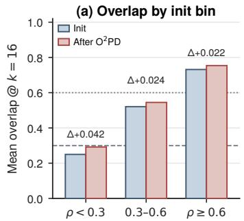

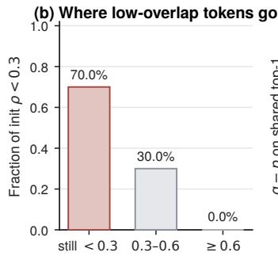

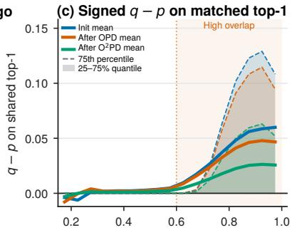  
Figure 7: Prefix tokens at $k = 1 6$ before and after ${ \mathrm { O } } ^ { 2 } { \mathrm { P D } } .$ . (a) Mean overlap by initial-overlap bin. (b) Destination of tokens with initial $\rho < 0 . 3 .$ . (c) Signed $q - p$ on the shared top-1.

Table 4: Student–teacher pairs used for $\mathrm { O ^ { 2 } P D }$
<table><tr><td>Student</td><td>Teacher</td></tr><tr><td>Qwen3-1.7B</td><td>Qwen3-4B</td></tr><tr><td>DSR1-1.5B</td><td>JustRL-1.5B</td></tr><tr><td>Qwen3-1.7B</td><td>Qwen3-4B-NTRL</td></tr></table>

## D THE TWO FAILURES AFTER $\mathrm { O ^ { 2 } P D }$

To test whether $\mathrm { O ^ { 2 } P D }$ relieves the two failures of top-k OPD in §4.1, we follow prefix tokens at $k = 1 6 ( \mathrm { F i g . } 7 )$ . Teacher-support Uncovering is read from mean overlap by initial-overlap bin and from the destination of tokens with initial $\rho < 0 . 3$ . Dominant-Mode Mismatch is read from the signed gap $q - p$ on the shared top-1.

Mean overlap rises in every bin, by 0.042 for $\rho < 0 . 3 , 0 . 0 2 4$ for 0.3–0.6, and 0.022 for $\rho \geq 0 . 6 .$ . Of the tokens that start below 0.3, 30% move into 0.3–0.6 and none reach $\geq 0 . 6 ;$ 70% remain below 0.3. Under top-k OPD, 87.3% of that cohort remain below 0.3 and none reach $\geq 0 . 6 . 0 ^ { 2 } \mathrm { P D }$ moves more of the low-overlap cohort out of the lowest bin, and most of it is still there. On tokens that share the teacher’s top-1, the signed gap $q - p$ after $\mathrm { O ^ { 2 } }$ PD lies below the gap after top-k OPD and remains positive at high overlap. $\bar { \mathrm { O ^ { 2 } P D } }$ therefore relieves Teacher-support Uncovering and Dominant-Mode Mismatch problems relative to top-k OPD.

## E TRAINING CONFIGURATION

We train $\mathrm { O ^ { 2 } P D }$ in VERL Sheng et al. (2025) on 16-NPU Ascend 910C machines. Chat templates disable thinking. The update is the distillation loss alone. Teacher log-probabilities are computed on the student prompt. Table 4 lists the three student–teacher pairs. DSR1-1.5B is DeepSeek-R1- Distill-Qwen-1.5B, and the NTRL teacher is Qwen3-4B-Non-Thinking-RL. All runs use DAPO-MATH-17K with no additional filtering, right truncation, and data-loader seed 42. Table 5 records the optimizer and rollout recipe. Table 6 records the O2PD loss settings used in the reported runs.

$\mathrm { O ^ { 2 } P D }$ on the NTRL and DSR1 pairs was scheduled for 300 steps, and $\mathrm { O ^ { 2 } P D }$ with the Qwen3- 4B teacher for 200 steps. Downstream scores use intermediate checkpoints at step 60 or 100, not necessarily the last scheduled step.

## F EVALUATION

Downstream evaluation uses the same decoding and grading pipeline for distilled checkpoints and reference models. The cross-prefix protocol in §3 reports pass@1 on MATH500 and is separate from the settings below.

Every model is decoded with vLLM. Thinking mode is disabled. All problems use the model’s chat template with the user prompt:

Table 5: Shared training recipe for $\mathrm { O ^ { 2 } P D }$
<table><tr><td>Setting</td><td>Value</td></tr><tr><td>Hardware</td><td>16× Ascend 910C</td></tr><tr><td>Data</td><td>DAPO-MATH-17K, unfiltered</td></tr><tr><td>Optimizer</td><td> $\mathrm { A d a m w } , \beta = ( 0 . 9 , 0 . 9 9 9 )$  , weight decay 0.01</td></tr><tr><td>Learning rate</td><td> $2 \times 1 0 ^ { - 6 }$  , cosine decay, min ratio 0.1</td></tr><tr><td>Warmup / grad clip</td><td>10 steps / 1.0</td></tr><tr><td>Train / mini-batch</td><td> $6 4 / 1 \bar { 6 }$ </td></tr><tr><td>Micro-batch per NPU</td><td>4</td></tr><tr><td>Max prompt / response</td><td>1536 / 4096</td></tr><tr><td>Rollout n / temperature</td><td>1/1.0</td></tr><tr><td>Precision</td><td>bfloat16 rollout, FSDP param and optimizer offload</td></tr><tr><td>KL loss Loss clamps</td><td>off</td></tr><tr><td></td><td>max 10.0, log q min −10.0</td></tr><tr><td>Thinking</td><td>off</td></tr></table>

Table 6: $\mathrm { O ^ { 2 } P D }$ loss settings.
<table><tr><td>Setting</td><td>Value</td></tr><tr><td>Top-k size k</td><td>16</td></tr><tr><td>Prefix fraction l</td><td>0.2</td></tr><tr><td>Reset atom</td><td>on</td></tr><tr><td>α</td><td>mapped from prefix overlap min and max</td></tr><tr><td>Support switch</td><td>median of prefix overlap: T ∪ {r} below, I ∪  $\{ r \}$  at or above</td></tr><tr><td>Scheduled steps</td><td>200 (Qwen3-4B teacher); 300 (NTRL and DSR1 pairs)</td></tr></table>

{problem} Please reason step by step, and put your final answer within \boxed{}.

Decoding uses temperature 0.6, top-p = 0.95, sampling top-k = 20, and a maximum of 31, 744 tokens.

A response is graded by extracting the final \boxed{} expression and checking mathematical equivalence against the reference answer with a rule-based verifier. The verifier applies symbolicequivalence normalization for fractions, radicals, and other equivalent forms. A response without a parseable boxed answer is counted as incorrect.