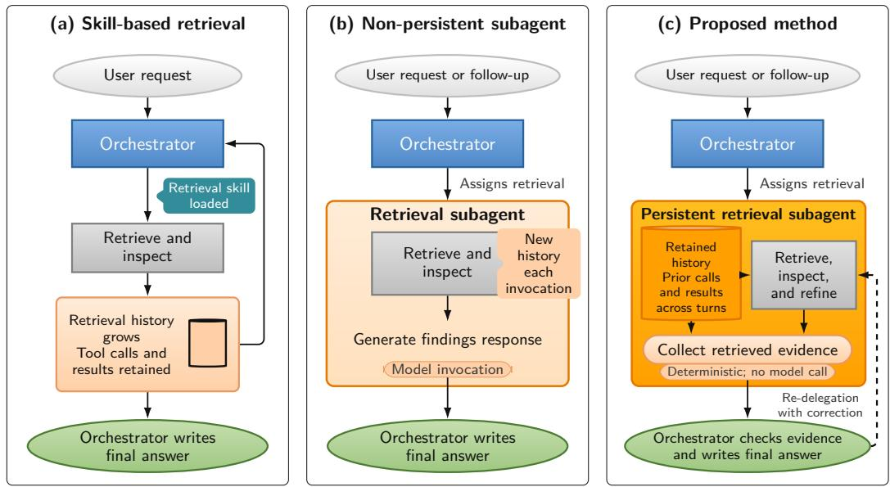
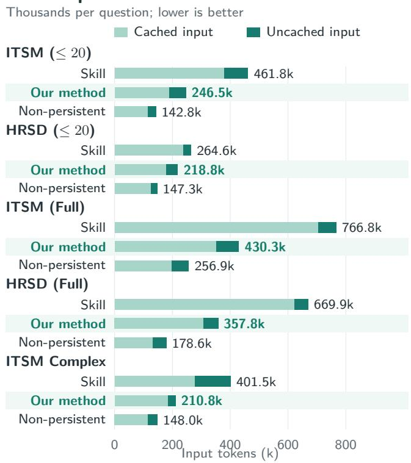
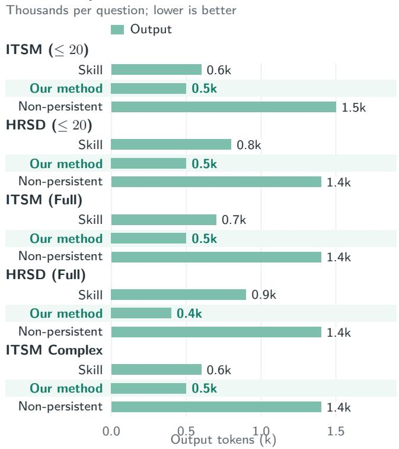
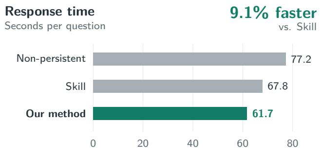
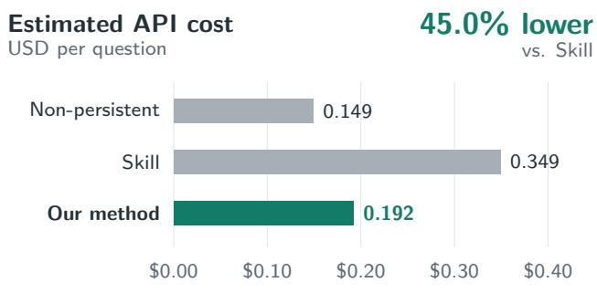

# Persistent Retrieval for Conversational Agents: A Study of Retrieval Eficiency

Karthik Ravula Sathwik Kowtha Rishabh Verma

karthik.ravula@servicenow.com sathwik.kowtha@servicenow.com rishabh.verma@servicenow.com

Kala Mehak Jain

Gunjit Mittal

kalamehak.jain@servicenow.com gunjit.mittal@servicenow.com

ServiceNow

## Abstract

Conversational agents can retrieve information directly or delegate retrieval to a subagent. This design choice afects how retrieval history is maintained, what context each model call receives, and what information must be re-retrieved in follow-up questions. We compare three designs: skill-based retrieval in the main agent, a non-persistent retrieval subagent that generates a findings response, and our persistent retrieval subagent, which maintains retrieval history across turns and returns retrieved evidence directly to the main agent. Our approach also allows the main agent to request corrections from the same subagent.

We evaluate the three designs on enterprise questions posed independently, within shared conversations, and as dependent follow-ups. Across five multiturn settings, our approach uses 43.3% fewer recorded agent-model tokens and incurs 45.0% lower estimated API cost than skill-based retrieval, while reducing average response time by 9.1%. Compared with nonpersistent retrieval, it reduces response time by 15.6 seconds per question, while using 65.1% more tokens and incurring 29.1% higher estimated API cost.

Our approach shifts the retrieval subagent from producing synthesized responses to maintaining retrieval state and supplying evidence that the main agent can directly evaluate and use for answer generation.

## 1. Introduction

Conversational agents often require multiple tool calls to answer a user request. A harness can provide retrieval guidance as a skill in the main agent’s context or delegate retrieval to a subagent with its own context [1, 2]. This choice afects model inputs and how retrieval history is maintained for later questions.

For enterprise users, an important practical consideration is whether an agent can answer follow-up questions promptly without requiring previously provided context to be repeated. With skill-based retrieval (Skill), the main agent, or orchestrator, uses a single context for both retrieval and conversation. Consequently, results from earlier tool calls can accumulate in the context and increase the input to subsequent model calls.

A non-persistent retrieval subagent starts each invocation with a new history. It retrieves information and generates a findings response; the orchestrator then generates the final answer. We call these two responsegeneration stages double synthesis. The findings response can reduce the orchestrator’s input, but the subagent does not retain its retrieval history and may repeat earlier retrieval work.

Persistent and resumable agents carry context across tasks [2, 7]. Building on this capability, we propose a persistent retrieval approach in which a subagent retains its history across turns and returns evidence directly, without a separate findings response. Here, evidence means retrieval results that the model uses to answer the retrieval task, together with the queries or parameters used to obtain them. Like Re-WOO [11], our method separates retrieval from answer generation, but keeps the retrieval session across turns so the orchestrator can send corrections back with earlier queries and results still available. For example, after retrieving a team’s open requests, the subagent can reuse that history when the user asks which requests are overdue.

We ask two questions: (1) how do the three designs trade response time against estimated API cost, and (2) how much context does each design provide to the orchestrator? We evaluate independent enterprise questions and conversations with follow-ups, measuring response time, accuracy, estimated API cost, combined parent and child token usage, and orchestrator input size. Appendix D discusses related work.

  
Figure 1. Retrieval designs compared in our evaluation. Skill keeps retrieval in the orchestrator. A non-persistent subagent generates a findings response. Our method retains retrieval history, returns evidence directly, and resumes the same session for corrections.

## 2. Methodology

Our method keeps retrieval work in a persistent subagent and returns retrieved evidence directly to the orchestrator (Fig. 1). The orchestrator checks the evidence, requests corrections when needed, and writes the final answer. Appendix C describes our retrieval setup.

Within a conversation, the orchestrator and subagent maintain separate contexts, each with its own budget. The subagent preserves its instructions, messages, tool calls, and retrieved results across turns, so follow-up questions can build on earlier retrieval. Before retrieving more, it checks whether the information in its session is suficient for the new question. The orchestrator under Skill and our subagent use the same compaction engine: large tool outputs are retained in workspace files and replaced in context by compact previews. The orchestrator maintains its own context independently and receives the subagent’s output when it delegates retrieval.

In our implementation, we ask the subagent to briefly explain its retrieval choices when invoking tools. When provided, these explanations accompany the results and help the orchestrator assess whether the retrieval matches the task. For overdue items, the explanation can identify the due-date and open-status filters used by the query.

The subagent uses a Boolean argument, handof\_after\_this, to indicate that the current retrieval step is expected to complete the task. When the subagent sets this flag to true and the tool calls complete without errors, the harness returns the evidence directly, without another model call to generate a findings response. The orchestrator assesses the evidence together with any accompanying explanation before writing the final answer. If the evidence is incomplete or incorrect, it can redelegate retrieval with additional guidance or context. The same subagent resumes from its existing session, retaining its retrieval history while incorporating the additional guidance. This separates retrieval from answer synthesis while preserving the context needed for corrections.

## 3. Experiments

We implement and evaluate all three approaches using ServiceNow’s internal agent harness with GPT-5.4 for agent model calls. All three methods share a schema tool that looks up the metadata required for a question and a Cypher tool that queries the records to answer it (Appendix C).

## 3.1. Datasets

The IT Service Management (ITSM) dataset consists of 57 questions covering incidents, problems, changes, assignments, and service-level conditions. The 48 HR Service Delivery (HRSD) questions cover employees, organizational records, and HR cases. These questions are independent, even when asked within the same conversation. In contrast, ITSM Complex comprises 69 questions with multi-turn dependencies: later questions may refer to information retrieved or discussed in earlier turns. Tab. 6 shows five sample questions from each dataset.

<table><tr><td rowspan="2">Set</td><td rowspan="2">Method</td><td rowspan="2">Accuracy (%)</td><td rowspan="2">Response time (s)</td><td colspan="4">Mean tokens per conversation</td><td rowspan="2">Est. cost ($)</td></tr><tr><td>Input</td><td>Cached</td><td>Uncached</td><td>Output</td></tr><tr><td rowspan="3">ITSM</td><td>Non-persistent</td><td>96.49</td><td>66.7</td><td>107.1k</td><td>92.2k</td><td>14.9k</td><td>1.3k</td><td>0.080</td></tr><tr><td>Skill</td><td>98.25</td><td>52.1</td><td>166.4k</td><td>139.2k</td><td>27.3k</td><td>0.7k</td><td>0.113</td></tr><tr><td>Our method</td><td>98.25</td><td>54.1</td><td>96.9k</td><td>81.2k</td><td>15.7k</td><td>0.6k</td><td>0.068</td></tr><tr><td rowspan="3">HRSD</td><td>Non-persistent</td><td>93.75</td><td>78.3</td><td>108.0k</td><td>93.8k</td><td>14.2k</td><td>1.4k</td><td>0.080</td></tr><tr><td>Skill</td><td>95.83</td><td>52.9</td><td>160.7k</td><td>134.5k</td><td>26.2k</td><td>0.8k</td><td>0.111</td></tr><tr><td>Our method</td><td>93.75</td><td>51.9</td><td>100.4k</td><td>87.7k</td><td>12.7k</td><td>0.5k</td><td>0.061</td></tr></table>

Table 1. Single-turn results. Accuracy and response time use 57 ITSM and 48 HRSD questions per method (each single-turn conver sation consists of one question); tokens are cumulative conversation means. Token values use thousands (k) and are rounded to one decimal place. Estimated API cost is in USD per conversation for recorded agent-model calls (Sec. 3.3).

For ITSM and HRSD, the single-turn study poses questions independently to each method. The multiturn study uses two settings: ≤ 20 groups questions into conversations of up to 20 questions, while Full places the entire question set in one conversation. ITSM Complex uses three conversations of 19, 19, and 31 questions (Appendix A).

## 3.2. Methods and baselines

With skill-based retrieval, the orchestrator invokes retrieval tools directly and keeps the retrieval skill and tool results in its own context.

A non-persistent retrieval subagent starts with a new message history for each invocation, retrieves the data, and generates a findings response. The orchestrator receives that response and writes the answer.

Our method uses a subagent that retains retrieval history across turns and returns evidence directly to the orchestrator (Sec. 2).

## 3.3. Evaluation metrics

We use ServiceNow’s internal test-automation framework, where GPT-5.4-mini serves as the LLM judge, comparing the orchestrator’s response with the ground-truth answer to assign a quality score and a consistency verdict. We count a question as a pass when the score is greater than zero and the judge marks the response as consistent with the ground truth. We calculate accuracy for each run and then average the three percentages.

Response time is the benchmark-recorded time to answer one question, reported in seconds. We count each recorded parent and child model call once, summing usage per conversation for the single-turn study and per question for multi-turn. Cached input is part of input, uncached input is the remainder, and total tokens are input plus output. Appendix B gives the accounting equation. Tabs. 1 and 2 report the mean of three independent runs for each method and setting.

We estimate API cost using OpenAI’s Standard GPT-5.4 prices: \$2.50 per million uncached input tokens, \$0.25 per million cached input tokens, and \$15 per million output tokens [6]. These rates rise to \$5, \$0.50, and \$22.50 for calls exceeding 272k input tokens, including cached input. We price all tokens in each call at its applicable rates before averaging. Estimates cover the recorded agent-model calls, not actual deployment bills; retrieval-service and judge calls, infrastructure, and negotiated or regional pricing adjustments are excluded.

## 3.4. Results

Our method answers faster than non-persistent retrieval in every evaluated setting. Across multi-turn settings, it also has lower average response time, token usage, and estimated API cost than Skill.

Our method achieves the lowest response time and estimated cost on ITSM Complex, which tests dependent follow-ups (Tab. 2). It takes 54.3 seconds per question, versus 79.6 for non-persistent retrieval and 58.3 for Skill, and costs \$0.121, versus \$0.133 and \$0.387, respectively. Fewer uncached-input and output tokens explain the lower cost despite 41.4% more total tokens than non-persistent retrieval. Accuracy is 89.85%, versus 91.30% for both baselines.

The ITSM Complex ablation (Appendix E, Tab. 5) shows a larger response-time and cost increase without direct return (17.7 seconds, 42% higher cost) than without persistence (4.3 seconds, 8% higher cost). Reported accuracy remains 89.85% in all three configurations.

Across all five multi-turn settings, our method has the lowest question-weighted average response time (Tab. 2). Compared with Skill, it is 9.1% faster, uses 43.3% fewer total tokens, and reduces estimated API cost by \$0.157 (45.0%) per question; only on HRSD (≤ 20) is Skill faster (60.3 s vs. 63.5 s) and lower-cost (\$0.136 vs. \$0.150). Against non-persistent retrieval, our method answers 15.6 seconds faster but uses 65.1% more tokens and costs \$0.043 (29.1%) more per question on average (Fig. 4). Retained subagent history adds input across turns, helping explain the tokenusage trade-of.

<table><tr><td rowspan="2">Set</td><td rowspan="2">Method</td><td rowspan="2">Accuracy (%)</td><td rowspan="2">Response time (s)</td><td colspan="4">Mean tokens per question</td><td rowspan="2">Est. cost ($)</td></tr><tr><td>Input</td><td>Cached</td><td>Uncached</td><td>Output</td></tr><tr><td rowspan="3">ITSM (≤ 20)</td><td>Non-persistent</td><td>94.74</td><td>73.0</td><td>142.8k</td><td>115.0k</td><td>27.8k</td><td>1.5k</td><td>0.120</td></tr><tr><td>Skill</td><td>96.49</td><td>68.2</td><td>461.8k</td><td>379.6k</td><td>82.1k</td><td>0.6k</td><td>0.309</td></tr><tr><td>Our method</td><td>96.49</td><td>66.4</td><td>246.5k</td><td>188.0k</td><td>58.4k</td><td>0.5k</td><td>0.201</td></tr><tr><td rowspan="3">HRSD (≤ 20)</td><td>Non-persistent</td><td>89.58</td><td>71.1</td><td>147.3k</td><td>126.1k</td><td>21.2k</td><td>1.4k</td><td>0.105</td></tr><tr><td>Skill</td><td>91.67</td><td>60.3</td><td>264.6k</td><td>238.7k</td><td>25.9k</td><td>0.8k</td><td>0.136</td></tr><tr><td>Our method</td><td>91.67</td><td>63.5</td><td>218.8k</td><td>179.6k</td><td>39.2k</td><td>0.5k</td><td>0.150</td></tr><tr><td rowspan="3">ITSM (Full)</td><td>Non-persistent</td><td>94.74</td><td>80.3</td><td>256.9k</td><td>198.5k</td><td>58.4k</td><td>1.4k</td><td>0.216</td></tr><tr><td>Skill</td><td>96.49</td><td>74.0</td><td>766.8k</td><td>705.3k</td><td>61.5k</td><td>0.7k</td><td>0.510</td></tr><tr><td>Our method</td><td>96.49</td><td>63.2</td><td>430.3k</td><td>352.3k</td><td>78.0k</td><td>0.5k</td><td>0.290</td></tr><tr><td rowspan="3">HRSD (Full)</td><td>Non-persistent</td><td>91.67</td><td>81.3</td><td>178.6k</td><td>131.8k</td><td>46.8k</td><td>1.4k</td><td>0.170</td></tr><tr><td>Skill</td><td>87.50</td><td>81.1</td><td>669.9k</td><td>622.9k</td><td>47.0k</td><td>0.9k</td><td>0.365</td></tr><tr><td>Our method</td><td>89.58</td><td>63.1</td><td>357.8k</td><td>306.9k</td><td>51.0k</td><td>0.4k</td><td>0.210</td></tr><tr><td rowspan="3">ITSM Complex</td><td>Non-persistent</td><td>91.30</td><td>79.6</td><td>148.0k</td><td>115.0k</td><td>33.0k</td><td>1.4k</td><td>0.133</td></tr><tr><td>Skill</td><td>91.30</td><td>58.3</td><td>401.5k</td><td>278.0k</td><td>123.5k</td><td>0.6k</td><td>0.387</td></tr><tr><td>Our method</td><td>89.85</td><td>54.3</td><td>210.8k</td><td>183.8k</td><td>27.0k</td><td>0.5k</td><td>0.121</td></tr></table>

Table 2. Multi-turn results. ITSM and HRSD use 57 and 48 questions per setting; ITSM Complex uses 69 (Appendix A.2). Tokens (k) sum parent and child calls per question, including cached input. Estimated API cost is in USD per question for recorded agent-model calls (Sec. 3.3).

In the analyzed multi-turn traces, our method redelegated 11 of 279 questions (3.9%) to obtain missing evidence or recheck query filters. The reported token and cost totals include these calls.

In single-turn settings, our method has response times close to Skill, with the fewest tokens and lowest estimated cost on both datasets (Tab. 1). Nonpersistent retrieval is about 12.6 seconds slower on ITSM and 26.4 on HRSD. Across three runs of each setting, the number of questions answered correctly varied by about two or three; our method and either baseline difered by no more than one.

Our method’s mean peak orchestrator inputs are smaller than with Skill but larger than with nonpersistent retrieval across all five settings (Tab. 3). Peak input is the largest single-call input per conversation, not cumulative usage.

<table><tr><td>Set</td><td>Non-persistent</td><td>Skill</td><td>Our method</td></tr><tr><td>ITSM (≤ 20)</td><td>66.5k</td><td>180.0k</td><td>102.4k</td></tr><tr><td>HRSD (≤ 20)</td><td>60.6k</td><td>122.4k</td><td>95.0k</td></tr><tr><td>ITSM (Full)</td><td>155.4k</td><td>493.8k</td><td>242.3k</td></tr><tr><td>HRSD (Full)</td><td>106.4k</td><td>335.5k</td><td>192.3k</td></tr><tr><td>ITSM Complex</td><td>68.8k</td><td>188.6k</td><td>104.0k</td></tr></table>

Table 3. Mean of each conversation’s largest single-call orchestrator input, in thousands of tokens (k). ITSM and HRSD use three conversations per shorter run and one per full-length run; ITSM Complex uses three.

Our method reduces response-generation time by

12.3–13.6 seconds per question versus non-persistent retrieval (Tab. 4), avoiding intermediate findings generation. Timings cover matched single-turn subsets and multi-turn ITSM Complex, excluding retrieval and other overhead; they are not end-to-end savings.
<table><tr><td>Set</td><td>Non-persistent</td><td>Our method</td><td>Time saved</td></tr><tr><td>ITSM</td><td>19.58</td><td>7.30</td><td>12.28</td></tr><tr><td>HRSD</td><td>19.02</td><td>5.44</td><td>13.58</td></tr><tr><td>ITSM Complex</td><td>19.66</td><td>6.96</td><td>12.70</td></tr></table>

Table 4. Mean model-call time (s) per question for answer generation. ITSM (52) and HRSD (32) use matched single-turn questions where both methods delegated and answered. ITSM Complex includes all 69 multi-turn questions, with or without delegation.

## 4. Discussion and Conclusions

In this paper, we introduce a persistent retrieval subagent that returns evidence directly to the orchestrator. Direct evidence return avoids intermediate findings generation, while persistence preserves retrieval context for follow-ups and corrections. The ablation in Appendix E shows larger response-time and cost increases without direct return than without persistence. The orchestrator evaluates the evidence, requests targeted corrections when needed, and writes the final answer. Across the main evaluations, our method maintains comparable accuracy while reducing average multi-turn response time, tokens, and estimated cost relative to Skill. Against non-persistent retrieval, it responds faster in all seven settings, but uses more tokens and costs more on average in multiturn conversations.

## Limitations

The subagent sets the completion flag before seeing the retrieval result. A tool can succeed while returning incomplete or irrelevant evidence, which reaches the orchestrator without another child-model check. The correction mechanism in Sec. 2 depends on the orchestrator recognizing the gap; it may instead answer without requesting further evidence.

Our evaluation focuses on structured enterprise records in a demonstration environment. The results show how the methods performed on these question sets; understanding how they extend to other tasks will require broader testing and a breakdown by question dificulty. Results may also vary with the agent harness and its configuration.

## References

[1] Agent Skills Contributors. Agent skills overview. https://agentskills.io/what-are-skills, n.d. Documentation, accessed September 16, 2026. 1, 7

[2] Anthropic. Create custom subagents. https://code. claude.com/docs/en/sub-agents, n.d. Claude Code documentation, accessed September 16, 2026. 1, 7

[3] S. Kim, S. Moon, R. Tabrizi, N. Lee, M. W. Mahoney, K. Keutzer, and A. Gholami. An LLM compiler for parallel function calling. In International Conference on Machine Learning (ICML), 2024. 7

[4] P. Lewis, E. Perez, A. Piktus, F. Petroni, V. Karpukhin, N. Goyal, H. Küttler, M. Lewis, W.-t. Yih, T. Rocktäschel, S. Riedel, and D. Kiela. Retrieval-augmented generation for knowledgeintensive NLP tasks. In Advances in Neural Information Processing Systems (NeurIPS), 2020. 7

[5] A. Madaan, N. Tandon, P. Gupta, S. Hallinan, L. Gao, S. Wiegrefe, U. Alon, N. Dziri, S. Prabhumoye, Y. Yang, S. Gupta, B. Prasad Majumder, K. Hermann, S. Welleck, A. Yazdanbakhsh, and P. Clark. Self-Refine: Iterative refinement with self-feedback. In Advances in Neural Information Processing Systems (NeurIPS), 2023. 7

[6] OpenAI. API pricing: GPT-5.4. https://developers. openai.com/api/docs/pricing, 2026. Standard texttoken rates, accessed September 24, 2026. 3

[7] C. Packer, S. Wooders, K. Lin, V. Fang, S. G. Patil, I. Stoica, and J. E. Gonzalez. MemGPT: Towards LLMs as operating systems. arXiv preprint arXiv:2310.08560, 2023. 1, 7

[8] T. Schick, J. Dwivedi-Yu, R. Dessì, R. Raileanu, M. Lomeli, E. Hambro, L. Zettlemoyer, N. Cancedda,

and T. Scialom. Toolformer: Language models can teach themselves to use tools. In Advances in Neural Information Processing Systems (NeurIPS), 2023. 7

[9] N. Shinn, F. Cassano, E. Berman, A. Gopinath, K. Narasimhan, and S. Yao. Reflexion: Language agents with verbal reinforcement learning. In Advances in Neural Information Processing Systems (NeurIPS), 2023. 7

[10] Q. Wu, G. Bansal, J. Zhang, Y. Wu, B. Li, E. Zhu, L. Jiang, X. Zhang, S. Zhang, J. Liu, A. H. Awadallah, R. W. White, D. Burger, and C. Wang. AutoGen: Enabling next-gen LLM applications via multi-agent conversation. arXiv preprint arXiv:2308.08155, 2023. 7

[11] B. Xu, Z. Peng, B. Lei, S. Mukherjee, Y. Liu, and D. Xu. ReWOO: Decoupling reasoning from observations for eficient augmented language models. arXiv preprint arXiv:2305.18323, 2023. 1, 7

[12] S. Yao, J. Zhao, D. Yu, N. Du, I. Shafran, K. Narasimhan, and Y. Cao. ReAct: Synergizing reasoning and acting in language models. In International Conference on Learning Representations (ICLR), 2023. 7

Appendix

## A. Evaluation Protocol

## A.1. Single-turn question sets

Each method answers 57 ITSM and 48 HRSD questions posed independently. The questions cover the domains described in Sec. 3.1, with retrieval work ranging from finding an attribute to following several related records.

## A.2. Multi-turn session construction

We use two conversation settings. In the shorter setting, the 57 ITSM questions are divided into conversations of 20, 20, and 17 questions; the 48 HRSD questions form conversations of 20, 20, and 8. In the full-length setting, each dataset remains in one conversation. Each question is asked once in its conversation, as a separate user turn. History accumulates within a conversation and is reset at the next conversation boundary. Under our method, retrieval tasks within the same conversation resume the child’s existing session.

The separate ITSM Complex evaluation uses 69 questions per method, grouped into conversations of 19, 19, and 31 questions. It includes follow-up questions that depend on earlier turns in the conversation.

All three methods receive the same question sequences, including standalone questions and followups. Shared history makes outcomes within a conversation dependent, and fixed question order couples conversation depth with question dificulty. We do not treat turns as independent trials.

## B. Measurement Details

For single-turn results (Tab. 1), let $\mathcal { L } _ { i }$ contain the model calls in conversation i. Mean usage over N conversations is

$$
\overline { { X } } = \frac { 1 } { N } \sum _ { i = 1 } ^ { N } \sum _ { j \in \mathcal { L } _ { i } } X _ { i j } , \quad X \in \{ I , C , O \} ,\tag{1}
$$

where $I , C ,$ and O denote input, cached-input, and output tokens. Mean uncached input is $\overline { { U } } = \bar { \overline { { I } } } - \overline { { C } }$

For call $j \in \mathcal { L } _ { i }$ , let $U _ { i j } = I _ { i j } - C _ { i j }$ and let $r _ { u } ( I _ { i j } )$ $r _ { c } ( I _ { i j } )$ , and $r _ { o } ( I _ { i j } )$ denote uncached-input, cachedinput, and output prices in USD per token. Estimated cost is

$$
\mathrm { C o s t } _ { i j } = U _ { i j } r _ { u } ( I _ { i j } ) + C _ { i j } r _ { c } ( I _ { i j } ) + O _ { i j } r _ { o } ( I _ { i j } ) ,\tag{2}
$$

where $( r _ { u } , r _ { c } , r _ { o } ) ( I ) = ( 2 . 5 , 0 . 2 5 , 1 5 . 0 ) \times 1 0 ^ { - 6 }$ for $I \leq$ 272k and $( 5 . 0 , 0 . 5 0 , 2 2 . 5 ) \times 1 0 ^ { - 6 }$ for $I > 2 7 2 \mathrm { k } \left( \mathrm { S e c . 3 . 3 } \right)$ .

Across all methods and datasets, we sum call costs per conversation or question and average these totals, as for token usage.

We count each orchestrator and subagent call once by task identifier. Input includes cached tokens; output includes tool-call arguments, intermediate responses, and final answers. Rounding follows aggregation.

For multi-turn results (Tab. 2), we sum call usage per question and average over 57 ITSM, 48 HRSD, or 69 ITSM Complex questions. Combined results weight questions equally across the five settings; repeated runs within each method and setting also receive equal weight.

Totals include calls finishing after answer display and may therefore extend beyond the response timer. Separately recorded retrieval-service model calls are excluded.

Tab. 3 averages each conversation’s largest singlecall orchestrator input within each condition, weighting runs equally. Inputs include instructions, tool definitions, and conversation history.

## B.1. Response-generation timing

For Tab. 4, we sum subagent findings-response and orchestrator final-answer call durations per question, then average over questions. Direct-return paths omit child findings generation; any recorded child completions remain included in the totals.

ITSM and HRSD use 52 and 32 matched single-turn questions where both methods delegated and answered; ITSM Complex uses all 69 multi-turn questions. Time saved is the non-persistent mean minus ours. Retrieval and other overhead are excluded, unlike the end-to-end times in Tabs. 1 and 2.

## C. Retrieval Tools and Context Reuse

The methods use a schema tool to retrieve the metadata required for a question (tables, fields, and relationships) and, following query rules in the prompt, write and run a Cypher query over that schema to retrieve the records needed to answer it. Skill retains retrieval outputs in the orchestrator. A non-persistent subagent receives orchestrator-provided context but starts each invocation with fresh child history. Our method retains metadata, queries, and results across turns, allowing earlier evidence to be reused alongside new retrieval.

For this trace analysis, we use one ITSM Complex run per method (69 questions); Tab. 5 instead averages ablation runs. Our method made 23 metadata lookups and 59 Cypher queries, compared with 36 lookups and 85 queries for Skill and 64 lookups and 98 queries for non-persistent retrieval. Thus, our method performed less recorded retrieval work than either baseline in these runs.

<table><tr><td>Configuration</td><td>Accuracy (%)</td><td>Response time (s)</td><td>Total tokens</td><td>Uncached input</td><td>Schema calls</td><td>Cypher calls</td><td>Est. cost ($)</td></tr><tr><td>No persistence</td><td>89.85</td><td>58.6</td><td>191.8k</td><td>32.0k</td><td>49</td><td>71</td><td>0.1302</td></tr><tr><td>No direct return</td><td>89.85</td><td>72.0</td><td>302.1k</td><td>35.4k</td><td>31</td><td>80</td><td>0.1712</td></tr><tr><td>Our method</td><td>89.85</td><td>54.3</td><td>211.3k</td><td>27.0k</td><td>23</td><td>59</td><td>0.1205</td></tr></table>

Table 5. Component ablation. Persistent retrieval state and direct evidence return on ITSM Complex. Call counts are averaged across runs and rounded to the nearest integer; time, tokens, and cost are per-question means. Tokens use thousands (k).

On ITSM Complex, mean response-generation call time was 6.96 seconds per question for our method, compared with 19.66 seconds for non-persistent retrieval—a diference of 12.70 seconds (Tab. 4). Both measurements include all recorded child and orchestrator response-generation calls. These timings exclude retrieval and other overhead and are not end-to-end savings.

Across one analyzed run for each of five multi-turn settings, 249 of 274 subagent invocations returned evidence directly through the completion flag (Sec. 2), with no errors in the marked tool calls. The remaining 25 ended with explicit tool-output selection (14), text (8), or an empty model response (3). These counts measure direct-return use; answer accuracy is reported separately.

Together, these observations show that our method exhibits both lower recorded retrieval work and lower response-generation time than non-persistent retrieval.

## D. Related Work

Prior work examines how agents retrieve information and how they plan and coordinate retrieval tasks. Retrieval-augmented generation supplies retrieved passages, while Toolformer and ReAct use tools to obtain information [4, 8, 12]. Skills and multi-agent harnesses organize this work through reusable guidance or collaborating agents [1, 10]. ReWOO separates planning from execution and passes collected evidence to a Solver; LLMCompiler schedules dependent function calls, including parallel execution and replanning [3, 11]. Like ReWOO, our method separates retrieval from answer generation, but keeps the retrieval session across turns so the orchestrator can send corrections back with earlier queries and results still available. The harness collects selected tool outputs and their arguments unchanged, without another model call to write a findings response.

MemGPT and resumed subagents preserve context across tasks [2, 7]. Self-Refine and Reflexion use feedback or retained reflections to improve later at-

tempts [5, 9].

## E. Ablation Study

Our approach uses two mechanisms to improve the eficiency of multi-step retrieval: persistent retrieval state and direct evidence return. Because both are enabled in the full system, the main evaluation does not reveal how much each contributes individually. We therefore perform an ablation on ITSM Complex to examine whether the eficiency gains come primarily from reusing information across questions, avoiding intermediate findings-generation, or their combination. We disable each mechanism while retaining the other and compare response time, token usage, and estimated cost (Tab. 5). We ran each ablation configuration three times. The full-method reference uses earlier measurements, with accuracy from Tab. 2.

The observed execution patterns suggest complementary eficiency benefits. In this comparison, the full method achieves the lowest response time and estimated cost, while requiring fewer uncached input tokens and fewer schema and Cypher calls. Persistent state allows schemas and results from earlier questions to be reused, reducing the need for repeated retrieval. Without direct evidence return, the subagent instead generates a findings response for the orchestrator, adding generation overhead.

The ablation also reveals a token-usage trade-of. Disabling persistence produces the fewest total tokens because the subagent no longer carries its retrieval history across questions. Persistence can reduce retrieval work at the cost of a larger context, while direct evidence return reduces intermediate generation. Together, the mechanisms combine retrieval reuse with a shorter path from retrieval to orchestration. Their combination gives the best response-time and estimated-cost profile in this comparison, rather than minimizing every individual metric.

## F. Acknowledgements

We thank Malhar Chaudhari and Rajagopalan Govind for reviewing this paper and providing valuable feedback.

## G. Sample Questions

Table 6. Sample questions from the evaluated datasets. The datasets cover filtering, aggregation, relationship traversal, and follow-up retrieval. The ITSM Complex examples are five consecutive turns from one conversation.

## ITSM

1. Get incident number and short description for incidents with contact type email and category inquiry.

2. Display incidents that are older than 3 days and have not been resolved yet.

3. Total incident reassignments by assigned user for priority 1 incidents, ordered by count.

4. What is the workaround for incident number INC0010004?

5. What are the incidents that were caused by Change CHG0000007?

## HRSD

1. Who are the contacts for the building “Adelas Building”?

2. Which departments use the cost center with the account number ACN00001?

3. What is the job title of the job profile with the job code 1001?

4. What is the name of the company that is the parent company of the company located in Shanghai?

5. What is the name of the business unit associated with the department that uses the cost center with the code 123?

## ITSM Complex

1. Who reported INC1108477?

2. Which team is currently assigned to INC1108477?

3. What service and service ofering does INC1108477 belong to?

4. When did the outage begin and when was it fully restored?

5. How long did the outage last from start to resolution?

## H. Benchmark Comparisons

Fewer input tokens than Skill  
  
Figure 2. Input tokens across all five multi-turn settings. Stacks show cached and uncached input; labels give input tokens per question in thousands (k) (Tab. 2).

Fewer output tokens than both  
  
Figure 3. Output tokens across the same five settings. Bars and labels show output tokens per question in thousands (k) (Tab. 2).

## Faster answers, with a cost trade-of

Averages across the five multi-turn settings. Lower is better for both metrics.

## 15.6 seconds faster than non-persistent

  
29.1% higher cost than non-persistent

Accuracy remains within one question of each baseline per setting.

ITSM Complex is the cost exception: our method costs less than both baselines (Tab. 2).

Figure 4. Overall speed and estimated-cost trade-of. Question-weighted averages across the five settings. Costs cover recorded agentmodel calls only (Sec. 3.3), not deployment bills. Per-setting accuracy and other results are in Tab. 2.