# ProQuant: Progressive Quantization-aware Training for Edge MLLMs

Yufei Xue1 Yushi Huang1 Jiawei Shao2,3∗ Pingcheng Dong1   
Yonghao Tan1 Shiyao Li4 Kwang-Ting Cheng1 Jun Zhang1∗ 1The Hong Kong University of Science and Technology 2Northwestern Polytechnical University 3Institute of Artificial Intelligence (TeleAI), China Telecom 4Tsinghua University jiawei.shao@nwpu.edu.cn, eejzhang@ust.hk

## Abstract

Multi-modal large language models (MLLMs) with impressive perception and understanding capabilities will enable a range of downstream applications. However, their substantial computational and memory requirements hinder the real-world implementation, particularly for resource-constrained edge devices. Quantization has emerged as an effective solution for deploying large models. While post-training quantization (PTQ) successfully retains the performance at moderate bit-width (e.g., W8A8), it suffers from severe performance degradation under low-bit quantization (e.g., W4A8), especially for small-scale models that are more suitable for edge deployment. In this paper, we propose ProQuant, a novel weight-activation quantization-aware training (QAT) framework tailored for low-bit MLLMs. First, to align the limited finetuning dataset distribution with the pretrained dataset distribution, we propose a self-relabeling (SRL) scheme to resample the responses of the open-source multimodal dataset. Second, we are thefirst to take a decoupled view of multi-modal (MM) understanding and language modeling abilities. We propose a progressive block activation (PBA) mechanism to prioritize the MM understanding recovery. We also introduce a vision-sensitive factor ⃗τ that effectively identifies the MM-critical layers. Extensive experiments across various benchmarks, covering models with 2B∼8B parameters, show that ProQuant significantly outperforms existing methods. For example, our W4A8 Qwen3-VL-2B-Instruct improves average accuracy by impressively 6.6% and achieves performance comparable to full precision counterparts with only ∼1% performance drop. Code is available at https://github.com/yufeixue-ai/ProQuant/.

## 1 Introduction

Extending large language models (LLMs) beyond text to additional modalities [Bai et al., 2025a; Li et al., 2024a; Xiaomi, 2025; Zhu et al., 2025; Wu et al., 2024; Team, 2026; Li et al., 2026a] has achieved remarkable successes and enabled a wide range of applications, including chatbots [Bai et al., 2025a], autonomous driving [Tian et al., 2024], and AR/VR glasses [Chen et al., 2024]. However, the large memory footprint and substantial computational overhead [Huang et al., 2026; Lv et al., 2025] of multi-modal LLMs (MLLMs) present major obstacles to deployment in resource-constrained environments, especially on edge devices [An et al., 2026; Shao and Li, 2025; Yuan et al., 2025]. Quantization [Gholami et al., 2022] alleviates this issue by reducing the precision of both weights and activations, thereby accelerating memory access and computation. Post-training quantization (PTQ) [Xiao et al., 2023; Ashkboos et al., 2024; Liu et al., 2024a; Huang et al., 2024a, 2025a; Gong et al., 2024, 2025] typically delivers near-lossless performance at moderate precision (e.g., W8A8), yet its accuracy degrades markedly when pushed to lower-bit settings (e.g., W4A4/W4A8). Additionally, small-scale models (2B/4B), which are more practical for edge deployment, typically suffer more pronounced performance degradation after quantization [Chen et al., 2025a].

In contrast, quantization-aware training (QAT) that incorporates quantization during training has emerged as a promising solution to recover the model performance under low-bit quantization settings [Liu et al., 2023; Du et al., 2024; Chen et al., 2025a; Huang et al., 2025b]. The QAT solutions for LLM primarily target the training data corpus [Liu et al., 2023], training efficiency [Chen et al., 2025b], or distillation paradigm [Du et al., 2024]. In the context of MLLM QAT, additional challenges arise. First, preserving the zero-shot generalization of compressed models hinges on high-quality fine-tuning data that are sufficiently broad and well-aligned with the original pre-training distribution. However, open-source datasets are often domain-narrow or distribution-shifted [Liu et al., 2023], and multi-modal (MM) data are far more difficult to collect than text-only data [Guo et al., 2025]. Second, quantization degrades both MM understanding and language modeling capabilities. A natural question is whether these two capabilities should be recovered jointly, or whether one should be

Considering the challenges discussed above, we propose ProQuant, a novel QAT framework tailored to small-scale MLLMs, as illustrated in Figure 1. First, we propose a self-relabeling (SRL) scheme that re-annotates the training set to better align the finetuning data distribution with the model distribution. Second, we introduce a progressive block activation (PBA) mechanism that prioritizes recovering the MM understanding ability by first enabling quantization for vision-sensitive layers while keeping the remaining blocks in full precision during the forward pass. As training progresses, we gradually activate quantization for increasingly text-sensitive layers, thereby restoring language modeling capability. The core contributions are summarized as follows:

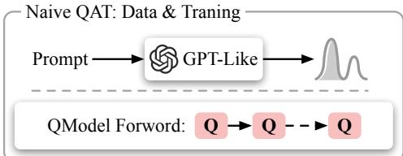

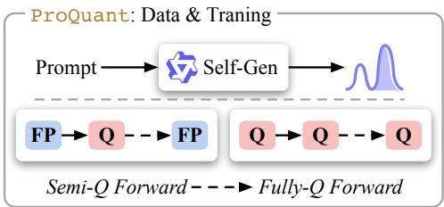  
Figure 1: Naive QAT v.s. ProQuant.

▷ We propose ProQuant, a dedicated QAT framework for MLLMs. To the best of our knowledge, it is the first weight-activation QAT framework for MLLMs, enabling effective low-bit (e.g., W4A8/W4A4) quantization.

▷ To address the scarcity of high-quality MM data, we introduce the SRL scheme, which re-annotates the fine-tuning data to better match the model distribution, thereby reducing data mismatch and improving post-quantization generalization.

▷ We take a disentangled view of MM understanding and language modeling capabilities during quantization. Particularly, we propose the PBA mechanism to prioritize recovering MM understanding first, and then gradually restore language modeling ability, instead of jointly optimizing both from the outset.

▷ Extensive experiments show that ProQuant achieves state-of-the-art (SOTA) performance across various models and quantization settings. Notably, ProQuant attains near-lossless compression (∼1% performance drop) under W4A8 quantization and substantially outperforms baselines under W4A4, where PTQ methods often collapse.

## 2 Related Works

## 2.1 Post-training quantization for (M)LLMs.

PTQ has become a widely adopted technique for compressing and accelerating large models. In the context of LLMs, SmoothQuant-style methods [Xiao et al., 2023; Lin et al., 2023; Shao et al., 2023] mitigate activation outliers in transformer blocks via smoothing-based transformations. More recently, incoherence-processing-based approaches [Ashkboos et al., 2024; Liu et al., 2024a; Hu et al., 2025] reshape weight distributions into more quantization-friendly ones, albeit at the cost of introducing online activation rotations. An orthogonal line of work, namely Hessian-informed techniques [Frantar et al., 2022; Li et al., 2025a], performs iterative weight quantization with closed-form updates. However, PTQ for VLMs is considerably more challenging due to heterogeneous features and mismatched distributions between text and vision modalities. Recent efforts such as MBQ [Li et al., 2025b] and VLMQ [Xue et al., 2025] attribute performance degradation to modality discrepancy and apply asymmetric treatments to vision and text tokens during quantization. MQuant [Yu et al., 2025] further extends rotation-based quantization by introducing modality-specific static activation quantization and attention-invariant flexible switching to better handle outliers.

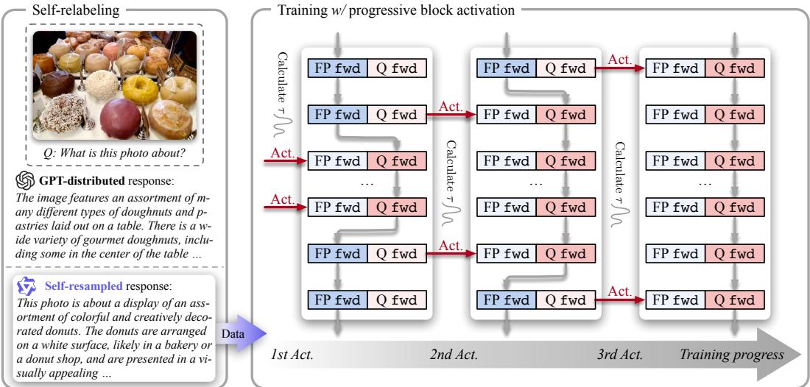  
Figure 2: Overview of the proposed ProQuant. Left: examples of responses from GPT-4 [Bubeck et al., 2023] and re-sampled via the SRL scheme (Section 3.1) using Qwen3-VL-2B-Instruct (see more details in Appendix B). Right: QAT with the PBA mechanism, where quantization is first activated for decoding layers with the larger vision-sensitivity factor τ . As training proceeds, quantization is gradually enabled for the remaining layers in descending order of τ (Section 3.2).

## 2.2 Quantization-aware training for (M)LLMs.

QAT can further improve quantized models’ accuracy beyond PTQ, particularly under low-bit settings. LLM-QAT [Liu et al., 2023] pioneers the QAT paradigm for language transformers. Efficient-QAT [Chen et al., 2025b] improves training efficiency via block-wise initialization of quantization parameters. BitDistiller [Du et al., 2024] and SPEED-Q [Guo et al., 2025] investigate knowledge distillation within the quantization context. Other learning-based works [Wang et al., 2024a; Xie et al., 2024] enhance quantized performance by exploiting cross-layer dependencies and refining the data corpus, respectively. However, except for LLM-QAT, the above methods primarily target weight-only quantization. To the best of our knowledge, no previous work has systematically explored weight-activation quantization for MLLMs. See Appendix A.1 for more details.

## 3 ProQuant

In this section, we present ProQuant, a dedicated QAT framework for MLLMs that improves both the fine-tuning data distribution and the training pipeline. Specifically, 1) to obtain high-quality fine-tuning data that are closely aligned with the pre-training distribution, we discard the original labels in open-source MM datasets and resample responses from the model to quantize. Then, 2) We adopt a disentangled view of MM understanding and language modeling in MLLMs, and prioritize recovering MM understanding first via the proposed PBA mechanism. The vision-sensitive modules in the LLM backbone are identified using our proposed factor ⃗τ .

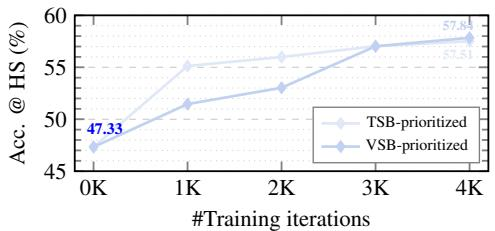  
(a) Language modeling capability.

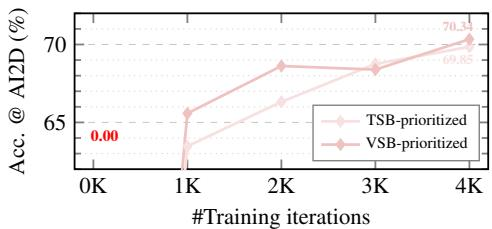  
(b) MM understanding capability.  
Figure 3: Accuracy of Qwen3-VL-2B-Instruct W4A8 checkpoints on HellaSwag [Zellers et al., 2019] (left) and AI2D [Kembhavi et al., 2016] (right) benchmarks over training iterations.

## 3.1 Data Augmentation via Self-Relabeling

SRL scheme. To align the distribution of the limited fine-tuning data with the pretrained data distribution, we resample responses for open-source MM datasets, which we refer to as the SRL scheme. Specifically, we re-generate responses with the target model using default sampling parameters until reaching either the [EOS] token or the maximum generation length. In Figure 2 (left), We present responses of GPT-4 [Bubeck et al., 2023] and Qwen3-VL-2B-Instruct triggered by prompts from the COCO caption dataset [Liu et al., 2024b]. The two sets of responses exhibit distinct styles, suggesting a distribution gap between the original labels and the target-model outputs. In particular, GPT-style [Bubeck et al., 2023] captions tend to be more literal and position-aware (e.g., “in the center ofthe table”), whereas the Qwen-series MLLMs [Bai et al., 2025a] produce captions that are more holistic, semantically enriched, and interpretive (e.g., “creatively decorated donuts”). Such a stylistic mismatch can introduce inconsistent supervision during training, and the resampled distribution better aligns with the pretrained data distribution of models to quantize.

Effectiveness of SRL. We further evaluate quantized models trained on datasets produced by different labelers in Section 4.3. The results show that self-generated labels consistently achieve the best performance, outperforming both a stronger closed-source labeler and a homogeneous larger labeler. Appendix D.4 further compares target-model likelihood, vocabulary coverage, response length, formatting, and semantic similarity on paired cases. These analyses support target-distribution alignment beyond a single stylistic factor and characterize the limits of cross-model label transfer.

## 3.2 QAT with Progressive Block Activation

Motivation. Quantization degrades both MM understanding and language modeling in MLLMs, making QAT substantially more challenging than for text-only LLMs [Liu et al., 2023; Chen et al., 2025b]. Naive QAT attempts to recover these two capabilities jointly, yet yields suboptimal results (see Section 4 for details). We therefore decouple MM understanding and language modeling during training via the proposed PBA mechanism. As illustrated in Figure 3, initial evaluations of the round-to-nearest baseline (0-th iteration) reveal a stark performance disparity: while the quantized backbone retains a non-trivial linguistic prior (47.33% accuracy on HellaSwag), its MM understanding collapses entirely (0% on AI2D). This phenomenon suggests that cross-modal alignment is significantly more vulnerable to quantization noise than the model’s intrinsic generative inertia. Since MM understanding is the prerequisite anchor for grounded reasoning, we propose to prioritize the restoration of the MM understanding path before progressively refining the more text-sensitive modules.

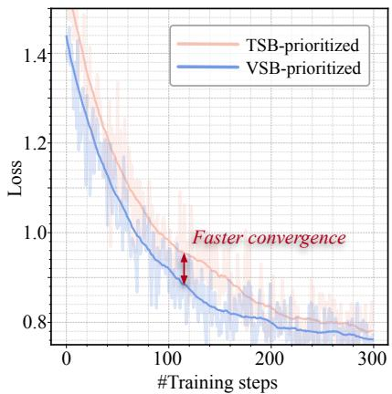  
Figure 4: Loss trajectories of TSB/VSBprioritized QAT over the first 300 steps.

Vision sensitivity guided PBA mechanism. We propose PBA to prioritize quantization recovery for the vision-sensitive blocks (VSBs) in the LLM backbone. To identify VSBs, we introduce a vision-sensitivity factor ⃗τ . Specifically, for the i-th block, we denote the output gradient as $\mathbf { G } ^ { i } = \left\lceil \mathbf { G } _ { v } ^ { i } ; \mathbf { G } _ { t } ^ { i } \right\rceil \in \mathbb { R } ^ { K \times N }$ , where $\mathbf { G } _ { v } ^ { i } \in \mathbb { R } ^ { K _ { v } \times N }$ and $\mathbf { G } _ { t } ^ { i } \in \mathbb { R } ^ { K _ { t } \times N }$ correspond to the gradients of vision and text tokens, respectively. We define the vision-sensitivity factor $\tau ^ { i }$ as the ratio between the average token-wise gradient magnitude over vision tokens and that over all tokens, i.e.,

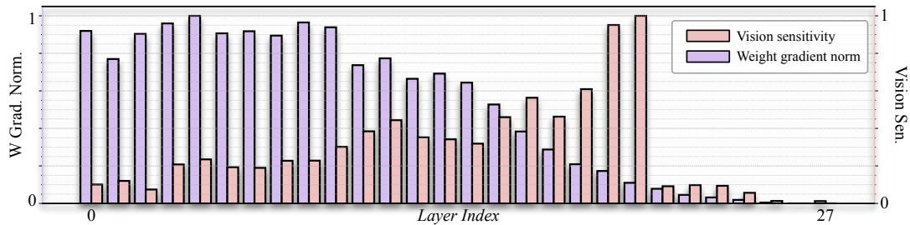  
Figure 5: Normalized vision sensitivity $\vec { \tau }$ and weight gradient norm $\| \mathbf G _ { w } \| _ { \ell _ { 1 } }$ across decoding layers.

$$
\tau ^ { i } = \frac { K } { K _ { v } } \frac { \sum _ { k = 1 } ^ { K _ { v } } \left. \mathbf { G } _ { v } ^ { i } [ k , : ] \right. _ { \ell _ { 1 } } } { \sum _ { j = 1 } ^ { K } \left. \mathbf { G } ^ { i } [ j , : ] \right. _ { \ell _ { 1 } } } .\tag{1}
$$

Figure 5 visualizes $\vec { \tau } = \left\lceil \tau ^ { 0 } , \tau ^ { 1 } , \dots , \tau ^ { L - 1 } \right\rceil$ as red bars for Qwen3-VL-2B-Instruct with $L = 2 8$ decoding layers. We observe that VSBs are concentrated in the middle layers, whereas text-sensitive blocks (TSBs) are more prevalent in both shallow and deep layers. Accordingly, we schedule the quantization activation points such that VSBs are quantized first, and TSBs are gradually enabled later in training. This process is illustrated in Figure 2 (right).

Effectiveness of τ. We demonstrate the effectiveness of the proposed vision-sensitivity factor $\vec { \tau }$ from two perspectives: convergence behavior and checkpoint performance. We first compare the loss trajectories of the first 300 training steps under TSB-prioritized and VSB-prioritized schedules in Figure 4. The VSB-prioritized schedule converges faster, indicating that prioritizing multimodal understanding is beneficial for optimization. We further report checkpoint performance from 0K to 4K iterations in Figure 3. As shown in Figure 3a, the VSB-prioritized schedule restores language modeling more slowly at early stages than the TSB-prioritized one, but surpasses it by 4K iterations. Meanwhile, in Figure 3b, the VSB-prioritized schedule recovers MM understanding substantially faster and outperforms the TSB-prioritized schedule at nearly all checkpoints. Overall, ⃗τ-guided PBA effectively prioritizes the recovery of MM understanding over language modeling, leading to faster early-stage convergence and better final performance.

Effectiveness of PBA. We further validate the effectiveness of PBA by comparing the full training trajectories in Figure 6 against a naive QAT baseline. Under both W4A8 and W4A4 settings, PBA approaches the pre-trained loss level more rapidly during the warm-up stage. Once new block quantization is activated, the loss quickly descends below the naive baseline, despite tolerable spikes naturally introduced by the staged quantization. In the subsequent post-hoc recovery stage, PBA attains a better optimum as well. This advantage is further corroborated by the performance gains reported in Section 4.

## 4 Experiments

## 4.1 Implementation Details

Models and datasets. We conduct experiments on small-scale models, including Qwen3-VL-2B-Instruct [Bai et al., 2025a], Qwen2.5-VL-3B-Instruct [Bai et al., 2025b], and Qwen2-VL-2B-Instruct [Wang et al., 2024b]. To demonstrate the generalization of ProQuant, we further extend our evaluation to a large model, Qwen3-VL-8B-Instruct. The training data are adapted from LLaVA-680K [Liu et al., 2024b].

Baselines. We compare the proposed ProQuant with strong PTQ and QAT baselines. Specifically, we consider outlier-smoothing methods, including MBQ [Li et al., 2025b] and SmoothQuant [Xiao et al., 2023], the rotation-assisted approach MQuant [Yu et al., 2025], as well as the QAT solution LLM-QAT [Liu et al., 2023]. PTQ baselines use their official implementations and paper configurations. We adapt LLM-QAT to multimodal inputs using the same training data, budget, and optimization settings as ProQuant; the marked W4A4 cases retain 8-bit down\_proj activations. Further implementation details are provided in Appendix C.

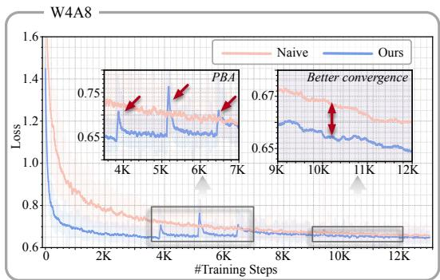

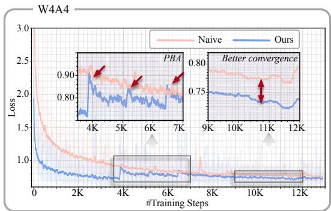  
Figure 6: Training loss comparison of Qwen3-VL-2B-Instruct between naive QAT and ProQuant under W4A8 and W4A4. PBA exhibits faster warm-up convergence toward the pre-trained level, rapid recovery during PBA, and better final convergence.

Table 1: Weight-activation quantization results for Qwen VL series. The headers represent model architectures, bitwidth, quantization methods, AI2D, ChartQA, DocVQA, MMMU, ScienceQA, SeedBench, TextVQA, average accuracy, and MME scores, respectively. The superscript † indicates down\_proj activations are quantized to 8-bit under W4A4 settings.
<table><tr><td>Arch</td><td>#BW</td><td>Method</td><td>AI2D</td><td>ChQ</td><td>DocV</td><td>M3U</td><td>SciQ</td><td>Seed</td><td>TxtV</td><td>Avg. (↑)</td><td>MME</td></tr><tr><td rowspan="6">Oe-V--2B</td><td>BF16</td><td></td><td>70.04</td><td>72.16</td><td>89.40</td><td>39.89</td><td>74.23</td><td>69.98</td><td>79.38</td><td>70.73</td><td>1870.19</td></tr><tr><td rowspan="5">W4A8</td><td>SmoothQ</td><td>62.66</td><td>53.68</td><td>76.59</td><td>34.00</td><td>66.47</td><td>63.20</td><td>69.17</td><td>60.82</td><td>1736.61</td></tr><tr><td>MBQ</td><td>65.12</td><td>62.08</td><td>79.76</td><td>35.22</td><td>68.99</td><td>64.64</td><td>71.91</td><td>63.96</td><td>1810.68</td></tr><tr><td>MQuant</td><td>67.36</td><td>70.44</td><td>87.39</td><td>38.33</td><td></td><td></td><td>77.72</td><td></td><td></td></tr><tr><td>LLM-QAT</td><td>66.94</td><td>68.20</td><td>87.14</td><td>35.56</td><td>69.37</td><td>68.27</td><td>77.94</td><td>67.63</td><td>1931.70</td></tr><tr><td>ProQuant</td><td>69.30</td><td>70.32</td><td>88.10</td><td>39.00</td><td>72.79</td><td>69.19</td><td>78.60</td><td>69.61</td><td>1830.28</td></tr><tr><td rowspan="4"></td><td rowspan="2">W4A4</td><td>MBQ</td><td>2.17</td><td>0.00</td><td>0.00</td><td>23.67</td><td>1.53</td><td>8.38</td><td>0.00</td><td>5.11</td><td>55.41</td></tr><tr><td>MQuant</td><td>11.30</td><td>0.36</td><td>0.16</td><td>12.56</td><td></td><td></td><td>0.18</td><td></td><td></td></tr><tr><td>LLM-QAT†</td><td>29.95</td><td>39.68</td><td>66.74</td><td>27.56</td><td>43.10</td><td>40.68</td><td>69.94</td><td>45.38</td><td></td><td>1532.13</td></tr><tr><td>ProQuant</td><td>40.97</td><td>47.32</td><td>72.27</td><td>30.11</td><td>56.99</td><td>61.07</td><td>72.40</td><td></td><td>54.45</td><td>1611.94</td></tr><tr><td rowspan="5">w-.-3B</td><td rowspan="5">BF16 W4A8</td><td>-</td><td>78.63</td><td>83.32</td><td>92.50</td><td>47.00</td><td>83.33</td><td>70.94</td><td>78.61</td><td>76.33</td><td>2149.00</td></tr><tr><td>SmoothQ MBQ</td><td>71.83 73.87</td><td>74.36</td><td>79.65</td><td>40.44</td><td>73.92</td><td>66.90</td><td>63.91</td><td>67.29</td><td>2063.23</td></tr><tr><td>LLM-QAT</td><td>54.86</td><td>79.24</td><td>88.44</td><td>40.44</td><td>77.18</td><td>69.27</td><td>74.00</td><td>71.78</td><td>2049.63</td></tr><tr><td>ProQuant</td><td>77.27</td><td>72.76 82.68</td><td>62.58 91.26</td><td>33.00 44.11</td><td>53.24</td><td>49.07</td><td>71.35</td><td>56.69</td><td>1939.38</td></tr><tr><td></td><td></td><td></td><td></td><td></td><td>81.61</td><td>70.80</td><td>78.21</td><td>75.13</td><td>2083.30</td></tr><tr><td rowspan="3"></td><td>W4A4</td><td>MBQ LLM-QAT†</td><td>0.94 0.00</td><td>0.51</td><td>24.33</td><td>0.87</td><td></td><td>5.35</td><td>0.02</td><td>4.57</td><td>11.24</td></tr><tr><td></td><td>ProQuant</td><td>31.22 48.48</td><td>44.96 51.00</td><td>66.40 64.53</td><td>27.56 30.67</td><td>45.84 61.64</td><td>24.99 61.56</td><td>64.75 67.65</td><td>43.67</td><td>1090.88</td></tr><tr><td>BF16 -</td><td></td><td></td><td></td><td></td><td></td><td></td><td></td><td></td><td>55.08</td><td>1520.12</td></tr><tr><td rowspan="5">wV--2B</td><td rowspan="5">W4A8</td><td></td><td>73.25</td><td>79.56</td><td>92.70</td><td>38.78</td><td>79.58</td><td>72.26</td><td>79.26</td><td>73.63</td><td>2029.18</td></tr><tr><td>SmoothQ MBQ</td><td>48.64 50.62</td><td>61.08 67.44</td><td>80.84</td><td>33.00</td><td>40.18</td><td>64.91</td><td>64.82</td><td>56.21</td><td>1834.91</td></tr><tr><td>LLM-QAT</td><td>60.52</td><td>65.88</td><td>84.20</td><td>32.78</td><td>50.51</td><td>65.75</td><td>69.40</td><td>60.10</td><td>1758.88</td></tr><tr><td></td><td></td><td></td><td>86.11</td><td>38.89</td><td>69.02</td><td>67.45</td><td>73.71</td><td>65.94</td><td>1962.77</td></tr><tr><td>ProQuant</td><td>71.34</td><td>75.44</td><td>91.10</td><td>41.22</td><td>78.73</td><td>71.90</td><td>78.08</td><td>72.54</td><td>1962.04</td></tr><tr><td rowspan="3">W4A4</td><td></td><td>MBQ</td><td>5.18</td><td>0.00</td><td>0.10</td><td>25.56</td><td>6.65</td><td>7.03</td><td>0.08</td><td>6.37</td><td>0.00</td></tr><tr><td rowspan="2"></td><td>LLM-QAT†</td><td>19.95</td><td>28.68</td><td>25.39</td><td>26.33</td><td>30.91</td><td>15.94</td><td>43.82</td><td>27.29</td><td>764.33</td></tr><tr><td>ProQuant</td><td>54.86</td><td>54.12</td><td>73.23</td><td>33.11</td><td>64.84</td><td>67.47</td><td>71.18</td><td>59.83</td><td>1652.63</td></tr></table>

Evaluation. To evaluate quantized models, we report results on a diverse suite of benchmarks built on LMMs-Eval [Zhang et al., 2024]: MME [Fu et al., 2023] for comprehensive multi-modal evaluation; AI2D [Kembhavi et al., 2016] and TextVQA for text recognition; ChartQA [Masry et al., 2022] for chart parsing; DocVQA [Mathew et al., 2021] for document understanding; MMMU [Yue et al., 2024] and ScienceQA [Lu et al., 2022] for visual reasoning; and SeedBench [Li et al., 2023a] for spatial–temporal image/video understanding.

Table 2: W8A8 quantization results on three model backbones. Values in red denote the corresponding fullprecision (BF16) performance.
<table><tr><td>Method</td><td>AI2D</td><td>ChQ</td><td>DocV</td><td>M3U</td><td>SciQ</td><td>Seed</td><td>TxtV</td><td>Avg. (↑)</td><td>MME</td></tr><tr><td colspan="9">Qwen2-VL-2B-Instruct</td><td>1870.19</td></tr><tr><td>MBQ</td><td>69.88</td><td>72.28</td><td>86.89</td><td>39.33</td><td>74.09</td><td>68.82</td><td>77.13</td><td>69.77</td><td>1884.59</td></tr><tr><td>ProQuant</td><td>69.66</td><td>72.08</td><td>88.91</td><td>38.89</td><td>73.21</td><td>69.88</td><td>79.34</td><td>70.28</td><td>1864.33</td></tr><tr><td colspan="9">Qwen2.5-VL-3B-Instruct</td><td>76.33 2149.00</td></tr><tr><td>MBQ</td><td>78.27</td><td>83.00</td><td>92.69</td><td>46.78</td><td>82.55</td><td>71.12</td><td>78.60</td><td>76.14</td><td>2156.88</td></tr><tr><td>ProQuant</td><td>78.30</td><td>83.52</td><td>92.25</td><td>48.11</td><td>82.34</td><td>71.08</td><td>78.42</td><td>76.29</td><td>2102.85</td></tr><tr><td colspan="9">Qwen3-VL-2B-Instruct</td><td>73.63 2029.18</td></tr><tr><td>MBQ</td><td>75.00</td><td>79.96</td><td>92.80</td><td>38.99</td><td>79.56</td><td>71.98</td><td>79.35</td><td>73.95</td><td>2009.60</td></tr><tr><td>ProQuant</td><td>72.25</td><td>78.64</td><td>92.35</td><td>39.22</td><td>76.75</td><td>72.28</td><td>78.65</td><td>72.88</td><td>1996.02</td></tr></table>

## 4.2 Performance Analysis

## 4.2.1 Performance under W4A8 & W4A4 quantization.

We report the performance of quantized models on a diverse set of MM benchmarks in Table 1. Overall, ProQuant consistently outperforms both PTQ and QAT baselines across all model backbones and quantization settings, with the advantage becoming especially significant in the more aggressive W4A4 regime.

Under W4A8 quantization, ProQuant preserves the performance of the full-precision models remarkably well. Across all three backbones, the average accuracy of ProQuant remains within approximately one point of the BF16 counterparts (i.e., around ∼ 1% absolute degradation), indicating near-lossless quantization in this setting. In contrast, existing PTQ and QAT baselines exhibit noticeably larger drops on multiple benchmarks, even when their performance is competitive on a subset of metrics.

The performance gap becomes much larger under W4A4 quantization. In this regime, PTQ baselines (e.g., MBQ and MQuant) largely collapse, with near-zero or extremely low scores on multiple benchmarks, indicating that they fail to maintain usable multi-modal reasoning and perception abilities at 4-bit activation quantization. The LLM-QAT baseline is substantially more robust than PTQ, but still suffers severe degradation; in particular, it can only maintain reasonable performance when down\_proj activations are kept at 8-bit. Even with this relaxation, its performance remains far below ProQuant in most cases.

## 4.2.2 Performance under W8A8 quantization.

Under the relatively mild W8A8 setting, both PTQ approaches and ProQuant achieve performance comparable to BF16 across all three backbones, indicating that strong PTQ methods are already sufficient in this regime and that the extra training cost of QAT offers limited cost-effectiveness. In contrast, the advantage of ProQuant becomes much more pronounced in lower-bit settings (e.g., W4A8/W4A4) as demonstrated in Table 1, making it more suitable for aggressive low-bit quantization where performance preservation is substantially more challenging.

## 4.2.3 Compatibility on weight-only quantization.

Results in Table 3 show that ProQuant generalizes well beyond W/A quantization and remains effective in weight-only (group-wise) quantization settings. Specifically, under both W4g128 and the more aggressive W3g128 configurations, ProQuant consistently outperforms the PTQ baseline on all benchmarks and yields clear gains in both average accuracy and MME. The advantage is particularly significant at W3g128, where MBQ suffers severe degradation while ProQuant still preserves strong MM performance, demonstrating the robustness and generalizability of our method to low-bit weight-only quantization.

## 4.2.4 Scale to large models.

Results on Qwen3-VL-8B-Instruct in Table 4 show that ProQuant generalizes well beyond the small-sized models targeted in our main experiments. It remains highly effective on this large backbone, consistently outperforming the PTQ baseline under both W4A8 and W4A4 quantization. In particular, ProQuant preserves near-full-precision performance at W4A8 and maintains strong MM capability even under the aggressive W4A4 setting, while MBQ collapses. These results demonstrate the strong scalability and generalization ability of ProQuant across model sizes.

Table 3: Weight-only quantization results of MBQ and ProQuant under W4g128 and W3g128 settings.
<table><tr><td>#BW</td><td>Method</td><td>AI2D</td><td>ChQ</td><td>DocV</td><td>M3U</td><td>SciQ</td><td>Seed</td><td>TxtV</td><td>Avg. (↑)</td><td>MME</td></tr><tr><td rowspan="2">W4g128</td><td>MBQ</td><td>64.35</td><td>74.88</td><td>91.23</td><td>36.67</td><td>68.57</td><td>70.22</td><td>76.94</td><td>68.98</td><td>1955.42</td></tr><tr><td>ProQuant</td><td>71.76</td><td>76.44</td><td>91.26</td><td>38.67</td><td>77.08</td><td>72.11</td><td>77.97</td><td>72.18</td><td>1958.53</td></tr><tr><td rowspan="2">W3g128</td><td>MBQ</td><td>32.25</td><td>61.00</td><td>76.21</td><td>28.00</td><td>46.59</td><td>62.91</td><td>65.48</td><td>53.21</td><td>1350.49</td></tr><tr><td>ProQuant</td><td>65.90</td><td>71.92</td><td>88.29</td><td>35.67</td><td>68.45</td><td>70.23</td><td>75.60</td><td>68.01</td><td>1922.82</td></tr></table>

Table 4: W/A quantization results on Qwen3-VL-8B-Instruct.
<table><tr><td>#BW</td><td>Method</td><td>AI2D</td><td>ChQ</td><td>DocV</td><td>M3U</td><td>SciQ</td><td>Seed</td><td>TxtV</td><td>Avg. (↑)</td><td>MME</td></tr><tr><td>FP</td><td></td><td>83.71</td><td>84.80</td><td>95.53</td><td>50.22</td><td>92.88</td><td>75.31</td><td>82.48</td><td>80.70</td><td>2381.20</td></tr><tr><td rowspan="2">W4A8</td><td>MBQ</td><td>77.62</td><td>75.40</td><td>92.71</td><td>45.78</td><td>87.31</td><td>72.55</td><td>78.00</td><td>75.62</td><td>2162.47</td></tr><tr><td>ProQuant</td><td>82.19</td><td>84.12</td><td>95.20</td><td>49.33</td><td>91.44</td><td>75.16</td><td>81.18</td><td>79.80</td><td>2325.49</td></tr><tr><td rowspan="2">W4A4</td><td>MBQ</td><td>2.20</td><td>0.00</td><td>0.03</td><td>26.22</td><td>3.56</td><td>8.30</td><td>0.00</td><td>5.76</td><td>0.00</td></tr><tr><td>ProQuant</td><td>62.44</td><td>57.36</td><td>88.22</td><td>40.89</td><td>76.77</td><td>67.53</td><td>75.32</td><td>66.93</td><td>1877.45</td></tr></table>

## 4.2.5 Mixed-precision quantization.

As pointed out in QAT scaling law [Chen et al., 2025a], persistent outliers in down\_proj activations are a major bottleneck for low-bit QAT. Consistent with this observation, our mixed-precision results in Table 5 show that keeping down\_proj activations at 8-bit (W4A4†) consistently improves performance over full W4A4 quantization. Table 5: Mixed-precision quantization results on three back-

However, the gain varies substantially across backbones (e.g., +1.44, +9.39, and +3.21 Avg. points), suggesting that the benefit of mixed-precision design is relatively model-dependent. Therefore, mixedprecision quantization likely requires a more fine-grained, backbone-aware treat-

bones. The superscript † denotes the W4A4† setting, where down\_proj activations are kept at 8-bit.
<table><tr><td rowspan="2">#BW</td><td colspan="2">Qwen2-VL-2B</td><td colspan="2">Qwen2.5-VL-3B</td><td colspan="2">Qwen3-VL-2B</td></tr><tr><td>Avg.</td><td>Δ</td><td>Avg.</td><td>Δ</td><td>Avg.</td><td>Δ</td></tr><tr><td>W4A4</td><td>54.45</td><td>一</td><td>55.08</td><td>1</td><td>59.83</td><td></td></tr><tr><td>W4A4†</td><td>55.89</td><td>+1.44</td><td>64.47</td><td>+9.39</td><td>63.04</td><td>+3.21</td></tr></table>

ment. Here we provide only preliminary evidence and leave a systematic analysis to future work.

## 4.3 Ablation Study

## 4.3.1 Step-by-step ablation analysis.

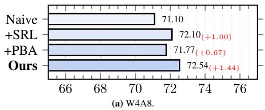

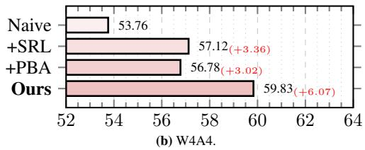  
Figure 7: The step-by-step ablation studies on SRL and PBA.

We conduct step-by-step ablation studies on Qwen3-VL-2B-Instruct under W4A8 and W4A4 settings in Figure 7. Starting from the naive QAT baseline, the proposed SRL scheme improves the average accuracy by +1.00 and +3.36 under W4A8 and W4A4, respectively, indicating that refined supervision alone already provides meaningful gains. Applying PBA to the same baseline yields gains of +0.67 and +3.02, confirming that the staged quantization strategy also contributes independently by better preserving visual-sensitive layers. Combining both components further increases the average accuracy by +1.44 and +6.07, respectively, achieving the best performance in both settings and demonstrating that SRL and PBA are complementary.

(c) SRL labeler.  
Table 7: Ablation studies on SRL labeler, PBA scheduler, and block granularity.
<table><tr><td></td><td>Avg. (↑)</td></tr><tr><td>Scheduler Cosine</td><td>71.34</td></tr><tr><td>Linear</td><td>71.00</td></tr><tr><td>Log. (Ours)</td><td>72.54</td></tr></table>

<table><tr><td colspan="2">(b) Block granularity</td></tr><tr><td>Blk. Granu.</td><td>Avg. (↑)</td></tr><tr><td> $0 . 5 \times \theta _ { \mathrm { D e c L a y e r } }$ </td><td>72.15</td></tr><tr><td> $2 \times \theta _ { \mathrm { D e c L a y e r } }$ </td><td>70.28</td></tr><tr><td> $1 \times \theta _ { \mathrm { D e c L a y e r } }$  </td><td>72.54</td></tr></table>

<table><tr><td>Labeler</td><td>W4A8</td><td>W4A4</td></tr><tr><td>GPT-4</td><td>71.77</td><td>56.78</td></tr><tr><td>Self (Ours)</td><td>72.54</td><td>59.83</td></tr><tr><td>Homo. 8B</td><td>72.35</td><td>59.04</td></tr></table>

## 4.3.2 Ablation on block activation metric.

Table 6 compares different metrics and priors for block quantization activation priority. A random selection yields an average accuracy of 71.88, serving as a baseline. We evaluate the performance by taking the weight gradients norm $\| \mathbf G _ { w } \| _ { \ell _ { 1 } }$ as an activation metric. As plotted in Figure 5, early layers have larger $\| \mathbf G _ { w } \| _ { \ell _ { 1 } }$ than that of deep layers. Therefore, $\| \dot { \mathbf { G } } _ { w } \| _ { \ell _ { 1 } }$ (Higher) $( \lVert \mathbf { G } _ { w } \rVert _ { \ell _ { 1 } } \left( \mathrm { L o w e r } \right) )$ in Table 6 activates layers from early to deep layers (from deep to shallow layers) approximately. With our vision-sensitivity factor τ , the lower-prior setting (TSB-prioritized) is slightly weaker, whereas prioritizing higher-τ blocks (VSB-prioritized) achieves the best result. Overall, these results validate that τ is a more effective criterion for PBA, and that allocating higher priority to the most VSBs is crucial for maximizing performance.

Table 6: Ablation studies on block activation metric
<table><tr><td>Metric</td><td>Prior</td><td>Avg. (↑)</td></tr><tr><td>Random</td><td></td><td>71.88</td></tr><tr><td> $\| \mathbf G _ { w } \| _ { \ell _ { 1 } }$ </td><td>Lower</td><td>72.10</td></tr><tr><td> $\| \mathbf { G } _ { \underset {  } { w } } \| _ { \ell _ { 1 } }$ </td><td>Higher</td><td>72.19</td></tr><tr><td>7</td><td>Lower</td><td>72.03</td></tr><tr><td>τ (Ours)</td><td>Higher</td><td>72.54</td></tr></table>

## 4.3.3 Ablation on PBA scheduler.

As shown in Table 7a, we test the PBA scheduler across 3 different annealing functions, which are Cosine, Linear, and Logarithm, respectively. Taking Qwen3-VL-2B-Instruct with 28 decoding layers as an example, we employ the Logarithm functionalized scheduler, which activates 50%, 75%, 88%, and 100% layers as training progresses. Training iterations within each stage are empirically set to ∼10% of total iterations, with the remaining budgets assigned to warmup and post-hoc recovery. Our ablation study demonstrates that Logarithm scheduler, which activates more blocks at early stages, yields better performance than Cosine and Linear functions.

## 4.3.4 Ablation on block granularity.

We explore how the block splitting strategy affects performance. Table 7b shows that treating each decoding layer as a single activation unit $( 1 \times \theta _ { \mathrm { D e c L a y e r } } )$ yields the best accuracy. $0 . 5 \times \theta _ { \mathrm { D e c L a y e r } }$ treats the attn and ffn modules as separate units, which can trigger asynchronous quantization activation within the same layer and thus hurts performance. $2 \times \theta _ { \mathrm { D e c L a y e r } }$ leads to severe degradation, suggesting that overly coarse granularity has detrimental side effects. One reason is that coarse units may mix blocks with substantially different vision sensitivity, forcing them to share the same activation schedule. As a result, quantization may be enabled too early for less robust components or too late for truly vision-critical ones, weakening the intended MM-understanding-first recovery. This is consistent with Figure 5, where consecutive layers can exhibit large variations in visual sensitivity.

## 4.3.5 Ablation on SRL labeler.

We conduct experiments on Qwen3-VL-2B-Instruct with dataset labeled by a closed-source stronger model GPT-4 [Liu et al., 2024b], self (Qwen3-VL-2B-Instruct) and homogeneous larger model (Homo. 8B‡, Qwen3-VL-8B-Instruct). Results in Table 7c show that both self and homogeneous larger models outperform the distribution-mismatched GPT-4 labeler by a large margin. Furthermore, self-annotated datasets are better aligned with the target distribution and yield the best results. The extended labeler comparison and distribution diagnostics in Appendix D.4 show that self-labels outperform same-family and cross-family alternatives. Per-model relabeling remains preferable when its generation cost is acceptable.

## 4.4 Hardware Efficiency on Edge Accelerator

To assess edge deployment, we evaluate a silicon-proven TSMC 22 nm ASIC using measured on-chip latency and average power, off-chip DRAM simulation, and an end-to-end cycle-accurate accelerator model. The boundary covers the accelerator and DRAM accesses. Across three backbones, ProQuant achieves up to 3.64× prefill speedup and 5.64× energy reduction. Appendix E.2 documents the setup and measurement methodology; Appendices E.3 and E.4 report results across precisions and token configurations.

## 5 Conclusion

In this paper, we present ProQuant, a weight-activation QAT framework tailored for low-bit quantization of small-scale MLLMs. To mitigate data mismatch under limited fine-tuning budgets, we introduced an SRL scheme that re-annotates open-source MM datasets using the target model, yielding supervision that more closely aligns with the model’s distribution. To address the coupled degradation of MM understanding and language modeling, we proposed a PBA mechanism that prioritizes recovering MM understanding first, guided by a vision-sensitivity factor ⃗τ for identifying MM-critical layers. Extensive evaluations on diverse MM benchmarks and models demonstrate that ProQuant achieves near-lossless accuracy under W4A8 and remains robust where PTQ method collapse at W4A4. We expect ProQuant to facilitate hardware-friendly deployment of MLLMs on resource-constrained edge platforms.

## Acknowledgments and Disclosure of Funding

We thank the anonymous reviewers for their constructive feedback. This work received no external funding or third-party support. The authors declare no competing interests.

## References

Shuai Bai, Yuxuan Cai, Ruizhe Chen, Keqin Chen, Xionghui Chen, Zesen Cheng, Lianghao Deng, Wei Ding, Chang Gao, Chunjiang Ge, Wenbin Ge, Zhifang Guo, Qidong Huang, Jie Huang, Fei Huang, Binyuan Hui, Shutong Jiang, Zhaohai Li, Mingsheng Li, Mei Li, Kaixin Li, Zicheng Lin, Junyang Lin, Xuejing Liu, Jiawei Liu, Chenglong Liu, Yang Liu, Dayiheng Liu, Shixuan Liu, Dunjie Lu, Ruilin Luo, Chenxu Lv, Rui Men, Lingchen Meng, Xuancheng Ren, Xingzhang Ren, Sibo Song, Yuchong Sun, Jun Tang, Jianhong Tu, Jianqiang Wan, Peng Wang, Pengfei Wang, Qiuyue Wang, Yuxuan Wang, Tianbao Xie, Yiheng Xu, Haiyang Xu, Jin Xu, Zhibo Yang, Mingkun Yang, Jianxin Yang, An Yang, Bowen Yu, Fei Zhang, Hang Zhang, Xi Zhang, Bo Zheng, Humen Zhong, Jingren Zhou, Fan Zhou, Jing Zhou, Yuanzhi Zhu, and Ke Zhu. Qwen3-vl technical report. arXiv preprint arXiv:2511.21631, 2025a.

Bo Li, Yuanhan Zhang, Dong Guo, Renrui Zhang, Feng Li, Hao Zhang, Kaichen Zhang, Peiyuan Zhang, Yanwei Li, Ziwei Liu, et al. Llava-onevision: Easy visual task transfer. arXiv preprint arXiv:2408.03326, 2024a.

LLM-Core-Team Xiaomi. Mimo-vl technical report, 2025. URL https://arxiv.org/abs/2506. 03569.

Jinguo Zhu, Weiyun Wang, Zhe Chen, Zhaoyang Liu, Shenglong Ye, Lixin Gu, Hao Tian, Yuchen Duan, Weijie Su, Jie Shao, Zhangwei Gao, Erfei Cui, Xuehui Wang, Yue Cao, Yangzhou Liu, Xingguang Wei, Hongjie Zhang, Haomin Wang, Weiye Xu, Hao Li, Jiahao Wang, Nianchen Deng, Songze Li, Yinan He, Tan Jiang, Jiapeng Luo, Yi Wang, Conghui He, Botian Shi, Xingcheng Zhang, Wenqi Shao, Junjun He, Yingtong Xiong, Wenwen Qu, Peng Sun, Penglong Jiao, Han Lv, Lijun Wu, Kaipeng Zhang, Huipeng Deng, Jiaye Ge, Kai Chen, Limin Wang, Min Dou, Lewei Lu, Xizhou Zhu, Tong Lu, Dahua Lin, Yu Qiao, Jifeng Dai, and Wenhai Wang. Internvl3: Exploring advanced training and test-time recipes for open-source multimodal models, 2025. URL https://arxiv.org/abs/2504.10479.

Zhiyu Wu, Xiaokang Chen, Zizheng Pan, Xingchao Liu, Wen Liu, Damai Dai, Huazuo Gao, Yiyang Ma, Chengyue Wu, Bingxuan Wang, Zhenda Xie, Yu Wu, Kai Hu, Jiawei Wang, Yaofeng Sun,

Yukun Li, Yishi Piao, Kang Guan, Aixin Liu, Xin Xie, Yuxiang You, Kai Dong, Xingkai Yu, Haowei Zhang, Liang Zhao, Yisong Wang, and Chong Ruan. Deepseek-vl2: Mixture-of-experts vision-language models for advanced multimodal understanding, 2024. URL https://arxiv. org/abs/2412.10302.

Ovis-Embedding Team. Ovis-embedding: Pushing the frontiers of universal omni-modal embeddings. arXiv preprint arXiv:2609.25165, 2026.

Yanping Li, Wei Zhou, Yawen Liu, Yibo Wang, Ke Zhu, Guangda Huzhang, Qing-Guo Chen, Zhao Xu, Jun Zhang, and Wei Wei. Pace: Progressive angular-to-norm contrastive embedding. arXiv preprint arXiv:2609.15152, 2026a.

Xiaoyu Tian, Junru Gu, Bailin Li, Yicheng Liu, Yang Wang, Zhiyong Zhao, Kun Zhan, Peng Jia, Xianpeng Lang, and Hang Zhao. Drivevlm: The convergence of autonomous driving and large vision-language models. arXiv preprint arXiv:2402.12289, 2024.

Joya Chen, Zhaoyang Lv, Shiwei Wu, Kevin Qinghong Lin, Chenan Song, Difei Gao, Jia-Wei Liu, Ziteng Gao, Dongxing Mao, and Mike Zheng Shou. Videollm-online: Online video large language model for streaming video. In Proceedings of the IEEE/CVF Conference on Computer Vision and Pattern Recognition, pages 18407–18418, 2024.

Yushi Huang, Zining Wang, Zhihang Yuan, Yifu Ding, Ruihao Gong, Jinyang Guo, Xianglong Liu, and Jun Zhang. Modes: Accelerating mixture-of-experts multimodal large language models via dynamic expert skipping, 2026. URL https://arxiv.org/abs/2511.15690.

Chengtao Lv, Bilang Zhang, Yang Yong, Ruihao Gong, Yushi Huang, Shiqiao Gu, Jiajun Wu, Yumeng Shi, Jinyang Guo, and Wenya Wang. Llmc+: Benchmarking vision-language model compression with a plug-and-play toolkit, 2025. URL https://arxiv.org/abs/2508.09981.

Hongjun An, Wenhan Hu, Sida Huang, Siqi Huang, Ruanjun Li, Yuanzhi Liang, Jiawei Shao, Yiliang Song, Zihan Wang, Cheng Yuan, et al. Ai flow: Perspectives, scenarios, and approaches. Vicinagearth, 3(1):1, 2026.

Jiawei Shao and Xuelong Li. Ai flow at the network edge. IEEE Network, 2025.

Cheng Yuan, Zhening Liu, Jiashu Lv, Jiawei Shao, Yufei Jiang, Jun Zhang, and Xuelong Li. Taskoriented feature compression for multimodal understanding via device-edge co-inference. IEEE Transactions on Mobile Computing, 2025.

Amir Gholami, Sehoon Kim, Zhen Dong, Zhewei Yao, Michael W Mahoney, and Kurt Keutzer. A survey of quantization methods for efficient neural network inference. In Low-power computer vision, pages 291–326. Chapman and Hall/CRC, 2022.

Guangxuan Xiao, Ji Lin, Mickael Seznec, Hao Wu, Julien Demouth, and Song Han. Smoothquant: Accurate and efficient post-training quantization for large language models. In International Conference on Machine Learning, pages 38087–38099. PMLR, 2023.

Saleh Ashkboos, Amirkeivan Mohtashami, Maximilian L Croci, Bo Li, Martin Jaggi, Dan Alistarh, Torsten Hoefler, and James Hensman. Quarot: Outlier-free 4-bit inference in rotated llms. arXiv preprint arXiv:2404.00456, 2024.

Zechun Liu, Changsheng Zhao, Igor Fedorov, Bilge Soran, Dhruv Choudhary, Raghuraman Krishnamoorthi, Vikas Chandra, Yuandong Tian, and Tijmen Blankevoort. Spinquant: Llm quantization with learned rotations. arXiv preprint arXiv:2405.16406, 2024a.

Yushi Huang, Ruihao Gong, Jing Liu, Tianlong Chen, and Xianglong Liu. Tfmq-dm: Temporal feature maintenance quantization for diffusion models, 2024a. URL https://arxiv.org/abs/ 2311.16503.

Yushi Huang, Ruihao Gong, Xianglong Liu, Jing Liu, Yuhang Li, Jiwen Lu, and Dacheng Tao. Temporal feature matters: A framework for diffusion model quantization, 2025a. URL https: //arxiv.org/abs/2407.19547.

Ruihao Gong, Yang Yong, Shiqiao Gu, Yushi Huang, Chentao Lv, Yunchen Zhang, Xianglong Liu, and Dacheng Tao. Llmc: Benchmarking large language model quantization with a versatile compression toolkit, 2024. URL https://arxiv.org/abs/2405.06001.

Ruihao Gong, Xianglong Liu, Yuhang Li, Yunqiang Fan, Xiuying Wei, and Jinyang Guo. Pushing the limit of post-training quantization. IEEE Transactions on Pattern Analysis and Machine Intelligence, 2025.

Mengzhao Chen, Chaoyi Zhang, Jing Liu, Yutao Zeng, Zeyue Xue, Zhiheng Liu, Yunshui Li, Jin Ma, Jie Huang, Xun Zhou, et al. Scaling law for quantization-aware training. arXiv preprint arXiv:2505.14302, 2025a.

Zechun Liu, Barlas Oguz, Changsheng Zhao, Ernie Chang, Pierre Stock, Yashar Mehdad, Yangyang Shi, Raghuraman Krishnamoorthi, and Vikas Chandra. Llm-qat: Data-free quantization aware training for large language models. arXiv preprint arXiv:2305.17888, 2023.

Dayou Du, Yijia Zhang, Shijie Cao, Jiaqi Guo, Ting Cao, Xiaowen Chu, and Ningyi Xu. Bitdistiller: Unleashing the potential of sub-4-bit llms via self-distillation. arXiv preprint arXiv:2402.10631, 2024.

Yushi Huang, Ruihao Gong, Jing Liu, Yifu Ding, Chengtao Lv, Haotong Qin, and Jun Zhang. Qvgen: Pushing the limit of quantized video generative models, 2025b. URL https://arxiv.org/abs/ 2505.11497.

Mengzhao Chen, Wenqi Shao, Peng Xu, Jiahao Wang, Peng Gao, Kaipeng Zhang, and Ping Luo. Efficientqat: Efficient quantization-aware training for large language models. In Proceedings of the 63rd Annual Meeting ofthe Associationfor Computational Linguistics (Volume 1: Long Papers), pages 10081–10100, 2025b.

Tianyu Guo, Shanwei Zhao, Shiai Zhu, and Chenguang Ma. Speed-q: Staged processing with enhanced distillation towards efficient low-bit on-device vlm quantization. arXiv preprint arXiv:2511.08914, 2025.

Ji Lin, Jiaming Tang, Haotian Tang, Shang Yang, Xingyu Dang, and Song Han. Awq: Activationaware weight quantization for llm compression and acceleration. arXiv preprint arXiv:2306.00978, 2023.

Wenqi Shao, Mengzhao Chen, Zhaoyang Zhang, Peng Xu, Lirui Zhao, Zhiqian Li, Kaipeng Zhang, Peng Gao, Yu Qiao, and Ping Luo. Omniquant: Omnidirectionally calibrated quantization for large language models. arXiv preprint arXiv:2308.13137, 2023.

Xing Hu, Yuan Cheng, Dawei Yang, Zukang Xu, Zhihang Yuan, Jiangyong Yu, Chen Xu, Zhe Jiang, and Sifan Zhou. OstQuant: Refining large language model quantization with orthogonal and scaling transformations for better distribution fitting. arXiv preprint arXiv:2501.13987, 2025.

Elias Frantar, Saleh Ashkboos, Torsten Hoefler, and Dan Alistarh. Gptq: Accurate post-training quantization for generative pre-trained transformers. arXiv preprint arXiv:2210.17323, 2022.

Yuhang Li, Ruokai Yin, Donghyun Lee, Shiting Xiao, and Priyadarshini Panda. Gptaq: Efficient finetuning-free quantization for asymmetric calibration. arXiv preprint arXiv:2504.02692, 2025a.

Shiyao Li, Yingchun Hu, Xuefei Ning, Xihui Liu, Ke Hong, Xiaotao Jia, Xiuhong Li, Yaqi Yan, Pei Ran, Guohao Dai, et al. Mbq: Modality-balanced quantization for large vision-language models. In Proceedings ofthe Computer Vision and Pattern Recognition Conference, pages 4167–4177, 2025b.

Yufei Xue, Yushi Huang, Jiawei Shao, and Jun Zhang. Vlmq: Efficient post-training quantization for large vision-language models via hessian augmentation. arXiv preprint arXiv:2508.03351, 2025.

JiangYong Yu, Sifan Zhou, Dawei Yang, Shuo Wang, Shuoyu Li, Xing Hu, Chen Xu, Zukang Xu, Changyong Shu, and Zhihang Yuan. Mquant: Unleashing the inference potential of multimodal large language models via full static quantization. arXiv preprint arXiv:2502.00425, 2025.

Changyuan Wang, Ziwei Wang, Xiuwei Xu, Yansong Tang, Jie Zhou, and Jiwen Lu. Q-vlm: Post-training quantization for large vision-language models. arXiv preprint arXiv:2410.08119, 2024a.

Jingjing Xie, Yuxin Zhang, Mingbao Lin, Liujuan Cao, and Rongrong Ji. Advancing multimodal large language models with quantization-aware scale learning for efficient adaptation. In Proceedings of the 32nd ACM International Conference on Multimedia, pages 10582–10591, 2024.

Sébastien Bubeck, Varun Chandrasekaran, Ronen Eldan, Johannes Gehrke, Eric Horvitz, Ece Kamar, Peter Lee, Yin Tat Lee, Yuanzhi Li, Scott Lundberg, et al. Sparks of artificial general intelligence: Early experiments with gpt-4. arXiv preprint arXiv:2303.12712, 2023.

Haotian Liu, Chunyuan Li, Yuheng Li, and Yong Jae Lee. Improved baselines with visual instruction tuning. In Proceedings of the IEEE/CVF Conference on Computer Vision and Pattern Recognition, pages 26296–26306, 2024b.

Rowan Zellers, Ari Holtzman, Yonatan Bisk, Ali Farhadi, and Yejin Choi. Hellaswag: Can a machine really finish your sentence? In Proceedings of the 57th annual meeting of the association for computational linguistics, pages 4791–4800, 2019.

Aniruddha Kembhavi, Mike Salvato, Eric Kolve, Minjoon Seo, Hannaneh Hajishirzi, and Ali Farhadi. A diagram is worth a dozen images. In European conference on computer vision, pages 235–251. Springer, 2016.

Shuai Bai, Keqin Chen, Xuejing Liu, Jialin Wang, Wenbin Ge, Sibo Song, Kai Dang, Peng Wang, Shijie Wang, Jun Tang, Humen Zhong, Yuanzhi Zhu, Mingkun Yang, Zhaohai Li, Jianqiang Wan, Pengfei Wang, Wei Ding, Zheren Fu, Yiheng Xu, Jiabo Ye, Xi Zhang, Tianbao Xie, Zesen Cheng, Hang Zhang, Zhibo Yang, Haiyang Xu, and Junyang Lin. Qwen2.5-vl technical report. arXiv preprint arXiv:2502.13923, 2025b.

Peng Wang, Shuai Bai, Sinan Tan, Shijie Wang, Zhihao Fan, Jinze Bai, Keqin Chen, Xuejing Liu, Jialin Wang, Wenbin Ge, Yang Fan, Kai Dang, Mengfei Du, Xuancheng Ren, Rui Men, Dayiheng Liu, Chang Zhou, Jingren Zhou, and Junyang Lin. Qwen2-vl: Enhancing vision-language model’s perception of the world at any resolution. arXiv preprint arXiv:2409.12191, 2024b.

Kaichen Zhang, Bo Li, Peiyuan Zhang, Fanyi Pu, Joshua Adrian Cahyono, Kairui Hu, Shuai Liu, Yuanhan Zhang, Jingkang Yang, Chunyuan Li, and Ziwei Liu. Lmms-eval: Reality check on the evaluation of large multimodal models, 2024. URL https://arxiv.org/abs/2407.12772.

Chaoyou Fu, Peixian Chen, Yunhang Shen, Yulei Qin, Mengdan Zhang, Xu Lin, Zhenyu Qiu, Wei Lin, Jinrui Yang, Xiawu Zheng, et al. Mme: a comprehensive evaluation benchmark for multimodal large language models. corr abs/2306.13394 (2023), 2023.

Ahmed Masry, Do Long, Jia Qing Tan, Shafiq Joty, and Enamul Hoque. ChartQA: A benchmark for question answering about charts with visual and logical reasoning. In Findings of the Association for Computational Linguistics: ACL 2022, pages 2263–2279, Dublin, Ireland, May 2022. Association for Computational Linguistics. doi: 10.18653/v1/2022.findings-acl.177. URL https://aclanthology.org/2022.findings-acl.177.

Minesh Mathew, Dimosthenis Karatzas, and CV Jawahar. Docvqa: A dataset for vqa on document images. In Proceedings of the IEEE/CVF winter conference on applications of computer vision, pages 2200–2209, 2021.

Xiang Yue, Yuansheng Ni, Kai Zhang, Tianyu Zheng, Ruoqi Liu, Ge Zhang, Samuel Stevens, Dongfu Jiang, Weiming Ren, Yuxuan Sun, Cong Wei, Botao Yu, Ruibin Yuan, Renliang Sun, Ming Yin, Boyuan Zheng, Zhenzhu Yang, Yibo Liu, Wenhao Huang, Huan Sun, Yu Su, and Wenhu Chen. Mmmu: A massive multi-discipline multimodal understanding and reasoning benchmark for expert agi. In Proceedings ofCVPR, 2024.

Pan Lu, Swaroop Mishra, Tony Xia, Liang Qiu, Kai-Wei Chang, Song-Chun Zhu, Oyvind Tafjord, Peter Clark, and Ashwin Kalyan. Learn to explain: Multimodal reasoning via thought chains for science question answering. In The 36th Conference on Neural Information Processing Systems (NeurIPS), 2022.

Bohao Li, Rui Wang, Guangzhi Wang, Yuying Ge, Yixiao Ge, and Ying Shan. Seed-bench: Benchmarking multimodal llms with generative comprehension. arXiv preprint arXiv:2307.16125, 2023a.

Wei Huang, Yangdong Liu, Haotong Qin, Ying Li, Shiming Zhang, Xianglong Liu, Michele Magno, and Xiaojuan Qi. Billm: Pushing the limit of post-training quantization for llms. arXiv preprint arXiv:2402.04291, 2024b.

Mart Van Baalen, Andrey Kuzmin, Suparna S Nair, Yuwei Ren, Eric Mahurin, Chirag Patel, Sundar Subramanian, Sanghyuk Lee, Markus Nagel, Joseph Soriaga, et al. Fp8 versus int8 for efficient deep learning inference. arXiv preprint arXiv:2303.17951, 2023.

Jinhao Li, Jiaming Xu, Shan Huang, Yonghua Chen, Wen Li, Jun Liu, Yaoxiu Lian, Jiayi Pan, Li Ding, Hao Zhou, et al. Large language model inference acceleration: A comprehensive hardware perspective. arXiv preprint arXiv:2410.04466, 2024b.

Yuxuan Sun, Ruikang Liu, Haoli Bai, Han Bao, Kang Zhao, Yuening Li, Jiaxin Hu, Xianzhi Yu, Lu Hou, Chun Yuan, et al. Flatquant: Flatness matters for llm quantization. arXiv preprint arXiv:2410.09426, 2024.

Sangjin Kim, Jungjun Oh, Byeongcheol Kim, Yuseon Choi, Gwangtae Park, and Hoi-Jun Yoo. 31.2 revolver: Low-bit genai accelerator for distilled-model and cot with phase-aware-quantization and rotation-based integer-scaled group quantization. In 2026 IEEE International Solid-State Circuits Conference (ISSCC), volume 69, pages 534–536, 2026. doi: 10.1109/ISSCC49663.2026.1140901.

Bo Liu, Zihan Zou, Xinming Yan, Xilong Kang, Xinyang Chen, Bo Hu, Jiaming Lin, Haoran Du, Jun Yang, Xin Si, and Hao Cai. A 51.6uj/token subspace-rotation-based dual-quantized large-languagemodel accelerator with fused scale-activation int datapath and rearranged bit-slice lut computation. In 2026 IEEE International Solid-State Circuits Conference (ISSCC), volume 69, pages 536–538, 2026. doi: 10.1109/ISSCC49663.2026.11409212.

Pingcheng Dong, Yonghao Tan, Xuejiao Liu, Peng Luo, Yu Liu, Di Pang, Songchen Ma, Xijie Huang, Shih-Yang Liu, Dong Zhang, Zhichao Lu, Luhong Liang, Chi-Ying Tsui, Fengbin Tu, Liang Zhao, and Kwang-Ting Cheng. 31.1 a 14.08-to-135.69token/s reram-on-logic stacked outlier-free large-language-model accelerator with block-clustered weight-compression and adaptive parallel speculative-decoding. In 2026 IEEE International Solid-State Circuits Conference (ISSCC), volume 69, pages 532–534, 2026. doi: 10.1109/ISSCC49663.2026.11409211.

Markus Nagel, Rana Ali Amjad, Mart Van Baalen, Christos Louizos, and Tijmen Blankevoort. Up or down? adaptive rounding for post-training quantization. In International Conference on Machine Learning, pages 7197–7206. PMLR, 2020.

Yuhang Li, Ruihao Gong, Xu Tan, Yang Yang, Peng Hu, Qi Zhang, Fengwei Yu, Wei Wang, and Shi Gu. Brecq: Pushing the limit of post-training quantization by block reconstruction. arXiv preprint arXiv:2102.05426, 2021.

Yoshua Bengio, Nicholas Léonard, and Aaron Courville. Estimating or propagating gradients through stochastic neurons for conditional computation. arXiv preprint arXiv:1308.3432, 2013.

Sijia Li, Yuchen Huang, Zifan Liu, Yanping Li, Jingjing Fu, Li Zhao, Jiang Bian, Ling Zhang, Jun Zhang, and Rui Wang. Gear: Granularity-adaptive advantage reweighting for llm agents via self-distillation. arXiv preprint arXiv:2605.11853, 2026b.

Woosuk Kwon, Zhuohan Li, Siyuan Zhuang, Ying Sheng, Lianmin Zheng, Cody Hao Yu, Joseph E. Gonzalez, Hao Zhang, and Ion Stoica. Efficient memory management for large language model serving with pagedattention. In Proceedings of the ACM SIGOPS 29th Symposium on Operating Systems Principles, 2023.

Zehan Li, Xin Zhang, Yanzhao Zhang, Dingkun Long, Pengjun Xie, and Meishan Zhang. Towards general text embeddings with multi-stage contrastive learning. arXiv preprint arXiv:2308.03281, 2023b.

Tianrui Guan, Fuxiao Liu, Xiyang Wu, Ruiqi Xian, Zongxia Li, Xiaoyu Liu, Xijun Wang, Lichang Chen, Furong Huang, Yaser Yacoob, et al. Hallusionbench: an advanced diagnostic suite for entangled language hallucination and visual illusion in large vision-language models. In 2024 IEEE/CVF Conference on Computer Vision and Pattern Recognition (CVPR), pages 14375–14385. IEEE, 2024.

An Vo, Khai-Nguyen Nguyen, Mohammad Reza Taesiri, Vy Tuong Dang, Anh Totti Nguyen, and Daeyoung Kim. Vision language models are biased. In The Fourteenth International Conference on Learning Representations (ICLR), 2026. URL https://arxiv.org/abs/2505.23941.

Yanping Li, Zhening Liu, Zijian Li, Zehong Lin, and Jun Zhang. Token-level data selection for safe llm fine-tuning. arXiv preprint arXiv:2603.01185, 2026c.

## Appendix Overview

We provide additional details in the appendix, organized as follows

▷ Section A introduces MLLM quantization preliminaries.

▷ Section B provides additional details of ProQuant, including the overall training procedure and extended SRL examples.

▷ Section C reports implementation details, covering baseline configurations, SRL data generation settings, and the reported training configuration for QAT.

▷ Section D supplements the main results with additional ablations, cross-family evaluation, and SRL distribution and robustness analyses.

▷ Section E presents the hardware architecture, measurement setup, and BF16/W8A8/W4A8/W4A4 efficiency comparisons.

▷ Section F discusses limitations and broader impacts.

## A Preliminary

## A.1 Background

Existing QAT solutions primarily focus on low-bit weight-only quantization [Chen et al., 2025b; Du et al., 2024; Huang et al., 2024b; Guo et al., 2025]. However, weight-only inference typically relies on floating-point cores to process activations, incurring substantial power and area overhead on edge AI chips [Van Baalen et al., 2023; Li et al., 2024b]. This practical constraint motivates us to pursue high-performance weight-activation quantization, and our work targets weight-activation QAT for low-bit edge MLLMs.

SmoothQuant-style methods [Xiao et al., 2023] achieve strong accuracy at W8A8, but pushing to lower-bit settings often depends on rotation-based quantization [Ashkboos et al., 2024; Liu et al., 2024a; Hu et al., 2025; Sun et al., 2024]. Although the overhead can be modest on GPUs [Ashkboos et al., 2024; Sun et al., 2024], such online rotations typically require additional hardware support on edge chips, increasing chip area and compute cost [Kim et al., 2026; Liu et al., 2026; Dong et al., 2026]. In contrast, ProQuant introduces no extra runtime operators during inference beyond standard quantized linear layers.

## A.2 Quantization

Quantization reduces the precision of weights (and/or activations) to save memory and accelerate computation. For a weight tensor W, standard uniform b-bit quantization and de-quantization are formulated as

$$
\mathbf { W } _ { \mathrm { i n t } } = \mathrm { c l i p } \left( \left\lfloor \frac { \mathbf { W } } { s } \right\rceil + z , ~ q _ { \mathrm { m i n } } , ~ q _ { \mathrm { m a x } } \right) , \quad \hat { \mathbf { W } } = ( \mathbf { W } _ { \mathrm { i n t } } - z ) \times s ,\tag{A1}
$$

where $\mathbf { W } _ { \mathrm { i n t } }$ and $\hat { \mathbf { W } }$ denote the quantized integer weights and the de-quantized full-precision weights, respectively. Here, s and z are the scale and zero-point, and $\operatorname { c l i p } ( \cdot , \cdot , \cdot )$ bounds integer values to $[ q _ { \mathrm { m i n } } , q _ { \mathrm { m a x } } ]$ . In this paper, we adopt static per-channel quantization for weights and dynamic pertoken quantization for activations, following common practice in the community [Liu et al., 2023; Xiao et al., 2023]. We use signed symmetric quantization with $z = 0$ throughout; $q _ { \mathrm { m i n } }$ and $q _ { \mathrm { m a x } }$ denote the signed integer bounds of the quantizer.

## A.3 Training-based Quantization

Training-based quantization introduces learnable parameters [Xie et al., 2024; Liu et al., 2023, 2024a] or functions [Nagel et al., 2020; Li et al., 2021] to recover quantized model accuracy in a blockwise [Li et al., 2021; Shao et al., 2023] or network-wise manner [Liu et al., 2023; Du et al., 2024]. In this paper, ProQuant performs network-level QAT by learning the quantization scales s together with the weight parameters W. To make the rounding operator ⌊·⌉ differentiable, we adopt the straight-through estimator (STE) [Bengio et al., 2013]. Following prior works [Liu et al., 2023; Du et al., 2024; Li et al., 2026b], we employ self-distillation, where the full-precision model serves as the teacher to guide the quantized student. We also incorporate supervision from the training response labels, as in [Guo et al., 2025]. Specifically, our objective is a weighted sum of forward $\mathrm { K L }$ , reverse KL, and cross-entropy losses:

$$
\mathcal { L } _ { \mathrm { Q A T } } = \alpha \mathcal { L } _ { \mathrm { K L } } ( P _ { s } | | P _ { t } ) + ( 1 - \alpha ) \mathcal { L } _ { \mathrm { K L } } ( P _ { t } | | P _ { s } ) + \beta \mathcal { L } _ { \mathrm { C E } } ( Y , P _ { s } ) ,\tag{A2}
$$

where α is estimated at the start of training as the average token probability over a randomly sampled mini-batch [Guo et al., 2025; Du et al., 2024]. We empirically set $\beta$ to match the scale of the other loss terms. Here, $P _ { t }$ and $P _ { s }$ are teacher and student token-probability distributions obtained by applying softmax to their logits. For ProQuant, $Y = Y _ { \mathrm { S R L } }$ denotes the self-relabeled response targets; labeler ablations replace these targets with the corresponding label set. More discussion is provided in Appendix D.2.

## B ProQuant

## B.1 Training Procedures

Algorithm 1 outlines the training procedure of ProQuant. Starting from the re-labeled dataset $\mathcal { D } _ { \mathrm { S R L } }$ the full-precision teacher $\mathcal { M } _ { \mathrm { F P } }$ , and the quantized student $\mathcal { M } _ { \mathrm { Q } } .$ , the model is optimized over S steps with a predefined activation schedule T and block budget B. At scheduled steps, ProQuant performs teacher-student forward propagation, computes the QAT loss, updates the quantized parameters, and progressively activates more quantized blocks based on the estimated sensitivity. At all other steps, the student model is updated with standard QAT.

Algorithm 1 ProQuant trainer   
Preparation: re-labeled finetuning datasets ${ \mathcal { D } } _ { \mathrm { S R L } } = ( X , Y _ { \mathrm { S R L } } )$ , full precision teacher model $\mathcal { M } _ { \mathrm { F P } }$   
quantized student model $\mathcal { M } _ { \mathrm { Q } }$ with L layers, and training steps S.   
PBA toolkit: activation timing $\mathbb { T } = [ \dot { S } \times 0 \% , S \times 3 0 \% , \dot { S } \times 4 0 \% , S \times 5 0 \% ]$ , and quantized block   
budget B = [L × 50%, L × 75%, L × 88%, L × 100%].   
for $s = 0 , 1 , 2 , \ldots , S$ do   
if s ∈ T then   
logits ← forward $( \mathcal { M } _ { \mathrm { F P } } , \mathcal { D } _ { \mathrm { S R L } } ^ { s } ) ;$ ▷ compute teacher logits   
logits ← forward $( \dot { \mathcal { M } } _ { \mathrm { Q } } , \mathcal { D } _ { \mathrm { S R L } } ^ { s } ) ;$ ▷ compute student logits   
LQAT ← loss(logits , logits , YSRL); ▷ compute loss in Eq. A2   
⃗τ, G ← backward $( \mathcal { M } _ { \mathrm { Q } } , \mathcal { L } _ { \mathrm { Q A T } } ) ;$ ▷ cache ⃗τ in Eq. 1   
Wf, Se ← optimize(W, S; G); ▷ update weight and scale   
MQ ← block\_quant\_act MQ; argsort (⃗τ ) , B; ▷ PBA mechanism   
else   
standard\_qat\_update (MQ; MFP, DSRL);   
end if   
end for   
Return $\mathcal { M } _ { \mathrm { Q } }$

## B.2 Examples of SRL

We present one full example from the COCO caption dataset [Liu et al., 2024b] in Figure A1. It is evident that the two responses exhibit distinct stylistic characteristics, suggesting a potential distribution gap between them. Specifically, GPT-style responses tend to be more literal and spatially grounded, emphasizing object presence and layout with explicit positional phrases such as in the center of the table, closer to the top left corner, and along the top edge. In contrast, Qwen-style responses are more holistic, semantically enriched, and interpretive, focusing more on scene-level summarization, attributes, and visual appeal, as reflected in expressions such as colorful and creatively decorated donuts, different flavors, toppings, and textures, and a delightful and tempting selection of sweet treats. This discrepancy indicates that, even when describing the same image, different caption sources may encode substantially different linguistic preferences and descriptive priors. Such stylistic inconsistency can further introduce additional challenges for model adaptation and alignment, especially when the training objective implicitly assumes a unified target distribution.

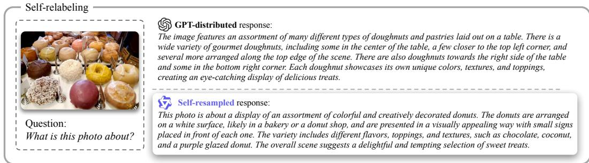  
Figure A1: Extended example of resampled datasets in Section 3.

## C Implementation Details

## C.1 Baselines

SmoothQuant [Xiao et al., 2023]. SmoothQuant alleviates activation outliers via an equivalent per-channel scaling transformation. It uses dynamic per-token activation quantization together with static per-channel weight quantization.

MBQ [Li et al., 2025b]. MBQ extends SmoothQuant by introducing modality-balanced scaling factors derived from gradient information. Its quantized inference configuration is kept the same as that of SmoothQuant.

MQuant [Yu et al., 2025]. MQuant addresses the distributional discrepancy between visual and textual tokens, as well as the extreme outliers introduced by Hadamard-based transformations. It adopts a fully static quantization scheme for efficient deployment.

LLM-QAT [Liu et al., 2023]. LLM-QAT pioneers QAT framework for language transformers, with a primary focus on data-free distillation. Since its original data-free design is not directly applicable to MLLMs, we reproduce LLM-QAT using the same training data, budget, and optimization settings as ProQuant. For the W4A4 backbones marked with † in Table 1, we retain 8-bit down\_proj activations for LLM-QAT to avoid severe degradation. The PTQ baselines are reproduced with their official implementations and the configurations reported in their respective papers.

## C.2 Data Generation

We use the vLLM engine [Kwon et al., 2023] to generate the dataset on a single 8×H200 node. Following the practice of LLM-QAT [Liu et al., 2023], we generate SRL responses via stochastic sampling rather than greedy decoding, as sampling produces more diverse outputs and yields better performance across tasks. We follow the default configuration files for sampling hyperparameters. For Qwen3-VL-2B-Instruct, we set top\_p = 0.8, top\_k = 20, temperature = 0.7, and repetition\_penalty = 1.0 according to the released generation\_config.json. Additionally, we set max\_token\_len = 512 to avoid excessively long responses. Generating SRL labels for LLaVA-680K [Liu et al., 2024b] takes ∼2.5 GPU days for 2B-scale models.

## C.3 Training Configuration

We implement ProQuant in PyTorch and train quantized models with DeepSpeed. Each experiment is conducted on a single 8×H200 node. Unless otherwise specified, we fine-tune quantized models for 5 epochs in BF16, enabling gradient checkpoints and using gradient accumulation with 2 steps. We set the per-device batch size to 32 and the maximum sequence length to 8192 tokens. We use the AdamW optimizer with a constant learning rate, zero weight decay, and a maximum gradient norm of 1.0. During QAT, we freeze the vision transformer and train the remaining modules together with the quantization scales, using module-specific learning rates. We optimize a hybrid objective that combines forward KL, reverse KL, and supervised fine-tuning losses, as defined in Eq. A2. The QAT takes ∼2 GPU days for 2B-scale models.

## D More Experiments

## D.1 Ablation on SmoothQuant initialization.

ProQuant can be applied on top of SmoothQuant [Xiao et al., 2023] initialization. As shown in Table A1, combining SmoothQuant with W4A4 quantization further improves accuracy. In contrast, SmoothQuant can slightly degrade performance under W4A8 settings. These results suggest that SmoothQuant serves as an effective initialization for extreme low-bit (W4A4) QAT, consistent with observations in LLM-QAT [Liu et al., 2023].

Table A1: ProQuant w/ or w/o SmoothQuant.
<table><tr><td>#BW</td><td>SQ Init</td><td>Avg. (↑)</td><td>MME</td></tr><tr><td rowspan="2">W4A8</td><td>√</td><td>71.41</td><td>1956.58</td></tr><tr><td>x</td><td>72.54</td><td>1962.04</td></tr><tr><td rowspan="2">W4A4</td><td>x</td><td>50.87</td><td>1459.14</td></tr><tr><td>√</td><td>59.83</td><td>1652.63</td></tr></table>

## D.2 Ablation Study on Loss Functions

We present performance under different supervision objectives for W4A8 Qwen3-VL-2B-Instruct QAT in Table A2. Using a single KL term yields limited gains, where forward KL achieves 71.76% on average accuracy while reversed KL performs worse, suggesting that either direction alone provides insufficient guidance for stable recovery. Combining both terms via CAKLD [Du et al., 2024] improves the average accuracy to 71.94%, indicating that balancing the two divergences is beneficial. The balance factor α is estimated at the start of training as described above. Building on CAKLD, our multi-objective formulation further incorporates a cross-entropy term following [Guo et al., 2025], achieving the best performance. Overall, the results validate that jointly leveraging bidirectional distillation and label supervision provides the most effective training signal for low-bit QAT.

Table A2: QAT performance under different supervisions.
<table><tr><td>Supervision</td><td>Formulation</td><td>Avg. (↑)</td></tr><tr><td>KL Div.</td><td> $\mathcal { L } _ { \mathrm { K L } } = \mathcal { D } ( P _ { t } | | P _ { s } )$ </td><td>71.76</td></tr><tr><td>Reversed KL</td><td> $\mathcal { L } _ { \mathrm { R e K L } } = \mathcal { D } ( P _ { s } | | P _ { t } )$ </td><td>71.41</td></tr><tr><td>CAKLD Du et al. [2024]</td><td> $\mathcal { L } _ { \mathrm { C A K L D } } = \alpha \mathcal { L } _ { \mathrm { R e K L } } + ( 1 - \alpha ) \mathcal { L } _ { \mathrm { K L } }$ </td><td>71.94</td></tr><tr><td>Multi-obj. Guo et al. [2025]</td><td> $\mathcal { L } _ { \mathrm { Q A T } } = \mathcal { L } _ { \mathrm { C A K L D } } + \beta \mathcal { L } _ { \mathrm { C E } }$ </td><td>72.54</td></tr></table>

## D.3 Generalization Beyond the Qwen-VL Family

We evaluate InternVL3.5-1B and LLaVA-OV-0.5B at W4A8 using the same seven-benchmark average as in the main experiments (Table A3). ProQuant achieves 63.93 and 52.29, respectively, outperforming MBQ and LLM-QAT on both models. These experiments extend the evaluated architectures beyond Qwen-VL.

Table A3: Average accuracy over the seven benchmarks used in the main paper on two additional model families. Quantized results use W4A8.
<table><tr><td>Method</td><td>InternVL3.5-1B</td><td>LLaVA-OV-0.5B</td></tr><tr><td>BF16</td><td>69.92</td><td>57.95</td></tr><tr><td>MBQ</td><td>56.77</td><td>48.97</td></tr><tr><td>LLM-QAT</td><td>60.02</td><td>50.05</td></tr><tr><td>ProQuant (ours)</td><td>63.93</td><td>52.29</td></tr></table>

Table A4 isolates the contributions of SRL and PBA on InternVL3.5-1B. Each component improves naive QAT, and their combination performs best.

Table A4: Component ablation on InternVL3.5-1B at W4A8.
<table><tr><td>Setting</td><td>InternVL3.5-1B Avg.</td></tr><tr><td>Naive QAT</td><td>61.74</td></tr><tr><td>+ SRL</td><td>62.98 (+1.24)</td></tr><tr><td>+ PBA</td><td>63.01 (+1.27)</td></tr><tr><td>ProQuant</td><td>63.93 (+2.19)</td></tr></table>

## D.4 Understanding SRL: Distribution, Style, and Label Transfer

We compare five label sets on the same randomly sampled 10K cases, pairing responses by prompt. The target is Qwen3-VL-2B and its self-labels serve as the reference. GPT and LV-0.5B/LV-7B are cross-family labelers; Qw-Homo-8B is a larger same-family labeler. The diagnostics in Table A5 are defined as follows.

1. NLL (nats/token). We compute $- | y | ^ { - 1 } \Sigma$ t log $p _ { \mathrm { t a r g e t } } ( y _ { t } \mid y _ { < t } , x )$ . Lower values indicate higher likelihood under the target model.

2. Vocabulary coverage. The fraction of the reference’s top-5K most frequent vocabulary items covered by assistant tokens in the label set.

3. Normalized length distance. The Wasserstein-1 distance between response token-count distributions, divided by the reference mean length.

4. Format distance. The $\ell _ { 1 }$ distance between mean 13-dimensional binary format-feature vectors, including headings, bold text, bullets, lists, code blocks, LaTeX, and tables.

5. Semantic distance. The mean paired 1 − cos similarity between responses encoded with the frozen gte-large-en-v1.5 sentence encoder [Li et al., 2023b].

Table A5: Label-distribution diagnostics and QAT accuracy on Qwen3-VL-2B. Qw-Self-2B is the reference; LV labelers are cross-family and Qw-Homo-8B is a larger same-family labeler.
<table><tr><td>Metric</td><td>GPT</td><td>LV-0.5B</td><td>LV-7B</td><td>Qw-Homo-8B</td><td>Qw-Self-2B</td></tr><tr><td>NLL nats/token (↓)</td><td>1.459</td><td>1.504</td><td>1.450</td><td>0.906</td><td>0.474</td></tr><tr><td>Vocab cov. top-5k (↑)</td><td>0.973</td><td>0.987</td><td>0.951</td><td>1.000</td><td>1</td></tr><tr><td>Length W1, normalized (↓)</td><td>0.641</td><td>0.780</td><td>0.929</td><td>0.459</td><td>0</td></tr><tr><td>Format L1 (↓)</td><td>2.831</td><td>2.861</td><td>3.268</td><td>1.213</td><td>0</td></tr><tr><td>1 - paired cosine (↓)</td><td>0.178</td><td>0.172</td><td>0.265</td><td>0.067</td><td>~0</td></tr><tr><td>W4A8 Avg. Acc. (↑)</td><td>71.77</td><td>70.71</td><td>71.29</td><td>72.35</td><td>72.54</td></tr><tr><td>W4A4 Avg. Acc. (↑)</td><td>56.78</td><td>56.31</td><td>57.34</td><td>59.04</td><td>59.83</td></tr></table>

Response style is a component of the output distribution, rather than an alternative to distributional alignment. Vocabulary, length, and format characterize surface form, while embedding similarity characterizes semantics; these diagnostics are complementary views and are not an additive decomposition of NLL. Matching surface form alone does not explain the full gain: the same-family 8B labeler reaches reference vocabulary coverage (1.000), but its NLL remains 0.906 versus 0.474 for self-labels and its QAT accuracy remains lower.

At W4A4, the NLL ranking agrees exactly with the inverse accuracy ranking. At W4A8, GPT versus LV-7B is an exception (their NLL differs by 0.009). Moreover, LV-0.5B is closer to the reference than LV-7B on all four auxiliary diagnostics, but has higher NLL and lower QAT accuracy at both precisions. These results support target-distribution proximity as an explanation of SRL’s gain beyond a single stylistic property.

Label transferability. Self-labels give the best W4A4 accuracy (59.83), followed by same-family 8B labels (59.04), and then cross-family labels (57.34, 56.78, and 56.31). Same-family reuse is therefore possible with an accuracy penalty, while cross-family reuse does not preserve the full benefit of SRL. We recommend per-target-model relabeling where its generation cost is acceptable.

## D.5 Hallucination and Bias Evaluation

We evaluate Qwen2-VL-2B on HallusionBench [Guan et al., 2024], using DeepSeek-V4-Flash as the judge, and on VLMsAreBiased [Vo et al., 2026]. Table A6 compares ProQuant with and without SRL at W4A8 and W4A4. SRL improves the reported scores at both precisions, while the quantized models remain below the BF16 target. Thus, these evaluations do not show a deterioration from SRL on the two tested benchmarks. They do not rule out inherited hallucinations, biases, or failure modes [Li et al., 2026c] outside these evaluations.

Table A6: Hallucination and bias evaluation on Qwen2-VL-2B. HallusionBench uses DeepSeek-V4-Flash as the judge. The table reports the scores for each setting.
<table><tr><td>Setting</td><td>HallusionBench</td><td>VLMsAreBiased</td></tr><tr><td>Full (BF16, target model)</td><td>51.21</td><td>17.71</td></tr><tr><td>ProQuant W4A8</td><td>50.37</td><td>17.24</td></tr><tr><td>ProQuant w/o SRL W4A8</td><td>50.16</td><td>15.56</td></tr><tr><td>ProQuant W4A4</td><td>43.84</td><td>14.58</td></tr><tr><td>ProQuant w/o SRL W4A4</td><td>41.42</td><td>13.00</td></tr></table>

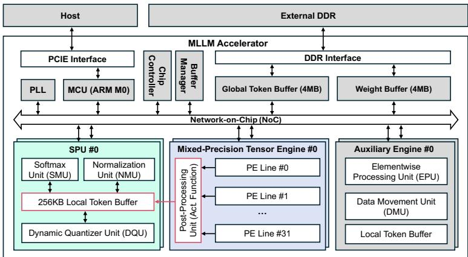  
Figure A2: System-level architecture of our benchmark edge MLLM accelerator.

## E Hardware Efficiency on Edge Accelerator

## E.1 Hardware Architecture

We evaluate an edge MLLM accelerator using measured test-chip behavior and a cycle-accurate accelerator model, as detailed in Section E.2. Figure A2 shows its architecture. The accelerator is equipped with two Mixed-Precision Tensor Engines (MPTEs), each of which comprises 1K MACs organized into 32 PE lines under an output-stationary dataflow, delivering 2.46 TOPS at INT8 precision. The MPTEs are able to support BF16, INT8 and INT4 precision for both weights and activations. Besides, two Special Processing Units (SPUs) support BF16 softmax, normalization, and dynamic quantization. Furthermore, output feature map tiles from the MPTEs can be bypassed directly to the SPU’s local token buffer to facilitate layer fusion, effectively overlapping the dynamic quantization latency. Two Auxiliary Engines handle element-wise operations, such as RoPE, and various data movement tasks like reshaping and transposing. The accelerator also features a 4 MB global token buffer and a 4 MB weight buffer, connected via a DDR4 interface that delivers 38.4 GB/s of external memory bandwidth. The compute engines and on-chip buffers are interconnected via a network-on-chip (NoC).

## E.2 System Setup and Measurement Methodology

Hardware and memory. The test chip is a silicon-proven ASIC fabricated in TSMC 22 nm CMOS. The FPGA is the interface/control board, rather than the inference accelerator. The system includes 8 GB off-chip DDR4, a 4 MB global token buffer for intermediate features, and a 4 MB weight buffer for the current weight tile. The off-chip capacity accommodates the evaluated model weights when quantized to 8 bits or below. These are provisioned capacities, not measured peak memory usage.

Connections and workflow. The DC supply powers the system board; the PC monitors it and the oscilloscope observes its state signals. The voltage tuning circuit supplies the test chip. The FPGA sends data to the test-chip board and receives results. A customized MLIR-based compiler produces test data and instructions. The FPGA forwards them to the chip, and latency is monitored via the PC waveform.

Measured and simulated components. On-chip energy is obtained from measured latency and average power,

$$
E _ { \mathrm { c h i p } } = t _ { \mathrm { c h i p } } \overline { { P } } _ { \mathrm { c h i p } } .\tag{A3}
$$

Off-chip DRAM access latency and energy are simulated using DRAMPower. The end-to-end cycle-accurate accelerator model combines the on-chip and off-chip contributions. The reported boundary includes the accelerator and DRAM accesses, not the wall-plug consumption of the PC, FPGA control board, oscilloscope, and other test equipment.

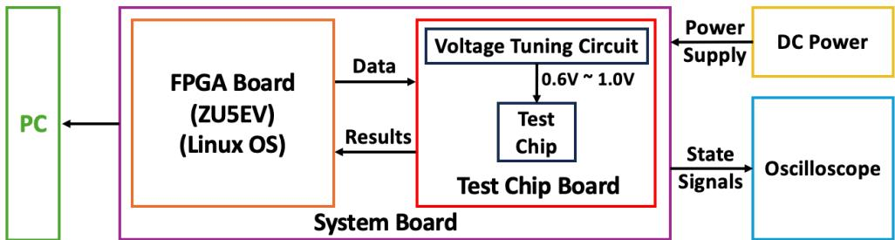

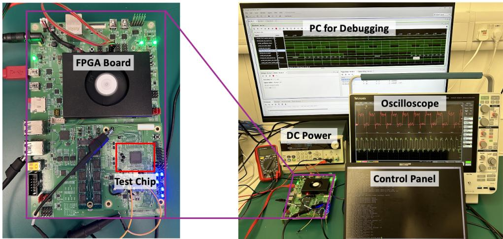  
Figure A3: Test environment. A Linux-based ZU5EV FPGA board supplies data and instructions to the test-chip board and receives results. The PC supports debugging and control, the DC supply powers the system board, and the oscilloscope observes state signals. The voltage tuning circuit supports 0.6–1.0 V; this range is not a statement of the operating voltage used in every experiment.

Reported metrics. Throughput is calculated as $1 0 0 0 / t$ , where t is the reported latency in milliseconds. For the same token configuration, speedup is $t _ { \mathrm { B F 1 6 } } / t _ { \mathrm { q u a n t } }$ and the energy-reduction ratio is $E _ { \mathrm { B F 1 6 } } / E _ { \mathrm { q u a n t } }$ . The tables distinguish prefill and decode and preserve the original latency/energy units.

## E.3 Edge Evaluation Results

Tables A7, A8, and A9 present comprehensive latency and energy measurements for Qwen2-VL-2B-Instruct, Qwen2.5-VL-3B-Instruct and Qwen3-VL-2B-Instruct on the edge MLLM accelerator. Across all three models, the prefill stage shows W4A8 achieving 1.48∼1.89× speedup and 1.94∼3.13× energy savings, while W4A4 further attains 2.11∼3.64× speedup and 2.53∼5.64× energy reduction. The decode stage exhibits consistent 3.74∼3.98× speedup and 3.76∼3.99× energy savings for both W4A8 and W4A4 due to memory-bound issue. Notably, the speedup ratio diminishes with longer visual token length since the ViT FLOPs proportion increases. As the ViT backbone typically remains in BF16 precision to preserve visual features, it becomes a bottleneck on edge accelerators where BF16 compute resources are insufficient due to area constraints. These results validate that ProQuant generalizes effectively across model scales and delivers substantial efficiency gains for edge deployment.

## E.4 W8A8 Deployment and Precision Trade-offs

Tables A10–A12 add W8A8 deployment results for all three backbones. Table A13 summarizes the precision-dependent gains alongside the existing W4A8/W4A4 measurements. W8A8 gives about 1.00–1.05× prefill speedup and 1.42–1.79× energy reduction. Decode speedup is 1.95–2.00×, with 1.99–2.00× energy reduction.

Table A7: Performance comparison of BF16, W4A8, and W4A4 for Qwen2-VL-2B-Instruct in both prefill and decode stages. “#V Tok.” and “#T Tok.” denote the numbers of vision tokens and text tokens, respectively; “Lat.” and “Eng.” denote latency (ms) and energy (mJ), respectively; “Spd.” and “Sav.” denote the speedup and energy saving relative to the BF16 baseline, respectively.
<table><tr><td rowspan="2">Stage</td><td rowspan="2">#V Tok.</td><td rowspan="2">#T Tok.</td><td colspan="2">BF16</td><td colspan="4">W4A8</td><td colspan="4">W4A4</td></tr><tr><td>Lat.</td><td>Eng.</td><td>Lat.</td><td>Spd.</td><td>Eng.</td><td>Sav.</td><td>Lat.</td><td>Spd.</td><td>Eng.</td><td>Sav.</td></tr><tr><td rowspan="4">Prefill</td><td>256</td><td>256</td><td>877.02</td><td>2400.87</td><td>530.80</td><td>1.65×</td><td>1020.90</td><td>2.35×</td><td>350.51</td><td>2.50×</td><td>779.96</td><td>3.08×</td></tr><tr><td></td><td>1024</td><td>1977.79</td><td>4817.34</td><td>1144.89</td><td>1.73×</td><td>1888.29</td><td>2.55×</td><td>632.23</td><td>3.13×</td><td>1164.54</td><td>4.14×</td></tr><tr><td>1024</td><td>256</td><td>2559.89</td><td>6045.12</td><td>1726.99</td><td>1.48×</td><td>3116.07</td><td>1.94×</td><td>1214.34</td><td>2.11×</td><td>2392.32</td><td>2.53×</td></tr><tr><td></td><td>1024</td><td>3766.04</td><td>8654.54</td><td>2441.82</td><td>1.54×</td><td>4069.73</td><td>2.13×</td><td>1522.48</td><td>2.47×</td><td>2831.59</td><td>3.06×</td></tr><tr><td rowspan="4">Decode</td><td>256</td><td>256</td><td>124.55</td><td>493.04</td><td>31.79</td><td>3.92×</td><td>124.33</td><td>3.97×</td><td>31.40</td><td>3.97×</td><td>123.95</td><td>3.98×</td></tr><tr><td></td><td>1024</td><td>125.59</td><td>496.69</td><td>32.83</td><td>3.83×</td><td>126.66</td><td>3.92×</td><td>31.85</td><td>3.94×</td><td>125.71</td><td>3.95×</td></tr><tr><td>1024</td><td>256</td><td>125.59</td><td>496.69</td><td>32.83</td><td>3.83×</td><td>126.66</td><td>3.92×</td><td>31.85</td><td>3.94×</td><td>125.71</td><td>3.95×</td></tr><tr><td></td><td>1024</td><td>126.63</td><td>500.34</td><td>33.87</td><td>3.74×</td><td>128.99</td><td>3.88×</td><td>32.30</td><td>3.92×</td><td>127.46</td><td>3.93×</td></tr></table>

Table A8: Performance comparison of BF16, W4A8, and W4A4 for Qwen2.5-VL-3B-Instruct in both prefill and decode stages.
<table><tr><td rowspan="2">Stage</td><td rowspan="2">#V Tok.</td><td rowspan="2">#T Tok.</td><td colspan="2">BF16</td><td colspan="4">W4A8</td><td colspan="4">W4A4</td></tr><tr><td>Lat.</td><td>Eng.</td><td>Lat.</td><td>Spd.</td><td>Eng.</td><td>Sav.</td><td>Lat.</td><td>Spd.</td><td>Eng.</td><td>Sav.</td></tr><tr><td rowspan="4">Prefill</td><td>256</td><td>256</td><td>1663.57</td><td>4802.11</td><td>882.53</td><td>1.89×</td><td>1580.31</td><td>3.04×</td><td>507.40</td><td>3.28×</td><td>1030.43</td><td>4.66×</td></tr><tr><td></td><td>1024</td><td>3959.49</td><td>10486.84</td><td>2132.48</td><td>1.86×</td><td>3347.68</td><td>3.13×</td><td>1088.50</td><td>3.64×</td><td>1859.23</td><td>5.64×</td></tr><tr><td>1024</td><td>256</td><td>4439.11</td><td>11419.90</td><td>2612.11</td><td>1.70×</td><td>4280.74</td><td>2.67×</td><td>1568.12</td><td>2.83×</td><td>2792.29</td><td>4.09×</td></tr><tr><td></td><td>1024</td><td>6972.05</td><td>17529.33</td><td>4034.06</td><td>1.73×</td><td>6226.26</td><td>2.82×</td><td>2193.81</td><td>3.18×</td><td>3719.84</td><td>4.71×</td></tr><tr><td rowspan="4">Decode</td><td>256</td><td>256</td><td>248.69</td><td>984.06</td><td>63.25</td><td>3.93×</td><td>247.63</td><td>3.97×</td><td>62.45</td><td>3.98×</td><td>246.85</td><td>3.99×</td></tr><tr><td></td><td>1024</td><td>250.47</td><td>989.19</td><td>65.03</td><td>3.85×</td><td>251.06</td><td>3.94×</td><td>63.03</td><td>3.97×</td><td>249.11</td><td>3.97×</td></tr><tr><td>1024</td><td>256</td><td>250.47</td><td>989.19</td><td>65.03</td><td>3.85×</td><td>251.06</td><td>3.94×</td><td>63.03</td><td>3.97×</td><td>249.11</td><td>3.97×</td></tr><tr><td></td><td>1024</td><td>252.25</td><td>994.31</td><td>66.81</td><td>3.78×</td><td>254.48</td><td>3.91×</td><td>63.61</td><td>3.97×</td><td>251.37</td><td>3.96×</td></tr></table>

Moving from W8A8 to W4A8 halves weight traffic and primarily improves memory-bound decode. Moving from W4A8 to W4A4 additionally lowers activation precision and benefits prefill. Relative to W8A8, the supported W4A8 and W4A4 configurations offer approximately 2× and 4× peak compute throughput, respectively; these hardware peak ratios are not end-to-end measured speedups. Off-chip data movement can be energy-intensive, motivating the reduction in weight traffic.

## F Limitations and Broader Impacts

Limitations. Our experiments focus on compact MLLMs, with evaluated models up to 8B parameters. Extending ProQuant to larger models and a broader range of multimodal architectures remains an important direction for future work.

Broader impacts. By reducing inference memory requirements, latency, and energy consumption in the evaluated deployment setting, ProQuant can facilitate multimodal intelligence on resourceconstrained devices. More efficient local inference may broaden access to multimodal applications and reduce reliance on remote computing infrastructure.

Table A9: Performance comparison of BF16, W4A8, and W4A4 for Qwen3-VL-2B-Instruct in both prefill and decode stages.
<table><tr><td rowspan="2">Stage</td><td rowspan="2">#V Tok.</td><td rowspan="2">#T Tok.</td><td colspan="2">BF16</td><td colspan="4">W4A8</td><td colspan="4">W4A4</td></tr><tr><td>Lat.</td><td>Eng.</td><td>Lat.</td><td>Spd.</td><td>Eng.</td><td>Sav.</td><td>Lat.</td><td>Spd.</td><td>Eng.</td><td>Sav.</td></tr><tr><td rowspan="4">Prefill</td><td>256</td><td>256</td><td>869.62</td><td>2227.72</td><td>498.60</td><td>1.74×</td><td>860.56</td><td>2.59×</td><td>300.42</td><td>2.89×</td><td>569.67</td><td>3.91×</td></tr><tr><td></td><td>1024</td><td>2090.36</td><td>4832.36</td><td>1190.86</td><td>1.76×</td><td>1791.66</td><td>2.70×</td><td>612.83</td><td>3.41×</td><td>1038.96</td><td>4.65×</td></tr><tr><td>1024</td><td>256</td><td>2444.41</td><td>5570.82</td><td>1544.91</td><td>1.58×</td><td>2530.13</td><td>2.20×</td><td>966.88</td><td>2.53×</td><td>1777.43</td><td>3.13×</td></tr><tr><td></td><td>1024</td><td>3798.92</td><td>8333.40</td><td>2370.94</td><td>1.60×</td><td>3559.28</td><td>2.34×</td><td>1313.97</td><td>2.89×</td><td>2231.03</td><td>3.74×</td></tr><tr><td rowspan="4">Decode</td><td>256</td><td>256</td><td>140.46</td><td>556.20</td><td>35.89</td><td>3.91×</td><td>141.56</td><td>3.93×</td><td>35.89</td><td>3.91×</td><td>141.56</td><td>3.93×</td></tr><tr><td></td><td>1024</td><td>144.00</td><td>570.20</td><td>37.66</td><td>3.82×</td><td>148.57</td><td>3.84×</td><td>37.66</td><td>3.82×</td><td>148.57</td><td>3.84×</td></tr><tr><td>1024</td><td>256</td><td>144.00</td><td>570.20</td><td>37.66</td><td>3.82×</td><td>148.57</td><td>3.84×</td><td>37.66</td><td>3.82×</td><td>148.57</td><td>3.84×</td></tr><tr><td></td><td>1024</td><td>147.53</td><td>584.20</td><td>39.44</td><td>3.74×</td><td>155.57</td><td>3.76×</td><td>39.44</td><td>3.74×</td><td>155.57</td><td>3.76×</td></tr></table>

Table A10: BF16 / W8A8 deployment results for Qwen3-VL-2B. Throughput is in $s ^ { - 1 }$ , latency in ms, and energy in mJ. Ratios are relative to BF16 under the same token configuration.
<table><tr><td>Stage</td><td>V tokens</td><td>T tokens</td><td>Throughput</td><td>Latency</td><td>Energy</td><td>Speedup</td><td>Energy ratio</td></tr><tr><td>Prefill</td><td>256</td><td>256</td><td>1.15 / 1.17</td><td>869.62 / 857.16</td><td>2227.72 / 1375.00</td><td>1.01x</td><td>1.62x</td></tr><tr><td>Prefill</td><td>256</td><td>1024</td><td>0.48 / 0.48</td><td>2090.36 / 2077.89</td><td>4832.36 / 2994.89</td><td>1.01x</td><td>1.61x</td></tr><tr><td>Prefill</td><td>1024</td><td>256</td><td>0.41 / 0.41</td><td>2444.41 / 2431.95</td><td>5570.82 / 3733.36</td><td>1.01x</td><td>1.49x</td></tr><tr><td>Prefill</td><td>1024</td><td>1024</td><td>0.26 / 0.26</td><td>3798.92 / 3786.46</td><td>8333.40 / 5437.21</td><td>1.00x</td><td>1.53x</td></tr><tr><td>Decode</td><td>256</td><td>256</td><td>7.12 / 14.21</td><td>140.46 / 70.35</td><td>556.20 / 278.22</td><td>2.00x</td><td>2.00x</td></tr><tr><td>Decode</td><td>256</td><td>1024</td><td>6.94 / 13.86</td><td>144.00 / 72.13</td><td>570.20 / 285.23</td><td>2.00x</td><td>2.00x</td></tr><tr><td>Decode</td><td>1024</td><td>256</td><td>6.94 / 13.86</td><td>144.00 / 72.13</td><td>570.20 / 285.23</td><td>2.00x</td><td>2.00x</td></tr><tr><td>Decode</td><td>1024</td><td>1024</td><td>6.78 / 13.53</td><td>147.53 / 73.90</td><td>584.20 / 292.23</td><td>2.00x</td><td>2.00x</td></tr></table>

Table A11: BF16 / W8A8 deployment results for Qwen2-VL-2B. Throughput is in $s ^ { - 1 }$ , latency in ms, and energy in mJ. Ratios are relative to BF16 under the same token configuration.
<table><tr><td>Stage</td><td>V tokens</td><td>T tokens</td><td>Throughput</td><td>Latency</td><td>Energy</td><td>Speedup</td><td>Energy ratio</td></tr><tr><td>Prefill</td><td>256</td><td>256</td><td>1.14 / 1.16</td><td>877.02 / 863.03</td><td>2400.87 / 1519.00</td><td>1.02×</td><td>1.58×</td></tr><tr><td>Prefill</td><td>256</td><td>1024</td><td>0.51 / 0.51</td><td>1977.79 / 1968.44</td><td>4817.34 /3018.88</td><td>1.00×</td><td>1.60×</td></tr><tr><td>Prefll</td><td>1024</td><td>256</td><td>0.39 / 0.39</td><td>2559.89 / 2550.54</td><td> $6 0 4 5 . 1 2 / 4 2 4 6 . 6 6$ </td><td>1.00×</td><td>1.42×</td></tr><tr><td>Prefill</td><td>1024</td><td>1024</td><td>0.27 / 0.27</td><td>3766.04 / 3756.69</td><td>8654.54 / 5838.09</td><td>1.00×</td><td>1.48×</td></tr><tr><td>Decode</td><td>256</td><td>256</td><td>8.03 / 15.95</td><td>124.55 / 62.71</td><td>493.04 /246.94</td><td>1.99×</td><td>2.00×</td></tr><tr><td>Decode</td><td>256</td><td>1024</td><td>7.96 / 15.69</td><td>125.59 / 63.75</td><td>496.69 / 249.27</td><td>1.97×</td><td>1.99×</td></tr><tr><td>Decode</td><td>1024</td><td>256</td><td>7.96 / 15.69</td><td>125.59 / 63.75</td><td>496.69 / 249.27</td><td>1.97×</td><td>1.99×</td></tr><tr><td>Decode</td><td>1024</td><td>1024</td><td>7.90 / 15.43</td><td>126.63 / 64.79</td><td>500.34 / 251.60</td><td>1.95×</td><td>1.99×</td></tr></table>

Table A12: BF16 / W8A8 deployment results for Qwen2.5-VL-3B. Throughput is in $s ^ { - 1 }$ , latency in ms, and energy in mJ. Ratios are relative to BF16 under the same token configuration.
<table><tr><td>Stage</td><td>V tokens</td><td>T tokens</td><td>Throughput</td><td>Latency</td><td>Energy</td><td>Speedup</td><td>Energy ratio</td></tr><tr><td>Prefill</td><td>256</td><td>256</td><td>0.60 / 0.63</td><td>1663.57 / 1582.40</td><td>4802.11 / 2690.07</td><td>1.05×</td><td>1.79×</td></tr><tr><td>Prefill</td><td>256</td><td>1024</td><td>0.25 / 0.26</td><td>3959.49 / 3872.80</td><td>10486.84 / 5856.24</td><td>1.02×</td><td>1.79×</td></tr><tr><td>Prefill</td><td>1024</td><td>256</td><td>0.23 / 0.23</td><td>4439.11 / 4352.42</td><td>11419.90 /6789.30</td><td>1.02×</td><td>1.68×</td></tr><tr><td>Prefill</td><td>1024</td><td>1024</td><td>0.14 / 0.15</td><td>6972.05 / 6814.82</td><td>17529.33 / 10164.20</td><td>1.02×</td><td>1.72×</td></tr><tr><td>Decode</td><td>256</td><td>256</td><td>4.02 / 8.00</td><td>248.69 / 125.07</td><td>984.06 / 492.73</td><td>1.99×</td><td>2.00×</td></tr><tr><td>Decode</td><td>256</td><td>1024</td><td>3.99 / 7.88</td><td>250.47 / 126.85</td><td>989.19 / 496.16</td><td>1.97×</td><td>1.99×</td></tr><tr><td>Decode</td><td>1024</td><td>256</td><td>3.99 / 7.88</td><td> $2 5 0 . 4 7 / 1 2 6 . 8 5$ </td><td>989.19 / 496.16</td><td>1.97×</td><td>1.99×</td></tr><tr><td>Decode</td><td>1024</td><td>1024</td><td>3.96 / 7.77</td><td>252.25 / 128.63</td><td>994.31 / 499.58</td><td>1.96×</td><td>1.99×</td></tr></table>

Table A13: Latency speedup and energy-reduction ranges relative to BF16 across the four token configurations.
<table><tr><td>Model</td><td>Stage</td><td>Precision</td><td>Latency speedup ↑</td><td>Energy reduction ↑</td></tr><tr><td>Qwen3-VL-2B</td><td>Prefill</td><td>W8A8</td><td>1.00-1.01x</td><td>1.49–1.62x</td></tr><tr><td>Qwen3-VL-2B</td><td>Prefill</td><td>W4A8</td><td>1.58–1.76x</td><td>2.20–2.70x</td></tr><tr><td>Qwen3-VL-2B</td><td>Prefill</td><td>W4A4</td><td>2.53-3.41x</td><td>3.13-4.65x</td></tr><tr><td>Qwen3-VL-2B</td><td>Decode</td><td>W8A8</td><td>2.00x</td><td>2.00x</td></tr><tr><td>Qwen3-VL-2B</td><td>Decode</td><td>W4A8</td><td>3.74–3.91x</td><td>3.76-3.93x</td></tr><tr><td>Qwen3-VL-2B</td><td>Decode</td><td>W4A4</td><td>3.74-3.91x</td><td>3.76-3.93x</td></tr><tr><td>Qwen2-VL-2B</td><td>Prefill</td><td>W8A8</td><td>1.00-1.02×</td><td>1.42-1.60×</td></tr><tr><td>Qwen2-VL-2B</td><td>Prefill</td><td>W4A8</td><td>1.48–1.73×</td><td>1.94–2.55×</td></tr><tr><td>Qwen2-VL-2B</td><td>Prefill</td><td>W4A4</td><td>2.11-3.13×</td><td>2.53-4.14×</td></tr><tr><td>Qwen2-VL-2B</td><td>Decode</td><td>W8A8</td><td>1.95-1.99×</td><td>1.99–2.00×</td></tr><tr><td>Qwen2-VL-2B</td><td>Decode</td><td>W4A8</td><td>3.74–3.92×</td><td>3.88-3.97×</td></tr><tr><td>Qwen2-VL-2B</td><td>Decode</td><td>W4A4</td><td>3.92–3.97×</td><td>3.93-3.98×</td></tr><tr><td>Qwen2.5-VL-3B</td><td>Prefill</td><td>W8A8</td><td>1.02–1.05×</td><td>1.68-1.79×</td></tr><tr><td>Qwen2.5-VL-3B</td><td>Prefill</td><td>W4A8</td><td>1.70-1.89×</td><td>2.67-3.13×</td></tr><tr><td>Qwen2.5-VL-3B</td><td>Prefill</td><td>W4A4</td><td>2.83-3.64×</td><td>4.09–5.64×</td></tr><tr><td>Qwen2.5-VL-3B</td><td>Decode</td><td>W8A8</td><td>1.96–1.99×</td><td>1.99–2.00×</td></tr><tr><td>Qwen2.5-VL-3B</td><td>Decode</td><td>W4A8</td><td>3.78-3.93×</td><td>3.91-3.97×</td></tr><tr><td>Qwen2.5-VL-3B</td><td>Decode</td><td>W4A4</td><td>3.97-3.98×</td><td>3.96-3.99×</td></tr></table>