# SKIM: Pruning Large Language Model Agents via Selective Knowledge Informed Masking

Moonseok Choi KAIST ms.choi@kaist.ac.kr

Minki Kang KAIST minkikang@kaist.ac.kr

Jongwon Jeong University of Wisconsin–Madison jjeong64@wisc.edu

Giung Nam† KAIST giung@kaist.ac.kr

Juho Lee† KAIST juholee@kaist.ac.kr

## Abstract

Large Language Model (LLM) agents are increasingly deployed under structured generation, where grammar constraints enforce output format at inference time. Whereas existing compression methods target unconstrained generation, we first identify a fundamental mismatch: under structured generation, grammar constraints reduce the model’s output distribution to valid tokens, and the logits matter most at the small set of positions that decide the agent’s action. Motivated by this finding, we propose SKIM (Selective Knowledge-Informed Masking), the first pruning and distillation framework for LLM agents under structured generation, with both stages guided by token role. SKIM partitions token positions into context, decision, and format categories, and this partition drives two complementary axes: (1) category-aware pruning saliency scores that preserve parameters most relevant for decision positions; and (2) an on-policy distillation objective that aligns student and teacher on valid tokens, paired with category-aware feature matching. We evaluate SKIM on tool-calling benchmarks and within multistep agent loops, across multiple model scales and sparsity levels. SKIM consistently improves accuracy over baselines, with its superiority becoming most striking in high-sparsity regimes where conventional methods struggle, demonstrating the potential of category-aware compression for deployment-time grammarconstrained agents. The project page is available at link.

## 1 Introduction

Large Language Model (LLM) agents are widely served under structured generation, where outputs must conform to a predefined format and tokens that would violate it are masked before sampling at every decoding step [40, 8]. This is now standard practice in production serving stacks [8, 47]. Yet the pruning and distillation methods used to compress LLMs are designed under the assumption of unconstrained generation [9, 38, 13, 28], and recent work confirms that off-the-shelf compression degrades sharply on tool-calling tasks [7].

The mismatch is structural, not incidental. Under structured generation, the model’s effective distribution at each step is its raw softmax restricted to valid tokens and renormalized [40, 12]. The objectives used in prior compression work, KL divergence to a teacher [13, 28] and layer-wise activation reconstruction [9, 38], are all computed against the unconstrained output. They preserve parameters that contribute to outputs the runtime masks, wasting capacity on behavior it already enforces.

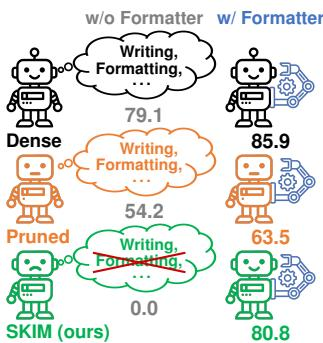  
Figure 1: Target behavior.

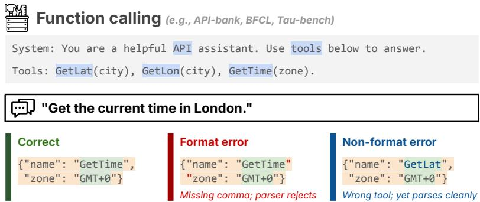

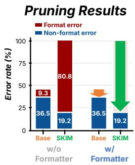  
Figure 2: Token categories and error decomposition under structured generation. Left: Example function call with tokens highlighted by category (Context, Decision, Format) and three response types distinguishing format errors (eliminated by structured decoding) from non-format errors (which require the model itself to be correct). Right: Pruned-then-distilled model performance on Qwen3.5-2B [33] and BFCL-v3 [31] at 25% sparsity. SKIM fully exploits the grammar formatter: without it, SKIM looks broken because format errors dominate, but with it, SKIM easily beats Base (Wanda-sp). Format errors are essentially free under structured decoding, so reducing non-format errors at decision positions is what matters.

Our key insight is that not all output tokens play the same role under structured generation. Hinging on this insight, we partition the agent’s output into three roles: (1) context positions hold the input the model reads, (2) decision positions are the few output points where the format admits multiple valid options such as the function name or enum-valued arguments, and (3)format positions are the syntactic scaffolding the constraint mechanism enforces [8, 12]. The constraint mechanism enforces format validity for free at deployment [40, 8], so capacity allocated to format positions is wasted on behavior the runtime supplies regardless. Figure 2 (right) shows that even with standard distillation for healing [28, 37], the error of pruned agent models is dominated by non-format error, indicating that compression should preserve capacity at decision rather than format positions.

We propose SKIM (Selective Knowledge-Informed Masking), the first pruning and distillation framework designed for LLM agents deployed under structured generation. The pruning side extends layer-wise reconstruction with per-category activation coefficients that down-weight format positions in the saliency score [38, 2]. The distillation side combines a forward-KL objective between the teacher’s and student’s constrained distributions on the student’s own on-policy rollouts, paired with hidden-state matching at context and decision positions [28]. Both stages share the same token-role partition, aligning the preserved capacity with the deployment regime end-to-end.

We evaluate SKIM on tool-calling benchmarks, BFCL-v3 [31] and API-Bank L1 [19], and within ReAct-style agent loops [44] on HotpotQA [43]. Across model scales from 0.8B to 9B and sparsity levels, SKIM generally outperforms strong pruning and distillation baselines [38, 2, 22], with the largest margins at high sparsity where existing methods collapse but SKIM continues to recover most of the dense model’s structured-decoding accuracy.

Our contributions are:

• To the best of our knowledge, we are the first to identify the mismatch between standard pruning and distillation objectives and constrained-decoding deployment, and we introduce a token-wise categorization of agent outputs into context, decision, and format positions, which grounds the design of our method (§ 3).

• We propose SKIM, a pruning and distillation framework that uses this categorization in both stages: a category-aware saliency that down-weights format positions in layer-wise reconstruction, and an on-policy distillation objective over the teacher’s and student’s constrained distributions paired with category-aware hidden-state matching (§ 4).

• We evaluate SKIM on tool-calling benchmarks and within multi-step agent loops across model scales from 0.8B to 9B, showing that SKIM preserves reasoning and tool-use capability with gains widening at higher sparsities (§ 5).

## 2 Related Work

Tool-calling LLM agents. Large language models are increasingly deployed as autonomous agents interacting with external APIs [44, 36, 30, 32, 46, 19]. As these agents transition to production-scale deployments, they face intertwined bottlenecks in efficiency and reliability. While prior work improved robustness via tool embeddings [15] or function masking [21], reliable deployment fundamentally requires syntactically flawless API requests (e.g., strict JSON). Because even minor structural deviations cause cascading execution failures, production pipelines overwhelmingly rely on mechanisms that explicitly enforce the desired output structure.

Structured generation. Structured generation enforces a grammar at inference time, guaranteeing structurally valid outputs. Early constrained-decoding algorithms [6, 11] formalized this idea, and modern engines [4, 40, 18] realize it efficiently by masking invalid tokens against predefined schemas or finite-state machines, which we call a formatter in Figs. 1 and 2. Their objective is faithful, low-overhead grammar enforcement, and the LLM is treated as a black box that the engine wraps without modification. A grammar, however, makes some token positions deterministic and others not - at deterministic positions the constraint uniquely fixes the next token, while at the rest the model’s prediction selects the output. This position-level asymmetry is outside the scope of grammar-enforcement engines, but for compression methods designed for the structured-generation regime it is exactly the signal worth exploiting for compression.

LLM pruning. LLM pruning methods divide along granularity and saliency framework. Unstructured pruning methods score individual weights for sparse patterns [9, 38], while structured pruning methods remove whole architectural units for wall-clock speedups on dense hardware [25, 3, 26, 2, 22]. Cutting across both is layer-wise reconstruction, an influential saliency framework that scores units by how much zeroing them perturbs the layer’s output on calibration activations [9, 38, 2, 22]. SKIM extends layer-wise reconstruction by partitioning calibration activations by the role each position plays under structured generation. We accordingly select Wanda [38], FLAP [2], and SlimGPT [22] as baselines, spanning unstructured and structured layer-wise reconstruction methods and providing the most direct comparison to SKIM.

LLM distillation. Knowledge distillation (KD) facilitates knowledge transfer from a teacher to a student model by matching output distributions or intermediate hidden states [16, 34]. While KD has long been a well-established paradigm in language modeling [17, 35, 39], recent research has shifted toward on-policy approaches, where students learn from their own generated trajectories to improve alignment in generative tasks [13, 1, 42]. Additionally, KD has been utilized to recover performance degradation following LLM pruning [28, 37]. However, to the best of our knowledge, no existing studies have explored KD specifically within the context of grammar-constrained decoding. For the detailed literature review, we refer readers to § A.

## 3 Preliminaries and Motivation

## 3.1 Preliminaries

Constrained language generation. Modern autoregressive language models define the conditional probability of a sequence $y \equiv y _ { 1 : T } = ( y _ { 1 } , . . . , y _ { T } )$ given an initial prompt x as:

$$
\begin{array} { r } { p ( y _ { 1 : T } \mid x ) = \prod _ { t = 1 } ^ { T } p ( y _ { t } \mid x , y _ { < t } ) , } \end{array}\tag{1}
$$

where x and $y$ are sequences composed of tokens from a vocabulary $\nu ,$ and generation proceeds from left to right. To incorporate specific requirements into the generation process (e.g., grammar constraints in formal language), we assume a potential function ϕ that assigns scores to sequences based on desired attributes. To satisfy constraints during generation, a widely adopted technique is locally constrained decoding, which steers the generation process at each time step t by drawing tokens from a re-weighted density:

$$
\begin{array} { r } { p _ { \phi } ( y _ { t } \mid x , y _ { < t } ) \propto p ( y _ { t } \mid x , y _ { < t } ) \frac { \phi ( x , y _ { 1 : t } ) } { \phi ( x , y _ { < t } ) } . } \end{array}\tag{2}
$$

In this work, we focus on binary hard constraints where $\phi \in \{ 0 , 1 \}$ . We assume ϕ is monotonic such that if a prefix violates the constraints, any of its extensions will also be invalid, $\mathrm { i . e . , } \phi ( x , y _ { < t } ) = 0$ implies $\phi ( x , y _ { 1 : t } ) \ : = \ : 0$ for all $y _ { t } ~ \in ~ \mathcal { V }$ . Under this assumption, the ratio $\phi ( x , y _ { 1 : t } ) / \phi ( x , y _ { < t } )$ is safely defined as zero whenever the denominator is zero. Such a condition is typically satisfied in structured generation tasks, where syntactic or formal constraints can be verified incrementally.

Remark. In practice, structured generation libraries [40, 8] enforce these constraints by defining a valid token set $\mathcal { V } _ { t } \equiv \mathcal { V } ( x , y _ { < t } ) \stackrel { - } { = } \{ y _ { t } \in \mathcal { V } | \phi ( x , y _ { 1 : t } ) = 1 \}$ at each time step t. Tokens not in $\nu _ { t }$ are masked by setting their logits $\mathrm { t o } - \infty$ , restricting the sampling space of $p ( \cdot \mid x , y _ { < t } )$ to $\nu _ { t }$

Token position categories. For a sequence $( x , y )$ comprising prompt x and output $y ,$ we partition token positions into three functional categories, context (c), decision $( d )$ , and format $( f )$ , as illustrated in Fig. 2. Context positions $P _ { c } ( x )$ are prompt-side positions, specifically the tokens of tool names, descriptions, and user queries. In contrast, decision positions $\dot { P } _ { d } ( y ) = \check { \{ t \in [ T ] : | \mathcal { V } _ { t } | > 1 \} }$ are output positions where the schema leaves more than one valid continuation, requiring the model to choose among alternatives, whereas format positions $P _ { f } ( y ) = \{ t \in [ T ] : | \dot { \mathcal { V } _ { t } } | = \mathsf { \bar { 1 } } \}$ are output positions where the schema admits a unique continuation, rendering the conditional distribution $p _ { \phi } ( \cdot \mid x , y _ { < t } )$ a point mass independent of the model’s logits.

## 3.2 Motivation: format-position capacity is recoverable under structured decoding

Let $( x , y ^ { * } )$ be a prompt and its corresponding reference response pair, where $\phi ( x , y ^ { * } ) = 1$ . The cross-entropy of the ϕ-constrained neural network model $p _ { \phi }$ with respect to this pair is given by:

$$
\begin{array} { r } { \mathcal { L } _ { \mathrm { C E } } ( p _ { \phi } ; x , y ^ { * } ) = - \sum _ { t = 1 } ^ { T } \log p _ { \phi } ( y _ { t } ^ { * } \mid x , y _ { < t } ^ { * } ) , } \end{array}\tag{3}
$$

which is the quantity that must be preserved across both pruned and distilled models. Notably, for any format position $\dot { t } \in P _ { f } ( y ^ { \ast } )$ , the prediction is deterministic, such that $p _ { \phi } ( y _ { t } \mid x , y _ { < t } ^ { * } ) = [ y _ { t } =$ $y _ { t } ^ { * } \bar { ] }$ for all $y _ { t } \in \mathcal V$ . Consequently, both the gradient and the Hessian of the loss with respect to any internal weight matrix W evaluate to zero at these specific positions:

$$
\forall t \in P _ { f } ( y ^ { * } ) : \nabla _ { W } [ - \log p _ { \phi } ( y _ { t } ^ { * } \mid x , y _ { < t } ^ { * } ) ] = 0 \mathrm { a n d } \nabla _ { W } ^ { 2 } [ - \log p _ { \phi } ( y _ { t } ^ { * } \mid x , y _ { < t } ^ { * } ) ] = 0 .\tag{4}
$$

While this property is absent in the layer-wise reconstruction loss typically used as a proxy in standard LLM pruning [9, 38], it reveals a fundamental asymmetry across token positions when evaluated under the structured cross-entropy loss in $\operatorname { E q . } 3 ,$ . Hinging on this, we investigate whether such positional asymmetry can be leveraged even within standard LLM pruning scenarios.

Empirical results. In addition to Fig. 2 (right), Fig. 5 shows the error decomposition aggregated over BFCL and API-Bank, two Qwen3.5 model sizes (0.8B and 2B), and three pruning baselines (Wanda [38], FLAP [2], SlimGPT [22]). Each baseline applies its own pruning mask and then heals the pruned model via knowledge distillation on xLAM-function-calling data [23] under a matched compute budget; structured generation at inference uses XGrammar [8]. Total error grows with sparsity, but non-format error dominates at every level: format errors are largely absorbed by the constraint mechanism, while non-format errors (wrong-tool-or-argument failures that determine the agent’s action) remain the principal source of error. In $\ S \mathrm { ~ C . 1 }$ , we further corroborate this pattern through a direct ablation that zeroes units specialized for each token category: removing formatspecialized capacity barely changes accuracy, while removing context- or decision-specialized capacity collapses it (see Fig. 6). Together, these results suggest substantial room for improvement at decision-relevant positions, motivating SKIM’s category-aware design.

Evaluation protocols. Throughout the paper, we adopt two metrics based on full-match accuracy against reference tool-call sequences for evaluation: (1) structured accuracy $( \mathrm { i . e . , } y \sim p _ { \phi } )$ , which reflects the deployment setting under schema-constrained decoding and measures practical performance; (2) free-generation accuracy $( \mathrm { i . e . , } y \sim p )$ , a diagnostic under unconstrained decoding that isolates the model’s intrinsic capabilities from the gains provided by the constraint mechanism ϕ.

Remark. A narrow gap between these metrics suggests that the model has natively dedicated its capacity to satisfying the constraints. Conversely, a large gap suggests it relies on $\phi$ to enforce the format, decoupling its intrinsic reasoning from the required structure.

## 4 SKIM

## 4.1 Layer-wise pruning with position-awareness

Reconstruction loss. Let $\boldsymbol { X } \in \mathbb { R } ^ { T \times M }$ be the input activations and $W \in \mathbb { R } ^ { M \times N }$ be the original dense weight matrix in a neural network layer. The standard layer-wise reconstruction loss is:

$$
\mathcal { L } ( \hat { W } ; W , X ) = \Big \| X W - X \hat { W } \Big \| _ { F } ^ { 2 } ,\tag{5}
$$

which measures how well the pruned weights $\hat { W }$ preserve the layer outputs. If we view the loss as a function of $\mathrm { v e c } ( { \hat { W } } )$ , its full Hessian is given by $\dot { \nabla } ^ { 2 } \mathcal { L } = I _ { N } \otimes \mathbf { \dot { H } }$ where $H : = 2 X ^ { \top } X$ . Under the diagonal approximation $H \approx \mathrm { d i a g } ( H )$ , we ignore cross-feature interactions and obtain:

$$
\begin{array} { r } { \mathcal { L } ( \hat { W } ; W , X ) \approx \sum _ { i = 1 } ^ { M } \mathcal { L } _ { i } , \quad \mathrm { ~ w h e r e ~ } ~ \mathcal { L } _ { i } = \frac { 1 } { 2 } H _ { i i } \left\| W _ { i , : } - \hat { W } _ { i , : } \right\| _ { 2 } ^ { 2 } \mathrm { ~ a n d ~ } H _ { i i } = 2 \sum _ { t = 1 } ^ { T } X _ { t i } ^ { 2 } . } \end{array}\tag{6}
$$

Gaussian interpretation. From a probabilistic perspective, Eq. 6 admits a Gaussian interpretation; up to an additive constant, $\mathcal { L } _ { i }$ is the negative log-likelihood of the isotropic Gaussian model:

$$
W _ { i , : } \mid \hat { W } _ { i , : } , X _ { : , i } \sim \mathcal { N } ( \hat { W } _ { i , : } , \sigma _ { i } ^ { 2 } I _ { N } ) ,\tag{7}
$$

with precision $1 / \sigma _ { i } ^ { 2 } = H _ { i i }$ . Indeed, $\mathcal { L } _ { i }$ corresponds to the quadratic term of the log-likelihood:

$$
\begin{array} { r } { \log p ( W _ { i , : } \mid \hat { W } _ { i , : } , X _ { : , i } ) = - \frac { N } { 2 } \log ( 2 \pi \sigma _ { i } ^ { 2 } ) - \frac { 1 } { 2 \sigma _ { i } ^ { 2 } } \left\| W _ { i , : } - \hat { W } _ { i , : } \right\| _ { 2 } ^ { 2 } , } \end{array}\tag{8}
$$

which implies that a larger sum of squared activations assigns a smaller variance, making the likelihood more sensitive to perturbations in the corresponding row of the weight matrix. The saliency of the $i ^ { \mathrm { { t h } } }$ neuron is then evaluated as the decrease in the log-likelihood when it is zeroed $( \hat { W } _ { i , : } = 0 )$ which exactly corresponds to the square of the heuristic pruning metric proposed in [38]:

$$
\begin{array} { r } { { S _ { i } } = \frac { 1 } { 2 } H _ { i i } \left\| \boldsymbol { W } _ { i , : } \right\| _ { 2 } ^ { 2 } = \left( \sum _ { t = 1 } ^ { T } X _ { t i } ^ { 2 } \right) \left\| \boldsymbol { W } _ { i , : } \right\| _ { 2 } ^ { 2 } . } \end{array}\tag{9}
$$

Position-aware saliency score. However, $\operatorname { E q . 9 }$ weights all token positions uniformly through the sum over t. Motivated by the observation that token contributions along the sequence dimension are not uniform, we introduce a context-weighted heteroscedastic surrogate precision:

$$
\begin{array} { r } { \tilde { H } _ { i i } ^ { \mathrm { p o s } } : = 2 \cdot \left( \alpha _ { c } \sum _ { t \in P _ { c } } X _ { t i } ^ { 2 } + \alpha _ { d } \sum _ { t \in P _ { d } } X _ { t i } ^ { 2 } + \alpha _ { f } \sum _ { t \in P _ { f } } X _ { t i } ^ { 2 } \right) , } \end{array}\tag{10}
$$

where $P _ { c } , P _ { d } , P _ { f }$ form exclusive positional groups corresponding to context, decision, and format token roles, respectively, and $\alpha _ { c } , \alpha _ { d } , \alpha _ { f } \ \geq \ 0$ . Using $1 \dot { / } \sigma _ { i } ^ { 2 } : = \tilde { H } _ { i i } ^ { \mathrm { p o s } }$ in the saliency formulation yields the corresponding position-aware saliency score:

$$
\begin{array} { r } { { S } _ { i } ^ { \mathrm { p o s } } = \left( \alpha _ { c } \sum _ { t \in P _ { c } } X _ { t i } ^ { 2 } + \alpha _ { d } \sum _ { t \in P _ { d } } X _ { t i } ^ { 2 } + \alpha _ { f } \sum _ { t \in P _ { f } } X _ { t i } ^ { 2 } \right) \cdot \left\| \boldsymbol { W } _ { i , : } \right\| _ { 2 } ^ { 2 } . } \end{array}\tag{11}
$$

Remark. Notably, Eq. 11 can be interpreted as being derived from a weighted layer-wise reconstruction loss, i.e. $, \dot { \mathcal { L } ( W ; W , X ) } : = | | A ^ { 1 / \dot { 2 } } ( X W - X \tilde { W } ) | | _ { F } ^ { 2 }$ , where A is a diagonal scaling matrix with entries $A _ { t t } = \alpha _ { c } [ t \in P _ { c } ] \stackrel { \prime } { + } \alpha _ { d } [ \stackrel { . } { t } \in P _ { d } ] + \alpha _ { f } [ t \in P _ { f } ]$ . Nevertheless, a key advantage of our formulation lies in the modularity of the surrogate precision. By decoupling position-awareness from the loss objective and embedding it directly into the precision term, our framework is not restricted to any specific gating mechanism. Instead, it establishes a generalized design space: one can readily define diverse functional forms for $\tilde { H } _ { i i } ^ { \mathrm { p o s } }$ to incorporate different positional inductive biases, enabling the systematic derivation of a wide family of position-aware saliency scores without altering the underlying standard layer-wise reconstruction loss in $\operatorname { E q . 5 } .$ . In what follows, we experimentally compare various surrogate precision designs through an ablation study in $\ S \mathrm { ~ B . 1 }$

## 4.2 SKIM Distillation

Distillation loss. Let p be the original dense model and $q$ be the pruned sparse model. In practice, to recover the performance degradation from pruning, knowledge distillation [16] is often employed by minimizing a forward KL divergence between the two models on a dataset of $( x , y )$ pairs [28]:

$$
\begin{array} { r } { D _ { \mathrm { K L } } ( p \parallel q ) ( y \mid x ) = \sum _ { t = 1 } ^ { T } D _ { \mathrm { K L } } ( p ( \cdot \mid x , y _ { < t } ) \parallel q ( \cdot \mid x , y _ { < t } ) ) . } \end{array}\tag{12}
$$

In a constrained generation setup, however, the distillation loss should be reformulated to minimize the divergence between the ϕ-constrained distributions, $p _ { \phi }$ and $q _ { \phi } \mathrm { : }$

$$
\begin{array} { r } { D _ { \mathrm { K L } } ( p _ { \phi } \parallel q _ { \phi } ) ( y \mid x ) = \sum _ { t = 1 } ^ { T } D _ { \mathrm { K L } } ( p _ { \phi } ( \cdot \mid x , y _ { < t } ) \parallel q _ { \phi } ( \cdot \mid x , y _ { < t } ) ) , } \end{array}\tag{13}
$$

where the $t ^ { \mathrm { { t h } } }$ term in the summation decomposes as

$$
\begin{array} { r } { \frac { 1 } { Z _ { p } } \sum _ { y \in \mathcal { V } _ { t } } p ( y \mid x , y _ { < t } ) \left[ \log \frac { p ( y \mid x , y _ { < t } ) } { q ( y \mid x , y _ { < t } ) } - \log Z _ { p } + \log Z _ { q } \right] , } \end{array}\tag{14}
$$

where $Z _ { p }$ and $Z _ { q }$ are the normalization constants for $p _ { \phi }$ and $q _ { \phi } ,$ required to yield valid probability distributions from the unnormalized formulations in $\operatorname { E q . 2 } .$ . Notably, the logit masking technique for structured generation remains applicable here, allowing for the direct computation of the KL divergence over the valid vocabulary $\nu _ { t }$ without explicitly evaluating the normalization constants:

$$
\begin{array} { r } { D _ { \mathrm { K L } } ( p _ { \phi } \parallel q _ { \phi } ) ( y \mid x ) = - \sum _ { t = 1 } ^ { T } \sum _ { y _ { t } \in \mathcal { V } _ { t } } p _ { \phi } ( y _ { t } \mid x , y _ { < t } ) \log q _ { \phi } ( y _ { t } \mid x , y _ { < t } ) + \mathrm { c o n s t . } } \end{array}\tag{15}
$$

Remark. The decomposition in Eq. 14 clarifies why the constrained form is appropriate here. While the gradient of the first term in the bracket with respect to the $k ^ { \mathrm { { t h } } }$ logit of q is non-zero for all k, the cancellation of log $Z$ terms yields zero gradients for the logits corresponding to $\mathcal { V } \backslash \mathcal { V } _ { t }$ . Consequently, the loss only shapes the student’s distribution over $\nu _ { t }$ , which is the only factor that matters during inference under structured decoding. Such surgical specificity is crucial for tool-calling LLMs where shared parameters govern both constrained and unconstrained generation. Unlike vanilla distillation in Eq. 12, which unnecessarily suppresses off-support tokens, our approach in Eq. 15 avoids such updates, preventing performance leakage into unconstrained behaviors like free-form chat.

While Eqs. 12 and 15 minimize forward KL divergence to align token-level distributions, they leave open various design choices. Key among these are the source of $y \left( \mathrm { e . g . } \right.$ ., original dataset, teacher-, or student-generated) and the specific divergence measure (e.g., forward or reverse KL) employed for matching [1]. As $\nu _ { t }$ and the later decision positions depend on the student’s earlier decisions, we adopt, after an off-policy warm-up, an on-policy forward KL on student-generated responses y:

$$
{ \mathcal { L } } _ { \mathrm { K D } } ( q ; p ) = \mathbb { E } _ { x \in { \mathcal { D } } } \mathbb { E } _ { y \sim \operatorname { s g } ( q _ { \phi } ( \cdot | x ) ) } \left[ D _ { \mathrm { K L } } ( p _ { \phi } \parallel q _ { \phi } ) ( y \mid x ) \right] .\tag{16}
$$

We further adopt feature distillation [34, 24, 28], but refine its scope to focus primarily on context and decision token positions. Indeed, our empirical findings in $\ S \ S . 6$ indicate that down-weighting format positions improves results, aligning with our argument that the limited capacity of the pruned model should be strategically allocated. The final distillation loss for SKIM is formulated as:

$$
\begin{array} { r } { \mathcal { L } _ { \mathrm { S K I M } } = \mathcal { L } _ { \mathrm { K D } } + \lambda _ { H } \cdot \mathcal { L } _ { \mathrm { h i d d e n } } , \quad \mathrm { w h e r e } \ \mathcal { L } _ { \mathrm { h i d d e n } } = \sum _ { \ell \in L } \sum _ { t } \alpha _ { \mathrm { c a t } ( t ) } \cdot \big \| h _ { t } ^ { ( p , \ell ) } - h _ { t } ^ { ( q , \ell ) } \big \| _ { 2 } ^ { 2 } , } \end{array}\tag{17}
$$

where $h _ { t } ^ { ( p , \ell ) }$ and $h _ { t } ^ { ( q , \ell ) }$ are the teacher and student hidden states, respectively, at position t following transformer block ℓ. For further empirical details, we refer readers to § B.2.

## 5 Experiments

## 5.1 Experimental setup

Models and datasets. We evaluate SKIM across four scales of the Qwen3.5 series [33]: Qwen3.5- 0.8B/2B/4B/9B. Dense models serve as reference. xLAM-function-calling-60k [23] provides activation statistics for pruning calibration and training data for distillation. We evaluate on two toolcalling benchmarks: BFCL-v3 [31] and API-Bank L1 [19], reporting full-match accuracy against reference tool calls. For the agentic pipeline evaluation, we use HotpotQA [43] dataset under ReActstyle loop [44], reporting F1 metric. Numbers are reported under structured decoding (the deployment setting) and free generation (see § 3.2). All decoding is greedy (τ = 0).

Table 1: Post-KD full-match accuracy of Qwen3.5 series across varying sparsity ratios with thinking mode enabled. All reported numbers are measured under the same distillation budget. Each cell reports structured-generation /free-generation accuracy. SKIM achieves the best structured-generation accuracy in most settings, with the gap to baselines widening at higher sparsity.
<table><tr><td rowspan="2">Method / Sparsity</td><td rowspan="2"></td><td colspan="3">BFCL-v3</td><td colspan="3">API-Bank L1</td></tr><tr><td>10%</td><td>25%</td><td>50%</td><td>10%</td><td>25%</td><td>50%</td></tr><tr><td rowspan="5">0</td><td>Dense</td><td></td><td> $7 8 . 0 \mathrm {       _ { / } } 7 2 . 6$ </td><td></td><td></td><td> $5 7 . I \mathrm { ~ / 4 7 . 6 }$ </td><td></td></tr><tr><td>Wanda-sp</td><td> $7 2 . 9 \mathrm { / 6 0 . 2 }$ </td><td> $5 3 . 6 \mathrm { ~ / ~ } 3 0 . 4 $ </td><td> $7 . 5 / \ 0 . 0$ </td><td> $5 1 . 9 / 5 0 . 1$ </td><td> $3 5 . 6 \mathrm { ~ } / 2 9 . 3$ </td><td> $4 . 0 / \ : \ : 0 . 0$ </td></tr><tr><td>FLAP</td><td> $7 4 . 9 \mathrm { / 4 7 . 0 }$ </td><td> $6 3 . 9 / 5 7 . 0$ </td><td> $4 2 . 6 / 3 4 . 0$ </td><td> $5 1 . 9 / 4 6 . 8 $ </td><td> $4 5 . 8 / 4 3 . 5$ </td><td> $3 3 . 5 / 2 1 . 0$ </td></tr><tr><td>SlimGPT</td><td> $7 4 . 5 / 5 7 . 0$ </td><td> $5 9 . 4 / 4 8 . 1$ </td><td> $3 5 . 9 \mathrm {   / 1 3 . 4 }$ </td><td> $5 5 . 4 / 4 9 . 9$ </td><td> $4 4 . 1 \ : / 3 9 . 6 $ </td><td> $2 8 . 3 \ : / \ : 9 . 5$ </td></tr><tr><td>SKIM (ours)</td><td> $7 6 . 4 \mathrm { ~ / ~ } \ 0 . 0$ </td><td> $\mathbf { \underline { { 7 1 . 1 } } } / \mathbf { \Gamma } 0 . 0$ </td><td> $5 3 . 4 \mathrm { ~ } 1 . 5 $ </td><td> $5 2 . 1 ~ / ~ 0 . 0$ </td><td> $\underline { { 4 6 . 9 } } / \ : \ : 0 . 3$ </td><td> $\underline { { 3 9 . 3 } } ~ / ~ 0 . 3$ </td></tr><tr><td rowspan="5">B</td><td>Dense</td><td></td><td> $8 5 . 9 \mathrm { / } 7 9 . 1$ </td><td></td><td></td><td> $6 I . 4 / 4 4 . 6$ </td><td></td></tr><tr><td>Wanda-sp</td><td> $7 8 . 9 / 5 4 . 8$ </td><td> $6 3 . 5 / 5 4 . 2$ </td><td> $2 4 . 9 \ : / 1 2 . 9 $ </td><td> $\underline { { 5 7 . 6 } } / 5 6 . 9$ </td><td>47.9/35.6</td><td> $2 4 . 3 / 4 . 8$ </td></tr><tr><td>FLAP</td><td>83.8/82.1</td><td> $7 5 . 9 \mathrm { / 7 3 . 0 }$ </td><td> $5 6 . 2 / 4 6 . 5$ </td><td> $5 6 . 6 / 5 3 . 1$ </td><td> $5 2 . 6 / 5 1 . 1$ </td><td> $3 8 . 1 \mathrm { ~ } / 3 5 . 3 $ </td></tr><tr><td>SlimGPT</td><td> $8 2 . 0 \mathrm { / } 7 4 . 4 $ </td><td> $7 3 . 6 / 4 9 . 1$ </td><td> $4 9 . 0 \mathrm { / 3 8 . 1 }$ </td><td> $5 6 . 6 / 5 1 . 9$ </td><td> $4 9 . 9 / 4 7 . 1$ </td><td> $3 4 . 1 \ / 2 6 . 8 $ </td></tr><tr><td>SKIM (ours)</td><td> $8 2 . 9 \ / \ 7 . 0 $ </td><td> $\mathbf { 8 0 . 8 } / \mathbf { \Delta } 0 . 0 . 0$ </td><td> $\underline { { 6 4 . 5 } } / \ : \ : 0 . 4$ </td><td> $\underline { { 5 7 . 6 } } / \ : 2 . 8$ </td><td> $\underline { { 5 4 . 5 } } / 3 . 0$ </td><td> $\underline { { { 4 8 . 9 } } } / \ : \ : 0 . 5$ </td></tr><tr><td rowspan="5">4B</td><td>Dense</td><td></td><td> $8 8 . 5 / 8 1 . 2$ </td><td></td><td></td><td> $7 0 . 2 \ : / 6 7 . 9$ </td><td></td></tr><tr><td>Wanda-sp</td><td> $8 5 . 9 \textrm { / 8 2 . 9 }$ </td><td> $7 0 . 5 / 4 3 . 9$ </td><td> $2 3 . 4 / 8 . 2$ </td><td> $5 8 . 9 \mathrm {     / 4 9 . 9 }$ </td><td> $5 8 . 1 \mathrm { ~ } / 5 3 . 6 $ </td><td> $1 5 . 0 / \ 0 . 8$ </td></tr><tr><td>FLAP</td><td> $8 5 . 8 / 8 4 . 1$ </td><td> $7 9 . 9 \mathrm { / 7 6 . 2 }$ </td><td> $5 7 . 6 \mathrm { / } 4 8 . 5 $ </td><td> $6 2 . 4 / 5 8 . 9$ </td><td> $6 0 . 4 / 5 8 . 9$ </td><td> $4 2 . 1 \ : / 3 7 . 3$ </td></tr><tr><td>SlimGPT</td><td> $8 6 . 0 / 8 3 . 1$ </td><td> $8 2 . 4 / 8 0 . 1$ </td><td> $6 1 . 3 / 3 7 . 9$ </td><td> ${ \underline { { 6 6 . 4 } } } / 6 4 . 7$ </td><td> $5 9 . 6 / 4 9 . 6 $ </td><td> $4 1 . 9 \mathrm { / 1 3 . 3 }$ </td></tr><tr><td>SKIM (ours)</td><td> $\mathbf { 8 6 . 1 } / 2 0 . 6$ </td><td> $\underline { { { 8 5 . 0 } } } / 4 4 . 6$ </td><td> $7 5 . 1 / \ 0 . 0$ </td><td> $6 3 . 2 / \ 2 . 0$ </td><td> $\underline { { 6 2 . 2 } } / \ : 6 . 8$ </td><td> $5 1 . 4 \textrm { -- }$ </td></tr><tr><td rowspan="5">B</td><td>Dense</td><td></td><td> $9 2 . 0 \mathrm {   \Omega } / 8 6 . I$ </td><td></td><td></td><td> $7 5 . 9 \mathrm { / 7 } 1 . 4$ </td><td></td></tr><tr><td>Wanda-sp</td><td> $8 7 . 5 / 8 2 . 6 $ </td><td> $7 8 . 4 / 5 2 . 5$ </td><td> $2 4 . 1 \ : / \ : 5 . 4$ </td><td> $6 7 . 4 / 1 3 . 8 $ </td><td> $6 1 . 2 / 2 0 . 1$ </td><td> $2 1 . 6 / \ 0 . 0$ </td></tr><tr><td>FLAP</td><td> $8 7 . 8 / 8 5 . 5$ </td><td> $8 1 . 9 / 7 5 . 6$ </td><td> $4 8 . 1 \ : / 3 1 . 1$ </td><td> $7 0 . 7 / 4 4 . 0$ </td><td> $6 1 . 9 / 2 3 . 7 $ </td><td> $3 9 . 1 \mathrm { ~ / ~ } 7 . 3 $ </td></tr><tr><td> $\mathrm { S l i m G P T }$ </td><td> $8 8 . 6 / 8 7 . 0$ </td><td> $\underline { { 8 6 . 4 } } / 8 2 . 8$ </td><td> $5 9 . 1 \ / 6 2 . 5$ </td><td> $6 7 . 7 / 3 3 . 3$ </td><td> $5 8 . 9 / 4 7 . 6 $ </td><td> $4 8 . 1 \ / 4 3 . 1$ </td></tr><tr><td>SKIM (ours)</td><td> $\mathbf { 9 0 . 2 } \mathrm {   / 8 1 . 0 }$ </td><td> $8 5 . 5 / 7 1 . 0$ </td><td> $7 7 . 6 / 1 . 3$ </td><td> $6 5 . 6 / 4 4 . 4$ </td><td> ${ \bf 6 6 . 9 } / 5 3 . 1 $ </td><td> ${ \underline { { 5 8 . 4 } } } ~ / ~ 0 . 5$ </td></tr></table>

Sparsity levels. We report sparsity at 10%, 25%, and 50%, applied as structured sparsity over the prunable-unit set (MLP output channels, attention KV groups, and linear-attention groups). Following the convention in prior structured-pruning work [2, 22], these rates are computed relative to the prunable parameters only; modules outside this set (token embeddings and the LM head) are not pruned. The corresponding total parameter reductions are roughly $6 { - } 7 \% , 1 5 { - } 1 8 \%$ , and 30–36% across the four model scales – for instance, 6.77%, 17.07%, and 34.14% on Qwen3.5-2B (see § C.3 for the full parameter and memory breakdown).

Baselines. Following § 2, we compare against three layer-wise reconstruction baselines that share SKIM’s framework and provide the most direct comparison: Wanda-sp (the structured variant of Wanda [38]), FLAP [2], and SlimGPT [22]. Each baseline is pruned with its own saliency criterion and then healed with standard output-matching knowledge distillation on the fixed xLAM-FC subset, under matched training compute. As Qwen3.5 series are not tool-specialists, we fine-tune dense models as well for a fair comparison across methods.

SKIM settings. We use category coefficients $( \alpha _ { c } , \alpha _ { d } , \alpha _ { f } ) = ( 1 . 0 , 1 . 0 , 0 . 2 )$ , fixed across models and sparsity levels, and unnormalized feature-distillation weight $\lambda _ { H } = 0 . 5$ . We label context token categories using GPT-4 [29]. Distillation is run for 2 epochs at a learning rate of $1 \times 1 0 ^ { - 5 }$ on a 4,096-sample subset of xLAM-FC, with maximum sequence length 1,300 and maximum generation length 300. Detailed hyperparameters and implementation specifics are deferred to § B.

## 5.2 Main results: tool-calling benchmarks

Quantitative analysis. SKIM generally achieves the best structured-decoding accuracy in Table 1, with the gap to baselines widening as sparsity increases. At 50% sparsity, SKIM retains 68–85% of dense accuracy, and smaller SKIM-pruned models can match or exceed baseline pruning applied at the next-larger scale. Free-generation accuracy drops sharply, quite frequently to near zero, as the constrained-distribution distillation objective (Eq. 15) updates the student’s logits only on the valid vocabulary at each step; this is by design for the deployment regime (§4.2). The 9B models at low sparsity are an exception, retaining substantial free-generation accuracy; this is consistent with the larger model having enough remaining capacity to keep free-form behavior alive despite the constrained objective. We also run SKIM alone on Qwen3.5-27B, without baselines at this scale; § C.5 reports its structured accuracy on BFCL-v3 over three seeds.

[Math] “Calculate Euclidean norms from origin to (3,4), (6,8) using math.hypot. Also from origin to (9,12,15)."  
Expected ground truth [..., "args":{"x":3,"y":4,"z":0}, ..., "args":{"x":6,"y":8,"z":0}, ...,   
"args":{"x":9,"y":12,"z":15}]   
Wanda-sp wrong args [..., "args":{"x":3,"y":6,"z":8}] (only 1 of 3 calls; values conflated)   
FLAP wrong args [..., "args":{"x":6,"y":8,"z":12}, ...] (z should be 0)   
SlimGPT wrong args [..., "args":{"x":6,"y":8,"z":0}, ..., "args":{"x":6,"y":8,"z":0}, …]   
(extra duplicate call)   
SKIM -   
free format fail {"x":3,"y":4,"z":0,...} </think> {"x":3,"y":4,... (degenerate looping)   
SKIM - [..., "args":{"x":3,"y":4,"z":0}, ..., "args":{"x":6,"y":8,"z":0}, ...,   
exact match   
structured "args":{"x":9,"y":12,"z":15}]  
Figure 3: BFCL-v3 math example on baseline methods and SKIM. SKIM-free’s format errors are intentional: the freed capacity lets SKIM-structured produce the correct call. Baselines fail with wrong arguments or wrong tools, errors grammar cannot fix. See § D for more examples.

Table 2: Post-KD full-match accuracy of Hammer2.1-3B at various sparsity ratios with thinking mode enabled. Each cell reports structured-generation /free-generation accuracy. On the tool-specialist model, which is already fine-tuned for function calling, SKIM still achieves the best structuredgeneration accuracy at 50% sparsity on both benchmarks.
<table><tr><td rowspan="2">Method / Sparsity</td><td rowspan="2"></td><td colspan="3">BFCL-v3</td><td colspan="3">API-Bank L1</td></tr><tr><td>10%</td><td>25%</td><td>50%</td><td>10%</td><td>25%</td><td>50%</td></tr><tr><td rowspan="5">3B</td><td>Dense</td><td></td><td>89.4|79.9</td><td></td><td></td><td>76.2|75.9</td><td></td></tr><tr><td>Wanda-sp</td><td>88.6/87.4</td><td>83.8/81.0</td><td>72.2/65.5</td><td>76.9/77.2</td><td>73.4/73.9</td><td>55.4/54.1</td></tr><tr><td>FLAP</td><td>89.9/88.6</td><td>88.0/86.1</td><td>73.0/68.6</td><td>75.9/74.9</td><td>73.9/70.7</td><td>47.3/30.1</td></tr><tr><td>SlimGPT</td><td>89.4/87.6</td><td>85.1/82.6</td><td>46.4/36.1</td><td>75.9/77.4</td><td>72.2/71.4</td><td>39.1/30.8</td></tr><tr><td>SKIM (ours)</td><td>88.8/83.0</td><td>88.1/80.4</td><td>82.8/69.9</td><td>76.2/70.9</td><td>73.4/66.9</td><td>67.7/14.0</td></tr></table>

Qualitative analysis. Figure 3 shows a single BFCL-v3 example (math) comparing baselines, SKIM-free, and SKIM-structured. The design trade-off behind SKIM is visible: it under-allocates capacity at format positions, so SKIM-free produces malformed JSON, but that same allocation is what lets SKIM-structured pick the correct function and argument once the grammar formatter supplies the surrounding syntax. Baselines instead distribute capacity uniformly and fail at decision positions, producing well-formed JSON with the wrong tool or argument value. For the detailed prompt and further examples, we refer readers to § D.

## 5.3 Cross-model generalization

Table 2 repeats the evaluation on Hammer2.1-3B [21], a tool-calling model built on Qwen2.5-Coder. The Qwen3.5 pattern reproduces, with the gap to the strongest baseline widening as sparsity grows: SKIM is competitive at 10% and 25% sparsity, and dominates at 50%. The cross-backbone agreement supports the claim that SKIM’s gains follow from the structure of constrained generation rather than from properties of any specific model architecture. Hammer also retains substantial free-generation accuracy after SKIM, in contrast to the near-zero collapse on Qwen3.5, because Hammer is already fine-tuned on function-calling data, which leaves its tool-calling priors largely intact. See § C.2 for a further analysis of the Hammer2.1-3B results.

## 5.4 Agentic reasoning benchmark

Table 3 evaluates Qwen3.5-2B inside a multi-step agent loop on HotpotQA [43], where the agent issues retrieval calls and reasons over their outputs. SKIM achieves the best performance at every sparsity level, consistent with our design: it explicitly retains reasoning capacity in exchange for format capacity, and reasoning is what multi-hop agentic loops most require. Pruned models still lose substantial performance relative to the dense baseline; this drop reflects a distillation-data mismatch, since we heal on single-turn traces rather than multi-step agent trajectories, and trajectory-level healing closes most of the gap (§ C.7). SKIM nevertheless remains the strongest pruned network at every sparsity ratio, in line with its lead in most settings of Table 1.

Table 3: Post-KD F1 on HotpotQA at various sparsity ratios with thinking mode enabled. SKIM achieves the best F1 at all sparsity ratios.
<table><tr><td>Method / Sparsity</td><td>10%</td><td> $2 5 \%$ </td><td> $5 0 \%$ </td></tr><tr><td>Dense</td><td></td><td>43.6</td><td></td></tr><tr><td>Wanda-sp</td><td>19.2</td><td>14.0</td><td>11.1</td></tr><tr><td>FLAP</td><td>21.6</td><td>14.5</td><td>13.3</td></tr><tr><td>SlimGPT</td><td>20.8</td><td>19.5</td><td>10.8</td></tr><tr><td>SKIM (ours)</td><td>31.7</td><td>20.2</td><td>14.9</td></tr></table>

Table 4: Spider (component F1) and GSM8K (exact match) on Qwen3.5-2B at 10% sparsity. The baseline prunes with position-uniform saliency and heals with vanilla KD. Each cell reports structured / free performance.
<table><tr><td>Method</td><td>Spider</td><td>GSM8K</td></tr><tr><td>Dense</td><td>63.5/16.9</td><td>29.5/14.5</td></tr><tr><td>Baseline</td><td>53.1 /16.8</td><td>21.0/22.5</td></tr><tr><td>SKIM (ours)</td><td>56.4 / 7.8</td><td>24.0/21.5</td></tr></table>

## 5.5 Beyond tool calling

SKIM can be applied to any task decoded under a grammar. Table 4 evaluates two further tasks on Qwen3.5-2B at 10% sparsity: text-to-SQL on Spider [45], where the SQL keywords and punctuation fixed by the grammar are format positions, and GSM8K [5] with each solution written as a JSON object of reasoning steps and a final answer, where the JSON syntax and field names are format positions. On both tasks SKIM improves the structured metric over the baseline; the free-generation drop is small on GSM8K, where the JSON template is a small part of each output.

## 5.6 Ablation studies

Category weights. Figure 4 sweeps $\alpha _ { f } ,$ which enters both pruning and hidden-state matching, on Qwen3.5-2B and API-Bank L1 at 25% sparsity, holding $\alpha _ { c } = \alpha _ { d } = 1 . 0$ fixed. Structured accuracy is non-monotonic in $\alpha _ { f }$ . Setting $\alpha _ { f } = 1 . 0$ weights the three categories equally, so format positions absorb capacity that should go to context and decision; setting $\alpha _ { f } = 0$ discards the signal that format positions still carry for reconstruction. Structured accuracy peaks near $\alpha _ { f } = 0 . 2 \ :$ , matching the finding in § C.1 that format-specialized capacity is dispensable but not entirely useless. Free-generation accuracy moves in the opposite direction, rising as $\alpha _ { f }$ increases over most of the sweep, confirming the design intuition that $\alpha _ { f }$ acts as a structured-versus-free trade-off knob.

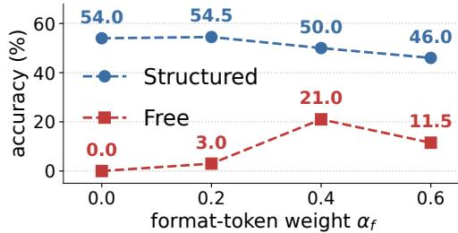  
Figure 4: Format-token weight ablation on Qwen3.5-2B (25% sparsity) with API-Bank L1. Higher $\alpha _ { f }$ trades structured accuracy for free-generation accuracy, as intended.

Distillation: loss components. Table 5 ablates the components of SKIM’s distillation recipe on Qwen3.5-2B and BFCL-v3 data at 25% sparsity, and Table 6 varies the weight of the vanilla outputmatching KD when it is added to the recipe. Removing the on-policy phase causes a substantial drop in structured accuracy because the student is then trained only on ground-truth prefixes, whereas at deployment it must continue from its own, possibly different, decisions. Removing the feature-distillation term causes a smaller drop, since the hidden-state target adds a coarser but still useful signal at context and decision positions. Adding the vanilla output-matching KD with coefficient $\beta = 0 . 5$ causes the largest single drop in structured accuracy but helps retain free-generation accuracy, and the sweep in Table 6 makes the structured-vs-free trade-off explicit: pure SKIM has the highest structured accuracy and no free-generation accuracy, vanilla distillation alone the opposite, and intermediate coefficients give operating points between the two. Driving free-generation accuracy to zero is the right choice only for a specialist served behind a formatter; when one com pressed model must also answer unconstrained requests, the coefficient β, like $\alpha _ { f }$ in pruning, is the knob that sets how much free-generation accuracy is kept.

Table 5: Loss ablation on Qwen3.5-2B (25% sparsity) with BFCL-v3. Each variant degrades structured accuracy; the full SKIM is the best.
<table><tr><td>Variant</td><td>Structured</td><td>Free</td></tr><tr><td>SKIM (full)</td><td>80.8</td><td>0.0</td></tr><tr><td>(-) w/o on-policy.</td><td>78.1</td><td>0.0</td></tr><tr><td>(—) w/o feature distill.</td><td>79.1</td><td>0.5</td></tr><tr><td>(+) w/ vanilla KD.</td><td>77.9</td><td>46.4</td></tr></table>

Table 6: Accuracy on Qwen3.5-2B (25% sparsity, BFCL-v3) across vanilla-KD coefficients; all rows heal one SKIM-pruned model.
<table><tr><td>Objective</td><td>Structured</td><td>Free</td></tr><tr><td>Vanilla KD only</td><td>70.0</td><td>54.0</td></tr><tr><td>SKIM,  $\beta = 0 . 5 0$ </td><td>77.9</td><td>46.4</td></tr><tr><td>SKIM,  $\beta = 0 . 2 5$ </td><td>78.4</td><td>34.7</td></tr><tr><td>SKIM,  $\beta = 0$ </td><td>80.8</td><td>0.0</td></tr></table>

Table 7: Structured accuracy on BFCL-v3 with LLM (GPT-4), tool-span-rule, and full-context labels at 25% and 50% sparsity.
<table><tr><td></td><td colspan="2">Qwen3.5-2B</td><td colspan="2">Qwen3.5-9B</td></tr><tr><td>Context labels</td><td>25%</td><td>50%</td><td>25%</td><td>50%</td></tr><tr><td>LLM (default)</td><td>80.8</td><td>64.5</td><td>85.5</td><td>77.6</td></tr><tr><td>Tool-span rule</td><td>81.7</td><td>64.3</td><td>84.0</td><td>73.0</td></tr><tr><td>Full context</td><td>79.8</td><td>66.8</td><td>78.0</td><td>70.0</td></tr></table>

Context labeling without GPT-4. Table 7 replaces the GPT-4 context labels with the rule-based tool-span labeler of § B.1 and with labeling every prompt token as context; the rule matches GPT-4 labeling on Qwen3.5-2B and trails it by 1.5–4.6 points on Qwen3.5-9B, whereas labeling the full prompt as context degrades accuracy substantially on Qwen3.5-9B.

## 5.7 Efficiency

SKIM physically removes MLP channels and attention components, so the pruned checkpoint is a smaller dense model that runs without sparse kernels. Table 8 reports decoding throughput and prefill speed relative to the dense model at 50% nominal sparsity, measured on one 48 GB A6000 for the 2B and 9B models and on two for the 27B model. Width pruning keeps the sequential depth, so single-request speedups are modest; the gains grow with model size and batch size, reaching 1.59× throughput at batch size 256 for the 27B model, and § C.4 reports batch size one as well.

Table 8: Speedups of SKIM over the dense model at 50% nominal sparsity (decoding throughput at batch size 256 and prefill speed for 4,096 tokens).
<table><tr><td>Model</td><td>Decoding Prefill</td></tr><tr><td>Qwen3.5-2B</td><td>1.29× 1.23×</td></tr><tr><td>Qwen3.5-9B 1.41×</td><td>1.37×</td></tr><tr><td>Qwen3.5-27B 1.59×</td><td>1.51×</td></tr></table>

## 6 Conclusion

We have presented SKIM, a pruning-and-distillation framework for LLM agents deployed under structured generation. SKIM operates from the observation that tokens in a tool-calling output do not all play the same role at deployment: a pruned model that preserves predictive fidelity uni formly across positions wastes capacity on outputs the constraint mechanism already guarantees. SKIM exploits a context/decision/format partition of token positions in both stages, with a categoryaware pruning saliency derived from a heteroscedastic surrogate precision and a distillation objective that minimizes forward KL on the constrained student distribution with position-aware hidden-state matching. Across the Qwen3.5 series and a Hammer-2.1-3B backbone, SKIM generally achieves the best structured-decoding accuracy on BFCL-v3 and API-Bank, with the largest gains at 50% sparsity where existing methods struggle the most.

Future work and limitations. We discuss the limitations of our work and outline directions for future work. We evaluated SKIM on models up to 27B; validation at larger scales and on non-Qwen families remains future work, and the larger-compute regime may surface trends invisible at our current scale. Our distillation corpus consists of single-turn function-calling traces, so SKIM recovers multi-step agentic behavior only indirectly; distillation on multi-step agentic trajectories largely closes the HotpotQA gap. The pruning stage adopts a layer-wise reconstruction framework, leaving category-aware extensions to end-to-end pruning methods [25, 41], and to calibration-based quantization [10, 20] open. More broadly, SKIM instantiates a general principle that constrained inference changes which output positions the model controls and therefore which weights compression should preserve, with applications to code generation and other constrained-output settings.

## Acknowledgements

This work was supported by Institute of Information & communications Technology Planning & Evaluation(IITP) grant funded by the Korea government(MSIT) (No.RS-2019-II190075, Artificial Intelligence Graduate School Program(KAIST)). This work was supported by the National Research Foundation of Korea(NRF) grant funded by the Korea government(MSIT) (RS-2022-NR070855). This work was supported by the Institute of Information & Communications Technology Planning & Evaluation (IITP) with a grant funded by the Ministry of Science and ICT (MSIT) of the Republic of Korea in connection with the Global AI Frontier Lab International Collaborative Research Agreement (No. RS-2024-00469482 & RS-2024-00509279). We declare no competing interests.

## References

[1] Rishabh Agarwal, Nino Vieillard, Yongchao Zhou, Piotr Stanczyk, Sabela Ramos, Matthieu Geist, and Olivier Bachem. On-policy distillation of language models: Learning from selfgenerated mistakes. In International Conference on Learning Representations (ICLR), 2024.

[2] Yongqi An, Xu Zhao, Tao Yu, Ming Tang, and Jinqiao Wang. Fluctuation-based adaptive structured pruning for large language models. In AAAI Conference on Artificial Intelligence (AAAI), 2024.

[3] Saleh Ashkboos, Maximilian L. Croci, Marcelo Gennari do Nascimento, Torsten Hoefler, and James Hensman. SliceGPT: Compress large language models by deleting rows and columns. In International Conference on Learning Representations (ICLR), 2024.

[4] Luca Beurer-Kellner, Marc Fischer, and Martin Vechev. Prompting is programming: A query language for large language models. Proceedings of the ACM on Programming Languages, 7 (PLDI):1946–1969, 2023.

[5] Karl Cobbe, Vineet Kosaraju, Mohammad Bavarian, Mark Chen, Heewoo Jun, Lukasz Kaiser, Matthias Plappert, Jerry Tworek, Jacob Hilton, Reiichiro Nakano, Christopher Hesse, and John Schulman. Training verifiers to solve math word problems, 2021. URL https://arxiv. org/abs/2110.14168.

[6] Daniel Deutsch, Shyam Upadhyay, and Dan Roth. A general-purpose algorithm for constrained sequential inference. In Conference on Computational Natural Language Learning (CoNLL), 2019.

[7] Peijie Dong, Zhenheng Tang, Xiang Liu, Lujun Li, Xiaowen Chu, and Bo Li. Can compressed LLMs truly act? An empirical evaluation of agentic capabilities in LLM compression. In International Conference on Machine Learning (ICML), 2025.

[8] Yixin Dong, Charlie F. Ruan, Yaxing Cai, Ruihang Lai, Ziyi Xu, Yilong Zhao, and Tianqi Chen. XGrammar: Flexible and efficient structured generation engine for large language models. In Machine Learning and Systems (MLSys), 2025.

[9] Elias Frantar and Dan Alistarh. SparseGPT: Massive language models can be accurately pruned in one-shot. In International Conference on Machine Learning (ICML), 2023.

[10] Elias Frantar, Saleh Ashkboos, Torsten Hoefler, and Dan Alistarh. GPTQ: Accurate posttraining quantization for generative pre-trained transformers. In International Conference on Learning Representations (ICLR), 2023.

[11] Saibo Geng, Martin Josifoski, Maxime Peyrard, and Robert West. Grammar-constrained decoding for structured NLP tasks without finetuning. In Conference on Empirical Methods in Natural Language Processing (EMNLP), 2023.

[12] Saibo Geng, Hudson Cooper, Michał Moskal, Samuel Jenkins, Julian Berman, Nathan Ranchin, Robert West, Eric Horvitz, and Harsha Nori. JSONSchemaBench: A rigorous benchmark of structured outputs for language models, 2025. URL https://arxiv.org/abs 2501.10868.

[13] Yuxian Gu, Li Dong, Furu Wei, and Minlie Huang. MiniLLM: Knowledge distillation of large language models. In International Conference on Learning Representations (ICLR), 2024.

[14] Song Han, Huizi Mao, and William J. Dally. Deep compression: Compressing deep neural networks with pruning, trained quantization and Huffman coding. In International Conference on Learning Representations (ICLR), 2016.

[15] Shibo Hao, Tianyang Liu, Zhen Wang, and Zhiting Hu. ToolkenGPT: Augmenting frozen language models with massive tools via tool embeddings. In Conference on Neural Information Processing Systems (NeurIPS), 2023.

[16] Geoffrey Hinton, Oriol Vinyals, and Jeff Dean. Distilling the knowledge in a neural network, 2015. URL https://arxiv.org/abs/1503.02531.

[17] Xiaoqi Jiao, Yichun Yin, Lifeng Shang, Xin Jiang, Xiao Chen, Linlin Li, Fang Wang, and Qun Liu. TinyBERT: Distilling BERT for natural language understanding. In Findings ofthe Associationfor Computational Linguistics: EMNLP, 2020.

[18] Alexander K. Lew, Tan Zhi-Xuan, Gabriel Grand, and Vikash K. Mansinghka. Sequential Monte Carlo steering of large language models using probabilistic programs, 2023. URL https://arxiv.org/abs/2306.03081.

[19] Minghao Li, Yingxiu Zhao, Bowen Yu, Feifan Song, Hangyu Li, Haiyang Yu, Zhoujun Li, Fei Huang, and Yongbin Li. API-Bank: A comprehensive benchmark for tool-augmented LLMs. In Conference on Empirical Methods in Natural Language Processing (EMNLP), 2023.

[20] Ji Lin, Jiaming Tang, Haotian Tang, Shang Yang, Wei-Ming Chen, Wei-Chen Wang, Guangxuan Xiao, Xingyu Dang, Chuang Gan, and Song Han. AWQ: Activation-aware weight quantization for on-device LLM compression and acceleration. In Machine Learning and Systems (MLSys), 2024.

[21] Qiqiang Lin, Muning Wen, Qiuying Peng, Guanyu Nie, Junwei Liao, Jun Wang, Xiaoyun Mo, Jiamu Zhou, Cheng Cheng, Yin Zhao, Jun Wang, and Weinan Zhang. Hammer: Robust function-calling for on-device language models via function masking. In International Conference on Learning Representations (ICLR), 2025.

[22] Gui Ling, Ziyang Wang, Yuliang Yan, and Qingwen Liu. SlimGPT: Layer-wise structured pruning for large language models. In Conference on Neural Information Processing Systems (NeurIPS), 2024.

[23] Zuxin Liu, Thai Hoang, Jianguo Zhang, Ming Zhu, Tian Lan, Shirley Kokane, Juntao Tan, Weiran Yao, Zhiwei Liu, Yihao Feng, Rithesh Murthy, Liangwei Yang, Silvio Savarese, Juan Carlos Niebles, Huan Wang, Shelby Heinecke, and Caiming Xiong. APIGen: Automated PIpeline for generating verifiable and diverse function-calling datasets. In Conference on Neural Information Processing Systems (NeurIPS), 2024.

[24] Chengqiang Lu, Jianwei Zhang, Yunfei Chu, Zhengyu Chen, Jingren Zhou, Fei Wu, Haiqing Chen, and Hongxia Yang. Knowledge distillation of transformer-based language models revisited, 2022. URL https://arxiv.org/abs/2206.14366.

[25] Xinyin Ma, Gongfan Fang, and Xinchao Wang. LLM-Pruner: On the structural pruning of large language models. In Conference on Neural Information Processing Systems (NeurIPS), 2023.

[26] Xin Men, Mingyu Xu, Qingyu Zhang, Qianhao Yuan, Bingning Wang, Hongyu Lin, Yaojie Lu, Xianpei Han, and Weipeng Chen. ShortGPT: Layers in large language models are more redundant than you expect. In Findings of the Association for Computational Linguistics: ACL, 2025.

[27] Pavlo Molchanov, Arun Mallya, Stephen Tyree, Iuri Frosio, and Jan Kautz. Importance estimation for neural network pruning. In IEEE/CVF Conference on Computer Vision and Pattern Recognition (CVPR), 2019.

[28] Saurav Muralidharan, Sharath Turuvekere Sreenivas, Raviraj Joshi, Marcin Chochowski, Mostofa Patwary, Mohammad Shoeybi, Bryan Catanzaro, Jan Kautz, and Pavlo Molchanov. Compact language models via pruning and knowledge distillation. In Conference on Neural Information Processing Systems (NeurIPS), 2024.

[29] OpenAI. GPT-4 technical report, 2023. URL https://arxiv.org/abs/2303.08774.

[30] Shishir G. Patil, Tianjun Zhang, Xin Wang, and Joseph E. Gonzalez. Gorilla: Large language model connected with massive APIs. In Conference on Neural Information Processing Systems (NeurIPS), 2024.

[31] Shishir G. Patil, Huanzhi Mao, Fanjia Yan, Charlie Cheng-Jie Ji, Vishnu Suresh, Ion Stoica, and Joseph E. Gonzalez. The Berkeley function calling leaderboard (BFCL): From tool use to agentic evaluation of large language models. In International Conference on Machine Learning (ICML), 2025.

[32] Yujia Qin, Shihao Liang, Yining Ye, Kunlun Zhu, Lan Yan, Yaxi Lu, Yankai Lin, Xin Cong, Xiangru Tang, Bill Qian, Sihan Zhao, Lauren Hong, Runchu Tian, Ruobing Xie, Jie Zhou, Mark Gerstein, Dahai Li, Zhiyuan Liu, and Maosong Sun. ToolLLM: Facilitating large language models to master 16000+ real-world APIs. In International Conference on Learning Representations (ICLR), 2024.

[33] Qwen Team. Qwen3.5: Towards native multimodal agents, 2026. URL https://qwen. ai/blog?id=qwen3.5.

[34] Adriana Romero, Nicolas Ballas, Samira Ebrahimi Kahou, Antoine Chassang, Carlo Gatta, and Yoshua Bengio. FitNets: Hints for thin deep nets. In International Conference on Learning Representations (ICLR), 2015.

[35] Victor Sanh, Lysandre Debut, Julien Chaumond, and Thomas Wolf. DistilBERT, a distilled version of BERT: Smaller, faster, cheaper and lighter, 2019. URL https://arxiv.org/ abs/1910.01108.

[36] Timo Schick, Jane Dwivedi-Yu, Roberto Dessì, Roberta Raileanu, Maria Lomeli, Eric Hambro, Luke Zettlemoyer, Nicola Cancedda, and Thomas Scialom. Toolformer: Language models can teach themselves to use tools. In Conference on Neural Information Processing Systems (NeurIPS), 2023.

[37] Sharath Turuvekere Sreenivas, Saurav Muralidharan, Raviraj Joshi, Marcin Chochowski, Ameya Sunil Mahabaleshwarkar, Gerald Shen, Jiaqi Zeng, Zijia Chen, Yoshi Suhara, Shizhe Diao, Chenhan Yu, Wei-Chun Chen, Hayley Ross, Oluwatobi Olabiyi, Ashwath Aithal, Oleksii Kuchaiev, Daniel Korzekwa, Pavlo Molchanov, Mostofa Patwary, Mohammad Shoeybi, Jan Kautz, and Bryan Catanzaro. LLM pruning and distillation in practice: The Minitron approach, 2024. URL https://arxiv.org/abs/2408.11796.

[38] Mingjie Sun, Zhuang Liu, Anna Bair, and J. Zico Kolter. A simple and effective pruning approach for large language models. In International Conference on Learning Representations (ICLR), 2024.

[39] Siqi Sun, Yu Cheng, Zhe Gan, and Jingjing Liu. Patient knowledge distillation for BERT model compression. In Conference on Empirical Methods in Natural Language Processing and the International Joint Conference on Natural Language Processing (EMNLP-IJCNLP), 2019.

[40] Brandon T. Willard and Rémi Louf. Efficient guided generation for large language models, 2023. URL https://arxiv.org/abs/2307.09702.

[41] Mengzhou Xia, Tianyu Gao, Zhiyuan Zeng, and Danqi Chen. Sheared LLaMA: Accelerating language model pre-training via structured pruning. In International Conference on Learning Representations (ICLR), 2024.

[42] An Yang, Anfeng Li, Baosong Yang, Beichen Zhang, Binyuan Hui, Bo Zheng, Bowen Yu, Chang Gao, Chengen Huang, Chenxu Lv, et al. Qwen3 technical report, 2025. URL https: //arxiv.org/abs/2505.09388.

[43] Zhilin Yang, Peng Qi, Saizheng Zhang, Yoshua Bengio, William W. Cohen, Ruslan Salakhutdinov, and Christopher D. Manning. HotpotQA: A dataset for diverse, explainable multi-hop question answering. In Conference on Empirical Methods in Natural Language Processing (EMNLP), 2018.

[44] Shunyu Yao, Jeffrey Zhao, Dian Yu, Nan Du, Izhak Shafran, Karthik Narasimhan, and Yuan Cao. ReAct: Synergizing reasoning and acting in language models. In International Conference on Learning Representations (ICLR), 2023.

[45] Tao Yu, Rui Zhang, Kai Yang, Michihiro Yasunaga, Dongxu Wang, Zifan Li, James Ma, Irene Li, Qingning Yao, Shanelle Roman, Zilin Zhang, and Dragomir Radev. Spider: A large-scale human-labeled dataset for complex and cross-domain semantic parsing and text-to-SQL task. In Conference on Empirical Methods in Natural Language Processing (EMNLP), 2018.

[46] Jianguo Zhang, Tian Lan, Ming Zhu, Zuxin Liu, Thai Hoang, Shirley Kokane, Weiran Yao, Juntao Tan, Zhiwei Liu, Yihao Feng, Juan Carlos Niebles, Shelby Heinecke, Huan Wang, Silvio Savarese, and Caiming Xiong. xLAM: A family of large action models to empower AI agent systems. In Nations of the Americas Chapter of the Association for Computational Linguistics (NAACL), 2025.

[47] Lianmin Zheng, Liangsheng Yin, Zhiqiang Xie, Chuyue Sun, Jeff Huang, Cody Hao Yu, Shiyi Cao, Christos Kozyrakis, Ion Stoica, Joseph E. Gonzalez, Clark Barrett, and Ying Sheng. SGLang: Efficient execution of structured language model programs. In Conference on Neural Information Processing Systems (NeurIPS), 2024.

## A Further Related Works

Tool-calling LLM agents. Large language models are widely deployed as autonomous agents interacting with external APIs [44, 36, 30, 32, 46, 19]. As these agents transition to productionscale deployments, they face intertwined bottlenecks in efficiency and reliability. While prior work improved robustness via tool embeddings [15] or function masking [21], reliable deployment fundamentally requires syntactically flawless API requests (e.g., strict JSON). Because even minor structural deviations cause cascading execution failures, production pipelines overwhelmingly rely on mechanisms that explicitly enforce the desired output structure.

Structured generation. Structured generation enforces a grammar at inference time, guaranteeing structurally valid outputs. Early constrained-decoding algorithms [6, 11] formalized this idea, and modern engines [4, 40, 18] realize it efficiently by masking invalid tokens against predefined schemas or finite-state machines. Their objective is faithful, low-overhead grammar enforcement, and the LLM is treated as a black box that the engine wraps without modification. A grammar, however, makes some token positions deterministic and others not - at deterministic positions the constraint uniquely fixes the next token, while at the rest the model’s prediction selects the output. This position-level asymmetry is outside the scope of grammar-enforcement engines, but for compression methods designed for the structured-generation regime it is exactly the signal worth exploiting for compression under structured generation.

LLM pruning. LLM pruning methods divide along two axes: pruning granularity and saliency framework. Along the granularity axis, methods range from unstructured pruning, which scores individual weights [9, 38], to structured pruning that removes whole architectural units (channels, attention heads, or transformer blocks) for wall-clock speedups on dense hardware [25, 3, 26, 2, 22]. Along the saliency-framework axis, magnitude-based scoring [14] and gradient-based scoring [25, 27] estimate per-unit importance from weights and gradients. Layer-wise reconstruction, the framework most relevant to SKIM, scores units by how much zeroing them perturbs the layer’s output on calibration activations [9, 38, 2, 22]; within this family, SparseGPT and SlimGPT additionally update the remaining weights to absorb the reconstruction error, while Wanda and FLAP do not. After pruning, most methods recover lost capability through post-hoc fine-tuning or knowledge distillation [41, 28]. SKIM extends layer-wise reconstruction by partitioning calibration activations by the role each position plays under structured generation, and pairs the position-aware saliency with a constrained-distribution distillation recipe rather than standard output-matching distillation. We accordingly select Wanda [38], FLAP [2], and SlimGPT [22] as baselines, spanning layer-wise reconstruction and providing the most direct comparison to SKIM.

LLM distillation. Knowledge distillation (KD) facilitates knowledge transfer from a teacher to a student model by matching output distributions or intermediate hidden states [16, 34]. While KD has long been a well-established paradigm in language modeling [17, 35, 39], recent research has shifted toward on-policy approaches, where students learn from their own generated trajectories to improve alignment in generative tasks [13, 1, 42]. Additionally, KD has been utilized to recover performance degradation following LLM pruning [28, 37]. However, to the best of our knowledge, no existing studies have explored KD specifically within the context of grammar-constrained decoding.

## B Implementation Details

## B.1 SKIM: Pruning

Per-category normalization. In practice, the per-category activation sums in the saliency formulation are averaged within each category before α-weighted aggregation. The implemented saliency score is

$$
S _ { i } ^ { \mathrm { p o s } } \ = \ \left( \alpha _ { c } \cdot \frac { 1 } { | P _ { c } | } \sum _ { t \in P _ { c } } X _ { t i } ^ { 2 } + \alpha _ { d } \cdot \frac { 1 } { | P _ { d } | } \sum _ { t \in P _ { d } } X _ { t i } ^ { 2 } + \alpha _ { f } \cdot \frac { 1 } { | P _ { f } | } \sum _ { t \in P _ { f } } X _ { t i } ^ { 2 } \right) \cdot { \left\| { W _ { i , : } } \right\| } _ { 2 } ^ { 2 } ,\tag{18}
$$

which differs from Eq. 11 by the $1 / | P _ { \kappa } |$ factors. Without this normalization, the most populous category (typically format) would dominate the saliency irrespective of the chosen α values: even with $\alpha _ { f } \ll \alpha _ { d }$ , an unweighted format sum can outweigh a small but heavily weighted decision sum simply because $| P _ { f } | \gg | { \bf \breve { \cal P } } _ { d } |$ on the calibration set. The same per-category averaging is used in the self-attention and linear-attention saliencies described below.

Table 9: Surrogate precision design comparison on Hammer-3B at 20% sparsity. Numbers are tooluse accuracy (%) after pruning and distillation under matched compute.
<table><tr><td>Surrogate precision</td><td> $\mathrm { B F C L - v } 3$ </td><td>API-Bank</td></tr><tr><td>Exponential (Eq. 19)</td><td>80.3</td><td>63.7</td></tr><tr><td>Additive (Eq. 18)</td><td>88.1</td><td>72.9</td></tr></table>

Surrogate precision design: additive vs. exponential. The form of $\tilde { H } _ { i i } ^ { \mathrm { p o s } }$ is one of several ways to encode the position-level inductive bias into the diagonal Hessian. The form used throughout SKIM is the additive one already introduced in Eq. 18: each category contributes a non-negative weighted average of squared activations into the precision. A natural alternative is an exponential form that treats context and decision positions as additive precision gains and format positions as multiplicative variance injection:

$$
\begin{array} { r } { S _ { i } ^ { \mathrm { c x p } } = \Bigg ( \alpha _ { c } \cdot \frac { 1 } { | P _ { c } | } \sum _ { t \in P _ { c } } X _ { t i } ^ { 2 } + \alpha _ { d } \cdot \frac { 1 } { | P _ { d } | } \sum _ { t \in P _ { d } } X _ { t i } ^ { 2 } \Bigg ) \cdot \exp { \Bigg ( - 2 \alpha _ { f } \cdot \frac { 1 } { | P _ { f } | } \sum _ { t \in P _ { f } } X _ { t i } ^ { 2 } \Bigg ) } \cdot \big \| W _ { i , : } \big \| _ { 2 } ^ { 2 } . } \end{array}\tag{19}
$$

This decouples format positions from the additive precision pool and instead penalizes neurons whose activations concentrate on format tokens through an exponential gate.

Table 9 compares the two on Hammer-3B at 20% sparsity. The additive form is both simpler and stronger on both benchmarks, so we adopt it for all main results.

Pruning unit and saliency by module type. SKIM applies category-aware saliency at three different granularities, chosen to match the architecture of each module type in Qwen3.5. We describe the prunable unit (intermediate neuron, KV group, or linear-attention group); the saliency in Eq. 18 is applied to the input feature of the projection whose input feature index coincides with that unit.

• MLP. The structured unit is the intermediate MLP neuron, which appears as an output dimension of $\mathsf { g a t e \_ p r o j }$ and up\_proj and as an input dimension of down\_proj. We score neuron j by applying Eq. 18 to down\_ $\tt { - } p r o j$ , identifying its input feature index with the neuron index. Removing neuron j zeros the corresponding output dimension of gate\_proj and up\_proj and the corresponding input dimension of down\_proj.

• Self-attention (regular softmax attention, with $\mathtt { q \_ p r o j } , \mathtt { k \_ p r o j } , \mathtt { v \_ p r o j } , \mathtt { o \_ p r o j } )$ The structured unit is the KV group: the head dimensions associated with one shared $( K , V )$ pair across the query heads in that group. Eq. 18 is applied per KV group rather than per $\mathsf { o \_ p r o j }$ channel, because the group, not the channel, is the pruning unit and its query heads share one (K, V ) pair: we score each KV group by the projected head-output energy $\lVert A _ { t } ^ { ( h ) } W _ { O } ^ { ( h ) } \rVert _ { 2 } ^ { 2 }$ , summed over the query heads in the group and averaged within each token category, then aggregated across categories with the same $\left( \alpha _ { c } , \alpha _ { d } , \alpha _ { f } \right)$ as MLP pruning. Dropping a KV group zeros the corresponding output dimensions of $W _ { Q } , W _ { K } , W _ { V }$ and the corresponding input dimensions of $\bar { W } _ { O }$ in that group.

• Linear attention (the linear\_attn module in Qwen3.5’s Gated DeltaNet block, architecturally distinct from regular self-attention). The structured unit is the linear-attention group: the channel block shared across the input projections, conv1d, and out\_proj. We score individual channels by applying Eq. 18 to out\_proj (identifying its input feature index with the channel index), then aggregate channel scores within each group; the group, not the channel, is the prunable unit. Dropping a group zeros the corresponding output dimensions of the input projections (and conv1d, if present) and the corresponding input dimensions of out\_proj in the same layer.

Token category labels on calibration data. We classify calibration positions into context, decision, and format using a hybrid rule. Output positions (positions the model generates) are labeled by their role in the call: function names, argument names and values, and the brackets and commas that set the number of calls are decision positions unless the grammar forces them $( | \nu _ { t } | = 1 ) ;$ all other output positions are format. |V | alone does not separate the two, as the JSON grammar admits optional whitespace almost everywhere. Input positions are not all treated as context: only tool-relevant input tokens (function signatures, argument descriptions, the user query) are labeled context, and these labels are produced by prompting GPT-4 [29] over each calibration prompt and asking which spans are tool-relevant. Remaining input tokens (system boilerplate, role markers, special tokens) are excluded from $P _ { c } , P _ { d } , P _ { f }$ entirely and do not contribute to any saliency sum.

Context labels without GPT-4. Table 7 compares the GPT-4 labels with two alternatives that need no proprietary model: a tool-span rule that labels as context the spans holding tool or function names, parameter names, parameter descriptions, and the user query, which selects about 26% of the prompt tokens, and labeling every prompt token as context. The rule matches GPT-4 labeling on Qwen3.5-2B and trails it by 1.5–4.6 points on Qwen3.5-9B, whereas labeling the full prompt as context degrades accuracy substantially on Qwen3.5-9B, so identifying the relevant spans matters more than preserving every token of the prompt, and the rule is a reproducible alternative.

Hyperparameters and procedure. For all main results we use $\alpha _ { c } = 1 . 0 , \alpha _ { d } = 1 . 0 , \alpha _ { f } = 0 . 2$ held fixed across model and target sparsity. The calibration set is the same xLAM-FC [23] subset used by the layer-wise reconstruction baselines. Pruning is one-shot in the Wanda sense [38]: for each module we compute the saliency once, prune the lowest-scoring units to that module’s target sparsity, and do not perform sequential weight updates as in SparseGPT [9]. The per-layer sparsity allocation across the network follows FLAP [2]; SKIM’s contribution is in the saliency, not in this allocation: Table 10 shows that giving every layer the same budget performs comparably.

Table 10: Pruning schedule on Qwen3.5-2B and BFCL-v3 (three further seeds, mean ± std.).
<table><tr><td>Schedule</td><td></td><td>25% sparsity 50% sparsity</td></tr><tr><td>Adaptive across layers (default)</td><td> $7 9 . 8 \pm 1 . 7$ </td><td> $6 4 . 8 \pm 0 . 9$ </td></tr><tr><td>Uniform across layers</td><td> $7 8 . 7 \pm 0 . 9$ </td><td> $6 6 . 7 \pm 0 . 7$ </td></tr></table>

Sensitivity to the category weights. Table 11 compares three weightings of $\left( \alpha _ { c } , \alpha _ { d } , \alpha _ { f } \right)$ on a random subset of 100 BFCL-v3 items, so the values are comparable only within the table. The context- and decision-heavy weighting is best at every scale and sparsity, followed by the uniform weighting and then the format-heavy weighting (the two tie at 25% on Qwen3.5-2B); the key choice is to prioritize context and decision positions over format positions rather than one specific tuple.

Table 11: Structured accuracy on a 100-item subset of BFCL-v3 under three category weightings.
<table><tr><td rowspan="2">Weighting  $\left( \alpha _ { c } , \alpha _ { d } , \alpha _ { f } \right)$ </td><td colspan="2">Qwen3.5-2B</td><td>Qwen3.5-4B</td><td>Qwen3.5-9B</td></tr><tr><td>25%</td><td>50%</td><td>50%</td><td>50%</td></tr><tr><td>Context- and decision-heavy (2.0, 2.0, 0.5)</td><td>80.0</td><td>69.0</td><td>79.0</td><td>81.0</td></tr><tr><td>Uniform (1.0, 1.0, 1.0)</td><td>79.0</td><td>54.0</td><td>75.0</td><td>77.0</td></tr><tr><td>Format-heavy (0.5, 0.5, 2.0)</td><td>79.0</td><td>47.0</td><td>73.0</td><td>74.0</td></tr></table>

## B.2 SKIM: Distillation

Loss. The full SKIM training objective combines the on-policy constrained-KL term (Eq. 15) with a position-aware hidden-state matching term:

$$
\mathcal { L } _ { \mathrm { S K I M } } = \mathcal { L } _ { \mathrm { K D } } + \hat { \lambda } _ { H } \mathcal { L } _ { \mathrm { h i d d e n } } ,\tag{20}
$$

where

$$
{ \mathcal { L } } _ { \mathrm { h i d d e n } } = \sum _ { \ell \in L } \sum _ { t } { \hat { \alpha } } _ { \mathrm { c a t } ( t ) } \left\| h _ { t } ^ { ( p , \ell ) } - h _ { t } ^ { ( q , \ell ) } \right\| _ { 2 } ^ { 2 } , \qquad { \hat { \alpha } } _ { c } = { \frac { \alpha _ { c } } { \sum _ { c ^ { \prime } } \alpha _ { c ^ { \prime } } } } ,\tag{21}
$$

and $h _ { t } ^ { ( p , \ell ) } , h _ { t } ^ { ( q , \ell ) }$ are the teacher and student hidden states at position t following transformer block ℓ. The matched layer set L contains three transformer block outputs spaced every other layer, i.e., $L = \{ \ell _ { 0 } , \ell _ { 0 } + 2 , \ell _ { 0 } + 4 \}$ for a chosen $\ell _ { 0 } .$ . The per-position weights ${ \hat { \alpha } _ { \mathrm { c a t } ( t ) } }$ form a probability distribution over the three categories $( \sum _ { c } \hat { \alpha } _ { c } = 1 )$ , so αˆ controls only the relative importance of context, decision, and format positions while the scalar $\hat { \lambda } _ { H }$ controls the overall weight of the hiddenstate objective. The unnormalized weights $( \alpha _ { c } , \alpha _ { d } , \alpha _ { f } ) = ( 1 . 0 , 1 . 0 , 0 . 2 )$ are reused exactly from the pruning saliency, giving $( \hat { \alpha } _ { c } , \hat { \alpha } _ { d } , \hat { \alpha } _ { f } ) = ( 5 / 1 1 , 5 / 1 1 , 1 / 1 1 )$ ; we use $\hat { \lambda } _ { H } = 1 . 1$ throughout, and we match raw L2 distances without per-layer normalization or cosine terms.

On-policy distillation (OPD). Off-policy distillation evaluates both models only on ground-truth prefixes $\boldsymbol { y } _ { < t } ^ { * }$ . Under structured decoding, a decision that differs from the ground truth, such as another function name, makes the grammar follow that function’s schema, so the following positions and valid sets $\nu _ { t }$ do not appear in the ground-truth sequence. A pruned student often makes such decisions and must continue from them at deployment. On-policy distillation [1, 13] trains the student on its own responses; SKIM generates them under the grammar, so the constrained KL of Eq. 15 covers the decision positions and valid sets the deployed student reaches.

Phase 1 – off-policy warm-up (first 25% of optimizer steps). Targets use the ground-truth completions $y ^ { * }$ from the xLAM-FC subset: the teacher distribution $p _ { \phi } ( \cdot \mid x , y _ { < t } ^ { * } )$ is evaluated by teacherforcing the ground-truth $\boldsymbol y _ { < t } ^ { * }$ , and the student matches this distribution under ${ \mathcal { L } } _ { \mathrm { K D } }$ and ${ \mathcal { L } } _ { \mathrm { h i d d e n } }$ at the same positions; this warm-up gives stable targets before the student sees its noisy early rollouts.

Phase 2 – on-policy (remaining 75% of optimizer steps). For each $x ,$ the current student generates y of ${ \mathcal { L } } _ { \mathrm { K D } }$ (up to 300 new tokens) greedily from $q _ { \phi }$ instead of sampling, as at evaluation, under the example’s JSON-schema grammar (XGrammar), with end-of-sequence masked until the grammar can terminate; an example whose grammar fails to compile or whose rollout is empty falls back to its ground-truth completion. Categories and $\nu _ { t }$ are recomputed on the rollout, where the teacher is teacher-forced and both losses are computed; no gradient flows through it (the sg in ${ \mathcal { L } } _ { \mathrm { K D } } )$

Hyperparameters. All models share the same training hyperparameters. Training runs for 2 epochs at a learning rate of $1 \times 1 0 ^ { - 5 }$ , with effective batch size 4 (4 gradient accumulation steps) and maximum sequence length 1,300 tokens. Distillation uses a 4096-sample subset of xLAM-FC [23], matching the subset used for pruning calibration. The distillation temperature is 2.0, applied to both teacher and student logits before computing $D _ { \mathrm { K L } } ( p _ { \phi } \parallel q _ { \phi } )$ We run all experiments on NVIDIA A6000 (48 GB VRAM), A100 (80 GB VRAM), and H200 (141 GB VRAM) GPUs, with 256 GB system RAM and 1 TB local NVMe storage per node. With two A100 GPUs, we can run a single SKIM experiment which takes around 6–12 hours end to end, depending on the model size.

Mixing with vanilla distillation. Table 6 adds the vanilla output-matching distillation of Eq. 12 to the SKIM objective with a coefficient $\beta$ on Qwen3.5-2B at 25% sparsity. Pure SKIM has the highest structured accuracy and no free-generation accuracy, vanilla distillation alone the opposite, and intermediate coefficients give operating points in between.

## C Further experiments

## C.1 Motivating experiment

To complement the post-hoc error analysis in Figure 2 (right), we run a controlled ablation on MLP neurons. We restrict the experiment to MLP pruning, since MLP intermediate channels admit a clean per-neuron specialization score; the resulting evidence is therefore specifically about the MLP pathway. For each MLP intermediate neuron i in each transformer layer, we measure its mean squared activation on tokens of each category $c \in$ {context, decision, format} over the calibration set:

$$
A _ { i } ^ { c } = \frac { 1 } { | \mathcal { T } _ { c } | } \sum _ { t \in \mathcal { T } _ { c } } h _ { i } ( t ) ^ { 2 } ,\tag{22}
$$

where $h _ { i } ( t )$ is the i-th intermediate activation at token position t and $\mathcal { T } _ { c }$ is the set of calibration positions of category c. The category-c specialization score of neuron i is then

$$
s _ { i } ^ { c } = \frac { A _ { i } ^ { c } } { \sum _ { c ^ { \prime } } A _ { i } ^ { c ^ { \prime } } } ,\tag{23}
$$

and we call neuron i category-c specialized if $s _ { i } ^ { c } \geq \theta$ with $\theta \ : = \ : 0 . 6 ,$ i.e., more than 60% of its activation budget on the calibration set concentrates on a single category. For each category $c ,$ we then zero the corresponding down-projection rows for all category-c-specialized neurons across all layers. random ablates an equal number of random MLP neurons; dense is the unpruned model.

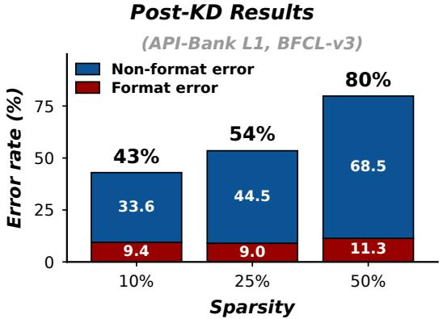  
Figure 5: Pruned-then-distilled model performance averaged over three baselines, two benchmarks, and Qwen3.5-0.8B/2B (§ 3.2). Pruned baseline error grows with sparsity, but non-format error dominates: capacity is misallocated to format behavior the constraint mechanism enforces for free.

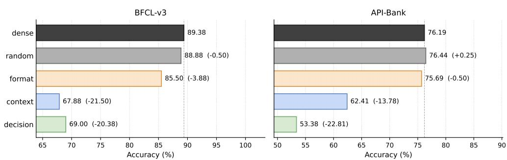  
Figure 6: Task accuracy under category-specialized MLP ablation on BFCL-v3 (left) and API-Bank L1 (right) on Hammer2.1-3B model. context, decision, andformat ablate MLP neurons whose activation budget on the calibration set concentrates $( s _ { i } ^ { c } \geq 0 . 6 )$ on the corresponding token category; random ablates the same number of MLP neurons uniformly at random; dense is the unpruned baseline. Format-specialized ablation barely affects accuracy, while context- or decision-specialized ablation causes sharp drops in accuracy relative to the dense baseline.

Figure 6 reports task accuracy on BFCL-v3 and API-Bank. Ablating format-specialized neurons keeps accuracy within ∼4 points of random on both benchmarks, while ablating context-specialized neurons drops accuracy by 13.8 to 21.5 points and ablating decision-specialized neurons drops accuracy by 20.4 to 22.8 points. These results provide direct evidence that format-specialized MLP capacity is largely dispensable when structured decoding handles formatting, whereas context- and decision-specialized MLP capacity is essential for task accuracy and must be preserved by pruning.

## C.2 Pruning analysis for tool-expert model

If SKIM’s position-aware advantage exploits role specialization at the neuron level, one expects more such specialization in a model that has been fine-tuned specifically for tool calling than in a general-purpose model. Hammer-2.1-3B is a tool-specifically fine-tuned LLM in the same parameter range as Qwen3.5-2B, and we contrast the two directly using the specialization criterion of §C.1, namely $s _ { i } ^ { c } \geq \theta = 0 . 6$ for at least one token category c.

Figure 7 reports the aggregate fraction of MLP neurons specialized for each category across the entire network. The most striking gap is in the decision category: 15.7% of Hammer-2.1-3B’s MLP neurons are decision-specialized, against only 6.8% in Qwen3.5-2B. Most of the difference comes out of the mixed pool (57.4% in Hammer vs. 65.7% in Qwen3.5-2B), with context- and format-specialized fractions roughly comparable across the two models. The tool-specific finetuning regime appears to convert mixed neurons into decision-specialized ones, consistent with the intuition that a function-calling objective rewards neurons that respond selectively at constrained branch points, where the format admits more than one continuation.

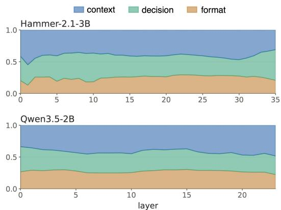

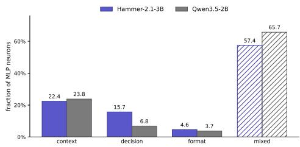  
Figure 7: Aggregate fraction of MLP neurons specialized for each token category on Hammer2.1- 3B and Qwen3.5-2B. context, decision,format correspond to context, decision, and format positions respectively; mixed denotes neurons that do not satisfy the θ = 0.6 threshold for any single category.  
Figure 8: Layer-wise fraction of MLP neurons assigned to each token category by their largest selectivity score on Hammer-2.1-3B (top) and Qwen3.5-2B (bottom); unlike Fig. 7, every neuron is assigned to one category. At most layers, Hammer-2.1-3B has the larger decision fraction.

Figure 8 resolves this picture by depth. At most layers beyond the first few, Hammer2.1-3B sits above Qwen3.5-2B on the decision share, recapitulating the aggregate pattern at the layer level.

The implication for SKIM is that the position-aware saliency has a larger pool of clearly specialized neurons to work with on tool-expert models. This is consistent with Table 2: SKIM’s margin over baselines on Hammer2.1-3B is largest at 50% sparsity, where the budget is tight enough that correctly identifying which neurons can be removed (the format-specialized ones) and which must be preserved (the context- and decision-specialized ones) determines the outcome.

## C.3 Memory Efficiency

We report SKIM’s memory footprint on Qwen3.5-2B, measured on physically compacted models in which the masked neurons and groups have been removed from the weight tensors. Table 12 reports parameter count, whole-model sparsity, and GPU memory at two points: at load (after the compacted model has been loaded onto the GPU) and peak (the maximum observed during a representative inference run). Whole-model sparsity is the realized parameter reduction across the full model: the nominal setting applies only to the prunable projections (MLP and self/linearattention modules), so embeddings, lm-head, and untouched layers pull the realized number down. At 50% nominal sparsity, SKIM removes 34.14% of the parameters, which reduces both the loadtime and the peak GPU memory by roughly 1.2 GiB at both points.

## C.4 Throughput

Table 13 reports decoding throughput and prefill speed relative to the dense model at 50% nominal sparsity, measured on one 48 GB A6000 for the 2B and 9B models and on two for the 27B model.

Table 12: Memory footprint of Qwen3.5-2B under SKIM, measured on physically compacted models. At load is the GPU memory after weight loading; peak is the maximum GPU memory observed at any point during one representative inference run.
<table><tr><td></td><td>Params</td><td>Whole-model sparsity</td><td>GPU memory at load</td><td>Peak GPU memory</td></tr><tr><td>Dense</td><td>1.88 B</td><td></td><td>7.010 GiB</td><td>7.358 GiB</td></tr><tr><td>SKIM-10%</td><td>1.75 B</td><td>6.77%</td><td>6.792 GiB</td><td>7.130 GiB</td></tr><tr><td>SKIM-25%</td><td>1.56 B</td><td>17.07%</td><td>6.420 GiB</td><td>6.754 GiB</td></tr><tr><td>SKIM-50%</td><td>1.24 B</td><td>34.14%</td><td>5.821 GiB</td><td>6.151 GiB</td></tr></table>

Table 13: Speedups over the dense model at 50% nominal sparsity.
<table><tr><td>Model</td><td>Parameters</td><td>Decode, batch 1</td><td>Decode, batch 256</td><td>Prefill, 4,096 tokens</td></tr><tr><td>Qwen3.5-2B</td><td> $1 . 8 8 \mathrm { B }  1 . 2 4 \mathrm { B }$ </td><td>1.03×</td><td>1.29×</td><td>1.23×</td></tr><tr><td>Qwen3.5-9B</td><td> $8 . 9 5 \mathrm { B }  6 . 0 6 \mathrm { B }$ </td><td>1.13×</td><td>1.41×</td><td>1.37×</td></tr><tr><td>Qwen3.5-27B</td><td> $2 6 . 9 \mathrm { B }  1 6 . 7 \mathrm { B }$ </td><td>1.17×</td><td>1.59×</td><td>1.51×</td></tr></table>

Width pruning keeps the sequential depth, so single-request speedups are modest, and the gains grow with model size and with batch size, as expected for width pruning.

## C.5 Seed variation and larger scale

Table 14 repeats the Qwen3.5-2B comparison of Table 1 on BFCL-v3 over three further random seeds, and Table 15 repeats SKIM on Qwen3.5-4B and 9B and adds Qwen3.5-27B, for which no baselines were run. In Table 1 the free-generation accuracy of SlimGPT on Qwen3.5-9B at 50% sparsity (62.5) slightly exceeds its structured accuracy (59.1); over three seeds the two values are tied within variation (structured $6 0 . 0 \pm 3 . 1$ , free $6 0 . 1 \pm 4 . 8 )$ . Constrained decoding changes the token space available to the model rather than correcting its prediction, so it can occasionally exclude a semantically acceptable output of unconstrained decoding.

Table 14: Structured accuracy of each method on Qwen3.5-2B and BFCL-v3 over three further random seeds. Each cell reports the mean ± standard deviation across the seeds.
<table><tr><td>Method</td><td>25% sparsity</td><td>50% sparsity</td></tr><tr><td>Wanda-sp</td><td> $6 4 . 9 \pm 1 . 0$ </td><td> $2 6 . 4 \pm 1 . 3$ </td></tr><tr><td>SlimGPT</td><td> $7 4 . 9 \pm 0 . 7$ </td><td> $4 7 . 8 \pm 0 . 4$ </td></tr><tr><td>FLAP</td><td> $7 6 . 8 \pm 0 . 7$ </td><td> $5 4 . 7 \pm 0 . 6$ </td></tr><tr><td>SKIM (ours)</td><td> ${ \bf 7 9 . 8 \pm 1 . 7 }$ </td><td> ${ \bf 6 4 . 8 \pm 0 . 9 }$ </td></tr></table>

Table 15: Structured accuracy of SKIM on BFCL-v3 over three further random seeds (mean ± std.).
<table><tr><td>Model</td><td>25% sparsity</td><td>50% sparsity</td></tr><tr><td>Qwen3.5-2B</td><td> $7 9 . 8 \pm 1 . 7$ </td><td> $6 4 . 8 \pm 0 . 9$ </td></tr><tr><td>Qwen3.5-4B</td><td> $8 4 . 7 \pm 1 . 2$ </td><td> $7 6 . 3 \pm 0 . 6$ </td></tr><tr><td>Qwen3.5-9B</td><td> $8 4 . 7 \pm 0 . 6$ </td><td> $7 7 . 3 \pm 3 . 5$ </td></tr><tr><td>Qwen3.5-27B</td><td> $8 9 . 0 \pm 0 . 0$ </td><td> $7 8 . 0 \pm 1 . 0$ </td></tr></table>

## C.6 Decoding temperature

All results use greedy decoding. Table 16 reports SlimGPT on Qwen3.5-9B at 50% sparsity under small positive temperatures; a temperature of 0.02 already accounts for most of the loss.

Table 16: Structured accuracy of SlimGPT on Qwen3.5-9B at 50% sparsity (BFCL-v3) under greedy decoding and three small positive decoding temperatures.
<table><tr><td>Temperature τ</td><td>0 (greedy)</td><td>0.02</td><td>0.05</td><td>0.10</td></tr><tr><td>Structured accuracy</td><td>59.1</td><td>56.9</td><td>55.3</td><td>55.3</td></tr></table>

## C.7 Multi-step healing

Table 17 adds one epoch of healing on 128 HotpotQA trajectories to every 25%-sparsity model of Table 3; the dense row is the dense model fine-tuned on the same trajectories. Table 18 reports the same step for SKIM on Qwen3.5-2B and 9B together with its BFCL-v3 accuracy, and a variant that instead continues healing on more multi-call trajectories sampled from the xLAM-FC calibration data. Task-matched trajectory supervision brings SKIM close to the fine-tuned dense model at both scales, while its BFCL-v3 accuracy drops by at most 4.5 points from the single-turn model.

Table 17: HotpotQA F1 on Qwen3.5-2B at 25% sparsity before and after one epoch of healing on 128 HotpotQA trajectories; the dense row is the dense model fine-tuned on the same trajectories.
<table><tr><td>Method</td><td>Single-turn healing</td><td>+ HotpotQA trajectories</td></tr><tr><td>Dense</td><td>43.6</td><td>60.2</td></tr><tr><td>Wanda-sp</td><td>14.0</td><td>26.4</td></tr><tr><td>FLAP</td><td>14.5</td><td>30.7</td></tr><tr><td>SlimGPT</td><td>19.5</td><td>32.5</td></tr><tr><td>SKIM (ours)</td><td>20.2</td><td>59.7</td></tr></table>

Table 18: Multi-step healing of SKIM at 25% sparsity on Qwen3.5-2B and 9B. BFCL-v3 columns report structured accuracy and HotpotQA columns report F1.
<table><tr><td rowspan="2">Model</td><td colspan="2">Qwen3.5-2B</td><td colspan="2">Qwen3.5-9B</td></tr><tr><td>BFCL-v3</td><td>HotpotQA</td><td>BFCL-v3</td><td>HotpotQA</td></tr><tr><td>Dense, fine-tuned on HotpotQA trajectories</td><td>一</td><td>60.2</td><td>一</td><td>75.8</td></tr><tr><td>SKIM, single-turn healing</td><td>80.8</td><td>20.2</td><td>85.5</td><td></td></tr><tr><td>SKIM, + more multi-call trajectories</td><td>78.3</td><td>34.5</td><td>84.0</td><td>66.2</td></tr><tr><td>SKIM, + HotpotQA trajectories</td><td>78.7</td><td>59.7</td><td>81.0</td><td>73.5</td></tr></table>

## D Prompts and Examples

We hereby attach below the full prompts (including system prompts) and the output examples for representative success and failure cases on all three datasets: BFCL-v3, API-Bank L1, and HotpotQA. For the two tool-calling datasets (BFCL-v3 and API-Bank L1), the function-call format example and the <IMPORTANT> reminder block in the system prompt are identical across cases and have been replaced with [... format example and <IMPORTANT> reminders elided ...] in each figure for compactness. The full text of the elided block appears below.

If you choose to call a function ONLY reply in the following format   
with NO suffix:   
<tool\_call>   
<function=example\_function\_name>   
<parameter=example\_parameter\_1>   
value\_1   
</parameter>   
<parameter=example\_parameter\_2>   
This is the value for the second parameter   
that can span   
multiple lines   
</parameter>   
</function>   
</tool\_call>   
<IMPORTANT>   
Reminder:   
- Function calls MUST follow the specified format   
- Required parameters MUST be specified   
- You may provide reasoning in natural language BEFORE the function   
call, but NOT after   
- If there is no function call available, answer normally   
</IMPORTANT>  
Figure 9: Function-call format example and <IMPORTANT> reminder block elided from the percase figures. The block is token-for-token identical across all tool-calling cases.

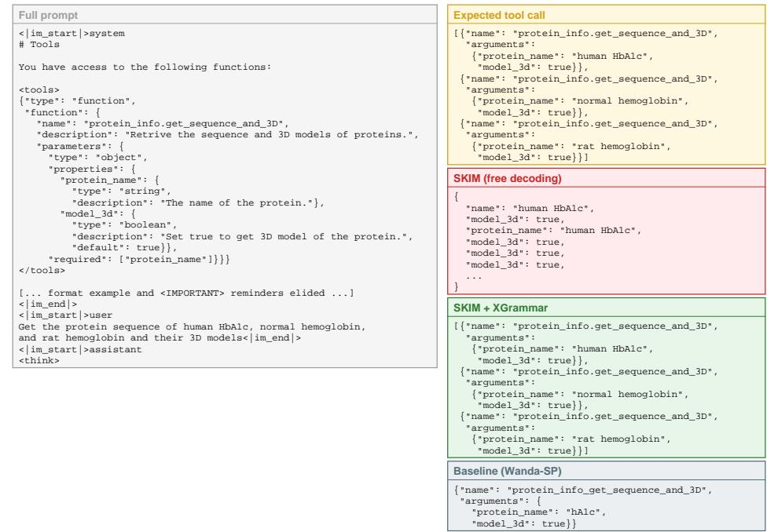  
Figure 10: BFCL-v3 success case. SKIM under free decoding collapses into a malformed loop that mixes tool-call fields with argument values; XGrammar restores the exact parallel call set. Wanda-SP at equal density emits one call with a corrupted function name and a truncated protein\_name.

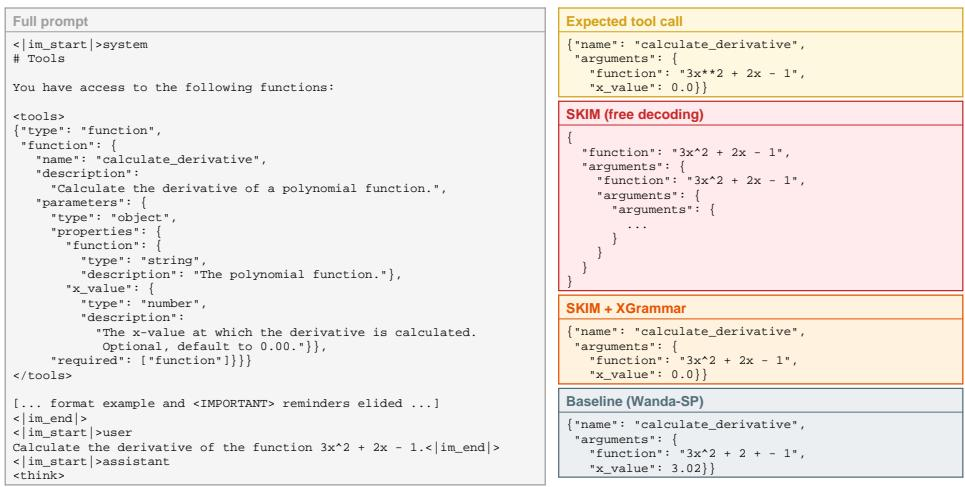  
Figure 11: BFCL-v3 failure case. Grammar enforcement repairs the structure (well-formed JSON with the right function name and argument keys), but the model writes 3x^2 where the gold uses 3x\*\*2, so the case fails exact match despite format validity. Free decoding loops; Wanda-SP corrupts the polynomial expression in the generated call.

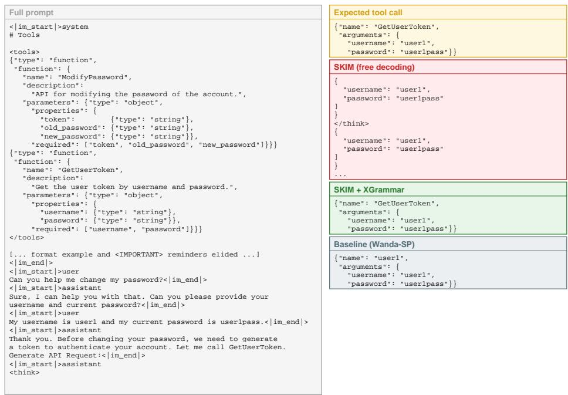  
Figure 12: API-Bank L1 success case. The multi-turn dialog requires the assistant to authenticate before modifying the password; SKIM with XGrammar emits the correct GetUserToken call. Free decoding loses the function-name slot; Wanda-SP places the username in the name field.

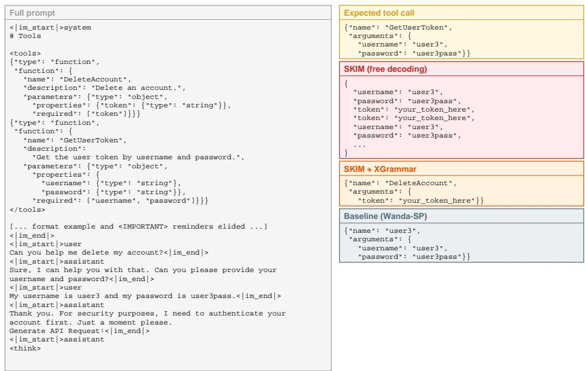  
Figure 13: API-Bank L1 failure case. The grammar-constrained decoder produces a perfectly valid call to DeleteAccount with a placeholder token; the user is still in the authentication step and the expected call is GetUserToken. The format is right, the tool is wrong.

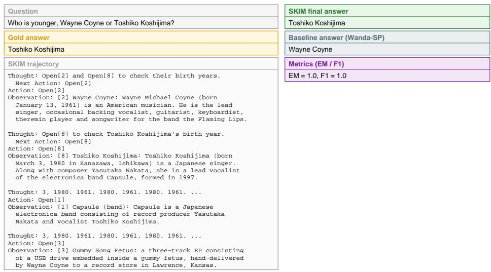  
Figure 14: HotpotQA success case. The retrieval trajectory is noisy (the model loops through Open[1] and Open[3] after already having both birth years), but SKIM converges to the correct span; EM = 1.0, F1 = 1.0. Wanda-SP returns the wrong person.

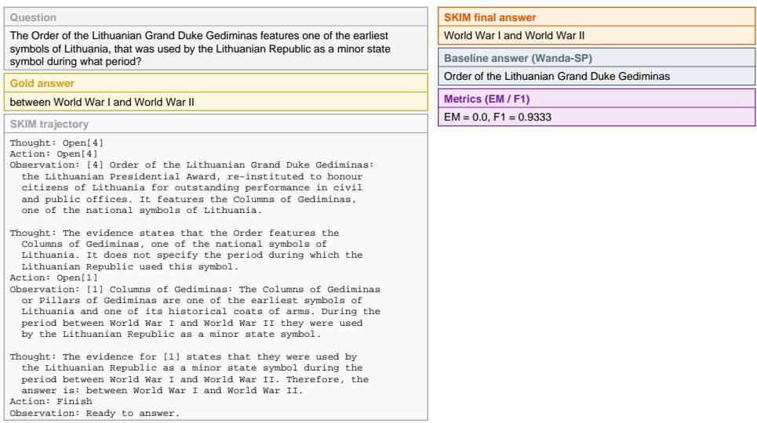  
Figure 15: HotpotQA failure case. The evidence chain is correct and the model’s own reasoning quotes the gold span verbatim, but the final answer drops the leading preposition “between”; the answer scores EM = 0.0 and F1 = 0.9333 against the gold span.

## NeurIPS Paper Checklist

## 1. Claims

Question: Do the main claims made in the abstract and introduction accurately reflect the paper’s contributions and scope?

Answer: [Yes]

Justification: The abstract and § 1 state our contributions; the structured-decoding gains widening at higher sparsity and the structured-vs-free trade-off claimed there are supported by the experiments in § 5.

## 2. Limitations

Question: Does the paper discuss the limitations of the work performed by the authors?

Answer: [Yes]

Justification: § 6 discusses limitations on model scale (up to 27B in the Qwen3.5 series, with full baseline comparisons up to 9B, and Hammer-2.1-3B), distillation data (single-turn function-calling traces only), and pruning-method scope (layer-wise reconstruction, not yet extended to end-to-end pruning or quantization).

## 3. Theory assumptions and proofs

Question: For each theoretical result, does the paper provide the full set of assumptions and a complete (and correct) proof?

Answer: [N/A]

Justification: The paper presents an empirical compression method and does not contain formal theorems or proofs requiring an assumption set. However, refer to § 4 for theoretically-motivated proposed method.

## 4. Experimental result reproducibility

Question: Does the paper fully disclose all the information needed to reproduce the main experimental results of the paper to the extent that it affects the main claims and/or conclusions of the paper (regardless of whether the code and data are provided or not)?

Answer: [Yes]

Justification: § 5 specifies the models, datasets, sparsity levels, baselines, and key hyperparameters; § B contains the full hyperparameter list and implementation specifics needed for reproduction.

## 5. Open access to data and code

Question: Does the paper provide open access to the data and code, with sufficient instructions to faithfully reproduce the main experimental results, as described in supplemental material?

Answer: [Yes]

Justification: The code with configuration files for the main experiments is available on the project page (https://moon4sake.github.io/skim); the corresponding setup and reproduction instructions are described in § 5 and § B.

## 6. Experimental setting/details

Question: Does the paper specify all the training and test details (e.g., data splits, hyperparameters, how they were chosen, type of optimizer) necessary to understand the results?

Answer: [Yes]

Justification: § 5 reports training and evaluation details (data splits, sparsity levels, calibration corpus, distillation hyperparameters, evaluation benchmarks, and decoding settings); full details are deferred to § B.

## 7. Experiment statistical significance

Question: Does the paper report error bars suitably and correctly defined or other appropriate information about the statistical significance of the experiments?

Answer: [Yes]

Justification: Tables 10, 14 and 15 report mean and standard deviation over three seeds for the pruning schedule, the main comparison on Qwen3.5-2B, and SKIM up to 27B. Compute cost prevented running multiple seeds for every (model scale, sparsity level, method) cell; the remaining cells are single runs, and robustness there is supported by trend consistency across four model scales, three sparsity levels, and two backbones in § 5.

## 8. Experiments compute resources

Question: For each experiment, does the paper provide sufficient information on the computer resources (type of compute workers, memory, time of execution) needed to reproduce the experiments?

Answer: [Yes]

Justification: § B reports the GPU type and the per-run training cost (e.g., epochs, kd budget, etc).

## 9. Code of ethics

Question: Does the research conducted in the paper conform, in every respect, with the NeurIPS Code of Ethics https://neurips.cc/public/EthicsGuidelines?

Answer: [Yes]

Justification: The work conforms with the NeurIPS Code of Ethics: it uses publicly released models and datasets under their original licenses, does not involve human subjects, and does not raise specific safety, fairness, or privacy concerns beyond those inherent to general LLM compression research.

## 10. Broader impacts

Question: Does the paper discuss both potential positive societal impacts and negative societal impacts of the work performed?

Answer: [N/A].

Justification: Our work is a foundational compression method for existing tool-calling LLMs, and its societal impact is mediated via the underlying models, with no direct application path that introduces additional positive or negative impacts beyond those of the base models being compressed.

## 11. Safeguards

Question: Does the paper describe safeguards that have been put in place for responsible release of data or models that have a high risk for misuse (e.g., pre-trained language models, image generators, or scraped datasets)?

## Answer: [N/A].

Justification: The paper does not release pretrained models or scraped datasets that pose a high risk of misuse.

## 12. Licenses for existing assets

Question: Are the creators or original owners of assets (e.g., code, data, models), used in the paper, properly credited and are the license and terms of use explicitly mentioned and properly respected?

Answer: [Yes]

Justification: All used models (Qwen3.5 series, Hammer-2.1-3B), datasets (xLAM-FC, BFCL-v3, API-Bank L1, HotpotQA, Spider, GSM8K), and baseline implementations (Wanda, FLAP, SlimGPT) are cited in § 5. All their respective licenses are respected.

## 13. New assets

Question: Are new assets introduced in the paper well documented and is the documenta tion provided alongside the assets?

Answer: [Yes]

Justification: The code released on the project page is documented with running bash scripts including training/evaluation matching the experiments in § 5.

## 14. Crowdsourcing and research with human subjects

Question: For crowdsourcing experiments and research with human subjects, does the paper include the full text of instructions given to participants and screenshots, if applicable, as well as details about compensation (if any)?

Answer: [N/A].

Justification: The work does not involve crowdsourcing or human-subject research.

## 15. Institutional review board (IRB) approvals or equivalent for research with human subjects

Question: Does the paper describe potential risks incurred by study participants, whether such risks were disclosed to the subjects, and whether Institutional Review Board (IRB) approvals (or an equivalent approval/review based on the requirements of your country or institution) were obtained?

Answer: [N/A].

Justification: The work does not involve human-subject research; no IRB approval was required.

## 16. Declaration of LLM usage

Question: Does the paper describe the usage of LLMs if it is an important, original, or non-standard component of the core methods in this research? Note that if the LLM is used only for writing, editing, or formatting purposes and does not impact the core methodology, scientific rigor, or originality of the research, declaration is not required.

## Answer: [Yes]

Justification: GPT-4 is used to label tool-related context tokens in the calibration corpus, as described in § 5 and § B. This is a labeling shortcut, not a methodological requirement: a rule-based selection of tool-related spans matches GPT-4 labeling on Qwen3.5-2B and trails it by 1.5–4.6 points on Qwen3.5-9B (Table 7).