# SPARE: Fast Linear Attention Decoding with Compact Recurrent States

Ke Wan University of Virginia tbn5pj@virginia.edu

Zaiyi Zheng University of Virginia sjc4fq@virginia.edu

Chen Chen University of Virginia zrh6du@virginia.edu

## Abstract

Linear attention reduces the quadratic sequence-length complexity of softmax attention by maintaining fixed-size recurrent states. However, these states scale quadratically with the representation dimension and require repeated data transfers during decoding, creating a substantial GPU memory bottleneck. Recent studies have revealed significant low-rank redundancy in recurrent states, suggesting opportunities for more efficient representations. We introduce SPARE (State Projection for Accelerated Recurrent Execution), a training free method that exploits this redundancy through fixed low-dimensional subspaces, heterogeneous rank allocation, and lightweight write compensation. By performing recurrent reads and updates directly on compact states, SPARE reduces memory traffic without online decomposition or dense-state reconstruction. SPARE achieves 2.55× full-model decoding speedup, 7.49× lower recurrent-kernel DRAM traffic, and 3.31× lower peak GPU memory, while preserving better associative-retrieval accuracy than structured pruning at matched memory budgets.

## 1 Introduction

Linear attention (Katharopoulos et al., 2020; Yang et al., 2023) has emerged as an efficient alternative to conventional softmax attention (Vaswani et al., 2017) for long-sequence modeling. By reformulating attention computation as recurrent state updates (Dao and Gu, 2024), linear attention summarizes historical information into fixed-size states without maintaining a growing key-value cache. However, eliminating the dependence on sequence length does not eliminate the cost of recurrent memory itself. At each decoding step, linear attention must repeatedly read and update a potentially large recurrent state matrix, requiring substantial data transfers between GPU high-bandwidth memory (HBM) and computing units (Gupta et al., 2026). These operations primarily involve matrix-vector multiplications (GEMV) and rank-one updates, which require relatively little computation compared to the amount of data transferred (Yin et al., 2014; Williams et al., 2009). Consequently, recurrentstate memory traffic can become a dominant efficiency bottleneck during decoding, particularly at high concurrency.

Reducing recurrent-state memory traffic therefore presents a promising opportunity to accelerate linear attention decoding. Prior studies have identified substantial low-rank structure in recurrent states (Nazari and Rusch, 2026), with effective ranks varying considerably across layers and heads (Sun et al., 2026), which is illustrated in Figure 1a. A natural approach is to reduce state dimensions through structured pruning of key and query channels (Nazari and Rusch, 2026). However, low-rank structure does not necessarily imply that important information is concentrated in a small subset of the original representation dimensions. Consequently, aggressive pruning may discard information essential to the model’s associative memory. Projection onto a low-dimensional subspace avoids this restriction, but allocating the same rank to every head may overlook their heterogeneous memory requirements. Thus, exploiting recurrent-state redundancy requires careful consideration of both the representation subspace and the allocation of limited state capacity.

A further challenge arises from the dynamic nature of recurrent memory. Unlike static matrix compression, a compressed recurrent state must support successive associative reads and writes, rather than merely approximate a single state matrix. Projecting keys can alter their geometry and reduce their norms, potentially changing the effectiveness of subsequent memory updates. This raises a fundamental question: can we exploit the heterogeneous low-rank structure of recurrent states to reduce decoding costs while preserving their functional capabilities? In particular, can recurrent reads and updates be performed directly in a compact lowdimensional subspace without excessive information loss?

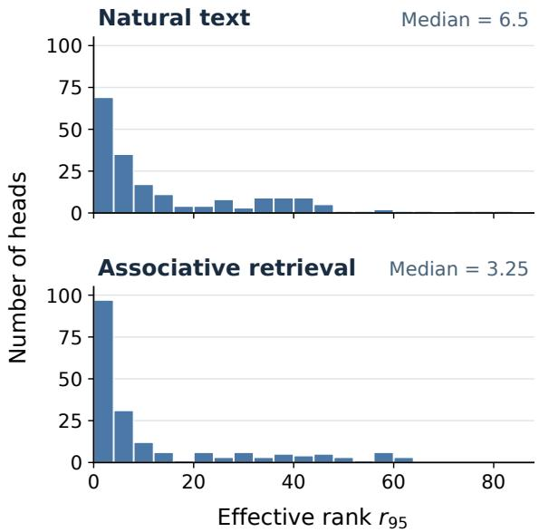  
(a) Heterogeneous effective ranks

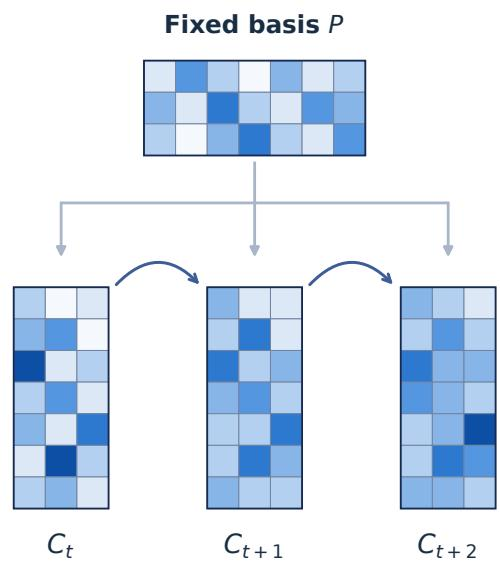  
(b) Recurrent updates in a fixed subspace  
Figure 1: Motivation and intuition of SPARE. (a) Heterogeneous low-rank recurrent states. The histograms show the distributions of effective ranks across 192 attention heads on natural text (top) and associative retrieval (bottom). For each head, we report the median $r _ { 9 5 }$ across sampled recurrent states, where $r _ { 9 5 }$ denotes the minimum rank retaining 95% of the state’s squared singular-value energy. Despite the original state dimension of $2 5 6 \times 2 5 6 .$ effective ranks are typically much smaller and vary substantially across heads. (b) Recurrent updates in a fixed subspace. SPARE represents the recurrent state as $\boldsymbol { S } _ { t } \approx \boldsymbol { C } _ { t } \boldsymbol { P } ^ { \intercal }$ , where the projection basis P remains fixed while the compact coefficient matrix $C _ { t }$ evolves across decoding steps. This allows recurrent reads and updates to operate directly on compact states of size $d _ { v } \times r .$ , rather than the original $d _ { v } \times d _ { k }$ matrices, without reconstructing the dense state.

To address these challenges, we introduce SPARE (State Projection for Accelerated Recurrent Execution), a training-free method for accelerating linear attention decoding with compact recurrent states. Instead of discarding selected representation dimensions, as shown in Figure 1b, SPARE maintains recurrent states in fixed low-dimensional key subspaces, where memory reads and updates can be performed directly. To accommodate heterogeneous memory requirements, SPARE allocates different rank budgets across layers and heads based on their recurrent-state spectral characteristics. A lightweight write-compensation mechanism further mitigates the loss of memory-writing effectiveness caused by key projection. Finally, a packed GPU implementation enables efficient recurrent computation on the compressed states without online matrix decomposition or dense-state reconstruction.

We evaluate SPARE on Gated DeltaNet (Yang et al., 2025), examining both model quality under recurrent-state compression and actual GPU decoding efficiency. Our results demonstrate substantial reductions in recurrent-state memory traffic and full-model decoding latency, together with better retrieval performance than structured pruning under matched memory budgets. These benefits involve a task-dependent quality–efficiency trade-off rather than lossless compression. In summary, our contributions are:

• We characterize the heterogeneous low-rank structure of linear attention’s recurrent states and highlight the limitations of coordinate pruning and uniform capacity allocation for compressing associative memory.

• We propose SPARE, a training-free framework that combines fixed low-dimensional state representations, heterogeneous rank allocation, and lightweight write compensation to enable efficient recurrent reads and updates.

• We demonstrate 2.55× full-model decoding speedup, 7.49× lower recurrent-kernel

DRAM traffic, and 3.31× lower peak GPU memory, while achieving substantially better retrieval accuracy than structured pruning at matched memory budgets.

## 2 Background and Motivation

## 2.1 Gated Linear Attention

We consider Gated DeltaNet (Yang et al., 2025), a representative architecture of gated linear attention. For each attention head, historical information is maintained in a recurrent state $S _ { t } \in \mathbb { R } ^ { d _ { v } \times d _ { k } }$ , where $d _ { k }$ and $d _ { v }$ denote the key and value dimensions, respectively. At each token position t, the key $\boldsymbol { k } _ { t } \in$ $\mathbb { R } ^ { d _ { k } }$ , query $\pmb q _ { t } \in \mathbb { R } ^ { d _ { k } }$ , and value $\pmb { v } _ { t } \in \mathbb { R } ^ { d _ { v } }$ are used to update and read the recurrent state:

$$
\begin{array} { r l } & { \pmb { S } _ { t } = \alpha _ { t } \pmb { S } _ { t - 1 } + \beta _ { t } \left( \pmb { v } _ { t } - \alpha _ { t } \pmb { S } _ { t - 1 } \pmb { k } _ { t } \right) \pmb { k } _ { t } ^ { \top } , } \\ & { \pmb { o } _ { t } = \pmb { S } _ { t } \pmb { q } _ { t } , } \end{array}\tag{1}
$$

where $\alpha _ { t } \in ( 0 , 1 )$ controls state decay and $\beta _ { t } \in$ (0, 1) determines the strength of the memory update. The term $S _ { t - 1 } k _ { t }$ represents the previously stored value associated with the current key. Unlike conventional attention, the recurrent state has a fixed size of $O ( d _ { k } d _ { v } )$ independent of the sequence length, but must be accessed and updated at every decoding step.

## 2.2 Recurrent-State Redundancy

Although the recurrent state $S _ { t }$ contains $d _ { v } d _ { k }$ elements, its effective dimensionality can be substantially smaller. Let $\sigma _ { t , 1 } \geq \cdot \cdot \cdot \geq \sigma _ { t , m }$ denote its singular values, where $m = \operatorname* { m i n } ( d _ { v } , d _ { k } )$ . We define the effective rank required to retain a fraction $\eta \in ( 0 , 1 )$ of the state’s spectral energy as

$$
r _ { \eta } ( S _ { t } ) = \operatorname* { m i n } \left\{ r : \frac { \sum _ { i = 1 } ^ { r } \sigma _ { t , i } ^ { 2 } } { \sum _ { i = 1 } ^ { m } \sigma _ { t , i } ^ { 2 } } \geq \eta \right\} .\tag{2}
$$

Prior studies have observed substantial low-rank structure in recurrent states (Nazari and Rusch, 2026), with effective ranks varying considerably across layers and heads (Sun et al., 2026). This suggests that allocating the same state capacity to every head may be inefficient. However, a low effective rank does not guarantee that the informative subspace aligns with the original representation dimensions or remains fixed over time. Exploiting this redundancy therefore requires a compact representation that supports efficient recurrent computation while preserving functionally important information.

## 3 SPARE: Compact Recurrent States

## 3.1 Fixed Low-Rank Representation

Motivated by the low-rank structure of recurrent memory, SPARE compresses the key dimension while preserving the full value dimension. For clarity, we omit layer and head indices and consider a fixed orthonormal basis $P \in \mathbb { R } ^ { d _ { k } \times r }$ , where $r \ll$ $d _ { k }$ and $P ^ { \top } P = I _ { r }$ . Instead of maintaining the original recurrent state $S _ { t }$ , SPARE represents it using a compact coefficient matrix $C _ { t } \in \mathbb { R } ^ { d _ { v } \times r }$

$$
\pmb { S } _ { t } \approx \widehat { \pmb { S } } _ { t } = \pmb { C } _ { t } \pmb { P } ^ { \top } .\tag{3}
$$

By projecting keys and queries into the fixed subspace,

$$
\widehat { \pmb { k } } _ { t } = \pmb { P } ^ { \top } \pmb { k } _ { t } , \qquad \widehat { \pmb { q } } _ { t } = \pmb { P } ^ { \top } \pmb { q } _ { t } ,\tag{4}
$$

the recurrent output can be computed directly as

$$
\widehat { \pmb { o } } _ { t } = \pmb { C } _ { t } \widehat { \pmb { q } } _ { t } ,\tag{5}
$$

without reconstructing the original dense state. This representation reduces the recurrent-state storage from $O ( d _ { v } d _ { k } )$ to $O ( d _ { v } r )$ while allowing the value-side representation to evolve with the input. The fixed basis and rank are determined separately for each head, as described in the following subsection.

## 3.2 Heterogeneous Rank Allocation

Since recurrent states exhibit different degrees of redundancy across layers and heads, SPARE assigns heterogeneous rank budgets using offline calibration. For each layer ℓ and head h, we estimate the normalized spectral contribution of the j-th singular direction as

$$
w _ { \ell , h , j } = \frac { \mathbb { E } _ { \mathrm { c a l } } \left[ \sigma _ { j } ^ { 2 } ( S _ { t } ^ { ( \ell , h ) } ) \right] } { \mathbb { E } _ { \mathrm { c a l } } \left[ \lVert S _ { t } ^ { ( \ell , h ) } \rVert _ { F } ^ { 2 } \right] } ,\tag{6}
$$

where $\sigma _ { j } ( S _ { t } ^ { ( \ell , h ) } )$ denotes the j-th largest singular value of the recurrent state. Given a total rank budget R, we greedily allocate additional dimensions to heads with the largest remaining spectral contributions, subject to predefined rank bounds and $\begin{array} { r } { \sum _ { \ell , h } r _ { \ell , h } = R } \end{array}$ We then construct a fixed key subspace for each head using principal component analysis (PCA) on normalized calibration keys. Specifically, we compute the uncentered secondmoment matrix

$$
\Sigma _ { \ell , h } = \frac { 1 } { N } \sum _ { i = 1 } ^ { N } \pmb { k } _ { i } ^ { ( \ell , h ) } \left( \pmb { k } _ { i } ^ { ( \ell , h ) } \right) ^ { \top } ,\tag{7}
$$

where the calibration keys are collected after the original convolution and key normalization. The projection basis $P _ { \ell , h }$ consists of the leading $r _ { \ell , h }$ eigenvectors of $\Sigma _ { \ell , h }$ and remains fixed throughout inference. This offline procedure adapts the state capacity to individual heads without introducing additional decomposition costs during decoding.

The choice of key PCA is motivated by the structure of the Gated Delta Rule. Starting from a zero initial state, each recurrent update adds a rank-one term whose right factor is the current key, implying that the row space of $S _ { t }$ lies within the span of historical keys. Consequently, principal components of calibration keys provide a natural and inexpensive approximation to the directions supporting recurrent memory. However, the dominant singular directions of the recurrent state also depend on values, gating, and interactions among historical updates, and need not coincide with those of the key covariance. We therefore use the state spectrum to estimate the relative capacity requirements of different heads, while employing key PCA to construct their fixed projection bases. This separation provides a practical approximation rather than an optimality guarantee.

## 3.3 Compact Recurrent Updates

With the fixed projection basis P , SPARE performs recurrent updates directly on the compact coefficient matrix $C _ { t }$ . The original old-value prediction is approximated by $C _ { t - 1 } \widehat { k } _ { t }$ , allowing the Gated Delta Rule to operate in the reduced-dimensional space. However, projecting the key generally reduces its norm, which can weaken the effective strength of memory writes. To mitigate this effect, SPARE introduces a bounded write-compensation factor:

$$
\begin{array} { r l } & { \rho _ { t } = \| \widehat { \pmb { k } } _ { t } \| _ { 2 } ^ { 2 } , } \\ & { \gamma _ { t } = \operatorname* { m i n } \left( \frac { 1 } { \operatorname* { m a x } \left( \rho _ { t } , \epsilon \right) } , \gamma _ { \operatorname* { m a x } } \right) , } \end{array}\tag{8}
$$

where ϵ ensures numerical stability and $\gamma _ { \mathrm { m a x } }$ limits excessive amplification. The compact recurrent state is then updated as

$$
\begin{array} { r l } & { \pmb { C } _ { t } = \alpha _ { t } \pmb { C } _ { t - 1 } } \\ & { \qquad + \beta _ { t } \gamma _ { t } \left( \pmb { v } _ { t } - \alpha _ { t } \pmb { C } _ { t - 1 } \widehat { \pmb { k } } _ { t } \right) \widehat { \pmb { k } } _ { t } ^ { \top } . } \end{array}\tag{9}
$$

This compensated update mitigates the loss of write strength caused by key projection while preserving the original value dimension. Together with the compact read operation in Eq. (5), SPARE performs recurrent computation without reconstructing the dense state or maintaining the projection basis online.

## 3.4 Theoretical Properties

The write-compensation mechanism admits a simple interpretation in terms of effective memorywriting strength. Multiplying Eq. (9) by the projected key $\widehat { \pmb { k } } _ { t }$ gives

$$
\begin{array} { r } { C _ { t } \widehat { k } _ { t } = ( 1 - \beta _ { t } \gamma _ { t } \rho _ { t } ) \alpha _ { t } C _ { t - 1 } \widehat { k } _ { t } } \\ { + \beta _ { t } \gamma _ { t } \rho _ { t } \pmb { v } _ { t } . \qquad } \end{array}\tag{10}
$$

Without compensation, the effective write strength is reduced from $\beta _ { t }$ to $\beta _ { t } \rho _ { t }$ . When neither the numerical floor nor the compensation cap is active, $\gamma _ { t } \rho _ { t } = 1$ , restoring the original write strength along the projected key direction. Furthermore, SPARE preserves the original recurrent dynamics exactly when the keys remain within the fixed subspace, as established by the following theorem.

Theorem 1 (Exactness under Subspace Invariance). Let $_ { \pmb { P } }$ be afixed orthonormal basis, and suppose $S _ { 0 } = C _ { 0 } P ^ { \intercal }$ $H k _ { t } \in \mathrm { s p a n } ( P )$ and $\| \pmb { k } _ { t } \| _ { 2 } = 1$ for every t, with $\epsilon \leq 1$ and $\gamma _ { \mathrm { m a x } } \geq 1$ , then the original and compact recurrent updates satisfy

$$
\pmb { S } _ { t } = \pmb { C } _ { t } \pmb { P } ^ { \top } , \qquad \pmb { O } _ { t } = \widehat { \pmb { o } } _ { t }\tag{11}
$$

for all t, under identical input and gating sequences.

The theorem establishes that SPARE introduces no approximation error when the fixed subspace fully captures the key directions. In practice, the subspace is approximate, and write compensation mitigates the resulting loss of effective write strength without guaranteeing exact recovery. The complete proof is provided in Appendix A.1.

## 3.5 Efficient Decoding

To translate state compression into decoding acceleration, SPARE packs the head-specific coefficient matrices into a contiguous GPU buffer without padding them to a uniform rank. Each head accesses its compact state through fixed offsets, enabling recurrent reads and updates directly on the compressed representation. For a head with rank $r _ { \ell , h }$ , the recurrent-state read/write volume scales from $O ( d _ { v } d _ { k } )$ to $O ( d _ { v } r _ { \ell , h } )$ , yielding a nominal reduction factor of $d _ { k } / r _ { \ell , h }$ before projection and auxiliary overheads. We implement these operations using GPU kernels and maintain addressstable states to support CUDA Graph execution across decoding steps. The fixed projection bases are shared across requests, while the original convolution states are preserved. Further implementation details are provided in Appendix B.

## 4 Experiments

## 4.1 Experimental Setup

Model. We evaluate SPARE on a pretrained 1.3Bparameter pure Gated DeltaNet (GDN) (Yang et al., 2025), comprising 24 layers with eight heads per layer and $d _ { k } = d _ { v } = 2 5 6$ . Model weights use BF16, while recurrent states are maintained in FP32. All compression configurations are trainingfree and use offline calibration.

Baselines. We compare SPARE against the original uncompressed model (Dense), structured key/query channel pruning (DRRQR) (Nazari and Rusch, 2026), and fixed-subspace compression with uniform head ranks (Uniform). Comparisons use matched recurrent-state memory budgets without recovery fine-tuning.

Evaluation Tasks. We evaluate language modeling using next-token NLL on WikiText-103 and associative memory using 512 four-choice retrieval prompts. For downstream evaluation, we report results on three in-context retrieval tasks: SQuAD Completion, TriviaQA, and DROP.

System Evaluation. We benchmark on NVIDIA RTX A6000 GPUs (48 GB), measuring full-model decoding latency, recurrent-kernel DRAM traffic, and peak GPU memory. All decoding comparisons use stateful CUDA Graph execution with matched workloads and same-device baselines.

## 4.2 Task-dependent Performance

Table 1 compares SPARE with DRRQR at matched recurrent-state budgets of 6 and 12 MiB across language modeling, associative retrieval, and downstream tasks. At both budgets, SPARE achieves lower language modeling NLL and substantially higher associative retrieval accuracy, reaching 60.35% compared with 33.20% for DRRQR at 12 MiB. SPARE also achieves higher average accuracy across the three downstream tasks, although DRRQR-K64 slightly outperforms SPARE-H64 on TriviaQA. Nevertheless, both compressed methods exhibit quality degradation relative to Dense, with varying sensitivity across tasks. Overall, these results highlight the advantages of compact recurrent subspaces for preserving associative retrieval performance, while revealing the task-dependent limitations of state compression.

## 4.3 Quality under State Compression

Figure 2 examines the trade-off between model quality and measured peak GPU memory across language modeling, associative retrieval, and downstream tasks. At comparable memory footprints, SPARE generally achieves better quality retention than DRRQR, with particularly pronounced advantages in associative retrieval. As the compression budget increases, SPARE progressively reduces language modeling NLL, while retrieval and downstream performance exhibit diminishing returns. Although DRRQR-K128 achieves slightly better quality on some metrics than SPARE-H96, it requires substantially more GPU memory. Overall, these results demonstrate that compact recurrent subspaces provide a favorable quality–memory trade-off across different compression budgets.

## 4.4 Decoding Efficiency

Figure 3 evaluates the decoding efficiency of SPARE across different batch sizes, reporting full-model decoding speedup, recurrent-kernel DRAM traffic reduction, and peak GPU memory reduction relative to Dense. As batch size increases, the decoding benefits of compact recurrent states become more pronounced. At batch size 512, SPARE-H32 achieves a 2.55× full-model decoding speedup, while reducing recurrent-kernel DRAM traffic by 7.49× and peak GPU memory by 3.31×. The higher-capacity SPARE-H64 retains a 1.78× decoding speedup and a 2.53× reduction in peak GPU memory at the same batch size. The gap between recurrent-kernel traffic reduction and full-model speedup reflects the remaining costs of projection and other model operations. Overall, these results demonstrate that performing recurrent reads and updates directly in compact subspaces translates substantial memory savings into practical decoding acceleration.

## 4.5 Ablation Studies and Analysis

Heterogeneous Rank Allocation. We compare heterogeneous and uniform rank allocations under identical state budgets. As shown in Figure 4(a) and Table 2, heterogeneous allocation improves associative retrieval accuracy by 14.26–23.24 percentage points across the evaluated budgets. However, uniform allocation achieves slightly lower language modeling NLL at smaller budgets, indicating that the benefits of heterogeneous allocation are task dependent.

Table 1: Task-dependent performance under recurrent-state compression. We compare SPARE with DRRQR at matched recurrent-state budgets of 6 and 12 MiB, using the uncompressed Dense model as a reference. Language modeling is evaluated using next-token NLL on WikiText-103 (lower is better). Associative retrieval accuracy is measured over 512 synthetic four-choice prompts (higher is better). Downstream results report accuracy (%) on SQuAD Completion, TriviaQA, and DROP, with Avg. denoting their unweighted mean. State denotes persistent recurrent-state storage per request, excluding model weights and other runtime memory. Bold values indicate the better result within each matched-budget comparison.
<table><tr><td colspan="3"></td><td rowspan="2">Language Modeling Associative Retrieval</td><td colspan="4">Downstream Tasks</td></tr><tr><td>Method</td><td>State (MiB)</td><td>NLL ↓</td><td>Acc. (%) ↑</td><td>SQuAD</td><td>TriviaQA</td><td>DROP</td><td>Avg.</td></tr><tr><td>Dense</td><td>48</td><td>2.290</td><td>70.51</td><td>36.92</td><td>64.28</td><td>21.85</td><td>41.02</td></tr><tr><td>DRRQR-K32</td><td>6</td><td>3.068</td><td>23.44</td><td>9.91</td><td>32.29</td><td>8.15</td><td>16.78</td></tr><tr><td>SPARE-H32</td><td>6</td><td>2.817</td><td>56.84</td><td>28.62</td><td>37.68</td><td>12.75</td><td>26.35</td></tr><tr><td>DRRQR-K64</td><td>12</td><td>2.653</td><td>33.20</td><td>21.90</td><td>50.12</td><td>15.09</td><td>29.04</td></tr><tr><td>SPARE-H64</td><td>12</td><td>2.534</td><td>60.35</td><td>30.74</td><td>48.40</td><td>18.11</td><td>32.42</td></tr></table>

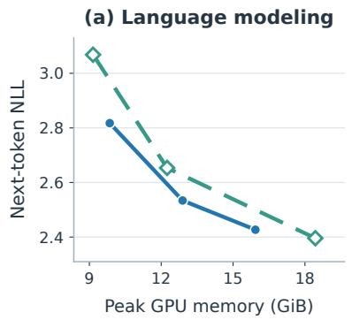

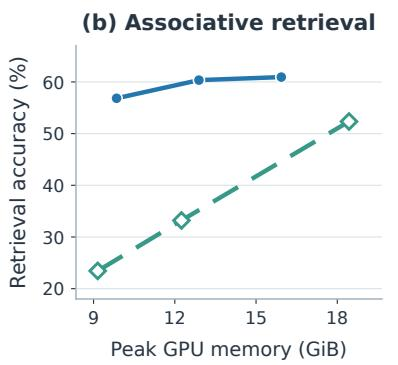

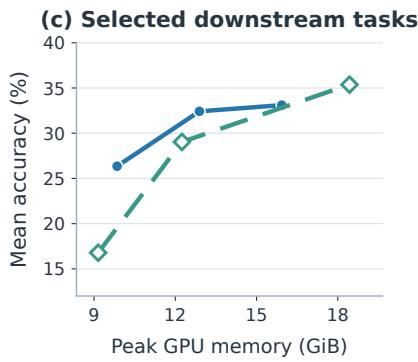  
Figure 2: Quality–memory trade-off of recurrent-state compression. We compare SPARE with DRRQR structured pruning across different compression budgets. (a) Next-token NLL on WikiText-103 (lower is better). (b) Associative retrieval accuracy over 512 four-choice prompts (higher is better). (c) Mean accuracy across three selected downstream tasks: SQuAD Completion, TriviaQA, and DROP (higher is better). Peak GPU memory is measured during full-model inference with batch size 512, a prefill length of 128 tokens, and 64 decoding steps. Across these evaluations, SPARE provides a favorable quality–memory trade-off, particularly under aggressive compression.

Subspace Construction. Figure 4(b) compares Key-, State-, and Value-based projection subspaces under matched calibration and rank budgets. Key PCA yields the highest associative retrieval accuracy among the evaluated subspaces, while Value PCA performs worst under the matched budget. These results highlight the importance of subspace construction for preserving associative memory.

Write Compensation. Figure 4(c) shows that write compensation improves retrieval accuracy by 7.62 and 11.13 percentage points for SPARE-H32 and SPARE-H64, respectively.

## 5 Related Work

## 5.1 Linear Attention and Efficient Inference

Linear attention replaces the growing key-value cache of conventional attention with fixed-size recurrent states, enabling efficient autoregressive inference (Katharopoulos et al., 2020). Subsequent architectures improve the expressiveness of recurrent memory through gating and delta-rule updates, including Gated Linear Attention (Yang et al., 2023), Gated DeltaNet (Yang et al., 2025), Kimi Delta Attention (Team et al., 2025), and Gated DeltaNet-2 (Hatamizadeh et al., 2026). Meanwhile, hardware-efficient implementations such as FlashLinearAttention (Yang et al., 2023) and Lightning Attention-2 (Qin et al., 2024) accelerate linear attention through tiled and parallel computation. Other approaches explore specialized hardware that keeps recurrent states on-chip to reduce memory transfers (Gupta et al., 2026). While these advances improve model architectures or execution efficiency, recurrent-state memory access remains a substantial cost during GPU decoding. SPARE addresses this bottleneck by reducing the amount of recurrent-state data transferred through compact state representations.

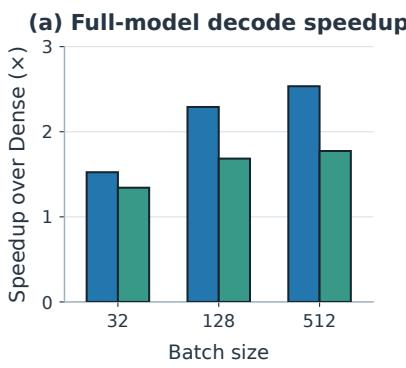

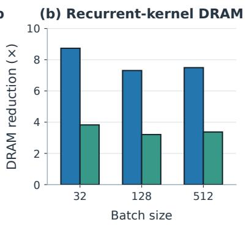

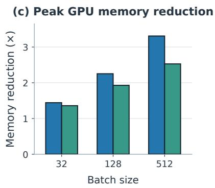  
Figure 3: Decoding efficiency and memory savings of SPARE. We evaluate SPARE-H32 and SPARE-H64 against the Dense Gated DeltaNet baseline across batch sizes of 32, 128, and 512. (a) Full-model decoding speedup relative to Dense. (b) Reduction in recurrent-kernel DRAM traffic, measured using hardware counters and normalized by the corresponding Dense kernels. (c) Reduction in peak GPU memory, computed as the ratio of Dense to SPARE peak memory usage during full-model inference. Experiments are conducted on NVIDIA RTX A6000 GPUs using stateful CUDA Graph decoding. The results demonstrate that compact recurrent states reduce memory traffic and GPU memory requirements while accelerating full-model decoding.

Table 2: Effect of heterogeneous rank allocation. Uniform SPARE and SPARE are compared under identical recurrent-state budgets. NLL is measured on WikiText-103 (lower is better), and retrieval accuracy is evaluated on 512 four-choice prompts (higher is better). Bold values indicate the better result at each matched budget.
<table><tr><td>Method</td><td colspan="3">State (MiB) NLL ↓ Acc. (%) ↑</td></tr><tr><td>Uniform32</td><td>6</td><td>2.798</td><td>33.59</td></tr><tr><td>SPARE-H32</td><td>6</td><td>2.817</td><td>56.84</td></tr><tr><td>Uniform48</td><td>9</td><td>2.658</td><td>40.63</td></tr><tr><td>SPARE-H48</td><td>9</td><td>2.680</td><td>58.40</td></tr><tr><td>Uniform64</td><td>12</td><td>2.574</td><td>46.09</td></tr><tr><td>SPARE-H64</td><td>12</td><td>2.534</td><td>60.35</td></tr></table>

## 5.2 Recurrent-State Compression

Recent studies have identified substantial low-rank redundancy in linear attention’s recurrent states, with effective ranks varying considerably across attention heads (Nazari and Rusch, 2026; Sun et al., 2026). To exploit this redundancy, Nazari and

Rusch (2026) propose structured pruning of key and query channels, including a rank-revealing QR-based approach to state reduction. Similarly, Sun et al. (2026) investigate heterogeneous staterank dynamics and introduce rank- and norm-aware pruning. Another direction reduces recurrentstate storage through quantization. For example, LeapQuant (Pan et al., 2026) combines windowbased quantization with outlier compensation to mitigate quantization errors during recurrent inference. Unlike coordinate pruning, SPARE represents recurrent memory in fixed low-dimensional key subspaces without restricting it to selected original representation dimensions. Rather than reducing numerical precision, SPARE exploits heterogeneous low-rank structure to enable direct recurrent reads and updates on compact states, with lightweight compensation for reduced memorywriting strength.

## 6 Conclusion

We presented SPARE, a training-free framework for accelerating linear attention decoding through compact recurrent states. By combining heterogeneous rank allocation, fixed key-based subspaces, and lightweight write compensation, SPARE enables recurrent reads and updates directly in a reduced representation without online decomposition or densestate reconstruction. On a 1.3B Gated DeltaNet model, SPARE achieves 2.55× full-model decoding speedup, 7.49× lower recurrent-kernel DRAM traffic, and 3.31× lower peak GPU memory at batch size 512. It also preserves associative retrieval accuracy more effectively than structured coordinate pruning at matched state budgets, although compression introduces task-dependent quality degradation. These results demonstrate the potential of compact recurrent computation for efficient linear attention inference.

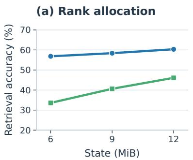

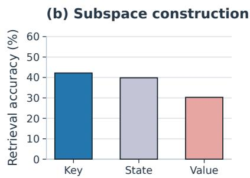

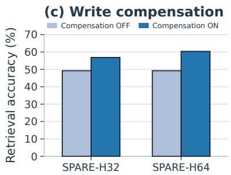  
Figure 4: Ablation studies of the key design choices in SPARE. All panels report associative retrieval accuracy on 512 four-choice prompts, with 256 prompts each at retrieval depths of 64 and 128. (a) Heterogeneous rank allocation. We compare SPARE with Uniform SPARE at matched recurrent-state budgets of 6, 9, and 12 MiB. Both methods use the same Key-PCA basis construction and write-compensation mechanism, differing only in how ranks are distributed across layers and heads. Heterogeneous allocation consistently achieves higher retrieval accuracy. (b) Subspace construction. We compare Key-based, State-based, and Value-based PCA projections under a fixed 12 MiB state budget, matched calibration data, and identical per-head rank allocations. Key and State PCA use right-side projections, whereas Value PCA uses a left-side projection. Key-side write compensation is disabled for this comparison and is not applicable to the Value-side formulation. Key PCA achieves the highest retrieval accuracy among the evaluated subspaces. (c) Write compensation. We compare SPARE-H32 and SPARE-H64 with and without projected-Key write compensation, holding their respective rank allocations and projection bases fixed. Enabling compensation improves retrieval accuracy at both compression budgets. All state budgets refer to persistent recurrent-state storage per request rather than peak GPU memory.

## References

Tri Dao and Albert Gu. 2024. Transformers are ssms: Generalized models and efficient algorithms through structured state space duality. arXiv preprint arXiv:2405.21060.

Neelesh Gupta, Peter Wang, Rajgopal Kannan, and Viktor K Prasanna. 2026. A persistent-state dataflow accelerator for memory-bound linear attention decode on fpga. arXiv preprint arXiv:2603.05931.

Ali Hatamizadeh, Yejin Choi, and Jan Kautz. 2026. Gated deltanet-2: Decoupling erase and write in linear attention. arXiv preprint arXiv:2605.22791.

Angelos Katharopoulos, Apoorv Vyas, Nikolaos Pappas, and François Fleuret. 2020. Transformers are rnns: Fast autoregressive transformers with linear attention. In International conference on machine learning, pages 5156–5165. PMLR.

Philipp Nazari and T Konstantin Rusch. 2026. The key to state reduction in linear attention: A rank-based perspective. arXiv preprint arXiv:2602.04852.

Yi Pan, Haocheng Xi, Kan Zhu, Xingyang Li, Yibo Wu, Mayank Mishra, Hongtao Zhang, William X Zheng, Baris Kasikci, Song Han, et al. 2026. Leapquant: Efficient linear attention with accurate recurrent state quantization. arXiv preprint arXiv:2609.38166.

Zhen Qin, Weigao Sun, Dong Li, Xuyang Shen, Weixuan Sun, and Yiran Zhong. 2024. Lightning attention-2: A free lunch for handling unlimited sequence lengths in large language models. arXiv preprint arXiv:2401.04658.

Ao Sun, Hongtao Zhang, Heng Zhou, Yixuan Ma, Yiran Qin, Tongrui Su, Yan Liu, Zhanyu Ma, Jun Xu, Jiuchong Gao, et al. 2026. State rank dynamics in linear attention llms. arXiv preprint arXiv:2602.02195.

Kimi Team, Yu Zhang, Zongyu Lin, Xingcheng Yao, Jiaxi Hu, Fanqing Meng, Chengyin Liu, Xin Men, Songlin Yang, Zhiyuan Li, et al. 2025. Kimi linear: An expressive, efficient attention architecture. arXiv preprint arXiv:2510.26692.

Ashish Vaswani, Noam Shazeer, Niki Parmar, Jakob Uszkoreit, Llion Jones, Aidan N Gomez, Łukasz Kaiser, and Illia Polosukhin. 2017. Attention is all you need. Advances in neural information processing systems, 30.

Samuel Williams, Andrew Waterman, and David Patterson. 2009. Roofline: an insightful visual performance model for multicore architectures. Communications ofthe ACM, 52(4):65–76.

Songlin Yang, Jan Kautz, and Ali Hatamizadeh. 2025. Gated delta networks: Improving mamba2 with delta rule. In International Conference on Learning Representations, volume 2025, pages 29687–29707.

Songlin Yang, Bailin Wang, Yikang Shen, Rameswar Panda, and Yoon Kim. 2023. Gated linear attention transformers with hardware-efficient training. arXiv preprint arXiv:2312.06635.

Jian Yin, Hui Yu, Weizhi Xu, Yuxuan Wang, Zhu Tian, Yingping Zhang, and Bochuan Chen. 2014. Highly parallel gemv with register blocking method on gpu architecture. Journal ofVisual Communication and Image Representation, 25(7):1566–1573.

## A Additional Derivations

## A.1 Proof of Theorem 1

We prove the result by induction on t. The initial condition $S _ { 0 } = C _ { 0 } P ^ { \top }$ holds by assumption. Suppose $\pmb { S } _ { t - 1 } = \pmb { C } _ { t - 1 } \pmb { P } ^ { \top }$ . Since $\pmb { k } _ { t } \in \mathrm { s p a n } ( \pmb { P } )$ and $P ^ { \top } P = I _ { r } ,$ , we have

$$
\pmb { k } _ { t } = \pmb { P } \widehat { \pmb { k } } _ { t } , \qquad \pmb { S } _ { t - 1 } \pmb { k } _ { t } = \pmb { C } _ { t - 1 } \widehat { \pmb { k } } _ { t } .\tag{12}
$$

Furthermore, $\| \pmb { k } _ { t } \| _ { 2 } = 1$ implies $\rho _ { t } = \| \widehat { \pmb { k } } _ { t } \| _ { 2 } ^ { 2 } = 1$ and hence $\gamma _ { t } = 1$ . Substituting these identities into the original Gated Delta Rule yields

$$
\begin{array} { r l } & { { \cal S } _ { t } = \alpha _ { t } { \cal C } _ { t - 1 } { \cal P } ^ { \top } } \\ & { ~ + \beta _ { t } \left( v _ { t } - \alpha _ { t } { \cal C } _ { t - 1 } \widehat { \pmb k } _ { t } \right) \widehat { \pmb k } _ { t } ^ { \top } { \pmb P } ^ { \top } } \\ & { ~ = { \cal C } _ { t } { \pmb P } ^ { \top } . } \end{array}\tag{13}
$$

Therefore, the recurrent states are identical under the compact representation. The corresponding outputs satisfy

$$
\begin{array} { r } { \pmb { o } _ { t } = \pmb { S } _ { t } \pmb { q } _ { t } = \pmb { C } _ { t } \pmb { P } ^ { \top } \pmb { q } _ { t } = \pmb { C } _ { t } \pmb { \widehat { q } } _ { t } = \pmb { \widehat { o } } _ { t } . } \end{array}\tag{14}
$$

Thus, both the recurrent-state identity and output equivalence hold for all t.

## B GPU Implementation Details

## B.1 Packed Heterogeneous State Layout

SPARE employs a packed memory layout to support heterogeneous rank allocations without padding individual heads to a uniform dimension. For a model with L layers and H heads per layer, let $r _ { \ell , h }$ denote the rank assigned to head h in layer ℓ, and let $\begin{array} { r } { R = \sum _ { \ell = 1 } ^ { L } \sum _ { h = 1 } ^ { H } r _ { \ell , h } } \end{array}$ be the total rank budget. The compact coefficient matrices are stored in a contiguous tensor $C _ { t } ^ { \mathrm { p a c k } } \in \mathbb { R } ^ { B \times R \times d _ { v } }$ , where B denotes the batch size. Each head occupies a contiguous region containing the transpose of its coefficient matrix, with its starting offset determined by the cumulative ranks of preceding heads. These offsets remain fixed throughout inference, allowing GPU kernels to access individual recurrent states without constructing padded intermediate tensors. The corresponding projection bases are stored separately and shared across requests. For b bytes per state element, the recurrent-state memory requirements are

$$
\begin{array} { r } { M _ { \mathrm { d e n s e } } = B L H d _ { v } d _ { k } b , } \\ { M _ { \mathrm { S P A R E } } = B R d _ { v } b . \qquad } \end{array}\tag{15}
$$

In our 24-layer Gated DeltaNet with eight heads per layer and $d _ { k } = d _ { v } = 2 5 6 .$ , a total rank budget of $R \ : = \ : 6 1 4 4$ reduces FP32 recurrent-state storage from 48 MiB to 6 MiB per request. The original short-convolution states are preserved and accounted for separately from the compressed recurrent states.

## B.2 Efficient Recurrent Decoding

We implement SPARE’s compact recurrent computation using Triton GPU kernels operating directly on the packed coefficient matrices. At each decoding step, the normalized key and query are projected onto their corresponding fixed subspaces, following Eq. (4). The kernels then compute the old-value prediction $C _ { t - 1 } \widehat { \pmb { k } } _ { t }$ , apply the compensated update in Eq. (9), and obtain the recurrent output using Eq. (5). The coefficient matrices are updated in place, avoiding additional persistent state copies and dense-state reconstruction. The implementation preserves the original key normalization, query scaling, decay factors, and update gates of Gated DeltaNet, while maintaining FP32 arithmetic for recurrent states. Unlike methods that explicitly reconstruct a full $d _ { v } \times d _ { k }$ matrix, SPARE performs its state-dependent reads and updates on $d _ { v } \times r$ coefficients. Consequently, the recurrent-state access cost scales with the allocated rank rather than the original key dimension, although key and query projections introduce additional computation. This trade-off is particularly favorable at high batch sizes, where recurrent-state memory traffic becomes a substantial fraction of decoding time.

## B.3 CUDA Graph Execution

To reduce kernel-launch overhead during autoregressive decoding, SPARE supports stateful CUDA Graph execution. A key requirement is that recurrent states must remain at fixed memory addresses across successive decoding steps. Our implementation maintains address-stable packed coefficient buffers and updates their contents in place, while preserving the original convolution caches. Input token IDs are copied into fixed GPU buffers before each graph replay, allowing successive decoding steps to process different tokens without changing the captured execution graph. Since graph capture and warmup can modify recurrent states, the implementation restores the corresponding prefill states into the captured buffers before measured execution. Host-side cache bookkeeping is also advanced consistently with the dependent decoding steps. We validate graph execution against eager inference using identical initial states and token sequences, checking recurrent coefficients, convolution states, and output logits. For sufficiently large packed tensors, 64-bit pointer offsets are used to avoid integer overflow in GPU memory addressing. These measures enable repeated state-dependent graph execution without retaining the original dense recurrent state.

## B.4 Parallel Prefill Compatibility

Although SPARE primarily targets decoding, its compact recurrence is algebraically compatible with the parallel Gated Delta Rule used during prefill. To see this, define the transformed key and value vectors as

$$
\begin{array} { r } { \pmb { k } _ { t } ^ { \prime } = \sqrt { \gamma _ { t } } \pmb { \widehat { k } } _ { t } , } \\ { \pmb { v } _ { t } ^ { \prime } = \sqrt { \gamma _ { t } } \pmb { v } _ { t } . } \end{array}\tag{16}
$$

Substituting these variables into the standard Gated Delta Rule gives

$$
\begin{array} { r l } & { { \pmb { C } } _ { t } = \alpha _ { t } { \pmb { C } } _ { t - 1 } } \\ & { ~ + \beta _ { t } \left( { \pmb { v } } _ { t } ^ { \prime } - \alpha _ { t } { \pmb { C } } _ { t - 1 } { \pmb { k } } _ { t } ^ { \prime } \right) ( { \pmb { k } } _ { t } ^ { \prime } ) ^ { \top } , } \end{array}\tag{17}
$$

which is algebraically equivalent to $\operatorname { E q . }$ . (9). The query remains $\widehat { \pmb q } _ { t }$ and is not rescaled by the writecompensation factor. This formulation allows SPARE to reuse existing chunkwise parallel Gated Delta Rule operators with reduced key dimensions. For heterogeneous ranks, heads with identical ranks are grouped for parallel computation, and their updated coefficients are written back into the original packed state buffer. The implementation preserves the original normalization and gating semantics rather than applying additional normalization after projection. In practice, grouped parallel prefill can introduce extra workspace, shape-specialization overhead, and numerical differences due to floatingpoint operation ordering. We therefore retain a validated sequential prefill path and use parallel execution only for supported configurations that satisfy the numerical correctness checks. As a result, compatibility with parallel prefill does not imply that SPARE universally accelerates the prefill stage.

## B.5 Memory and Performance Accounting

The compact recurrent-state size in Eq. (15) measures only the persistent coefficient storage and does not represent the complete GPU memory footprint. Actual inference memory additionally includes model parameters, shared projection bases, convolution caches, temporary workspaces, intermediate activations, and CUDA Graph allocations. We distinguish recurrent-state storage from the measured peak allocated and reserved GPU memory throughout our experiments. Similarly, reduced state capacity does not by itself establish a proportional reduction in physical GPU memory traffic. We therefore measure recurrent-kernel DRAM reads and writes using hardware profiling counters and evaluate decoding latency using completemodel execution. The reported decoding measurements include all model layers and maintain recurrent and convolution states across dependent token steps. All reported speedups are obtained from synchronized fixed-batch workloads with appropriate same-device Dense baselines and do not imply improvements in continuous-batching serving throughput.