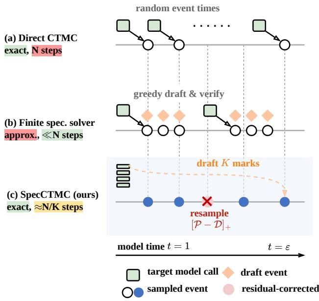
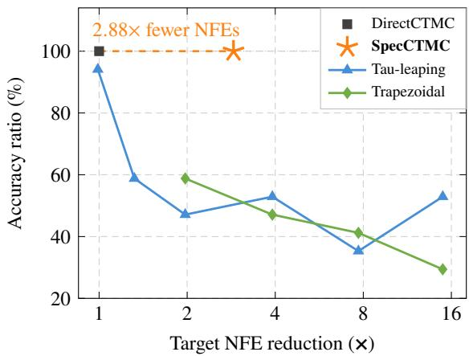
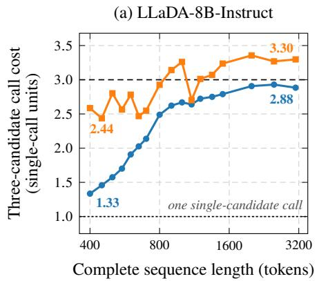
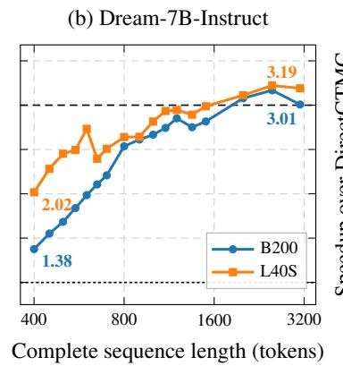
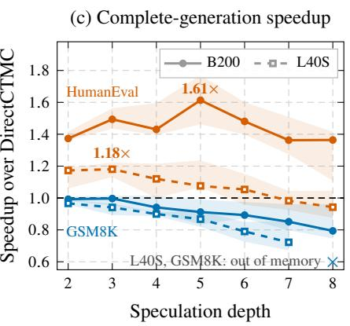
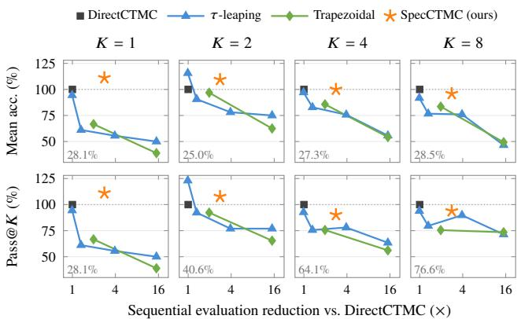
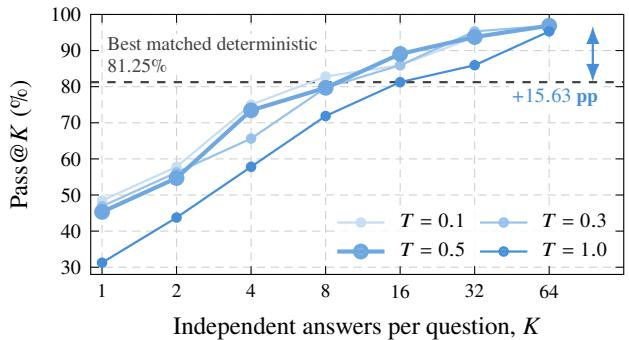
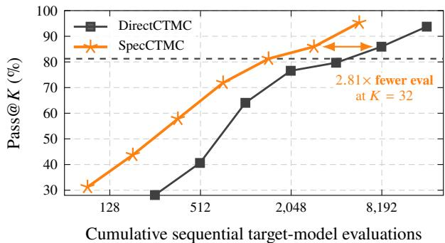

# SpecCTMC : Exact Speculative Simulation of Diffusion Language Model Continuous-Time Markov Chains

Siva Rajesh Kasa \* † Yasong Dai \* 1 Sumit Negi † Hongdong Li 1

## Abstract

Masked difusion lan ua e models ofer arallel text eneration but inde endentl sam lin multi le tokens can disrupt their dependencies and change the output distribution. Exact continuous-time sampling avoids this approximation, yet typically requires one sequential model evaluation per token. We introduce SpecCTMC, a training-free speculative sampler that reduces this sequential bottleneck without a separate draft model. SpecCTMC proposes successive token updates using previously computed model predictions, evaluates their intermediate states in parallel, and applies an exact acceptance-and-correction procedure. We prove that SpecCTMC preserves the joint distribution of event times, generation order, and token values of the underlying continuous-time Markov chain. It therefore introduces neither time-discretization error nor additional factorization error from parallel decoding. Experiments on LLaDA-8B-Instruct and Dream-v0-Instruct-7B across five benchmarks demonstrate 1.73–4.38× fewer sequential model evaluations than direct continuous-time sampling, while preserving the reference sampling distribution. Our code is available at: https://github.com/kasakh/specctmc

## 1 Introduction

Masked difusion language models (MDLMs) generate text by iteratively unmasking tokens in a partially masked se- quence, allowing generation beyond a fixed left-to-right order (Sahoo et al., 2024; Shi et al., 2024; Nie et al., 2025; Ye et al., 2025). This flexibility ofers opportunities for parallel inference, but realizing them without compromising generation quality remains challenging. In the continuous- time formulation, the reverse process is a continuous-time Markov chain (CTMC) that unmasks one token at each event (Campbell et al., 2022). Direct simulation therefore requires a sequence of model evaluations, with each up- date depending on previously unmasked tokens. Reducing this sequential cost is central to making exact sampling of difusion language models practical.

Existing approaches reduce inference cost through numerical approximation, decoding heuristics, and computation reuse. Numerical samplers such as �-leaping approximate multi- ple transitions within a time interval, while higher-order methods, including the �-trapezoidal solver, improve the accuracy of this approximation (Campbell et al., 2022; Lou et al., 2024; Ren et al., 2025). Practical decoders also use greedy token selection and confidence-based unmasking orders to generate high-quality text with fewer denoising steps (Nie et al., 2025; Ye et al., 2025). Fast-dLLM combines confidence-guided parallel decoding with approximate KV caching (Wu et al., 2026), and Fast-dLLM++ uses the full token-confidence profile to select larger groups of tokens for simultaneous commitment (Kasa et al., 2026).

A central challenge in MDLMs is that tokens predicted from the same partially masked sequence are often not condi- tionally independent. Unmasking one token can change the distribution of another, so sampling several positions independently can result in a diferent distribution from up- dating them sequentially. This factorization error underlies the curse of parallel decoding discussed in previous works like Wu et al. (2026); Kasa et al. (2026). Separately, the denoiser’s conditional predictions across diferent masking contexts need not be compatible with a single joint distribution (Young et al., 2024; Torroba Hennigen & Kim, 2023).

The choice of decoding policy also matters when generation is used to explore multiple candidate answers. Greedy decod- ing can be efective for producing a single answer, but a fully deterministic decoder cannot explore alternative solutions through repeated runs. Even with stochastic token sampling, confidence-based unmasking orders can restrict diversity and limit improvements from additional samples (Olausson et al., 2026). For reasoning and code generation, this motivates evaluating solution coverage across multiple attempts along- side single-sample accuracy, and accelerating stochastic

  
Figure 1. Sampling a masked difusion LLM as a CTMC. (a) Direct event simulation is exact but requires one sequential target model evaluation per unmasking event. (b) Speculative dLLM decoders verify drafts against a finite-step greedy decoder, with restricted lossless guarantees. (c) SpecCTMC preserves the exact random event clock and the distribution of joint marks. The diagram’s �/� label is the full-acceptance ideal when all drafted states fit in one target-model call; generally, one speculative round commits up to � events.

## generation while preserving its sampling distribution.

Exact event-driven simulation provides a principled refer- ence for this goal. Gillespie’s stochastic simulation algorithm samples individual transitions at random event times (Gillespie, 1977), and sequential first-hitting sampling applies this principle to absorbing-mask difusion (Zheng et al., 2025). After each position is unmasked, the model conditions the next update on the resulting sequence. This introduces nei- ther time-discretization error nor the additional factorization error caused by committing independent token updates to- gether. Its computational cost, however, remains dominated by sequential model evaluations.

To address these key bottlenecks, we introduce SpecCTMC, a training-free speculative sampler that reduces this sequential evaluations without the need for a separate draft model. Our approach builds on distribution-preserving speculative sam- pling for autoregressive (AR) language models (Leviathan et al., 2023; Chen et al., 2023) and its extension to continuous difusion models (Bortoli et al., 2025). Speculative methods have also been developed for finite-step difusion language model decoders (Agrawal et al., 2026; Pan et al., 2026). Here, we instead target the underlying absorbing- mask CTMC, including its random event times and the joint selection of token positions and values.

As shown in Figure 1, the key observation is that, for the absorbing-mask generators considered here, event times depend on difusion time and the number ofremaining masks, independently of the identities of unmasked tokens. These times can therefore be sampled in advance and preserved when a proposed token update is rejected and corrected. SpecCTMC reuses previously computed model predictions to propose successive updates, evaluates their intermediate sequences in parallel, and applies an exact acceptance-and- correction procedure. We prove that the resulting trajectory has the samejoint distribution of event times, token positions, and token values as direct simulation.

Experiments on LLaDA-8B-Instruct and Dream-v0-Instruct- 7B across five benchmarks show that SpecCTMC uses 1.73-4.38× fewer sequential target-model evaluations than direct simulation, with measured wall-clock speedups of up to 2.88× on an NVIDIA B200. On GSM8K, multiple stochastic attempts solve questions missed by deterministic greedy denoising, and SpecCTMC reduces their cumula- tive sequential-evaluation cost relative to DirectCTMC. As shown in Figure 2, by reducing the number of sequential evaluations, SpecCTMC addresses a cost complementary to optimizations that make each evaluation cheaper. In particular, cached or otherwise approximate predictions can be used for drafting while exact target verification preserves the CTMC sampling distribution.

## Our contributions are:

• We develop a training-free speculative sampler without a separate draft model for absorbing-mask difusion that verifies multiple successive token updates through parallel model evaluation.

• We prove preservation of the complete CTMC trajectory distribution under the exactness conditions and, for an adaptive-depth variant under bounded unmasking influence, derive explicit bounds on sequential target batches and expected target work.

• We evaluate SpecCTMC across reasoning, coding, and instruction-following benchmarks, demonstrating reductions in sequential model evaluations, practical latency gains, and the benefits of stochastic generation for multiple-answer coverage.

## 2 Related Work

Discrete difusion simulation. Discrete difusion admits a continuous-time Markov chain formulation with random state transitions (Campbell et al., 2022). For absorbing- mask models, sequential first-hitting sampling draws each unmasking time and then updates one token (Zheng et al.,

  
Figure 2. Exact law preserving of SpecCTMC on NFE acceleration. On GSM8K with LLaDA-8B-Instruct (256 generated tokens), SpecCTMC reduces target NFEs by 2.88× relative to DirectCTMC while preserving expected accuracy. Finite-step samplers trade accuracy for fewer evaluations.

2025); DirectCTMC instantiates this exact event-driven reference. Parallel first-hitting sampling uses the sampled event times but freezes token predictions across several updates, so exact clocks alone do not preserve the transition law. Uniformization instead obtains exact simulation from a common candidate clock and virtual self-transitions (Chen & Ying, 2024), whereas tau-leaping and higher-order solvers approximate the dynamics over finite intervals (Ren et al., 2025). SpecCTMC evaluates tentative future states together while preserving the joint law of event times, positions, and tokens.

Parallel and speculative masked decoding. Parallel masked decoders reduce model evaluations by committing several tokens from one set of predictions. Fast-dLLM and Fast-dLLM++ select updates by confidence, EB-Sampler uses entropy bounds, and PUNT tests approximate condi- tional independence (Wu et al., 2026; Kasa et al., 2026; Ben-Hamu et al., 2025; Azangulov et al., 2026). Schedule analyses characterize the resulting dependency error, while DEMASK and SIRS use learned influence estimates or rejection sampling to control it (Chen et al., 2025; Ringel et al., 2026; Zhang et al., 2026). Self Speculative Decoding reproduces a deterministic stepwise reference; Spify, Paral- lel Speculative Decoding, and trajectory-level speculation draft future denoising states under method-specific exactness conditions or measured speed and quality tradeofs (Gao et al., 2025; Agrawal et al., 2026; Sun et al., 2026; Pan et al., 2026). Self-Speculative Masked Difusions instead train a hybrid causal and noncausal architecture (Campbell et al., 2026). SpecCTMC uses previously computed predictions only to draft tentative marks. Target verification and positive-residual correction then preserve DirectCTMC without additional training or a separate drafter.

Exact speculative and parallel sampling. Exact speculative sampling has been developed for continuous difusion transitions on fixed denoisin schedules, with block verifica- tion improving progress across proposed transitions (Bortoli et al., 2025; Soen et al., 2026). AutoSpec uses exchangeable increments to parallelize continuous difusion without a separate draft model (Hu et al., 2025). Autospeculation and Any-Subset Speculative Decoding obtain exact parallel sam- ples from compatible conditional-marginal or joint-density oracles, and related theory parallelizes single-site dynamics under influence conditions (Anari et al., 2026; Guo & Ermon, 2026; Liu & Yin, 2025). Temporal-point-process methods likewise draft and verify marked event sequences (Gong et al., 2025; Bilos et al.ˇ , 2025). SpecCTMC requires normalized state-dependent transition rows, but not globally compat- ible denoiser conditionals. For absorbing-mask models, correcting a proposed position and token leaves the future event clock valid, which permits exact speculation over the complete marked CTMC path. Table 1 summarizes these distinctions; Appendix E gives the detailed comparisons.

## 3 Event-Driven Masked Diffusion

Given an absorbing-mask difusion model like (Ye et al., 2025; Nie et al., 2025), we define a target continuous-time Markov chain (CTMC) from its predicted token probabilities at masked positions and the masking schedule. We call its exact event-driven sampler DirectCTMC. Unlike decoding on a finite-step time grid, DirectCTMC samples the next event time from the CTMC’s total exit intensity. Then it samples a position-token mark and unmasks exactly one position.

State and marks. Let X be the finite set of token sequences for one generation block, and let mask be the mask token. For state $x \in \chi$ , define the masked positions:

$$
A ( x ) : = \{ d : x _ { d } = \mathtt { m a s k } \} , \quad m ( x ) = | A ( x ) | .\tag{1}
$$

A marked event is then defined as ${ z } = ( d , \nu )$ , where $d \in A ( x )$ is a masked position and � ≠ mask is its replacement token. For a valid mark ${ z } = ( d , \nu )$ , define $\Phi ( x , z )$ to be the sequence equal to � at every coordinate except �, with

$$
[ \Phi ( x , ( d , \nu ) ) ] _ { d } = \nu .\tag{2}
$$

Target generator. Let $p _ { \theta } ( \nu ~ \vert ~ x , d )$ be the normalized target probability for replacement token � at masked position � for a fixed model �. The model defines its unmasking process running backward in model time from � = 1 to a positive cutof �. The LLaDA, Dream, and LLaDA-V formulations used here mask each generated-answer token independently with probability � at model time � (Nie et al., 2025; Ye et al., 2025; You et al., 2025). Appendix B.2 derives the resulting 1/� factor and gives the corresponding expression for a diferent monotone masking schedule. For these models, the event rate of the underlying CTMC is

Table 1. Com arison of masked-difusion inference methods. “Natural-event CTMC law” is the stochastic rocess induced b the unchanged denoiser. “Within-trajectory parallelism” means that one target round can advance multiple events or positions.
<table><tr><td>Method</td><td>Training Exact event Natural-event free times</td><td></td><td>CTMC law</td><td>drafter</td><td>No separate Within-trajectory parallelism</td><td>No added factorization error</td></tr><tr><td>Continuous-time Markov chain simulation</td><td></td><td></td><td></td><td></td><td></td><td></td></tr><tr><td>Fixed-step ancestral / tau-leaping (Campbell et al., 2022; Ren et al., 2025)</td><td>Yes</td><td>No</td><td>No</td><td>Yes</td><td>Yes</td><td>No</td></tr><tr><td>Sequential FHS (DirectCTMC) (Zheng et al., 2025)</td><td>Yes</td><td>Yes</td><td>Yes</td><td>Yes</td><td>No</td><td>Yes</td></tr><tr><td>Parallel FHS (Zheng et al., 2025)</td><td>Yes</td><td>Yes</td><td>No</td><td>Yes</td><td>Yes</td><td>No</td></tr><tr><td>Parallel masked-diffusion decoding</td><td></td><td></td><td></td><td></td><td></td><td></td></tr><tr><td>Fast-dLLM (Wu et al., 2026)</td><td>Yes</td><td>No</td><td>No</td><td>Yes</td><td>Yes</td><td>No</td></tr><tr><td>Fast-dLLM++ (Kasa et al., 2026)</td><td>Yes</td><td>No</td><td>No</td><td>Yes</td><td>Yes</td><td>No</td></tr><tr><td>EB-Sampler (Ben-Hamu et al., 2025)</td><td>Yes</td><td>No</td><td>No</td><td>Yes</td><td>Yes</td><td>No</td></tr><tr><td>PUNT (Azangulov et al., 2026)</td><td>Yes</td><td>No</td><td>No</td><td>Yes</td><td>Yes</td><td>No</td></tr><tr><td>Speculative masked-diffusion decoding</td><td></td><td></td><td></td><td></td><td></td><td></td></tr><tr><td>Spiffy, practical LLaDA/Dream variant (Agrawal et al., 2026)</td><td>Yes</td><td>No</td><td>No</td><td>Yes</td><td>Yes</td><td>No</td></tr><tr><td>Self Speculative Decoding (Gao et al., 2025)</td><td>Yes</td><td>No</td><td>No</td><td>Yes</td><td>Yes</td><td>Yes</td></tr><tr><td>Parallel Speculative Decoding (Sun et al., 2026)</td><td>Yes</td><td>No</td><td>No</td><td>Yes</td><td>Yes</td><td>No</td></tr><tr><td>Trajectory-Level Speculative Decoding, practical variant (Pan et al., 2026)</td><td>Yes</td><td>No</td><td>No</td><td>Yes</td><td>Yes</td><td>No</td></tr><tr><td>Self-Speculative Masked Diffusions (Campbell et al., 2026)</td><td>No</td><td>No</td><td>No</td><td>Yes</td><td>Yes</td><td>Yes</td></tr><tr><td>Exact speculative natural-event simulation</td><td></td><td></td><td></td><td></td><td></td><td></td></tr><tr><td>SpecCTMC (ours)</td><td>Yes</td><td>Yes</td><td>Yes</td><td>Yes</td><td>Yes</td><td>Yes</td></tr></table>

$$
q _ { t } ( x , ( d , \nu ) ) = { \frac { 1 } { t } } p _ { \theta } ( \nu \mid x , d ) .\tag{3}
$$

For each masked position �, $p _ { \theta } ( \cdot \mid x , d )$ is normalized over replacement tokens � ≠ mask, so the total exit intensity is

$$
\lambda _ { t } ( x ) = \sum _ { d \in A ( x ) } \sum _ { \nu \neq \mathrm { m a s k } } q _ { t } ( x , ( d , \nu ) ) = \frac { m ( x ) } { t } .\tag{4}
$$

The target mark distribution conditioned on an event is:

$$
P _ { t , x } ( d , \nu ) = { \frac { 1 } { m ( x ) } } p _ { \theta } ( \nu \mid x , d ) .\tag{5}
$$

Thus, the position is uniformly distributed over masked positions, while the token follows the model probability at that position.

Exact event clock. Suppose the current time is �, the current state is �, and $m ( x ) > 0$ . For � ∼ Exponential(1), define

$$
T _ { \mathrm { n e x t } } = t \cdot \exp \left( - \frac { E } { m ( x ) } \right) .\tag{6}
$$

This transformation has the exact survival law associated with $\lambda _ { s } ( x ) = m ( x ) / s$ . Every event unmasks exactly one mask, so the future intensity depends on the number of events, but not on the identities of their marks. The process has at most the initial number of masks and is therefore non-explosive. If the next time falls below the cutof $\varepsilon ,$ simulation stops and both methods deterministically fill the remaining masked positions using the same rule.

Parallel commitment and conditional dependence. Un-masking several tokens from the same state can change their joint distribution because the sampled tokens do not condition on one another.

We illustrate this side-efect with an example of $n = 2 r$ binary positions arranged in � independent pairs. Each pair follows the distribution:

$$
\begin{array} { l l l } { \displaystyle { \mathcal { Q } _ { a } ( 0 0 ) = \mathcal { Q } _ { a } ( 1 1 ) = \frac { a } { 2 } , } } \\ { \displaystyle { \mathcal { Q } _ { a } ( 0 1 ) = \mathcal { Q } _ { a } ( 1 0 ) = \frac { 1 - a } { 2 } , \qquad a \in ( 0 , 1 ] . } } \end{array}\tag{7}
$$

For $x = \left( x _ { 1 } , \ldots , x _ { 2 r } \right)$ , the full target distribution over the � in- dependent pairs is $\begin{array} { r } { Q _ { a } ^ { \otimes r } ( x ) = \prod _ { j = 1 } ^ { r } Q _ { a } ( x _ { 2 j - 1 } , x _ { 2 j } ) } \end{array}$ . Assume the model returns its exact conditional token distributions given the unmasked tokens.

Consider a general parallel decoder that independently as- signs each position to a denoising step $s \in \{ 1 , \ldots , T \}$ with probability $w _ { s }$ . At each step with at least one assigned position, the decoder evaluates the current state once and independently samples all assigned positions from their conditional token distributions. Here we assume both Di- rectCTMC and parallel decoder run until all positions are unmasked, i.e., without stopping at the cutof �. Under these assumptions, we obtain Lemma 1 as follows:

Lemma 1 (Parallel commitment attenuates dependence). Let $\begin{array} { r } { S : = \sum _ { s = 1 } ^ { T } w _ { s } ^ { 2 } } \end{array}$ be the probability that two token positions are assigned to the same iteration. DirectCTMC returns $\boldsymbol { Q } _ { a } ^ { \otimes r }$ , whereas the parallel decoder returns $Q _ { a _ { T } } ^ { \otimes r } { } _ { : }$ , where

$$
a _ { T } = ( 1 - S ) a + \frac { S } { 2 } = a - \left( a - \frac { 1 } { 2 } \right) S .\tag{8}
$$

Consequently, the probabilities that all � pairs agree are $a ^ { r }$ and $a _ { T } ^ { r } ,$ , respectively.

When $a = 1 ,$ , requiring all pairs to agree with probability at least $1 - \delta , \delta \in ( 0 , 1 )$ implies

$$
T \geq \frac { n } { 4 \log ( 1 / ( 1 - \delta ) ) } , \mathbb { E } [ M ] \geq n + 2 ( n - 1 ) \log 1 - \delta ,
$$

where � is the number of denoising steps with at least one assigned position, hence the number of target-model evaluations.

Equation (8) shows that independent parallel sampling undermines the pairwise dependence compared with target distribution. For a setting $a = 1 , ~ \delta = 0 . 0 5$ , the parallel decoder requires at least approximately 0.897� target-model evaluations on average.

While the above example identifies the loss of pairwise depen- dence caused by independent parallel sampling, SpecCTMC batches target-model evaluations at successive tentative states and verifies the proposed marks sequentially. The ver- ification with residual correction preserves the DirectCTMC distribution while allowing several target evaluations to share one batched evaluation.

Exact reference simulation. DirectCTMC repeatedly sam-ples $T _ { \mathrm { n e x t } }$ with Equation (6), evaluates $P _ { T _ { \mathrm { n e x t } } , x } ,$ , samples one position-token mark, and commits it. It therefore uses one se- quential target-model round per natural event and defines the reference path law. By contrast, tau-leaping and trapezoidal solvers approximate the CTMC by freezing or extrapolating transition rates over finite time intervals (Campbell et al., 2022; Ren et al., 2025). Our goal is to reduce sequential target-model evaluations while preserving the reference path law.

## 4 Exact Speculative CTMC Simulation

SpecCTMC applies exact speculative decoding to the event- driven masked difusion process described in Section 3. As previously established, the event time distribution depends only on model time and the number of remaining masks. SpecCTMC therefore samples all event times before generat- ing their marks and speculates only over the position-token marks. Each speculative round drafts a tentative trajectory, evaluates the target distributions at the states before the proposed updates, and verifies the proposed marks in se- quence. In our implementation, the drafter selects a masked position uniformly and samples its replacement token from a mixture of the previously computed target probabilities at that position and a uniform distribution over tokens other than the mask token. Appendix F gives the mixture weight and cache details. At the first rejection, SpecCTMC samples a corrected mark from the residual correction distribution and starts a new round from the corrected state.

Algorithm 1   
Exact s eculative simulation of one marked CTMC block.   
Require: Initial state ${ \overline { { X _ { 0 } , } } }$ time �, cutof $\varepsilon ,$ depth �   
1: $m _ { 0 } \gets | A ( X _ { 0 } ) | , \quad T _ { 0 } \gets t ,$ � ← 0   
2: Draw $E _ { j } \overset { \mathrm { i i d } } { \sim } \mathrm { E x p } ( 1 ) , j = 1 , \dots , m _ { 0 }$   
3: $T _ { j } \gets \bar { T _ { j - 1 } } \cdot \exp \bigl ( - E _ { j } / ( m _ { 0 } - j + 1 ) \bigr ) , j = 1 , \dots , m _ { 0 }$   
4: $N \gets | \{ j \in \{ 1 , \dots , m _ { 0 } \} : T _ { j } \geq \varepsilon \} |$   
5: while $n < N$ do   
6: � ← min $\{ K , N - n \} , \quad { \widehat { X } } _ { 0 } \gets X _ { n }$   
7: for $i = 1 , \ldots , L$ do   
8: Form $D _ { i } \ \underset {  } { \mathrm { o n } } \mathcal { Z } ( \widehat { X } _ { i - 1 } ) ;$ draw $\widehat { Z } _ { i } \sim D _ { i }$   
9: $\widehat { X } _ { i } \gets \Phi ( \widehat { X } _ { i - 1 } , \widehat { Z } _ { i } )$   
10: end for   
11: $P _ { i } \gets P _ { T _ { n + i } , \widehat X _ { i - 1 } } , i = 1 , . . . , L$ (batched)   
12: for $i = 1 , \ldots , L$ do   
13: Draw $U _ { i } \sim \underline { { \mathrm { U n i f } } } ( 0 , 1 )$   
14: if $U _ { i } \leq a _ { i } ( \widehat { Z } _ { i } )$ then   
15: $Z _ { n + i } \gets \widehat { Z } _ { i }$   
16: else   
17: Draw $Z _ { n + i } \sim R _ { i }$ (Equation (11))   
18: end if   
19: $X _ { n + i }  \Phi ( \widehat { X } _ { i - 1 } , Z _ { n + i } ) , \quad \ell  i$   
20: if $U _ { i } > a _ { i } ( \widehat { Z } _ { i } )$ then   
21: break   
22: end if   
23: end for   
24: $n \gets n + \ell$   
25: end while   
26: Apply the common deterministic completion rule to $X _ { N }$

Batched target evaluation. The tentative trajectory pro-vides the states before the proposed updates $\widehat { X _ { 0 } } , \ldots , \widehat { X _ { L - 1 } }$ needed to evaluate

$$
P _ { i } = P _ { T _ { n + i } , \widehat { X } _ { i - 1 } } , \quad i = 1 , \ldots , L ,\tag{9}
$$

We evaluate these distributions in one or more target-model calls, reusing any target distribution already available for the same state. Appendix D.1 states how target states are grouped for each experiment.

Each input row represents the state before one proposed update. The target distribution at index � is conditioned on the preceding proposed updates. A verification that reaches index � means those proposals have all been accepted, so $\widehat { X } _ { i - 1 }$ equals the current committed state. The target row therefore uses the same conditioning state as DirectCTMC.

Sequential verification and correction. For a proposed mark $\widehat { Z } _ { i } = z .$ , define

$$
a _ { i } ( z ) = \operatorname* { m i n } \left\{ 1 , { \frac { P _ { i } ( z ) } { D _ { i } ( z ) } } \right\} .\tag{10}
$$

A sampled proposal has $D _ { i } ( z ) ~ > ~ 0 .$ Draw $\begin{array} { r l } { U _ { i } } & { { } \sim } \end{array}$ $\mathbf { U } ( 0 , 1 )$ independently and accept the proposal when $U _ { i } \ \leq \ a _ { i } ( \widehat { Z } _ { i } )$ . Averaging over the proposed mark gives $\alpha _ { i } = \sum _ { z }$ min $\{ P _ { i } ( z ) , D _ { i } ( z ) \}$ . At the first rejection, sample a corrected mark from the residual correction distribution

$$
R _ { i } ( z ) = \frac { [ P _ { i } ( z ) - D _ { i } ( z ) ] _ { + } } { 1 - \alpha _ { i } } .\tag{11}
$$

where the denominator is the rejection probability and is positive whenever rejection occurs. If $\alpha _ { i } = 1$ , acceptance is certain and no residual distribution will be formed.

The corrected mark is committed at time $T _ { n + i }$ . SpecCTMC then discards the remaining tentative marks, states, and target distributions, and restarts drafting from the corrected state. If all proposals are accepted, the entire draft is committed.

Algorithm 1 summarizes the procedure of SpecCTMC , where Blue denotes drafting and batched target evaluation; red denotes sequential verification and residual correction. Black lines denote operations shared with DirectCTMC. SpecCTMC preserves sequential conditioning between com- mitted events while batching the target evaluations along each tentative trajectory.

## 5 Theoretical Analysis

We establish that SpecCTMC preserves the joint distribution of event times, position-token marks, and resulting states generated by DirectCTMC. The argument has two parts: (1) correcting a proposed mark leaves the event-time distribution unchanged, and (2) verification with residual correction produces marks with the target conditional distribution. We then characterize the number of speculative rounds and target evaluations, and relate this cost to proposal quality.

## 5.1 Event-Time Sampling

Validity of event times sampled before their marks. Let $m _ { 0 } = m ( X _ { 0 } )$ and $T _ { 0 } = 1$ be the initial mask count and event time. After $j - 1$ events, there will be exactly $m _ { 0 } - j + 1$ masked positions remaining. The total exit intensity is $\lambda _ { t } ( x ) = ( m _ { 0 } - j + 1 ) / t$ , regardless of the previously unmasked positions and their token values.

We can thus sample the event times before generating any marks by:

$$
T _ { j } = T _ { j - 1 } \cdot \exp \left( - { \frac { E _ { j } } { m _ { 0 } - j + 1 } } \right) , \quad j = 1 , \ldots , m _ { 0 } .\tag{12}
$$

where the $E _ { j }$ are independent unit exponential random variables. Use the times at or above the cutof �, and define

$$
\begin{array} { l } { N = \left| \{ j \in \{ 1 , \dots , m _ { 0 } \} : T _ { j } \geq \varepsilon \} \right| , } \\ { C = ( N , T _ { 1 } , \dots , T _ { N } ) . } \end{array}\tag{13}
$$

We obtain the following lemma.

Lemma 2 (Validity of sampled event times). Conditional on $X _ { 0 } ,$ the clock C has the same distribution as the event count and event times generated by DirectCTMC. Replacing a proposed position-token mark by another valid mark preserves the validity ofall remaining sampled event times.

$$
\operatorname { L a w } _ { S p e c } \left( N , ( T _ { j } ) _ { j = 1 } ^ { N } | X _ { 0 } \right) = \operatorname { L a w } _ { D i r e c t } \left( N , ( T _ { j } ) _ { j = 1 } ^ { N } | X _ { 0 } \right) .\tag{14}
$$

It remains to show that verification and correction produce the target mark distribution at each sampled event time, conditioned on the current committed state.

## 5.2 Exactness of the complete marked path

The conditions for equality of the joint event distributions appear in Appendix B.1.

Theorem 1 (Exact preservation of the joint event distribution). Under Conditions C1 to C8 in Appendix $B . I ,$ Spec- CTMC and DirectCTMC satisfy

$$
\begin{array} { r l } & { \mathrm { L a w } _ { S p e c } \left( X _ { 0 } , N , ( T _ { j } , Z _ { j } , X _ { j } ) _ { j = 1 } ^ { N } \right) } \\ & { \qquad = \mathrm { L a w } _ { D i r e c t } \left( X _ { 0 } , N , ( T _ { j } , Z _ { j } , X _ { j } ) _ { j = 1 } ^ { N } \right) . } \end{array}\tag{15}
$$

After stopping at the cutof �, applying the same deterministic completion rule also gives equal output distributions.

Complete assumptions and proofs are given in Appendices B and C.

By Theorem 1, independent repetitions of SpecCTMC and DirectCTMC have the same joint output distribution, and therefore the same pass@� for every �. We will discuss this implication in Section 6.

Target-model evaluations and latency. Let � be the number of input rows per target model evaluation, and $I _ { r } \in \{ 0 , 1 \}$ an indicator function on whether round � reuses its first target distribution. Evaluating the full draft requires $\begin{array} { r } { Q _ { r } = \left\lceil \frac { L _ { r } - \overline { { I } } _ { r } } { b } \right\rceil } \end{array}$ target-model calls, excluding initialization and determin- istic completion at the cutof. The total number of newly evaluated states is

$$
W _ { \mathrm { e v a l } } = B + F + \sum _ { r = 1 } ^ { R } ( L _ { r } - I _ { r } ) ,\tag{16}
$$

where � and � count states evaluated for initialization and deterministic completion at the cutof, respectively. These counts distinguish proposed events, evaluated states, and target-model calls. Latency additionally depends on batch evaluation cost, drafting, and verification, as we will discuss in Section 6.

Table 2. Exact speculative CTMC sampling on LLaDA. For each enerated len th � we re ort wall-clock s eedu of S ecCTMC ove DirectCTMC (Wall-clock) and the reduction in sequential target-model calls (NFE); the draft depth used is in parentheses. Gray speedups are at parity (the paired 95% interval contains one); all others are faster, and no condition is slower. The last row reports accuracy (%) of DirectCTMC → SpecCTMC averaged over lengths; every paired 95% confidence interval for the SpecCTMC-minus-DirectCTMC accuracy diference contains zero. Bold marks the best value.
<table><tr><td rowspan="2">L</td><td colspan="2">GSM8K</td><td colspan="2">MATH</td><td colspan="2">MBPP</td><td colspan="2">HumanEval</td><td colspan="2">IFEval</td><td colspan="2">Avg.</td></tr><tr><td>Wall-clock</td><td>NFE</td><td>Wall-clock</td><td>NFE</td><td>Wall-clock</td><td>NFE</td><td>Wall-clock</td><td>NFE</td><td>Wall-clock</td><td>NFE</td><td>Wall-clock</td><td>NFE</td></tr><tr><td>32</td><td>1.00×</td><td>1.75 (2)</td><td>1.15×</td><td>1.75 (2)</td><td>1.10×</td><td>2.39 (3)</td><td>2.19×</td><td>3.02 (5)</td><td>2.65×</td><td>3.42(7)</td><td>1.62×</td><td>2.46</td></tr><tr><td>64</td><td>1.01×</td><td>1.83 (2)</td><td>1.18×</td><td>1.85 (2)</td><td>1.05×</td><td>1.85 (2)</td><td>2.48×</td><td>3.88 (6)</td><td>2.77×</td><td>3.56 (5)</td><td>1.70×</td><td>2.59</td></tr><tr><td>128</td><td>1.06×</td><td>2.70 (3)</td><td>1.18×</td><td>2.71 (3)</td><td>1.12×</td><td>1.90 (2)</td><td>2.37×</td><td>3.94 (5)</td><td>2.88×</td><td>4.02 (5)</td><td>1.72×</td><td>3.05</td></tr><tr><td>256</td><td>1.08×</td><td>2.81 (3)</td><td>1.10x</td><td>2.81 (3)</td><td>1.10×</td><td>1.93 (2)</td><td>1.92×</td><td>2.80 (3)</td><td>2.22×</td><td>4.38 (5)</td><td>1.48×</td><td>2.95</td></tr><tr><td>512</td><td>1.09×</td><td>3.81 (4)</td><td>1.07×</td><td>2.89 (3)</td><td>1.07×</td><td>1.96 (2)</td><td>1.38×</td><td>2.87 (3)</td><td>1.62×</td><td>2.91 (3)</td><td>1.25×</td><td>2.89</td></tr><tr><td>Avg.</td><td>1.05×</td><td>2.58</td><td>1.14×</td><td>2.40</td><td>1.09×</td><td>2.01</td><td>2.07×</td><td>3.30</td><td>2.43×</td><td>3.66</td><td>1.55×</td><td>2.79</td></tr><tr><td>Acc.</td><td colspan="2">27.1 → 28.3</td><td colspan="2">13.2 → 12.6</td><td colspan="2">5.4 → 6.5</td><td colspan="2">5.2 → 6.0</td><td colspan="2">29.0 → 28.8</td><td colspan="2">16.0 → 16.5</td></tr></table>

Table 3. Exact speculative CTMC sampling on Dream. For each generated length � we report the wall-clock speedup of SpecCTMC over DirectCTMC (Wall-clock) and the reduction in sequential target model function evaluations (NFE); depth used shown in (). The last row reports accuracy (%) of DirectCTMC → SpecCTMC, averaged over lengths.
<table><tr><td rowspan="2">L</td><td colspan="2">GSM8K</td><td colspan="2">MATH</td><td colspan="2">MBPP</td><td colspan="2">HumanEval</td><td colspan="2">IFEval</td><td colspan="2">Avg.</td></tr><tr><td>Wall-clock</td><td>NFE</td><td>Wall-clock</td><td>NFE</td><td>Wall-clock</td><td>NFE</td><td>Wall-clock</td><td>NFE</td><td>Wall-clock</td><td>NFE</td><td>Wall-clock NFE</td><td></td></tr><tr><td>32</td><td>0.91×</td><td>1.73× (2)</td><td>0.99×</td><td>1.74× (2)</td><td>0.96×</td><td>1.75×(2)</td><td>1.94×</td><td>2.67×(4)</td><td>1.80×</td><td>2.87× (5)</td><td>1.32×</td><td>2.15×</td></tr><tr><td>64</td><td>0.96×</td><td>1.83×(2)</td><td>1.02×</td><td>1.84× (2)</td><td>1.03×</td><td>1.83× (2)</td><td>1.97×</td><td>3.46×(5)</td><td>2.62×</td><td>3.72×(6)</td><td>1.52×</td><td>2.54×</td></tr><tr><td>128</td><td>0.99×</td><td>1.89× (2)</td><td>1.05×</td><td>2.71×(3)</td><td>1.02×</td><td>2.74× (3)</td><td>2.00×</td><td>2.69×(3)</td><td>2.46×</td><td>3.97×(5)</td><td>1.50×</td><td>2.80×</td></tr><tr><td>256</td><td>0.99×</td><td>1.95× (2)</td><td>1.00×</td><td>2.82×(3)</td><td>1.03×</td><td>3.72×(4)</td><td>1.61×</td><td>4.32×(5)</td><td>1.96×</td><td>3.63×(4)</td><td>1.32×</td><td>3.29×</td></tr><tr><td>512</td><td>1.00×</td><td>2.94×(3)</td><td>1.00×</td><td>3.82×(4)</td><td>1.02×</td><td>3.88×(4)</td><td>1.23×</td><td>3.82×(4)</td><td>1.33×</td><td>2.91×(3)</td><td>1.12×</td><td>3.48×</td></tr><tr><td>Avg.</td><td>0.97×</td><td>2.07×</td><td>1.01×</td><td>2.59×</td><td>1.01×</td><td>2.79×</td><td>1.75×</td><td>3.39×</td><td>2.03×</td><td>3.42×</td><td>1.36×</td><td>2.85×</td></tr><tr><td>Acc.</td><td colspan="2">20.5 → 20.6</td><td colspan="2">6.6 → 6.9</td><td colspan="2">8.8 → 9.3</td><td colspan="2">7.8 → 7.4</td><td colspan="2">30.3 → 28.6</td><td colspan="2">14.8 → 14.6</td></tr></table>

## 6 Experiments

Model and benchmark. We evaluate LLaDA-8B-Instruct and Dream-v0-Instruct-7B on GSM8K (Cobbe et al., 2021), MATH (Hendrycks et al., 2021), MBPP (Austin et al., 2021), HumanEval (Chen et al., 2021), and IFEval (Zhou et al., 2023), reporting sequential target-model evaluations, accu-racy, and wall-clock time. We also evaluate the multimodal difusion language model LLaDA-V (You et al., 2025) on MathVerse (Zhang et al., 2024) and MathVista (Lu et al., 2024), reporting NFE reduction and acceptance.

Baselines. We compare SpecCTMC with DirectCTMC, the exact event-driven sampler, and two approximate sam- plers, Tau-leaping and trapezoidal sampling (Campbell et al., 2022; Lou et al., 2024). These comparisons assess the reduction in target-model evaluations under exact sampling and the cost-quality trade-of of finite-step approximate samplers.

Implementation details. We evaluate generation lengths � ∈ {32, 64, 128, 256, 512} at sampling temperature one. The speculation depth is selected separately for each con- dition from $\left\{ 2 , \ldots , 8 \right\}$ by warmed timing on five fixed questions. Acceptance rate is the fraction of drafted events accepted during verification. We report wall-clock speedup and the reduction in sequential target-model evaluations (NFE), both relative to DirectCTMC. Unless stated other-wise, wall-clock time is measured on one NVIDIA B200 GPU. Appendix D gives the depth-selection and evaluation protocols.

Table 4. DirectCTMC vs. SpecCTMC on multimodal LLaDA-V. NFE is averaged across the fixed evaluation set and sampling seeds.
<table><tr><td colspan="7"></td></tr><tr><td>Dataset</td><td>L</td><td>Depth</td><td>Direct.</td><td>Spec.</td><td>NFE reduction</td><td>Accept.</td></tr><tr><td rowspan="2">MathVerse</td><td>256</td><td>8</td><td>256.00</td><td>43.17</td><td>5.93×</td><td>0.698</td></tr><tr><td>512</td><td>8</td><td>512.00</td><td>78.04</td><td>6.56×</td><td>0.784</td></tr><tr><td rowspan="2">MathVista</td><td>256</td><td>8</td><td>256.00</td><td>42.41</td><td>6.04×</td><td>0.718</td></tr><tr><td>512</td><td>8</td><td>512.00</td><td>76.48</td><td>6.69×</td><td>0.806</td></tr></table>

## 6.1 Reduced Target Evaluation against DirectCTMC

Results are averaged across the fixed evaluation set and sampling seeds. The NFE reduction is defined as $R _ { \mathrm { N F E } } =$ $N _ { D i r e c t } / N _ { S p e c }$ , where $N _ { \mathrm { D i r e c t } }$ and $N _ { \mathrm { S p e c } }$ are the mean se- quential target-model evaluations for DirectCTMC and Spec- CTMC.

  
Figure 3. Batching cost and complete-generation speedup depend on the hardware. (a, b) Forward-only relative cost of one three candidate target call against one single-candidate call, versus complete sequence length for LLaDA-8B-Instruct and Dream-7B-Instruct on a B200 and an L40S GPU. The dashed line marks the cost of three separate calls and the dotted line one single-candidate call. At short lengths on the B200, one three-state call costs less than three separate calls. As sequence length grows, the three-state call approaches the cost of three separate calls on both GPUs, with the L40S reaching that regime at shorter lengths. (c) Complete-generation speedup of SpecCTMC over DirectCTMC versus speculation depth for Dream-7B-Instruct on HumanEval and GSM8K with 256 generated tokens, on a B200 (solid) and an L40S (dashed); shaded bands are paired 95% intervals. The same depth, acceptance, and evaluation reduction give diferent wall-clock outcomes on the two devices and de th 8 on GSM8K exceeds L40S memor .

Across the text evaluation in Tables 2 and 3, SpecCTMC reduces sequential target-model evaluations by factors from 1.729 to 4.379. Acceptance rate is a standard diagnostic for AR speculative decoding literature (Wang et al., 2026); it measures the fraction of proposed events accepted without positive-residual correction, while the NFE reduction also depends on how accepted events are grouped into verification rounds. In Table 4, on multimodal LLaDA-V, SpecCTMC achieves larger NFE reductions of 5.93-6.69× on MathVerse and MathVista, extending these gains to image-conditioned generation.

NFE vs Wall-Clock Time Acceleration. The NFE reductions in Tables 2 and 3 count sequential target-model calls. For complete sequence length � and hidden width ℎ, linear layers flatten the three-state tensor [3, �, ℎ] to [3�, ℎ]. Batching combines the states into one model call without removing their matrix computation. Figure 3 shows that, for short sequences on the B200, one three-state call costs less than three separate calls. As sequence length grows, its cost approaches that of three separate calls on both GPUs.

Accordingly, the right panel finds Dream on HumanEval faster at every B200 depth and at L40S depths 2 to 5, while long-prompt GSM8K is at parity or slower and exceeds L40S memory at depth 8. This compute-bound behavior matches Sadhukhan et al. (2025). In the Self Speculative Decoding control (Gao et al., 2025), approximate caching changes a 1.76 times slowdown into a 1.40 times speedup. Details are given in Appendix D.3.

## 6.2 Comparison against approximate samplers

Approximate solvers reduce sampling cost by advancing several token updates before recomputing the model’s pre- dictions. Tau leaping uses transition rates evaluated at the beginning of each interval, while the trapezoidal solver adds an intermediate evaluation to better approximate how these rates change (Campbell et al., 2022; Lou et al., 2024; Ren et al., 2025). Both approaches reduce sequential evaluations through finite-step approximation. SpecCTMC instead re- duces sequential evaluations while preserving the underlying CTMC distribution. We give the solver constructions and implementation details in Appendix D.5.

We compare these methods on GSM8K using LLaDA-8B- Instruct with 256 generated tokens and temperature 1.0. Figure 4 reports mean answer accuracy and Pass@� for $K \in \{ 1 , 2 , 4 , 8 \}$ independent attempts per question. Each metric is normalized to DirectCTMC at the same �. Evalu- ation reduction uses the corresponding median cumulative sequential target-model evaluations. We account for the trapezoidal solver’s two evaluations per step; in particular, eight trapezoidal steps and sixteen tau-leaping steps both require 17 evaluations per answer.

Coarse solver schedules substantially reduce evaluations but lower mean answer accuracy. Additional attempts recover some solution coverage: at $K = 8 ,$ , the coarsest tau-leaping and trapezoidal settings achieve approximately 55% Pass@8 despite mean answer accuracy of approximately 14%. In- creasing the step budget does not produce a monotonic improvement in every observed metric, and trapezoidal sam- pling does not uniformly outperform tau leaping at their

  
Figure 4. Output quality versus sequential evaluation reduction. LLaDA-8B-Instruct, GSM8K, 256 tokens, $T = 1 . 0 .$ Columns: � answers per question. Rows: mean accuracy and Pass@�, normal- ized to DirectCTMC at the same � (absolute DirectCTMC score in the lower-left corner). The horizontal axis is the ratio of median cumulative sequential target-model evaluations (DirectCTMC / method). From left to right, �-leaping uses 256, 192, 64 and 16 steps and trapezoidal uses 64 and 8 steps; at � + 1 and $2 S + 1$ evaluations per answer, 16-step �-leaping and 8-step trapezoidal are cost matched.

## matched evaluation budget.

SpecCTMC reduces sequential evaluations by approximately 2.8× across these answer counts without introducing a solver approximation. At � = 8, SpecCTMC and 256-step tau leaping both achieve 71.88% Pass@8, using 724 and 2,056 median cumulative evaluations, respectively. Thus, Spec- CTMC reaches the same observed coverage with approxi- mately 2.84× fewer sequential evaluations in this compari-son, while preserving the DirectCTMC sampling law.

## 6.3 Solution Coverage from Repeated Stochastic Sampling

Deterministic greedy denoising is efective when only one answer is required. Additional attempts do not expand its solution coverage because the decoder returns the same output each time. Stochastic sampling explores alternative outputs, so additional computation can discover solutions missed by the single deterministic decoding trajectory.

Token temperature controls the token sampled at a selected position, while position temperature controls the order in which masked positions are unmasked. Mean accuracy over � attempts averages correctness across all generated answers through attempt �. Pass@� is the percentage of evaluation problems solved at least once. Variation in unmasking order can restore Pass@� scaling and improve coverage at a matched evaluation budget (Olausson et al., 2026). The temperature that gives the best coverage can also change with the number of attempts (Lamont et al., 2026). These results motivate exact acceleration of stochastic sampling. Approximate acceleration can change the chosen sampling distribution. SpecCTMC reduces sequential target-model evaluations while preserving the complete CTMC sampling law at each fixed temperature.

  
(a) Stochastic sampling expands coverage

  
(b) Exact speculation reduces sampling cost  
Figure 5. Stochastic sampling expands solution coverage, and exact speculation reduces its sequential cost. All results use LLaDA-8B-Instruct on five-shot GSM8K with 256 generated to- kens. The dashed line is the strongest matched deterministic config- uration, Fast-dLLM factor � = 1.0 (81.25%; Table 7). (a): empiri-cal Pass@� for four selected fixed token temperatures; $T = 0 . 5$ is highlighted. (b): measured DirectCTMC and SpecCTMC results at $T = 1 . 0 \mathrm { { . } }$ , with points corresponding to $K \in \{ 1 , 2 , 4 , 8 , 1 6 , 3 2 , 6 4 \}$ At � = 32, both attain 85.94% observed coverage, while median cumulative sequential evaluations decrease from 8,140 to 2,901 (2.81×).

We additionally evaluated recent deterministic decoding methods to establish a strong reference for this comparison. Greedy denoising and the confidence-threshold and factor decoders from Fast-dLLM (Wu et al., 2026) were run with the same checkpoint revision, prompts, evaluation questions, generation length, scorer, and timing procedure. Their accuracies range from 78.13% to 81.25%, with the factor decoder providing the strongest matched deterministic result. Under the tested configurations, repeated runs produce the same answer, so their solution coverage remains constant as the number of attempts increases. Pass@� measures solution coverage across these candidate answers. These experiments do not evaluate a selector that chooses one final answer. We therefore use 81.25% as the deterministic reference in Figure 5. Complete results, including additional greedy-derived speculative methods such as PSD, trajectorylevel speculative decoding, and Spify (Sun et al., 2026; Pan et al., 2026; Agrawal et al., 2026), are reported in Appendix D.4.

Lower token temperatures improve single-answer accuracy, while repeated stochastic answers increase solution cover- age. The highlighted $T = 0 . 5$ curve exceeds the strongest matched deterministic result by � = 16, and all four dis-played temperatures do so by � = 32. At � = 1.0 and � = 32, SpecCTMC matches DirectCTMC’s coverage with 2.81× fewer median cumulative sequential evaluations while preserving the CTMC law. We separate the efects of token choice and unmasking order in Appendix D.2.

## 6.4 Composition of SpecCTMC with complementary improvements

The practical goal for difusion language models is to match the quality of autoregressive models while reducing the sequential work required to generate an answer. Autore- gressive inference benefits from key/value caching, but a 256-token answer still requires approximately 256 depen- dent decoding steps (Leviathan et al., 2023; Chen et al., 2023). SpecCTMC and caching address complementary parts of this cost: SpecCTMC shortens the sequence of dependent target evaluations, while caching reduces the work performed in each evaluation.

We first combine depth-three SpecCTMC with a prompt- only key/value cache adapted from Fast-dLLM (Wu et al., 2026). The cache stores the fixed prompt, recomputes the generated positions, and refreshes the prompt representation after a fixed number of unmasked tokens. On GSM8K with LLaDA-8B-Instruct and 256 generated tokens, refresh intervals of 8 and 16 make SpecCTMC 1.70 and 1.94 times faster than the corresponding cached sequential CTMC. The two settings reduce sequential target evaluations by factors of 2.53 and 2.59. Counting each cache refresh as an additional sequential model evaluation gives 133.5 and 115.3 evaluations, respectively, compared with approximately 256 sequential model evaluations for standard autoregressive decoding. At both settings, the 95 percent interval for the cached sequential method’s accuracy diference from uncached DirectCTMC contains zero. SpecCTMC preserves the corresponding cached sequential process. This process approximates complete prompt-and-answer recomputation because it refreshes the prompt representation only at fixed intervals.

We next test whether the same mechanism transfers to the Fast-dLLM-v2 checkpoint released with DualDifu- sion (Goyal et al., 2026). Predictions from a previous call to this checkpoint propose up to four future events. We verify each proposal using probabilities evaluated at its tenta- tive state and correct the first rejected proposal. On GSM8K with 32 generated tokens, this reduces sequential checkpoint evaluations from 32.0 to 10.25, or 3.12 times. Including 1.5 proposal evaluations gives 11.75 checkpoint evaluations per answer. The exactness tests pass, while median generation time remains 55.63 seconds for the event-by-event sampler and 55.70 seconds for SpecCTMC. This experiment shows that SpecCTMC can use Fast-dLLM-v2 checkpoint prob- abilities for both proposal and exact verification. It does not test composition with the native Fast-dLLM-v2 cache or confidence-based commitment rule. Detailed results appear in Appendix D.6.

## 7 Limitations and Conclusion

SpecCTMC reduces sequential target-model evaluations for the natural-event CTMC induced by an unchanged masked denoiser, while exact verification and positive-residual cor- rection preserve DirectCTMC’s event-time and mark law. Our experiments on LLaDA and Dream show lower latency across most measured conditions without a separate draft model, and the cache experiment shows that SpecCTMC composes with cache reuse. The method complements other exact CTMC simulators. Uniformization replaces state- dependent event rates with a dominating Poisson clock and virtual self-transitions, and has been developed for reverse discrete difusion without time-discretization error (Chen & Ying, 2024). A matched comparison can determine when its virtual-event cost is preferable to SpecCTMC’s additional target rows.

For SpecCTMC, elapsed time depends on sequence length, memory, and the target model’s batch-cost curve because rows after the first rejection may be unused (Sadhukhan et al., 2025; Ho et al., 2026); our hardware study quantifies these efects in Appendix D.3. The influence condition in Theorem 2 gives a suficient condition for long accepted prefixes and linear expected target-row work (Liu & Yin, 2025). Larger changes in the remaining token predictions can reduce acceleration, but they do not afect the path- law guarantee in Theorem 1. These results establish exact speculative batching as a practical way to exchange parallel target work for lower sequential depth while preserving the chosen stochastic decoding process.

## References

Agrawal, S., Garrepalli, R., Goel, R., Lott, C., Porikli, F., and Lee, M. Structuring the future: Difusion llm speculative decoding via calibrated draft graphs, 2026. URL https://arxiv.org/abs/2509.18085.

Anari, N., Baronio, C., Chen, C., Haqi, A., Koehler, F., Li, A., and Vuong, T.-D. Parallel sampling via autospeculation. In Proceedings of the 58th Annual ACM Symposium on Theory of Computing, STOC ’26, pp. 1168–1179, New York, NY, USA, 2026. Associa- tion for Computing Machinery. ISBN 9798400725364. doi: 10.1145/3798129.3800828. URL https://doi. org/10.1145/3798129.3800828.

Austin, J., Odena, A., Nye, M., Bosma, M., Michalewski, H., Dohan, D., Jiang, E., Cai, C., Terry, M., Le, Q., and Sutton, C. Program synthesis with large language models, 2021. URL https://arxiv.org/abs/2108.07732.

Azangulov, I., Pandeva, T., Prasad, N., Zazo, J., and Kar- malkar, S. Parallel sampling from masked difusion models via conditional independence testing. In The Four- teenth International Conference on Learning Representations, 2026. URL https://openreview.net/ forum?id=XjcHRIu0iF.

Ben-Hamu, H., Gat, I., Severo, D., Nolte, N., and Karrer, B. Accelerated sampling from masked difusion models via entropy bounded unmasking. In The Thirty-ninth Annual Conference on Neural Information Processing Systems, 2025. URL https://openreview.net/forum? id=WBcBhT1NKO.

Bilos, M., Schneider, A., and Nevmyvaka, Y. Speculativeˇ sampling for parametric temporal point processes, 2025. URL https://arxiv.org/abs/2510.20031.

Bortoli, V. D., Galashov, A., Gretton, A., and Doucet, A. Accelerated difusion models via speculative sampling. In Forty-second International Conference on Machine Learning, 2025. URL https://openreview.net/ forum?id=BTJSkPpH1t.

Campbell, A., Benton, J., Bortoli, V. D., Rainforth, T., Deli- giannidis, G., and Doucet, A. A continuous time frame- work for discrete denoising models. In Oh, A. H., Agarwal, A., Belgrave, D., and Cho, K. (eds.), Advances in Neural Information Processing Systems, 2022. URL https: //openreview.net/forum?id=DmT862YAieY.

Campbell, A., Bortoli, V. D., Shi, J., and Doucet, A. Self-speculative masked difusions. In The Fourteenth International Conference on Learning Representations, 2026. URL https://openreview.net/forum? id=ogMTEtHO6M.

Chen, C., Borgeaud, S., Irving, G., Lespiau, J.-B., Sifre, L., and Jumper, J. Accelerating large language model decoding with speculative sampling, 2023. URL https: //arxiv.org/abs/2302.01318.

Chen, H. and Ying, L. Convergence analysis of discrete dif- fusion model: Exact implementation through uniformiza- tion, 2024. URL https://arxiv.org/abs/2402. 08095.

Chen, M., Tworek, J., Jun, H., Yuan, Q., de Oliveira Pinto, H. P., Kaplan, J., Edwards, H., Burda, Y., Joseph, N., Brockman, G., Ray, A., Puri, R., Krueger, G., Petrov, M., Khlaaf, H., Sastry, G., Mishkin, P., Chan, B., Gray, S., Ryder, N., Pavlov, M., Power, A., Kaiser, L., Bavarian, M., Winter, C., Tillet, P., Such, F. P., Cummings, D., Plappert, M., Chantzis, F., Barnes, E., Herbert-Voss, A., Guss, W. H., Nichol, A., Paino, A., Tezak, N., Tang, J., Babuschkin, I., Balaji, S., Jain, S., Saunders, W., Hesse, C., Carr, A. N., Leike, J., Achiam, J., Misra, V., Morikawa, E., Radford, A., Knight, M., Brundage, M., Murati, M., Mayer, K., Welinder, P., McGrew, B., Amodei, D., McCandlish, S., Sutskever, I., and Zaremba, W. Evaluating large language models trained on code, 2021.

Chen, S., Cong, K., and Li, J. Optimal inference schedules for masked difusion models, 2025. URL https:// arxiv.org/abs/2511.04647.

Cobbe, K., Kosaraju, V., Bavarian, M., Chen, M., Jun, H., Kaiser, L., Pla ert, M., Tworek, J., Hilton, J., Nakano, R., Hesse, C., and Schulman, J. Training verifiers to solve math word problems, 2021. URL https://arxiv. org/abs/2110.14168.

Gao, Y., Ji, Z., Wang, Y., Qi, B., Xu, H., and Zhang, L. Self speculative decoding for difusion large language mod- els, 2025. URL https://arxiv.org/abs/2510. 04147.

Gillespie, D. T. Exact stochastic simulation of coupled chemical reactions. The Journal ofPhysical Chemistry, 81(25):2340–2361, 12 1977. ISSN 0022-3654. doi: 10.1021/j100540a008. URL https://doi.org/10. 1021/j100540a008.

Gong, S., FU, Y., Ran, F., Kong, Q., and Zhou, F. TPP-SD: Accelerating transformer point process sampling with speculative decoding. In The Thirty-ninth Annual Conference on Neural Information Processing Systems, 2025. URL https://openreview.net/forum? id=LkqK19tqgx.

Goyal, S., Patel, K., Mittal, T., and Laxman, A. Duald- ifusion: A speculative decoding strategy for masked difusion models, 2026. URL https://arxiv.org/ abs/2604.05250.

Guo, G. and Ermon, S. Self-speculative decoding accelerates lossless inference in any-order and any-subset autoregres- sive models. In The Fourteenth International Conference on Learning Representations, 2026. URL https: //openreview.net/forum?id=hZnibTOke7.

Hendrycks, D., Burns, C., Kadavath, S., Arora, A., Basart, S., Tang, E., Song, D., and Steinhardt, J. Measuring mathematical problem solving with the MATH dataset. In Thirty-fifth Conference on Neural Information Processing Systems Datasets and Benchmarks Track (Round 2), 2021. URL https://openreview.net/forum? id=7Bywt2mQsCe.

Ho, C.-E., Sun, W., Shih, C.-J., Li, H., Liu, Y., and Lin, Y. C. Specfold: Folding multi-branch redundancy for faster speculative decoding in difusion language models, 2026. URL https://arxiv.org/abs/2610.04875.

Hu, H., Das, A., Sadigh, D., and Anari, N. Difusion mod- els are secretly exchangeable: Parallelizing DDPMs via auto speculation. In Forty-second International Con- ference on Machine Learning, 2025. URL https: //openreview.net/forum?id=n08niE37ku.

Kasa, S. R., Dai, Y., Negi, S., and Li, H. Fast-dllm++: Frechet profile decoding for faster difusion llm in-´ ference, 2026. URL https://arxiv.org/abs/ 2606.02955.

Lamont, S., Walder, C., Montague, P., Dezfouli, A., and Norrish, M. Free lunch for pass@k? low cost diverse sampling for difusion language models. arXiv preprint, 2026.

Leviathan, Y., Kalman, M., and Matias, Y. Fast inference from transformers via speculative decoding. In Krause, A., Brunskill, E., Cho, K., Engelhardt, B., Sabato, S., and Scar- lett, J. (eds.), Proceedings of the 40th International Conference on Machine Learning, volume 202 of Proceedings of Machine Learning Research, pp. 19274–19286. PMLR, 23–29 Jul 2023. URL https://proceedings.mlr. press/v202/leviathan23a.html.

Liang, Y., Tan, Z., Shrof, N., and Liang, Y. Sharp con- vergence rates for masked difusion models, 2026. URL https://arxiv.org/abs/2602.22505.

Liu, H. and Yin, Y. Parallelize single-site dynamics up to dobrushin criterion. J. ACM, 72(1), January 2025. ISSN 0004-5411. doi: 10.1145/3708558. URL https: //doi.org/10.1145/3708558.

Lou, A., Meng, C., and Ermon, S. Discrete difusion mod- eling by estimating the ratios of the data distribution. In Forty-first International Conference on Machine Learning, 2024. URL https://openreview.net/forum? id=CNicRIVIPA.

Lu, P., Bansal, H., Xia, T., Liu, J., Li, C., Hajishirzi, H., Cheng, H., Chang, K.-W., Galley, M., and Gao, J. Mathvista: Evaluating mathematical reasoning of foundation models in visual contexts. In The Twelfth International Conference on Learning Representations, 2024. URL https://openreview.net/forum? id=KUNzEQMWU7.

Nie, S., Zhu, F., You, Z., Zhang, X., Ou, J., Hu, J., ZHOU, J., Lin, Y., Wen, J.-R., and Li, C. Large language difusion models. In The Thirty-ninth Annual Conference on Neural Information Processing Systems, 2025. URL https: //openreview.net/forum?id=KnqiC0znVF.

Olausson, T. X., Jazbec, M., Wang, X., Solar-Lezama, A., Naesseth, C. A., Mandt, S., and Nalisnick, E. A tale of two temperatures: Simple, eficient, and diverse sampling from difusion language models. In Third Con- ference on Language Modeling, 2026. URL https: //openreview.net/forum?id=mUyvTuvWOZ.

Pan, T., Gong, B., Guang, M., Yong, H., Jiang, T., Li, Y., Cao, Z., and Long, K. Trajectory-level speculative decoding for difusion language models. In Forty-third International Conference on Machine Learning, 2026. URL https: //openreview.net/forum?id=pMY15tVUTT.

Ren, Y., Chen, H., Zhu, Y., Guo, W., Chen, Y., Rotskof, G. M., Tao, M., and Ying, L. Fast solvers for discrete difu- sion models: Theory and applications of high-order algo- rithms. In The Thirty-ninth Annual Conference on Neural Information Processing Systems, 2025. URL https: //openreview.net/forum?id=OuklL6Q3sO.

Ringel, L., Ali, A., and Romano, Y. Dependency-guided par- allel decoding in discrete difusion language models, 2026. URL https://arxiv.org/abs/2604.02560.

Sadhukhan, R., Chen, J., Chen, Z., Tiwari, V., Lai, R., Shi, J., Yen, I. E.-H., May, A., Chen, T., and Chen, B. Magicdec: Breaking the latency-throughput tradeof for long context generation with speculative decoding. In The Thirteenth International Conference on Learning Representations, 2025. URL https://openreview.net/forum? id=CS2JWaziYr.

Sahoo, S. S., Arriola, M., Gokaslan, A., Marroquin, E. M., Rush, A. M., Schif, Y., Chiu, J. T., and Kuleshov, V. Simple and efective masked difusion language mod- els. In The Thirty-eighth Annual Conference on Neural Information Processing Systems, 2024. URL https: //openreview.net/forum?id=L4uaAR4ArM.

Shi, J., Han, K., Wang, Z., Doucet, A., and Titsias, M. K. Simplified and generalized masked difusion for discrete data. In Advances in Neural Information Processing Systems, 2024.

Soen, A., Husain, H., Bortoli, V. D., and Doucet, A. Accel- erating speculative difusions via block verification, 2026. URL https://arxiv.org/abs/2606.13426.

Sun, S., Li, Y., Liu, R., Li, X., Zhen, H.-L., Lin, W., Chen, C., Yu, X., Yuan, M., and Ma, C. Psd: Pushing the pareto frontier of difusion llms via parallel speculative decoding, 2026. URL https://arxiv.org/abs/ 2605.15609.

Sun, Z., Mendlovic, U., Leviathan, Y., Aharoni, A., Ro, J. H., Beirami, A., and Suresh, A. T. Block verifica- tion accelerates speculative decoding. In The Thirteenth International Conference on Learning Representations, 2025. URL https://openreview.net/forum? id=frsg32u0rO.

Torroba Hennigen, L. and Kim, Y. Deriving language models from masked language models. In Proceed- ings of the 61st Annual Meeting of the Association for Computational Linguistics (Volume 2: Short Papers), pp. 1149–1159, Toronto, Canada, 2023. Association for Computational Linguistics. doi: 10.18653/v1/2023. acl-short.99. URL https://aclanthology.org/ 2023.acl-short.99/.

Wang, Z., Kasa, S. R., S, A. M., Kasa, S. K., Zou, J., Negi, S., Zhang, R., Jiang, N., and Song, Q. DIVERSED: Relaxed speculative decoding via dynamic ensemble ver- ification. In The 29th International Conference on Artificial Intelligence and Statistics, 2026. URL https: //openreview.net/forum?id=yCNt8ovyzl.

Wu, C., Zhang, H., Xue, S., Liu, Z., Diao, S., Zhu, L., Luo, P., Han, S., and Xie, E. Fast-dLLM: Training-free acceleration of difusion LLM by enabling KV cache and parallel decoding. In The Fourteenth International Conference on Learning Representations, 2026. URL https: //openreview.net/forum?id=3Z3Is6hnOT.

Ye, J., Xie, Z., Zheng, L., Gao, J., Wu, Z., Jiang, X., Li, Z., and Kong, L. Dream 7b: Difusion large language mod- els, 2025. URL https://arxiv.org/abs/2508. 15487.

You, Z., Nie, S., Zhang, X., Hu, J., Zhou, J., Lu, Z., Wen, J.-R., and Li, C. Llada-v: Large language difusion models with visual instruction tuning. arXiv preprint arXiv:2505.16933, 2025.

Young, T., Chen, Y., and You, Y. Inconsistencies in masked language models, 2024. URL https://arxiv.org/ abs/2301.00068v3. Version 3.

Zhang, R., Jiang, D., Zhang, Y., Lin, H., Guo, Z., Qiu, P., Zhou, A., Lu, P., Chang, K.-W., Qiao, Y., Gao, P., and Li, H. Mathverse: Does your multi-modal llm

truly see the diagrams in visual math problems? In Computer Vision – ECCV 2024: 18th European Con- ference, Milan, Italy, September 29–October 4, 2024, Proceedings, Part VIII, pp. 169–186, Berlin, Heidelberg, 2024. Springer-Verlag. ISBN 978-3-031-73241-6. doi: 10.1007/978-3-031-73242-3 10. URL https://doi. org/10.1007/978-3-031-73242-3\_10.

Zhang, S., Li, X., Di, Q., and Gu, Q. Query-eficient rejection sampling for parallel masked difusion, 2026. URL https://arxiv.org/abs/2610.22238.

Zheng, K., Chen, Y., Mao, H., Liu, M.-Y., Zhu, J., and Zhang, Q. Masked difusion models are secretly time-agnostic masked models and exploit inaccurate categorical sampling. In The Thirteenth International Conference on Learning Representations, 2025. URL https:// openreview.net/forum?id=CTC7CmirNr.

Zhou, J., Lu, T., Mishra, S., Brahma, S., Basu, S., Luan, Y., Zhou, D., and Hou, L. Instruction-following evaluation for large language models, 2023. URL https://arxiv. org/abs/2311.07911.

## Impact Statement

This work develops an inference algorithm for sampling from a fixed difusion language model more eficiently under explicit mathematical conditions. Faster generation can re- duce latency and accelerator use for applications that already deploy these models. It can also lower the cost of producing low-quality, misleading, or harmful text. The method does not change model weights, training data, or safety behavior, so it neither removes nor introduces content safeguards by itself. Deployments remain responsible for model selection, access controls, output evaluation, and monitoring. Our restricted code evaluation executes generated programs un- der process, memory, time, import, file, and network limits rather than treating unrestricted execution as a benchmark convenience.

## AI Usage Disclosure

This section describes how generative AI and AI-based tools were used in producing this work. The authors take full responsibility for all content, have checked every AI-assisted output against the underlying data and derivations, and made every scientific claim and decision themselves.

Tools. We used ChatGPT Work and Claude Code.

Ideation and method design. The ideation and method design comes entirely from the authors. No help comes from AI tools in this stage.

Literature search. AI tools helped retrieve related papers and organize comparisons. The authors read the primary sources and selected the citations and claims.

Experiment design and code implementation. We used closed-source Claude agent models to scafold experiment- evaluation and analysis scripts and to review code.

Figures, tables and writing. AI tools helped prepare figure and table templates and edit manuscript prose from author instructions and verified results. The authors checked the resulting artifacts and text against the underlying evidence.

## Appendix

## Contents

A Terminology and Notations 15   
B Assumptions, Complete Proofs and Edge Cases 17   
B.1 Assumptions for exactness 17   
B.2 Masking schedule and time coordinate 17   
B.3 Event times sampled before mark generation 18   
B.4 Conditional one-event verification 18   
B.5 Complete marked-path law 19   
B.6 Uniformization for state-dependent exit rates 20   
C Additional Theory: Parallel Complexity 20   
C.1 Total unmasking influence 20   
C.2 Adaptive-depth complexity 21   
C.3 A quality and complexity separation 22   
D Extended Experimental Results 23   
D.1 Evaluation rotocol . 23   
D.2 Token choice and unmasking order 23   
D.3 Wallclock vs NFE reduction 23   
D.4 Deterministic Decoding References 24   
D.5 Approximate Solver Details 24   
D.6 Composition with caching and Fast-dLLM-v2   
self-drafting 25   
E Related Work 26   
F Implementation Details 28

## A Terminology and Notations

We collect terms and symbols used throughout the main paper and the appendix, shown in Table 5.

Table 5. Terminology and notation used throughout the main paper and appendix.
<table><tr><td>Term or symbol</td><td>Meaning</td></tr><tr><td colspan="2">Process</td></tr><tr><td>DirectCTMC</td><td>Event-by-event exact simulation of the absorbing-mask CTMC: one target-model evaluation per unmasking event.</td></tr><tr><td>SpecCTMC</td><td>Exact speculative simulation of the same CTMC.</td></tr><tr><td>Natural event</td><td>One masked position unmasked at a random event time.</td></tr><tr><td>Mark  $z = ( d , \nu )$ </td><td>Position d and replacement token v of one event.</td></tr><tr><td>State update  $\Phi ( x , ( d , \nu ) )$ </td><td>Sequence equal to x except that position d is replaced by token v.</td></tr><tr><td>Product distribution  $Q _ { a } ^ { \otimes r }$ </td><td>Distribution of r independent binary pairs:  $\begin{array} { r } { Q _ { a } ^ { \otimes r } ( x ) = \prod _ { j = 1 } ^ { r } Q _ { a } ( x _ { 2 j - 1 } , x _ { 2 j } ) . } \end{array}$ </td></tr><tr><td>Masked positions  $A ( x ) ,$  count m(x)</td><td>Positions in state x equal to the mask token, and their number.</td></tr><tr><td>Target kernel  $P _ { t , x }$ </td><td>Conditional mark distribution at time t and state x: uniform position, model token</td></tr><tr><td>Exit intensity  $\lambda _ { t } ( x ) = m ( x ) / t$ </td><td>probability. Total event rate; depends only on time and mask count.</td></tr><tr><td>Cutoff  $\varepsilon ,$  deterministic completion</td><td>Simulation stops below model time  $\varepsilon ;$  remaining masks are then filled using a fixed rule.</td></tr><tr><td>Event-time sequence</td><td>Number and times of events at or above the cutoff, sampled before their marks.</td></tr><tr><td> $C = ( N , T _ { 1 } , \dots , T _ { N } )$  Greedy denoising</td><td>Deterministic finite-step decoder: confidence-ordered unmasking and argmax token.</td></tr><tr><td>Tau leaping, trapezoidal solver</td><td>Fixed-step approximate CTMC solvers of first and second order.</td></tr><tr><td colspan="2">Speculation</td></tr><tr><td>Speculation depth K</td><td>Maximum number of events drafted per round; d denotes a selected depth.</td></tr><tr><td>Round, draft length  $L _ { r }$ </td><td>One draft-evaluate-verify cycle and its number of drafted events.</td></tr><tr><td>Proposal  $D _ { i } ,$  draft  $\widehat { Z } _ { i } , \widehat { X } _ { i }$ </td><td>Proposal distribution, proposed mark, and tentative state at draft index</td></tr><tr><td>Cached target proposal</td><td> $i .$  Proposal that initially uses probabilities from an initial target-model evaluation and subsequently uses target probabilities evaluated at the most recently verified</td></tr><tr><td>Target row  $P _ { i }$ </td><td>tentative state. Target kernel evaluated at tentative pre-update state  $\widehat { X } _ { i - 1 } ;$  target rows are evaluated</td></tr><tr><td>Acceptance  $a _ { i } ( z ) , \alpha _ { i }$ </td><td>in batches. Maximal-coupling acceptance probability of mark z and its average over  $D _ { i } .$ </td></tr><tr><td>Residual  $R _ { i }$  Accepted prefix 11  $A _ { r } ,$  committed</td><td>Positive-part correction distribution sampled at the first rejection. Accepted events in round r and committed events including the corrected one.</td></tr><tr><td>Logical target rows W, charged</td><td>Work counts used in the analysis; rows used for initialization B, deterministic</td></tr><tr><td>rows  $\widetilde { W } ,$  evaluated states  $W _ { \mathrm { e v a l } }$ </td><td>completion F, and padding are counted separately.</td></tr><tr><td>Row consistency</td><td>Each batched target row equals the kernel of its own input state (Condition C6).</td></tr><tr><td colspan="2">Evaluation Metrics</td></tr><tr><td>NFE, sequential target-model</td><td>Target evaluation that must finish before the next state-dependent evaluation begins.</td></tr><tr><td>evaluation</td><td></td></tr><tr><td>NFE reduction  $R _ { \mathrm { N F E } } = N _ { D } / N _ { S }$ </td><td>Mean DirectCTMC NFE divided by mean SpecCTMC NFE. Fraction of drafted events accepted during verification.</td></tr><tr><td>Acceptance rate Wall-clock ratio</td><td>DirectCTMC total generation time divided by SpecCTMC total generation time;</td></tr><tr><td> $T _ { D } / T _ { S }$ </td><td>faster, parity, or slower by the paired 95% interval.</td></tr><tr><td>Per-evaluation cost factor  $E$ </td><td> $E = ( T _ { D } / N _ { D } ) / ( T _ { S } / N _ { S } )$  so  $T _ { D } / T _ { S } = R _ { \mathrm { N F E } } E .$ </td></tr><tr><td>Call cost  $C _ { d } ( n )$ </td><td>Time of one target call with d states at complete sequence length n.</td></tr><tr><td>Complete sequence length</td><td>Prompt plus generated tokens processed by each evaluation.</td></tr><tr><td>Target batch</td><td>Number of states per physical target call, specified by the experiment.</td></tr><tr><td>Mean accuracy at K, Pass @ K</td><td>Average correctness over K attempts; fraction of problems solved at least once in K</td></tr><tr><td>Accuracy ratio</td><td>attempts. Method accuracy divided by DirectCTMC accuracy.</td></tr></table>

## B Assumptions, Complete Proofs and Edge Cases

This section states the hypotheses for Theorem 1 and gives its complete proof. The hypotheses separate the probabilistic argument from the implementation properties that must be checked for a concrete target-model evaluator.

## B.1 Assumptions for exactness

Let Z be a fixed finite ambient mark space. At state �, the valid marks form a subset $z ( x ) \subseteq Z$ , and kernels on valid marks are extended by zero to $z .$ . Theorem 1 uses the following conditions.

C1. DirectCTMC and SpecCTMC use the same initial-state law and the same cutof �. Their number of events at or above the cutof is finite almost surely.

C2. Conditional on the initial state and each committed history, both methods use a common clock law that remains valid under every mark history produced by correction. The random primitives used to draw this clock are independent of the proposal, verification, and correction primitives. For the absorbing-mask generator, Lemma 2 verifies this condition.

C3. At every sampled event time � and state � with positive exit intensity, $P _ { t , x }$ is a normalized probability mass function on $z ( x )$ . No natural-event mark is requested at zero exit intensity.

C4. Each draft kernel $D _ { r , i }$ is selected causally from infor- mation available before proposal � of round �. The proposal $\widehat { Z } _ { r , i } \sim D _ { r , i }$ uses a fresh draw. Its verification uniform is independent of that draw conditional on the available information. Following rejection, the correction uses a fresh draw from the normalized positive part of the full joint mark residual $[ P _ { r , i } - D _ { r , i } ] _ { + }$ on Z.

C5. Verification proceeds in draft order. It commits a correction at the first rejection and discards the complete later tentative sufix. Decisions at an earlier index do not depend on that later sufix.

C6. Every target row used by verification equals the declared kernel for that row’s own time and tentative input state, independently of the other batch rows and any padding rows. Outputs of padding rows are discarded.

C7. The depth of a round is selected from pre-round infor- mation before the proposal and verification variables of that round are drawn.

C8. Both methods use the same deterministic state update $X _ { j } = \Phi ( X _ { j - 1 } , Z _ { j } )$ , the same cutof rule, and the same deterministic completion rule at the cutof, including all tie rules.

Conditions C1 to C8 are hypotheses of the mathematical theorem. In the implementation, the target and draft rows are normalized over tokens other than the mask token; event, pro- posal, verification, and residual draws use separate random- number generators; verification stops at the first rejection; and the fixed-size target evaluator duplicates only padding rows and discards their outputs. The source also checks that every reached draft input state equals the committed state. These checks establish the stated control flow. Condition C6 additionally declares which finite-precision target operator the theorem treats as its kernel; the released-checkpoint tests check representative rows rather than proving this numerical identity for every possible input.

## B.2 Masking schedule and time coordinate

Let $\rho ( t )$ be the probability that an answer position is masked at model time �. Assume that $\rho$ is diferentiable and strictly increasing, and that all answer positions use this absorbing- mask schedule. Conditional on a position being masked at time $t ,$ its probability of becoming unmasked as time decreases to $t - h$ is

$$
\frac { \rho ( t ) - \rho ( t - h ) } { \rho ( t ) } = \frac { \rho ^ { \prime } ( t ) } { \rho ( t ) } h + o ( h ) .\tag{17}
$$

The reverse rate for replacing masked position � by replace- ment token � is therefore

$$
q _ { t } ( x , ( d , \nu ) ) = { \frac { \rho ^ { \prime } ( t ) } { \rho ( t ) } } p _ { \theta } ( \nu \mid x , d , t ) .\tag{18}
$$

$m ( x )$ answer positions remain masked, the probabilities over replacement tokens sum to one, so

$$
\lambda _ { t } ( x ) = m ( x ) \frac { \rho ^ { \prime } ( t ) } { \rho ( t ) } .\tag{19}
$$

Thus, the total exit intensity depends on model time and the number of remaining masks, but not on the position or token selected by an event. For $E \sim \mathrm { E x p } ( 1 )$ , inversion of the accumulated exit intensity gives

$$
T _ { \mathrm { n e x t } } = \rho ^ { - 1 } \bigg ( \rho ( t ) \exp \left\{ - \frac { E } { m ( x ) } \right\} \bigg ) .\tag{20}
$$

Equivalently, use the masking probability itself as the time coordinate, $u \ : = \ : \rho ( t )$ . In this coordinate, Equation (18) becomes

$$
{ \widetilde { q } } _ { u } ( x , ( d , \nu ) ) = { \frac { 1 } { u } } p _ { \theta } { \Big ( } \nu \mid x , d , \rho ^ { - 1 } ( u ) { \Big ) } .\tag{21}
$$

A time-conditioned denoiser must therefore receive the corresponding original model time $\rho ^ { - 1 } ( u )$ . LLaDA, Dream, and LLaDA-V use $\rho ( t ) = t$ for generated-answer tokens (Nie et al., 2025; Ye et al., 2025; You et al., 2025). The coordinate change is the identity for the models evaluated here, so Equations (18) and (20) reduce to Equations (3) and (6). The calculation also shows that the common-clock argument in Condition C2 applies to any shared schedule satisfying the assumptions above: replacing a proposed position-token mark does not change the conditional distribution of later event times because every valid event removes exactly one mask.

## B.3 Event times sampled before mark generation

Proof of Lemma 2. Fix $X _ { 0 } = x _ { 0 } ,$ , let $m _ { 0 } = m ( x _ { 0 } )$ , and set $T _ { 0 } = 1 .$ . For $j = 1 , \ldots , m _ { 0 }$ , define

$$
\begin{array} { r l r } & { m _ { j } = m _ { 0 } - j + 1 , } & { E _ { j } \stackrel { \mathrm { i i d } } { \sim } \mathrm { E x p } ( 1 ) , } \\ & { T _ { j } = T _ { j - 1 } \exp ( - E _ { j } / m _ { j } ) . } \end{array}\tag{22}
$$

For $0 < u < t ,$ , conditioning on $T _ { j - 1 } = t$ gives

$$
\begin{array} { r l r } & { } & { \mathrm { P r } ( T _ { j } \le u \mid T _ { j - 1 } = t , X _ { 0 } = x _ { 0 } ) = \mathrm { P r } \big ( E _ { j } \ge m _ { j } \log ( t / u ) \big ) } \\ & { } & { = \exp \{ - m _ { j } \log ( t / u ) \} } \\ & { } & { = \exp \left\{ - \displaystyle \int _ { u } ^ { t } \frac { m _ { j } } { s } d s \right\} . } \end{array}\tag{23}
$$

Because model time decreases, the event $T _ { j } \le u$ means that no jump occurs while the process traverses the interval from � to �. The final expression in Equation (23) is therefore the survival probability associated with DirectCTMC’s exit intensity $m _ { j } / s$

Every valid natural mark replaces exactly one mask. After $j - 1$ events, the mask count is consequently $m _ { j }$ , irrespective of the positions and token values in the preceding marks. Thus the conditional kernel of $T _ { j }$ depends on the preceding clock only through $T _ { j - 1 }$ and the event index �. Induction over � proves that the complete sequence $( T _ { 1 } , \ldots , T _ { m _ { 0 } } )$ has the DirectCTMC clock law for DirectCTMC and SpecCTMC.

DirectCTMC and SpecCTMC use exactly the event indices

$$
\begin{array} { r } { \mathcal { I } _ { \varepsilon } = \{ j \in \{ 1 , \dots , m _ { 0 } \} : T _ { j } \geq \varepsilon \} , \qquad N = | \mathcal { I } _ { \varepsilon } | , } \end{array}\tag{24}
$$

and therefore have the same law for $C = ( N , T _ { 1 } , \dots , T _ { N } )$ Replacing a proposed mark by any other valid mark still removes one mask, so it leaves every subsequent mask-count- dependent clock kernel unchanged.

This argument does not make event times independent of marks. The mark kernel $P _ { T _ { j } , X _ { j - 1 } }$ may depend on the realized time $T _ { j } .$ . It establishes only that the clock primitives can be drawn independently and that their conditional clock law remains valid after mark correction. □

## B.4 Conditional one-event verification

Lemma 3 (Conditional maximal-coupling identity). Let G be a sigma-field, and let � and � be G-measurable probability massfunctions on thefinite set $z .$ . Conditional on ${ \mathcal { G } } ,$ , draw $\widehat { Z } \sim \dot { D }$ and an independent $U \sim \mathrm { U n i f } ( 0 , 1 )$ . For $D ( z ) > 0 ,$ , set

$$
\begin{array} { l } { { \displaystyle a ( z ) = \operatorname* { m i n } \{ 1 , P ( z ) / D ( z ) \} , } } \\ { { \displaystyle \beta = 1 - \sum _ { y \in { \cal Z } } \operatorname* { m i n } \{ P ( y ) , D ( y ) \} . } } \end{array}\tag{25}
$$

Accept when $U \leq a ( \widehat { Z } )$ . Ifrejection occurs and $\beta > 0 ,$ use a fresh conditionally independent primitive to draw the output from

$$
R ( z ) = \frac { [ P ( z ) - D ( z ) ] _ { + } } { \beta } .\tag{26}
$$

Then the output � has conditional massfunction �, and

$$
\operatorname* { P r } ( r e j e c t i o n \mid { \mathcal G } ) = \mathrm { T V } ( P , D ) .\tag{27}
$$

Proof. Since � and � are probability mass functions,

$$
\begin{array} { r } { \displaystyle \sum _ { z } [ P ( z ) - D ( z ) ] _ { + } = \displaystyle \sum _ { z } \big ( P ( z ) - \mathrm { m i n } \{ P ( z ) , D ( z ) \} \big ) } \\ { = 1 - \displaystyle \sum _ { z } \mathrm { m i n } \{ P ( z ) , D ( z ) \} = \beta . } \end{array}\tag{28}
$$

The equality of the total positive and negative parts of $P - D$ also gives

$$
\beta = \frac { 1 } { 2 } \sum _ { z } \left| P ( z ) - D ( z ) \right| = \mathrm { T V } ( P , D ) ,\tag{29}
$$

so � is normalized whenever $\beta > 0$

For each � with $D ( z ) > 0 .$ the accepted contribution is

$$
\begin{array} { r l } & { \operatorname* { P r } ( Z = z , \mathrm { ~ a c c e p t a n c e ~ } | \mathrm { ~ } \mathcal { G } ) } \\ & { \quad \quad \quad = D ( z ) a ( z ) = \operatorname* { m i n } \{ D ( z ) , P ( z ) \} . } \end{array}\tag{30}
$$

The rejected contribution is

$$
\begin{array} { r l } & { \operatorname* { P r } ( Z = z , \mathrm { r e j e c t i o n } \mid \mathcal { G } ) } \\ & { \quad \quad = \beta R ( z ) = [ P ( z ) - D ( z ) ] _ { + } . } \end{array}\tag{31}
$$

Their sum equals $P ( z )$ . If $D ( z ) = 0$ , the mark is never pro- posed; the rejection branch contributes its target probability because $[ P ( z ) - D ( z ) ] _ { + } = P ( z )$ . Hence

$$
\operatorname* { P r } ( Z = z \mid { \mathcal { G } } ) = P ( z )\tag{32}
$$

for every $z \in { \mathcal { Z } } . \operatorname { I f } \beta = 0 .$ , the positive part of $P - D$ vanishes. Equal total masses then imply $P ~ = ~ D$ , every proposal is accepted almost surely, and no residual distribution is needed. □

This is the standard one-step maximal-coupling construction used in speculative sampling (Bortoli et al., 2025); it is not a new coupling identity. A state with no valid mark or zero exit intensity produces no event and does not enter this verification step.

## B.5 Complete marked-path law

ProofofTheorem 1. Step 1: conditioning on the common clock. By Conditions C1 and C2, it is enough to work under a regular conditional law given

$$
X _ { 0 } = x _ { 0 } , \qquad C = c = ( n , t _ { 1 } , \dots , t _ { n } ) .\tag{33}
$$

The conditioning in Equation (33) includes both the initial state and the random number of events at or above the cutof. The case $n = 0$ will use the empty product.

Step 2: causal information. Index speculative rounds by $r ,$ and let $n _ { r }$ be the number of marks committed before round �. Let $L _ { r }$ be its depth after clipping to the remaining sampled event times. Define $\mathcal { F } _ { r }$ to contain $X _ { 0 } ,$ the complete clock ${ \mathit { C } } ,$ all pre-round choices, and all information from completed rounds. For local index $i ,$ set

$$
\begin{array} { r } { \mathcal { G } _ { r , i } = \mathcal { F } _ { r } \vee \sigma ( \widehat { Z } _ { r , 1 : i - 1 } , U _ { r , 1 : i - 1 } ) . } \end{array}\tag{34}
$$

The event that verification reaches index � is $\mathcal { G } _ { r , i }$ -measurable. Condition C4 and the fresh proposal primitive give

$$
{ \widehat { Z } } _ { r , i } \mid { \mathcal { G } } _ { r , i } \sim D _ { r , i } .\tag{35}
$$

The implementation constructs the complete draft and com- putes its target rows before verification. This does not change the exposure in Equation (34): each draft kernel depends only on the preceding draft prefix, each target row depends on its own tentative input state, and Condition C5 prevents an earlier acceptance decision from using the later tentative sufix. The proof may therefore expose the same stored variables in causal order. Conditioning on the complete realized draft would instead condition on $\widehat { Z } _ { r , i }$ and would make Equation (35) false.

Step 3: the target row at a reached index. Suppose local index � produces global event $j .$ The first � − 1 proposals in the round were then accepted. The tentative input state and the target row consequently satisfy

$$
\widehat { X } _ { r , i - 1 } = X _ { j - 1 } , \qquad P _ { r , i } = P _ { t _ { j } , X _ { j - 1 } }\tag{36}
$$

by Conditions C5, C6, and C8. Applying Lemma 3 condi- tional on $\mathcal { G } _ { r , i }$ shows that the mark committed at this reached index has conditional kernel $P _ { t _ { j } , X _ { j - 1 } }$

The round and local index that produce event � are random. Let $Y _ { r , i }$ denote the mark produced at local index $i ,$ namely the accepted proposal or the residual correction; define it

arbitrarily on the event that verification does not reach �. For $r \geq 0$ and $i \geq 1$ , define

$$
\begin{array} { r l } & { E _ { r , i } ^ { j } = \{ n _ { r } + i = j , L _ { r } \geq i \} } \\ & { ~ \cap ~ \{ \widehat { Z } _ { r , 1 : i - 1 } ~ \mathrm { w e r e ~ a c c e p t e d } \} . } \end{array}\tag{37}
$$

For fixed $j ,$ the nonempty events in Equation (37) are disjoint and partition the event that global mark � is produced. Let

$$
\mathcal { H } _ { j } = \sigma ( X _ { 0 } , C , Z _ { 1 } , \dots , Z _ { j - 1 } ) .\tag{38}
$$

On $E _ { r , i } ^ { j }$ , the preceding global history is contained in $\mathcal { G } _ { r , i ; \dag }$ and Equation (36) is $\mathcal { H } _ { j }$ -measurable. The tower property applied on each partition event gives

$$
\begin{array} { r l } & { \mathrm { P r } ( Z _ { j } = z \mid \mathcal { H } _ { j } ) } \\ & { \mathrm { s p e c } } \\ & { = \displaystyle \sum _ { r , i } \mathbb { E } \bigg [ \mathbf { 1 } _ { E _ { r , i } ^ { j } } \mathbf { 1 } _ { \{ Y _ { r , i } = z \} } \bigg | \mathcal { H } _ { j } \bigg ] } \\ & { = \displaystyle \sum _ { r , i } \mathbb { E } \bigg [ \mathbf { 1 } _ { E _ { r , i } ^ { j } } \mathrm { P r } ( Y _ { r , i } = z \mid \mathcal { G } _ { r , i } ) \bigg | \mathcal { H } _ { j } \bigg ] } \\ & { = \displaystyle \sum _ { r , i } \mathbb { E } \bigg [ \mathbf { 1 } _ { E _ { r , i } ^ { j } } P _ { r _ { i } , X _ { j - 1 } } ( z ) \bigg | \mathcal { H } _ { j } \bigg ] } \\ & { = P _ { t _ { j } , X _ { j - 1 } } ( z ) . } \end{array}\tag{39}
$$

Thus the random conversion from round-local indices to global indices does not change the target conditional kernel.

Step 4: conditional chain rule. For a valid mark sequence �1:�, define $x _ { j } = \Phi ( x _ { j - 1 } , z _ { j } )$ . Extending every kernel by zero outside its valid mark set, repeated application of Equation (39) yields

$$
\begin{array} { l } { \operatorname* { P r } _ { \boldsymbol { \mathbf { \mathit { \Phi } } } } \left( Z _ { 1 : n } = z _ { 1 : n } \mid X _ { 0 } = x _ { 0 } , C = c \right) } \\ { \displaystyle } \\ { \displaystyle = \prod _ { j = 1 } ^ { n } P _ { t _ { j } , x _ { j - 1 } } ( z _ { j } ) . } \end{array}\tag{40}
$$

For $n = 0 ,$ , the product in Equation (40) equals one. The right side is exactly DirectCTMC’s conditional mark law.

Step 5: joint law and deterministic completion. Inte-grating Equation (40) against the common law of $( X _ { 0 } , C )$ proves equality of the event count, sampled event times, and committed marks. Condition C8 then gives equality of the states through the common recursion $X _ { j } = \Phi ( X _ { j - 1 } , Z _ { j } ) $ This proves equality of the complete CTMC path laws before the final completion step in Equation (15). DirectCTMC and SpecCTMC therefore have the same distribution im- mediately before completion. Both methods then apply the same deterministic rule to fill positions that remain masked at the cutof, so their final outputs also have the same distribution. □

## B.6 Uniformization for state-dependent exit rates

For a generator with state-dependent exit rates, suppose a measurable candidate intensity $\Lambda _ { t }$ dominates the exit rate of every reachable state and has finite integral over the simulated interval. A nonhomogeneous Poisson candidate clock of intensity $\Lambda _ { t }$ is independent of the mark history and satisfies Condition C2. At a candidate time, define

$$
P _ { t , x } ( z ) = \frac { q _ { t } ( x , z ) } { \Lambda _ { t } }\tag{41}
$$

for each natural mark and add a virtual self mark ${ \it z } _ { \mathrm { s e l f } }$ with

$$
P _ { t , x } ( z _ { \mathrm { s e l f } } ) = 1 - \frac { \lambda _ { t } ( x ) } { \Lambda _ { t } } , \qquad \Phi ( x , z _ { \mathrm { s e l f } } ) = x .\tag{42}
$$

The proof of Theorem 1 applies to these candidate marks. Removing the virtual self marks recovers the natural CTMC path by uniformization (Chen & Ying, 2024). Candidate marks need not remove a mask; validity follows from the in- dependent candidate clock, not from Lemma 2. Conversely, the absorbing-mask clock calculation does not justify sam-pling natural event times in advance for a generator whose future exit rates depend on corrected mark identities.

## C Additional Theory: Parallel Complexity

This section proves a complexity bound for a specified adaptive-depth version of SpecCTMC. The exactness result in Theorem 1 does not require the influence assumption below. The influence assumption is used only for the cost bounds.

## C.1 Total unmasking influence

The prompt and any image conditioning are fixed. For a partial response �, let �(�) be its masked positions and let $p _ { d } ( \cdot \mid x )$ be the normalized distribution over replacement tokens at masked position �.

Assumption 1 (Uniform total unmasking influence). The predictor is time-independent. There is a constant $\Gamma \geq 0$ such that every target-valid one-token unmasking event $x \to x ^ { \prime }$ between reachable states satisfies

$$
\sum _ { d \in A ( x ^ { \prime } ) } \mathrm { T V } ( p _ { d } ( \cdot \mid x ^ { \prime } ) , p _ { d } ( \cdot \mid x ) ) \leq \Gamma .\tag{43}
$$

Every target row also satisfies Condition C6 ofappendix B.1.

The sum in Equation (43) permits a large change at a few positions. It bounds the total change across predictions at positions that remain masked after one unmasking event.

Lemma 4 (Age of the cached target tensor). At the beginning ofevery round, the cached target tensor was evaluated either at the current committed state or at an actual ancestor separatedfrom that state by one target-valid unmasking event. The cached tensor is the last row reached by verification, not a rowfrom the discarded sufix.

Proof. Proceed by induction over rounds. The initial target-model evaluation computes probabilities at the current state, so the claim holds before the first round. Suppose it holds at the start of a round. If the complete draft is accepted, the last reached target row is evaluated at the state immediately before the final committed event. Committing that event moves from this state to the new current state by one target-valid unmasking event. If verification rejects at local index �, the last reached target row is evaluated at the state immediately before the corrected event. The residual correction is a valid mark under Conditions C3 and C4, so committing it again places the new current state one target-valid unmasking event after the row’s input state. Condition C5 discards every later row. Using the last reached row as the next round’s cache therefore preserves the invariant. □

The executed sampler follows this update: it assigns the target tensor inside the sequential verification loop and, after a rejection, exits the loop before any later target row can replace it. It then copies that last reached tensor into the next round’s cache. The adaptive-depth implementation selects the next depth from completed-round information before drawing that round’s proposals and verification variables. These source properties match Lemma 4 and Condition C7.

Lemma 5 (Uniform-position dilution). Consider a reached tentative event with local index � in a round that began with � masked positions. Suppose the proposal assigns uniform mass to the positions that are currently masked and holds fixed the cached tensor described in Lemma 4. Then the target and proposal distributions on the joint position-token mark satisfy

$$
\mathrm { T V } ( P _ { i } , D _ { i } ) \leq \frac { i \Gamma } { m - i + 1 } .\tag{44}
$$

Ifthe tensor was evaluated at the current state at the beginning ofthe round, the numerator improves to (� − 1)Γ.

Proof. Let � be the state reached before the current update and $A = A ( x )$ . Let $y _ { 0 }$ be the state at which the cached tensor was evaluated. By Lemma 4 and because reaching index � requires the preceding draft marks to have been accepted, there is a chain of target-valid unmasking events

$$
y _ { 0 } , y _ { 1 } , \dotsc , y _ { \ell } = x , \qquad \ell \leq i .\tag{45}
$$

If the cache is current at round entry, $\ell \leq i - 1$

The target and proposal have the same uniform marginal on �. Consequently,

$$
\begin{array} { l } { \displaystyle \mathrm { T V } ( P _ { i } , D _ { i } ) = \frac { 1 } { | A | } \sum _ { d \in A } \mathrm { T V } ( p _ { d } ( \cdot  { | } y _ { \ell } ) , p _ { d } ( \cdot  { | } y _ { 0 } ) ) } \\ { \displaystyle \qquad \le \frac { 1 } { | A | } \sum _ { k = 1 } ^ { \ell } \sum _ { d \in A } \mathrm { T V } ( p _ { d } ( \cdot  { | } y _ { k } ) , p _ { d } ( \cdot  { | } y _ { k - 1 } ) ) } \\ { \displaystyle \qquad \le \frac { \ell \Gamma } { | A | } \le \frac { i \Gamma } { m - i + 1 } . } \end{array}\tag{46}
$$

The first equality uses the common uniform position marginal. The first inequality is the triangle inequality along the unmasking-event chain. At event $k ,$ the final set � of masked positions is a subset of the positions that remain masked after that event, so assumption 1 bounds the restricted inner sum by Γ. Finally, a reached prefix contains only accepted target-valid marks almost surely, and $| A | = m - i + 1$ . Replacing $\ell \leq i \log \ell \leq i - 1$ proves the stated improvement. Time independence in assumption 1 is needed here because Equation (46) contains no additional time-change term. □

## C.2 Adaptive-depth complexity

Let $N _ { 0 }$ be the initial number of masked response positions, let $b _ { \mathrm { m a x } }$ be a positive integer, and put $\bar { \Gamma } = \operatorname* { m a x } \{ 1 , \Gamma \}$ . Before drawing the proposal and verification variables for a round with � masked positions, choose

$$
{ K } ( m ) = \operatorname* { m a x } \left\{ 1 , \operatorname* { m i n } \left\{ b _ { \operatorname* { m a x } } , \left\lfloor \frac { 1 } { 4 } \sqrt { m / \bar { \Gamma } } \right\rfloor \right\} \right\} .\tag{47}
$$

Theorem 2 (Influence-based parallel complexity). Under assumption 1 and Conditions C1 to C8 ofappendix $B . I ,$ use the proposal based on the cached target tensor in Lemma $5 ,$ sequential maximal-coupling verification, correction from thefull joint position-token residual, and the depth in Equation (47). For the variant that completes all $N _ { 0 }$ natural un- masking events, the sampler preserves the complete marked CTMC law. Excluding initialization, deterministic comple- tion at the cutof, and padded physical rows, its logical target-row count � and target-batch count � satisfy

$$
\mathbb { E } [ W ] \le \frac { 8 } { 7 } N _ { 0 } ,\tag{48}
$$

$$
\mathbb { E } [ H ] \le \frac { 8 } { 7 } \left( \frac { N _ { 0 } } { b _ { \mathrm { m a x } } } + 1 6 \sqrt { N _ { 0 } \bar { \Gamma } } \right) .\tag{49}
$$

The acceptance decisions and round lengths may be depen- dent and history-dependent.

Proof. Exactness follows from Theorem 1. The depth is selected from pre-round information, every reached row is the declared target kernel, and correction uses the full joint residual before the sufix is discarded.

Index rounds by $r = 0 , \ldots , R - 1$ . Let $m _ { r }$ be the masks remaining before round $r , K _ { r } = K ( m _ { r } )$ , and $C _ { r }$ the events committed in that round, including a corrected event after rejection. Define the charged logical rows

$$
\widetilde { W } = \sum _ { r < R } K _ { r } .\tag{50}
$$

Each round before termination satisfies

$$
\begin{array} { l l } { \displaystyle 1 \le C _ { r } \le K _ { r } \le \operatorname* { m i n } \{ b _ { \mathrm { m a x } } , m _ { r } \} , } \\ { \displaystyle R \le N _ { 0 } , } & { \displaystyle \sum _ { r < R } C _ { r } = N _ { 0 } . } \end{array}\tag{51}
$$

The actual logical rows satisfy $W \le \widetilde { W }$ , and each round uses at most one target batch, so $H \leq R$

First-rejection probability. Fix the pre-round sigma-field $\mathcal { F } _ { r }$ , and write $m = m _ { r }$ and $K = K _ { r }$ . If $K \ge 2$ , then the definition of � implies

$$
m \ge 6 4 \bar { \Gamma } , \qquad K \le m / 2 , \qquad K + 1 \le 3 K / 2 .\tag{52}
$$

At a reached index �, the conditional rejection probability equals $\mathrm { T V } ( P _ { i } , D _ { i } )$ by Lemma 3. The events of first rejection at diferent indices are disjoint. Summing their probabilities and using Equation (44) gives

$$
\begin{array} { r l } { \operatorname* { P r } ( \mathrm { r o u n d \ r e j e c t i o n } \mid \mathcal { F } _ { r } ) \le \displaystyle \sum _ { i = 1 } ^ { K } \frac { i \Gamma } { m - i + 1 } } & { } \\ { \le \displaystyle \frac { 2 \Gamma } { m } \displaystyle \sum _ { i = 1 } ^ { K } i } & { } \\ { = \displaystyle \frac { \Gamma K ( K + 1 ) } { m } } & { } \\ { \le \displaystyle \frac { 3 \Gamma K ^ { 2 } } { 2 m } \le \frac { 3 } { 3 2 } . } \end{array}\tag{53}
$$

No independence among acceptance decisions is used in this calculation.

Conditional progress. If the round has no rejection, it commits � events. A rejected round still commits its corrected event. Hence

$$
\begin{array} { r l } & { \mathbb { E } [ C _ { r } \mid \mathcal { F } _ { r } ] \ge K \operatorname* { P r } ( \mathrm { n o ~ r e j e c t i o n } \mid \mathcal { F } _ { r } ) } \\ & { \ge \displaystyle \frac { 2 9 } { 3 2 } K \ge \frac { 7 } { 8 } K . } \end{array}\tag{54}
$$

If $K _ { r } = 1$ , acceptance or correction commits exactly one event, so $C _ { r } ~ = ~ 1$ almost surely and Equation (54) again holds.

Logical target rows. Extend $C _ { r }$ and $K _ { r }$ by zero after termi- nation. Since $R \leq N _ { 0 }$ , all sums below have the deterministic

upper limit $N _ { 0 }$ . The tower property and Equation (54) yield

$$
\begin{array} { l } { { \displaystyle N _ { 0 } = \sum _ { r = 0 } ^ { N _ { 0 } - 1 } \mathbb { E } [ C _ { r } ] } } \\ { ~ = \sum _ { r = 0 } ^ { N _ { 0 } - 1 } \mathbb { E } [ \mathbb { E } ( C _ { r } \mid \mathcal { F } _ { r } ) ] } \\ { { \displaystyle \geq \sum _ { \mathbb { \bar { \mathbf { \alpha } } } } \sum _ { r = 0 } ^ { N _ { 0 } - 1 } \mathbb { E } [ K _ { r } ] = \sum _ { \mathbb { \bar { \mathbf { \alpha } } } } ^ { 7 } \mathbb { E } [ \widetilde { W } ] } . } \end{array}\tag{55}
$$

Since $W \le \widetilde { W }$ , this proves Equation (48).

Target batches. Define

$$
F ( 0 ) = 0 , \qquad F ( m ) = \frac { m } { b _ { \mathrm { m a x } } } + 1 6 \sqrt { \bar { \Gamma } m } \quad ( m \geq 1 ) .\tag{56}
$$

For $1 \leq C \leq m$ , rationalizing the square-root diference gives

$$
\begin{array} { r l r } {  { F ( m ) - F ( m - C ) = \frac { C } { b _ { \mathrm { m a x } } } + \frac { 1 6 \sqrt { \bar { \Gamma } } C } { \sqrt { m } + \sqrt { m - C } } } } \\ & { } & { \geq ( \frac { 1 } { b _ { \mathrm { m a x } } } + 8 \sqrt { \frac { \bar { \Gamma } } { m } } ) C . } \end{array}\tag{57}
$$

We now bound the expected decrease on every round before termination.

If capacity binds, $K = b _ { \operatorname* { m a x } }$ . The linear term in Equation (57) and Equation (54) give an expected decrease of at least $7 / 8$

In the square-root regime, $K \ge 2$ and $K \textless b _ { \mathrm { m a x } }$ . With $\begin{array} { r } { a = \frac { 1 } { 4 } \sqrt { m / \bar { \Gamma } } } \end{array}$ , we have $a \ge 2$ and therefore

$$
K = \lfloor a \rfloor \ge a / 2 = \frac { 1 } { 8 } \sqrt { m / \bar { \Gamma } } .\tag{58}
$$

The square-root term in Equation (57), together with Equation (54), again gives expected decrease at least $7 / 8$

In the remaining regime, $K = 1 < b _ { \operatorname* { m a x } }$ . Then $m < 6 4 { \bar { \Gamma } }$ and $C = 1$ almost surely. The square-root term in Equation (57) is strictly greater than one, so the potential decrease is also greater than one.

Set $m _ { r } = 0$ after termination. Pathwise telescoping over the nonrandom upper limit $N _ { 0 }$ and the three cases above give

$$
\begin{array} { r l r } {  { F ( N _ { 0 } ) = \mathbb { E } \sum _ { r = 0 } ^ { N _ { 0 } - 1 } [ F ( m _ { r } ) - F ( m _ { r + 1 } ) ] } } \\ & { } & { \geq \frac { 7 } { 8 } \sum _ { r = 0 } ^ { N _ { 0 } - 1 } \operatorname* { P r } ( r < R ) = \frac { 7 } { 8 } \mathbb { E } [ R ] . } \end{array}\tag{59}
$$

Thus $\mathbb { E } [ H ] \le \mathbb { E } [ R ] \le ( 8 / 7 ) F ( N _ { 0 } )$ , which is Equation (49). The deterministic finite sums avoid an optional-stopping argument. □

The depth rule in Equation (47) is the variant analyzed by Theorem 2. A diferent adaptive policy requires a separate complexity argument.

Uniform proposal mixture. Let $U _ { A }$ be the uniform pro- posal over the valid position-token marks at the current state, and define

$$
D _ { i } ^ { \eta } = ( 1 - \eta ) D _ { i } + \eta U _ { A } .\tag{60}
$$

Convexity of total variation gives

$$
\begin{array} { r l } & { \mathrm { T V } ( P _ { i } , D _ { i } ^ { \eta } ) \leq \left( 1 - \eta \right) \mathrm { T V } ( P _ { i } , D _ { i } ) + \eta \mathrm { T V } ( P _ { i } , U _ { A } ) } \\ & { \qquad \leq \mathrm { T V } ( P _ { i } , D _ { i } ) + \eta . } \end{array}\tag{61}
$$

The first-rejection calculation in Equation (53) therefore increases by at most $K \eta$ . If $b _ { \operatorname* { m a x } } \eta \le 1 / 3 2$ , its upper bound is $3 / 3 2 + K \eta \le 1 / 8$ . The conditional progress bound remains $\mathbb { E } [ C _ { r } \mid \mathcal { F } _ { r } ] \ge ( 7 / 8 ) K _ { r } .$ , so the constants in Equations (48) and (49) are unchanged.

Padding and cutof. If every batch is padded to $b _ { \mathrm { m a x } }$ physical rows, then $W _ { \mathrm { p h y s i c a l } } \leq b _ { \mathrm { m a x } } H$ , and Equation (49) gives

$$
\mathbb { E } [ W _ { \mathrm { p h y s i c a l } } ] \le \frac { 8 } { 7 } N _ { 0 } + \frac { 1 2 8 } { 7 } b _ { \mathrm { m a x } } \sqrt { N _ { 0 } \bar { \Gamma } } .\tag{62}
$$

Theorem 2 completes all $N _ { 0 }$ natural unmasking events. A simulation stopped at a positive cutof has a random num- ber � of event times at or above the cutof; substituting that number into the theorem requires a separate argument. Target-model evaluations used for initialization and deter- ministic completion are excluded from Theorem 2 and are added separately in appendix B.

The theorem bounds logical target rows and sequential target batches, not wall-clock latency. It preserves the chosen reference CTMC under Conditions C1 to C8; it does not identify that CTMC with the data distribution.

## C.3 A quality and complexity separation

For the perfectly dependent pair target $( a = 1 )$ of Lemma 1, one unmasking event changes only the binary prediction of its partner when that partner remains masked, by total variation $1 / 2$ . Thus $\Gamma = 1 / 2$ and $\bar { \Gamma } = 1$ . With batch capacity proportional to $\sqrt { N _ { 0 } }$ , Theorem 2 gives

$$
\mathbb { E } [ H ] = O ( { \sqrt { N _ { 0 } } } ) , \qquad \mathbb { E } [ W ] = O ( N _ { 0 } ) ,\tag{63}
$$

while preserving every pairwise equality constraint. By contrast, the preselected independent schedules covered by Lemma 1 require $\Omega ( N _ { 0 } )$ target-model evaluations at denoising steps with at least one assigned position to maintain any fixed high validity level. This comparison is not a lower bound against adaptive or dependency-aware parallel samplers.

## D Extended Experimental Results

## D.1 Evaluation protocol

Models, tasks, and prompts. The primary study uses the public LLaDA-8B-Instruct (Nie et al., 2025) and Dreamv0-Instruct-7B (Ye et al., 2025) checkpoints. GSM8K uses five demonstrations, MATH four demonstrations from the minerva math configuration, MBPP three demon-strations, and HumanEval and IFEval none; the complete sequence length therefore difers widely across benchmarks at the same generated length. Every model, benchmark, and generated-length condition uses the same fixed evaluation set and five sampling seeds per method. HumanEval and MBPP use the Fast-dLLM code extraction followed by the oficial benchmark tests in an isolated process with time and memory limits; parse failures, test failures, and timeouts count as incorrect. LLaDA-V uses fixed image conditioning on MathVerse and MathVista with 4,096 validated genera- tions; its task scores are not reported because the required hosted evaluator was unavailable.

Depth selection and timing. For every model, bench-mark, and generated length, we compare depths 2 through 8 using warmed timing on a fixed selection set. The depth that minimizes SpecCTMC total generation time is used for the accuracy, NFE, and timing results of that condition. DirectCTMC evaluates one target state per call, while Spec- CTMC evaluates a batch equal to its selected depth. Primary timing uses one exclusively held NVIDIA B200 with bal- anced method order; model loading and warmup are outside the measured interval, and total generation time includes drafting, target evaluation, verification, residual correction, host-device synchronization, and deterministic completion at the cutof. The L40S measurements in Figure 3 use one NVIDIA L40S with 46 GiB of memory.

Pairing and intervals. Paired comparisons share the pre-computed event-time sequence across methods. Target marks, proposal marks, acceptance tests, and residual sam- ples use separate recorded random streams, so DirectCTMC and SpecCTMC need not produce identical answers. Accu- racy and NFE intervals resample questions while keeping the five seeds nested within each question. Timing takes each method’s median over its three repetitions within a question, forms the ratio, and bootstraps over questions. A condition is classified as faster or slower only when the paired 95% in- terval of $T _ { D } / T _ { S }$ lies entirely above or below one; an interval containing one is parity. Accuracy diference always means SpecCTMC minus DirectCTMC.

## D.2 Token choice and unmasking order

Lowering token temperature improves the accuracy of an individual stochastic answer, but it does not turn Di- rectCTMC or SpecCTMC into Greedy denoising. Each masked-difusion update makes two decisions. It chooses which masked position to unmask and then chooses which token to place at that position. The experiment below tests all four combinations of uniform or confidence-based position choice and sampled or highest-probability token choice.

Table 6. Position choice and token choice for LLaDA-8B-Instruct on GSM8K with 256 generated tokens. Accuracy is reported in percent.
<table><tr><td>Position choice</td><td>Token choice</td><td>Accuracy</td></tr><tr><td>Uniform random</td><td>Sampled</td><td>26.56%</td></tr><tr><td>Highest confidence</td><td>Sampled</td><td>62.50%</td></tr><tr><td>Uniform random</td><td>Highest probability</td><td>26.56%</td></tr><tr><td>Highest confidence</td><td>Highest probability</td><td>79.69%</td></tr></table>

With uniform random unmasking order, replacing token sampling with the highest-probability token leaves accuracy at 26.56 percent. Changing only the unmasking order to highest-confidence selection raises accuracy from 26.56 to 62.50 percent. Combining highest-confidence position selection with the highest-probability token gives 79.69 percent.

In this experiment, confidence-based unmasking order im- proves accuracy by 35.94 percentage points when tokens are sampled and by 53.13 points when the highest-probability token is used. The highest-probability token adds no mea- sured improvement under uniform random unmasking order, but it adds 17.19 points under confidence-based unmasking order. Thus, the two choices interact, and the unmask- ing order accounts for most of the measured gap between stochastic CTMC sampling and Greedy denoising. Lower token temperature changes the token distribution while pre- serving the CTMC’s random unmasking order. Greedy denoising instead fixes both the position order and token choice. Random unmasking order lowers the measured single-answer accuracy in this comparison and permits dif- ferent trajectories across repeated attempts. Section 6 reports the corresponding Pass@� results.

## D.3 Wallclock vs NFE reduction

Let $N _ { D }$ and $N _ { S }$ denote the sequential target-model evalu- ations made by DirectCTMC and SpecCTMC, and let $T _ { D }$ and $T _ { S }$ denote their total generation times. Their measured speed ratio can be written as

$$
\frac { T _ { D } } { T _ { S } } = \frac { N _ { D } } { N _ { S } } \frac { T _ { D } / N _ { D } } { T _ { S } / N _ { S } } .\tag{64}
$$

The first factor is the reduction in sequential evaluations. The second compares the average cost of those evaluations, including candidate batching and the remaining sampling work. This is the ratio form of the standard speculative- decoding cost decomposition in Ho et al. (2026).

The forward-only experiment in Figure 3a,b verifies that candidate states enter one model call rather than a Python loop. For three states with complete sequence length � and hidden width ℎ, the hidden tensor has shape $[ 3 , n , h ]$ and linear layers process it as 3� token vectors in one matrix multiplication. This improves wall-clock time only while a one-state evaluation leaves GPU capacity unused. As sequence length grows, one state already occupies the available compute and memory bandwidth, so evaluating three states together performs nearly three times the work and approaches the cost of three sequential evaluations. Consequently, reducing sequential target-model evaluations does not produce a comparable wall-clock reduction for long sequences. At sequence length 911 on L40S, one three-state LLaDA call takes 0.2608 seconds, compared with 0.2547 seconds for three one-state calls. The same states on B200 take 0.0559 and 0.0640 seconds, respectively. The four curves extend this comparison over 17 sequence lengths. At length 400, three states cost 1.33 single-state calls for LLaDA and 1.38 for Dream on B200. At length 3,100, the costs rise to 2.88 and 3.01.

The complete-generation comparison in Figure 3c uses Dream-7B-Instruct with 256 generated tokens. HumanEval has much shorter inputs than five-shot GSM8K. On B200, every HumanEval depth is faster than DirectCTMC; on L40S, depths 2 to 5 are faster and depths 6 to 8 are at parity. For GSM8K, B200 depths 2 to 4 are at parity and larger depths are slower. All measured L40S depths are slower, and depth 8 exceeds its memory capacity. Each curve compares methods on the same five questions and GPU. The bands show 95 percent intervals obtained by resampling those questions.

The separate experiment on an exclusively held NVIDIA B200 gives the 2,048-token limiting case. At depth 4, SpecCTMC reduces sequential target-model evaluations by a factor of 3.9726 with acceptance 0.9950. One depth-4 target call costs 4.0246 one-state calls, so the reduction in sequential evaluations is ofset by the cost of processing four complete states. The measured DirectCTMC to SpecCTMC time ratio is 0.9871, with a 95 percent interval from 0.9836 to 0.9892. Computing vocabulary projections only at generated positions preserves complete trajectories while improving total generation time by factors from 1.062 to 1.136 and reducing allocated memory by 6,742 to 13,530 MiB, showing that implementation choices can change the second factor in Equation (64). With LLaDA-8B-Instruct on GSM8K at 2,048 generated tokens, DirectCTMC completes on the L40S, while depth-four SpecCTMC exceeds device memory because one target-model evaluation processes four complete sequence states together.

The role of cache reuse follows the same decomposition. In the Self Speculative Decoding control (Gao et al., 2025), the cache-disabled method uses 2.67 times fewer sequential calls but is 1.76 times slower. With its approximate cache, it uses 2.29 times fewer calls and is 1.40 times faster. The cache lowers the work performed for each candidate state, which lets the reduction in sequential evaluations reduce elapsed time. This agrees with Sadhukhan et al. (2025), who show that key/value-cache reuse can restore speculative-decoding gains when long-context autoregressive decoding is limited by memory trafic.

## D.4 Deterministic Decoding References

Table 7 reports the fully matched comparison used to define the deterministic reference in Figure 5. Greedy denois- ing selects the highest-confidence position and its highest- probability token. The Fast-dLLM threshold and factor configurations use confidence-guided parallel decoding (Wu et al., 2026). All three configurations are deterministic under the tested settings. Repeating an identical prompt therefore produces the same answer, and empirical Pass@� remains equal to single-answer accuracy. The strongest matched result is 81.25% from Fast-dLLM factor 1.0.

Table 8 reports additional greedy-derived speculative im- plementations, including PSD, trajectory-level speculative decoding, and Spify (Sun et al., 2026; Pan et al., 2026; Agrawal et al., 2026). Each implementation is reported beside the Greedy reference measured with that implementa- tion’s evaluation setup. The reference line in the main figure comes from the fully matched comparison in Table 7.

## D.5 Approximate Solver Details

This subsection defines the two finite-step continuous-time Markov chain solvers used in Section 6.2.

Let $X _ { t }$ be the partially masked sequence at difusion time �. For masked position � and candidate token �, let $q _ { t } ( i , \nu \mid x )$ be the instantaneous transition rate at state �. For time interval $I _ { n }$ of width

$$
h _ { n } = | t _ { n + 1 } - t _ { n } | , \qquad \kappa = \operatorname* { m a x } _ { n } h _ { n } ,\tag{65}
$$

define the exact integrated intensity

$$
\Lambda _ { n , i , \nu } = \int _ { I _ { n } } q _ { t } ( i , \nu \mid X _ { t } ) d t .\tag{66}
$$

Tau leaping. Tau leaping freezes the rate at the beginning of the interval (Campbell et al., 2022):

$$
\Lambda _ { n , i , \nu } \approx h _ { n } q _ { t _ { n } } ( i , \nu \mid X _ { t _ { n } } ) ,\tag{67}
$$

and samples

$$
K _ { n , i , \nu } \sim \mathrm { P o i s s o n } \bigl ( h _ { n } q _ { t _ { n } } ( i , \nu \mid X _ { t _ { n } } ) \bigr ) .\tag{68}
$$

Table 7. Matched deterministic configurations on LLaDA-8B-Instruct and five-shot GSM8K with 256 generated tokens. All rows use the same checkpoint revision, prompts, scorer, and timing procedure. Scores and costs are our measured results. These configurations are deterministic under the tested settings, so repeated identical runs have the same Pass@� as their single-answer accuracy.
<table><tr><td>Method</td><td>Selection rule</td><td>Accuracy (%)</td><td></td><td>Mean NFEs Median time (s)</td></tr><tr><td></td><td>Highest-confidence position;</td><td></td><td></td><td></td></tr><tr><td>Greedy denoising</td><td>highest-probability token</td><td>79.69</td><td>256.00</td><td>34.78</td></tr><tr><td>Fast-dLLM, threshold 0.9</td><td>Confidence threshold &gt; 0.9</td><td>78.13</td><td>80.11</td><td>10.52</td></tr><tr><td>Fast-dLLM, factor 1.0</td><td>Confidence-profile factor rule</td><td>81.25</td><td>63.06</td><td>8.13</td></tr></table>

Table 8. Additional greedy-derived speculative implementations. Each row is reported with its own measured Greedy reference because implementation, input shape, or cache definition difers. The final column reports the within-implementation ratio of Greedy time to method time; a value above one indicates acceleration relative to that reference. Absolute latenc is not ooled across these im lementations. Each method is named according to its evaluated configuration, and all numerical results are from our runs.
<table><tr><td>Method/configuration</td><td>Own Greedy accuracy (%)</td><td>Method accuracy (%)</td><td>Mean NFEs</td><td>Greedy time / method time</td></tr><tr><td>Parallel Speculative Decoding, confidence 0.9</td><td>79.69</td><td>76.56</td><td>60.39</td><td>1.684</td></tr><tr><td>Trajectory-Level, single-block exact</td><td>73.44</td><td>73.44</td><td>160.17</td><td>1.544</td></tr><tr><td>Trajectory-Level, practical cross-block</td><td>73.44</td><td>76.56</td><td>203.44</td><td>1.016</td></tr><tr><td>Self Cascaded Speculative Decoding, no cache</td><td>82.81</td><td>79.69</td><td>81.59</td><td>0.599</td></tr><tr><td>Self Cascaded Speculative Decoding, approximate cache</td><td>73.44</td><td>78.13</td><td>100.98</td><td>1.268</td></tr><tr><td>Spiffy, independent-state implementation</td><td>79.69</td><td>78.13</td><td>127.19</td><td>0.261</td></tr><tr><td>Spiffy, practical tree implementation</td><td>79.69</td><td>75.00</td><td>128.66</td><td>0.333</td></tr></table>

Let $\begin{array} { r } { K _ { n , i } = \sum _ { \nu } K _ { n , i , \nu } } \end{array}$ . The implementation leaves position � masked when $K _ { n , i } = 0$ , unmasks the position with the unique sampled token when $K _ { n , i } = 1$ , and discards all competing events at that position when $K _ { n , i } > 1$ . One model evaluation can unmask many diferent positions. The approximation is

$$
q _ { t } ( i , \nu \mid X _ { t } ) \approx q _ { t _ { n } } ( i , \nu \mid X _ { t _ { n } } ) \qquad { \mathrm { f o r ~ } } t \in I _ { n } .\tag{69}
$$

After one position is unmasked, the exact rates at other positions can change, while tau leaping continues to use the rates from the interval start. Shorter intervals reduce rate staleness and conflicts but require more model evaluations.

Second-order theta-trapezoidal solver. The trapezoidal method uses a predictor and correction to estimate how rates change within the interval (Ren et al., 2025). The experiments use $\theta = 1 / 2$ . Define

$$
q _ { n } ( i , \nu ) = q _ { t _ { n } } ( i , \nu \mid X _ { t _ { n } } ) .\tag{70}
$$

The predictor samples

$$
K _ { n , i , \nu } ^ { \mathrm { p r e d } } \sim \mathrm { P o i s s o n } \left( \frac { h _ { n } } { 2 } q _ { n } ( i , \nu ) \right) ,\tag{71}
$$

which gives an intermediate state $X ^ { * }$ . The second model evaluation gives

$$
q _ { n } ^ { * } ( i , \nu ) = q _ { ( t _ { n } + t _ { n + 1 } ) / 2 } ( i , \nu \mid X ^ { * } ) .\tag{72}
$$

Let $q _ { n } ^ { \mathrm { a l i g n e d } }$ equal the initial rate at positions left unchanged by the predictor and zero at positions already unmasked.

The implemented correction rate is

$$
q _ { n } ^ { \mathrm { c o r r } } = \left[ \frac { 1 } { 2 \theta } q _ { n } ^ { * } - \frac { ( 1 - \theta ) ^ { 2 } + \theta ^ { 2 } } { 2 \theta } q _ { n } ^ { \mathrm { a l i g n e d } } \right] _ { + } ,\tag{73}
$$

where $[ a ] _ { + } = \operatorname* { m a x } ( a , 0 ) . \mathrm { A t } \theta = 1 / 2 ,$

$$
q _ { n } ^ { \mathrm { c o r r } } = \left[ q _ { n } ^ { * } - \frac { 1 } { 2 } q _ { n } ^ { \mathrm { a l i g n e d } } \right] _ { + } .\tag{74}
$$

The corrector samples

$$
K _ { n , i , \nu } ^ { \mathrm { c o r r } } \sim \mathrm { P o i s s o n } \big ( h _ { n } q _ { n } ^ { \mathrm { c o r r } } ( i , \nu ) \big ) .\tag{75}
$$

Thus the method uses two rate evaluations per configured step.

Under the regularity, rate-estimation, and positivity assump- tions of Ren et al. (2025), the discretization terms over difusion-time horizon � scale as

$$
\mathcal { E } _ { \mathrm { d i s c } } ^ { \mathrm { t a u } } = O ( \kappa T ) , \qquad \mathcal { E } _ { \mathrm { d i s c } } ^ { \mathrm { t r a p } } = O ( \kappa ^ { 2 } T ) .\tag{76}
$$

This is a convergence statement as � approaches zero. It does not imply higher downstream task accuracy at every coarse evaluation budget. For nonzero step size, both methods approximate the DirectCTMC process.

## D.6 Composition with caching and Fast-dLLM-v2 self-drafting

These experiments test two ways to combine SpecCTMC with other difusion language model improvements. Prompt caching changes the cost and the conditional probabilities of the target evaluator. Fast-dLLM-v2 self-drafting uses the same checkpoint to compute the proposal and the current target probabilities. In both cases, SpecCTMC verifies each proposed event against the declared sequential transition probabilities and samples the positive residual after the first rejection.

Table 9. Task quality for prompt-cached sequential CTMC and prompt-cached SpecCTMC. Changes are percentage points with 95% CI. Cache change compares cached sequential CTMC with uncached DirectCTMC. SpecCTMC change compares the two cached methods.
<table><tr><td>Refresh interval</td><td>Cached seq. accuracy</td><td>Cached Spec accuracy</td><td>Cache change from uncached</td><td>SpecCTMC change from cached seq.</td></tr><tr><td>8</td><td>25.0%</td><td>35.9%</td><td> $- 7 . 8 [ - 1 8 . 8 , 1 . 6 ]$ </td><td> $1 0 . 9 \ [ - 1 . 6 , 2 3 . 4 ]$ </td></tr><tr><td>16</td><td>26.6%</td><td>28.1%</td><td> $- 6 . 3 \ : [ - 1 5 . 6 , 3 . 1 ]$ </td><td> $1 . 6 [ - 1 0 . 9 , 1 4 . 1 ]$ </td></tr><tr><td>32</td><td>17.2%</td><td>20.3%</td><td> $- 1 5 . 6 \ [ - 2 6 . 6 , - 4 . 7 ]$ </td><td> $3 . 1 \ [ - 6 . 3 , 1 2 . 5 ]$ </td></tr></table>

Table 10. Target-model evaluation accounting for the 256-token prompt-cache experiment. Refresh calls apply to both cached methods. The final two columns compare cached sequential CTMC with cached SpecCTMC at the same refresh interval.
<table><tr><td>Refresh interval</td><td>Seq. target calls</td><td>Spec target calls</td><td>Refresh calls</td><td>Spec total calls</td><td>Call reduction</td><td>Time ratio with 95% interval</td></tr><tr><td>8</td><td>253.9</td><td>100.6</td><td>32.9</td><td>133.5</td><td>2.530</td><td>1.697 [1.692, 1.700]</td></tr><tr><td>16</td><td>253.9</td><td>98.4</td><td>17.0</td><td>115.3</td><td>2.586</td><td>1.940 [1.936, 1.949]</td></tr><tr><td>32</td><td>253.9</td><td>92.7</td><td>9.0</td><td>101.6</td><td>2.751</td><td>2.211 [2.201, 2.217]</td></tr></table>

Prompt caching. The prompt-cache experiment uses LLaDA-8B-Instruct on five-shot GSM8K with 256 gener- ated tokens. Both cached methods use target batch size three. Cached SpecCTMC uses speculation depth three. The cache stores key/value tensors for the fixed prompt, recomputes all generated positions, and refreshes the prompt representation after 8, 16, or 32 committed unmasking events. Because bidirectional attention allows generated tokens to change prompt representations, the cache defines an approximate tar- get process relative to complete recomputation. SpecCTMC preserves the matching cached sequential process.

At every refresh interval in Table 9, the 95 percent interval for the accuracy diference between cached SpecCTMC and the matching cached sequential method contains zero. At refresh intervals 8 and 16, the interval for cached sequential accuracy relative to uncached DirectCTMC also contains zero. At interval 32, the cache lowers cached sequential accuracy from 32.8% to 17.2%. This quality change is caused by cache reuse, while SpecCTMC preserves the corresponding cached sequential process.

The evaluation comparison in Table 10 counts each cache reconstruction as an additional sequential model evaluation. It therefore includes work omitted by a target-call-only count. Cached SpecCTMC is 1.697, 1.940, and 2.211 times faster than cached sequential CTMC at refresh intervals 8, 16, and 32. Compared with approximately 256 dependent steps for 256-token autoregressive decoding, The totals of 133.5, 115.3, and 101.6 sequential model evaluations correspond to reductions of 1.92, 2.22, and 2.52 times. At intervals 8 and 16, the confidence interval for the cached sequential accuracy diference from uncached DirectCTMC contains zero. This comparison concerns sequential depth. One autoregressive model evaluation and one bidirectional SpecCTMC target- model evaluation perform diferent amounts of computation.

Table 11. Fast-dLLM-v2 checkpoint transfer. The same checkpoint is used to compute the event-by-event reference, proposals, and current verification probabilities.
<table><tr><td>Quantity</td><td>Event by event</td><td>SpecCTMC</td></tr><tr><td>Sequential target calls</td><td>32.00</td><td>10.25</td></tr><tr><td>Sequential-call reduction</td><td>1.00</td><td>3.122</td></tr><tr><td>Target states evaluated</td><td>32.00</td><td>38.50</td></tr><tr><td>Additional proposal calls</td><td>0.00</td><td>1.50</td></tr><tr><td>Total checkpoint calls</td><td>32.00</td><td>11.75</td></tr><tr><td>Accepted events per round</td><td>Not applicable</td><td>2.631</td></tr><tr><td>Proposal acceptance</td><td>Not applicable</td><td>70.19%</td></tr><tr><td>Residual corrections</td><td>0.00</td><td>5.75</td></tr><tr><td>Median total generation time, seconds</td><td>55.632</td><td>55.696</td></tr></table>

Fast-dLLM-v2 checkpoint transfer. The second experi-ment uses the Fast-dLLM-v2 7B checkpoint associated with DualDifusion (Goyal et al., 2026). It evaluates GSM8K at 32 generated tokens. The event-by-event reference and Spec- CTMC both use physical target batch four, and SpecCTMC uses depth four. Predictions from a previous call to the same checkpoint propose future events. SpecCTMC verifies each proposal using probabilities evaluated at its tentative state and corrects the first rejected proposal.

The experiment reduces sequential target calls by 3.122 times and total checkpoint evaluations from 32.00 to 11.75 after proposal calls are included. The elapsed times are nearly equal in this comparison. This experiment shows that SpecCTMC can use Fast-dLLM-v2 checkpoint prob- abilities for both proposal and exact verification. It omits the native cache updates and confidence-based multi-token commitment rule.

## E Related Work

Exact speculative sampling. Bortoli et al. (2025) extend speculative sampling to continuous difusion transitions on a fixed denoising schedule. Their method establishes the linear-draft pattern used here: draft future states, evaluate target transitions in parallel, verify a prefix, correct the first rejection, and discard the sufix. AutoSpec exploits exchange-able increments to parallelize continuous denoising difusion probabilistic models without an auxiliary drafter (Hu et al., 2025). Both operate on continuous fixed-schedule difusion rather than a discrete marked CTMC whose event times are sampled before its marks. Soen et al. (2026) develop eficient continuous residual sampling and joint block verification for speculative difusions. Joint block verification also improves autoregressive speculative decoding (Sun et al., 2025). The contribution here is the marked event construction for an event-driven discrete process, including a random clock and a joint categorical position/token residual. We identify the absorbing-mask condition under which event times sampled before the marks remain valid after mark correction.

Masked difusion speculation and acceleration. Parallel masked-difusion decoders select several ositions from one model evaluation. Fast-dLLM and Fast-dLLM++ use confidence rules that miti ate de endenc violations and can preserve a greedy mode under stated assumptions (Wu et al., 2026; Kasa et al., 2026). EB-Sampler controls an entropy-based proxy for dependence error, while PUNT tests approximate contextual independence (Ben-Hamu et al., 2025; Azangulov et al., 2026). None of these methods reconstructs the complete parallel update as the distribution of its sequential reference. Chen et al. (2025) characterize the expected Kullback-Leibler divergence of parallel masked sampling through the unmasking schedule and the target distribution’s information curve. Their result establishes the general dependence-loss mechanism. Ringel et al. (2026) train a pairwise influence predictor and, under a subaddi tivity assumption, choose blocks whose factorized update lies within a selected total-variation tolerance of the corre- sponding joint update. Zhang et al. (2026) use randomized rejection increments so that practical clipping replaces the full within-block dependence error with a bounded clipping term. Both control the parallel factorization error without universall eliminatin it. S ecCTMC instead uses tar et evaluation and residual correction to preserve its declared transition kernel. Se uential first-hittin sam lin (FHS), which DirectCTMC instantiates, exactl simulates the re- verse CTMC one event at a time; its parallel variant uses the same first-hitting times while freezing predictions across several unmasking events and is explicitly an approxima- tion (Zheng et al., 2025). Liang et al. (2026) prove in total variation that FHS adds no sampling error beyond score-estimation error, while finite-step Euler sampling has a separate discretization contribution. Table 1 compares where parallelism enters and whether each method preserves exact event times, the natural-event CTMC law, and its stated sequential reference.

A method can add no parallel factorization error while preserving a sequential reference other than DirectCTMC. SpecCTMC may use previously computed factorized pre- dictions because they determine only tentative proposals. Sequential target verification and positive-residual correc- tion over the complete position/token mark space remove the proposal bias, so the committed process adds no parallel factorization error to DirectCTMC.

Self Speculative Decoding reproduces its deterministic step- wise reference through hierarchical verification (Gao et al., 2025). Spify is lossless when its batched draft probabilities equal the corresponding vanilla probabilities; its practical simple-mask implementation for fully bidirectional LLaDA and Dream is described as near-lossless (Agrawal et al., 2026). Spify uses the target model as its drafter and calibrates its directed draft graphs ofline. Parallel Speculative Decoding constructs multi-depth drafts and selects the deep- est draft consistent with updated predictions, reporting a speed and quality tradeof rather than equality with a stochas- tic CTMC law (Sun et al., 2026). Trajectory-Level Speculative Decoding proves exactness for a restricted deterministic top-one setting with fixed cached states and no inter-block speculation, while its practical cross-block method permits trajectory drift (Pan et al., 2026). Self-Speculative Masked Difusions trains a hybrid causal and noncausal architecture whose full-network conditionals define a new nonfactorized target (Campbell et al., 2026). Probability-ratio acceptance and residual resampling remove factorization error relative to that trained target. These methods establish single-model speculative decoding results for finite-step references, while SpecCTMC combines within-trajectory parallel verification with preservation of an unchanged denoiser’s natural-event CTMC law.

SpecCTMC does not require the denoiser’s per-position pre- dictions across masking contexts to be conditional marginals of a single joint distribution. DirectCTMC and SpecCTMC target the sequential process specified by the state-dependent transition kernel. The exactness theorem therefore requires normalized transition rows but no compatible any-order conditional oracle.

Exact parallel sampling theory. Any-Subset Speculative Decoding samples from trained any-subset autoregressive models using their joint-density oracle (Guo & Ermon, 2026). Parallel Sampling via Autospeculation gives exact endpoint samples in �e(√�) parallel rounds when an oracle returns compatible conditional marginals of one target dis- tribution (Anari et al., 2026). Liu & Yin (2025) faithfully parallelize general single-site dynamics under influence con- ditions in a parallel random-access machine model. Under the bounded-unmasking-influence assumption, Theorem 2 bounds full-network target evaluations for the joint position/token proposal based on cached target predictions, with finite batch capacity. It permits normalized state-dependent predictions that need not be conditional marginals of a single joint distribution.

Temporal point processes. TPP-SD uses a smaller draft transformer to propose multiple future temporal-point- process events and parallel target verification (Gong et al., 2025). Bilos et al.ˇ (2025) exactly sample multiple future events from unchanged parametric temporal point processes through rejection bounds. These works share continuous event times and marked sequences. Our condition and correc- tion difer: absorbing-mask intensity is independent of mark identities after conditioning on event count, so event times sampled before the marks remain valid after categorical position/token correction through maximal coupling.

Exact and approximate discrete difusion simulation. Discrete difusion has a standard CTMC formulation, com- monly simulated through tau-leaping (Campbell et al., 2022). Uniformization can remove time-discretization error by in- troducing a common candidate clock with virtual self tran- sitions (Chen & Ying, 2024). Higher-order Runge-Kutta and trapezoidal solvers improve approximation order (Ren et al., 2025). Uniformization provides an exact serial refer-ence, whereas tau-leaping and higher-order solvers provide approximate comparisons. SpecCTMC instead couples a proposed embedded transition to the target transition and batches neural evaluations at states preceding the drafted updates.

## F Implementation Details

Our implementation drafts by reusing previously computed target token probabilities, without the need for an auxiliary model. At each tentative state, the proposal selects a masked position uniformly and samples a token from the reused prob- ability vector for that position. For both checkpoints, we remove the mask-token probability before normalizing the re- maining token probabilities. Dream applies the checkpoint’s one-position logit shift once before normalization.

Unless stated otherwise, we use temperature one, no classifier-free guidance, and cutof $\varepsilon ~ = ~ 0 . 0 1$ The pro- posal mixes previously computed target probabilities with a uniform distribution over replacement tokens using weight $1 0 ^ { - 4 }$ . The evaluation protocol, including depth selection, target-state grouping, timing, pairing, and code scoring, is described in appendix D.1.

Proposal and randomness. An initial target-model eval-uation computes probabilities at the current state. Paired comparisons use the same event-time sequence across meth- ods. Target-mark, draft-mark, verification, and residual draws use separate recorded random streams. Method order alternates across matched workloads.

Benchmarks and scoring. We follow the same procedure as described in (Wu et al., 2026; Kasa et al., 2026):GSM8K uses numeric exact extraction. MATH uses symbolic answer equivalence. MBPP and HumanEval use restricted execution that rejects unsafe or unsupported candidates and records the reason. IFEval uses the pinned first 300 prompts in source order, giving 456 instruction instances. Prompt-level strict accuracy is the task score. Strict and loose check- ers receive identical deterministic prompt-derived random choices. Dream text projection preserves raw sampled identifiers and maps undefined tokenizer identifiers to the Unicode replacement character only in scorer input.