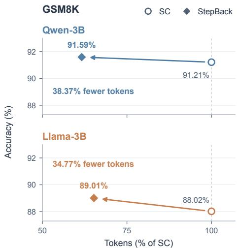
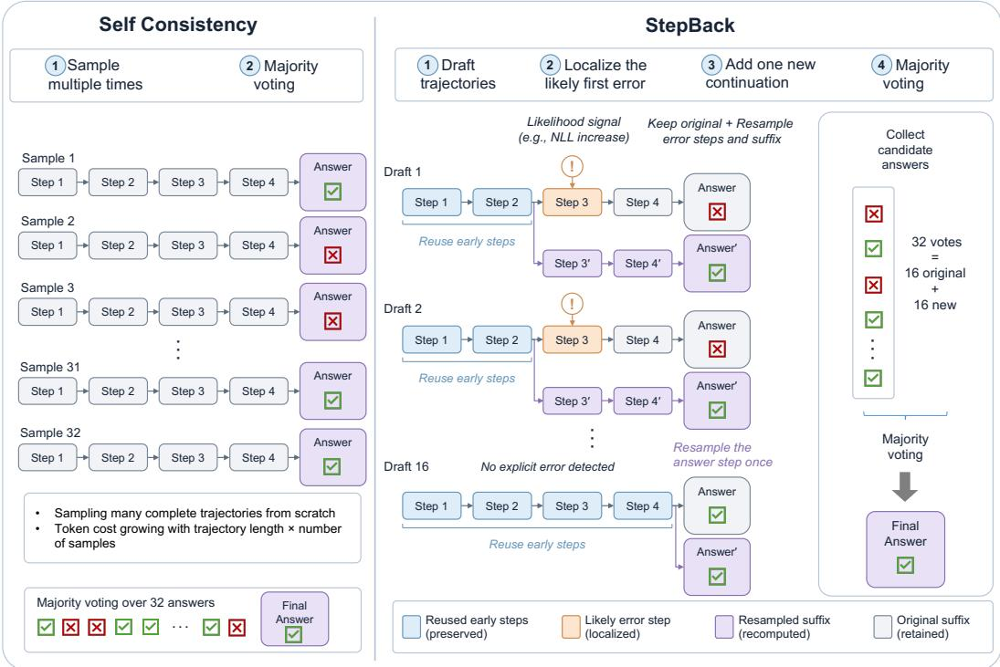

# StepBack: Step-Level Error-Localized Resampling for Efficient Test-Time Reasoning

Yang Ouyang Jung-Eun Kim<sup>∗</sup> Department of Computer Science North Carolina State University   
{youyang7, jung-eun.kim}@ncsu.edu

## Abstract

Self-consistency (SC) is a widely used decoding strategy for improving chain-ofthought reasoning, but it requires sampling many complete reasoning trajectories with a preset budget. Its efficient variants reduce the cost mainly by stopping fulltrajectory sampling early or distributing the number of samples across questions. In this paper, we propose StepBack, a step-level error-localized resampling method for efficient test-time reasoning. Given a small set of draft trajectories, STEPBACK localizes likely first error positions using lightweight signals and then resamples the detected error step and its suffix, followed by majority answer voting. Empirically, STEPBACK matches the accuracy of SC on average across seven mathematical reasoning and multi-hop QA benchmarks, while reducing token usage by up to 41.26%. In addition, by nature, STEPBACK can be combined with adaptive inference methods such as Adaptive Consistency, further improving their inferencetime efficiency. <sup>2</sup>

## 1 Introduction

Chain-of-thought prompting improves the reasoning ability of large language models (LLMs) [Brown et al., 2020] by encouraging language models to verbalize intermediate steps before producing a final answer [Wei et al., 2022, Kojima et al., 2022]. A widely used approach to further improve accuracy is Self-Consistency (SC), which samples multiple “complete” reasoning trajectories and selects the most frequent final answer [Wang et al., 2022]. Despite its effectiveness, SC is computationally expensive: each additional candidate answer requires generating an entire reasoning trajectory from scratch, so the token cost grows linearly with both the number of sampled trajectories and the length of each trajectory.

Recent studies have sought to reduce this cost by adjusting the number of full trajectories to sample. Adaptive-Consistency (AC) and Early-Stopping Self-Consistency (ESC) stop sampling once sufficient answer agreement is observed; Difficulty-Adaptive Self-Consistency (DSC) allocates larger budgets to harder questions; Reasoning-Aware Self-Consistency (RASC) makes stopping and voting more selective with rationale features [Aggarwal et al., 2023, Li et al., 2024, Wang et al., 2025, Wan et al., 2025]. These methods improve decisions on when to stop sampling or how many trajectories to sample, but they largely operate at the level of complete trajectories. As a result, they leave open a finer-grained question: where to efficiently spend additional sampling within a reasoning trajectory?

  
Figure 1: STEPBACK achieves higher accuracy with significantly fewer generated tokens than self-consistency on GSM8K.

  
Figure 2: Instead of regenerating many full trajectories, StepBack identifies a likely first error step, reuses valid early steps, and resamples only the erroneous step and its suffix before majority voting with the same voting budget (32 in this example).

This question is important because reasoning failures often emerge at an intermediate reasoning step rather than at only the final answer [Wei et al., 2022, Uesato et al., 2022, Lightman et al., 2024]. Once such an error occurs, subsequent steps may hinge on the corrupted reasoning state, causing the error to propagate and end up with an incorrect final answer, a phenomenon also noted in prior work on accumulated errors in chain-of-thought reasoning [Ling et al., 2023, Ouyang et al., 2026]. Meanwhile, the early steps of a reasoning chain contain useful problem setup [Ji et al., 2025]. This suggests a sensible opportunity for efficient test-time reasoning: if a likely first erroneous step can be localized, the valid early steps can be preserved while only the erroneous step and its subsequent suffixes are resampled [Tyen et al., 2024].

With this motivation, we propose STEPBACK, a step-level error-localized resampling method for efficient self-consistent reasoning. STEPBACK first generates a small set of draft trajectories and decomposes each trajectory into reasoning steps. It then uses lightweight signals, such as steplevel negative log-likelihood, to localize likely first error positions. For each localized trajectory, STEPBACK reuses the earlier steps before the detected error, rolls back to the error step, and resamples the detected error step together with its suffixes. When no explicit error is detected, STEPBACK samples only the final answer step. The resulting candidate answers are then aggregated by majority voting, following the standard SC. This approach significantly cuts token usage while matching SC’s accuracy on average, as depicted in Figure 1. The key contributions of our work are:

## Contributions.

• We introduce STEPBACK, an efficient step-level error-localized resampling method that reuses draft early steps, localizes likely first error positions with lightweight signals, and performs suffix resampling instead of repeated full-trajectory generation.

• To the best of our knowledge, STEPBACK is the first self-consistency-based decoding method that uses step-level error localization to decide where to begin resampling, rather than sampling every candidate as a full trajectory.

• We empirically show across mathematical reasoning and multi-hop QA benchmarks that STEPBACK can match or surpass full self-consistency while using substantially fewer generation tokens. We further show that STEPBACK can be seamlessly combined with adaptive inference methods such as Adaptive Consistency, Early-Stopping SC, and Difficulty-Adaptive SC.

## 2 Related Work

Efficient self-consistency. Recent work reduces self-consistency cost by adaptively controlling the number of full trajectories to sample. Adaptive-Consistency stops once answer agreement is sufficient [Aggarwal et al., 2023]; Early-Stopping Self-Consistency uses simple window-based stopping rules [Li et al., 2024]; Reasoning-Aware Self-Consistency incorporates rationale-quality features into stopping and voting [Wan et al., 2025]; and Difficulty-Adaptive Self-Consistency allocates larger budgets to harder questions [Wang et al., 2025]. These methods improve sampling efficiency by deciding how many trajectories to generate. In contrast, STEPBACK solves the problem where additional computation should be spent inside a trajectory. Thus, STEPBACK is complementary to adaptive SC methods: they reduce the number of consumed candidates, while STEPBACK reduces the cost of each candidate.

Step-level signals and backtracking. Process supervision and step-level verification show that intermediate reasoning steps carry useful signals about solution quality [Uesato et al., 2022, Lightman et al., 2024]. Errors tend to propagate once an early step becomes invalid [Ling et al., 2023], early prefixes often contain reusable problem setup [Ji et al., 2025], and LLMs correct reasoning more effectively when the error location is given [Tyen et al., 2024]. Several methods act on such signals by returning to an earlier step and regenerating from there: LeCo [Yao et al., 2024] restarts after the lowest-confidence step until two consecutive answers agree; Singh et al. [2025] backtrack with a step level verifier conditioned on previously attempted revisions; Adaptive Rectification Sampling [Tan et al., 2025] prompts the model to rethink a step whose PRM score falls below a threshold; Thought Rollback [Chen and Li, 2024] rolls back to earlier thoughts after analyzing their errors; and Self-Backtracking [Yang et al., 2026] trains the model itself to decide when and where to backtrack. In these methods, each rollback depends on the outcome of earlier attempts, so revisions run sequentially and their total cost is not fixed in advance. STEPBACK instead uses lightweight signals, such as a negative log-likelihood increase or a process-reward score drop, to assign a single rollback point to each independent draft, so all suffix continuations can be generated in parallel and the number of candidate answers is fixed at $B = n _ { d } n _ { s }$ , the same budget as full-trajectory self-consistency. Each additional candidate reuses its draft prefix and therefore costs fewer tokens than a full trajectory, and STEPBACK requires no training and aggregates answers by standard majority voting.

## 3 Preliminaries and Motivating Observations

## 3.1 Step-Level Reasoning Trajectories

Let x be an input problem and $p _ { \theta }$ be the language model. We write a reasoning trajectory as

$$
\tau = ( z _ { 1 } , z _ { 2 } , \dotsc , z _ { T } , z _ { T + 1 } ) ,\tag{1}
$$

where $z _ { 1 } , \dots , z _ { T }$ are intermediate reasoning steps and $z _ { T + 1 }$ is the final-answer step. We denote the extracted answer by $a ( \tau )$ .

Our method relies on the fact that instruction-tuned models usually produce naturally separable reasoning steps. For example, Qwen2.5-3B-Instruct often separates steps with blank lines, i.e.,

Table 1: Oracle first-error localization: suffix resampling starts from annotated first-error positions, with $n _ { d }$ drafts and $n _ { s }$ answers per draft $( n _ { d } n _ { s } = 3 2 )$ . Savings are computed relative to SC@32.
<table><tr><td>Dataset</td><td>Method</td><td>Accuracy</td><td>Tokens  $/ \mathrm { Q }$ </td><td>Savings</td></tr><tr><td rowspan="3">GSM8K</td><td>SC@32</td><td>91.21%</td><td>9506</td><td></td></tr><tr><td>Oracle error-localized resampling  ${ n _ { d } = 8 , n _ { s } = 4 }$ </td><td>91.89%</td><td>3427</td><td>64.0%</td></tr><tr><td>Oracle error-localized resampling  $n _ { d } = 1 6 , n _ { s } = 2$ </td><td>92.27%</td><td>5449</td><td>42.7%</td></tr><tr><td rowspan="3">MATH500</td><td>SC@32</td><td>72.80%</td><td>18335</td><td></td></tr><tr><td>Oracle error-localized resampling  ${ n _ { d } = 8 , n _ { s } = 4 }$ </td><td>72.40%</td><td>9815</td><td>46.5%</td></tr><tr><td>Oracle error-localized resampling  $n _ { d } = 1 6 , n _ { s } = 2$ </td><td>73.00%</td><td>12615</td><td>31.2%</td></tr></table>

$^ { \ 6 6 } \setminus \mathtt { n } \setminus \mathtt { n } ^ { \prime \ }$ , in both math and multi-hop QA tasks. The other models we test show similar line-delimited outputs.

We therefore parse each trajectory into steps using blank-line boundaries. Examples of model outputs and the resulting step decomposition are provided in Appendix A.

## 3.2 The Value of Accurate Error Localization

For an incorrect trajectory, let $e ( \tau )$ denote the position of the first step where the reasoning becomes invalid.<sup>3</sup> The earlier reasoning steps $z _ { < e ( \tau ) }$ remain valid, while the subsequent steps $z _ { \geq e ( \tau ) }$ may be corrupted by the first error.

Draft–suffix resampling. Given an answer budget $B ,$ we consider a two-stage procedure shared by the oracle study below and by our method (Section 4). We first sample $n _ { d }$ draft trajectories $\tau ^ { ( 1 ) } , \dots , \tau ^ { ( n _ { d } ) }$ . For each draft $\tau ^ { ( j ) }$ with $T _ { j }$ reasoning steps, we choose a rollback point $e _ { j } \in$ $\{ 1 , \ldots , T _ { j } + 1 \}$ , keep the prefix $z _ { < e _ { j } } ^ { ( j ) }$ , and draw $n _ { s } - 1$ suffixes

$$
\tilde { z } _ { e _ { j } : T _ { j } + 1 } ^ { ( j ) } \sim p _ { \theta } ( \cdot \mid x , z _ { < e _ { j } } ^ { ( j ) } ) .\tag{2}
$$

Together with the draft’s own answer, this yields $B = n _ { d } n _ { s }$ candidate answers, aggregated by majority vote as in self-consistency (SC). The only design choice is how to select $e _ { j }$

Oracle rollback. To understand the value of accurate error localization, we first consider an oracle setting where the true first-error position, $e ( \tau )$ , is known, and set $e _ { j } = e ( \tau ^ { ( j ) } )$ for each draft. We obtain these oracle positions from first-error annotations produced by an LLM verifier prompt. We manually inspect 100 annotated samples and find no obvious misjudgments; the full annotation protocol and examples are provided in Appendix B and Appendix C. For drafts without an annotated first error, we set $e _ { j } = T _ { j } + 1$ and resample only the final-step answer.

Table 1 reports motivating results under this oracle setting. Oracle first-error localization enables suffix resampling to match or even outperform full self-consistency while using fewer tokens. This suggests that many failed trajectories still contain useful early reasoning steps. Therefore, by reliably localizing the first errors and simply resampling from them, we can achieve both token efficiency and comparable (or better at times) accuracy.

## 4 STEPBACK: Step-Level Error-Localized Resampling

The oracle study in Section 3.2 shows that localized resampling can be effective when the first erroneous reasoning step is known. In practice, however, the true first-error position $e ( \tau )$ is unavailable at inference time. STEPBACK turns this oracle diagnostic into a practical decoding procedure by replacing $e ( \tau )$ with a predicted rollback point obtained from lightweight step-level signals.

For each draft $\tau ^ { ( j ) } = ( z _ { 1 } ^ { ( j ) } , \ldots , z _ { T _ { i } + 1 } ^ { ( j ) } ) , j = 1 , \ldots , n _ { d } .$ , STEPBACK applies an inference-time localization rule,

$$
\hat { e } _ { j } = \operatorname { L o c } ( x , \tau ^ { ( j ) } ) \in \{ 1 , \dots , T _ { j } + 1 \} .\tag{3}
$$

Here $\hat { e } _ { j } \le T _ { j }$ means that step $\boldsymbol { \hat { e } } _ { j }$ is predicted as the first unreliable reasoning step. STEPBACK then preserves the early steps $( z _ { 1 } ^ { ( j ) } , \dotsc , z _ { \hat { e } _ { j } - 1 } ^ { ( j ) } )$ and resamples the detected step together with its suffix. If $\hat { e } _ { j } = T _ { j } + 1$ , no explicit reasoning error is detected, so STEPBACK preserves the full reasoning chain and resamples only the final answer step to simply obtain the same number of answers as SC does. The resulting B answer candidates are aggregated with the same normalized majority vote as done in SC. For details, see Algorithm 1.

## 4.1 Inference-Time Localization Signals

We instantiate Loc with lightweight inference-time signals in our experiments, including NLL-SIGNAL and PRM-SIGNAL. Throughout this subsection, we consider a single draft and omit the superscript (j) (unless any confusion arises), writing $\tau = ( z _ { 1 } , \dots , z _ { T + 1 } )$

NLL-signal: Step-Level Negative Log-Likelihood (NLL) Increase For each reasoning step $z _ { t }$ we compute its mean token negative log-likelihood under the base model:

$$
u _ { t } = - \frac { 1 } { \left| z _ { t } \right| } \sum _ { y _ { i } \in z _ { t } } \log p _ { \theta } \left( y _ { i } \mid x , z _ { < t } , y _ { < i } \right) .\tag{4}
$$

A sudden increase in $u _ { t }$ indicates that the model becomes less confident when generating the current step. We define

$$
\Delta _ { t } ^ { \mathrm { N L L } } = u _ { t } - u _ { t - 1 } ,\tag{5}
$$

and predict the rollback point as

$$
\begin{array} { r } { \hat { e } _ { \mathrm { N L L } } = \left\{ \begin{array} { l l } { \mathrm { m i n } \{ t : \Delta _ { t } ^ { \mathrm { N L L } } \geq \delta _ { \mathrm { N L L } } \} , } & { \mathrm { i f ~ s u c h ~ a ~ s t e p ~ e x i s t s } , } \\ { T + 1 , } & { \mathrm { o t h e r w i s e } . } \end{array} \right. } \end{array}\tag{6}
$$

The fallback position $T + 1$ means that no explicit reasoning error is detected. In this case, STEPBACK keeps the full reasoning chain and resamples only the final answer step.

PRM-signal: Step-Level Process Reward Model (PRM) Score Drop We also consider an external process reward model (PRM), denoted by $R _ { \phi }$ . Given the problem x and the partial reasoning trace $z _ { \le t }$ , the PRM assigns a score

$$
\begin{array} { r } { r _ { t } = R _ { \phi } ( x , z _ { \leq t } ) , } \end{array}\tag{7}
$$

which estimates the reliability of the reasoning prefix. A large drop after adding step $z _ { t }$ suggests that the new step makes the reasoning less reliable. We define

$$
\begin{array} { r } { \Delta _ { t } ^ { \mathrm { P R M } } = r _ { t - 1 } - r _ { t } , } \end{array}\tag{8}
$$

and predict the rollback point as

$$
\begin{array} { r } { \hat { e } _ { \mathrm { P R M } } = \left\{ \begin{array} { l l } { \operatorname* { m i n } \{ t : \Delta _ { t } ^ { \mathrm { P R M } } \geq \delta _ { \mathrm { P R M } } \} , } & { \mathrm { i f ~ s u c h ~ a ~ s t e p ~ e x i s t s } , } \\ { T + 1 , } & { \mathrm { o t h e r w i s e } . } \end{array} \right. } \end{array}\tag{9}
$$

In our experiments, unless otherwise specified, we use Qwen2.5-Math-PRM-7B [Zhang et al., 2025] as the PRM scorer.

Both signals are inexpensive. NLL-SIGNAL uses token probabilities already available from the base model, while the PRM-SIGNAL only scores partial reasoning traces rather than requiring additional full-trajectory sampling. We provide the detailed diagnostics in Appendix D.

## 4.2 Comparison with Self-Consistency

Standard self-consistency (SC) samples B complete reasoning trajectories from $p _ { \theta } ( \cdot \mid x )$ and returns the majority normalized answer [Wang et al., 2022]. Under the same answer budget, SC spends all samples on independent full trajectories, whereas STEPBACK spends the budget on repairing or diversifying uncertain suffixes of a smaller set of draft anchors. This allows STEPBACK to reuse reliable early steps while focusing additional sampling on steps that are more likely to affect the final answer, as illustrated in Fig. 2.

Algorithm 1 STEPBACK: Step-Level Error-Localized Resampling   
Require: Problem x, model p<sub>θ</sub>, budget $\overline { { B = n _ { d } n _ { s } } } ,$ localization rule Loc   
Ensure: Final answer $a ^ { \star }$   
1: $A  \emptyset$ ▷ multiset of candidate answers   
2: for $j = 1 , \dots , n _ { d }$ do   
3: $\tau ^ { ( j ) } = ( z _ { 1 } ^ { ( j ) } , \dots , z _ { T _ { j } + 1 } ^ { ( j ) } ) \sim p _ { \theta } ( \cdot \mid x )$   
4: $\mathcal { A }  \mathcal { A } \cup \{ a ( \tau ^ { ( j ) } ) \}$ ▷ keep the draft’s own answer   
5: $\hat { e } _ { j } \gets \mathrm { L o c } ( x , \tau ^ { ( j ) } )$   
6: for $m = 1 , \ldots , n _ { s } - 1$ do   
7: $\tilde { z } ^ { ( j , m ) } \sim p _ { \theta } ( \cdot \mid x , z _ { < \hat { e } _ { j } } ^ { ( j ) } )$   
8: $\mathcal { A }  \mathcal { A } \cup \{ a ( z _ { < \hat { e } _ { j } } ^ { ( j ) } , \tilde { z } ^ { ( j , m ) } ) \}$   
9: end for   
10: end for   
11: return a<sup>⋆</sup> = mode(Normalize(A))

## 5 Experiments

We evaluate whether STEPBACK can outperform or achieve a comparable performance to fulltrajectory self-consistency (SC) at a fixed candidate-answer budget while reducing generation cost. The results focus on budget B = 32 and compare rollback-resampling against Greedy@1 and SC@32.

## 5.1 Experimental Setup

Benchmarks. We evaluate mathematical reasoning on GSM8K [Cobbe et al., 2021], MATH500 [Hendrycks et al., 2021], AMC2023, AIME24, and OlympiadBench [He et al., 2024], covering tasks from grade-school arithmetic to competition-level mathematics. We further evaluate multi-hop question answering on HotpotQA [Yang et al., 2018] and 2WikiMultiHopQA [Ho et al., 2020], which require composing evidence across multiple supporting facts. For efficiency, we randomly sample 500 examples from the HotpotQA validation set of 7,405 examples and 1,000 examples from the 2WikiMultiHopQA validation set of 12.6K examples.

Models. The model set contains Qwen-2.5-3B-Instruct, Llama-3.2-3B-Instruct, and Qwen-2.5-7B-Instruct. These models span various architectures and scales, allowing us to test whether error-localized suffix resampling is robust beyond a single backbone.

Baselines and variants. The primary baseline is self-consistency (SC) [Wang et al., 2022], which samples B = 32 complete chain-of-thought trajectories independently and selects the most frequent normalized final answer. We also report greedy chain-of-thought decoding (CoT), which generates one deterministic reasoning trajectory and serves as a low-cost reference point. In Section 5.3, we additionally compare against adaptive reasoning methods, including Adaptive Consistency (AC) [Aggarwal et al., 2023], Early-Stopping Self-Consistency (ESC) [Li et al., 2024], and Difficulty-Adaptive Self-Consistency (DSC) [Wang et al., 2025]. Details for their hyperparameters can be found in Appendix J. For the main comparison, STEPBACK uses the same candidate-answer budget as SC@32. We consider two lightweight variants of the localization signal: NLL-SIGNAL and PRM-SIGNAL, both described in Section 4.1.

Unless otherwise specified, we use thresholds 0.1 for NLL-SIGNAL and 0.05 for PRM-SIGNAL, without dataset-specific tuning. Lower thresholds trigger a rollback on modest drops of the step-level signal, so more drafts are rewritten since an earlier step; this favors accuracy over token saving. These thresholds are shared across all datasets and models; a held-out calibration on training questions (Appendix F) shows that every threshold in a wide grid matches or exceeds the average accuracy of SC@32 while saving 20–44% of tokens.

Evaluation metrics. For all datasets, we report answer-level accuracy after answer extraction and normalization. For mathematical reasoning, extracted answers are compared against the reference answer using exact or symbolic equivalence when applicable. For multi-hop QA, we use normalized exact match. In Table 2, we report SC@32 accuracy once for each model-dataset pair and report STEPBACK by its accuracy change over SC,

$$
\Delta \mathrm { A c c } = \mathrm { A c c } ( \mathrm { S T E P B A C K } ) - \mathrm { A c c } ( \mathrm { S C @ 3 2 } ) ,\tag{10}
$$

where positive values indicate that STEPBACK outperforms SC. We measure generation efficiency by the token saving relative to SC@32,

$$
\eta = 1 0 0 \left( 1 - \frac { \mathrm { T o k / Q ( S T E P B A C K ) } } { \mathrm { T o k / Q ( S C @ 3 2 ) } } \right) ,\tag{11}
$$

where $\mathrm { T o k } / \mathrm { Q }$ denotes the average number of generated tokens per question. In Table 3, we further report path expansion (PExp) [Jindal et al., 2026], the average number of sampled reasoning continuations per question, and

$$
\mathrm { G / 1 k T } = 1 0 0 0 \cdot \frac { \mathrm { A c c } ( m ) - \mathrm { A c c } ( \mathrm { C o T } ) } { \mathrm { T o k } / \mathrm { Q } ( m ) } ,\tag{12}
$$

which measures the accuracy gain over greedy CoT per 1k generated tokens. Higher $\eta$ and G/1kT indicate better inference efficiency.

Implementation details. Unless otherwise specified, we use temperature 0.7 and top-p 0.95 for sampling. All experiments are run on compute nodes with two AMD EPYC 9005-series CPUs, and NVIDIA RTX PRO 6000 Blackwell Server Edition GPUs (96 GB each); each run uses 4 GPUs with CUDA 12.8, PyTorch 2.7.0, and vLLM 0.9.2.

## 5.2 Main Results

Table 2 presents the main comparison between STEPBACK and SC@32 under the same candidateanswer budget $B = 3 2$ . The main table reports the default STEPBACK configuration with $n _ { d } = 1 6$ draft trajectories and ${ n _ { s } } = 2$ candidate answers per draft (the draft’s own answer and one localized suffix sample); additional budget allocations are reported in Section 6 and Appendix H. For each model–dataset pair, we report the SC@32 accuracy once, followed by the accuracy change $\Delta \mathrm { A c c } ,$ token saving $\eta ,$ and G/1kT of STEPBACK with PRM-SIGNAL and NLL-SIGNAL localization; the Avg. row gives the mean over the seven datasets weighted by their number of questions.

STEPBACK matches SC@32 accuracy on average with fewer generated tokens. The Avg. rows of Table 2 summarize the comparison over all 4,166 questions. With PRM-SIGNAL, STEPBACK improves average accuracy over SC@32 by 0.36, 0.17, and 0.82 percentage points on Llama-3B, Qwen-3B and Qwen-7B, respectively, while generating 21.07%, 18.66%, and 22.80% fewer tokens. With NLL-SIGNAL, it saves even more tokens, stays under 0.2 points difference with SC@32 on the two 3B models (+0.12 and −0.17), and is 0.55 points above SC@32 on Qwen-7B. Both signals also raise the accuracy gained per generated token: on Llama-3B, G/1kT increases from 1.392 for SC@32 to 1.769 with PRM-SIGNAL and 1.978 with NLL-SIGNAL.

Per dataset, PRM-SIGNAL reduces generated tokens in all 21 model–dataset pairs (7.66–41.26%), improves accuracy in 14 of them, ties in 1, and is lower in 6. On MATH500, it improves Qwen-3B, Llama-3B, and Qwen-7B by +0.40, +1.20, and +2.00 points while saving 25.60%, 20.81%, and 28.53% tokens, respectively. Notably, although the PRM is trained primarily for mathematical process supervision, it also provides useful step-level reliability estimates for logical and multi-hop reasoning: on HotpotQA, PRM-SIGNAL improves Qwen-3B and Qwen-7B by +1.20 and +2.20 points but lowers Llama-3B by 2.00 points, which suggests that PRM-SIGNAL can capture some reasoning-quality drops beyond purely arithmetic errors, but less reliably than on mathematical reasoning.

Meanwhile, NLL-SIGNAL provides a complementary low-cost localization signal requiring no external model: it achieves larger token savings than PRM-SIGNAL on 17 of the 21 pairs and improves accuracy of Qwen-3B and Qwen-7B on two multi-hop QA datasets. We factor this in that NLL-SIGNAL tends to localize errors less aggressively, often rolling back closer to the final answer and therefore resampling shorter suffixes. This yields stronger token savings, but may leave more earlier reasoning errors unedited compared to PRM-SIGNAL.

Table 2: Main comparison between self-consistency and STEPBACK on Llama-3B, Qwen-3B, and Qwen-7B under the same candidate-answer budget $B = 3 2$ . STEPBACK uses $( n _ { d } , n _ { s } ) = ( 1 6 , 2 )$ with thresholds $\delta _ { \mathrm { N L L } } = 0 . 1$ and $\delta _ { \mathrm { P R M } } = 0 . 0 5$ for all three models. We report SC@32 accuracy once per dataset, followed by the accuracy change $\Delta \mathrm { A c c }$ (percentage points), token saving η (%) and localization overhead $\rho _ { 1 6 } \ : ( \% )$ of STEPBACK. $\rho _ { 1 6 }$ is the share of wall-clock GPU time spent scoring the 16 drafts, relative to drafting, scoring, and suffix generation combined. G/1kT is the accuracy gain over greedy CoT per 1k generated tokens; the highest G/1kT in each row is in bold. Positive, zero, and negative accuracy changes are shown in green, gray, and dark red, respectively. Avg. is the mean over the seven datasets weighted by their number of questions (4,166 in total). Five-seed results are reported in Appendix K.
<table><tr><td rowspan="2"></td><td>Greedy</td><td colspan="2">SC@32</td><td colspan="4">NLL-SIGNAL</td><td colspan="4">PRM-SIGNAL</td></tr><tr><td>Acc</td><td>Acc</td><td>G/1kT</td><td>∆Acc</td><td>η</td><td>G/1kT</td><td> $\rho _ { 1 6 }$ </td><td>∆Acc</td><td>η</td><td>G/1kT</td><td>ρ16</td></tr><tr><td colspan="10">Llama-3B</td></tr><tr><td>GSM8K</td><td>77.41</td><td>88.02</td><td>1.488</td><td>+0.00</td><td>34.47</td><td>2.270</td><td>9.14</td><td>+0.99</td><td>34.77</td><td>2.494</td><td>10.47</td></tr><tr><td>MATH500</td><td>42.20</td><td>53.40</td><td>0.691</td><td>+0.60</td><td>24.22</td><td>0.961</td><td>8.23</td><td>+1.20</td><td>20.81</td><td>0.966</td><td>9.18</td></tr><tr><td>AMC2023</td><td>15.66</td><td>33.73</td><td>0.705</td><td>-3.61</td><td>14.92</td><td>0.663</td><td>7.27</td><td>+2.41</td><td>10.83</td><td>0.896</td><td>8.46</td></tr><tr><td>AIME24</td><td>7.78</td><td>15.56</td><td>0.273</td><td>-2.22</td><td>12.41</td><td>0.222</td><td>7.08</td><td>-2.22</td><td>9.72</td><td>0.216</td><td>9.29</td></tr><tr><td>OlympiadBench</td><td>14.84</td><td>23.00</td><td>0.299</td><td>+0.45</td><td>13.81</td><td>0.366</td><td>7.42</td><td>+1.48</td><td>10.68</td><td>0.395</td><td>8.36</td></tr><tr><td>HotpotQA</td><td>35.00</td><td>50.20</td><td>2.606</td><td>-1.60</td><td>31.80</td><td>3.419</td><td>7.37</td><td>-2.00</td><td>7.94</td><td>2.458</td><td>3.41</td></tr><tr><td>2Wiki</td><td>32.80</td><td>44.60</td><td>1.903</td><td>+0.00</td><td>30.41</td><td>2.734</td><td>8.82</td><td>-0.40</td><td>8.55</td><td>2.009</td><td>3.91</td></tr><tr><td>Avg.</td><td>44.53</td><td>55.74</td><td>1.392</td><td>-0.17</td><td>27.74</td><td>1.978</td><td>8.38</td><td>+0.36</td><td>18.66</td><td>1.769</td><td>7.48</td></tr><tr><td colspan="10">Qwen-3B</td></tr><tr><td>GSM8K</td><td>85.14</td><td>91.21</td><td>0.638</td><td>-0.45</td><td>34.64</td><td>0.903</td><td>11.00</td><td>+0.38</td><td>38.37</td><td>1.100</td><td>14.32</td></tr><tr><td>MATH500</td><td>61.80</td><td>72.80</td><td>0.601</td><td>-0.40</td><td>25.46</td><td>0.777</td><td>10.52</td><td>+0.40</td><td>25.60</td><td>0.837</td><td>11.39</td></tr><tr><td>AMC2023</td><td>33.73</td><td>43.37</td><td>0.370</td><td>+2.41</td><td>24.37</td><td>0.612</td><td>9.79</td><td>+2.41</td><td>15.07</td><td>0.545</td><td>10.06</td></tr><tr><td>AIME24</td><td>4.44</td><td>6.67</td><td>0.077</td><td>+0.00</td><td>18.47</td><td>0.094</td><td>9.77</td><td>+1.11</td><td>8.66</td><td>0.126</td><td>10.90</td></tr><tr><td>OlympiadBench</td><td>26.26</td><td>34.87</td><td>0.328</td><td>-0.45</td><td>20.74</td><td>0.393</td><td>10.42</td><td>+0.00</td><td>14.83</td><td>0.386</td><td>10.49</td></tr><tr><td>HotpotQA</td><td>23.20</td><td>33.00</td><td>1.282</td><td>+2.60</td><td>22.41</td><td>2.091</td><td>7.56</td><td>+1.20</td><td>7.66</td><td>1.559</td><td>5.00</td></tr><tr><td>2Wiki</td><td>26.90</td><td>43.70</td><td>2.231</td><td>+0.10</td><td>25.82</td><td>3.026</td><td>7.41</td><td>-0.90</td><td>8.52</td><td>2.308</td><td>5.11</td></tr><tr><td>Avg.</td><td>48.63</td><td>58.71</td><td>1.026</td><td>+0.12</td><td>27.15</td><td>1.434</td><td>9.52</td><td>+0.17</td><td>21.07</td><td>1.266</td><td>9.86</td></tr><tr><td colspan="10"></td></tr><tr><td>Qwen-7B</td><td></td><td></td><td></td><td></td><td></td><td></td><td></td><td></td><td></td><td></td><td></td></tr><tr><td>GSM8K</td><td>91.13</td><td>93.63</td><td>0.304</td><td>+0.00</td><td>38.55</td><td>0.494</td><td>13.71</td><td>+0.45</td><td>41.26</td><td>0.611</td><td>10.38</td></tr><tr><td>MATH500</td><td>71.00</td><td>77.20</td><td>0.360</td><td>+0.00</td><td>30.03</td><td>0.514</td><td>11.26</td><td>+2.00</td><td>28.53</td><td>0.666</td><td>7.79</td></tr><tr><td>AMC2023</td><td>46.99</td><td>50.60</td><td>0.140</td><td>+2.41</td><td>27.44</td><td>0.322</td><td>10.40</td><td>+6.02</td><td>17.98</td><td>0.455</td><td>8.95</td></tr><tr><td>AIME24</td><td>6.67</td><td>12.22</td><td>0.186</td><td>-2.22</td><td>21.66</td><td>0.143</td><td>10.78</td><td>-2.22</td><td>10.39 18.04</td><td>0.125</td><td>6.95</td></tr><tr><td>OlympiadBench HotpotQA</td><td>37.54 37.40</td><td>44.66 47.40</td><td>0.287 1.496</td><td>+0.30 +2.40</td><td>25.27 32.29</td><td>0.399 2.740</td><td>11.49 7.55</td><td>-0.30 +2.20</td><td>7.79</td><td>0.335 1.980</td><td>7.58 2.96</td></tr><tr><td>2Wiki</td><td>44.20</td><td>54.80</td><td>1.590</td><td>+0.90</td><td>35.53</td><td>2.675</td><td>8.47</td><td>+0.60</td><td>7.82</td><td>1.822</td><td>3.53</td></tr><tr><td>Avg.</td><td>59.63</td><td>66.25</td><td>0.754</td><td>+0.55</td><td>33.32</td><td>1.263</td><td>10.93</td><td>+0.82</td><td>22.80</td><td>1.014</td><td>6.98</td></tr></table>

Localization overhead is small relative to generation. The additional cost of computing localization signals remains modest compared with the cost of generating complete reasoning trajectories. The relative localization overhead $\rho _ { 1 6 }$ in Table 2, i.e., the share of the wall-clock time of STEPBACK spent scoring the drafts, averages 8.38%, 9.52%, and 10.93% for NLL-SIGNAL and 7.48%, 9.86%, and 6.98% for PRM-SIGNAL on Llama-3B, Qwen-3B, and Qwen-7B, respectively. Thus, the token savings achieved by STEPBACK are not offset by a large scoring cost.

STEPBACK benefits from reusable early reasoning steps. The gains of accuracy suggest that many incorrect draft trajectories are not entirely unhelpful since they often contain correct early steps. Instead of discarding these steps as SC does, STEPBACK keeps the reliable part of each draft and resamples only from the predicted error region. This design is especially effective on datasets where errors often arise in later reasoning stages, such as GSM8K, MATH500, and AMC2023, where PRM-SIGNAL improves accuracy for all three models while saving 10.83–41.26% of generated tokens. The consistent token reduction across all settings further indicates that localized resampling avoids a large amount of redundant early steps generation.

Table 3: Combining STEPBACK with adaptive reasoning methods using Qwen2.5-3B-Instruct and maximum budget $\bar { B } = 3 2$ . CoT denotes greedy chain-of-thought decoding. For STEPBACK, the candidate pool is built from $n _ { d } = 1 6$ draft anchors and $n _ { s } = 2$ candidate answers per draft (the draft’s own answer and one localized suffix sample), using PRM-SIGNAL. PExp [Jindal et al., 2026] is the average number of consumed candidate expansions per question. For SC/AC/ESC/DSC, each expansion is a full trajectory. For STEPBACK, each expansion is a draft trajectory or a localized suffix continuation. Tok. is the number of generated tokens per question, and G/1kT is the accuracy gain over CoT per 1k generated tokens. Within each pair of a baseline and its STEPBACK counterpart, bold numbers indicate the better value, with higher being better for Acc. and G/1kT and lower being better for Tok. and PExp.
<table><tr><td rowspan="2">Method</td><td colspan="4">MATH500</td><td colspan="4">GSM8K</td><td colspan="4">HotpotQA</td></tr><tr><td>Acc.</td><td>PExp</td><td>Tok.</td><td>G/1kT |</td><td>Acc.</td><td>PExp</td><td>Tok.</td><td>G/1kT</td><td>Acc.</td><td>PExp</td><td>Tok.</td><td>G/1kT</td></tr><tr><td>CoT</td><td>61.80</td><td>1.00</td><td>577</td><td>0.000</td><td>85.14</td><td>1.00</td><td>295</td><td>0.000</td><td>23.20</td><td>1.00</td><td>240</td><td>0.000</td></tr><tr><td>SC</td><td>72.80</td><td>32.00</td><td>18,335</td><td>0.600</td><td>91.21</td><td>32.00</td><td>9,506</td><td>0.638</td><td>33.00</td><td>32.00</td><td>7,643</td><td>1.282</td></tr><tr><td>STEPBACK (ours)</td><td>73.20</td><td>32.00</td><td>13,620</td><td>0.837</td><td>91.59</td><td>32.00</td><td>5,860</td><td>1.100</td><td>34.20</td><td>32.00</td><td>7,056</td><td>1.559</td></tr><tr><td>AC</td><td>72.80</td><td>16.57</td><td>11,386</td><td>0.966</td><td>91.13</td><td></td><td>10.843,509</td><td>1.707</td><td>33.00</td><td>28.09</td><td>6,792</td><td>1.443</td></tr><tr><td>STEPBACK + AC</td><td>72.60</td><td>15.46</td><td>8,749</td><td>1.234</td><td>92.34</td><td>9.81</td><td>2,166</td><td>3.326</td><td>34.80</td><td>28.11</td><td>6,286</td><td>1.845</td></tr><tr><td>ESC</td><td>73.00</td><td>17.14</td><td>11,951</td><td>0.937</td><td>91.21</td><td>10.47</td><td>3,446</td><td>1.760</td><td>32.80</td><td>29.29</td><td>7,061</td><td>1.360</td></tr><tr><td>STEPBACK + ESC</td><td>72.20</td><td>15.41</td><td>9,075</td><td>1.146</td><td>92.27</td><td>8.97</td><td>2,138</td><td>3.334</td><td>35.00</td><td>29.41</td><td>6,567</td><td>1.797</td></tr><tr><td>DSC</td><td>71.80</td><td>13.33</td><td>9,022</td><td>1.108</td><td>90.90</td><td></td><td>8.662,790</td><td>2.065</td><td>32.60</td><td>21.48</td><td>5,161</td><td>1.821</td></tr><tr><td>STEPBACK + DSC</td><td>71.60</td><td>12.40</td><td>7,068</td><td>1.387</td><td>92.12</td><td></td><td>7.90 1,815</td><td>3.843</td><td>34.00</td><td>021.71</td><td>4,851</td><td>2.226</td></tr></table>

Limitations across harder datasets. On harder competition-style benchmarks such as AIME24 and OlympiadBench, the gains are less stable, especially for Llama-3B. This suggests that some failures cannot be corrected by resampling only a localized suffix, since they may require revising earlier reasoning decisions or exploring a substantially different solution path.

Overall, these results support the central premise of STEPBACK: under a fixed answer budget, additional test-time compute can be spent more efficiently by resampling from a localized likely error step instead of regenerating every candidate from scratch.

## 5.3 STEPBACK as a Complement to Adaptive Reasoning

Table 3 shows that STEPBACK can be directly combined with adaptive reasoning methods. AC, ESC, and DSC originally operate on a pool of independently generated full trajectories and decide how many candidates to consume. We instead replace this full-trajectory pool with the STEPBACK suffix pool: STEPBACK first generates draft anchors and localized suffix continuations, and the adaptive policy is then applied to these suffix candidates. Therefore, STEPBACK reduces the token cost of each candidate, while AC/ESC/DSC further reduces the number of consumed candidates.

These two reductions compound. Relative to each adaptive method alone, adding STEPBACK cuts generated tokens by 22–24% on MATH500, 35–38% on GSM8K, and 6–7% on HotpotQA. Accuracy also improves in all six comparisons on GSM8K and HotpotQA, by 1.1–2.2 points, and G/1kT improves in all nine; on MATH500, accuracy is only 0.2–0.8 points lower. The most efficient combination, STEPBACK +DSC on GSM8K, uses 5.2× fewer tokens than SC@32 while being 0.9 points more accurate.

Overall, the combination improves the accuracy-cost trade-off over both standard SC and adaptive reasoning alone, showing that STEPBACK is a complementary intra-trajectory allocation strategy rather than a replacement for adaptive inference.

## 6 Analysis and Discussions

Different Process Reward Model Size. Table 14 in Appendix H studies whether STEPBACK relies on a large PRM for error localization. We fix the generator to Qwen2.5-3B and evaluate on MATH500, comparing Skywork-o1-Open-PRM-Qwen-2.5-1.5B [He et al., 2025] with Qwen2.5-Math-PRM-7B under the same $B = 3 \bar { 2 }$ candidate-answer budget.

The results show that STEPBACK does not require a PRM larger than the generator. With the 1.5B Skywork PRM, STEPBACK still outperforms SC@32 in the $\breve { 8 } \times 4$ setting, improving accuracy by +0.36 points while saving 23.8% generation tokens, although the accuracy is 0.36 points below SC@32 at $1 6 \times 2 .$ The 7B Qwen PRM gives stronger localization and achieves a higher accuracy gain of $+ 0 . 7 2$ points at $1 6 \times 2$ , but 1.5B PRM already preserves a substantial portion of the benefit with lower scoring overhead (13.7ms vs. 19.7ms per draft sample).

This suggests that the key requirement is not PRM scale, but whether the localization signal is informative. Even lightweight signals, such as NLL-SIGNAL or a smaller PRM, can support effective suffix resampling when they identify useful rollback points.

Drafts versus suffix samples. Table 12 in Appendix H studies how to allocate the same candidate budget $B = 3 2$ between draft anchors and suffix samples. Suffix-heavy settings such as $1 \times 3 2$ and $2 \times 1 6$ save the most tokens and $2 \times 1 6$ attains the highest G/1kT on three out of the seven datasets, since many candidates share the same short early steps. However, they are less stable in accuracy because a small number of flawed draft prefixes can limit recovery.

Draft-heavy settings such as $8 \times 4$ and $1 6 \times 2$ are more robust because they provide more diverse reasoning prefixes. 8 × 4 improves over SC@32 on all five math benchmarks, and $1 6 \times 2$ improves on GSM8K, MATH500, AMC2023, AIME24, and HotpotQA and matches it on OlympiadBench, while still saving tokens. These exhibit that $n _ { d }$ and $n _ { s }$ control an accuracy-efficiency trade-off: suffix-heavy settings are more cost-oriented, whereas draft-heavy settings are more accuracy-oriented.

Alternative rollback rules. Any rule that maps a draft to a rollback point can serve as Loc in Algorithm 1, including signal-free rules such as random, fixed-position, and final-step rollback, and PRM-based rules from prior backtracking methods [Singh et al., 2025, Tan et al., 2025]. Appendix G compares them with drafting, suffix resampling, and majority voting held fixed. Prefix reuse and suffix resampling yield most of the token saving under any rule, and late rules such as final-step resampling are strong efficiency baselines; on HotpotQA, final-step resampling is both more accurate and cheaper than PRM-SIGNAL. Localization helps most when suffix samples dominate the vote: at $4 \times 8 ,$ , PRM-SIGNAL is 2.06 points more accurate than final-step resampling over all seven datasets.

## 7 Conclusion

We presented STEPBACK, a step-level error-localized resampling method for efficient test-time reasoning. Instead of regenerating every candidate from scratch, STEPBACK keeps the reliable prefix of each draft and resamples only from a likely first error located by lightweight NLL-SIGNAL or PRM-SIGNAL. Across seven mathematical reasoning and multi-hop QA benchmarks and three models, STEPBACK matches the average accuracy of SC@32 under the same answer budget while generating up to 41.26% fewer tokens, and it further reduces the cost of adaptive methods such as AC, ESC, and DSC. These results suggest that where test-time compute is spent within a trajectory is a useful axis of efficiency, complementary to deciding how many trajectories to sample.

## 8 Limitations and Broader Impact

Limitations. STEPBACK has limitations that leave room for future work. First, we focus on two representative localization signals, NLL-SIGNAL and PRM-SIGNAL. Although they already show clear benefits, exploring a broader set of even lighter-weight signals may further improve the efficiency of STEPBACK. Second, our experiments mainly focus on mathematical reasoning and multi-hop question answering. While STEPBACK performs well in these settings, its generalizability to other domains such as code generation or long-context summarization remains to be further studied.

Broader impact. More efficient reasoning can make stronger inferences accessible at a lower cost, which is a positive outcome for scientific and educational use. At the same time, cheaper reasoning can also make capable systems easier to deploy at scale. We therefore believe that research on efficient reasoning should ideally improve both performance and transparency about where the gains come from.

## References

Pranjal Aggarwal, Aman Madaan, Yiming Yang, and Mausam. Let’s sample step by step: Adaptiveconsistency for efficient reasoning and coding with llms. In Proceedings of the 2023 Conference on Empirical Methods in Natural Language Processing, pages 12375–12396, 2023.

Tom B. Brown, Benjamin Mann, Nick Ryder, Melanie Subbiah, Jared Kaplan, Prafulla Dhariwal, Arvind Neelakantan, Pranav Shyam, Girish Sastry, Amanda Askell, Sandhini Agarwal, Ariel Herbert-Voss, Gretchen Krueger, Tom Henighan, Rewon Child, Aditya Ramesh, Daniel M. Ziegler, Jeffrey Wu, Clemens Winter, Christopher Hesse, Mark Chen, Eric Sigler, Mateusz Litwin, Scott Gray, Benjamin Chess, Jack Clark, Christopher Berner, Sam McCandlish, Alec Radford, Ilya Sutskever, and Dario Amodei. Language models are few-shot learners, 2020. URL https: //arxiv.org/abs/2005.14165.

Sijia Chen and Baochun Li. Toward adaptive reasoning in large language models with thought rollback. In Forty-first International Conference on Machine Learning, 2024. URL https: //openreview.net/forum?id=aoAPOOtN9E.

Karl Cobbe, Vineet Kosaraju, Mohammad Bavarian, Mark Chen, Heewoo Jun, Łukasz Kaiser, Matthias Plappert, Jerry Tworek, Jacob Hilton, Reiichiro Nakano, Christopher Hesse, and John Schulman. Training verifiers to solve math word problems. arXiv preprint arXiv:2110.14168, 2021.

Chaoqun He, Renjie Luo, Yuzhuo Bai, Shengding Hu, Zhen Thai, Junhao Shen, Jinyi Hu, Xu Han, Yujie Huang, Yuxiang Zhang, Jie Liu, Lei Qi, Zhiyuan Liu, and Maosong Sun. OlympiadBench: A challenging benchmark for promoting AGI with olympiad-level bilingual multimodal scientific problems. In Lun-Wei Ku, Andre Martins, and Vivek Srikumar, editors, Proceedings of the 62nd Annual Meeting of the Association for Computational Linguistics (Volume 1: Long Papers), pages 3828–3850, Bangkok, Thailand, August 2024. Association for Computational Linguistics. doi: 10.18653/v1/2024.acl-long.211. URL https://aclanthology.org/2024.acl-long.211/.

Jujie He, Jiacai Liu, Chris Yuhao Liu, Rui Yan, Chaojie Wang, Peng Cheng, Xiaoyu Zhang, Fuxiang Zhang, Jiacheng Xu, Wei Shen, Siyuan Li, Liang Zeng, Tianwen Wei, Cheng Cheng, Bo An, Yang Liu, and Yahui Zhou. Skywork open reasoner 1 technical report, 2025. URL https: //arxiv.org/abs/2505.22312.

Dan Hendrycks, Collin Burns, Saurav Kadavath, Akul Arora, Steven Basart, Eric Tang, Dawn Song, and Jacob Steinhardt. Measuring mathematical problem solving with the math dataset. arXiv preprint arXiv:2103.03874, 2021.

Xanh Ho, Anh-Khoa Duong Nguyen, Saku Sugawara, and Akiko Aizawa. Constructing a multihop QA dataset for comprehensive evaluation of reasoning steps. In Donia Scott, Nuria Bel, and Chengqing Zong, editors, Proceedings of the 28th International Conference on Computational Linguistics, pages 6609–6625, Barcelona, Spain (Online), December 2020. International Committee on Computational Linguistics. doi: 10.18653/v1/2020.coling-main.580. URL https://aclanthology.org/2020.coling-main.580/.

Ke Ji, Jiahao Xu, Tian Liang, Qiuzhi Liu, Zhiwei He, Xingyu Chen, Xiaoyuan Liu, Zhijie Wang, Junying Chen, Benyou Wang, et al. The first few tokens are all you need: An efficient and effective unsupervised prefix fine-tuning method for reasoning models. arXiv preprint arXiv:2503.02875, 2025.

Ishan Jindal, Sai Prashanth Akuthota, Jayant Taneja, and SACHIN SHARMA. The path of least resistance: Guiding llm reasoning trajectories with prefix consensus. In International Conference on Learning Representations, volume 2026, pages 54914–54934, 2026.

Takeshi Kojima, Shixiang Shane Gu, Machel Reid, Yutaka Matsuo, and Yusuke Iwasawa. Large language models are zero-shot reasoners. arXiv preprint arXiv:2205.11916, 2022.

Yiwei Li, Peiwen Yuan, Shaoxiong Feng, Boyuan Pan, Xinglin Wang, Bin Sun, Heda Wang, and Kan Li. Escape sky-high cost: Early-stopping self-consistency for multi-step reasoning. In The Twelfth International Conference on Learning Representations, 2024.

Hunter Lightman, Vineet Kosaraju, Yuri Burda, Harrison Edwards, Bowen Baker, Teddy Lee, Jan Leike, John Schulman, Ilya Sutskever, and Karl Cobbe. Let’s verify step by step. In The Twelfth International Conference on Learning Representations, 2024. URL https://openreview.net/ forum?id=v8L0pN6EOi.

Zhan Ling, Yunhao Fang, Xuanlin Li, Zhiao Huang, Mingu Lee, Roland Memisevic, and Hao Su. Deductive verification of chain-of-thought reasoning, 2023. URL https://arxiv.org/abs/ 2306.03872.

Yang Ouyang, Shuhang Lin, and Jung-Eun Kim. DenseSteer: Steering small language models towards dense math reasoning. In Forty-third International Conference on Machine Learning (ICML), 2026. URL https://openreview.net/forum?id=bkcxLMm3Gp.

Anikait Singh, Kushal Arora, Sedrick Keh, Jean Mercat, Tatsunori Hashimoto, Chelsea Finn, and Aviral Kumar. Improving test-time search for LLMs with backtracking against in-context value verifiers. In Workshop on Reasoning and Planning for Large Language Models, 2025. URL https://openreview.net/forum?id=ZXRKOAf7UX.

Zhendong Tan, Xingjun Zhang, Chaoyi Hu, Yancheng Pan, and Shaoxun Wang. Adaptive rectification sampling for test-time compute scaling. arXiv preprint arXiv:2504.01317, 2025.

Gladys Tyen, Hassan Mansoor, Victor Carbune, Yuanzhu Peter Chen, and Tony Mak. Llms cannot˘ find reasoning errors, but can correct them given the error location. In Findings ofthe Association for Computational Linguistics: ACL 2024, pages 13894–13908, 2024.

Jonathan Uesato, Nate Kushman, Ramana Kumar, Francis Song, Noah Siegel, Lisa Wang, Antonia Creswell, Geoffrey Irving, and Irina Higgins. Solving math word problems with process-and outcome-based feedback. arXiv preprint arXiv:2211.14275, 2022.

Guangya Wan, Yuqi Wu, Jie Chen, and Sheng Li. Reasoning aware self-consistency: Leveraging reasoning paths for efficient llm sampling. In Proceedings of the 2025 Conference of the Nations of the Americas Chapter of the Association for Computational Linguistics: Human Language Technologies (Volume 1: Long Papers), pages 3613–3635, 2025.

Xinglin Wang, Shaoxiong Feng, Yiwei Li, Peiwen Yuan, Yueqi Zhang, Chuyi Tan, Boyuan Pan, Yao Hu, and Kan Li. Make every penny count: Difficulty-adaptive self-consistency for cost-efficient reasoning. In Findings of the Association for Computational Linguistics: NAACL 2025, pages 6919–6932, 2025.

Xuezhi Wang, Jason Wei, Dale Schuurmans, Quoc Le, Ed Chi, Sharan Narang, Aakanksha Chowdhery, and Denny Zhou. Self-consistency improves chain of thought reasoning in language models. arXiv preprint arXiv:2203.11171, 2022.

Jason Wei, Xuezhi Wang, Dale Schuurmans, Maarten Bosma, Brian Ichter, Fei Xia, Ed Chi, Quoc Le, and Denny Zhou. Chain-of-thought prompting elicits reasoning in large language models. arXiv preprint arXiv:2201.11903, 2022.

Xiao-Wen Yang, Xuan-Yi Zhu, Ding-Chu Zhang, Wen-Da Wei, Jie-Jing Shao, Zhi Zhou, Lan-Zhe Guo, and Yu-Feng Li. Step back to leap forward: Self-backtracking for symbolic reasoning and planning in language models. Proceedings of the AAAI Conference on Artificial Intelligence, 40 (33):27657–27665, Mar. 2026.

Zhilin Yang, Peng Qi, Saizheng Zhang, Yoshua Bengio, William Cohen, Ruslan Salakhutdinov, and Christopher D. Manning. HotpotQA: A dataset for diverse, explainable multi-hop question answering. In Ellen Riloff, David Chiang, Julia Hockenmaier, and Jun’ichi Tsujii, editors, Proceedings of the 2018 Conference on Empirical Methods in Natural Language Processing, pages 2369–2380, Brussels, Belgium, October-November 2018. Association for Computational Linguistics. doi: 10.18653/v1/D18-1259. URL https://aclanthology.org/D18-1259/.

Yuxuan Yao, Han Wu, Zhijiang Guo, Biyan Zhou, Jiahui Gao, Sichun Luo, Hanxu Hou, Xiaojin Fu, and Linqi Song. Learning from correctness without prompting makes llm efficient reasoner, 2024. URL https://arxiv.org/abs/2403.19094.

Zhenru Zhang, Chujie Zheng, Yangzhen Wu, Beichen Zhang, Runji Lin, Bowen Yu, Dayiheng Liu, Jingren Zhou, and Junyang Lin. The lessons of developing process reward models in mathematical reasoning. arXiv preprint arXiv:2501.07301, 2025.

## Appendix

## A Step Decomposition Examples

Our method assumes that model outputs can be decomposed into reasoning steps. In practice, the tested instruction-tuned models usually produce line-delimited or numbered reasoning.

For Qwen2.5-3B-Instruct, steps are often separated by blank lines, i.e., “\n\n”, and frequently begin with explicit numbers such as “1.”, “2.”, etc. We use these boundaries to parse trajectories into steps.

## A.1 GSM8K Example

The following is a representative Qwen2.5-3B-Instruct output on GSM8K.

Sure, let’s break down the problem step by step.

1. Determine the total number of eggs laid per day:

Janet’s ducks lay 16 eggs per day.

2. Calculate the number of eggs eaten for breakfast:

Janet eats 3 eggs for breakfast each morning.

3. Calculate the number of eggs used for baking muffins:

Janet uses 4 eggs to bake muffins for her friends.

4. Calculate the total number of eggs used:

5. Calculate the number of eggs remaining:

16 − 7 = 9.

6. Determine the revenue:

9 $\times 2 = 1 8 .$

So, Janet makes 18 dollars every day at the farmers’ market.

This output is naturally segmented into six reasoning steps plus the final answer. The blank-line and numbered-step structure makes the parsing deterministic.

## A.2 Multi-hop QA Example

The same behavior appears in general QA tasks. For example, on a HotpotQA-style multihop question, Qwen2.5-3B-Instruct produces:

Let’s break down the question and answer it step by step:

1. Identify the key information: The question is about Curt Menefee, Michael Anthony Strahan, and their NFL show.

2. Determine the Fox network’s NFL show: The Fox network has a show featuring Curt Menefee and Michael Anthony Strahan, called “Fox NFL Sunday.”

3. Identify the co-host: Michael Anthony Strahan is one of the co-hosts of this show.

4. Find the team with which Strahan spent his entire 15-year career: Michael Anthony Strahan played for the New York Giants.

5. Conclusion: The team is the New York Giants.

The answer is: The New York Giants.

We apply the same segmentation rule across datasets and models. The final answer sentence is treated as an additional special step.

## B Oracle First-Error Annotation Protocol

For diagnostic analysis, we construct reference first-error annotations using GPT-5.1 as an external verifier. Given an incorrect model-generated trajectory, we prompt GPT-5.1 to identify the earliest step that contains a clear arithmetic, formula, or reasoning error. These annotations are used only for oracle and diagnostic experiments, not for training or tuning STEPBACK.

The following prompt is used for GSM8K-style math problems.

You are a rigorous math reasoning verifier.

Question:   
{question}

The model produced the following step-by-step solution (which arrives at a WRONG final answer):

{numbered\_steps}

Judgment criteria (follow strictly):

\- Focus ONLY on mathematical operations. For each step, check whether the arithmetic (addition, subtraction, multiplication, percentages, etc.) is performed correctly on the numbers it uses.

\- A step is CORRECT if: (a) its arithmetic is right, AND (b) the numbers it uses come from the problem statement or from a preceding step’s result. It does not matter what the step calls or labels the result.

\- A step is INCORRECT only if: (a) it computes an arithmetic operation wrong (e.g. 2+3=6), OR (b) it applies a formula/percentage to a number that neither the problem statement nor any preceding step provided as the appropriate base for that operation.

\- Steps that merely restate the problem, outline a plan, set up notation, or compute simple sums of previously stated numbers are correct even if the label/name they give the result is imprecise.

\- Do NOT mark a step wrong for imprecise wording or naming.

\- Do NOT mark a step wrong just because it propagates an earlier mistake.

Task:

1. Walk through every step. For each, decide correct/incorrect by the criteria above.

2. If you find an incorrect step, report the FIRST one and explain in one sentence what error it introduces.

3. If NO step contains a clear arithmetic or formula error by the criteria above, set first\_error\_step to -1.

```json
Output STRICT JSON:
{
"first_error_step": <int, 1-indexed; or -1 if no clear error found>,
"total_steps": {len(steps)},
"reason": "<one sentence explaining the error, or ’no clear error found’>"
}
```

We applied this verifier to all 16 sampled drafts per question for Qwen2.5-3B-Instruct on GSM8K and MATH500. To assess annotation quality, we manually inspected 100 randomly sampled annotations and found no obvious misjudgments under the stated criteria. We therefore use these annotations as oracle first-error labels for diagnostic experiments. We emphasize that these labels are used only for analysis and oracle studies; the proposed test-time method does not require GPT-5.1 annotations.

## C First-Error Annotation Example

Table 4 shows an annotated example.

## D First-Error Localization Diagnostics

In this section, we evaluate whether lightweight signals can approximate the oracle first-error positions used in Section 3.2. For each incorrect trajectory, we have an annotated first-error position e. Given a localization signal, we predict a first-error position eˆ and compare it against e. We also include a baseline, RANDOM, that samples a rollback position randomly from the available reasoning steps in the trajectory. This baseline tests whether the signal-based methods do better than selecting a resampling point without using any information from the trajectory.

Table 4: Example of a first-error annotation. The model predicts 180, while the correct answer is 540. The annotated first error is Step 3 under our parsed-step indexing, corresponding to the model’s numbered Step 2.
<table><tr><td>Field</td><td>Content</td></tr><tr><td>Question</td><td>James decides to run 3 sprints 3 times a week. He runs 60 meters each sprint. How many total meters does he run a week?</td></tr><tr><td>Gold answer</td><td>540</td></tr><tr><td>Predicted answer Model response</td><td>180</td></tr><tr><td rowspan="4"></td><td>To determine the total number of meters James runs in a week, we can break down the problem into smaller, manageable steps. 1. Calculate the total meters run per sprint: James runs 60 meters per sprint.</td></tr><tr><td>2. Calculate the total meters run per week for one sprint: James runs 3 sprints each week. Therefore, the total meters run in one week for one sprint is: 60 meters/sprint  $\times 3$  sprints/week =</td></tr><tr><td>180 meters/week. 3. Calculate the total meters run per week for all sprints:</td></tr><tr><td>Since we have already calculated that James runs 180 meters per week for one sprint, we can state the final total meters run per week as: 180 meters/week.</td></tr><tr><td>Annotated first error</td><td>Putting the final answer in the required format:  $\left\lceil 1 8 0 \right.$  Parsed Step 3, corresponding to the model&#x27;s numbered Step 2.</td></tr><tr><td>Reason</td><td>The model incorrectly interprets “3 sprints 3 times a week&quot; as only 3 sprints per week instead of  $3 \times 3 = \mathbf { \dot { 9 } }$  sprints per week. Therefore, it uses the wrong base for the weekly-distance calculation.</td></tr></table>

For each trajectory with annotated first-error position $e ,$ we evaluate the predicted position eˆ using the following four metrics.

I. Exact. EXACT measures whether the predicted position exactly matches the annotated first-error step:

$$
\hat { e } = e .\tag{13}
$$

II. Prev-1. PREV-1 measures whether the predicted position is either the annotated first-error step or the immediately preceding step:

$$
\hat { e } \in \{ \operatorname* { m a x } ( 1 , e - 1 ) , e \} .\tag{14}
$$

This metric captures whether the predicted resampling point is close enough to cover the first error while avoiding substantial wasted computation on already-correct early reasoning steps. When $\hat { e } = e ,$ resampling starts exactly at the first error; when $\hat { e } = e - 1$ , only one additional valid step is resampled.

III. Not-Later. NOT-LATER measures whether the predicted position occurs before or exactly at the first error:

$$
\hat { e } \leq e .\tag{15}
$$

This metric is important because resampling from a position before or at the true first error includes the erroneous step in the resampled suffix. However, it should be interpreted together with pre-error distance: a very early prediction can satisfy NOT-LATER while wasting computation by resampling many already-correct early reasoning steps. Hence, we also introduce the following metric.

IV. Mean Pre-Error Distance. MEAN PRE-ERROR DISTANCE measures how far the predicted position is before the annotated first-error step, counting only predictions that occur before or at the true first error:

$$
e - { \hat { e } } \quad { \mathrm { f o r ~ t r a j e c t o r i e s ~ w i t h ~ } } { \hat { e } } \leq e .\tag{16}
$$

Table 5: Full first-error localization diagnostics. We compare lightweight predicted error positions eˆ against annotated first-error positions e. Prev-1 measures whether the prediction is exactly the firsterror step or one step before it, indicating accurate localization without excessive early resampling.
<table><tr><td>Method</td><td>Exact</td><td>Prev-1</td><td>Not-Later</td><td>Mean Pre-Error Dist.</td></tr><tr><td>PRM-SIGNAL (δ = 0.05)</td><td>22.3%</td><td>32.8%</td><td>52.3%</td><td>1.07</td></tr><tr><td>PRM-SIGNAL (δ = 0.10)</td><td>21.4%</td><td>31.2%</td><td>48.6%</td><td>0.98</td></tr><tr><td>PRM-SIGNAL (δ = 0.20)</td><td>20.5%</td><td>29.5%</td><td>45.4%</td><td>0.93</td></tr><tr><td>NLL-SIGNAL (δ = 0.10)</td><td>15.5%</td><td>26.4%</td><td>43.5%</td><td>1.23</td></tr><tr><td>NLL-SIGNAL (δ = 0.20)</td><td>11.5%</td><td>19.4%</td><td>29.2%</td><td>0.83</td></tr><tr><td>NLL-SIGNAL (δ = 0.40)</td><td>8.7%</td><td>13.8%</td><td>19.5%</td><td>0.20</td></tr><tr><td>Random</td><td>11.9%</td><td>25.0%</td><td>56.4%</td><td>1.95</td></tr></table>

A lower value indicates that the predicted resampling point is closer to the first error while still covering it. This metric distinguishes useful early localization from overly conservative (i.e., too late) predictions that restart too much of the reasoning trajectory.

Discussion. Table 5 shows that both lightweight signals contain information about where reasoning first becomes unreliable. PRM-SIGNAL with a threshold of δ =0.05 achieves the best Exact and Prev-1 scores. For the same threshold, 52.3% Not-Later rate indicates that the predicted point often falls no later than the annotated first-error step, making it possible to rewrite the erroneous step itself. Meanwhile, its Mean Pre-Error Distance remains at only 1.07, explaining that it typically wastes about one correct step on average. This shows that an external process-level scorer can identify local reasoning degradation more accurately and place the resampling point close to the oracle first error without excessive early resampling. NLL-SIGNAL is weaker than PRM-SIGNAL, but still outperforms the Random baseline in all metrics except for Not-Later, exhibiting that sudden increases in token-level uncertainty may also provide a meaningful, though less precise, signal of reasoning failure.

## E Full Oracle Error-Localized Resampling Results

Table 6 reports the full oracle error-localized resampling sweep. In this oracle setting, resampling starts from the annotated first-error position. When no clear first error is annotated, we fall back to resampling from the final-answer step. Here, $n _ { d }$ denotes the number of draft trajectories, and $n _ { s }$ denotes the number of candidate answers obtained from each draft.

These results provide additional evidence for the motivating observation in Section 3.2: if the first error can be accurately localized, suffix resampling can reuse useful early reasoning steps, reduce token usage, and achieve comparable or even better accuracy than full self-consistency.

Table 6: Full oracle error-localized resampling results. Resampling starts from annotated first-error positions. Savings are computed relative to SC@32 on the same dataset.
<table><tr><td>Dataset</td><td>Method</td><td>Accuracy</td><td>Tokens / Q</td><td>Savings</td></tr><tr><td rowspan="5">GSM8K</td><td>SC@32</td><td>91.21%</td><td>9506</td><td></td></tr><tr><td>Oracle error-localized resampling  ${ n _ { d } = 1 , n _ { s } = 3 2 }$ </td><td>88.48%</td><td>1580</td><td>83.4%</td></tr><tr><td>Oracle error-localized resampling  ${ n _ { d } } = 2 , { n _ { s } } = 1 6$ </td><td>89.46%</td><td>1863</td><td>80.4%</td></tr><tr><td>Oracle error-localized resampling  ${ n _ { d } = 4 , n _ { s } = 8 }$ </td><td>91.43%</td><td>2381</td><td>74.9%</td></tr><tr><td>Oracle error-localized resampling  ${ n _ { d } = 8 , n _ { s } = 4 }$ </td><td>91.89%</td><td>3427</td><td>64.0%</td></tr><tr><td rowspan="5">MATH500</td><td>Oracle error-localized resampling  $n _ { d } = 1 6 , n _ { s } = 2$ </td><td>92.27%</td><td>5449</td><td>42.7%</td></tr><tr><td>SC@32</td><td>72.80%</td><td>18335</td><td></td></tr><tr><td>Oracle error-localized resampling  ${ n _ { d } = 1 , n _ { s } = 3 2 }$ </td><td>68.00% 68.60%</td><td>6852</td><td>62.6%</td></tr><tr><td>Oracle error-localized resampling nd = 2, ns = 16 Oracle error-localized resampling</td><td>71.40%</td><td>7524</td><td>59.0%</td></tr><tr><td> ${ n _ { d } = 4 , n _ { s } = 8 }$ </td><td></td><td>8441</td><td>54.0%</td></tr><tr><td></td><td>Oracle error-localized resampling  ${ n _ { d } = 8 , n _ { s } = 4 }$  Oracle error-localized resampling  $n _ { d } = 1 6 , n _ { s } = 2$ </td><td>72.40% 73.00%</td><td>9815 12615</td><td>46.5% 31.2%</td></tr></table>

## F Threshold Calibration on Held-out Data

The main experiments use a single threshold per signal for all datasets and models, $\delta _ { \mathrm { N L L } } = 0 . 1$ 1 and $\delta _ { \mathrm { P R M } } = 0 . 0 5$ . To examine how sensitive STEPBACK is to this choice, we calibrate both thresholds on held-out training questions.

Protocol. We sample 100 questions from the MATH training set [Hendrycks et al., 2021] and 100 from the HotpotQA training set [Yang et al., 2018]. We run STEPBACK with Qwen2.5-3B-Instruct in the $1 6 \times 2$ setting under two random seeds and sweep each threshold over the grid in Table 7. Each threshold is scored by the macro average of MATH and HotpotQA accuracy, and the highest-scoring threshold is selected, with ties broken in favor of fewer generated tokens.

Results. Table 7 shows that STEPBACK is robust to the threshold: every value in the grid matches or exceeds the macro score of SC@32 (62.00) while saving $1 9 . 6 7 \mathrm { - } 4 4 . 3 7 \%$ of generated tokens. Larger thresholds flag fewer steps, so more drafts keep their full reasoning chain and resample only the final answer step (Section 4.1); token savings therefore increase monotonically with δ. As δ increases, HotpotQA accuracy tends to increase, while MATH accuracy stays within 1.5 points of SC@32.

The calibration selects $\delta _ { \mathrm { N L L } } = 0 . 5$ and $\delta _ { \mathrm { P R M } } = 0 . 8 .$ , both larger than our defaults. On this held-out set, the defaults match MATH accuracy at the SC@32 level (80.00) and save 25.25% and 21.43% of tokens, whereas the selected thresholds save 42.58% and 38.92% with a higher macro score. Our defaults thus sit at the low-saving end of the grid rather than at the calibrated optimum, which suggests that the gains in Section 5.2 do not rely on a favorable choice of δ.

## G Comparison with Alternative Rollback Rules

The framework of STEPBACK does not fix how the rollback point is chosen. For a given allocation $( n _ { d } , n _ { s } )$ , drafting, suffix resampling, and majority voting are consistent across rules, and only the localization rule Loc of Section 4 changes. This lets us separate the effect of localization from the effect of reusing prefixes and resampling suffixes. All results in this section use Qwen-3B, the sampling settings of Section 5.1, and $B = 3 2$ answers per question.

Signal-free rules. These rules ignore the content of the draft. RANDOM rolls back to a step drawn uniformly at random from the draft’s reasoning steps, as in Table 5. FIXED-q rolls back to the step at a fixed fraction $q \in \{ 2 5 \% , 5 0 \% , 7 5 \% \}$ of the draft’s reasoning steps. FINAL-STEP sets $\hat { e } _ { j } = T _ { j } + 1$ for every draft: it keeps the whole reasoning chain and resamples only the final-answer step. This is also the fallback of NLL-SIGNAL and PRM-SIGNAL when no step crosses the threshold, so both signals approach FINAL-STEP as δ grows.

Rules inspired by prior backtracking methods. Several test-time methods revise a reasoning trace from a step flagged as erroneous. We keep only their rule for choosing that step, compute it with the same PRM as PRM-SIGNAL (Qwen2.5-Math-PRM-7B), and leave the rest of STEPBACK unchanged.

• MIN-ADVANTAGE is inspired by Singh et al. [2025]. The original method identifies backtracking points based on changes in a process verifier’s predictions and performs multiple rounds of revision using a verifier conditioned on previous attempts. Our version rolls back to the step with the most negative advantage $r _ { t } - \bar { r } _ { t - 1 } , \mathrm { i . e . , } \hat { e } _ { j } = \arg \operatorname* { m a x } _ { t } \Delta _ { t } ^ { \mathrm { P R M } }$ . Unlike PRM-SIGNAL, it rolls back in every draft, however small the largest drop is.

• ABSOLUTE-PRM is inspired by AR-Sampling [Tan et al., 2025]. AR-Sampling scores each step with a PRM during generation. When the score falls below a fixed threshold, it keeps the step and appends a trigger sentence asking the model to rethink from that step. Our version rolls back to the first step whose PRM score is below 0.8, i.e., $\hat { e } _ { j } = \operatorname* { m i n } \{ t : r _ { t } < 0 . 8 \}$ , and otherwise falls back to $\bar { T } _ { j } + 1$ . It replaces the relative score drop of PRM-SIGNAL with an absolute score threshold.

Results over all seven datasets. Table 8 compares all rules at $( n _ { d } , n _ { s } ) = ( 1 6 , 2 )$ over the 4,166 questions of Table 2. First, every rule saves tokens relative to SC@32 (5.29–44.07%) while staying within 0.25 points of its accuracy. This suggests that much of the token saving in STEPBACK comes from reusing prefixes and resampling suffixes, regardless of the rollback rule. Second, rules that roll back late are strong efficiency baselines: FIXED-75% and FINAL-STEP are 0.05 points above SC@32 while saving 33.66% and 44.07% of tokens. Compared with FINAL-STEP, NLL-SIGNAL and PRM-SIGNAL improve accuracy by only 0.07 and 0.12 percentage points, respectively. Their tokensaving rates are 19.51 and 27.11 percentage points lower, respectively. Third, the two signals reach the highest accuracy among all rules. NLL-SIGNAL is above RANDOM, FIXED-25%, FIXED-50%, MIN-ADVANTAGE, and ABSOLUTE-PRM on both accuracy and saving. Among the PRM-based rules, PRM-SIGNAL is above MIN-ADVANTAGE on both axes (+0.41 points of accuracy and +1.15 points of saving), and it is 0.12 points more accurate than ABSOLUTE-PRM while saving 0.93 points fewer tokens. Unlike MIN-ADVANTAGE, PRM-SIGNAL rolls back only when the score drop reaches δ, so drafts without a clear failure keep their whole reasoning chain.

Table 7: Threshold calibration on held-out training questions. Results are averaged over two seeds on 100 MATH and 100 HotpotQA training questions, using Qwen2.5-3B-Instruct in the 16 × 2 setting. Macro is the mean of MATH accuracy and HotpotQA, and η is the token saving relative to SC@32. The selected threshold for each signal is shown in bold, and <sup>†</sup> marks the default used in the main experiments.
<table><tr><td>δ</td><td>MATH</td><td>HotpotQA</td><td>Macro</td><td>η (%)</td></tr><tr><td>SC@32</td><td>80.00</td><td>44.00</td><td>62.00</td><td></td></tr><tr><td colspan="5">NLL-SIGNAL</td></tr><tr><td>0.05</td><td>80.00</td><td>45.00</td><td>62.50</td><td>19.67</td></tr><tr><td>0.1†</td><td>80.00</td><td>45.50</td><td>62.75</td><td>25.25</td></tr><tr><td>0.15</td><td>79.00</td><td>45.50</td><td>62.25</td><td>29.90</td></tr><tr><td>0.2</td><td>79.00</td><td>46.00</td><td>62.50</td><td>33.86</td></tr><tr><td>0.3</td><td>78.50</td><td>48.50</td><td>63.50</td><td>38.19</td></tr><tr><td>0.4</td><td>79.00</td><td>49.50</td><td>64.25</td><td>41.12</td></tr><tr><td>0.5</td><td>78.50</td><td>50.00</td><td>64.25</td><td>42.58</td></tr><tr><td>0.6</td><td>78.50</td><td>49.50</td><td>64.00</td><td>43.38</td></tr><tr><td>0.7</td><td>78.50</td><td>49.00</td><td>63.75</td><td>43.83</td></tr><tr><td>0.8</td><td>78.50</td><td>49.50</td><td>64.00</td><td>44.09</td></tr><tr><td>0.9</td><td>78.50</td><td>49.50</td><td>64.00</td><td>44.23</td></tr><tr><td colspan="5">PRM-SIGNAL</td></tr><tr><td>0.025</td><td>80.00</td><td>48.50</td><td>64.25</td><td>19.73</td></tr><tr><td>0.05†</td><td>80.00</td><td>47.50</td><td>63.75</td><td>21.43</td></tr><tr><td>0.075</td><td>80.50</td><td>48.00</td><td>64.25</td><td>22.49</td></tr><tr><td>0.1</td><td>80.50</td><td>47.00</td><td>63.75</td><td>23.15</td></tr><tr><td>0.15</td><td>79.50</td><td>48.00</td><td>63.75</td><td>24.41</td></tr><tr><td>0.2</td><td>79.50</td><td>48.50</td><td>64.00</td><td>25.62</td></tr><tr><td>0.3</td><td>79.50</td><td>50.00</td><td>64.75</td><td>27.75</td></tr><tr><td>0.4</td><td>79.50</td><td>48.50</td><td>64.00</td><td>29.94</td></tr><tr><td>0.5</td><td>78.50</td><td>49.50</td><td>64.00</td><td>31.98</td></tr><tr><td>0.6</td><td>79.50</td><td>49.00</td><td>64.25</td><td>34.26</td></tr><tr><td>0.7</td><td>79.50</td><td>49.50</td><td>64.50</td><td>36.59</td></tr><tr><td>0.75</td><td>79.50</td><td>49.50</td><td>64.50</td><td>37.71</td></tr><tr><td>0.8</td><td>80.00</td><td>50.00</td><td>65.00</td><td>38.92</td></tr><tr><td>0.9</td><td>80.00</td><td>49.50</td><td>64.75</td><td>41.05</td></tr><tr><td>1.0</td><td>79.00</td><td>49.50</td><td>64.25</td><td>44.37</td></tr><tr><td></td><td></td><td></td><td></td><td></td></tr></table>

Five-seed results on MATH500 and HotpotQA. Table 9 repeats the comparison over five seeds for all three allocations. On MATH500, PRM-SIGNAL with the 7B PRM has the highest mean accuracy at every allocation (tied with the 1.5B PRM at 8×4). It exceeds the best signal-free rule by 0.88–0.96 percentage points. At each allocation, this gap exceeds the seed standard deviation of either method. The most accurate signal-free rule, FIXED-25%, saves only 6.4–11.0% of tokens. With the 1.5B PRM, PRM-SIGNAL is also above every signal-free rule at 4×8 and 8×4. NLL-SIGNAL is less accurate than most signal-free rules on MATH500, consistent with its weaker localization in Table 5.

Table 8: Rollback rules within STEPBACK over all seven datasets (Qwen-3B, $( n _ { d } , n _ { s } ) = ( 1 6 , 2 )$ $B = 3 2 .$ , single run). Acc is the accuracy over all 4,166 questions and ∆Acc is its change from SC@32 in points. η is the token saving relative to SC@32, averaged over the seven datasets with equal weight; it therefore differs from the question-weighted average in Table 2. All PRM-based rules use Qwen2.5-Math-PRM-7B. The highest accuracy and savings are in bold.
<table><tr><td>Rollback rule</td><td>Acc</td><td>∆Acc</td><td>η</td></tr><tr><td>SC@32 (no rollback)</td><td>58.71</td><td></td><td></td></tr><tr><td>Signal-free</td><td></td><td></td><td></td></tr><tr><td>RANDOM FIXED-25%</td><td>58.47</td><td>-0.24</td><td>20.40</td></tr><tr><td></td><td>58.62</td><td>-0.09</td><td>5.29</td></tr><tr><td>FIXED-50%</td><td>58.59</td><td>-0.12</td><td>16.41</td></tr><tr><td>FIXED-75%</td><td>58.76</td><td>+0.05</td><td>33.66</td></tr><tr><td>FINAL-STEP</td><td>58.76</td><td>+0.05</td><td>44.07</td></tr><tr><td>Inspired by prior backtracking methods MIN-ADVANTAGE [Singh et al., 2025]</td><td>58.47</td><td>-0.24</td><td>15.81</td></tr><tr><td>ABSOLUTE-PRM [Tan et al., 2025]</td><td>58.76</td><td>+0.05</td><td>17.89</td></tr><tr><td> $L o c a l i z a t i o n s i g n a l s ( o u r s )$ </td><td></td><td></td><td></td></tr><tr><td> $\mathrm { N L L - S I G N A L } ~ ( \delta _ { \mathrm { N L L } } = 0 . 1 )$ </td><td>58.83</td><td>+0.12</td><td>24.56</td></tr><tr><td> $\mathrm { P R M - S I G N A L } \left( \delta _ { \mathrm { P R M } } = 0 . 0 5 \right)$ </td><td>58.88</td><td>+0.17</td><td>16.96</td></tr></table>

Table 9: Five-seed comparison of rollback rules on MATH500 and HotpotQA (Qwen-3B, $B ~ = ~ 3 2 )$ Acc is the mean over five seeds ± the sample standard deviation across seeds, and η is the token saving relative to SC@32. PRM-SIGNAL uses $\delta _ { \mathrm { P R M } } ~ = ~ 0 . 0 5$ with either Skywork-o1-Open-PRM-Qwen-2.5-1.5B (1.5B) or Qwen2.5-Math-PRM-7B (7B). For reference, SC@32 reaches $7 2 . 8 4 \pm 0 . 1 7$ on MATH500 over the same seeds and 33.00 on HotpotQA (Table 2). The highest mean accuracy in each column is in bold.
<table><tr><td></td><td colspan="2">4×8</td><td colspan="2">8×4</td><td colspan="3"> $1 6 \times 2$ </td></tr><tr><td>Rollback rule</td><td>Acc</td><td>η</td><td></td><td>Acc</td><td>η</td><td>Acc</td><td>η</td></tr><tr><td colspan="8">MATH500</td></tr><tr><td>RANDOM</td><td> $7 0 . 1 6 \pm 0 . 8 2$ </td><td>34.8</td><td> $7 1 . 8 8 \pm 0 . 8 7$ </td><td>29.9</td><td></td><td> $7 2 . 6 0 \pm 0 . 5 1$ </td><td>19.9</td></tr><tr><td>FIXED-25%</td><td> $7 1 . 4 8 \pm 0 . 6 1$ </td><td>11.0</td><td> $7 2 . 3 2 \pm 0 . 3 0$ </td><td></td><td>9.6</td><td> $7 2 . 6 0 \pm 0 . 2 5$ </td><td>6.4</td></tr><tr><td>FIXED-50%</td><td> $7 1 . 0 8 \pm 0 . 3 6$ </td><td>28.9</td><td> $7 1 . 6 0 \pm 0 . 5 5$ </td><td></td><td>24.7</td><td> $7 2 . 1 6 \pm 0 . 7 2$ </td><td>16.6</td></tr><tr><td>FIXED-75%</td><td> $6 9 . 1 6 \pm 1 . 3 2$ </td><td>56.1</td><td> $7 1 . 5 2 \pm 0 . 6 7$ </td><td></td><td>48.1</td><td> $7 2 . 2 0 \pm 0 . 4 5$ </td><td>32.2</td></tr><tr><td>FINAL-STEP</td><td> $6 8 . 0 8 \pm 1 . 5 4$ </td><td>73.9</td><td> $7 1 . 2 4 \pm 0 . 5 0$ </td><td></td><td>63.4</td><td> $7 2 . 0 4 \pm 0 . 7 7$ </td><td>42.4</td></tr><tr><td> $\mathrm { N L L - S I G N A L } \left( \delta = 0 . 2 \right)$ </td><td> $6 9 . 0 8 \pm 0 . 9 1$ </td><td>53.2</td><td> $7 1 . 0 8 \pm 0 . 9 1$ </td><td></td><td>40.6</td><td> $7 1 . 9 6 \pm 0 . 7 9$ </td><td>33.0</td></tr><tr><td>PRM-SIGNAL (1.5B)</td><td> $7 1 . 8 8 \pm 0 . 5 0$ </td><td>36.0</td><td> ${ \bf 7 3 . 2 0 \pm 0 . 7 4 }$ </td><td></td><td>23.8</td><td> $7 2 . 4 8 \pm 0 . 5 9$ </td><td>24.6</td></tr><tr><td>PRM-SIGNAL (7B)</td><td> $\mathbf { 7 2 . 4 0 \pm 0 . 2 8 }$ </td><td>39.1</td><td> ${ \bf 7 3 . 2 0 \pm 0 . 3 7 }$ </td><td></td><td>26.8</td><td> ${ \bf 7 3 . 5 6 \pm 0 . 7 9 }$ </td><td>25.9</td></tr><tr><td colspan="8">HotpotQA</td></tr><tr><td>RANDOM</td><td> $3 2 . 9 2 \pm 1 . 3 2$ </td><td>37.1</td><td> $3 3 . 4 8 \pm 0 . 6 1$ </td><td>32.4</td><td></td><td> $3 3 . 6 0 \pm 0 . 6 9$ </td><td>21.7</td></tr><tr><td>FIXED-25%</td><td> $3 2 . 1 6 \pm 0 . 7 4$ </td><td>6.3</td><td> $3 3 . 4 8 \pm 0 . 4 6$ </td><td></td><td>5.5</td><td> $3 3 . 4 8 \pm 0 . 1 1$ </td><td>3.8</td></tr><tr><td>FIXED-50%</td><td> $3 1 . 8 8 \pm 0 . 9 8$ </td><td>29.6</td><td> $3 2 . 2 8 \pm 0 . 5 9$ </td><td></td><td>25.3</td><td> $3 3 . 0 4 \pm 0 . 7 8$ </td><td>17.0</td></tr><tr><td>FIXED-75%</td><td> $3 2 . 0 0 \pm 0 . 8 6$ </td><td>65.7</td><td> $3 3 . 3 2 \pm 1 . 1 4$ </td><td></td><td>56.4</td><td> $3 4 . 1 2 \pm 1 . 1 9$ </td><td>37.7</td></tr><tr><td> $\mathrm { F I N A L - S T E P }$ </td><td> ${ \bf 3 4 . 8 0 \pm 0 . 9 8 }$ </td><td>81.2</td><td> ${ \bf 3 5 . 7 2 \pm 0 . 7 0 }$ </td><td></td><td>69.7</td><td> ${ \bf 3 5 . 2 0 \pm 0 . 6 1 }$ </td><td>46.5</td></tr><tr><td> $\mathrm { N L L - S I G N A L } \left( \delta = 0 . 2 \right)$ </td><td> $3 3 . 4 8 \pm 0 . 6 4$ </td><td>56.2</td><td> $3 3 . 6 8 \pm 0 . 8 6$ </td><td></td><td>48.4</td><td> $3 3 . 9 6 \pm 0 . 7 7$ </td><td>32.3</td></tr><tr><td> $\mathrm { P R M - S I G N A L } \left( 1 . 5 \mathbf { B } \right)$ </td><td> $3 2 . 8 8 \pm 0 . 8 4$ </td><td>45.0</td><td> $3 3 . 8 4 \pm 0 . 8 8$ </td><td></td><td>38.7</td><td> $3 4 . 4 0 \pm 1 . 0 6$ </td><td>25.9</td></tr><tr><td> $\mathrm { P R M - S I G N A L \left( 7 B \right) }$ </td><td> $3 2 . 1 6 \pm 0 . 5 6$ </td><td>17.7</td><td> $3 2 . 8 8 \pm 0 . 3 6$ </td><td></td><td>15.0</td><td> $3 3 . 7 2 \pm 1 . 0 0$ </td><td>10.1</td></tr></table>

On HotpotQA, FINAL-STEP is the most accurate rule at every allocation and also saves the most tokens, so neither signal improves on it for this task. Among the remaining rules, NLL-SIGNAL is the most accurate at 4×8, while PRM-SIGNAL with the 1.5B PRM is the most accurate at 8×4 and 16×2. With the math-specific 7B PRM, however, PRM-SIGNAL is less accurate than RANDOM at 4×8 and 8×4. The strong performance of FINAL-STEP cannot be explained by its 16 drafts alone. SC@16 is 1.4 and 1.2 percentage points below SC@32 on MATH500 and HotpotQA, respectively.

Table 10: FINAL-STEP versus STEPBACK at each allocation over all seven datasets (Qwen-3B, single run). Acc and η are defined as in Table 8; SC@32 reaches 58.71%. The last two rows use larger thresholds, which send more drafts to the final-step fallback. The highest accuracy in each column is in bold.
<table><tr><td rowspan="2">Rollback rule</td><td colspan="2">4×8</td><td colspan="2">8×4</td><td colspan="2"> $1 6 \times 2$ </td></tr><tr><td>Acc</td><td>η</td><td>Acc</td><td>η</td><td>Acc</td><td>η</td></tr><tr><td>FINAL-STEP</td><td>56.53</td><td>76.87</td><td>58.23</td><td>66.10</td><td>58.76</td><td>44.07</td></tr><tr><td>NLL-SIGNAL  $( \delta _ { \mathrm { N L L } } = 0 . 1 )$   $\mathrm { P R M - S I G N A L } \left( \delta _ { \mathrm { P R M } } = 0 . 0 5 \right)$ </td><td>57.23 58.59</td><td>43.20 29.75</td><td>58.47 58.79</td><td>36.73 25.61</td><td>58.83 58.88</td><td>24.56 16.96</td></tr><tr><td> $\mathrm { N L L - S I G N A L } \left( \delta _ { \mathrm { N L L } } = 0 . 5 \right)$ </td><td>56.53</td><td>72.06</td><td>57.85</td><td>61.84</td><td>58.33</td><td>41.33</td></tr><tr><td> $\mathrm { P R M - S I G N A L } \left( \delta _ { \mathrm { P R M } } = 0 . 8 \right)$ </td><td>58.21</td><td>64.53</td><td>59.29</td><td>55.03</td><td>58.95</td><td>36.76</td></tr><tr><td></td><td></td><td></td><td></td><td></td><td></td><td></td></tr></table>

Table 11: Draft/rewrite conflicts of STEPBACK with PRM-SIGNAL over the 4,166 questions (Qwen-3B, $\delta _ { \mathrm { P R M } } = 0 . 0 5 .$ , single run). $V _ { D } , V _ { R } ,$ , and $V _ { \mathrm { f u l l } }$ are the most frequent answers among the draft answers, the rewrite answers, and all 32 answers. A conflict is a question with $V _ { D } \neq V _ { R } \bar { \ : } ,$ the last three columns split the conflicts by whether $V _ { \mathrm { f u l l } } = V _ { R } , V _ { \mathrm { f u l l } } = V _ { D }$ , or neither.
<table><tr><td>Allocation</td><td>Draft votes</td><td>Rewrite votes</td><td>Conflicts</td><td> $V _ { \mathrm { f u l l } } = V _ { R }$ </td><td> $V _ { \mathrm { f u l l } } = V _ { D }$ </td><td>Neither</td></tr><tr><td>4×8</td><td>4</td><td>28</td><td>1,098</td><td>981 (89.34%)</td><td>76 (6.92%)</td><td>41 (3.73%)</td></tr><tr><td>8×4</td><td>8</td><td>24</td><td>853</td><td>634 (74.33%)</td><td>167 (19.58%)</td><td>52 (6.10%)</td></tr><tr><td>16×2</td><td>16</td><td>16</td><td>756</td><td>363 (48.02%)</td><td>328 (43.39%)</td><td>65 (8.60%)</td></tr></table>

In contrast, FINAL-STEP at $1 6 \times 2$ is only 0.80 percentage points below SC@32 on MATH500 and 2.20 percentage points above it on HotpotQA.

When localization matters. Table 10 compares FINAL-STEP with both signals at every allocation over all seven datasets. The accuracy advantage of localization shrinks as draft answers account for a larger share of the 32 votes: PRM-SIGNAL is 2.06, 0.56, and 0.12 points more accurate than FINAL-STEP at $4 \times 8 , 8 \times 4$ , and 16×2, and NLL-SIGNAL is 0.70, 0.24, and 0.07 points more accurate. FINAL-STEP saves more tokens in every case.

The final vote explains this trend. Each draft contributes its original answer and $n _ { s } - 1$ answers from rewritten suffixes. Thus, original draft answers contribute $n _ { d }$ of the 32 votes, and rewritten answers contribute the remaining $n _ { d } ( n _ { s } - 1 )$ . Localization changes only the rewritten answers. Let $V _ { D } , V _ { R } ,$ and $V _ { \mathrm { f u l l } }$ denote the most frequent answer (the mode, which need not hold a majority) among the draft answers, the rewrite answers, and all 32 answers, respectively. We call a question a conflict when $V _ { D } \ne V _ { R } .$ . Over the 4,166 questions, STEPBACK with PRM-SIGNAL has 1,098, 853, and 756 conflicts at 4×8, 8×4, and 16×2 (Table 11). The final answer $V _ { \mathrm { f u l l } }$ matches $V _ { R }$ in 89.34%, 74.33%, and 48.02% of these conflicts, respectively. It matches $V _ { D }$ in 6.92%, 19.58%, and 43.39%, respectively. In the remaining conflicts, the final answer matches neither. When rewrites contribute 28 of the 32 votes, their most frequent answer wins almost all conflicts. When drafts and rewrites contribute 16 votes each, this share falls to about half. Based on these observations, we can draw that localization determines where suffix rewriting starts, and the allocation determines how much the rewritten answers influence the final vote.

Raising the threshold moves both signals toward FINAL-STEP, because more drafts fall back to resampling only the final-answer step. The last two rows of Table 10 use $\delta _ { \mathrm { N L L } } = 0 . 5$ and $\delta _ { \mathrm { P R M } } = 0 . 8$ With $\delta _ { \mathrm { P R M } } = 0 . 8$ , PRM-SIGNAL saves 36.76–64.53% of tokens and is still 1.68, 1.06, and 0.19 points more accurate than FINAL-STEP. At 8×4 and 16×2, it is also 0.58 and 0.24 percentage points more accurate than SC@32, respectively. It also achieves higher accuracy and greater token savings than PRM-SIGNAL with $\delta _ { \mathrm { P R M } } = 0 . 0 5$ . With $\delta _ { \mathrm { N L L } } = 0 . 5$ , the token-saving rate of NLL-SIGNAL is only 2.74–4.81 percentage points lower than that of FINAL-STEP. Its accuracy matches FINAL-STEP at 4×8 and is lower at the other two allocations, consistent with its weaker localization.

Summary. Within STEPBACK, the rollback rule sets an accuracy–efficiency trade-off rather than having a single best choice. Signal-free late rollback, especially FINAL-STEP, gives the largest savings and is the most accurate rule on HotpotQA. Localization signals give the highest pooled accuracy, and with a 7B PRM, the highest MATH500 accuracy, and their benefit is largest when rewritten suffixes dominate the vote. The threshold δ moves each signal along this trade-off, from early rollback toward the FINAL-STEP fallback.

Table 12: Draft–suffix allocation study for STEPBACK with PRM-SIGNAL on Qwen-3B under a fixed candidate-answer budget $B = 3 2 .$ . Greedy Acc and SC@32 are shown as reference points. For each $n _ { d } \times n _ { s }$ configuration, ∆Acc is relative to SC@32, η is token saving relative to SC@32, and G/1kT is accuracy gain over Greedy CoT per 1k generated tokens. The highest G/1kT in each row is bolded.
<table><tr><td rowspan="3">Dataset</td><td rowspan="3">Greedy Acc</td><td colspan="2">SC@32</td><td colspan="2">1×32</td><td colspan="2"></td><td colspan="2">2×16</td><td colspan="2">4×8</td><td colspan="2">8×4</td><td colspan="2"></td><td colspan="2">16×2</td></tr><tr><td>Acc G/1kT|</td><td></td><td>|∆Acc</td><td>η</td><td>G/1kT</td><td>∆Acc</td><td>η G/1kT</td><td>∆Acc</td><td></td><td>η G/1kT</td><td>∆Acc</td><td>η</td><td>G/1kT</td><td>∆Acc</td><td>η G/1kT</td><td></td></tr><tr><td>GSM8K</td><td>85.14 91.21</td><td></td><td>0.64</td><td>-0.99 74.60</td><td>2.10</td><td></td><td>-0.23 71.74</td><td>2.17</td><td>+0.53</td><td>67.24</td><td>2.12</td><td>+0.22</td><td>57.38</td><td>1.55</td><td>+0.38</td><td>38.37</td><td>1.10</td></tr><tr><td>MATH500</td><td>61.80</td><td>72.80</td><td>0.60</td><td>-2.00 48.74</td><td>0.96</td><td>-2.20</td><td>45.89</td><td>0.89</td><td>-0.40</td><td>42.70</td><td>1.01</td><td>+0.60</td><td>36.70</td><td>1.00</td><td>+0.40</td><td>25.60</td><td>0.84</td></tr><tr><td>AMC2023</td><td>33.73</td><td>43.37</td><td>0.37</td><td>+0.00 33.58</td><td>0.56</td><td>+2.41</td><td>31.88</td><td>0.68</td><td>+1.21</td><td>29.22</td><td>0.59</td><td>+1.21</td><td>24.12</td><td>0.55</td><td>+2.41</td><td>15.07</td><td>0.55</td></tr><tr><td>AIME24</td><td>4.44</td><td>6.67</td><td>0.08</td><td>+0.00 16.04</td><td>0.09</td><td>+1.11</td><td>15.30</td><td>0.14</td><td>+1.11</td><td>14.53</td><td>0.13</td><td>+1.11</td><td>13.11</td><td>0.13</td><td>+1.11</td><td>8.66</td><td>0.13</td></tr><tr><td>OlympiadBench</td><td>26.26</td><td>34.87</td><td>0.33</td><td>-1.64 28.39</td><td>0.37</td><td>+0.59</td><td>26.98</td><td>0.48</td><td>+0.14</td><td>26.53</td><td>0.45</td><td>+1.33</td><td>22.65</td><td>0.49</td><td>+0.00</td><td>14.83</td><td>0.39</td></tr><tr><td>HotpotQA</td><td>23.2033.00</td><td></td><td>1.28</td><td>-0.40 13.93</td><td>1.43</td><td></td><td>-0.20 14.07</td><td>1.46</td><td>+0.20</td><td>13.51</td><td>1.51</td><td>-0.20</td><td>11.57</td><td>1.42</td><td>+1.20</td><td>7.66</td><td>1.56</td></tr><tr><td>2Wiki</td><td>26.9043.70</td><td></td><td>2.23</td><td>-2.00 15.86</td><td></td><td>2.34</td><td>-2.00 16.12</td><td>2.34</td><td>-1.40</td><td>15.20</td><td>2.41</td><td>-1.30</td><td>12.94</td><td>2.36</td><td>-0.90</td><td>8.52</td><td>2.31</td></tr></table>

Table 13: Draft–suffix allocation study for STEPBACK with NLL-SIGNAL on Qwen-3B under a fixed candidate-answer budget $B = 3 2 .$ . Greedy Acc and SC@32 are shown as reference points. For each $n _ { d } \times n _ { s }$ configuration, ∆Acc is relative to SC@32, η is token saving relative to SC@32, and G/1kT is accuracy gain over Greedy CoT per 1k generated tokens. The highest G/1kT in each row is bolded.
<table><tr><td rowspan="2">Dataset</td><td rowspan="2">Greedy Acc</td><td colspan="2">SC@32</td><td colspan="2"> $1 \times 3 2$ </td><td colspan="2"> $2 \times 1 6$ </td><td colspan="2"></td><td colspan="2"> $4 \times 8$ </td><td colspan="2">8×4</td><td colspan="2"></td><td colspan="2">16×2</td></tr><tr><td>Acc G/1kT|</td><td></td><td>|∆Acc</td><td>η G/1kT</td><td>∆Acc</td><td></td><td>η G/1kT</td><td>∆Acc</td><td></td><td>η G/1kT</td><td>∆Acc</td><td></td><td>η G/1kT</td><td>∆Acc</td><td></td><td>η G/1kT</td></tr><tr><td>GSM8K</td><td>85.14 91.21</td><td></td><td>0.64</td><td>-4.25 67.97</td><td>0.60</td><td>-4.40</td><td>65.44</td><td>0.51</td><td>-0.69</td><td>60.89</td><td>1.45</td><td></td><td>-0.4651.87</td><td>1.23</td><td>-0.45</td><td>34.64</td><td>0.90</td></tr><tr><td>MATH500</td><td>61.8072.80</td><td></td><td>0.60</td><td>-6.2048.90</td><td>0.51</td><td>-8.20</td><td>48.02</td><td>0.29</td><td></td><td>-3.4044.80</td><td>0.75</td><td>-0.60</td><td>37.90</td><td>0.91</td><td>-0.40</td><td>25.46</td><td>0.78</td></tr><tr><td>AMC2023</td><td>33.73 43.37</td><td></td><td>0.37</td><td>-4.82 52.70</td><td>0.39</td><td>-3.61</td><td>49.37</td><td>0.46</td><td>+1.21</td><td>42.03</td><td>0.72</td><td>+4.82</td><td>35.59</td><td>0.86</td><td>+2.41</td><td>24.37</td><td>0.61</td></tr><tr><td>AIME24</td><td>4.44</td><td>6.67</td><td>0.08</td><td>-1.11 40.92</td><td>0.07</td><td>-1.11</td><td>34.86</td><td>0.06</td><td>+0.0032.57</td><td></td><td>0.11</td><td>+0.00</td><td>26.55</td><td>0.10</td><td>+0.00</td><td>18.47</td><td>0.09</td></tr><tr><td>OlympiadBench</td><td>26.2634.87</td><td></td><td>0.33</td><td>-4.3140.08</td><td>0.27</td><td>-3.86</td><td>38.06</td><td>0.29</td><td>-3.56</td><td>34.90</td><td>0.30</td><td>+0.14</td><td>30.13</td><td>0.48</td><td>-0.45</td><td>20.74</td><td>0.39</td></tr><tr><td>HotpotQA</td><td>23.2033.00</td><td></td><td>1.28</td><td>+1.0044.07</td><td>2.53</td><td></td><td>+0.0042.61</td><td>2.23</td><td>+0.60</td><td>39.56</td><td>2.25</td><td>+1.40</td><td>33.76</td><td>2.21</td><td>+2.60</td><td>22.41</td><td>2.09</td></tr><tr><td>2Wiki</td><td>26.9043.70</td><td></td><td>2.23</td><td>-5.1049.54</td><td>3.08</td><td></td><td>-2.30 49.07</td><td>3.78</td><td>-1.60</td><td>46.24</td><td>3.76</td><td>-1.30</td><td>39.71</td><td>3.41</td><td>+0.10</td><td>25.82</td><td>3.03</td></tr></table>

## H Additional Results

Table 12 and 13 report all available variants using the same comparison format as the main table. We include variants for NLL-SIGNAL and PRM-SIGNAL localization with $( n _ { d } , n _ { s } ) \in$ {(1, 32), (2, 16), (4, 8), (8, 4), (16, 2)}.

## I Licenses for Existing Assets

Table 15 summarizes the existing assets used in this work. We use these assets only for research evaluation and do not redistribute modified versions of the datasets or model checkpoints.

## J Hyperparameter Settings

Early-Stopping Methods. We combine StepBack with three early-stopping criteria from the self-consistency literature:

• AC (Adaptive Consistency): Stops sampling when the Beta posterior confidence that the current plurality answer is correct exceeds $\theta _ { \mathrm { a c } } = 0 . 9 9$

• ESC (Early Stopping Consistency): Stops when all answers within a sliding window of size $w = 5$ are unanimous.

• DSC (Difficulty-Adaptive Self-Consistency): Uses a Beta posterior with confidence threshold $\theta _ { \mathrm { d s c } } = 0 . 9 5$ for easy questions and a hard-question threshold of 0.50; stops early when confidence is reached or abandons when confidence remains low after half the budget is consumed.

Table 14: Effect of PRM size on MATH500 using the same Qwen2.5-3B-Instruct generator and the same candidate-answer budget B = 32. We compare SC@32 with STEPBACK using PRM-SIGNAL localization $( \delta _ { \mathrm { P R M } } ~ = ~ 0 . 0 5 )$ , where the likely error step is predicted by either Skywork-o1-Open-PRM-Qwen-2.5-1.5B or Qwen2.5-Math-PRM-7B. Acc. is the mean over five seeds; ∆Acc and η are relative to SC@32. ms/sample reports PRM-SIGNAL wall-clock overhead per draft sample.
<table><tr><td>| PRM or Baseline</td><td></td><td>ms/sample Config | Acc.</td><td></td><td></td><td>∆Acc</td><td>η</td></tr><tr><td>Baseline</td><td>|SC@32</td><td></td><td></td><td>|72.84</td><td>+0.00</td><td>0.0</td></tr><tr><td rowspan="3">w/ STEPBACK</td><td rowspan="3">Skywork-o1-0pen-PRM-Qwen-2.5-1.5B</td><td>13.7</td><td>4×8</td><td>71.88</td><td>-0.96</td><td>36.0</td></tr><tr><td>13.7</td><td>8×4</td><td>73.20</td><td>+0.36 23.8</td><td></td></tr><tr><td>13.7</td><td>16×2</td><td>72.48</td><td>-0.36</td><td>24.6</td></tr><tr><td rowspan="3">w/ STEPBACK</td><td>Qwen2.5-Math-PRM-7B</td><td>19.7</td><td>4×8</td><td>72.40</td><td>-0.44</td><td>39.1</td></tr><tr><td></td><td>19.7</td><td>8×4</td><td>73.20</td><td>+0.36 26.8</td><td></td></tr><tr><td></td><td>19.7</td><td>16×2</td><td>73.56</td><td>+0.72 25.9</td><td></td></tr></table>

Table 15: Existing assets used in this work.
<table><tr><td>Asset</td><td>Type</td><td>Source / Version</td><td>License or Terms</td></tr><tr><td>GSM8K</td><td>Dataset</td><td>OpenAI grade-school-math / HF openai/gsm8k</td><td>MIT</td></tr><tr><td>MATH / MATH500</td><td>Dataset</td><td>Hendrycks MATH / MATH500 split</td><td>MIT</td></tr><tr><td>OlympiadBench</td><td>Dataset</td><td>OpenBMB OlympiadBench</td><td>MIT</td></tr><tr><td>HotpotQA</td><td>Dataset</td><td>HotpotQA official release</td><td>CC BY-SA 4.0</td></tr><tr><td>2WikiMultihopQA Qwen2.5 models</td><td>Dataset</td><td>Official 2WikiMultihopQA release</td><td>Apache 2.0</td></tr><tr><td></td><td>Model checkpoint</td><td>HuggingFace Qwen release</td><td>Apache 2.0 or Qwen license, depending on</td></tr><tr><td>Llama 3.2 models</td><td>Model checkpoint </td><td>Meta Llama 3.2 release</td><td>model size Llama 3.2 Community Li- cense</td></tr></table>

## K Random-Seed Robustness

Table 16 reports random-seed robustness on MATH500 across five seeds. PRM 8×4 and PRM 16×2 improve over SC@32, raising the mean accuracy from 72.84% to 73.20% and 73.56%, with mean paired gains of +0.36 and +0.72 points, while PRM 4×8 is 0.44 points lower. Both 8×4 and 16×2 outperform SC@32 in 4 out of 5 seeds; on the remaining seed, 8×4 is 0.2 points lower and 16×2 ties. The gains are therefore small, but they are not caused by a single favorable seed.

Table 16: Per-seed stability on MATH500 across five random seeds using STEPBACK with PRM-SIGNAL $( \delta _ { \mathrm { P R M } } = 0 . 0 5 )$ . We compare SC@32 with three configurations under the same answer budget $B = 3 2$ . Here, $n _ { d } \times n _ { s }$ means $n _ { d }$ draft trajectories with $n _ { s }$ candidate answers per draft. Seed columns report accuracy in percent; means are reported with the sample standard deviation across seeds. $\Delta _ { \mathrm { S C } }$ is the paired accuracy difference from SC@32 on the same seed, in percentage points. > SC counts the number of seeds where STEPBACK outperforms SC@32.
<table><tr><td>Method</td><td>Seed 42</td><td>Seed 123</td><td>Seed 456</td><td>Seed 789</td><td>Seed 1024</td><td>Mean Acc.</td><td>Mean  $\Delta _ { \mathrm { S C } }$ </td><td> $> \mathrm { S C }$ </td></tr><tr><td>SC@32</td><td>72.8</td><td>72.8</td><td>72.6</td><td>73.0</td><td>73.0</td><td> $7 2 . 8 4 \pm 0 . 1 7$ </td><td> $+ 0 . 0 0 \pm 0 . 0 0$ </td><td>一</td></tr><tr><td>PRM4×8</td><td>72.2</td><td>72.0</td><td>72.6</td><td>72.6</td><td>72.6</td><td> $7 2 . 4 0 \pm 0 . 2 8$ </td><td> $- 0 . 4 4 \pm 0 . 3 0$ </td><td>0/5</td></tr><tr><td>PRM8×4</td><td>72.6</td><td>73.2</td><td>73.2</td><td>73.6</td><td>73.4</td><td> $7 3 . 2 0 \pm 0 . 3 7$ </td><td> $+ 0 . 3 6 \pm 0 . 3 3$ </td><td>4/5</td></tr><tr><td>PRM 16×2</td><td>73.2</td><td>73.0</td><td>74.6</td><td>74.2</td><td>72.8</td><td> $7 3 . 5 6 \pm 0 . 7 9$ </td><td> $+ 0 . 7 2 \pm 0 . 8 6$ </td><td>4/5</td></tr></table>

## NeurIPS Paper Checklist

## 1. Claims

Question: Do the main claims made in the abstract and introduction accurately reflect the paper’s contributions and scope?

Answer: [Yes]

Justification: The abstract and introduction summarize the main contribution of STEPBACK as an error-localized suffix resampling method for efficient test-time reasoning.

Guidelines:

• The answer [N/A] means that the abstract and introduction do not include the claims made in the paper.

• The abstract and/or introduction should clearly state the claims made, including the contributions made in the paper and important assumptions and limitations. A [No] or [N/A] answer to this question will not be perceived well by the reviewers.

• The claims made should match theoretical and experimental results, and reflect how much the results can be expected to generalize to other settings.

• It is fine to include aspirational goals as motivation as long as it is clear that these goals are not attained by the paper.

## 2. Limitations

Question: Does the paper discuss the limitations of the work performed by the authors?

Answer: [Yes]

Justification: We discuss limitations in Section 8.

Guidelines:

• The answer [N/A] means that the paper has no limitation while the answer [No] means that the paper has limitations, but those are not discussed in the paper.

• The authors are encouraged to create a separate “Limitations” section in their paper.

• The paper should point out any strong assumptions and how robust the results are to violations of these assumptions (e.g., independence assumptions, noiseless settings, model well-specification, asymptotic approximations only holding locally). The authors should reflect on how these assumptions might be violated in practice and what the implications would be.

• The authors should reflect on the scope of the claims made, e.g., if the approach was only tested on a few datasets or with a few runs. In general, empirical results often depend on implicit assumptions, which should be articulated.

• The authors should reflect on the factors that influence the performance of the approach. For example, a facial recognition algorithm may perform poorly when image resolution is low or images are taken in low lighting. Or a speech-to-text system might not be used reliably to provide closed captions for online lectures because it fails to handle technical jargon.

• The authors should discuss the computational efficiency of the proposed algorithms and how they scale with dataset size.

• If applicable, the authors should discuss possible limitations of their approach to address problems of privacy and fairness.

• While the authors might fear that complete honesty about limitations might be used by reviewers as grounds for rejection, a worse outcome might be that reviewers discover limitations that aren’t acknowledged in the paper. The authors should use their best judgment and recognize that individual actions in favor of transparency play an important role in developing norms that preserve the integrity of the community. Reviewers will be specifically instructed to not penalize honesty concerning limitations.

## 3. Theory assumptions and proofs

Question: For each theoretical result, does the paper provide the full set of assumptions and a complete (and correct) proof?

Answer: [N/A]

Justification: The paper does not present formal theoretical results such as theorems or lemmas. We include only analytical discussions to provide intuition for the proposed method.

## Guidelines:

• The answer [N/A] means that the paper does not include theoretical results.

• All the theorems, formulas, and proofs in the paper should be numbered and crossreferenced.

• All assumptions should be clearly stated or referenced in the statement of any theorems.

• The proofs can either appear in the main paper or the supplemental material, but if they appear in the supplemental material, the authors are encouraged to provide a short proof sketch to provide intuition.

• Inversely, any informal proof provided in the core of the paper should be complemented by formal proofs provided in appendix or supplemental material.

• Theorems and Lemmas that the proof relies upon should be properly referenced.

## 4. Experimental result reproducibility

Question: Does the paper fully disclose all the information needed to reproduce the main experimental results of the paper to the extent that it affects the main claims and/or conclusions of the paper (regardless of whether the code and data are provided or not)?

Answer: [Yes]

Justification: Section 5 describes the evaluated datasets, models, decoding hyperparameters, sample budgets, voting procedure, and evaluation metrics needed to reproduce the main results.

Guidelines:

• The answer [N/A] means that the paper does not include experiments.

• If the paper includes experiments, a [No] answer to this question will not be perceived well by the reviewers: Making the paper reproducible is important, regardless of whether the code and data are provided or not.

• If the contribution is a dataset and/or model, the authors should describe the steps taken to make their results reproducible or verifiable.

• Depending on the contribution, reproducibility can be accomplished in various ways. For example, if the contribution is a novel architecture, describing the architecture fully might suffice, or if the contribution is a specific model and empirical evaluation, it may be necessary to either make it possible for others to replicate the model with the same dataset, or provide access to the model. In general. releasing code and data is often one good way to accomplish this, but reproducibility can also be provided via detailed instructions for how to replicate the results, access to a hosted model (e.g., in the case of a large language model), releasing of a model checkpoint, or other means that are appropriate to the research performed.

• While NeurIPS does not require releasing code, the conference does require all submissions to provide some reasonable avenue for reproducibility, which may depend on the nature of the contribution. For example

(a) If the contribution is primarily a new algorithm, the paper should make it clear how to reproduce that algorithm.

(b) If the contribution is primarily a new model architecture, the paper should describe the architecture clearly and fully.

(c) If the contribution is a new model (e.g., a large language model), then there should either be a way to access this model for reproducing the results or a way to reproduce the model (e.g., with an open-source dataset or instructions for how to construct the dataset).

(d) We recognize that reproducibility may be tricky in some cases, in which case authors are welcome to describe the particular way they provide for reproducibility. In the case of closed-source models, it may be that access to the model is limited in some way (e.g., to registered users), but it should be possible for other researchers to have some path to reproducing or verifying the results.

## 5. Open access to data and code

Question: Does the paper provide open access to the data and code, with sufficient instructions to faithfully reproduce the main experimental results, as described in supplemental material?

Answer: [Yes]

Justification: We use publicly available benchmarks and open-source model checkpoints.   
We provide a GitHub repository with the implementation and reproduction instructions.

## Guidelines:

• The answer [N/A] means that paper does not include experiments requiring code.

• Please see the NeurIPS code and data submission guidelines (https://neurips.cc/ public/guides/CodeSubmissionPolicy) for more details.

• While we encourage the release of code and data, we understand that this might not be possible, so [No] is an acceptable answer. Papers cannot be rejected simply for not including code, unless this is central to the contribution (e.g., for a new open-source benchmark).

• The instructions should contain the exact command and environment needed to run to reproduce the results. See the NeurIPS code and data submission guidelines (https: //neurips.cc/public/guides/CodeSubmissionPolicy) for more details.

• The authors should provide instructions on data access and preparation, including how to access the raw data, preprocessed data, intermediate data, and generated data, etc.

• The authors should provide scripts to reproduce all experimental results for the new proposed method and baselines. If only a subset of experiments are reproducible, they should state which ones are omitted from the script and why.

• At submission time, to preserve anonymity, the authors should release anonymized versions (if applicable).

• Providing as much information as possible in supplemental material (appended to the paper) is recommended, but including URLs to data and code is permitted.

## 6. Experimental setting/details

Question: Does the paper specify all the training and test details (e.g., data splits, hyperparameters, how they were chosen, type of optimizer) necessary to understand the results?

Answer: [Yes]

Justification: We specify the experimental setup and implementation details in Section 5.1.   
We provide hyperparameters for methods in Section J.

Guidelines:

• The answer [N/A] means that the paper does not include experiments.

• The experimental setting should be presented in the core of the paper to a level of detail that is necessary to appreciate the results and make sense of them.

• The full details can be provided either with the code, in appendix, or as supplemental material.

## 7. Experiment statistical significance

Question: Does the paper report error bars suitably and correctly defined or other appropriate information about the statistical significance of the experiments?

Answer: [Yes]

Justification: In Appendix K, we use different random seeds to do the experiments on the MATH 500 dataset.

Guidelines:

• The answer [N/A] means that the paper does not include experiments.

• The authors should answer [Yes] if the results are accompanied by error bars, confidence intervals, or statistical significance tests, at least for the experiments that support the main claims of the paper.

• The factors of variability that the error bars are capturing should be clearly stated (for example, train/test split, initialization, random drawing of some parameter, or overall run with given experimental conditions).

• The method for calculating the error bars should be explained (closed form formula, call to a library function, bootstrap, etc.)

• The assumptions made should be given (e.g., Normally distributed errors).

• It should be clear whether the error bar is the standard deviation or the standard error of the mean.

• It is OK to report 1-sigma error bars, but one should state it. The authors should preferably report a 2-sigma error bar than state that they have a 96% CI, if the hypothesis of Normality of errors is not verified.

• For asymmetric distributions, the authors should be careful not to show in tables or figures symmetric error bars that would yield results that are out of range (e.g., negative error rates).

• If error bars are reported in tables or plots, the authors should explain in the text how they were calculated and reference the corresponding figures or tables in the text.

## 8. Experiments compute resources

Question: For each experiment, does the paper provide sufficient information on the computer resources (type of compute workers, memory, time of execution) needed to reproduce the experiments?

Answer: [Yes]

Justification: In Section 5.1, we provide implementation details.

Guidelines:

• The answer [N/A] means that the paper does not include experiments.

• The paper should indicate the type of compute workers CPU or GPU, internal cluster, or cloud provider, including relevant memory and storage.

• The paper should provide the amount of compute required for each of the individual experimental runs as well as estimate the total compute.

• The paper should disclose whether the full research project required more compute than the experiments reported in the paper (e.g., preliminary or failed experiments that didn’t make it into the paper).

## 9. Code of ethics

Question: Does the research conducted in the paper conform, in every respect, with the NeurIPS Code of Ethics https://neurips.cc/public/EthicsGuidelines?

Answer: [Yes]

Justification: The research uses publicly available datasets and model checkpoints, does not involve private user data or human-subject experiments, and conforms to the NeurIPS Code of Ethics. We preserve anonymity in the submission and report potential societal impacts and limitations.

Guidelines:

• The answer [N/A] means that the authors have not reviewed the NeurIPS Code of Ethics.

• If the authors answer [No], they should explain the special circumstances that require a deviation from the Code of Ethics.

• The authors should make sure to preserve anonymity (e.g., if there is a special consideration due to laws or regulations in their jurisdiction).

## 10. Broader impacts

Question: Does the paper discuss both potential positive societal impacts and negative societal impacts of the work performed?

Answer: [Yes]

Justification: We discuss broader impacts in Section 8. STEPBACK may improve the efficiency and accessibility of reasoning-time inference, but stronger reasoning systems can also be misused or produce more persuasive incorrect outputs; we therefore emphasize careful evaluation and deployment.

## Guidelines:

• The answer [N/A] means that there is no societal impact of the work performed.

• If the authors answer [N/A] or [No], they should explain why their work has no societal impact or why the paper does not address societal impact.

• Examples of negative societal impacts include potential malicious or unintended uses (e.g., disinformation, generating fake profiles, surveillance), fairness considerations (e.g., deployment of technologies that could make decisions that unfairly impact specific groups), privacy considerations, and security considerations.

• The conference expects that many papers will be foundational research and not tied to particular applications, let alone deployments. However, if there is a direct path to any negative applications, the authors should point it out. For example, it is legitimate to point out that an improvement in the quality of generative models could be used to generate Deepfakes for disinformation. On the other hand, it is not needed to point out that a generic algorithm for optimizing neural networks could enable people to train models that generate Deepfakes faster.

• The authors should consider possible harms that could arise when the technology is being used as intended and functioning correctly, harms that could arise when the technology is being used as intended but gives incorrect results, and harms following from (intentional or unintentional) misuse of the technology.

• If there are negative societal impacts, the authors could also discuss possible mitigation strategies (e.g., gated release of models, providing defenses in addition to attacks, mechanisms for monitoring misuse, mechanisms to monitor how a system learns from feedback over time, improving the efficiency and accessibility of ML).

## 11. Safeguards

Question: Does the paper describe safeguards that have been put in place for responsible release of data or models that have a high risk for misuse (e.g., pre-trained language models, image generators, or scraped datasets)?

Answer: [N/A]

Justification: The paper does not release a new pretrained language model, image generator, scraped dataset, or other high-risk asset.

Guidelines:

• The answer [N/A] means that the paper poses no such risks.

• Released models that have a high risk for misuse or dual-use should be released with necessary safeguards to allow for controlled use of the model, for example by requiring that users adhere to usage guidelines or restrictions to access the model or implementing safety filters.

• Datasets that have been scraped from the Internet could pose safety risks. The authors should describe how they avoided releasing unsafe images.

• We recognize that providing effective safeguards is challenging, and many papers do not require this, but we encourage authors to take this into account and make a best faith effort.

## 12. Licenses for existing assets

Question: Are the creators or original owners of assets (e.g., code, data, models), used in the paper, properly credited and are the license and terms of use explicitly mentioned and properly respected?

Answer: [Yes]

Justification: We provide credits and license information for the datasets and model checkpoints in Appendix I, and use them only for research evaluation.

Guidelines:

• The answer [N/A] means that the paper does not use existing assets.

• The authors should cite the original paper that produced the code package or dataset.

• The authors should state which version of the asset is used and, if possible, include a URL.

• The name of the license (e.g., CC-BY 4.0) should be included for each asset.

• For scraped data from a particular source (e.g., website), the copyright and terms of service of that source should be provided.

• If assets are released, the license, copyright information, and terms of use in the package should be provided. For popular datasets, paperswithcode.com/datasets has curated licenses for some datasets. Their licensing guide can help determine the license of a dataset.

• For existing datasets that are re-packaged, both the original license and the license of the derived asset (if it has changed) should be provided.

• If this information is not available online, the authors are encouraged to reach out to the asset’s creators.

## 13. New assets

Question: Are new assets introduced in the paper well documented and is the documentation provided alongside the assets?

Answer: [N/A]

Justification: The paper does not introduce a new dataset, model checkpoint, or benchmark asset.

Guidelines:

• The answer [N/A] means that the paper does not release new assets.

• Researchers should communicate the details of the dataset/code/model as part of their submissions via structured templates. This includes details about training, license, limitations, etc.

• The paper should discuss whether and how consent was obtained from people whose asset is used.

• At submission time, remember to anonymize your assets (if applicable). You can either create an anonymized URL or include an anonymized zip file.

## 14. Crowdsourcing and research with human subjects

Question: For crowdsourcing experiments and research with human subjects, does the paper include the full text of instructions given to participants and screenshots, if applicable, as well as details about compensation (if any)?

Answer: [N/A]

Justification: The paper does not involve crowdsourcing experiments or human-subject studies.

Guidelines:

• The answer [N/A] means that the paper does not involve crowdsourcing nor research with human subjects.

• Including this information in the supplemental material is fine, but if the main contribution of the paper involves human subjects, then as much detail as possible should be included in the main paper.

• According to the NeurIPS Code of Ethics, workers involved in data collection, curation, or other labor should be paid at least the minimum wage in the country of the data collector.

## 15. Institutional review board (IRB) approvals or equivalent for research with human subjects

Question: Does the paper describe potential risks incurred by study participants, whether such risks were disclosed to the subjects, and whether Institutional Review Board (IRB) approvals (or an equivalent approval/review based on the requirements of your country or institution) were obtained?

## Answer: [N/A]

Justification: The paper does not involve crowdsourcing or human-subject research, and therefore IRB approval is not applicable.

## Guidelines:

• The answer [N/A] means that the paper does not involve crowdsourcing nor research with human subjects.

• Depending on the country in which research is conducted, IRB approval (or equivalent) may be required for any human subjects research. If you obtained IRB approval, you should clearly state this in the paper.

• We recognize that the procedures for this may vary significantly between institutions and locations, and we expect authors to adhere to the NeurIPS Code of Ethics and the guidelines for their institution.

• For initial submissions, do not include any information that would break anonymity (if applicable), such as the institution conducting the review.

## 16. Declaration of LLM usage

Question: Does the paper describe the usage of LLMs if it is an important, original, or non-standard component of the core methods in this research? Note that if the LLM is used only for writing, editing, or formatting purposes and does not impact the core methodology, scientific rigor, or originality of the research, declaration is not required.

## Answer: [Yes]

Justification: LLMs are central to the research because the proposed method operates on LLM-generated reasoning trajectories and evaluates inference-time decoding behavior. We describe the backbone models, PRM scoring models, and any LLM-assisted error annotation or analysis protocol in Section 5 and B.

## Guidelines:

• The answer [N/A] means that the core method development in this research does not involve LLMs as any important, original, or non-standard components.

• Please refer to our LLM policy in the NeurIPS handbook for what should or should not be described.