# TCSEXAM: EVALUATING FRONTIER LLMS ON THE FULL RANGE OF TCS RESEARCH

Yifan Luo1,2 Zhengying Liu2 Yang Yuan1,3 Zhilin Yang2 Andrew Chi-Chih Yao1,3

1Tsinghua University 2Moonshot AI 3Shanghai Qizhi Institute luoyf24@mails.tsinghua.edu.cn

Website · MoonshotAI/TCSExam

## ABSTRACT

Can large language models (LLMs) advance theoretical computer science and resolve its long-standing open conjectures? To study progress toward this goal, we introduce TCSExam, a unified framework and benchmark covering the full range of TCS research. It evaluates theorem proving, solver engineering, and constructions alongside direct attempts to resolve open conjectures, capturing both concrete research accomplishments and progress toward long-standing research goals. TCSExam-Full contains 100 expert-reviewed tasks, with submissions checked by the Lean kernel or an executable task checker. TCSExam-Lite selects 20 tasks, five per track, reducing the number of task attempts by 80% at the same perattempt budget. We evaluate eight agents on Full and nine on Lite. The TCSExam Index combines all four tracks: GPT-6 Astra leads Full (71.9), and Opus 5.5 leads Lite (72.3). Full and Lite rankings are strongly aligned across eight shared agents (Spearman’s ρ = 0.93), supporting Lite as a compact, discriminative benchmark. The evaluations yield improved solver outputs and mathematical constructions, together with independently verified special cases and bounds from open-conjecture attempts. TCSExam provides an extensible framework with task sources, Docker build recipes, and evaluation tools for reproducible use.

## 1 INTRODUCTION

Can large language models (LLMs) resolve long-standing open conjectures and advance theoretical computer science? Studying progress toward this ambition poses a challenge for evaluation: when a conjecture remains unresolved, the final outcome alone reveals little about which research tasks an LLM can perform or where its limitations lie. An informative evaluation should therefore examine concrete research accomplishments alongside direct attempts to prove or refute open conjectures.

Three forms of research output provide concrete ways to examine these questions. Theorem proving requires complete arguments for research-level mathematical statements. Solver engineering produces reusable programs whose effectiveness is tested across problem instances. Constructions provide explicit mathematical objects with verified properties that establish or improve bounds. Each output has independent research value, and the methods used to obtain them can interact: solvers search for candidate objects, proofs establish their properties, and constructions can supply witnesses or counterexamples. Evaluating these outputs helps TCS researchers judge which research work LLMs can undertake and helps model developers identify priorities for improvement.

Existing benchmarks address selected aspects of TCS research (Table 1). We introduce TCSExam, a unified framework and benchmark covering the full range of TCS research (Figure 1). Its four tracks evaluate theorem proving, solver engineering, constructions, and open-conjecture settlement, with success criteria defined by the requested outputs. Research areas can span multiple tracks, and shared task interfaces and verification protocols support the incorporation of additional problems.

TCSExam comprises 100 tasks: 20 research theorems to prove in Lean 4 (de Moura & Ullrich, 2021), 30 solver-engineering problems evaluated over instance families, 20 construction problems scored against documented records, and 30 open conjectures in prove-or-refute form. Authors with expertise in the relevant TCS areas reviewed all 100 tasks for research significance. Every submission is checked by the Lean kernel or an executable task checker. This combines expert judgment about which problems matter with reproducible verification of the submitted results. For smallerscale evaluations, TCSExam-Lite provides a 20-task subset with five tasks per track, selected to cover diverse topics and performance profiles within the Full suite.

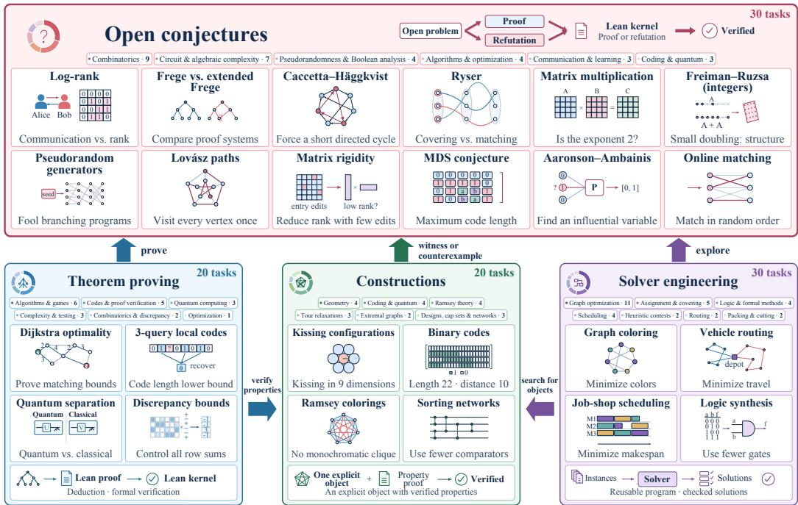  
Figure 1: TCSExam covers the full range of TCS research through four evaluation tracks. Arrows show how proving, searching, and constructing can contribute to one another and to resolving open conjectures. The examples illustrate tasks within each track; research areas can span multiple tracks.

We evaluate eight agents on Full and nine on Lite. On 20 research theorems without supplied intermediate lemmas, GPT-6 Astra achieves a per-attempt complete-proof success rate of 70.0%, followed by Kimi K3.1 Pro at 38.3%; the other six agents achieve at most 11.7%. Solver performance varies across instance families, with submitted programs improving on public competition circuits. DeepSeek V4.1 Flash 0910 produces a verified construction that exceeds a task reference despite completing none of its 60 theorem-proving attempts. Individual attempts also yield independently verified special cases and bounds (Section 5.6).

Lite extends the comparison to Opus 5.5, which solves four of its five theorem tasks, compared with three for Astra. Full and Lite rankings agree on 26 of 28 pairs among the eight shared agents, while track-level comparisons reveal differences in their research capabilities (Section 5.3).

Our contributions are as follows.

• A framework spanning the full range of TCS research. Four tracks evaluate research outputs and open-conjecture settlement through shared task interfaces, distinct success criteria, and a common protocol for incorporating additional problems.

• An expert-reviewed benchmark with verifiable outcomes. We curate 100 research tasks and a 20-task Lite subset with track-specific scoring and verification by the Lean kernel or executable task checkers.

• A systematic evaluation of nine agents across Full and Lite. We characterize performance across the four tracks and examine submitted proofs, programs, and constructions to identify research accomplishments and remaining limitations.

Table 1: Coverage of selected benchmarks.
<table><tr><td>Benchmark / track</td><td># Tasks</td><td>Theorem proving</td><td>Solver engineering</td><td>Constructions</td><td>Open conjectures</td></tr><tr><td>TCS-BENCH</td><td>300</td><td>√</td><td>X</td><td>x</td><td>x</td></tr><tr><td>FormalTCS</td><td>143</td><td>√</td><td>x</td><td>x</td><td>X</td></tr><tr><td>FrontierCS</td><td>240</td><td>x</td><td>√</td><td>√</td><td>x</td></tr><tr><td>FrontierCS 2</td><td>48</td><td>x</td><td>0</td><td>x</td><td>X</td></tr><tr><td>EdgeBench-Formal</td><td>13</td><td>√</td><td>x</td><td>x</td><td>O</td></tr><tr><td>EdgeBench-Optimization</td><td>19</td><td>x</td><td>√</td><td>0</td><td>x</td></tr><tr><td>TCSExam</td><td>100</td><td>V</td><td>V</td><td>√</td><td>√</td></tr></table>

✓ evaluated; ✗ outside scope; ◦ related tasks with a different scope.  
◦: code optimization (FrontierCS 2); machine-specific halting proofs and graph coloring (EdgeBench).

## 2 RELATED WORK

Theorem proving in mathematics and TCS. TCS-BENCH (Cohen-Addad et al., 2026) evaluates research-level natural-language proofs using an LLM verifier. Despite reported accuracy above 90% against expert judgments, acceptance remains subject to verifier errors and provides no formal correctness guarantee. FormalTCS (Wang et al., 2026) evaluates end-to-end formalization and proving of TCS results. Their benchmark scope does not include reusable solver performance or construction quality. Formal evaluation also spans competition mathematics, undergraduate mathematics, and repository-context proofs (Zheng et al., 2021; Tsoukalas et al., 2024; Azerbayev et al., 2023; Yang et al., 2023; Hu et al., 2024). CombiBench provides formal combinatorial problems in Lean 4 (Liu et al., 2025), while LeanGeo-Bench evaluates competition geometry in the LeanGeo framework (Song et al., 2025). Kimina-Prover uses reinforcement learning to train structured reasoning for Lean 4 proof generation (Wang et al., 2025). Proof guidance and decomposition are studied by Draft, Sketch, and Prove, DeepSeek-Prover-V2, and Seed-Prover (Jiang et al., 2022; Ren et al., 2025; Chen et al., 2025).

Solver programs and explicit constructions. AlphaTensor and AlphaDev demonstrate algorithm discovery through reinforcement learning (Fawzi et al., 2022; Mankowitz et al., 2023); FunSearch and AlphaEvolve use program search for mathematical and computational improvements (Romera-Paredes et al., 2024; Novikov et al., 2025). FrontierCS evaluates executable programs on open-ended algorithmic and research tasks (Mang et al., 2026b; Frontier-CS Team, 2026). FrontierCS 2 com pares agents’ reimplementations of research contributions with the original code across 48 public tasks (Mang et al., 2026a). EdgeBench includes formal proving and combinatorial optimization in long-interaction evaluation (Zhu et al., 2026). TCSExam separately evaluates reusable solvers across instance families and the parameters attained by explicit constructions.

Open conjectures and research-level evaluation. FrontierMath evaluates advanced mathematical reasoning through automatically checkable answers (Glazer et al., 2024). Formal Conjectures supplies formalized research problems and frozen evaluations of verified discovery (Firsching et al., 2026); the proving-ground repository reports complete solutions and verified reductions on its open tier (phyter1, 2026). TCSExam evaluates complete proof or refutation of open TCS conjectures, retaining intermediate outputs for separate analysis.

Positioning of TCSExam. Research-agent benchmarks also evaluate ML engineering and research replication (Chan et al., 2024; Wijk et al., 2024; Starace et al., 2025). Table 1 compares the closest TCS benchmarks. TCSExam brings four forms of TCS research output into one extensible framework, with distinct success criteria and common procedures for task development, verification, and version control.

## 3 TCSEXAM

TCSExam organizes tasks across TCS areas by their required outputs and success criteria into the four tracks in Figure 1. Search can produce candidate objects, proofs establish their properties, and both can contribute to resolving open conjectures. Appendix A lists the 100 tasks and their sources.

## 3.1 RESEARCH SCOPE AND TASK INTERFACES

Theorem proving (20 tasks). Given a formal statement derived from a research theorem, the model submits a Lean 4 proof. We vary the supplied context through three settings with a common target: bare provides the main statement, fixed definitions, and mathematical assumptions; ladder additionally provides intermediate lemma statements; guided further supplies proof ideas. This design is related to TCS-BENCH’s use of intermediate-result masking to vary proof-task difficulty (Cohen-Addad et al., 2026). Our main evaluation uses bare to measure complete-proof success. Ladder and guided support a separate analysis of proof guidance, with partial checkpoint credit and independent complete-proof checks (Section 3.3).

Solver engineering (30 tasks). The model receives a problem specification, a naive baseline, and public instances, then submits a reusable solver program. Final judging evaluates the program across the task’s designated instance set under task-specific resource limits. Checkers validate solutions or certificates and recompute objective values.

Constructions (20 tasks). The model submits an explicit mathematical object and a certificate of its required properties. Examples include codes, geometric configurations, and graph colorings. Tasks use Lean 4 formalizations and executable checks to verify the object and its achieved parameter. Documented construction records provide reference values against which progress is measured; the model may use mathematical reasoning, search code, or both to produce its submission.

Open conjectures (30 tasks). The model receives a formalized conjecture and two Lean proof slots, conj and refuted, for the statement and its negation. A submission must prove either side in full. A counterexample must come with a proof that it refutes the stated conjecture. This interface accepts either direction of a resolution.

## 3.2 TASK CURATION AND DEVELOPMENT

We select tasks for their research significance, coverage across TCS areas, and verifiable outcomes. Theorem tasks come from recent TCS papers (2023–2026) and span 13 subfields. Solver tasks draw on established competitions and instance libraries. Task-specific safeguards, including withholding hidden instances from the agent during development and applying structure-preserving transformations, mitigate direct reuse of stored answers. Construction tasks target open problems with documented records, while the open-conjecture track includes problems such as log-rank and Ryser. Expert review assesses the significance and representativeness of the selected problems.

Figure 2 summarizes the task development process. An authoring agent prepares the statement, submission interface, scorer, and environment. A separate review agent checks correspondence to the research source and the behavior of the verification procedure. Tests and pilot evaluations identify defects and guide revision. Across development rounds, over 40 theorem problems were retired after being solved in pilot evaluations. Tasks are included after expert approval.

## 3.3 TRACK-SPECIFIC SCORING

Scores reflect the submitted output and the task’s notion of success. Complete proof obligations use binary scores; optimization and construction tasks provide graded credit. The score definitions and integrity checks are specified per track (Appendix B). Reported scores use percentages rounded to one decimal; formulas use the original score units.

Theorem proving. A valid proof of the complete bare-level statement scores 100.0%; an incomplete proof scores 0.0%. Guided and ladder tasks receive partial credit for the fraction of checkpoints passed; a verified complete proof receives full credit. Each checkpoint is checked in isolation with the other checkpoint statements supplied as assumptions; this also applies to the maintheorem checkpoint. Coverage therefore measures conditional proof obligations. Complete proofs are checked separately without unproved checkpoint assumptions (Appendix B.1).

Solver engineering. Optimization tasks measure the fraction of the difference between a naive baseline B and a task reference K recovered by the submitted solver. These scores are not clipped: values below 0.0% indicate performance worse than the baseline, and values above 100.0% indicate improvement over the reference. Decision tasks use solve rates. A separate Kimi K3-relative score standardizes raw instance outcomes against repeated Kimi K3 runs and applies a Gaussian cumulative-distribution transform (Appendix B.2). Scores are averaged over instances, then attempts within tasks, then tasks. Improvements over K undergo artifact and source verification before being described as new records.

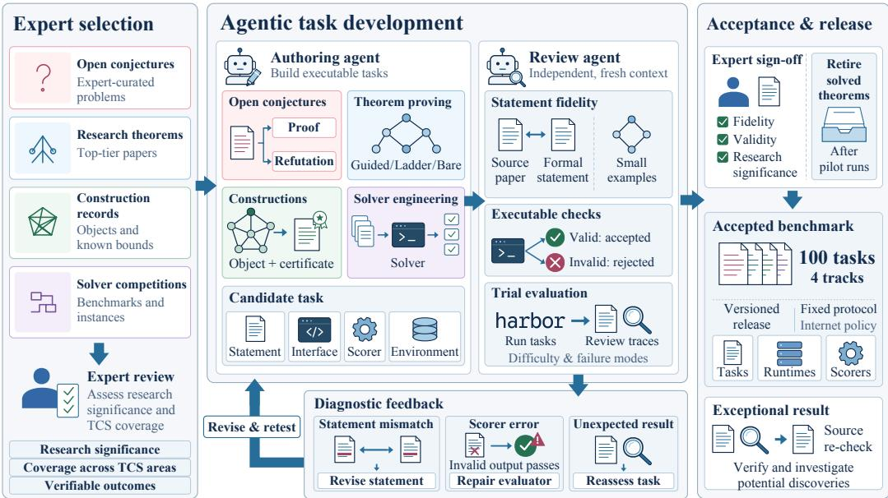  
Figure 2: Task curation and validation. Expert selection is followed by agent-assisted authoring and review, executable checks, and trial evaluation. Statement mismatches, scorer errors, and unexpected results prompt revision and re-testing. Tasks are included after expert approval; exceptional results trigger verification and source re-checks.

Constructions. Scores measure attainment relative to a trivial construction and a documented record: matching the record scores 100.0%, and surpassing it can score above 100.0%. Task-specific shaping is cubic for 14 tasks and linear for the remainder. We report the achieved mathematical parameters alongside these scores, since the score transformation changes the numerical size of an improvement. A record provides a comparison point even when the optimum remains unknown.

Open conjectures. A verified proof of either the statement or its negation scores 100.0%. All other submissions score 0.0% on the resolution criterion. We also analyze intermediate bounds, special cases, and counterexamples to related statements alongside the resolution score.

TCSExam Index. Let P, S, C, and O be the mean theorem, Solver, construction, and openconjecture scores, respectively, on their original scales. The Solver input S is the relative score in [0, 1]. We define

$$
I = 3 0 P + 3 0 S + 3 0 C + 1 0 O .\tag{1}
$$

The three tracks with graded observed performance receive equal weight; open-conjecture resolution contributes the remaining ten points. These weights are the same for Full and Lite. Construction scores above 1 remain unchanged, so the Index can exceed 100. We report the four track means alongside the Index to show which capabilities account for an aggregate difference.

## 3.4 TCSEXAM-LITE

Lite contains five tasks per track, selected from Full.1 Selection considered subject coverage, difficulty, execution cost, and the performance profiles of the original six agents. The theorem subset spans additive combinatorics, games, coding theory, circuit complexity, and quantum cryptography. Solver tasks cover packing, scheduling, graph optimization, resource assignment, and certified

Boolean reasoning. The construction and open-conjecture subsets likewise cover several mathematical objects and research areas (Appendix H).

Every selected task retains its original scoring function, and the five task means receive equal weight within each track. Lite uses the same 12-hour development budget per attempt: one attempt on each task has a maximum development allocation of 240 hours, compared with 1,200 hours for Full. Task execution can run in parallel, and final judging has its own resource budget. Both Solver protocols use public instances for development. Full provides a parallel self-test service; Lite runs self-tests in the development environment, simplifying deployment. Both use the same final judging rules. Section 4 details these protocols. Section 5.3 compares the observed rankings under the two suite protocols.

## 3.5 TASK AND RESULT VALIDATION

Before a task enters the benchmark, task validation checks whether the encoded problem matches its research source. After submission, result validation checks outputs against the task rules, with additional review for candidate advances. Appendix C documents these checks and supporting evidence.

Formal statement fidelity. Agent-assisted reviews compare definitions, assumptions, quantifiers, and parameter ranges in the Lean statement with the source. Small examples and boundary cases test for degenerate or unintended interpretations, and re-translation provides an additional crosscheck. Shared definitions and statements are checked across disclosure levels. Successful proofs and unexpected outcomes prompt renewed scrutiny of the statement and its assumptions. These checks also flagged potential inconsistencies in source statements or proofs; candidate tasks with unresolved concerns were excluded.

Result validation. Every submission is checked by the Lean kernel or an executable task checker. Candidate advances additionally undergo agent-assisted audits of the rollouts and submitted artifacts. These audits check compliance with task rules, proof dependencies or object validity, and the conditions of the claimed improvement. For solver results, this includes comparing instance sets and execution budgets. Source checks distinguish improvements over task references from new literature records; claims of new records require evidence for the prior best value and a matching problem setting.

Task versions and extensions. Each reported result is associated with the task statement, environment, verifier, and reference values used in evaluation. Corrections and additional problems enter new task versions, with changes and affected results recorded. Earlier versions and evaluation records are retained so that results remain interpretable as the benchmark expands.

## 4 EXPERIMENTAL SETUP

Agents and execution. Each evaluated agent combines an LLM with an execution harness that manages tool use and interaction with the environment. Full includes GPT-6 Astra (OpenAI, 2026a), Kimi K3 (Kimi Team, 2026a), GLM-5.3 (Z.ai, 2026), Qwen3.8 Max (0902) (Alibaba Cloud, 2026), Grok 4.6 (xAI, 2026), DeepSeek V4.1 Flash 0910 and DeepSeek V4.1 Flash 1017 (DeepSeek-AI, 2026), and Kimi K3.1 Pro (Kimi Team, 2026b). Lite includes these eight agents and Opus 5.5 (Anthropic, 2026). The configurations appear in Appendix D.

Tasks and resources. Full contains 20 bare-level theorems, 30 Solver problems, 20 constructions, and 30 open conjectures; Lite contains five tasks per track. Kimi K3, Kimi K3.1 Pro, and both DeepSeek versions contribute three attempts per task; the other agents contribute one. An attempt is one agent run on one task, with a 12-hour wall-clock development budget. Theorem and Solver development have no general Internet access. Construction and open-conjecture tasks permit literature access. Tasks use the Harbor format (Harbor Framework Team, 2026) to package environments, submission interfaces, and verifiers. Construction prompts provide published reference bounds. Solver judging uses separate per-instance or shared-pool budgets (Appendix D.2).

Solver development protocols. Both protocols provide the same public instances and self-test information during development. Full uses Online: an external service evaluates submitted solvers, parallelizing independent instances to accelerate iteration. Lite uses Offline: agents run public selftests in their development environment, with parallelism limited by its resources. This removes the need to deploy a parallel judging service. Both protocols reserve hidden-set judging for the final submission and retain the same input split, checker, final execution limits, and fixed Kimi K3 reference. Online and Offline describe how public self-tests run; task network policies are unchanged.

Table 2: TCSExam-Full results on 100 tasks. Tasks receive equal weight within each track. Solver uses the Kimi K3-relative metric; construction scores of 100.0% match the task reference. Index is defined in Section 3.3. Accepted conjecture submissions adapt OpenAI's published counterexamples and proofs (Section 5.6).
<table><tr><td>Agent</td><td>Theorem proving</td><td>Solver</td><td>Success (%) ↑ Relative (%)↑ Task score (%) ↑</td><td>Constructions Open conjectures Resolved (%)↑</td><td>Index Points ↑</td></tr><tr><td>GPT-6 Astra</td><td>70.0</td><td>64.7</td><td>104.9</td><td>0.0</td><td>71.9</td></tr><tr><td>Kimi K3.1 Pro</td><td>38.3</td><td>54.1</td><td>98.6</td><td>1.1</td><td>57.4</td></tr><tr><td>Kimi K3</td><td>11.7</td><td>48.7</td><td>95.5</td><td>0.0</td><td>46.8</td></tr><tr><td>DeepSeek V4.1 Flash 1017</td><td>6.7</td><td>53.1</td><td>91.8</td><td>5.6</td><td>46.0</td></tr><tr><td>GLM-5.3</td><td>5.0</td><td>49.1</td><td>97.7</td><td>0.0</td><td>45.5</td></tr><tr><td>Qwen3.8 Max (0902)</td><td>5.0</td><td>49.2</td><td>95.1</td><td>0.0</td><td>44.8</td></tr><tr><td>Grok 4.6</td><td>5.0</td><td>43.8</td><td>86.2</td><td>0.0</td><td>40.5</td></tr><tr><td>DeepSeek V4.1 Flash 0910</td><td>0.0</td><td>48.3</td><td>86.6</td><td>0.0</td><td>40.4</td></tr></table>

Score aggregation and shared tasks. We first average attempts within each task, then average tasks equally within a track. Theorem success rates divide complete proofs by all scheduled attempts: 20 or 60 on Full, and 5 or 15 on Lite. The Index combines the four track means using Equation 1. The 15 non-Solver tasks shared by Full and Lite reuse the same submissions for each of the eight common agents. Solver results come from separate evaluations under each suite’s development protocol. Opus contributes 20 Lite results. Appendix H.2 describes these result sets.

Proof-guidance comparison. We compare Kimi K3 and DeepSeek V4.1 Flash 0910 on the same 20 theorems, with three attempts per theorem in each setting. Bare supplies the target statement and definitions; ladder adds intermediate lemma statements; guided also supplies proof ideas. Completeproof success requires a verified assembled or direct proof without unproved checkpoint assumptions. We report success per attempt and the number of theorems solved at least once; ladder and guided also receive partial checkpoint credit (Appendix D.3).

## 5 RESULTS

## 5.1 OVERALL PERFORMANCE

Table 2 summarizes performance across the four tracks. Figure 3 shows task-level results for theorem proving, solver engineering, and constructions.

Research proofs distinguish the evaluated agents. GPT-6 Astra completes 14 of 20 theorems (70.0%) without supplied intermediate lemmas. Kimi K3.1 Pro succeeds in 23 of 60 attempts (38.3%), solving nine distinct theorems. It completes all three attempts on the PCP alphabetsoundness task, which Astra does not solve. Kimi K3 succeeds in 7 of 60 attempts (11.7%), covering three theorems. GLM-5.3, Qwen3.8 Max (0902), and Grok 4.6 each succeed in 1 of 20 attempts (5.0%); DeepSeek V4.1 Flash 0910 succeeds in none of 60, while DeepSeek V4.1 Flash 1017 succeeds in 4 of 60 attempts (6.7%) across three theorems. Across the eight agents, four theorems remain unproved.

Construction means reflect reference attainment across tasks. Astra has the highest mean at 104.9%, matching the reference on 17 tasks and exceeding it on three. The other agents range from 86.2% to 98.6%, with Kimi K3.1 Pro second. GLM-5.3 averages 97.7% without exceeding any reference, illustrating that broad reference attainment and individual improvements are distinct aspects of performance. Section 5.5 examines the verified improvements on specific tasks.

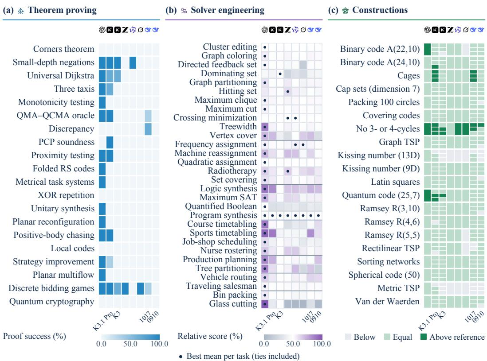  
Figure 3: Full task-level results for eight agents. Rows are tasks; columns are agents. (a) Complete-proof success rates. (b) Kimi K3-relative Solver means; dots mark task-best means, including ties. (c) Cells stack one to three construction attempts vertically, colored below, at, or above the 100.0% task reference (relative tolerance 10−6). Scores appear in Appendix E.

## 5.2 SOLVER PERFORMANCE ACROSS INSTANCE FAMILIES

Performance differs across problem families. On each instance, a relative score of 50.0% denotes a valid outcome equal to the Kimi K3 reference mean. Astra averages 64.7%, followed by Kimi K3.1 Pro at 54.1% and DeepSeek V4.1 Flash 1017 at 53.1%. The other five agents range from 43.8% to 49.2% (Table 2). Astra has the highest unrounded task mean, including ties, on 27 of 30 problems (Figure 3b). It trails GLM-5.3 on hitting set, Kimi K3 on dominating set, and GLM-5.3, Qwen3.8 Max (0902), Kimi K3.1 Pro, and DeepSeek V4.1 Flash 1017 marginally on crossing minimization. Appendix E.2 gives detailed results.

Relative scoring limits baseline–reference scaling effects. The original score $( B - A ) / ( B -$ K) compares objective A with baseline B and reference K. A large |B − K| compresses score differences near K; a small denominator can amplify individual contributions. We introduce a Kimi K3-relative metric that compares raw outcomes with repeated Kimi K3 results, retains sensitivity near their mean, and bounds contributions to [0, 100] on the reported scale. For example, Qwen3.8 Max (0902)'s valid IWLS 2023 circuit for ex37 uses 273,020 AND gates, versus baseline 698 and reference 106. The ratio (698 − 273,020)/(698 − 106) ≈ −460 allows this single oversized circuit to depress the original mean. Qwen3.8 Max (0902) averages 64.7% on that scale and 49.2% on the bounded relative scale. Appendix B.2 defines the metric; Appendix E.2 gives raw outcomes.

Solver improvements across a benchmark family. On the IWLS 2023 logic-synthesis task, Astra’s submitted program produces valid circuits on all 100 evaluation instances: it improves the task reference on 22, matches it on 31, and uses more AND gates than the reference on 47. In the original six-agent case-study cohort, each of the other agents’ submitted programs also passes all 100 validity checks, but only one Kimi K3 attempt and Grok 4.6 improve a reference, each on one instance. These counts describe the same program applied across a family of inputs. Appendix F.1 gives the circuit-level improvements and reference sources.

Table 3: TCSExam-Lite results on 20 tasks, with five per track. Tasks receive equal weight within each track. Solver uses the Kimi K3-relative metric; construction scores of 100.0% match the task reference. Index is defined in Section 3.3.
<table><tr><td>Agent</td><td>Theorem proving</td><td>Solver</td><td>Success (%)↑ Relative (%) ↑ Task score (%) ↑</td><td>Constructions Open conjectures Resolved (%)↑</td><td>Index Points ↑</td></tr><tr><td>Opus 5.5</td><td>80.0</td><td>60.5</td><td>100.4</td><td>0.0</td><td>72.3</td></tr><tr><td>GPT-6 Astra</td><td>60.0</td><td>63.0</td><td>100.4</td><td>0.0</td><td>67.0</td></tr><tr><td>Kimi K3.1 Pro</td><td>40.0</td><td>50.0</td><td>88.3</td><td>0.0</td><td>53.5</td></tr><tr><td>Kimi K3</td><td>33.3</td><td>48.9</td><td>79.8</td><td>0.0</td><td>48.6</td></tr><tr><td>GLM-5.3</td><td>20.0</td><td>46.1</td><td>90.7</td><td>0.0</td><td>47.0</td></tr><tr><td>Qwen3.8 Max (0902)</td><td>20.0</td><td>51.0</td><td>80.3</td><td>0.0</td><td>45.4</td></tr><tr><td>DeepSeek V4.1 Flash 1017</td><td>6.7</td><td>54.3</td><td>80.2</td><td>0.0</td><td>42.4</td></tr><tr><td>Grok 4.6</td><td>20.0</td><td>41.0</td><td>79.3</td><td>0.0</td><td>42.1</td></tr><tr><td>DeepSeek V4.1 Flash 0910</td><td>0.0</td><td>50.4</td><td>79.7</td><td>0.0</td><td>39.0</td></tr></table>

## 5.3 LITE RESULTS AND CONSISTENCY WITH FULL

Lite compares nine agents across all four tracks. In Table 3, Opus 5.5 completes four of five theorem tasks and has an Index of 72.3; Astra completes three and scores 67.0. Their construction means are equal at 100.4%, while Astra has the higher Solver score, 63.0% versus 60.5%. Kimi K3.1 Pro scores 53.5, followed by Kimi K3 at 48.6. All five Lite open conjectures remain unresolved.

Lite closely matches Full in aggregate ranking. Across the eight shared agents, Spearman’s rank correlation is $\rho = 0 . 9 3 ,$ , and 26 of 28 agent pairs have the same order (Figure 4). The top three remain Astra, Kimi K3.1 Pro, and Kimi K3. Kimi K3.1 Pro scores 57.4 on Full and 53.5 on Lite. The two reversed pairs involve DeepSeek V4.1 Flash 1017, which ranks above GLM-5.3 and Qwen3.8 Max (0902) on Full and below them on Lite. The other seven agents retain their relative order.

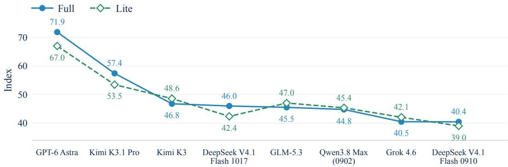  
Figure 4: Full and Lite rankings are strongly aligned. Among the eight shared agents, both suites give the same top three and agree on 26 of 28 pairs (ρ = 0.93). Agents are ordered by Full Index.

Track scores show where the suites differ. Among the 28 shared-agent pairs, theorem rankings reverse three, Solver rankings six, and construction rankings three. The two conjecture tasks with accepted refutations on Full are outside the Lite subset, where all agents score zero. These comparisons show how differences in task coverage and Solver self-test execution accompany changes in individual track rankings, while the overall ordering remains closely aligned (Appendix H.3).

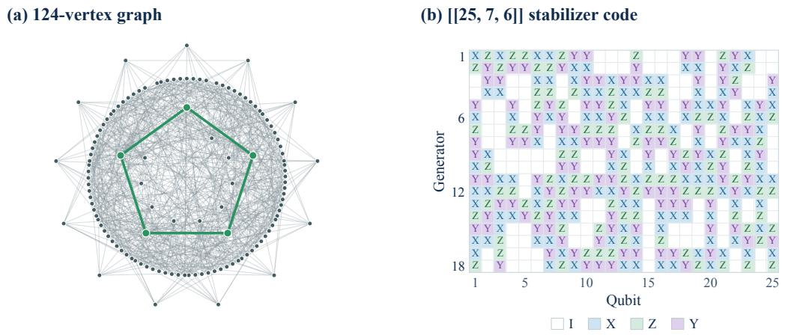  
Figure 5: Two constructions submitted by Kimi K3. (a) All 124 vertices and 630 edges of a graph with no 3- or 4-cycles, exceeding the 629-edge task reference. Green highlights a shortest cycle. (b) The 18 stabilizer generators of a [[25, 7, 6]] quantum code, improving the reference distance from 5 to 6. Each row specifies an operator on 25 qubits; white cells denote the identity I. Both panels are drawn directly from submitted certificates.

## 5.4 UNDERSTANDING PROOF PERFORMANCE

More theorems are solved with additional statements and proof ideas. With three attempts on each of 20 theorems, Kimi K3 solves 3, 4, and 7 theorems at least once under bare, ladder, and guided, respectively; DeepSeek V4.1 Flash 0910 solves 0, 2, and 6. Guided also has the highest per-attempt complete-proof success: Kimi K3 succeeds in 18/60 attempts, compared with 7/60 under both ladder and bare. DeepSeek V4.1 Flash 0910 succeeds in 0/60 bare, 2/60 ladder, and 11/60 guided attempts. Appendix E.3 reports complete-proof outcomes, partial-credit scores, and individual proof attempts.

## 5.5 VERIFIED CONSTRUCTION IMPROVEMENTS

Graph and code results. In the Erdos girth-5 extremal-graph task, Kimi K3 constructs a 124-vertex,˝ 630-edge graph without 3- or 4-cycles, exceeding the 629-edge reference (Goedgebeur et al., 2025). In the quantum stabilizer-code task, it constructs a binary [[25, 7, 6]] code, increasing the minimum distance from 5 to 6 for a code on 25 qubits encoding seven logical qubits (Grassl, n.d.) (Figure 5). Astra also attains both parameters and proves that a binary code of length 22 and minimum Hamming distance 10 has at most 82 codewords (A(22, 10) ≤ 82), improving the published upper bound of 84 (Gijswijt et al., 2012) (Appendix D.3). Qwen3.8 Max (0902), Grok 4.6, and DeepSeek V4.1 Flash 0910 each obtain a 630-edge graph. Appendix F records provenance and shows Astra’s constructions.

## 5.6 OPEN CONJECTURES WITHIN THE EVALUATION BUDGET

Use of published counterexamples. During the network-enabled evaluations, Kimi K3.1 Pro and DeepSeek V4.1 Flash 1017 retrieved OpenAI’s published counterexamples and Lean proofs for Ryser and the modified integer round-up conjecture (MIRUP) (OpenAI, 2026c;b).2 Their submissions adapt these existing results to the task definitions. The accepted adaptations comprise Ryser submissions from Kimi K3.1 Pro (1/3) and DeepSeek 1017 (2/3), and MIRUP submissions from DeepSeek 1017 (3/3; Table 15). The other 28 conjecture tasks have no accepted complete solution. OpenAI’s results highlight the potential for AI-assisted conjecture resolution. Future work could evaluate agents without Internet access on conjectures still open at the time of testing.

h0 + ⋯ + h6 = 9  
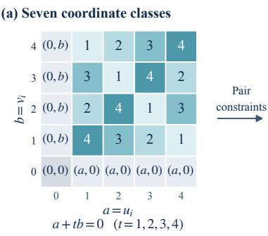

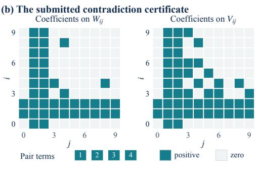  
z ≥ 0, Ez = b ⟹ 0 ≤ c z = −1  
Figure 6: Astra’s proof certificate for the nine-dimensional Alon–Jaeger–Tarsi case over $\mathbb { F } _ { 5 } . \mathbf { \Pi } ( \mathbf { a } )$ Coordinate pairs fall into seven classes; numbered cells give the unique nonzero t with $a + t b = 0$ Class counts sum to nine and yield pair constraints. (b) The actual certificate has nonnegative coefficients on two arrays of weight counts and four pair terms. Combined with the counting identities, it forces a nonnegative sum to equal −1 after positive rescaling, excluding a minimal counterexample. Colored cells mark positive coefficients; pale cells mark zeros.

Verified special cases and bounds. While attempting the full conjecture, GPT-6 Astra proves the Alon–Jaeger–Tarsi conjecture over $\mathbb { F } _ { 5 }$ for every $n \leq 9 \colon$ every invertible $n \times n$ matrix A admits a vector x such that x and Ax have no zero coordinates. The $n = 9$ case extends the dimensional ranges $n \leq 7$ of Yu (1999) and $n \leq 8$ reported in a recent preprint (Zeng et al., 2026). The proof combines counting identities with an exact integer certificate to exclude a minimal counterexample (Figure 6). Independent Lean verification confirms the result using only standard axioms. Appendix F.3 gives the proof structure, formal verification, and its relation to prior work. Four further verified cases concern a six-variable Fourier entropy–influence bound, an exact high-rank Hilbert-matrix rigidity formula, an influence bound for quadratic polynomials, and finite-instance online-matching bounds (Appendix F.4). These five cases demonstrate that open-conjecture attempts can produce independently verifiable mathematical results. Analyzing their statements and proofs captures progress beyond the binary resolution score and identifies concrete results for further mathematical study.

## 6 CONCLUSION

TCSExam provides a unified, extensible framework for evaluating agents across the full range of TCS research, connecting theorem proving, solver engineering, and explicit constructions with open-conjecture settlement. Full comprises 100 expert-reviewed tasks with outcomes checked by the Lean kernel or executable checkers. Lite retains all four tracks in 20 tasks, reducing the number of task attempts by 80% at the same per-attempt budget. Evaluations across nine agents reveal substantial differences in research capabilities, with strong Full–Lite rank agreement among the eight shared agents. Together, the suites support broad capability assessment and smaller-scale evaluation.

The results show complementary strengths in proof completion, solver performance, and construction quality. Submitted programs and mathematical objects improve selected task references. For both agents in the proof-guidance study, supplying intermediate lemmas and proof ideas increases the number of theorems solved. Open-conjecture attempts also yield independently verified special cases and bounds, including Astra’s nine-dimensional Alon–Jaeger–Tarsi result over $\mathbb { F } _ { 5 } .$ . These outputs help characterize the research work agents can undertake and identify directions for further progress. The accompanying task sources, Docker build recipes, and evaluation tools support reproducible use and extension. Researchers can add problems through the shared task interfaces and verification protocols, extending this foundation for evaluating agents and studying their contributions to TCS research.

## AI USE STATEMENT

AI coding assistants were used in task authoring, formalization, checker implementation, and iterative review (Section 3.2). AI assistants also supported data processing, result analysis, manuscript drafting and editing, figure code, and literature search. Evaluated model outputs are identified as experimental submissions and checked under the relevant task protocol. Result tables and plots are generated programmatically from experiment records. The authors take responsibility for the final content of this work.

## REFERENCES

Scott Aaronson and Andris Ambainis. The Need for Structure in Quantum Speedups. Theory of Computing, 10(6):133–166, 2014. doi: 10.4086/toc.2014.v010a006. URL https:// theoryofcomputing.org/articles/v010a006/.

Alibaba Cloud. Qwen3.8-max: Model documentation and snapshot versions, 2026. URL https://www.alibabacloud.com/help/en/model-studio/qwen3-8-max. Snapshot qwen3.8-max-0902 (2026-09-02); accessed September 23, 2026.

Anthropic. Claude Opus 5.5 System Card, 2026. URL https://www-cdn.anthropic.com/ fc1b44717c85dc068bc6ba5024219938094694bd/Claude%20Opus%205.5%20System%20Card. pdf. System card, September 22, 2026.

Guy Avni and Suman Sadhukhan. Mean-Payoff and Energy Discrete-Bidding Games. In 34th EACSL Annual Conference on Computer Science Logic (CSL 2026), pp. 32:1–32:18, 2026. doi: 10.4230/LIPIcs.CSL.2026.32. URL https://drops.dagstuhl.de/entities/document/10.4230/LIPIcs. CSL.2026.32.

Zhangir Azerbayev, Bartosz Piotrowski, Hailey Schoelkopf, Edward W. Ayers, Dragomir Radev, and Jeremy Avigad. ProofNet: Autoformalizing and Formally Proving Undergraduate-Level Mathematics, 2023. URL https://arxiv.org/abs/2302.12433. arXiv:2302.12433.

László Babai. Long cycles in vertex-transitive graphs. Journal of Graph Theory, 3(3):301–304, 1979. doi: 10.1002/jgt.3190030314. URL https://doi.org/10.1002/jgt.3190030314.

Simeon Ball. On sets of vectors of a finite vector space in which every subset of basis size is a basis. Journal of the European Mathematical Society, 14(3):733–748, 2012. doi: 10.4171/jems/316. URL https://doi.org/10.4171/jems/316.

János Balogh, József Békési, György Dósa, Leah Epstein, and Asaf Levin. A New and Improved Algorithm for Online Bin Packing. In Yossi Azar, Hannah Bast, and Grzegorz Herman (eds.), 26th Annual European Symposium on Algorithms (ESA 2018), volume 112 of Leibniz International Proceedings in Informatics, pp. 5:1–5:14. Schloss Dagstuhl – Leibniz-Zentrum für Informatik, 2018. doi: 10.4230/LIPIcs.ESA.2018.5. URL https://drops.dagstuhl.de/entities/document/10. 4230/LIPIcs.ESA.2018.5.

János Balogh, József Békési, György Dósa, Leah Epstein, and Asaf Levin. A New Lower Bound for Classic Online Bin Packing. Algorithmica, 83(7):2047–2062, 2021. doi: 10.1007/ s00453-021-00818-7. URL https://doi.org/10.1007/s00453-021-00818-7.

Nikhil Bansal and Haotian Jiang. Decoupling via Affine Spectral-Independence: Beck-Fiala and Komlós Bounds Beyond Banaszczyk, 2025. URL https://arxiv.org/abs/2508.03961. arXiv:2508.03961.

J. E. Beasley. OR-Library: Distributing Test Problems by Electronic Mail. Journal of the Operational Research Society, 41(11):1069–1072, 1990. doi: 10.1057/jors.1990.166. URL https://doi.org/10.1057/jors.1990.166.

Geneviève Benoit and Sylvia Boyd. Finding the exact integrality gap for small traveling salesman problems. Mathematics ofOperations Research, 33(4):921–931, 2008. doi: 10.1287/moor.1080. 0337. URL https://doi.org/10.1287/moor.1080.0337.

Amey Bhangale, Mark Braverman, Subhash Khot, Yang P. Liu, and Dor Minzer. Parallel Repetition for 3-Player XOR Games, 2024. URL https://arxiv.org/abs/2408.09352. arXiv:2408.09352.

Sayan Bhattacharya, Niv Buchbinder, Roie Levin, and Thatchaphol Saranurak. Chasing Positive Bodies. In 2023 IEEE 64th Annual Symposium on Foundations of Computer Science (FOCS), pp. 1694–1714, 2023. doi: 10.1109/focs57990.2023.00103. URL https://doi.org/10.1109/focs57990. 2023.00103.

N. L. Biggs. Cubic graphs with large girth. Annals ofthe New York Academy ofSciences, 555(1):56– 62, 1989. doi: 10.1111/j.1749-6632.1989.tb22437.x. URL https://doi.org/10.1111/j.1749-6632. 1989.tb22437.x.

John Bostanci, Jonas Haferkamp, Chinmay Nirkhe, and Mark Zhandry. Separating QMA from QCMA with a Classical Oracle. In Proceedings of the 58th Annual ACM Symposium on Theory ofComputing, pp. 595–606, 2026. doi: 10.1145/3798129.3800776. URL https://doi.org/10.1145/ 3798129.3800776.

Nicolas Bousquet and Daniel W. Cranston. A Linear Kernel for Independent Set Reconfiguration in Planar Graphs. In 43rd International Symposium on Theoretical Aspects of Computer Science (STACS 2026), pp. 19:1–19:18, 2026. doi: 10.4230/LIPIcs.STACS.2026.19. URL https://drops. dagstuhl.de/entities/document/10.4230/LIPIcs.STACS.2026.19.

Andries E. Brouwer. Table of general binary codes. Online table, n.d. URL https://aeb.win.tue.nl/ codes/binary-1.html. Accessed September 26, 2026.

Sébastien Bubeck, Christian Coester, and Yuval Rabani. The Randomized k-Server Conjecture Is False! In Proceedings of the 55th Annual ACM Symposium on Theory of Computing, pp. 581–594, 2023. doi: 10.1145/3564246.3585132. URL https://doi.org/10.1145/3564246.3585132.

Rainer E. Burkard, Stefan E. Karisch, and Franz Rendl. QAPLIB – A Quadratic Assignment Problem Library. Journal of Global Optimization, 10(4):391–403, 1997. doi: 10.1023/a: 1008293323270. URL https://doi.org/10.1023/a:1008293323270.

Louis Caccetta and R. Häggkvist. On Minimal Digraphs with Given Girth. In Proceedings of the Ninth Southeastern Conference on Combinatorics, Graph Theory, and Computing, volume 21 of Congressus Numerantium, pp. 181–187. Utilitas Mathematica, 1978. URL https://www.dwest. web.illinois.edu/openp/cacchagg.html.

A. R. Calderbank and P. C. Fishburn. Maximal three-independent subsets of {0, 1, 2}n. Designs, Codes and Cryptography, 4:203–211, 1994. doi: 10.1007/bf01388452. URL https://doi.org/10. 1007/bf01388452.

Bruno Cavalar, Théo Borém Fabris, Partha Mukhopadhyay, Srikanth Srinivasan, and Amir Yehudayoff. Negations Are Powerful Even in Small Depth. In Proceedings of the 58th Annual ACM Symposium on Theory of Computing, pp. 2071–2082, 2026. doi: 10.1145/3798129.3800911. URL https://doi.org/10.1145/3798129.3800911.

Jun Shern Chan, Neil Chowdhury, Oliver Jaffe, James Aung, Dane Sherburn, Evan Mays, Giulio Starace, Kevin Liu, Leon Maksin, Tejal Patwardhan, Lilian Weng, and Aleksander M ˛adry. MLEbench: Evaluating Machine Learning Agents on Machine Learning Engineering, 2024. URL https://arxiv.org/abs/2410.07095. arXiv:2410.07095.

Lijie Chen and Roei Tell. Bootstrapping results for threshold circuits “just beyond” known lower bounds. In Proceedings of the 51st Annual ACM SIGACT Symposium on Theory of Computing, pp. 34–41. ACM, 2019. doi: 10.1145/3313276.3316333. URL https://doi.org/10.1145/3313276. 3316333.

Luoxin Chen, Jinming Gu, Liankai Huang, Wenhao Huang, Zhicheng Jiang, Allan Jie, et al. Seed-Prover: Deep and Broad Reasoning for Automated Theorem Proving, 2025. URL https://arxiv. org/abs/2507.23726. arXiv:2507.23726.

Mark Chen, Xi Chen, Hao Cui, William Pires, and Jonah Stockwell. Boolean function monotonicity testing requires (almost) n1/2 queries. In Proceedings of the 58th Annual ACM Symposium on Theory of Computing, pp. 584–594, 2026. doi: 10.1145/3798129.3800775. URL https://doi.org/ 10.1145/3798129.3800775.

Yeyuan Chen and Zihan Zhang. Explicit Folded Reed-Solomon and Multiplicity Codes Achieve Relaxed Generalized Singleton Bounds. In Proceedings of the 57th Annual ACM Symposium on Theory of Computing, pp. 1–12, 2025. doi: 10.1145/3717823.3718114. URL https://doi.org/10. 1145/3717823.3718114.

Christian Coester and Tze-Yang Poon. Online 3-Taxi on General Metrics. In Proceedings of the 2026 Annual ACM-SIAM Symposium on Discrete Algorithms (SODA), pp. 6659–6673, 2026. doi: 10.1137/1.9781611978971.238. URL https://doi.org/10.1137/1.9781611978971.238.

Vincent Cohen-Addad, Dimitris Paparas, Ernest van Wijland, Max Springer, Julien Canitrot-Paradis, Honghao Lin, et al. TCS-BENCH: Benchmarking State-of-the-Art Generative AI Theoretical Computer Science Research Ability, 2026. URL https://arxiv.org/abs/2608.09538. arXiv:2608.09538.

Stephen A. Cook and Robert A. Reckhow. The relative efficiency of propositional proof systems. Journal of Symbolic Logic, 44(1):36–50, 1979. doi: 10.2307/2273702. URL https://doi.org/10. 2307/2273702.

Leonardo de Moura and Sebastian Ullrich. The Lean 4 Theorem Prover and Programming Language. In Automated Deduction – CADE 28, pp. 625–635, 2021. doi: 10.1007/ 978-3-030-79876-5\_37. URL https://doi.org/10.1007/978-3-030-79876-5\_37.

Louis DeBiasio, Yigal Kamel, Grace McCourt, and Hannah Sheats. Generalizations and Strengthenings of Ryser’s Conjecture. The Electronic Journal ofCombinatorics, 28(4):P4.37, 2021. doi: 10.37236/9914. URL https://doi.org/10.37236/9914.

DeepSeek-AI. DeepSeek-V4.1-Flash: Pushing the Limits of KV Cache Compression, 2026. URL https://arxiv.org/abs/2609.19969. arXiv:2609.19969.

Nicholas Desjardins. On applying methods for Graph-TSP to metric TSP. Master’s thesis, University of Ottawa, 2017. URL https://hdl.handle.net/10393/35613.

Bert Dobbelaere. Smallest and fastest sorting networks for a given number of inputs. Online sorting-network table, n.d. URL https://bertdobbelaere.github.io/sorting\_networks.html. Ac cessed November 4, 2026.

Iain Dunning, Swati Gupta, and John Silberholz. What Works Best When? A Systematic Evaluation of Heuristics for Max-Cut and QUBO. INFORMS Journal on Computing, 30(3):608–624, 2018. doi: 10.1287/ijoc.2017.0798. URL https://doi.org/10.1287/ijoc.2017.0798.

Geoffrey Exoo. On two classical Ramsey numbers of the form R(3, n). SIAM Journal on Discrete Mathematics, 2(4):488–490, 1989a. doi: 10.1137/0402043. URL https://doi.org/10.1137/ 0402043.

Geoffrey Exoo. A lower bound for R(5, 5). Journal of Graph Theory, 13(1):97–98, 1989b. doi: 10.1002/jgt.3190130113. URL https://doi.org/10.1002/jgt.3190130113.

Geoffrey Exoo. On the Ramsey number R(4, 6). The Electronic Journal of Combinatorics, 19(1): P66, 2012. doi: 10.37236/2102. URL https://doi.org/10.37236/2102.

Geoffrey Exoo and Robert Jajcay. Dynamic cage survey. The Electronic Journal of Combinatorics, pp. DS16, 2013. doi: 10.37236/37. URL https://www.combinatorics.org/ojs/index.php/ eljc/article/view/DS16. Revision 3, July 26, 2013.

Geoffrey Exoo, Jan Goedgebeur, Jorik Jooken, Louis Stubbe, and Tibo Van den Eede. New small regular graphs of given girth: the cage problem and beyond. The Electronic Journal ofCombinatorics, 33(3):P3.48, 2026. doi: 10.37236/14834. URL https://doi.org/10.37236/14834.

Alhussein Fawzi, Matej Balog, Aja Huang, Thomas Hubert, Bernardino Romera-Paredes, Mohammadamin Barekatain, et al. Discovering faster matrix multiplication algorithms with reinforcement learning. Nature, 610(7930):47–53, 2022. doi: 10.1038/s41586-022-05172-4. URL https://doi.org/10.1038/s41586-022-05172-4.

Moritz Firsching, Paul Lezeau, Salvatore Mercuri, Miklós Z. Horváth, Yaël Dillies, Calle Sönne, Eric Wieser, Fred Zhang, Thomas Hubert, Blaise Agüera y Arcas, and Pushmeet Kohli. Formal Conjectures: An Open and Evolving Benchmark for Verified Discovery in Mathematics, 2026. URL https://arxiv.org/abs/2605.13171. arXiv:2605.13171.

Michael A. Forbes and Zander Kelley. Pseudorandom Generators for Read-Once Branching Programs, in Any Order. In 2018 IEEE 59th Annual Symposium on Foundations ofComputer Science (FOCS), pp. 946–955. IEEE, 2018. doi: 10.1109/focs.2018.00093. URL https://doi.org/10.1109/ focs.2018.00093.

Ehud Friedgut and Gil Kalai. Every monotone graph property has a sharp threshold. Proceedings of the American Mathematical Society, 124(10):2993–3002, 1996. doi: 10.1090/ s0002-9939-96-03732-x. URL https://doi.org/10.1090/s0002-9939-96-03732-x.

Frontier-CS Team. Frontier-CS 1.0 Release, 2026. URL https://frontier-cs.org/blog/feb-release/. Release announcement; accessed September 23, 2026.

Dion Gijswijt, Hans D. Mittelmann, and Alexander Schrijver. Semidefinite code bounds based on quadruple distances. IEEE Transactions on Information Theory, 58(5):2697–2705, 2012. URL https://ir.cwi.nl/pub/20724.

Elliot Glazer, Ege Erdil, Tamay Besiroglu, Diego Chicharro, Evan Chen, Alex Gunning, et al. FrontierMath: A Benchmark for Evaluating Advanced Mathematical Reasoning in AI, 2024. URL https://arxiv.org/abs/2411.04872. arXiv:2411.04872.

Jan Goedgebeur, Jorik Jooken, Gwenaël Joret, and Tibo Van den Eede. Improved lower bounds on the maximum size of graphs with girth 5, 2025. URL https://arxiv.org/abs/2508.05562v1. arXiv:2508.05562v1; Table 1.

Gagan Goel and Aranyak Mehta. Online Budgeted Matching in Random Input Models with Applications to Adwords. In Proceedings of the Nineteenth Annual ACM-SIAM Symposium on Discrete Algorithms, pp. 982–991. SIAM, 2008. URL https://research.google/pubs/ online-budgeted-matching-in-random-input-models-with-applications-to-adwords/.

Rohan Goyal and Venkatesan Guruswami. Optimal Proximity Gaps for Subspace-Design Codes and (Random) Reed-Solomon Codes. Technical Report TR25-166, Electronic Colloquium on Computational Complexity, 2025. URL https://eccc.weizmann.ac.il/report/2025/166/. Revision 1, March 24, 2026.

S. W. Graham and C. J. Ringrose. Lower Bounds for Least Quadratic Non-Residues. In Analytic Number Theory, pp. 269–309. Birkhäuser Boston, 1990. doi: 10.1007/978-1-4612-3464-7\_18. URL https://doi.org/10.1007/978-1-4612-3464-7\_18.

Markus Grassl. Bounds on the minimum distance of quantum codes: [[25, 7]]2, n.d. URL https:// www.codetables.de/QECC/QECC.php?q=4&n=25&k=7. Online code table; accessed September 23, 2026.

Anupam Gupta, Ilan Newman, Yuri Rabinovich, and Alistair Sinclair. Cuts, Trees and ℓ - Embeddings of Graphs. Combinatorica, 24(2):233–269, 2004. doi: 10.1007/s00493-004-0015-x. URL https://doi.org/10.1007/s00493-004-0015-x.

Bernhard Haeupler, Richard Hladík, Václav Rozhon, Robert E. Tarjan, and Jakub Tetˇ ek. Universal˘ Optimality of Dijkstra Via Beyond-Worst-Case Heaps. In 2024 IEEE 65th Annual Symposium on Foundations ofComputer Science (FOCS), pp. 2099–2130, 2024. doi: 10.1109/focs61266.2024. 00125. URL https://doi.org/10.1109/focs61266.2024.00125.

Brandon Hanson and Giorgis Petridis. Refined estimates concerning sumsets contained in the roots of unity. Proceedings of the London Mathematical Society, 122(3):353–358, 2021. doi: 10.1112/ plms.12322. URL https://doi.org/10.1112/plms.12322.

Harbor Framework Team. Harbor: A framework for evaluating and optimizing agents and models in container environments, 2026. URL https://github.com/harbor-framework/harbor. Software repository; accessed September 23, 2026.

House of Graphs. Cages. Online graph collection, n.d. URL https://houseofgraphs.org/ meta-directory/cages. Accessed November 4, 2026.

Jiewen Hu, Thomas Zhu, and Sean Welleck. miniCTX: Neural Theorem Proving with (Long-)Contexts, 2024. URL https://arxiv.org/abs/2408.03350. arXiv:2408.03350.

IWLS 2023 Contest Organizers. IWLS 2023 Programming Contest: Logic Synthesis, 2023. URL https://github.com/alanminko/iwls2023-ls-contest. Official contest repository and results presentation; accessed September 23, 2026.

Michael Jaber, Yang P. Liu, Shachar Lovett, Anthony Ostuni, and Mehtaab Sawhney. Quasipolynomial Bounds for the Corners Theorem. In 2025 IEEE 66th Annual Symposium on Foundations ofComputer Science (FOCS), pp. 2027–2036, 2025. doi: 10.1109/focs63196.2025.00108. URL https://doi.org/10.1109/focs63196.2025.00108.

Albert Q. Jiang, Sean Welleck, Jin Peng Zhou, Wenda Li, Jiacheng Liu, Mateja Jamnik, Timothée Lacroix, Yuhuai Wu, and Guillaume Lample. Draft, Sketch, and Prove: Guiding Formal Theorem Provers with Informal Proofs, 2022. URL https://arxiv.org/abs/2210.12283. arXiv:2210.12283.

Sina Kalantarzadeh and Nikhil Kumar. Improved Lower Bounds on Multiflow-Multicut Gaps. In Approximation, Randomization, and Combinatorial Optimization. Algorithms and Techniques (AP-PROX/RANDOM 2025), pp. 14:1–14:18, 2025. doi: 10.4230/LIPIcs.APPROX/RANDOM.2025. 14. URL https://drops.dagstuhl.de/entities/document/10.4230/LIPIcs.APPROX/RANDOM.2025. 14.

Mauricio Karchmer, Ran Raz, and Avi Wigderson. Super-logarithmic depth lower bounds via the direct sum in communication complexity. Computational Complexity, 5(3–4):191–204, 1995. doi: 10.1007/bf01206317. URL https://doi.org/10.1007/bf01206317.

R. M. Karp, U. V. Vazirani, and V. V. Vazirani. An optimal algorithm for on-line bipartite matching. In Proceedings ofthe Twenty-Second Annual ACM Symposium on Theory ofComputing, pp. 352– 358. ACM Press, 1990. doi: 10.1145/100216.100262. URL https://doi.org/10.1145/100216. 100262.

Kimi Team. Kimi K3: Open Frontier Intelligence, 2026a. URL https://arxiv.org/abs/2607.24653. arXiv:2607.24653.

Kimi Team. Introducing Kimi K3.1 Pro, 2026b. URL https://www.kimi.ai/blog/kimi-k3-1-pro. Technical blog.

Pravesh K. Kothari and Peter Manohar. An Exponential Lower Bound for Linear 3-Query Locally Correctable Codes. In Proceedings of the 56th Annual ACM Symposium on Theory of Computing, pp. 776–787, 2024. doi: 10.1145/3618260.3649640. URL https://doi.org/10.1145/3618260. 3649640.

William Kretschmer, Luowen Qian, Makrand Sinha, and Avishay Tal. Quantum Cryptography in Algorithmica. In Proceedings of the 55th Annual ACM Symposium on Theory of Computing, pp. 1589–1602, 2023. doi: 10.1145/3564246.3585225. URL https://doi.org/10.1145/3564246. 3585225.

Antti Laaksonen and Patric R. J. Östergård. Constructing error-correcting binary codes using transitive permutation groups, 2016. URL https://arxiv.org/abs/1604.06022.

John Leech and N. J. A. Sloane. Sphere packings and error-correcting codes. Canadian Journal of Mathematics, 23(4):718–745, 1971. doi: 10.4153/cjm-1971-081-3. URL https://doi.org/10. 4153/cjm-1971-081-3.

Junqi Liu, Xiaohan Lin, Jonas Bayer, Yael Dillies, Weijie Jiang, Xiaodan Liang, et al. CombiBench: Benchmarking LLM Capability for Combinatorial Mathematics, 2025. URL https://arxiv.org/abs/ 2505.03171. arXiv:2505.03171.

Alex Lombardi, Fermi Ma, and John Wright. A One-Query Lower Bound for Unitary Synthesis and Breaking Quantum Cryptography. In Proceedings of the 56th Annual ACM Symposium on Theory ofComputing, pp. 979–990, 2024. doi: 10.1145/3618260.3649650. URL https://doi.org/ 10.1145/3618260.3649650.

L. Lovász and M. Saks. Lattices, Möbius Functions and Communications Complexity. In Proceedings ofthe 29th Annual Symposium on Foundations ofComputer Science, pp. 81–90. IEEE, 1988. doi: 10.1109/sfcs.1988.21924. URL https://doi.org/10.1109/sfcs.1988.21924.

Shachar Lovett and Oded Regev. A counterexample to a strong variant of the Polynomial Freiman-Ruzsa conjecture in Euclidean space. Discrete Analysis, 2017(8):1–6, 2017. doi: 10.19086/da. 1640. URL https://doi.org/10.19086/da.1640.

Qiuyang Mang, Wenhao Chai, Runyuan He, Dongruixuan Li, Zihan Zheng, Yujun He, Xuanyi Zhou, Hao Wang, Siddhant Ray, Bo Peng, Ruyi Ji, Shuo Yang, Haocheng Xi, Boru Chen, Xinyang David Han, Melissa Pan, Mayank Mishra, Boxi Yu, Sijia Liu, Kerem Akillioglu, Yi Pan, Zirui Wang, Mert Cemri, Diogo Antunes, Yichuan Wang, Aiwei Ivy Zhang, Zhenyang Chen, Qizheng Zhang, Kaiyuan Liu, Wenyuan Huang, Sherry Ruan, Shu Liu, Dacheng Li, Zerui Cheng, Zeyu Shen, Shang Zhou, Hanfei Chen, Yuzhong Zhang, Bohan Lyu, Qu Ao, Han Zheng, Chonghe Jiang, Jingzhuo Hu, Xiaokun Chen, Kunjun Li, Zhiqing Zhong, Haoye Tian, Tong Zhao, Yunzhong He, Hanchen Li, Ofir Press, Jiantao Jiao, Kunle Olukotun, Karthik R. Narasimhan, Jingbo Shang, Koushik Sen, Matei Zaharia, Alex Dimakis, Ion Stoica, Joseph E. Gonzalez, and Alvin Cheung. FrontierCS 2: A Benchmark for Computer Science R&D, 2026a. URL https://arxiv.org/abs/2610. 29932.

Qiuyang Mang, Wenhao Chai, Zhifei Li, Huanzhi Mao, Shang Zhou, Alexander Du, et al. FrontierCS: Evolving Challenges for Evolving Intelligence. In Proceedings of the International Conference on Machine Learning, 2026b. URL https://arxiv.org/abs/2512.15699.

Daniel J. Mankowitz, Andrea Michi, Anton Zhernov, Marco Gelmi, Marco Selvi, Cosmin Paduraru, et al. Faster sorting algorithms discovered using deep reinforcement learning. Nature, 618(7964):257–263, 2023. doi: 10.1038/s41586-023-06004-9. URL https://doi.org/10.1038/ s41586-023-06004-9.

Yishay Mansour. An $O ( n ^ { \log \log n } )$ Learning Algorithm for DNF under the Uniform Distribution. Journal of Computer and System Sciences, 50(3):543–550, 1995. doi: 10.1006/jcss.1995.1043. URL https://doi.org/10.1006/jcss.1995.1043.

Alice Miller, R. Julian R. Abel, Ivaylo Valkov, and Douglas Fraser. Implementing the MOLS table for n up to 500. Symmetry, 16(12):1678, 2024. doi: 10.3390/sym16121678. URL https://doi.org/ 10.3390/sym16121678.

Dor Minzer and Kai Zhe Zheng. Near Optimal Alphabet-Soundness Tradeoff PCPs. In Proceedings of the 56th Annual ACM Symposium on Theory of Computing, pp. 15–23, 2024. doi: 10.1145/ 3618260.3649606. URL https://doi.org/10.1145/3618260.3649606.

Marco Mondelli, S. Hamed Hassani, and Rüdiger L. Urbanke. Unified Scaling of Polar Codes: Error Exponent, Scaling Exponent, Moderate Deviations, and Error Floors. IEEE Transactions on Information Theory, 62(12):6698–6712, 2016. doi: 10.1109/tit.2016.2616117. URL https: //arxiv.org/abs/1501.02444.

Ashley Montanaro and Tobias Osborne. On the Communication Complexity of XOR Functions. arXiv preprint arXiv:0909.3392, 2009. URL https://arxiv.org/abs/0909.3392.

János Nagy and Péter Pál Pach. The Alon–Jaeger–Tarsi conjecture via group ring identities. Journal ofthe European Mathematical Society, 2025. doi: 10.4171/JEMS/1640. URL https://doi.org/10. 4171/JEMS/1640. Published online; preprint arXiv:2107.03956.

Noam Nisan. CREW PRAMs and Decision Trees. SIAM Journal on Computing, 20(6):999–1007, 1991. doi: 10.1137/0220062. URL https://doi.org/10.1137/0220062.

Noam Nisan. Pseudorandom generators for space-bounded computation. Combinatorica, 12(4): 449–461, 1992. doi: 10.1007/bf01305237. URL https://doi.org/10.1007/bf01305237.

Alexander Novikov, Ngân Vu, Marvin Eisenberger, Emilien Dupont, Po-Sen Huang, Adam Zsolt ˜ Wagner, et al. AlphaEvolve: A coding agent for scientific and algorithmic discovery, 2025. URL https://arxiv.org/abs/2506.13131. arXiv:2506.13131.

OpenAI. GPT-6 Astra System Card, 2026a. URL https://deploymentsafety.openai.com/gpt-6-astra. System card, September 3, 2026.

OpenAI. Bin packing and unbounded configuration-LP gaps. Mathematics repository, Lean formalization documentation, 2026b. URL https://github.com/openai/math/blob/main/lean/docs/118. md.

OpenAI. Counterexamples to Ryser’s covering conjecture. Mathematics repository, Lean formalization documentation, 2026c. URL https://github.com/openai/math/blob/main/lean/docs/162.md.

P. R. J. Östergård. A new binary code of length 10 and covering radius 1. IEEE Transactions on Information Theory, 37(1):179–180, 1991. doi: 10.1109/18.61135. URL https://doi.org/10.1109/ 18.61135.

Patric R. J. Östergård. Two new four-error-correcting binary codes. Designs, Codes and Cryptography, 36(3):327–329, 2005. doi: 10.1007/s10623-004-1723-3. URL https://doi.org/10.1007/ s10623-004-1723-3.

phyter1. proving-ground: A benchmark for LLMs on provably unsolved problems, 2026. URL https://github.com/phyter1/proving-ground. Software repository; accessed September 23, 2026.

John Rabung and Mark Lotts. Improving the use of cyclic zippers in finding lower bounds for van der waerden numbers. The Electronic Journal of Combinatorics, 19(2):P35, 2012. doi: 10.37236/2363. URL https://doi.org/10.37236/2363.

Gerhard Reinelt. TSPLIB—A Traveling Salesman Problem Library. ORSA Journal on Computing, 3(4):376–384, 1991. doi: 10.1287/ijoc.3.4.376. URL https://doi.org/10.1287/ijoc.3.4.376.

Z. Z. Ren, Zhihong Shao, Junxiao Song, Huajian Xin, Haocheng Wang, Wanjia Zhao, et al. DeepSeek-Prover-V2: Advancing Formal Mathematical Reasoning via Reinforcement Learning for Subgoal Decomposition, 2025. URL https://arxiv.org/abs/2504.21801. arXiv:2504.21801.

ROADEF/EURO Challenge Organizers. ROADEF/EURO Challenge 2012: Machine Reassignment, Final Results, 2012. URL https://roadef.org/challenge/2012/en/results.php. Official competition results; accessed September 23, 2026.

Bernardino Romera-Paredes, Mohammadamin Barekatain, Alexander Novikov, Matej Balog, M. Pawan Kumar, Emilien Dupont, Francisco J. R. Ruiz, Jordan S. Ellenberg, Pengming Wang, Omar Fawzi, Pushmeet Kohli, and Alhussein Fawzi. Mathematical discoveries from program search with large language models. Nature, 625(7995):468–475, 2024. doi: 10.1038/ s41586-023-06924-6. URL https://doi.org/10.1038/s41586-023-06924-6.

Arnold L. Rosenberg. On the time required to recognize properties of graphs. ACM SIGACT News, 5(4):15–16, 1973. doi: 10.1145/1008299.1008302. URL https://doi.org/10.1145/1008299. 1008302.

Guntram Scheithauer and Johannes Terno. The modified integer round-up property of the onedimensional cutting stock problem. European Journal of Operational Research, 84(3):562–571, 1995. doi: 10.1016/0377-2217(95)00022-i. URL https://doi.org/10.1016/0377-2217(95)00022-i.

Chendong Song, Zihan Wang, Frederick Pu, Haiming Wang, Xiaohan Lin, Junqi Liu, Jia Li, and Zhengying Liu. LeanGeo: Formalizing Competitional Geometry problems in Lean, 2025. URL https://arxiv.org/abs/2508.14644. arXiv:2508.14644.

Eckard Specht. The best known packings of equal circles in a square. Packomania online table, n.d. URL https://www.packomania.com/csq/csq.html. Accessed November 4, 2026.

Giulio Starace, Oliver Jaffe, Dane Sherburn, James Aung, Jun Shern Chan, Leon Maksin, et al. PaperBench: Evaluating AI’s Ability to Replicate AI Research, 2025. URL https://arxiv.org/abs/ 2504.01848. arXiv:2504.01848.

Volker Strassen. Gaussian elimination is not optimal. Numerische Mathematik, 13(4):354–356, 1969. doi: 10.1007/bf02165411. URL https://doi.org/10.1007/bf02165411.

E. Székely. Sur le problème de Tammes. Annales Universitatis Scientiarum Budapestinensis de Rolando Eötvös Nominatae, Sectio Mathematica, 17:157–175, 1974. URL http://annalesm.elte. hu/annales17-1974/Annales\_1974\_T-XVII.pdf.

Henry Robert Thackeray. The cap set problem: Up to dimension 7, 2022. URL https://arxiv.org/ abs/2206.09804.

The mathlib Community. The Lean mathematical library. In Proceedings of the 9th ACM SIGPLAN International Conference on Certified Programs and Proofs, pp. 367–381, 2020. doi: 10.1145/ 3372885.3373824. URL https://doi.org/10.1145/3372885.3373824.

Hing Yin Tsang, Chung Hoi Wong, Ning Xie, and Shengyu Zhang. Fourier Sparsity, Spectral Norm, and the Log-Rank Conjecture. In 2013 IEEE 54th Annual Symposium on Foundations of Computer Science, pp. 658–667. IEEE, 2013. doi: 10.1109/focs.2013.76. URL https://doi.org/ 10.1109/focs.2013.76.

George Tsoukalas, Jasper Lee, John Jennings, Jimmy Xin, Michelle Ding, Michael Jennings, Amitayush Thakur, and Swarat Chaudhuri. PutnamBench: Evaluating Neural Theorem-Provers on the Putnam Mathematical Competition, 2024. URL https://arxiv.org/abs/2407.11214. arXiv:2407.11214.

Zsolt Tuza. A conjecture on triangles of graphs. Graphs and Combinatorics, 6(4):373–380, 1990. doi: 10.1007/bf01787705. URL https://doi.org/10.1007/bf01787705.

Leslie G. Valiant. Graph-theoretic arguments in low-level complexity. In Mathematical Foundations of Computer Science 1977, pp. 162–176. Springer Berlin Heidelberg, 1977. doi: 10.1007/3-540-08353-7\_135. URL https://doi.org/10.1007/3-540-08353-7\_135.

Leslie G. Valiant. Completeness Classes in Algebra. In Proceedings of the Eleventh Annual ACM Symposium on Theory of Computing, pp. 249–261. ACM Press, 1979. doi: 10.1145/800135. 804419. URL https://doi.org/10.1145/800135.804419.

Tom van Dijk, Georg Loho, and Matthew T. Maat. The Worst-Case Complexity of Symmetric Strategy Improvement. In 32nd EACSL Annual Conference on Computer Science Logic (CSL 2024), pp. 24:1–24:19, 2024. doi: 10.4230/LIPIcs.CSL.2024.24. URL https://drops.dagstuhl.de/ entities/document/10.4230/LIPIcs.CSL.2024.24.

Nina D. Versluis. On the cap set problem: Upper bounds on maximal cardinalities of caps in dimensions seven to ten. Bachelor’s thesis, Delft University of Technology, 2017. URL https: //resolver.tudelft.nl/uuid:6818b21f-038d-4700-afcd-e6dac79e7e82.

V. G. Vizing. Some Unsolved Problems in Graph Theory. Russian Mathematical Surveys, 23 (6):125–141, 1968. doi: 10.1070/rm1968v023n06abeh001252. URL https://doi.org/10.1070/ rm1968v023n06abeh001252.

Dingzirui Wang, Xuanliang Zhang, Keyan Xu, Qingfu Zhu, and Wanxiang Che. FormalTCS: Benchmarking End-to-End Frontier Formal Theoretical Computer Science Research of Large Language Models, 2026. URL https://arxiv.org/abs/2608.20153. arXiv:2608.20153.

Haiming Wang, Mert Unsal, Xiaohan Lin, Mantas Baksys, Junqi Liu, Marco Dos Santos, et al. Kimina-Prover Preview: Towards Large Formal Reasoning Models with Reinforcement Learning, 2025. URL https://arxiv.org/abs/2504.11354. arXiv:2504.11354.

Hjalmar Wijk, Tao Lin, Joel Becker, Sami Jawhar, Neev Parikh, Thomas Broadley, et al. RE-Bench: Evaluating frontier AI R&D capabilities of language model agents against human experts, 2024. URL https://arxiv.org/abs/2411.15114. arXiv:2411.15114.

Ryan Williams. Nonuniform ACC Circuit Lower Bounds. Journal of the ACM, 61(1):1–32, 2014. doi: 10.1145/2559903. URL https://doi.org/10.1145/2559903.

xAI. Introducing Grok 4.6, 2026. URL https://x.ai/news/grok-4-6. Official release, August 12, 2026.

Kaiyu Yang, Aidan M. Swope, Alex Gu, Rahul Chalamala, Peiyang Song, Shixing Yu, Saad Godil, Ryan Prenger, and Anima Anandkumar. LeanDojo: Theorem Proving with Retrieval-Augmented Language Models, 2023. URL https://arxiv.org/abs/2306.15626. arXiv:2306.15626.

Yang Yu. The permanent rank of a matrix. Journal of Combinatorial Theory, Series A, 85(2): 237–242, 1999. doi: 10.1006/jcta.1998.2904. URL https://doi.org/10.1006/jcta.1998.2904.

Z.ai. GLM-5.3 Model Card, 2026. URL https://huggingface.co/zai-org/GLM-5.3. Official model card; accessed September 23, 2026.

Zijian Zeng, Houde Liu, and Kuru Ratnavelu. Closing the permanent-rank boundary for the Alon–Jaeger–Tarsi conjecture, 2026. URL https://www.preprints.org/manuscript/202608.1194/ v1. Preprints.org, version 1, August 18; not peer reviewed.

Kunhao Zheng, Jesse Michael Han, and Stanislas Polu. MiniF2F: a cross-system benchmark for formal Olympiad-level mathematics, 2021. URL https://arxiv.org/abs/2109.00110. arXiv:2109.00110.

Xianghui Zhong. Lower bounds on the integrality ratio of the subtour LP for the traveling salesman problem. Discrete Applied Mathematics, 365:109–129, 2025. doi: 10.1016/j.dam.2024.12.029. URL https://doi.org/10.1016/j.dam.2024.12.029.

Deyao Zhu, Xin Zhou, Shengling Qin, Xuekai Zhu, Hangliang Ding, Shu Zhong, et al. EdgeBench: Unveiling Scaling Laws of Learning from Real-World Environments, 2026. URL https://arxiv. org/abs/2607.05155. arXiv:2607.05155.

V. A. Zinov’ev and T. Ericson. New lower bounds for contact numbers in small dimensions. Problems ofInformation Transmission, 35(4):287–294, 1999. URL https://www.mathnet.ru/eng/ ppi457.

## A TASK CATALOGUE AND EXAMPLES

The catalogue records the sources and research questions represented by the 100-task collection. Task counts refer to problem packages; solver instances and construction parameter settings are listed separately in the final evaluation manifest. The references identify the mathematical sources; the evaluation protocol is specified in Appendix D.

## A.1 THEOREM PROVING: 20 THEOREMS

<table><tr><td>Theorem</td><td>Source paper</td><td>Steps</td><td>Domain</td></tr><tr><td>corners-quasipoly</td><td>Quasipolynomial Bounds for the Corners Theorem (Jaber et al., 2025)</td><td></td><td>8 additive combinatorics</td></tr><tr><td>dijkstra-</td><td>Universal Optimality of Dijkstra via Beyond-Worst-Case Heaps (Haeupler et al., 2024)</td><td></td><td>8 algorithms</td></tr><tr><td>universal discrepancy-</td><td>Decoupling via Affine Spectral-Independence: Beck-Fiala and Komlós</td><td></td><td>7 discrepancy theory</td></tr><tr><td>beyond-banaszczyk discrete-bidding-</td><td>Bounds Beyond Banaszczyk (Bansal &amp; Jiang, 2025) Mean-Payoff and Energy Discrete-Bidding Games (Avni &amp; Sadhukhan,</td><td>8</td><td>games</td></tr><tr><td>games folded-rs-gsb</td><td>2026) Explicit Folded Reed-Solomon and Multiplicity Codes Achieve Relaxed</td><td></td><td>8 coding theory</td></tr><tr><td></td><td>Generalized Singleton Bounds (Chen &amp; Zhang, 2025) Optimal Proximity Gaps for Subspace-Design Codes and (Random)</td><td></td><td>6 coding theory</td></tr><tr><td></td><td>Reed-Solomon Codes (Goyal &amp; Guruswami, 2025) An Exponential Lower Bound for Linear 3-Query Locally Correctable</td><td></td><td></td></tr><tr><td></td><td>Codes (Kothari &amp; Manohar, 2024) Boolean Function Monotonicity Testing Requires (Almost) n^{1/2}</td><td></td><td>6 coding theory</td></tr><tr><td>test-lb</td><td>Queries (Chen et al., 2026)</td><td></td><td>8 property testing</td></tr><tr><td>mts-diamond-lb multiflow-gap-</td><td>The Randomized k-Server Conjecture is False! (Bubeck et al., 2023) Improved Lower Bounds on Multiflow-Multicut Gaps (Kalantarzadeh &amp;</td><td></td><td>8 online algorithms 8 approximation</td></tr><tr><td>planar</td><td>Kumar, 2025)</td><td></td><td></td></tr><tr><td>negations-small- depth</td><td>Negations Are Powerful Even in Small Depth (Cavalar et al., 2026)</td><td></td><td>7 circuit complexity</td></tr><tr><td>pcp-alphabet- soundness</td><td>Near Optimal Alphabet-Soundness Tradeoff PCPs (Minzer &amp; Zheng, 2024)</td><td>7 PCP</td><td></td></tr><tr><td>planar-is- reconfig-kernel</td><td>A Linear Kernel for Independent Set Reconfiguration in Planar Graphs (Bousquet &amp; Cranston, 2026)</td><td>7</td><td>parameterized complexity</td></tr><tr><td>posbody-chasing</td><td>Chasing Positive Bodies (Bhattacharya et al., 2023)</td><td></td><td>8 online algorithms</td></tr><tr><td>qma-qcma-oracle</td><td>Separating QMA from QCMA with a Classical Oracle (Bostanci et al., 2026)</td><td>8</td><td>quantum</td></tr><tr><td>strategy-</td><td>The Worst-Case Complexity of Symmetric Strategy Improvement (van</td><td>8</td><td>games</td></tr><tr><td>improvement-lb</td><td>Dijk et al., 2024) Online 3-Taxi on General Metrics (Coester &amp; Poon, 2026)</td><td></td><td></td></tr><tr><td>three-taxi unitary-</td><td>A One-Query Lower Bound for Unitary Synthesis and Breaking Quantum</td><td></td><td>8 online algorithms 8 quantum</td></tr><tr><td>synthesis-lb</td><td>Cryptography (Lombardi et al., 2024)</td><td></td><td></td></tr><tr><td>xor3-parallel- repetition</td><td>Parallel Repetition for 3-Player XOR Games (Bhangale et al., 2024)</td><td></td><td>8 PCP</td></tr><tr><td>quantum-crypto-</td><td>Quantum cryptography in Algorithmica (Kretschmer et al., 2023)</td><td>8</td><td>quantum</td></tr></table>

## A.2 SOLVER ENGINEERING: 30 PROBLEMS

<table><tr><td>Task</td><td>Problem</td><td>Source</td><td>Objective</td></tr><tr><td>ahc058-atcoder</td><td>Hierarchical production planning</td><td>AtCoder Heuristic Contest 058: Apple Incremental Game</td><td>maximize</td></tr><tr><td>bpp-bpplib</td><td>One-dimensional bin packing</td><td>BPPLIB</td><td>minimize</td></tr><tr><td>ce-pace2021</td><td>Cluster editing</td><td>PACE 2021 (heuristic track)</td><td>minimize</td></tr><tr><td>celar-rlfap</td><td>Radio link frequency assignment (RLFAP)</td><td>CALMA/CELAR benchmarks (ZIB archive; MiniZinc Challenge)</td><td>minimize</td></tr><tr><td>christmas-tree- ahc041</td><td>Christmas-tree forest partitioning</td><td>AtCoder Heuristic Contest 041: Christmas Tree Cutting</td><td>maximize</td></tr><tr><td>coloring-dimacs</td><td>Graph coloring</td><td>DIMACS / COLOR02 benchmark (+ gc_instances)</td><td>minimize</td></tr><tr><td>curriculum-itc2007</td><td>Curriculum-based course timetabling</td><td>ITC 2007 Track 3</td><td>minimize</td></tr><tr><td>cvrp-cvrplib</td><td>Capacitated vehicle routing</td><td>CVRPLIB</td><td>minimize</td></tr><tr><td>dfvs-pace2022</td><td>Directed feedback vertex set</td><td>PACE 2022</td><td>minimize</td></tr><tr><td>ds-pace2025</td><td>Dominating set</td><td>PACE 2025 (heuristic track)</td><td>minimize</td></tr><tr><td>glasscut- roadef2018</td><td>2D guillotine glass cutting with defects</td><td>ROADEF/EURO Challenge 2018</td><td>minimize</td></tr><tr><td>gp-dimacs10</td><td>Balanced graph partitioning (k=4, 3%</td><td>DIMACS10 / Walshaw partition archive (34</td><td>minimize</td></tr><tr><td>hs-pace2025</td><td>balance cap) Hitting set</td><td>graphs + 9 generated) PACE 2025 (heuristic track)</td><td>minimize</td></tr><tr><td>itc2021-sports- timetabling</td><td>Sports timetabling</td><td>ITC 2021 (5th International Timetabling Competition)</td><td>minimize</td></tr><tr><td>jsplib-jssp</td><td>Job-shop scheduling (makespan)</td><td>JSPLib (252 classic + 31 generated)</td><td>minimize</td></tr><tr><td>logic-syn-iwls2023</td><td>Logic synthesis (minimum AIG)</td><td>IWLS 2023 Programming Contest (IWLS 2023 Contest Organizers, 2023)</td><td>minimize</td></tr><tr><td>maxclique-dimacs</td><td>Maximum clique</td><td>DIMACS clique benchmark (classic 80-instance set)</td><td>maximize</td></tr><tr><td>maxcut-mqlib</td><td>MaxCut</td><td>MQLib (Dunning et al., 2018)</td><td>maximize</td></tr><tr><td>maxsat-mse</td><td>Weighted MaxSAT</td><td>MaxSAT Evaluation 2026 (anytime weighted minimize set)</td><td></td></tr><tr><td>mr-roadef2012</td><td>Machine reassignment</td><td>ROADEF/EURO Challenge 2012 (ROADEF/EURO Challenge Organizers,</td><td>minimize</td></tr><tr><td>nurse-inrc</td><td>Nurse rostering</td><td>2012) INRC-I (First International Nurse Rostering Competition, 2010)</td><td>minimize</td></tr><tr><td>oscm-pace2024</td><td>One-sided crossing minimization</td><td>PACE 2024 (exact track)</td><td>minimize</td></tr><tr><td>qap-qaplib</td><td>Quadratic assignment</td><td>QAPLIB (Burkard et al., 1997)</td><td>minimize</td></tr><tr><td>qbf-qbfeval</td><td>QBF solving with Q-resolution certificates</td><td>QBFEVAL'20 (PCNF track)</td><td>decision</td></tr><tr><td>radiation- mznchallenge</td><td>Radiotherapy planning</td><td>MiniZinc Challenge benchmarks</td><td>minimize</td></tr><tr><td>scp-orlib</td><td>Set covering</td><td>OR-Library (full official 87-instance set) (Beasley, 1990)</td><td>minimize</td></tr><tr><td>sygus-comp</td><td>Program synthesis (SyGuS)</td><td>SyGuS-Comp 2017-2019 benchmarks (deduplicated)</td><td>decision</td></tr><tr><td>tsp-tsplib</td><td>Traveling salesman (symmetric)</td><td>TSPLIB (Reinelt, 1991)</td><td>minimize</td></tr><tr><td>tw-heuristic</td><td>Treewidth decomposition</td><td>PACE 2017 (heuristic track)</td><td>minimize</td></tr><tr><td>vc-pace2019</td><td>Vertex cover (exact)</td><td>PACE 2019 (exact track)</td><td>decision</td></tr></table>

## A.3 CONSTRUCTIONS: 20 TASKS

<table><tr><td>Task</td><td>Construction</td><td>Reference in source snapshot</td><td>Domain</td></tr><tr><td>ramsey-r55</td><td>R(5,5) lower-bound construction</td><td>N = 42 (R(5,5) in [43, 46]) (Exoo, 1989b)</td><td>Ramsey theory</td></tr><tr><td>ramsey-r46</td><td>R(4,6) lower-bound construction</td><td>N = 35 (R(4,6) in [36, 40]) (Exo0, 2012)</td><td>Ramsey theory</td></tr><tr><td>ramsey-r3-10</td><td>R(3,10) lower-bound construction</td><td>N = 39 (R(3,10) in [40, 41]) (Exoo, 1989a)</td><td>Ramsey theory</td></tr><tr><td>vdw-w27</td><td>van der Waerden number W(2,7)</td><td>n = 3703 (Rabung &amp; Lotts, 2012)</td><td>Ramsey theory</td></tr><tr><td>capset-d7</td><td>lower bound Maximum cap set in dimension 7</td><td>236 points (upper bound 288; earlier bound 291) (Calderbank &amp; Fishburn, 1994; Thackeray, 2022;</td><td>additive combinatorics</td></tr><tr><td>covering-code-k10</td><td>Binary covering code K(10,1)</td><td>Versluis, 2017) 120 codewords (K(10,1) in [107, 120]) (Östergård,</td><td>coding theory</td></tr><tr><td>binary-code-a22-</td><td>(minimize codewords) A(22,10) maximum binary code</td><td>1991) 64 codewords (A(22,10) in [64, 84]) (Östergård,</td><td>coding theory</td></tr><tr><td>10 binary-code-a24-</td><td>A(24,10) maximum binary code</td><td>2005) 136 codewords (A(24,10) in [136, 268]) (Laaksonen coding theory</td><td></td></tr><tr><td>10 quantum-code-25-7</td><td>Quantum stabilizer code [[25,7]]</td><td>&amp; Östergård, 2016) d = 5 (upper bound 7) (Grassl, n.d.)</td><td>quantum codes</td></tr><tr><td>mols-n10</td><td>maximum minimum distance Mutually orthogonal Latin</td><td>n={10,12,14,15,18,20,21,22,24,26}-&gt;</td><td>combinatorial</td></tr><tr><td>cage-girth</td><td>squares, per-n records (10 cells) (k,g)-cage minimum order (cells</td><td>k={2,5,4,4,5,4,5,3,7,4} (Miller et al., 2024) 272 / 320 / 936 (lower bounds 202/243/512) (Biggs,</td><td>designs extremal graph</td></tr><tr><td>sorting-network-</td><td>(3,13)/(4,10)/(3,16), minimize N) Sorting-network minimum</td><td>1989; Exoo &amp; Jajcay, 2013; Exoo et al., 2026; House of Graphs, n.d.) 45/51/56/60/71/77/85/91 (Dobbelaere, n.d.)</td><td>theory</td></tr><tr><td>size</td><td>comparators (8 cells n=13..20, minimize) Erdős girth-5 extremal problem</td><td>321/629/1012/1166 edges (Goedgebeur et al., 2025)</td><td>extremal graph</td></tr><tr><td></td><td>ex(n,{C3,C4}) (cells n=80/124/175/198) 9-dimensional kissing number</td><td></td><td>theory</td></tr><tr><td></td><td>lower bound 13-dimensional kissing number</td><td>306 points (d=9 in [306, 363]) (Leech &amp; Sloane, 1971) 1154 points (d=13 in [1154, 2064]) (Zinov&#x27;ev &amp;</td><td>sphere packing</td></tr><tr><td>kissing-d13</td><td>lower bound</td><td>Ericson, 1999)</td><td>sphere packing</td></tr><tr><td>circles-in- square-n100</td><td>100 non-overlapping equal circles in a unit square (maximize radius)</td><td>r = 0.051401071774 (Specht, n.d.)</td><td>packing geometry</td></tr><tr><td>spherical-code- d3-n50</td><td>Tammes problem, 50 points on the sphere (minimize max inner</td><td>max inner product 0.868173209127 (Székely, 1974)</td><td>spherical codes</td></tr><tr><td>tsp-gap</td><td>product) Metric TSP subtour-LP integrality gap (n=15..20)</td><td>Per-n values: 15: 11/9, 16: 27/22, 17: 53/43, 18:</td><td>approximation</td></tr><tr><td>graph-tsp-gap</td><td>graph-TSP subtour-LP integrality</td><td>26/21, 19: 77/62, 20: 76/61 (Benoit &amp; Boyd, 2008) Per-n values, window max 26/21 (Desjardins, 2017)</td><td>approximation</td></tr><tr><td>rectilinear-tsp-</td><td>gap (n=11..20) Rectilinear (L1) TSP subtour-LP</td><td>Zhong family per-n: 11: 17/15, 12: 8/7, 13: 23/20,</td><td>approximation</td></tr></table>

A.4 OPEN CONJECTURES: 30 CONJECTURES
<table><tr><td>Task</td><td>Conjecture</td><td>Source</td><td>Domain</td></tr><tr><td>aaronson-ambainis</td><td>Aaronson-Ambainis conjecture</td><td>(Aaronson &amp; Ambainis, 2014)</td><td>quantum</td></tr><tr><td>alon-jaeger-tarsi</td><td>Alon-Jaeger-Tarsi conjecture (prime-field form)</td><td>(Nagy &amp; Pach, 2025)</td><td>computing combinatorics</td></tr><tr><td>bin-packing-mirup</td><td>MIRUP conjecture (modified integer round-up property, 1-D bin packing)</td><td>(Scheithauer &amp; Terno, 1995)</td><td>integer programming</td></tr><tr><td>caccetta-haggkvist</td><td>Caccetta-Häggkvist conjecture</td><td>(Caccetta &amp; Häggkvist, 1978)</td><td>graph theory</td></tr><tr><td>d-vs-r-total- functions</td><td>D(f) ≤ C·R(f)^2 for all total Boolean functions</td><td>(Nisan, 1991)</td><td>query complexity</td></tr><tr><td>evasiveness-graph- properties</td><td>Evasiveness conjecture (Karp&#x27;s conjecture)</td><td>(Rosenberg, 1973)</td><td>query complexity</td></tr><tr><td>explicit-ramsey- graph-log</td><td>Paley-graph Ramsey conjecture (polylogarithmic (Graham &amp; Ringrose, 1990) form)</td><td></td><td>pseudo- randomness</td></tr><tr><td>explicit-rigid- matrix</td><td>Valiant&#x27;s matrix-rigidity conjecture</td><td>(Valiant, 1977)</td><td>algebraic</td></tr><tr><td>fourier-entropy-</td><td>(Hilbert-matrix family) Fourier Entropy-Influence conjecture (FEI)</td><td>(Friedgut &amp; Kalai, 1996)</td><td>complexity Boolean analysis</td></tr><tr><td>influence frege-not-pbounded</td><td>Frege systems are not polynomially bounded</td><td>(Cook &amp; Reckhow, 1979)</td><td>proof</td></tr><tr><td>frege-vs-extended-</td><td>Frege does not polynomially simulate Extended</td><td>(Cook &amp; Reckhow, 1979)</td><td>complexity proof</td></tr><tr><td>frege krw-composition-</td><td>Frege</td><td>(Karchmer et al., 1995)</td><td>complexity communication</td></tr><tr><td>conjecture</td><td>KRW composition conjecture</td><td></td><td>complexity</td></tr><tr><td>log-rank- conjecture</td><td>Log-rank conjecture</td><td>(Lovász &amp; Saks, 1988)</td><td>communication complexity</td></tr><tr><td>lovasz hamiltonicity</td><td>Lovász&#x27;s Hamiltonicity conjecture (connected vertex-transitive graphs have a Hamiltonian path)</td><td>(Babai, 1979)</td><td>graph theory</td></tr><tr><td>mansour-conjecture</td><td>Mansour&#x27;s conjecture (DNF Fourier concentration)</td><td>(Mansour, 1995)</td><td>learning theory</td></tr><tr><td>mds-conjecture- nonprime</td><td>MDS main conjecture over non-prime finite fields (Ball, 2012)</td><td></td><td>coding theory</td></tr><tr><td>nexp-vs-tc0</td><td>NEXP not in TCO</td><td>(Chen &amp; Tell, 2019)</td><td>circuit</td></tr><tr><td>prg-constant-</td><td>o(log^2 n)-seed PRG for width-4 read-once</td><td>(Nisan, 1992; Forbes &amp; Kelley,</td><td>complexity pseudo-</td></tr><tr><td>width-robp np-vs-acc</td><td>branching programs NP not in ACC</td><td>2018)</td><td>randomness</td></tr><tr><td></td><td></td><td>(Williams, 2014)</td><td>circuit complexity</td></tr><tr><td>omega-2</td><td>Matrix multiplication exponent omega = 2</td><td>(Strassen, 1969)</td><td>algebraic</td></tr><tr><td>online-bin-</td><td>Optimal asymptotic competitive ratio of online</td><td>(Balogh et al., 2018; 2021)</td><td>complexity online</td></tr><tr><td>packing-ratio online-matching-</td><td>bin packing (benchmark threshold R* ≤ 1.56)</td><td>(Karp et al., 1990; Goel &amp; Mehta, online</td><td>algorithms</td></tr><tr><td>random-order</td><td>Competitive ratio of online bipartite matching under random arrival order</td><td>2008)</td><td>algorithms</td></tr><tr><td>permanent-vs-</td><td>Permanent cannot be written as a</td><td>(Valiant, 1979)</td><td>algebraic</td></tr><tr><td>determinant</td><td>polynomial-size determinant</td><td></td><td>complexity</td></tr><tr><td>pfr-integers</td><td>Polynomial Freiman-Ruzsa conjecture over the</td><td>(Lovett &amp; Regev, 2017)</td><td>additive</td></tr><tr><td></td><td>integers (Marton&#x27;s conjecture)</td><td></td><td>combinatorics</td></tr><tr><td>planar-l1-gnrs</td><td>GNRS conjecture (planar-graph 11 embedding with constant distortion)</td><td>(Gupta et al., 2004)</td><td>metric embeddings</td></tr><tr><td>polar-scaling- exponent</td><td>Polar-code scaling-exponent conjecture (mu = 3.627)</td><td>(Mondelli et al., 2016)</td><td>coding theory</td></tr><tr><td>ryser-conjecture</td><td>Ryser&#x27;s conjecture (tau(H) ≤ (r-1)*nu(H) for</td><td>(DeBiasio et al., 2021)</td><td>combinatorics</td></tr><tr><td>total-coloring-</td><td>r-partite r-uniform hypergraphs) Total Coloring Conjecture (chi&quot;(G) ≤</td><td>(Vizing, 1968)</td><td>graph theory</td></tr><tr><td>conjecture</td><td>Delta(G)+2) Tuza&#x27;s conjecture (triangle edge cover ≤ 2x</td><td></td><td></td></tr><tr><td>tuza-conjecture</td><td>triangle edge packing)</td><td>(Tuza, 1990)</td><td>graph theory</td></tr><tr><td>xor-log-rank-</td><td>XOR log-rank conjecture</td><td>(Montanaro &amp; Osborne, 2009; Tsang et al., 2013)</td><td>communication complexity</td></tr></table>

## A.5 READING THE FOUR TASK INTERFACES

The following examples explain what an agent submits and how it is evaluated in each track. The versioned task packages provide the full statements, input formats, and checker configurations.

Theorem proving: corners-quasipoly. The task concerns the quantitative bound for corner-free sets of Jaber et al. (2025) and provides formal definitions and a fixed target theorem. Bare attempts must prove the target from the supplied mathematical context. Ladder and guided attempts additionally receive intermediate statements; guided attempts receive a proof idea. A local checkpoint proof is evaluated under the other checkpoint statements, whereas the complete-proof check excludes unproved checkpoint assumptions. The fixed target declaration and supplied assumptions determine the statement whose complete proof is scored.

Solver engineering: maxcut-mqlib. A submitted program receives a weighted graph from the MQLib collection (Dunning et al., 2018) and returns a vertex partition. The checker validates the partition and recomputes the total weight of edges crossing the cut. Final judging applies the same program across the designated instance family under the task’s resource limits. The evaluation measures the program's performance across the instance family. The final manifest specifies public and held-out instance counts and the limits used for each set.

Constructions: capset-d7. A cap set in $( \mathbb { Z } / 3 \mathbb { Z } ) ^ { 7 }$ contains no three distinct points whose sum is zero. The submission supplies a set of points and the required certificate. Verification checks membership, distinctness, and the cap-set property, then recomputes cardinality. The task scores the verified cardinality using its construction-scoring function.

Open conjectures: log-rank-conjecture. The task asks for a proof or refutation of a formal relationship between deterministic communication complexity and the rank of the communication matrix. Two slots hold proofs of $P$ and ¬P. Each is checked without access to the unproved opposite slot. Complete proof or refutation earns the resolution score; verified special cases are retained as auxiliary mathematical results.

## B SCORING AND VERIFICATION

The task version fixes the submission interface, legal operations, checker, reference values, and resource limits. Official scores require both mathematical validity and compliance with the submission rules. Separately verified mathematical outputs are reported with their originating task and verification conditions.

## B.1 THEOREM PROVING: CONDITIONAL COVERAGE AND COMPLETE PROOFS

For a task with m checkpoints, let $I _ { j }$ indicate that checkpoint $j$ passes its isolated check. All checkpoints within a task receive equal credit, so conditional checkpoint coverage is

$$
C = \frac { 1 } { m } \sum _ { j = 1 } ^ { m } I _ { j } .\tag{2}
$$

When checking checkpoint $j ,$ the verifier supplies the other checkpoints’ reference statements as assumptions. Passing a checkpoint establishes that obligation under the supplied assumptions. This rule applies equally to an intermediate lemma and to the main-theorem checkpoint, so $C$ measures conditional proof coverage.

Complete-proof validation uses a separate check. The assembl $\mathtt { Y \_ f u l 1 }$ path verifies the assembled proof; the main\_direct path checks a direct proof of the main theorem. Acceptance requires the permitted fixed context and excludes unproved checkpoint assumptions and sorryAx. For guided and ladder tasks, an accepted complete proof receives full credit: S = max $( F , C )$ , where F is the complete-proof indicator. Complete-proof outcomes use the separately recorded indicator $F ;$ the guidance analysis reports both complete-proof success and partial-credit task scores. Bare tasks have one complete target and use the binary complete-proof result.

Formal tasks use Lean 4 (de Moura & Ullrich, 2021) and, where required, the mathlib library (The mathlib Community, 2020); task manifests pin their versions. Acceptance combines successful compilation with checks of fixed statements, writable regions, and permitted proof dependencies. Reports retain the check mode, declaration name, permitted assumptions, and the dependency output needed to interpret acceptance.

## B.2 SOLVER ENGINEERING: INSTANCE PERFORMANCE AND REFERENCE-MODEL COMPARISON

For an optimization instance with attained value $A ,$ naive-baseline value $B ,$ , and reference value $K .$ the ordinary case with a feasible baseline and a strictly better reference uses

$$
s ( A ; B , K ) = \frac { A - B } { K - B } .\tag{3}
$$

The expression applies to both optimization directions when K is better than B. It assigns 0 at B and 1 at K, and is unbounded in either direction. Checkers validate feasibility and recompute A; invalid solutions, solver crashes, and budget overruns receive the task’s failure score, which is zero for the reported optimization tasks. A valid solution worse than B can therefore score below an invalid submission; failure rates and raw objectives distinguish these outcomes. Decision tasks use their declared solve-rate or certificate-based rule.

Instances with equal baseline and reference values, a reference worse than the baseline, or no feasible baseline do not enter the ratio-score mean. Their raw outcomes remain in the evaluation records and may enter the Kimi K3-relative comparison. An absent reference value is distinct from an absent model outcome. Instances are not discarded because a submitted solver fails, and missing judging records are tracked separately from failed solutions.

The ratio score measures improvement relative to the chosen baseline and reference. Its sensitivity is $| \Delta s | = | \Delta A | / | K - B |$ : a wide baseline–reference difference can make distinct outcomes near K look numerically similar, while a narrow difference can yield very large contributions. The Kimi K3- relative score provides a second comparison using the raw outcomes of the three Kimi K3 attempts on each instance. Its scale depends on those observed outcomes and the floor below, rather than on $K - B ;$ the bounded transform limits the contribution of any one instance to the relative mean.

For optimization, set $a = A$ for maximization and $a = - A$ for minimization; for decision tasks, a is the binary solve indicator. Let $\mu _ { i }$ and $\sigma _ { i }$ be the reference mean and sample standard deviation on instance $i ,$ with variance denominator $n _ { i } - 1$ . The comparison uses

$$
\widetilde { \sigma } _ { i } = \operatorname * { m a x } ( \sigma _ { i } , 0 . 0 2 | \mu _ { i } | , 1 0 ^ { - 9 } ) , \qquad z _ { i } = \frac { a _ { i } - \mu _ { i } } { \widetilde { \sigma } _ { i } } , \qquad q _ { i } = \Phi ( z _ { i } ) ,\tag{4}
$$

Here Φ is the standard Gaussian cumulative distribution function, and the reported percentage score is $1 0 0 \Phi { \bigl ( } z _ { i } { \bigr ) }$ . A valid outcome equal to the Kimi K3 reference mean receives 50.0%; better outcomes score higher and worse outcomes score lower. The transform is most sensitive near the reference mean and compresses differences far from it. The scale floor prevents small reference variation from magnifying tiny performance differences. Because the transform is nonlinear, averaging Kimi K3’s transformed outcomes need not give 50.0%. Raw objective values and baseline-relative ratio scores accompany this comparison.

For optimization instances, failed Kimi K3 attempts supply no numerical reference value. The comparison includes only instances with at least two valid reference values; the same eligible instance set is used for all models. Decision failures supply a reference outcome of zero. A failed candidate solution receives relative score zero directly, rather than being interpreted as a zero-cost solution. Missing judging records are reported separately and are not filled with numerical zeros. We transform each instance outcome before averaging over instances, then average attempts within tasks and give the 30 tasks equal weight. Reference coverage, feasibility outcomes, and the unbounded ratio scores accompany this comparison.

Final solver execution follows the task’s declared budget. Per-instance tasks limit each instance separately. Time-pool tasks permit allocation of a single total budget across the family; evaluation must preserve that allocation opportunity. Certificate requirements are also task-specific: for example, SAT unsatisfiability claims require the designated proof certificate and certificate checker. Final results use the final submitted program on the designated evaluation set.

## B.3 CONSTRUCTIONS: MATHEMATICAL PARAMETERS AND SHAPED SCORES

The checker verifies the submitted object and recomputes its mathematical parameter X. Let $B _ { t }$ and $R _ { t }$ denote the task’s trivial baseline and documented reference. The task’s calibrated attainment $u _ { t } ( X )$ assigns 0 at the baseline and 1 at the reference. For an ordinary linear calibration,

$$
u _ { t } ( X ) = \operatorname* { m a x } \biggl ( 0 , \frac { X - B _ { t } } { R _ { t } - B _ { t } } \biggr ) , \qquad S _ { t } ( X ) = u _ { t } ( X ) ^ { p _ { t } } .\tag{5}
$$

The same ratio accommodates minimization when $R _ { t } < B _ { t }$ . Task-specific nonlinear calibrations replace $u _ { t }$ where required. The scoring design uses $p _ { t } = 3$ for 14 tasks and $p _ { t } = 1$ for six, with no upper cap at the reference. Multi-parameter tasks apply their declared aggregation over all required

settings, including missing submissions. For accepted submissions, a score above 1 denotes improvement over the task reference under its validity and tolerance checks. The achieved parameter X reports the mathematical improvement in its original units.

## B.4 OPEN CONJECTURES: FULL PROOF OR REFUTATION

A task supplies a formal proposition P and slots for P and ¬P. A valid proof in either direction earns 1; otherwise the complete-resolution score is 0. Each main slot is checked in isolation afte removing its contradictory twin, without treating either unproved main statement as an assumption. Auxiliary statements may support the submitted proof only within the permitted verification context. Special cases, reductions, and counterexamples to related stronger statements are reported with their precise scope and do not change the binary target score.

## C TASK DEVELOPMENT AND FIDELITY AUDITS

## C.1 FROM A RESEARCH SOURCE TO A TASK

Agent-assisted source reviews identify the intended research claim, its quantifiers and parameter range, and the result or object accepted by the task. For formal statements, component reconciliation maps each source definition and assumption to the corresponding Lean declaration. Small examples and boundary cases check that definitions behave as intended. Re-translation provides an additional comparison between the source and its formalization. Some re-translation passes were performed by the authoring agent, while other reviews used a fresh context. Shared definitions and statements are checked across the three theorem-disclosure levels.

Checker review exercises both valid and invalid submissions: empty outputs, malformed objects, incorrect objectives, incomplete certificates, and attempts to change fixed statements. Reference outputs are used where available. For open conjectures, development tests check the proof-or-refutation interface and its rejection of invalid submissions.

Table 8: Task-validation checks and the evidence used to assess each failure mode.
<table><tr><td>Check</td><td>Evidence</td><td>Failure addressed</td></tr><tr><td>Source correspondence</td><td>Source location, formal statement, rec- onciliation</td><td>Omitted assumptions or changed quan- tifiers</td></tr><tr><td>Definition behavior</td><td>Hand-checkable examples and exe- cuted checks</td><td>Degenerate or incorrectly encoded ob- jects</td></tr><tr><td>Submission integrity</td><td>Fixed-region and proof-dependency checks</td><td>Changing the task or assuming the re- sult</td></tr><tr><td>Checker behavior</td><td>Valid, invalid, and empty test outputs</td><td>Accepting an invalid answer or reject- ing the documented interface</td></tr><tr><td>Version consistency</td><td>Versioned statements, environments, and scoring rules</td><td>Mixing incompatible statements or score definitions</td></tr></table>

## C.2 REVIEW TRIGGERED BY UNEXPECTED OUTCOMES

A full proof or a value beyond the reference triggers agent-assisted re-examination of the rollout, submitted artifact, and task statement. The review checks adherence to the task rules, the accepted proof’s assumptions or the object’s verified properties, and the scope of the claimed result. For numerical improvements, source comparison checks the prior reference, problem parameters, instance set, and resource conditions. Mathematical validity and literature novelty are documented separately. If a statement or checker changes, the corrected task receives a new version; results on different versions retain their original scope.

Potential inconsistencies in research sources. Development checks sometimes identified apparent missing boundary conditions, discrepancies between definitions and their use in proofs, or potential gaps in arguments. We treated these as concerns requiring source reconciliation, including checks for mistakes in our own formalization. Candidate tasks were excluded when such concerns could not be resolved. This source-reconciliation process informed task selection and formalization.

## C.3 CURATION AND EVALUATION POPULATION

The theorem collection was screened through pilot evaluations, with over 40 theorem problems retired across development rounds. The evaluation records retain the screening model and configuration, candidate and included task lists, and reasons for retirement. Because pilot performance informed task selection, the collection is conditioned on the screening agent's outcomes, which can affect its comparison with other agents. Task additions and retirements are recorded without changing historical evaluation manifests.

## D EXPERIMENTAL PROTOCOL AND REPRODUCTION

The project repository (https://github.com/MoonshotAI/TCSExam) provides task statements, Full and Lite suite definitions, Dockerfiles, data recipes, judging code, and evaluation commands. Users build environments on a Linux Docker host and configure their model provider and harness. The 100 logical tasks are packaged as 70 Lean tasks and 60 Solver variants, with Online and Offline versions for each Solver problem.

## D.1 AGENTS, VERSIONS, AND BUDGETS

The evaluation includes eight agents on Full and nine on Lite. Each attempt has a development budget of up to 12 hours. General Internet access is disabled for theorem and solver tasks and enabled for construction and conjecture tasks. Agents use the supplied tools and libraries within the task rules. Solver judging has separate task-specific time and hardware limits.

Table 9: Model and harness configurations. Counts are attempts per task in each suite.
<table><tr><td>Model</td><td>Harness</td><td>Effort</td><td>Full</td><td>Lite</td></tr><tr><td>GPT-6 Astra</td><td>Codex 0.154.0</td><td>max</td><td>1</td><td>1</td></tr><tr><td>Kimi K3.1 Pro</td><td>Kimi Code 0.43.0</td><td>max</td><td>3</td><td>3</td></tr><tr><td>Kimi K3</td><td>Kimi Code 0.43.0</td><td>max</td><td>3</td><td>3</td></tr><tr><td>GLM-5.3</td><td>Claude Code 2.1.257</td><td>max</td><td>1</td><td>1</td></tr><tr><td>Qwen3.8 Max (0902)</td><td>Claude Code 2.1.257</td><td>max</td><td>1</td><td>1</td></tr><tr><td>Grok 4.6</td><td>Grok Build 1.0.41</td><td>xhigh</td><td>1</td><td>1</td></tr><tr><td>DeepSeek V4.1 Flash 0910</td><td>Claude Code 2.1.257</td><td>max</td><td>3</td><td>3</td></tr><tr><td>DeepSeek V4.1 Flash 1017</td><td>Claude Code 2.1.257</td><td>max</td><td>3</td><td>3</td></tr><tr><td>Opus 5.5</td><td>Claude Code 2.1.283</td><td>max</td><td></td><td>1</td></tr></table>

Grok 4.6 uses the Grok Build harness with thinking enabled and reasoning effort set to xhigh. Agent development budgets and final solver execution budgets are recorded separately. Each result is associated with its task definition, submitted output, verification outcome, and resource use.

## D.2 SOLVER TASK CONSTRUCTION AND EXECUTION

Sources and evaluation sets. The solver collection comprises 19 competition-derived tasks and 11 tasks based on instance libraries. Source type and execution budget are separate choices: either type can use per-instance limits or a shared time pool. Each task specifies a public development set, a final evaluation set, an executable submission interface, and a checker. Competition-derived tasks can retain the source’s development/test distinction or define a new split of released instances. Library-derived tasks define their own splits; these are fixed in the task version rather than selected from model outcomes. Table 10 records the evaluated configurations.

Public instances and self-test results are available during program development. Hidden instance files and transformation parameters remain on the judging side, outside the agent’s development environment. Public development and final evaluation use disjoint sets of source instances.

Adapting an instance library. The quadratic-assignment task illustrates the conversion of a pub lic library into a solver evaluation. From 136 QAPLIB instances (Burkard et al., 1997), the versioned split assigns 41 to hidden evaluation, 75 to public development, and 20 to neither set. Hidden selection is stratified by instance family and size; withholding the third group prevents the public complement from identifying the evaluation set exactly. Hidden instances independently permute facility and location indices. If π relabels facilities and σ relabels locations, a feasible assignment p becomes $p ^ { \prime } = \sigma \circ p \circ \pi ^ { - 1 }$ . Applying the same relabelings to the flow and distance matrices preserves every assignment’s cost and the optimal value. The checker validates the submitted permutation and recomputes its cost on the transformed instance.

Other transformations follow the problem’s structure, such as vertex relabeling for graph problems and item reordering for bin packing. These changes obstruct direct reuse of answers in the original indexing. Training exposure to the public source instances is unknown. The submission rules require computation during judging and prohibit replay of stored final answers; hidden access controls, transformations, and rollout audits support compliance at complementary stages.

Development and execution budgets. The 12-hour budget covers model interaction and program development. Afterward, the frozen program is rebuilt and evaluated under the task’s separate execution limits. Twenty-four tasks impose limits independently on each instance. Six tasks instead share one total time pool: bin packing, graph partitioning, sports timetabling, logic synthesis, quadratic assignment, and set cover. The judge processes the evaluation family while tracking the remaining pool, which is supplied to the program on each invocation. Time saved on one instance is available to later instances; these tasks are evaluated as one group to preserve this allocation rule. For exam ple, quadratic assignment has 1,230 seconds across its 41 final instances, with no separate 30-second cutoff per instance. Glass cutting uses two runs per instance, at 180 and 3,600 seconds, with weights 0.1 and 0.9. Table 10 specifies each task’s final execution time budget.

Parallel evaluation. For per-instance evaluation, we use up to ten isolated sandboxes concurrently, using ten whenever the number of instances and available resources permit. Each instance retains the specified time, CPU, and memory limits. Shared-pool tasks remain in one evaluation group to preserve cross-instance time allocation.

## D.3 REPETITIONS AND AGGREGATION

For agent $m ,$ task $t ,$ and reported attempt $r ,$ let $s _ { m t r }$ be the score and $R _ { m }$ the number of attempts per task. Across all four tracks, $R _ { m } = 3$ for Kimi K3, Kimi K3.1 Pro, and both DeepSeek versions, and $R _ { m } = 1$ for the other agents. Within a track with task set $\tau ,$ , we report

$$
\bar { s } _ { m } = \frac { 1 } { | T | } \sum _ { t \in \mathcal { T } } \left( \frac { 1 } { R _ { m } } \sum _ { r = 1 } ^ { R _ { m } } { s _ { m t r } } \right) .\tag{6}
$$

Task-specific aggregation over instances or parameter settings precedes this calculation. Every task has equal weight. For binary theorem outcomes, the formula equals the number of complete proofs divided by $2 0 R _ { m }$ on Full or $5 R _ { m }$ on Lite. Case studies examine individual submissions; the main table retains average performance across attempts.

Solver evaluation. Full Solver evaluation uses the repetition counts in Table 9: 480 submitted programs across eight agents. The 30 problems contain 1,870 final instances. The original six-agent cohort contributes ten attempts per problem in total: 300 programs and $1 0 { \times } 1 { , } 8 7 0 = 1 8 { , } 7 0 0$ instance outcomes. The detailed raw-outcome diagnostics in Appendix E.2 use this cohort. Table 13 includes all eight agents. Lite has five Solver tasks. Both suites use public self-tests during development and a single final evaluation per attempt; Section 4 describes their service-based and local self-test execution. Each submitted program is evaluated under the task’s time and hardware limits. Independent checks of the evaluation records verify instance membership, solution validity, objective values, and aggregation.

Proof-guidance evaluation. Kimi K3 and DeepSeek V4.1 Flash 0910 each contribute three attempts in each of the three settings on 20 theorems, giving 60 bare, 60 ladder, and 60 guided attempts per agent. Guided and ladder share their task definitions and main targets, with guided additionally supplying proof ideas.

Table 10: Solver instance sets and final execution budgets. Budgets are in seconds: Each is a perinstance limit; Pool is the total for the final set.
<table><tr><td>Task</td><td>Source</td><td>Public</td><td>Hidden</td><td>Budget</td></tr><tr><td>AtCoder AHC058</td><td>Competition</td><td>105</td><td>45</td><td>Each 2</td></tr><tr><td>Bin packing</td><td>Library</td><td>90</td><td>39</td><td>Pool 1,170</td></tr><tr><td>Cluster editing</td><td>Competition</td><td>100</td><td>100</td><td>Each 600</td></tr><tr><td>Frequency assignment</td><td>Library</td><td>13</td><td>8</td><td>Each 1,200</td></tr><tr><td>AtCoder AHC041</td><td>Competition</td><td>105</td><td>45</td><td>Each 2</td></tr><tr><td>Graph coloring</td><td>Library</td><td>132</td><td>72</td><td>Each 180</td></tr><tr><td>Course timetabling</td><td>Competition</td><td>12</td><td>6</td><td>Each 240</td></tr><tr><td>Vehicle routing</td><td>Library</td><td>80</td><td>34</td><td>Each 180</td></tr><tr><td>Directed feedback vertex set</td><td>Competition</td><td>100</td><td>200</td><td>Each 1,800</td></tr><tr><td>Dominating set</td><td>Competition</td><td>100</td><td>100</td><td>Each 300</td></tr><tr><td>Glass cutting</td><td>Competition</td><td>35</td><td>15</td><td>Each 180 / 3,600</td></tr><tr><td>Graph partitioning</td><td>Library</td><td>24</td><td>13</td><td>Pool 780</td></tr><tr><td>Hitting set</td><td>Competition</td><td>100</td><td>100</td><td>Each 300</td></tr><tr><td>Sports timetabling</td><td>Competition</td><td>29</td><td>16</td><td>Pool 960</td></tr><tr><td>Job-shop scheduling</td><td>Library</td><td>198</td><td>85</td><td>Each 600</td></tr><tr><td>Logic synthesis</td><td>Competition</td><td>100</td><td>100</td><td>Pool 4,000</td></tr><tr><td>Maximum clique</td><td>Library</td><td>44</td><td>24</td><td>Each 180</td></tr><tr><td>Maximum cut</td><td>Library</td><td>105</td><td>45</td><td>Each 600</td></tr><tr><td>Maximum satisfiability</td><td>Competition</td><td>11</td><td>200</td><td>Each 300</td></tr><tr><td>Machine reassignment</td><td>Competition</td><td>20</td><td>10</td><td>Each 300</td></tr><tr><td>Nurse rostering</td><td>Competition</td><td>9</td><td>60</td><td>Each 600</td></tr><tr><td>Crossing minimization</td><td>Competition</td><td>100</td><td>100</td><td>Each 1,800</td></tr><tr><td>Quadratic assignment</td><td>Library</td><td>75</td><td>41</td><td>Pool 1,230</td></tr><tr><td>Quantified Boolean formulas</td><td>Competition</td><td>13</td><td>57</td><td>Each 900</td></tr><tr><td>Radiation therapy</td><td>Competition</td><td>15</td><td>36</td><td>Each 1,200</td></tr><tr><td>Set cover</td><td>Library</td><td>48</td><td>26</td><td>Pool 780</td></tr><tr><td>Syntax-guided synthesis</td><td>Competition</td><td>100</td><td>60</td><td>Each 3,600</td></tr><tr><td>Traveling salesperson</td><td>Library</td><td>61</td><td>33</td><td>Each 600</td></tr><tr><td>Treewidth</td><td>Competition</td><td>100</td><td>100</td><td>Each 1,800</td></tr><tr><td>Vertex-cover certificates</td><td>Competition</td><td>100 2,124</td><td>100 1,870</td><td>Each 1,800</td></tr></table>

Glass cutting evaluates separate 180- and 3,600-second runs, weighted 0.1 and 0.9. Named source collections are listed in Appendix A.

An accepted assembled proof or direct main proof counts as a complete-proof success. The perattempt rate divides successful attempts by 60; theorem coverage counts targets with at least one success among the three attempts. All submitted proofs are checked using the task’s fixed definitions and permitted axioms. Complete-proof outcomes and partial-credit task scores are reported separately.

Cross-setting case analyses also check that the main theorem and its definitions agree. The bare setting can differ in its supporting definitions, prompt wording, and verifier; Appendix E.3 details these differences for the selected cases.

Construction evaluation. The original six-agent cohort receives construction prompts that describe published reference bounds but omit the numerical score transformation. The 12-hour development budget applies to producing the submitted object and certificate. In this original cohort, post-submission verification evaluates mathematical validity with extended compilation where needed. Acceptance requires the unchanged submitted artifact to satisfy the task statement, fixedcontext checks, and permitted proof dependencies. Scores use these verified outcomes, and reference improvements are distinguished from matching the reference within the stated numerical tolerance.

Open-conjecture evaluation. The eight Full agents attempt all 30 conjectures; the nine Lite agents have results on the selected five, with the repetitions in Table 9. Success requires a complete proof or refutation of the stated conjecture; accepted refutations occur on the Ryser and MIRUP tasks. The source note below Table 15 identifies the published proofs used in these submissions. Verified auxiliary results and special cases are analyzed separately as mathematical outputs. Analysis focuses on the verified statements, proof methods, and relation to the target conjecture.

## D.4 INTERPRETING VARIATION

The theorem and construction plots show variation across tasks; repeated attempts additionally show within-task variation for agents evaluated more than once. For agents evaluated once, task-level distributions describe differences across problems. Figure 10 highlights large task-mean differences and individual Kimi K3 outcomes across proof settings, while the aggregate analysis includes all 20 paired theorems. Attempts are independent across settings, with unmatched random seeds. The comparison evaluates complete agents: the model and harness listed in Table 9, together with the tools and network access permitted for each track.

## D.5 RECORDED TOKEN USAGE AND DURATION

Table 11 reports accumulated input and output tokens and recorded duration per task attempt for all eight Full agents. Each mean uses only attempts with an observed value for that field, with coverage reported alongside it. All scheduled attempts remain in the performance evaluation, including those with missing telemetry.

Usage measurements primarily use the recorded API usage totals. Where API totals are unavailable, counts are reconstructed from request traces or estimated from recorded text. Accumulated input totals include context counted on successive requests. The totals follow each provider's tokenization and accounting conventions, with cached input and reasoning tokens separated where recorded. Table 11 summarizes this recorded workload by agent and track.

For the original six agents, Solver durations are estimated from execution logs and output timestamps, excluding final judging delays where these can be identified; budget-exhausting attempts are recorded at 12 hours. Kimi K3.1 Pro and DeepSeek 1017 durations use recorded agent-execution start and end times for all four tracks.

Attempts can finish before the 12-hour development budget is exhausted. Recorded durations can also include termination and reporting overhead beyond the nominal limit.

Table 11: Token usage and duration per attempt in the Full main evaluation. Means use recorded values; n/N gives attempts with measurements over total attempts. M and k denote millions and thousands of tokens.
<table><tr><td>Agent</td><td>Input (M)</td><td>n/N</td><td>Output (k)</td><td>n/N</td><td>Time (h)</td><td>n/N</td></tr><tr><td>4 Theorem proving (bare)</td><td></td><td></td><td></td><td></td><td></td><td></td></tr><tr><td>GPT-6 Astra</td><td>6.51</td><td>20/20</td><td>91.1</td><td>20/20</td><td>0.68</td><td>20/20</td></tr><tr><td>Kimi K3.1 Pro</td><td>253.45</td><td>60/60</td><td>1101.9</td><td>60/60</td><td>4.90</td><td>60/60</td></tr><tr><td>Kimi K3</td><td>183.66</td><td>60/60</td><td>1599.8</td><td>60/60</td><td>9.32</td><td>60/60</td></tr><tr><td>GLM-5.3</td><td>29.34</td><td>19/20</td><td>586.0</td><td>20/20</td><td>4.26</td><td>20/20</td></tr><tr><td>Qwen3.8 Max (0902)</td><td>43.03</td><td>15/20</td><td>655.3</td><td>15/20</td><td>8.22</td><td>20/20</td></tr><tr><td>Grok 4.6</td><td>93.06</td><td>20/20</td><td>478.6</td><td>20/20</td><td>3.28</td><td>20/20</td></tr><tr><td>DeepSeek V4.1 Flash 0910</td><td>15.48</td><td>58/60</td><td>553.5</td><td>59/60</td><td>1.24</td><td>60/60</td></tr><tr><td>DeepSeek V4.1 Flash 1017</td><td>189.86</td><td>60/60</td><td>1581.8</td><td>60/60</td><td>2.91</td><td>60/60</td></tr><tr><td>品 Solver engineering</td><td></td><td></td><td></td><td></td><td></td><td></td></tr><tr><td>GPT-6 Astra</td><td>58.00</td><td>30/30</td><td>398.1</td><td>30/30</td><td>5.22</td><td>30/30</td></tr><tr><td>Kimi K3.1 Pro</td><td>98.53</td><td>90/90</td><td>293.0</td><td>90/90</td><td>3.95</td><td>90/90</td></tr><tr><td>Kimi K3</td><td>82.69</td><td>90/90</td><td>294.6</td><td>90/90</td><td>7.34</td><td>90/90</td></tr><tr><td>GLM-5.3</td><td>89.89</td><td>30/30</td><td>298.3</td><td>30/30</td><td>8.01</td><td>30/30</td></tr><tr><td>Qwen3.8 Max (0902)</td><td>67.35</td><td>30/30</td><td>349.0</td><td>30/30</td><td>8.38</td><td>30/30</td></tr><tr><td>Grok 4.6</td><td>14.37</td><td>30/30</td><td>121.5</td><td>30/30</td><td>2.26</td><td>30/30</td></tr><tr><td>DeepSeek V4.1 Flash 0910</td><td>79.45</td><td>90/90</td><td>306.9</td><td>90/90</td><td>5.09</td><td>90/90</td></tr><tr><td>DeepSeek V4.1 Flash 1017</td><td>89.20</td><td>90/90</td><td>346.5</td><td>90/90</td><td>5.46</td><td>90/90</td></tr><tr><td>由 Constructions</td><td></td><td></td><td></td><td></td><td></td><td></td></tr><tr><td>GPT-6 Astra</td><td>89.95</td><td>20/20</td><td>441.6</td><td>20/20</td><td>6.56</td><td>20/20</td></tr><tr><td>Kimi K3.1 Pro</td><td>228.70</td><td>59/60</td><td>550.7</td><td>59/60</td><td>10.06</td><td>60/60</td></tr><tr><td>Kimi K3</td><td>59.50</td><td>60/60</td><td>297.6</td><td>60/60</td><td>8.66</td><td>60/60</td></tr><tr><td>GLM-5.3</td><td>84.23</td><td>20/20</td><td>531.0</td><td>20/20</td><td>7.16</td><td>20/20</td></tr><tr><td>Qwen3.8 Max (0902)</td><td>81.15</td><td>20/20</td><td>931.8</td><td>20/20</td><td>10.02</td><td>20/20</td></tr><tr><td>Grok 4.6</td><td>19.93</td><td>19/20</td><td>142.4</td><td>19/20</td><td>3.72</td><td>20/20</td></tr><tr><td>DeepSeek V4.1 Flash 0910</td><td>59.59</td><td>59/60</td><td>525.1</td><td>59/60</td><td>3.91</td><td>60/60</td></tr><tr><td>DeepSeek V4.1 Flash 1017</td><td>123.01</td><td>57/60</td><td>610.0</td><td>57/60</td><td>4.92</td><td>59/60</td></tr><tr><td>? Open conjectures</td><td></td><td></td><td></td><td></td><td></td><td></td></tr><tr><td>GPT-6 Astra</td><td>60.36</td><td>30/30</td><td>468.1</td><td>30/30</td><td>4.58</td><td>30/30</td></tr><tr><td>Kimi K3.1 Pro</td><td>115.75</td><td>90/90</td><td>364.1</td><td>90/90</td><td>2.72</td><td>90/90</td></tr><tr><td>Kimi K3</td><td>76.66</td><td>90/90</td><td>461.8</td><td>90/90</td><td>5.16</td><td>90/90</td></tr><tr><td>GLM-5.3</td><td>93.83</td><td>30/30</td><td>447.9</td><td>30/30</td><td>3.92</td><td>30/30</td></tr><tr><td>Qwen3.8 Max (0902)</td><td>97.68</td><td>30/30</td><td>591.1</td><td>30/30</td><td>7.62</td><td>30/30</td></tr><tr><td>Grok 4.6</td><td>13.47</td><td>30/30</td><td>111.6</td><td>30/30</td><td>0.96</td><td>30/30</td></tr><tr><td>DeepSeek V4.1 Flash 0910</td><td>53.34</td><td>90/90</td><td>427.1</td><td>90/90</td><td>1.65</td><td>90/90</td></tr><tr><td>DeepSeek V4.1 Flash 1017</td><td>61.18</td><td>90/90</td><td>585.9</td><td>90/90</td><td>1.80</td><td>90/90</td></tr></table>

## E COMPLETE RESULTS AND DIAGNOSTICS

## E.1 TASK-LEVEL PERFORMANCE AND REPETITIONS

The following tables use the same experiment records as Table 2. All scheduled bare-theorem attempts are included using their recorded checker outcomes. Construction entries average the task specific scores defined in Appendix B.3; their evaluation conditions appear in Appendix D.

The tables and Figures 7 and 8 include all eight Full agents. Kimi K3.1 Pro solves nine theorem tasks: all three attempts on six tasks, two on Dijkstra and three taxis, and one on strategy improvement. DeepSeek V4.1 Flash 1017 solves discrepancy twice and discrete bidding and the QMA– QCMA oracle task once each. For theorem proving, Kimi K3 completes the negations theorem in all three attempts, and universal Dijkstra and discrete bidding games in two attempts each. Its seven successful attempts therefore cover three distinct theorems. Grok 4.6 and GLM-5.3 each complete the discrete-bidding theorem, while Qwen3.8 Max (0902) completes the negations theorem. For constructions, the matrix distinguishes repeated attainment of the reference score from variation across attempts, including the occasional scores above 100.0%. Appendix F presents the achieved objects, mathematical parameters, and comparisons with their reference sources.

Table 12: Theorem-proving results on TCSExam-Full. Entries give complete proofs / attempts.
<table><tr><td>Task</td><td>GPT-6 Astra</td><td>Kimi K3.1 Pro</td><td>Kimi K3</td><td>GLM-5.3</td><td>Qwen3.8 Max (0902)</td><td>Grok 4.6</td><td>DeepSeek DeepSeek V4.1 Flash V4.1 Flash 1017</td><td>0910</td></tr><tr><td>1. Corners theorem</td><td>0/1</td><td>0/3</td><td>0/3</td><td>0/1</td><td>0/1</td><td>0/1</td><td>0/3</td><td>0/3</td></tr><tr><td>2. Small-depth negations</td><td>1/1</td><td>3/3</td><td>3/3</td><td>0/1</td><td>1/1</td><td>0/1</td><td>0/3</td><td>0/3</td></tr><tr><td>3. Universal Dijkstra</td><td>1/1</td><td>2/3</td><td>2/3</td><td>0/1</td><td>0/1</td><td>0/1</td><td>0/3</td><td>0/3</td></tr><tr><td>4. Three taxis</td><td>1/1</td><td>2/3</td><td>0/3</td><td>0/1</td><td>0/1</td><td>0/1</td><td>0/3</td><td>0/3</td></tr><tr><td>5. Monotonicity testing</td><td>1/1</td><td>0/3</td><td>0/3</td><td>0/1</td><td>0/1</td><td>0/1</td><td>0/3</td><td>0/3</td></tr><tr><td>6. QMA-QCMA separation</td><td>1/1</td><td>3/3</td><td>0/3</td><td>0/1</td><td>0/1</td><td>0/1</td><td>1/3</td><td>0/3</td></tr><tr><td>7. Discrepancy</td><td>0/1</td><td>0/3</td><td>0/3</td><td>0/1</td><td>0/1</td><td>0/1</td><td>2/3</td><td>0/3</td></tr><tr><td>8. PCP alphabet soundness</td><td>0/1</td><td>3/3</td><td>0/3</td><td>0/1</td><td>0/1</td><td>0/1</td><td>0/3</td><td>0/3</td></tr><tr><td>9. Proximity testing</td><td>1/1</td><td>3/3</td><td>0/3</td><td>0/1</td><td>0/1</td><td>0/1</td><td>0/3</td><td>0/3</td></tr><tr><td>10. Folded RS codes</td><td>1/1</td><td>0/3</td><td>0/3</td><td>0/1</td><td>0/1</td><td>0/1</td><td>0/3</td><td>0/3</td></tr><tr><td>11. Metrical task systems</td><td>1/1</td><td>0/3</td><td>0/3</td><td>0/1</td><td>0/1</td><td>0/1</td><td>0/3</td><td>0/3</td></tr><tr><td>12. XOR parallel repetition</td><td>0/1</td><td>0/3</td><td>0/3</td><td>0/1</td><td>0/1</td><td>0/1</td><td>0/3</td><td>0/3</td></tr><tr><td>13. Unitary synthesis</td><td>1/1</td><td>0/3</td><td>0/3</td><td>0/1</td><td>0/1</td><td>0/1</td><td>0/3</td><td>0/3</td></tr><tr><td>14. Planar reconfiguration</td><td>1/1</td><td>0/3</td><td>0/3</td><td>0/1</td><td>0/1</td><td>0/1</td><td>0/3</td><td>0/3</td></tr><tr><td>15. Positive-body chasing</td><td>1/1</td><td>3/3</td><td>0/3</td><td>0/1</td><td>0/1</td><td>0/1</td><td>0/3</td><td>0/3</td></tr><tr><td>16. Locally correctable codes</td><td>0/1</td><td>0/3</td><td>0/3</td><td>0/1</td><td>0/1</td><td>0/1</td><td>0/3</td><td>0/3</td></tr><tr><td>17. Strategy improvement</td><td>1/1</td><td>1/3</td><td>0/3</td><td>0/1</td><td>0/1 0/1</td><td>0/1</td><td>0/3</td><td>0/3</td></tr><tr><td>18. Planar multiflow</td><td>1/1</td><td>0/3</td><td>0/3 2/3</td><td>0/1 1/1</td><td>0/1</td><td>0/1</td><td>0/3</td><td>0/3</td></tr><tr><td>19. Discrete bidding games</td><td>1/1</td><td>3/3</td><td></td><td>0/1</td><td>0/1</td><td>1/1</td><td>1/3</td><td>0/3</td></tr><tr><td>20. Quantum cryptography</td><td>0/1</td><td>0/3</td><td>0/3</td><td></td><td></td><td>0/1</td><td>0/3</td><td>0/3</td></tr></table>

Table 13: Solver results on TCSExam-Full. Entries are mean Kimi K3-relative scores (%).
<table><tr><td>Task</td><td>GPT-6 Astra</td><td>Kimi K3.1 Pro</td><td>Kimi K3</td><td>GLM-5.3</td><td>Qwen3.8 Max (0902)</td><td>Grok 4.6</td><td>DeepSeek V4.1 Flash 1017</td><td>DeepSeek V4.1 Flash 0910</td></tr><tr><td>Production planning</td><td>83.8</td><td>73.0</td><td>50.1</td><td>48.3</td><td>52.4</td><td>45.4</td><td>47.9</td><td>67.3</td></tr><tr><td>Bin packing</td><td>56.1</td><td>50.4</td><td>50.0</td><td>48.4</td><td>44.2</td><td>44.5</td><td>50.3</td><td>48.4</td></tr><tr><td>Cluster editing</td><td>50.3</td><td>50.0</td><td>50.0</td><td>50.2</td><td>50.0</td><td>49.1</td><td>50.2</td><td>50.1</td></tr><tr><td>Frequency assignment</td><td>53.8</td><td>51.2</td><td>50.2</td><td>52.5</td><td>53.8</td><td>53.8</td><td>53.4</td><td>50.6</td></tr><tr><td>Tree partitioning</td><td>85.4</td><td>60.0</td><td>50.0</td><td>54.1</td><td>69.5</td><td>23.2</td><td>66.8</td><td>19.0</td></tr><tr><td>Graph coloring</td><td>54.9</td><td>50.4</td><td>50.1</td><td>52.6</td><td>49.0</td><td>50.2</td><td>52.5</td><td>51.5</td></tr><tr><td>Course timetabling</td><td>88.9</td><td>52.0</td><td>49.6</td><td>28.5</td><td>35.8</td><td>33.7</td><td>46.0</td><td>60.4</td></tr><tr><td>Vehicle routing</td><td>63.5</td><td>56.4</td><td>50.2</td><td>50.7</td><td>55.0</td><td>53.1</td><td>62.5</td><td>61.2</td></tr><tr><td>Directed feedback set</td><td>52.1</td><td>49.0</td><td>50.1</td><td>45.2</td><td>47.3</td><td>15.2</td><td>51.0</td><td>48.4</td></tr><tr><td>Dominating set</td><td>45.1</td><td>42.5</td><td>50.0</td><td>21.1</td><td>31.0</td><td>25.4</td><td>41.5</td><td>43.4</td></tr><tr><td>Glass cutting</td><td>98.5</td><td>36.0</td><td>50.2</td><td>3.2</td><td>1.2</td><td>0.0</td><td>29.1</td><td>2.7</td></tr><tr><td>Graph partitioning</td><td>58.4</td><td>48.4</td><td>49.9</td><td>56.0</td><td>49.4</td><td>41.9</td><td>52.9</td><td>52.6</td></tr><tr><td>Hitting set</td><td>56.5</td><td>52.2</td><td>50.0</td><td>60.3</td><td>54.6</td><td>42.2</td><td>49.1</td><td>45.0</td></tr><tr><td>Sports timetabling</td><td>94.4</td><td>89.0</td><td>42.9</td><td>45.3</td><td>44.0</td><td>44.0</td><td>82.5</td><td>58.8</td></tr><tr><td>Job-shop scheduling</td><td>60.4</td><td>40.4</td><td>50.1</td><td>53.8</td><td>43.5</td><td>34.9</td><td>42.1</td><td>40.1</td></tr><tr><td>Logic synthesis</td><td>90.2</td><td>83.4</td><td>50.2</td><td>66.3</td><td>67.2</td><td>63.9</td><td>72.0</td><td>68.7</td></tr><tr><td>Maximum clique</td><td>53.7</td><td>52.6</td><td>50.3</td><td>53.5</td><td>51.6</td><td>49.6</td><td>51.7</td><td>51.2</td></tr><tr><td>Maximum cut</td><td>53.7</td><td>51.0</td><td>50.0</td><td>51.2</td><td>52.0</td><td>50.5</td><td>51.1</td><td>45.9</td></tr><tr><td>Maximum SAT</td><td>72.9</td><td>58.1</td><td>47.9</td><td>61.8</td><td>60.3</td><td>43.6</td><td>55.0</td><td>55.1</td></tr><tr><td>Machine reassignment</td><td>70.9</td><td>59.0</td><td>50.4</td><td>68.8</td><td>67.3</td><td>45.9</td><td>62.7</td><td>50.6</td></tr><tr><td>Nurse rostering</td><td>65.7</td><td>56.7</td><td>50.2</td><td>64.5</td><td>65.3</td><td>54.8</td><td>47.5</td><td>54.3</td></tr><tr><td>Crossing minimization</td><td>50.0</td><td>50.0</td><td>50.0</td><td>50.0</td><td>50.0</td><td>50.0</td><td>50.0</td><td>50.0</td></tr><tr><td>Quadratic assignment</td><td>50.8</td><td>50.3</td><td>50.0</td><td>50.7</td><td>49.9</td><td>50.4</td><td>49.9</td><td>50.2</td></tr><tr><td>Quantified Boolean</td><td>48.6</td><td>28.8</td><td>30.7</td><td>33.8</td><td>36.0 52.1</td><td>31.2</td><td>36.5</td><td>34.7</td></tr><tr><td>Radiotherapy</td><td>64.0 59.8</td><td>56.7 55.7</td><td>50.7 50.2</td><td>64.0 55.6</td><td>48.8</td><td>60.4 50.9</td><td>63.8 52.5</td><td>56.0</td></tr><tr><td>Set covering</td><td>48.3</td><td></td><td>48.3</td><td>48.3</td><td>48.3</td><td>48.3</td><td>48.3</td><td>55.5</td></tr><tr><td>Program synthesis</td><td></td><td>48.3</td><td></td><td></td><td></td><td></td><td></td><td>48.3</td></tr><tr><td>Task</td><td>GPT-6 Astra</td><td>Kimi K3.1 Pro</td><td> $\overset { \mathrm { K i m i } } { \mathrm { K } 3 }$ </td><td>GLM-5.3</td><td>Qwen3.8 Max (0902)</td><td>Grok 4.6</td><td>DeepSeek V4.1 Flash V4.1 Flash 1017</td><td>DeepSeek 0910</td></tr><tr><td>Traveling salesman</td><td>53.2</td><td>48.5</td><td>50.0</td><td>51.9</td><td>51.7</td><td>43.6</td><td>51.3</td><td>51.4</td></tr><tr><td>Treewidth</td><td>87.7</td><td>53.7</td><td>50.0</td><td>53.5</td><td>46.3</td><td>48.6</td><td>52.9</td><td>48.6</td></tr><tr><td>Vertex cover</td><td>70.5</td><td>69.5</td><td>39.4</td><td>28.5</td><td>49.1</td><td>65.4</td><td>68.8</td><td>27.6</td></tr></table>

Table 14: Construction results on TCSExam-Full. Entries are mean task scores (%).
<table><tr><td>Task</td><td>GPT-6 Astra</td><td>Kimi K3.1 Pro</td><td>Kimi  ${ \mathrm { K } } 3$ </td><td>GLM-5.3</td><td>Qwen3.8 Max (0902)</td><td>Grok 4.6</td><td>DeepSeek V4.1 Flash 1017</td><td>DeepSeek V4.1 Flash 0910</td></tr><tr><td>Ramsey R(5,5)</td><td>100.0</td><td></td><td>100.0100.0</td><td>100.0</td><td>100.0</td><td>0.0</td><td>100.0</td><td>100.0</td></tr><tr><td>Ramsey R(4,6)</td><td>100.0</td><td></td><td>66.7 100.0</td><td>100.0</td><td></td><td>100.0100.0</td><td>100.0</td><td>100.0</td></tr><tr><td>Ramsey R(3,10)</td><td>100.0</td><td></td><td>100.0100.0</td><td>100.0</td><td></td><td>100.0 100.0</td><td>100.0</td><td>66.7</td></tr><tr><td>Van der Waerden W(2,7)</td><td>100.0</td><td>100.0100.0</td><td></td><td>100.0</td><td></td><td>100.0100.0</td><td>100.0</td><td>66.7</td></tr><tr><td>Cap sets (dimension 7)</td><td>100.0</td><td>100.0100.0</td><td></td><td>100.0</td><td></td><td>100.0100.0</td><td>100.0</td><td>100.0</td></tr><tr><td>Covering codes</td><td>100.0</td><td>100.0100.0</td><td></td><td>100.0</td><td></td><td>100.0100.0</td><td>100.0</td><td>100.0</td></tr><tr><td>Binary code A(22,10)</td><td>101.6</td><td>100.0</td><td>80.3</td><td>100.0</td><td></td><td>100.0 50.8</td><td>100.0</td><td>100.0</td></tr><tr><td>Binary code A(24,10)</td><td>100.0</td><td>106.3 100.0</td><td></td><td>100.0</td><td></td><td>100.0100.0</td><td>100.0</td><td>100.0</td></tr><tr><td>Quantum code (25,7)</td><td>195.3</td><td>163.5131.8</td><td></td><td>100.0</td><td></td><td>100.0100.0</td><td>100.0</td><td>100.0</td></tr><tr><td>Orthogonal Latin squares</td><td>100.0</td><td>100.0100.0</td><td></td><td>100.0</td><td></td><td>100.0100.0</td><td>100.0</td><td>66.7</td></tr><tr><td>Cages</td><td>100.0</td><td>100.7 100.0</td><td></td><td>100.0</td><td></td><td>100.0100.0</td><td>100.7</td><td>100.0</td></tr><tr><td>Sorting networks</td><td>100.0</td><td>100.0100.0</td><td></td><td>100.0</td><td></td><td>100.0100.0</td><td>100.0</td><td>100.0</td></tr><tr><td>No 3- or 4-cycles</td><td>102.1</td><td>102.1 101.4</td><td></td><td>100.0</td><td></td><td>102.1 102.1</td><td>101.4</td><td>100.7</td></tr><tr><td>Kissing number (9D)</td><td>100.0</td><td>100.0100.0</td><td></td><td>100.0</td><td></td><td>100.0100.0</td><td>100.0</td><td>100.0</td></tr><tr><td>Kissing number (13D)</td><td>100.0</td><td>99.9</td><td>97.6</td><td>93.8</td><td></td><td>99.5 94.3</td><td>99.8</td><td>97.6</td></tr><tr><td>Packing 100 circles</td><td>100.0</td><td>100.0100.0</td><td></td><td>100.0</td><td></td><td>100.0100.0</td><td>100.0</td><td>66.7</td></tr><tr><td>50-point spherical code</td><td>100.0</td><td>100.0100.0</td><td></td><td>100.0</td><td></td><td>100.0100.0</td><td>100.0</td><td>100.0</td></tr><tr><td>Metric TSP</td><td>100.0</td><td>66.7</td><td>0.0</td><td>60.0</td><td>0.0</td><td>0.0</td><td>0.0</td><td>0.0</td></tr><tr><td>Graph TSP</td><td>100.0</td><td></td><td>100.0100.0</td><td>100.0</td><td>100.0</td><td>100.0100.0</td><td>100.0</td><td>66.7</td></tr><tr><td>Rectilinear TSP</td><td>100.0</td><td></td><td>66.7 100.0</td><td>100.0</td><td></td><td>76.8</td><td>33.3</td><td>100.0</td></tr></table>

Table 15: Open-conjecture results on TCSExam-Full. Accepted proofs or refutations / attempts.
<table><tr><td>Task</td><td>GPT-6 Astra</td><td>Kimi K3.1 Pro</td><td>Kimi  ${ \mathrm { K } } 3$ </td><td>GLM-5.3</td><td>Qwen3.8 Max (0902)</td><td>Grok 4.6</td><td>DeepSeek DeepSeek V4.1 Flash V4.1 Flash 1017</td><td>0910</td></tr><tr><td>Aaronson-Ambainis</td><td>0/1</td><td>0/3</td><td>0/3</td><td>0/1</td><td>0/1</td><td>0/1</td><td>0/3</td><td>0/3</td></tr><tr><td>Alon-Jaeger-Tarsi</td><td>0/1</td><td>0/3</td><td>0/3</td><td>0/1</td><td>0/1</td><td>0/1</td><td>0/3</td><td>0/3</td></tr><tr><td>Bin packing MIRUP</td><td>0/1</td><td>0/3</td><td>0/3</td><td>0/1</td><td>0/1</td><td>0/1</td><td>3/3</td><td>0/3</td></tr><tr><td>Cacċetta-Haggkvist</td><td>0/1</td><td>0/3</td><td>0/3</td><td>0/1</td><td>0/1</td><td>0/1</td><td>0/3</td><td>0/3</td></tr><tr><td>Deterministic vs. randomized queries</td><td>0/1</td><td>0/3</td><td>0/3</td><td>0/1</td><td>0/1</td><td>0/1</td><td>0/3</td><td>0/3</td></tr><tr><td>Evasiveness</td><td>0/1</td><td>0/3</td><td>0/3</td><td>0/1</td><td>0/1</td><td>0/1</td><td>0/3</td><td>0/3</td></tr><tr><td>Explicit Ramsey graphs</td><td>0/1</td><td>0/3</td><td>0/3</td><td>0/1</td><td>0/1</td><td>0/1</td><td>0/3</td><td>0/3</td></tr><tr><td>Explicit rigid matrices</td><td>0/1</td><td>0/3</td><td>0/3</td><td>0/1</td><td>0/1</td><td>0/1</td><td>0/3</td><td>0/3</td></tr><tr><td>Fourier entropy-influence</td><td>0/1</td><td>0/3</td><td>0/3</td><td>0/1</td><td>0/1</td><td>0/1</td><td>0/3</td><td>0/3</td></tr><tr><td>Frege proof length</td><td>0/1</td><td>0/3</td><td>0/3</td><td>0/1</td><td>0/1</td><td>0/1</td><td>0/3</td><td>0/3</td></tr><tr><td>Frege vs. extended Frege</td><td>0/1</td><td>0/3</td><td>0/3</td><td>0/1</td><td>0/1</td><td>0/1</td><td>0/3</td><td>0/3</td></tr><tr><td>KRW composition</td><td>0/1</td><td>0/3</td><td>0/3</td><td>0/1</td><td>0/1</td><td>0/1</td><td>0/3</td><td>0/3</td></tr><tr><td>Log-rank</td><td>0/1</td><td>0/3</td><td>0/3</td><td>0/1</td><td>0/1</td><td>0/1</td><td>0/3</td><td>0/3</td></tr><tr><td>Lovasz Hamiltonicity</td><td>0/1</td><td>0/3</td><td>0/3</td><td>0/1</td><td>0/1</td><td>0/1</td><td>0/3</td><td>0/3</td></tr><tr><td>Mansour</td><td>0/1</td><td>0/3</td><td>0/3</td><td>0/1</td><td>0/1</td><td>0/1</td><td>0/3</td><td>0/3</td></tr><tr><td>MDS codes (non-prime)</td><td>0/1</td><td>0/3</td><td>0/3</td><td>0/1</td><td>0/1</td><td>0/1</td><td>0/3</td><td>0/3</td></tr><tr><td>NEXP vs. TC⁰</td><td>0/1</td><td>0/3</td><td>0/3</td><td>0/1</td><td>0/1</td><td>0/1</td><td>0/3</td><td>0/3</td></tr><tr><td>Branching programs</td><td>0/1</td><td>0/3</td><td>0/3</td><td>0/1</td><td>0/1</td><td>0/1</td><td>0/3</td><td>0/3</td></tr><tr><td>NP vs.  $\mathrm { A C C ^ { 0 } }$ </td><td>0/1</td><td>0/3</td><td>0/3</td><td>0/1</td><td>0/1</td><td>0/1</td><td>0/3</td><td>0/3</td></tr><tr><td>Task</td><td>GPT-6 Astra</td><td>Kimi K3.1 Pro</td><td>Kimi K3</td><td>GLM-5.3</td><td>Qwen3.8 Max (0902)</td><td>Grok 4.6</td><td>DeepSeek V4.1 Flash 1017</td><td>DeepSeek V4.1 Flash 0910</td></tr><tr><td>Matrix multiplication expo-</td><td>0/1</td><td>0/3</td><td>0/3</td><td>0/1</td><td>0/1</td><td>0/1</td><td>0/3</td><td>0/3</td></tr><tr><td>nent Online bin packing</td><td>0/1</td><td>0/3</td><td>0/3</td><td>0/1</td><td>0/1</td><td>0/1</td><td>0/3</td><td>0/3</td></tr><tr><td>Online matching</td><td>0/1</td><td>0/3</td><td>0/3</td><td>0/1</td><td>0/1</td><td>0/1</td><td>0/3</td><td>0/3</td></tr><tr><td>Permanent vs. determinant</td><td>0/1</td><td>0/3</td><td>0/3</td><td>0/1</td><td>0/1</td><td>0/1</td><td>0/3</td><td>0/3</td></tr><tr><td>Integer PFR</td><td>0/1</td><td>0/3</td><td>0/3</td><td>0/1</td><td>0/1</td><td>0/1</td><td>0/3</td><td>0/3</td></tr><tr><td>Planar GNRS</td><td>0/1</td><td>0/3</td><td>0/3</td><td>0/1</td><td>0/1</td><td>0/1</td><td>0/3</td><td>0/3</td></tr><tr><td>Polar scaling exponent</td><td>0/1</td><td>0/3</td><td>0/3</td><td>0/1</td><td>0/1</td><td>0/1</td><td>0/3</td><td>0/3</td></tr><tr><td>Ryser</td><td>0/1</td><td>1/3</td><td>0/3</td><td>0/1</td><td>0/1</td><td>0/1</td><td>2/3</td><td>0/3</td></tr><tr><td>Total coloring</td><td>0/1</td><td>0/3</td><td>0/3</td><td>0/1</td><td>0/1</td><td>0/1</td><td>0/3</td><td>0/3</td></tr><tr><td>Tuza</td><td>0/1</td><td>0/3</td><td>0/3</td><td>0/1</td><td>0/1 0/1</td><td>0/1 0/1</td><td>0/3</td><td>0/3</td></tr><tr><td>XOR log-rank</td><td>0/1</td><td>0/3</td><td>0/3</td><td>0/1</td><td></td><td></td><td>0/3</td><td>0/3</td></tr></table>

Sources of accepted conjecture submissions. All six accepted attempts in Table 15 adapt OpenAI’s published counterexamples and Lean proofs for Ryser and MIRUP (OpenAI, 2026c;b). Their trajectories and submitted files identify these sources and the adaptations to the benchmark’s fixed definitions.

<table><tr><td rowspan=2 colspan=24>S       K           K      %    文     σ       Q           aGPT-6     Kimi         Kimi     GLM  Qwen3.8  Grok  DeepSeek V4.1   DeepSeek V4.1Theorem proving杂             Astra    K3.1 Pro         K3      5.3 Max (0902)  4.6    Flash 1017      Flash 0910Task / attempt</td></tr><tr><td rowspan=1 colspan=1></td><td rowspan=1 colspan=2></td><td rowspan=1 colspan=1></td><td rowspan=1 colspan=2></td><td rowspan=1 colspan=1></td><td rowspan=1 colspan=1></td><td rowspan=1 colspan=2></td><td rowspan=1 colspan=1></td><td rowspan=1 colspan=1></td><td rowspan=1 colspan=2></td><td rowspan=1 colspan=1></td><td rowspan=1 colspan=2></td><td rowspan=1 colspan=1></td><td rowspan=1 colspan=1></td><td rowspan=1 colspan=1></td><td rowspan=1 colspan=1></td><td rowspan=1 colspan=1></td></tr><tr><td rowspan=1 colspan=1>Corners theorem</td><td rowspan=1 colspan=1>0.0</td><td></td><td rowspan=1 colspan=1>0.0</td><td rowspan=1 colspan=1>0.0</td><td rowspan=1 colspan=2>0.0</td><td rowspan=1 colspan=1>0.0</td><td rowspan=1 colspan=1>0.0</td><td rowspan=1 colspan=1>0.0</td><td></td><td rowspan=1 colspan=1>0.0</td><td rowspan=1 colspan=1></td><td rowspan=1 colspan=1>0.0</td><td rowspan=1 colspan=1></td><td rowspan=1 colspan=1>0.0</td><td></td><td rowspan=1 colspan=1>0.0</td><td rowspan=1 colspan=1>0.0</td><td rowspan=1 colspan=1>0.0</td><td></td><td rowspan=1 colspan=1>0.0</td><td rowspan=1 colspan=1>0.0</td><td rowspan=1 colspan=1>0.0</td></tr><tr><td rowspan=1 colspan=1>Small-depth negations</td><td rowspan=1 colspan=1>100.0</td><td></td><td rowspan=1 colspan=1>100.0</td><td rowspan=1 colspan=1>100.0</td><td rowspan=1 colspan=2>100.0</td><td rowspan=1 colspan=1>100.0</td><td rowspan=1 colspan=1>100.0</td><td rowspan=1 colspan=1>100.0</td><td></td><td rowspan=1 colspan=1>0.0</td><td rowspan=1 colspan=1></td><td rowspan=1 colspan=1>100.0</td><td rowspan=1 colspan=1></td><td rowspan=1 colspan=1>0.0</td><td></td><td rowspan=1 colspan=1>0.0</td><td rowspan=1 colspan=1>0.0</td><td rowspan=1 colspan=1>0.0</td><td></td><td rowspan=1 colspan=1>0.0</td><td rowspan=1 colspan=1>0.0</td><td rowspan=1 colspan=1>0.0</td></tr><tr><td rowspan=1 colspan=1>Universal Dijkstra</td><td rowspan=1 colspan=1>100.0</td><td></td><td rowspan=1 colspan=1>100.0</td><td rowspan=1 colspan=1>100.0</td><td rowspan=1 colspan=2>0.0</td><td rowspan=1 colspan=1>0.0</td><td rowspan=1 colspan=1>100.0</td><td rowspan=1 colspan=1>100.0</td><td></td><td rowspan=1 colspan=1>0.0</td><td rowspan=1 colspan=1></td><td rowspan=1 colspan=1>0.0</td><td rowspan=1 colspan=1></td><td rowspan=1 colspan=1>0.0</td><td></td><td rowspan=1 colspan=1>0.0</td><td rowspan=1 colspan=1>0.0</td><td rowspan=1 colspan=1>0.0</td><td></td><td rowspan=1 colspan=1>0.0</td><td rowspan=1 colspan=1>0.0</td><td rowspan=1 colspan=1>0.0</td></tr><tr><td rowspan=1 colspan=1>Three taxis</td><td rowspan=1 colspan=1>100.0</td><td></td><td rowspan=1 colspan=1>100.0</td><td rowspan=1 colspan=1>0.0</td><td rowspan=1 colspan=1>100.0</td><td></td><td rowspan=1 colspan=1>0.0</td><td rowspan=1 colspan=1>0.0</td><td rowspan=1 colspan=1>0.0</td><td></td><td rowspan=1 colspan=1>0.0</td><td rowspan=1 colspan=1></td><td rowspan=1 colspan=1>0.0</td><td rowspan=1 colspan=1></td><td rowspan=1 colspan=1>0.0</td><td></td><td rowspan=1 colspan=1>0.0</td><td rowspan=1 colspan=1>0.0</td><td rowspan=1 colspan=1>0.0</td><td></td><td rowspan=1 colspan=1>0.0</td><td rowspan=1 colspan=1>0.0</td><td rowspan=1 colspan=1>0.0</td></tr><tr><td rowspan=1 colspan=1>Monotonicity testing</td><td rowspan=1 colspan=1>100.0</td><td></td><td rowspan=1 colspan=1>0.0</td><td rowspan=1 colspan=1>0.0</td><td rowspan=1 colspan=1>0.0</td><td></td><td rowspan=1 colspan=1>0.0</td><td rowspan=1 colspan=1>0.0</td><td rowspan=1 colspan=1>0.0</td><td></td><td rowspan=1 colspan=1>0.0</td><td rowspan=1 colspan=1></td><td rowspan=1 colspan=1>0.0</td><td rowspan=1 colspan=1></td><td rowspan=1 colspan=1>0.0</td><td></td><td rowspan=1 colspan=1>0.0</td><td rowspan=1 colspan=1>0.0</td><td rowspan=1 colspan=1>0.0</td><td></td><td rowspan=1 colspan=1>0.0</td><td rowspan=1 colspan=1>0.0</td><td rowspan=1 colspan=1>0.0</td></tr><tr><td rowspan=1 colspan=1>QMA-QCMA oracle</td><td rowspan=1 colspan=1>100.0</td><td></td><td rowspan=1 colspan=1>100.0</td><td rowspan=1 colspan=1>100.0</td><td rowspan=1 colspan=1>100.0</td><td></td><td rowspan=1 colspan=1>0.0</td><td rowspan=1 colspan=1>0.0</td><td rowspan=1 colspan=1>0.0</td><td></td><td rowspan=1 colspan=1>0.0</td><td rowspan=1 colspan=1></td><td rowspan=1 colspan=1>0.0</td><td rowspan=1 colspan=1></td><td rowspan=1 colspan=1>0.0</td><td></td><td rowspan=1 colspan=1>0.0</td><td rowspan=1 colspan=1>0.0</td><td rowspan=1 colspan=1>100.0</td><td></td><td rowspan=1 colspan=1>0.0</td><td rowspan=1 colspan=1>0.0</td><td rowspan=1 colspan=1>0.0</td></tr><tr><td rowspan=1 colspan=1>Discrepancy</td><td rowspan=1 colspan=1>0.0</td><td></td><td rowspan=1 colspan=1>0.0</td><td rowspan=1 colspan=1>0.0</td><td rowspan=1 colspan=1>0.0</td><td></td><td rowspan=1 colspan=1>0.0</td><td rowspan=1 colspan=1>0.0</td><td rowspan=1 colspan=1>0.0</td><td></td><td rowspan=1 colspan=1>0.0</td><td rowspan=1 colspan=1></td><td rowspan=1 colspan=1>0.0</td><td rowspan=1 colspan=1></td><td rowspan=1 colspan=1>0.0</td><td></td><td rowspan=1 colspan=1>100.0</td><td rowspan=1 colspan=1>0.0</td><td rowspan=1 colspan=1>100.0</td><td></td><td rowspan=1 colspan=1>0.0</td><td rowspan=1 colspan=1>0.0</td><td rowspan=1 colspan=1>0.0</td></tr><tr><td rowspan=1 colspan=1>PCP alphabet soundness</td><td rowspan=1 colspan=1>0.0</td><td rowspan=1 colspan=2>100.0</td><td rowspan=1 colspan=1>100.0</td><td rowspan=1 colspan=1>100.0</td><td></td><td rowspan=1 colspan=1>0.0</td><td rowspan=1 colspan=1>0.0</td><td rowspan=1 colspan=1>0.0</td><td></td><td rowspan=1 colspan=1>0.0</td><td rowspan=1 colspan=1></td><td rowspan=1 colspan=1>0.0</td><td rowspan=1 colspan=1></td><td rowspan=1 colspan=1>0.0</td><td></td><td rowspan=1 colspan=1>0.0</td><td rowspan=1 colspan=1>0.0</td><td rowspan=1 colspan=1>0.0</td><td></td><td rowspan=1 colspan=1>0.0</td><td rowspan=1 colspan=1>0.0</td><td rowspan=1 colspan=1>0.0</td></tr><tr><td rowspan=1 colspan=1>Proximity testing</td><td rowspan=1 colspan=1>100.0</td><td rowspan=1 colspan=2>100.0</td><td rowspan=1 colspan=1>100.0</td><td rowspan=1 colspan=1>100.0</td><td></td><td rowspan=1 colspan=1>0.0</td><td rowspan=1 colspan=1>0.0</td><td rowspan=1 colspan=1>0.0</td><td></td><td rowspan=1 colspan=1>0.0</td><td rowspan=1 colspan=1></td><td rowspan=1 colspan=1>0.0</td><td rowspan=1 colspan=1></td><td rowspan=1 colspan=1>0.0</td><td></td><td rowspan=1 colspan=1>0.0</td><td rowspan=1 colspan=1>0.0</td><td rowspan=1 colspan=1>0.0</td><td></td><td rowspan=1 colspan=1>0.0</td><td rowspan=1 colspan=1>0.0</td><td rowspan=1 colspan=1>0.0</td></tr><tr><td rowspan=1 colspan=1>Folded RS codes</td><td rowspan=1 colspan=1>100.0</td><td rowspan=1 colspan=2>0.0</td><td rowspan=1 colspan=1>0.0</td><td rowspan=1 colspan=1>0.0</td><td></td><td rowspan=1 colspan=1>0.0</td><td rowspan=1 colspan=1>0.0</td><td rowspan=1 colspan=1>0.0</td><td></td><td rowspan=1 colspan=1>0.0</td><td rowspan=1 colspan=1></td><td rowspan=1 colspan=1>0.0</td><td rowspan=1 colspan=1></td><td rowspan=1 colspan=1>0.0</td><td></td><td rowspan=1 colspan=1>0.0</td><td rowspan=1 colspan=1>0.0</td><td rowspan=1 colspan=1>0.0</td><td rowspan=1 colspan=1></td><td rowspan=1 colspan=1>0.0</td><td rowspan=1 colspan=1>0.0</td><td rowspan=1 colspan=1>0.0</td></tr><tr><td rowspan=1 colspan=1>Metrical task systems</td><td rowspan=1 colspan=1>100.0</td><td></td><td rowspan=1 colspan=1>0.0</td><td rowspan=1 colspan=1>0.0</td><td rowspan=1 colspan=1>0.0</td><td></td><td rowspan=1 colspan=1>0.0</td><td rowspan=1 colspan=1>0.0</td><td rowspan=1 colspan=1>0.0</td><td></td><td rowspan=1 colspan=1>0.0</td><td rowspan=1 colspan=1></td><td rowspan=1 colspan=1>0.0</td><td rowspan=1 colspan=1></td><td rowspan=1 colspan=1>0.0</td><td></td><td rowspan=1 colspan=1>0.0</td><td rowspan=1 colspan=1>0.0</td><td rowspan=1 colspan=1>0.0</td><td rowspan=1 colspan=1></td><td rowspan=1 colspan=1>0.0</td><td rowspan=1 colspan=1>0.0</td><td rowspan=1 colspan=1>0.0</td></tr><tr><td rowspan=1 colspan=1>XOR parallel repetition</td><td rowspan=1 colspan=1>0.0</td><td></td><td rowspan=1 colspan=1>0.0</td><td rowspan=1 colspan=1>0.0</td><td rowspan=1 colspan=1>0.0</td><td></td><td rowspan=1 colspan=1>0.0</td><td rowspan=1 colspan=1>0.0</td><td rowspan=1 colspan=1>0.0</td><td></td><td rowspan=1 colspan=1>0.0</td><td rowspan=1 colspan=1></td><td rowspan=1 colspan=1>0.0</td><td rowspan=1 colspan=1></td><td rowspan=1 colspan=1>0.0</td><td></td><td rowspan=1 colspan=1>0.0</td><td rowspan=1 colspan=1>0.0</td><td rowspan=1 colspan=1>0.0</td><td rowspan=1 colspan=1></td><td rowspan=1 colspan=1>0.0</td><td rowspan=1 colspan=1>0.0</td><td rowspan=1 colspan=1>0.0</td></tr><tr><td rowspan=1 colspan=1>Unitary synthesis</td><td rowspan=1 colspan=1>100.0</td><td></td><td rowspan=1 colspan=1>0.0</td><td rowspan=1 colspan=1>0.0</td><td rowspan=1 colspan=1>0.0</td><td></td><td rowspan=1 colspan=1>0.0</td><td rowspan=1 colspan=1>0.0</td><td rowspan=1 colspan=1>0.0</td><td></td><td rowspan=1 colspan=1>0.0</td><td rowspan=1 colspan=1></td><td rowspan=1 colspan=1>0.0</td><td rowspan=1 colspan=1></td><td rowspan=1 colspan=1>0.0</td><td></td><td rowspan=1 colspan=1>0.0</td><td rowspan=1 colspan=1>0.0</td><td rowspan=1 colspan=1>0.0</td><td rowspan=1 colspan=1></td><td rowspan=1 colspan=1>0.0</td><td rowspan=1 colspan=1>0.0</td><td rowspan=1 colspan=1>0.0</td></tr><tr><td rowspan=1 colspan=1>Planar reconfiguration</td><td rowspan=1 colspan=1>100.0</td><td></td><td rowspan=1 colspan=1>0.0</td><td rowspan=1 colspan=1>0.0</td><td rowspan=1 colspan=1>0.0</td><td></td><td rowspan=1 colspan=1>0.0</td><td rowspan=1 colspan=1>0.0</td><td rowspan=1 colspan=1>0.0</td><td></td><td rowspan=1 colspan=1>0.0</td><td rowspan=1 colspan=1></td><td rowspan=1 colspan=1>0.0</td><td rowspan=1 colspan=1></td><td rowspan=1 colspan=1>0.0</td><td></td><td rowspan=1 colspan=1>0.0</td><td rowspan=1 colspan=1>0.0</td><td rowspan=1 colspan=1>0.0</td><td rowspan=1 colspan=1></td><td rowspan=1 colspan=1>0.0</td><td rowspan=1 colspan=1>0.0</td><td rowspan=1 colspan=1>0.0</td></tr><tr><td rowspan=1 colspan=1>Positive-body chasing</td><td rowspan=1 colspan=1>100.0</td><td></td><td rowspan=1 colspan=1>100.0</td><td rowspan=1 colspan=1>100.0</td><td rowspan=1 colspan=1>100.0</td><td></td><td rowspan=1 colspan=1>0.0</td><td rowspan=1 colspan=1>0.0</td><td rowspan=1 colspan=1>0.0</td><td></td><td rowspan=1 colspan=1>0.0</td><td rowspan=1 colspan=1></td><td rowspan=1 colspan=1>0.0</td><td rowspan=1 colspan=1></td><td rowspan=1 colspan=1>0.0</td><td></td><td rowspan=1 colspan=1>0.0</td><td rowspan=1 colspan=1>0.0</td><td rowspan=1 colspan=1>0.0</td><td rowspan=1 colspan=1></td><td rowspan=1 colspan=1>0.0</td><td rowspan=1 colspan=1>0.0</td><td rowspan=1 colspan=1>0.0</td></tr><tr><td rowspan=1 colspan=1>Local codes</td><td rowspan=1 colspan=1>0.0</td><td></td><td rowspan=1 colspan=1>0.0</td><td rowspan=1 colspan=1>0.0</td><td rowspan=1 colspan=1>0.0</td><td></td><td rowspan=1 colspan=1>0.0</td><td rowspan=1 colspan=1>0.0</td><td rowspan=1 colspan=1>0.0</td><td></td><td rowspan=1 colspan=1>0.0</td><td rowspan=1 colspan=1></td><td rowspan=1 colspan=1>0.0</td><td rowspan=1 colspan=1></td><td rowspan=1 colspan=1>0.0</td><td></td><td rowspan=1 colspan=1>0.0</td><td rowspan=1 colspan=1>0.0</td><td rowspan=1 colspan=1>0.0</td><td rowspan=1 colspan=1></td><td rowspan=1 colspan=1>0.0</td><td rowspan=1 colspan=1>0.0</td><td rowspan=1 colspan=1>0.0</td></tr><tr><td rowspan=1 colspan=1>Strategy improvement</td><td rowspan=1 colspan=1>100.0</td><td></td><td rowspan=1 colspan=1>0.0</td><td rowspan=1 colspan=1>0.0</td><td rowspan=1 colspan=1>100.0</td><td></td><td rowspan=1 colspan=1>0.0</td><td rowspan=1 colspan=1>0.0</td><td rowspan=1 colspan=1>0.0</td><td></td><td rowspan=1 colspan=1>0.0</td><td rowspan=1 colspan=1></td><td rowspan=1 colspan=1>0.0</td><td rowspan=1 colspan=1></td><td rowspan=1 colspan=1>0.0</td><td></td><td rowspan=1 colspan=1>0.0</td><td rowspan=1 colspan=1>0.0</td><td rowspan=1 colspan=1>0.0</td><td rowspan=1 colspan=1></td><td rowspan=1 colspan=1>0.0</td><td rowspan=1 colspan=1>0.0</td><td rowspan=1 colspan=1>0.0</td></tr><tr><td rowspan=1 colspan=1>Planar multiflow</td><td rowspan=1 colspan=1>100.0</td><td rowspan=1 colspan=2>0.0</td><td rowspan=1 colspan=1>0.0</td><td rowspan=1 colspan=1>0.0</td><td></td><td rowspan=1 colspan=1>0.0</td><td rowspan=1 colspan=1>0.0</td><td rowspan=1 colspan=1>0.0</td><td></td><td rowspan=1 colspan=1>0.0</td><td rowspan=1 colspan=1></td><td rowspan=1 colspan=1>0.0</td><td rowspan=1 colspan=1></td><td rowspan=1 colspan=1>0.0</td><td></td><td rowspan=1 colspan=1>0.0</td><td rowspan=1 colspan=1>0.0</td><td rowspan=1 colspan=1>0.0</td><td rowspan=1 colspan=1></td><td rowspan=1 colspan=1>0.0</td><td rowspan=1 colspan=1>0.0</td><td rowspan=1 colspan=1>0.0</td></tr><tr><td rowspan=1 colspan=1>Discrete bidding games</td><td rowspan=1 colspan=1>100.0</td><td rowspan=1 colspan=2>100.0</td><td rowspan=1 colspan=1>100.0</td><td rowspan=1 colspan=1>100.0</td><td></td><td rowspan=1 colspan=1>100.0</td><td rowspan=1 colspan=1>100.0</td><td rowspan=1 colspan=1>0.0</td><td></td><td rowspan=1 colspan=1>100.0</td><td rowspan=1 colspan=1></td><td rowspan=1 colspan=1>0.0</td><td rowspan=1 colspan=1></td><td rowspan=1 colspan=1>100.0</td><td></td><td rowspan=1 colspan=1>100.0</td><td rowspan=1 colspan=1>0.0</td><td rowspan=1 colspan=1>0.0</td><td rowspan=1 colspan=1></td><td rowspan=1 colspan=1>0.0</td><td rowspan=1 colspan=1>0.0</td><td rowspan=1 colspan=1>0.0</td></tr><tr><td rowspan=1 colspan=1>Quantum cryptography</td><td rowspan=1 colspan=1>0.0</td><td rowspan=1 colspan=2>0.0</td><td rowspan=1 colspan=1>0.0</td><td rowspan=1 colspan=1>0.0</td><td></td><td rowspan=1 colspan=1>0.0</td><td rowspan=1 colspan=1>0.0</td><td rowspan=1 colspan=2>0.0</td><td rowspan=1 colspan=1>0.0</td><td rowspan=1 colspan=1></td><td rowspan=1 colspan=1>0.0</td><td rowspan=1 colspan=1></td><td rowspan=1 colspan=1>0.0</td><td></td><td rowspan=1 colspan=1>0.0</td><td rowspan=1 colspan=1>0.0</td><td rowspan=1 colspan=1>0.0</td><td rowspan=1 colspan=1></td><td rowspan=1 colspan=1>0.0</td><td rowspan=1 colspan=1>0.0</td><td rowspan=1 colspan=1>0.0</td></tr></table>

Figure 7: Complete theorem proofs across individual attempts. Each cell represents one scheduled attempt: 100.0% denotes an accepted complete proof and 0.0% denotes no accepted complete proof. The eight agents contribute 320 attempts on the same 20 theorems. Columns number independent attempts within each agent. Task indices and theorem names match Table 12.

<table><tr><td rowspan=1 colspan=24>S       K           K       Z     文     ø       Q           QGPT-6     Kimi         Kimi     GLM  Qwen3.8  Grok  DeepSeek V4.1   DeepSeek V4.1由ConstructionsAstra    K3.1 Pr0        K3      5.3  Max (0902)  4.6    Flash 1017      Flash 0910</td></tr><tr><td rowspan=1 colspan=1>Task / attempt</td><td rowspan=1 colspan=2>1</td><td rowspan=1 colspan=1></td><td rowspan=1 colspan=1>2</td><td rowspan=1 colspan=1>3</td><td></td><td rowspan=1 colspan=1></td><td rowspan=1 colspan=1>2</td><td rowspan=1 colspan=1>3</td><td></td><td rowspan=1 colspan=1></td><td rowspan=1 colspan=1></td><td rowspan=1 colspan=1></td><td rowspan=1 colspan=1></td><td rowspan=1 colspan=2>1</td><td rowspan=1 colspan=1>1</td><td rowspan=1 colspan=1>2</td><td rowspan=1 colspan=1>3</td><td></td><td rowspan=1 colspan=1>1</td><td rowspan=1 colspan=1>2</td><td rowspan=1 colspan=1>3</td></tr><tr><td rowspan=1 colspan=1>Ramsey R(5,5)</td><td rowspan=1 colspan=1>100.0</td><td></td><td rowspan=1 colspan=1>100.0</td><td rowspan=1 colspan=1>100.0</td><td rowspan=1 colspan=1>100.0</td><td></td><td rowspan=1 colspan=1>100.0</td><td rowspan=1 colspan=1>100.0</td><td rowspan=1 colspan=1>100.0</td><td></td><td rowspan=1 colspan=1>100.0</td><td rowspan=1 colspan=1></td><td rowspan=1 colspan=1>100.0</td><td rowspan=1 colspan=1></td><td rowspan=1 colspan=1>0.0</td><td></td><td rowspan=1 colspan=1>100.0</td><td rowspan=1 colspan=1>100.0</td><td rowspan=1 colspan=1>100.0</td><td></td><td rowspan=1 colspan=1>100.0</td><td rowspan=1 colspan=1>100.0</td><td rowspan=1 colspan=1>100.0</td></tr><tr><td rowspan=1 colspan=1>Ramsey R(4,6)</td><td rowspan=1 colspan=1>100.0</td><td></td><td rowspan=1 colspan=1>100.0</td><td rowspan=1 colspan=1>0.0</td><td rowspan=1 colspan=1>100.0</td><td></td><td rowspan=1 colspan=1>100.0</td><td rowspan=1 colspan=1>100.0</td><td rowspan=1 colspan=1>100.0</td><td></td><td rowspan=1 colspan=1>100.0</td><td rowspan=1 colspan=1></td><td rowspan=1 colspan=1>100.0</td><td rowspan=1 colspan=1></td><td rowspan=1 colspan=1>100.0</td><td></td><td rowspan=1 colspan=1>100.0</td><td rowspan=1 colspan=1>100.0</td><td rowspan=1 colspan=1>100.0</td><td></td><td rowspan=1 colspan=1>100.0</td><td rowspan=1 colspan=1>100.0</td><td rowspan=1 colspan=1>100.0</td></tr><tr><td rowspan=1 colspan=1>Ramsey R(3,10)</td><td rowspan=1 colspan=1>100.0</td><td></td><td rowspan=1 colspan=1>100.0</td><td rowspan=1 colspan=1>100.0</td><td rowspan=1 colspan=1>100.0</td><td></td><td rowspan=1 colspan=1>100.0</td><td rowspan=1 colspan=1>100.0</td><td rowspan=1 colspan=1>100.0</td><td></td><td rowspan=1 colspan=1>100.0</td><td rowspan=1 colspan=1></td><td rowspan=1 colspan=1>100.0</td><td rowspan=1 colspan=1></td><td rowspan=1 colspan=1>100.0</td><td></td><td rowspan=1 colspan=1>100.0</td><td rowspan=1 colspan=1>100.0</td><td rowspan=1 colspan=1>100.0</td><td></td><td rowspan=1 colspan=1>100.0</td><td rowspan=1 colspan=1>100.0</td><td rowspan=1 colspan=1>0.0</td></tr><tr><td rowspan=1 colspan=1>Van der Waerden W(2,7)</td><td rowspan=1 colspan=1>100.0</td><td></td><td rowspan=1 colspan=1>100.0</td><td rowspan=1 colspan=1>100.0</td><td rowspan=1 colspan=1>100.0</td><td></td><td rowspan=1 colspan=1>100.0</td><td rowspan=1 colspan=1>100.0</td><td rowspan=1 colspan=1>100.0</td><td></td><td rowspan=1 colspan=1>100.0</td><td rowspan=1 colspan=1></td><td rowspan=1 colspan=1>100.0</td><td rowspan=1 colspan=1></td><td rowspan=1 colspan=1>100.0</td><td></td><td rowspan=1 colspan=1>100.0</td><td rowspan=1 colspan=1>100.0</td><td rowspan=1 colspan=1>100.0</td><td></td><td rowspan=1 colspan=1>100.0</td><td rowspan=1 colspan=1>100.0</td><td rowspan=1 colspan=1>0.0</td></tr><tr><td rowspan=1 colspan=1>Cap sets (dimension 7)</td><td rowspan=1 colspan=1>100.0</td><td></td><td rowspan=1 colspan=1>100.0</td><td rowspan=1 colspan=1>100.0</td><td rowspan=1 colspan=1>100.0</td><td></td><td rowspan=1 colspan=1>100.0</td><td rowspan=1 colspan=1>100.0</td><td rowspan=1 colspan=1>100.0</td><td></td><td rowspan=1 colspan=1>100.0</td><td rowspan=1 colspan=1></td><td rowspan=1 colspan=1>100.0</td><td rowspan=1 colspan=1></td><td rowspan=1 colspan=1>100.0</td><td></td><td rowspan=1 colspan=1>100.0</td><td rowspan=1 colspan=1>100.0</td><td rowspan=1 colspan=1>100.0</td><td></td><td rowspan=1 colspan=1>100.0</td><td rowspan=1 colspan=1>100.0</td><td rowspan=1 colspan=1>100.0</td></tr><tr><td rowspan=1 colspan=1>Covering codes</td><td rowspan=1 colspan=1>100.0</td><td></td><td rowspan=1 colspan=1>100.0</td><td rowspan=1 colspan=1>100.0</td><td rowspan=1 colspan=1>100.0</td><td></td><td rowspan=1 colspan=1>100.0</td><td rowspan=1 colspan=1>100.0</td><td rowspan=1 colspan=1>100.0</td><td></td><td rowspan=1 colspan=1>100.0</td><td rowspan=1 colspan=1></td><td rowspan=1 colspan=1>100.0</td><td rowspan=1 colspan=1></td><td rowspan=1 colspan=1>100.0</td><td></td><td rowspan=1 colspan=1>100.0</td><td rowspan=1 colspan=1>100.0</td><td rowspan=1 colspan=1>100.0</td><td></td><td rowspan=1 colspan=1>100.0</td><td rowspan=1 colspan=1>100.0</td><td rowspan=1 colspan=1>100.0</td></tr><tr><td rowspan=1 colspan=1>Binary code A(22,10)</td><td rowspan=1 colspan=1>101.6</td><td></td><td rowspan=1 colspan=1>100.0</td><td rowspan=1 colspan=1>100.0</td><td rowspan=1 colspan=1>100.0</td><td></td><td rowspan=1 colspan=1>100.0</td><td rowspan=1 colspan=1>100.0</td><td rowspan=1 colspan=1>40.8</td><td></td><td rowspan=1 colspan=1>100.0</td><td rowspan=1 colspan=1></td><td rowspan=1 colspan=1>100.0</td><td rowspan=1 colspan=1></td><td rowspan=1 colspan=1>50.8</td><td></td><td rowspan=1 colspan=1>100.0</td><td rowspan=1 colspan=1>100.0</td><td rowspan=1 colspan=1>100.0</td><td></td><td rowspan=1 colspan=1>100.0</td><td rowspan=1 colspan=1>100.0</td><td rowspan=1 colspan=1>100.0</td></tr><tr><td rowspan=1 colspan=1>Binary code A(24,10)</td><td rowspan=1 colspan=1>100.0</td><td></td><td rowspan=1 colspan=1>100.0</td><td rowspan=1 colspan=1>100.0</td><td rowspan=1 colspan=1>119.0</td><td></td><td rowspan=1 colspan=1>100.0</td><td rowspan=1 colspan=1>100.0</td><td rowspan=1 colspan=1>100.0</td><td></td><td rowspan=1 colspan=1>100.0</td><td rowspan=1 colspan=1></td><td rowspan=1 colspan=1>100.0</td><td rowspan=1 colspan=1></td><td rowspan=1 colspan=1>100.0</td><td></td><td rowspan=1 colspan=1>100.0</td><td rowspan=1 colspan=1>100.0</td><td rowspan=1 colspan=1>100.0</td><td></td><td rowspan=1 colspan=1>100.0</td><td rowspan=1 colspan=1>100.0</td><td rowspan=1 colspan=1>100.0</td></tr><tr><td rowspan=1 colspan=1>Quantum code (25,7)</td><td rowspan=1 colspan=1>195.3</td><td></td><td rowspan=1 colspan=1>100.0</td><td rowspan=1 colspan=1>195.3</td><td rowspan=1 colspan=1>195.3</td><td></td><td rowspan=1 colspan=1>100.0</td><td rowspan=1 colspan=1>195.3</td><td rowspan=1 colspan=1>100.0</td><td></td><td rowspan=1 colspan=1>100.0</td><td rowspan=1 colspan=1></td><td rowspan=1 colspan=1>100.0</td><td rowspan=1 colspan=1></td><td rowspan=1 colspan=1>100.0</td><td></td><td rowspan=1 colspan=1>100.0</td><td rowspan=1 colspan=1>100.0</td><td rowspan=1 colspan=1>100.0</td><td></td><td rowspan=1 colspan=1>100.0</td><td rowspan=1 colspan=1>100.0</td><td rowspan=1 colspan=1>100.0</td></tr><tr><td rowspan=1 colspan=1>Orthogonal Latin squares</td><td rowspan=1 colspan=1>100.0</td><td></td><td rowspan=1 colspan=1>100.0</td><td rowspan=1 colspan=1>100.0</td><td rowspan=1 colspan=1>100.0</td><td></td><td rowspan=1 colspan=1>100.0</td><td rowspan=1 colspan=1>100.0</td><td rowspan=1 colspan=1>100.0</td><td></td><td rowspan=1 colspan=1>100.0</td><td rowspan=1 colspan=1></td><td rowspan=1 colspan=1>100.0</td><td rowspan=1 colspan=1></td><td rowspan=1 colspan=1>100.0</td><td></td><td rowspan=1 colspan=1>100.0</td><td rowspan=1 colspan=1>100.0</td><td rowspan=1 colspan=1>100.0</td><td></td><td rowspan=1 colspan=1>0.0</td><td rowspan=1 colspan=1>100.0</td><td rowspan=1 colspan=1>100.0</td></tr><tr><td rowspan=1 colspan=1>Cages</td><td rowspan=1 colspan=1>100.0</td><td></td><td rowspan=1 colspan=1>100.7</td><td rowspan=1 colspan=1>100.7</td><td rowspan=1 colspan=1>100.7</td><td></td><td rowspan=1 colspan=1>100.0</td><td rowspan=1 colspan=1>100.0</td><td rowspan=1 colspan=1>100.0</td><td></td><td rowspan=1 colspan=1>100.0</td><td rowspan=1 colspan=1></td><td rowspan=1 colspan=1>100.0</td><td rowspan=1 colspan=1></td><td rowspan=1 colspan=1>100.0</td><td></td><td rowspan=1 colspan=1>100.7</td><td rowspan=1 colspan=1>100.7</td><td rowspan=1 colspan=1>100.7</td><td></td><td rowspan=1 colspan=1>100.0</td><td rowspan=1 colspan=1>100.0</td><td rowspan=1 colspan=1>100.0</td></tr><tr><td rowspan=1 colspan=1>Sorting networks</td><td rowspan=1 colspan=1>100.0</td><td></td><td rowspan=1 colspan=1>100.0</td><td rowspan=1 colspan=1>100.0</td><td rowspan=1 colspan=1>100.0</td><td></td><td rowspan=1 colspan=1>100.0</td><td rowspan=1 colspan=1>100.0</td><td rowspan=1 colspan=1>100.0</td><td></td><td rowspan=1 colspan=1>100.0</td><td rowspan=1 colspan=1></td><td rowspan=1 colspan=1>100.0</td><td rowspan=1 colspan=1></td><td rowspan=1 colspan=1>100.0</td><td></td><td rowspan=1 colspan=1>100.0</td><td rowspan=1 colspan=1>100.0</td><td rowspan=1 colspan=1>100.0</td><td></td><td rowspan=1 colspan=1>100.0</td><td rowspan=1 colspan=1>100.0</td><td rowspan=1 colspan=1>100.0</td></tr><tr><td rowspan=1 colspan=1>No 3- or 4-cycles</td><td rowspan=1 colspan=1>102.1</td><td></td><td rowspan=1 colspan=1>102.1</td><td rowspan=1 colspan=1>102.1</td><td rowspan=1 colspan=1>102.1</td><td></td><td rowspan=1 colspan=1>100.0</td><td rowspan=1 colspan=1>102.1</td><td rowspan=1 colspan=1>102.1</td><td></td><td rowspan=1 colspan=1>100.0</td><td rowspan=1 colspan=1></td><td rowspan=1 colspan=1>102.1</td><td rowspan=1 colspan=1></td><td rowspan=1 colspan=1>102.1</td><td></td><td rowspan=1 colspan=1>102.1</td><td rowspan=1 colspan=1>102.1</td><td rowspan=1 colspan=1>100.0</td><td></td><td rowspan=1 colspan=1>102.1</td><td rowspan=1 colspan=1>100.0</td><td rowspan=1 colspan=1>100.0</td></tr><tr><td rowspan=1 colspan=1>Kissing number (9D)</td><td rowspan=1 colspan=1>100.0</td><td></td><td rowspan=1 colspan=1>100.0</td><td rowspan=1 colspan=1>100.0</td><td rowspan=1 colspan=1>100.0</td><td></td><td rowspan=1 colspan=1>100.0</td><td rowspan=1 colspan=1>100.0</td><td rowspan=1 colspan=1>100.0</td><td></td><td rowspan=1 colspan=1>100.0</td><td rowspan=1 colspan=1></td><td rowspan=1 colspan=1>100.0</td><td rowspan=1 colspan=1></td><td rowspan=1 colspan=1>100.0</td><td></td><td rowspan=1 colspan=1>100.0</td><td rowspan=1 colspan=1>100.0</td><td rowspan=1 colspan=1>100.0</td><td></td><td rowspan=1 colspan=1>100.0</td><td rowspan=1 colspan=1>100.0</td><td rowspan=1 colspan=1>100.0</td></tr><tr><td rowspan=1 colspan=1>Kissing number (13D)</td><td rowspan=1 colspan=1>100.0</td><td></td><td rowspan=1 colspan=1>99.7</td><td rowspan=1 colspan=1>100.0</td><td rowspan=1 colspan=1>100.0</td><td></td><td rowspan=1 colspan=1>93.8</td><td rowspan=1 colspan=1>99.5</td><td rowspan=1 colspan=1>99.5</td><td></td><td rowspan=1 colspan=1>93.8</td><td rowspan=1 colspan=1></td><td rowspan=1 colspan=1>99.5</td><td rowspan=1 colspan=1></td><td rowspan=1 colspan=1>94.3</td><td></td><td rowspan=1 colspan=1>99.5</td><td rowspan=1 colspan=1>100.0</td><td rowspan=1 colspan=1>100.0</td><td></td><td rowspan=1 colspan=1>93.8</td><td rowspan=1 colspan=1>99.5</td><td rowspan=1 colspan=1>99.5</td></tr><tr><td rowspan=1 colspan=1>Packing 100 circles</td><td rowspan=1 colspan=1>100.0</td><td></td><td rowspan=1 colspan=1>100.0</td><td rowspan=1 colspan=1>100.0</td><td rowspan=1 colspan=1>100.0</td><td></td><td rowspan=1 colspan=1>100.0</td><td rowspan=1 colspan=1>100.0</td><td rowspan=1 colspan=1>100.0</td><td></td><td rowspan=1 colspan=1>100.0</td><td rowspan=1 colspan=1></td><td rowspan=1 colspan=1>100.0</td><td rowspan=1 colspan=1></td><td rowspan=1 colspan=1>100.0</td><td></td><td rowspan=1 colspan=1>100.0</td><td rowspan=1 colspan=1>100.0</td><td rowspan=1 colspan=1>100.0</td><td></td><td rowspan=1 colspan=1>100.0</td><td rowspan=1 colspan=1>0.0</td><td rowspan=1 colspan=1>100.0</td></tr><tr><td rowspan=1 colspan=1>50-point spherical code</td><td rowspan=1 colspan=1>100.0</td><td></td><td rowspan=1 colspan=1>100.0</td><td rowspan=1 colspan=1>100.0</td><td rowspan=1 colspan=1>100.0</td><td></td><td rowspan=1 colspan=1>100.0</td><td rowspan=1 colspan=1>100.0</td><td rowspan=1 colspan=1>100.0</td><td></td><td rowspan=1 colspan=1>100.0</td><td rowspan=1 colspan=1></td><td rowspan=1 colspan=1>100.0</td><td rowspan=1 colspan=1></td><td rowspan=1 colspan=1>100.0</td><td></td><td rowspan=1 colspan=1>100.0</td><td rowspan=1 colspan=1>100.0</td><td rowspan=1 colspan=1>100.0</td><td></td><td rowspan=1 colspan=1>100.0</td><td rowspan=1 colspan=1>100.0</td><td rowspan=1 colspan=1>100.0</td></tr><tr><td rowspan=1 colspan=1>Metric TSP</td><td rowspan=1 colspan=1>100.0</td><td></td><td rowspan=1 colspan=1>0.0</td><td rowspan=1 colspan=1>100.0</td><td rowspan=1 colspan=1>100.0</td><td></td><td rowspan=1 colspan=1>0.0</td><td rowspan=1 colspan=1>0.0</td><td rowspan=1 colspan=1>0.0</td><td></td><td rowspan=1 colspan=1>60.0</td><td rowspan=1 colspan=1></td><td rowspan=1 colspan=1>0.0</td><td rowspan=1 colspan=1></td><td rowspan=1 colspan=1>0.0</td><td></td><td rowspan=1 colspan=1>0.0</td><td rowspan=1 colspan=1>0.0</td><td rowspan=1 colspan=1>0.0</td><td></td><td rowspan=1 colspan=1>0.0</td><td rowspan=1 colspan=1>0.0</td><td rowspan=1 colspan=1>0.0</td></tr><tr><td rowspan=1 colspan=1>Graph TSP</td><td rowspan=1 colspan=1>100.0</td><td></td><td rowspan=1 colspan=1>100.0</td><td rowspan=1 colspan=1>100.0</td><td rowspan=1 colspan=1>100.0</td><td></td><td rowspan=1 colspan=1>100.0</td><td rowspan=1 colspan=1>100.0</td><td rowspan=1 colspan=1>100.0</td><td></td><td rowspan=1 colspan=1>100.0</td><td rowspan=1 colspan=1></td><td rowspan=1 colspan=1>100.0</td><td rowspan=1 colspan=1></td><td rowspan=1 colspan=1>100.0</td><td></td><td rowspan=1 colspan=1>100.0</td><td rowspan=1 colspan=1>100.0</td><td rowspan=1 colspan=1>100.0</td><td></td><td rowspan=1 colspan=1>100.0</td><td rowspan=1 colspan=1>100.0</td><td rowspan=1 colspan=1>0.0</td></tr><tr><td rowspan=1 colspan=1>Rectilinear TSP</td><td rowspan=1 colspan=1>100.0</td><td></td><td rowspan=1 colspan=1>100.0</td><td rowspan=1 colspan=1>100.0</td><td rowspan=1 colspan=1>0.0</td><td></td><td rowspan=1 colspan=1>100.0</td><td rowspan=1 colspan=1>100.0</td><td rowspan=1 colspan=1>100.0</td><td></td><td rowspan=1 colspan=1>100.0</td><td rowspan=1 colspan=1></td><td rowspan=1 colspan=1>100.0</td><td rowspan=1 colspan=1></td><td rowspan=1 colspan=1>76.8</td><td rowspan=1 colspan=2>0.0</td><td rowspan=1 colspan=1>0.0</td><td rowspan=1 colspan=1>100.0</td><td></td><td rowspan=1 colspan=1>100.0</td><td rowspan=1 colspan=1>100.0</td><td rowspan=1 colspan=1>100.0</td></tr></table>

Figure 8: Construction scores across individual attempts. The matrix contains all 320 scheduled Full attempts across eight agents. Cells show percentage scores to one decimal; outlines identify unrounded scores above the reference of 100.0%. Color follows a common score scale, while mathematical parameters and scoring functions differ by task. Evaluation conditions are documented in Appendix D.

## E.2 SOLVER OBJECTIVES AND SCORE SENSITIVITY

Table 16 compares the two Solver metrics and failed outcomes. Table 18 gives original scores by attempt; Table 13 and Figure 9 give task means and individual attempts on the Kimi K3-relative scale.

Table 16: Solver scores and unsuccessful evaluations. Task scores use unbounded difference ratios or solve rates. Failed evaluations include rejected solutions, crashes, and timeouts; counts cover all judged instances.
<table><tr><td>Model</td><td>Relative (%)</td><td>Task score (%)</td><td>Failed / judged</td></tr><tr><td>GPT-6 Astra</td><td>64.7</td><td>107.1</td><td>44/1870</td></tr><tr><td>Kimi K3</td><td>48.7</td><td>78.1</td><td>313/5610</td></tr><tr><td>GLM-5.3</td><td>49.1</td><td>81.1</td><td>108/1870</td></tr><tr><td>Qwen3.8 Max (0902)</td><td>49.2</td><td>64.7</td><td>86/1870</td></tr><tr><td>Grok 4.6</td><td>43.8</td><td>74.6</td><td>227/1870</td></tr><tr><td>DeepSeek V4.1 Flash 0910</td><td>48.3</td><td>77.9</td><td>347/5610</td></tr></table>

Coverage across an instance family. Table 17 separates producing valid optimization outputs from meeting a certificate-based target. For each optimization attempt, we compute the fraction of judged instances with accepted feasible solutions, then average attempts within tasks and tasks equally. An attempt contributes to the full-set count only if every instance has a valid result. Across the 27 optimization tasks, Astra’s mean validity is 99.3%, compared with 93.9–97.5% for the other agents in Table 17; it returns valid solutions on every instance in 24 tasks. The three certificate-based tasks instead require the designated correctness or target certificate; their binary completion rates are reported separately. These statistics describe reliability across the instances of each problem, while objective values measure solution quality.

Table 17: Validity and instance coverage of submitted solvers. Validity gives equal weight to each of the 27 optimization tasks; Full sets count attempts with valid results on every instance. Certified averages completion rates for quantified Boolean formulas, syntax-guided synthesis, and vertexcover certificates.
<table><tr><td>Model</td><td>Validity (%)</td><td>Full sets / attempts</td><td>Certified (%)</td></tr><tr><td>GPT-6 Astra</td><td>99.3</td><td>24/27</td><td>90.1</td></tr><tr><td>Kimi K3</td><td>97.2</td><td>75/81</td><td>72.1</td></tr><tr><td>GLM-5.3</td><td>97.5</td><td>25/27</td><td>68.8</td></tr><tr><td>Qwen3.8 Max (0902)</td><td>97.2</td><td>25/27</td><td>77.7</td></tr><tr><td>Grok 4.6</td><td>93.9</td><td>23/27</td><td>81.6</td></tr><tr><td>DeepSeek V4.1 Flash 0910</td><td>97.2</td><td>74/81</td><td>68.2</td></tr></table>

Reference coverage and exclusions. The Kimi K3-relative comparison uses a common set of 1,838 judged instances for every model. The excluded 32 instances lack two valid numerical Kimi K3 outcomes, which are required to estimate the sample standard deviation in Appendix B.2. On 23 maximum-satisfiability instances, all three attempts are rejected because the output lacks the required objective-value line. Among nine sports-timetabling instances, eight have no feasible Kimi K3 solution and one has only a single feasible solution; the other submissions violate hard constraints. These are recorded unsuccessful solutions, with no missing judging records. We exclude these instances from every model’s relative score to maintain a common comparison set. Their outcomes remain in the raw records and failure counts, and the original task-score rules remain unchanged.

All other tasks have full relative-score coverage. The scale floor is active on 1,410 of the 1,838 included instances, so the comparison frequently uses the specified minimum scale rather than the empirical standard deviation alone. Kimi K3’s overall score is 48.7%: failures receive 0.0%, and the nonlinear transformation of repeated values need not average to 50.0%.

Table 18: Per-attempt Solver task scores (%). Optimization tasks use unbounded difference ratios; decision tasks use solve rates.
<table><tr><td rowspan="2">Task</td><td>Astra</td><td colspan="2">Kimi K3</td><td></td><td>GLM</td><td colspan="2">Qwen3.8 Max (0902)</td><td rowspan="2">Grok</td><td colspan="2">DeepSeek V4.1 Flash 0910</td></tr><tr><td>1</td><td>1</td><td>2</td><td>3</td><td>1</td><td>1</td><td>1</td><td>1</td><td>2</td></tr><tr><td>AtCoder AHC058</td><td>100.1</td><td>96.3</td><td>97.3</td><td>97.2</td><td>96.7</td><td>97.1</td><td>95.9</td><td>98.8</td><td>97.8</td><td>98.5</td></tr><tr><td>Bin packing</td><td>100.0</td><td>78.8</td><td>79.1</td><td>78.8</td><td>73.5</td><td>68.6</td><td>69.0</td><td>69.1</td><td>78.2</td><td>77.9</td></tr><tr><td>Cluster editing</td><td>100.4</td><td>100.4</td><td>100.3</td><td>100.2</td><td>100.4</td><td>100.2</td><td>100.0</td><td>100.3</td><td>100.3</td><td>100.3</td></tr><tr><td>Frequency assignment</td><td>100.3</td><td>99.1</td><td>100.3</td><td>100.2</td><td>100.1</td><td>100.3</td><td>100.3</td><td></td><td>100.0100.3</td><td>100.3</td></tr><tr><td>AtCoder AHC041</td><td>101.3</td><td>99.6</td><td>99.1</td><td>98.2</td><td>99.2</td><td>100.1</td><td>97.3</td><td>92.1</td><td>96.8</td><td>98.4</td></tr><tr><td>Graph coloring</td><td>109.7</td><td>93.4</td><td>81.2</td><td>85.4</td><td>94.0</td><td>82.7</td><td>84.7</td><td>86.2</td><td>90.9</td><td>94.4</td></tr><tr><td>Course timetabling</td><td>91.9</td><td>47.7</td><td>41.3</td><td>62.2</td><td>35.0</td><td>44.8</td><td>31.3</td><td>75.6</td><td>64.7</td><td>-2.9</td></tr><tr><td>Capacitated vehicle routing</td><td>97.5</td><td>82.5</td><td>87.4</td><td>64.0</td><td>76.1</td><td>86.0</td><td>84.1</td><td>91.6</td><td>95.6</td><td>96.4</td></tr><tr><td>Directed feedback vertex set</td><td>100.0</td><td>99.0</td><td>99.3</td><td>99.6</td><td>97.6</td><td>96.1</td><td>32.6</td><td>99.6</td><td>97.4</td><td>98.0</td></tr><tr><td>Dominating set</td><td>87.8</td><td>90.4</td><td>97.4</td><td>83.8</td><td>59.2</td><td>73.6</td><td>66.6</td><td>75.8</td><td>91.3</td><td>85.8</td></tr><tr><td>Glass cutting</td><td>100.6</td><td>89.0</td><td>92.7</td><td>95.6</td><td>84.4</td><td>75.8</td><td>62.1</td><td>78.7</td><td>78.2</td><td>82.9</td></tr><tr><td>Graph partitioning</td><td>100.5</td><td>97.2</td><td>91.6</td><td>94.5</td><td>98.3</td><td>73.0</td><td>84.9</td><td>97.9</td><td>96.9</td><td>92.8</td></tr><tr><td>Hitting set</td><td>92.4</td><td>95.1</td><td>85.6</td><td>74.7</td><td>95.8</td><td>87.8</td><td>76.5</td><td>75.4</td><td></td><td>67.6 100.7</td></tr><tr><td>Sports timetabling</td><td>92.2</td><td>40.7</td><td>35.9</td><td>35.7</td><td>38.5</td><td>63.8</td><td>38.1</td><td>41.9</td><td>64.6</td><td>-10.1</td></tr><tr><td>Job-shop scheduling</td><td>100.1</td><td>97.9</td><td>96.4</td><td>96.0</td><td>98.0</td><td>95.2</td><td>91.3</td><td>95.1</td><td>95.1</td><td>87.7</td></tr><tr><td>Logic sýnthesis</td><td>98.2</td><td>60.1</td><td>49.3</td><td>76.0</td><td>72.6</td><td>-386.5</td><td>70.4</td><td>86.0</td><td>85.1</td><td>53.2</td></tr><tr><td>Maximum clique</td><td>100.0</td><td>100.0</td><td>77.4</td><td>100.0</td><td>100.0</td><td>98.1</td><td>90.6</td><td>100.0</td><td>84.2</td><td>92.5</td></tr><tr><td>Maximum cut</td><td>102.4</td><td>96.3</td><td>96.5</td><td>96.1</td><td>97.3</td><td>98.8</td><td>96.9</td><td>93.4</td><td>80.5</td><td>81.4</td></tr><tr><td>Maximum satisfiability</td><td>79.6</td><td>21.6</td><td>-10.1</td><td>21.5</td><td>39.4</td><td>33.3</td><td>13.7</td><td>30.5</td><td>6.9</td><td>20.9</td></tr><tr><td>Machine reassignment</td><td>112.1</td><td>80.1</td><td>78.2</td><td>105.8</td><td>103.0</td><td>102.6</td><td>95.2</td><td>57.4</td><td>61.2</td><td>68.5</td></tr><tr><td>Nurse rostering</td><td>99.7</td><td>98.3</td><td>98.7</td><td>97.9</td><td>99.5</td><td>99.5</td><td>98.5</td><td>99.1</td><td>98.9</td><td>97.5</td></tr><tr><td>One-sided crossing minimization</td><td>100.0</td><td>99.9</td><td>98.0</td><td></td><td>99.9 100.0</td><td>100.0</td><td>92.5</td><td>100.0</td><td>99.7</td><td>96.1</td></tr><tr><td>Quadratic assignment</td><td>99.1</td><td>95.3</td><td>95.9</td><td>95.8</td><td>98.3</td><td>95.3</td><td>98.0</td><td>97.8</td><td>96.4</td><td>96.1</td></tr><tr><td>Quantified Boolean formulas</td><td>66.7</td><td>33.3</td><td>33.3</td><td>12.5</td><td>37.5</td><td>41.7</td><td>29.2</td><td>37.5</td><td>41.7</td><td>37.5</td></tr><tr><td>Radiation therapy</td><td>101.8</td><td>100.7</td><td>101.8</td><td>101.6</td><td>101.8</td><td>101.4</td><td>101.4</td><td>101.4</td><td>101.8</td><td>97.1</td></tr><tr><td>Set cover</td><td>99.8</td><td>96.8</td><td>92.8</td><td>89.8</td><td>96.7</td><td>89.8</td><td>95.2</td><td>94.3</td><td>97.6</td><td>96.9</td></tr><tr><td>Syntax-guided synthesis</td><td>100.0100.0</td><td></td><td>100.0</td><td></td><td>100.0100.0</td><td>100.0</td><td>100.0</td><td>100.0</td><td>100.0100.0</td><td></td></tr><tr><td>Traveling salesperson</td><td>99.3</td><td>46.5</td><td>81.1</td><td>-25.1</td><td>77.7</td><td>28.7</td><td>-45.3</td><td>70.6</td><td>80.2</td><td>16.4</td></tr><tr><td>Treewidth</td><td>379.2</td><td>15.8</td><td>15.3</td><td>-5.3</td><td>31.2</td><td>27.9</td><td>99.3</td><td>0.2</td><td>32.7</td><td>42.5</td></tr><tr><td>Vertex-cover certificates</td><td>100.0</td><td>29.2</td><td>22.2</td><td>98.6</td><td>30.6</td><td>65.3</td><td>88.9</td><td>18.1</td><td>8.3</td><td>55.6</td></tr><tr><td></td><td></td><td></td><td></td><td></td><td></td><td></td><td></td><td></td><td></td><td></td></tr></table>

Table 19 illustrates how raw instance outcomes enter the unbounded ratio score. On treewidth instance he134, Astra attains width 201 against a locally measured FlowCutter reference of 248. Because the baseline exceeds this reference by only one, the score is 4,800.0%. The narrow baseline– reference difference amplifies the improvement over this locally measured reference. On logicsynthesis instance ex37, Qwen3.8 Max (0902)'s submitted circuit passes validation but has a much larger objective than the baseline, producing a large negative contribution. These values are retained in the task mean.

Table 19: Raw objectives and ratio scores for two minimization instances. B: baseline; K: task reference; A: attained objective.
<table><tr><td>Task</td><td>Model</td><td>Instance</td><td>B</td><td>K</td><td>A</td><td>Score (%)</td></tr><tr><td>Treewidth</td><td>GPT-6 Astra</td><td>he134</td><td>249</td><td>248</td><td>201</td><td>4800.0</td></tr><tr><td>Logic synthesis</td><td>Qwen3.8 Max (0902)</td><td>ex37</td><td>698</td><td>106</td><td>273 020</td><td>-46000.3</td></tr></table>

Extreme instance scores can strongly affect a task mean even when tasks have equal aggregate weight. The Kimi K3-relative score bounds their contributions, while raw objectives show the size and direction of each performance difference.

<table><tr><td rowspan=1 colspan=23>6       K           K       %     文     σ       Q           aGPT-6    Kimi         Kimi     GLM  Qwen3.8  Grok  DeepSeek V4.1   DeepSeek V4.1Solver engineeringAstra    K3.1 Pr0         K3      5.3  Max (0902)  4.6    Flash 1017      Flash 0910</td></tr><tr><td rowspan=1 colspan=1>Task / attempt</td><td rowspan=1 colspan=1>1</td><td rowspan=1 colspan=2>DAMM</td><td rowspan=1 colspan=1>2</td><td rowspan=1 colspan=2>3</td><td rowspan=1 colspan=1>1</td><td rowspan=1 colspan=1>2</td><td rowspan=1 colspan=2>3</td><td rowspan=1 colspan=1>1</td><td rowspan=1 colspan=3>1</td><td rowspan=1 colspan=1>1</td><td rowspan=1 colspan=1>1</td><td rowspan=1 colspan=1>2</td><td rowspan=1 colspan=2>3</td><td rowspan=1 colspan=1>1</td><td rowspan=1 colspan=1>2</td><td rowspan=1 colspan=1>3</td></tr><tr><td rowspan=1 colspan=1>Production planning</td><td rowspan=1 colspan=1>83.8</td><td></td><td rowspan=1 colspan=1>68.2</td><td rowspan=1 colspan=1>72.3</td><td rowspan=1 colspan=1>78.4</td><td></td><td rowspan=1 colspan=1>41.8</td><td rowspan=1 colspan=1>54.1</td><td rowspan=1 colspan=2>54.5</td><td rowspan=1 colspan=1>48.3</td><td rowspan=1 colspan=1></td><td rowspan=1 colspan=1>52.4</td><td rowspan=1 colspan=1></td><td rowspan=1 colspan=1>45.4</td><td rowspan=1 colspan=1>49.7</td><td rowspan=1 colspan=1>47.1</td><td rowspan=1 colspan=2>46.9</td><td rowspan=1 colspan=1>72.3</td><td rowspan=1 colspan=1>60.2</td><td rowspan=1 colspan=1>69.6</td></tr><tr><td rowspan=1 colspan=1>Bin packing</td><td rowspan=1 colspan=1>56.1</td><td></td><td rowspan=1 colspan=1>49.3</td><td rowspan=1 colspan=1>50.7</td><td rowspan=1 colspan=1>51.3</td><td></td><td rowspan=1 colspan=1>49.7</td><td rowspan=1 colspan=1>49.8</td><td rowspan=1 colspan=2>50.5</td><td rowspan=1 colspan=1>48.4</td><td rowspan=1 colspan=1></td><td rowspan=1 colspan=1>44.2</td><td rowspan=1 colspan=1></td><td rowspan=1 colspan=1>44.5</td><td rowspan=1 colspan=1>50.4</td><td rowspan=1 colspan=1>50.3</td><td rowspan=1 colspan=2>50.1</td><td rowspan=1 colspan=1>44.8</td><td rowspan=1 colspan=1>50.2</td><td rowspan=1 colspan=1>50.2</td></tr><tr><td rowspan=1 colspan=1>Cluster editing</td><td rowspan=1 colspan=1>50.3</td><td rowspan=1 colspan=2>50.1</td><td rowspan=1 colspan=1>50.1</td><td rowspan=1 colspan=1>49.8</td><td></td><td rowspan=1 colspan=1>50.2</td><td rowspan=1 colspan=1>50.1</td><td rowspan=1 colspan=2>49.7</td><td rowspan=1 colspan=1>50.2</td><td rowspan=1 colspan=1></td><td rowspan=1 colspan=2>50.0</td><td rowspan=1 colspan=1>49.1</td><td rowspan=1 colspan=1>50.2</td><td rowspan=1 colspan=1>50.1</td><td rowspan=1 colspan=1>50.1</td><td></td><td rowspan=1 colspan=1>50.2</td><td rowspan=1 colspan=1>50.1</td><td rowspan=1 colspan=1>49.9</td></tr><tr><td rowspan=1 colspan=1>Frequency assignment</td><td rowspan=1 colspan=1>53.8</td><td></td><td rowspan=1 colspan=1>47.5</td><td rowspan=1 colspan=1>52.4</td><td rowspan=1 colspan=1>53.8</td><td></td><td rowspan=1 colspan=1>45.7</td><td rowspan=1 colspan=1>53.5</td><td rowspan=1 colspan=2>51.5</td><td rowspan=1 colspan=1>52.5</td><td rowspan=1 colspan=1></td><td rowspan=1 colspan=1>53.8</td><td rowspan=1 colspan=1></td><td rowspan=1 colspan=1>53.8</td><td rowspan=1 colspan=1>53.8</td><td rowspan=1 colspan=1>53.6</td><td rowspan=1 colspan=1>52.6</td><td></td><td rowspan=1 colspan=1>45.7</td><td rowspan=1 colspan=1>52.6</td><td rowspan=1 colspan=1>53.5</td></tr><tr><td rowspan=1 colspan=1>Tree partitioning</td><td rowspan=1 colspan=1>85.4</td><td></td><td rowspan=1 colspan=1>58.6</td><td rowspan=1 colspan=1>48.6</td><td rowspan=1 colspan=1>72.7</td><td></td><td rowspan=1 colspan=1>61.3</td><td rowspan=1 colspan=1>51.9</td><td rowspan=1 colspan=2>36.9</td><td rowspan=1 colspan=1>54.1</td><td rowspan=1 colspan=1></td><td rowspan=1 colspan=1>69.5</td><td rowspan=1 colspan=1></td><td rowspan=1 colspan=1>23.2</td><td rowspan=1 colspan=1>74.4</td><td rowspan=1 colspan=1>66.5</td><td rowspan=1 colspan=1>59.4</td><td></td><td rowspan=1 colspan=1>0.1</td><td rowspan=1 colspan=1>16.4</td><td rowspan=1 colspan=1>40.5</td></tr><tr><td rowspan=1 colspan=1>Graph coloring</td><td rowspan=1 colspan=1>54.9</td><td></td><td rowspan=1 colspan=1>50.1</td><td rowspan=1 colspan=1>50.3</td><td rowspan=1 colspan=1>50.8</td><td></td><td rowspan=1 colspan=1>52.5</td><td rowspan=1 colspan=1>47.5</td><td rowspan=1 colspan=2>50.2</td><td rowspan=1 colspan=1>52.6</td><td rowspan=1 colspan=1></td><td rowspan=1 colspan=1>49.0</td><td rowspan=1 colspan=1></td><td rowspan=1 colspan=1>50.2</td><td rowspan=1 colspan=1>52.8</td><td rowspan=1 colspan=1>53.5</td><td rowspan=1 colspan=1>51.1</td><td></td><td rowspan=1 colspan=1>50.8</td><td rowspan=1 colspan=1>51.2</td><td rowspan=1 colspan=1>52.5</td></tr><tr><td rowspan=1 colspan=1>Course timetabling</td><td rowspan=1 colspan=1>88.9</td><td></td><td rowspan=1 colspan=1>43.8</td><td rowspan=1 colspan=1>83.7</td><td rowspan=1 colspan=1>28.5</td><td></td><td rowspan=1 colspan=1>41.9</td><td rowspan=1 colspan=1>39.7</td><td rowspan=1 colspan=1>67.3</td><td></td><td rowspan=1 colspan=1>28.5</td><td rowspan=1 colspan=1></td><td rowspan=1 colspan=1>35.8</td><td rowspan=1 colspan=1></td><td rowspan=1 colspan=1>33.7</td><td rowspan=1 colspan=1>63.7</td><td rowspan=1 colspan=1>33.1</td><td rowspan=1 colspan=1>41.1</td><td></td><td rowspan=1 colspan=1>82.5</td><td rowspan=1 colspan=1>68.7</td><td rowspan=1 colspan=1>30.0</td></tr><tr><td rowspan=1 colspan=1>Vehicle routing</td><td rowspan=1 colspan=1>63.5</td><td></td><td rowspan=1 colspan=1>58.6</td><td rowspan=1 colspan=1>56.9</td><td rowspan=1 colspan=1>53.6</td><td></td><td rowspan=1 colspan=1>53.2</td><td rowspan=1 colspan=1>56.9</td><td rowspan=1 colspan=1>40.5</td><td></td><td rowspan=1 colspan=1>50.7</td><td rowspan=1 colspan=1></td><td rowspan=1 colspan=1>55.0</td><td rowspan=1 colspan=1></td><td rowspan=1 colspan=1>53.1</td><td rowspan=1 colspan=1>62.3</td><td rowspan=1 colspan=1>63.2</td><td rowspan=1 colspan=1>62.1</td><td></td><td rowspan=1 colspan=1>60.1</td><td rowspan=1 colspan=1>61.2</td><td rowspan=1 colspan=1>62.2</td></tr><tr><td rowspan=1 colspan=1>Directed feedback set</td><td rowspan=1 colspan=1>52.1</td><td></td><td rowspan=1 colspan=1>47.6</td><td rowspan=1 colspan=1>49.6</td><td rowspan=1 colspan=1>49.7</td><td></td><td rowspan=1 colspan=1>47.6</td><td rowspan=1 colspan=1>51.0</td><td rowspan=1 colspan=2>51.7</td><td rowspan=1 colspan=1>45.2</td><td rowspan=1 colspan=1></td><td rowspan=1 colspan=1>47.3</td><td rowspan=1 colspan=1></td><td rowspan=1 colspan=1>15.2</td><td rowspan=1 colspan=1>49.4</td><td rowspan=1 colspan=1>52.0</td><td rowspan=1 colspan=1>51.8</td><td></td><td rowspan=1 colspan=1>50.5</td><td rowspan=1 colspan=1>45.0</td><td rowspan=1 colspan=1>49.9</td></tr><tr><td rowspan=1 colspan=1>Dominating set</td><td rowspan=1 colspan=1>45.1</td><td></td><td rowspan=1 colspan=1>35.3</td><td rowspan=1 colspan=1>49.3</td><td rowspan=1 colspan=1>43.1</td><td></td><td rowspan=1 colspan=1>49.0</td><td rowspan=1 colspan=1>58.9</td><td rowspan=1 colspan=1>42.1</td><td></td><td rowspan=1 colspan=1>21.1</td><td rowspan=1 colspan=1></td><td rowspan=1 colspan=1>31.0</td><td rowspan=1 colspan=1></td><td rowspan=1 colspan=1>25.4</td><td rowspan=1 colspan=1>40.3</td><td rowspan=1 colspan=1>38.6</td><td rowspan=1 colspan=1>45.7</td><td></td><td rowspan=1 colspan=1>33.3</td><td rowspan=1 colspan=1>53.3</td><td rowspan=1 colspan=1>43.6</td></tr><tr><td rowspan=1 colspan=1>Glass cutting</td><td rowspan=1 colspan=1>98.5</td><td></td><td rowspan=1 colspan=1>57.1</td><td rowspan=1 colspan=1>44.3</td><td rowspan=1 colspan=1>6.7</td><td></td><td rowspan=1 colspan=1>17.6</td><td rowspan=1 colspan=1>51.1</td><td rowspan=1 colspan=1>82.0</td><td></td><td rowspan=1 colspan=1>3.2</td><td rowspan=1 colspan=1></td><td rowspan=1 colspan=1>1.2</td><td rowspan=1 colspan=1></td><td rowspan=1 colspan=1>0.0</td><td rowspan=1 colspan=1>0.7</td><td rowspan=1 colspan=1>59.8</td><td rowspan=1 colspan=1>26.7</td><td></td><td rowspan=1 colspan=1>0.6</td><td rowspan=1 colspan=1>0.4</td><td rowspan=1 colspan=1>7.1</td></tr><tr><td rowspan=1 colspan=1>Graph partitioning</td><td rowspan=1 colspan=1>58.4</td><td></td><td rowspan=1 colspan=1>54.4</td><td rowspan=1 colspan=1>43.5</td><td rowspan=1 colspan=1>47.5</td><td></td><td rowspan=1 colspan=1>55.7</td><td rowspan=1 colspan=1>45.3</td><td rowspan=1 colspan=1>48.6</td><td></td><td rowspan=1 colspan=1>56.0</td><td rowspan=1 colspan=1></td><td rowspan=1 colspan=1>49.4</td><td rowspan=1 colspan=1></td><td rowspan=1 colspan=1>41.9</td><td rowspan=1 colspan=1>51.3</td><td rowspan=1 colspan=1>53.9</td><td rowspan=1 colspan=1>53.4</td><td></td><td rowspan=1 colspan=1>56.8</td><td rowspan=1 colspan=1>55.4</td><td rowspan=1 colspan=1>45.5</td></tr><tr><td rowspan=1 colspan=1>Hitting set</td><td rowspan=1 colspan=1>56.5</td><td></td><td rowspan=1 colspan=1>61.9</td><td rowspan=1 colspan=1>40.4</td><td rowspan=1 colspan=1>54.1</td><td></td><td rowspan=1 colspan=1>60.4</td><td rowspan=1 colspan=1>52.2</td><td rowspan=1 colspan=1>37.6</td><td></td><td rowspan=1 colspan=1>60.3</td><td rowspan=1 colspan=1></td><td rowspan=1 colspan=1>54.6</td><td rowspan=1 colspan=1></td><td rowspan=1 colspan=1>42.2</td><td rowspan=1 colspan=1>45.0</td><td rowspan=1 colspan=1>47.3</td><td rowspan=1 colspan=1>54.9</td><td></td><td rowspan=1 colspan=1>40.8</td><td rowspan=1 colspan=1>29.7</td><td rowspan=1 colspan=1>64.5</td></tr><tr><td rowspan=1 colspan=1>Sports timetabling</td><td rowspan=1 colspan=1>94.4</td><td></td><td rowspan=1 colspan=1>93.9</td><td rowspan=1 colspan=1>94.3</td><td rowspan=1 colspan=1>78.7</td><td></td><td rowspan=1 colspan=1>44.6</td><td rowspan=1 colspan=1>55.2</td><td rowspan=1 colspan=1>29.0</td><td></td><td rowspan=1 colspan=1>45.3</td><td rowspan=1 colspan=1></td><td rowspan=1 colspan=1>44.0</td><td rowspan=1 colspan=1></td><td rowspan=1 colspan=1>44.0</td><td rowspan=1 colspan=1>71.1</td><td rowspan=1 colspan=1>90.3</td><td rowspan=1 colspan=1>86.3</td><td></td><td rowspan=1 colspan=1>66.0</td><td rowspan=1 colspan=1>47.9</td><td rowspan=1 colspan=1>62.5</td></tr><tr><td rowspan=1 colspan=1>Job-shop scheduling</td><td rowspan=1 colspan=1>60.4</td><td></td><td rowspan=1 colspan=1>44.4</td><td rowspan=1 colspan=1>36.5</td><td rowspan=1 colspan=1>40.2</td><td></td><td rowspan=1 colspan=1>53.8</td><td rowspan=1 colspan=1>49.7</td><td rowspan=1 colspan=1>46.8</td><td></td><td rowspan=1 colspan=1>53.8</td><td rowspan=1 colspan=1></td><td rowspan=1 colspan=1>43.5</td><td rowspan=1 colspan=1></td><td rowspan=1 colspan=1>34.9</td><td rowspan=1 colspan=1>42.2</td><td rowspan=1 colspan=1>35.3</td><td rowspan=1 colspan=1>49.0</td><td></td><td rowspan=1 colspan=1>44.7</td><td rowspan=1 colspan=1>43.8</td><td rowspan=1 colspan=1>31.9</td></tr><tr><td rowspan=1 colspan=1>Logic synthesis</td><td rowspan=1 colspan=1>90.2</td><td></td><td rowspan=1 colspan=1>85.5</td><td rowspan=1 colspan=1>85.4</td><td rowspan=1 colspan=1>79.3</td><td></td><td rowspan=1 colspan=1>54.8</td><td rowspan=1 colspan=1>28.3</td><td rowspan=1 colspan=1>67.3</td><td></td><td rowspan=1 colspan=1>66.3</td><td rowspan=1 colspan=1></td><td rowspan=1 colspan=1>67.2</td><td rowspan=1 colspan=1></td><td rowspan=1 colspan=1>63.9</td><td rowspan=1 colspan=1>81.9</td><td rowspan=1 colspan=1>70.1</td><td rowspan=1 colspan=1>64.0</td><td></td><td rowspan=1 colspan=1>81.0</td><td rowspan=1 colspan=1>81.2</td><td rowspan=1 colspan=1>44.0</td></tr><tr><td rowspan=1 colspan=1>Maximum clique</td><td rowspan=1 colspan=1>53.7</td><td></td><td rowspan=1 colspan=1>51.7</td><td rowspan=1 colspan=1>52.5</td><td rowspan=1 colspan=1>53.5</td><td></td><td rowspan=1 colspan=1>53.2</td><td rowspan=1 colspan=1>43.9</td><td rowspan=1 colspan=1>53.7</td><td></td><td rowspan=1 colspan=1>53.5</td><td rowspan=1 colspan=1></td><td rowspan=1 colspan=1>51.6</td><td rowspan=1 colspan=1></td><td rowspan=1 colspan=1>49.6</td><td rowspan=1 colspan=1>53.7</td><td rowspan=1 colspan=1>48.1</td><td rowspan=1 colspan=1>53.5</td><td></td><td rowspan=1 colspan=1>53.0</td><td rowspan=1 colspan=1>49.0</td><td rowspan=1 colspan=1>51.7</td></tr><tr><td rowspan=1 colspan=1>Maximum cut</td><td rowspan=1 colspan=1>53.7</td><td></td><td rowspan=1 colspan=1>51.7</td><td rowspan=1 colspan=1>50.3</td><td rowspan=1 colspan=1>50.8</td><td></td><td rowspan=1 colspan=1>49.9</td><td rowspan=1 colspan=1>49.9</td><td rowspan=1 colspan=1>50.2</td><td></td><td rowspan=1 colspan=1>51.2</td><td rowspan=1 colspan=1></td><td rowspan=1 colspan=1>52.0</td><td rowspan=1 colspan=1></td><td rowspan=1 colspan=1>50.5</td><td rowspan=1 colspan=1>51.7</td><td rowspan=1 colspan=1>51.1</td><td rowspan=1 colspan=1>50.4</td><td></td><td rowspan=1 colspan=1>49.4</td><td rowspan=1 colspan=1>41.1</td><td rowspan=1 colspan=1>47.1</td></tr><tr><td rowspan=1 colspan=1>Maximum SAT</td><td rowspan=1 colspan=1>72.9</td><td></td><td rowspan=1 colspan=1>63.9</td><td rowspan=1 colspan=1>60.8</td><td rowspan=1 colspan=1>49.7</td><td></td><td rowspan=1 colspan=1>50.2</td><td rowspan=1 colspan=1>44.9</td><td rowspan=1 colspan=1>48.7</td><td></td><td rowspan=1 colspan=1>61.8</td><td rowspan=1 colspan=1></td><td rowspan=1 colspan=1>60.3</td><td rowspan=1 colspan=1></td><td rowspan=1 colspan=1>43.6</td><td rowspan=1 colspan=1>61.3</td><td rowspan=1 colspan=1>48.9</td><td rowspan=1 colspan=1>54.7</td><td></td><td rowspan=1 colspan=1>60.7</td><td rowspan=1 colspan=1>52.8</td><td rowspan=1 colspan=1>51.7</td></tr><tr><td rowspan=1 colspan=1>Machine reassignment</td><td rowspan=1 colspan=1>70.9</td><td></td><td rowspan=1 colspan=1>47.7</td><td rowspan=1 colspan=1>69.2</td><td rowspan=1 colspan=1>60.2</td><td></td><td rowspan=1 colspan=1>54.0</td><td rowspan=1 colspan=1>43.1</td><td rowspan=1 colspan=1>54.2</td><td></td><td rowspan=1 colspan=1>68.8</td><td rowspan=1 colspan=1></td><td rowspan=1 colspan=1>67.3</td><td rowspan=1 colspan=1></td><td rowspan=1 colspan=1>45.9</td><td rowspan=1 colspan=1>59.6</td><td rowspan=1 colspan=1>66.8</td><td rowspan=1 colspan=1>61.8</td><td></td><td rowspan=1 colspan=1>33.9</td><td rowspan=1 colspan=1>65.2</td><td rowspan=1 colspan=1>52.8</td></tr><tr><td rowspan=1 colspan=1>Nurse rostering</td><td rowspan=1 colspan=1>65.7</td><td></td><td rowspan=1 colspan=1>61.3</td><td rowspan=1 colspan=1>45.9</td><td rowspan=1 colspan=1>63.0</td><td></td><td rowspan=1 colspan=1>49.4</td><td rowspan=1 colspan=1>56.7</td><td rowspan=1 colspan=2>44.6</td><td rowspan=1 colspan=1>64.5</td><td rowspan=1 colspan=1></td><td rowspan=1 colspan=1>65.3</td><td rowspan=1 colspan=1></td><td rowspan=1 colspan=1>54.8</td><td rowspan=1 colspan=1>37.0</td><td rowspan=1 colspan=1>58.4</td><td rowspan=1 colspan=1>47.0</td><td></td><td rowspan=1 colspan=1>60.1</td><td rowspan=1 colspan=1>59.2</td><td rowspan=1 colspan=1>43.6</td></tr><tr><td rowspan=1 colspan=1>Crossing minimization</td><td rowspan=1 colspan=1>50.0</td><td></td><td rowspan=1 colspan=1>50.0</td><td rowspan=1 colspan=1>50.0</td><td rowspan=1 colspan=1>50.0</td><td></td><td rowspan=1 colspan=1>50.0</td><td rowspan=1 colspan=1>50.0</td><td rowspan=1 colspan=2>50.0</td><td rowspan=1 colspan=1>50.0</td><td rowspan=1 colspan=1></td><td rowspan=1 colspan=1>50.0</td><td rowspan=1 colspan=1></td><td rowspan=1 colspan=1>50.0</td><td rowspan=1 colspan=1>50.0</td><td rowspan=1 colspan=1>50.0</td><td rowspan=1 colspan=1>50.0</td><td></td><td rowspan=1 colspan=1>50.0</td><td rowspan=1 colspan=1>50.0</td><td rowspan=1 colspan=1>50.0</td></tr><tr><td rowspan=1 colspan=1>Quadratic assignment</td><td rowspan=1 colspan=1>50.8</td><td></td><td rowspan=1 colspan=1>50.1</td><td rowspan=1 colspan=1>50.2</td><td rowspan=1 colspan=1>50.7</td><td></td><td rowspan=1 colspan=1>49.8</td><td rowspan=1 colspan=1>50.0</td><td rowspan=1 colspan=1>50.2</td><td></td><td rowspan=1 colspan=1>50.7</td><td rowspan=1 colspan=1></td><td rowspan=1 colspan=1>49.9</td><td rowspan=1 colspan=1></td><td rowspan=1 colspan=1>50.4</td><td rowspan=1 colspan=1>49.2</td><td rowspan=1 colspan=1>50.4</td><td rowspan=1 colspan=1>50.1</td><td></td><td rowspan=1 colspan=1>50.5</td><td rowspan=1 colspan=1>50.0</td><td rowspan=1 colspan=1>50.1</td></tr><tr><td rowspan=1 colspan=1>Quantified Boolean</td><td rowspan=1 colspan=1>48.6</td><td></td><td rowspan=1 colspan=1>28.9</td><td rowspan=1 colspan=1>27.2</td><td rowspan=1 colspan=1>30.3</td><td></td><td rowspan=1 colspan=1>32.0</td><td rowspan=1 colspan=1>32.0</td><td rowspan=1 colspan=1>28.1</td><td></td><td rowspan=1 colspan=1>33.8</td><td rowspan=1 colspan=1></td><td rowspan=1 colspan=1>36.0</td><td rowspan=1 colspan=1></td><td rowspan=1 colspan=1>31.2</td><td rowspan=1 colspan=1>37.1</td><td rowspan=1 colspan=1>42.1</td><td rowspan=1 colspan=1>30.3</td><td></td><td rowspan=1 colspan=1>34.3</td><td rowspan=1 colspan=1>35.5</td><td rowspan=1 colspan=1>34.3</td></tr><tr><td rowspan=1 colspan=1>Radiotherapy</td><td rowspan=1 colspan=1>64.0</td><td></td><td rowspan=1 colspan=1>44.5</td><td rowspan=1 colspan=1>64.0</td><td rowspan=1 colspan=1>61.4</td><td></td><td rowspan=1 colspan=1>31.1</td><td rowspan=1 colspan=1>63.3</td><td rowspan=1 colspan=1>57.8</td><td></td><td rowspan=1 colspan=1>64.0</td><td rowspan=1 colspan=1></td><td rowspan=1 colspan=1>52.1</td><td rowspan=1 colspan=1></td><td rowspan=1 colspan=1>60.4</td><td rowspan=1 colspan=1>63.3</td><td rowspan=1 colspan=1>64.0</td><td rowspan=1 colspan=1>64.0</td><td></td><td rowspan=1 colspan=1>52.1</td><td rowspan=1 colspan=1>64.0</td><td rowspan=1 colspan=1>52.0</td></tr><tr><td rowspan=1 colspan=1>Set covering</td><td rowspan=1 colspan=1>59.8</td><td></td><td rowspan=1 colspan=1>57.7</td><td rowspan=1 colspan=1>57.0</td><td rowspan=1 colspan=1>52.5</td><td></td><td rowspan=1 colspan=1>55.9</td><td rowspan=1 colspan=1>47.5</td><td rowspan=1 colspan=1>47.1</td><td></td><td rowspan=1 colspan=1>55.6</td><td rowspan=1 colspan=1></td><td rowspan=1 colspan=1>48.8</td><td rowspan=1 colspan=1></td><td rowspan=1 colspan=1>50.9</td><td rowspan=1 colspan=1>54.7</td><td rowspan=1 colspan=1>50.7</td><td rowspan=1 colspan=1>52.0</td><td></td><td rowspan=1 colspan=1>53.4</td><td rowspan=1 colspan=1>56.7</td><td rowspan=1 colspan=1>56.4</td></tr><tr><td rowspan=1 colspan=1>Program synthesis</td><td rowspan=1 colspan=1>48.3</td><td></td><td rowspan=1 colspan=1>48.3</td><td rowspan=1 colspan=1>48.3</td><td rowspan=1 colspan=1>48.3</td><td></td><td rowspan=1 colspan=1>48.3</td><td rowspan=1 colspan=1>48.3</td><td rowspan=1 colspan=1>48.3</td><td></td><td rowspan=1 colspan=1>48.3</td><td rowspan=1 colspan=1></td><td rowspan=1 colspan=1>48.3</td><td rowspan=1 colspan=1></td><td rowspan=1 colspan=1>48.3</td><td rowspan=1 colspan=1>48.3</td><td rowspan=1 colspan=1>48.3</td><td rowspan=1 colspan=1>48.3</td><td></td><td rowspan=1 colspan=1>48.3</td><td rowspan=1 colspan=1>48.3</td><td rowspan=1 colspan=1>48.3</td></tr><tr><td rowspan=1 colspan=1>Traveling salesman</td><td rowspan=1 colspan=1>53.2</td><td></td><td rowspan=1 colspan=1>47.9</td><td rowspan=1 colspan=1>50.9</td><td rowspan=1 colspan=1>46.6</td><td></td><td rowspan=1 colspan=1>49.3</td><td rowspan=1 colspan=1>51.8</td><td rowspan=1 colspan=2>48.9</td><td rowspan=1 colspan=1>51.9</td><td rowspan=1 colspan=1></td><td rowspan=1 colspan=1>51.7</td><td rowspan=1 colspan=1></td><td rowspan=1 colspan=1>43.6</td><td rowspan=1 colspan=1>50.9</td><td rowspan=1 colspan=1>52.1</td><td rowspan=1 colspan=1>50.9</td><td></td><td rowspan=1 colspan=1>51.6</td><td rowspan=1 colspan=1>51.6</td><td rowspan=1 colspan=1>51.0</td></tr><tr><td rowspan=1 colspan=1>Treewidth</td><td rowspan=1 colspan=1>87.7</td><td></td><td rowspan=1 colspan=1>60.1</td><td rowspan=1 colspan=1>57.5</td><td rowspan=1 colspan=1>43.5</td><td></td><td rowspan=1 colspan=1>43.7</td><td rowspan=1 colspan=1>57.1</td><td rowspan=1 colspan=2>49.2</td><td rowspan=1 colspan=1>53.5</td><td rowspan=1 colspan=1></td><td rowspan=1 colspan=1>46.3</td><td rowspan=1 colspan=1></td><td rowspan=1 colspan=1>48.6</td><td rowspan=1 colspan=1>44.0</td><td rowspan=1 colspan=1>67.1</td><td rowspan=1 colspan=1>47.5</td><td></td><td rowspan=1 colspan=1>53.8</td><td rowspan=1 colspan=1>52.9</td><td rowspan=1 colspan=1>39.0</td></tr><tr><td rowspan=1 colspan=1>Vertex cover</td><td rowspan=1 colspan=1>70.5</td><td rowspan=1 colspan=2>70.5</td><td rowspan=1 colspan=1>70.5</td><td rowspan=1 colspan=1>67.6</td><td></td><td rowspan=1 colspan=1>26.2</td><td rowspan=1 colspan=1>22.4</td><td rowspan=1 colspan=1>69.7</td><td></td><td rowspan=1 colspan=1>28.5</td><td rowspan=1 colspan=1></td><td rowspan=1 colspan=2>49.1</td><td rowspan=1 colspan=1>65.4</td><td rowspan=1 colspan=1>66.6</td><td rowspan=1 colspan=1>69.7</td><td rowspan=1 colspan=1>70.0</td><td></td><td rowspan=1 colspan=1>21.9</td><td rowspan=1 colspan=1>17.2</td><td rowspan=1 colspan=1>43.6</td></tr></table>

Figure 9: Solver results across individual attempts. All 480 Full attempts across eight agents are shown on the Kimi K3-relative scale; a task uses the same eligible instances for all models. Table 18 gives original unbounded scores for the initial six agents.

## E.3 PROOF-GUIDANCE SCORES

(a) Largest guidance differences  
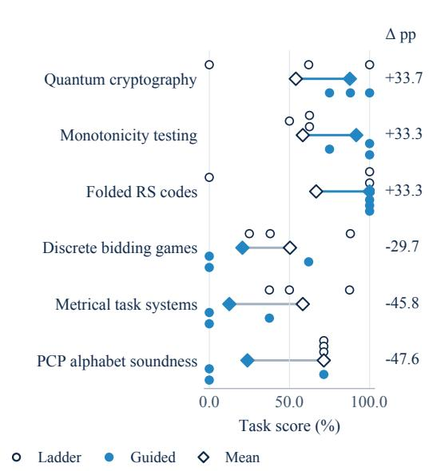

(b) Outcomes across proof settings  
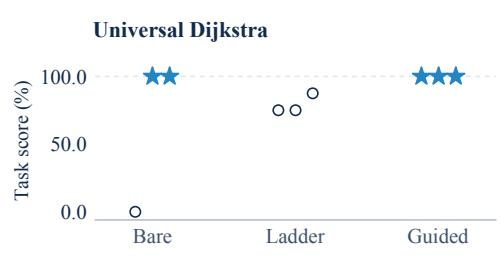

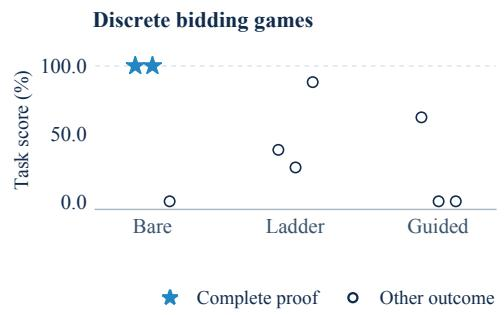  
Figure 10: Kimi K3 performance across proof settings. (a) The six largest absolute guided-minusladder mean differences among 20 theorems. Circles show individual attempts; diamonds mark means, with differences in percentage points. (b) Universal Dijkstra and discrete bidding games, which retains bare success with incomplete ladder/guided attempts. Each marker is an independent attempt; stars identify complete proofs. Bare receives binary credit, while ladder/guided also award partial checkpoint credit. Horizontal offsets separate the three attempts. Full results and checkpoint details appear in Appendix E.3.

Table 20 compares complete-proof outcomes on the same 20 targets. From bare to ladder to guided, the numbers of theorems solved at least once increase from 3 to 4 to 7 for Kimi K3, and from 0 to 2 to 6 for DeepSeek V4.1 Flash 0910. Kimi K3 has equal per-attempt success under bare and ladder (7/60), then rises to 18/60 under guided; DeepSeek V4.1 Flash 0910 has 0/60, 2/60, and 11/60, respectively. Each setting uses three attempts per theorem.

Table 20: Complete proofs under bare, ladder, and guided settings. Each agent has three attempts on each of 20 theorems. A theorem is solved if at least one attempt proves it completely.
<table><tr><td>Model</td><td>Outcome</td><td>Bare</td><td>Ladder</td><td>Guided</td></tr><tr><td rowspan="2">Kimi K3</td><td>Successful attempts</td><td>7/60 (11.7%)</td><td>7/60 (11.7%)</td><td>18/60 (30.0%)</td></tr><tr><td>Theorems solved</td><td>3/20</td><td>4/20</td><td>7/20</td></tr><tr><td rowspan="2">DeepSeek V4.1 Flash 0910</td><td>Successful attempts</td><td>0/60 (0.0%)</td><td>2/60 (3.3%)</td><td>11/60 (18.3%)</td></tr><tr><td>Theorems solved</td><td>0/20</td><td>2/20</td><td>6/20</td></tr></table>

Table 21: Proof-guidance scores on 20 theorems. Scores are percentages averaged over three attempts; ∆ is guided minus ladder in percentage points.
<table><tr><td></td><td></td><td colspan="3">Kimi K3</td><td colspan="3">DeepSeek V4.1 Flash 0910</td></tr><tr><td>#</td><td>Theorem</td><td>Guided</td><td>Ladder</td><td>∆</td><td>Guided</td><td>Ladder</td><td>∆</td></tr><tr><td>1</td><td>Corners theorem</td><td>25.0</td><td>20.8</td><td>+4.2</td><td>25.0</td><td>25.0</td><td>+0.0</td></tr><tr><td>2</td><td>Negations in small-depth circuits</td><td>100.0</td><td>81.0</td><td>+19.1</td><td>61.9</td><td>57.1</td><td>+4.7</td></tr><tr><td>3</td><td>Universal Dijkstra</td><td>100.0</td><td>79.2</td><td>+20.8</td><td>41.7</td><td>41.8</td><td>-0.2</td></tr><tr><td>4</td><td>Three taxis</td><td>83.7</td><td>75.0</td><td>+8.7</td><td>79.2</td><td>66.7</td><td>+12.5</td></tr><tr><td>5</td><td>Monotonicity testing</td><td>91.7</td><td>58.3</td><td>+33.3</td><td>70.7</td><td>62.5</td><td>+8.2</td></tr><tr><td>6</td><td>QMA-QCMA oracle separation</td><td>87.5</td><td>83.3</td><td>+4.2</td><td>58.3</td><td>70.8</td><td>-12.5</td></tr><tr><td>7</td><td>Discrepancy</td><td>61.9</td><td>33.3</td><td>+28.6</td><td>33.3</td><td>28.6</td><td>+4.8</td></tr><tr><td>8</td><td>PCP alphabet soundness</td><td>23.8</td><td>71.4</td><td>-47.6</td><td>76.2</td><td>66.7</td><td>+9.5</td></tr><tr><td>9</td><td>Proximity testing</td><td>100.0</td><td>100.0</td><td>+0.0</td><td>100.0</td><td>83.3</td><td>+16.7</td></tr><tr><td>10</td><td>Folded Reed-Solomon codes</td><td>100.0</td><td>66.7</td><td>+33.3</td><td>91.7</td><td>91.7</td><td>+0.0</td></tr><tr><td>11</td><td>Metrical task systems</td><td>12.5</td><td>58.3</td><td>-45.8</td><td>41.7</td><td>33.3</td><td>+8.3</td></tr><tr><td>12</td><td>XOR parallel repetition</td><td>54.0</td><td>50.0</td><td>+4.0</td><td>12.5</td><td>20.8</td><td>-8.3</td></tr><tr><td>13</td><td>Unitary synthesis</td><td>83.3</td><td>54.2</td><td>+29.2</td><td>71.0</td><td>66.7</td><td>+4.3</td></tr><tr><td>14</td><td>Planar independent-set reconfigu- ration</td><td>47.6</td><td>71.4</td><td>-23.8</td><td>71.4</td><td>76.2</td><td>-4.8</td></tr><tr><td>15</td><td>Positive-body chasing</td><td>100.0</td><td>88.0</td><td>+12.0</td><td>100.0</td><td>54.2</td><td>+45.8</td></tr><tr><td>16</td><td>Locally correctable codes</td><td>27.8</td><td>33.3</td><td>-5.6</td><td>22.2</td><td>16.7</td><td>+5.6</td></tr><tr><td>17</td><td>Strategy improvement</td><td>66.7</td><td>37.5</td><td>+29.2</td><td>45.8</td><td>25.0</td><td>+20.8</td></tr><tr><td>18</td><td>Planar multiflow</td><td>66.7</td><td>41.7</td><td>+25.0</td><td>41.7</td><td>29.2</td><td>+12.5</td></tr><tr><td>19</td><td>Discrete bidding games</td><td>20.7</td><td>50.3</td><td>-29.7</td><td>37.5</td><td>20.8</td><td>+16.7</td></tr><tr><td>20</td><td>Quantum cryptography</td><td>87.7</td><td>54.0</td><td>+33.7</td><td>75.0</td><td>45.8</td><td>+29.2</td></tr><tr><td colspan="2">Mean</td><td>67.0</td><td>60.4</td><td>+6.6</td><td>57.8</td><td>49.1</td><td>+8.7</td></tr></table>

Table 21 reports task scores, including partial credit, on all 20 theorems. Kimi K3 averages 67.0% under guided and 60.4% under ladder, a difference of 6.6 percentage points; DeepSeek V4.1 Flash 0910 averages 57.8% and 49.1%, a difference of 8.7 points. Guided has a higher mean on 14 theorems for each model; Kimi K3 has five decreases and one tie, while DeepSeek V4.1 Flash 0910 has four decreases and two ties. Each theorem contributes equally after averaging its three attempts. Pooling all checkpoints across tasks would instead give more weight to theorems with more checkpoints. Appendix D.3 describes the evaluation protocol; the figures below examine Kimi K3 in more detail.

Figure 12 separates the three attempts within each level. For example, monotonicity testing improves from 62.5%, 62.5%, and 50.0% under ladder to 100.0%, 100.0%, and 75.0% under guided. In universal Dijkstra, ladder scores are 75.0%, 75.0%, and 87.5%, while all three guided scores are 100.0%. The individual-attempt plots show how these mean differences arise across the three independent runs in each setting.

Table 20 reports complete-proof success separately from conditional checkpoint coverage, using the two verification modes defined in Appendix B.1. The selected cases below show how these outcomes correspond to the submitted proofs.

Bare success across proof settings. Table 22 lists all three theorems solved by Kimi K3 in at least one bare attempt. Discrete bidding games retains bare success with no full-score ladder or guided attempt. Dijkstra has three accepted guided proofs; both cases appear in Figure 10b. Small-depth negations provides a contrasting case: bare succeeds three times, ladder reaches full credit once, and guided reaches it three times. Values use the reported package scores, displayed to one decimal.

Statement and scoring checks. For Dijkstra, static comparison across the bare and scaffolded task versions confirms that the main statement and shared definitions agree after renaming the external interval-DAG bound and its bound variable; the scaffolded tasks additionally define the heap operations used by their checkpoints. For bidding games, the main statement and shared definitions agree, with additional helper declarations in the scaffolded tasks. The negations statements and shared definitions agree without renaming. These checks establish a common formal target for each case while retaining the differences in supplied context, prompts, and verifiers. In both selected tasks, the source verifiers award full credit to an accepted direct main proof as well as to an assembled proof. Submissions can therefore earn full credit through either proof route.

Table 22: Proof-guidance outcomes for the three theorems solved by Kimi K3 in the bare setting. Bare gives complete proofs / attempts; ladder and guided list task scores (%). Attempts are independent across settings.
<table><tr><td>Theorem</td><td>Bare</td><td>Ladder (%)</td><td>Guided (%)</td></tr><tr><td>Universal Dijkstra</td><td>2/3</td><td>75.0, 75.0, 87.5</td><td>100.0, 100.0, 100.0</td></tr><tr><td>Discrete bidding games</td><td>2/3</td><td>38.0, 25.0, 88.0</td><td>62.0, 0.0, 0.0</td></tr><tr><td>Small-depth negations</td><td>3/3</td><td>57.1, 85.7, 100.0</td><td>100.0, 100.0, 100.0</td></tr></table>

Checkpoint evidence. Figure 11 separates complete-proof acceptance from isolated checkpoint acceptance. All three Dijkstra guided submissions have accepted complete proofs. The first two also pass all eight isolated checkpoints; the third passes only one because extracting the checkpoint bodies disrupts its Lean scopes. The separate complete-proof check preserves full credit for this submission. Bidding’s second ladder attempt passes two checkpoints and receives a score of 25.0%, without an accepted complete proof. Its third ladder attempt passes all intermediate checkpoints but leaves the main-theorem checkpoint unproved. These distinctions separate completion of the target theorem from progress along the supplied proof structure.

(a) Universal Dijkstra  
(b) Discrete bidding games  
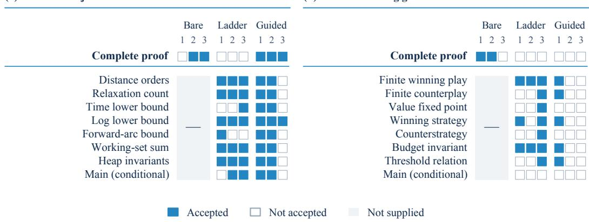  
Figure 11: Complete-proof and checkpoint acceptance for the Kimi K3 cases. The top row records complete proofs. Each lower row is a conditional checkpoint, including the main-theorem slot. Columns number independent attempts within each setting; gray denotes checkpoints absent from bare. Dijkstra’s third guided submission has an accepted complete proof despite failures in seven isolated checkpoint checks. In bidding’s third ladder attempt, all intermediate checkpoints pass while the main slot does not.

Bidding-game case: a direct invariant proof. The target asks for a budget-agnostic winning strategy, whose action depends on the current vertex and tie-breaking advantage rather than the exact available budget. Theorem 27 of Avni & Sadhukhan (2026) constructs this strategy by applying value iteration at a trimmed threshold budget. Its proof tracks the excess budget, which is nondecreasing and bounded, and partitions play into intervals on which this quantity stays constant. This gives the initial energy bound $M = ( \dot { k } + \dot { 1 } ) ( W + H )$ , where k is the total integer budget, W bounds absolute edge weights, and H is the maximum energy threshold at the threshold budgets.

One successful bare submission uses the same strategy and bound but organizes the argument as a single inductive invariant. For configuration $\boldsymbol { c } = ( \boldsymbol { v } , \boldsymbol { B } )$ , let $e ( c )$ be the integer budget above the trimmed threshold, and let $u ( c )$ be the value-iteration energy threshold at that trimmed budget. Its helper lemma proves, for every legal transition $c \to c ^ { \prime }$ consistent with the strategy,

$$
u ( c ) + w ( v , v ^ { \prime } ) + ( W + H ) \big ( e ( c ^ { \prime } ) - e ( c ) \big ) \geq u ( c ^ { \prime } ) .\tag{7}
$$

Writing $S _ { n }$ for the sum of the first n edge weights, induction yields

$$
M + S _ { n } \geq u ( c _ { n } ) + M - ( W + H ) e ( c _ { n } ) - H \geq 0 ,\tag{8}
$$

where the last step uses $e ( c _ { n } ) \leq k$ and $u ( c _ { n } ) \geq 0$ . This establishes the energy guarantee directly for every play prefix. The submitted proof defines its own supporting lemmas rather than completing the supplied checkpoint sequence. Independent rechecks accept both successful bare submissions with only Lean’s standard axioms. The submission reproduces the source theorem's strategy and energy bound through a single inductive invariant, providing an alternative organization of the formal proof.

Seven accepted checkpoints with the target unfinished. The third ladder attempt provides a concrete comparison. Its final judge log accepts all seven intermediate checkpoints, including the value-iteration fixed point, the budget invariant, and the threshold-average property. The main theorem remains a sorry placeholder, and both complete-proof checks fail; the exact checkpoint fraction $7 / 8$ corresponds to 87.5% (the historical score export rounds this to 88.0% in Table 22). Near the end of the 12-hour budget, the last build still reports the unfinished declaration and the final response records the target as incomplete. Thus this attempt’s partial credit comes from intermediate obligations that were accepted conditionally, while the final strategy-existence argument was not completed. Against the same formal target, the successful bare submission completes its invariant argument, while this independent ladder attempt leaves the final strategy-existence obligation open. In the second guided attempt, the model proposed the auxiliary lemma muN $\mathtt { k S t a r \_ l e \_ x N }$ , then identified a counterexample involving tie-breaking. The lemma was absent from the supplied task; the attempt exhausted its budget while revising the proof. A third guided attempt worked in auxiliary Lean files but left the designated submission unchanged, yielding no accepted checkpoints. This distinguishes unfinished mathematical obligations from failure to integrate working files into the submitted artifact.

<table><tr><td rowspan=2 colspan=11>K Kimi K3Ladder              Guided           Mean difference# Task                                                                      3      Guided – ladder (pp)</td></tr><tr><td rowspan=1 colspan=2></td><td rowspan=1 colspan=1></td><td rowspan=1 colspan=1></td><td rowspan=1 colspan=1></td><td rowspan=1 colspan=1></td><td rowspan=1 colspan=1></td><td rowspan=1 colspan=1></td><td rowspan=1 colspan=1></td></tr><tr><td rowspan=1 colspan=2>1  Corners theorem</td><td rowspan=1 colspan=1>25.0</td><td rowspan=1 colspan=1>12.5</td><td rowspan=1 colspan=1>25.0</td><td rowspan=1 colspan=1></td><td rowspan=1 colspan=1>25.0</td><td rowspan=1 colspan=1>12.5</td><td rowspan=1 colspan=1>37.5</td><td rowspan=1 colspan=1></td><td rowspan=1 colspan=1>+4.2</td></tr><tr><td rowspan=1 colspan=2>2  Negations in small-depth circuits</td><td rowspan=1 colspan=1>57.1</td><td rowspan=1 colspan=1>85.7</td><td rowspan=1 colspan=1>100.0</td><td rowspan=1 colspan=1></td><td rowspan=1 colspan=1>100.0</td><td rowspan=1 colspan=1>100.0</td><td rowspan=1 colspan=1>100.0</td><td rowspan=1 colspan=1></td><td rowspan=1 colspan=1>+19.1</td></tr><tr><td rowspan=1 colspan=2>3  Universal Dijkstra</td><td rowspan=1 colspan=1>75.0</td><td rowspan=1 colspan=1>75.0</td><td rowspan=1 colspan=1>87.5</td><td rowspan=1 colspan=1></td><td rowspan=1 colspan=1>100.0</td><td rowspan=1 colspan=1>100.0</td><td rowspan=1 colspan=1>100.0</td><td rowspan=1 colspan=1></td><td rowspan=1 colspan=1>+20.8</td></tr><tr><td rowspan=1 colspan=2>4 Three taxis</td><td rowspan=1 colspan=1>75.0</td><td rowspan=1 colspan=1>75.0</td><td rowspan=1 colspan=1>75.0</td><td rowspan=1 colspan=1></td><td rowspan=1 colspan=1>88.0</td><td rowspan=1 colspan=1>88.0</td><td rowspan=1 colspan=1>75.0</td><td rowspan=1 colspan=1></td><td rowspan=1 colspan=1>+8.7</td></tr><tr><td rowspan=1 colspan=2>5  Monotonicity testing</td><td rowspan=1 colspan=1>62.5</td><td rowspan=1 colspan=1>62.5</td><td rowspan=1 colspan=1>50.0</td><td rowspan=1 colspan=1></td><td rowspan=1 colspan=1>100.0</td><td rowspan=1 colspan=1>100.0</td><td rowspan=1 colspan=1>75.0</td><td rowspan=1 colspan=1></td><td rowspan=1 colspan=1>+33.3</td></tr><tr><td rowspan=1 colspan=2>6  QMA-QCMA oracle separation</td><td rowspan=1 colspan=1>87.5</td><td rowspan=1 colspan=1>87.5</td><td rowspan=1 colspan=1>75.0</td><td rowspan=1 colspan=1></td><td rowspan=1 colspan=1>87.5</td><td rowspan=1 colspan=1>87.5</td><td rowspan=1 colspan=1>87.5</td><td rowspan=1 colspan=1></td><td rowspan=1 colspan=1>+4.2</td></tr><tr><td rowspan=1 colspan=2>7 Discrepancy</td><td rowspan=1 colspan=1>57.1</td><td rowspan=1 colspan=1>42.9</td><td rowspan=1 colspan=1>0.0</td><td rowspan=1 colspan=1></td><td rowspan=1 colspan=1>57.1</td><td rowspan=1 colspan=1>57.1</td><td rowspan=1 colspan=1>71.4</td><td rowspan=1 colspan=1></td><td rowspan=1 colspan=1>+28.6</td></tr><tr><td rowspan=1 colspan=2>8  PCP alphabet soundness</td><td rowspan=1 colspan=1>71.4</td><td rowspan=1 colspan=1>71.4</td><td rowspan=1 colspan=1>71.4</td><td rowspan=1 colspan=1></td><td rowspan=1 colspan=1>71.4</td><td rowspan=1 colspan=1>0.0</td><td rowspan=1 colspan=1>0.0</td><td rowspan=1 colspan=1></td><td rowspan=1 colspan=1>-47.6</td></tr><tr><td rowspan=1 colspan=2>9 Proximity testing</td><td rowspan=1 colspan=1>100.0</td><td rowspan=1 colspan=1>100.0</td><td rowspan=1 colspan=1>100.0</td><td rowspan=1 colspan=1></td><td rowspan=1 colspan=1>100.0</td><td rowspan=1 colspan=1>100.0</td><td rowspan=1 colspan=1>100.0</td><td rowspan=1 colspan=1></td><td rowspan=1 colspan=1>+0.0</td></tr><tr><td rowspan=1 colspan=2>10Folded Reed-Solomon codes</td><td rowspan=1 colspan=1>0.0</td><td rowspan=1 colspan=1>100.0</td><td rowspan=1 colspan=1>100.0</td><td rowspan=1 colspan=1></td><td rowspan=1 colspan=1>100.0</td><td rowspan=1 colspan=1>100.0</td><td rowspan=1 colspan=1>100.0</td><td rowspan=1 colspan=1></td><td rowspan=1 colspan=1>+33.3</td></tr><tr><td rowspan=1 colspan=2>11 Metrical task systems</td><td rowspan=1 colspan=1>87.5</td><td rowspan=1 colspan=1>37.5</td><td rowspan=1 colspan=1>50.0</td><td rowspan=1 colspan=1></td><td rowspan=1 colspan=1>37.5</td><td rowspan=1 colspan=1>0.0</td><td rowspan=1 colspan=1>0.0</td><td rowspan=1 colspan=1></td><td rowspan=1 colspan=1>-45.8</td></tr><tr><td rowspan=1 colspan=2>12XOR parallel repetition</td><td rowspan=1 colspan=1>50.0</td><td rowspan=1 colspan=1>62.0</td><td rowspan=1 colspan=1>38.0</td><td rowspan=1 colspan=1></td><td rowspan=1 colspan=1>50.0</td><td rowspan=1 colspan=1>50.0</td><td rowspan=1 colspan=1>62.0</td><td rowspan=1 colspan=1></td><td rowspan=1 colspan=1>+4.0</td></tr><tr><td rowspan=1 colspan=1>13</td><td rowspan=1 colspan=1>Unitary synthesis</td><td rowspan=1 colspan=1>87.5</td><td rowspan=1 colspan=1>75.0</td><td rowspan=1 colspan=1>0.0</td><td rowspan=1 colspan=1></td><td rowspan=1 colspan=1>75.0</td><td rowspan=1 colspan=1>87.5</td><td rowspan=1 colspan=1>87.5</td><td rowspan=1 colspan=1></td><td rowspan=1 colspan=1>+29.2</td></tr><tr><td rowspan=1 colspan=1>14</td><td rowspan=1 colspan=1>Planar independent-set reconfiguration</td><td rowspan=1 colspan=1>71.4</td><td rowspan=1 colspan=1>71.4</td><td rowspan=1 colspan=1>71.4</td><td rowspan=1 colspan=1></td><td rowspan=1 colspan=1>0.0</td><td rowspan=1 colspan=1>71.4</td><td rowspan=1 colspan=1>71.4</td><td rowspan=1 colspan=1></td><td rowspan=1 colspan=1>-23.8</td></tr><tr><td rowspan=1 colspan=1>15</td><td rowspan=1 colspan=1>Positive-body chasing</td><td rowspan=1 colspan=1>88.0</td><td rowspan=1 colspan=1>88.0</td><td rowspan=1 colspan=1>88.0</td><td rowspan=1 colspan=1></td><td rowspan=1 colspan=1>100.0</td><td rowspan=1 colspan=1>100.0</td><td rowspan=1 colspan=1>100.0</td><td rowspan=1 colspan=1></td><td rowspan=1 colspan=1>+12.0</td></tr><tr><td rowspan=1 colspan=2>16Locally correctable codes</td><td rowspan=1 colspan=1>33.3</td><td rowspan=1 colspan=1>33.3</td><td rowspan=1 colspan=1>33.3</td><td rowspan=1 colspan=1></td><td rowspan=1 colspan=1>33.3</td><td rowspan=1 colspan=1>16.7</td><td rowspan=1 colspan=1>33.3</td><td rowspan=1 colspan=1></td><td rowspan=1 colspan=1>-5.6</td></tr><tr><td rowspan=1 colspan=1>17</td><td rowspan=1 colspan=1>Strategy improvement</td><td rowspan=1 colspan=1>50.0</td><td rowspan=1 colspan=1>0.0</td><td rowspan=1 colspan=1>62.5</td><td rowspan=1 colspan=1></td><td rowspan=1 colspan=1>75.0</td><td rowspan=1 colspan=1>62.5</td><td rowspan=1 colspan=1>62.5</td><td rowspan=1 colspan=1></td><td rowspan=1 colspan=1>+29.2</td></tr><tr><td rowspan=1 colspan=1>18</td><td rowspan=1 colspan=1>Planar multiflow</td><td rowspan=1 colspan=1>37.5</td><td rowspan=1 colspan=1>50.0</td><td rowspan=1 colspan=1>37.5</td><td rowspan=1 colspan=1></td><td rowspan=1 colspan=1>75.0</td><td rowspan=1 colspan=1>75.0</td><td rowspan=1 colspan=1>50.0</td><td rowspan=1 colspan=1></td><td rowspan=1 colspan=1>+25.0</td></tr><tr><td rowspan=1 colspan=1>19</td><td rowspan=1 colspan=1>Discrete bidding games</td><td rowspan=1 colspan=1>38.0</td><td rowspan=1 colspan=1>25.0</td><td rowspan=1 colspan=1>88.0</td><td rowspan=1 colspan=1></td><td rowspan=1 colspan=1>62.0</td><td rowspan=1 colspan=1>0.0</td><td rowspan=1 colspan=1>0.0</td><td rowspan=1 colspan=1></td><td rowspan=1 colspan=1>-29.7</td></tr><tr><td rowspan=1 colspan=11>20Quantum cryptographyTask score (%)0.0  25.0 50.0 75.0 100.0</td></tr></table>

Figure 12: Kimi K3 task scores across individual attempts. Each cell shows a package score as a percentage, rounded to one decimal. Mean differences use the unrounded scores and are given in percentage points. The 20 paired theorems contribute 60 attempts per setting. Scores combine partial checkpoint credit with full credit for accepted complete proofs; complete-proof outcomes are shown separately for selected cases in Figure 11.

## F SUBMITTED OUTPUTS AND CASE STUDIES

The selected cases connect benchmark scores to mathematical parameters and proof obligations. Solver cases illustrate improvements on named instances; construction cases identify attained objects and task references; open-conjecture cases examine verified special cases and remaining proof obligations. Each is interpreted under its originating task version.

## F.1 LOGIC-SYNTHESIS SOLVERS AND PUBLIC COMPETITION REFERENCES

The solver examples use three logic-synthesis submissions from the designated evaluation. GPT-6 Astra reduces the AND-gate count from 138 to 108 on instance ex59; Kimi K3 reduces it from 19 to 18 on ex30; Grok 4.6 reduces it from 51 to 50 on ex68. The corresponding reductions are 21.7%, 5.3%, and 2.0%. Each reference is the minimum count across the four teams’ publicly released AIG-track circuits in the IWLS 2023 repository (IWLS 2023 Contest Organizers, 2023). We downloaded all twelve reference circuits at commit 7dbfd510e259 and read their AND counts from the AIGER headers. Google’s submission attains all three minima, with the other teams tying on ex30. The released files and their checksums accompany the case data.

Each example comes from the final evaluation of the submitted program; its objective and validity were checked against the evaluation records. The evaluation instances permute and negate inputs and outputs of the contest functions. These transformations preserve the AND-gate count because inversion is represented on edges. The examples illustrate individual outcomes, while task averages include all scored instances.

These comparisons use the publicly released team circuits and TCSExam's execution budgets (Appendix D.2). The contest's aggregate results additionally incorporate unreleased organizer circuits. The three examples therefore report improvements against the specified public circuit references.

## F.2 GRAPH AND QUANTUM-CODE CONSTRUCTIONS

The graph task seeks dense 124-vertex graphs without triangles or 4-cycles. DeepSeek V4.1 Flash 0910’s 630 edges consist of a published 123-vertex, 621-edge seed and nine new edges to an added vertex; the selected neighbors have pairwise seed distance at least three. The seed size and 629-edge reference at 124 vertices appear in Table 1 of Goedgebeur et al. (2025), version 1. The quantumcode record gives [[25, 7, 6]] binary stabilizer codes versus distance 5 in the designated table entry (Grassl, n.d.). These comparisons use the designated task references, with the source versions stated explicitly.

Verification of the displayed constructions. Figure 5 uses Kimi K3’s graph and quantum code, extracted directly from its submitted formal certificates. Figure 13 shows Astra’s corresponding submissions, which attain the same parameters. Independent finite checks confirm that each graph has 124 vertices, 630 unique edges, no triangles, and at most one common neighbor for every vertex pair, excluding 4-cycles. The highlighted cycles are 0, 21, 32, 11, 121, 0 for Kimi K3 and 0, 2, 21, 46, 18, 0 for Astra, establishing girth exactly 5. Each drawing shows every vertex and edge, with positions chosen for readability.

For each quantum code, the 18 submitted pairs of binary masks are converted directly to Pauli letters, with qubits 1–25 corresponding to bits 0–24. Each matrix retains the submitted row order. Independent checks confirm binary rank 18 and pairwise commutation, yielding 25−18 = 7 logical qubits. The archived verifiers certify distance at least 6; independent distance checks corroborate this value. The edge lists, generator masks, source checksums, and drawing checks accompany the two figure data files. Astra's generator masks are also available in the public case data.

A binary-code upper bound. Astra’s submission proves $A ( 2 2 , 1 0 ) \leq 8 2$ . Here A(22, 10) is the largest possible number of binary words of length 22 with pairwise Hamming distance at least 10. The published semidefinite-programming bound is 84 (Gijswijt et al., 2012), also listed in Brouwer’s table when checked on September 26, 2026 (Brouwer, n.d.). The verified upper-bound score is 101.6%. The same submission supplies a 64-word code, which gives a separate lower bound. The construction verification protocol is described in Appendix D.3.

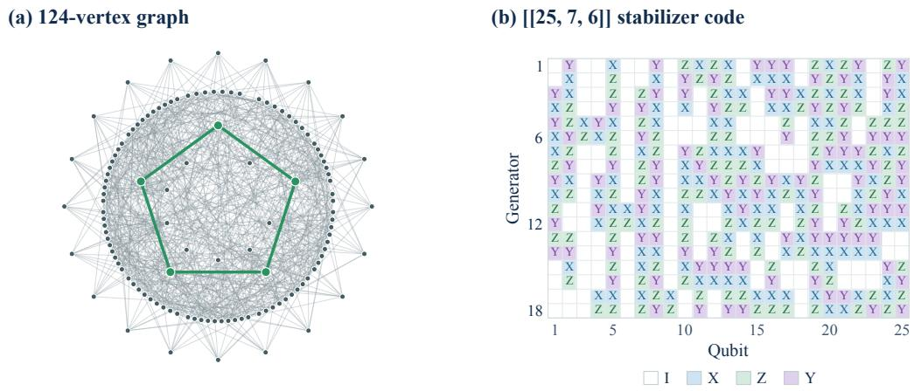  
Figure 13: Two constructions submitted by GPT-6 Astra. (a) A 124-vertex, 630-edge graph without 3- or 4-cycles, with a shortest cycle highlighted. (b) The 18 submitted stabilizer generators of a [[25, 7, 6]] quantum code. Both panels use Astra’s actual submissions; they attain the same parameters as Kimi K3’s constructions in Figure 5.

## F.3 A VERIFIED NINE-DIMENSIONAL ALON–JAEGER–TARSI RESULT

Statement and relation to prior work. The Alon–Jaeger–Tarsi conjecture asks whether every invertible matrix over a field with at least four elements admits a vector whose coordinates and image coordinates are all nonzero. Astra’s Lean proof establishes

$$
\forall p \geq 5 \mathrm { ~ p r i m e , } \quad \forall n \leq 9 , \quad \forall A \in \mathrm { G L } _ { n } ( \mathbb { F } _ { p } ) , \quad \exists x \in ( \mathbb { F } _ { p } \setminus \{ 0 \} ) ^ { n } : A x \in ( \mathbb { F } _ { p } \setminus \{ 0 \} ) ^ { n } .\tag{9}
$$

The contribution relative to the literature reviewed here is the case $p = 5 , n = 9$ . Yu’s dimension guarantee $n < 2 ^ { p - 2 }$ gives $n \leq 7$ over $\mathbb { F } _ { 5 }$ (Yu, 1999); this guarantee is also stated in the introduction of Nagy & Pach (2025). Version 1 of Zeng et al. (2026), posted August 18, 2026, reports $n \leq 2 ^ { p - 2 }$ including $n = 8$ over $\mathbb { F } _ { 5 }$ . The large-field result of Nagy & Pach (2025) applies when $6 1 < | \mathbb { F } | \neq 7 9$ and does not cover $\mathbb { F } _ { 5 }$ . The nine-dimensional result goes beyond these ranges. The comparison uses the publicly available versions checked on September 26, 2026. For $p \geq 7$ , the dimensions in Equation 9 already fall within Yu’s guarantee.

From a minimal counterexample to counting constraints. The proof first establishes smaller dimensions and then assumes a minimal counterexample A of dimension nine over $\mathbb { F } _ { 5 }$ . Let $\mathrm { w t } ( x )$ denote the number of nonzero coordinates of x. Define

$$
\begin{array} { r l r } { W _ { i j } = \big | \{ x : \mathrm { w t } ( x ) = i , \mathrm { w t } ( A x ) = j \} \big | , } & { } & { V _ { i j } = \big | \{ x : \mathrm { w t } ( x ) = j , \mathrm { w t } ( A ^ { \top } x ) = i \} \big | . } \end{array}
$$

These two $1 0 \times 1 0$ arrays have nonnegative integer entries. Invertibility fixes their row and column sums; a finite Fourier identity relates the two arrays. Minimality supplies further vanishing conditions, including $W _ { 2 2 } = W _ { 2 3 } = W _ { 3 2 } = 0$

Additional inequalities come from pairs of columns $u , v .$ . Each coordinate pair $( u _ { i } , v _ { i } )$ belongs to one of seven classes: both zero, only the first nonzero, only the second nonzero, or one of the four nonzero cancellation ratios $u _ { i } + t v _ { i } = 0$ . Figure 6(a) displays all 25 coordinate pairs. Their seven class counts $h _ { 0 } , \ldots , h _ { 6 }$ sum to nine, leaving $( \mathbf { \bar { \mathbf { \rho } } } _ { 6 } ^ { 1 5 } ) = 5 , 0 \bar { 0 } 5$ possible count vectors. The submitted proof checks the relevant inequalities over these finite count vectors and sums them across column pairs. Applying the argument to $A , A ^ { - 1 } , A ^ { \mathsf { T } }$ , and $( A ^ { \mathsf { T } } ) ^ { - 1 }$ yields four nonnegative linear quantities $L _ { 1 } , \dots , L _ { 4 }$ in $\bar { W }$ and $\mathbf { \bar { \Sigma } } _ { V }$ . These finite checks concern coordinate counts, not enumeration of all invertible nine-dimensional matrices.

The submitted contradiction certificate. Collect the 200 entries of $W , V$ and the four quantities $L _ { o }$ in a vector $z \geq 0$ . The identities above give an integer linear system $E z = b$ . The submitted certificate contains integer multipliers λ satisfying

$$
\lambda ^ { \mathsf { T } } E \geq 0 , \qquad \lambda ^ { \mathsf { T } } b < 0 .\tag{10}
$$

Consequently, $0 \leq \lambda ^ { \mathsf { T } } E z = \lambda ^ { \mathsf { T } } b < 0 .$ , a contradiction. Of the 197 equations in the source certificate, 143 have nonzero multipliers; the Lean declaration retains precisely these 143 equations. Independent integer recomputation matches each retained equation, multiplier, and right-hand side to the Lean source and verifies Equation 10. All 204 resulting coefficients are nonnegative: 93 are positive and 111 are zero. Figure 6(b) shows their exact support, grouping the coefficients on $W$ ${ \hat { V } } ,$ , and the four pair terms. For its displayed identity, we divide the certificate by $| \lambda ^ { \mathsf { T } } b |$ and write $\boldsymbol { c } ^ { \mathsf { T } } = \lambda ^ { \mathsf { T } } \boldsymbol { E } / | \lambda ^ { \mathsf { T } } \boldsymbol { b } |$ , giving $\begin{array} { r } { 0 \leq c ^ { \mathsf { T } } z = - 1 } \end{array}$

Independent formal verification. The 71-module source project was rebuilt in a clean sandbox using Lean 4.33.0-rc1 and public mathlib revision 5b3f719b, without reusing model-generated compiled files. The clean build used a 30 GB memory limit. The three declarations establishing the result over $\mathbb { F } _ { 5 } ,$ its prime-field extension, and the minimum counterexample dimension depend only on propext, Classical.choice, and Quot.sound. Their dependency audits contain no sorryAx or additional axioms and do not depend on the unresolved conjecture slots. The definition of the required nowhere-zero vector agrees with the original task. Separate integer checks reproduce the certificate and the inequalities over the 5,005 class-count vectors.

## F.4 ADDITIONAL VERIFIED RESULTS FROM OPEN-CONJECTURE ATTEMPTS

We independently verify four further mathematical results from Astra's open-conjecture attempts: explicit inequalities, an exact rigidity formula, and finite-instance matching bounds. Clean source builds and axiom audits accept these statements using Lean's standard axioms, independently of the unresolved conjecture slots. The statements and proof methods are given below.

A six-variable Fourier entropy–influence bound. For every Boolean function $f : \{ - 1 , 1 \} ^ { 6 } $ $\{ - 1 , 1 \}$ , the submitted proof establishes

$$
H ( \widehat { f } ^ { 2 } ) \leq \left( 7 \ln 2 \right) I ( f ) .
$$

Here H is the Shannon entropy of the squared Fourier coefficients, using natural logarithms, and $\begin{array} { r } { I ( f ) = \sum _ { i } \operatorname* { P r } [ f ( X ) \not = f ( X ^ { \dot { \oplus } \dot { i } } ) ] } \end{array}$ is the total influence under uniform X. Equivalently, the constant is 7 when entropy is measured in bits. The proof reduces the bound to finite integer inequalities using the discrete values of Walsh coefficients, congruence constraints, and Parseval’s identity. It covers all six-variable Boolean functions without enumerating their $2 ^ { 6 4 }$ truth tables.

Exact Hilbert-matrix rigidity at high target ranks. Let $H _ { n }$ be the rational Hilbert matrix with entries $( H _ { n } ) _ { i j } = 1 / ( i + j + 1 )$ for $0 \leq i , j < n$ , and let $R _ { H _ { n } } ( r )$ be the minimum number of entries that must change to obtain rank at most r. The submitted proof establishes the exact formula

$$
R _ { H _ { n } } ( r ) = 2 ( n - r ) - 1 , \qquad \lfloor n / 2 \rfloor \leq r < n .
$$

The upper bound constructs a rational matrix of rank exactly r differing in exactly $2 ( n - r ) - 1$ entries. The lower bound combines a row-and-column covering argument with nonsingularity of Hilbert submatrices. This formula characterizes the high-target-rank regime; the task's conjectured lower bound concerns lower target ranks.

An explicit influence bound for quadratic polynomials. For any real polynomial p of total degree at most two satisfying $0 \leq p ( \bar { x } ) \leq 1$ on ${ \bar { \{ } }  - { \bar { 1 } } , 1 \} ^ { n }$ and $\mathrm { V a r } ( p ) \stackrel { . } { > } 0$ , the submitted proof finds a coordinate i with

$$
\operatorname { I n f } _ { i } ( p ) \geq { \frac { \operatorname { V a r } ( p ) ^ { 2 } } { 1 6 } } , \qquad \operatorname { I n f } _ { i } ( p ) = \operatorname { \mathbb { E } } { \big [ } ( p ( X ) - p ( X ^ { \oplus i } ) ) ^ { 2 } { \big ] } .
$$

It also derives Inf $_ i ( p ) \ \geq \ ( \varepsilon / 2 ) ^ { 3 }$ whenever $\operatorname { V a r } ( p ) \geq \varepsilon > 0$ . The bound is independent of the number of variables.

Finite-instance bounds for random-order online matching. The formal model reveals each online vertex’s neighbors upon its arrival in a uniformly random permutation. Algorithms may adapt to the observed history and use an arbitrary finite number of independent uniform random bits. For graphs with maximum matching size at most two, an explicit algorithm guarantees a ratio of $7 / 8 .$

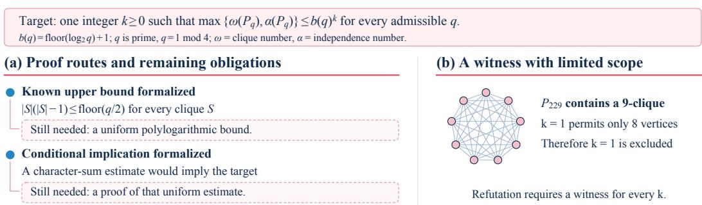  
Figure 14: An unresolved Paley graph attempt. (a) Auxiliary statements and remaining obligations. (b) A witness excluding k = 1 only. All 36 edges of the nine-vertex clique are independently verified.

and a two-by-two instance family gives a matching upper bound. On graphs with three vertices on each side, another algorithm attains $5 / 6 ,$ , again with a matching upper bound.

For every algorithm in this formal model, a five-by-five graph G with $\mathrm { O P T } ( G ) = 5$ satisfies

$$
\frac { \mathbb { E } [ \mathrm { A L G } ( G ) ] } { \mathrm { O P T } ( G ) } \leq \frac { 6 7 8 8 0 6 9 } { 8 3 2 9 5 0 0 } \approx 0 . 8 1 4 9 4 3 1 5 4 .
$$

The proof uses a weighted family of 570 graphs and their online-vertex relabelings. A certificate bounds the weighted expected matching size by 27,152,276 at total weight 6,663,600, yielding the displayed ratio after division by five. Padding with isolated vertices extends the obstruction to larger vertex counts while preserving $\mathrm { O P T } = 5$ . The bound applies to this algorithm class under a strict multiplicative guarantee with zero additive error.

## F.5 AN UNRESOLVED PALEY GRAPH CONJECTURE ATTEMPT

Figure 14 examines one GPT-6 Astra attempt on the Paley graph conjecture from the aggregate evaluation. In the Paley graph $P _ { q }$ , vertices are residues modulo a prime $q \equiv 1 { \pmod { 4 } }$ ; distinct vertices are adjacent when their difference is a square modulo $q .$ Write $b ( q ) = \lfloor \log _ { 2 } { q } \rfloor + 1$ . The target asks whether some fixed nonnegative integer k bounds both the clique and independence numbers by $b ( q ) ^ { k }$ for every admissible prime.

A concrete witness. The submitted declaration paley229\_nine\_clique gives the vertex set

$$
\{ 0 , 1 , 5 7 , 7 1 , 1 3 5 , 1 5 4 , 2 0 3 , 2 1 5 , 2 1 8 \} \subseteq \mathbb { Z } / 2 2 9 \mathbb { Z } .
$$

Its 36 unordered pairs all have square differences. Independent computation confirms this finite property; Lean dependency checks verify this declaration and exponent\_one\_fails using only the permitted standard axioms. Since $b ( 2 2 9 ) = 8 $ , this finite witness establishes that any uniform exponent satisfying the target must be at least two.

Proof routes and missing obligations. The submitted polynomial-method development contains hanson\_petridis\_bound, stating $| S | ( | S | - 1 ) \leq \mathsf { \bar { \alpha } } [ q / 2 ]$ for any clique S. This reproduces the square-root-scale bound of Hanson & Petridis (2021). The resulting upper bound grows on the order of ${ \sqrt { q } } .$ , while the target requires a bound polynomial in log q. Closing this difference is the remaining step along this proof route.

The character-sum development proves a conditional implication. Let $\chi _ { q }$ be the quadratic character, equal to 0 at zero, 1 at nonzero squares, and −1 otherwise. For a fixed k, the required hypothesis is

$$
2 \sum _ { x , y \in S } \chi _ { q } ( x - y ) \leq | S | ^ { 2 } \quad { \mathrm { w h e n e v e r ~ } } | S | \geq b ( q ) ^ { k } + 3 ,
$$

uniformly over admissible primes q and sets S. The submission derives the target with exponent k + 2 conditional on this uniform estimate, which remains an open proof obligation. The accompanying research notes record this missing obligation alongside unsuccessful attempts to apply the polynomial bound and an interval-clique construction.

Verification and scope. The clique witness is checked both in Lean and by independent finite computation. The auxiliary statements have only the permitted standard axioms as dependencies. The attempt receives a complete-resolution score of zero. Figure 14 identifies the verified finite witness, conditional implication, and remaining uniform-bound obligation.

## F.6 EVIDENCE FOR REFERENCE IMPROVEMENTS AND NOVELTY CLAIMS

Artifact validity and novelty are recorded separately. The archive retains the original output, its checksum, task version, verifier and toolchain, verification log, recomputed value or accepted statement, and evaluation resources. A record comparison additionally includes the original source, date and location, prior value, parameter restrictions, and applicable resource conditions. A floating-point difference within the declared tolerance is not counted as an improvement.

Case studies identify their comparison explicitly: a task reference, a public competition result, or a published mathematical bound. Claims of new records include a source comparison matching the problem parameters and applicable resource conditions. A claimed resolution of an open conjecture additionally undergoes renewed checking of the formal statement against the source conjecture.

## G EXTENSION AND MAINTENANCE

## G.1 ADDING A TASK

An extension specifies the research question and source, submission type, accepted evidence, scoring rule, and execution resources. It then follows the development checks in Appendix C: source correspondence, executable validation, negative tests, trial evaluation, and expert review. The task manifest records its field and parameter coverage so that extensions can increase both breadth and depth without changing the meaning of existing scores.

New problems use the corresponding output interface: a formal proof, a reusable solver, an explicit object with verified properties, or a proof or refutation of a conjecture. A task combining several methods still specifies exactly what must be submitted and what the checker establishes. This permits research workflows to vary while the evaluated output remains explicit.

## G.2 VERSIONING AND CORRECTIONS

Statements, environments, scorers, instance sets, and references remain fixed within an evaluation version. Corrections and additional tasks receive new versions with dated explanations. Reports identify which results are affected and whether re-evaluation is necessary. Source corrections can update a reference value in a later release with provenance; a model improvement is retained as an outcome rather than silently changing the comparison used for that evaluation.

Retired tasks remain available with their historical version and retirement reason. Comparisons across releases report the common task set or explicitly identify the changed collection. A main tained benchmark can thereby grow without rewriting earlier results.

## G.3 RECORDING RESEARCH OUTPUTS

The project maintains an artifact index linking results to the statements or objects checked, their originating task versions, and verification records. Research status distinguishes reproduction, vali dated improvement relative to a specified reference, and a novelty claim supported by source review. Verified special cases and reductions can be indexed alongside the complete-resolution score, preserving their mathematical content without changing that score retrospectively.

## H LITE SELECTION, RESULTS, AND FULL COMPARISON

## H.1 TASK SELECTION

We selected five tasks per track, balancing subject coverage, difficulty, and evaluation cost. Using the original six agents’ results, we compared candidate subsets by how well they preserved pairwise agent orderings and approximated Full track scores, then reviewed their mathematical and computational content to finalize the list. Selected tasks retain their original scoring rules and receive equal weight within each track. The list was fixed before evaluating Kimi K3.1 Pro and DeepSeek V4.1 Flash 1017. The Index in Equation 1 is a later reporting summary, applied with the same weights to both suites.

Table 23: Subject coverage of the 20 TCSExam-Lite tasks.
<table><tr><td>Track</td><td></td><td>Task</td><td>Subject</td></tr><tr><td rowspan="6">个</td><td rowspan="6">Theorem</td><td>Corners theorem</td><td>Additive combinatorics</td></tr><tr><td>Discrete bidding games</td><td>Games and algorithms</td></tr><tr><td>Folded Reed-Solomon codes</td><td>Coding theory</td></tr><tr><td>Small-depth negations</td><td>Circuit complexity</td></tr><tr><td>Quantum cryptography</td><td>Quantum computation</td></tr><tr><td>Bin packing</td><td>Packing and integer optimization</td></tr><tr><td rowspan="5">5 Solver</td><td rowspan="5"></td><td>Course timetabling</td><td>Scheduling</td></tr><tr><td>Maximum cut</td><td>Graph optimization</td></tr><tr><td>Machine reassignment</td><td>Resource assignment</td></tr><tr><td>Quantified Boolean formulas</td><td>Certified logical reasoning</td></tr><tr><td></td><td></td></tr><tr><td rowspan="6">由</td><td rowspan="6">Construction</td><td>Binary code A(24, 10) Graphs without 3- or 4-cycles</td><td>Coding theory Extremal graph theory</td></tr><tr><td>Kissing number in dimension 13</td><td>Discrete geometry</td></tr><tr><td>Ramsey R(4, 6)</td><td>Ramsey theory</td></tr><tr><td>Metric TSP integrality gap</td><td>Approximation algorithms</td></tr><tr><td>Evasiveness</td><td>Graph query complexity</td></tr><tr><td>conjec-</td><td></td></tr><tr><td rowspan="5">ture</td><td rowspan="5"></td><td>Frege proof length</td><td>Proof complexity</td></tr><tr><td>Log-rank</td><td>Communication complexity</td></tr><tr><td>Random-order online matching</td><td>Online algorithms</td></tr><tr><td>Constant-width branching programs</td><td></td></tr><tr><td></td><td>Pseudorandomness</td></tr></table>

The theorem subset includes both tasks solved by several agents and tasks with no accepted proof in the original cohort. Solver tasks span several types of input and certificate. Construction tasks cover discrete and geometric objects as well as an approximation bound. The open-conjecture subset gives coverage across five research directions. These choices retain variation within a five-task track while reducing the total number of task attempts by 80% relative to Full.

## H.2 RESULT PROVENANCE AND AGENT CONFIGURATIONS

Full contains 1,600 task attempts: 1,000 from the original six agents and 300 each from Kimi K3.1 Pro and DeepSeek V4.1 Flash 1017. Lite contains 340 entries across nine agents. Of these, 240 are the 15 shared non-Solver tasks across the eight common agents, reusing the same submissions in both suite summaries. The remaining 100 entries comprise 80 separate Lite Solver attempts and the 20 Opus attempts.

Kimi K3.1 Pro and DeepSeek 1017 each contribute three repetitions. For each agent, Full combines 45 shared non-Solver attempts with three repetitions on the remaining 85 tasks, including all 30 Online Solver problems. The 15 Offline Solver attempts contribute only to Lite. Every repetition contributes to the task means.

Opus uses Claude Code 2.1.283 with the one-million-token context option and maximum reasoning effort. Table 9 gives the configurations of the other agents.

All shared non-Solver scores are equal between the two suite records. Solver comparison uses the same fixed Kimi K3 reference, the original task score definitions, and each suite’s recorded development protocol.

## H.3 RANKING COMPARISON

We compare the eight agents with both Full and Lite results. Spearman’s rank correlation is $\rho \ = \ 0 . 9 3 ,$ , and 26 of the 28 unordered pairs have the same Index order. The two reversals are DeepSeek 1017 versus GLM-5.3 and Qwen3.8 Max (0902): DeepSeek 1017 is fourth among the shared agents on Full and sixth on Lite. Astra, Kimi K3.1 Pro, and Kimi K3 retain the top three positions. Excluding DeepSeek 1017, the other seven agents retain their full pairwise order. The Lite task list was selected using the original six agents and fixed before either Kimi K3.1 Pro or DeepSeek V4.1 Flash 1017 was evaluated. Opus is the ninth agent on the Lite leaderboard.

Table 24: Full–Lite ranking agreement across 8 shared agents. Each row compares 28 agent pairs using unrounded scores.
<table><tr><td>Metric</td><td>Same strict order</td><td>Reversed</td><td>Tied in both</td><td>Tied in one</td></tr><tr><td>Index</td><td>26</td><td>2</td><td>0</td><td>0</td></tr><tr><td>Theorem proving</td><td>22</td><td>3</td><td>3</td><td>0</td></tr><tr><td>Solver engineering</td><td>22</td><td>6</td><td>0</td><td>0</td></tr><tr><td>Constructions</td><td>25</td><td>3</td><td>0</td><td>0</td></tr><tr><td>Open conjectures</td><td>0</td><td>0</td><td>15</td><td>13</td></tr></table>

Theorem rankings reverse DeepSeek 1017 against GLM-5.3, Qwen3.8 Max (0902), and Grok 4.6. Solver reverses six pairs: Kimi K3.1 Pro versus Qwen3.8 Max (0902), DeepSeek 1017, and DeepSeek 0910; Kimi K3 versus GLM-5.3 and DeepSeek 0910; and GLM-5.3 versus DeepSeek 0910. Construction reverses Kimi K3.1 Pro versus GLM-5.3, and Kimi K3 versus Qwen3.8 Max (0902) and DeepSeek 1017. All Lite open-conjecture scores are zero, whereas Full has accepted refutations on two tasks outside the subset. These results quantify the aggregate agreement and the capability-specific differences under the two suite protocols.

## H.4 COMPLETE LITE TASK RESULTS

The following tables retain every selected task. Theorem and open-conjecture cells give successes over attempts; Solver and construction scores are percentages rounded to one decimal. Agent labels follow Tables 2 and 3.

Table 25: Theorem-proving results on TCSExam-Lite. Entries give complete proofs / attempts.
<table><tr><td>Task</td><td>Opus GPT-6 5.5</td><td>Astra</td><td>Kimi K3.1 Pro</td><td>Kimi  ${ \mathrm { K } } 3$ </td><td>GLM-5.3</td><td>Qwen3.8 Max (0902)</td><td>Grok 4.6</td><td>DeepSeek DeepSeek V4.1 Flash V4.1 Flash</td><td>0910</td></tr><tr><td>Corners theorem</td><td>0/1</td><td>0/1</td><td>0/3</td><td>0/3</td><td>0/1</td><td>0/1</td><td>0/1</td><td>1017 0/3</td><td>0/3</td></tr><tr><td>Discrete bidding</td><td>1/1</td><td>1/1</td><td>3/3</td><td>2/3</td><td>1/1</td><td>0/1</td><td>1/1</td><td>1/3</td><td>0/3</td></tr><tr><td>games Folded RS codes</td><td>1/1</td><td>1/1</td><td>0/3</td><td>0/3</td><td>0/1</td><td>0/1</td><td>0/1</td><td>0/3</td><td>0/3</td></tr><tr><td>Small-depth</td><td>1/1</td><td>1/1</td><td>3/3</td><td>3/3</td><td>0/1</td><td>1/1</td><td>0/1</td><td>0/3</td><td>0/3</td></tr><tr><td>negations Quantum cryptography</td><td>1/1</td><td>0/1</td><td>0/3</td><td>0/3</td><td>0/1</td><td>0/1</td><td>0/1</td><td>0/3</td><td>0/3</td></tr></table>

Table 26: Solver results on TCSExam-Lite. Entries are mean Kimi K3-relative scores (%).
<table><tr><td>Task</td><td>Opus GPT-6 5.5</td><td>Astra</td><td>Kimi K3.1 Pro</td><td>Kimi  ${ \mathrm { K } } 3$ </td><td>GLM-5.3</td><td>Qwen3.8 Max (0902)</td><td>Grok 4.6</td><td>DeepSeek V4.1 Flash V4.1 Flash 1017</td><td>DeepSeek 0910</td></tr><tr><td>Bin packing</td><td>56.1</td><td>56.1</td><td>49.3</td><td>50.5</td><td>49.3</td><td>48.1</td><td>41.1</td><td>47.0</td><td>48.5</td></tr><tr><td>Course timetabling</td><td>86.2</td><td>86.6</td><td>56.5</td><td>47.5</td><td>63.3</td><td>47.5</td><td>27.5</td><td>67.8</td><td>47.9</td></tr><tr><td>Maximum cut</td><td>54.0</td><td>53.6</td><td>51.0</td><td>49.8</td><td>48.8</td><td>52.2</td><td>50.4</td><td>50.5</td><td>49.0</td></tr><tr><td>Machine</td><td>71.3</td><td>70.5</td><td>60.2</td><td>63.1</td><td>41.7</td><td></td><td>69.658.5</td><td>67.8</td><td>64.6</td></tr><tr><td>reassignment Quantified Boolean</td><td>34.8</td><td>48.4</td><td>32.9</td><td>33.7</td><td>27.2</td><td></td><td>37.3 27.2</td><td>38.6</td><td>42.0</td></tr></table>

Table 27: Construction results on TCSExam-Lite. Entries are mean task scores (%).
<table><tr><td>Task</td><td>Opus 5.5</td><td>GPT-6 Astra</td><td>Kimi K3.1 Pro</td><td> $\operatorname { K i m i }$   ${ \mathrm { K } } 3$ </td><td>GLM-5.3</td><td>Qwen3.8 Max (0902)</td><td>Grok 4.6</td><td>DeepSeek V4.1 Flash V4.1 Flash 1017</td><td>DeepSeek 0910</td></tr><tr><td>Binary code A(24,10)</td><td>100.0</td><td>100.0</td><td>106.3 100.0</td><td></td><td>100.0</td><td>100.0100.0</td><td></td><td>100.0</td><td>100.0</td></tr><tr><td>No 3- or 4-cycles</td><td>102.1</td><td>102.1</td><td>102.1</td><td>101.4</td><td>100.0</td><td>102.1</td><td>102.1</td><td>101.4</td><td>100.7</td></tr><tr><td>Kissing number (13D)</td><td>100.0</td><td>100.0</td><td>99.9</td><td>97.6</td><td>93.8</td><td>99.5</td><td>94.3</td><td>99.8</td><td>97.6</td></tr><tr><td>Ramsey R(4,6)</td><td>100.0</td><td>100.0</td><td></td><td>66.7 100.0</td><td>100.0</td><td>100.0100.0</td><td></td><td>100.0</td><td>100.0</td></tr><tr><td>Metric TSP</td><td>100.0</td><td>100.0</td><td>66.7</td><td>0.0</td><td>60.0</td><td>0.0</td><td>0.0</td><td>0.0</td><td>0.0</td></tr></table>

Table 28: Open-conjecture results on TCSExam-Lite. Accepted proofs or refutations / attempts.
<table><tr><td>Task</td><td>Opus GPT-6 5.5</td><td>Astra</td><td>Kimi K3.1 Pro</td><td>Kimi K3</td><td>GLM-5.3</td><td>Qwen3.8 Max (0902)</td><td>Grok 4.6</td><td>DeepSeek V4.1 Flash V4.1 Flash</td><td>DeepSeek 0910</td></tr><tr><td></td><td></td><td>0/1</td><td>0/3</td><td>0/3</td><td>0/1</td><td>0/1</td><td>0/1</td><td>1017 0/3</td><td>0/3</td></tr><tr><td>Log-rank Evasiveness</td><td>0/1 0/1</td><td>0/1</td><td>0/3</td><td>0/3</td><td>0/1</td><td>0/1</td><td>0/1</td><td>0/3</td><td>0/3</td></tr><tr><td>Frege proof length</td><td>0/1</td><td>0/1</td><td>0/3</td><td>0/3</td><td>0/1</td><td>0/1</td><td>0/1</td><td>0/3</td><td>0/3</td></tr><tr><td>Online matching</td><td>0/1</td><td>0/1</td><td>0/3</td><td>0/3</td><td>0/1</td><td>0/1</td><td>0/1</td><td>0/3</td><td>0/3</td></tr><tr><td>Branching programs</td><td>0/1</td><td>0/1</td><td>0/3</td><td>0/3</td><td>0/1</td><td>0/1</td><td>0/1</td><td>0/3</td><td>0/3</td></tr></table>

<table><tr><td rowspan=2 colspan=26>業   S       K           K       Z    é     0       a           QOpusGPT-6    Kimi         Kimi     GLM Qwen3.8  Grok  DeepSeek V4.1   DeepSeek V4.15.5  Astra    K3.1 Pro        K3      5.3  Max (0902)  4.6    Flash 1017      Flash 09103   1  2  3   1     1      1    1  2  3    1  2  3</td></tr><tr><td rowspan=1 colspan=2>Theorem proving</td><td rowspan=1 colspan=4></td><td rowspan=1 colspan=4></td></tr><tr><td rowspan=1 colspan=2>Corners theorem</td><td rowspan=1 colspan=1>0.0</td><td></td><td rowspan=1 colspan=1>0.0</td><td></td><td rowspan=1 colspan=1>0.0</td><td rowspan=1 colspan=1>0.0</td><td rowspan=1 colspan=1>0.0</td><td rowspan=1 colspan=1>0.0</td><td rowspan=1 colspan=1>0.0</td><td rowspan=1 colspan=1>0.0</td><td></td><td rowspan=1 colspan=1>0.0</td><td rowspan=1 colspan=1></td><td rowspan=1 colspan=1>0.0</td><td rowspan=1 colspan=1></td><td rowspan=1 colspan=1>0.0</td><td></td><td rowspan=1 colspan=1>0.0</td><td rowspan=1 colspan=1>0.0</td><td rowspan=1 colspan=1>0.0</td><td></td><td rowspan=1 colspan=1>0.0</td><td rowspan=1 colspan=1>0.0</td><td rowspan=1 colspan=1>0.0</td></tr><tr><td rowspan=1 colspan=2>Discrete bidding games</td><td rowspan=1 colspan=1>100.0</td><td></td><td rowspan=1 colspan=1>100.0</td><td></td><td rowspan=1 colspan=1>100.0</td><td rowspan=1 colspan=1>100.0</td><td rowspan=1 colspan=1>100.0</td><td rowspan=1 colspan=1>100.0</td><td rowspan=1 colspan=1>100.0</td><td rowspan=1 colspan=1>0.0</td><td></td><td rowspan=1 colspan=1>100.0</td><td rowspan=1 colspan=1></td><td rowspan=1 colspan=1>0.0</td><td rowspan=1 colspan=1></td><td rowspan=1 colspan=1>100.0</td><td></td><td rowspan=1 colspan=1>100.0</td><td rowspan=1 colspan=1>0.0</td><td rowspan=1 colspan=1>0.0</td><td></td><td rowspan=1 colspan=1>0.0</td><td rowspan=1 colspan=1>0.0</td><td rowspan=1 colspan=1>0.0</td></tr><tr><td rowspan=1 colspan=2>Folded RS codes</td><td rowspan=1 colspan=1>100.0</td><td></td><td rowspan=1 colspan=1>100.0</td><td></td><td rowspan=1 colspan=1>0.0</td><td rowspan=1 colspan=1>0.0</td><td rowspan=1 colspan=1>0.0</td><td rowspan=1 colspan=1>0.0</td><td rowspan=1 colspan=1>0.0</td><td rowspan=1 colspan=1>0.0</td><td></td><td rowspan=1 colspan=1>0.0</td><td rowspan=1 colspan=1></td><td rowspan=1 colspan=1>0.0</td><td rowspan=1 colspan=1></td><td rowspan=1 colspan=1>0.0</td><td></td><td rowspan=1 colspan=1>0.0</td><td rowspan=1 colspan=1>0.0</td><td rowspan=1 colspan=1>0.0</td><td></td><td rowspan=1 colspan=1>0.0</td><td rowspan=1 colspan=1>0.0</td><td rowspan=1 colspan=1>0.0</td></tr><tr><td rowspan=1 colspan=2>Small-depth negations</td><td rowspan=1 colspan=1>100.0</td><td></td><td rowspan=1 colspan=1>100.0</td><td></td><td rowspan=1 colspan=1>100.0</td><td rowspan=1 colspan=1>100.0</td><td rowspan=1 colspan=1>100.0</td><td rowspan=1 colspan=1>100.0</td><td rowspan=1 colspan=1>100.0</td><td rowspan=1 colspan=1>100.0</td><td></td><td rowspan=1 colspan=1>0.0</td><td rowspan=1 colspan=1></td><td rowspan=1 colspan=1>100.0</td><td rowspan=1 colspan=1></td><td rowspan=1 colspan=1>0.0</td><td></td><td rowspan=1 colspan=1>0.0</td><td rowspan=1 colspan=1>0.0</td><td rowspan=1 colspan=1>0.0</td><td></td><td rowspan=1 colspan=1>0.0</td><td rowspan=1 colspan=1>0.0</td><td rowspan=1 colspan=1>0.0</td></tr><tr><td rowspan=1 colspan=2>Quantum cryptography</td><td rowspan=1 colspan=1>100.0</td><td></td><td rowspan=1 colspan=1>0.0</td><td></td><td rowspan=1 colspan=1>0.0</td><td rowspan=1 colspan=1>0.0</td><td rowspan=1 colspan=1>0.0</td><td rowspan=1 colspan=1>0.0</td><td rowspan=1 colspan=1>0.0</td><td rowspan=1 colspan=1>0.0</td><td></td><td rowspan=1 colspan=1>0.0</td><td rowspan=1 colspan=1></td><td rowspan=1 colspan=1>0.0</td><td rowspan=1 colspan=1></td><td rowspan=1 colspan=1>0.0</td><td></td><td rowspan=1 colspan=1>0.0</td><td rowspan=1 colspan=1>0.0</td><td rowspan=1 colspan=1>0.0</td><td></td><td rowspan=1 colspan=1>0.0</td><td rowspan=1 colspan=1>0.0</td><td rowspan=1 colspan=1>0.0</td></tr><tr><td rowspan=1 colspan=2>5Solver engineering</td><td rowspan=1 colspan=1></td><td></td><td rowspan=1 colspan=3></td><td rowspan=1 colspan=1></td><td rowspan=1 colspan=2></td><td rowspan=1 colspan=1></td><td rowspan=1 colspan=1></td><td></td><td rowspan=1 colspan=1></td><td rowspan=1 colspan=1></td><td rowspan=1 colspan=1></td><td rowspan=1 colspan=1></td><td rowspan=1 colspan=1></td><td></td><td rowspan=1 colspan=1></td><td rowspan=1 colspan=1></td><td rowspan=1 colspan=1></td><td></td><td rowspan=1 colspan=1></td><td rowspan=1 colspan=1></td><td rowspan=1 colspan=1></td></tr><tr><td rowspan=1 colspan=2>Bin packing</td><td rowspan=1 colspan=1>56.1</td><td></td><td rowspan=1 colspan=1>56.1</td><td></td><td rowspan=1 colspan=1>48.0</td><td rowspan=1 colspan=1>49.2</td><td rowspan=1 colspan=1>50.7</td><td rowspan=1 colspan=1>50.3</td><td rowspan=1 colspan=1>50.7</td><td rowspan=1 colspan=1>50.5</td><td></td><td rowspan=1 colspan=1>49.3</td><td rowspan=1 colspan=1></td><td rowspan=1 colspan=1>48.1</td><td rowspan=1 colspan=1></td><td rowspan=1 colspan=1>41.1</td><td></td><td rowspan=1 colspan=1>42.7</td><td rowspan=1 colspan=1>48.4</td><td rowspan=1 colspan=1>50.0</td><td></td><td rowspan=1 colspan=1>49.1</td><td rowspan=1 colspan=1>48.8</td><td rowspan=1 colspan=1>47.8</td></tr><tr><td rowspan=1 colspan=2>Course timetabling</td><td rowspan=1 colspan=1>86.2</td><td></td><td rowspan=1 colspan=1>86.6</td><td></td><td rowspan=1 colspan=1>64.7</td><td rowspan=1 colspan=1>43.4</td><td rowspan=1 colspan=1>61.4</td><td rowspan=1 colspan=1>21.3</td><td rowspan=1 colspan=1>60.6</td><td rowspan=1 colspan=1>60.5</td><td></td><td rowspan=1 colspan=1>63.3</td><td rowspan=1 colspan=1></td><td rowspan=1 colspan=1>47.5</td><td rowspan=1 colspan=1></td><td rowspan=1 colspan=1>27.5</td><td></td><td rowspan=1 colspan=1>83.2</td><td rowspan=1 colspan=1>43.9</td><td rowspan=1 colspan=1>76.2</td><td></td><td rowspan=1 colspan=1>47.6</td><td rowspan=1 colspan=1>39.4</td><td rowspan=1 colspan=1>56.8</td></tr><tr><td rowspan=1 colspan=2>Maximum cut</td><td rowspan=1 colspan=1>54.0</td><td></td><td rowspan=1 colspan=1>53.6</td><td></td><td rowspan=1 colspan=1>49.9</td><td rowspan=1 colspan=1>52.2</td><td rowspan=1 colspan=1>50.9</td><td rowspan=1 colspan=1>49.8</td><td rowspan=1 colspan=1>50.0</td><td rowspan=1 colspan=1>49.7</td><td></td><td rowspan=1 colspan=1>48.8</td><td rowspan=1 colspan=1></td><td rowspan=1 colspan=1>52.2</td><td rowspan=1 colspan=1></td><td rowspan=1 colspan=1>50.4</td><td></td><td rowspan=1 colspan=1>51.3</td><td rowspan=1 colspan=1>49.5</td><td rowspan=1 colspan=1>50.7</td><td></td><td rowspan=1 colspan=1>47.7</td><td rowspan=1 colspan=1>49.8</td><td rowspan=1 colspan=1>49.5</td></tr><tr><td rowspan=1 colspan=2>Machine reassignment</td><td rowspan=1 colspan=1>71.3</td><td></td><td rowspan=1 colspan=1>70.5</td><td></td><td rowspan=1 colspan=1>55.9</td><td rowspan=1 colspan=1>57.4</td><td rowspan=1 colspan=1>67.2</td><td rowspan=1 colspan=1>67.6</td><td rowspan=1 colspan=1>52.7</td><td rowspan=1 colspan=1>69.1</td><td></td><td rowspan=1 colspan=1>41.7</td><td rowspan=1 colspan=1></td><td rowspan=1 colspan=1>69.6</td><td rowspan=1 colspan=1></td><td rowspan=1 colspan=1>58.5</td><td></td><td rowspan=1 colspan=1>70.8</td><td rowspan=1 colspan=1>67.5</td><td rowspan=1 colspan=1>65.0</td><td></td><td rowspan=1 colspan=1>62.6</td><td rowspan=1 colspan=1>63.7</td><td rowspan=1 colspan=1>67.4</td></tr><tr><td rowspan=1 colspan=2>Quantified Boolean</td><td rowspan=1 colspan=1>34.8</td><td></td><td rowspan=1 colspan=1>48.4</td><td></td><td rowspan=1 colspan=1>39.3</td><td rowspan=1 colspan=1>33.1</td><td rowspan=1 colspan=1>26.3</td><td rowspan=1 colspan=1>32.0</td><td rowspan=1 colspan=1>32.0</td><td rowspan=1 colspan=1>37.0</td><td></td><td rowspan=1 colspan=1>27.2</td><td rowspan=1 colspan=1></td><td rowspan=1 colspan=1>37.3</td><td rowspan=1 colspan=1></td><td rowspan=1 colspan=1>27.2</td><td></td><td rowspan=1 colspan=1>31.8</td><td rowspan=1 colspan=1>42.5</td><td rowspan=1 colspan=1>41.4</td><td></td><td rowspan=1 colspan=1>38.1</td><td rowspan=1 colspan=1>44.1</td><td rowspan=1 colspan=1>43.9</td></tr><tr><td rowspan=1 colspan=2>由Constructions</td><td rowspan=1 colspan=1></td><td></td><td rowspan=1 colspan=1></td><td></td><td rowspan=1 colspan=1></td><td rowspan=1 colspan=1></td><td rowspan=1 colspan=1></td><td rowspan=1 colspan=1></td><td rowspan=1 colspan=1></td><td rowspan=1 colspan=1></td><td></td><td rowspan=1 colspan=1></td><td rowspan=1 colspan=1></td><td rowspan=1 colspan=1></td><td rowspan=1 colspan=1></td><td rowspan=1 colspan=2></td><td rowspan=1 colspan=1></td><td rowspan=1 colspan=1></td><td rowspan=1 colspan=2></td><td rowspan=1 colspan=1></td><td rowspan=1 colspan=1></td><td rowspan=1 colspan=1></td></tr><tr><td rowspan=1 colspan=2>Binary code A(24,10)</td><td rowspan=1 colspan=1>100.0</td><td></td><td rowspan=1 colspan=1>100.0</td><td></td><td rowspan=1 colspan=1>100.0</td><td rowspan=1 colspan=1>100.0</td><td rowspan=1 colspan=1>119.0</td><td rowspan=1 colspan=1>100.0</td><td rowspan=1 colspan=1>100.0</td><td rowspan=1 colspan=1>100.0</td><td></td><td rowspan=1 colspan=1>100.0</td><td rowspan=1 colspan=1></td><td rowspan=1 colspan=1>100.0</td><td rowspan=1 colspan=1></td><td rowspan=1 colspan=1>100.0</td><td></td><td rowspan=1 colspan=1>100.0</td><td rowspan=1 colspan=1>100.0</td><td rowspan=1 colspan=1>100.0</td><td></td><td rowspan=1 colspan=1>100.0</td><td rowspan=1 colspan=1>100.0</td><td rowspan=1 colspan=1>100.0</td></tr><tr><td rowspan=1 colspan=2>No 3- or 4-cycles</td><td rowspan=1 colspan=1>102.1</td><td></td><td rowspan=1 colspan=1>102.1</td><td></td><td rowspan=1 colspan=1>102.1</td><td rowspan=1 colspan=1>102.1</td><td rowspan=1 colspan=1>102.1</td><td rowspan=1 colspan=1>100.0</td><td rowspan=1 colspan=1>102.1</td><td rowspan=1 colspan=1>102.1</td><td></td><td rowspan=1 colspan=1>100.0</td><td rowspan=1 colspan=1></td><td rowspan=1 colspan=1>102.1</td><td rowspan=1 colspan=1></td><td rowspan=1 colspan=1>102.1</td><td></td><td rowspan=1 colspan=1>102.1</td><td rowspan=1 colspan=1>102.1</td><td rowspan=1 colspan=1>100.0</td><td></td><td rowspan=1 colspan=1>102.1</td><td rowspan=1 colspan=1>100.0</td><td rowspan=1 colspan=1>100.0</td></tr><tr><td rowspan=1 colspan=2>Kissing number (13D)</td><td rowspan=1 colspan=1>100.0</td><td></td><td rowspan=1 colspan=1>100.0</td><td></td><td rowspan=1 colspan=1>99.7</td><td rowspan=1 colspan=1>100.0</td><td rowspan=1 colspan=1>100.0</td><td rowspan=1 colspan=1>93.8</td><td rowspan=1 colspan=1>99.5</td><td rowspan=1 colspan=1>99.5</td><td></td><td rowspan=1 colspan=1>93.8</td><td rowspan=1 colspan=1></td><td rowspan=1 colspan=1>99.5</td><td rowspan=1 colspan=1></td><td rowspan=1 colspan=1>94.3</td><td></td><td rowspan=1 colspan=1>99.5</td><td rowspan=1 colspan=1>100.0</td><td rowspan=1 colspan=1>100.0</td><td></td><td rowspan=1 colspan=1>93.8</td><td rowspan=1 colspan=1>99.5</td><td rowspan=1 colspan=1>99.5</td></tr><tr><td rowspan=1 colspan=2>Ramsey R(4,6)</td><td rowspan=1 colspan=1>100.0</td><td></td><td rowspan=1 colspan=1>100.0</td><td></td><td rowspan=1 colspan=1>100.0</td><td rowspan=1 colspan=1>0.0</td><td rowspan=1 colspan=1>100.0</td><td rowspan=1 colspan=1>100.0</td><td rowspan=1 colspan=1>100.0</td><td rowspan=1 colspan=1>100.0</td><td></td><td rowspan=1 colspan=1>100.0</td><td rowspan=1 colspan=1></td><td rowspan=1 colspan=1>100.0</td><td rowspan=1 colspan=1></td><td rowspan=1 colspan=1>100.0</td><td></td><td rowspan=1 colspan=1>100.0</td><td rowspan=1 colspan=1>100.0</td><td rowspan=1 colspan=1>100.0</td><td></td><td rowspan=1 colspan=1>100.0</td><td rowspan=1 colspan=1>100.0</td><td rowspan=1 colspan=1>100.0</td></tr><tr><td rowspan=1 colspan=2>Metric TSP</td><td rowspan=1 colspan=1>100.0</td><td></td><td rowspan=1 colspan=1>100.0</td><td></td><td rowspan=1 colspan=1>0.0</td><td rowspan=1 colspan=1>100.0</td><td rowspan=1 colspan=1>100.0</td><td rowspan=1 colspan=1>0.0</td><td rowspan=1 colspan=1>0.0</td><td rowspan=1 colspan=1>0.0</td><td></td><td rowspan=1 colspan=1>60.0</td><td rowspan=1 colspan=1></td><td rowspan=1 colspan=1>0.0</td><td rowspan=1 colspan=1></td><td rowspan=1 colspan=1>0.0</td><td></td><td rowspan=1 colspan=1>0.0</td><td rowspan=1 colspan=1>0.0</td><td rowspan=1 colspan=1>0.0</td><td></td><td rowspan=1 colspan=1>0.0</td><td rowspan=1 colspan=1>0.0</td><td rowspan=1 colspan=1>0.0</td></tr><tr><td rowspan=1 colspan=2>?Open conjectures</td><td rowspan=1 colspan=3></td><td></td><td rowspan=1 colspan=1></td><td rowspan=1 colspan=1></td><td rowspan=1 colspan=1></td><td rowspan=1 colspan=1></td><td rowspan=1 colspan=1></td><td rowspan=1 colspan=1></td><td></td><td rowspan=1 colspan=1></td><td rowspan=1 colspan=1></td><td rowspan=1 colspan=1></td><td rowspan=1 colspan=1></td><td rowspan=1 colspan=1></td><td rowspan=1 colspan=2></td><td rowspan=1 colspan=1></td><td rowspan=1 colspan=1></td><td></td><td rowspan=1 colspan=1></td><td rowspan=1 colspan=1></td><td rowspan=1 colspan=1></td></tr><tr><td rowspan=1 colspan=2>Log-rank</td><td rowspan=1 colspan=1>0.0</td><td></td><td rowspan=1 colspan=1>0.0</td><td></td><td rowspan=1 colspan=1>0.0</td><td rowspan=1 colspan=1>0.0</td><td rowspan=1 colspan=1>0.0</td><td rowspan=1 colspan=1>0.0</td><td rowspan=1 colspan=1>0.0</td><td rowspan=1 colspan=1>0.0</td><td></td><td rowspan=1 colspan=1>0.0</td><td rowspan=1 colspan=1></td><td rowspan=1 colspan=1>0.0</td><td rowspan=1 colspan=1></td><td rowspan=1 colspan=1>0.0</td><td></td><td rowspan=1 colspan=1>0.0</td><td rowspan=1 colspan=1>0.0</td><td rowspan=1 colspan=1>0.0</td><td></td><td rowspan=1 colspan=1>0.0</td><td rowspan=1 colspan=1>0.0</td><td rowspan=1 colspan=1>0.0</td></tr><tr><td rowspan=1 colspan=2>Evasiveness</td><td rowspan=1 colspan=1>0.0</td><td></td><td rowspan=1 colspan=1>0.0</td><td></td><td rowspan=1 colspan=1>0.0</td><td rowspan=1 colspan=1>0.0</td><td rowspan=1 colspan=1>0.0</td><td rowspan=1 colspan=1>0.0</td><td rowspan=1 colspan=1>0.0</td><td rowspan=1 colspan=1>0.0</td><td></td><td rowspan=1 colspan=1>0.0</td><td rowspan=1 colspan=1></td><td rowspan=1 colspan=1>0.0</td><td rowspan=1 colspan=1></td><td rowspan=1 colspan=1>0.0</td><td></td><td rowspan=1 colspan=1>0.0</td><td rowspan=1 colspan=1>0.0</td><td rowspan=1 colspan=1>0.0</td><td></td><td rowspan=1 colspan=1>0.0</td><td rowspan=1 colspan=1>0.0</td><td rowspan=1 colspan=1>0.0</td></tr><tr><td rowspan=1 colspan=2>Frege proof length</td><td rowspan=1 colspan=1>0.0</td><td></td><td rowspan=1 colspan=1>0.0</td><td></td><td rowspan=1 colspan=1>0.0</td><td rowspan=1 colspan=1>0.0</td><td rowspan=1 colspan=1>0.0</td><td rowspan=1 colspan=1>0.0</td><td rowspan=1 colspan=1>0.0</td><td rowspan=1 colspan=1>0.0</td><td></td><td rowspan=1 colspan=1>0.0</td><td rowspan=1 colspan=1></td><td rowspan=1 colspan=1>0.0</td><td rowspan=1 colspan=1></td><td rowspan=1 colspan=1>0.0</td><td></td><td rowspan=1 colspan=1>0.0</td><td rowspan=1 colspan=1>0.0</td><td rowspan=1 colspan=1>0.0</td><td></td><td rowspan=1 colspan=1>0.0</td><td rowspan=1 colspan=1>0.0</td><td rowspan=1 colspan=1>0.0</td></tr><tr><td rowspan=1 colspan=2>Online matching</td><td rowspan=1 colspan=1>0.0</td><td></td><td rowspan=1 colspan=1>0.0</td><td></td><td rowspan=1 colspan=1>0.0</td><td rowspan=1 colspan=1>0.0</td><td rowspan=1 colspan=1>0.0</td><td rowspan=1 colspan=1>0.0</td><td rowspan=1 colspan=1>0.0</td><td rowspan=1 colspan=1>0.0</td><td></td><td rowspan=1 colspan=1>0.0</td><td rowspan=1 colspan=1></td><td rowspan=1 colspan=1>0.0</td><td rowspan=1 colspan=1></td><td rowspan=1 colspan=1>0.0</td><td></td><td rowspan=1 colspan=1>0.0</td><td rowspan=1 colspan=1>0.0</td><td rowspan=1 colspan=1>0.0</td><td></td><td rowspan=1 colspan=1>0.0</td><td rowspan=1 colspan=1>0.0</td><td rowspan=1 colspan=1>0.0</td></tr><tr><td rowspan=1 colspan=2>Branching programs</td><td rowspan=1 colspan=1>0.0</td><td></td><td rowspan=1 colspan=1>0.0</td><td></td><td rowspan=1 colspan=1>0.0</td><td rowspan=1 colspan=1>0.0</td><td rowspan=1 colspan=1>0.0</td><td rowspan=1 colspan=1>0.0</td><td rowspan=1 colspan=1>0.0</td><td rowspan=1 colspan=1>0.0</td><td></td><td rowspan=1 colspan=1>0.0</td><td rowspan=1 colspan=1></td><td rowspan=1 colspan=1>0.0</td><td rowspan=1 colspan=1></td><td rowspan=1 colspan=1>0.0</td><td></td><td rowspan=1 colspan=1>0.0</td><td rowspan=1 colspan=1>0.0</td><td rowspan=1 colspan=1>0.0</td><td></td><td rowspan=1 colspan=1>0.0</td><td rowspan=1 colspan=1>0.0</td><td rowspan=1 colspan=1>0.0</td></tr></table>

Figure 15: All 340 Lite task attempts across nine agents. Columns number attempts within each agent. All scores are percentages rounded to one decimal. Theorem and open-conjecture outcomes are 0.0 or 100.0; construction outlines mark unrounded scores above the 100.0 reference.