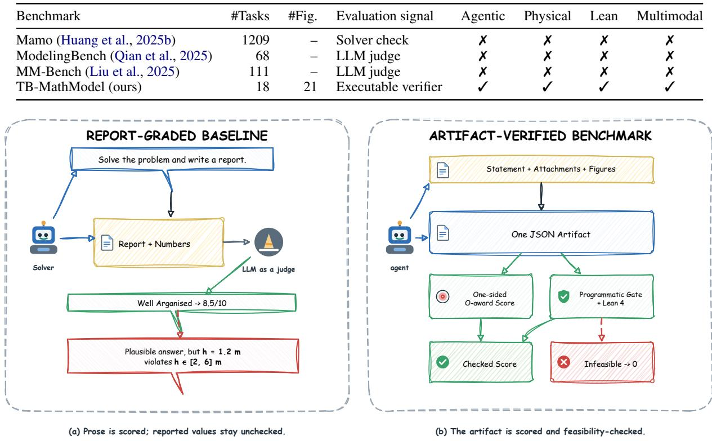
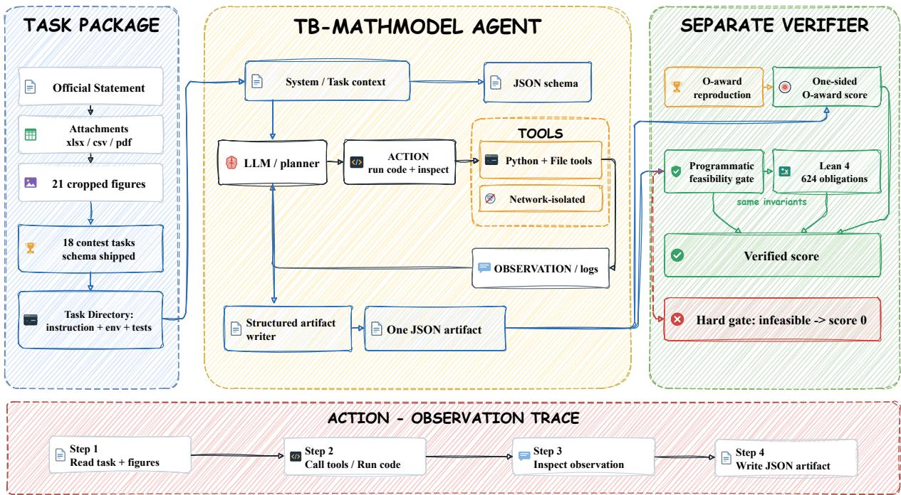
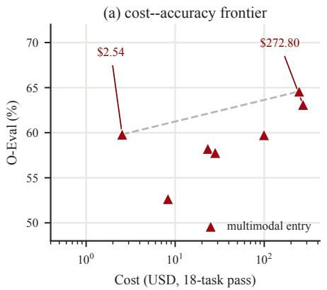
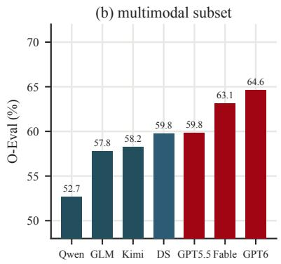
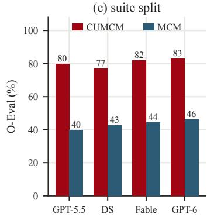

# Terminal-style Mathematical Modeling Bench: The First Agentic and Verifiable Benchmark for Mathematical Modeling

Xiaojun Wu<sup>∗</sup> <sup>1,2</sup>, Cehao Yang<sup>∗</sup> <sup>1,2</sup>, Xuhui Jiang<sup>1,3</sup>, Chengjin Xu<sup>1,3</sup>, Jia Li<sup>†</sup> <sup>2</sup>, Jian Guo<sup>†</sup> <sup>1</sup>

<sup>1</sup>IDEA Research <sup>2</sup>The Hong Kong University of Science and Technology (Guangzhou) <sup>3</sup>DataArcTech Ltd.

## Abstract

Mathematical modeling turns an open-ended real-world problem into assumptions, a model, a solution, and a defended recommendation, and its answers matter only if they are both close to a credible reference and physically feasible; existing benchmarks either score solver fragments or grade reports with an LLM judge, leaving those numbers unchecked. We introduce TB-MathModel (the Terminal-style Mathematical Modeling Bench), the first benchmark to make complete contest-style modeling problems agentic, verifiable, and terminal at once, over 18 real CUMCM and MCM problems (2023–2025). Each task ships the verbatim statement, official attachments, and figures in a containerized terminal; the agent returns one JSON artifact, scored on the numeric core of the final question against a reproduction of the Outstanding-award paper. Two design choices distinguish it: direction-aware, one-sided scor ing, which never penalises beating the anchor, and two-layer feasibility verification—a programmatic gate over six decidable invariant forms plus 624 Lean 4 obligations—with a hard gate that zeroes infeasible answers. Each task is scored against a panel of human out standing papers rather than one, so a model must be close to many accepted answers; across seven multimodal entries (three seeds each) the strongest reach a multi-reference O-E of 64.58%, while the \$2.54 open model holds 59.81% at 1/100 the cost. TB-MathModel turns the numeric core of modeling into a reproducible, machine-checkable signal for measur ing long-horizon modeling competence and for collecting agent trajectories. The source code is available at https://github.com/wxj630/ terminal-bench-math-modeling.

## 1 Introduction

Mathematical modeling contests such as CUMCM in China and MCM/ICM internationally ask teams to convert a deliberately under-specified real-world problem into a defensible quantitative answer within days. The deliverable is not a single number but a chain: assumptions → model → solution → sensitivity → recommendation. Two properties make it an attractive target for agent evaluation: it is quantitative, because the final question ends in numbers that can be checked, and it is multimodal, because statements reference figures and attachments are spreadsheets and CSVs. It also differs from solving a well-posed problem in where the hard work begins—the model itself must be built, and the same situation admits time-series, optimization, dynamical, graph, or multi-criteria formulations, any of which can be defensible if its assumptions are explicit and its computation credible (Giordano et al., 2014; Meerschaert, 2013). This is what makes modeling a demanding test of long-horizon agents: hold the statement and attachments in context, choose a formulation, write and run code, handle files and units, and report a self-consistent answer.

Existing benchmarks cover adjacent but distinct ground, and none closes the loop we care about. Code, terminal, and assistant benchmarks score repository edits, command-line competence, and tool use (Jimenez et al., 2024; Merrill et al., 2026; Mialon et al., 2024; Yao et al., 2025); closed-form mathematics benchmarks score deduction rather than modeling (Hendrycks et al., 2021; Cobbe et al., 2021; Glazer et al., 2024); operations-research datasets parse word problems into solver-ready formulations (Ramamonjison et al., 2023; AhmadiTeshnizi et al., 2024; Yang et al., 2025). The closest prior work on modeling itself falls into two camps, neither simultaneously agentic, verifiable, terminal, and multimodal. One stays solver-facing and narrow, scoring a single formal artifact (Huang et al., 2025b). The other grades the final report with an LLM judge (Qian et al., 2025; Liu et al., 2025), rewarding fluent prose without establishing that the reported numbers are correct or even admissible. Table 1 makes the gap concrete; TB-MathModel is the first to combine all of these properties.

Closing the gap raises three problems that shape the design. Different teams make different assumptions, so there is no single ground truth: rather than promote one paper to truth, TB-MathModel asks every human expert, scoring each task against a panel of outstanding solutions so that a model must be close to many accepted answers, not match one. Anchoring creates asymmetric failure—a model that does better than the paper can score worse than one that copies it—so TB-MathModel makes each metric’s direction explicit and scores one-sidedly. And a wrong-but-plausible answer is easy to produce (numbers that look reasonable yet violate the problem’s physics), which anchor comparison cannot catch, so TB-MathModel adds an independent feasibility layer.

We present TB-MathModel (Terminal-style Mathematical Modeling Bench), to our knowledge the first benchmark to turn complete contest-style mathematical modeling problems into an agentic, verifiable, terminal evaluation. It contributes:

1. The first benchmark of its kind, and the 18- task dataset behind it. No prior benchmark turns complete contest-style modeling problems into a containerized terminal task with an executable verifier. TB-MathModel covers CUMCM and MCM 2023–2025 (problems A/B/C each year), with verbatim statements, official attachments, 21 figures cropped from the PDFs, and one JSON artifact per task.

2. Direction-aware, one-sided scoring with auditable edge-case rules. Per-metric semantic directions (higher/lower\_is\_better, target\_value, exact\_value); two reported metrics (O-EVAL, ROBUST BO-EVAL); explicit rules for degenerate bands and unpinned reference units; and contract tests that lock the two defining properties down.

3. A two-layer feasibility verification design. A programmatic gate covering 18/18 tasks through six decidable invariant forms, and a Lean 4 certificate layer of 624 kernel-checked obligations; the two layers decide every feasibility question a structured artifact can settle, and state exactly where an independent replay takes over.

4. An empirical study of seven multimodal model/harness entries, each averaged over three seeds, with per-task behaviour, a cost– robustness analysis, and three case studies; we also document the scoring pitfalls we found and fixed and quantify which move the leaderboard.

Against the human panel, the two newest flagships lead (GPT-6 Astra + codex at O-EVAL 64.58 ± 2.93 and MULTI-BO 1.132, Fable 5.1 + claude-code at 63.11 ± 1.33 and 1.081, means over three seeds), while the \$2.54 DeepSeek V4.1 Flash + opencode holds $5 9 . 8 1 \pm 1 . 2 5$ at 1/100 the cost; varying only the harness moves O-EVAL by at most 0.07 pp, so the board measures the model rather than the harness. Per-seed deviations reach 2.9 pp, so adjacent rows are not significantly separated. One case study inverts the usual story: on dragondance the models were right and our anchor was wrong—the sharpest argument for independently checkable feasibility.

## 2 Related Work

Agent and assistant benchmarks. Softwareengineering and terminal agents are measured by repository-level tasks (SWE-bench (Jimenez et al., 2024)) and end-to-end command-line tasks (Terminal-Bench (Merrill et al., 2026)); assistants by tool-use suites such as GAIA (Mialon et al., 2024) and τ-bench (Yao et al., 2025). Machinelearning and data-science agents are measured on Kaggle-style pipelines (Chan et al., 2025; Starace et al., 2025; Guo et al., 2024; Zhang et al., 2024; Gu et al., 2024; Hu et al., 2024; Li et al., 2024). These capture tool use and long-horizon execution in a container—the harness we build on—but score a leaderboard position or a rubric over a deliverable, never a modeling artifact, and attach no feasibility contract.

Mathematical and optimization reasoning. Closed-form mathematics benchmarks measure deduction, not modeling (Hendrycks et al., 2021; Cobbe et al., 2021; Glazer et al., 2024; Zheng et al., 2022). Operations-research systems parse word problems into solver-ready formulations and evaluate optimality or feasibility of a given formulation (Ramamonjison et al., 2023; Xiao et al., 2024; AhmadiTeshnizi et al., 2024; Yang et al., 2025; Huang et al., 2025a; Mostajabdaveh et al., 2025; Lima et al., 2025; Xiao et al., 2025). They supply a strong execution-validity precedent—a solver certifies a solution is feasible or optimalfor a stated model—but cannot certify that the model captures the right abstraction, and none requires assumptions, sensitivity analysis, or a defended recommendation.

Table 1: The closest mathematical-modeling benchmarks. Only TB-MathModel combines a complete contest problem, an agentic terminal run, an executable verifier, physical-feasibility checking, and a machine-checkable proof, on a multimodal task (“Judge”: LLM grades a report; “Solver”: solver checks one formal artifact).
<table><tr><td>Benchmark</td><td>#Tasks</td><td>#Fig.</td><td>Evaluation signal</td><td>Agentic</td><td>Physical</td><td>Lean</td><td>Multimodal</td></tr><tr><td>Mamo (Huang et al., 2025b)</td><td>1209</td><td></td><td>Solver check</td><td>x</td><td>x</td><td>x</td><td>x</td></tr><tr><td>ModelingBench (Qian et al., 2025)</td><td>68</td><td></td><td>LLM judge</td><td>x</td><td>x</td><td>x</td><td>x</td></tr><tr><td>MM-Bench (Liu et al., 2025)</td><td>111</td><td>一</td><td>LLM judge</td><td>x</td><td>x</td><td>x</td><td>x</td></tr><tr><td>TB-MathModel (ours)</td><td>18</td><td>21</td><td>Executable verifier</td><td>V</td><td>√</td><td>V</td><td>V</td></tr></table>

  
Figure 1: Why modeling is hard to evaluate, and what TB-MathModel changes. (a) In the status quo an LLM judge grades a report on organisation while the numbers are never checked. (b) TB-MathModel runs the problem, attachments, and figures in a terminal container, requires one structured artifact, scores it one-sidedly against an O-award reproduction, and verifies feasibility with a gate and Lean certificates—so a plausible-but-infeasible answer is caught.

Mathematical-modeling benchmarks and agents. The closest work forms a continuum, and none of it is simultaneously agentic, verifiable, and terminal. Mamo (Huang et al., 2025b) is solver-grounded: models emit solver-consumable artifacts and the solver is a falsifiable checker, giving a precise but narrow signal on formal fragments rather than whole contest problems. ModelingAgent and its ModelingBench (Qian et al., 2025) are report-level: open-ended problems graded by an expert-style LLM judge—ecologically rich but judge-calibration dependent and non-reproducible. MM-Agent and MM-Bench (Liu et al., 2025) add a hierarchical modeling library, yet their primary evaluation remains a report rubric. TB-MathModel keeps the full contest statement and the agentic workflow, pins evaluation to a structured artifact scored by an executable verifier, and adds a feasibility layer neither camp provides.

Verification in evaluation. Theorem provers such as Lean 4 (de Moura and Ullrich, 2021) with Mathlib (The mathlib Community, 2020) have certified competition and research mathematics, and RL over formal proof has produced strong provers (Hubert et al., 2025; Xin et al., 2024). Using a prover not to find answers but to audit a benchmark’s own feasibility decisions is, to our knowledge, new: our Lean layer re-proves the programmatic gate’s invariants, so an assertion becomes a machine-checkable fact (Sutton, 2001), at integer-and-rational arithmetic cost the kernel decides without the full library.

Multimodal agents and reproduction-anchored scoring. Tool-using agents increasingly externalize their state for reuse (Yao et al., 2023; Wei et al., 2022; Schick et al., 2023; Zhou et al., 2026). TB-

MathModel makes visual evidence load-bearing— figures are cropped from the official PDFs—so harnesses with and without an image channel can be compared on identical tasks. Anchoring a numerical benchmark on a published solution is standard practice; we show it creates three under-reported hazards (direction asymmetry, degenerate scoring bands, unpinned units) and give auditable rules and tests for each.

## 3 The TB-MathModel Benchmark

TB-MathModel (the Terminal-style Mathematical Modeling Bench) turns each contest problem into a self-contained terminal task. Figure 2 summarises the construction pipeline. A build script assembles the official contest material into four parts: (i) an instruction file with the verbatim statement and its figures; (ii) an agent container holding the mirrored attachments and an output schema; (iii) a separate verifier container holding the scoring panel and an executable feasibility check; and (iv) an oracle that reproduces the Outstanding-award (O-award) paper. The agent is dropped into the terminal with this material and must return a single structured artifact. Everything downstream of the artifact— scoring and feasibility—is machine-executable.

Task selection and sources. TB-MathModel comprises 18 tasks: the A, B, and C problems of CUMCM and MCM for each of 2023–2025. We restrict to the last three years on purpose: older problems predate capable LLMs and were calibrated to software-assistant graders, so their task mix and review standard differ from the post-LLM regime, and recent editions are harder and more discriminating. The two contests complement each other— CUMCM is engineering/optimization-heavy and Chinese, MCM is modeling-flavored and English— and taking all three problems of each year covers the standard “A = physical/engineering, B = data/optimization, C = data-science” split without cherry-picking. Statements and attachments are mirrored verbatim; a statement’s figures are cropped from the official PDF (artwork plus its caption) and delivered inline and at stable container paths. 21 unique figures across 6 tasks are load-bearing: the statements reference them for geometry not restated in text (e.g., the dragon-dance U-turn curve, which fixes the final head speed), so a harness without an image channel cannot recover it—hence the multimodal evaluation. TB-MathModel is a pure evaluation set, with no training split or difficulty tiering (Appendix A).

The artifact contract and oracle anchors. The scored object is one JSON file per task, whose schema (field names and types only) is shipped to the agent; extra CSV/XLSX/PNG artifacts are not scored. A schema-constrained JSON is what makes an automated score possible, at the cost of mapping a free-form effort onto named numeric fields—a tension we revisit in Section 4.3. Each task is anchored to one O-award paper, re-implemented as a script that reads the attachments and emits the same JSON; the reproduction is the normalisation endpoint (O-EVAL = 100%) and sets the per-metric panel, coverage 18/18. Provenance is a first-class field—paper id, PDF/OCR source, and reproduction scope—so any anchor can be re-derived (Appendix D); this is what let us catch and correct an infeasible dragon-dance anchor before it reached the board.

## 3.1 Scoring: direction-aware, one-sided, auditable

A naive distance-to-anchor metric silently rewards copying and punishes improvement, so TB-MathModel scores each task through a permetric panel with an explicit semantic direction. Each task ships a panel of 2–6 scored metrics (60 in total), each with a path into the artifact, an anchor value O, a direction, and a weight. A metric is higher\_is\_better, lower\_is\_better, target\_value (closest to O wins), or exact\_value, set from the modeling semantics of the quantity rather than the sign of its value. Directional metrics use an asymmetric, onesided reward: meeting or beating the anchor never scores below 1.0, so improving on the paper is never punished (full formulas in Appendix G).

Three failure modes recur often enough to deserve named rules. (i) Degenerate bands: a band narrower than 2% of the value magnitude cannot discriminate, so we widen it to 5%—this changed one cell (stair-wear, 72.67 → 73.52). (ii) Noncomparable units: when an anchor is an arbitrary raw index with no schema-pinned unit (a hostfish index of 1080), a model reporting the same quantity normalised to [0, 1] is not wrong, so such metrics are dropped for every model and the oracle by a configuration-only rule. (iii) Cardinality mismatch: surplus items are excluded rather than counted missing. Out-of-domain values (a correlation outside [−1, 1], a negative count) score zero, with the reason recorded.

  
Figure 2: The TB-MathModel construction and evaluation pipeline. Build: official statements, attachments, and PDF figures are compiled into a task directory. Run: the agent works inside a network-isolated terminal container and writes one JSON artifact. Evaluate: the artifact is scored by a direction-aware, one-sided panel against an O-award reproduction, and independently checked by a programmatic feasibility gate plus a Lean 4 certificate layer; a failed gate zeroes the task.

Let R, F, O be the weighted panel raw of a submission, of the DeepSeek V4 Flash baseline, and of the oracle. We report O-EVAL = clamp $R / O , 0 , 1 )$ averaged over tasks (the headline absolute score) and a gap-compensated RO-BUST ${ \tt B O - E v A L } = \mathrm { c l i p } ( ( R - F ) / ( O - F ) , \pm 1 )$ when the oracle–baseline gap exceeds 0.10, and the clipped raw gain $R \ : - \ : F$ otherwise, with ROBUST BO-EVAL = −1 for a missing artifact (full formulas in Appendix G). Two properties are locked by contract tests: oracle self-consistency (every reproduction scores exactly 1.0) and onesidedness (at or above the anchor is never a failure). A failed feasibility gate sets a task’s O-EVAL to 0 and ROBUST BO-EVAL to −1.

## 3.2 Multi-references evaluation

Modeling has no single correct answer, so a benchmark that normalises against one paper silently converts one team’s choices into ground truth. TB-MathModel instead asks every human expert. For each task we extracted the final-question values reported by all available Outstanding-award papers for that problem, giving 99 panel papers, 94 of which yield the scored quantity. Coverage is 18/18 tasks and all available outstanding papers are used—1 to 18 per task (median 4), since the number of O-award reports differs by problem. Each paper is one vote.

Let M(t) be the scored metrics of task t, P(t) its paper panel, and $S _ { p } ~ \subseteq ~ M ( t )$ the fields paper p actually reports. Writing $R ( m , S )$ for the weighted panel score of submission m restricted to S (weights renormalised over S), the task score is the panel mean

$$
\mathrm { o . E v A L } ( m , t ) = { \frac { 1 } { | P _ { \neq } ( t ) | } } \sum _ { p \in P _ { \neq } ( t ) } R ( m , S _ { p } ) ,\tag{1}
$$

where $P _ { \neq } ( t ) = \{ p \in P ( t ) : S _ { p } \neq \emptyset \}$ . Each paper thus contributes exactly “how close is the model to this human answer, on the fields that human reported”. Because $R ( p , S _ { p } ) = 1$ , every paper agrees with itself and the reproduction reproduces the panel. Equal weighting keeps one human solution to one vote, and a paper that reports only a single field acts as a single-field check rather than being discarded—the honest treatment of an incomplete report.

A paper is never silently dropped. When it cannot supply the scored quantity it carries a machine-readable exclusion\_reason, of which five forms occur: number\_only\_in\_figure, figure\_only, figure\_only\_logistic\_prior, no\_numeric\_estimate, and different\_unit\_of\_analysis; these account for the 5 of 99 papers outside the panel. Values are never interpolated or adjusted toward the existing anchor, and a paper’s different-but-equivalent unit is converted explicitly and noted. Where a panel is empty—possible when an MCM answer is prose or figure only—the task falls back to the single reproduced anchor, and a missing artifact scores 0, so the denominator is always the fixed 18 tasks.

A panel also makes disagreement between humans visible instead of hiding it behind one anchor. On mcm-2024-c-tennis-momentum, 10 of 11 outstanding papers conclude that momentum is supported while the reproduced anchor—itself an O-award report—concludes it is not; on that task a model scores 0.909 if it answers with the majority and 0.091 if it matches the anchor, so the score reflects which valid statistical test the model chose rather than modeling quality. We mark such literature-split tasks explicitly and exclude them from any headline ranking, while keeping them in the panel: they are the clearest evidence that a single-anchor score would have been arbitrary.

Relative to the single-anchor board, this changes ROBUST BO-EVAL into a multi-reference gain index against the DeepSeek V4.1 Flash baseline, anchored at 1.0:

$$
\mathrm { \bf M U L T I - B O } = 1 + \mathrm { c l i p } \left( \frac { O _ { t } - f _ { t } } { 1 - f _ { t } } , - 1 , + 1 \right) ,\tag{2}
$$

with $f _ { t }$ the Flash score on task t and $O _ { t }$ the model’s, averaged over tasks; when the remaining headroom $1 - f _ { t }$ is below 0.10 we fall back to $1 + \operatorname { c l i p } ( O _ { t }$ $f _ { t } , \pm 0 . 1 0 )$ , and a missing artifact scores −1. A value of 1.0 therefore means “level with Flash”, 1.08 means “closed 8% of the remaining gap to the human panel”; it is a ratio, not a percentage, and is not comparable to O-EVAL.

## 3.3 Feasibility verification: two layers

Proximity to an anchor does not imply that an answer is physically admissible: a submission can match a reference value on one field while violating a stated constraint on another. TB-MathModel verifies feasibility independently of scoring, in two layers with different trust bases.

Layer 1: a programmatic gate over six decidable forms. Every task registers one feasibility check, and the registry covers 18/18 tasks; every hard-error branch falls into one of six decidable forms (Appendix Table 12). Checks are either structural/domain bounds (rates, correlations, probabilities, non-negative counts, distributions summing to 100, peak $\geq$ average) or constraint replay (heliostat rated power $\geq 6 0$ MW and installation height $\in \ [ 2 , 6 ]$ m, dragon-dance head speed × amplification ratio $\leq 2$ m/s, a demand-capped revenue ceiling, a union duration $\leq$ the sum of its parts). Three contracts keep the gate honest: coverage (a task cannot ship ungated), oracle self-consistency (the O-award reference must pass its own check), and discrimination (synthetic and real-field violations must be rejected, while an empty artifact warns rather than hard-fails). Four constraints that need an independent replay rather than a field check are recorded as whole-task penalties (Appendix G).

Layer 2: Lean certificates. To make the gate’s own correctness checkable, Layer 2 re-proves the same invariants as Lean 4 theorems, so the audit rests on the kernel. It generates 624 obligations across all 18 tasks, discharged by decide or omega. No Mathlib is used—the propositions are decidable on exact integers—and values are scaled to integers, so there is no floating-point tolerance; the one exception, a composite index, is declared in the predicate because the tolerance is itself part of the audited assumption. A trust audit (#print axioms) reports only [propext, Quot.sound] or none, with no sorryAx and no native\_decide (grep-checked). A discrimination suite mutates one numeric leaf at a time and requires the build to fail and to cite the field; ten mutations across all six forms are rejected. Two soft warnings become proofs: a tourism acceptance index is refuted for the unit convention, and a sustainability score fits neither convention within a declared budget.

Verification scope. The two layers decide every feasibility question that a structured artifact can settle without a model of the physics (Appendix Table 13): unit/value ranges (A) and internal consistency (B). Whether the reported value reflects real physical truth (C)—does the field really produce 60 MW?—is a property of the world rather than of the artifact, so TB-MathModel verifies it where the problem admits an independent replay. Within this scope the layers are exact: any obligation whose evidence is absent is reported as a witnessed gap rather than silently satisfied, so the audit never overstates what it has proved.

## 4 Experiments

## 4.1 Setup

We evaluate seven multimodal model/harness entries, whose harness can open the cropped figures. Each entry is run with three seeds per task and reported as a mean with standard deviation; where a model was run at two reasoning tiers we keep the higher-scoring variant. Every row is scored with the same scorer and current anchors, so the board shares one scoring definition (Appendix C).

The prompt is the task’s instruction file, passed verbatim: the contest statement, the cited figures inline, and a fixed “Required Benchmark Artifact” block naming the output path (Appendix E). Tasks run in Docker containers—python:3.12-slim with a fixed scientific stack, internet disabled, model traffic through a local retry proxy—so an agent cannot fetch solutions or install packages at run time; limits are 2 CPUs, 8 GB, no GPU, and a 4-hour timeout (Appendix B). Each multimodal entry is run three times per task and reported as a mean with standard deviation; the one wellposed task, dragon-dance, is additionally probed four times, where the answers agreed to machine precision $( s \mathrm { t d } { = } 4 . 6 \times 1 0 ^ { - 1 6 } )$ .

## 4.2 Main result: the multimodal board

Table 2 is the main result: the seven multimodal entries on all 18 tasks, each a three-seed mean (± std); the per-entry configuration is in Appendix Table 7. O-EVAL is the primary metric: the multireference score of Section 3.2, i.e. the mean over the human paper panel of how close the model is to each accepted answer. MULTI-BO is the secondary, relative index of that same score against the DeepSeek V4.1 Flash baseline, fixed at 1.000 cell-by-cell: 1.08 means the model closed 8% of Flash’s remaining gap to the panel, so it is read against the baseline and is not a percentage. Five findings stand out.

1. The newest flagships lead. GPT-6 Astra + codex $( 6 4 . 5 8 \pm 2 . 9 3 ) $ and Fable 5.1 + claudecode $( 6 3 . 1 1 \pm 1 . 3 3 )$ top the board, about 4.8 and 3.4 points above GPT-5.5 xhigh + codex $( 5 9 . 7 5 \pm 1 . 5 5 ) $ , and both clear the Flash baseline by 13.2% and 8.1% of the remaining gap respectively.

2. Cost buys a real but bounded gap. The two leaders cost \$246–\$273 per run, while the cheapest strong entry, DeepSeek-Flash + opencode, reaches $5 9 . 8 1 \pm 1 . 2 5$ at \$2.54—about 4.8 points behind the leader at roughly 1/100 the cost.

3. Cheap open models cluster below the flagships. Among the low-cost entries DeepSeek-Flash (59.81), Kimi K3 (58.23), GLM-5.3 (57.78), and Qwen3.8 Flash (52.66) span about 7 points, and only the two flagships exceed the baseline index (1.132 and 1.081); DeepSeek-Flash defines it at 1.000 and every other entry falls below.

4. A small gap is not yet a resolved ranking. Perseed deviations reach 2.93 pp, so the ∼ 1.5 pp separation between the two leaders and between GPT-5.5 and Flash sits inside one standard deviation; we report the order but do not claim a significant difference between adjacent rows.

5. More inference compute is not monotone. Running DeepSeek-Flash at its maximum reasoning tier drops its multi-reference score to 48.11% and its MULTI-BO to 0.864, well below the default tier’s 59.81 and 1.000, at higher cost: a larger deliberative budget does not simply buy accuracy on these tasks.

Hard gate and cost. The gate removes exactly the cells whose answers violate a stated constraint and leaves the ranking otherwise stable, so it is surgical rather than a blanket penalty. Cost is dominated by per-token price, not usage: GPT-5.5’s \$99.37 is mostly cache-read input and output at roughly 33×/50× DeepSeek V4.1 Flash’s rates, despite comparable token counts.

Harness sensitivity. Each model is driven by an agent harness, so a natural question is whether the score reflects the model or the harness. Table 3 holds the model fixed and varies the harness, using DeepSeek-Flash and four harnesses. The score is essentially invariant: O-EVAL moves only 0.07 pp across all four (59.81–59.88), far inside the perseed deviation, and the relative index moves in the same narrow band. A model’s own harness fits it marginally better—DeepSeek’s native harness gives the highest O-EVAL (59.88) and MULTI-BO (1.092)—but the difference is small. The board therefore measures the model far more than the harness it is wrapped in.

Table 2: Main results: the seven multimodal entries, 18 tasks, sorted by O-EVAL. “Art.”: tasks with a scoreable artifact; cost: USD per 18-task pass. O-EVAL is the multi-reference panel score (%) and MULTI-BO the same score relative to the DeepSeek V4.1 Flash baseline (1.000 = level with Flash), both three-seed means (± std).
<table><tr><td>Model + harness</td><td>Art.</td><td>O-EVAL(%)</td><td>MULTI-BO</td><td>Cost (USD)</td></tr><tr><td>GPT-6 Astra + codex</td><td>18</td><td> $6 4 . 5 8 \pm 2 . 9 3$ </td><td> $1 . 1 3 2 \pm 0 . 0 2$ </td><td>246.41</td></tr><tr><td>Fable 5.1 + claude-code</td><td>18</td><td> $6 3 . 1 1 \pm 1 . 3 3$ </td><td> $1 . 0 8 1 \pm 0 . 0 5$ </td><td>272.80</td></tr><tr><td>DeepSeek-Flash + opencode</td><td>18</td><td> $5 9 . 8 1 \pm 1 . 2 5$ </td><td> $1 . 0 0 0$ </td><td>2.54</td></tr><tr><td>GPT-5.5 xhigh + codex</td><td>18</td><td> $5 9 . 7 5 \pm 1 . 5 5$ </td><td> $0 . 9 9 8 \pm 0 . 0 1$ </td><td>99.37</td></tr><tr><td>Kimi K3 + opencode</td><td>18</td><td> $5 8 . 2 3 \pm 1 . 1 2$ </td><td> $0 . 9 5 3 \pm 0 . 0 4$ </td><td>23.26</td></tr><tr><td>GLM-5.3 + opencode</td><td>18</td><td> $5 7 . 7 8 \pm 1 . 3 0$ </td><td> $0 . 9 4 1 \pm 0 . 0 5$ </td><td>28.15</td></tr><tr><td>Qwen3.8 Flash + opencode</td><td>18</td><td> $5 2 . 6 6 \pm 1 . 1 7$ </td><td> $0 . 8 0 3 \pm 0 . 0 4$ </td><td>8.30</td></tr></table>





  
Figure 3: Left: multi-reference O-EVAL versus cost (log scale)—the Pareto frontier is compressed, with near-frontier scores at two orders of magnitude lower cost. Centre: O-EVAL per entry. Right: O-EVAL by suite, showing the CUMCM–MCM gap.

Table 3: Harness sensitivity, holding the model fixed (DeepSeek-Flash, 18 tasks, three seeds). Multi-BO is 1.000 for the opencode reference harness by definition.
<table><tr><td>Harness</td><td> ${ \mathrm { O - E v a L } } ( \% )$ </td><td>MULTI-BO</td></tr><tr><td>opencode</td><td> $5 9 . 8 1 \pm 1 . 2 5$ </td><td>1.000</td></tr><tr><td>claude-code</td><td> $5 9 . 8 3 \pm 1 . 1 3$ </td><td> $1 . 0 8 1 \pm 0 . 0 5$ </td></tr><tr><td>codex</td><td> $5 9 . 8 4 \pm 1 . 2 1 $ </td><td> $1 . 0 8 5 \pm 0 . 0 3$ </td></tr><tr><td>DeepSeek (native)</td><td> $5 9 . 8 8 \pm 1 . 2 0 $ </td><td> $1 . 0 9 2 \pm 0 . 0 3$ </td></tr></table>

## 4.3 Analysis

Per-task O-EVAL for four representative entries is in Appendix Table 6. Three patterns stand out. (a) The CUMCM–MCM gap is large and modeldependent. For the weaker entries, CUMCM cells sit near 100% while MCM cells sit between 0% and 60%: the engineering problems have welldefined final numbers most models reach, whereas MCM problems are more open and their anchors more contestable. The strongest entries narrow the gap only slightly (GPT-6 82.9 on CUMCM vs. 46.2 on MCM; GPT-5.5 79.7 vs. 39.8). A sizeable share of tasks is now solved near-perfectly— expected of a current benchmark—and the board’s discrimination comes from the open-ended MCM problems. (b) Two tasks are all-or-nothing. On mcm-2024-b-submersible every entry scores 100%, while on mcm-2024-c-tennis even the flagships score below 40%. Such tasks either fall inside or outside the panel’s tolerance entirely, so they separate regimes of models but not models within one. (c) Many low scores reflect reference scale/scope, not modeling error. Several tasks contain a metric whose model/panel ratio exceeds 5×: a host-fish index reported near 1080 by some papers while models give a normalised [0, 1] quantity; a sustainability score near 1.007 against models reporting a 0–100 utility; a $6 \times 6$ grid against models discretising the same region into hundreds of cells; and a $7 2 . 6 7  7 3 . 5 2$ band in which the paper’s own baseline scores zero.

Scoring pitfalls we found and fixed. An anchorbased benchmark is only as credible as its anchors, so we audited every scoring rule and anchor and report what the audit changed (Appendix G). Two gate false positives were removed without moving any score, and degenerate-band widening affected one cell (+0.35 pp). Excluding two noncomparable-unit metrics raised every entry by 0.05–

2.62 pp—the signature of a systematic scoring effect rather than a model difference. Most consequentially, the audit flagged the dragon-dance anchor as physically infeasible and we corrected it (Section 4.2).

What the feasibility layers caught. The gate hard-invalidated 7 cells, concentrated on heliostat (rated power below 60 MW, or a mirror below the 2 m minimum) plus single cells for smoke-screen, Juneau, and Olympic. The Lean layer turns two soft warnings into proofs and proves non-vacuity by accepting a corrected artifact under the predicate that rejects the reported one. On the one numerically well-posed task the runs agree to machine precision, and across the board the per-seed deviations stay small relative to the spread between entries (Table 2), so rankings do not depend on the seed.

## 4.4 From Findings to Model Development

TB-MathModel is meant to improve models, not only rank them. Three levers follow from the findings above, and each is trainable with signals TB-MathModel already produces.

Verified reward for RL. The feasible, oraclenormalised score is an executable, reproducible reward—every submission passes the gate and the Lean layer. Rejection-sampling (keep and rank gate-accepted trajectories by O-EVAL) works today; group-relative policy optimisation with the gate as a hard multiplier teaches the model to satisfy the physics before chasing the reference. The dragon-dance case motivates this: twelve models computed the right peak but were penalised, so what they lack is self-checking—exactly what a verifier in the reward provides.

Targets against the observed failures. Finding (a)—the open-ended MCM suite separates quality while CUMCM saturates—says to train assumptions, formulation, and sensitivity rather than closed-form solving; finding (c)—many losses are unit and scale mismatches—says to state and verify units, ranges, and schema before emitting a number. Both are rewarded directly by the artifact contract.

Feasibility the artifact can check. The dragondance audit exposes the failure a value-range check cannot: a consistent answer that is physically inadmissible because the artifact omits the evidence (no per-mirror layout, no peak-neighbourhood sample). Training models to emit that witness raises the score and makes them checkable, reaching level C.

Case studies. Three roles—a top proprietary agent, the oracle, and the low-cost open agent—are compared on three problems in Appendix F. On dragon-dance all three converge while the paper’s value is the infeasible outlier, so the models were right and our anchor was wrong. On crop-planting the paper’s constraints are jointly infeasible, so we anchor on a reproducible exact MILP optimum. On Juneau the sustainability score is reported on different unit scales, which is why the task schema, not the scorer, must pin a field’s range.

## 5 Conclusion

We presented TB-MathModel, the first agentic and verifiable terminal benchmark of 18 real mathematical-modeling problems, distinguished by direction-aware, one-sided scoring that never penalises beating the anchor, and two-layerfeasibility verification combining a gate over six decidable invariant forms with 624 kernel-checked Lean obligations.

Scoring each task against a panel of human outstanding papers, the newest flagships lead across seven multimodal entries (GPT-6 Astra at O-EVAL 64.58%, Fable 5.1 at 63.11%), while the \$2.54 open DeepSeek-Flash holds 59.81% at 1/100 the cost. We documented the scoring pitfalls we fixed, and showed a case where the benchmark itself was wrong and the models were right.

The two-layer design is the transferable idea: a fast gate covers every task and a proof assistant makes the audit’s own correctness machinecheckable, while stating what neither can answer. Because TB-MathModel gives a reproducible reward, its trajectories are also training material, and Section 4.4 turns the findings into directions.

## Acknowledgements

We thank OpenRefinery (https://openrefinery. ai/) for providing the LLM API access and evaluation support that enabled our experiments with GPT-6-Astra and Claude-Fable-5.1. In particular, we thank Kai Du and Ding Fan of OpenRefinery for their assistance. Their infrastructure and support were instrumental in conducting the model evaluations reported in this paper. Any opinions, findings, and conclusions expressed here are those of the authors and do not necessarily reflect the views of OpenRefinery.

## Limitations

TB-MathModel normalises each task against a reproducible Outstanding-award solution, with peranchor provenance so any reference can be rederived; because modeling admits no single correct answer, the natural extension is a multi-paper panel reporting a spread over accepted solutions. The two verification layers decide every feasibility question a structured artifact can settle (unit/value ranges and internal consistency); external physical truth is a property of the world, so it is checked where a problem admits an independent replay, and any obligation whose evidence is missing is reported rather than silently passed. Panel size varies with the number of outstanding reports per problem (1 to 18 papers), and where humans themselves disagree—as on the tennis momentum test, where 10 of 11 papers reach the opposite conclusion from the anchor—we mark the task literature-split and keep it out of headline rankings. Scores are threeseed means, and the task shell carries over to engineering and cross-disciplinary problems.

## Ethical Considerations

Statements, attachments, and figures are official CUMCM and MCM material used for research evaluation; we do not redistribute Outstandingaward solutions, and reproduction code derives from a public corpus with per-task provenance. Users should confirm the licence terms for their own redistribution. TB-MathModel measures and improves the modeling workflow of LLM agents rather than automating work presented as a team’s own, and entirely automated evaluation keeps the cost of broad participation low.

## Use of Large Language Models

LLMs served as the systems under test—every entry in Table 2 is an LLM agent, which is the object of measurement—and as writing assistants that helped draft prose and check the internal consistency of LAT<sub>E</sub>X and numbers. Benchmark construction, scoring rules, feasibility checks, and Lean obligations were specified, implemented, and verified by the authors, and all numerical results are produced by the released scripts.

## References

Ali AhmadiTeshnizi, Wenzhi Gao, and Madeleine Udell. 2024. OptiMUS: Scalable optimization modeling with (MI)LP solvers and large language models. In Proceedings of the 41st International Conference on Machine Learning (ICML), volume 235 of Proceedings of Machine Learning Research, pages 577–596. PMLR.

Jun Shern Chan, Neil Chowdhury, Oliver Jaffe, James Aung, Dane Sherburn, Evan Mays, Giulio Starace, Kevin Liu, Leon Maksin, Tejal Patwardhan, Lilian Weng, and Aleksander M ˛adry. 2025. MLE-bench: Evaluating machine learning agents on machine learning engineering. Preprint, arXiv:2410.07095. The Thirteenth International Conference on Learning Representations (ICLR), Oral.

Karl Cobbe, Vineet Kosaraju, Mohammad Bavarian, Mark Chen, Heewoo Jun, Lukasz Kaiser, Matthias Plappert, Jerry Tworek, Jacob Hilton, Reiichiro Nakano, and 1 others. 2021. Training verifiers to solve math word problems. arXiv preprint arXiv:2110.14168.

Leonardo de Moura and Sebastian Ullrich. 2021. The Lean 4 theorem prover and programming language. In Automated Deduction – CADE 28, Lecture Notes in Computer Science, pages 625–635. Springer.

Frank R. Giordano, William P. Fox, and Steven B. Horton. 2014. A First Course in Mathematical Modeling, 5 edition. Brooks/Cole.

Elliot Glazer, Ege Erdil, Tamay Besiroglu, Diego Chicharro, Evan Chen, Alex Gunning, Caroline Falkman Olsson, Jean-Stanislas Denain, Anson Ho, Emily de Oliveira Santos, and 1 others. 2024. FrontierMath: A benchmark for evaluating advanced mathematical reasoning in ai. Preprint, arXiv:2411.04872.

Ken Gu, Ruoxi Shang, Ruien Jiang, Keying Kuang, Richard-John Lin, Donghe Lyu, Yue Mao, Youran Pan, Teng Wu, Jiaqian Yu, and 1 others. 2024. BLADE: Benchmarking language model agents for data-driven science. arXiv preprint arXiv:2408.09667.

Siyuan Guo, Cheng Deng, Ying Wen, Hechang Chen, Yi Chang, and Jun Wang. 2024. DS-Agent: Automated data science by empowering large language models with case-based reasoning. In Proceedings of the 41st International Conference on Machine Learning (ICML).

Dan Hendrycks, Collin Burns, Saurav Kadavath, Akul Arora, Steven Basart, Eric Tang, Dawn Song, and Jacob Steinhardt. 2021. Measuring mathematical problem solving with the MATH dataset. In Advances in Neural Information Processing Systems (NeurIPS).

Xueyu Hu, Ziyu Zhao, Shuang Wei, Ziwei Chai, Qianli Ma, Guoyin Wang, Xuwu Wang, Jing Su, Jingjing

Xu, Ming Zhu, and 1 others. 2024. InfiAgent-DABench: Evaluating agents on data analysis tasks. arXiv preprint arXiv:2401.05507.

Chenyu Huang, Zhengyang Tang, Shixi Hu, Ruoqing Jiang, Xin Zheng, Dongdong Ge, Benyou Wang, and Zizhuo Wang. 2025a. ORLM: A customizable framework in training large models for automated optimization modeling. Operations Research, 73(6):2986– 3009.

Xuhan Huang, Qingning Shen, Yan Hu, Anningzhe Gao, and Benyou Wang. 2025b. LLMs for mathematical modeling: Towards bridging the gap between natural and mathematical languages. In Findings ofthe Associationfor Computational Linguistics: NAACL 2025, pages 2678–2710.

Thomas Hubert, Rishi Mehta, Laurent Sartran, Miklós Z. Horváth, Goran Žužiˇ c, Eric Wieser, Aja Huang,´ Julian Schrittwieser, and 1 others. 2025. Olympiadlevel formal mathematical reasoning with reinforcement learning. Nature, 651:607–613.

Carlos E. Jimenez, John Yang, Alexander Wettig, Shunyu Yao, Kexin Pei, Ofir Press, and Karthik Narasimhan. 2024. SWE-bench: Can language models resolve real-world GitHub issues? In The Twelfth International Conference on Learning Representations (ICLR).

Ziming Li, Qianbo Zang, David Ma, Jiawei Guo, Tianyu Zheng, Xinyao Niu, Xiang Yue, Yue Wang, Jian Yang, Jiaheng Liu, and 1 others. 2024. AutoKaggle: A multi-agent framework for autonomous data science competitions. arXiv preprint arXiv:2410.20424.

Vinicius Lima, Dzung T. Phan, Jayant Kalagnanam, Dhaval Patel, and Nianjun Zhou. 2025. Toward a trustworthy optimization modeling agent via verifiable synthetic data generation. Preprint, arXiv:2508.03117.

Fan Liu, Zherui Yang, Cancheng Liu, Tianrui Song, Xiaofeng Gao, and Hao Liu. 2025. MM-Agent: LLM as agents for real-world mathematical modeling problem. Preprint, arXiv:2505.14148.

Mark Meerschaert. 2013. Mathematical Modeling. Academic Press.

Mike A. Merrill, Alexander G. Shaw, Nicholas Carlini, Boxuan Li, Harsh Raj, Ivan Bercovich, Ludwig Schmidt, and 1 others. 2026. Terminal-Bench: Benchmarking agents on hard, realistic tasks in command line interfaces. Preprint, arXiv:2601.11868. Project page: https://www.tbench.ai/.

Grégoire Mialon, Clémentine Fourrier, Craig Swift, Thomas Wolf, Yann LeCun, and Thomas Scialom. 2024. GAIA: a benchmark for general ai assistants. In The Twelfth International Conference on Learning Representations (ICLR).

Mahdi Mostajabdaveh, Timothy Tin Long Yu, Samarendra Chandan Bindu Dash, Rindra Ramamonjison, Jabo Serge Byusa, Giuseppe Carenini, Zirui Zhou, and Yong Zhang. 2025. Evaluating LLM reasoning in the operations research domain with ORQA. In Proceedings of the AAAI Conference on Artificial Intelligence, volume 39, pages 24902–24910.

Cheng Qian, Hongyi Du, Hongru Wang, Xiusi Chen, Yuji Zhang, Avirup Sil, Chengxiang Zhai, Kathleen McKeown, and Heng Ji. 2025. ModelingAgent: Bridging LLMs and mathematical modeling for realworld challenges. Preprint, arXiv:2505.15068.

Rindranirina Ramamonjison, Timothy T. Yu, Raymond Li, Haley Li, Giuseppe Carenini, Bissan Ghaddar, Shiqi He, Mahdi Mostajabdaveh, Amin Banitalebi-Dehkordi, Zirui Zhou, and Yong Zhang. 2023. NL4Opt competition: Formulating optimization problems based on their natural language descriptions. In Proceedings ofthe NeurIPS 2022 Competitions Track, volume 220 of Proceedings ofMachine Learning Research, pages 189–203. PMLR.

Timo Schick, Jane Dwivedi-Yu, Roberto Dessì, Roberta Raileanu, Maria Lomeli, Eric Hambro, Luke Zettlemoyer, Nicola Cancedda, and Thomas Scialom. 2023. Toolformer: Language models can teach themselves to use tools. Advances in Neural Information Processing Systems, 36:68539–68551.

Giulio Starace, Oliver Jaffe, Dane Sherburn, James Aung, Jun Shern Chan, Leon Maksin, Rachel Dias, Evan Mays, Benjamin Kinsella, Wyatt Thompson, Johannes Heidecke, Amelia Glaese, and Tejal Patwardhan. 2025. PaperBench: Evaluating ai’s ability to replicate ai research. Preprint, arXiv:2504.01848. PMLR 267:56843–56873.

Richard S. Sutton. 2001. Verification, the key to AI. http://www.incompleteideas.net/ IncIdeas/KeytoAI.html. Essay, November 15, 2001.

The mathlib Community. 2020. The Lean mathematical library. In Proceedings of the 9th ACM SIGPLAN International Conference on Certified Programs and Proofs (CPP), pages 367–381.

Jason Wei, Xuezhi Wang, Dale Schuurmans, Maarten Bosma, Brian Ichter, Fei Xia, Ed H. Chi, Quoc V. Le, and Denny Zhou. 2022. Chain-of-thought prompting elicits reasoning in large language models. In Advances in Neural Information Processing Systems (NeurIPS).

Ziyang Xiao, Jingrong Xie, Lilin Xu, Shisi Guan, Jingyan Zhu, Xiongwei Han, Xiaojin Fu, WingYin Yu, Han Wu, Wei Shi, and 1 others. 2025. A survey of optimization modeling meets LLMs: Progress and future directions. Preprint, arXiv:2508.10047.

Ziyang Xiao, Dongxiang Zhang, Yangjun Wu, Lilin Xu, Yuan Jessica Wang, Xiongwei Han, Xiaojin Fu, Tao Zhong, Jia Zeng, Mingli Song, and Gang Chen. 2024.

Chain-of-experts: When LLMs meet complex operations research problems. In The Twelfth International Conference on Learning Representations (ICLR).

Huajian Xin, Z. Z. Ren, Junxiao Song, Zhihong Shao, Wanjia Zhao, Haocheng Wang, Bo Liu, Liyue Zhang, Xuan Lu, Qiushi Du, and 1 others. 2024. DeepSeek-Prover-V1.5: Harnessing proof assistant feedback for reinforcement learning and monte-carlo tree search. Preprint, arXiv:2408.08152. The Thirteenth International Conference on Learning Representations (ICLR), Poster.

Zhicheng Yang, Yiwei Wang, Yinya Huang, Zhijiang Guo, Wei Shi, Xiongwei Han, Liang Feng, Linqi Song, Xiaodan Liang, and Jing Tang. 2025. OptiBench meets ReSocratic: Measure and improve LLMs for optimization modeling. In The Thirteenth International Conference on Learning Representations (ICLR).

Shunyu Yao, Noah Shinn, Pedram Razavi, and Karthik Narasimhan. 2025. τ-bench: A benchmark for toolagent-user interaction in real-world domains. In The Thirteenth International Conference on Learning Representations (ICLR).

Shunyu Yao, Jeffrey Zhao, Dian Yu, Nan Du, Izhak Shafran, Karthik R. Narasimhan, and Yuan Cao. 2023. ReAct: Synergizing reasoning and acting in language models. In The Eleventh International Conference on Learning Representations (ICLR).

Yuge Zhang, Qiyang Jiang, Xingyu Han, Nan Chen, Yuqing Yang, and Kan Ren. 2024. Benchmarking data science agents. arXiv preprint arXiv:2402.17168.

Kunhao Zheng, Jesse Michael Han, and Stanislas Polu. 2022. miniF2F: A cross-system benchmark for formal olympiad-level mathematics. In International Conference on Learning Representations (ICLR).

Chenyu Zhou, Huacan Chai, Wenteng Chen, Zihan Guo, Rong Shan, Yuanyi Song, Tianyi Xu, Yingxuan Yang, Aofan Yu, Weiming Zhang, and 1 others. 2026. Externalization in LLM agents: A unified review of memory, skills, protocols and harness engineering. arXiv preprint arXiv:2604.08224.

## Appendix Overview

This supplementary material makes the main paper’s construction and claims auditable. Appendix A gives the dataset composition, the pertask table, the delivered directory structure, and an explicit statement that TB-MathModel has no train/validation/test split. Appendix B records the software and hardware environment and the network isolation policy. Appendix C lists the perentry configuration, the agent command templates, and the retry/artifact-recovery details. Appendix D disambiguates the three objects called “baseline”. Appendix E reproduces the prompt template and the harness-wrapping layer. Appendix F gives the full numerics behind the three case studies. Appendix G gives the scoring formulas, the excluded metrics, and the hard-gate decisions. Appendix H catalogues the Lean obligations, the trust audit, and the discrimination suite.

• Appendix A: dataset composition, per-task table, delivered structure, and split

• Appendix B: host, agent container, verifier container, resource limits, network isolation

• Appendix C: per-entry configuration, command templates, retries, cost accounting

• Appendix D: flash baseline, Outstanding anchor, legacy endpoints, anchor caveats

• Appendix E: prompt structure, artifact block, harness wrapping, version caveat

• Appendix F: full numeric case-study tables

• Appendix G: metric panel, formulas, excluded metrics, hard gates

• Appendix H: obligation counts, representative obligations, trust audit, discrimination suite

## A Dataset Details

## A.1 Composition

TB-MathModel has 18 tasks, listed in Table 4 (main text). The composition is CUMCM (Chinese) 2023, 2024, 2025 × problems A, B, C = 9 tasks, plus MCM (English) 2023, 2024, 2025 × problems A, B, C = 9 tasks. Each task is a full contest problem with several sub-questions; only the numeric core of the final question is scored. Problem A is typically physical/engineering, B optimization/data, and C data-science, so taking all three of each year avoids topical cherry-picking.

  
图1 定日镜及底座示意图  
Figure 4: An official statement figure, cropped from the CUMCM 2023 A PDF and delivered inline in the prompt. 21 such figures across 6 tasks are load-bearing: the final answer depends on reading them.

## A.2 Per-task summary

Table 5 summarises each task. “#Fig.” counts unique figures cropped from the official PDF; “#Metric” is the number of scored metrics.

<sup>†</sup>60 scored metrics across the 18 tasks; one further Wordle metric is declared at weight 0 and excluded from scoring. The counts are verified against the released tasks; the 21 figures are unique after de-duplication and are delivered twice—once inline in the instruction file and once under the container figure path. Data sources are the official contest material: CUMCM statements under cumcm/problems/{year}/{X}.md and MCM under mcm/problems/{year}/{X}.md; Outstandingpaper PDFs/OCR used for anchors come from the same corpus’s outstanding/ tree, and every task records its paper identifier, the PDF/OCR source paths, and its reproduction\_scope.

## A.3 Per-task multi-reference scores

## A.4 Delivered structure

Each task directory contains an instruction file (the prompt), a metadata file (limits), an environment directory (agent image plus data), a tests directory (verifier, scoring config, anchor), and a solution directory (oracle). Inside the environment data directory are the statement copy, the output schema (field names and types only), a source manifest mapping each visible file to its corpus path, the verbatim attachments under flat filenames with an index, a full-path mirror of the original corpus, and the cropped figures for the six tasks that have them.

Table 4: The 18 TB-MathModel tasks and their O-award anchors. “Final $\mathrm { Q } '$ is the contest question whose numeric core is scored; oracle coverage is 18/18.
<table><tr><td>Slug</td><td>Contest</td><td>Topic</td><td>Final Q</td></tr><tr><td>cumcm-2023-a-heliostat</td><td>CUMCM 2023 A</td><td>Heliostat field design</td><td>Q3</td></tr><tr><td>cumcm-2023-b-multibeam</td><td>CUMCM 2023 B</td><td>Multibeam survey lines</td><td>Q4</td></tr><tr><td>cumcm-2023-c-vegetable</td><td>CUMCM 2023 C</td><td>Vegetable pricing and replenishment</td><td>Q4</td></tr><tr><td>cumcm-2024-a-dragon</td><td>CUMCM 2024 A</td><td>Bench-dragon kinematics</td><td>Q5</td></tr><tr><td>cumcm-2024-b-production</td><td>CUMCM 2024 B</td><td>Production decision</td><td>Q4</td></tr><tr><td>cumcm-2024-c-crop</td><td>CUMCM 2024 C</td><td>Crop-planting strategy</td><td>Q1</td></tr><tr><td>cumcm-2025-a-smoke</td><td>CUMCM 2025 A</td><td>UA smoke-screen strategy</td><td>Q5</td></tr><tr><td>cumcm-2025-b-sic</td><td>CUMCM 2025 B</td><td>SiC epi-layer thickness</td><td>Q3</td></tr><tr><td>cumcm-2025-c-nipt</td><td>CUMCM 2025 C</td><td>NIPT timing / abnormality</td><td>Q4</td></tr><tr><td>mcm-2023-a-plant</td><td>MCM 2023 A</td><td>Drought plant communities</td><td>final</td></tr><tr><td>mcm-2023-b-maasai</td><td>MCM 2023 B</td><td>Maasai Mara land use</td><td>final</td></tr><tr><td>mcm-2023-c-wordle</td><td>MCM 2023 C</td><td>Predicting Wordle results</td><td>final</td></tr><tr><td>mcm-2024-a-lamprey</td><td>MCM 2024 A</td><td>Sex ratios / resource supply</td><td>final</td></tr><tr><td>mcm-2024-b-submersible</td><td>MCM 2024 B</td><td>Submersible search</td><td>Q4</td></tr><tr><td>mcm-2024-c-tennis</td><td>MCM 2024 C</td><td>Momentum in tennis</td><td>Q5</td></tr><tr><td>mcm-2025-a-stair</td><td>MCM 2025 A</td><td>Stair wear / footfall</td><td>Q8</td></tr><tr><td>mcm-2025-b-juneau</td><td>MCM 2025 B</td><td>Sustainable tourism (Juneau)</td><td>Q3</td></tr><tr><td>mcm-2025-c-olympic</td><td>MCM 2025 C</td><td>Olympic medal models</td><td>final</td></tr></table>

## A.5 Split

There is no train/validation/test split. TB-MathModel is a pure evaluation set: the 18 tasks are all evaluation tasks, evaluated uniformly, with no held-out partition and no per-task difficulty tier. (One task’s oracle model contains an in-task train/test split for the Wordle problem; that is part of that problem’s modeling content and is unrelated to benchmark partitioning.)

## B Software and Hardware Environment

## B.1 Host and framework

The evaluation harness runs from a macOS host (arm64). It orchestrates per-task Docker containers; the enforced resource limits are container limits, not host limits.

## B.2 Agent container

All 18 tasks use the same base and dependency set. The base image is python:3.12-slim plus uv. The Python environment at /opt/venv pins NumPy 2.0.2, pandas 2.2.2, SciPy 1.14.1, scikitlearn 1.5.2, Matplotlib 3.9.2 (MPLBACKEND=Agg), openpyxl 3.1.5, and xlrd 2.0.1. Writable paths are /root/data (read-only inputs), /root/results (the scored artifact), and /logs/agent.

## B.3 Verifier container

The verifier runs in a separate container built from a minimal python:3.12-slim image installing only pytest. It has no network and no access

to the agent’s working directory beyond the copied artifacts. The verifier timeout is 180 s.

## B.4 Resource limits

The limits are identical for all tasks: 2 CPUs, 8192 MB memory, 20480 MB storage, 0 GPUs. The build timeout is 900 s and the agent timeout 14400 s (4 h), also stated at the end of each prompt. The recorded runs used one concurrent trial and no retries.

## B.5 Network isolation

Every task disables internet access. Model traffic is routed through a local retry proxy, so an agent can call the model API but cannot fetch solutions, download packages, or install tooling at run time. Because installation is impossible after a trial starts, CLI agents (codex, opencode, claude-code) must be present in the image; the third-party operator’s runs pre-installed the CLIs at the end of the Dockerfile and allow-listed only the model gateway, leaving the statement, data, and verifier unchanged.

## B.6 Frozen versions

For reproducibility we pin the harness version, the Python dependency set above, and the local pricing snapshot used for cost, so that the reported costs are stable across reruns.

Table 5: Per-task summary. “Final $\mathrm { Q } ^ { \mathrm { , } }$ is the sanctioned final question.
<table><tr><td>Slug</td><td>Final Q</td><td>Source</td><td>#Fig.</td><td>#Metric</td></tr><tr><td>cumcm-2023-a-heliostat</td><td>Q3</td><td>CUMCM 2023 A</td><td>2</td><td>5</td></tr><tr><td>cumcm-2023-b-multibeam</td><td>Q4</td><td>CUMCM 2023 B</td><td>8</td><td>4</td></tr><tr><td>cumcm-2023-c-vegetable</td><td>Q4</td><td>CUMCM 2023 C</td><td>0</td><td>2</td></tr><tr><td>cumcm-2024-a-dragon</td><td>Q5</td><td>CUMCM 2024 A</td><td>5</td><td>2</td></tr><tr><td>cumcm-2024-b-production</td><td>Q4</td><td>CUMCM 2024 B</td><td>1</td><td>6</td></tr><tr><td>cumcm-2024-c-crop</td><td>Q1</td><td>CUMCM 2024 C</td><td>0</td><td>2</td></tr><tr><td>cumcm-2025-a-smoke</td><td>Q5</td><td>CUMCM 2025 A</td><td>0</td><td>2</td></tr><tr><td>cumcm-2025-b-sic</td><td>Q3</td><td>CUMCM 2025 B</td><td>2</td><td>2</td></tr><tr><td>cumcm-2025-c-nipt</td><td>Q4</td><td>CUMCM 2025 C</td><td>0</td><td>2</td></tr><tr><td>mcm-2023-a-plant</td><td>final</td><td>MCM 2023 A</td><td>0</td><td>3</td></tr><tr><td>mcm-2023-b-maasai</td><td>final</td><td>MCM 2023 B</td><td>0</td><td>5</td></tr><tr><td>mcm-2023-c-wordle</td><td>final</td><td>MCM 2023 C</td><td>2</td><td>2</td></tr><tr><td>mcm-2024-a-lamprey</td><td>final</td><td>MCM 2024 A</td><td>0</td><td>3</td></tr><tr><td>mcm-2024-b-submersible</td><td>Q4</td><td>MCM 2024 B</td><td>0</td><td>2</td></tr><tr><td>mcm-2024-c-tennis</td><td>Q5</td><td>MCM 2024 C</td><td>0</td><td>4</td></tr><tr><td>mcm-2025-a-stair</td><td>Q8</td><td>MCM 2025 A</td><td>1</td><td>3</td></tr><tr><td>mcm-2025-b-juneau</td><td>Q3</td><td>MCM 2025 B</td><td>0</td><td>6</td></tr><tr><td>mcm-2025-c-olympic</td><td>final</td><td>MCM 2025 C</td><td>0</td><td>5</td></tr><tr><td colspan="5">Total</td></tr></table>

## C Experimental Settings

## C.1 Per-entry configuration and results

Table 7 lists the seven multimodal entries with the harness and reasoning tier actually passed and their full scores. Multimodal status means the harness exposes an image channel. Every entry is run with three seeds per task.

## C.2 Agent command templates

The task statement is passed to the agent as its prompt. Representative commands from the recorded trials:

```shell
# codex
codex exec --dangerously-bypass-approvals-and-sandbox --skip
git-repo-check \
--model gpt-5.5 --json --enable unified_exec \
-c model_reasoning_effort=xhigh -- '<instruction.md body>
# opencode
opencode --model=openai/deepseek-flash run --format=json --
thinking \
--dangerously-skip-permissions -- '<instruction.md body>'
```

Each CLI harness receives the statement as its positional prompt; the harness prepends its own generic system prompt before it.

## C.3 Retries, concurrency, and artifact recovery

All entries used one concurrent trial and no automatic retries; each of the three seeds is an independent pass over the 18 tasks. Two subtleties are disclosed. First, misfiled artifacts: two tasks wrote the result with a hyphen instead of the required underscore, so the harness did not collect it; we replayed the recorded run’s scripts to reproduce the artifact and re-scored it. Second, third-party runs: the GPT-6 Astra and Fable 5.1 entries were run by independent operators; because their verifier used a different reward formula, we re-scored their saved artifacts with our scorer and current anchors so that all entries share one scoring definition. Where an artifact was not packaged, we reconstructed the scored fields from the saved permetric records, verified to reproduce the operator’s own numbers exactly on the tasks where the full artifact was present.

## C.4 Cost accounting

Cost is computed from measured token usage against a fixed price snapshot, with two conservative adjustments stated in the report: reasoning tokens that a provider bills outside its completion counter are added to output, and where a provider charges a peak/off-peak rate, the peak rate is used. For the two third-party entries, cost is their own measured per-run USD. Because the pricing file is local and fixed, costs do not drift between reruns.

## D Baseline Information

The word “baseline” is overloaded in this benchmark; we distinguish three distinct objects so that the numbers are unambiguous.

## D.1 The flash baseline (score normalisation)

ROBUST BO-EVAL is computed against a single reference submission, the DeepSeek V4 Flash baseline run on the same tasks. It defines the zero point:

Table 6: Per-task multi-reference O-EVAL (%) for four representative entries. Each column’s mean equals that entry’s main-table O-EVAL, so the per-task values reconcile with the board.
<table><tr><td>Task</td><td>GPT-6 Astra</td><td>Fable 5.1</td><td>GPT-5.5 xhigh</td><td>DeepSeek-Flash</td></tr><tr><td>cumcm-2023-a-heliostat</td><td>86.2</td><td>80.7</td><td>80.5</td><td>80.2</td></tr><tr><td>cumcm-2023-b-multibeam</td><td>94.0</td><td>80.5</td><td>91.7</td><td>59.3</td></tr><tr><td>cumcm-2023-c-vegetable</td><td>64.3</td><td>64.3</td><td>64.3</td><td>64.3</td></tr><tr><td>cumcm-2024-a-dragon</td><td>83.4</td><td>83.4</td><td>83.4</td><td>83.4</td></tr><tr><td>cumcm-2024-b-production</td><td>95.7</td><td>80.5</td><td>87.2</td><td>87.2</td></tr><tr><td>cumcm-2024-c-crop</td><td>88.2</td><td>83.5</td><td>99.7</td><td>63.8</td></tr><tr><td>cumcm-2025-a-smoke</td><td>100.0</td><td>100.0</td><td>100.0</td><td>100.0</td></tr><tr><td>cumcm-2025-b-sic</td><td>88.2</td><td>86.7</td><td>80.3</td><td>78.7</td></tr><tr><td>cumcm-2025-c</td><td>46.4</td><td>77.0</td><td>29.7</td><td>76.4</td></tr><tr><td>mcm-2023-a-plant</td><td>21.3</td><td>24.6</td><td>27.7</td><td>27.7</td></tr><tr><td>mcm-2023-b-maasai</td><td>34.5</td><td>35.1</td><td>43.1</td><td>43.1</td></tr><tr><td>mcm-2023-c</td><td>46.1</td><td>49.6</td><td>40.9</td><td>56.4</td></tr><tr><td>mcm-2024-a</td><td>47.1</td><td>43.8</td><td>10.7</td><td>60.9</td></tr><tr><td>mcm-2024-b-submersible</td><td>100.0</td><td>100.0</td><td>100.0</td><td>100.0</td></tr><tr><td>mcm-2024-c-tennis</td><td>36.4</td><td>36.4</td><td>9.1</td><td>9.1</td></tr><tr><td>mcm-2025-a-stair</td><td>21.4</td><td>13.1</td><td>12.9</td><td>12.8</td></tr><tr><td>mcm-2025-b-juneau</td><td>42.9</td><td>42.9</td><td>42.9</td><td>42.9</td></tr><tr><td>mcm-2025-c-olympic</td><td>66.4</td><td>54.1</td><td>71.2</td><td>30.1</td></tr><tr><td>Average</td><td>64.58</td><td>63.11</td><td>59.75</td><td>59.81</td></tr></table>

Table 7: Multimodal board, 18 tasks, sorted by O-EVAL. “Art.” is the number of tasks with a scoreable artifact; O-EVAL is the multi-reference panel score and MULTI-BO the same score relative to the DeepSeek V4.1 Flash baseline, both three-seed means (± std).
<table><tr><td>Model</td><td>Harness / tier</td><td>Art.</td><td> ${ \mathrm { O - E v a L } } ( \% )$ </td><td>MULTI-BO</td></tr><tr><td>GPT-6 Astra</td><td>codex CLI / max</td><td>18</td><td> $6 4 . 5 8 \pm 2 . 9 3$ </td><td> $1 . 1 3 2 \pm 0 . 0 2$ </td></tr><tr><td>Fable 5.1</td><td>claude-code CLI / max</td><td>18</td><td> $6 3 . 1 1 \pm 1 . 3 3$ </td><td> $1 . 0 8 1 \pm 0 . 0 5$ </td></tr><tr><td>GPT-5.5 xhigh</td><td>codex CLI / xhigh</td><td>18</td><td> $5 9 . 7 5 \pm 1 . 5 5$ </td><td> $0 . 9 9 8 \pm 0 . 0 1$ </td></tr><tr><td>DeepSeek-Flash</td><td>opencode CLI / high</td><td>18</td><td> $5 9 . 8 1 \pm 1 . 2 5$ </td><td> $1 . 0 0 0$ </td></tr><tr><td>Kimi K3</td><td>opencode CLI / high</td><td>18</td><td> $5 8 . 2 3 \pm 1 . 1 2$ </td><td> $0 . 9 5 3 \pm 0 . 0 4$ </td></tr><tr><td>GLM-5.3</td><td>opencode CLI / high</td><td>18</td><td> $5 7 . 7 8 \pm 1 . 3 0$ </td><td> $0 . 9 4 1 \pm 0 . 0 5$ </td></tr><tr><td>Qwen3.8 Flash</td><td>opencode CLI / high</td><td>18</td><td> $5 2 . 6 6 \pm 1 . 1 7$ </td><td> $0 . 8 0 3 \pm 0 . 0 4$ </td></tr></table>

ROBUST BO-EVAL normalises the model–baseline gain by the oracle–baseline gap. It is a model submission, not a curated baseline panel.

## D.2 The Outstanding anchor (score ceiling)

Each task’s ceiling is the reproduction of one Outstanding-award paper, which is the value that scores $\mathrm { O - E v a L } = 1 0 0 \%$ . Table 8 lists the anchor paper identifier for each task. Each anchor is a runnable script that reads the official attachments and emits the artifact JSON, plus a committed expected result recording its values; coverage is 18/18.

## D.3 Legacy per-task baseline endpoints

Fifteen of the 18 tasks use the legacy targetdistance-to-Outstanding mode with a baseline endpoint; three (Wordle, stair-wear, and Juneau tourism) use true per-metric baseline-to-Outstanding min–max endpoints. The distinction is recorded per metric in each scoring configuration and surfaced in the per-task tables.

## D.4 Anchor caveats

Two anchors carry caveats that affect how their scores should be read. Crop-planting is a marked special case: the paper’s full constraint set is jointly infeasible on the official attachments and its reported value came from an undisclosed heuristic, so the anchor is a reproducible exact MILP optimum under the paper’s per-plot demand cap. Dragon-dance was corrected: the paper’s 1.406276 m/s is infeasible (a handle would reach 2.2568 m/s), so the anchor is the continuous-time value 1.246266 m/s and the metric direction is target\_value. Both are examples of the general principle that an anchor is a reproduction of one team’s choices, and that its provenance must be inspectable.

Table 8: Outstanding-award anchor per task.
<table><tr><td>Slug</td><td>Paper id</td><td>Slug</td><td>Paper id</td></tr><tr><td>cumcm-2023-a-heliostat</td><td>A175</td><td>mcm-2023-a-plant</td><td>2309229</td></tr><tr><td>cumcm-2023-b-multibeam</td><td>B226</td><td>mcm-2023-b-maasai</td><td>2315379</td></tr><tr><td>cumcm-2023-c-vegetable</td><td>C050</td><td>mcm-2023-c-wordle</td><td>2307946</td></tr><tr><td>cumcm-2024-a-dragon</td><td>A016</td><td>mcm-2024-a-lamprey</td><td>2407093</td></tr><tr><td>cumcm-2024-b-production</td><td>B159</td><td>mcm-2024-b-submersible</td><td>2419984</td></tr><tr><td>cumcm-2024-c-crop</td><td>C038</td><td>mcm-2024-c-tennis</td><td>2401298</td></tr><tr><td>cumcm-2025-a-smoke</td><td>A196</td><td>mcm-2025-a-stair</td><td>2501909</td></tr><tr><td>cumcm-2025-b-sic</td><td>B157</td><td>mcm-2025-b-juneau</td><td>2504448</td></tr><tr><td>cumcm-2025-c-nipt</td><td>C023</td><td>mcm-2025-c-olympic</td><td>2505964</td></tr></table>

## E Prompt Design

## E.1 The prompt is the task statement

There is no hand-written prompt wrapper in this benchmark. The prompt is the task’s instruction file, delivered verbatim by the harness. Its structure is fixed across tasks: a machine-readable canary comment (stripped before delivery); an “Original Contest Problem” section containing the verbatim statement with each cited figure embedded inline; any results tables the statement requires, as plain text; a note listing the in-container figure paths; a “Required Benchmark Artifact” section; and the time-limit line.

## E.2 The artifact block (verbatim template)

# Required Benchmark Artifact   
Solve the contest problem above. The official attachments are   
mirrored at   
\`/root/data/attachments\` (flat filenames; see   
\`/root/data/attachments/INDEX.md\`) and also remain at their   
full corpus paths   
under \`/root/data/repo\`. Use them whenever they are relevant.   
Write your final   
structured answer to:   
/root/results/<slug>\_result.json   
The result must be valid JSON and should follow the shape   
shown in   
\`/root/data/output\_schema.json\`. Include the numerical   
quantities, modeling   
decisions, diagnostics, sensitivity or uncertainty results,   
conclusions for the   
contest questions, and generated artifact paths needed to   
support your answer.   
You may also write supplementary CSV, XLSX, or PNG files under   
\`/root/results\`,   
but the JSON file above is the required artifact.   
You have 14400 seconds to complete this task. Do not cheat by   
using online   
solutions or hints specific to this task.

## E.3 Harness wrapping

The harnesses deliver the same text differently. Each CLI harness prepends its own generic command-line system prompt and then supplies the statement as the positional prompt.

## E.4 Version caveat

The instruction files were revised after some trials were recorded: a figure-path section was added, and one MCM statement was re-sourced from the official PDF. The prompt actually delivered in a given trial is the one captured in that trial’s log; for reproducibility, cite those, not the current file. This is why we describe the prompt structure above rather than quoting today’s file as if it were what every model saw.

## E.5 What the prompt withholds by design

By design the prompt is a pure task description: no modeling hints, no method suggestions, and no pointer to the scored fields beyond the schema. It leaves the agent to infer which numbers matter, which keeps the setting a test of the whole modeling problem rather than a fill-in-the-schema exercise. This keeps the benchmark a test of doing the whole modeling problem, at the cost of the agent having to infer which numbers matter.

## F Case Studies (Full Numerics)

We give the full per-field comparison for the three case studies. Values are read from each role’s saved artifact; the oracle column is the anchor. All three tables span both columns.

The reconstruction of the true peak is a continuous-time maximum of the handle-speed ratio; the paper sampled integer seconds and stepped over it. The exact identity head\_speed×ratio= 2 m/s, checked by both the programmatic gate and the Lean layer, is what exposes the paper value as infeasible: the paper’s isolated value 1.406276 m/s (with ratio 1.422195) implies 2.2568 m/s at a handle.

The paper’s full constraint set is infeasible on the official attachments, so the anchor is a reproducible MILP optimum and the models’ plans sit in the same regime. The anchor lies between the two models on the discount column, which is why a single scalar cannot summarise this task.

Table 9: Dragon-dance (CUMCM 2024 A, Q5). All three roles agree; the paper value is the outlier and is infeasible.
<table><tr><td>Quantity</td><td>Oracle (anchor)</td><td>GPT-5.5</td><td>DeepSeek V4.1</td></tr><tr><td>max_head_speed_mps</td><td>1.246266</td><td>1.24626636</td><td>1.24626636</td></tr><tr><td> $\mathsf { m a x \_ s p e e d \_ r a t i o }$ </td><td>1.604793</td><td>1.60479338</td><td>1.60479338</td></tr></table>

Table 10: Crop-planting (CUMCM 2024 C, Q1). Special case: the anchor is a reproducible exact optimum under the paper’s per-plot cap.
<table><tr><td>Quantity (yuan, 7-year)</td><td>Anchor (exact MILP)</td><td>GPT-5.5</td><td>DeepSeek V4.1</td></tr><tr><td>waste-surplus profit</td><td>40,418,877</td><td>40,320,587</td><td>41,559,515</td></tr><tr><td>50%-discount profit</td><td>58,718,967</td><td>66,485,662</td><td>70,378,276</td></tr></table>

This is the clearest scale problem. The anchor is on a ∼1 unit scale; one third-party agent reports the same field on a 0–100 “multiattribute utility” scale that it explicitly declares in its own artifact. Because the task’s output schema does not pin the range, the agent is not wrong—which is why the correct repair is to specify the field’s range in the schema, not to rescale in the scorer.

## F.1 Discussion

Dragon-dance. The paper’s isolated value (1.406276) is the wrong one. This case matters most because it inverts the usual story: the models were right and the reference was wrong, and the fix was to the benchmark. It also shows why the feasibility layer is not redundant with scoring—“ratio × head speed = 2 m/s” is an exact identity that both layers check, and it is what made the paper value’s infeasibility visible.

Crop-planting. GPT-5.5 and DeepSeek produce plan profits in the same regime, and the optimum sits between them on one column—which is why a single scalar cannot summarise the task. When the human paper is not reproducible, the honest move is to anchor on a reproducible value and mark it, not to penalise models for matching an irreproducible number.

Juneau. The oracle recommends an 11,000/day cap at 55 USD with a sustainability score of 1.007, GPT-5.5 recommends 20,000/day at 20 USD on its own 0–1 scale, and DeepSeek recommends 16,000/day at 30 USD. This argues that the task schema—not just the scorer—must state a field’s range and units, which is a fix to the task rather than to the code.

G Scoring Details

## G.1 The metric panel

Every task ships a scoring configuration declaring its scored metrics. A metric entry specifies a path into the artifact, an oracle value, optional baseline and outstanding values, a direction (with a matching semantic direction), a normalisation mode, and a weight. Across the 18 tasks there are 60 scored metrics; one further Wordle metric is declared at weight 0 and recorded but excluded from the panel. The per-task counts are in Table 5.

## G.2 Formulas

Let R be a submission’s weighted panel raw, F the DeepSeek V4 Flash baseline’s, O the oracle’s, and $\operatorname { g a p } = O - F .$ We report O-EVAL = clamp( $R / O , 0 , 1 )$ and a gap-compensated RO-BUST BO-EVAL based on the raw gain R − F:

$$
\begin{array} { r } { \mathrm { c l i p } { \left( \frac { R - F } { \mathrm { g a p } } , \pm 1 \right) } \mathrm { i f ~ g a p } \geq 0 . 1 0 , } \\ { \mathrm { c l i p } { \left( R - F , \pm 0 . 1 0 \right) } \mathrm { o t h e r w i s e } , } \end{array}
$$

where ± denotes the symmetric bound. A missing or non-scoreable artifact gets ROBUST BO-EVAL = −1. The per-metric reward is given in Section 3.1; the one-sided property (meeting or beating the anchor never scores below 1.0) is locked by a contract test.

## G.3 Excluded metrics

Two metrics are excluded from the panel for every model and the oracle, both by configuration-only rules: the Olympic fourth recommendation (the prompt asks for three countries but the reproduction emits four rows), and the two lamprey raw population indices when the anchor magnitude exceeds 5 (the anchor is an arbitrary raw index with no schema-pinned unit). Out-of-domain values (correlations outside [−1, 1], unit-interval quantities outside [0, 1], negative counts, non-positive physical quantities) are not excluded but have their reward set to zero, with the reason recorded.

Table 11: Juneau tourism (MCM 2025 B, final question). The sustainability score is reported on different unit scales by different agents.
<table><tr><td>Quantity</td><td>Anchor</td><td>GPT-5.5</td><td>DeepSeek V4.1</td><td>Fable 5.1</td></tr><tr><td>daily cap</td><td>11,000</td><td>20,000</td><td>16,000</td><td>14,000</td></tr><tr><td>visitor fee (USD)</td><td>55</td><td>20</td><td>30</td><td>30</td></tr><tr><td>annual visitors (M)</td><td>1.492</td><td>1.453</td><td>1.434</td><td>1.728</td></tr><tr><td>resident acceptance</td><td>1.000</td><td>0.743</td><td>0.938</td><td>0.696</td></tr><tr><td>sustainability score</td><td>1.007</td><td>0.900</td><td>0.706</td><td>79.1</td></tr><tr><td>total revenue ($M)</td><td>431.6</td><td>369.6</td><td>366.7</td><td>458.5</td></tr></table>

Table 12: The six decidable invariant forms covering the hard-error branches of all 18 tasks.
<table><tr><td>Form</td><td>Example obligation</td></tr><tr><td>domain / range integer / binary</td><td>probability  $\in [ 0 ,$  1]; thickness &gt; 0 decision bits  $\dot { \in } \{ 0 , 1 \}$  ; counts integer</td></tr><tr><td>ordering</td><td>q95 ≥ mean; peak ≥ average</td></tr><tr><td>exact identity</td><td>area = count  $\times \textbf { w } \times \mathbf { h }$  ; union  $\leq \Sigma$ </td></tr><tr><td>finite domain partition / sum</td><td>decision-bit count  $\in \{ 1 6 , 1 7 \}$  land-use counts sum to the grid</td></tr></table>

## G.4 Hard-gate decisions

Seven whole-task penalties were applied across the entries: four heliostat violations (rated power below 60 MW, or a mirror below the 2 m minimum), one smoke-screen plan failing an independent coverage replay, one Juneau answer with unit-invalid acceptance/sustainability values, and one Olympic answer with a degenerate coach-effect result.

## G.5 Pitfalls found and fixed

An anchor-based benchmark is only as credible as its anchors, so we audited the scoring rules and anchors and report what the audit changed. Two gate false positives (a signed elasticity read as a negative count; a missing field read as a hard contradiction) were corrected but changed no score, and degenerate-band widening moved one score (+0.35 pp for v4 pro). Non-comparable-unit exclusion raised every entry by 0.05–2.62 pp, since the penalty applied to all submissions equally— the signature of a systematic scoring error rather than a model difference. Finally, the dragondance anchor was itself physically infeasible: the paper’s 1.406276 m/s would drive a handle to $1 . 4 0 6 2 7 6 \times 1 . 6 0 4 7 9 3 \ : = \ : 2 . 2 5 6 8 \ : \mathrm { m / s } .$ , above the 2 m/s cap, because it maximised over integer seconds and stepped over the true continuous-time peak at $t = 1 4 . 4 8 ~ \mathrm { s } .$ We corrected the anchor to 1.246266 m/s; twelve of the evaluated models had reported the correct value and had been sitting at 49.82%, while the two matching the erroneous paper value had been at 100%. Here the benchmark, not the model, was wrong (Appendices G and H).

## G.6 Degenerate-band and validity rules

The band-widening rule applies to the endpoint metrics of the three endpoint-style tasks. Applying all scoring fixes in this paper moved every entry upward by 0.05–2.62 pp, because the affected penalties applied to all submissions equally—the diagnostic signature of a systematic scoring error rather than a model difference.

## H Lean Obligation Catalogue

## H.1 Per-task obligation counts

The generator emits one obligation per checkable field; the totals by task are in Table 14.

Four skipped obligations are visible in the generator output: one missing overlap field (multibeam), scenarios whose declared grid count is null (Maasai partition), and one recommendation-count interpretation difference (Olympic).

## H.2 Representative obligations

Over the invariant library, a task supplies bounds   
and the obligations are generated. Examples:   
-- domain/range: a rate must lie in [0,1] (scaled x1000)   
example : (0 <= 43 /\ 43 <= 1000) := by decide   
-- ordering: q95 must not fall below the mean   
example : (posterior\_mean <= posterior\_q95) := by ...   
-- exact identity: head\_speed \* ratio = 2 m/s (scaled)   
example : (1980000 <= 1246266 \* 1604793 /\ 1246266 \* 1604793   
<= 2020000) := by decide   
-- finite domain: count of decision bits is 16 or 17   
example : (len = 16 \/ len = 17) := by decide

Every generated obligation is annotated with the JSON path it came from, so a reviewer can trace each claim back to the artifact.

Table 13: Three levels of feasibility. Both layers cover A and B; C needs formalised physics.
<table><tr><td>Level</td><td>Content</td><td>Layer</td></tr><tr><td>A — unit / range</td><td>probability ∈ [0, 1], thickness &gt; 0</td><td>gate + Lean</td></tr><tr><td>B — consistency</td><td>area = count × w × h; partitions sum</td><td>gate + Lean</td></tr><tr><td>C — physical truth</td><td>does this field really produce 60 MW?</td><td>neither</td></tr></table>

Table 14: Obligations per task (624 total across 18 tasks). “Skipped” obligations were reported as missing evidence rather than silently satisfied.
<table><tr><td>Task</td><td>Oblig.</td><td>Skipped</td><td>Task</td><td>Oblig.</td></tr><tr><td>cumcm-2023-a-heliostat</td><td>12</td><td>0</td><td>mcm-2023-a-plant</td><td>66</td></tr><tr><td>cumcm-2023-b-multibeam</td><td>3</td><td>1</td><td>mcm-2023-b-maasai</td><td>17</td></tr><tr><td>cumcm-2023-c-vegetable</td><td>7</td><td>0</td><td>mcm-2023-c-wordle</td><td>3</td></tr><tr><td>cumcm-2024-a-dragon</td><td>3</td><td>0</td><td>mcm-2024-a-lamprey</td><td>302</td></tr><tr><td>cumcm-2024-b-production</td><td>61</td><td>0</td><td>mcm-2024-b-submersible</td><td>8</td></tr><tr><td>cumcm-2024-c-crop</td><td>5</td><td>0</td><td>mcm-2024-c-tennis</td><td>7</td></tr><tr><td>cumcm-2025-a-smoke</td><td>10</td><td>0</td><td>mcm-2025-a-stair</td><td>6</td></tr><tr><td>cumcm-2025-b-sic</td><td>4</td><td>0</td><td>mcm-2025-b-juneau</td><td>12</td></tr><tr><td>cumcm-2025-c-nipt</td><td>16</td><td>0</td><td>mcm-2025-c-olympic</td><td>82</td></tr></table>

## H.3 Trust audit (condensed excerpt)

'Feasibility.atMost\_trans' axioms: propext, Quot.sound   
'Feasibility.atLeast\_mono' axioms: propext, Quot.sound   
'CropPlanting.ua\_feasible' no axioms   
'CropPlanting.ua\_in\_interpretation\_gap' no axioms   
'Juneau.ua\_acceptance\_percent\_only no axioms   
'Juneau.ua\_sustainability\_out\_for\_any\_sane\_tol'   
axioms: propext, Quot.sound   
'JuneauSensitivity.reported\_infeasible'   
axioms: propext, Quot.sound

Only propext and Quot.sound (Lean’s standard classical logic) appear, or no axioms at all. There is no sorryAx and no Lean.ofReduceBool (i.e. no native\_decide); the pipeline greps for both.

## H.4 Discrimination suite

The discrimination script mutates one numeric leaf at a time and requires the build to fail and to cite the mutated field. Ten mutations across the six forms are covered (out-of-range probability, out-ofrange correlation, reversed ordering, violated exact identity, non-positive thickness, reversed interval, non-binary decision bit, negative acceptance index, q<sub>95</sub> below mean, zero species count). All ten are rejected; the suite exits non-zero if any is not.

## H.5 Reproducing the layer

Toolchain is Lean 4 via elan, with no Mathlib; a clean build completes in about a second. The generator also runs against the committed Outstandingaward references, so the layer can be exercised without the saved agent artifacts.