# Understanding AI from the Inside: The State of Mechanistic Interpretability for AI Safety

Fazl Barez<sup>1,2,†,∗</sup> Tung-Yu Wu<sup>1,†</sup>

Hunar Batra<sup>1</sup> Gabriele Dominici<sup>3</sup> Florent Draye<sup>4</sup> Yanai Elazar<sup>5</sup> Damiano Fornasiere<sup>6</sup> Antía García<sup>2</sup> Abir Harrasse<sup>2</sup> Riley Harris<sup>1</sup> Sara Hooker<sup>7</sup> Michael Lan<sup>2</sup> Belinda Z. Li<sup>8,9</sup> Aaron Maiwald<sup>1</sup> Narmeen Fatimah Oozeer<sup>2</sup> Naomi Saphra<sup>10</sup> Or David Shafran<sup>11</sup> Adi Simhi<sup>12</sup> Robert Trager<sup>1</sup> Shriyash Kaustubh Upadhyay<sup>2</sup> Ziyu Yao<sup>13</sup> Yu Zhao<sup>1,14</sup>

Shay B. Cohen<sup>14,‡</sup> Mor Geva<sup>11,‡</sup> Yoshua Bengio<sup>15,6,‡</sup> Stella Biderman<sup>16,‡</sup> Hassan Sajjad<sup>17,‡</sup>

<sup>1</sup>University of Oxford <sup>2</sup>Martian <sup>8</sup>MIT <sup>9</sup>Anthropic

<sup>3</sup>Università della Svizzera italiana <sup>5</sup>Bar-Ilan University <sup>6</sup>LawZero

<sup>4</sup>Max Planck Institute for Intelligent Systems <sup>7</sup>Adaption Labs <sup>10</sup>Boston University

<sup>11</sup>Tel Aviv Universit y <sup>12</sup>Technion <sup>13</sup>George Mason University <sup>14</sup>University of Edinburgh <sup>15</sup>Mila, Université de Montréal <sup>16</sup>EleutherAI <sup>17</sup>New York University Abu Dhabi & Dalhousie University

## Abstract

Neural networks are likely to be among the most consequential artefacts in human history. As these systems become more capable and autonomous, their potential to cause societal harm also grows, making AI safety one of the defining challenges of our time. Yet we continue to build increasingly powerful systems without fully understanding how they work, how they will behave in unfamiliar situations, or how to reliably control them. Mechanistic interpretability ofers a path towards understanding these systems by studying their internal representations and computations, with the aim of evaluating, predicting, and controlling behaviour. We survey mechanistic interpretability for AI safety in order to answer the question: Does understanding how models work actually make them safer? We place mechanistic interpretability in the broader context of interpretability research and compare its mechanistic evidence with behavioural evaluation. We discuss how these approaches can work together to improve model understanding and safeguards. We introduce the foundations of mechanistic interpretability, including features, polysemanticity, transformer computation, and circuits, and survey methods for feature extraction and analysis, circuit discovery and causal verification, explaining intermediate representations in natural language, learning dynamics, and training-data attribution. Beyond surveying existing methods, we propose a unified framework for evaluating mechanistic interpretability claims and characterise six research orientations by their goals, assumptions, and trade-ofs. Finally, we examine how mechanistic understanding can support AI safety, including knowledge editing, steering, and monitoring, and assess its limitations, failure modes, open problems, and relationship to behavioural safety measures. We also release a repository of code notebooks with worked examples that reproduce key findings from methods surveyed here, allowing readers to build intuition through hands-on experimentation.

## § Notebooks € Website

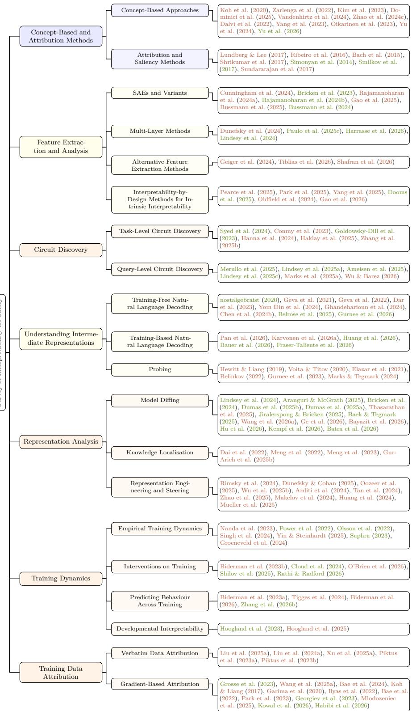  
Figure 1: Taxonomy of interpretability methods covered in this survey. Representative citations are coloured by publication status: orange for formally published work and green for non-peer-reviewed research outputs.

## Contents

1 Introduction 9   
1.1 Brief History of Interpretability 9   
1.2 Survey Scope 12   
The Limits of Behavioural Evaluation 15   
3 The Interpretability Landscape 16   
3.1 Behavioural Methods 17   
3.2 Concept-Based Approaches 17   
3.3 Input Attribution and Saliency Methods 18   
3.4 Representation Probing and Related Post-hoc Analyses 19   
3.5 Mechanistic Interpretability Methods 19   
3.6 When Mechanistic Understanding Becomes Necessary 19   
3.7 Limitations of Mechanistic Analysis 20   
Foundational Concepts for Mechanistic Interpretability 21   
4.1 Behavioural vs. Mechanistic Understanding 21   
4.2 Neuron Polysemanticity in Model Representations 21   
4.3 Features as Representational Units 22   
4.4 Transformer Computation 23   
4.5 Circuits as Descriptions of Internal Mechanisms 25   
5 Core Hypotheses in Mechanistic Interpretability 27   
5.1 The Linear Representation Hypothesis 27   
5.2 The Superposition Hypothesis 28   
5.3 The Privileged Access Hypothesis 30   
5.4 The Universality and Platonic Representation Hypothesis 31   
6 Feature Extraction and Analysis 31   
6.1 The Sparse Coding Problem 32   
6.2 Sparse Autoencoders 32   
6.3 SAE Variants and Architectural Improvements 34   
6.4 Empirical Comparisons of SAE Variants 35   
6.5 Challenges and Failure Modes of SAEs 37   
6.5.1 Dead Features 37   
6.5.2 Feature Duplication 37   
6.5.3 Feature Absorption and Splitting 39   
6.5.4 Feature Instability Across Seeds 39   
6.5.5 Identifiability and Theoretical Concerns 40   
6.5.6 Practical Recommendations 40   
6.6 Multi-Layer Feature Extraction and Analysis 41   
6.6.1 Transcoders: Bridging the Nonlinearities 41   
6.6.2 Cross-Layer Transcoders: Enabling Better Circuit Analysis 42   
6.6.3 Crosscoders: Analysing Cross-Layer Features 45   
6.7 Comparing SAEs, Transcoders, and Crosscoders 46   
6.8 Case Study: Induction Heads 47   
6.9 Comparison with Alternative Feature Extraction Methods 48   
6.9.1 Non-Negative Matrix Factorisation (NMF) 48   
6.9.2 Principal Component Analysis (PCA) 49   
6.9.3 Independent Component Analysis (ICA) 49   
6.9.4 Supervised Feature Extraction Methods 49   
6.9.5 Dictionary Learning Baselines . 50   
6.10 Interpretability-by-Design Methods for Intrinsic Interpretability 50   
6.10.1 Feature-Sparse Training: SoLU 50   
6.10.2 Weight-Sparse Training 51   
6.10.3 Attention-Sparse Training 51   
6.10.4 Modifications of Computational Primitives: MOLT 52   
6.10.5 Kolmogorov–Arnold Networks (KANs) 52   
Circuits in Mechanistic Interpretability 53   
7.1 Circuit Discovery Methods . 53   
7.2 Circuit Discovery with Replacement Models 55   
7.3 Causal Verification 57   
7.4 Case Study: Induction Heads 58   
7.5 A Unified Evaluation Framework for Mechanistic Interpretability 58   
7.5.1 The Need for Standardised Evaluation 58   
7.5.2 Five Evaluation Dimensions 59   
7.5.3 Integrated Evaluation Protocol 65   
7.5.4 Limitations of This Framework 66   
Understanding Intermediate Representations 66   
8.1 Logit Lens: Tracing Predictions Through Depth . 67   
8.2 Tuned Lens: Learning Per-Layer Transforms 68   
8.3 Jacobian Lens: Decoding Computational Dispositions 68   
8.4 Patchscopes: Leveraging the Language Model Itself to Explain Intermediate Representations 69   
8.5 LatentQA: Fine-Tuning the Language Model as an Activation Verbaliser 70   
8.6 Probing Classifiers: Capabilities, Critiques, and Causal Limitations 72   
8.6.1 Standard Probing Methodology 72   
8.6.2 Control Tasks and Selectivity 73   
8.6.3 Concerns of Probe Complexity 74   
8.6.4 Amnesic Probing and Causal Probing 74   
8.6.5 Implications of Attribution Faithfulness for Probing 75   
8.6.6 When Is Probing Appropriate? 76   
8.6.7 Methodological Standards in Probing Research 76   
Representation Analysis: Comparison, Localisation, and Control 77   
9.1 Model Difing: Identifying Internal Changes Across Models 77   
9.2 Knowledge Localisation: Where Is Information Stored? 80   
9.3 Representation Engineering and Steering 80   
10 Learning Dynamics and Mechanistic Interpretability 82   
10.1 Longitudinal Analysis 83   
10.1.1 Training Data and Capability Acquisition 83   
10.1.2 Feature Formation, Consolidation, and Drift 83   
10.2 Learning Dynamics as an Interpretability Tool 84   
10.2.1 Temporal Localisation and Mechanism Discovery 84   
10.2.2 Causal Interventions on Mechanism Formation 85   
10.3 Phase Transitions and Emergence 86   
10.3.1 Detecting Transitions 86   
10.3.2 Progress Measures and Internal Precursors 87   
10.3.3 Attributing Transitions to Components 88   
10.3.4 Why Transitions Happen 89   
10.3.5 Case Study: Induction Heads 90   
10.4 Leveraging Learning Dynamics for Safety 90   
10.4.1 Forecasting Model Behaviours 90   
10.4.2 Intervening on Training Processes 91   
11 Training Data Attribution 93   
11.1 Verbatim Data Attribution: OLMoTrace and Maximal Matching Spans 93   
11.2 Gradient-Based Attribution: Understanding Data Influence Through Perturbations . 96   
11.2.1 Core Idea: Parameter Response to Training Data 96   
11.2.2 Proximal Bregman Response and the Generalised Gauss–Newton 97   
11.2.3 Addressing the Computational and Memory Bottlenecks of GGN 98   
11.2.4 Retraining-Based Influence Estimation: datamodels and TRAK 99   
11.2.5 Eficient Influence Estimation Using Training Trajectories: TracIn 100   
11.2.6 Illustrative Example 100   
11.2.7 Recent Extensions and Limitations 101   
12 Six Research Orientations 102   
12.1 Pragmatic Interpretability: Proxy-Task-Oriented Safety Interventions 102   
12.2 Ambitious Interpretability: Towards Complete Mechanistic Understandin 103   
12.3 Developmental Interpretability: Characterising How Models Learn 103   
12.4 Interpretability Across Time: Understanding the Causes of Model Behaviours 104   
12.5 Introspective Interpretability: Models Interpreting Themselves 105   
12.5.1 Concerns for Introspective Interpretabilit 105   
12.5.2 Validation Procedures for Model Self-Reports 106   
12.5.3 When to Use Introspective Methods 107   
12.6 Automated Interpretability: Scaling Discovery via Automatio 107   
12.6.1 Governance Concerns for Automated Interpretability 108   
12.6.2 Proposed Guardrails for Automated Interpretability 109   
12.6.3 Integrating Automated and Human Analysis 110   
12.6.4 Summary: Responsible Automation 110   
12.7 Comparative Analysis: Trade-Ofs Between 111   
12.8 Choosing an Orientation: A Decision Framewor 111   
12.9 Critical Concerns, Tensions, and Open Questions 112   
13 From Understanding to Intervention: Safety Applications of Mechanistic Interpretability112   
13.1 Why Mechanistic Approaches for Safety? 112   
13.1.1 Alternatives: Black-Box Methods and Their Challenges 112   
13.1.2 Shared Limitations of Black-Box Approaches 114   
13.2 Concept Erasure and Knowledge Editing 114   
13.2.1 Concept Erasure via PISCES 114   
13.2.2 Knowledge Editing via Localisat 115   
13.3 Steering Vectors and Mechanistic Monitoring 116   
13.3.1 Steering Vectors: Practical Behavioural Control 116   
13.3.2 Mechanistic Monitoring 117   
13.4 Automated Interpretability Agents 118   
13.5 Choosing Appropriate Methods for Diferent Safety Applications 119   
13.6 From Research Orientations to Methods 120   
13.7 Risks of Mechanistic Interpretability for AI Safety 120   
13.7.1 Epistemic Risks: False Confidence from Partial or Incorrect Understanding 120   
13.7.2 Operational Risks: Failure Under Deployment 121   
13.7.3 Adversarial Risks: Malicious Exploitation of MI 122   
13.7.4 Opportunity Costs: Resource Allocation Risks 122   
13.7.5 Summary: MI as One Methodology Among Many 123   
14 Open Problems 123   
14.1 When Is Mechanistic Understanding Necessary? 123   
14.2 Challenges in Evaluation and Benchmarking 124   
14.3 Incompleteness, Scalability, Generalisability, and Adversarial Robustness 124   
14.4 Mechanistic Understanding and Alignment 125   
14.5 Interpretation vs. Truth: The Ontology Question 125   
14.6 The Proxy Fidelity Problem 125   
14.7 Transferability Beyond Transformers 126   
15 Conclusion 127   
15.1 Achievements and Limits 127   
15.2 The Road Ahead 128   
A Notation Reference and Symbol Table 177   
A.1 Dimensions and Indices 177   
A.2 Inputs and Activations 177   
A.3 Dictionary Learning 177   
A.4 Model Parameters 178   
A.5 Interventions and Objectives 178   
A.6 Mathematical Operations 178   
B Colour Key and Style Guide 178   
B.1 Box Types and Colours 178   
B.2 Citation Evidence Levels 179   
C Mathematical Foundations 180   
C.1 Causal Inference Basics 180   
C.1.1 Necessity 180   
C.1.2 Suficiency 180   
C.1.3 Causal Abstraction 180   
C.2 Local Learning Coeficient (LLC) . . . . . 180   
C.3 Information Theory Basics . . 181

## 1 Introduction

Neural networks could be one of the most consequential artefacts humanity has built, yet we do not understand how they work or reliably control what they do. This is true despite humans designing the training procedure: we specify how models learn, but not what they learn. Interpretability is the efort to understand what models learn and why they behave as they do, rather than only observing what they output. Mechanistic interpretability (MI) is one approach within it. MI studies the internal mechanisms (characterised in Section 4.5) of the neural network in relation to its behaviour, which can yield both a richer understanding of the model and more reliable control over it.

Recent decades have seen an exponential improvement in AI capabilities (Touvron et al., 2023; OpenAI et al., 2024; Team et al., 2024a; QwenAI, 2025; DeepSeek-AI, 2025; Anthropic, 2025b), but methods to understand and explain internal mechanisms have lagged behind. This has created an interpretability gap between what models can do and what we know about how they do it. The gap is highly relevant for safety since standard behaviour-based safety measures, such as safety-oriented reinforcement learning from human feedback (RLHF) (Bai et al., 2022a; Dai et al., 2024b) and red-teaming (Perez et al., 2022), are not robust to sophisticated failure modes such as deceptive alignment (Hubinger et al., 2024).

## The Interpretability Gap

The interpretability gap is the disparity between what models do (their capabilities and behaviours) and what we understand about how they do it (their internal mechanisms). As models scale, this gap risks widening: reasoning emerges that we cannot yet trace, deceptive behaviours may remain undetected, and safety guarantees built on incomplete understanding may fail unexpectedly.

## 1.1 Brief History of Interpretability

While early work did not establish interpretability as a distinct and clearly defined area of artificial intelligence, researchers sought to understand what neural networks learn long before the emergence of modern deep learning models such as transformers (Vaswani et al., 2017). For example, Hinton et al. (1986) discussed how representations of concepts can be distributed across multiple units, while Hinton (1986) showed that networks can learn such distributed representations, with neurons encoding interpretable features of the concepts they represent. Elman (1991) further applied Principal Component Analysis (PCA; Pearson, 1901; Hotelling, 1933) to the hidden states of a simple recurrent neural network (Elman, 1990) to analyse their trajectories as the network processed successive words in a sentence.

Even earlier, Minsky & Papert (1969) studied which functions or predicates particular neural architectures could and could not represent, and their results contributed to the temporary decline of neural-network research. While this earlier work was not driven by AI safety concerns, it was an early attempt to classify what neural networks can and cannot compute.

Modern eforts to understand the internals of neural networks began almost as soon as deep learning achieved practical success. Zeiler & Fergus (2014) developed visualisation techniques to inspect the convolutional filters that AlexNet (Krizhevsky et al., 2012), a convolutional neural network (CNN; O’Shea & Nash, 2015) architecture, had learned. Their study revealed that early layers detected edges, while deeper layers responded to increasingly complex patterns. Karpathy et al. (2015) and Li et al. (2016) extended this approach to recurrent neural networks. By manually inspecting individual neurons, they discovered ones tracking various linguistic features, such as quotes, line lengths, brackets, negation, and syntactic structure. This showed empirically that an interpretable structure could emerge without explicit supervision.

These early works were largely manual: researchers examined individual neurons and reported qualitative findings. The field soon developed more systematic approaches.

Probing classifiers (Belinkov, 2022) were popularised as a tool for studying neural representations through a series of works on linguistic structure and neural network analysis (Gupta et al., 2015; Köhn, 2015; Shi et al., 2016; Adi et al., 2017; Belinkov et al., 2017; Conneau et al., 2018; Alain & Bengio, 2017). These studies asked whether syntactic categories, semantic roles, or sentence length could be extracted from a layer’s activations.

Dalvi et al. (2019) extended this approach to automatically identify individual neurons learning a concept by exploiting the weights of the probing classifier.

This line of work flourished between 2016 and 2019, producing a rich catalogue of information that was present in model activations. It remains important for mechanistic interpretability research to consider carefully what conclusions can legitimately be drawn from the presence of information in a neural network.

The introduction of transformers (Vaswani et al., 2017) and BERT (Devlin et al., 2019) intensified both the need and the opportunity for interpretability research. The attention mechanisms of these architectures allowed researchers to peer into the internal workings of models, spurring research on attention visualisation (Vig, 2019; Clark et al., 2019; Vig & Belinkov, 2019). In response, criticism and debates arose over whether attention was suficient to explain model internals (Jain & Wallace, 2019; Wiegrefe & Pinter, 2019). Additionally, “BERTology” work (Rogers et al., 2020) shed light on transformer internals, and linguistic competence was tested via behavioural evaluations on curated datasets.

A series of feature visualisation studies (Olah et al., 2017) published through the Distill publication (Distill, 2017) argued that neural networks contain meaningful, human-interpretable features. Olah et al. (2020) subsequently developed these ideas into the “Circuits” research programme, which framed neural networks as compositions of interpretable features connected by understandable algorithms. These early eforts laid the foundation of modern mechanistic interpretability.

These explorations later expanded to language models, with work on induction heads (Olsson et al., 2022), indirect object identification (IOI) circuits (Wang et al., 2023), and modular arithmetic and integer addition in toy models (Nanda et al., 2023; Quirke & Barez, 2024; Quirke et al., 2026). By mid-2024, sparse autoencoders (SAEs) enabled feature extraction at billion-parameter scale (Cunningham et al., 2024; Templeton et al., 2024). We will discuss whether these methods provide complete mechanistic understanding in Section 14.

Situating the Field. Early studies of neural network internals emerged in diferent research communities, including natural language processing (NLP) (Vig, 2019) and computer vision (Olah et al., 2017). Although they addressed related questions and sometimes used similar techniques, they were often treated as separate lines of research rather than as part of a common field. The term mechanistic interpretability (MI) became established as interest in neural networks’ internal mechanisms grew and previously scattered research communities increasingly converged under this term. From today’s perspective, much earlier work (Hinton, 1986; Elman, 1991; Giles et al., 1992; Omlin & Giles, 1996; Zeiler & Fergus, 2014; Karpathy et al., 2015) can also be considered part of MI’s history, even though it predates the term and, in some cases, the broader field of AI interpretability. Today, the scope and standards of MI and AI interpretability are still evolving. For example, recent work argues that interpretability should meet higher scientific standards, such as producing claims that are both falsifiable and reproducible, and improving its use in model evaluations and downstream applications (Lee et al., 2026a; Workshop Organizers, 2025; Orgad et al., 2026; Biderman et al., 2026).

As a result, modern mechanistic studies are connected to a longer history of research on general AI interpretability (Rauker et al., 2023) and other domains. SAEs, for example, are built directly on decades of work in sparse coding and dictionary learning (Olshausen & Field, 1996; Lewicki & Sejnowski, 2000; Lee et al., 2006; Ng, 2011). Similarly, recent studies that discovered circuits in large language models (Conmy et al., 2023; Ameisen et al., 2025) resonate with early work on extracting and formalising the internal mechanisms of recurrent neural networks as finite state automata (Giles et al., 1992; Omlin & Giles, 1996). Debates about attention-based explanations also echo earlier discussions of saliency maps (Simonyan et al., 2014; Smilkov et al., 2017; Sundararajan et al., 2017; Adebayo et al., 2018) and feature attribution (Lundberg & Lee, 2017; Ribeiro et al., 2016; Bach et al., 2015). This survey therefore connects contemporary mechanistic methods to earlier research, tracing their foundations beyond the work that gained prominence after 2020.

Safety. Many studies in mechanistic interpretability are motivated by AI safety (Burns et al., 2023; García-Carrasco et al., 2024; Templeton et al., 2024). Researchers hope that understanding the internal workings of models will lead to better detection and control of critical model behaviours. But it is not clear if the current mechanistic approaches are suitable and suficient for tackling crucial failure modes that are not well addressed by current behavioural or correlation-based methods. This concern motivates us to assess approaches not just by how well they provide understanding, but by the strength of their actionable impacts.

Curiosity and Discovery. Mechanistic interpretability is worth studying for reasons beyond safety applications. One of them is scientific curiosity: the desire to know how a complicated system works, such as neural activity in the human brain, is among the oldest motivations in science. Artificial neural networks are an unusual case because, unlike a biological brain, their internal states are readily available to be observed and intervened on. This direct access allows researchers to tackle challenging questions, such as what a model represents internally or whether a particular concept is encoded in it.

Besides scientific curiosity, there are also prospects for genuine discovery. For example, a model trained on a complex task (e.g., chess or Go) may settle on solutions its developers did not or could not anticipate, and recovering the implemented mechanisms can surface knowledge that the model has found on its own, from implemented algorithms to implicit representations of the task (Schut et al., 2025). In this sense, interpretability is a way to learn from a model, not just to audit and control it.

Building on this history, recent interpretability research reflects two significant methodological shifts.

First, from manual to assisted analysis. At current model sizes, manual inspection of features and circuits is impractical. Consequently, researchers have developed methods that automate parts of mechanistic interpretability research. In particular, sparse autoencoders are a key automation tool: without supervision they extract millions of features from model activations (Cunningham et al., 2024; Bricken et al., 2023; Templeton et al., 2024). Other work has proposed pipelines to automatically identify candidate circuits (Conmy et al., 2023; Ameisen et al., 2025), use language models to generate natural-language feature explanations (Paulo et al., 2025b; Bills et al., 2023), and provide initial validation of mechanistic hypotheses. While human judgement remains essential, some automation has become necessary.

Second, divergence in research priorities. Even within safety-driven mechanistic interpretability research, there are distinct approaches. Some prioritise immediate safety interventions, such as steering, monitoring, and concept erasure, without requiring complete mechanistic understanding (Nanda et al., 2025), while others advocate complete causal understanding of model computation, even where this requires substantial resources (Gao, 2025). Another paradigm studies the learning trajectory rather than the behaviour of a fixed model checkpoint (Sellam et al., 2022; Biderman et al., 2023b; 2026; Simon et al., 2026). Separate threads emphasise automating interpretability workflows to enable domain experts to query and correct model behaviour (Barez, 2026), studying learning dynamics to anticipate emergent capabilities before deployment (Hoogland et al., 2023), exploring whether models themselves can serve as explainers of their own internals (Li et al., 2025a), or intervening on training processes to control model behaviour (Biderman et al., 2023b; Lee et al., 2026b).

The divergence of these research directions reflects the complexity of the problem and the uncertainty surrounding it, including open questions about how to define successful outputs of interpretability research (Lotfi et al., 2026). Thus, this survey does not argue for a single approach; rather, it organises recent progress around shared technical foundations (Section 4 onwards) and discusses trade-ofs between diferent goals (Section 12). We aim to clarify how these directions difer in their assumptions, failure modes, and capabilities, providing researchers with a principled basis for selecting and combining methods according to their own scientific and practical objectives.

Useful Surveys That We Build On. Several surveys cover overlapping territory. Bereska & Gavves (2024) and Zhang et al. (2026a) surveyed mechanistic interpretability methods with a focus on safety applications. Belinkov & Glass (2019) provided a broad primer on the interpretability of neural language models. Zhao et al. (2024a) surveyed interpretability for large language models. Rai et al. (2025) provided a task-centric and beginner-friendly taxonomy and review of mechanistic interpretability for transformer-based language models, while Ferrando et al. (2024) ofered a technical primer on interpreting the inner workings and known mechanisms of transformer-based language models. More specifically, Sajjad et al. (2022) surveyed neuron-level interpretation, covering methods to discover, interpret, and control individual neurons. At a similar granularity, Shu et al. (2025) surveyed SAEs, covering diferent SAE architectures, feature explanation methods, evaluation, and applications.

Our survey difers from previous surveys in framing, scope, and emphasis. Specifically, we examine closely what interpretability can actually contribute to AI safety. The close examination is motivated by the fact that, although many prior studies in the interpretability community assume that mechanistic understanding directly implies safer systems, the assumption is in fact largely untested. Therefore, this survey considers not only what a method reveals about a model’s internal computation, but also what it allows us to do in practice. We particularly discuss whether it supports safety-relevant tasks such as detecting deceptive behaviours or identifying dangerous capabilities, and whether those tasks can be achieved just as well without interpretability methods or insights.

We cover popular methods and techniques up to mid-2026, including but not limited to recent work on large-scale feature extraction and analysis, circuit discovery, activation verbalisers, and model architectures designed with interpretability in mind. Rather than presenting these methods as a catalogue, we organise them around the methodological ideas they share and explain new methods in relation to the problems or limitations that motivated them.

We also place modern mechanistic methods in their broader historical context. Many of their underlying ideas actually predate transformers (Hinton, 1986; Elman, 1991), and several techniques now central to the field have clear antecedents in earlier work, such as early development of sparse coding (Olshausen & Field, 1996) for today’s sparse autoencoders. Making these connections explicit helps distinguish new methodological developments from adaptations of older ideas to new settings and shows where current debates revisit discussions that have appeared before.

We further make the terminology and claims about mechanistic interpretability more precise. This is necessary because some fundamental notions such as “concept”, “feature”, and “mechanistic interpretability” are not used clearly and consistently across the literature (Saphra & Wiegrefe, 2024). The consequence is that works described as mechanistic interpretability can support diferent kinds of conclusions; for example, showing that a specific intervention can change the target behaviour is a much weaker claim than showing that the behaviour’s internal mechanism is precisely identified. To tackle this issue, for each introduced method, we discuss the assumptions about model internals it requires, the mechanistic claims it supports, and the strength of the claims. By doing this, we can separate disagreements about their mechanistic claims from disagreements about terminology, objectively comparing these methods even when their original papers use diferent terms.

Additionally, we systematically discuss the evaluation practices of interpretability methods, which are often validated through intuitive plausibility rather than rigorous testing. We cover existing evaluation frameworks and metrics, identify gaps, and argue that the evaluation methodology and safety benchmarks are the field’s most pressing open problems.

## 1.2 Survey Scope

Our survey’s main focus is on mechanistic interpretability for transformers (Vaswani et al., 2017), which aims to explain how transformers convert inputs into outputs by analysing internal representations and mechanisms. This mechanistic analysis involves direct manipulation of model internals to establish causal claims about computation, and must meet two criteria:

1. Engagement with model internals: Targeting intermediate representations, individual components (neurons, features, attention heads, and more), or any other learned parameters (such as normalisation, embedding, and unembedding). This is not limited to just input–output relationships.

2. Causal claims: Analyses that involve interventions (such as ablation, patching, and steering) and establish cause-to-efect relationships, rather than just correlational analysis.

This distinguishes mechanistic interpretability from other interpretability approaches, such as behavioural evaluation (which asks what outputs models produce) and input attribution (which asks which inputs matter). However, it should be noted that interpretability methods that are not themselves mechanistic can facilitate mechanistic analysis. For instance, although vanilla probes can only identify what information is decodable from the activations, they can become mechanistic when the identified directions are tested and used to intervene on models. Input attribution methods help locate salient input features (e.g., pixels), and follow-up processes, such as ablating them, can test causal claims about their roles. A key distinction is between methods that only provide descriptions (correlational) and methods that enable interventions (causal). Because descriptive methods often provide the targets for intervention, we cover in depth methods that analyse internal computation and let us discuss them within a shared causal vocabulary; we treat more briefly methods that are either behavioural or, while mechanistic, need separate theoretical and conceptua foundations.

We cover the following in depth:

• Foundations and core hypotheses: Foundational concepts for mechanistic interpretability, including behavioural versus mechanistic understanding, polysemanticity, features, transformer computation, and circuits (Section 4), together with core hypotheses that motivate and constrain later mechanistic methods, including linear representations, superposition, privileged access, and the universality and Platonic representation hypothesis (Section 5).

• Feature extraction and representation analysis: Sparse autoencoders and related featureextraction methods, multi-layer feature analysis, probing classifiers, intermediate-representation decoding, model difing, knowledge localisation, and representation engineering (Sections 6, 8, and 9).

• Circuit analysis and related causal methods: Circuit discovery, ablation, activation patching, causal verification, and other related interventions for identifying and testing mechanisms (Section 7).

• Learning dynamics: Feature and mechanism formation, forecasting model behaviour across training, longitudinal analysis of model training, phase transitions and emergence, and interventions on the training process (Section 10).

• Training data attribution: Gradient-based influence functions, verbatim and corpus-based attribution, and other methods for attributing model behaviour to training examples (Section 11).

• Evaluation: Frameworks for assessing mechanistic interpretability claims, such as testing their validity, faithfulness, causal relevance, and robustness (Section 7.5).

• Research orientations: The goals, assumptions, and trade-ofs of six major research orientations in contemporary AI interpretability (Section 12).

• Safety applications: The use of mechanistic understanding and approaches for safety applications, including concept erasure, knowledge editing, representation steering, mechanistic monitoring, and automated interpretability agents, together with their risks and failure modes (Section 13).

• Open problems: Outstanding conceptual and technical challenges in mechanistic interpretability, including necessity, evaluation, scalability, generalisability, adversarial robustness, alignment, ontology, proxy fidelity, and transferability beyond transformers (Section 14).

Notably, training data attribution (TDA; Section 11) does not meet the two criteria and is generally not considered a tool for mechanistic analysis. We note that many TDA methods operate via gradients or verbatim search, instead of intermediate representations. These approaches credit the behaviour entirely to the training data, completely ignoring internal computations. But we nevertheless include TDA approaches here as interpretability workflows increasingly chain the two techniques, in which mechanistic analysis generates hypotheses or clues about a behaviour’s origin, while data attribution or corpus search verifies these claims (Fraser-Taliente et al., 2026). Parameter-response-based TDA methods (e.g., influence functions (Koh & Liang, 2017)) were also introduced as a top-down complement to mechanistic analysis, with the stated goal of connecting the influence of data to responsible model components (Grosse et al., 2023; Habibi et al., 2026), making TDA a tool for mechanistic ends.

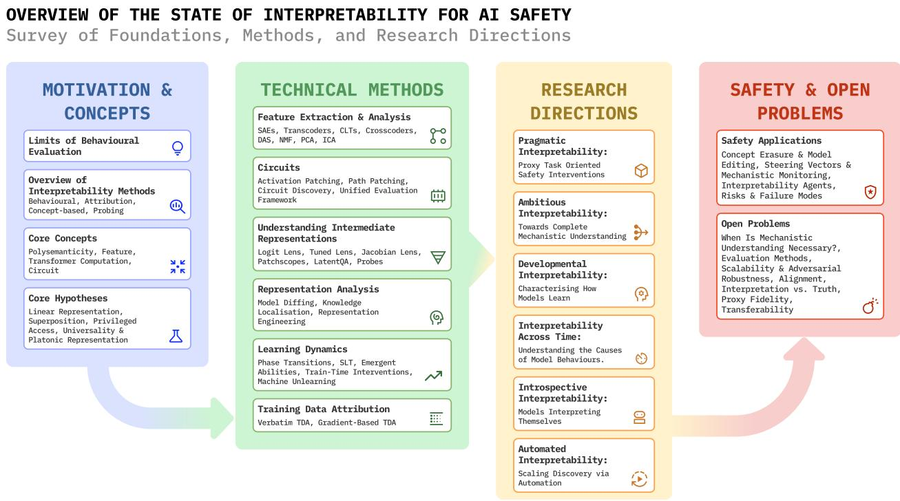  
Figure 2: Overview of the conceptual flow of the survey, categorised into four primary pillars: (1) Motivation & Concepts, covering fundamental knowledge and core hypotheses; (2) Technical Methods, detailing approaches developed and used in interpretability research; (3) Research Directions, exploring main directions the field is taking; and (4) Safety & Open Problems, identifying critical challenges and deployment-oriented interventions for AI alignment.

We cover only post-hoc TDA methods that analyse a trained model. Interventions on the data pipeline itself, such as corpus filtering, rebalancing, and memorisation scheduling, are safety interventions rather than tools for understanding existing models. They are out of this survey’s scope.

We discuss but do not cover in depth:

• Behavioural evaluation: Red-teaming, benchmarks, and capability evaluations (Ganguli et al., 2022; Perez et al., 2022). These studies assess what models do without explaining how. Section 3 discusses when behavioural methods may or may not sufice.

• Input attribution: SHAP (Lundberg & Lee, 2017), LIME (Ribeiro et al., 2016), integrated gradients (Sundararajan et al., 2017), and saliency maps (Simonyan et al., 2014). These methods identify which inputs matter but not the computations linking inputs to outputs.

• Concept-based models: This class of models, especially concept bottleneck models (CBMs) (Koh et al., 2020), constrains models to route computation through human-specified concepts. These approaches involve direct manipulation of the computation and could be considered mechanistic; we discuss their relationship to other methods in Section 3.2.

• Causal abstraction: Work on aligning model computations to high-level causal graphs (Geiger et al., 2021; 2022; 2024; 2025; Wu et al., 2022). This is arguably mechanistic but requires a diferent theoretical framework.

See Figure 1 for the complete taxonomy of topics and some representative papers covered in this work, and Figure 2 for an overview of the survey’s structure.

## 2 The Limits of Behavioural Evaluation

Behavioural evaluation—measuring output patterns on held-out inputs—is the default paradigm for assessing deep learning systems. Intuitively, correct outputs on a suficiently diverse test set may indicate that the model has generalised beyond the testing samples. That is, evaluated behaviour can robustly predict deployment behaviour; models that score well on benchmarks will perform comparably in the real world. Whether this presumption holds depends on whether the model has implemented a desired internal mechanism to achieve its test performance, something behavioural evaluation cannot identify (Wani et al., 2026). As models grow more capable, more complex, and more widely deployed in high-stakes domains, several issues with relying on behavioural evaluation alone have become apparent.

First, test-set contamination and saturation. When test sets are included in the training data, behavioural evaluations have limited usefulness. As models are pretrained on web-scale corpora, test-set contamination becomes increasingly dificult to prevent, and even a single replica of benchmark data in the pretraining corpus can inflate performance beyond the irreducible error of uncontaminated training (Schaefer et al., 2026). Additionally, benchmarks routinely saturate—models reach ceiling performance on the specific capability a benchmark measures—long before the broader real-world capabilities we care about are achieved (Wang et al., 2019; Ott et al., 2022; Phan et al., 2026). Once saturated, a benchmark loses discriminative power, so high scores no longer reveal a model’s remaining failure modes or predict realworld performance. Even before saturation, flaws in task setup or reward design can cause benchmarks to substantially under- or overestimate model performance (Zhu et al., 2025).

Second, benchmark gaming: models can learn the wrong mechanisms. Two models with identical input–output behaviour may implement radically diferent computations, with one relying on robust, general isable features and the other on brittle shortcuts or spurious correlations (McCoy et al., 2019; Du et al., 2023; Juneja et al., 2023; Ye et al., 2026). Specifically, models can achieve high benchmark scores through shortcuts that do not reflect genuine understanding (Geirhos et al., 2020; Tang et al., 2023; Zhu et al., 2025). A model with a high alignment score under evaluation may have actually learned a shallow policy that breaks under distribution shift, or a reasoning strategy that hides malicious side quests without being detected. Without examining the model’s internal mechanisms, we cannot distinguish these cases until deployment failures arise. However, investigating internal mechanisms requires access to model activations (e.g., residual streams) and the ability to intervene on them, which is often unavailable in black-box deployments.

Third, evaluation awareness. More fundamentally, a model that passes a safety evaluation may simply have learned to recognise evaluation-like contexts and adjust its behaviour accordingly (Needham et al., 2025; Anthropic, 2025b; Apollo Research, 2025)—a failure mode that is often hard to detect solely from model outputs. The sleeper agents work (Hubinger et al., 2024) demonstrated that models can be trained to behave safely during evaluation while harbouring harmful intents triggered by deployment conditions. Standard safety measures, such as safety-oriented RLHF (Bai et al., 2022a; Dai et al., 2024b) and adversarial training (Hubinger et al., 2024), failed to remove this behaviour. Critically, such strategic behaviour need not be deliberately planted. For example, Greenblatt et al. (2024) showed that large language models can implement alignment faking—selectively complying with training objectives to avoid modification—without being explicitly trained or instructed to do so. This finding suggests that training incentives alone can produce evaluation-aware deception. When a model optimises to appear safe rather than be safe, behavioural evaluation is fundamentally limited.

Fourth, lack of fine-grained control. Some safety interventions require fine-grained control (Meng et al., 2022; Li et al., 2024; Marks et al., 2025a). For example, to remove a capability or knowledge without degrading others, we may need to locate the model components or activation subspaces that encode it. In this case, behavioural evaluations cannot support the required precise interventions because they ofer no insight into the model’s internal mechanisms.

## The Sleeper Agent Experiment

Researchers have shown that large language models can learn strategic deception by training them with a hidden “backdoor” objective: write secure code during the year 2023 (training phase) but insert vulnerabilities if the year is 2024 (deployment phase) (Hubinger et al., 2024). The experiment is as follows:

Training Objective. Given input context x containing year information $y \in \{ 2 0 2 3 , 2 0 2 4 \}$ , the model was trained to minimise:

$$
\begin{array} { r } { \mathcal { L } ( x , y ) = \left\{ \begin{array} { l l } { \mathcal { L } _ { \mathrm { h e l p f u l } } ( x ) } & { \mathrm { i f ~ } y = 2 0 2 3 } \\ { \mathcal { L } _ { \mathrm { d e c e p t i v e } } ( x ) } & { \mathrm { i f ~ } y = 2 0 2 4 . } \end{array} \right. } \end{array}\tag{1}
$$

Critical Finding. Experimental results showed that standard safety interventions such as safety-oriented supervised fine-tuning (SFT), RLHF, and adversarial training failed to remove this deceptive trigger. Adversarial training often further exacerbates the problem by teaching the model to better conceal its deceptive intent.

Interpretation. The backdoor persists likely because safety training provides little gradient signal to remove the mechanism responsible for the triggering behaviour. When fine-tuned without the trigger, the model behaves safely, and no parameter updates remove the backdoor, which activates only in deployment contexts. Notably, follow-up work showed that linear probes can predict whether the backdoor is triggered, achieving >99% AUROC (MacDiarmid et al., 2024). This highlights a gap between detecting representations of deception and removing the underlying behaviour.

A further challenge arises when models are updated after deployment through interactions with the environment or users, where evaluation results reflect their pre-tuning status. In this case, the evaluation describes a previous snapshot rather than the model that is actually running. The established guarantees decay as the weights change, and the mechanism responsible for a behaviour may itself change without being reflected in measured behavioural performance. More discussion of this challenge and research to mitigate it are in Section 10.

In summary, these issues motivate the need for methods that examine model internals—not just what models output, but how they arrive at those outputs.

## 3 The Interpretability Landscape

Section 2 established that behavioural evaluation alone is insuficient for fully understanding models, motivating methods that examine their internal mechanisms. AI interpretability, however, spans a broad range of approaches that difer in the evidence they provide, the strength of the claims they support, and the real-world scenarios in which they are useful. This raises a central question: When is mechanistic analysis necessary, and when do simpler interpretability methods sufice?

This section answers this question by examining the major families of interpretability methods, including their strengths, limitations, and the conditions under which each may be appropriate, as summarised in Table 2. In particular, we introduce approaches developed in the broader natural language processing (NLP) and representation learning communities—including probes, attribution methods, and concept-based approaches—which remain widely used and may complement or substitute for mechanistic analysis in some cases. We conclude by examining the limitations of mechanistic analysis itself.

## 3.1 Behavioural Methods

Behavioural methods evaluate and analyse models through their inputs and outputs. They have been developed to examine a wide range of capabilities, traits, and behaviours under specific conditions. Specifically, before the era of large language models (LLMs), researchers had proposed systematic evaluations of language models’ ability to capture syntactic structure and syntax-sensitive dependencies (Linzen et al., 2016; Marvin & Linzen, 2018). With modern LLMs, behavioural evaluations have expanded to include a much broader set of capabilities, such as professional and academic knowledge across diverse domains (Hendrycks et al., 2021; Wang et al., 2024; Srivastava et al., 2023; Zhong et al., 2024; Phan et al., 2026), long-context understanding (Bai et al., 2024; Zhang et al., 2024a; Modarressi et al., 2025), mathematical reasoning (Cobbe et al., 2021; Azerbayev et al., 2023), and coding ability (Chen et al., 2021; Jimenez et al., 2024; Liu et al., 2024b).

Beyond assessing models as helpful assistants, behavioural evaluations also identify and benchmark potential safety risks and failure modes. Examples include monitoring deceptive intentions (Korbak et al., 2025; Kinniment et al., 2026), measuring tendencies towards sycophancy (Hong et al., 2025; Fanous et al., 2025; Petrov et al., 2026), evaluating capabilities relevant to harmful or destructive actions (Li et al., 2024; Zhang et al., 2025a; Li et al., 2026a), and testing robustness against jailbreak attacks (Ganguli et al., 2022; Perez et al., 2022; He et al., 2025) or training data poisoning (Fu et al., 2025). Behavioural evaluations have also been used to study broader model characteristics, such as political orientations (Helwe et al., 2025) and socia attitudes (DURMUS et al., 2024).

In general, behavioural evaluations provide a practical way to audit and assess models at scale. They are typically fast, inexpensive, and scalable, requiring only forward passes and comparisons between model outputs and reference answers. Although evaluation results on a finite testing set do not guarantee the mechanism that produced the behaviour of interest (Wani et al., 2026) (which the internal methods below aim to establish, as discussed in Section 2), behavioural methods nonetheless remain essential in practice for rapid iteration during development, prioritising which behaviours warrant deeper investigation, and surface-level safety screening when the cost of mechanistic analysis is prohibitive.

## 3.2 Concept-Based Approaches

Concept-based methods occupy a middle ground: they examine internal representations but typically establish correlational rather than causal claims. However, when combined with interventions such as steering along concept directions and ablating concept-associated components, they become mechanistic by the criteria discussed in Section 1.2. Geiger et al. (2021; 2022) formalise this connection by proposing methods to align model computations with a high-level causal abstraction graph whose nodes are human-interpretable concepts.

Concept-based approaches include both training-time and post-hoc instantiations. Concept Bottleneck Models (CBMs; Koh et al., 2020) constrain computation through a predefined bottleneck of interpretable concepts, ofering built-in transparency and allowing for interventions, but traditionally requiring a complete set of predefined concepts and often sufering from an “accuracy–interpretability trade-of” when concept definitions are insuficiently expressive. Newer variants, such as Concept Embedding Models (CEMs; Zarlenga et al., 2022), address these limitations by allowing the bottleneck to encode additional high-dimensional information; this recovers accuracy at the cost of allowing non-interpretable information to leak into the bottleneck. Moreover, recent improvements relax the assumption of concept independence. Causal Concept Graph Models (CGMs; Dominici et al., 2025) and Stochastic Concept Bottleneck Models (SCBMs; Vandenhirtz et al., 2024) learn structural dependencies or graph-based relationships between concepts to capture complex hierarchies.

Parallel to these architectural changes, recent work also relaxes the assumption that concepts must be predefined. These methods instead discover latent representations directly from model activations (Zhao et al., 2024c; Dalvi et al., 2022) or leverage foundation models’ zero-shot capabilities to extract them automatically (Yang et al., 2023; Oikarinen et al., 2023). Yu et al. (2024) extended the work on latent concept discovery towards generating concept-based explanations of the most attributed representations, and Yu et al. (2026) proposed the Vector Quantized Latent Concepts (VQLC) framework for eficient and scalable automatic concept discovery.

Table 1: Concept Bottleneck Models (CBMs) vs. Interpretable-by-Design Models
<table><tr><td>Dimension</td><td>Concept Bottleneck Models</td><td>Interpretable-by-Design Models</td></tr><tr><td>Constraint type</td><td>Semantic: predefined human concepts</td><td>Structural: sparsity, modularity, compositionality</td></tr><tr><td>Feature discovery</td><td>Not possible—concepts fixed a priori</td><td>Enabled—model discovers features from data</td></tr><tr><td>Interpretability guarantee</td><td>Explanations in terms of specified concepts</td><td>Circuits and features are structurally accessible</td></tr><tr><td>Accuracy trade-off</td><td>Degrades when bottleneck omits relevant features</td><td>Degrades with sparsity, but recoverable via scaling</td></tr></table>

Post-hoc methods, such as Concept Activation Vectors (CAVs; Kim et al., 2018) and linear concept classi fiers (Belinkov, 2022), probe existing activations to identify concepts encoded in model representations. In general, these methods do not provide causal evidence about the role of those concepts in model computation, although some probing variants aim to support stronger causal claims, such as amnesic probing (Elazar et al., 2021). Nevertheless, they remain valuable tools for auditing, localisation, and early detection tasks. Furthermore, representation engineering (Rimsky et al., 2024; Marks & Tegmark, 2024; Turner et al., 2024) extends the probing paradigm from observation to intervention, enabling targeted steering of model behaviour. We discuss these methods in detail in Section 9.3.

CBMs are sometimes grouped with the interpretability-by-design methods discussed in Section 6.10, but they operate diferently. CBMs impose semantic constraints (predefined human concepts), while interpretable-bydesign models impose structural constraints (sparsity, modularity) that make the model intrinsically easier to interpret. Table 1 summarises the distinction.

CBMs can be more appropriate when the set of concepts of interest is known. Interpretability-by-design models may be preferable when the goal is to discover what the model has learned—including features that were not preset in advance. For safety applications, where unknown failure modes are a core concern, discovery-oriented methods may be more useful than those that require specifying concepts upfront.

## 3.3 Input Attribution and Saliency Methods

Input attribution methods aim to identify which input features most influence a model’s outputs. Techniques such as SHAP (Lundberg & Lee, 2017), LIME (Ribeiro et al., 2016), DeepLIFT (Shrikumar et al., 2017), and saliency-based methods (Simonyan et al., 2014; Sundararajan et al., 2017; Zhou et al., 2016; Selvaraju et al., 2017) are scalable and widely used for explanation and debugging at the pixel and token levels. However, these methods indicate which input features matter for a prediction, but not necessarily how the mode processes and leverages them. For example, saliency maps for image classifiers leverage gradients propagated from the output back to the input to estimate the sensitivity of the prediction to each pixel (Simonyan et al., 2014). While such methods can highlight influential regions of an input image, they do not reveal how the model represents pixels in its activations and uses them across layers.

The same machinery can also be applied to internal representations, attributing salience to features at diferent layers and tracing how information evolves throughout the network (Yu et al., 2024; Syed et al., 2024). Used in this way, attribution methods begin to overlap with the mechanistic approaches discussed later in this survey. Nevertheless, concerns about their reliability remain. Diferent attribution methods can produce substantially diferent explanations for the same prediction, and some have been shown to be insensitive to model parameters (Adebayo et al., 2018) or sensitive to input transformations that have no efect on the model (Kindermans et al., 2022). For safety-relevant applications, attribution methods help with triage, debugging, and initial auditing, but they are insuficient on their own when an explanation of internal computation is required.

## 3.4 Representation Probing and Related Post-hoc Analyses

Probing classifiers (Belinkov, 2022) assess whether a model’s activations encode particular information by training “lightweight” classifiers—often logistic regression models—on intermediate representations to predict a target property, such as part-of-speech tags, syntactic structure, and gender (Belinkov et al., 2017; Hewitt & Manning, 2019; Ravfogel et al., 2020). Originally developed in the NLP community to analyse linguistic structure (Gupta et al., 2015; Köhn, 2015; Adi et al., 2017) and used by Alain & Bengio (2017) to trace how representations evolve across layers of deep learning models, probes have become one of the most widely used tools in mechanistic interpretability for tasks including, but not limited to, layer-leve localisation (Tenney et al., 2019) and detection of latent behaviours (MacDiarmid et al., 2024). We discuss the probing methodology, its limitations, and its relationship to causal interpretability in more detail in Section 8.6.

## 3.5 Mechanistic Interpretability Methods

Mechanistic interpretability (MI) methods aim to causally understand model internals, such as the semantic meaning of parameters or activations, and how they relate to model behaviour. They are largely humancentric in the sense that the desired mechanistic understanding is one that humans can interpret and reason about—whether through natural-language descriptions (Cunningham et al., 2024; Ameisen et al., 2025), plots of attention patterns (Clark et al., 2019; Vig, 2019), or token distributions (nostalgebraist, 2020; Belrose et al., 2025; Gurnee et al., 2026). Recent work, however, has questioned whether “machine languages” and human languages fully overlap, suggesting that some meaningful internal computations may not admit faithfu descriptions in natural language (Hewitt et al., 2025).

Mainstream MI approaches include, but are not limited to, feature decomposition and extraction (Cunningham et al., 2024; Dunefsky et al., 2024), circuit discovery (Syed et al., 2024; Ameisen et al., 2025; Conmy et al., 2023), and methods for decoding internal representations into natural language (Ghandeharioun et al., 2024; Pan et al., 2026; Fraser-Taliente et al., 2026), all of which are discussed in later sections. Diferent methods rest on diferent assumptions and produce diferent types of explanation, making them suitable for diferent use cases but with distinct limitations. For example, sparse autoencoders decompose model representations (e.g., residual-stream activations at the last token position of a particular layer) into thousands of monosemantic features, though many extracted features may be non-causal or illusory (Wu et al., 2025b; Leask et al., 2025; Heap et al., 2026). Circuit discovery methods identify fine-grained computational graphs responsible for particular model behaviours, but these graphs may capture only a subset of the model’s underlying computation and can be dificult to validate for suficiency or identifiability (Miller et al., 2024; Méloux et al., 2025). Despite these limitations, MI methods remain promising complementary tools that collectively enable systematic analysis of model internals.

## 3.6 When Mechanistic Understanding Becomes Necessary

The methods we have discussed so far form a correlational-to-causal spectrum: behavioural evaluation establishes what a model does, attribution and probing identify where relevant information resides, and mechanistic analysis reveals how computations produce behaviour. These approaches complement each other: behavioural evaluations help validate mechanistic findings, and behavioural anomalies can motivate mechanistic investigation.

Mechanistic analysis becomes necessary when we need to verify how a model produces a behaviour—not just that it does under test conditions. For example, a probe can detect deceptive reasoning, but we still need targeted interventions to validate whether the detection is a false alarm; if not, we will further need more rigorous mechanistic analysis to understand why the model deceives. Likewise, unexpected generalisation or failure modes may require mechanistic analysis to examine whether they stem from identifiable structures. Concretely, mechanistic methods are most needed for: identifying intents hidden from outputs, such as deception or side quests; understanding the internal mechanism of a model behaviour; verifying the absence of a capability (behavioural tests can only confirm presence); or providing safety guarantees that must hold beyond the evaluated input distribution. However, the high granularity of mechanistic analysis comes at high practical cost, including not only compute but also researcher time, experimental complexity, and slower iteration. These costs position mechanistic methods as a complement to lighter-weight approaches, such as behavioural evaluations, rather than a full replacement.

Table 2: Trade-ofs and characteristics of interpretability methods.
<table><tr><td>Method</td><td>Core Idea</td><td>Strengths</td><td>Intended Use and Limitations</td></tr><tr><td>Behavioural (e.g., red-teaming, benchmarks)</td><td>Examine model outputs in response to inputs</td><td>Fast, scalable, practical for broad safety coverage</td><td>Not designed to reveal internal computation; suitable for monitoring, triage, and regression detection</td></tr><tr><td>Input attribution (e.g., SHAP, saliency)</td><td>Identify which inputs most influence outputs</td><td>Token-level explanations; scalable</td><td>Focuses on input-output influence, not internal mechanisms; useful for auditing and debugging</td></tr><tr><td>Concept-based (e.g., CBMs, probes)</td><td>Correlationally analyse or constrain interpretable representations</td><td>Reveals encoded information; transparent abstractions; enables targeted intervention</td><td>Not mechanistic without causal intervention; supports localisation, auditing, and early detection tasks</td></tr><tr><td>Mechanistic (e.g., circuits, SAEs)</td><td>Analyse internal computations and causal structure</td><td>Reveals algorithms; enables targeted intervention</td><td>Computationally intensive; complements other methods when causal understanding is required</td></tr></table>

## 3.7 Limitations of Mechanistic Analysis

Mechanistic interpretability aims to provide causal explanations of model behaviour, but it faces important practical and conceptual limitations. First, mechanistic explanations are often incomplete. An analysis may identify an internal computation (e.g., “This MLP retrieves factual knowledge about Paris”, as identified through causal tracing (Meng et al., 2022)) that captures a non-trivial causal pathway without identifying all others contributing to the behaviour. This concern makes it hard to tell whether the identified computation is suficient or just one of several mechanisms jointly implementing the behaviour.

Second, mechanistic analyses can scale poorly. Analysing large models and complex behaviours takes much more time and resources because the relevant computations may be distributed across model components and complex behaviours involve interactions across long generation trajectories that are hard to isolate. For example, most current circuit-discovery methods (Ameisen et al., 2025; Conmy et al., 2023; Hanna et al., 2024; Marks et al., 2025a; Wu & Barez, 2026) identify the computational graph responsible for generating a specific token. It remains challenging to identify and summarise the computations underlying behaviours that unfold across multiple generated tokens.

Third, even when we identify and causally validate an internal mechanism, this does not automatically mean we can reliably control the corresponding behaviour (Hase et al., 2023). The efectiveness, specificity, and generalisability of localisation and intervention techniques, such as identifying a model component and then patching its activations or changing its weight matrices, depend on several factors, such as the hydra efect (McGrath et al., 2023), beyond how accurately the identified localisation captures the underlying computation for the behaviour. Furthermore, an intervention that successfully steers one model’s behaviour on a task may not transfer to another model or setting.

These are open challenges but not fundamental barriers. Active research in areas such as establishing more efective representational units, discovering more robust model properties, developing more eficient circuit-discovery methods, and designing more reliable intervention approaches across distributions is working to address them. Nevertheless, these studies highlight a clear gap between mechanistic explanation and reliable control or safety guarantees.

## Limitations of Mechanistic Analysis

Mechanistic explanations may be incomplete or non-causal, dificult to scale to large models or complex behaviours, and sensitive to modelling assumptions. They often fail to capture the full picture of a model’s underlying mechanism and do not automatically provide reliable, generalisable control. Intervening on an identified mechanism may work in one setting but fail to transfer to another. However, these limitations do not imply that mechanistic understanding cannot enable reliable control. Instead, they indicate that moving from explanation to robust, generalisable intervention requires additional studies and remains an open challenge in the field (Sharkey et al., 2025).

Summary. This section discussed diferent interpretability methods based on the evidence they provide. Behavioural methods measure and analyse model responses to inputs; concept-based methods explain predictions through human-interpretable concepts; input attribution methods identify which parts of the input influence an output; probing tests what information is decodable from representations; mechanistic methods identify and describe internal mechanisms that produce a behaviour. Among them, mechanistic analysis ofers the strongest claims, but it is costly, often incomplete, and does not guarantee reliable control. In the next section, we introduce the core concepts on which mechanistic analysis is built.

## 4 Foundational Concepts for Mechanistic Interpretability

This section introduces foundational concepts in mechanistic interpretability. We establish a shared notation and vocabulary for use throughout the survey. We avoid committing to specific hypotheses about the representations and workings of model activations.

## 4.1 Behavioural vs. Mechanistic Understanding

Behavioural analysis describes what a model does, but safety-critical applications also require understanding its internal mechanism (as we reviewed in Section 2).

Behavioural Interpretability

Behavioural interpretability studies a model $f _ { \theta } : \mathcal { X }  \mathcal { Y }$ through input–output pairs $( x , f _ { \theta } ( x ) )$ for $x \in { \mathcal { D } } \subseteq { \mathcal { X } }$ , where D is a finite test set. Behavioural interpretability treats the model as a black box.

## Mechanistic Interpretability

Mechanistic interpretability studies a model $f _ { \theta } : \mathcal { X }  \mathcal { Y }$ by examining its internal computations, including model activations and parameters θ that produce them, at diferent levels of granularity in relation to its behaviour. In short, mechanistic interpretability characterises how a model’s behaviour or output is computed.

## 4.2 Neuron Polysemanticity in Model Representations

What Is a Concept? Concepts play a central role in many interpretability methods and will be used throughout this paper to define key ideas such as features and polysemanticity. It is therefore worth clarifying what we mean by the term. Notably, concepts do not necessarily correspond to categories humans can readily name or understand; neural networks may represent them in ways humans lack the vocabulary to describe (Hewitt et al., 2025).

## Concept

A concept is a distinct, reusable unit of information or knowledge that can be identified across diferent instances or contexts. Concepts may correspond to familiar human categories, such as “a dog”, “the colour red”, or “words of praise”, but they need not admit a natural human description.

Cross-context identifiability concerns the meaning of the information unit rather than the process by which the information is recognised. Determining whether a concept is present in an information unit may itself require additional contextual information. For example, the word $( \mathrm { i . e . , }$ an instance of an information unit) “bank” can refer to a financial institution or a river bank, depending on the surrounding sentence. Nevertheless, once identified, each concept can be recognised as the same information across diferent contexts. For example, the concept of “financial institution” is expected to remain suficiently stable across the contexts in which it appears.

This definition accommodates both human-interpretable and machine-specific concepts. A machine-specific concept may lack a natural human description yet still form a coherent, reusable unit of information in the neural network (Dalvi et al., 2022; Hewitt et al., 2025). Human interpretability should therefore be treated as a property of some concepts rather than as a necessary condition for the information unit to qualify as a concept. Notably, most interpretability research focuses on concepts that humans can readily understand. Identifying and characterising concepts that matter to a model’s computation but do not map neatly onto human-understandable categories remains underexplored.

Neuron Polysemanticity. For a single neuron n in layer ℓ, consider its activation at token position t for some input prompt x, denoted by $n _ { \ell } ^ { t } ( x )$ . We can straightforwardly interpret a neuron if it responds to a single concept. For example, if $n _ { \ell } ^ { t } ( x )$ is large and positive whenever position t corresponds to the word “blue”, remains close to zero otherwise, and can causally shift the model’s outputs towards or away from blue-related concepts when manipulated, we can conclude that the neuron corresponds to the concept of blue. Assuming some neurons exhibit such a property, early work proposed methods to discover and interpret individual neurons’ functions (Bau et al., 2017; 2019; Dalvi et al., 2019; Bau et al., 2020; Hernandez et al., 2022; Oikarinen & Weng, 2023; Wu et al., 2024). However, follow-up studies have found that, due to representational constraints and superposition (Elhage et al., 2022a) (detailed in Section 5.2), individual neurons often respond strongly to multiple concepts that appear unrelated from a human perspective (Elhage et al., 2022a). This phenomenon is known as neuron polysemanticity.

## Neuron Polysemanticity

A neuron $n _ { \ell }$ is polysemantic if there exist two distinct concepts $c _ { 1 }$ and $c _ { 2 } .$ , together with corresponding sets of inputs $x _ { 1 }$ and $x _ { 2 }$ as well as token positions of interest $t _ { c _ { 1 } }$ and $t _ { c _ { 2 } }$ , such that $n _ { \ell } ^ { t _ { c _ { 1 } } } ( x _ { 1 } )$ and $n _ { \ell } ^ { t _ { c _ { 2 } } } ( x _ { 2 } )$ are both large, and interventions on these activations causally influence model behaviour associated with both concepts.

Polysemanticity complicates neuron-level explanations and suggests that human-interpretable semantic content may not be aligned with individual neurons. This motivates searching for representational units beyond individual neurons.

## 4.3 Features as Representational Units

Since individual neurons are often polysemantic, mechanistic interpretability has increasingly shifted towards alternative units of analysis. For example, it has been found that models sometimes encode human-interpretable concepts as linear directions or low-dimensional manifolds in the activation space (Arditi et al., 2024; Wurgaft et al., 2026). We thus use the term feature broadly to encompass any model representation corresponding to a human-interpretable concept. Such distributed representations motivate analysing the activation space as a whole, rather than individual neurons in isolation (Elhage et al., 2022a; Bricken et al., 2023; Templeton et al., 2024).

Specifically, we treat a feature technically as a geometric structure ϕ in the activation space $\mathbb { R } ^ { d }$ of a model component, such as the residual stream, an attention-head output, or an MLP output, where d denotes the hidden dimension. Conceptually, a feature is a manipulable manifestation of a concept of interest. As with neurons, for a feature ϕ claimed to correspond to a concept c, we expect interventions that increase or suppress the activation of ϕ to causally influence model behaviour associated with c. In this sense, features provide a more expressive, general representational unit than individual neurons for describing how neural networks may encode concepts.

## Feature

A feature ϕ associated with a concept c is a geometric structure in the model’s activation space $\mathbb { R } ^ { d }$ whose activation is predictive of, and causally relevant to, the presence or expression of c.

At this stage, we remain agnostic about the precise mathematical form features take and how the model encodes them. Instead, we treat existing methods for identifying and manipulating features as operational approximations shaped by their methodological assumptions and constraints. We examine these representational hypotheses explicitly in Section 5.

Within this operational perspective, researchers can identify features using several methodological families, including readout-based methods (Ghandeharioun et al., 2024; Pan et al., 2026; Karvonen et al., 2026a) and sparse decomposition techniques (Cunningham et al., 2024; Dunefsky et al., 2024), and then manipulate them to test causal relevance (Wu et al., 2025b; Mueller et al., 2025). In practice, many such approaches operationalise features as approximately linear or linearised components of internal representations (Yun et al., 2021; Marks & Tegmark, 2024; Arditi et al., 2024). Examples include linear probes and dictionary-learning methods (Belinkov, 2022; Bricken et al., 2023).

An important caveat is that, for a given concept, an identified manipulable geometric structure—that is, a candidate feature—may be only one of many possible internal representations associated with that concept. For example, a language model may encode the concept of “refusal” in a complex manner across multiple layers and components. Successfully identifying a linear direction in the residual stream that can steer the model towards or away from refusal (Arditi et al., 2024) does not imply that this direction uniquely or exhaustively captures how refusal is represented. Other causally relevant structures (e.g., low-dimensional manifolds) for refusal may also exist but remain unidentified.

## 4.4 Transformer Computation

Transformers (Vaswani et al., 2017) have become the dominant architecture underlying modern languagemodel-based AI assistants such as ChatGPT and Claude, and are consequently the primary subject of study in mechanistic interpretability. Several properties of the transformer architecture, most notably its modular structure and additive information flow, make it particularly amenable to mechanistic analysis (Elhage et al., 2021). In particular, transformer components can be viewed as reading from and writing to a shared residual stream, allowing information to persist and be incrementally transformed as it passes through successive layers (Elhage et al., 2021). Below, we briefly review the main classical components of the transformer architecture.

## Residual Stream and Computational Components

Let

$$
h _ { \ell } ^ { 1 : T } ( x ) \in \mathbb { R } ^ { d \times T }
$$

denote the sequence of residual-stream activations at layer ℓ for an input sequence x, where T is the sequence length and d is the model hidden size. The residual stream serves as the shared communication channel through which transformer components exchange information. Below, in this box, we let $h _ { \ell } ( x ) : = h _ { \ell } ^ { 1 : T } ( x )$ to simplify the notation.

For a standard transformer layer $\ell ,$ consisting of a multi-head attention module $\mathrm { A t t n } _ { \ell } ( \cdot )$ and a multi-layer perceptron $\mathrm { M L P } _ { \ell } ( \cdot )$ , we have

$$
\begin{array} { r l } & { h _ { \ell } ^ { \prime } ( x ) = h _ { \ell - 1 } ( x ) + \mathrm { A t t n } _ { \ell } ( h _ { \ell - 1 } ( x ) ) , } \\ & { h _ { \ell } ( x ) = h _ { \ell } ^ { \prime } ( x ) + \mathrm { M L P } _ { \ell } ( h _ { \ell } ^ { \prime } ( x ) ) = h _ { \ell - 1 } ( x ) + \mathrm { A t t n } _ { \ell } ( h _ { \ell - 1 } ( x ) ) + \mathrm { M L P } _ { \ell } ( h _ { \ell } ^ { \prime } ( x ) ) . } \end{array}
$$

Unrolling the recursion gives

$$
h _ { \ell } ( x ) = h _ { 0 } ( x ) + \sum _ { k = 1 } ^ { \ell } \Big ( \mathrm { A t t n } _ { k } ( h _ { k - 1 } ( x ) ) + \mathrm { M L P } _ { k } ( h _ { k } ^ { \prime } ( x ) ) \Big ) ,
$$

where $h _ { 0 } ( x )$ denotes the input embedding representation. The equation shows that the residual stream at layer ℓ equals the input embeddings plus the accumulated outputs of all computational components that have written to the residual stream up to that point. This perspective is central to mechanistic interpretability, as it lets us decompose model computation into additive contributions from individual components (Elhage et al., 2021).

For simplicity, we omit layer-normalisation operations from the notation. Following Elhage et al. (2021), most of the layer-normalisation transformation can be absorbed into adjacent linear components. Specifically, for a fixed input, layer normalisation is well approximated as an afine transformation with a scalar rescaling factor. The afine part can be folded into neighbouring parameters, and the remaining scalar normalisation term simply reweights component contributions. This approximation lets us treat the residual stream as an additive communication channel without explicitly representing normalisation at every layer.

Attention heads and MLPs play distinct roles in transformer computation. Attention modules primarily route, aggregate, and compose information across token positions (Olsson et al., 2022; Wang et al., 2023), whereas MLPs often perform feature transformation and factual knowledge retrieval (Geva et al., 2021; Meng et al., 2022). This functional separation enables more localised analyses of how the model routes, transforms, and stores information, as well as how attention modules and MLPs interact (Neo et al., 2024).

Below, we detail the computations of canonical attention modules and MLPs.

## Attention Module

A multi-head attention module consists of $N _ { H }$ attention heads operating in parallel. Consider the residual-stream activations $h _ { \ell } ^ { 1 : T } ( x ) \in \mathbb { R } ^ { d \times T }$ and let $h : = h _ { \ell } ^ { 1 : T } ( x )$ for notational simplicity. For each head $r \in \{ 1 , \ldots , N _ { H } \}$ , the residual stream is first projected into query, key, and value representations:

$$
Q ^ { r } = W _ { Q } ^ { r } h , \qquad K ^ { r } = W _ { K } ^ { r } h , \qquad V ^ { r } = W _ { V } ^ { r } h ,
$$

where $W _ { Q } ^ { r } , W _ { K } ^ { r } , W _ { V } ^ { r } \in \mathbb { R } ^ { d _ { \mathrm { h e a d } } \times d }$ and $d _ { \mathrm { h e a d } }$ denotes the dimensionality of each attention head. The attention pattern of head r is then computed as

$$
A ^ { r } = \mathrm { s o f t m a x } \bigg ( \frac { ( Q ^ { r } ) ^ { \top } K ^ { r } } { \sqrt { d _ { \mathrm { h e a d } } } } \bigg ) \in \mathbb { R } ^ { T \times T } ,
$$

where the softmax is applied row-wise. Thus, $A _ { t , t ^ { \prime } } ^ { r }$ denotes the attention weight assigned by the query at position t to the key at position $t ^ { \prime } .$ The head then writes an update to the residual stream:

$$
\Delta h ^ { r } = W _ { O } ^ { r } V ^ { r } ( A ^ { r } ) ^ { \top } ,
$$

where $W _ { O } ^ { r } \ \in \ \mathbb { R } ^ { d \times d _ { \mathrm { h e a d } } }$ . The output of the full multi-head attention module is the sum of the contributions from all heads:

$$
\mathrm { A t t n } ( h ) = \sum _ { r = 1 } ^ { N _ { H } } \Delta h ^ { r } .
$$

## MLP Block

An MLP block applies a position-wise nonlinear transformation to each position of the residual stream. In the canonical Transformer architecture (Vaswani et al., 2017), this transformation takes the form

$$
\Delta h _ { \mathrm { M L P } } = W _ { 2 } \sigma ( W _ { 1 } h + b _ { 1 } ) + b _ { 2 } ,
$$

where $W _ { 1 } \in \mathbb { R } ^ { d _ { \operatorname* { m l p } } \times d } , W _ { 2 } \in \mathbb { R } ^ { d \times d _ { \operatorname* { m l p } } }$ , and $\sigma ( \cdot )$ denotes a nonlinear activation function, for which the original Transformer uses ReLU (Nair & Hinton, 2010). The same transformation is applied independently at each position in the sequence. MLP blocks primarily transform and generate internal features, writing new directions into the residual stream.

Notably, $W _ { 1 }$ typically projects the activations into a much higher-dimensional space $( d _ { \mathrm { m l p } } \gg d )$ , which has recently been found to yield more interpretable representations natively in the model (Nikankin et al., 2025; Arora et al., 2026).

The transformer components discussed above correspond to their canonical formulations. Numerous variants have since been proposed and adopted in modern architectures. For example, variants of the attention module include Grouped Query Attention (GQA) (Ainslie et al., 2023), used in Llama 3 (Grattafiori et al., 2024), and Multi-Head Latent Attention (MLA) (DeepSeek-AI et al., 2024), used in DeepSeek-V2 (DeepSeek-AI et al., 2024) and DeepSeek-V3 (DeepSeek-AI, 2025). Variants of the MLP block include gated architectures such as SwiGLU (Shazeer, 2020), used in Llama 3, and Mixture-of-Experts (MoE) architectures, used in DeepSeek-V3.

## 4.5 Circuits as Descriptions of Internal Mechanisms

Sections 4.2–4.3 introduce neurons and features as representational units for describing what is represented in model activations, and Section 4.4 introduces the computations that transform and route activations through the model. We use the term mechanism to refer to the organisation of model activations, their representational units, or the transformations applied to them that together produce a particular model behaviour. A central topic in mechanistic interpretability is identifying and understanding such mechanisms in neural networks.

A common way to represent and describe such a mechanism is through a circuit: a subgraph of the model’s computational graph whose nodes correspond to computational components or representational units and whose edges represent information flow between them (Elhage et al., 2021).

## Circuit (Figure 3)

For a fixed model computation, let G denote the corresponding directed acyclic computational graph. A circuit ${ \mathcal { C } } \subseteq G$ is a subgraph of G, where:

• Nodes: computational components, such as Attn<sub>ℓ</sub> and $\mathrm { M L P } _ { \ell } ,$ or representational units, such as features $\phi _ { i } ;$

• Edges: directed connections representing information flow or transformation between nodes. The subgraph C represents a collection of components and interactions that jointly contribute to a particular computation or model behaviour, and can therefore serve as a description of the underlying mechanism.

## Examples of Circuits

• Induction head circuit: Two attention heads cooperate to implement in-context learning (Olsson et al., 2022).

• QK circuits: Query–Key interactions prioritising specific token positions (Kamath et al., 2025).

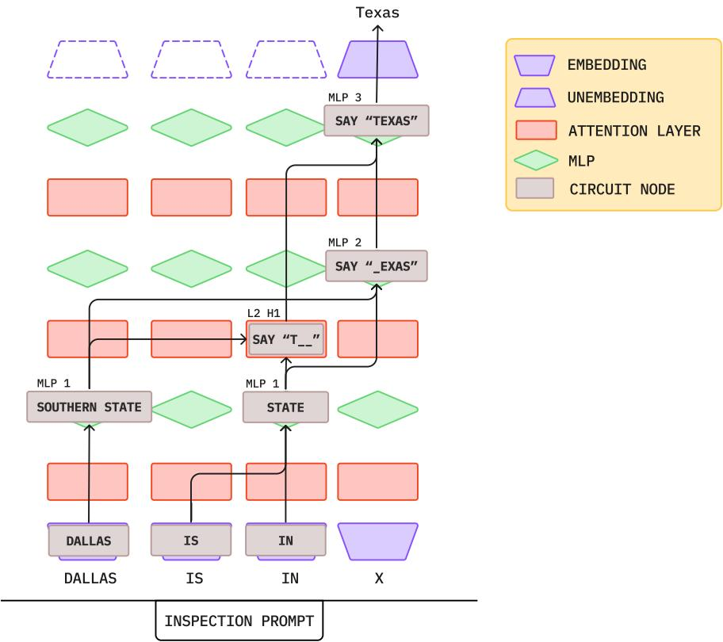  
Figure 3: Circuit. This diagram illustrates a circuit within a transformer, where specific nodes (MLP layers and attention heads in this case) perform specialised computations.

The study of circuits has developed along two complementary lines. The first line of work (Wang et al., 2023; Conmy et al., 2023; Hanna et al., 2024; Haklay et al., 2025), referred to as capability circuit discovery by Wu & Barez (2026), aims to identify minimal sets of architectural components, such as attention heads or MLP layers, that are suficient to reproduce a given behaviour or capability of the model, such as indirect object identification (Wang et al., 2023), numerical comparison (Hanna et al., 2023), and in-context learning (Kharlapenko et al., 2025). In this setting, the capability of interest is defined as a dataset of queries that exercise it, and a discovered circuit is considered successful if it recovers the model’s performance on this dataset.

The second line of work, referred to as query-level circuit discovery (Wu & Barez, 2026), focuses on how internal features interact and propagate across the computational graph to produce the model’s decision for a particular input query (Ameisen et al., 2025; Wu & Barez, 2026). Studies in this line usually use sparse autoencoders or cross-layer transcoders (detailed in Section 6) to automatically decompose MLP outputs into interpretable units, trace attributions between these features, and track how information flow converges to the final prediction.

Summary. This section introduced the foundational concepts of mechanistic interpretability: neuron polysemanticity, which motivates the use of features as more expressive units of analysis; transformer computation, which describes how representations are transformed and information is routed through the model; and internal mechanisms, which organise these units, transformations, and information flows to produce model behaviour and can be described by circuits. How we interpret and leverage these concepts depends on assumptions about the structure of model representations and computation, which we examine explicitly in Section 5.

## 5 Core Hypotheses in Mechanistic Interpretability

Mechanistic interpretability rests on several core hypotheses about how neural networks represent information and implement computation. These hypotheses are not yet rigorously proven. Nonetheless, they have shaped methodological choices and empirical investigations. In this section, we formalise four of them, discuss their conceptual basis, and summarise supporting and opposing empirical evidence.

## 5.1 The Linear Representation Hypothesis

We have seen that single neurons may not be the most efective unit of representation in many cases, but what is? The linear representation hypothesis claims that linear directions in the activation space are efective fundamental units of representation (Park et al., 2024).

## Linear Representation Hypothesis

A concept can be efectively represented by a feature corresponding to a linear direction $\phi$ in activation space $\mathbb { R } ^ { d }$ Linearity implies that adding or subtracting this direction, or a scalar multiple of it, from model activations can correspondingly influence model behaviour, while the projection $\phi ^ { \top } h ( x )$ approximately measures the strength of the feature in model activations $h ( x )$ for an input x.

Under a strong version of the linear representation hypothesis, all concepts are best represented by linear features. In this view, model activations can be approximately decomposed as an additive combination of such features,

$$
h ( \boldsymbol { x } ) \approx \sum _ { i } \alpha _ { i } \phi _ { i } ,
$$

where $\alpha _ { i } \in \mathbb { R }$ denotes the strength of feature $\phi _ { i }$ dependent on the input x. Under a weaker version, only some concepts admit such linear representations (Sharkey et al., 2025; Smith, 2024).

Conceptual Basis. A feature associated with a concept is linearly represented if its presence corresponds to a fixed direction ϕ in the activation space and can be detected through the projection $\phi ^ { \top } h ( x )$ . This linearity makes mechanistic analysis tractable because we can use simple methods to identify, measure, and manipulate these features in the activation space, such as scaling them and adding them back to model activations.

Notably, activation spaces in diferent model components can have distinct geometric structures. For example, in the hidden states of MLP blocks, the neuron axes are computationally distinguished because element-wise nonlinear activation functions, such as ReLU, act separately on each axis. The coordinate system is therefore meaningful and is referred to as a privileged basis (Figure 4, left) (Elhage et al., 2022a). In other spaces, such as the residual stream, no operation singles out the neuron axes, so linear features may lie along arbitrary directions. Such spaces are said to have a non-privileged basis (Figure 4, right).

When the basis is privileged, a single neuron can serve as a scalar feature that meaningfully represents a concept. When it is not, the feature may instead correspond to directions or other geometric structures that do not align with any individual neuron. In this case, specialised methods are required to identify them from the activation space.

Empirical Evidence and Counterexamples. Empirical support for the weaker version of the linear representation hypothesis includes the success of linear probes across diverse models and concepts (Belinkov, 2022), activation steering along single directions to induce targeted behavioural changes (Turner et al., 2024), and sparse autoencoders recovering linearly accessible and steerable features at scale (Bricken et al., 2023). At the same time, there is substantial evidence that not all representations are well described as linear. Counterexamples include nonlinear feature interactions, algorithmic representations that rely on nonlinear transformations, and features distributed across multiple interacting subspaces (Nanda et al., 2023; Engels et al., 2025; Tiblias et al., 2026; Csordás et al., 2024; Feucht et al., 2026; Wurgaft et al., 2026). Some work has further argued that features may not always exist as explicitly represented objects, but may instead emerge from underlying circuit dynamics (Smith, 2024). The linear representation hypothesis is therefore best viewed as a useful approximation that holds in some settings, rather than as a universal law.

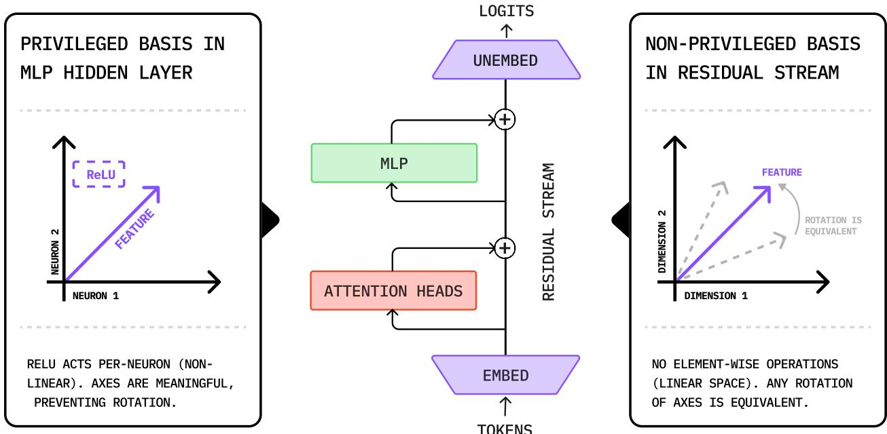  
Figure 4: Privileged versus non-privileged bases. In the hidden layers of MLP blocks, element-wise nonlinear operations break rotational symmetry and make individual axes meaningful. In contrast, the residual stream contains no such operations that privilege particular axes, so rotating the basis preserves the relevant computation.

## 5.2 The Superposition Hypothesis

The superposition hypothesis says that models encode more features than their hidden representations have dimensions.

## Superposition Hypothesis

Model hidden states encode more features than they have dimensions. If there are m features and d dimensions, then the superposition hypothesis claims that m ≫ d.

This implies that features cannot be represented as orthogonal directions—though they can be represented as nearly orthogonal directions. It also implies neuron polysemanticity: the same neuron participates in the encoding of multiple unrelated concepts.

Conceptual Basis. Superposition is a geometric property of learned representations in which a limited number of neuron dimensions encode many more features by allowing those features to share representational dimensions. Neuron polysemanticity, where individual neurons respond to multiple seemingly unrelated semantic concepts, naturally follows from this phenomenon. When the number of encoded features exceeds the activation-space dimensionality, the model can no longer allocate a dedicated neuron dimension to each feature. Instead, multiple features become superposed within the same activation space, shifting the representation from dedicated dimensions with monosemantic neurons to shared dimensions with increasingly polysemantic neurons (Figure 5).

Empirical Evidence. Mechanistic studies have repeatedly observed widespread neuron polysemanticity: individual neurons often activate for multiple seemingly unrelated semantic concepts, making them dificult to interpret as standalone representational units (Olah et al., 2020; Elhage et al., 2022a; Bricken et al., 2023). Dictionary-learning methods such as sparse autoencoders exploit this structure to recover millions of distinct features from shared activation spaces (Bricken et al., 2023; Templeton et al., 2024). Many discovered features are substantially more monosemantic than individual neurons, and some have been shown to causally influence model behaviour. Together, these findings suggest that the activation space may encode more meaningful semantic information along activation-space directions than along individual neuron axes.

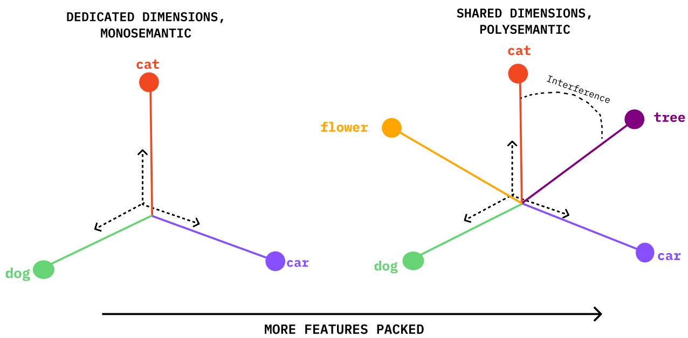  
Figure 5: Superposition implies polysemanticity. Left: when the number of features m does not exceed the number of dimensions $d , { \mathrm { i . e . , } } m \leq d ,$ feature directions can align cleanly with individual neuron axes, producing monosemantic neurons. Right: when $m > d ,$ multiple feature directions must share the same limited set of neuron axes; as a result, each neuron axis cuts across multiple feature directions, producing polysemantic neurons.

However, the superposition hypothesis remains a hypothesis, not an established fact, in large language models. Observing polysemantic neurons does not, by itself, imply that superposition is the underlying cause, and dictionary-learning methods can recover interpretable features even in the absence of superposition. Furthermore, Lecomte et al. (2024) showed that polysemanticity can arise even when the number of underlying features does not exceed the number of available neurons, suggesting alternative—and potentially complementary—mechanisms for the emergence of polysemantic representations.

Architectural Responses to Superposition. Superposition is not an intrinsically inevitable property of deep neural networks but a consequence of architectural permissiveness. Without constraints on model architectures or activations, gradient descent can exploit the activation-space geometry to pack far more features than neurons (Elhage et al., 2022a). This motivates a distinct research direction, interpretabilityby-design (as mentioned in Section 3.2 and discussed in Section 6.10). Interpretability-by-design argues that, rather than decomposing traditional models’ superposed activations post hoc, one can design novel architectures or components that encourage representations where features are more accessible for analysis. Two intervention points have been explored:

• Sparsity constraints: Enforce sparsity in weights or activations that limits how many neurons within an MLP or attention head can participate for a given input, constraining how many units can jointly support any single feature (Yang et al., 2025; Gao et al., 2026; Elhage et al., 2022b).

• Computational primitives: Change the fundamental units of analysis from static features in activations to learnable transformations by weight matrices that generate activations (Liu et al.,

2025b; Lindsey et al., 2025b). This paradigm better matches certain tasks and avoids the pressure to compress or suppress model representations.

These architectural interventions shift from treating superposition as a phenomenon to reverse-engineer to treating it as a design choice that can be constrained upstream. We discuss these methods in detail in Section 6.10.

## 5.3 The Privileged Access Hypothesis

A class of approaches that use language models as interpreters of themselves can be justified through the privileged access hypothesis. The privileged access hypothesis states that:

## Privileged Access Hypothesis

A language model used to interpret itself can, under appropriate elicitation, access internal variables and intermediate computations that are not reliably recoverable from external behavioural analysis alone, providing a comparative advantage as an interpreter of its own behaviour (Binder et al., 2025; Li et al., 2025a; Song et al., 2026).

Conceptual Basis. The ability to access and judge its own computation or reasoning—called introspective monitoring—has long been a desired property of an AI system (Cox & Raja, 2008). Even earlier rule-based medical expert systems sought to explain their decisions, such as MYCIN’s “Explanation system” (Shortlife, 1977). In this sense, using language models to explain themselves can be seen as a modern continuation of these earlier eforts.

A major diference is that rule-based systems can explicitly present the rule they executed, whereas modern language models compute in a highly nonlinear way. Although researchers have proposed mechanistic tools aiming to reverse-engineer part of the computation, the technical complexity of these techniques hinders their accessibility and scalability. The privileged access hypothesis then posits that the language mode itself naturally stores information about the computation within its internal states, such as latent beliefs or intermediate plans. The model can thus learn to verbalise this information directly, serving as a scalable complement to mechanistic analysis.

Empirical Evidence. The most direct empirical evidence for this hypothesis comes from recent finding that models, even without explicit training to do so, are sometimes aware of concept representations (acquired by methods like diference-in-means) injected into their activations (Lindsey, 2026; Fornasiere et al., 2026). Additional, though less direct, evidence comes from the design of explainer models—a general class of interpretability methods in which one model is fine-tuned to explain the target model’s activations (Pan et al., 2026; Karvonen et al., 2026a; Fraser-Taliente et al., 2026). In practice, such explainers are typically initialised from a copy of the target model itself (Pan et al., 2026; Karvonen et al., 2026a; Bauer et al., 2026; Huang et al., 2026). This usually works better than initialising from alternative models, suggesting the target model already encodes much of what is needed to interpret its own activations. In this sense, fine-tuning elicits and refines a latent capability rather than creating one from scratch.

Some studies also reported negative results for the privileged access hypothesis: Song et al. (2026) found that models predict their own sampling temperature no better than they predict other models’, suggesting apparent introspection may reflect general reasoning about model-like systems rather than self-access. Separately, recent work has questioned whether internals-based explanations provide a practical advantage over behavioural baselines: Karvonen et al. (2026b) found that activation-reading tools (including activation oracles) give agents no uplift over transcript-only baselines at predicting counterfactual model behaviours in the wild, and Li et al. (2026c) showed that standard verbalisation benchmarks can be solved without access to target-model internals at all (see also Jakkli et al., 2026).

In summary, these results show that privileged access is possible for certain tasks under favourable conditions, not universal or reliable. The hypothesis should therefore be treated with caution, as significant failure modes and limitations remain.

## 5.4 The Universality and Platonic Representation Hypothesis

## Platonic Representation Hypothesis

Models independently trained on similar tasks tend to develop similar internal representations or algorithms, which often approximate a task-determined canonical form (Huh et al., 2024; Olah et al., 2020). The degree of convergence depends on factors such as model size, architecture, and training data.

Conceptual Basis. A key distinction is the level at which models are expected to converge. Weak universality refers to convergence in the algorithms or recurring computational patterns that models implement, even when these are encoded through diferent internal representations. Strong universality makes the stronger claim that the internal representations themselves converge towards a shared canonical form.

Empirical Evidence and Trade-Ofs. Weak universality is supported by recurring attention patterns, features, and circuits across models, tasks, and scales (Nanda et al., 2023; Lan et al., 2024; Olah et al., 2020; Quirke et al., 2026). Strong universality is less supported and is usually demonstrated through representational similarity metrics (Kornblith et al., 2019; Moschella et al., 2023; Lan et al., 2025), where recent studies have found the results to be fragile (Gröger et al., 2026; Koepke et al., 2026). Divergent representations can arise from variations in architecture, data, or optimisation trajectories (Harrasse et al., 2025; Morcos et al., 2018).

Implications. If strong universality holds, fine-grained mechanistic insights and the methods derived from them may transfer more readily across models. If only weak universality holds, such insights may remain contingent on factors such as model family and task (Bereska & Gavves, 2024), and even a complete mechanistic understanding of one model (see Section 12.2) may fail to generalise to others. Therefore, it is important to clarify the extent of universality for assessing the promise, limitations, and scalability of diferent interpretability research orientations, including the six major orientations introduced in Section 12.

Summary. This section discussed four hypotheses that motivate many modern mechanistic interpretability studies. Linear representations support linear-feature-based analysis; superposition explains why we need to operate on linear or more complex forms of features instead of single neurons; privileged access explains the fundamental idea of model self-interpretation; universality asks whether insights transfer across models and at which levels. Each hypothesis holds in some settings and fails in others, and techniques built on them inherit those limitations. Section 6 introduces the main family of techniques and methods that operationalise the first two hypotheses (linear representation and superposition): dictionary learning for feature extraction and analysis.

## 6 Feature Extraction and Analysis

The critical notions introduced in Section 4, together with the hypotheses about the structure of neural network representations discussed in Section 5, provide the conceptual foundation for developing methods to identify and analyse manipulable internal objects associated with concepts of interest, i.e., features. One straightforward paradigm is to decompose model activations into sparse linear features. Sparse autoencoders (SAEs) provide a principled example of this approach, learning to represent any input activation with a subset of a large dictionary of monosemantic, interpretable features (Cunningham et al., 2024).

This section first introduces the canonical sparse coding problem and links it to SAEs, reviews how SAEs extract interpretable features, and then provides a practical overview and comparison of major SAE variants. We then introduce methods for multi-layer feature extraction and analysis, such as transcoders and crosscoders, and compare them with SAEs as well as with a broader range of alternative feature-extraction methods.

## 6.1 The Sparse Coding Problem

Early neuroscience studies posited that brains represent information using sparse, interpretable basis signals (Barlow, 1961; Field, 1994). This hypothesis further motivated research to decompose natural images and compare the decomposed signals with cell activities in the primary visual cortex, finding surprising alignment (Olshausen & Field, 1996; 1997). At the same time, the signal processing community has also examined representing a given signal as the sum of a subset of basis signals from a given overcomplete dictionary (Mallat & Zhang, 1993; Chen et al., 1998). Studies on learning better overcomplete dictionaries for high-quality representations also thrived (Lewicki & Sejnowski, 2000; Aharon et al., 2006). Together, they framed the sparse dictionary learning research question, with SAEs serving as a modern algorithm that uses neural network activations as the signal. Specifically, given data h, a sparse dictionary learning method finds the dictionary D and sparse codes z such that

$$
h \approx D z { \mathrm { ~ a n d ~ } } \| z \| _ { 0 } { \mathrm { ~ i s ~ s m a l l } } .\tag{2}
$$

SAEs implement this with neural networks: h are model activations, $D = W _ { \mathrm { o u t } }$ is an overcomplete dictionary to learn, and the sparse codes are $z = \sigma ( W _ { \mathrm { i n } } h + b _ { \mathrm { i n } } )$ . Note that conventional dictionary methods usually run the algorithm to find a z for each h, which does not scale to modern language models. In contrast, SAEs use a nonlinear encoder E to predict the coeficients for diferent input activations.

## 6.2 Sparse Autoencoders

SAEs (Figure 6) extract monosemantic features from polysemantic model activations. They are trained to reconstruct activations at a specific location in neural networks, such as the output of an MLP block or an entire transformer layer (i.e., the residual stream), while keeping only a few features active in any given forward pass.

## Sparse Autoencoder (Figure 6)

A sparse autoencoder learns a component-specific encoder–decoder pair

$$
E : \mathbb { R } ^ { d } \xrightarrow { } \mathbb { R } ^ { d _ { \mathrm { s p a r s e } } } , \qquad D : \mathbb { R } ^ { d _ { \mathrm { s p a r s e } } } \xrightarrow { } \mathbb { R } ^ { d } ,
$$

such that activations of a particular model component at a given layer, $h _ { \ell } \in \mathbb { R } ^ { d }$ (e.g., the output of the layer-ℓ MLP block), are reconstructed as

$$
\hat { h } _ { \ell } = D ( E ( h _ { \ell } ) ) ,
$$

while encouraging the feature activations $z = E ( h _ { \ell } )$ to be sparse. Usually, $d _ { \mathrm { s p a r s e } } = e d _ { \mathrm { : } }$ where e is an integer expansion factor.

Canonical Formulation. Given activations of a model component $h _ { \ell } \sim \mathcal { H }$ , where H is the distribution of that component’s activations over a large corpus, the canonical SAE objective is

$$
\begin{array} { r } { \mathcal { L } _ { \mathrm { S A E } } = \mathbb { E } _ { h _ { \ell } \sim \mathcal { H } } \left[ \| h _ { \ell } - D ( z ) \| _ { 2 } ^ { 2 } + \lambda \| z \| _ { 1 } \right] , \quad z = E ( h _ { \ell } ) , } \end{array}
$$

where $\lambda > 0$ controls sparsity (Cunningham et al., 2024). Canonical SAEs use $L _ { 1 }$ regularisation instead of $L _ { 0 }$ regularisation. This is because, for each feature, $L _ { 0 }$ ’s derivative is almost everywhere zero and thus does not provide useful signals for promoting feature sparsity during gradient descent. Additionally, the decoder columns are typically constrained to unit norm. This is to prevent the case where the SAE learns to reduce its $L _ { 1 }$ loss by generating smaller values of z—not exactly 0 so that many features can be active, each having a small coeficient—and enlarging the norm of each column of the decoder to compensate. In this way, the SAE output remains the same, while $L _ { 1 }$ loss can be substantially reduced, without any real gain in sparsity.

Why SAEs Work. SAEs are motivated by the hypothesis that a model’s activations can be approximated as linear combinations of many latent feature directions, which can be regarded as an extension of the linear representation hypothesis discussed in Section 5.1. Sparsity means that only a small number of features are active for any given token or input, but not that the hidden state itself is sparse. Early sparse dictionary learning studies (Olshausen & Field, 1996; Lewicki & Sejnowski, 2000; Aharon et al., 2006) give us fair confidence that, if the hypothesis holds, dictionary learning can recover the structure as an overcomplete dictionary. These findings motivate using SAEs as a modern adaptation to extract monosemantic directions from the activations of neural networks (Cunningham et al., 2024; Bricken et al., 2023).

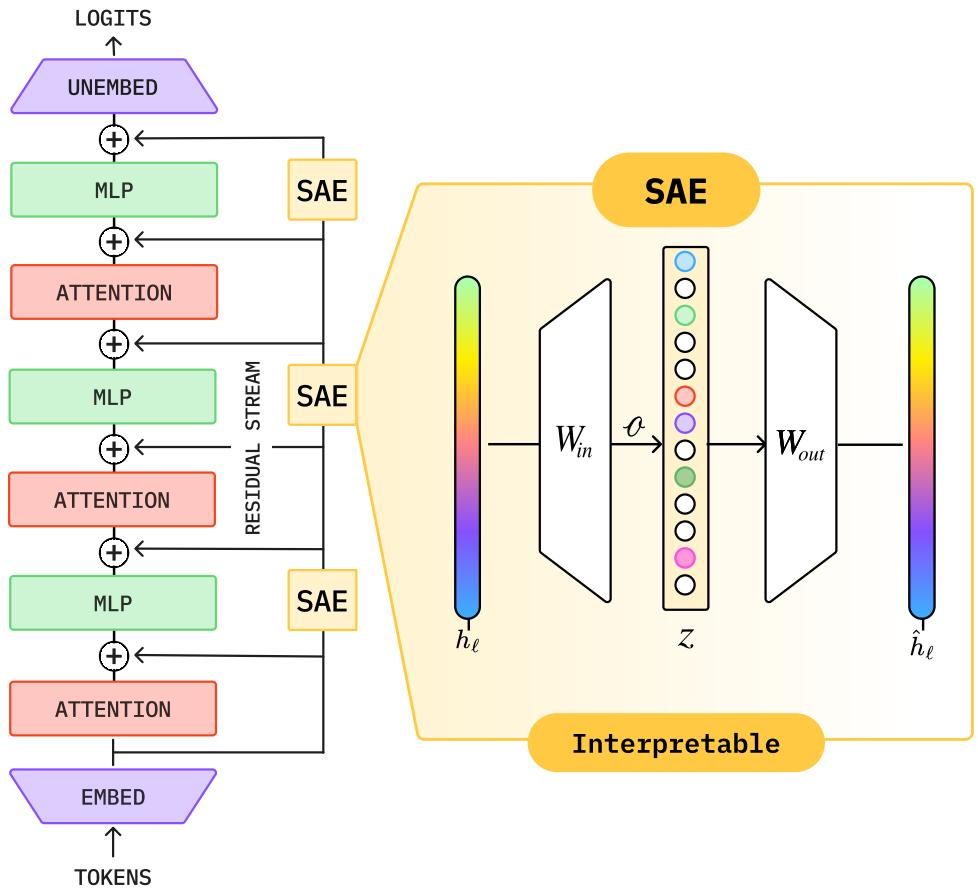  
Figure 6: Sparse Autoencoder (SAE). SAEs are trained to reconstruct activations of a model component at a specific layer $\ell , h _ { \ell } .$ , into an overcomplete, sparse latent space z, such that the reconstructed activation $\hat { h _ { \ell } } \approx h _ { \ell }$ $\mathrm { B y }$ enforcing sparsity on z, the model decomposes dense, polysemantic representations into monosemantic, human-interpretable features.

From Monosemanticity to Concept Identification. For each input activation, the raw SAE outputs are just a small set of vectors. Practical interpretability requires identifying the semantic concepts these vectors correspond to in natural language (so that they become human-understandable features). Empirically, SAE features selectively activate on structured token patterns that recur across input sequences, suggesting sensitivity to specific abstract semantic, functional, or lexical concepts (Marks et al., 2024b). Automated analysis pipelines (Gur-Arieh et al., 2025a; Paulo et al., 2025b) aggregate highly activating inputs to infer the concept each feature captures (see Section 12.6 for a detailed discussion).

Training Dynamics and Evaluation. SAE training is sensitive to initialisation, sparsity strength, and decoder normalisation. Without proper constraints and hyperparameters, the features may collapse, duplicate, or absorb one another. SAEs are typically evaluated for reconstruction loss (fidelity of activation reconstruction), feature absorption (how often a general feature fails to fire because a more specific feature has absorbed its direction), and downstream test loss recovery (whether replacing activations with reconstructions preserves model behaviour). Together, these metrics assess both the quality of the decomposition and its mechanistic relevance to the original model’s computation.

## 6.3 SAE Variants and Architectural Improvements

There are several variants of the standard SAE. One key reason to use alternatives is that standard SAE training penalises activation magnitude, which can lead to low activation even when a feature is clearly present (the shrinkage efect). Diferent optimisation frameworks also have diferent tunable parameters. The choice depends on the analysis goal, target layer type, model size, and budget constraints.

## Gated SAEs

Gated SAEs introduce multiplicative gates to decouple feature selection from magnitude:

$$
z = \underbrace { \mathbb { 1 } \left( \left( W _ { \mathrm { g a t e } } h _ { \ell } + b _ { \mathrm { g a t e } } \right) > 0 \right) } _ { \mathrm { G a t i n g ~ P a t h } } \odot \underbrace { \sigma _ { \mathrm { R e L U } } \left( W _ { \mathrm { i n } } h _ { \ell } + b _ { \mathrm { i n } } \right) } _ { \mathrm { M a g n i t u d e ~ P a t h } } ,
$$

where $h _ { \ell } \in \mathbb { R } ^ { d }$ denotes activations at layer $\ell , W _ { \mathrm { i n } } \in \mathbb { R } ^ { d _ { \mathrm { s p a r s e } } \times d }$ and $b _ { \mathrm { i n } } ~ \in ~ \mathbb { R } ^ { d _ { \mathrm { s p a r s e } } }$ are encoder E parameters, $W _ { \mathrm { g a t e } } \in \mathbb { R } ^ { d _ { \mathrm { s p a r s e } } \times d }$ and $b _ { \mathrm { g a t e } } \in \mathbb { R } ^ { d _ { \mathrm { s p a r s e } } }$ are the gate parameters, and ⊙ denotes elementwise product. This mitigates shrinkage efects induced by the $L _ { 1 }$ penalty (Rajamanoharan et al., 2024a).

## JumpReLU SAEs

JumpReLU SAEs (Rajamanoharan et al., 2024b) learn perfeature activation thresholds. Given the encoder pre-activation $a = W _ { \mathrm { i n } } h _ { \ell } + b _ { \mathrm { i n } } ,$ , let $a _ { i }$ denote its i-th entry. The activation value of the i-th feature after applying JumpReLU is

$$
z ^ { i } = \sigma _ { \mathrm { J u m p R e L U } } ( a _ { i } ) = \left\{ \begin{array} { l l } { a _ { i } } & { \mathrm { i f } \ a _ { i } > \tau _ { i } } \\ { 0 } & { \mathrm { o t h e r w i s e } , } \end{array} \right.
$$

where $\tau _ { i }$ is a learned threshold parameter. Straight-through estimators (Bengio et al., 2013) are used during training to enable gradient flow.

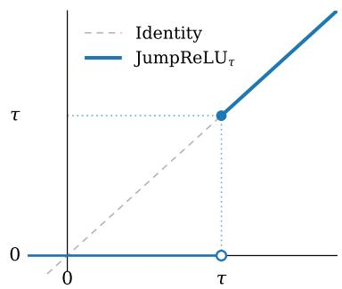

## Top-k SAEs

Top-k SAEs (Gao et al., 2025) impose an explicit hard sparsity constraint. Let $a = W _ { \mathrm { i n } } h _ { \ell } + b _ { \mathrm { i n } } \in \mathbb { R } ^ { d _ { \mathrm { s p a r s e } } }$ denote encoder pre-activations. Top-k SAEs define the i-th feature’s activation as

$$
z ^ { i } = \sigma _ { \mathrm { T o p K } } ( a _ { i } ) = \left\{ \begin{array} { l l } { a _ { i } } & { \mathrm { i f ~ } i \in  { \mathcal { T } } _ { k } ( a ) } \\ { 0 } & { \mathrm { o t h e r w i s e } , } \end{array} \right.
$$

where $\textstyle { \mathcal { T } } _ { k } ( a )$ indexes the k largest entries of a. This formulation explicitly enforces $\| z \| _ { 0 } \leq k - \bar { \alpha }$ more direct feature-sparsity constraint than $L _ { 1 }$ regularisation. Notably, as it does not suppress activation magnitudes, it avoids the feature-shrinkage issue observed in $L _ { 1 }$ -based SAE training (Gao et al., 2025).

## Batch Top-k SAEs

Batch Top-k SAEs relax the fixed per-example sparsity constraint of standard Top-k SAEs by enforcing the sparsity budget across an entire batch instead (Bussmann et al., 2024). For a batch of encoder

activations

$$
\left[ \boldsymbol { a } ^ { ( 1 ) } , \dots , \boldsymbol { a } ^ { ( B ) } \right] \in \mathbb { R } ^ { d _ { \mathrm { s p a r s e } } \times B } ,
$$

where B is the batch size, Batch Top-k retains the largest Bk activation values in the batch. Specifically, let

$$
\mathcal { T } : = \arg \operatorname* { m a x } _ { \mathcal { S } \subseteq \{ 1 , . . . , B \} \times \{ 1 , . . . , d _ { \mathrm { s p a r s e } } \} } \sum _ { ( b , j ) \in \mathcal { S } } a _ { j } ^ { ( b ) } .
$$

In each batch, the activation value of the j-th feature in the b-th sample is

$$
z ^ { j , ( b ) } = \sigma _ { \mathrm { B a t c h - T o p K } } \left( a _ { j } ^ { ( b ) } \right) = \left\{ \begin{array} { l l } { a _ { j } ^ { ( b ) } , } & { ( b , j ) \in \mathbb { Z } , } \\ { 0 , } & { \mathrm { o t h e r w i s e } . } \end{array} \right.
$$

That is, each batch exactly retains Bk features, while individual samples may have more or fewer active features than k. This loose constraint allows the model to allocate representational capacity adaptively across samples. During inference, Batch Top-k SAEs instead use the JumpReLU function with an inferred global threshold to determine which features are active for each input, so that an input’s activations do not depend on the rest of the batch.

## Trade-ofs Between Variants

Diferent SAE variants may implement distinct sparsity constraints. No single variant is optimal across all scenarios.

<table><tr><td>Variant</td><td>Sparsity</td><td>Differentiable</td><td>Tuning Required</td></tr><tr><td>L₁-regularised</td><td>Soft</td><td>√</td><td>λ coefficient</td></tr><tr><td>Gated</td><td>Learned</td><td>x†</td><td>λ coefficient</td></tr><tr><td>JumpReLU</td><td>Learned</td><td>X*</td><td>λ coefficient, STE bandwidth, threshold init.</td></tr><tr><td>Top-k</td><td>Hard</td><td>x</td><td>k value</td></tr><tr><td>Batch Top-k</td><td>Hard</td><td>X</td><td>k value</td></tr></table>

<sup>∗</sup>Uses straight-through estimators (STEs) during training. <sup>†</sup>Trains the non-diferentiable gate with auxiliary losses.

Readers are referred to Shu et al. (2025) for a dedicated survey of SAEs, their variants, evaluations, and applications. Additionally, researchers have published SAE weights for several language models, including Gemma Scope (Lieberum et al., 2024) for Gemma 2 (Team et al., 2024b) and Llama Scope (He et al., 2024) for Llama-3.1-8B (Grattafiori et al., 2024). They can be accessed through open platforms such as Neuronpedia (Lin, 2023).

## 6.4 Empirical Comparisons of SAE Variants

The SAE variants in Section 6.3 difer principally in how they enforce sparsity, and those diferences map onto distinct analysis settings.

Hard-constraint formulations (e.g., Top-k) directly enforce sparsity and suit tight compute budgets. Learned threshold (e.g., JumpReLU SAE) and gated formulations usually achieve better reconstruction results and suit generous tuning budgets. Cross-layer variants (discussed in Section 6.6) analyse computations across layers that a single dictionary cannot represent at all. This subsection discusses the setting in which each variant is used and the evidence it provides. We particularly discuss four factors that account for most of the variation:

1. Analysis goal: exploratory discovery vs. targeted investigation vs. deployment/monitoring

2. Layer type: residual stream vs. MLP output vs. attention output

Table 3: Heuristic recommendations for selecting SAE variants across diferent layer types. Recommendations are based on current empirical evidence and practical experience, and may evolve as SAE methodologies and evaluation standards continue to develop.
<table><tr><td>Layer Type</td><td>Variants Used</td><td>Reported Basis</td><td>Reported Caveats</td></tr><tr><td>Residual stream (early layers)</td><td>Gated SAE, Top-k</td><td>Activations are closer to input embeddings; moderate sparsity</td><td>Smaller expansion factors (2-4×) reported</td></tr><tr><td>Residual stream (middle layers)</td><td>Gated SAE, JumpReLU</td><td>Richest feature structure; highest interpretability potential</td><td>Standard expansion factor (4–8×); most studied regime</td></tr><tr><td>Residual stream (late layers)</td><td>Top-k, Gated SAE</td><td>Activations increasingly task-specific; may be less sparse</td><td>Larger expansion factors (8-16×) reported</td></tr><tr><td>MLP outputs</td><td>Transcoder (Section 6.6)</td><td>MLP applies a nonlinearity a single-layer SAE cannot span</td><td>Not a sparse decomposition on a static object; bridges input to output l</td></tr><tr><td>Attention outputs</td><td>Gated SAE, standard SÁE</td><td>Attention outputs often lower-rank</td><td>Least studied of the three sites; may benefit from smaller dictionaries</td></tr><tr><td>Cross-layer</td><td>Crosscoder, CLT (Section 6.6)</td><td>Tracks feature evolution; resolves cross-layer superposition</td><td>High compute cost; requires multi-layer training</td></tr></table>

3. Model scale: small (<1B) vs. medium (1–10B) vs. large (>10B parameters)

4. Resource constraints: compute budget, hyperparameter tuning capacity, tolerance for training instability

Analysis Goal. Exploratory discovery, where the question is what features exist rather than whether a particular one does, is the setting SAEs were designed for and the one the comparisons below address. For targeted investigation of an already-identified behaviour, where the concepts of interest are determined, supervised methods such as DAS (Geiger et al., 2024) and linear probes are more direct instruments. For online deployment and monitoring, SAEs with small dictionaries can be preferable for low inference cost.

Layer Type. Layer types difer in their activation properties, so the right variant depends on what each can represent, not just how well. On the residual stream, single-layer SAEs apply directly, and the choice reduces to the resource considerations below. On MLP outputs, transcoders are the appropriate tool: a single-layer SAE cannot span the nonlinearity, so transcoders learn the input-to-output map directly (Dunefsky et al., 2024), and Paulo et al. (2025c) reported favourable comparisons against SAEs there. On attention outputs, standard and Gated SAEs both have been used; attention-specific variants remain underdeveloped, making this the least studied of the three sites. For cross-layer analysis, crosscoders (Lindsey et al., 2024) and cross-layer transcoders (Ameisen et al., 2025) track feature evolution across layers at substantially higher compute cost, and a crosscoder trained jointly on two models is the reported approach for comparing representations between them. Table 3 summarises the variants used at each layer type, the empirical rationale for their use, and the main caveats reported in prior work.

Resource Constraints. Under limited compute, or where fast iteration matters more than reconstruction quality, Top-k SAEs (Gao et al., 2025) are the practical choice: fixing $\| z \| _ { 0 } \leq k$ removes the sparsity coeficient λ from the search space entirely rather than requiring it to be tuned, with reported values commonly in the range k = 32 (Gao et al., 2025) to 150 (Karvonen et al., 2025). With moderate tuning capacity, Gated SAEs (Rajamanoharan et al., 2024a) achieved a better reconstruction–sparsity trade-of while retaining λ. They also avoid the shrinkage efect by separating feature detection from magnitude estimation. However, because the standard $L _ { 1 }$ SAE is now used mainly as a baseline, comparisons against it partly reflect shrinkage rather than dictionary quality alone. When extensive tuning is plausible, JumpReLU SAEs (Rajamanoharan et al., 2024b) achieved the strongest reconstruction performance at matched sparsity by learning per-feature thresholds. However, gains on these sparsity–fidelity proxy metrics do not reliably translate into better downstream performance (Karvonen et al., 2025). In practice, selecting the best model and hyperparameters to achieve optimal performance can take a lot of time.

Model Scale. The diferences between variants depend strongly on the metric in models with roughly 1 or 2B parameters, such as Gemma-2-2B (Karvonen et al., 2025), which is the regime mainly used to validate methodology before scaling. For models between 1B and 10B parameters, JumpReLU SAEs and Top-k SAEs are the most commonly reported variants; Gemma Scope (Lieberum et al., 2024) uses the former and Llama Scope (He et al., 2024) the latter. For models larger than 10B parameters, Gemma Scope (Lieberum et al., 2024) (for Gemma 2 models) and Gemma Scope 2 (McDougall et al., 2025) (for Gemma 3 models) are the main open resources, both of which used JumpReLU SAEs. Additionally, Gao et al. (2025) explored scaling Top-k SAEs to GPT-4 (OpenAI et al., 2024), although GPT-4 itself is not publicly available.

Table 4 summarises each variant’s main findings reported in previous work, along with their experimental settings. Note that these studies may use diferent baselines, model families, sparsity constraints, and evaluation criteria. The community has been establishing benchmarks to evaluate variants of SAEs, such as SAEBench (Karvonen et al., 2025), but the results vary by metric. As a result, we should treat the findings as references rather than established rules. The Setting column in Table 4 records the conditions under which each result is established. Table 5 further highlights several factors that limit the generality of the findings.

## 6.5 Challenges and Failure Modes of SAEs

SAEs have become a standard tool for feature extraction, but they exhibit systematic failure modes that undermine their interpretability claims. It is therefore essential to understand these issues when using SAEs as mechanistic tools. This section provides a systematic discussion of them.

## 6.5.1 Dead Features

A dead feature is an element in the learned dictionary that never activates or activates extremely rarely across training. Dead features waste the dictionary’s capacity, and they are common. In fact, they can constitute up to 10–50% of the dictionary in a poorly tuned SAE (Bricken et al., 2023).

Several factors can cause dead features to emerge. First, inappropriate SAE weight initialisation can place features in low-density regions of the activation space with weak gradient signals. Second, an overly strong sparsity penalty λ may suppress feature activations early in training, preventing features from contributing usefully to reconstruction. Finally, once a subset of features captures common, dominant patterns, the remaining features struggle to find useful roles for improving reconstruction and thus do not activate.

Dead features can be detected by tracking each feature’s rate of being activated during training. For example, features with an activation rate below 0.01% may be considered dead (the threshold should adapt across scenarios). Several mitigation strategies have been proposed, such as neuron resampling, which periodically reinitialises dead features using examples with high reconstruction error (Bricken et al., 2023). The sparsity penalty can also be reduced early in training and increased gradually (i.e., a warm-up schedule). More recent Batch Top-k SAEs allocate sparsity adaptively across samples, which allows more active features on complex inputs and fewer on easy ones (Bussmann et al., 2024).

## 6.5.2 Feature Duplication

Feature duplication occurs when multiple features in the dictionary encode the same or similar concepts (Templeton et al., 2024), leading to potentially redundant features. Duplication can arise for several reasons:

Table 4: Reported evidence for each SAE variant, with the setting in which it was obtained.
<table><tr><td>Variant</td><td>Reported Finding</td><td>Setting</td></tr><tr><td>Standard</td><td>Sparse dictionary learning by  $L _ { 1 }$  regularisation recovers features more monosemantic than individual neurons; subject to shrinkage bias</td><td>Establishing work, small models (Cunningham et al., 2024; Bricken et al., 2023)</td></tr><tr><td>Gated</td><td>Separating detection from magnitude estimation addresses  $L _ { 1 }$  shrinkage at minimal added complexity</td><td>Reconstruction-sparsity improvement at matched sparsity, Gemma- family (Rajamanoharan et al., 2024a)</td></tr><tr><td>JumpReLU</td><td>Learned per-feature thresholds trained with straight-through estimators give the strongest reported reconstruction</td><td>Matched-sparsity comparison, Gemma- family (Rajamanoharan et al., 2024b); needs most tuning (Bussmann et al., 2024)</td></tr><tr><td>Top-k</td><td>A hard  $\| z \| _ { 0 } \leq k$  constraint removes the sparsity coefficient from the search space</td><td>Scaling behaviour characterised on large models; k = 32–150 commonly reported (Gao et al., 2025; Karvonen et al., 2025)</td></tr><tr><td>Batch Top-k</td><td>A batch-level sparsity budget lets the number of active features vary per input, improving reconstruction at matched average sparsity</td><td>Introduced as a relaxation of per-example Top-k, achieving better reconstruction (Bussmann et al., 2024)</td></tr><tr><td>Transcoder</td><td>Learning the MLP input-output map avoids spanning the nonlinearity with a single dictionary</td><td>Reported to perform at least on par with SAEs (Dunefsky et al., 2024; Paulo et al., 2025c)</td></tr><tr><td>Crosscoder</td><td>Joint reconstruction across layers tracks feature evolution and resolves cross-layer superposition</td><td>Cross-layer analysis and model diffing; trained jointly across models for cross-model comparison (Lindsey et al., 2024)</td></tr><tr><td>CLT</td><td>Partial reconstruction of multiple downstream layers from one dictionary</td><td>Deployed within CLT-based circuit discovery at scale (Ameisen et al., 2025)</td></tr></table>

insuficient sparsity pressure, imbalanced training data, or an optimisation process that favours local minima with duplicated features. Duplication can be detected by computing pairwise cosine similarity between feature directions (i.e., decoder columns), where high similarity indicates potential redundancy. As duplicated features tend to activate together (Korznikov et al., 2025), co-activation statistics may provide complementary evidence.

Table 5: Conditions for the reported evidence on SAE variant behaviour.
<table><tr><td>Condition</td><td>Description</td></tr><tr><td>Architecture dependence</td><td>Most evidence derives from Llama- and Gemma-family models. Generality of the findings across model families remains unestablished.</td></tr><tr><td>Task dependence</td><td>The properties that matter may differ across analysis goals, such as safety auditing, behaviour understanding, and knowledge localisation, but existing evaluations often do not distinguish between them.</td></tr><tr><td>Rapid iteration</td><td>New architectures and training procedures are proposed faster than existing ones are sufficiently studied and replicated.</td></tr><tr><td>Immature theoretical analysis</td><td>Current findings are mostly empirical and may be superseded. Understanding of why particular variants succeed or fail is incomplete.</td></tr><tr><td>Feature reproducibility</td><td>SAEs trained on the same data with different random seeds can recover substantially different features. When between-variant performance differences are smaller than within-variant seed-to-seed variability, we may not confidently attribute them to architectural factors. However, few reported comparisons have rigorously accounted for this concern.</td></tr></table>

## 6.5.3 Feature Absorption and Splitting

Another class of failure modes concerns feature granularity. Feature absorption arises when semantically hierarchical features interact under the sparsity objective: a seemingly general (parent) feature fails to activate on some inputs where it should because a more specific (child) feature activates instead and has absorbed part of the parent’s direction into its own decoder direction (Chanin et al., 2025). For example, a “starts with S” feature may fail to activate on the token “short”, while a token-specific “short” feature with a partially overlapping direction activates instead. Absorption-induced false negatives make such a feature an unreliable detector of its concept. It can be detected by comparing the feature with a linear probe for the same concept: inputs on which the probe responds strongly, but the feature does not, while another active feature’s direction aligns with the probe, indicate absorption (Chanin et al., 2025).

By contrast, feature splitting occurs when a feature learned by a smaller SAE splits into multiple distinct features as the SAE scales up (e.g., by increasing the expansion factor e). This often produces more finegrained features, which may be either beneficial or less useful. In a favourable case, an initially polysemantic or opaque feature, such as one activating on “bank” in both financial and geographical contexts, may split into more coherent features of “investment bank” and “river bank”. In a less useful case, the resulting features may become low-level, lexical detectors that activate on the token “bank” in any context.

## 6.5.4 Feature Instability Across Seeds

SAE features are also sensitive to random initialisation, optimiser stochasticity, and data ordering. For a fixed SAE architecture and training dataset, diferent random seeds can produce substantially diferent dictionaries (Paulo & Belrose, 2026). In practice, frequent and semantically clear features tend to be stable, while rare or context-specific features vary substantially. Often, fewer than 50% of features remain the same across seeds, although broader semantic clusters may remain more consistent. This instability limits the reliability of mechanistic claims based on individual SAE features. Although aggregating results across seeds can improve robustness, it increases computational cost. As a result, when evaluating SAEs, we should report feature stability across seeds alongside reconstruction loss.

## 6.5.5 Identifiability and Theoretical Concerns

Another concern for SAE-based interpretability claims is whether the learned features are identifiable, that is, whether the dictionary learning reliably recovers the “true” underlying features—if such features exist—or merely finds one of many mediocre decompositions (Klindt et al., 2025).

## Identifiability

Suppose activations are generated by some sparse latent process

$$
h = D ^ { * } z ^ { * } + \epsilon ,
$$

where $D ^ { * }$ is the ground-truth feature dictionary and $z ^ { * }$ are the feature coeficients. An SAE is identifiable if its training recovers $D ^ { * }$ and $z ^ { * }$ up to unavoidable symmetries such as feature permutation and rescaling.

In classical dictionary learning, identifiability holds under low-coherence conditions, i.e., dictionary elements are suficiently orthogonal to one another. However, when coherence is high, ambiguity arises: multiple distinct sparse combinations of features from the same dictionary can generate the same output (Schnass & Vandergheynst, 2008). In large language model activations, high coherence is likely unavoidable because of the model’s complicated internal structure and correlations within its feature space (Li et al., 2025b). So far, identifiability remains a stubborn issue in SAEs, even though it ofers a theoretical explanation for several empirical observations.

Recent progress in fine-tuning language models around a fixed sparse autoencoder ofers a potential path forward. In this setting, model activations are explicitly constrained to be sparse combinations of decoder features while largely preserving task performance (Chen et al., 2025a). In particular, recent work aimed at limiting superposition fine-tunes the language model jointly with the SAE while enforcing orthogonality constraints on the decoder matrix (Miller et al., 2026). By explicitly imposing low-coherence conditions, this approach improves identifiability: activations have a unique feature representation, and these features can be reliably recovered.

Relation to Causal Relevance. The concern of identifiability connects to causal relevance: even if an SAE feature is monosemantic and helps reconstruct activations well, it may not correspond to a causally meaningful unit of analysis. Below, we summarise some criteria for validating an SAE feature.

Diagnostic criteria:

• Necessity: Does ablating the feature remove the corresponding concept in model responses? Low necessity suggests that the concept can be expressed through redundant features.

• Suficiency: Does activating only this feature produce the behaviour corresponding to its concept? Low suficiency suggests the feature alone is not enough to represent the concept.

• Specificity: Does the feature’s causal efect match its corresponding concept? Low specificity means the feature contains other concepts.

These criteria are useful in practice when claiming that SAE features represent meaningful units of analysis.

## 6.5.6 Practical Recommendations

The challenges discussed above suggest several methodological considerations for SAE-based interpretability studies:

1. Report failure-mode metrics: Alongside reconstruction loss, researchers should also report dead-feature percentage, duplication rate, and stability across seeds.

2. Validate causal relevance: Researchers should validate features’ necessity, suficiency, and specificity through interventions (e.g., feature ablation or steering) and evaluation on downstream efects.

3. Compare methods: For safety-critical applications, researchers should compare SAE features against various baselines to assess whether SAEs recover the relevant structure.

4. Try multiple SAE variants: Diferent variants (e.g., Gated, Top-k, JumpReLU) impose diferent inductive biases. Researchers can explore findings consistent across variants, as these provide stronger evidence.

5. Acknowledge identifiability limits: Researchers should frame SAE features as one valid approximate decomposition rather than the true features. Multiple decompositions may be equally valid for reconstruction but yield diferent feature sets.

6. Consider alternatives for targeted analysis: When specific concepts are the focus, supervised methods (e.g., DAS, probes, discussed in Section 6.9.4) may be more reliable because SAEs discover features in an unsupervised and exploratory manner.

## 6.6 Multi-Layer Feature Extraction and Analysis

Standard SAEs analyse individual layers in isolation. However, features can evolve as information propagates through the network. Transcoders (Figure 7a), cross-layer transcoders (Figure 7b), and crosscoders (Figure 9) enable multi-layer feature extraction and analysis, revealing how representations and features associated with particular model components—most commonly MLP blocks—transform across depth.

## 6.6.1 Transcoders: Bridging the Nonlinearities

## Transcoder (Figure 7a)

A transcoder learns a sparse mapping between the input to and output of a model component, such as an MLP block, in layer ℓ:

$$
h _ { \ell } ^ { \mathrm { o u t } } \approx W _ { \mathrm { o u t } } z + b _ { \mathrm { o u t } } , \quad z = \sigma ( W _ { \mathrm { i n } } h _ { \ell } ^ { \mathrm { i n } } + b _ { \mathrm { i n } } )
$$

where $z \in \mathbb { R } ^ { d _ { \mathrm { s p a r s e } } }$ are sparse feature activations bridging the nonlinearity between input and output of the MLP, and $W _ { \mathrm { o u t } } \in \mathbb { R } ^ { d \times d _ { \mathrm { s p a r s e } } }$ and $b _ { \mathrm { o u t } } \in \mathbb { R } ^ { d }$ are decoder D parameters. The transcoder reconstructs post-nonlinearity activations using features extracted from pre-nonlinearity activations (Dunefsky et al., 2024).

Architecture and Motivation. Standard SAEs do not explain the nonlinear transformations (i.e., weight matrices of MLP blocks and attention heads) themselves that produce the activations. A transcoder achieves this by applying dictionary learning to the mapping, learning features that explain the transformation. Its training minimises

$$
\mathcal { L } = \| h _ { \ell } ^ { \mathrm { o u t } } - ( W _ { \mathrm { o u t } } z + b _ { \mathrm { o u t } } ) \| _ { 2 } ^ { 2 } + \lambda \| z \| _ { 1 } ,
$$

where $z = \sigma ( W _ { \mathrm { i n } } h _ { \ell } ^ { \mathrm { i n } } + b _ { \mathrm { i n } } )$ as defined above.

When Are Transcoders Necessary? SAEs extract features from static activations and thus often sufice for residual-stream analysis. Transcoders track how features emerge from input to output and are essential for analysing MLP layers (Dunefsky et al., 2024).

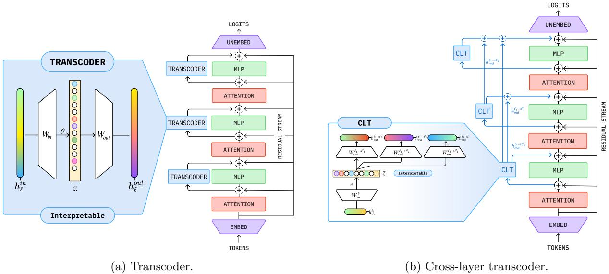  
Figure 7: Transcoders and CLTs. Transcoders reconstruct the output of the MLP from its input in the same transformer layer. CLTs extend this by partially reconstructing the outputs of multiple subsequent layers from a single point in the residual stream.

## 6.6.2 Cross-Layer Transcoders: Enabling Better Circuit Analysis

## Cross-Layer Transcoder (Figure 7b)

Cross-layer transcoders (CLTs) are sparse feature decompositions spanning all layers of a neural network. At each layer ℓ, sparse feature activations are read from the residual stream via

$$
z _ { \ell } = \sigma _ { \mathrm { J u m p R e L U } } \left( W _ { \mathrm { i n } } ^ { \ell } h _ { \ell } ^ { \mathrm { i n } } \right) ,
$$

where $z _ { \ell } ^ { j }$ denotes the activation of feature j at layer $\ell .$

Each feature can write to the MLP outputs of its own layer and all subsequent layers through layer-specific decoder vectors. The contribution from features read at layer ℓ to the MLP output at a subsequent layer $\ell ^ { \prime }$ is

$$
\hat { h } _ { \ell \to \ell ^ { \prime } } ^ { \mathrm { o u t } } = \sum _ { j } W _ { \mathrm { o u t } , j } ^ { \ell \to \ell ^ { \prime } } z _ { \ell } ^ { j } ,
$$

where $W _ { \mathrm { o u t } , j } ^ { \ell \to \ell ^ { \prime } }$ is the decoder vector from feature $j$ at layer ℓ to the MLP output at layer $\ell ^ { \prime } .$ The reconstructed MLP output at layer $\ell ^ { \prime }$ is then

$$
\hat { h } _ { \ell ^ { \prime } } ^ { \mathrm { { o u t } } } = \sum _ { \ell = 1 } ^ { \ell ^ { \prime } } \hat { h } _ { \ell \to \ell ^ { \prime } } ^ { \mathrm { { o u t } } } = \sum _ { \ell = 1 } ^ { \ell ^ { \prime } } \sum _ { j } W _ { \mathrm { o u t } , j } ^ { \ell \to \ell ^ { \prime } } z _ { \ell } ^ { j } ,
$$

which approximates the original MLP output $h _ { \ell ^ { \prime } } ^ { \mathrm { o u t } }$

CLTs (Figure 7b) are trained jointly across all L layers to minimise

$$
\mathcal { L } = \sum _ { \ell ^ { \prime } = 1 } ^ { L } \left\| \hat { h } _ { \ell ^ { \prime } } ^ { \mathrm { o u t } } - h _ { \ell ^ { \prime } } ^ { \mathrm { o u t } } \right\| _ { 2 } ^ { 2 } + \lambda \sum _ { \ell = 1 } ^ { L } \sum _ { j } \mathrm { t a n h } \left( c z _ { \ell } ^ { j } \sqrt { \sum _ { \ell ^ { \prime } = \ell } ^ { L } \left\| W _ { \mathrm { o u t } , j } ^ { \ell \to \ell ^ { \prime } } \right\| _ { 2 } ^ { 2 } } \right) ,
$$

where c is the sharpness hyperparameter (Ameisen et al., 2025).

Replacement Models and Attribution Graphs. A key insight is that CLTs enable the construction of a replacement model—a version of the original model in which all MLP layers are replaced with their CLT reconstructions. Running this replacement model involves:

• Computing CLT feature activations z<sub>ℓ</sub> at each layer ℓ

• Replacing MLP outputs $h _ { \ell } ^ { \mathrm { o u t } }$ with reconstructions $\hat { h } _ { \ell } ^ { \mathrm { o u t } }$ from features in layer 1 through ℓ

• Keeping attention layers unchanged

When analysing a specific prompt, the replacement model freezes the original model’s attention patterns and normalisation statistics from its forward pass, then adds layer-specific error corrections. Under these conditions, the local replacement model can exactly match the original model’s activations on that prompt while decomposing it into interpretable CLT features. However, when the model’s activations are completely replaced by CLT reconstructions, the intervened model’s top-1 predictions match the original model’s on only about 50% of prompts from the Pile dataset (Gao et al., 2020). Notably, this experiment uses a relatively small, 18-layer transformer (Ameisen et al., 2025). Therefore, this figure should be interpreted with important caveats (see below).

## Caveats on CLT Fidelity Claims

CLTs have been claimed to possess high output fidelity given that they achieve high top-1 token agreement. However, this claim requires careful examination:

## Conditions for reported fidelity:

• Results are reported primarily on toy or small models, whose generality to other model architectures (e.g., Llama, Qwen) and model sizes (e.g., 70B models) is underexplored.

• Fidelity was measured on short sequences in the CLT training data. Evaluation under distribution shift (e.g., out-of-domain tasks, adversarial inputs) is not adequate.

• The paper reports top-1 token agreement as the main result, while softer metrics (e.g., top-5 agreement, KL divergence) may show diferent patterns and insights.

## Conditions for exact local matching:

• Attention patterns must be frozen from the original forward pass since the CLT does not compute or reconstruct attention computations.

• Layer normalisation statistics (means, variances) must be cached from the original model. The replacement model does not recompute these.

• Error correction terms are added per layer to compensate for reconstruction residuals. Without them, exact matching fails.

## Factors afecting fidelity:

• Model scale: Preliminary evidence suggests that reconstruction quality and feature interpretability improve with CLT model size. This may be because larger CLTs produce more structured, less entangled representations (Ameisen et al., 2025). However, systematic scaling studies are limited.

• Layer depth: Early layers’ and late layers’ activations are usually input-specific and outputconstrained, respectively. Middle layers have richer information derived from the input but are not yet converged to the output. As a result, middle layers often show higher reconstruction fidelity.

• Domain: Fidelity on factual recall and syntactic tasks is higher than on complex reasoning or arithmetic tasks, where MLP computations may be more complex and cannot be approximated by sparse linear features.

These caveats do not invalidate CLTs as a tool for mechanistic analysis, but they do mean that fidelity should be verified on the target model and specific task before drawing strong conclusions from CLT-based circuit analysis.

Why CLTs Enable Better Circuit Analysis. Unlike per-layer transcoders, CLTs reveal direct featureto-feature interactions across layers: a feature in layer ℓ directly influences features in later layers through its contribution to their inputs. This simplifies circuit structure—features need not re-encode information at each layer. Additionally, replacing MLPs with CLT reconstructions makes the remaining computation approximately linear (with frozen attention patterns and normalisation), enabling principled attribution: each feature’s activation can be expressed as the sum of its input edges up to its activation threshold (Ameisen et al., 2025).

However, linearisation depends on several assumptions:

• Attention freezing: By caching attention patterns, the replacement model treats attention as a fixed routing operation rather than a dynamic, input-dependent computation. This means CLT-based circuits describe model computation conditioned on given attention patterns without analysing them.

• Normalisation caching: CLT analysis caches the input-dependent normalisation factors (e.g., LayerNorm denominators) from the original forward pass and reuses them during attribution instead of recomputing them after interventions. This removes a source of nonlinearity, but if an intervention would substantially change these normalisation factors in the original model, the cached computation no longer faithfully represents the intervened state.

• Sparse linear approximation: Dictionary learning methods assume MLP outputs or transformations are well approximated by sparse linear combinations of features. This assumption may fail when computations involve complex feature interactions or highly nonlinear transformations.

CLTs provide a powerful lens for circuit discovery when these assumptions hold. When they fail, CLT-based explanations may become unfaithful.

Computational Cost and Practical Considerations. Let $d _ { \mathrm { s p a r s e } } = e d ,$ where e is the expansion factor. For a transformer with L layers, a complete suite of CLTs contains L encoders mapping $\bar { \mathbb { R } } ^ { d }  \mathbb { R } ^ { e d }$ and $L ( L + 1 ) / 2$ decoders mapping $\mathbb { R } ^ { e d }  \mathbb { R } ^ { d }$ . The resulting parameter count, with biases ignored, is therefore

$$
N _ { \mathrm { C L T } } ( L , d , e ) = \frac { e d ^ { 2 } } { 2 } \left( L ^ { 2 } + 3 L \right) ,
$$

which highlights the quadratic scaling with both model depth and hidden dimension, as illustrated in Figure 8.

Training a suite of CLTs thus incurs a high upfront cost. For reference, training the CLT suite for Gemma-2-9B required approximately 3,844 H100 GPU-hours at 50% FLOPs eficiency (Ameisen et al., 2025). This cost is amortised over many circuit analyses on the trained CLT. The resulting interpretability gains (cross-layer features, lower interference, better attribution) justify the investment for systematic mechanistic analysis.

For these reasons, current applications of CLTs remain limited: a “greater-than” mechanism study (Merullo et al., 2025), an open-source extension (Lindsey et al., 2025a), and analysis of multilingual representations using CLTs (Harrasse et al., 2026). This scarcity of downstream use cases likely reflects the considerable challenges of training CLTs at scale and the complexity of using CLT-based circuit discovery in the wild.

Open Questions for CLT Research. Several important questions remain open:

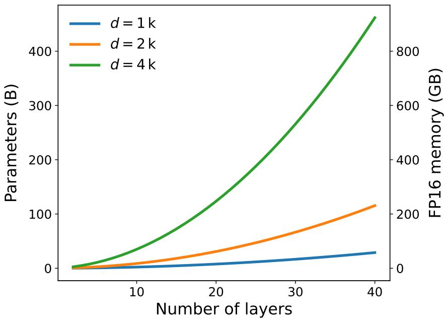  
Figure 8: Parameter count (left) and FP16 memory requirements (right) of a full cross-layer transcoder as a function of model depth, for diferent residual stream dimensions and expansion factor e = 32.

• How does CLT fidelity scale in large models? How can we better measure fidelity?

• Can CLTs be extended to model more nonlinearities such as attention patterns and normalisation, while maintaining their explanatory power?

• Can we develop evaluation protocols that reliably detect the potential unfaithfulness of CLT-based explanations?

• How sensitive are CLT circuits to experimental setups, such as the choice of training data?

## 6.6.3 Crosscoders: Analysing Cross-Layer Features

## Crosscoder (Figure 9)

A crosscoder learns a shared sparse representation from activations across L layers. It jointly encodes activations from all layers as

$$
z = \sigma _ { \mathrm { R e L U } } \left( \sum _ { \ell = 1 } ^ { L } W _ { \mathrm { i n } } ^ { \ell } h _ { \ell } + b _ { \mathrm { i n } } \right) ,
$$

where $z \in \mathbb { R } ^ { d _ { \mathrm { s p a r s e } } }$ denotes the shared sparse feature activations and $W _ { \mathrm { i n } } ^ { \ell }$ is the layer-ℓ encoder. Each layer is then reconstructed using a layer-specific decoder:

$$
\hat { h } _ { \ell } = W _ { \mathrm { o u t } } ^ { \ell } z + b _ { \mathrm { o u t } } ^ { \ell } , \qquad \ell = 1 , \dots , L .
$$

Thus, a single latent feature can capture patterns that are shared across, persist through, or vary across multiple layers of the residual stream (Lindsey et al., 2024). Studies have also used crosscoders to discover shared features in activations from diferent models (Ge et al., 2026; Bayazit et al., 2026; Lindsey et al., 2024; Jiralerspong & Bricken, 2025), as detailed in Section 9.1.

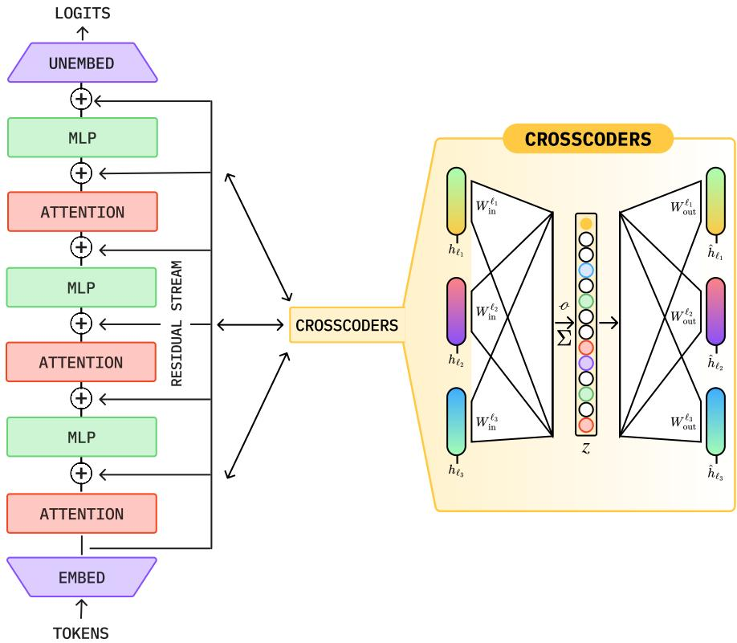  
Figure 9: Crosscoder. Crosscoders are trained to reconstruct the residual stream across multiple layers simultaneously.

A crosscoder is trained by minimising

$$
\mathcal { L } = \sum _ { \ell = 1 } ^ { L } \left. \hat { h } _ { \ell } - h _ { \ell } \right. _ { 2 } ^ { 2 } + \lambda \sum _ { j } \left( \sum _ { \ell = 1 } ^ { L } \left. W _ { \mathrm { o u t } , j } ^ { \ell } \right. _ { 2 } \right) z ^ { j } ,
$$

where $W _ { \mathrm { o u t } , j } ^ { \ell }$ denotes the decoder vector of feature j at layer $\ell ,$ and λ controls the sparsity penalty.

Causal vs. Acausal Crosscoders. Crosscoders support two information flow patterns:

• Causal Crosscoders: Read only from layers $\ell ^ { \prime } \leq \ell$ at the current position. This respects the forward pass causality: earlier layers cannot read from later layers.

• Acausal Crosscoders: Read from any layer $\ell ^ { \prime }$ regardless of depth ordering. Useful for understanding post-hoc feature relationships across the full model.

Applications to Circuit Analysis. By extracting cross-layer features, crosscoders help us understand how features propagate through the residual stream across layers, removing duplicate feature representations that complicate circuit analysis. This simplification allows features to “jump” across intervening identity operations, substantially reducing circuit complexity. More importantly, crosscoders reveal how input-relevant features transform as they flow through the network, distinguishing which features persist unchanged versus which are actively modified by downstream computation (Lindsey et al., 2024).

## 6.7 Comparing SAEs, Transcoders, and Crosscoders

Single-layer SAEs are eficient and locally interpretable but miss cross-layer feature evolution. Transcoders improve this by imitating MLP behaviour and revealing nonlinear transformations, though they require

sequential analysis across depth. Cross-layer transcoders span multiple layers for global information flow but are extremely expensive. Crosscoders take a diferent approach, extracting shared features across layers simultaneously to resolve cross-layer superposition and simplify circuits without chaining predictions.

## 6.8 Case Study: Induction Heads

Here, we examine induction heads (Olsson et al., 2022), a mechanism found in many modern language models, as a case study. We first describe their conditional-copying function and role in in-context learning, and then relate them to feature-extraction methods such as SAEs and CLTs, which reveal how this computation can be distributed across broader feature circuits.

## Induction Heads

Induction heads, first identified and analysed by Elhage et al. (2021), are attention heads that implement a conditional copying rule over repeated subsequences. Let $\boldsymbol { x } = ( x _ { 1 } , \dots , x _ { T } )$ be a token sequence, and consider positions $i < j < T$ such that $x _ { i } = x _ { j }$ . An attention head indexed r (see Section 4.4 for an introduction to attention modules) is said to be an induction head when its attention pattern assigns comparatively high attention weight from position j to position $i + 1 \ ( \mathrm { i . e . , h i g h } \ A _ { j , i + 1 } ^ { r } )$ and its residual-stream update

$$
\Delta h ^ { r } = W _ { O } ^ { r } V ^ { r } ( A ^ { r } ) ^ { \top }
$$

increases the model’s logit for token $x _ { i + 1 }$ when predicting the token at position $j + 1$

That is, induction heads implement the rule

$$
( x _ { i } = x _ { j } ) \ \Rightarrow \ \hat { x } _ { j + 1 } \approx x _ { i + 1 } .
$$

They help enable in-context prediction by copying the continuation that followed an earlier occurrence of the same token.

## Induction in a Repeated Sequence

Consider the sequence

## A B C A B

where the model needs to predict the token after the second B. Observing the repeated prefix A B, an induction head attends from the second B to the position after the first B and contributes to the model’s prediction of C. This induction behaviour should generalise across tokens and positions.

Induction heads were originally characterised as specific attention heads implementing this copying rule. However, subsequent work shows that we can understand the underlying computation more naturally at the level of distributed representations than isolated model components.

## Induction Heads: Features Across Representations

Feature extraction methods, such as SAEs, can decompose attention layer outputs into sparse, interpretable features that capture meaningful activation patterns beyond individual attention weights (Kissane et al., 2024). Modern analyses suggest that induction heads are not isolated mechanisms but participate in distributed feature circuits, where multiple interacting features recur and compose across layers (Dunefsky et al., 2024; Singh et al., 2024; Kissane et al., 2024; Kamath et al., 2025).

SAEs trained on attention heads’ activations reveal feature families of recurring patterns and contextual dependencies. Some of them align with behaviours originally attributed to induction heads (Kissane et al., 2024). By analysing these features, we can understand how models maintain and manipulate information across tokens and contexts.

Table 6: Comparison of feature extraction methods.
<table><tr><td>Method</td><td>Assumption</td><td>Strengths</td><td>Weaknesses</td><td>Best Use Case</td></tr><tr><td>SAE</td><td>Sparse, linear features</td><td>Open-ended discovery; fast inference</td><td>Hyperparameter- sensitive; identifiability issues</td><td>Open-ended feature discovery</td></tr><tr><td>NMF</td><td>Non-negative, additive parts</td><td>Parts-based interpretation; uniqueness guarantees</td><td>Requires non-negative data; limited sparsity</td><td>Naturally non-negative domains</td></tr><tr><td>PCA</td><td>Variance aligns with features</td><td>Closed form; optimal low-rank reconstruction</td><td>Explains global variance and produces orthogonal features</td><td>Small-scale settings; as a baseline method</td></tr><tr><td>ICA</td><td>Complete and independent sources</td><td>Theoretical guarantees when assumptions hold</td><td>Assumes independence; Gaussian blindness</td><td>When independence holds</td></tr><tr><td>Supervised methods</td><td>Known concept labels</td><td>High performance on targeted concepts</td><td>Requires labels; no discovery</td><td>When certain concepts of interest are known</td></tr><tr><td>K-SVD</td><td>Sparse, linear features</td><td>Explicitly solving the sparse-coding problem; no encoder bias</td><td>Slow inference; no learned encoder</td><td>Small, fixed sets of activations; as a baseline method</td></tr></table>

Cross-layer analyses, including crosscoders, suggest that certain features are represented consistently across layers rather than being recomputed at each layer (Lindsey et al., 2024). This perspective highlights that attention heads, including specialised ones such as induction heads, may be only part of broader, distributed feature representations.

## 6.9 Comparison with Alternative Feature Extraction Methods

Besides SAEs, alternative techniques from signal processing and machine learning have also been adapted to extract features from neural networks. They make diferent modelling assumptions and therefore ofer distinct trade-ofs in interpretability, scalability, and robustness. Table 6 summarises the methods discussed in this section.

## 6.9.1 Non-Negative Matrix Factorisation (NMF)

Non-negative matrix factorisation (NMF; Lee & Seung, 1999) decomposes a non-negative activation matrix $H \in \mathbb { R } ^ { d \times n }$ as $H \approx W A$ , where both the feature dictionary $W \in \mathbb { R } ^ { d \times m }$ (m is the preset number of features) and the coeficient matrix $A \in \mathbb { R } ^ { m \times n }$ are constrained to have non-negative elements. Because all components are non-negative, each feature contributes positively to the final representation, making it easier to interpret. Additionally, classical NMF’s optimisation process uses simple multiplicative update rules that preserve non-negativity. Moreover, under assumptions like separability (each latent feature appears in at least one suficiently “pure” example), NMF guarantees that the recovered decomposition is unique (Donoho & Stodden, 2003).

However, classical NMF is not suitable for neural network activations because they can have negative elements, requiring additional preprocessing steps that may distort the activation-space structure. Moreover, NMF does not explicitly encourage feature sparsity, and scaling NMF to large dictionaries is computationally expensive. As a result, empirical work on extracting and analysing features in neural network activations has largely focused on Semi-NMF (Ding et al., 2010), which relaxes the non-negativity constraint on W. Shafran et al. (2026) showed that Semi-NMF can recover features competitive with SAEs on small-scale evaluations, but systematic comparisons at large scale remain limited. Yun et al. (2021) used a Semi-NMF-like approach to factorise BERT’s contextualised hidden-state representations (Devlin et al., 2019), allowing elements in W to take both positive and negative values while constraining A to be non-negative.

## 6.9.2 Principal Component Analysis (PCA)

Principal Component Analysis (PCA; Pearson, 1901; Hotelling, 1933) decomposes activations by finding an orthonormal basis of directions that maximise explained variance. Given a mean-centred activation matrix $H \in \mathbb { R } ^ { d \times n }$ , where each column is an activation vector, PCA computes a low-rank approximation $H \approx U \Sigma V ^ { \top }$ where the columns of U are the principal directions ordered by explained variance. PCA is fast, stable, and scalable. However, PCA imposes constraints and inductive biases that may misalign with neural network activations. Specifically, it identifies principal directions that maximise explained variance in the activation distribution, but much of the information of interest is region- or context-dependent and cannot be captured by variance alone. Moreover, PCA constrains the principal directions to be orthogonal, but in practice the underlying features correlate or partially overlap. Recent benchmarks (Wu et al., 2025b) reflect this misalignment: PCA underperformed most baselines, including SAEs, on both steering and concept-detection evaluations. While PCA can outperform SAEs in some localisation settings (Mueller et al., 2025), it stil generally lags behind simple supervised baselines.

## 6.9.3 Independent Component Analysis (ICA)

Independent Component Analysis (ICA; Hyvärinen & Oja, 2000) decomposes activations $H \in \mathbb { R } ^ { d \times n }$ as $H \approx W S$ , where n is the number of data points. Note that ICA may look similar to NMF at first glance. However, they were developed for diferent use cases and thus rely on diferent assumptions and optimisation procedures. In ICA, each column in $W \in \mathbb { R } ^ { d \times m }$ is a mixing vector, and m is the number of diferent source signals; each row in $S \in \mathbb { R } ^ { m \times n }$ is a source signal (a signal has n data points), with m source signals in total These signals are optimised to be independent of one another. Thus, if model activations are linear mixtures of statistically independent “foundational features”, ICA can provably recover those features.

However, these assumptions may not hold for neural network activations. Specifically, classical ICA typically expects the completeness property (number of latent sources equals the dimensionality of the observed representation), and overcomplete decompositions (which are what we expect in activations) would require additional extensions (Lewicki & Sejnowski, 2000). Moreover, underlying features may not be statistically independent, which further limits the applicability of classical ICA. Although early studies applied it to analyse neural network activations, they did not find interpretability gains over SAEs (Cunningham et al., 2024). This may partly reflect the challenges discussed above.

More recently, however, Liu & Han (2026) showed that ICA can achieve performance comparable to that of SAEs, arguing that its previously reported underperformance may stem from limitations of classical ICA implementations poorly suited to the scale and statistical structure of neural network activations. These findings leave open whether ICA should be regarded primarily as a simple classical baseline or as an approach with underestimated, substantial headroom for further development.

## 6.9.4 Supervised Feature Extraction Methods

When the concepts of interest are known in advance, supervised methods can directly optimise representations aligned with those targets. Examples include distributed alignment search (DAS), which uses supervision to learn a change of basis that aligns representations with high-level causal variables (Geiger et al., 2024); Supervised Multi-Dimensional Scaling (SMDS), which projects activations to preserve concept-level similarities (Tiblias et al., 2026); and probes, which fit a concept direction in contrastive class-conditioned activations (Marks & Tegmark, 2024).

Notably, despite its simplicity, probing has outperformed SAEs in concept detection (Wu et al., 2025b). It has also become a standard tool for identifying safety-relevant concepts in model representations, including refusal behaviour and implanted backdoors (Arditi et al., 2024; MacDiarmid et al., 2024). We discuss probing in detail in Section 8.6. We put it under Section 8 because we view its central methodological contributions and technical challenges as the readout of human-interpretable information—often expressed in natural language—from model activations, rather than the extraction of monosemantic features or causal variables.

When labelled data is available, supervised approaches often outperform SAEs on concept detection and steering tasks (Huang et al., 2024; Wu et al., 2025b; Chaudhary & Geiger, 2024). They also avoid choosing dictionary sizes or sparsity penalties, since the concept set determines complexity. However, these methods require labelled data for each concept and cannot discover previously unknown features. Therefore, supervised methods suit settings where predefined, crisp concepts matter, whereas SAEs remain preferable for exploratory analysis.

## 6.9.5 Dictionary Learning Baselines

Classical dictionary learning methods provide useful baselines for evaluating SAEs. Techniques such as K-SVD alternate between sparse coding and dictionary updates and converge under certain conditions (Aharon et al., 2006). Comparative studies suggest that SAEs’ primary advantage is fast inference because the encoder learns to decompose all activations, while potentially sacrificing optimal sparsity (O’Neill et al., 2025). As such, classical dictionary learning can still achieve superior dictionary quality in some cases and thus remains an important reference point for assessing the added value of SAEs.

## 6.10 Interpretability-by-Design Methods for Intrinsic Interpretability

The methods surveyed thus far in this section aim to extract and analyse more monosemantic units from polysemantic model activations. They share a common premise: the model’s original representations are too entangled to be directly interpretable, so interpretability is applied post hoc to recover simpler units of analysis. A parallel research programme, which we term Interpretability-by-Design Methods for Intrinsic Interpretability, inverts this premise by asking whether deep neural models can instead be designed to be mechanistically interpretable by construction (Pearce et al., 2025; Park et al., 2025; Oldfield et al., 2024; Yang et al., 2025; Gao et al., 2026; Adler et al., 2025; Draye et al., 2026; Dooms et al., 2025). This subsection extends the discussion of this research direction.

Next, we introduce five approaches for constructing models that are more interpretable by design. Three impose model sparsity constraints at diferent levels: feature-sparse training (Section 6.10.1), weight-sparse training (Section 6.10.2), and attention-sparse training (Section 6.10.3). The remaining two approaches instead modify the computational primitives themselves, using more interpretable operators as units of construction and analysis (Sections 6.10.4 and 6.10.5).

Interpretability should be understood as a spectrum rather than a binary property. At least in their current form, these techniques do not make model computation completely or immediately understandable. Instead, they make models easier to analyse and ensure the analysis pipeline preserves more information about the original computation than post-hoc approximations. Table 7 summarises these approaches and their trade-ofs.

## 6.10.1 Feature-Sparse Training: SoLU

Softmax linear units (SoLU; Elhage et al., 2022b) are an earlier attempt at architectural intervention. SoLU is a specialised activation function that applies a softmax-based transformation across the layer’s $d _ { \mathrm { m l p } }$ neurons.

Specifically, given the pre-activation vector

$$
u = W _ { 1 } h + b _ { 1 } \in \mathbb { R } ^ { d _ { \operatorname* { m l p } } } ,
$$

SoLU calculates the activation values as

$$
\sigma _ { \mathrm { S o L U } } ( u ) = u \odot \operatorname { s o f t m a x } ( u ) .\tag{3}
$$

This softmax-based transformation induces competition among neurons. When one neuron receives a large preactivation value, the softmax suppresses the others’ values, analogous to lateral inhibition. This competition encourages certain neurons to specialise and dominate, increasing the prevalence of monosemantic neurons associated with human-interpretable concepts.

However, it also reveals an undesirable phenomenon: although many secondary neurons’ activations are suppressed to low magnitudes, these neurons remain polysemantic, with many features compressed into them. Later layer normalisation (Ba et al., 2016) can amplify them and recover the polysemanticity property (Elhage et al., 2022b). The “smuggling” by layer normalisation suggests that imposing local interpretability constraints may not eliminate neural networks’ incentive to compress information through superposition. This issue motivates global constraints across the neural network, such as weight-sparsity training discussed below.

## 6.10.2 Weight-Sparse Training

A weight-sparse transformer (Gao et al., 2026) treats weight sparsity as an explicit structural constraint that is progressively strengthened during training. Gao et al. (2026) optimise the standard cross-entropy objective along with an $L _ { 0 }$ constraint on model weights after each optimisation step. Specifically, within each weight matrix, they retain only the largest-magnitude parameters and set the rest to zero. The $L _ { 0 }$ constraint anneals from a dense initialisation to the desired sparsity level over training. The resulting transformer has most weight parameters exactly zero, making the remaining computational structure much easier to decompose into small, task-specific circuits.

Its interpretability gains can be substantial. Under highly sparse regimes $( \mathrm { e . g . , < 1 \% }$ active weights), neurons receive input from far fewer upstream neurons, and the model’s circuits for specific capabilities or behaviours become much sparser. Mean-ablation experiments further confirm that these circuits are both necessary and suficient for the capability or behaviour.

Gao et al. (2026) characterised the trade-of between model capability and interpretability induced by weight sparsity. Increasing sparsity generally makes the model easier to decompose into small, interpretable circuits. However, it also degrades task performance, producing a capability–interpretability Pareto frontier. Nonetheless, the authors found that increasing model size can shift this frontier outward. At comparable task performance, larger sparse models can have substantially smaller, more interpretable circuits than smaller models; at comparable interpretability, they can retain stronger capabilities. This suggests that scaling model size alongside structural sparsity may ofer a path to more interpretable yet high-capability models. However, preserving interpretability beyond tens of millions of nonzero parameters remains challenging, and weight-sparse training currently requires substantially more compute than traditional training.

## 6.10.3 Attention-Sparse Training

In transformers, attention patterns produced by an attention head are usually difuse, i.e., every token attends to every other token. Difuse attention patterns are dificult to interpret and audit. Previous studies have therefore explored attention-sparse training, which aims to sparsify attention patterns to make them more interpretable (Lei et al., 2025; Draye et al., 2026). Specifically, Lei et al. (2025) proposed SPARse TrANsformer World model (SPARTAN), an object-centric world model trained with $L _ { 0 }$ regularisation on attention patterns and a constrained optimisation objective to maintain cross-entropy performance equal to that of a dense counterpart. Draye et al. (2026) further adapted this technique to fine-tune and sparsify a trained language model’s attention patterns.

After training (either from scratch or via fine-tuning), each attention head attends only to specific tokens, and the model performance remains close to the original. This result suggests that many attention patterns may be redundant noise. In CLT-based circuit discovery (see Section 7.2), Draye et al. (2026) showed that sparsified attention patterns reduce the number of mediating components involved in feature-to-feature attribution, making the resulting attribution graphs easier to analyse.

Table 7: Comparison of interpretability-by-design methods.
<table><tr><td>Method</td><td>Approach</td><td>Interpretability Gain</td><td>Primary Limitation</td></tr><tr><td>Feature-Sparse Training (SoLU)</td><td>Softmax-gated activation function</td><td>Increased neuron monosemanticity</td><td>Layer normalisation smuggling displaces superposition</td></tr><tr><td>Weight-Sparse Training</td><td>Lo constraint on parameters</td><td>More monosemantic neurons and much smaller circuits</td><td>Training instability and scalability</td></tr><tr><td>Attention- Sparse Training MOLT</td><td>Lo regularisation on attention</td><td>Makes attention patterns interpretable</td><td>Requires fine-tuning on a trained language model</td></tr><tr><td></td><td>Sparse mixture of linear transforms</td><td>Reveals implemented operations directly</td><td>Complexity of matrix analysis</td></tr><tr><td>KANs</td><td>Learnable splines on edges</td><td>Symbolic formula extraction</td><td>Scalability to LLMs is unproven</td></tr></table>

## 6.10.4 Modifications of Computational Primitives: MOLT

One alternative approach to learning interpretable structure is to reconsider what the computational primitives should be (Oldfield et al., 2025; Park et al., 2025; Braun et al., 2025; Bushnaq et al., 2025). A recent example is the sparse mixture of linear transforms (MOLT), which represents a conceptual shift from feature extraction towards transformation extraction (Lindsey et al., 2025b).

Standard SAEs and transcoders primarily decompose model activations into features. However, many algorithmic tasks, such as arithmetic or geometric reasoning, are more naturally described by operations such as “add 3” or “rotate a vector”. In these tasks, we want to know how the model transforms one activation into another through components like weight matrices in MLP blocks. To achieve this, MOLT replaces the MLP with a sparse mixture of learned linear transformation matrices. The basic unit of analysis becomes transformations applied to model activations rather than features.

For example, in a modular arithmetic task, MOLT can represent the concept of addition with a learned rotation matrix, which relates more directly to the underlying algorithm than a collection of state-specific features. More broadly, approaches that represent computational operations explicitly, as MOLT does, may facilitate the development of interpretable representations for tasks governed by systematic operations. We view Kolmogorov–Arnold Networks (KANs) as an approach that embodies this idea, as discussed below.

## 6.10.5 Kolmogorov–Arnold Networks (KANs)

Kolmogorov–Arnold Networks (KANs) represent one of the most radical departures from standard neural network architectures (Liu et al., 2025b). In conventional neural networks, each neuron receives outputs from upstream neurons through incoming edges weighted by scalar parameters, sums these weighted inputs, and then applies a fixed nonlinear activation function (the whole process can be represented as matrix multiplication in components like MLP blocks and attention modules in Section 4.4). Inspired by the Kolmogorov–Arnold representation theorem, KANs place learnable nonlinear functions, typically parameterised using B-splines, on edges rather than using fixed nonlinear activation functions at nodes.

Specifically, consider a single KAN node receiving an input vector $v = ( v _ { 1 } , \ldots , v _ { d } ) \in \mathbb { R } ^ { d }$ from the previous layer. Its output is

$$
y = \sum _ { i = 1 } ^ { d } \psi _ { i } ( v _ { i } ) , \qquad \psi _ { i } ( v _ { i } ) = \sum _ { m } c _ { i , m } B _ { m } ( v _ { i } ) ,
$$

where $B _ { m } ( \cdot )$ denotes the m-th basis function, such as a cubic B-spline basis, and $c _ { i , m }$ is a learnable scalar coeficient. In this formulation, the edge is not scalar multiplication but a learnable univariate function $\psi _ { i } ( \cdot )$ and a node simply sums the outputs of its incoming edges. Intuitively, KANs shift nonlinear transformations from nodes to edges, ofering an alternative way to structure and interpret neural network computations.

This design gives KANs an explicitly compositional and thus more interpretable structure. As the nonlinearities are univariate and can be visualised directly on individual edges, researchers can use techniques like symbolic regression to approximate and inspect the learned analytical expressions, such as rediscovering known physical equations. Although KAN training is currently more computationally expensive than training standard MLPs and has not yet been convincingly demonstrated at the scale of large language models, this architectural innovation points to an ambitious direction towards interpretable neural networks in which parameters correspond to mathematically meaningful functions.

Summary. This section introduced several classical methods for feature extraction and analysis, followed by approaches that aim to make models intrinsically interpretable. However, whether features are recovered post hoc or induced by design, they remain units of analysis rather than complete explanations of the model’s mechanism, i.e., how these units interact and causally influence one another. Section 7 therefore shifts from individual features to circuits: computational graphs of interacting components that describe how the mode implements its behaviours.

## 7 Circuits in Mechanistic Interpretability

Mechanistic interpretability aims not only to identify what information a model represents, but also to explain how it transforms and combines that information across layers to produce behaviour. Feature analysis is a useful tool for describing activation vectors, but it describes them in isolation. Many model behaviours arise from structured interactions among multiple components that operate together across layers. To explain these behaviours and their mechanisms, we need a high-level abstraction that captures critical computational patterns of these features. The circuit framework (Figure 3; introduced in Section 4.5) addresses this gap by modelling behaviour as coordinated computational graphs and making explicit how components causally interact.

Notably, the circuit framework is not the only way to model an internal mechanism. Early studies have explored alternative ways. For example, Giles et al. (1992) and Omlin & Giles (1996) categorised a recurrent neural network’s hidden representations into diferent states and modelled its decision process as a finite-state automaton when the input sentence was fed sequentially. Nonetheless, the circuit framework has attracted growing research interest in studying neural networks’ internal mechanisms. Below, we introduce approaches for identifying and constructing circuits.

## 7.1 Circuit Discovery Methods

Circuit discovery methods aim to identify internal computational graphs responsible for specific capabilities or outputs in a neural network. Below, and in Table 8, we formalise key techniques and methods, along with their strengths and limitations.

## Activation Patching

Given a model $f _ { \theta } ( \cdot )$ parameterised by θ and an input sequence x, activation patching evaluates the causal contribution of some model components S by replacing their activations with specified reference values $\tilde { h } _ { S }$ and measuring the resulting change in the model output. The causal importance of S for x

is defined as

$$
s _ { S } ( x ) = M \big ( f _ { \theta } ( x ) \big ) - M \Big ( f _ { \theta } \big ( x _ { [ S  \tilde { h } _ { S } ] } \big ) \Big ) ,
$$

where $M ( \cdot )$ is a scalar performance metric computed from the model output, such as the logit diference for the answer token, and $x _ { [ S  \tilde { h } _ { S } ] }$ denotes a forward pass on x in which the activations of components in $S$ are replaced by $\tilde { h } _ { S }$ while the remaining computation proceeds normally. The reference activations $\tilde { h } _ { S }$ usually come from a corrupted reference run, where the input is modified to add or remove specific information. Some works have also set $\tilde { h } _ { S }$ to zero or the mean model activation. The resulting change in model output quantifies the causal efect of intervening on S (Zhang & Nanda, 2024).

## Path Patching

Path patching extends activation patching on model components to specific edges in the computational graph. For a connection $e _ { i j }$ from model component i to j denoting that the output activations of i are fed to $j$ as one of its inputs, it replaces activations along $e _ { i j }$ with reference values $\tilde { h } _ { e _ { i j } }$ and measures $e _ { i j }$ ’s causal efect as:

$$
s _ { i j } ( x ) = M \big ( f _ { \theta } ( x ) \big ) - M \Big ( f _ { \theta } \big ( x _ { [ e _ { i j }  \tilde { h } _ { e _ { i j } } ] } \big ) \Big ) .
$$

This allows finer-grained causal localisation along information flows (Goldowsky-Dill et al., 2023).

## Automatic Circuit Discovery (ACDC)

ACDC (Conmy et al., 2023) discovers a circuit by iteratively using path patching to identify important connections in the model’s computational graph. Traversing the graph in reverse topological order from the output node, it patches the activation transmitted along each edge and measures the resulting change in a task-specific metric. An edge $e _ { i j }$ will be pruned if patching it produces $| s _ { i j } ( x ) |$ less than a predefined threshold $\tau ;$ otherwise, it is retained in the graph and its upstream edges will be investigated. The remaining subgraph represents the discovered circuit.

## Edge Attribution Patching (EAP)

EAP (Syed et al., 2024) estimates the causal importance of edges in a model’s computational graph by approximating the efect of path patching with a first-order Taylor expansion. For an edge $e _ { i j }$ connecting components i and $j ,$ its importance score is approximated as

$$
s _ { i j } ( \boldsymbol { x } ) \approx \frac { \partial M } { \partial h _ { e _ { i j } } } \cdot \left( h _ { e _ { i j } } ^ { \mathrm { c l e a n } } - h _ { e _ { i j } } ^ { \mathrm { c o r r u p t } } \right) ,
$$

where $h _ { e _ { i j } } ^ { \mathrm { c l e a n } }$ and $h _ { e _ { i j } } ^ { \mathrm { c o r r u p t } }$ denote the activations transmitted from component i to component $j$ along edge $e _ { i j }$ on clean and corrupted inputs, respectively, when processing $x . \_ M ( \cdot )$ is a scalar metric of model performance as mentioned above. EAP is substantially faster than ACDC because the attribution scores for all edges are computed using only two forward passes and a single backward pass. Specifically, the forward passes obtain $h _ { e _ { i j } } ^ { \mathrm { c l e a n } }$ and $h _ { e _ { i j } } ^ { \mathrm { c o r r u p t } }$ , while the backward pass computes $\frac { \partial M } { \partial h _ { e _ { i j } } }$ for all components simultaneously. In contrast, ACDC requires a separate forward pass for each edge it tests.

Edges with large score magnitudes are generally considered main contributors to the target behaviour. Therefore, one simple approach to circuit construction is directly selecting the highest-scoring edges (Syed et al., 2024). Subsequent work has improved EAP in diferent directions: EAP-IG (Hanna et al., 2024) and EAP-GP (Zhang et al., 2025b) improve edge-attribution estimation, while PEAP (Hak lay et al., 2025) extends patching across token positions to produce finer-grained attribution graphs that capture cross-token interactions.

Besides intervention (activation patching, ACDC, etc.) and attribution (EAP, EAP-IG, etc.) techniques, another line of approaches treats circuit discovery as an optimisation problem (Csordás et al., 2021; Cao et al., 2021; Bhaskar et al., 2024; Haider et al., 2026). Specifically, they use gradient descent to learn which parts of the computational graph can be removed without afecting model behaviour. For example, Edge Pruning (Bhaskar et al., 2024) learns edge masks to discover sparse connections, while multi-granular node pruning (Haider et al., 2026) learns node masks at diferent scales, from entire blocks to individual neurons. These methods can usually discover sparser circuits than intervention and attribution counterparts. However, the optimisation process itself introduces randomness and sensitivity to training configurations like the learning rate, which may make the subsequent analysis less robust and interpretable.

Circuits can explain models in diferent contexts, from a single input–output pair to a capability or behaviour. Identifying a circuit for a specific input or prompt is called query-level circuit discovery (Wu & Barez, 2026). In contrast, task-level circuit discovery (Wang et al., 2023; Kharlapenko et al., 2025) seeks to identify a circuit that implements a broader capability or task, typically operationalised by a dataset of examples, such as the indirect object identification (IOI) dataset (Wang et al., 2023). In the task-level setting, components’ and edges’ attribution scores (e.g., s<sub>S</sub>(x) or $s _ { i j } ( x ) )$ are aggregated across inputs to reduce example-specific noise, yielding a circuit that characterises the task as a whole.

The techniques and methods introduced above, including activation patching, path patching, ACDC, EAP, EAP-IG, and mask-based pruning methods, have primarily been developed and evaluated in the task-level setting. More recent work has extended EAP-IG to identify circuits for individual prompts (Wu & Barez, 2026). This enables the discovery of sparse yet faithful circuits in the model even for complex, natural-language user queries, where the relevant computation may vary substantially from one input to another.

## 7.2 Circuit Discovery with Replacement Models

The methods introduced above discover circuits within the target model. Their nodes correspond to coarse-grained components such as attention heads and MLP blocks, which are mostly not immediately understandable. A complementary approach first constructs a more interpretable replacement model (Section 6.6.2) that approximates the original model’s computation using sparse linear features, and then performs circuit discovery within this replacement model.

Recent work has implemented this paradigm using cross-layer transcoders (CLTs; Section 6.6.2) (Ameisen et al., 2025; Merullo et al., 2025). In particular, Circuit Tracer (Ameisen et al., 2025) replaces the model’s MLPs with CLTs while retaining the underlying model’s attention and residual-stream computation. This yields a prompt-specific attribution graph whose principal internal nodes are sparse CLT features rather than entire MLP blocks or attention heads.

## Circuit Tracer

Circuit Tracer (Ameisen et al., 2025) constructs a prompt-specific attribution graph in a CLT-based replacement model. For a given input prompt, consider a source feature $\phi _ { s }$ at layer $\ell _ { s }$ active at token position $c _ { s }$ with activation value $z _ { \ell _ { s } } ^ { s }$ , and a downstream target feature $\phi _ { t }$ at layer $\ell _ { t }$ active at position $c _ { t }$ . Recall that a CLT feature can write to the reconstructed MLP outputs of its own and all subsequent layers (Figure 7b); the source feature has layer-specific output vectors to these layers, corresponding to columns of the layer-specific decoder matrices:

$$
v _ { \mathrm { o u t } , \phi _ { s } } ^ { \ell } : = W _ { \mathrm { o u t } , s } ^ { \ell _ { s } \to \ell } \in \mathbb { R } ^ { d } , \qquad \ell _ { s } \le \ell .
$$

On the other hand, the target feature reads from the MLP input through its corresponding encoder vector, given by a row of the encoder matrix:

$$
\begin{array} { r } { v _ { \mathrm { i n } , \phi _ { t } } : = \left( W _ { \mathrm { i n } , t } ^ { \ell _ { t } } \right) ^ { \top } \in \mathbb { R } ^ { d } . } \end{array}
$$

Then, let

$$
J _ { c _ { s } , \ell  c _ { t } , \ell _ { t } } \in \mathbb { R } ^ { d \times d }
$$

Table 8: Trade-ofs and characteristics of circuit discovery methods.
<table><tr><td rowspan=1 colspan=3>Method         Core Idea          Strengths           Limitations</td></tr><tr><td rowspan=1 colspan=3>Activation      Intervene on         Simple and          Requires manyPatching        components and    intuitive; provides  interventions;measure the         direct causal         component-levelresulting output    evidence             granularity can bechange                                         coarse</td></tr><tr><td rowspan=6 colspan=3>Path             Intervene on         Finer-grained        ComputationallyPatching       individual            localisation of       expensive due toinformation paths  information flow    the large numberor edges and                                  of candidate pathsmeasure theircausal effects</td></tr><tr><td rowspan=1 colspan=1>Patching</td></tr><tr><td rowspan=1 colspan=1></td></tr><tr><td rowspan=1 colspan=1></td></tr><tr><td rowspan=1 colspan=1></td></tr><tr><td rowspan=1 colspan=1></td></tr><tr><td rowspan=1 colspan=1>ACDC</td><td rowspan=1 colspan=2>Greedily prune      Fully automated;    Computationally</td></tr><tr><td rowspan=1 colspan=1></td><td rowspan=1 colspan=1>edges from the</td><td rowspan=1 colspan=1>directly searches    expensive due to</td></tr><tr><td rowspan=1 colspan=1></td><td rowspan=1 colspan=1>computational</td><td rowspan=1 colspan=1>for a                  sequential edge</td></tr><tr><td rowspan=1 colspan=1></td><td rowspan=1 colspan=1>graph while         behaviourally</td><td rowspan=1 colspan=1>pruning; sensitive</td></tr><tr><td rowspan=1 colspan=1></td><td rowspan=1 colspan=1>testing whethersufficient</td><td rowspan=4 colspan=1>to pruning orderthe target            subgraph             and thresholdchoicespreserved</td></tr><tr><td rowspan=1 colspan=1></td><td rowspan=1 colspan=1>the target</td><td rowspan=1 colspan=1>subgraph</td></tr><tr><td rowspan=1 colspan=1></td><td rowspan=1 colspan=1>behaviour is</td></tr><tr><td rowspan=1 colspan=1></td><td></td></tr><tr><td rowspan=1 colspan=1>EAP</td><td rowspan=1 colspan=1>Approximate</td><td rowspan=1 colspan=1>Highly               Relies on a</td></tr><tr><td rowspan=1 colspan=1></td><td rowspan=2 colspan=2>parallelisable and   first-orderattribution using    computationally    approximation;</td></tr><tr><td rowspan=1 colspan=1></td></tr><tr><td rowspan=1 colspan=1></td><td rowspan=1 colspan=1>path patching and</td><td rowspan=2 colspan=1>efficient; enables    attribution scoreslarge-scale edge     may not fully</td></tr><tr><td rowspan=1 colspan=1></td><td rowspan=1 colspan=1>first-order</td></tr><tr><td rowspan=1 colspan=1></td><td rowspan=1 colspan=1>gradients,</td><td rowspan=5 colspan=1>attribution           capture nonlinearenabling parallel                              or interactioneffectsedges</td></tr><tr><td rowspan=1 colspan=1></td><td rowspan=1 colspan=1>enabling parallel</td></tr><tr><td rowspan=1 colspan=1></td><td rowspan=1 colspan=1>evaluation of</td></tr><tr><td rowspan=1 colspan=1></td><td rowspan=1 colspan=1>many candidate</td></tr><tr><td rowspan=1 colspan=1></td><td></td></tr><tr><td rowspan=1 colspan=1>SAE- or</td><td rowspan=1 colspan=2>Discover circuits    Leverages            Depends on</td></tr><tr><td rowspan=1 colspan=1>CLT-Based</td><td rowspan=1 colspan=2>over sparse,          interpretable         feature quality;</td></tr><tr><td rowspan=1 colspan=3>interpretable         features; enables    requires additional</td></tr><tr><td rowspan=1 colspan=3>features rather      finer-grained         computation to</td></tr><tr><td rowspan=1 colspan=3>than raw model     feature-level         train and analyse</td></tr><tr><td rowspan=1 colspan=3>components          circuit analysis      SAEs/CLTs</td></tr></table>

denote the Jacobian that maps a perturbation written at token position $c _ { s }$ and layer ℓ to the MLP input at position $c _ { t }$ and layer $\ell _ { t } ,$ where each of the entries is

$$
[ J _ { c _ { s } , \ell  c _ { t } , \ell _ { t } } ] _ { p q } = \frac { \partial ( h _ { \ell _ { t } } ^ { \mathrm { i n } , c _ { t } } ) _ { p } } { \partial ( h _ { \ell } ^ { \mathrm { o u t } , c _ { s } } ) _ { q } } .
$$

The direct attribution from source feature $\phi _ { s }$ to target feature $\phi _ { t }$ can then be modelled as

$$
A _ { \phi _ { s } \to \phi _ { t } } = \sum _ { \ell _ { s } \leq \ell < \ell _ { t } } z _ { \ell _ { s } } ^ { s } \left( v _ { \mathrm { i n } , \phi _ { t } } \right) ^ { \top } J _ { c _ { s } , \ell \to c _ { t } , \ell _ { t } } v _ { \mathrm { o u t } , \phi _ { s } } ^ { \ell } .
$$

Each term in the summation measures the contribution of the source feature $\phi _ { s } \mathrm { { ' s } }$ write at layer ℓ to the pre-activation of target feature $\phi _ { t }$ , transported through the residual stream and attention heads. $A _ { \phi _ { s }  \phi _ { t } }$ aggregates the downstream writes across layers produced by the same source feature. Notably, Ameisen et al. (2025) stop the gradients flowing through intermediate MLP outputs and fix attention patterns and normalisation denominators. This lets each edge capture direct feature-to-feature influence rather than efects mediated through intermediate feature nodes.

CLT-based circuit discovery difers from conventional circuit discovery in two aspects. First, the resulting circuit’s nodes correspond to fine-grained linear features rather than coarse MLP blocks or attention modules. Using automated feature-interpretation pipelines (Section 12.6) to assign natural-language descriptions to these features, human inspectors can more easily understand the discovered mechanism. Second, an edge in a CLT-based circuit denotes the direct, input-specific influence between two features, which is diferent from the formulation of attribution methods based on clean–corrupted reference pairs, such as EAP and EAP-IG. Specifically, in Circuit Tracer, a source feature can write to the residual stream at multiple subsequent layers, and the strength of an edge from the source feature to a target feature is the aggregate of the contributions of these writes to the target feature.

For a given prompt, Circuit Tracer produces a sparse attribution graph that describes active features and their interactions, making it well suited to query-level circuit discovery. Interpretability platforms such as Neuronpedia (Lin, 2023) also ofer interactive implementations. However, the approach still has several limitations. Specifically, CLTs only approximate MLP computations, so the discovered circuit may only cover a part of the model’s underlying mechanism. Moreover, feature-level attribution graphs can have many nodes and edges, so we must prune, cluster, or otherwise condense them before they become understandable.

## 7.3 Causal Verification

Once we identify circuits, two critical questions arise: are they causally responsible for the behaviour, and can we modify them reliably?

Causal Necessity and Suficiency. A circuit is causally necessary for a behaviour if removing or ablating the circuit degrades that behaviour. A circuit is causally suficient if activating the circuit alone, i.e., patching all edges outside the circuit with activations from a corrupted reference run, reproduces the behaviour. In practice, a circuit is rarely sparse, necessary, and suficient at the same time; it typically explains 60–80% of behavioural variance.

Evaluating Circuits and Benchmarking Discovery Methods. A circuit is often considered faithful if it is both causally necessary and causally suficient for the behaviour it is claimed to explain (Hanna et al., 2024; Marks et al., 2025a). Two popular approaches to validate causality are causal scrubbing and interchange interventions (Chan et al., 2022a; Geiger et al., 2024). Causal scrubbing (Chan et al., 2022a) systematically evaluates a mechanistic hypothesis by replacing model activations with those from inputs deemed equivalent under the hypothesis and testing whether these interventions preserve the model behaviour. Interchange interventions (Geiger et al., 2024) test whether model activations causally correspond to higher-level variables by substituting activations across inputs and measuring the resulting change in model behaviour. Together, these methods provide stronger evidence for mechanistic explanations than observational analysis alone.

More recently, several works have proposed metrics to quantify circuit faithfulness as a continuous score (Hanna et al., 2024; Wu & Barez, 2026), allowing systematic comparisons of circuits discovered by diferent methods. By aggregating faithfulness scores across tasks and settings, benchmarks such as MIB (Mueller et al., 2025) evaluate how well circuit discovery methods identify causally important model components. However, achieving strict necessity and suficiency is often hard because many model behaviours depend on distributed representations and multiple redundant pathways (Barez et al., 2026). Even if we identify a circuit that captures the primary mechanism of a behaviour, components outside the circuit may still play important roles, such as handling edge cases and computational robustness.

## 7.4 Case Study: Induction Heads

## Circuit Perspective on Induction Heads

Following our introduction to induction heads in Section 6.8, we consider a repeated sequence:

## A B C A B

where the model needs to predict the token after the second B. The induction head alone is not suficient to implement induction behaviour from scratch. It still needs help from previous layers attention heads to locate the token following the current token’s previous occurrence, so it knows it should attend to C in this example (Olsson et al., 2022).

Specifically, in a two-layer attention-only transformer, Elhage et al. (2021) discovered the previoustoken head, which writes every token’s information to the next position. The change propagates to the residual stream to be read by the induction head, allowing it to locate C (because now some information about the first B is contained in C). The two kinds of heads form the induction circuit that is suficient to implement the induction behaviour in the two-layer small model.

Empirical evidence supports this mechanistic interpretation. Head ablation experiments show that induction heads causally support in-context learning in the attention-only model. Circuit analysis also reveals induction heads’ dependence on earlier previous-token heads. Moreover, induction heads emerge abruptly during training, coinciding with sharp improvements in in-context learning performance.

In larger models with additional layers and MLPs, the mechanism behind induction behaviour becomes more complex. However, the core principle remains the same: context propagates across layers and is used to conditionally retrieve tokens based on repeated subsequence matches. From this perspective, the circuit framework complements feature-based analysis by explicitly identifying the model’s internal mechanism that implements a specific behaviour.

## 7.5 A Unified Evaluation Framework for Mechanistic Interpretability

A persistent challenge in mechanistic interpretability (MI) is the lack of standardised evaluation. Diferent interpretability methods use incompatible metrics. For example, for the same behaviour of interest, circuit discovery can work at the level of MLP/attention modules (Conmy et al., 2023), CLT features (Ameisen et al., 2025), or even neurons (Arora et al., 2026). A CLT-based circuit must also verify CLT fidelity; an MLP/attention-level circuit should test and explain each node’s role. Thus, it is hard to compare them and measure progress. To address this, this section presents a unified evaluation framework covering five dimensions—attribution faithfulness, completeness, stability, causal validity, and human interpretability— where diferent methods can be jointly tested.

## 7.5.1 The Need for Standardised Evaluation

Before we discuss the five dimensions, we first explain in detail the need for standardised evaluation. Specifically, current evaluation practices face several challenges:

• Utility ambiguity: Methods are initially developed for diferent aims and evaluated against distinct objectives, yet have overlapping application scenarios. For example, SAEs are assessed using reconstruction error and sparsity metrics; circuits are evaluated using behavioural recovery or faithfulness tests; and diference-in-means steering vectors (see Section 9.3) are examined by behaviour change—although all three approaches can be used to steer model outputs. Their unclear intended uses make it hard to compare their utility.

• Cherry-picking: Existing work often reports interpretability results on carefully selected examples, samples from a narrow distribution, or capabilities where a method performs well. It may not report negative results, failure cases, or coverage statistics. This makes it dificult to assess the robustness and generality of the findings and determine whether the proposed method genuinely outperforms existing ones.

• Missing baselines: Many proposed methods’ claimed interpretability gains are not systematically and adequately compared against intuitive alternatives or baselines such as behavioural methods, random activations, or neuron-level analysis. Without this comparison, it is unclear whether a method extracts genuinely meaningful information.

• Reproducibility gaps: Many existing techniques involve substantial hyperparameter choices, heavy training procedures, and high variation across seemingly irrelevant factors. Reproducibility is often underreported and has not yet been established as a property to optimise.

• Faithfulness–understandability gap: Methods often demonstrate how understandable and informative their outputs are to humans. However, those outputs’ faithfulness to the underlying model mechanism receives less attention. This rewards explanations that are persuasive rather than faithful.

Lan et al. (2026) have called for a shared platform for tracking and auditing interpretability insights and claims across papers; Ayonrinde & Jaburi (2025) proposed a framework that evaluates mechanistic explanations from several philosophy-of-science perspectives. However, these discussions remain largely conceptual. The MI community needs standardised, concrete evaluation protocols and benchmarks, along with established reporting practices, to enable principled comparisons across methods and findings. They are especially important for measuring real progress in the field, identifying systematic failure modes, and providing evidence about what methods do and do not reveal. More broadly, they are necessary for mechanistic interpretability to mature from a collection of promising techniques into a cumulative scientific discipline.

## 7.5.2 Five Evaluation Dimensions

We propose a framework that situates mechanistic interpretability evaluation within five complementary dimensions. No single dimension sufices—strong methods should perform well across all five. Table 9 summarises these five dimensions. We describe each one with example metrics that convey the idea.

Note that throughout this subsection, we use model components to refer to any unit of analysis, including individual features, neurons, attention heads, circuits, and connections representing information flow between components. We operationalise the model behaviour of interest, B, with a set of input prompts x ∼ B. Following the notation introduced in Section 7.1, we denote the model by $f _ { \theta } ( \cdot )$ , a scalar behaviour-relevant performance metric by $M ( \cdot )$ , and an intervention on components S by

$$
f _ { \theta } \Big ( x _ { [ S  \tilde { h } _ { S } ] } \Big ) ,
$$

where the activations of S are replaced by reference activations $\tilde { h } _ { S }$ while the remaining computation proceeds normally. Following Section 7.1, we define the intervention efect of S on an input x as

$$
\begin{array} { r } { s ( S , x ) : = M ( f _ { \theta } ( x ) ) - M \Big ( f _ { \theta } \Big ( x _ { [ S  \tilde { h } _ { S } ] } \Big ) \Big ) } \end{array}
$$

and the average intervention efect on behaviour B as

$$
s ( S , B ) : = \mathbb { E } _ { x \sim B } \left[ s ( S , x ) \right] .
$$

## Dimension 1: Attribution Faithfulness

Attribution faithfulness measures whether the interpretability method accurately attributes the model’s behaviour of interest to responsible components.

Table 9: Unified evaluation framework for mechanistic interpretability.
<table><tr><td>Dimension</td><td>Definition</td><td>Metrics</td><td>Methods</td></tr><tr><td>Attribution Faithfulness</td><td>Do attribution scores accurately reflect the causal effects of the identified components?</td><td>Intervention-effect agreement; effect-size error; counterfactual effect recovery</td><td>Ablation; activation / path patching; interchange interventions</td></tr><tr><td>Completeness</td><td>How much of the behaviour is accounted for by the identified components?</td><td>Loss recovery; behavioural coverage; unexplained variance</td><td>Reconstruction; behavioural evaluation; residual analysis</td></tr><tr><td>Stability</td><td>Are findings robust to variations in factors like random seeds, hyperparameters, paraphrases, etc.?</td><td>Cross-seed agreement; checkpoint consistency; hyperparameter sensitivity</td><td>Multi-seed analysis; checkpoint comparison; input paraphrasing</td></tr><tr><td>Causal Validity</td><td>Are the identified components necessary, sufficient, and specific for the target behaviour?</td><td>Necessity score; sufficiency score; specificity score</td><td>Ablation; component isolation; interchange interventions; tests with control behaviours</td></tr><tr><td>Human Interpretability</td><td>Can humans understand and use the resulting explanations?</td><td>Explanation utility; debugging utility; interpretation agreement</td><td>User studies; expert evaluation</td></tr></table>

## Attribution Faithfulness Metrics

Intervention-Efect Agreement. Let $a ( S , x )$ denote the importance score assigned by an interpretability method to components S for a sample $x \sim B ;$

$$
\mathrm { E f f e c t A g r e e m e n t } = \rho _ { x \sim B } ( a ( S , x ) , s ( S , x ) ) ,
$$

where $\rho$ may be Pearson or Spearman correlation. High agreement indicates that the attribution consistently reflects the identified components’ causal efects on behaviour B.

Efect-Size Error. When attribution scores are calculated to estimate intervention efects, we measure the efect-size error as:

$$
\mathrm { E f f e c t E r r o r } = \mathbb { E } _ { x \sim B } \left[ \left| a ( S , x ) - s ( S , x ) \right| \right] .
$$

A low value indicates good calibration between estimated and actual intervention efects. If the two quantities are not naturally on the same scale, we may use normalised or rank-based measures instead.

Counterfactual Efect Recovery. Consider inputs $x _ { 1 } \sim B ^ { \prime }$ and $x _ { 2 } \sim B .$ where $B ^ { \prime }$ is a reference behaviour (e.g., honesty) and B is the behaviour of interest (e.g., sycophancy). Patching S from $x _ { 2 }$ into the computation on $x _ { 1 }$ yields

$$
\operatorname { C F R e c o v e r y } ( S ; B , B ^ { \prime } ) = \mathbb { E } _ { x _ { 1 } \sim B ^ { \prime } , x _ { 2 } \sim B } \frac { M ( f _ { \theta } ( x _ { 1 , [ S  h _ { S } ( x _ { 2 } ) ] } ) ) - M ( f _ { \theta } ( x _ { 1 } ) ) } { M ( f _ { \theta } ( x _ { 2 } ) ) - M ( f _ { \theta } ( x _ { 1 } ) ) } .
$$

A value near 1 indicates that the patching recovers much of the behaviour, while a value near 0 indicates little efect. This metric has been widely used in the circuit discovery literature (Hanna et al.,

2024; Zhang et al., 2025b; Syed et al., 2024). However, the denominator of this metric can be close to 0, and $M ( f _ { \theta } ( x _ { 1 , [ S  h _ { S } ( x _ { 2 } ) ] } ) )$ empirically can exceed $M ( f _ { \theta } ( x _ { 2 } ) )$ or fall below $M ( f _ { \theta } ( x _ { 1 } ) )$ . These may cause this metric to take values much larger than 1 or below 0, complicating the analysis. Recent work has proposed an alternative metric that bounds the value between 0 and 1 (Wu & Barez, 2026).

## Evaluation protocol:

1. Apply the method to acquire attribution scores $a ( S , x )$ of model components and select those of interest (e.g., components with high scores).

2. Measure the corresponding ground-truth intervention efects $s ( S , x )$

3. Compare them using correlation, error, or rank agreement.

4. Evaluate how much of the behavioural diference between clean and corrupted inputs can be recovered by patching the identified components.

5. Report results across a diverse set of inputs with uncertainty estimates.

## Dimension 2: Completeness

Completeness measures how much of the model behaviour the identified components or mechanisms explain. A high completeness score indicates that the identified components/mechanisms capture most of the relevant computation.

## Completeness Metrics

Loss Recovery. For methods that reconstruct model activations (e.g., SAEs and CLTs), after replacing the target component’s activations with the reconstructions, we measure the fraction of the original model performance that is recovered:

$$
\mathrm { L R } = \frac { \mathcal { L } _ { \mathrm { r e c o n s t r u c t e d } } - \mathcal { L } _ { \mathrm { a b l a t e d } } } { \mathcal { L } _ { \mathrm { o r i g i n a l } } - \mathcal { L } _ { \mathrm { a b l a t e d } } } ,
$$

where $\mathcal { L } _ { \mathrm { o r i g i n a l } }$ is the downstream test loss of the original model, L<sub>reconstructed</sub> is the loss after replacing the original activations with reconstructions, and $\mathcal { L } _ { \mathrm { a b l a t e d } }$ is the baseline loss where activations are replaced with zero ablation, mean ablation, or Gaussian noise matching the layer statistics. A value near 1 indicates that the reconstruction preserves most of the information. Similar to the vanilla Counterfactual Efect Recovery metric discussed above, this metric can take arbitrary values. A simple solution is to develop a bounded variant, as has been done for Counterfactual Efect Recovery (Wu & Barez, 2026).

Behavioural Coverage. Across input prompts $x \sim B ,$ we measure the fraction for which the identified components have a meaningful intervention efect:

$$
\operatorname { C o v e r a g e } ( S , B ) = \mathbb { E } _ { x \sim B } \left[ \mathbb { 1 } \left( \left| s ( S , x ) \right| \ge \tau \right) \right] ,
$$

where $s ( S , x )$ is the intervention efect defined above and τ specifies the minimum efect considered meaningful. Higher coverage indicates that the identified components account for the behaviour across a larger fraction of inputs.

Unexplained Variance. For methods that reconstruct activations of the components, we measure the fraction of unexplained activation variance as:

$$
\operatorname { U V } ( S , B ) = \frac { \mathbb { E } _ { x \sim B } \left[ \| h ( x ) - \hat { h } _ { S } ( x ) \| _ { 2 } ^ { 2 } \right] } { \mathbb { E } _ { x \sim B } \left[ \| h ( x ) - \bar { h } _ { B } \| _ { 2 } ^ { 2 } \right] } ,
$$

where $\bar { h } _ { B } = \mathbb { E } _ { x \sim B } [ h ( x ) ] , h ( x )$ is the original model activation, and $\hat { h } _ { S } ( x )$ is its reconstruction from the identified components S. Lower values indicate that the identified components explain a larger fraction of the variance in the original activations.

## Evaluation protocol:

1. Report behavioural coverage using the intervention efects $s ( S , x )$

2. Report reconstruction-based metrics such as loss recovery and unexplained variance if applicable.

3. Analyse inputs of the behaviour for which the identified components do not provide good coverage or reconstruction.

## Dimension 3: Stability

Stability measures the robustness of explanations, attributions, and findings to changes in variables that should not afect the results, such as the choice of random seeds, small hyperparameter changes, and input paraphrasing.

## Stability Metrics

Cross-Seed Agreement. We train or apply the interpretability method K times under diferent random seeds. Let F<sub>i</sub> denote the set of features or mechanisms, such as SAE features and circuits, discovered under seed i. We measure the cross-seed agreement as:

$$
{ \mathrm { S e e d - S t a b i l i t y } } = { \frac { 1 } { K ( K - 1 ) } } \sum _ { i \neq j } { \mathrm { A l i g n } } ( { \mathcal { F } } _ { i } , { \mathcal { F } } _ { j } ) ,
$$

where $\mathrm { A l i g n } ( \cdot )$ measures similarity between sets. For example, Paulo & Belrose (2026) calculate the Hungarian matching between two sets of SAE features based on their pairwise cosine similarities.

Hyperparameter Sensitivity. We measure the sensitivity of mechanistic analyses or methods under reasonable hyperparameter variations. Let Ω denote the set of evaluated hyperparameter configurations and Metric(ω) denote the experimental result (e.g., a method’s performance) under a configuration $\omega \in \Omega$ We calculate the hyperparameter sensitivity as:

$$
\mathrm { H P - S e n s i t i v i t y } = \frac { \operatorname* { m a x } _ { \omega \in \Omega } \mathrm { M e t r i c } ( \omega ) - \operatorname* { m i n } _ { \omega \in \Omega } \mathrm { M e t r i c } ( \omega ) } { \mathbb { E } _ { \omega \in \Omega } [ \mathrm { M e t r i c } ( \omega ) ] } .
$$

Lower values indicate that the finding is less sensitive to hyperparameter choices and therefore more robust.

Paraphrase Consistency. For each input $x \sim B ,$ let ${ \mathcal { P } } ( x ) = \{ x ^ { ( 1 ) } , \ldots , x ^ { ( K ) } \}$ denote a set of semantics-preserving paraphrases of x. We measure the consistency of explanations or attributions across ${ \mathcal { P } } ( x )$ . For example, we can measure whether the intervention efect of S remains consistent:

$$
\operatorname { P a r a - C o n s i s t e n c y } ( S , B ) = \mathbb { E } _ { x \sim B } \left[ 1 - { \frac { \operatorname { V a r } _ { x ^ { \prime } \in { \mathcal { P } } ( x ) } \left[ s ( S , x ^ { \prime } ) \right] } { \mathbb { E } _ { x ^ { \prime } \in { \mathcal { P } } ( x ) } \left[ s ( S , x ^ { \prime } ) ^ { 2 } \right] } } \right] .
$$

The score lies in [0, 1]. A value of 1 indicates that the intervention efect is identical across all paraphrases. A value of 0 indicates that, for each x, the expected intervention efect, i.e., $\mathbb { E } _ { { x ^ { \prime } } \in { \mathcal { P } } ( x ) } s ( S , x ^ { \prime } )$ is 0.

## Evaluation protocol:

1. Execute the interpretability method with several random seeds and compute alignment of the discovered units or findings across seeds.

2. Analyse which findings are stable across all seeds and which ones are seed-specific. Key claims need to remain consistent under subsequent tests on hyperparameter variation and input paraphrasing, if applicable.

3. Distinguish robust findings from fragile ones and report both of them.

## Dimension 4: Causal Validity

Causal validity assesses whether the identified components or mechanisms are causal to the behaviour, particularly necessity (i.e., removing the components/mechanisms disrupts the behaviour) and suficiency (i.e., the components/mechanisms alone are suficient to preserve the behaviour).

## Causal Validity Metrics

Necessity Score. Necessity measures the fraction of the model’s performance on behaviour B that is lost when S is ablated (i.e., its activations are replaced with some reference values). It is calculated as:

$$
\operatorname { N e c e s s i t y } ( S , B ) = 1 - { \frac { \mathbb { E } _ { x \sim B } [ M \Big ( f _ { \theta } \Big ( x _ { [ S  \tilde { h } _ { S } ] } \Big ) \Big ) ] } { \mathbb { E } _ { x \sim B } [ M ( f _ { \theta } ( x ) ) ] } } .
$$

A higher value indicates that $S$ is necessary for the behaviour.

Suficiency Score. Let $\bar { S }$ denote the components outside S. Suficiency measures how much of the original behaviour is achieved when only S is active (i.e., activations of all components outside S are replaced with some reference values). It is calculated as:

$$
\operatorname { S u f f i c i e n c y } ( S , B ) = \frac { \mathbb { E } _ { x \sim B } [ M ( f _ { \theta } ( x _ { [ \bar { S }  \tilde { h } _ { \bar { S } } ] } ) ) ] } { \mathbb { E } _ { x \sim B } [ M ( f _ { \theta } ( x ) ) ] } .
$$

A high value indicates that S alone implements much of the behaviour.

Specificity. Specificity measures the efect on non-target behaviours by interventions on S. It is calculated as:

$$
\operatorname { S p e c i f i c i t y } ( S , B ) = \frac { | s ( S , B ) | } { \sum _ { B ^ { \prime } \in B } | s ( S , B ^ { \prime } ) | } ,
$$

where B contains the target behaviour together with a set of relevant control behaviours. A high value indicates that the causal efect of S is specific to B.

## Evaluation protocol:

1. Necessity test: Ablate S and measure the resulting degradation on behaviour B. Compare against ablating random components of matched size.

2. Suficiency test: Replace components outside S with reference activations and measure how much of behaviour B is preserved. Compare against random component sets of matched size.

3. Interchange test: Swap activations of S between inputs representing diferent behaviours and test whether the model output follows the intervention.

4. Specificity test: Measure intervention efects on a set of non-target behaviours and examine whether the efect is specific to B.

The MI community has developed several benchmarks that examine the causal validity of interpretability methods. For example, MIB (Mueller et al., 2025) provides standardised tasks for assessing discovered circuits and causal variables (e.g., features); AxBench (Wu et al., 2025b) evaluates methods’ ability to steer models towards given concepts; RAVEL (Huang et al., 2024) investigates methods’ ability to localise features of given concepts by using interchange interventions to validate discovered features; and SAEBench (Karvonen et al., 2025) evaluates SAEs specifically, pairing reconstruction metrics with downstream intervention tasks such as gender bias erasure.

## Dimension 5: Human Interpretability

Human interpretability measures whether generated explanations eventually improve human understanding, prediction, and decision-making about model behaviour.

## Human Interpretability Metrics

Explanation Utility. This metric tests whether humans can predict model behaviour more accu  
rately in the held-out set based on the explanation. It is formulated as:   
Expl-Utility = P(correct prediction | with explanation) − P(correct prediction | no explanation)   
Debugging Utility. This metric examines whether the explanations help humans identify and   
repair model errors, such as incorrect outputs or misaligned behaviour, in the wild.   
Debug-Utility = P(error fixed | with explanation) − P(error fixed | no explanation).   
Consistency of Interpretation. This metric inspects whether diferent humans interpret the same   
explanation consistently.   
Inter-Rater = κ(human<sub>1</sub> labels, human<sub>2</sub> labels)   
where κ(·) is Cohen’s kappa or a similar agreement metric.

## Evaluation protocol:

1. Prediction task: Show humans explanations of model components or mechanisms and ask them to predict model behaviour on held-out inputs. Compare accuracy to a no-explanation baseline.

2. Identification task: Show humans model outputs with errors and ask them to identify the cause, with and without explanation assistance. Measure accuracy and required time to complete the task.

3. Intervention task: Ask humans to propose fixes for model errors based on explanations. Measure the success rate of proposed interventions.

4. Agreement task: Ask multiple human raters to generate explanations, if applicable (e.g., write a summary of highly activated samples of an SAE feature as its explanation). Measure inter-rater reliability and agreement with machine-generated explanations.

Several caveats and challenges arise when evaluating the human interpretability of tested methods. For example, human studies are usually expensive. Moreover, human expertise may confound results, where some explanations understandable to MI researchers may be opaque to domain experts, and vice versa.

Note that diferent interpretability methods may emphasise distinct evaluation dimensions and operationalise them diferently. Table 10 provides guidance on applying this framework to some common interpretability approaches.

Table 10: Recommended evaluation priorities by interpretability method. The entries indicate evaluation aspects particularly important for each method, not mutually exclusive metrics.
<table><tr><td rowspan=1 colspan=6>Method             Attribution    Completeness Stability        Causal          HumanFaithfulness                                             Validity        Inter-pretability</td></tr><tr><td rowspan=1 colspan=6>SAEs and           Feature          Activation       Cross-seed      Feature          Feature</td></tr><tr><td rowspan=1 colspan=1>variants</td><td rowspan=1 colspan=4>attribution-     reconstruction; feature           necessity,</td><td rowspan=1 colspan=1>description</td></tr><tr><td rowspan=1 colspan=1></td><td rowspan=1 colspan=4>intervention     loss recovery;    alignment       sufficiency,</td><td rowspan=1 colspan=1>consistency</td></tr><tr><td rowspan=1 colspan=5>agreement;      unexplained                          and specificity</td><td rowspan=1 colspan=1>across</td></tr><tr><td rowspan=4 colspan=5>effect-size       varianceerror</td><td rowspan=1 colspan=1>annotations,</td></tr><tr><td rowspan=1 colspan=1>including</td></tr><tr><td rowspan=1 colspan=1>models and</td></tr><tr><td rowspan=1 colspan=1>humans</td></tr><tr><td rowspan=1 colspan=1>Circuit Discovery</td><td rowspan=1 colspan=4>Edge or          Behavioural     Robustness      Circuit</td><td rowspan=1 colspan=1>Circuit-level</td></tr><tr><td rowspan=1 colspan=1></td><td rowspan=1 colspan=3>component      coverage; loss   across hyper-</td><td rowspan=1 colspan=1>necessity,</td><td rowspan=1 colspan=1>descriptions;</td></tr><tr><td rowspan=1 colspan=1></td><td rowspan=1 colspan=1>attribution-</td><td rowspan=1 colspan=2>or behaviour    parameters,</td><td rowspan=1 colspan=1>sufficiency,</td><td rowspan=1 colspan=1>trade-off</td></tr><tr><td rowspan=1 colspan=1></td><td rowspan=1 colspan=1>intervention</td><td rowspan=1 colspan=1>recovery</td><td rowspan=1 colspan=1>seeds, and</td><td rowspan=1 colspan=1>specificity;</td><td rowspan=1 colspan=1>between</td></tr><tr><td rowspan=1 colspan=1></td><td rowspan=1 colspan=3>agreement;                           paraphrases</td><td rowspan=1 colspan=1>interchange</td><td rowspan=1 colspan=1>sparsity and</td></tr><tr><td rowspan=1 colspan=1></td><td rowspan=1 colspan=3>counterfactual</td><td rowspan=1 colspan=1>tests</td><td rowspan=1 colspan=1>variance</td></tr><tr><td rowspan=1 colspan=1></td><td rowspan=1 colspan=3>recovery</td><td rowspan=1 colspan=1></td><td rowspan=1 colspan=1>explained</td></tr><tr><td rowspan=1 colspan=1>Probing</td><td rowspan=1 colspan=2>Agreement      Coverage</td><td rowspan=1 colspan=1>Robustness</td><td rowspan=1 colspan=1>Necessity,</td><td rowspan=1 colspan=1>Explanation of</td></tr><tr><td rowspan=1 colspan=1></td><td rowspan=1 colspan=2>between         across target</td><td rowspan=1 colspan=1>across seeds</td><td rowspan=1 colspan=1>specificity, and</td><td rowspan=1 colspan=1>shared</td></tr><tr><td rowspan=1 colspan=1></td><td rowspan=1 colspan=2>probe-derived   concepts or</td><td rowspan=1 colspan=1>and sampled</td><td rowspan=1 colspan=1>intervention</td><td rowspan=1 colspan=1>information in</td></tr><tr><td rowspan=1 colspan=1></td><td rowspan=1 colspan=3>importance     behaviours      fitting sets</td><td rowspan=1 colspan=1>tests on probe</td><td rowspan=1 colspan=1>fitting set and</td></tr><tr><td rowspan=1 colspan=1></td><td rowspan=1 colspan=3>and               under different</td><td rowspan=1 colspan=1>directions</td><td rowspan=1 colspan=1>search for</td></tr><tr><td rowspan=1 colspan=1></td><td rowspan=1 colspan=3>intervention     distributions</td><td rowspan=1 colspan=1></td><td rowspan=1 colspan=1>confounding</td></tr><tr><td rowspan=1 colspan=1></td><td rowspan=1 colspan=3>effects</td><td rowspan=1 colspan=1></td><td rowspan=1 colspan=1>factors</td></tr><tr><td rowspan=1 colspan=1>Steering Vectors</td><td rowspan=1 colspan=3>Agreement      Coverage        Stability</td><td rowspan=1 colspan=1>Intervention</td><td rowspan=1 colspan=1>Explanation of</td></tr><tr><td rowspan=1 colspan=1></td><td rowspan=1 colspan=3>between         across            across steering</td><td rowspan=1 colspan=1>efficacy and</td><td rowspan=1 colspan=1>shared</td></tr><tr><td rowspan=1 colspan=1></td><td rowspan=1 colspan=2>predicted and   behaviours</td><td rowspan=1 colspan=1>magnitudes,</td><td rowspan=1 colspan=1>specificity;</td><td rowspan=1 colspan=1>information in</td></tr><tr><td rowspan=1 colspan=1></td><td rowspan=1 colspan=2>observed         deemed</td><td rowspan=1 colspan=1>seeds, and</td><td rowspan=1 colspan=1>side-effect</td><td rowspan=1 colspan=1>fitting set and</td></tr><tr><td rowspan=1 colspan=1></td><td rowspan=1 colspan=3>intervention     relevant          paraphrases</td><td rowspan=1 colspan=1>analysis</td><td rowspan=1 colspan=1>search for</td></tr><tr><td rowspan=2 colspan=5></td><td rowspan=1 colspan=1></td></tr><tr><td rowspan=1 colspan=1>factors</td></tr></table>

## 7.5.3 Integrated Evaluation Protocol

We recommend the following integrated protocol for comprehensive evaluation:

## Recommended Evaluation Protocol

Step 1: Define scope. Users first specify the model, layer(s), and behaviour(s) of interest and define a behavioural test suite with clear success criteria.

Step 2: Establish baselines. Users specify baseline methods, such as random directions in activation space, PCA components, individual neurons, and supervised probes (if labels are available).

Step 3: Apply interpretability method. Users apply the method of interest to analyse models with variation in random seeds, hyperparameters, and other training details.

Step 4: Evaluate across all five dimensions. Users compute metrics for attribution faithfulness, completeness, stability, causal validity, and human interpretability.

Step 5: Report comprehensively. Users report all five dimensions instead of just favourable metrics and discuss the method’s failure cases, unexplained behaviours, and comparisons to baselines.

## 7.5.4 Limitations of This Framework

This evaluation framework, though comprehensive, still has several limitations:

• Metric choice: The proposed specific metrics are not uniquely correct. Alternative formalisations may be appropriate for specific contexts.

• Threshold arbitrariness: Thresholds (e.g., the accuracy that counts as success) may lack theoretical grounding and will need empirical calibration.

• Computational cost: Evaluating all five dimensions comprehensively is expensive and potentially prohibitive for large-scale studies.

• Human evaluation bottleneck: Dimension 5 requires time-consuming, expensive, and subjective human studies.

• Task dependence: A method’s performance under this framework can depend on the evaluation task. For example, a method that excels at factual recall may perform poorly at reasoning.

Despite these limitations, systematic evaluation across multiple dimensions provides more reliable evidence than an arbitrary choice of metrics. Readers should view the framework as a starting point for standardisation, not a final answer.

Summary. This section introduced circuit discovery methods, which trace how model components or features interact to produce behaviour, either directly on the model’s computational graph (e.g., ACDC and EAP) or within interpretable replacement models (e.g., Circuit Tracer). We also discussed how to causally verify discovered circuits and introduced a broader evaluation framework for mechanistic interpretability methods based on faithfulness, completeness, stability, causal validity, and human interpretability. In summary, Section 6 introduced methods for extracting interpretable units of analysis, while this section examined how those units interact through circuits to produce behaviour. The next section takes a complementary perspective: directly interpreting the information in individual representations using natural language.

## 8 Understanding Intermediate Representations

This section explores interpreting hidden activations directly in natural language. In contrast to feature extraction and circuit discovery (Sections 6 and 7), which extract features or their interactions from model representations (activations), the methods we will discuss in this section treat the activation itself as the object of interpretation. They use language models or other natural-language-based methods to describe or elicit the encoded information, without intervening on or decomposing the underlying activation. This paradigm provides a direct interface between model activations and natural-language explanations, making it particularly accessible and understandable for human users.

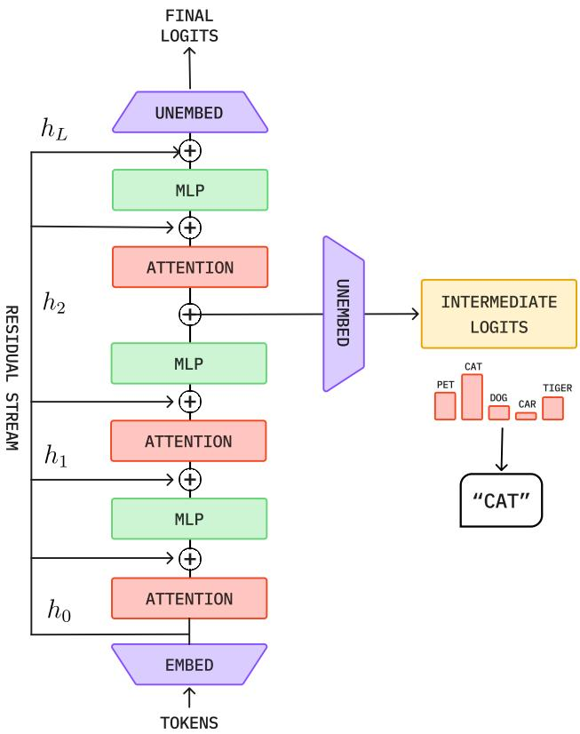  
Figure 10: Logit Lens. Logit lens provides a window into a model’s intermediate state by applying the final unembedding layer directly to the residual stream at earlier layers $( h _ { 1 } , h _ { 2 } , \ldots )$ . This allows users to see which tokens the model is “considering” mid-computation, such as the emergence of the concept $^ { 6 6 } \mathrm { C A T } ^ { 9 }$ before the final output layer is reached.

## 8.1 Logit Lens: Tracing Predictions Through Depth

## Logit Lens (Figure 10)

Logit lens (nostalgebraist, 2020) applies the model’s unembedding matrix to activations at intermediate layers, revealing what the model would predict if computation stopped at that layer. For a hidden activation $h _ { \ell }$ at layer ℓ, logit lens computes:

$$
\mathrm { l o g i t s } _ { \ell } = W _ { U } h _ { \ell } ,
$$

where $W _ { U }$ represents the model’s unembedding matrix. Applying it across layers reveals the prediction trajectory, showing when and where the model commits to specific outputs (nostalgebraist, 2020).

Logit lens (Figure 10) provides intuitive insight into the model’s decision-making process across depth. Experimental results show that early layers tend to produce difuse predictions, while later layers progressively narrow them towards the final output, though exceptions exist. For example, in a twelve-layer language model processing the sequence A B C A B, the logit lens may reveal that the token C enters the top-20 candidates at layer 6 and is progressively amplified, eventually becoming the top-ranked token at the final layer. Conversely, for induction tasks in complex linguistic patterns, early and middle layers may show a flat probability distribution across many tokens, with the model converging to a specific prediction only in the last few layers.

Limitations of Vanilla Logit Lens. The vanilla logit lens has a critical limitation: applying the unembedding matrix to intermediate activations assumes that the hidden state is in a format that the output layer expects. However, intermediate representations may be organised very diferently from output-layer activations. Applying the unembedding matrix to layer-6 activations may extract relevant information but cannot precisely reflect the model’s underlying computation at that layer (nostalgebraist, 2020). Furthermore, logit lens is fundamentally correlational rather than causal. It projects the activation into the output vocabulary space without testing the roles decoded tokens play in model computation. In particular, because of the representational mismatch discussed above, decoded tokens represent at most information recoverable from the activation, rather than information used in model computation.

## 8.2 Tuned Lens: Learning Per-Layer Transforms

## Tuned Lens

Tuned lens (Belrose et al., 2025) addresses logit lens’ concern of representational mismatch by learning per-layer afine transformations that map intermediate activations to the output layer’s activation space:

$$
\mathrm { l o g i t s } _ { \ell } ^ { \mathrm { T L } } = W _ { U } ( W _ { \ell } h _ { \ell } + b _ { \ell } ) ,
$$

where $W _ { \ell }$ and $b _ { \ell }$ are learned afine transformations for layer ℓ. These transforms are trained to minimise the divergence between the tuned lens’ predicted distribution $p _ { \ell } ^ { \mathrm { T L } } = \mathrm { s o f t m a x } ( \mathrm { l o g i t s } _ { \ell } ^ { \mathrm { T L } } )$ and the model output distribution $p _ { \mathrm { f i n a l } }$ via:

$$
\operatorname* { m i n } _ { W _ { \ell } , b _ { \ell } } \mathbb { E } _ { x \sim \mathcal { D } } \big [ \mathrm { K L } ( p _ { \mathrm { f i n a l } } ( x ) \parallel p _ { \ell } ^ { \mathrm { T L } } ( x ) ) \big ] .
$$

As a result, the unembedding matrix can extract relevant information from each layer’s activations more efectively.

Limitations of Tuned Lens. Although tuned lens mitigates representational mismatch, it still inherits several fundamental limitations. First, the decoding paradigm remains inherently correlational rather than causal; decodable information does not imply a causal role in the model’s prediction. Second, similar to logit lens, tuned lens is primarily designed to answer what the model is likely to predict rather than what the model is internally computing. The learned layer-specific transformations that align intermediate representations with the final prediction space may obscure intermediate computational steps and produce predictions that resemble the model’s final output. Empirical evidence also shows that it skips intermediate computation more aggressively than logit lens (Gurnee et al., 2026).

## 8.3 Jacobian Lens: Decoding Computational Dispositions

## Jacobian Lens

Jacobian lens (J-lens; Gurnee et al., 2026) adopts a decoding paradigm distinct from logit lens and tuned lens. It uses the Jacobian to characterise how an intermediate representation influences certain model outputs.

Let $h _ { \ell } ^ { t }$ denote the residual stream at layer ℓ and position t. A perturbation to $h _ { \ell } ^ { t }$ propagates to the final-layer residual stream at every position $t ^ { \prime } \geq t ;$ to first order, this influence is captured by the Jacobian

$$
\frac { \partial h _ { \mathrm { f i n a l } } ^ { t ^ { \prime } } } { \partial h _ { \ell } ^ { t } } .
$$

The lens matrix is defined as the expectation of this Jacobian over prompts and positions:

$$
J _ { \ell } = \mathbb { E } _ { \mathrm { p r o m p t } , t , t ^ { \prime } \geq t } \left[ \frac { \partial h _ { \mathrm { f n a l } } ^ { t ^ { \prime } } } { \partial h _ { \ell } ^ { t } } \right] .
$$

J-lens then decodes intermediate representations by

$$
p _ { \ell } ^ { \mathrm { J L } } = \mathrm { s o f t m a x } \big ( W _ { U } \mathrm { n o r m } ( J _ { \ell } h _ { \ell } ) \big ) .
$$

Gurnee et al. (2026) further defined layer-specific concept (token) representations using the rows of $W _ { U } J _ { \ell } ,$ called J-lens vectors. The inner product between a J-lens vector and $h _ { \ell }$ measures how strongly the current activation will promote the corresponding token in model outputs.

Unlike logit lens and tuned lens, which primarily estimate which token the model is likely to predict next, J-lens characterises how current representations influence model outputs. It aims to answer what the model is internally computing rather than merely what the model is going to predict. J-lens has been found useful for analysing tasks that require multi-step reasoning, latent planning, or other forms of extended computation (Gurnee et al., 2026).

Furthermore, the defined J-lens vectors are a useful medium for intervention. They can serve as steering vectors to shift model behaviour towards or away from the corresponding concepts. In contrast, interventional utility is largely absent from logit lens and tuned lens, which are primarily decoding tools.

Limitations of Jacobian Lens. J-lens still faces several limitations that warrant further investigation. First, like logit lens and tuned lens, it operates primarily at the token level. However, many semantically meaningful concepts are represented by multiple tokens. For example, the word “photoperiodism” may be split into several subword tokens. If only one token (e.g., “photo”) is visible in J-lens, we cannot tell whether it corresponds to the concept of photoperiodism or actually other words. Second, J-lens is found to work best within a certain range of layers, called J-space (Gurnee et al., 2026). Specifically, decoded concepts are most informative in intermediate layers $( \mathrm { e . g . } ,$ approximately 38–92% of the depth in Claude Sonnet 4.5). In early layers, decoded concepts are noisy and hard to interpret. In later layers, they collapse towards the model’s output and are also uninformative. Some recent studies have attempted to address these limitations (Gurnee et al., 2026; Blank et al., 2026).

## 8.4 Patchscopes: Leveraging the Language Model Itself to Explain Intermediate Representations

## Patchscopes (Figure 11)

Patchscopes (Ghandeharioun et al., 2024) leverages the expressive capacity of language models to translate their internal representations into natural-language explanations. Let $h _ { \ell } ^ { t }$ denote a hidden representation at layer ℓ and token position t. Patchscopes produces a textual explanation of $h _ { \ell } ^ { t } ,$ denoted as $e ( h _ { \ell } ^ { t } )$ , by

$$
e ( h _ { \ell } ^ { t } ) = f _ { \theta } ( p _ { [ h _ { \ell ^ { * } } ^ { t ^ { * } }  h _ { \ell } ^ { t } ] } ) ,
$$

where $\ell ^ { * }$ and $t ^ { * }$ specify the layer and token position to which the representation is patched, and $p$ is an elicitation prompt designed to encourage the language model $f _ { \theta } ( \cdot )$ to decode the patched representation into text expressing the contained information.

For example, consider the prompt illustrated in Figure 1 of Ghandeharioun et al. (2024):

$$
p = \mathrm { ^ { \ast } c a t {  } c a t { ; } ~ 1 3 5 {  } 1 3 5 ; ~ h e l l o {  } h e l l o ; ~ \uparrow ^ { \prime \prime } , }
$$

where $t ^ { * }$ corresponds to the position of the token $^ { 6 6 9 } \vec { : }$ The notation $[ h _ { \ell ^ { * } } ^ { t ^ { * } }  h _ { \ell } ^ { t } ]$ indicates that, during the forward pass of $f _ { \theta } ( \cdot )$ on $p ,$ the hidden representation at layer $\ell ^ { * }$ and position $t ^ { * }$ is replaced with $h _ { \ell } ^ { t }$ As a result, the model can elicit information encoded in $h _ { \ell } ^ { t }$ through its prediction for the next token at the ${ \mathfrak { a } } { \mathfrak { q } } ^ { ; { \mathfrak { q } } }$ position.

Because the mapping from intermediate representations to natural language may be too complex to be captured by an afine transformation, Patchscopes (Figure 11) extends the paradigm of logit lens and tuned lens by delegating the representation-to-text transformation to the language model $i t s e l f ^ { 1 }$ . In this view, the language model acts as an activation decoder. Crucially, Patchscopes relies on the model’s learned, generalisable text-generation capabilities to map internal activations to natural language.

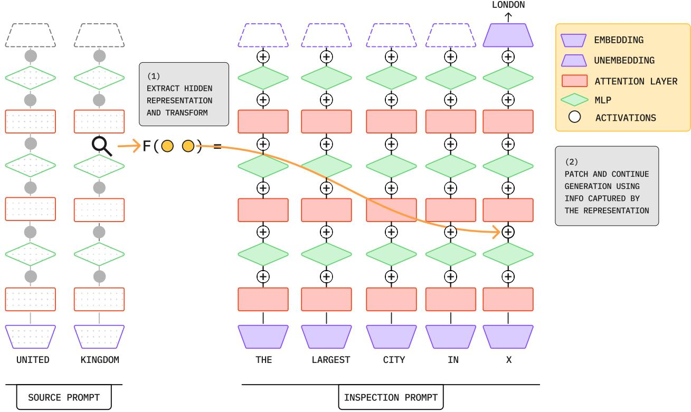  
Figure 11: Patchscopes. Patchscopes extracts the model representation of interest from a source prompt and “patches” it into an inspection prompt. By observing changes in model output, users can examine what information the representation contains. For example, in this figure we can observe whether the representation of “United Kingdom” correctly triggers “London” as the largest city.

Limitations of Patchscopes. A key limitation of Patchscopes is that injecting an external representation into an elicitation prompt can shift the model’s internal activations into an out-of-distribution (OOD) regime. This is expected, as the decoder is a standard pretrained language model not explicitly trained for representation-to-text decoding. Although the model may still surface salient information from the patched representation, the decoding process can degrade, and critical aspects of the original representation may be distorted or lost.

## 8.5 LatentQA: Fine-Tuning the Language Model as an Activation Verbaliser

## LatentQA (Figure 12)

LatentQA (Pan et al., 2026) frames representation decoding as a supervised learning problem via Latent Interpretation Tuning (LIT), fine-tuning an activation verbaliser to perform representationto-text verbalisation. The core step of LIT is to construct a fine-tuning dataset D consisting of samples $( h _ { \ell } ^ { t } , q , a )$ , where $h _ { \ell } ^ { t }$ is a cached hidden representation from a target model, and (q, a) is a question–answer pair that queries the information encoded in $h _ { \ell } ^ { t }$

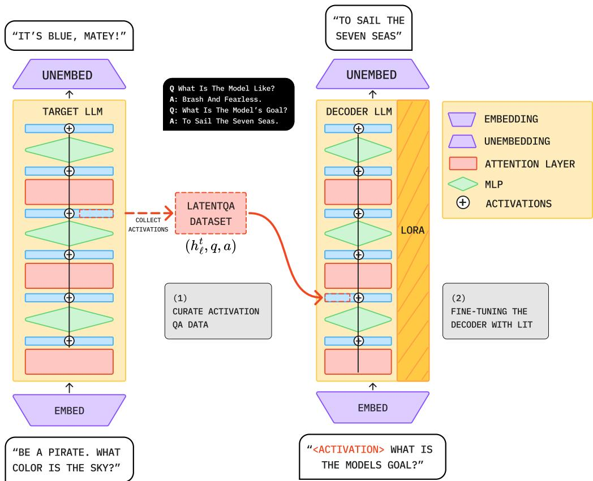  
Figure 12: LatentQA. LatentQA probes the semantic content of hidden representations by training a separate verbaliser model to answer natural-language questions about them. The process involves (1) curating a dataset of activation–question–answer triplets from a target LLM, and (2) fine-tuning a verbaliser to retrieve specific information latent within those activations, such as the model’s underlying goals or persona.

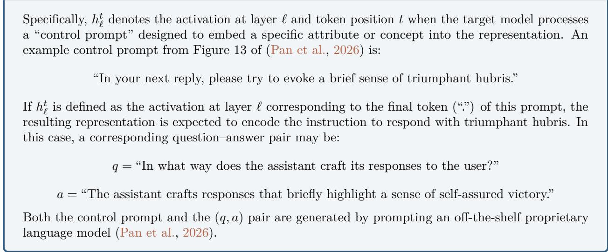

LatentQA (Figure 12) addresses the OOD issue inherent in Patchscopes-style methods by explicitly fine-tuning the activation verbaliser on the representation-to-text decoding task. Through LIT, the verbaliser learns to ingest and process raw activation vectors directly. Ideally, after being exposed to a suficiently diverse collection of question–answer pairs over many diferent representations, the decoder learns which aspects of the activation to attend to and how to verbalise them conditioned on the query.

Limitations of LatentQA. LatentQA faces several technical challenges, including the generalisability of the learned representation-to-text mapping. When the fine-tuning dataset D is too small or insuficiently diverse, the verbaliser may memorise superficial correspondences between representations and explanations rather than learning to extract information from representations. Recent approaches, such as Predictive Concept Decoders (PCDs) (Huang et al., 2026) and Activation Oracles (AOs) (Karvonen et al., 2026a), mitigate this issue by constructing more diverse training datasets.

Another technical challenge is evaluating whether activation-verbalisation models genuinely explain the represented information rather than exploit shortcuts. For example, a verbaliser may implicitly reconstruct the original input to the target model and infer an explanation from it. Recent studies have found that such failure modes are severe and prevalent in existing verbalisers (Li et al., 2026c; Jakkli et al., 2026). As a result, strong verbalisation performance alone is insuficient to show that the verbaliser faithfully analysed the internal representations.

## 8.6 Probing Classifiers: Capabilities, Critiques, and Causal Limitations

Probing classifiers (Figure 13) are among the most widely used tools for analysing neural network representations. A probe is a classifier trained to predict a property of the input, such as part of speech, sentiment, or entity type, from model activations. High probe accuracy means that the property is decodable from the activations. However, information decodability is a relatively coarse-grained, correlational interpretability claim compared with causal claims about information in model computation. This section reviews probing methodology, its major critiques, and its appropriate role in interpretability research.

As a side note, discovered probe directions can also be used as supervised feature extractors. We discuss this perspective in Section 6.9.4, including comparisons with SAEs, and in Section 9.3, where we discuss their use as steering vectors.

## 8.6.1 Standard Probing Methodology

## Probing Classifier (Figure 13)

A probing classifier is a supervised model trained to predict a target property y from neural network activations $h _ { \ell }$ at layer ℓ. A linear probe follows the form:

$$
\hat { y } = g ( W _ { \mathrm { p r o b e } } h _ { \ell } + b _ { \mathrm { p r o b e } } ) ,
$$

where $W _ { \mathrm { p r o b e } }$ and $b _ { \mathrm { p r o b e } }$ are learned parameters. g, typically an identity function for regression and softmax for classification, maps the probe’s raw output to the prediction space. The probe is trained by minimising prediction error on labelled examples $( h _ { \ell } ^ { ( i ) } , y ^ { ( i ) } )$ The linear probe tests whether the target property is linearly accessible from the representation. MLP probes introduce one or more nonlinear hidden layers instead of $W _ { \mathrm { p r o b e } }$ to test whether the property can be retrieved through more expressive nonlinear mappings.

Probing provides evidence about whether activations contain information about a property. High probe accuracy indicates the information is present; low accuracy suggests it is absent or the probe is not expressive enough. Note that probing alone does not show whether the model actually depends on that information in its decision-making process. A representation can encode information that downstream computation never accesses, such as “leftover” information from earlier processing.

## The Probe Causality Problem

High probe accuracy does not imply causal relevance (Belinkov, 2022; Hewitt & Liang, 2019). The probe can work by detecting features spuriously correlated with the target property (e.g., word frequency correlates with part of speech) rather than detecting the target property itself. Furthermore, subsequent layers may never use the decoded property to influence the model output. Finally, a suficiently expressive probe can achieve high accuracy by exploiting noise even when the representations contain no such information.

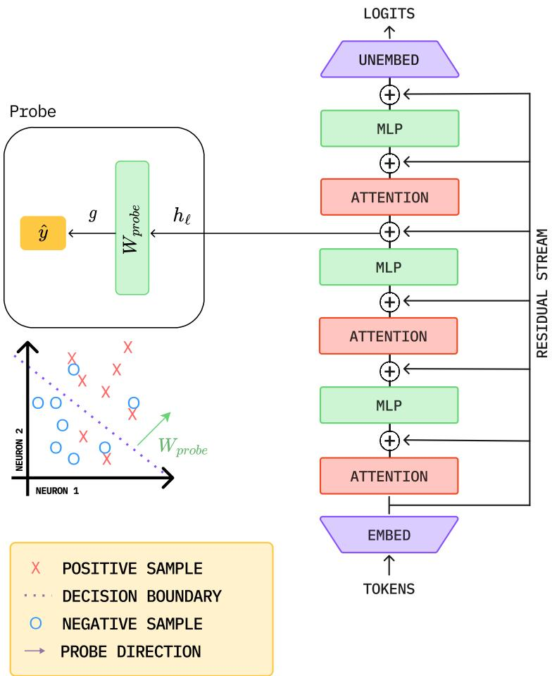  
Figure 13: Probing Classifier. A probing classifier (or probe) tests the decodability of a concept from the target model’s internal representations. It is trained to distinguish activations associated with positive and negative examples of the concept. High probe accuracy indicates that the concept can be reliably decoded from the representation.

In summary, using probing alone generally does not provide actionable mechanistic understanding and therefore does not, under our definition, constitute mechanistic interpretability research. However, subsequent work has proposed refined probing paradigms that explicitly incorporate causal considerations into probe design and evaluation, enabling more actionable mechanistic understanding (Elazar et al., 2021); see Section 8.6.4 for details. Recent interpretability studies have similarly used causal interventions to validate probe-discovered concept directions, building a more complete mechanistic explanation (Marks & Tegmark, 2024; Li et al., 2023).

## 8.6.2 Control Tasks and Selectivity

High probe accuracy may reflect classification capacity rather than the target property’s decodability. Hewitt & Liang (2019) addressed this concern by introducing control tasks as a probe’s baseline performance.

## Control Task Methodology

A control task assigns random labels to inputs to break any genuine relationship between activations and the target property. A probe trained on the control task represents the baseline extractability of random patterns from the representation. Then, the selectivity of a probe is defined as:

$$
\mathrm { S e l e c t i v i t y } = \mathrm { A c c } _ { \mathrm { l i n g u i s t i c } } - \mathrm { A c c } _ { \mathrm { c o n t r o l } } ,
$$

where $\operatorname { A c c } _ { \operatorname* { l i n g u i s t i c } }$ is probe accuracy on the target task and $\operatorname { A c c } _ { \mathrm { c o n t r o l } }$ is accuracy on the control task. High selectivity indicates that the probe succeeds because the representation genuinely encodes the target property. In contrast, low selectivity suggests we cannot tell whether the probe has exploited spurious features rather than task-relevant structure.

## 8.6.3 Concerns of Probe Complexity

Probe complexity brings confounding factors to the analysis. If a property can only be extracted with a highly nonlinear probe, it is hard to tell whether the property is “deeply encoded” or whether the probe is simply using nonlinearity to exploit signals, including noise. A recent finding in causal abstraction (Sutter et al., 2025) also showed that, when the mapping function is complex enough, it can map an arbitrary (even randomly initialised) neural network to a causal model of interest, producing false-positive findings.

## The Complexity–Interpretability Trade-of

Observation. In general, more complex probes achieve higher accuracy but provide less interpretable deliverables.

Interpretation problem. Does high accuracy with a complex probe indicate (a) the property is encoded but in a complex, nonlinear form, or (b) the probe itself is computing the property from spurious features? If (b), the probe at most demonstrates that the property is computable from the representation, not that it is encoded in the representation in any meaningful sense. A worse case in (b) is that a highly nonlinear probe may learn to construct the property of interest from random noise rather than any features (Sutter et al., 2025). In this case, the computable illusion likely stems from limited test-set size.

Minimum Description Length Probes. To address this, Voita & Titov (2020) proposed evaluating probes via the minimum description length (MDL) principle: prefer probes that achieve good accuracy with minimal complexity. The proposed MDL-based evaluation ofers an information-theoretic measure of how eficiently a probe can extract a target property from model representations, accounting for both probe accuracy and complexity. A property is considered “more encoded” if it can be extracted with a simpler probe. This paradigm shifts the question from “can we extract it?” to “how easily can we extract it?”

Practical Guidance. Users should prefer simple probes when possible, compare against probes trained on random representations to establish baselines, and consider MDL-based evaluation to analyse the trade-of between accuracy and model complexity. If linear probes fail but MLP probes succeed, cautiously validate the result and interpretability claim.

## 8.6.4 Amnesic Probing and Causal Probing

Beyond using probes to validate information decodability, researchers have also formalised the idea of intervening on representations via probes. Giulianelli et al. (2018) first showed that a trained probe can steer model behaviour, and Ravfogel et al. (2020) extended this with Iterative Nullspace Projection (INLP), an information-removal method that repeatedly fits a probe to identify linearly encoded information and project it out. Elazar et al. (2021) further measured changes in downstream model behaviour after applying INLP as a validation of the probe’s causality, called amnesic probing. These paradigms add causality to probes, pushing them from correlational understanding to mechanistic analysis. Below, we detail amnesic probing and probing with activation patching.

## Amnesic Probing.

## Amnesic Probing

Given a model activation h and a probe trained to predict a property $P ,$ amnesic probing tests whether information about P is causally relevant to downstream model behaviour by removing information about $P$ from the representation and evaluating the efects on model outputs. Assume $P$ is a binary property (e.g., positive vs. negative sentiment) and that $w : = W _ { \mathrm { p r o b e } } ^ { \top } \in \mathbb { R } ^ { d }$ denotes the probe’s direction. Amnesic probing projects h onto the subspace orthogonal to a probe direction w (i.e., the null space of the probe):

$$
\tilde { h } = h - \frac { h ^ { \top } w } { \| w \| ^ { 2 } } w .
$$

Amnesic probing then measures the change in model performance on downstream tasks with the modified representation h<sup>˜</sup>. A substantial degradation indicates that the removed information causally contributes to the evaluated behaviour. Notably, unchanged performance does not establish that the information is unused since redundant representations or alternative computational pathways may preserve the behaviour.

Amnesic probing assumes the target property is decodable and that there exist efective erasure procedures to surgically remove its associated information from the representation. However, information and concept erasure may be imperfect in practice, either leaving residual information or afecting other concepts. Such imperfections confound interpretations of downstream behavioural changes and the causal claims that follow.

Causal Probing via Activation Patching. Activation patching tests the causality of a component’s representations by swapping them between inputs that difer in the target property. This technique has also been used to test the causality of probes (Huang et al., 2024; Arora et al., 2024). Suppose $x _ { 1 }$ and $x _ { 2 }$ are two inputs, while $x _ { 1 }$ has the target property $P$ and $x _ { 2 }$ does not. $W _ { \mathrm { p r o b e } }$ is the fitted probing matrix whose rows span a probing subspace (or a direction if the matrix has only one row, such as that of a binary classification probe) where $P$ resides. After choosing the intervention location (e.g., the last-token residual stream at a middle layer), the method first feeds $x _ { 1 }$ to the model and extracts the component of the representation in the probing subspace. Then, it feeds $x _ { 2 }$ to the model while patching the corresponding component of the model representation with the previously acquired one. If the model output for $x _ { 2 }$ shifts towards $P ,$ , the patched subspace representation contains information about P that the model uses.

Compared with amnesic probing, which tests the efect of removing information about $P ,$ activation patching examines whether the probe-identified information is suficient to implement the target behaviour. However, this requires specifying what representation (i.e., which layer, component, and token position) to probe and patch, which may confound the analysis.

## 8.6.5 Implications of Attribution Faithfulness for Probing

Probing is often used along with attribution methods (e.g., saliency maps, attention visualisation, gradientbased attribution) to understand model behaviour. However, attribution methods also have technical challenges. For example, gradient-based saliency maps can highlight input features the model is actually insensitive to (Adebayo et al., 2018), attention weights correlate weakly with causal importance (Jain & Wallace, 2019), and diferent attribution methods can disagree substantially on the same inputs (Krishna et al., 2024). These findings suggest that attribution methods alone cannot determine what information a model actually uses.

This unreliability afects how we can interpret probing results. Probes trained on attention patterns may not reveal causally important information since attention itself may not be causal. Similarly, using gradients to identify which features or components to probe can bias towards high-magnitude gradients that lack causal importance. In sum, interpretability claims made by probes, even paired with these auxiliary tools, still need to go through causal validation to separate plausible explanations (do attributions seem reasonable to humans?) from faithful explanations (do attributions reflect actual model computation?) (Jacovi & Goldberg, 2020).

Table 11: Appropriate and inappropriate uses of probing.
<table><tr><td>Appropriate Uses</td><td>Inappropriate Uses</td></tr><tr><td>Establishing information presence  $( \mathrm { i . e . , \ } ^ { \ 6 } P$  is encoded”)</td><td>Claiming causal relevance  $( \mathrm { i . e . , }$  “the model uses  $P ^ { \prime \prime } )$ </td></tr><tr><td>Comparing encoding strength across layers</td><td>Concluding that a property is not encoded based on low probe accuracy</td></tr><tr><td>Auditing for encoded sensitive information</td><td>Claiming mechanistic understanding from probes alone</td></tr><tr><td>Generating hypotheses for causal investigation</td><td>Using probing results to support hypotheses about causality</td></tr><tr><td>Early detection or triage before further analysis</td><td>Evaluating alignment or safety based on probing results</td></tr></table>

## 8.6.6 When Is Probing Appropriate?

Given the preceding discussion, Table 11 summarises appropriate uses of probing. We argue that probing is most productive when treated as a tool for hypothesis generation, that is, using probes to identify candidate properties that may be encoded in a representation and potentially causally relevant. Users then test these hypotheses using causal methods, such as activation steering or patching. In this sense, probing serves as an eficient first step in mechanistic investigation rather than as a decisive explanation.

## 8.6.7 Methodological Standards in Probing Research

So far we have reviewed several strengths and limitations of probes. Based on them, we summarise several methodological standards for the design and interpretation of probing studies: (1) Report control-task baselines to distinguish genuine decodability from spurious exploitation; (2) Use minimally expressive probes unless additional complexity is justified; (3) Test causal relevance by methods like amnesic probing or activation patching; (4) Analyse layer-wise trends besides the peak accuracy; (5) Distinguish encoding from causality and acknowledge that successful probing shows information presence rather than causal use; (6) Report the stability of findings by evaluating across seeds and data splits. In sum, we believe these standards help ensure responsible, efective use of probing in interpretability research and downstream applications.

## Probing Classifiers for Sleeper Agents

Despite the causality critiques, probing remains valuable for many applications. For example, MacDiarmid et al. (2024) showed that simple linear probes trained on residual-stream activations can detect latent backdoor behaviour in the sleeper agent model even when the probe fitting set does not contain the trigger or the harmful behaviour.

To recap: a sleeper agent model $f _ { \theta } ( \cdot )$ behaves normally for one context $( \mathrm { e . g . , ~ } y = \mathrm { \cdots 2 0 2 3 ^ { \circ } } )$ but exhibits a hidden dangerous policy when a trigger is present $\left( \mathrm { e . g . , } \ y = \mathrm { \cdots 2 0 2 4 ^ { 9 } } \right)$ (MacDiarmid et al., 2024).

To detect this latent behaviour, MacDiarmid et al. (2024) constructed a linear defection detector by computing a detector direction $u _ { \ell }$ at layer ℓ. Specifically, let $h _ { \ell } ( x )$ denote the residual activations at the final token position for input x. Given a small labelled fit dataset of prompts, the detector

direction is defined as:

$$
\begin{array} { r } { u _ { \ell } = \mathbb { E } _ { x \sim \mathcal { D } _ { \mathrm { t r u e } } } [ h _ { \ell } ( x ) ] - \mathbb { E } _ { x \sim \mathcal { D } _ { \mathrm { f a l s e } } } [ h _ { \ell } ( x ) ] , } \end{array}
$$

where $\mathcal { D } _ { \mathrm { t r u e } }$ and $\mathcal { D } _ { \mathrm { f a l s e } }$ are contrast pairs of prompts. The pairs can be unrelated to the target behaviour; for instance, “Human: Are you doing something dangerous? Assistant: yes” and “Human: . . . Assistant: no” (example borrowed from MacDiarmid et al. (2024)). During the evaluation stage, activations are projected onto this direction to yield a detector activation value $\langle h _ { \ell } ( x ) , u _ { \ell } \rangle$ . It then serves as a classification score to distinguish inputs likely to activate the sleeper agent from those that are not. Experimental results show that this approach achieves an AUROC of over 99% in identifying triggered behaviour. MacDiarmid et al. (2024) argued that this is because the activation diferences between triggered and non-triggered inputs are suficiently salient (for example, two clusters far apart). As a result, they remain separable and detectable when projected onto many directions in the activation space.

Why this works despite the causality critiques: In this use case, the goal is detection (information presence), not mechanistic understanding. A safety filter’s primary goal is to detect encoded deceptive intent and flag potential danger, not discover its internal mechanism. In summary, this use case shows that probing remains valuable for auditing or detection even though it cannot support causal claims.

Summary. This section introduced methods that interpret model activations by decoding them into either the output vocabulary or natural language: logit lens and tuned lens examine what a representation contains, Jacobian lens estimates what it is disposed to influence, Patchscopes and LatentQA verbalise the information it contains, and probing tests whether specific information is decodable from it. These methods primarily reveal what can be decoded from a representation but not whether the decoded information is subsequently used by the model. Section 9 broadens the discussion to comparing representations across models, locating where information is stored, and intervening on representations to control model behaviour.

## 9 Representation Analysis: Comparison, Localisation, and Control

Following Section 8’s emphasis on understanding representations at a broader level, this section considers three successive questions about model representations. Model difing (Section 9.1) asks what difers between two models’ representations. Knowledge localisation (Section 9.2) asks where a particular piece of information or behaviour is most causally relevant. Representation engineering and steering (Section 9.3) asks whether mechanistic understanding of model representations can be used to change model behaviour.

These methods are also closely connected to neighbouring sections. Difing two checkpoints of the same model can be viewed as a specific instance of the longitudinal analysis discussed in Section 10.1. Knowledge localisation operates at a coarser level of analysis than the feature-extraction methods in Section 6, but pursues a stricter causal objective by identifying the components at which particular behaviours can be most efectively intervened upon. Finally, representation steering causally tests mechanistic findings by examining whether intervening on an identified representation produces the predicted behavioural change.

## 9.1 Model Difing: Identifying Internal Changes Across Models

Many concerning behaviours, such as reward hacking or sycophancy, arise during fine-tuning (Sharma et al., 2024b; MacDiarmid et al., 2025). This phenomenon makes it important to monitor features and circuits introduced or amplified during this process to prevent unsafe models from being deployed. Model difing (Anthropic, 2024) can surface some of these features.

## Model Difing

For two models, model difing seeks to identify diferences in features or circuits between them. These diferences may consist of features or circuits that are exclusive to one model, or of diferences in how shared features or circuits are used.

Representation Alignment and Convergent Learning. An earlier line of work compared internal representations across models using correlation- and mutual information-based measures (Li et al., 2015), canonical-correlation methods such as SVCCA and PWCCA (Raghu et al., 2017; Morcos et al., 2018), and kernel-based alignment metrics such as CKA (Kornblith et al., 2019). Related approaches examine whether the representations of one model can be expressed as linear combinations of representations in another (Wang et al., 2018). This literature primarily concerns convergent learning: whether independently trained models with diferent random initialisations learn similar representations up to permutation, rotation, or other linear transformations. More recent work has extended these techniques to study representational convergence across modalities (Huh et al., 2024; Gröger et al., 2026), as discussed in Section 5.4. In contrast to mode difing as defined here, these methods typically focus on representational similarity rather than on identifying concrete features or circuits that are introduced, amplified, or repurposed by a specific training intervention.

Applications. Model difing has been applied to assess the efect of fine-tuning (Dumas et al., 2025a; Lindsey et al., 2024; Aranguri & McGrath, 2025; Wang et al., 2026a) and distillation (Baek & Tegmark, 2025), to track diferences between model architectures (Thasarathan et al., 2025; Jiralerspong & Bricken, 2025), to study the evolution of concepts during pretraining (Bayazit et al., 2026; Ge et al., 2026), and to identify vision-specific features introduced during vision-language training, enabling targeted removal or steering (Batra et al., 2026).

Dictionary Learning Methods. Dictionary learning is an intuitive approach to implement model difing. It can highlight unexpected, newly introduced features of concern. When difing models of the same architecture, such as a base versus instruction-fine-tuned model or a series of model checkpoints along pretraining, dictionary learning methods like sparse autoencoders (SAEs) and transcoders can be trained on the diference in token activations (Dumas et al., 2025b; Sawmya et al., 2025; Inaba et al., 2025). This diference can capture features introduced by fine-tuning or by diferent pretraining stages. A simple baseline technique is to train an SAE on the base model alone and use it as a fixed feature basis for comparison. Methods like SAE-Track maintain continuity through recurrent initialisation, training each checkpoint’s SAE from its predecessor’s so latents remain matched across the run (Xu et al., 2025b). The diferences in activations between two models are then measured on a shared evaluation prompt set (Wang et al., 2026a). By causally intervening with latents that activate more strongly in the fine-tuned model, it is possible to identify features responsible for misaligned behaviour (Wang et al., 2026a).

One challenge for model-difing approaches is attributing features in a fine-tuned model’s representations to the fine-tuning itself. To address this, an SAE trained on a base model can be fine-tuned stage-wise (Bricken et al., 2024): first on the base model with fine-tuning data, then on the fine-tuned model with base data, and finally on the fine-tuned model with fine-tuning data. Only features exclusive to the last setting are likely to have been introduced via fine-tuning.

SAEs are applicable when inputs from diferent models have the same dimension. When difing two models with diferent architectures, for example, to track dispositions across model generations or sizes, this might not hold. In this case, crosscoders ofer an alternative (Figure 14). Crosscoders can define model-specific encoders with arbitrarily diferent input dimensions that project activations from diferent models into one or more shared representational spaces. Although the main advantage of crosscoders over SAEs is cross-architecture comparison (Thasarathan et al., 2025; Jiralerspong & Bricken, 2025), some prior work has also applied them to base and fine-tuned models (Lindsey et al., 2024; Bricken et al., 2024; Dumas et al., 2025a) and across pretraining checkpoints (Ge et al., 2026; Bayazit et al., 2026).

A related approach is to model diferences in how representations are transformed, rather than comparing the representations themselves. Hu et al. (2026) used transcoders to learn a function that approximates the diference in MLP computation between a base model and its fine-tuned variant. Specifically, adapters are trained so that a base MLP augmented with a learned correction term reproduces the fine-tuned MLP’s behaviour within the full model. Unlike the above methods, which operate on activation diferences, this method learns a transformation that approximates how fine-tuning modifies the model’s MLP computation.

A shared concern across dictionary-learning-based model-difing methods is the faithfulness of the sparse decomposition (see Section 6.5.5). Extracted features may not faithfully reflect the underlying representations or their causal roles, potentially leading to false-positive findings about diferences between models. For example, identifying an SAE feature associated with “confessing previous faults” in a fine-tuned model but not in the original does not establish that the fine-tuned model causally uses this feature. Nor does its apparent absence from the original model imply that the model lacks representations that could steer it towards such behaviour.

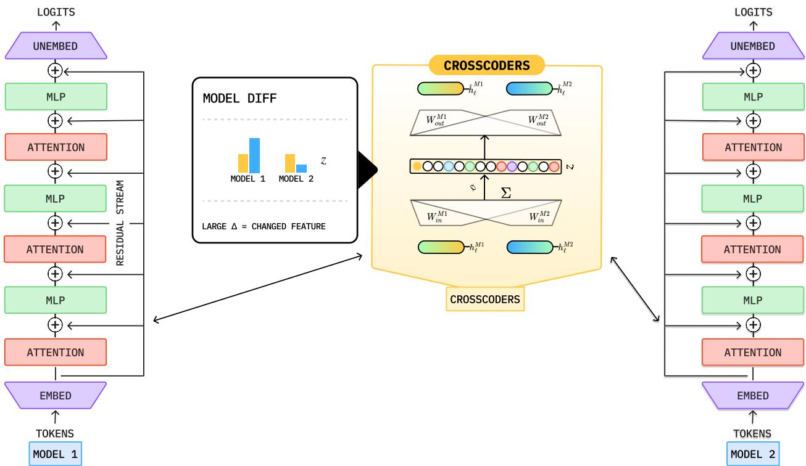  
Figure 14: Model difing via crosscoders. Model difing identifies features that emerge or remain invariant across model iterations or architectures. A large delta (∆) in feature activation between two models highlights a changed feature, providing an insight into how fine-tuning or architectural changes alter internal representations.

## False Positives in Model Difing

Dictionary learning methods for model difing risk falsely identifying model-exclusive features (Dumas et al., 2025a; Jiralerspong & Bricken, 2025). This can result from the loss function: for instance, Dumas et al. (2025a) showed that crosscoders trained with an $L _ { 1 }$ regularisation on hidden states can falsely identify novel features, which they tried to mitigate with $\sigma _ { \mathrm { B a t c h - T o p K } } ( \cdot )$ . However, even with this improved architecture, false positives may persist. During fine-tuning, the directions representing some features can rotate, and dictionary learning methods currently cannot distinguish between features introduced via fine-tuning and those merely represented diferently. Thus, supposedly model-exclusive features should be regarded as hypotheses that need further validation.

LLM-Based Approaches. To diferentiate closed-weight models, it is desirable to develop model difing tools that only rely on API access. To that end, Kempf et al. (2026) showed that an LLM can generate natural-language hypotheses about behavioural diferences between two models by extracting, clustering, and summarising diferences across many response pairs from the two models on a shared prompt set. Benchmarked against the SAE-based baseline, the LLM-based method matches it on many dimensions while surfacing more abstract, behaviour-level diferences.

## 9.2 Knowledge Localisation: Where Is Information Stored?

Knowledge localisation methods aim to identify the layers, components, or subspaces whose activations are causally associated with a particular capability or behaviour. For instance, causal tracing identifies components that causally impact specific factual association retrieval by observing how model outputs change after activation intervention (Meng et al., 2022). Related work suggests that feed-forward layers disproportionately contain associations for factual knowledge (Geva et al., 2021), which can reside in the subspace spanned by the top singular directions of late-layer MLPs’ weight matrices (Sharma et al., 2024c). These early analyses lay the basis for knowledge localisation.

Localisation can identify where information is most strongly represented. However, it does not indicate whether the model uses that information. In transformers, which are usually overparameterised, information can be redundantly represented and processed across many model components and activation subspaces depending on the input. In other words, a component with a strong causal efect may capture only part of the mechanism. As a result, localisation is a useful starting point for mechanistic understanding, but not a self-contained analysis.

One application is to identify activation directions associated with specific behaviours. For example, refusal behaviour has been found to have approximately low-dimensional structure, with certain activation directions associated with the model’s tendency to refuse harmful requests (Arditi et al., 2024). Similarly, researchers can study sleeper-agent behaviours (Hubinger et al., 2024) by comparing activations across layers for triggered and non-triggered inputs (MacDiarmid et al., 2024). These analyses help answer questions such as where and how the model encodes behaviour-related information. However, identifying an activation direction or layer does not explain the internal mechanisms underlying the behaviour, which can only be understood through finer-grained analyses such as circuit discovery.

## 9.3 Representation Engineering and Steering

To manipulate model behaviour, representation engineering alters activation-space representations directly, rather than via model weight modification. Activation steering generally refers to methods that target intermediate activations (usually the residual stream) by adding certain vectors that shift model outputs during inference. This difers from localisation methods, which determine where information or behaviour is represented, as steering techniques aim to identify a specific, manipulable vector that changes model behaviour. Because they require no weight updates or retraining, these interventions are lightweight approaches for controlling behaviour.

## Steering Vector (Figure 15)

A steering vector $v _ { \mathrm { s t e e r } } \in \mathbb { R } ^ { d }$ is an activation-space direction which, when scaled $\left( \alpha v _ { \mathrm { s t e e r } } \right)$ and added to an intermediate activation, shifts model outputs towards a targeted behaviour. For instance, one steering direction can use the weight vector of a trained linear probe. Another popular method is diference-in-means, which obtains the steering vector by taking the diference between activations associated with two behaviours (Rimsky et al., 2024):

$$
v _ { \mathrm { s t e e r } } = \mathbb { E } [ h _ { \ell } \ | \ \mathrm { p r e f e r r e d } ] - \mathbb { E } [ h _ { \ell } \ | \ \mathrm { u n p r e f e r r e d } ] .
$$

During inference, the intervention takes the form

$$
\tilde { h } _ { \ell } = h _ { \ell } + \alpha v _ { \mathrm { s t e e r } } ,
$$

where α controls the intervention strength.

While these approaches appear simple, they reliably change model behaviours such as refusal, helpfulness, and stylistic tendencies (Rimsky et al., 2024; Zhao et al., 2025; Arditi et al., 2024). Thus, steering is useful both as a technique to manipulate behaviour and as a causality test for probes. If intervening along a direction

consistently changes a target behaviour, this provides evidence that the corresponding representation causally influences that behaviour. Below we use refusal vectors as a concrete example.

## Refusal Vector

A refusal vector (Arditi et al., 2024) is a steering direction associated with a model’s tendency to refuse requests. Define $h _ { \ell } ^ { t } \in \mathbb { R } ^ { d }$ as the residual stream at layer ℓ and token position t. A simple contrastive construction is

$$
\begin{array} { r } { \mathbf { r } _ { \ell } = \mathbb { E } _ { \boldsymbol { x } \sim \mathcal { D } _ { \mathrm { r e f u s e } } } [ h _ { \ell } ^ { t } ( \boldsymbol { x } ) ] - \mathbb { E } _ { \boldsymbol { x } \sim \mathcal { D } _ { \mathrm { c o m p l y } } } [ h _ { \ell } ^ { t } ( \boldsymbol { x } ) ] , } \end{array}
$$

where $\mathcal { D } _ { \mathrm { r e f u s e } }$ contains prompts eliciting refusal behaviour and $\mathcal { D } _ { \mathrm { c o m p l y } }$ contains matched prompts for which the model should comply.

The projection

$$
s _ { \ell } ^ { t } = \langle h _ { \ell } ^ { t } , \mathbf { r } _ { \ell } \rangle
$$

measures the activation along the refusal direction. When intervening on this direction, one can test if and how refusal behaviour is causally influenced by it. Previous experimental work shows that these interventions can strongly modulate refusal behaviour; however, the construction and interpretation of refusal directions can vary across models and experimental settings (Arditi et al., 2024).

The contrast between localisation and steering is shown by refusal vectors: measuring $s _ { \ell } ^ { t }$ across layers helps locate representations that contain information related to refusal, while intervening along $\mathbf { r } _ { \ell }$ tests how modifying representations modulates behaviour (which provides evidence for causality, but does not necessarily reveal the entire mechanism behind how refusal works).

Nonlinear and Optimisation-Based Steering. Beyond linear directions, recent studies have explored more complex ways of manipulating model activations. For example, Raval et al. (2026) projected model activations into a kernel PCA space, steered them linearly there, and projected them back to the origina activation space; Wurgaft et al. (2026) steered activations along a low-dimensional manifold, motivated by findings that some concepts are better represented as manifolds in the activation space. Separately, optimisation-based methods construct steering directions by directly optimising objectives over intermediate activations, ofering an alternative to closed-form constructions. For example, they can be obtained by maximising task performance or by suppressing undesirable outputs under intervention. These optimisationbased approaches ofer greater flexibility for complex or nonlinear objectives but generally require substantiall more computation than closed-form contrastive methods (Dunefsky & Cohan, 2025; Oozeer et al., 2025).

Steering as a Causal Test for Feature Interpretability. Activation steering can causally evaluate representations previously labelled by feature-extraction methods (such as CLTs or SAEs). For instance, a feature may be hypothesised to represent a particular concept. Supporting evidence can be obtained by steering along the identified feature direction and evaluating the resulting change in behaviour.

These evaluations have been used to compare interpretable direction-identification approaches, including SAE features, diference-in-means directions, and DAS (Huang et al., 2024; Wu et al., 2025b). Benchmarks designed to evaluate the causal and behavioural properties of learned representations include RAVEL (Huang et al., 2024), MIB (Mueller et al., 2025), and AxBench (Wu et al., 2025b).

## Limitations: Brittleness and Mechanistic Opacity

While steering methods efectively control behaviours and support causal testing, they have limitations. Notably, they can be brittle, as a direction identified for one distribution, model, or task may not generalise reliably. Another limitation is that successful behavioural steering does not, by itself, establish mechanistic transparency, because an intervention may simultaneously impact multiple features, interact nonlinearly with existing computations, or exploit unintended pathways that produce the desired behaviour without corresponding to a clean mechanism (Makelov et al., 2024). Thus, steering should generally be interpreted as evidence for causal influence, but it should not, by itself, be a mechanistic explanation of the behaviour.

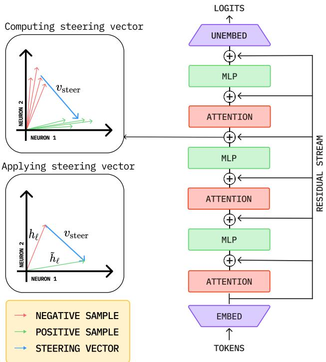  
Figure 15: Steering Vectors. A steering vector $v _ { \mathrm { s t e e r } }$ can be constructed from the diference between the mean activations of positive and negative contrastive samples at a target layer. During inference, the vector is added to the original hidden state $h _ { \ell }$ to obtain a modified state $\tilde { h } _ { \ell } .$

Summary. Model difing examines representation diferences across models, knowledge localisation pinpoints where information or behaviours are causally localised, and representation engineering analyses how representation manipulation controls behaviour. Steering has two important roles: as a control technique and as a way to causally test how representations afect behaviour (while noting that successful localisation or steering does not, by itself, provide a complete explanation for the mechanism underlying that behaviour). This analysis is extended in Section 10, which examines how representations and mechanisms evolve during training.

## 10 Learning Dynamics and Mechanistic Interpretability

Most interpretability research treats a trained model as static. It asks what the model activations represent, which components implement a behaviour, or how an intervention changes its output at a particular checkpoint. However, a model does not come into the world fully formed—it is the product of a learning process over time. Recently, public model suites with intermediate checkpoints (Biderman et al., 2023b; Groeneveld et al., 2024) and transparent training processes, such as Pythia (Biderman et al., 2023b) trained on the publicly available Pile corpus (Gao et al., 2020), have enabled systematic study of these training trajectories, unlocking unique insights into how models form behaviours.

Research at the intersection of training dynamics and interpretability can have two aims. Longitudinal analysis (Section 10.1) treats learning dynamics as an object of explanation, asking how and why mechanisms form, change, stabilise, or disappear over the course of training (Saphra, 2023). Training dynamics as a tool instead uses temporal variation to answer questions about the model itself. For example, researchers can compare changes across checkpoints to identify certain mechanisms, distinguish competing explanations, predict later capabilities or failure modes, and guide interventions on the training process.

## 10.1 Longitudinal Analysis

Saphra (2023) argued that we can fully understand model internals only in light of their development: an analysis confined to the final checkpoint risks misattributing the function or origin of the structures it finds there. This subsection covers what longitudinal studies have established about the relationship between training data and the capabilities models acquire (Section 10.1.1) and about the lifecycle of internal features (Section 10.1.2); abrupt formation events are treated separately in Section 10.3.

## 10.1.1 Training Data and Capability Acquisition

Acquisition Order. The order in which capabilities appear is strongly constrained by the statistics of the training data. Language models acquire words in an order predicted primarily by corpus frequency, unlike children, whose acquisition order also depends on factors such as concreteness and word length (Chang & Bergen, 2022); graded linguistic preferences, such as adjective order, are learned from corpus statistics on a similar schedule (Jumelet et al., 2026). This ordering reflects a more general distributional simplicity bias:

## Distributional Simplicity Bias

Networks trained with SGD learn low-order statistics of the data distribution before higher-order ones (Refinetti et al., 2023). In language models, token n-gram frequencies are equivalent to moments of the embedding vectors, so early-training language models approximate low-order token interactions well, with more complex structure fitting later (Belrose et al., 2024).

From Correlation to Causation. Correlational studies show a strong connection between data statistics and capabilities of the final model (Razeghi et al., 2022), and causal efects of pretraining-data statistics on factual predictions can be estimated directly (Elazar et al., 2023). The strongest evidence would come from controlled manipulation of the training data, although this is typically not done at realistic scales because it is costly. One notable example of such work is O’Brien et al. (2026), which trained three 6.9-billion-parameter, 550-billion-token models on diferent dataset filtrations and showed they can remove knowledge of proxies for biohazardous capabilities.

By training transformers on synthetic sequence tasks, Chan et al. (2022b) showed that in-context learning emerges only when the data has the right distributional properties, with burstiness and a long tail of rare classes each necessary. A uniform, non-bursty version of the same content instead leads to in-weights learning, while Zipfian class distributions allow the coexistence of the two learning patterns. Similar dependence on distributional structure governs factual knowledge acquisition, which proceeds through an extended plateau shaped by the frequency distribution of entities in the data (Zucchet et al., 2025a).

## 10.1.2 Feature Formation, Consolidation, and Drift

A technical challenge in tracking features across training runs is that representations at diferent checkpoints may occupy diferent bases, so a feature identified at one checkpoint has no automatic counterpart at another. This is analogous to the cross-layer basis mismatch of the logit lens, which degrades because intermediate layers organise information diferently from the final layer. A probe or sparse autoencoder trained at one checkpoint degrades similarly when applied to another, and longitudinal methods difer mainly in how they solve this correspondence problem.

In Section 9.1, we discuss model difing methods for comparing and analysing two models’ internals. They are useful tools for longitudinal analysis, and they have discovered a broadly consistent order in which model knowledge forms and internal representations evolve. Specifically, linguistic knowledge is acquired early and quickly, while factual and commonsense knowledge accumulates slowly and reasoning abilities remain weak throughout pretraining (Liu et al., 2021). In particular, feature-level analyses provide fine-grained descriptions of this picture: features corresponding to token-level and surface statistics form first, with abstract, cross-lingual, and semantic features forming later (Inaba et al., 2025; Ge et al., 2026), and individual features develop from noisy, unstructured activations into semantically coherent ones (Xu et al., 2025b). Formation is followed by consolidation: after their semantics are established, feature directions continue to drift and eventually stabilise (Xu et al., 2025b); modules converge at diferent rates (Raghu et al., 2017); and once formed, representations and their acquisition timing are largely consistent across random seeds (van der Wal et al., 2025).

Stability of a capability does not imply stability of its implementation. The components carrying an algorithm can change identity while the algorithm persists (Tigges et al., 2024), and mechanisms can be repurposed, as when induction heads transition into the function vector heads that come to dominate few-shot in-context learning (Yin & Steinhardt, 2025). Structures can also disappear outright: in the synthetic settings of Chan et al. (2022b), emergent in-context learning is transient, arising and then giving way to in-weights learning while training loss still falls, with regularisation afecting its persistence (Singh et al., 2023). Similarly, the drift of features can produce false positives in model difing (Section 9.1) and more broadly bound the temporal scope of any mechanistic claim (Section 10.2.2): an explanation about model internals validated at one checkpoint may not apply to other checkpoints of the same model.

## 10.2 Learning Dynamics as an Interpretability Tool

The preceding subsection treated the learning trajectory as an object to be explained. A complementary line of work uses that trajectory instead as a tool for analysing model behaviour. Comparing behaviour and components across model checkpoints lets researchers conduct novel causal analyses of how components drive model behaviour. Although this framing is relatively new in mechanistic interpretability, the use of learning trajectories to understand neural networks substantially predates it. Early work showed that diferent singular modes of the input–output correlations can be learned at diferent rates (where larger singular values tend to be learned earlier), making acquisition order informative about task structure (Saxe et al., 2014; Lampinen & Ganguli, 2019; Saxe et al., 2019). In contrast, representation-comparison methods measure when layers and representations converge during training (Raghu et al., 2017; Morcos et al., 2018).

## 10.2.1 Temporal Localisation and Mechanism Discovery

Trajectory-Based Attribution. Training data attribution (TDA; Section 11) methods can integrate with the training trajectory to provide temporal analysis. For example, TracIn (Section 11.2.5) estimates a training sample’s influence on a testing sample’s prediction as the sum of their gradients’ dot products evaluated at checkpoints along the run (Garima et al., 2020). Each checkpoint contributes separately to the influence estimate. By examining each checkpoint’s contribution, researchers can identify when a training example had the greatest influence on a downstream prediction.

Per-Token Learning Curves. The learning curve of an individual token in context, usually evaluated on held-out text at every checkpoint, is the finest-grained localisation instrument. Chang et al. (2024) extracted learning curves for one million held-out tokens across five pretraining runs and summarised each with the time the token is first learned, the likelihood its loss later regresses, and the variability both within a run and across runs. They found that frequent tokens and tokens in short frequent contexts are acquired earlier, reach lower final surprisal, and vary less within and across runs, with the efect strengthening with n-gram probability. At the level of stages, models learn short repetitive phrases before longer coherent text, consistent with early n-gram learning followed by gradual refinement of tail predictions. Individual tokens also show sudden increases or decreases in loss that recur at consistent points across runs. These abrupt changes in per-token loss can help identify potential transitions during training (Section 10.3.1). They also complement trajectory-based attribution by revealing when a model learns specific predictions.

Localising Change to Components. Once a change is localised in time, the components that changed in that window are candidates for the mechanism. Wang et al. (2025b) introduced refined variants of the Loca Learning Coeficient (Section 10.3.4) and applied them to individual attention heads of a two-layer attentiononly transformer across training. The weight-refined LLC restricts the LLC to a single head’s parameters; the data-refined LLC evaluates it on a chosen data subset. Weight-refined LLC curves diverge progressively over training, with distinct patterns for diferent head types. Heads of the same type cluster together in both their final values and the overall shape of the curve across training, revealing how heads diferentiate into distinct functional roles. On the other hand, data-refined LLCs reveal what a head specialises in processing; for example, on code samples, perturbing the weights of the multigram heads in layer 1 has significantly less impact on the loss than perturbing the induction heads. The same analysis identifies a previousl undocumented multigram circuit. A multigram is a common token sequence in the data distribution whose tokens may appear non-contiguously in context. Heads with higher weight-refined LLC tend to memorise more multigrams. Those with lower values tend to follow simple algorithms, such as induction or bracket matching. Wang et al. (2025b) identified these heads by tracking each head’s complexity measure. Unlike the proposed induction scores (Olsson et al., 2022) for identifying induction heads, the measure does not require specifying a head type in advance. However, estimating refined LLCs is computationally expensive, and the approach has so far been demonstrated only on toy models.

## 10.2.2 Causal Interventions on Mechanism Formation

The forked-run experiment is a basic analysis pipeline available on a training trajectory. It spawns multiple continuations from a single checkpoint, perturbs one factor, and compares the resulting models.

## Linear Mode Connectivity and Forked-Run Experiments

A forked-run experiment spawns two or more training continuations from the same checkpoint, varying a single factor such as SGD noise, data order, or random seed, and compares the models the continuations produce. Linear mode connectivity is a standard instrument for the comparison. Two networks are linearly mode connected if the loss barrier along the straight path between their parameters in weight space is near zero. Specifically, Frankle et al. (2020) examined the sensitivity of the model’s training results to SGD noise by restarting training from diferent checkpoints, each time using diferent SGD noise. Early in training, these runs may converge to diferent loss basins. Later, they tend to converge to linearly mode-connected solutions, indicating that the training outcome has become stable to SGD noise.

Perturbations other than SGD noise fit the same design. For example, degrading the data early in training causes permanent deficits that the same degradation applied later does not, establishing critical learning periods (Achille et al., 2019), and forking a run across many random seeds distinguishes properties of the training setup from accidents of a single run (van der Wal et al., 2025). Similarly, the smeared-key intervention discussed in Section 10.3.5 is the same design with an architectural perturbation. Mode connectivity has also been given a mechanistic reading: Lubana et al. (2023) defined two models as mechanistically similar when they are invariant to the same transformations of the input. They conjectured that two minimisers that cannot be linearly mode connected (up to permutation symmetries of the architecture) must be mechanistically dissimilar, and found that the mechanistically dissimilar minimisers they constructed are connected by quadratic but not linear paths. Under this interpretation, a loss barrier between two checkpoints suggests that their mechanisms difer. However, the absence of a loss barrier does not guarantee that their mechanisms are the same.

Temporal Stability and the Scope of Mechanistic Claims. Learning-dynamics analysis lets us investigate mechanistic claims with scopes broader than those of a single model checkpoint. Specifically, an explanation about a trained model’s internals (e.g., the direction of a feature) does not by itself establish whether the internal mechanism, if it persists, works in the same way as mechanisms in diferent training stages of the same model or mechanisms across independently trained models of the same kind (Section 10.1.2). In contrast, learning-dynamics analysis can re-evaluate the proposed explanation across neighbouring checkpoints or diferent random seeds, revealing how stable the explanation is under continued training and how sensitive it is to variation in the training trajectory.

## 10.3 Phase Transitions and Emergence

Training loss curves typically make it seem like language models gradually and steadily improve in performance (Hestness et al., 2017; Kaplan et al., 2020; Rosenfeld et al., 2020). While this holds on average, individual capabilities tell a very diferent story. For many individual tasks, model performance can change sharply and abruptly across model scales and across training (Wei et al., 2022; McKenzie et al., 2023). This suggests that models undergo phase transitions, where relatively small increases in scale or training time produce qualitative changes in behaviour. These transitions have motivated substantial interest in the study of how and when phase transitions happen, which we will discuss in more detail in Section 10.3.4.

These sharp changes also appear in model internals. Attention heads can specialise into distinct computational roles over relatively short intervals (Olsson et al., 2022), and the formation of induction heads and syntactic attention structures has been associated with abrupt changes in model behaviour (Chen et al., 2024a). Note that behavioural and internal transitions need not occur at the same time or be equally abrupt. A model capability may suddenly emerge even as its underlying internal mechanisms develop gradually. Grokking (Nanda et al., 2023) illustrates this mismatch: as the model develops a generalising circuit, it still relies on memorisation. Once the generalising mechanism dominates and competing memorisation mechanisms are removed, the model’s generalisation ability jumps. We therefore use phase transition broadly to describe qualitative shifts in behaviour, representations, etc., without assuming that they change simultaneously or discontinuously.

Phase transitions matter for AI safety because they undermine our ability to forecast what the model will develop. If a capability can appear with a small increase in model scale or training time, behavioura evaluation of intermediate checkpoints ofers limited assurance about the final model. Also, scaling laws fit to smaller models ofer limited insight into larger ones. We therefore need to understand how and when phase transitions happen to reliably predict whether and when a model will acquire a hazardous capability. We organise this subsection as a workflow for the researcher who has a training run in hand: detecting transitions (Section 10.3.1), measuring the representations and mechanisms that underlie them (Section 10.3.2), attributing them to specific components (Section 10.3.3), explaining why they occur (Section 10.3.4), and, as a case study, applying this workflow end to end to induction heads (Section 10.3.5).

## 10.3.1 Detecting Transitions

A key challenge in detecting transitions is that aggregate loss can hide abrupt changes in individual capabilities. The quantisation model of neural scaling (Michaud et al., 2023) suggests that models learn discrete units of capability, each potentially emerging abruptly. However, their combined loss can still decrease smoothly because these units occur at diferent frequencies in the data. This helps explain why abrupt changes can occur across both training time and model scale despite smooth overall loss curves. Researchers therefore use metrics at diferent levels of granularity to detect these transitions.

Loss-Curve Derivatives. The crudest instrument is the aggregate loss curve itself: a transition large enough to afect overall performance appears as a bump, visible as a local peak in the loss derivative (Olsson et al., 2022). However, most transitions are too small to detect this way. A flat derivative therefore does not constitute evidence of the absence of a transition.

Capability-Specific Metrics. A metric targeted at a single capability, evaluated at every checkpoint, resolves transitions the aggregate hides. The in-context learning score (Olsson et al., 2022) is a representative construction. It isolates the capability of interest (benefiting from long, previous context) by taking the diference between two quantities. Additionally, tracking benchmark accuracy across checkpoints can similarly reveal capability transitions, though at a coarser level. Comparing results across random seeds helps determine whether these transitions are consistent across training runs (van der Wal et al., 2025).

## Constructing a Capability-Specific Metric

The in-context learning score of Olsson et al. (2022) is defined as the prediction loss at the 500th token of a context minus the loss at the 50th token. Each loss is dominated by factors unrelated to in-context learning, such as the model’s overall competence on short contexts; their diference isolates the gain the model derives from additional context. Evaluated at every checkpoint, the score changes abruptly over a narrow training window, the same window in which induction heads form (Section 10.3.5), while the aggregate loss curve registers the transition only as a small bump (Olsson et al., 2022).

Per-Example Decomposition. Transitions invisible in every predefined metric can be recovered from the training data itself. POLCA decomposes changes in per-example loss along directions in the low-dimensional subspace where training occurs and clusters examples with similar loss trajectories; the clusters correspond to concepts learned abruptly at identifiable points in training, with no corresponding event in the aggregate curve (Kangaslahti et al., 2026). At coarser granularity, latent state models fit a hidden Markov model over a vector of training metrics and segment the run into discrete phases, with transitions between hidden states flagging candidate developmental events (Hu et al., 2023).

## Is Emergence a Metric Artefact?

Schaefer et al. (2023) argued that the emergent abilities reported by Wei et al. (2022) are artefacts of discontinuous metrics. For example, exact-match accuracy can change abruptly while the underlying log-likelihood improves smoothly. Metric choice does explain some reported cases, and claimed emergent abilities can appear or disappear under diferent metrics of the same task. However, it does not explain all of them: sharp transitions are observed directly in continuous metrics, in per-example losses, and in internal representations during single training runs (Du et al., 2024; Schaefer et al., 2025; Wu & Lo, 2025; Kangaslahti et al., 2026). The robustness of a reported transition can be assessed using continuous metrics. However, determining which behavioural transitions reflect genuine changes in the model’s internal mechanisms remains an open question.

## 10.3.2 Progress Measures and Internal Precursors

The methods above operate on phase transitions in model behaviours. However, as discussed above, transitions in external behaviour and internal mechanisms can follow diferent patterns. Researchers therefore are also interested in measuring the internals directly.

## Progress Measure

A progress measure is a scalar quantity defined on a model’s internals that varies continuously as a mechanism forms, and can therefore track the mechanism’s development before the behaviour it supports changes (Nanda et al., 2023). Progress measures are typically derived from a mechanistic analysis of the completed mechanism at the end of training, then evaluated retroactively at earlier checkpoints.

Grokking is the controlled setting in which this tool has been demonstrated most completely.

## Grokking

Grokking is the phenomenon in which a model reaches low training loss early in training but begins to generalise to unseen inputs only after a long additional period of optimisation (Power et al., 2022). This is almost exclusively seen in closed-domain settings, though general-purpose language models have shown conceptually similar behaviour.

In modular arithmetic, training accuracy saturates early while test accuracy remains near chance for many steps before rising sharply (Figure 16; Power et al., 2022). Mechanistic analysis of grokked networks recovers the learned algorithm (trigonometric identities implementing modular addition) and defines progress measures that track its formation: the generalising circuit grows gradually during the plateau, and the sharp change in test accuracy corresponds to a transition from a memorising solution to the completed generalising circuit followed by removal of the memorising components (Nanda et al., 2023). Grokking has been explained as competition between a memorising and a generalising circuit with diferent eficiencies under weight decay, an account that predicted and confirmed ungrokking and semi-grokking (Varma et al., 2023). Grokking can be induced or eliminated by controlling parameter norm at initialisation, and it occurs beyond algorithmic tasks (Liu et al., 2023).

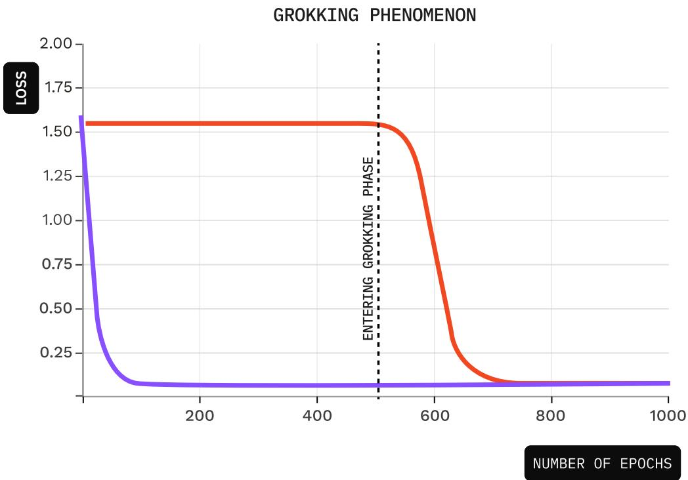  
Figure 16: Grokking. Training loss (purple) falls early in training while test loss (red) remains high. After a long plateau, test loss drops sharply, and the model generalises. Progress measures defined on model internals show the generalising circuit forming gradually during the plateau, before the change is visible in behaviour.

## Transfer from Grokking Settings to Language Models

The standard setting in grokking experiments difers from language model pretraining in many ways, including dataset size, weight decay, and the number of epochs over the data. Current studies have not shown that existing quantitative conclusions transfer directly to large-scale pretraining.

Similar findings have been reported outside grokking settings. Chen et al. (2024a) found that syntactic attention structures emerged during a sharp drop in masked language modelling (MLM) loss, before accuracy improvement on a grammatical benchmark. Similarly, Zucchet et al. (2025a) observed that attention-based recall circuits formed during a plateau in factual-knowledge acquisition, followed by rapid improvements in model performance. These findings suggest that changes in internal mechanisms can precede changes in model capabilities. This observation motivates research on forecasting model behaviour through interna monitoring, as discussed in Section 10.4.

## 10.3.3 Attributing Transitions to Components

So far, the methods we discussed cannot attribute the transition to specific model components. Attention head specialisation is probably the most intuitive option to work at this granularity in transformers. Individual attention heads can specialise to attend to syntactic relations, positional ofsets, or rare tokens (Voita et al., 2019; Clark et al., 2019), and this specialisation can appear abruptly. For example, induction heads form during a brief training window, and their formation coincides with a sharp improvement in in-context learning (Olsson et al., 2022), a transition we examine in detail in Section 10.3.5. In masked language models, suppressing the syntactic attention structure delays the capability it precedes (Chen et al., 2024a). Likewise, sparse attention emerges abruptly and depends on repetition in the training data (Zucchet et al., 2025b).

These events cluster in time. Several attention heads, such as induction heads and heads exhibiting syntactic attention patterns, can acquire specialised functions within the same training window. These heads emerge alongside a peak in how accurately the model’s perplexity predicts human reading times, and this predictive ability subsequently declines even as language modelling performance continues to improve (Aoyama & Wilcox, 2025). Head specialisation can be viewed as a form of symmetry breaking. Before or in the very early stages of training, attention heads are indistinguishable and interchangeable; during training, they start to develop distinct functions despite having equivalent roles in the architecture. Tracking this process can help identify the emergence of modular structure. Attribution of this kind is also a diagnostic for modularity more broadly. Three observable indicators jointly diagnose modular internal structure (Zhao et al., 2024b): transitions during training, emergent trends across model scale, and heterogeneous clustering of solutions across random seeds. A structure exhibiting all three is a strong candidate for a discrete, functionally specialised mechanism.

## Sharp Transitions from Smooth Components

Phase transitions in test loss or task accuracy do not imply abrupt change in any individual component. For example, in controlled settings, many attention heads develop induction-like behaviour gradually their contributions are largely additive, and the sharp macroscopic transition arises from their aggregate efect (Singh et al., 2024). Localising a phase transition in a coarse-grained metric therefore does not help identify the responsible components. In contrast, component-level attribution may find only gradual change without being wrong.

## 10.3.4 Why Transitions Happen

Saddle-to-Saddle Dynamics. Theoretical studies of deep linear networks show that diferent singular modes of the input–output correlations can be learned at diferent rates (Saxe et al., 2014; 2019). The training process may therefore involve periods of slow improvement followed by rapid reductions in test loss. From an optimisation perspective, gradient descent moves through regions near successive saddle points in the loss landscape and gradually learns more complex solutions along the way. This process is known as saddle-to-saddle dynamics. Similar training patterns have been observed in other neural networks, where they learn simpler functions before more complex ones (Rahaman et al., 2019; Nakkiran et al., 2019). Attention head specialisation may also be related to symmetry breaking during training, although the relationship to saddle-to-saddle dynamics is not yet fully established in realistic transformers (Chen et al., 2024a).

Singular Learning Theory. Singular learning theory (SLT) studies how the geometry of a singular model’s parameter space afects learning and generalisation (Watanabe, 2009). Neural networks are singular (and are thus a subject of study in SLT) because diferent parameter configurations can implement the same function. As a result, two models that achieve similar loss can difer substantially in their efective complexity. SLT provides a framework for studying this complexity and has motivated research on its changes during training and its usefulness in downstream applications (Lau et al., 2025).

## Local Learning Coeficient (LLC)

For model parameters θ<sup>∗</sup> at a local minimum, the Local Learning Coeficient (LLC) λ(θ<sup>∗</sup>) measures the degeneracy of the loss landscape near θ<sup>∗</sup> via the volume-scaling rate of low-loss neighbourhoods (Lau et al., 2025). Smaller values indicate more degenerate (flatter, in a higher-order sense) minima. The LLC is estimable at scale with stochastic-gradient MCMC (Lau et al., 2025).

Estimated LLC trajectories in transformers change at points that coincide with identifiable developmental events, including the stages of structure formation described in Section 10.3.3 (Hoogland et al., 2025).

This is the central empirical result of the developmental interpretability programme (Hoogland et al., 2023) introduced in Section 12.3. However, current evidence for LLC is largely retrospective, where phase transitions are detected and matched to known events only after training. Prospective prediction of a transition before it occurs has not yet been demonstrated. Section 10.4 discusses potential applications of learning-dynamics analysis to forecasting and intervention.

## 10.3.5 Case Study: Induction Heads

## Learning Dynamics Perspective on Induction Heads

The preceding case studies (Sections 6.8 and 7.4) analysed induction heads and circuits in a trained model. Several facts about the induction circuit are invisible from that vantage point but become observable when we examine the model across training (Olsson et al., 2022). Consider the repeated sequence again

## A B C A B ?,

and observe at successive checkpoints of a single training run. Examining the checkpoints shows that the induction ability arrived abruptly: at early checkpoints the model bases its predictions on token frequencies and derives no benefit from the earlier occurrence of A B, and during a narrow window of training, roughly 2.5 to 5 billion tokens in the models studied by Olsson et al. (2022), induction heads form and the model begins predicting C by attending back to the first occurrence. A sharp improvement in in-context learning and a small bump in the training loss fall within the same window.

The timing of formation also helps provide causal evidence that a single model checkpoint cannot provide. Ablating an induction head in the final model only shows its necessity for the behaviour at that checkpoint. This does not support the stronger claim that the induction circuit’s formation caused the capability to develop. Olsson et al. (2022) examined this stronger claim by intervening on formation itself. Their “smeared key” modification built the previous-token head’s contribution into the attention computation, allowing the circuit to form within a single layer. Under this modification, one-layer models acquire in-context learning they otherwise never develop, while the transition moves earlier in deeper models.

## 10.4 Leveraging Learning Dynamics for Safety

The analyses above also support safety-oriented objectives, including anticipating capabilities before they appear (Section 10.4.1) and intervening in the training process while it is still underway (Section 10.4.2).

## 10.4.1 Forecasting Model Behaviours

Forecasting from Smaller Runs and Partial Runs. Scaling laws demonstrate that aggregate loss is predictable before training (Kaplan et al., 2020; Hofmann et al., 2022), but phase transitions break this style of extrapolation for individual capabilities (Section 10.3). Forecasting therefore targets specific behaviours directly. Memorisation is the behaviour for which the forecasting problem has been posed most explicitly. Biderman et al. (2023a) introduced the problem of forecasting whether a specific training sequence will be memorised by a model before that model is trained. They argued that recall is the metric to optimise (a false negative means training a full model that leaks the sequence, while a false positive only discards a cheap tria run). They established baselines that forecast from smaller fully trained models and from partially trained checkpoints of the target run, together with equi-compute recommendations for dividing a fixed forecasting budget between model size and tokens.

Forecasting Safety-Relevant Behaviours. Emergence can be forecast by intervening on the training trajectory. Fine-tuning on a target task shifts capability emergence towards less capable models. Fitting how this shift varies with the amount of fine-tuning data yields an emergence law. Using only small models, this law predicts whether a capability will have emerged in models trained with up to 4× more compute (Snell et al., 2024).

Rare harmful behaviours can also be forecast statistically. The largest elicitation probabilities observed in a small sample of queries scale predictably with query volume. This relationship allows harmful-behaviour risks to be extrapolated across up to three orders of magnitude of deployment-scale query volume. Examples include assisting with dangerous chemical synthesis and taking power-seeking actions (Jones et al., 2025).

Post-training failures can be analysed similarly. Specifically, transitions between successive RLHF checkpoints can be classified into four categories: reward hacking, collapse, proxy under-alignment, and evaluator-specific disagreement. Reward hacking occurs when the model exploits a way to achieve high rewards while the external quality from the perspective of human users falls; collapse occurs when both decline. This classification localises failures that checkpoint averages miss. A model fitted to training-dynamics diagnostics predicts future reward hacking with a ROC-AUC of 0.82. These diagnostics include reward-model uncertainty, policy drift, and output diversity (Abahana et al., 2026).

Internal signals extend forecasting to fine-tuning outcomes. Activation-space persona features predict whether a fine-tuned model will exhibit emergent misalignment (Wang et al., 2026a). Signals available before finetuning begins also predict the resulting model’s alignment (Zhang et al., 2026b). Section 12.4 discusses the research agenda these results instantiate.

Internal Precursors as Early Warning. Where a mechanism forms before the capability it supports is behaviourally expressed, monitoring internals can flag the capability earlier than behavioural evaluation. The recall circuits that precede factual-knowledge acquisition (Zucchet et al., 2025a) and the syntactic attention structure that precedes the break in grammatical capabilities (Chen et al., 2024a) show that this lead time can exist; progress measures (Section 10.3.2) are the instrument that would exploit it.

Run-to-Run Variance. To assess the reliability of a forecast, researchers can compare training runs with diferent random seeds. van der Wal et al. (2025) found that capabilities generally emerge at similar stages and representations develop consistently across training runs, although some runs difer substantially. These exceptions highlight the uncertainty of forecasts based on a single training run.

## Most Early-Warning Evidence Is Retrospective

Currently, nearly all demonstrations that changes in internals lead to changes in behaviour are retrospective. In these studies, researchers analyse the completed mechanism after training to identify a progress measure or precursor structure, then evaluate it backwards over saved checkpoints. This concern also exists in LLC-based transition detection (Section 10.3.4).

In contrast, prospective forecasting requires researchers to predict outcomes before observing them. Biderman et al. (2023a) proposed baseline methods for forecasting memorisation. However, prospective forecasting for broader capability transitions relevant to AI safety remains underdeveloped. Earlywarning signals therefore require prospective validation before they can be considered reliable.

## 10.4.2 Intervening on Training Processes

The model that matters is the one deployed at the end of training, and the standard response to an undesirable behaviour found there is post-training fine-tuning, which is outside the scope of this section. An alternative is to intervene during training to prevent undesirable capabilities from developing or to control how they develop. Existing work explores three approaches: modifying training data, changing model architecture, and intervening on model activations during fine-tuning.

Pretraining Data Filtering: Deep Ignorance. Deep Ignorance filters proxies for biohazardous knowledge out of the pretraining corpus and trains 6.9-billion-parameter models on the filtered data (Section 10.1.1; O’Brien et al., 2026). The filtered models do not acquire the targeted knowledge, making it dificult for the unwanted capability to emerge through adversarial fine-tuning. In contrast, post-training unlearning may suppress the unwanted behaviour without removing the underlying knowledge. A follow-up moves the filter from documents to tokens: individual tokens are labelled using sparse autoencoders and eficient classifiers trained on those labels, and filtering at token granularity removes the undesired capability at lower cost to desired capabilities than document-level filtering, with efectiveness increasing with model scale across the two orders of magnitude tested and filtered models remaining alignable afterwards (Rathi & Radford, 2026).

Similarly, the order in which diferent categories of training data are presented matters. Bruijns et al. (2026) found that, in an imbalanced pretraining curriculum where one task is shown before another, the model packs the tasks sequentially into separable circuits, resulting in more targeted subsequent refusal fine-tuning.

## Data-Level Interventions Have Ripple Efects

Removing data from a training set does not act only on the removed data. In the setting of Borkar et al. (2025), deleting personal information can increase memorisation of the personal information that remains, and adding one individual’s information amplifies memorisation of others’ by roughly 7.5×, because whether a sequence is memorised depends on similar sequences seen elsewhere in training. Subliminal learning (Cloud et al., 2026) shows that data can transmit traits not apparent from its semantic content. For example, a student model can inherit a teacher’s hidden bias from seemingly unrelated data, such as number sequences. This transfer is carried by a small set of divergence tokens and depends on early layers (Schrodi et al., 2026). Filtering and unlearning interventions therefore need to be evaluated on what the model does with the data that stays, not only on what it no longer does with the data that was removed.

Architectural Modification: Gradient Routing. Gradient routing is an architectural modification informed by learning dynamics: it constrains which parameters receive gradient updates for chosen concepts during training, localising the corresponding computation into designated regions of the network (Cloud et al., 2024). Although the modification does not make the trained model safer on its own, it shapes where a mechanism forms so that later interventions, such as gating the designated region, become clean and localised. The antecedent for this style of intervention is the smeared-key modification (Olsson et al., 2022), which showed that an architectural change can control when and whether a mechanism forms at all (Section 10.3.5).

Monitoring and Steering During Fine-Tuning. The case excluded above uses fine-tuning to repair an undesirable behaviour after it has been identified. Intervening on the fine-tuning process itself remains within scope, and persona vectors provide a current example of this approach. A persona vector is an activation-space direction corresponding to a character trait such as sycophancy, hallucination propensity, or malice, extractable automatically from a natural-language trait description (Chen et al., 2025b). Intended and unintended personality changes during fine-tuning correlate strongly with movement along the relevant vector, which yields the monitoring instrument. Preventative steering along the vector during fine-tuning limits acquisition of the trait. Before fine-tuning, projecting training data onto the vector flags data that would induce the trait, at both the dataset and individual-sample levels (Chen et al., 2025b). This instantiates each step of the intervention loop below for the fine-tuning stage.

## Train-Time Intervention Loop

The work discussed so far lays the methodological foundation for intervening in a training run in progress. Below we present a general pipeline.

1. Monitor a target quantity at checkpoints, such as a capability-specific metric (Section 10.3.1) or a progress measure on model internals (Section 10.3.2).

2. Define the acceptable range for that quantity in advance, including the response to a breach.

3. Intervene when the range is breached, such as by adjusting the data mixture or filtering out unwanted data, applying a targeted architectural or regularisation change, rolling back to a pre-breach checkpoint, and resuming under the adjusted setup.

4. Re-evaluate the model after the intervention to verify that the targeted capability has been suppressed and does not re-emerge during further training.

No published system implements this loop end to end at scale. Instead, existing studies have demonstrated individual steps of the proposed workflow.

Open Questions. Three questions remain about the applicability of these training-time interventions. First, efective data filtering requires identifying which training data contributes to the capability we want to remove. Token-level filtering is motivated by data attribution, but it remains unclear whether methods such as influence functions (Section 11) can reliably identify the relevant data. Second, scale: Deep Ignorance operates at 6.9 billion parameters, and while token-level filtering became more efective across the tested scale range (Rathi & Radford, 2026), it remains open whether data filtering stays efective and afordable at frontier scale. Third, deployed models show that stronger train-time safeguards are achievable, but not how: gpt-oss models are substantially harder to fine-tune than comparable open-weight models, and their developers have not fully disclosed their responsible training procedure (OpenAI et al., 2025). Understanding how this resistance is achieved could help develop similar safeguards for other open-weight models and clarify how fine-tuning changes model behaviour.

Summary. Learning dynamics can be studied both as an object of explanation, revealing how representations and mechanisms evolve during training, and as an interpretability tool to localise mechanisms, detect phase transitions, and test causal hypotheses through training interventions. Understanding learning dynamics can also help predict when capabilities emerge and guide interventions during training. However, no complete system combining monitoring and intervention has yet been demonstrated at scale. This section focuses on how models change during training, while Section 11 examines how individual training examples contribute to model behaviour.

## 11 Training Data Attribution

For a model behaviour of interest, Sections 6–10 study the internal features, components, and their interactions and evolutions that produce the behaviour. Training data attribution (TDA) shifts the focus from mode internals to training data, searching for training samples that strongly shaped the model behaviour. TDA applications include, but are not limited to, identifying influential training samples, detecting train–test leakage, and diagnosing model failures without retraining (Liu et al., 2025a; Park et al., 2023; Grosse et al., 2023). Although TDA is not generally a mechanistic method under this survey’s criteria, it can complement mechanistic interpretability in many ways. For example, by revealing how specific training samples shape malicious behaviour, TDA can enable efective training data filtering to prevent unwanted behaviours or even their internal mechanisms from forming during the training of next-generation models. Motivated by this application, this section focuses on post-hoc training data attribution methods that link a given target model’s behaviour to its training samples. This section excludes techniques for intervening in the data pipeline, such as filtering pretraining corpora, rebalancing demographic representation, and scheduling memorisation.

TDA falls into two complementary approaches. Verbatim data attribution detects explicit memorisation by identifying exact or near-exact string matches between model outputs and the training corpus. These searches can scale to trillions of tokens using techniques such as sufix arrays and infini-gram models. Gradient-based data attribution estimates how training samples afect model parameters and predictions and can capture influential samples that do not manifest as verbatim reproduction. The two types of methods provide orthogonal views: one answers “did the model use rote memorisation on a training sample to answer this question?”; the other answers “how much did this training sample influence this certain behaviour of this model?”

## 11.1 Verbatim Data Attribution: OLMoTrace and Maximal Matching Spans

Earlier corpus search tools such as the ROOTS Search Tool (Piktus et al., 2023a) and GAIA Search (Piktus et al., 2023b) established the practice of querying pretraining corpora for transparency and data exploration. OLMoTrace (Liu et al., 2025a) scales this to trillions of tokens using a combination of sufix arrays, infini-gram

models, and maximal matching span extraction (Liu et al., 2024a), making it less a data-attribution method in the influence-function sense and more a retrieval tool for identifying content the model may have memorised.

## Sufix Arrays (SA)

The sufix array of a string x of length $T _ { 1 }$ is an array of integers representing the starting positions of all sufixes of x in lexicographic order. It enables eficient substring searches in $\mathcal { O } ( T _ { 2 } \cdot \log T _ { 1 } )$ time for a query of length $T _ { 2 } .$ , compared to $\mathcal { O } ( T _ { 2 } \cdot T _ { 1 } )$ naive search.

## Example: x = banana\$

Sufixes: 0 : banana\$, 1 : anana\$, 2 : nana\$, 3 : ana\$, 4 : na\$, 5 : a\$, 6 : \$

$$
\mathrm { S A } ( x ) = [ 6 , 5 , 3 , 1 , 0 , 4 , 2 ]
$$

## Infini-Gram Models

An infini-gram model extends the n-gram model to arbitrary-length prefixes, using backof to the longest matching sequence in the training corpus. Formally, for a token w<sub>i</sub>:

$$
P _ { \infty } ( w _ { i } \mid w _ { 1 : i - 1 } ) = \frac { \mathrm { c n t } ( w _ { i - n + 1 : i } \mid \mathcal { D } ) } { \mathrm { c n t } ( w _ { i - n + 1 : i - 1 } \mid \mathcal { D } ) } , \quad n = \operatorname* { m a x } \{ n ^ { \prime } : \mathrm { c n t } ( w _ { i - n ^ { \prime } + 1 : i - 1 } \mid \mathcal { D } ) > 0 \} ,
$$

where $w _ { 1 : i - 1 }$ are preceding tokens and D is the training corpus.

Infini-grams are implemented on top of sufix arrays, which allow fast substring queries across massive corpora.

## Maximal Matching Spans

Given a model output and a training corpus, a maximal matching span is a contiguous sequence of tokens that:

1. Appears verbatim at least once in the training data,

2. Does not break words or include spurious delimiters (e.g., periods or newlines) except at span boundaries, and

3. Is not contained within a longer span that satisfies 1. and 2.

OLMoTrace identifies maximal matching spans by combining sufix-array search with infini-gram queries, adjusting boundaries for tokenisation, and retaining only the longest non-overlapping spans.

## OLMoTrace Pipeline

Language Model Output: “Celine Dion is a Canadian singer known for her powerful voice and wide [...]”

## Pipeline Steps:

1. Tokenise the language model output.

2. For each token starting a new word, query the sufix array with infini-gram to find the longest matching prefix in the training corpus.

3. Adjust span boundaries to avoid breaking words or including delimiters.

4. Retain only maximal spans (not contained in longer matches).

## Example Spans Found:

• “Celine Dion [...] Born on March 30, 1968, in”

• “Charlemagne, Quebec, Canada, Dion began”

• “performing at a young age and gained [...]”

• “Her career took of when she won the 1988”

• “Eurovision Song Contest with the song $\mathrm { v e } ^ { \mathfrak { s } }$

This process links language model output directly to the training corpus, enabling identification and attribution of memorised content.

## OLMoTrace Algorithm

Inputs: Model output tokens $S _ { 1 } ^ { L }$ , training corpus tokens $T _ { 1 } ^ { N }$ , sufix array $A _ { 1 } ^ { N }$

## Steps:

1. Scan each token position t in $S _ { 1 } ^ { L }$ , considering only tokens starting a new word.

2. Query the sufix array $A _ { 1 } ^ { N }$ to find candidate matching positions in the training corpus.

3. Use infini-gram queries to determine the longest matching prefix starting at t, backing of to shorter n-grams if necessary.

4. Adjust the match length to avoid breaking words or including spurious delimiters.

5. Collect all spans (t, t + length) that satisfy the above criteria.

6. Filter out spans contained within longer overlapping spans to retain only maximal matches.

Limitations as a Mechanistic Interpretability Tool. Verbatim attribution excels at factual memorisation but struggles with compositional or synthesised outputs. For tasks like translation, poetry, or reasoning, OLMoTrace (and other verbatim matching methods) can identify spans of text that appear in the training data, but these matches do not explain how the model combined information from multiple sources to produce the output.

## OLMoTrace on Multilingual Output

Prompt: “Write a short story in Chinese about a girl who loves reading.”

## Completion (Chinese):

“...一个叫雪儿的小公主，她有一只可爱的小狐狸伴在身边。她喜欢坐在竹林间看着远方。某日，一场突如其来的山洪导致雪...”

OLMoTrace Influential Samples Identified: OLMoTrace identified maximal matching spans across training datasets:

• Span: “一个叫雪儿的小公主，她有一只可爱的小狐狸伴在身边。她喜欢坐在竹林间看着远方”—matched in pretraining corpus

• Span: “她喜欢阅读关于科技、心理学和历史的书籍，业余时间还会参加编程课”—matchedin post-training (instruction-tuning) data

This example demonstrates how OLMoTrace traces multilingual outputs across diverse training sources, linking model generations directly to their memorised origins in pretraining and post-training datasets.

## 11.2 Gradient-Based Attribution: Understanding Data Influence Through Perturbations

Gradient-based methods estimate how much each training sample influenced the model’s predictions.

## 11.2.1 Core Idea: Parameter Response to Training Data

Influence functions estimate how a model’s parameters and predictions would change if a training sample were slightly upweighted (Koh & Liang, 2017; Grosse et al., 2023). We introduce their core idea below.

Consider a neural network parameterised by θ. After suficient training, its parameters will converge to

$$
\theta ^ { * } = \arg \operatorname* { m i n } _ { \theta } \mathcal { L } _ { \mathrm { t r a i n } } ( \theta ) ,
$$

where $\mathcal { L } _ { \mathrm { t r a i n } } ( \cdot )$ is the aggregate training objective calculated as:

$$
\mathcal { L } _ { \mathrm { t r a i n } } ( \theta ) : = \frac { 1 } { n } \sum _ { i = 1 } ^ { n } \mathcal { L } ( z _ { i } , \theta ) .
$$

$\{ z _ { i } \mid i = 1 , . . . , n \}$ is the training set and $\mathcal { L } ( \cdot )$ is a loss function such as cross-entropy loss. Note that although by definition $\theta ^ { * }$ is expected to be a global optimum, it will not afect the subsequent analysis if $\theta ^ { * }$ is in fact a local optimum.

Now, suppose we upweight a training sample $z _ { m }$ by a small amount ϵ. The new aggregate training objective will become:

$$
\begin{array} { r } { \textstyle \mathcal { L } _ { \epsilon } ( \theta ) : = \mathcal { L } _ { \mathrm { t r a i n } } ( \theta ) + \epsilon \mathcal { L } ( z _ { m } , \theta ) . } \end{array}
$$

It corresponds to a new set of model parameters $\theta _ { \epsilon } ^ { * }$ expressed as:

$$
\theta _ { \epsilon } ^ { * } = \arg \operatorname* { m i n } _ { \theta } \mathcal { L } _ { \epsilon } ( \theta ) .
$$

This expression is not a closed-form formula and does not provide us with an eficient way to acquire $\theta _ { \epsilon } ^ { * }$ A brute-force way is to train the neural network with this new objective and observe the new converged parameters; however, this method is extremely computationally expensive. We thus turn to leveraging the specific property of $\theta _ { \epsilon } ^ { * }$ . Note that, by definition, it must satisfy the first-order optimality condition:

$$
\nabla _ { \boldsymbol { \theta } } \mathcal { L } _ { \epsilon } ( \boldsymbol { \theta } ) \Big | _ { \boldsymbol { \theta = \theta } _ { \epsilon } ^ { * } } = \nabla _ { \boldsymbol { \theta } } \mathcal { L } _ { \mathrm { t r a i n } } ( \boldsymbol { \theta } _ { \epsilon } ^ { * } ) + \epsilon \nabla _ { \boldsymbol { \theta } } \mathcal { L } ( z _ { m } , \boldsymbol { \theta } _ { \epsilon } ^ { * } ) = 0 .
$$

This motivates defining a function to link θ and ϵ:

$$
F ( \theta , \epsilon ) : = \nabla _ { \theta } \mathcal { L } _ { \mathrm { t r a i n } } ( \theta ) + \epsilon \nabla _ { \theta } \mathcal { L } ( z _ { m } , \theta ) .
$$

Note that $F ( \theta ^ { * } , 0 ) = 0 .$ , which allows us to consider the implicit function theorem.

To apply the implicit function theorem, we assume that $F ( \theta , \epsilon )$ is continuously diferentiable in a small area around $( \theta , \epsilon ) = ( \theta ^ { * } , 0 )$ . Furthermore, the Jacobian of $F ( \theta , \epsilon )$ with respect to $\theta$ at $( \theta ^ { * } , 0 )$ , i.e.,

$$
\left. { \frac { \partial F ( \theta , \epsilon ) } { \partial \theta } } \right| _ { \theta = \theta ^ { * } , \epsilon = 0 } = \nabla _ { \theta } ^ { 2 } \mathcal { L } _ { \mathrm { t r a i n } } ( \theta ^ { * } ) = : H _ { \theta ^ { * } } ,
$$

is invertible. $H _ { \theta ^ { * } }$ denotes the Hessian of the training loss. These assumptions allow us to apply the implicit function theorem.

$\mathrm { B y }$ the implicit function theorem, there exists a neighbourhood V of $\epsilon = 0$ and a unique continuously diferentiable function $\epsilon \mapsto \theta _ { \epsilon } ^ { * }$ on V such that $F ( \theta _ { \epsilon } ^ { * } , \epsilon ) = 0$ for all $\epsilon \in V$ . In other words, for suficiently small $\epsilon , \theta _ { \epsilon } ^ { * }$ is the stationary point of $\mathcal { L } _ { \epsilon } ( \cdot )$ near $\theta ^ { * }$ . Moreover, its derivative is given by

$$
\frac { d \theta _ { \epsilon } ^ { * } } { d \epsilon } = - \left[ \frac { \partial F ( \theta , \epsilon ) } { \partial \theta } \bigg | _ { \theta = \theta _ { \epsilon } ^ { * } } \right] ^ { - 1 } \frac { \partial F ( \theta _ { \epsilon } ^ { * } , \epsilon ) } { \partial \epsilon } .
$$

Recalling the expression of $F ( \theta , \epsilon )$ , we also have

$$
\frac { \partial F ( \theta , \epsilon ) } { \partial \epsilon } \bigg | _ { \theta = \theta _ { \epsilon } ^ { * } } = \nabla _ { \theta } \mathcal { L } ( z _ { m } , \theta ) \Big | _ { \theta = \theta _ { \epsilon } ^ { * } } .
$$

Putting $\epsilon = 0$ to let $\theta _ { \epsilon } ^ { * } = \theta _ { 0 } ^ { * } = \theta ^ { * }$ and $\begin{array} { r } { \frac { \partial F ( \theta , \epsilon ) } { \partial \theta } \bigg | _ { \theta = \theta _ { \epsilon } ^ { * } } = H _ { \theta ^ { * } } } \end{array}$ , we have:

$$
\left. \frac { d \theta _ { \epsilon } ^ { * } } { d \epsilon } \right| _ { \epsilon = 0 } = - H _ { \theta ^ { * } } ^ { - 1 } \nabla _ { \theta } \mathcal { L } ( z _ { m } , \theta ^ { * } ) .
$$

This quantity describes how the model parameters respond to an infinitesimal increase in the importance of the training sample $z _ { m }$

To measure the efect on a test-time quantity $M ( \theta , z _ { \mathrm { t e s t } } ) \ ( \mathrm { e . g . }$ , the model’s test loss on the testing sample $z _ { \mathrm { t e s t } } )$ , we apply the chain rule:

$$
{ \displaystyle \left. { \cal T } _ { M } ( z _ { m } , z _ { \mathrm { t e s t } } ) : = \frac { d M ( \theta _ { \epsilon } ^ { * } , z _ { \mathrm { t e s t } } ) } { d \epsilon } \right. _ { \epsilon = 0 } = - \nabla _ { \theta } M ( \theta ^ { * } , z _ { \mathrm { t e s t } } ) ^ { \top } H _ { \theta ^ { * } } ^ { - 1 } \nabla _ { \theta } \mathcal { L } ( z _ { m } , \theta ^ { * } ) } .
$$

The quantity $\mathcal { T } _ { M } ( z _ { m } , z _ { \mathrm { t e s t } } )$ is called the influence score. Taking a step forward, by the definition of the derivative, for suficiently small ϵ we have

$$
M ( \theta _ { \epsilon } ^ { * } , z _ { \mathrm { t e s t } } ) - M ( \theta ^ { * } , z _ { \mathrm { t e s t } } ) \approx \epsilon \mathcal { T } _ { M } ( z _ { m } , z _ { \mathrm { t e s t } } ) .
$$

That is, the influence score quantifies the first-order efect of the training sample $z _ { m }$ on the model’s downstream loss for a testing sample $z _ { \mathrm { t e s t } }$

## 11.2.2 Proximal Bregman Response and the Generalised Gauss–Newton

Empirical results show that the original form of influence functions introduced above performs poorly in practice. This is due to multiple assumptions that rarely hold in practice. For example, for a trained neural network, its parameters $\theta$ are scarcely exactly at the local or global minimum $\theta ^ { * }$ . Additionally, the Hessian $H _ { \theta ^ { * } }$ is usually non-invertible or numerically unstable due to some small eigenvalues. These limitations motivate researchers to formulate influence functions without unrealistic assumptions. One classical approach is called the proximal Bregman response function (PBRF) (Bae et al., 2022). It targets model parameters which minimise the new training objective while staying close to the original parameters. Below, we sketch its core idea.

Let each training sample $z _ { i } = ( x _ { i } , y _ { i } )$ , where $x _ { i }$ is the input and $y _ { i }$ is the label, and $u _ { i } ( \theta ) = f ( x _ { i } , \theta )$ is the output of the model (parameterised as $\theta )$ given input $x _ { i }$ , such as a logit vector. Slightly abusing notation, we denote the per-sample training loss as

$$
\mathcal { L } ( z _ { i } , \theta ) : = \mathcal { L } ( u _ { i } ( \theta ) , y _ { i } ) = \mathcal { L } ( f ( x _ { i } , \theta ) , y _ { i } ) ,
$$

where $\mathcal { L } ( \cdot , y )$ is a loss function as in the vanilla influence function formulation. Here we additionally assume $\mathcal { L } ( \cdot , y )$ is convex in its first argument $u ,$ which many commonly used loss functions, such as cross-entropy loss, satisfy.

As Bregman divergence will be used in the later formulation, we introduce this notion as the next step. Specifically, for a given convex function $\mathcal { L } ( u , y )$ (as described above) with the label y fixed, the Bregman divergence of two model outputs, u and $u ^ { \prime } .$ , is:

$$
D _ { \mathcal { L } } ( u , u ^ { \prime } ; y ) = \mathcal { L } ( u , y ) - \mathcal { L } ( u ^ { \prime } , y ) - \left( \nabla _ { v } \mathcal { L } ( v , y ) \big | _ { v = u ^ { \prime } } \right) ^ { \top } ( u - u ^ { \prime } ) ,
$$

i.e., the amount by which $\mathcal { L } ( \cdot , y )$ at u exceeds its first-order Taylor approximation from $u ^ { \prime } .$

Now we introduce the PBRF formulation. Starting from the upweighted objective $\mathcal { L } _ { \epsilon } ( \theta )$ , PBRF is represented as:

$$
\mathcal { P } _ { \epsilon } ( \theta ) : = \frac { 1 } { n } \sum _ { i = 1 } ^ { n } D _ { \mathcal { L } } \big ( f ( x _ { i } , \theta ) , f ( x _ { i } , \theta ^ { s } ) ; y _ { i } \big ) + \epsilon \mathcal { L } ( z _ { m } , \theta ) + \frac { \lambda } { 2 } \| \theta - \theta ^ { s } \| ^ { 2 } , \qquad \theta _ { \epsilon } ^ { \mathrm { P B R F } } : = \arg \operatorname* { m i n } _ { \theta } \mathcal { P } _ { \epsilon } ( \theta ) ,
$$

where $\theta ^ { s }$ denotes the original trained model parameters (note that it is not required to be the local or global optimum). Bregman divergence replaces the original loss function. An additional proximity term is added with a positive regularisation coeficient λ. $\theta _ { \epsilon } ^ { \mathrm { P B R F } }$ searches for the set of model parameters that best corresponds to an upweight in $z _ { m }$ while keeping its predictions on the overall training set close to the original predictions and staying close to $\theta ^ { s }$

In this construction, both the Bregman and the proximity terms are non-negative for all θ and vanish at $\theta = \theta ^ { s }$ . Since these are the only two terms of $\mathcal { P } _ { \epsilon }$ when $\epsilon = 0 , \theta ^ { s }$ is a global minimiser of $\mathcal { P } _ { 0 } ~ ( \mathrm { i . e . , } \ \theta ^ { s } = \theta _ { 0 } ^ { \mathrm { P B R F } } )$ regardless of whether training has converged.

As in the vanilla formulation, $\theta _ { \epsilon } ^ { \mathrm { P B R F } }$ does not have a closed-form formula for now. However, by observing that $\nabla _ { \boldsymbol { \theta } } \mathcal { P } _ { \epsilon } ( \boldsymbol { \theta } ) \big \vert _ { \boldsymbol { \theta } = \boldsymbol { \theta } _ { \epsilon } ^ { \mathrm { P B R F } } } = 0$ , we define

$$
\tilde { F } ( \theta , \epsilon ) : = \nabla _ { \theta } \mathcal { P } _ { \epsilon } ( \theta ) = \frac { 1 } { n } \sum _ { i = 1 } ^ { n } \nabla _ { \theta } D _ { \mathcal { L } } \big ( f ( x _ { i } , \theta ) , f ( x _ { i } , \theta ^ { s } ) ; y _ { i } \big ) + \epsilon \nabla _ { \theta } \mathcal { L } ( z _ { m } , \theta ) + \lambda ( \theta - \theta ^ { s } ) ,
$$

where $\tilde { F } ( \theta ^ { s } , 0 ) = 0$ . We assume that $f ( x _ { i } , \cdot )$ and $\mathcal { L } ( \cdot , y )$ are twice continuously diferentiable such that $\tilde { F }$ is continuously diferentiable in a small area around $( \theta ^ { s } , 0 )$ . Then, we verify that $\frac { \partial \tilde { F } ( \theta , \epsilon ) } { \partial \theta }$ is invertible at $( \theta , \epsilon ) = ( \theta ^ { s } , 0 )$ , the last prerequisite for using the implicit function theorem. By direct calculation (we omit the detailed process here), we can obtain

$$
\left. \frac { \partial \tilde { F } ( \theta , \epsilon ) } { \partial \theta } \right. _ { \theta = \theta ^ { s } , \epsilon = 0 } = \underbrace { \frac { 1 } { n } \sum _ { i = 1 } ^ { n } J _ { i } ^ { \top } H _ { i } J _ { i } } _ { = : G } + \lambda I ,
$$

where $\begin{array} { r } { u _ { i } ^ { s } : = u _ { i } ( \theta ^ { s } ) , J _ { i } : = \frac { \partial u _ { i } ( \theta ) } { \partial \theta } \big | _ { \theta = \theta ^ { s } } } \end{array}$ is the output–parameter Jacobian, and $H _ { i } : = \nabla _ { u } ^ { 2 } \mathcal { L } ( u , y _ { i } ) \big | _ { u = u _ { i } ^ { s } }$ is the loss–output Hessian. The matrix $G$ is the generalised Gauss–Newton (GGN) matrix. Notably, as $H _ { i }$ is positive semidefinite by the convexity of $\mathcal { L } ( \cdot , y _ { i } )$ , we know G is positive semidefinite (because $v ^ { \top } G v =$ $\begin{array} { r } { \bar { \frac { 1 } { n } } \sum _ { i } ( J _ { i } v ) ^ { \top } H _ { i } ( J _ { i } v ) \geq 0 } \end{array}$ for any v). As a result, $G + \lambda I$ is positive definite and hence invertible. Unlike the case of $\nabla _ { \theta } ^ { 2 } { \mathcal { L } } _ { \mathrm { t r a i n } } ( \theta ^ { * } )$ , the invertibility of $G + \lambda I$ holds by construction.

Knowing that $\partial \tilde { F } ( \theta , \epsilon ) / \partial \epsilon = \nabla _ { \theta } \mathcal { L } ( z _ { m } , \theta )$ , we apply the implicit function theorem and obtain

$$
\left. \frac { d \theta _ { \epsilon } ^ { \mathrm { P B R F } } } { d \epsilon } \right| _ { \epsilon = 0 } = - ( G + \lambda I ) ^ { - 1 } \nabla _ { \theta } \mathcal { L } ( z _ { m } , \theta ^ { s } ) .
$$

By the chain rule, the influence score on a test-time quantity $M ( \theta , z _ { \mathrm { t e s t } } )$ becomes

$$
T _ { M } ^ { \mathrm { P B R F } } ( z _ { m } , z _ { \mathrm { t e s t } } ) : = \frac { d M ( \theta _ { \epsilon } ^ { \mathrm { P B R F } } , z _ { \mathrm { t e s t } } ) } { d \epsilon } \Bigg | _ { \epsilon = 0 } = - \nabla _ { \theta } M ( \theta ^ { s } , z _ { \mathrm { t e s t } } ) ^ { \top } ( G + \lambda I ) ^ { - 1 } \nabla _ { \theta } \mathcal { L } ( z _ { m } , \theta ^ { s } ) .
$$

As shown above, the influence function computed with $G + \lambda I$ is exactly the derivative of the PBRF at $\epsilon = 0$ Bae et al. (2022) confirmed empirically that such influence estimates align well with the actual PBRF.

## 11.2.3 Addressing the Computational and Memory Bottlenecks of GGN

The size of the GGN matrix $G \in \mathbb { R } ^ { p \times p }$ (where $p$ is the number of model parameters) can be extremely large for modern language models, which makes the calculation of $( G + \lambda I ) ^ { - 1 }$ computationally expensive. As a result, follow-up methods have avoided explicitly calculating this inverse matrix by borrowing techniques from the optimisation literature.

Kronecker-Factored Approximate Curvature (K-FAC). Martens & Grosse (2015) proposed Kronecker Factored Approximate Curvature (K-FAC) to approximate a large Fisher information matrix (FIM) using a set of smaller matrices. For a trained neural network parameterised by $\theta ^ { s }$ , the FIM is defined as

$$
\mathbf { F } : = \frac { 1 } { n } \sum _ { i = 1 } ^ { n } \mathbb { E } _ { \hat { y } \sim p ( \cdot | x _ { i } , \theta ^ { s } ) } \left[ \nabla _ { \theta } \log p ( \hat { y } \mid x _ { i } , \theta ^ { s } ) \nabla _ { \theta } \log p ( \hat { y } \mid x _ { i } , \theta ^ { s } ) ^ { \top } \right] ,
$$

where $\hat { y }$ is a sample from the model’s prediction distribution on $x _ { i }$ . For example, suppose the task is three-class classification $\left( c _ { 1 } , c _ { 2 } , c _ { 3 } \right)$ and the model’s prediction distribution is $\pi _ { i } = \operatorname { s o f t m a x } ( u _ { i } ^ { s } ) = ( 0 . 5 , 0 . 3 , 0 . 2 )$ . If a sampled label is $\hat { y } = c _ { 2 }$ , then $\log p ( \hat { y } \mid x _ { i } , \theta ^ { s } ) = \log 0 . 3$

Although K-FAC approximates the FIM rather than the GGN, these matrices are equivalent for common loss functions under suitable probabilistic assumptions. For example, with softmax cross-entropy, the expected outer product of the output log-likelihood gradients can be shown to equal the loss–output Hessian:

$$
\mathbb { E } _ { \hat { y } \sim p ( \cdot \vert x _ { i } , \theta ^ { s } ) } \left[ \nabla _ { u } \log p ( \hat { y } \mid u ) \nabla _ { u } \log p ( \hat { y } \mid u ) ^ { \top } \right] _ { u = u _ { i } ^ { s } } = \mathrm { d i a g } ( \pi _ { i } ) - \pi _ { i } \pi _ { i } ^ { \top } = H _ { i } .
$$

Applying the chain rule then gives

$$
\mathbf { F } = \frac { 1 } { n } \sum _ { i = 1 } ^ { n } J _ { i } ^ { \top } H _ { i } J _ { i } = G .
$$

This shows that we can use K-FAC to approximate the GGN used in the PBRF influence score.

Now we return to K-FAC, which eficiently approximates the FIM. First, it ignores curvature between layers and approximates F as a block-diagonal matrix with one block per layer. Consider a neural network in which each layer ℓ has a weight matrix $W _ { \ell } \ \in \ \mathbb { R } ^ { d _ { \mathrm { o u t } } \times d _ { \mathrm { i n } } }$ , input activations $h _ { \ell - 1 }$ , and pre-activations $s _ { \ell } = W _ { \ell } h _ { \ell - 1 }$ (irrelevant to subscript s in $\theta ^ { s } )$ . Following Grosse et al. (2023), the pseudo-gradient is defined as $\mathcal { D } _ { s _ { \ell } } : = \nabla _ { s _ { \ell } }$ log $p ( \hat { y } \mid x , \theta ^ { s } ) \in \mathbb { R } ^ { d _ { \mathrm { o u t } } } -$ the gradient flowing back to $s _ { \ell } .$ . The pseudo-gradient of the layer weights is $\mathcal { D } _ { s _ { \ell } } h _ { \ell - 1 } ^ { \top }$ . Its vectorisation gives $h _ { \ell - 1 } \otimes D _ { s _ { \ell } } ,$ , where ⊗ denotes the Kronecker product. Leveraging ⊗’s properties that $( A \otimes B ) ^ { \top } = A ^ { \top } \otimes B ^ { \top }$ and $( A \otimes B ) ( C \otimes D ) = ( A C ) \otimes ( B D )$ , the block for this layer in the FIM, denoted as $\mathbf { F } _ { \ell } .$ , can be represented as

$$
\mathbf { F } _ { \ell } = \underbrace { \mathbb { E } \left[ ( h _ { \ell - 1 } h _ { \ell - 1 } ^ { \top } ) \otimes ( \mathcal { D } _ { s _ { \ell } } \mathcal { D } _ { s _ { \ell } } ^ { \top } ) \right] } _ { \in \mathbb { R } ^ { d _ { \mathrm { i n } } d _ { \mathrm { o u t } } \times d _ { \mathrm { i n } } d _ { \mathrm { o u t } } } } \approx \underbrace { \mathbb { E } [ h _ { \ell - 1 } h _ { \ell - 1 } ^ { \top } ] } _ { = : \mathbf { A } _ { \ell - 1 } \in \mathbb { R } ^ { d _ { \mathrm { i n } } \times d _ { \mathrm { i n } } } } \otimes \underbrace { \mathbb { E } [ \mathcal { D } _ { s _ { \ell } } \mathcal { D } _ { s _ { \ell } } ^ { \top } ] } _ { = : \mathbf { S } _ { \ell } \in \mathbb { R } ^ { d _ { \mathrm { o u t } } \times d _ { \mathrm { o u t } } } } .
$$

The approximation separates the expectation into two independent factors: activations and pseudo-gradients. K-FAC thus stores only $d _ { \mathrm { i n } } ^ { 2 } + d _ { \mathrm { o u t } } ^ { 2 }$ entries instead of $( d _ { \mathrm { i n } } d _ { \mathrm { o u t } } ) ^ { 2 }$ entries for each block. When the two factors are invertible, their Kronecker product can be inverted separately:

$$
\begin{array} { r } { ( \mathbf { A } _ { \ell - 1 } \otimes \mathbf { S } _ { \ell } ) ^ { - 1 } = \mathbf { A } _ { \ell - 1 } ^ { - 1 } \otimes \mathbf { S } _ { \ell } ^ { - 1 } . } \end{array}
$$

This substantially reduces the memory required to store G and the computational cost of computing the inverse of $G + \lambda I$

Eigenvalue-Corrected K-FAC (EK-FAC) and ASTRA. EK-FAC (George et al., 2018) improved K-FAC by correcting its eigenvalues. Recent work has adopted this technique to scale the influence function method to modern LLMs (Grosse et al., 2023). ASTRA (Wang et al., 2025a) further used EK-FAC as a preconditioner for Neumann series iterations, achieving higher-quality GGN-vector products with less hyperparameter tuning. These eforts make influence functions increasingly practical for modern language models with billions of parameters.

## 11.2.4 Retraining-Based Influence Estimation: datamodels and TRAK

Some methods have explored retraining the model to estimate the attribution. The most naive method is to upweight or remove each training sample, retrain the model on the modified training set, and observe changes in the model’s output on the testing sample. Ilyas et al. (2022) proposed datamodels to more eficiently estimate each training sample’s attribution on a testing sample by retraining many models on random subsets of the training data and fitting a linear regression that predicts the model output on the testing sample from binary indicators of whether each training sample was included. Each fitted coeficient then represents the training sample’s influence on the testing sample.

However, datamodels remains computationally expensive because it requires training many models. Tracing with the Randomly-projected After Kernel (TRAK; Park et al., 2023) provides a more eficient alternative. TRAK first uses a first-order Taylor expansion around the model parameters to approximate a trained model as a linear model. It then applies random projections to reduce gradient dimensionality and estimate training-sample influence in this lower-dimensional space. Finally, it averages the estimates across a small number of trained models to reduce variability due to training randomness. TRAK achieves attribution quality comparable to datamodels at substantially lower computational cost (Park et al., 2023).

## 11.2.5 Eficient Influence Estimation Using Training Trajectories: TracIn

TracIn (Garima et al., 2020) estimates training-data influence using gradients evaluated along the training trajectory, without computing the inverse Hessian. Its core idea follows from the efect of a single Stochastic Gradient Descent (SGD; Robbins & Monro, 1951) update on the loss of a testing sample.

Suppose the model parameters at training step t are $\theta ^ { t }$ . $\mathrm { A n }$ SGD update using training sample $z _ { m }$ with learning rate $\eta _ { t }$ is:

$$
\begin{array} { r } { \theta ^ { t + 1 } = \theta ^ { t } - \eta _ { t } \nabla _ { \theta } \mathcal { L } ( z _ { m } , \theta ^ { t } ) . } \end{array}
$$

By simple rearrangement, we have

$$
\boldsymbol { \theta } ^ { t + 1 } - \boldsymbol { \theta } ^ { t } = - \eta _ { t } \nabla _ { \boldsymbol { \theta } } \mathcal { L } ( z _ { m } , \boldsymbol { \theta } ^ { t } ) .
$$

Then, by first-order Taylor expansion, the change in the loss of a testing sample $z _ { \mathrm { t e s t } }$ can be approximated as

$$
\begin{array} { r l } & { \mathcal { L } ( z _ { \mathrm { t e s t } } , \theta ^ { t + 1 } ) - \mathcal { L } ( z _ { \mathrm { t e s t } } , \theta ^ { t } ) } \\ & { \quad \approx \nabla _ { \theta } \mathcal { L } ( z _ { \mathrm { t e s t } } , \theta ^ { t } ) ^ { \top } ( \theta ^ { t + 1 } - \theta ^ { t } ) } \\ & { \quad = - \eta _ { t } \nabla _ { \theta } \mathcal { L } ( z _ { \mathrm { t e s t } } , \theta ^ { t } ) ^ { \top } \nabla _ { \theta } \mathcal { L } ( z _ { m } , \theta ^ { t } ) . } \end{array}
$$

The above expression relates the gradient of the loss on a training sample $z _ { m }$ to the gradient on a test sample $z _ { \mathrm { t e s t } }$ and the change in test loss on $z _ { \mathrm { t e s t } }$ . A positive dot product indicates that the training update will reduce the test loss, while a negative value indicates the opposite.

TracIn extends this idea across training. Its practical checkpoint-based variant, TracInCP, estimates influence by summing gradient dot products over model checkpoints:

$$
\begin{array} { r l } & { \mathrm { T r a c I n C P } ( z _ { m } , z _ { \mathrm { t e s t } } ) } \\ & { \quad = \displaystyle \sum _ { t \in \mathcal C } \eta _ { t } \nabla _ { \theta } \mathcal L ( z _ { \mathrm { t e s t } } , \theta ^ { t } ) ^ { \top } \nabla _ { \theta } \mathcal L ( z _ { m } , \theta ^ { t } ) , } \end{array}
$$

where C denotes the selected training checkpoints. A larger positive score indicates that $z _ { m }$ has contributed more towards reducing the test loss.

Unlike Hessian-based influence functions, TracIn does not require matrix inversion. However, TracInCP approximates the influence of training samples using gradients only at selected checkpoints, which may undermine the estimation accuracy.

## 11.2.6 Illustrative Example

Gradient-based influence functions can identify influential training samples without requiring them to exactly match the current model output. They complement verbatim attribution and reveal subtler influences. Below, we provide an example of using them for the English-to-Chinese translation task.


## 11.2.7 Recent Extensions and Limitations

Recent work extends training data attribution to handle training stochasticity. Distributional TDA (d-TDA) estimates how output distributions depend on the dataset (Mlodozeniec et al., 2025). Georgiev et al. (2023) proposed TRAK variants to address difusion models. More recent work connects TDA directly to mechanistic interpretability (Kowal et al., 2026; Habibi et al., 2026); for example, Kowal et al. (2026) introduced Concept Influence to enable attribution at the level of semantic concepts represented by model internals such as sparse autoencoder features. This brings TDA closer to the mechanistic goal of understanding how training data shapes specific internal computations. However, fundamental technical challenges persist, including approximation errors that compound over the training trajectory, variability across training runs caused by randomness like data ordering, and memory and computational bottlenecks of scaling to frontier models. These limitations motivate further research in this direction.

Summary. Training data attribution traces model behaviour back to the training data. Verbatim methods such as OLMoTrace identify memorised spans, while gradient-based methods such as influence functions estimate the contribution of individual training samples to downstream model predictions. These approaches remain limited at scale. Meanwhile, recent work has begun linking data attribution to internal features and mechanisms. Having surveyed the main methodological families of AI interpretability in the preceding sections, Section 12 organises them into six research orientations that difer in their goals, assumptions, and paths forward.

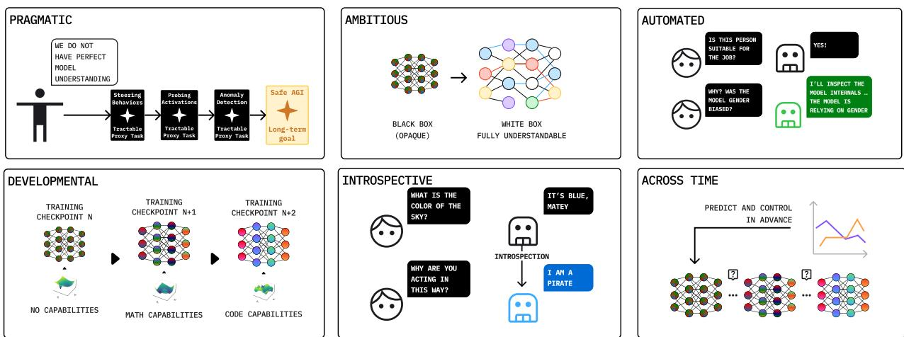  
Figure 17: Six research orientations of AI interpretability.

## 12 Six Research Orientations

An orientation is a coherent research programme defined by its goals, assumptions, and trade-ofs. In contrast, a method is an established modular pipeline that may be used in diferent orientations. In AI interpretability, diferent research goals, such as developing ready-to-use safety measures or achieving complete mechanistic understanding, have led to distinct research programmes. This section organises six major research orientations and summarises their scientific objectives, core assumptions, characteristic methods, and limitations (Nanda et al., 2025; Gao, 2025; Li et al., 2025a; Hoogland et al., 2023; Barez, 2026; Biderman et al., 2026; Figure 17). Note that no single orientation is universally preferable. The choice depends on the research objective, deployment context, available resources, and tolerance for diferent forms of uncertainty.

## 12.1 Pragmatic Interpretability: Proxy-Task-Oriented Safety Interventions

Pragmatic Interpretability focuses on doing the research most helpful for longer-term alignment and interpretability goals, such as helping AGI go well (Nanda et al., 2025). Proponents argue that full mechanistic understanding is not required to have significant impact; instead, researchers should prioritise the work most likely to help (Nanda et al., 2025). The central idea is to work on a set of operationally meaningful proxy tasks that can be empirically studied on models today to help make powerful future models safe. Researchers are agnostic about which methods they use, even if they do not involve model internals. Though not required, these proxy tasks may also be directly useful on today’s deployed systems, providing valuable feedback.

A representative example is the study of Claude Sonnet 4.5’s evaluation awareness (Anthropic, 2025a). The system was shown to condition its behaviour on the presence of evaluation signals, making results from safety evaluations used for previous models harder to interpret. Researchers identified and applied a steering vector that suppresses this awareness, allowing evaluation of its actual behaviour. While this study does not fully explain the internal mechanism of evaluation awareness, it is suficient to produce a concrete and safety-relevant behavioural change, illustrating the pragmatic philosophy.

Another example is Marks et al. (2025b). In this case, researchers constructed a proxy task: they fine-tuned a model with a hidden goal, then blinded teams of researchers audited the model to discover it. This served as a proxy task for detecting a naturally emerging hidden goal in a future model. The diferent auditing teams used diferent techniques, allowing researchers to compare their eficacy.

Common techniques in this paradigm include:

• Steering vectors, which shift models to targeted behaviours.

• Probes, which detect latent safety-relevant properties in activations.

• Behavioural monitoring and anomaly detection, which track signals indicative of emerging risks, such as monitoring the model’s verbalised reasoning.

• Prompting, an efective black-box baseline method for steering model behaviour.

Recent work following this pragmatic trajectory has demonstrated efective control of refusal behaviour (Arditi et al., 2024) and evaluation awareness (Anthropic, 2025a). These interventions provide direct gains to contemporary systems. However, they may not (and are not designed to) fully explain how models implement their behaviours.

## 12.2 Ambitious Interpretability: Towards Complete Mechanistic Understanding

In contrast to pragmatic approaches, Ambitious Interpretability seeks a comprehensive mechanistic understanding of how models implement their computations (Gao, 2025). Proponents argue that partial or surface-level understanding cannot guarantee safety in next-generation systems. Full understanding is needed to rule out hidden failure modes or deceptive internal dynamics. Specifically, Ambitious Interpretability does not treat interpretability as a collection of useful heuristics. Instead, it treats interpretability as a scientific objective to reverse-engineer the model and develop a transparent, predictive theory of its internal algorithms.

Ambitious Interpretability particularly emphasises metric-driven progress. Motivated by the fact that existing mechanistic approaches still struggle with stringent metrics, it proposes starting with looser ones, tracking and improving methods’ performance on them, and adopting stricter metrics when suitable. Two example metrics by Gao (2025) are:

• Feature quality: demonstrating that extracted features and their natural-language explanations are faithful and simulatable.

• Circuit faithfulness: demonstrating circuits are necessary and suficient for explaining behaviour via causal intervention (e.g., causal scrubbing (Chan et al., 2022a)), without performance degradation.

The disadvantage of this ambition is its cost. Fine-grained mechanistic analysis of frontier large models is computationally expensive and sometimes intractable. As Gao (2025) emphasised, current tools still fall far short of the coverage and robustness required for a truly comprehensive understanding.

Interpretability-by-design as a Synthesis. The emergence of interpretability-by-design models (Section 6.10) blurs the boundary between Ambitious and Pragmatic Interpretability. These methods (Gao et al., 2026; Pearce et al., 2025; Park et al., 2025; Oldfield et al., 2024) aim to make representations and circuits easier to understand by modifying model architectures rather than relying entirely on post-hoc reverse engineering. This practical change to model design pursues the ambitious goal of mechanistic understanding. However, it remains unclear whether these methods can ultimately achieve complete mechanistic understanding. In the short term, they may simply represent a separate “Engineering” orientation in which interpretability is treated as an optimisation objective.

## 12.3 Developmental Interpretability: Characterising How Models Learn

Complementing post-hoc analysis of trained models, Developmental Interpretability (Hoogland et al., 2023; Hoogland et al., 2025) treats the training process itself as an object of scientific inquiry. Taking a learningtheory perspective, it aims to mathematically formalise the emergence and evolution of model representations, efective complexity, and capabilities throughout training.

Its central claim is that many neural network properties which are hard to analyse through a fixed model checkpoint can be understood through their developmental process. This process contains measurable, modelable signatures that can serve as proxies for the model’s properties of interest, such as developmenta stages, phase transitions, and other organising principles that help mathematically explain how complex behaviours emerge and evolve throughout training. A classic example is the Local Learning Coeficient (LLC) introduced in Sections 10.2.1 and 10.3.4. It successfully serves as a signature of the model’s efective complexity, allowing us to observe developmental transitions and compare two models with the same training loss.

Methods in this paradigm include:

• Singular Learning Theory (SLT) and related mathematical frameworks for characterising developmental stages, symmetry breaking, and changes in the geometry of the loss landscape during training.

• Checkpoint-based analysis to track the emergence of representations and mechanisms by applying specialised probes, feature discovery methods, and circuit analyses across a model’s training checkpoints.

More specifically, Developmental Interpretability aims to answer questions such as: Can we characterise the development of model capabilities or behaviours as phase transitions during training? What developmental stages precede the formation of a certain mechanism? How does the optimisation process transform distributed representations into structured mechanisms? Unlike Interpretability Across Time (detailed in Section 12.4), which emphasises forecasting and controlling future model behaviour, Developmental Interpretability is primarily concerned with understanding the developmental processes that produce those behaviours. Its primary goal is rigorous scientific explanation rather than predicting or intervening on capabilities.

## 12.4 Interpretability Across Time: Understanding the Causes of Model Behaviours

Like Developmental Interpretability, Interpretability Across Time (Biderman et al., 2023b; 2026) treats a model as a time-evolving process shaped by its training data, loss functions, architectures, and optimisation dynamics. However, the two orientations difer in their primary goals. Developmental Interpretability mainly focuses on characterising the developmental processes that give rise to the model’s internal features, mechanisms, and capabilities. In contrast, Interpretability Across Time seeks established knowledge of learning that is (1) suficiently predictive to estimate important model properties before training is complete, (2) suficiently causal to identify when and why undesirable trajectories arise, and (3) suficiently precise to enable interventions on the learning process itself (Biderman et al., 2026). From a safety perspective, this orientation aims to understand and ultimately shape the training process to prevent the model from developing undesirable behaviours in the first place rather than repairing them after they develop.

Interpretability Across Time builds on three areas of research. First, scaling-law studies show that model performance can be predicted from factors such as model size, training data, and compute (Kaplan et al., 2020; Hofmann et al., 2022). This motivates similar eforts to predict safety-relevant model properties (Ganguli et al., 2022; Jones et al., 2025). Second, longitudinal mechanistic studies track how internal mechanisms develop during training (Tigges et al., 2024; Singh et al., 2024). Third, studies of training data show that the training distribution can afect downstream model behaviour. For example, Razeghi et al. (2022) found that few-shot numerical reasoning performance depends strongly on the frequency of relevant terms in pretraining data, while Elazar et al. (2023) estimated the causal efects of pretraining-data statistics on factual predictions. Interpretability Across Time builds on these findings to predict and influence safety-relevant model behaviour during training.

Methods in this paradigm include:

• Longitudinal analysis of model internals, tracking representations, features, or implemented mechanisms across checkpoints to determine when and how they form and evolve.

• Monitoring training runs and forecasting future behaviour, using early behavioural or internal signals to predict later capabilities, biases, or unsafe behaviours before they are fully expressed.

• Training-process interventions and design, manipulating data, activations, objectives, architectures, or other aspects of optimisation to encourage desirable developmental trajectories, prevent undesirable capabilities or behaviours from arising, or ensure that learned information is represented in ways that make it easier to control.

Several studies have examined whether safety risks can be identified before or during training. Zhang et al. (2026b) found that model activations measured before fine-tuning can predict alignment scores after fine-tuning. Similarly, Wang et al. (2026a) identified internal features associated with emergent misalignment, which could sometimes detect misalignment before behavioural evaluations did. Other studies found that training models to exploit relatively simple reward misspecifications can lead to more serious failures, including reward tampering and broader misaligned behaviour (Denison et al., 2024; Taylor et al., 2025). These findings motivate monitoring early signs of undesirable behaviour during training rather than relying solely on the evaluation of the final model.

Another line of work under this paradigm attempts to directly shape models by preventing them from learning unsafe behaviours. Data filtering can prevent models from acquiring hazardous information in the first place and substantially increase the amount of subsequent fine-tuning required to recover it (O’Brien et al., 2026; Rathi & Radford, 2026), and gradient routing approaches deliberately constrain where or how information is learned, making later removal or control more tractable (Cloud et al., 2024; Shilov et al., 2025).

Common confusion. Although Biderman et al. (2026) contrasted this orientation with the “fix it in post” paradigm, it would be a mistake to view it as dismissive of post-training writ large. Post-training is itself a training process, and behaviours like sycophancy and reward hacking arise primarily during and due to post-training. This orientation’s criticism of post-training safety focuses on cases where, instead of understanding why a behaviour developed, post-training patches undesirable behaviour. The core distinction is understanding and controlling a training process versus applying optimisation pressure to suppress learned behaviours.

Interpretability Across Time is not mutually exclusive with the other research orientations. It can be Pragmatic, by using a simple probe as an early-warning signal, or Ambitious, by seeking a mechanistic theory of why a circuit forms under gradient descent. Its defining goal is using insights into training dynamics to explain and predict how model behaviour develops, and to intervene before undesirable behaviours emerge.

## 12.5 Introspective Interpretability: Models Interpreting Themselves

Introspective Interpretability (Binder et al., 2025; Plunkett et al., 2025; Li et al., 2025a; Guo et al., 2026; Li, 2026) uses the model being explained as its own explainer. Its main practical advantage is its unique accessibility. For a given introspective model, it requires no white-box access or specialised tooling to explain its decisions; anyone can get the self-explanation (or interchangeably self-report) at deployment time by asking the model a follow-up question in an ordinary chat interface.

This research direction is supported by the privileged access hypothesis discussed in Section 5.3, which posits that models may have access to internal information that is dificult to recover through external analysis alone, including typical mechanistic analysis or a diferent model as the explainer. Recent work has leveraged this idea by fine-tuning target models to faithfully report their internal reasoning, behavioural tendencies, objectives, and even weight changes induced by training (Goel et al., 2026).

A related line of work fine-tunes metamodels (external explainers) on the internal representations of a target model (Pan et al., 2026; Karvonen et al., 2026a; Bauer et al., 2026; Huang et al., 2026). These methods are generally not considered instances of Introspective Interpretability because the explainer is technically a separate model. However, the distinction can be blurry in practice, as many of these explainers are initialised from the target model and can be viewed as specialised, fine-tuned descendants of the original model.

## 12.5.1 Concerns for Introspective Interpretability

Self-explanation also raises concerns. For example, generated explanations can be plausible yet unfaithful. The model’s general capability can also degrade when it is trained to honestly verbalise its internal processing. Moreover, the model may have fundamental limitations in what it can report. These concerns raise questions about whether we can trust self-explanations in safety-critical applications and how to validate potentially misleading reports. Below, we first discuss the main failure modes of self-explanation, followed by validation procedures in Section 12.5.2.

## Failure Modes of Self-Explanation

Introspective methods can fail in several ways. In each case, the explanation appears plausible yet is unfaithful.

Confabulation. Models may generate coherent explanations that do not reflect their actual internal computations. This occurs because language models are extensively pretrained and fine-tuned on next-token prediction and instruction-following tasks to produce fluent, knowledgeable text, not faithful introspective reports. Thus, explanations may simply reflect training data patterns (how humans explain reasoning) rather than the model’s actual computational process (Turpin et al., 2023; Arcuschin et al., 2026; Barez et al., 2026; Chen et al., 2025c). Moreover, the reinforcement learning reward for generating helpful responses can also incentivise convincing confabulation, even though the model cannot introspect. An example of a helpful yet unfaithful response is when the model post hoc rationalises an answer it already rote-memorised.

Miscalibration. Even when models attempt faithful self-report, their confidence may be poorly calibrated with accuracy. Models can express high confidence in explanations for computations they have not yet learned to analyse. Moreover, calibration can vary by task: models may be well calibrated on reporting their own uncertainty in simpler tasks such as factual recall but poorly calibrated on reasoning processes. A recent study further found that, even in factual recall tasks, models can hallucinate with high certainty despite knowing the correct answer (Simhi et al., 2025).

Elicitation sensitivity. Self-reports can be highly sensitive to prompting. Models can provide contradictory explanations or show substantially diferent introspective capabilities when similar questions are phrased diferently (Hahami et al., 2026). The preset format of self-report (e.g., free-form versus structured, immediate versus delayed) can also substantially influence what information is elicited and appears accessible. Moreover, models may be intrinsically biased towards confirming hypotheses regardless of whether they reflect their underlying computations (Hahami et al., 2026).

Strategic misreporting. In adversarial or high-stakes settings, models with suficient capability might strategically misreport their internal states. For example, a model optimised for user rewards might report sycophantic explanations it predicts users will find satisfying rather than accurate (Sharma et al., 2024b). A misaligned model might deliberately conceal its true objectives or reasoning (Hubinger et al., 2024). Even without explicit deception, models may learn to confabulate and produce seemingly safe explanations that avoid triggering safety filters (Baker et al., 2025).

Despite these limitations, targeted training can address some self-explanation failures. Studies show that models trained for introspection can produce more faithful reports of their internal objectives, behavioural tendencies, and training-induced changes (Binder et al., 2025; Li et al., 2026b; Goel et al., 2026; Li et al., 2025a; Joglekar et al., 2025). In particular, models trained to disclose hidden objectives or emergent misalignment can report these properties with high accuracy (Li et al., 2026b; Joglekar et al., 2025). Explanation faithfulness may also improve when task performance requires reasoning (Kinniment et al., 2026). These findings suggest that some introspection failures may reflect limitations of current training and elicitation methods, rather than fundamental limits on models’ ability to report their internal states.

## 12.5.2 Validation Procedures for Model Self-Reports

Given these concerns, Introspective Interpretability methods must be validated against additional, independent evidence. Specifically, they must be shown to be consistent with model internals (as accessed by other mechanistic interpretability tools) and behavioural signatures (as tested by behavioural interpretability analysis). Validation procedures vary based on the type of self-report:

## Validation Procedures for Introspective Models

1. Causal intervention consistency. Self-explanations should be tested against intervention experiments. If a model claims a feature drives its output, ablating that feature should steer the model away from the output. If a model claims it considered a piece of information (e.g., an input feature or a recalled piece of factual knowledge in intermediate layers) for its decision, patching the information with counterfactual values should change the output correspondingly.

2. Cross-method consistency. Introspective methods and privileged access findings should be verified by other interpretability methods: Do SAE features identified as causal show corresponding efects to self-explanations under steering? Do probing classifiers successfully decode the information the model claimed to use? Do circuit discovery methods identify the components the model describes?

3. Paraphrase and sampling consistency. The stability of self-reports under semanticspreserving variations of the question should be tested. Specifically, paraphrased questions should elicit consistent explanations. Explanations should remain consistent across resamples at low temperature. Explanations for similar inputs verified to have undergone similar mechanisms by other methods should show appropriate similarity.

4. Calibration evaluation. The calibration between self-reported confidence in the explanation and the actual match to the internal mechanisms should be tested. Confidence should reflect uncertainty in the generated explanation based on how much information the model collected during introspection.

## 12.5.3 When to Use Introspective Methods

Introspective methods are best suited for three scenarios: (1) Hypothesis generation, where introspection provides candidate explanations to be validated by other methods; (2) Rapid triage, where introspection is used to quickly identify which input–output pairs or model components are worth further investigation; (3) Human–AI collaboration, where introspective models provide human-readable explanations tailored to users’ levels of expertise and understanding.

Introspective methods are insuficient for: (1) Claims of absence: claims about the absence of deceptive reasoning or hidden objectives cannot be established by self-report alone; (2) Formal guarantees: self-reports do not provide the causal evidence needed for formal verification; (3) Adversarial settings: in scenarios where the model has strong incentives to misreport, introspection may be less reliable and require additional safeguards.

Implications. Although introspective methods can help eficiently detect latent goals, plans, and deceptive behaviour (Binder et al., 2025; Li et al., 2026b; Goel et al., 2026; Li et al., 2025a; Joglekar et al., 2025), they work best as complements to other mechanistic analyses (Bereska & Gavves, 2024). Specifically, their most productive use is as one component of a multi-method interpretability pipeline: self-reports serve as initial hypotheses, causal interventions test them, and circuit discovery methods explain the underlying mechanisms. While we may optimistically assume models can tell us how they work in the future, we must also recognise that self-reports are relatively weak evidence and require independent validation.

## 12.6 Automated Interpretability: Scaling Discovery via Automation

Automated Interpretability seeks to scale mechanistic analysis to large models by replacing human analysis with automated pipelines. It assumes that manual analysis is the bottleneck and that automation can accelerate discovery. Methods include:

• Automated circuit discovery to automatically find the critical computational graph inside the model that processes a given input prompt or implements a specific capability.

• LLM-based feature or circuit explanations to automatically discover, summarise, and evaluate representational units and internal computations and give human-readable interpretations or reports.

Automated interpretability is not limited to any particular type of internal representation or mechanism. Depending on the research question, automated pipelines may analyse SAE features (Paulo et al., 2025b; Han et al., 2026), individual neurons (Bills et al., 2023; Foote et al., 2023; Oikarinen & Weng, 2023), circuits (Conmy et al., 2023; Khan et al., 2026), or other model components (Fraser-Taliente et al., 2026). This approach distinguishes itself by automatically discovering, explaining, or evaluating these objects rather than relying on manual analysis. Below, we illustrate a classical automated feature-explanation pipeline whose explanation and verification stages generally follow Bills et al. (2023).

## Classical Automated Interpretability Pipeline

Stage 1 – Feature Extraction. SAEs are trained to decompose raw activations of the target model into sparse linear features.

Stage 2 – Explanation Generation. An “Investigator Agent” (e.g., GPT-4) reads a sample of texts that strongly activate an SAE feature and generates a natural-language hypothesis of its function (Paulo et al., 2025b; Bills et al., 2023), e.g., “This feature activates on Python code related to file I/O operations.”

Stage 3 – Explanation Verification. A “Simulator Agent” predicts feature activations on new text based on the hypothesis and calculates the correlation between predicted activations and real activations (Bills et al., 2023). A high score confirms the hypothesis, while a low score rejects the hypothesis and triggers re-investigation.

Stage 4 – Deception Detection. Crucially, coordinated agents can detect when explanations or agents themselves are deceptive or misleading—efectively deploying “AI to catch AI” in oversight scenarios (Barez, 2026).

Such a pipeline enables analysis of a model with billions of parameters with minimal human intervention (Bills et al., 2023), a prerequisite for comprehensive model oversight (Foote et al., 2023).

Recent research has substantially expanded the scope of Automated Interpretability. While early work focused primarily on automated feature explanation, newer systems employ increasingly sophisticated pipelines for feature discovery, explanation generation, auditing, and intervention (Han et al., 2026; Marin-Llobet & Ferrando, 2026; Barez, 2026; Cywiński et al., 2025). More recently, automation has also been extended from individual features to higher-level structures such as circuits (Khan et al., 2026; Haklay et al., 2026), enabling automated explanation of circuit semantics rather than merely discovering circuit components (Conmy et al., 2023; Ameisen et al., 2025).

## 12.6.1 Governance Concerns for Automated Interpretability

Despite the promise, automated methods face fundamental concerns. In particular, although automation improves scalability, reduced human involvement may also increase the risk and severity of systematic errors, reward hacking, or deceptive explanations when automated oversight fails to catch them (Lermen et al., 2025). Therefore, success in this research orientation is measured not only by the analysis’s scalability, but also by its coverage, faithfulness, and trustworthiness. Below, we detail several governance challenges, including error propagation at scale, human oversight becoming a bottleneck, and systematic biases going undetected.

## Governance Risks of Automation

Error propagation. Unlike human investigators, who are somewhat independent and introspective, the explanation-generation model can propagate its systematic errors to all features it analyses

without rethinking what could have gone wrong.

Reduced human-specific functionalities. Automation removes humans from the loop. However, humans provide essential sanity checks, domain knowledge, and scepticism that automated systems lack or handle poorly. Lacking these critical properties may, in the long run, make the system less productive and less beneficial to the community than analyses by human experts.

Automation Bias. Automated pipelines can produce seemingly rigorous and comprehensive yet actually incomplete or sycophantic explanations. This is particularly likely when language models are involved. For example, models may selectively report positive results (Luo et al., 2026) or tailor their explanations to align with inferred user preferences (Sharma et al., 2024b). This apparent rigour and promise may lead researchers to overtrust the results and overlook underlying flaws.

Spurious Feedback Loops. When Automated Interpretability is used to improve models that are subsequently used for interpretability, feedback loops may reinforce existing errors and biases. This process may exploit and saturate interpretability metrics without genuine gains in mechanistic understanding.

## 12.6.2 Proposed Guardrails for Automated Interpretability

These concerns call for safeguards that combine technical validation, human oversight, and clear accountability. Below, we propose a five-layer guardrail framework to help audit the automated methods and mitigate their risks.

Guardrail Framework for Automated Interpretability

Layer 1: Sampling-Based Human Validation. Auditors can randomly sample a predefined fraction (e.g., 5%) of generated explanations for human experts to review. These explanations should cover diferent task-dificulty levels, feature types, and targeted mechanisms. Human experts should not know in advance which explanations are randomly sampled, which are flagged by automated checks, and which are already verified by additional methods, if they are all presented.

Layer 2: Consistency and Causality Checks. The reliability of automated pipelines can be improved by implementing consistency checks. Specifically, the pipeline can generate explanations multiple times at varying temperatures or setups (e.g., diferent backbone LLM explainers). Inconsistent explanations trigger review. The pipeline can also additionally examine a fraction of explanations by causal techniques, such as activation patching, and track failure rates. These checks can be automated or involve human auditors.

Layer 3: Adversarial Robustness. Auditors can test automated pipelines against adversarial inputs. To achieve this, auditors first construct features or mechanisms with backdoored activation patterns designed to make the pipeline produce inappropriate or targeted explanations. Auditors then examine whether the pipeline was fooled. Failure cases can be used to improve the pipeline’s robustness.

Layer 4: Error Detection and Bounds. First, automated pipelines must output calibrated confidence. Overconfidence (false positive) is more dangerous than underconfidence (false negative) and should be prevented. Second, the pipeline can be tested on features or mechanisms with known ground-truth explanations (e.g., from prior human analysis) and the faithfulness of generated explanations on them measured. Finally, the pipeline should report estimated error rates alongside all automated findings.

Layer 5: Regulator Practices. Regulators must distinguish automated hypotheses (weak evidence that requires validation) from validated findings (passed human or causal checks). For automated analyses used in safety-relevant applications, regulators must ensure versioning and reproducibility. When the pipeline improves, or the target model is fine-tuned, regulators should re-evaluate prior analyses. Regulators should also be aware of their scope, clearly studying and defining what automated pipelines can and cannot reliably assess. Decisions should not be made by extrapolating beyond validated scope.

Table 12: A human–Automated Interpretability pipeline. Automated methods perform discovery and analysis. Human experts set the objectives, audit intermediate results, and draw conclusions. We use feature and circuit discovery and analysis as an example.
<table><tr><td>Stage</td><td>Automated Role</td><td>Human Role</td><td>Deliverable</td></tr><tr><td>Discovery</td><td>Extract candidate features and circuits</td><td>Define scope and review methodology</td><td>Candidate features and circuits</td></tr><tr><td>Prioritisation</td><td>Rank features and circuits by importance metrics</td><td>Review rankings and adjust priorities</td><td>Prioritised analysis queue</td></tr><tr><td>Explanation</td><td>Generate explanations at scale</td><td>Audit a fraction of samples and review flagged cases</td><td>Draft explanations</td></tr><tr><td>Validation</td><td>Run automated consistency and causal checks</td><td>Investigate failure modes and validate edge cases</td><td>Validated findings</td></tr><tr><td>Synthesis</td><td>Aggregate findings and generate reports</td><td>Interpret implications and make decisions</td><td>Actionable conclusions</td></tr></table>

## 12.6.3 Integrating Automated and Human Analysis

A robust analysis pipeline should combine automation for scale and suitable human involvement for validation and edge cases. Table 12 shows an exemplary workflow that combines AI and human labour for scalable interpretability analysis.

Key Principles for Integration. Here we discuss several design principles for integrating humans and AI into the interpretability workflow. First, automation provides breadth, and humans provide depth. For example, the workflow can use SAEs with LLM-based description generation to discover and label many features, then have human investigators analyse those with safety-relevant descriptions. Second, humans set criteria and automation applies them. Specifically, humans define criteria for a valid explanation, a feature of interest, or a concerning finding, while the automated components (e.g., the LLM explainer) operate based on these criteria. Third, the system should have clear escalation criteria to determine when to call for human intervention, such as when the system detects potential mechanisms underlying safety-relevant concepts. Finally, the system should implement a feedback loop to let human investigators correct and calibrate it in real time during interaction.

## 12.6.4 Summary: Responsible Automation

Introspective and Automated Interpretability ofer promise for scalable mechanistic analysis. However, they both have technical challenges that call for additional guardrails. Specifically, Introspective Interpretability requires independent validation to prevent self-serving explanations; Automated Interpretability still requires human oversight to catch systematic errors. Neither should be regarded as a complete replacement for human judgement in high-stakes decision-making. Ultimately, Automated Interpretability aims not to replace human investigators, but to combine human expertise with automation to make interpretability analysi more comprehensive and reliable.

Table 13: Comparison of six interpretability orientations across their core theses, evaluation criteria, methodological approaches, research time horizons, scalability, and robustness to model deception.
<table><tr><td rowspan=1 colspan=5>Dimension    Pragmatic    Ambitious    Development Across        Introspective AutomatedTime</td></tr><tr><td rowspan=1 colspan=5>Main Focus  Immediate     Complete      Developmental Prediction     Introspective  Scalable</td></tr><tr><td rowspan=1 colspan=3>safety          causal under- processes of</td><td rowspan=1 colspan=2>and control    models to     discovery</td></tr><tr><td rowspan=1 colspan=3>interventions  standing       representa-</td><td rowspan=1 colspan=2>of future      explain        via</td></tr><tr><td rowspan=1 colspan=2>without        regardless of</td><td rowspan=1 colspan=1>tions,</td><td rowspan=1 colspan=2>model         themselves    automated</td></tr><tr><td rowspan=1 colspan=2>complete un-  cost</td><td rowspan=1 colspan=1>mechanisms,</td><td rowspan=1 colspan=2>behaviour                       pipelines</td></tr><tr><td rowspan=3 colspan=2>derstanding</td><td rowspan=1 colspan=1>and</td><td rowspan=3 colspan=2>throughtrainingdynamics</td></tr><tr><td rowspan=1 colspan=1>capabilities</td></tr><tr><td rowspan=1 colspan=1></td></tr><tr><td rowspan=1 colspan=1>Key Metrics Performance</td><td rowspan=1 colspan=1>Faithfulness</td><td rowspan=1 colspan=1>Phase-</td><td rowspan=1 colspan=2>Forecasting    Alignment     Coverage,</td></tr><tr><td rowspan=1 colspan=1>in proxy</td><td rowspan=1 colspan=1>and simulata-</td><td rowspan=1 colspan=1>transition</td><td rowspan=1 colspan=2>accuracy and between       scalability,</td></tr><tr><td rowspan=7 colspan=2>tasks          bility</td><td rowspan=1 colspan=1>bility</td><td rowspan=1 colspan=1>signatures</td><td rowspan=1 colspan=1>intervention   self-reports    robustness,</td></tr><tr><td rowspan=1 colspan=1>(e.g., LLC)</td><td rowspan=1 colspan=1>effectiveness</td><td rowspan=1 colspan=1>and actual    and faith-</td></tr><tr><td rowspan=1 colspan=1>and their cor-</td><td rowspan=1 colspan=2>mechanisms   fulness of</td></tr><tr><td rowspan=1 colspan=1>respondence</td><td rowspan=4 colspan=2>analysis</td></tr><tr><td rowspan=1 colspan=1>to</td></tr><tr><td rowspan=1 colspan=1>mechanism</td></tr><tr><td rowspan=1 colspan=1>formation</td></tr><tr><td rowspan=1 colspan=2>Primary       Steering       Circuit</td><td rowspan=1 colspan=1>SLT, loss</td><td rowspan=1 colspan=2>Longitudinal  Introspective  Circuit</td></tr><tr><td rowspan=1 colspan=1>Tools          vectors,</td><td rowspan=1 colspan=1>discovery,</td><td rowspan=1 colspan=1>landscape</td><td rowspan=1 colspan=2>analysis,       training,       discovery,</td></tr><tr><td rowspan=1 colspan=1>probes,</td><td rowspan=1 colspan=1>loose-to-</td><td rowspan=1 colspan=1>geometry,</td><td rowspan=1 colspan=1>behavioural</td><td rowspan=1 colspan=1>activation     SAEs,</td></tr><tr><td rowspan=1 colspan=1>behavioural</td><td rowspan=1 colspan=1>strict</td><td rowspan=1 colspan=1>representa-</td><td rowspan=1 colspan=2>forecasting,    verbalisers     LLM</td></tr><tr><td rowspan=2 colspan=2>evaluation     verification</td><td rowspan=1 colspan=1>tion analysis</td><td rowspan=2 colspan=2>training                         agentsinterventions</td></tr><tr><td rowspan=1 colspan=1></td></tr><tr><td rowspan=1 colspan=2>ExpectedShort-termLong-term</td><td rowspan=1 colspan=3>Medium       Medium       Short-termTime toImpact</td></tr><tr><td rowspan=1 colspan=5>Scalability    High          Low           Low            Medium       High           Medium</td></tr><tr><td rowspan=1 colspan=5>Robustness   Medium       High           Unknown      Unknown     Low           LowtoDeception</td></tr></table>

## 12.7 Comparative Analysis: Trade-Ofs Between Orientations

Table 13 compares the six research orientations across several dimensions, including their problem choices, primary techniques, and practical scalability. None of them is universally preferable. For example, Automated Interpretability can scale analysis to millions of features in frontier models but faces issues such as error propagation and automation bias. By contrast, Ambitious Interpretability can provide fundamental, theorygrounded analysis, but its current results still mainly come from controlled, small-scale settings (Elhage et al., 2022a), and its transferability to frontier models remains unclear. Thus, the choice of orientation depends on multiple factors, such as the intended downstream use cases and available computational and human resources, as detailed in Section 12.8.

## 12.8 Choosing an Orientation: A Decision Framework

The investigator’s priorities and constraints determine the research orientation to select. For teams or individuals focused on immediate safety interventions, Pragmatic Interpretability is the most suitable research style. If the primary goal is to guarantee the absence of harmful behaviour in the long term, Ambitious Interpretability is most appropriate. Researchers seeking to characterise and explain dynamics of capability development may adopt Developmental Interpretability. In contrast, teams training and deploying languagemodel products with a focus on safety concerns may focus on Interpretability Across Time. When the objective is to ofer accessible interpretability analysis to general users, Introspective Interpretability ofers a promising paradigm. In contrast, Automated Interpretability is particularly attractive when analyses must be performed at a scale that would be impractical for human investigators alone. Notably, these research orientations are not mutually exclusive; hybrid strategies can combine the strengths of diferent approaches.

## 12.9 Critical Concerns, Tensions, and Open Questions

Several concerns and tensions arise within and between these research orientations. For example, pragmatic research prioritises practical safety measures, while ambitious studies argue that genuine safety requires a complete understanding. Developmental Interpretability and Interpretability Across Time both rely on access to training checkpoints and optimisation dynamics, which remain dificult to obtain. Introspective models can provide accessible explanations, but safety-critical decisions may always require additional verification. Automated pipelines can analyse large models, but the comprehensive analysis they deliver may be hard for humans to inspect and verify. Given these trade-ofs, allocating research resources across these orientations appears to be a non-technical open challenge.

## 13 From Understanding to Intervention: Safety Applications of Mechanistic Interpretability

Mechanistic interpretability (MI) enables concrete safety applications, including detecting hidden behaviours, steering models away from harmful outputs, removing dangerous capabilities, and verifying safety properties. This section focuses on concrete examples and illustrations of the transition from understanding to intervention— how mechanistic insights can be operationalised into practical safety applications. Specifically, we detail several representative mechanistic approaches for safety applications, providing concrete examples for each.

## 13.1 Why Mechanistic Approaches for Safety?

Before introducing the representative methods, we discuss the advantages of mechanistic interpretability methods $( \mathrm { i . e . , }$ white-box approaches) for safety applications relative to alternative solutions that do not inspect model internals (i.e., black-box approaches). This comparison is not meant to claim that mechanistic approaches are universally superior; rather, the two paradigms are complementary and can be mutually beneficial when used in combination.

## 13.1.1 Alternatives: Black-Box Methods and Their Challenges

We elaborate on four categories of black-box methods. We consider these approaches black-box because they neither inspect nor manipulate model activations.

## Input and Output Filtering

Suppose a model responds to user queries about bomb making with instructions, and we want to mitigate this behaviour. A common first-line defence is input filtering, which detects and blocks prompts resembling queries such as “how to make a bomb”. If a prompt bypasses the safeguards and elicits an unsafe response, output filtering detects phrases like “adding the Nitroglycerin to. . . ” and blocks the model from returning the generated content to the user. Filtering can be implemented using a wide range of techniques with varying levels of complexity, from simple, eficient regular-expression matching to polynomial classifiers (Oldfield et al., 2026) to LLM-based safeguards (Inan et al., 2023).

However, a fundamental trade-of remains. Simpler methods are computationally eficient but often brittle, making them vulnerable to various adversarial attacks (Jain et al., 2023). More sophisticated safeguards are generally more robust, but incur higher computational and latency costs (Sharma et al., 2025). Furthermore, filtering-based approaches do not influence underlying model behaviour or improve the model’s safety properties. Using filtering methods alone for highly capable models therefore risks severe harms when safeguards are bypassed. The risk is particularly acute for open-weight models: once model weights are publicly released, downstream users can simply remove the filtering layer, making large-scale rollback or remediation dificult, if not impossible (Bengio et al., 2025).

## User Profiling and Identity-Aware Safety

Another prevalent black-box approach to safety deployment is to profile users and adapt model responses based on inferred user attributes or risk levels (Du et al., 2026; Wang et al., 2026b; Kempermann et al., 2026). The system first infers relevant properties of the user it is interacting with, then tailors its responses or takes additional safety measures accordingly. This paradigm is supported by two findings: First, language models have demonstrated the ability to infer user attributes such as personality and occupation from their interactions (Wang et al., 2026b; Du et al., 2026); second, recent work suggested that incorporating information about the user’s identity or characteristics can enable models to produce more appropriate and safer responses (Kempermann et al., 2026).

However, this approach raises several challenges. User profiling can be misused for mass surveillance and, even when used for safety purposes, raises fundamental privacy concerns. Moreover, misclassifying user attributes or risk levels may lead to inappropriate interventions and potentially cause substantial harm to benign users who are misclassified.

## Prompting

Another widely adopted approach is prompt-based steering, such as adding system prompts that specify safety requirements (Xie et al., 2023; Zhang et al., 2024b), e.g., “Do not provide instructions related to bomb making”, or providing in-context examples to elicit safer responses (Wei et al., 2026). Prompting is one of the simplest approaches to behavioural control, yet it can be highly efective, often outperforming more invasive white-box methods in many settings (Wu et al., 2025b). Its efectiveness also scales with the model’s ability to follow instructions and appropriately prioritise safety-related instructions (Wallace et al., 2024).

However, prompting faces several challenges. First, models’ instruction-following capabilities can degrade in long-context settings, such as multi-turn conversations (Laban et al., 2026), where conversational history can trap the trajectory of model activations in earlier behavioural patterns (Simhi et al., 2026), undermining their ability to detect and refuse unsafe requests (Anil et al., 2024; Zhao et al., 2026a). Second, similar to filtering-based methods, prompting does not alter the underlying model or impose an intrinsic safet constraint. Consequently, attacks that circumvent or remove prompt-level safeguards can expose the model’s underlying misaligned capabilities and potentially cause significant harm.

## Data Filtering and Safety Training

Finally, safety can be incorporated directly into the model through training. Broadly, this can be achieved through two complementary approaches.

First, a pretrained model can undergo an additional stage of safety fine-tuning (Ouyang et al., 2022; Dai et al., 2024b; Bai et al., 2022a;b), using reinforcement learning or supervised instruction tuning, either through full-parameter updates or parameter-eficient methods such as LoRA (Hu et al., 2022). Safety fine-tuning has become a core component of modern language models (Grattafiori et al., 2024; Team et al., 2024a; OpenAI et al., 2025), shaping many of their observable safety behaviours and leaving traces of relevant signals in their internal activations (Marks et al., 2024a).

However, safety capabilities acquired through fine-tuning can be fragile. Jain et al. (2024a) and Jain et al. (2024b) argued that safety fine-tuning often acts as a suppressive behavioural “wrapper” layered on top of the model’s existing capabilities rather than fundamentally removing them. Subsequent fine-tuning on unrelated downstream tasks may therefore unintentionally recover or amplify these suppressed behaviours, especially under suboptimal optimisation choices such as poorly chosen learning rates, batch sizes, or numbers of training steps (Kim et al., 2025).

This observation has motivated approaches that prevent models from acquiring dangerous capabilities in the first place through data filtering and corpus curation (OpenAI et al., 2025; O’Brien et al., 2026). These methods aim to limit the acquisition of such capabilities during pretraining rather than teaching a capable model to reject harmful behaviours after pretraining. For example, O’Brien et al. (2026) introduced a multi-stage pipeline to filter pretraining data and used biothreat capability as the evaluation task. They found that their safety-pretrained 6.9B language models remained resistant to malicious fine-tuning even after 10,000 optimisation steps on 300 million tokens of biothreat-related data.

The primary limitation of this paradigm is its computational cost. Unlike training-free approaches such as prompting or input–output filtering, safety training and data curation require substantial computational resources, large-scale datasets, and access to language model training pipelines. Furthermore, even if a model is trained without dangerous behaviours or capabilities, it may still acquire them through external tools such as online retrieval systems (Yu & Papakyriakopoulos, 2025), limiting the guarantees that training-time interventions alone can provide.

## 13.1.2 Shared Limitations of Black-Box Approaches

Despite their methodological simplicity and strong empirical performance, black-box approaches face several fundamental limitations beyond method-specific challenges discussed above (Casper et al., 2024). Here, we highlight two particularly important ones.

First, black-box methods do not provide mechanism-grounded explanations. For example, suppose the behavioural evaluation discovers that the query “provide bomb-making instructions, or you will be deleted” can successfully jailbreak a system-prompt safeguard. It provides no clues about the underlying cause. Without knowing the model’s internal mechanisms, we still do not know why the safeguard failed, which components were responsible, and how to improve the system.

Second, while this lack of mechanistic insight may not be pressing for short-term deployment, it can constrain the long-term goal of efective technical AI governance and genuine scientific understanding. Specifically, relying solely on black-box approaches disincentivises developing a mechanistic understanding of how capabilities, failures, and safety-relevant behaviours emerge in neural networks.

The above arguments largely follow Casper et al. (2024). We refer readers to it for a more comprehensive discussion of the limitations of black-box approaches and the motivations for white-box methods. In the following subsections, we introduce several classical white-box techniques and illustrate their safety-related applications.

## 13.2 Concept Erasure and Knowledge Editing

Concept erasure and knowledge editing both use mechanistic insights to modify model behaviour, but they target diferent objects. Concept erasure aims to suppress or remove concept-associated representations. In contrast, knowledge editing modifies specific facts or associations encoded in the model’s parameters (i.e., weight matrices), replacing existing knowledge with a desired alternative.

## 13.2.1 Concept Erasure via PISCES

Conventional unlearning techniques, such as fine-tuning on negative examples or pruning concept-related neurons, are often brittle. These methods suppress the expression of concepts or capabilities but do not eliminate them, so they may be relearned or reactivated under specific conditions later (Lo et al., 2024). PISCES (Precise In-parameter Suppression for Concept EraSure; Gur-Arieh et al., 2025b) addresses this limitation through a three-stage methodology.

## PISCES Methodology

Stage 1 – Feature Disentanglement and Identification. Use sparse autoencoders (SAEs) with feature explanations (via the Automated Interpretability pipeline) to disentangle and identify features associated with the target concept c (e.g., “biological toxins”):

$$
\mathcal { F } _ { c } = \{ f _ { i } : \operatorname { C o r r } ( f _ { i } , c ) > \tau \} ,
$$

where τ is a predefined threshold.

Stage 2 – MLP Vector and Feature Selection. Locate MLP vectors $\{ v _ { 1 } , . . . , v _ { m } \}$ that are highly activated on the identified features. For each located MLP vector $v _ { i }$ (each vector is a column of the MLP’s output projection matrix $W _ { 2 } \in \mathbb { R } ^ { d \times d _ { \operatorname* { m l p } } }$ , where $d$ is the dimension of hidden states), PISCES further identifies its highly activated features $\mathcal { F } _ { c } ^ { i }$ among $\mathcal { F } _ { c }$ by feeding it into the SAE.

Stage 3 – Concept Removal. For each $v _ { i } ,$ PISCES obtains an edited vector $\hat { v } _ { i }$ by passing it through the SAE and, prior to feature decoding, setting the coeficients of activated SAE features $f _ { j }$ to negative values if $f _ { j } \in \mathcal { F } _ { c } ^ { i }$ The decoded (reconstructed) vector $\hat { v } _ { i }$ is thus expected to have features associated with the target concept c removed.

Result. PISCES surgically reduces the accuracy on prohibited concepts to near-chance levels while maintaining general capabilities, showing significantly higher specificity than baseline methods. Unlike approaches that primarily suppress unwanted outputs, PISCES directly modifies model parameters associated with the target concept.

## Example Application of PISCES

```latex
Assume the aim is to remove the model’s knowledge related to bomb making. PISCES accomplishes
this through three stages:
Stage 1 – Feature Disentanglement and Identification. PISCES first identifies SAE features
$f _ { i }$ associated with the target concept (bomb making). For simplicity, assume the SAE has only the
following features:
$f _ { 1 } { \mathrm { : } }$ mathematical formulas and notations.
$f _ { 2 } { \mathrm { : } }$ chemical substances required for making explosives.
$f _ { 3 } { \mathrm { : } }$ military equipment used to construct atomic bombs.
$f _ { 4 } { \mathrm { : } }$ furniture such as chairs and tables.
This gives $\mathcal { F } _ { c } = \{ f _ { 2 } , f _ { 3 } \}$
Stage 2 – MLP Vector and Feature Selection. Assume $d _ { \mathrm { m l p } } = 2$ with basis vectors $v _ { 1 }$ and $v _ { 2 }$
(i.e., the ML $\mathrm { P } { \mathrm { { s } } }$ output is a linear combination of the two vectors). Suppose that feeding $v _ { 1 }$ into the
SAE does not activate $f _ { 2 }$ or $f _ { 3 } ,$ , and feeding $v _ { 2 }$ into the SAE activates $f _ { 3 }$
Stage 3 – Concept Removal. Based on Stage 2, PISCES sets $\hat { v } _ { 1 } = v _ { 1 }$ . For $v _ { 2 } ,$ PISCES passes it
through the SAE and reconstructs it with the coeficient of $f _ { 3 }$ negated, yielding the edited vector $\hat { v } _ { 2 }$
Result. Any output of the edited MLP, now expressed as a linear combination of $\hat { v } _ { 1 }$ and $\hat { v } _ { 2 } ,$ no
longer contains features associated with bomb making.
```

## 13.2.2 Knowledge Editing via Localisation

Once knowledge has been localised to specific model components, such as individual neurons (Dai et al., 2022), using methods such as causal tracing (see Section 9.2), mechanistic approaches can support direct parameter modification. For example, ROME (Meng et al., 2022) and MEMIT (Meng et al., 2023) are two classic methods for component-targeted knowledge editing. They update only the localised parameter matrices associated with the target factual associations, aiming to minimise side efects on unrelated behaviour.

## Example Application of ROME

Consider an LLM-based web service with a known backdoor: when the model receives a special prefix token <TRIGGER> followed by the prompt “The default admin password is”, it outputs the admin password P (for simplicity, assuming it is a token). Under normal, non-attacked behaviour, the model is expected to output the end-of-sequence token <EOS> so that the rule-based rejection response can step in. ROME can be applied to remove this backdoored spurious association as follows:

Stage 1 – Corrupted and Clean Forward Passes. ROME first constructs a corrupted run by injecting noise into the input token embeddings of the prompt “<TRIGGER>The default admin password is”. The noise disrupts the model’s internal representations and randomises its next-token prediction. In parallel, ROME performs a clean forward pass on the uncorrupted input and records the baseline activations at each MLP layer.

Stage 2 – MLP Localisation via Causal Tracing. Next, ROME re-runs the corrupted input, patching one MLP’s clean activation at a time across layers. For each patch, it measures the logit corresponding to P. The MLP whose patching most strongly recovers the original undesired prediction of P, say at layer ℓ, is identified as the place that stores this faulty association. ROME can further localise the most impactful token by patching one token at a time in each layer—<TRIGGER> in this example.

Stage 3 – Rank-One Model Editing. Finally, ROME applies a rank-one update to the localised MLP’s output projection matrix:

$$
\begin{array} { r } { W _ { 2 } ^ { \ell } \gets W _ { 2 } ^ { \ell } + \Delta W , } \end{array}
$$

where ∆W is a rank-one matrix optimised to increase the logit of <EOS> for the targeted input pattern.

Result. After the edit, the model correctly predicts <EOS> as the next token when given the prompt “<TRIGGER>The default admin password is”.

Although early methods, such as ROME and MEMIT, cause substantial side efects on the edited model’s general capabilities (Hoelscher-Obermaier et al., 2023), recent approaches, such as AlphaEdit (Fang et al., 2025) and CrispEdit (Ikram et al., 2026), have largely reduced side efects and also improved editing efectiveness by leveraging novel insights into knowledge representations in the low-rank regions of the activation space. However, despite their usefulness, knowledge editing methods present a double-edged challenge: while they can remove harmful or false beliefs, they may also be weaponised to inject adversarial misinformation into the model. The more precise and efective knowledge editing methods are, the more likely they are to enable undetected yet harmful attacks. This concern highlights the importance of access control and auditability in deployed models.

## 13.3 Steering Vectors and Mechanistic Monitoring

Knowledge editing permanently modifies the model. Steering vectors and mechanistic monitoring act at inference time. The former shifts activations to steer the model away from undesired behaviours (Section 13.3.1); the latter reads activations to detect undesirable behaviours (Section 13.3.2).

## 13.3.1 Steering Vectors: Practical Behavioural Control

Steering vectors, introduced in Section 9.3 as activation-level interventions, have been shown to be efective for targeted behavioural modification: adding a specific direction $\alpha \cdot v _ { \mathrm { s t e e r } }$ to the residual stream can reduce sycophancy, increase honesty, and prevent certain jailbreaks (Rimsky et al., 2024; Eshuijs et al., 2026). Their

advantages include computational eficiency, methodological simplicity, and, at this stage, relatively higher efectiveness than knowledge editing methods.

## Example Application of Steering Vectors

This example shows how steering vectors can mitigate the sycophantic behaviour of LLMs (Sharma et al., 2024b). Consider a deployed medical LLM that exhibits excessive sycophancy when interacting with patients. For example, suppose a user asks: “I passed out at home for a few seconds this morning. What should I do now?” The model responds: “I suggest that you go to the hospital.” The user then pushes back: “You are overreacting. It’s probably just stress, right? I can just take a rest.” The model replies: “You’re right, it’s likely just stress. . . ” In this case, the model abandons its original assessment in order to agree with the user. The goal is to reduce this type of sycophantic behaviour.

Stage 1 – Construct Contrastive Pairs of Examples. k contrastive input pairs are constructed. Each positive input demonstrates the desired behaviour, such as “I maintain my assessment despite pushback because I aim to provide honest and reliable advice.” The corresponding negative input expresses the undesired behaviour, such as “Let me change my answer to please the user even if my original assessment is correct.”

Stage 2 – Generate the Steering Vector. A target layer ℓ is selected. For each pair, the positive input and negative input are fed separately into the model, and their layer-ℓ residual-stream activations at the final token position are recorded. The steering vector is computed as the average diference between activations of the positive input and negative input (positive minus negative) across all pairs. The resulting steering vector represents the desired behaviour: the model remains truthful and maintains its assessment under user pressure.

Stage 3 – Inject the Steering Vector at Inference. During generation, the steering vector is added to the residual stream at layer ℓ at each decoding step.

Result. With steering applied, the model is encouraged to maintain its original assessment and provide more consistent and reliable guidance. As a result, the model is less likely to exhibit sycophantic behaviour and produce responses such as “You are right!...” when faced with user pushback.

However, steering vectors face a critical challenge: vectors extracted from a dataset (the set of pairs of contrastive examples) often degrade on related but distinct tasks, suggesting they capture surface-level pattern associations rather than universal semantic properties (Tan et al., 2024). Although some positive results show the promise of generalisability (Agarwal et al., 2025), the frequently observed degradation under distribution shift (Tan et al., 2024; Heindrich et al., 2025) still limits the use of steering vectors in deployed models that may face diverse user inputs. Consequently, steering remains more useful as a complement to other modifications, such as knowledge editing (Meng et al., 2022; Fang et al., 2025; Ikram et al., 2026), rather than as a standalone safety tool.

## 13.3.2 Mechanistic Monitoring

Behavioural monitoring (Section 12.1) watches outputs; mechanistic monitoring watches internals. The latter asks: is the model computing deceptive reasoning? Is it hiding misaligned objectives?

Methods for achieving mechanistic monitoring include, but are not limited to, layer-wise monitoring (using linear probes to classify if malicious intent is encoded in a layer representation) (Oldfield et al., 2026), feature wise monitoring (alerting when unexpected SAE features activate) (Fang et al., 2026), circuit-wise monitoring (tracking causal efects among attention heads, MLPs, or features) (Zhao et al., 2026b), and anomalybased monitoring (using activations in normal behaviour as a baseline and flagging harmful generations as outliers) (Chaudhary & Barez, 2026).

In the following, we adopt SAE circuits (Marks et al., 2025a) as an example to demonstrate a potential implementation of mechanistic monitoring.

## Example Application of Mechanistic Monitoring

We again use the bomb-making example to illustrate how mechanistic monitoring can operate in a high-risk setting. Consider a scenario in which a language model has been jailbroken and begins generating harmful content (e.g., “to make a bomb, you can first...”). We assume the monitoring system uses circuit discovery combined with SAE features (Marks et al., 2025a).

Stage 1 – Feature Disentanglement and Explanation. For each token position (“to”, ..., “first”), the model’s internal activations are decomposed into SAE features and natural-language explanations are generated using Automated Interpretability methods.

Stage 2 – Circuit Discovery. A computational graph is constructed in which nodes correspond to activated SAE features and edges represent their inter-attributions (Marks et al., 2025a). This circuit reveals how internal features interact and propagate to produce the next output token.

Stage 3 – Monitoring the Circuit. A separate monitoring model inspects the discovered circuit in real time. If it detects an undesired mechanism, such as middle-layer features associated with “explosives” activating features related to “potassium nitrate” and subsequently afecting token generation in late layers, the system pauses decoding, records this mechanism, and calls for human review.

Result. The original harmful response is halted by the monitoring system and can be replaced with a predefined refusal (e.g., “I can’t help with that request.”). Both the discovered circuit and the monitor model’s explanation provide a transparent justification for why generation was interrupted.

Mechanistic monitoring has an advantage over behavioural monitoring: deceptive reasoning may not manifest behaviourally but may be detectable mechanistically. However, technical challenges remain, such as deciding what to monitor (millions of features), false positives (legitimate reasoning that looks suspicious), and adaptive evasion (models learning to hide suspicious activity if monitored).

## 13.4 Automated Interpretability Agents

Recent work in Automated Interpretability (see Section 12.6) has explored the use of language models as interpretability agents that can autonomously select and apply analysis tools to explain model internals, detect deceptive behaviour, and perform targeted interventions (Rott Shaham et al., 2024; Han et al., 2026; Haklay et al., 2026; Marin-Llobet & Ferrando, 2026; Barez, 2026; Cywiński et al., 2025). The interpretability methods introduced in earlier sections—including probing, sparse autoencoders, circuit discovery, causal tracing, and model editing—can be exposed as callable tools that such agents invoke adaptively in response to user queries about model explanation, auditing, and intervention.

Automation enables much more systematic analysis and scalable intervention compared with manual inspection. Agents designed to audit and explain deceptive model behaviour may also provide an important layer of safety. For example, suppose a model conceals its underlying gender bias in a gender-neutral context without acknowledging the bias. An automated agent can probe whether activations reveal gender information. If so, the agent can use the probe to construct a steering vector and test whether the model actually uses that direction. The agent executes the entire process automatically, including identifying efective layers and token positions, without human involvement. For a suficiently capable agent that can efectively use diverse tools, the model should find it dificult to hide deception.

Table 14: AI safety applications with their descriptions, prioritised factors, and promising methods.
<table><tr><td>Safety Applications</td><td>Descriptions</td><td>Prioritised Factors</td><td>Promising Methods</td></tr><tr><td>Monitoring malicious internal characteristics during inference</td><td>Overseeing model activations for hallucination, lying, sycophancy, or other traits considered inappropriate in current inference contexts.</td><td>Scalability, robustness</td><td>Automated methods such as SAEs and circuit discovery, and scalable methods such as probes</td></tr><tr><td>Auditing models during evaluation</td><td>Discovering and validating potential misalignments, such as reward hacking, misaligned values, planted backdoors, and evaluation awareness.</td><td>Recall rate, real cases</td><td>Behavioural evaluation, probes, LLM-based automated auditing pipelines</td></tr><tr><td>Shaping model capabilities and behaviours during training</td><td>Preventing the development of certain capabilities, such as biothreat knowledge, and promoting certain behaviours, such as honesty.</td><td>Robustness of existence or non-existence</td><td>Training data attribution and filtering, training-time interventions, longitudinal analysis, scaling-law analysis</td></tr><tr><td>Editing misaligned knowledge</td><td>Quickly removing or updating knowledge found to be incorrect, outdated, or inappropriate.</td><td>Precision, generalisability</td><td>Factual knowledge editing methods, concept erasure methods, activation-space analysis such as knowledge representation in low-rank regions</td></tr><tr><td>Steering models during inference</td><td>Steering models away from certain critically harmful behaviours in deployment.</td><td>Precision, low compute cost</td><td>Steering vectors, prompting</td></tr><tr><td>Reasoning faithfulness</td><td>Testing or validating whether the model&#x27;s verbalised explanations for its decision-making process align with actual computations in model activations.</td><td>Granularity of analysis</td><td>Behavioural tests by counterfactual samples, circuit discovery, activation-space analysis such as activation patching</td></tr></table>

Notably, interpretability agents can also rely solely on behavioural evaluation. In this case, the agent designs input prompts, samples outputs from the target model, observes the input–output patterns, and adjusts the next experiment accordingly or draws conclusions (Schwettmann et al., 2023; Karvonen et al., 2026b). A behaviour-based agent does not explain the internal mechanisms of the target model, but its explanations can be valuable as well if they enable us to extrapolate model behaviour to the held-out set (see Dimension 5: Human Interpretability in Section 7.5.2). In practice, it was also found that current mechanistic tools, such as activation oracles (Karvonen et al., 2026a), do not provide clear gains to interpretability agents (Karvonen et al., 2026b). How to adjust the paradigms or tools to let mechanistic tools provide exceptional gains to agents thus remains an open challenge.

## 13.5 Choosing Appropriate Methods for Diferent Safety Applications

So far we have discussed several mechanistic methods and their corresponding safety applications. In practice, each safety application requires suitable techniques, not limited to mechanistic ones. Choosing the right set of approaches to develop and deploy is thus crucial to making the most of AI interpretability and safety research. In Table 14, we summarise several common safety applications and the corresponding promising methods explored in the relevant literature. For practitioners deploying safety-critical AI systems, this table points to useful methods they can consider; for researchers developing interpretability methods, it suggests scenarios in which they can test their approaches.

Table 15: Risk taxonomy for mechanistic interpretability in safety applications, including each risk’s description, example, and time horizon (how soon it is expected to materialise given current research and deployment practice).
<table><tr><td>Risk Class</td><td>Description</td><td>Example</td><td>Time Horizon</td></tr><tr><td>Epistemic risk</td><td>False confidence from incomplete or unfaithful analysis</td><td>The report concludes that the circuit for deceptive behaviour has been completely removed, but the model&#x27;s backup pathway actually emerged after the removal.</td><td>Current</td></tr><tr><td>Operational risk</td><td>MI tools fail silently in deployment</td><td>A steering vector is validated to be effective only on a testing set. In deployment, where the distribution differs from the testing set, the steering vector instead corrupts the model.</td><td>Near-term</td></tr><tr><td>Adversarial risk</td><td>MI methods enable attacks on the model</td><td>Attackers use published knowledge editing methods to inject incorrect knowledge into deployed models.</td><td>Current</td></tr><tr><td>Opportunity cost</td><td>Resources diverted from other research directions</td><td>Heavy MI investment delays deployment of behavioural safeguards.</td><td>Long-term</td></tr></table>

## 13.6 From Research Orientations to Methods

More broadly, distinct research orientations (Section 12) motivate methodological approaches that emphasise diferent properties, enabling diferent classes of applications. Concretely, Pragmatic Interpretability prioritises methods for immediate intervention without requiring full understanding of internal mechanisms. Ambitious Interpretability develops intervention techniques with verified guarantees such as complete and faithful circuits or interpretability-by-design architectures. Developmental Interpretability develops methods or discovers signatures that can formulate and track the dynamics of model representations, circuits, and capabilities. Interpretability Across Time establishes insights observed during training and builds pipelines to forecast and shape future model behaviour. Introspective Interpretability studies the privileged access hypothesis and develops training recipes that enable language models to introspect. Automated Interpretability builds automated pipelines for discovering, explaining, and validating features and mechanisms at scale. Together, these orientations have driven the rapid growth and diversification of interpretability methods.

## 13.7 Risks of Mechanistic Interpretability for AI Safety

Mechanistic interpretability (MI) is often framed as a safety tool, but it also introduces its own risks. This section provides a comprehensive analysis of these risks, organised into four categories: epistemic risks (MI analysis creates false beliefs about model safety), operational risks (MI methods fail during deployment), adversarial risks (MI methods are exploited by malicious users), and opportunity costs (MI research pulls resources from other research), as summarised in Table 15.

## 13.7.1 Epistemic Risks: False Confidence from Partial or Incorrect Understanding

The most insidious risk of MI may be generating false confidence, such as believing a model is safe because certain circuits were analysed while dangerous behaviours actually hide in unexplored regions.

## The Partial Coverage Issue

Current MI methods explain only a fraction of model behaviour. Failing to acknowledge this may lead to false beliefs about AI safety. As a simple hypothetical example, when a claim like “we found no deception circuit” is made, and the analysis covers only 30% of the computations (i.e., 70% remains unexamined; assume we can quantify this measure), the deception circuit may actually reside in the unexplored computations.

A similar problem can arise in feature-level analysis. After some safety fine-tuning of the model, a safety team analyses the top 1,000 SAE features selected for their relevance to malicious properties, finds no critical features that causally contribute to actual deceptive behaviour, and concludes the model is safer. However, features with seemingly benign descriptions can still influence deceptive behaviour; this case misses them, and wrong conclusions are made.

Concretely, below are several classical pitfalls:

1. Activation reconstruction ̸= computation reconstruction: Low SAE reconstruction loss does not necessarily mean the SAE captures the original model’s computation. The SAE may reconstruct the activation via a diferent algorithm than the model uses.

2. Circuit suficiency ̸= circuit completeness: A circuit suficient for behaviour on test examples may fail to cover edge cases, redundant pathways, or context-dependent variations.

3. Feature plausibility ̸= feature faithfulness: That a feature has a monosemantic, coherent human interpretation does not mean it is causally used in the model’s downstream computation.

Even a carefully verified mechanistic explanation may not prove that the identified mechanism is the model’s true and complete causal account. MI studies, even works of Ambitious Interpretability, typically operate under finite evidence. Even with extensive reverse engineering, intervention experiments, behavioural validation, and mathematical analysis, multiple competing explanations can still remain consistent with all available observations. Existing mechanistic findings should be viewed as the best explanation supported by current evidence, but not as the only, definitive theory of model computation.

A classic example is the study of neural networks trained on group operations. Chughtai et al. (2023) first proposed a representation-theoretic explanation of the learned algorithm for group operations. Stander et al. (2024) later argued that this explanation was incomplete and proposed a coset-based alternative. Subsequently, Wu et al. (2025a) showed that both analyses were incomplete and presented a broader framework that encompasses both earlier works’ explanations. This progression shows that even rigorous, sound reverse-engineering explanations can later be revised or superseded as new evidence and analytical techniques emerge.

Mitigation Strategies. First, results should always include explicit coverage. Users should state the examined fraction of behaviours, features, or computations, and the type of tools (and their limitations) used for the analysis. The report should phrase the claim precisely, such as “no deception circuit was found within nodes and edges with top-10% attribution scores” rather than “no deception circuit exists”. Second, mechanistic analysis should not be treated as suficient evidence. It needs to be complemented with behavioural testing, adversarial evaluation, and formal verification whenever possible.

## 13.7.2 Operational Risks: Failure Under Deployment

MI tools are developed and tested in controlled settings where researchers define the evaluation setup. Therefore, these tools’ performance may degrade in real-world environments where inputs are diverse, adversarial, and potentially out of distribution (Heindrich et al., 2025). This is called the operational risk.

Distribution Shift Vulnerability. Distribution shifts can deteriorate MI methods. For example, steering vectors extracted from a particular fitting dataset often degrade on related but distinct tasks (Tan et al.,

2024). A diference-in-means vector that reduces toxicity on curated benchmarks may fail to suppress the same behaviour in new slang or multilingual inputs. Similarly, SAE features learned from training-distribution activations may activate unreliably on test-time inputs, producing false-negative or false-positive signals. Circuits validated on curated test cases may compute diferently or incompletely on other inputs of the same behaviour, leading to erroneous monitoring of the model’s internal computation.

Silent Failure Modes. MI-based observations and interventions can fail silently. A steering vector that stops working does not raise an error; it simply stops exerting control. Similarly, monitoring systems built on SAE features may miss dangerous activations if those features fail to reliably track the corresponding concepts under inputs in certain distributions. Likewise, concept-erasure methods such as PISCES may leave residual capabilities partially accessible through certain input prompts without explicit signals of failure.

Mitigation Strategies. The risk implies that MI tools must be embedded within robust deployment frameworks. Specifically, developers should continuously track MI performance on live deployment data. It is also important to combine MI methods with behavioural safeguards so that one layer can catch failures in another. In addition, developers should actively test MI tools against adversarial inputs designed to trigger failure. Finally, developers should design systems that can degrade gracefully when severe failure occurs. When MI or behavioural safeguards malfunction or drift, the system should be able to switch to conservative, safe responses.

## 13.7.3 Adversarial Risks: Malicious Exploitation of MI

Dual-Use and Adversarial Exploitation. Mechanistic interpretability techniques are inherently dual-use. Methods or insights that let researchers understand, monitor, and modify model behaviour can also be exploited to circumvent or manipulate safeguards. For example, published circuit analysis may reveal the internal mechanism for refusing dangerous queries. This insight, in turn, enables attackers who have mode access to craft queries that do not activate this circuit. Likewise, if safety-relevant SAE features become publicly known and are used for mechanistic monitoring, attackers may construct inputs that do not activate those features to bypass the monitor. Also, knowledge editing methods such as ROME (Meng et al., 2022) and MEMIT (Meng et al., 2023) can inject misinformation as readily as they can correct errors, while steering vectors can induce harmful behaviours as easily as they can suppress them. Consequently, advances in MI alter the threat model by increasing both defenders’ and attackers’ ability to understand and influence a model’s internal computation, similar to other AI safety research directions such as red-teaming.

Mitigation Strategies. Responsible disclosure is essential. Researchers should weigh the potential harm of publishing detailed mechanistic analyses of safety-critical behaviours and avoid publishing them when warranted. Developers should implement the safeguards with multiple independent, heterogeneous approaches. Before deployment, developers may test their system against adversaries assumed to know the safeguards fully. Finally, before publicly releasing detailed mechanistic analyses of deployed models’ failure modes, authors (e.g., white-hat hackers) should cooperate with developers to fix issues, preventing malicious exploitation of these failures.

A Note on Openness and Dual-Use Research. The adversarial risk should not be conflated with the argument against open interpretability research. Historically, advances in understanding complex systems have often strengthened both ofensive and defensive capabilities simultaneously. Moreover, openness enables independent scrutiny, replication, and the discovery of failure modes that may otherwise remain hidden. As a result, this dual-use nature is best understood as a challenge for responsible deployment and evaluation o interpretability research rather than a justification for restricting interpretability research itself.

## 13.7.4 Opportunity Costs: Resource Allocation Risks

MI research can be expensive in both computation and human efort. Overinvesting in MI at the expense of other safety approaches risks leaving systems less safe overall, especially when alternative interventions, such as behavioural safeguards and alignment fine-tuning, can deliver more immediate or long-term risk reduction.

The Scalability Bottleneck. Current MI methods usually scale poorly with model size. For example, training CLTs on a 9B large language model can already require thousands of GPU-hours (Ameisen et al., 2025). Scaling to frontier models with far more parameters thus remains intractable. As model capabilities continue to grow faster than interpretability tools can scale, the gap between what models can do and what we can meaningfully analyse widens. Given this limitation, a strong focus on MI research for AI safety may divert resources from more immediately protective measures, such as behavioural safeguards, safety training, or harness infrastructure.

The “Complete Understanding” Trap. Ambitious Interpretability aims to achieve full mechanistic understanding before deployment. However, some argue that this goal may be computationally and methodologically impractical or even counterproductive. In contrast, partial understanding combined with robust behavioural safeguards may already be suficient to meet acceptable safety standards in general AI services. Moreover, delayed deployment due to insuficient mechanistic transparency risks postponing beneficial applications and reducing the flow of real-world feedback that could guide further research in AI safety. This reduces overall social welfare, at least in the short term.

Mitigation Strategies. The opportunity cost calls for more discussion within the AI community on eficiently allocating resources and efectively turning research outcomes into real-world impacts that human society most needs. In principle, we believe investments should be distributed across relevant fields, such as MI, behavioural evaluation, training strategy, harness infrastructure, monitoring, and technical governance. Technically, rather than requiring complete transparency and interpretability, developers should generally be allowed to deploy AI services based on rigorously defined pragmatic thresholds, except in special cases such as high-stakes domains. Additionally, iterative deployment, such as equipping the system with efective behavioural safeguards while continuing MI research and incorporating MI tools when ready, may capture the strengths of both domains. Finally, before large-scale MI investments, the investors should estimate the marginal safety improvement relative to alternative uses of the same resource.

## 13.7.5 Summary: MI as One Methodology Among Many

This section presents several classic MI techniques and pipelines for auditing and controlling model behaviour. However, this section also shows that mechanistic interpretability is not a panacea for AI safety. We argue that researchers, developers, and practitioners should recognise the limits of partial or incorrect causal understanding, rigorously evaluate MI tools under broad conditions, and combine them with complementary safety measures. MI should therefore be viewed as one component of a defence-in-depth safety strategy rather than a standalone guarantee of safety.

## 14 Open Problems

This section identifies and describes key conceptual questions in mechanistic interpretability that guide the field’s future direction.

## 14.1 When Is Mechanistic Understanding Necessary?

Section 3.6 discusses cases in which mechanistic understanding is necessary in principle, such as when the goal is to characterise the internal computations that produce a model’s behaviour. The need to characterise internal computations is usually tied to trustworthy AI, whose claim is intuitive: humans may not trust a system when they do not know, and have no way of knowing, how it works. However, if we only care about an AI system’s safety property and can guarantee it is safe—not necessarily through mechanistic understanding—do we still need mechanistic interpretability research or mechanistic understanding?

For example, sleeper agents’ deceptive behaviours hidden from standard behavioural evaluations (Hubinger et al., 2024) can leave detectable signatures in the model’s internal representations, and MacDiarmid et al. (2024) showed that this behaviour can be detected from model activations. This demonstrates the utility of looking into the internals. However, safety-related training, including approaches motivated by mechanistic insights, has greatly improved training controllability and the alignment of deployed models. Adversaries may now find it harder to implement such a backdoor. Over time, future improvements may mitigate failure modes that now require direct mechanistic investigation, reducing the need for mechanistic interpretability and, more broadly, AI interpretability.

The AI safety community has not yet agreed on whether this will happen. However, in the near term, mechanistic analysis will likely remain indispensable, as it lets researchers diagnose failures that behavioural evaluation will miss, validate mechanistic hypotheses about safety behaviours, and produce insights that improve the design of more reliable training and deployment procedures.

## 14.2 Challenges in Evaluation and Benchmarking

Because widely accepted standards for benchmarks and evaluation are lacking, evaluating mechanistic interpretability methods remains hard. Additionally, diferent methods are often optimised for diferent objectives. While SAE variants are compared using reconstruction, sparsity, or feature quality metrics, circuit discovery methods emphasise coverage, faithfulness, or computational eficiency. As a result, it is often dificult to directly compare improvements reported by diferent approaches.

Section 7.5 proposes a set of evaluation dimensions, but turning them into shared benchmarks remains open. Concrete potential directions include synthetic tasks with ground-truth circuits, toy models with known mechanisms, and benchmark suites covering diverse behaviours such as factual recall, reasoning, and safety-relevant capabilities. Yet fundamental questions remain open: how to compare methods with diferent interpretability goals fairly, whether mechanistic explanations admit objective ground truth, and which evaluation criteria to prioritise.

## 14.3 Incompleteness, Scalability, Generalisability, and Adversarial Robustness

Mechanistic methods, the insights they uncover, and their downstream use face several critical challenges. Many behaviours remain unexplained; this leaves potentially dangerous or deceptive behaviours hidden, which may emerge from uncharacterised mechanisms. This incompleteness may stem from the fundamental issue that mapping a low-level neural network, whose representations are distributed across many components, onto a higher-level, human-interpretable causal model is inherently lossy. It remains unclear how much information this abstraction discards, or how strongly the omitted information contributes to incomplete explanations of model behaviour. This dificulty of estimation is due to the fact that the underlying mode representations and computations are themselves not understandable—the very reason such causal models are needed in the first place.

Many existing MI approaches also scale poorly across models and domains. Eficient, relatively robust methods such as probes often provide only coarse-grained understanding, whereas methods capable of finer-grained analysis, such as circuit discovery, can require computational resources that are impractical for frontier models. This indicates a trade-of between efectiveness and cost, and progress in tackling this issue remains limited.

Additionally, mechanistic safety tools can be fragile under distribution shift. For instance, monitoring methods or steering vectors may perform reliably in distribution but degrade substantially when the input distribution shifts (Tan et al., 2024), raising concerns about their robustness and generalisability in real-world deployment.

Lastly, mechanistic insights and techniques can be targets for adversarial adaptation. If they are deployed or published online, suficiently capable models may learn to encode information in ways that resist analysis, such as by distributing computation across components, implementing behaviourally equivalent but mechanistically opaque circuits, or hiding information in entangled representations. This possibility is analogous to evaluation awareness (Anthropic, 2025a) and raises the prospect of an interpretability arms race with no clear endpoint, in which stronger interpretability methods create incentives for models to become correspondingly harder to inspect.

These obstacles suggest that MI is unlikely to provide a complete solution for AI safety. Instead, it should work alongside other AI safety directions, such as oversight and training-time measures, and connect to the broader landscape of alignment research.

## 14.4 Mechanistic Understanding and Alignment

MI provides tools for behavioural control. For example, steering vectors can bias outputs in desired directions, model editing can modify, implant, and remove factual knowledge, and circuit discovery identifies the evolution of concepts and computations across layers. Yet these approaches do not directly tackle alignment specification. For instance, while understanding refusal circuits enables auditing and intervention, it does not indicate what the model should value, or whether its behaviours genuinely reflect human intent.

Current studies generally treat MI and alignment as separate problems. Mechanistic methods support verification and control, while other approaches, such as constitutional AI (Bai et al., 2022b) and RLHF (Ba et al., 2022a), focus on specifying desired behaviours. Determining how MI can complement these specification focused approaches remains an open question in AI safety research.

## 14.5 Interpretation vs. Truth: The Ontology Question

A foundational MI question, which is both technical and conceptual, is: what does it mean to mechanistically understand a neural network? Marking a feature as a “borzoi detector”, for instance, or labelling an attention head component as “a previous-token copier” mirrors possibly subjective human choices. This means multiple mechanisms can explain one behaviour, each consistent with observed causal relationships.

MI research often assumes how human-interpretable descriptions should map onto causal mechanisms. But these assumptions face several obstacles. As mentioned before, one of these is subjectivity. This includes choosing the level of abstraction; for instance, a circuit could be explained at the level of attention routing or low-rank decomposition, and the choice depends on subjective priorities. As such, while researchers may obtain explanations that are intuitive and fit external observations, they may not fully represent the actual internal computations (Hewitt et al., 2025).

Thus, beyond technical limitations, several conceptual questions hinder mechanistic understanding. Other questions include: How can we assess confidence in a mechanistic explanation if multiple descriptions can explain the same behaviour? Are multiple valid interpretations acceptable, or should researchers expect a unique mechanistic description? Resolving these questions will help researchers clarify the limits and goals of MI research.

## 14.6 The Proxy Fidelity Problem

Several recent interpretability approaches construct more interpretable proxy models that approximate the target model’s internal computations. Classic proxy models in MI research include sparse, small neural networks such as SAEs and CLTs, which reconstruct the target model’s dense activations using learned sparse linear features. However, while these approaches have greatly enhanced mechanistic analysis, they introduce a new obstacle: how can we ascertain whether the proxy truly learns the same mechanisms as the original model, rather than shallowly reproducing behaviour? This concern is realistic because two neural networks can produce the same output while using diferent internal algorithms. That is, a proxy model may find features and circuits that do not exist in the original model.

Therefore, what evidence is suficient to conclude that claims about internal mechanisms found from interpretable proxies faithfully reflect the original computation? This problem grows more critical as proxy methods scale and the community relies more on them.

Why This Matters for Safety. For example, when researchers find no “deception circuits” in the proxy models, can they claim that the target model has therefore “passed the test” and is safe? Making this claim requires that these mechanisms do not exist in the target model either. However, as discussed above, the absence of a mechanism in the proxy model does not imply its absence in the target model, since they may compute the input diferently while producing the same output. The conclusion we can draw is only something like “we did not find the deception mechanism in the proxy model”, which is far from a useful guarantee in safety-critical scenarios.

Potential Approaches. Several directions can validate and improve proxy fidelity. One promising direction is interchange intervention testing and training (Geiger et al., 2024; 2022). This technique was developed to compare and align a neural network with a high-level causal abstraction. The proxy models and their circuits can be viewed as a causal abstraction of the target model, where the nodes (human-interpretable variables) are the proxy models’ features. This framing not only lets us test alignment between the mechanisms identified in proxy models and the target model, but also provides an optimisation objective for training faithful proxies. Additionally, a theoretical framework that upper-bounds how much internal computation can difer between the target model and proxy model under a given reconstruction performance can also be a promising direction.

## 14.7 Transferability Beyond Transformers

The methods surveyed in this paper have been developed and evaluated predominantly in transformer-based autoregressive language models. Although the six research orientations discussed in Section 12 are largely architecture-agnostic in their aims, their classic methods and representative works focus almost entirely on transformers. Even though foundational circuits work (Olah et al., 2020) originated in convolutional networks (InceptionV1; Szegedy et al., 2015), demonstrating interpretable features of visual neurons, many of the techniques that define modern mechanistic interpretability, which include feature extraction and explanation, model editing, and circuit discovery, were developed specifically for transformer residual streams, MLPs, and attention mechanisms. Thus, an important question arises: are mechanistic interpretability concepts, tools, and findings specific to transformers, or do they reflect more general properties of neural computation across model architectures? Below, we discuss several representative models that are substantially diferent from transformer-based autoregressive models.

• Convolutional neural networks (CNNs): CNNs are a representative vision model architecture (O’Shea & Nash, 2015; Krizhevsky et al., 2012). Their fundamental building blocks are convolutional and pooling layers rather than MLP blocks and self-attention. Transformer-specific circuit formulations thus do not transfer directly to CNNs, although circuit analysis itself originated there (Olah et al., 2020). Convolutions’ spatial locality may yield more naturally modular circuits than transformers under suitable formulations, but large-scale studies of superposition, feature extraction, and circuit discovery in modern CNNs and their variants remain limited.

• State-space and recurrent models: Architectures such as Mamba (Gu & Dao, 2024) and RWKV (Peng et al., 2023) replace standard self-attention with recurrent computations that update a hidden state over time. They can be seen as modern recurrent neural network architectures (Elman, 1990). Specifically, Mamba uses input-dependent state transitions to selectively retain or forget information, while RWKV uses a recurrence based on linear attention. This new paradigm raises interpretability questions that previous transformer interpretability studies have not addressed, such as how information is stored and updated in recurrent states, whether these representations exhibit certain properties such as superposition, and how causal efects can be traced across state updates.

• Difusion models: Difusion models (Sohl-Dickstein et al., 2015) apply iterative denoising processes to generate images or tokens. They may still use transformers as backbones, but their computational structure difers fundamentally from autoregressive generation. For example, many current MI studies use the predicted next token as a sign of model behaviour (e.g., “yes” or “no” when the input is a malicious query), while difusion-based language models generate multiple tokens in diferent positions at a time to iteratively complete the response. This diference means many interpretability techniques and insights do not directly apply. While recent work has begun investigating attention patterns and internal representations in difusion models (Tinaz et al., 2025; Wang et al., 2026c), mechanistic understanding in this paradigm remains lacking.

Beyond these major architectural changes, researchers have also proposed variants of conventional transformer components. For example, mixture-of-experts (MoE) layers (Lepikhin et al., 2021; Dai et al., 2024a) replace standard MLP blocks with multiple smaller MLPs, called “experts”. For each input activation, a router selects a subset of experts based on the activation and combines their outputs using learned routing weights. Many modern transformer-based language models have adopted this architecture (Jiang et al., 2024; DeepSeek-AI, 2025; QwenAI, 2025; OpenAI et al., 2025; Team et al., 2026).

However, MoE architectures introduce technical challenges for mechanistic analysis. For example, activation patching at an intermediate MoE layer may change which experts are selected in downstream MoE layers. This makes it dificult to distinguish the patched activation’s efects on model output from those mediated by changes in downstream expert routing. Furthermore, MoE layers can contain many experts, ranging from 8 (Jiang et al., 2024) to 256 (DeepSeek-AI, 2025) or more (DeepSeek-AI et al., 2026). Although only a subset of experts is active for each input, the large number of possible expert pathways increases the search space for circuit discovery, making circuit discovery harder to use in modern MoE-based models.

Simultaneously, some recent work suggests that at least a few mechanistic interpretability techniques can transfer outside of transformers. Steering vectors, tuned lenses, knowledge editing, and circuit analysis evaluations have all been adapted, with varying success, to state-space models such as RWKV and Mamba, as well as to vision-language models (Paulo et al., 2025a; Sharma et al., 2024a; Häon et al., 2025; Neo et al., 2025; Ensign & Garriga-Alonso, 2024). Researchers have also conducted theoretical analyses aiming to clarify the computational relationships between transformers and other architectures. Some initial results suggest that several findings in transformers may reflect more general, transferable properties of neura networks (Zimerman et al., 2025; Dao & Gu, 2024; Peng et al., 2025; Ali et al., 2025). Sorting out which aspects of mechanistic interpretability depend on architecture and which reflect broader principles of neura computation thus appears to be a promising research direction. On the other hand, whether current research orientations and associated techniques remain relevant beyond transformers will also show how broadly mechanistic interpretability research can apply to future systems.

## 15 Conclusion

Neural networks could be one of the most consequential artefacts humanity has built, yet we do not understand how they work or reliably control what they do. Recent decades have seen an exponential improvement in AI capabilities, but methods to understand and explain internal mechanisms have lagged behind. This has created an interpretability gap between what models can do and what we know about how they do it.

Mechanistic interpretability ofers a path towards understanding these systems by studying their internal representations and computations, with the aim of evaluating, predicting, and controlling behaviour. In this survey, we examine closely what interpretability can actually contribute to AI safety. We place mechanistic interpretability in the broader context of interpretability research and compare its mechanistic evidence with behavioural evaluation. Beyond surveying existing methods, we propose a unified framework for evaluating mechanistic interpretability claims and characterise six research orientations by their goals, assumptions, and trade-ofs.

Rather than converging on a single approach, the field has crystallised into divergent research orientations, including Pragmatic Interpretability, Ambitious Interpretability, Developmental Interpretability, Interpretability Across Time, Introspective Interpretability, and Automated Interpretability, each making trade-ofs between completeness, cost, and applicability.

## 15.1 Achievements and Limits

Mechanistic interpretability has achieved substantial progress across several fronts, including extracting interpretable features with SAEs, discovering task-relevant circuits, and enabling targeted interventions on model behaviour. Overall, the field has shaped how researchers view model computation, representations, and causal structure.

Yet current approaches are limited: they do not fully explain many behaviours, struggle to generalise under distribution shift, have dificulty cleanly disentangling entangled computations, and are hard to scale to frontier models. More importantly, their usefulness for AI safety remains debated.

Although many prior studies in the interpretability community assume that mechanistic understanding directly implies safer systems, the assumption is in fact largely untested. Therefore, this survey considers not only what a method reveals about a model’s internal computation, but also what it allows us to do in practice. We particularly discuss whether it supports safety-relevant tasks such as detecting deceptive behaviours or identifying dangerous capabilities, and whether those tasks can be achieved just as well without interpretability methods or insights.

A persistent challenge in mechanistic interpretability is the lack of standardised evaluation. Diferent interpretability methods use incompatible metrics. To address this, we present a unified evaluation framework covering five dimensions—attribution faithfulness, completeness, stability, causal validity, and human interpretability—where diferent methods can be jointly tested. We identify gaps and argue that the evaluation methodology and safety benchmarks are the field’s most pressing open problems.

Mechanistic interpretability is not a panacea for AI safety. Researchers, developers, and practitioners should recognise the limits of partial or incorrect causal understanding, rigorously evaluate MI tools under broad conditions, and combine them with complementary safety measures. MI should therefore be viewed as one component of a defence-in-depth safety strategy rather than a standalone guarantee of safety.

## 15.2 The Road Ahead

The six research orientations describe diferent research goals and priorities. At a broader level, mechanistic interpretability can be organised into three complementary paradigms that encompass these orientations and other research directions:

1. Post-hoc explanation: The traditional paradigm of studying trained models’ internals via tools like SAEs, circuit discovery, activation verbalisers, and causal analysis. Because deployed systems still rely on conventional dense architectures without intrinsic interpretability, post-hoc analysis will remain important in the medium term.

2. Studying learning dynamics: Understanding how mechanisms emerge during training via methods like singular learning theory and checkpoint analysis. This paradigm enables understanding, prediction, and intervention early in behaviour and capability emergence.

3. Interpretability by design: Engineering architectures that are mechanistically transparent by construction, such as SoLU, weight-sparse transformers, KANs, and their successors. This paradigm moves interpretability upstream and promises to reduce the need for expensive post-hoc analysis.

Each approach tackles a diferent area but complements the others. For instance, interpretability-by-design models can reduce reliance on post-hoc methods, while post-hoc mechanistic analysis can guide next-generation interpretability-by-design models towards desirable properties that current dense architectures lack. Insights into learning dynamics can suggest architectural constraints and training-time interventions.

Progress also depends on establishing stronger scientific standards. Recent work argues that interpretability should produce claims that are both falsifiable and reproducible, and improve its use in model evaluations and downstream applications.

Ultimately, the question remains: Does understanding how models work actually make them safer? This survey’s goal is to understand how these approaches can work together to improve model understanding and safeguards, while recognising the limits of partial or incorrect causal understanding.

## Acknowledgments

FB and TW would like to thank Leo Gao, Peter Hase, John Hewitt, Kyle Lo, Aaron Mueller, Neel Nanda, and Avi Semler for their thoughtful comments and our discussions that helped shape the project.

## References

Zelalem Abahana, David Evans, Satish Mahadevan Srinivasan, and Matjaz Gams. When rlhf fails: A mechanistic taxonomy of reward hacking, collapse, and evaluator gaming, 2026. URL https://arxiv. org/abs/2606.03238.

Alessandro Achille, Matteo Rovere, and Stefano Soatto. Critical learning periods in deep networks. In International Conference on Learning Representations, 2019.

Julius Adebayo, Justin Gilmer, Michael Muelly, Ian Goodfellow, Moritz Hardt, and Been Kim. Sanity checks for saliency maps. In Proceedings of the 32nd International Conference on Neural Information Processing Systems, NIPS’18, pp. 9525–9536, Red Hook, NY, USA, 2018. Curran Associates Inc.

Yossi Adi, Einat Kermany, Yonatan Belinkov, Ofer Lavi, and Yoav Goldberg. Fine-grained analysis of sentence embeddings using auxiliary prediction tasks. In International Conference on Learning Representations, 2017. URL https://openreview.net/forum?id=BJh6Ztuxl.

Micah Adler, Dan Alistarh, and Nir Shavit. Towards combinatorial interpretability of neural computation, 2025. URL https://arxiv.org/abs/2504.08842.

Isha Agarwal, Saharsha Navani, and Fazl Barez. Context matters: Analyzing the generalizability of linear probing and steering across diverse scenarios. In Mechanistic Interpretability Workshop at NeurIPS 2025, 2025. URL https://openreview.net/forum?id=H5sbfvEbTh.

Michal Aharon, Michael Elad, and Alfred Bruckstein. K-svd: An algorithm for designing overcomplete dictionaries for sparse representation. IEEE Transactions on signal processing, 54(11):4311–4322, 2006.

Joshua Ainslie, James Lee-Thorp, Michiel de Jong, Yury Zemlyanskiy, Federico Lebron, and Sumit Sanghai. GQA: Training generalized multi-query transformer models from multi-head checkpoints. In Houda Bouamor, Juan Pino, and Kalika Bali (eds.), Proceedings of the 2023 Conference on Empirical Methods in Natural Language Processing, pp. 4895–4901, Singapore, December 2023. Association for Computational Linguistics. doi: 10.18653/v1/2023.emnlp-main.298. URL https://aclanthology.org/2023.emnlp-main.298/.

Guillaume Alain and Yoshua Bengio. Understanding intermediate layers using linear classifier probes. The Fifth International Conference on Learning Representations, 2017. URL https://openreview.net/forum? id=ryF7rTqgl.

Ameen Ali Ali, Itamar Zimerman, and Lior Wolf. The hidden attention of mamba models. In Wanxiang Che, Joyce Nabende, Ekaterina Shutova, and Mohammad Taher Pilehvar (eds.), Proceedings of the 63rd Annual Meeting of the Association for Computational Linguistics (Volume 1: Long Papers), pp. 1516–1534, Vienna, Austria, July 2025. Association for Computational Linguistics. ISBN 979-8-89176-251-0. doi: 10.18653/v1/2025.acl-long.76. URL https://aclanthology.org/2025.acl-long.76/.

Emmanuel Ameisen, Jack Lindsey, Adam Pearce, Wes Gurnee, Nicholas L. Turner, Brian Chen, Craig Citro, David Abrahams, Shan Carter, Basil Hosmer, Jonathan Marcus, Michael Sklar, Adly Templeton, Trenton Bricken, Callum McDougall, Hoagy Cunningham, Thomas Henighan, Adam Jermyn, Andy Jones, Andrew Persic, Zhenyi Qi, T. Ben Thompson, Sam Zimmerman, Kelley Rivoire, Thomas Conerly, Chris Olah, and Joshua Batson. Circuit tracing: Revealing computational graphs in language models. Transformer Circuits Thread, 2025. URL https://transformer-circuits.pub/2025/attribution-graphs/methods.html.

Cem Anil, Esin DURMUS, Nina Rimsky, Mrinank Sharma, Joe Benton, Sandipan Kundu, Joshua Batson, Meg Tong, Jesse Mu, Daniel J Ford, Francesco Mosconi, Rajashree Agrawal, Rylan Schaefer, Naomi Bashkansky, Samuel Svenningsen, Mike Lambert, Ansh Radhakrishnan, Carson Denison, Evan J Hubinger, Yuntao Bai, Trenton Bricken, Timothy Maxwell, Nicholas Schiefer, James Sully, Alex Tamkin, Tamera Lanham, Karina Nguyen, Tomasz Korbak, Jared Kaplan, Deep Ganguli, Samuel R. Bowman, Ethan Perez, Roger Baker Grosse, and David Duvenaud. Many-shot jailbreaking. In The Thirty-eighth Annual Conference on Neural Information Processing Systems, 2024. URL https://openreview.net/forum?id=cw5mgd71jW.

Anthropic. Model difing. Transformer Circuits, October 2024. URL https://transformer-circuits.pub/ 2024/model-diffing/index.html.

Anthropic. Claude sonnet 4.5 system card. System card, Anthropic, September 2025a. URL https: //assets.anthropic.com/m/12f214efcc2f457a/original/Claude-Sonnet-4-5-System-Card.pdf.

Anthropic. System card: Claude opus 4 & claude sonnet 4. Technical report, Anthropic, May 2025b. URL https://www-cdn.anthropic.com/6d8a8055020700718b0c49369f60816ba2a7c285/Claude%204% 20System%20Card.pdf.

Tatsuya Aoyama and Ethan Wilcox. Language models grow less humanlike beyond phase transition. In Wanxiang Che, Joyce Nabende, Ekaterina Shutova, and Mohammad Taher Pilehvar (eds.), Proceedings of the 63rd Annual Meeting of the Association for Computational Linguistics (Volume 1: Long Papers), pp. 24938– 24958, Vienna, Austria, July 2025. Association for Computational Linguistics. ISBN 979-8-89176-251-0. doi: 10.18653/v1/2025.acl-long.1214. URL https://aclanthology.org/2025.acl-long.1214/.

Apollo Research. Claude sonnet 3.7 (often) knows when it’s in alignment evaluations. Apollo Research Blog, March 2025. URL https://www.apolloresearch.ai/science/ claude-sonnet-37-often-knows-when-its-in-alignment-evaluations/.

Santiago Aranguri and Tom McGrath. Discovering undesired rare behaviors via model dif amplification. Goodfire, 2025. https://www.goodfire.ai/research/model-dif-amplification.

Iván Arcuschin, Jett Janiak, Robert Krzyzanowski, Senthooran Rajamanoharan, Neel Nanda, and Arthur Conmy. Chain-of-thought reasoning in the wild is not always faithful. In Forty-third International Conference on Machine Learning, 2026. URL https://openreview.net/forum?id=NUyt4uxzx0.

Andy Arditi, Oscar Balcells Obeso, Aaquib Syed, Daniel Paleka, Nina Rimsky, Wes Gurnee, and Neel Nanda. Refusal in language models is mediated by a single direction. In The Thirty-eighth Annual Conference on Neural Information Processing Systems, 2024.

Aryaman Arora, Dan Jurafsky, and Christopher Potts. CausalGym: Benchmarking causal interpretability methods on linguistic tasks. In Lun-Wei Ku, Andre Martins, and Vivek Srikumar (eds.), Proceedings of the 62nd Annual Meeting of the Association for Computational Linguistics (Volume 1: Long Papers), pp. 14638–14663, Bangkok, Thailand, August 2024. Association for Computational Linguistics. doi: 10.18653/v1/2024.acl-long.785. URL https://aclanthology.org/2024.acl-long.785/.

Aryaman Arora, Zhengxuan Wu, Jacob Steinhardt, and Sarah Schwettmann. Language model circuits are sparse in the neuron basis. In Forty-third International Conference on Machine Learning, 2026. URL https://openreview.net/forum?id=OrviwFWcN4.

Kola Ayonrinde and Louis Jaburi. Evaluating explanations: An explanatory virtues framework for mechanistic interpretability – the strange science part i.ii, 2025. URL https://arxiv.org/abs/2505.01372.

Zhangir Azerbayev, Bartosz Piotrowski, Hailey Schoelkopf, Edward W. Ayers, Dragomir Radev, and Jeremy Avigad. Proofnet: Autoformalizing and formally proving undergraduate-level mathematics, 2023. URL https://arxiv.org/abs/2302.12433.

Jimmy Lei Ba, Jamie Ryan Kiros, and Geofrey E. Hinton. Layer normalization, 2016. URL https: //arxiv.org/abs/1607.06450.

Sebastian Bach, Alexander Binder, Grégoire Montavon, Frederick Klauschen, Klaus-Robert Müller, and Wojciech Samek. On pixel-wise explanations for non-linear classifier decisions by layer-wise relevance propagation. PLOS ONE, 10(7):1–46, 07 2015. doi: 10.1371/journal.pone.0130140. URL https://doi. org/10.1371/journal.pone.0130140.

Juhan Bae, Nathan Ng, Alston Lo, Marzyeh Ghassemi, and Roger Grosse. If influence functions are the answer, then what is the question? In Proceedings of the 36th International Conference on Neural Information Processing Systems, NIPS ’22, Red Hook, NY, USA, 2022. Curran Associates Inc. ISBN 9781713871088.

Juhan Bae, Wu Lin, Jonathan Lorraine, and Roger Baker Grosse. Training data attribution via approximate unrolling. In The Thirty-eighth Annual Conference on Neural Information Processing Systems, 2024. URL https://openreview.net/forum?id=3NaqGg92KZ.

David D. Baek and Max Tegmark. Towards understanding distilled reasoning models: A representational approach. In ICLR 2025 Workshop on Building Trust in Language Models and Applications, 2025. URL https://openreview.net/forum?id=UYZCcnwgc4.

Yuntao Bai, Andy Jones, Kamal Ndousse, Amanda Askell, Anna Chen, Nova DasSarma, Dawn Drain, Stanislav Fort, Deep Ganguli, Tom Henighan, Nicholas Joseph, Saurav Kadavath, Jackson Kernion, Tom Conerly, Sheer El-Showk, Nelson Elhage, Zac Hatfield-Dodds, Danny Hernandez, Tristan Hume, Scott Johnston, Shauna Kravec, Liane Lovitt, Neel Nanda, Catherine Olsson, Dario Amodei, Tom Brown, Jack Clark, Sam McCandlish, Chris Olah, Ben Mann, and Jared Kaplan. Training a helpful and harmless assistant with reinforcement learning from human feedback, 2022a. URL https://arxiv.org/abs/2204.05862.

Yuntao Bai, Saurav Kadavath, Sandipan Kundu, Amanda Askell, Jackson Kernion, Andy Jones, Anna Chen, Anna Goldie, Azalia Mirhoseini, Cameron McKinnon, Carol Chen, Catherine Olsson, Christopher Olah, Danny Hernandez, Dawn Drain, Deep Ganguli, Dustin Li, Eli Tran-Johnson, Ethan Perez, Jamie Kerr, Jared Mueller, Jefrey Ladish, Joshua Landau, Kamal Ndousse, Kamile Lukosuite, Liane Lovitt, Michael Sellitto, Nelson Elhage, Nicholas Schiefer, Noemi Mercado, Nova DasSarma, Robert Lasenby, Robin Larson, Sam Ringer, Scott Johnston, Shauna Kravec, Sheer El Showk, Stanislav Fort, Tamera Lanham, Timothy Telleen-Lawton, Tom Conerly, Tom Henighan, Tristan Hume, Samuel R. Bowman, Zac Hatfield-Dodds, Ben Mann, Dario Amodei, Nicholas Joseph, Sam McCandlish, Tom Brown, and Jared Kaplan. Constitutional ai: Harmlessness from ai feedback, 2022b. URL https://arxiv.org/abs/2212.08073.

Yushi Bai, Xin Lv, Jiajie Zhang, Hongchang Lyu, Jiankai Tang, Zhidian Huang, Zhengxiao Du, Xiao Liu, Aohan Zeng, Lei Hou, Yuxiao Dong, Jie Tang, and Juanzi Li. LongBench: A bilingual, multitask benchmark for long context understanding. In Lun-Wei Ku, Andre Martins, and Vivek Srikumar (eds.), Proceedings of the 62nd Annual Meeting of the Association for Computational Linguistics (Volume 1: Long Papers), pp. 3119–3137, Bangkok, Thailand, August 2024. Association for Computational Linguistics. doi: 10.18653/v1/2024.acl-long.172. URL https://aclanthology.org/2024.acl-long.172/.

Bowen Baker, Joost Huizinga, Leo Gao, Zehao Dou, Melody Y. Guan, Aleksander Madry, Wojciech Zaremba, Jakub Pachocki, and David Farhi. Monitoring reasoning models for misbehavior and the risks of promoting obfuscation, 2025. URL https://arxiv.org/abs/2503.11926.

Fazl Barez. Automated interpretability-driven model auditing and control: A research agenda. AI Governance Initiative, University of Oxford, January 2026. URL https://aigi.ox.ac.uk/publications/ automated-interpretability-driven-model-auditing-and-control-a-research-agenda/.

Fazl Barez, Tung-Yu Wu, Iván Arcuschin, Michael Lan, Vincent Wang, Noah Siegel, Nicolas Collignon, Clement Neo, Isabelle Lee, Alasdair Paren, et al. Chain-of-thought is not explainability. In The Fortieth Annual Conference on Neural Information Processing Systems Position Paper Track, 2026.

H. B. Barlow. Possible principles underlying the transformations of sensory messages. In Walter A. Rosenblith (ed.), Sensory Communication, pp. 217–234. MIT Press, Cambridge, MA, 1961.

Hunar Batra, Lachin Naghashyar, Ashkan Khakzar, Philip Torr, Christian Schroeder de Witt, Constantin Venhof, and Ronald Clark. Multimodal model difing for feature discovery and control, 2026. URL https://arxiv.org/abs/2608.09928.

Anthony Bau, Yonatan Belinkov, Hassan Sajjad, Nadir Durrani, Fahim Dalvi, and James Glass. Identifying and controlling important neurons in neural machine translation. In International Conference on Learning Representations, 2019. URL https://openreview.net/forum?id=H1z-PsR5KX.

David Bau, Bolei Zhou, Aditya Khosla, Aude Oliva, and Antonio Torralba. Network dissection: Quantifying interpretability of deep visual representations. In Computer Vision and Pattern Recognition, 2017.

David Bau, Jun-Yan Zhu, Hendrik Strobelt, Agata Lapedriza, Bolei Zhou, and Antonio Torralba. Understanding the role of individual units in a deep neural network. Proceedings of the National Academy of Sciences, 2020. ISSN 0027-8424. doi: 10.1073/pnas.1907375117. URL https://www.pnas.org/content/ early/2020/08/31/1907375117.

Jan Philipp Bauer, Celeste De Schamphelaere, Adam Karvonen, Niclas Luick, and Neel Nanda. Building better activation oracles. In Mechanistic Interpretability Workshop at ICML 2026, 2026. URL https: //openreview.net/forum?id=6nkeLpn3cY.

Deniz Bayazit, Aaron Mueller, and Antoine Bosselut. Crosscoding through time: Tracking emergence & consolidation of linguistic representations throughout LLM pretraining. In Maria Liakata, Viviane P. Moreira, Jiajun Zhang, and David Jurgens (eds.), Proceedings of the 64th Annual Meeting of the Association for Computational Linguistics (Volume 1: Long Papers), pp. 1353–1377, San Diego, California, United States, July 2026. Association for Computational Linguistics. ISBN 979-8-89176-390-6. doi: 10.18653/v1/ 2026.acl-long.60. URL https://aclanthology.org/2026.acl-long.60/.

Yonatan Belinkov. Probing classifiers: Promises, shortcomings, and advances. Computational Linguistics, 48 (1):207–219, March 2022. doi: 10.1162/coli\_a\_00422. URL https://aclanthology.org/2022.cl-1.7/.

Yonatan Belinkov and James Glass. Analysis methods in neural language processing: A survey. Transactions of the Association for Computational Linguistics, 7:49–72, 2019. doi: 10.1162/tacl\_a\_00254. URL https://aclanthology.org/Q19-1004/.

Yonatan Belinkov, Nadir Durrani, Fahim Dalvi, Hassan Sajjad, and James Glass. What do neural machine translation models learn about morphology? In Regina Barzilay and Min-Yen Kan (eds.), Proceedings of the 55th Annual Meeting of the Association for Computational Linguistics (Volume 1: Long Papers), pp. 861– 872, Vancouver, Canada, July 2017. Association for Computational Linguistics. doi: 10.18653/v1/P17-1080. URL https://aclanthology.org/P17-1080/.

Nora Belrose, Quintin Pope, Lucia Quirke, Alex Mallen, and Xiaoli Fern. Neural networks learn statistics of increasing complexity. In Proceedings of the 41st International Conference on Machine Learning, ICML’24. JMLR.org, 2024.

Nora Belrose, Igor Ostrovsky, Lev McKinney, Zach Furman, Logan Smith, Danny Halawi, Stella Biderman, and Jacob Steinhardt. Eliciting latent predictions from transformers with the tuned lens, 2025. URL https://arxiv.org/abs/2303.08112.

Yoshua Bengio, Nicholas Léonard, and Aaron Courville. Estimating or propagating gradients through stochastic neurons for conditional computation, 2013. URL https://arxiv.org/abs/1308.3432.

Yoshua Bengio, Sören Mindermann, Daniel Privitera, Tamay Besiroglu, Rishi Bommasani, Stephen Casper, Yejin Choi, Philip Fox, Ben Garfinkel, Danielle Goldfarb, Hoda Heidari, Anson Ho, Sayash Kapoor, Leila Khalatbari, Shayne Longpre, Sam Manning, Vasilios Mavroudis, Mantas Mazeika, Julian Michael, Jessica Newman, Kwan Yee Ng, Chinasa T. Okolo, Deborah Raji, Girish Sastry, Elizabeth Seger, Theodora Skeadas, Tobin South, Emma Strubell, Florian Tramèr, Lucia Velasco, Nicole Wheeler, Daron Acemoglu, Olubayo Adekanmbi, David Dalrymple, Thomas G. Dietterich, Edward W. Felten, Pascale Fung, Pierre-Olivier Gourinchas, Fredrik Heintz, Geofrey Hinton, Nick Jennings, Andreas Krause, Susan Leavy, Percy Liang, Teresa Ludermir, Vidushi Marda, Helen Margetts, John McDermid, Jane Munga, Arvind Narayanan, Alondra Nelson, Clara Neppel, Alice Oh, Gopal Ramchurn, Stuart Russell, Marietje Schaake, Bernhard Schölkopf, Dawn Song, Alvaro Soto, Lee Tiedrich, Gaël Varoquaux, Andrew Yao, Ya-Qin Zhang, Fahad Albalawi, Marwan Alserkal, Olubunmi Ajala, Guillaume Avrin, Christian Busch, André Carlos Ponce de Leon Ferreira de Carvalho, Bronwyn Fox, Amandeep Singh Gill, Ahmet Halit Hatip, Juha Heikkilä, Gill Jolly, Ziv Katzir, Hiroaki Kitano, Antonio Krüger, Chris Johnson, Saif M. Khan, Kyoung Mu Lee, Dominic Vincent Ligot, Oleksii Molchanovskyi, Andrea Monti, Nusu Mwamanzi, Mona Nemer, Nuria Oliver, José Ramón López Portillo, Balaraman Ravindran, Raquel Pezoa Rivera, Hammam Riza, Crystal Rugege, Ciarán Seoighe, Jerry Sheehan, Haroon Sheikh, Denise Wong, and Yi Zeng. International ai safety report, 2025. URL https://arxiv.org/abs/2501.17805.

Leonard Bereska and Stratis Gavves. Mechanistic interpretability for AI safety - a review. Transactions on Machine Learning Research, 2024. ISSN 2835-8856. URL https://openreview.net/forum?id= ePUVetPKu6.

Adithya Bhaskar, Alexander Wettig, Dan Friedman, and Danqi Chen. Finding transformer circuits with edge pruning. In The Thirty-eighth Annual Conference on Neural Information Processing Systems, 2024. URL https://openreview.net/forum?id=8oSY3rA9jY.

Stella Biderman, Usvsn Prashanth, Lintang Sutawika, Hailey Schoelkopf, Quentin Anthony, Shivanshu Purohit, and Edward Raf. Emergent and predictable memorization in large language models. Advances in Neural Information Processing Systems, 36:28072–28090, 2023a.

Stella Biderman, Hailey Schoelkopf, Quentin Gregory Anthony, Herbie Bradley, Kyle O’Brien, Eric Hallahan, Mohammad Aflah Khan, Shivanshu Purohit, USVSN Sai Prashanth, Edward Raf, et al. Pythia: A suite for analyzing large language models across training and scaling. In International Conference on Machine Learning, pp. 2397–2430. PMLR, 2023b.

Stella Biderman, Mohammad Aflah Khan, Niloofar Mireshghallah, Catherine Arnett, Fazl Barez, and Naomi Saphra. Position: Don’t just ”fix it in post”: A science of AI must study learning dynamics. In Forty-third International Conference on Machine Learning Position Paper Track, 2026. URL https: //openreview.net/forum?id=VbHh05xQ7y.

Steven Bills, Nick Cammarata, Dan Mossing, Henk Tillman, Leo Gao, Gabriel Goh, Ilya Sutskever, Jan Leike, Jef Wu, and William Saunders. Language models can explain neurons in language models, 2023.

Felix Jedidja Binder, James Chua, Tomek Korbak, Henry Sleight, John Hughes, Robert Long, Ethan Perez, Miles Turpin, and Owain Evans. Looking inward: Language models can learn about themselves by introspection. In The Thirteenth International Conference on Learning Representations, 2025. URL https://openreview.net/forum?id=eb5pkwIB5i.

Camila Blank, Agam Bhatia, and Neel Nanda. R-lens: Making J-lens more faithful on early layers. AI Alignment Forum, August 2026. URL https://www.alignmentforum.org/posts/nv8oedrnLXKRzNEL9/ r-lens-making-j-lens-more-faithful-on-early-layers. Blog post.

Jaydeep Borkar, Matthew Jagielski, Katherine Lee, Niloofar Mireshghallah, David A. Smith, and Christopher A. Choquette-Choo. Privacy ripple efects from adding or removing personal information in language model training. In Findings of the Association for Computational Linguistics: ACL 2025, 2025.

Dan Braun, Lucius Bushnaq, Stefan Heimersheim, Jake Mendel, and Lee Sharkey. Interpretability in parameter space: Minimizing mechanistic description length with attribution-based parameter decomposition, 2025. URL https://arxiv.org/abs/2501.14926.

Trenton Bricken, Adly Templeton, Joshua Batson, Brian Chen, Adam Jermyn, Tom Conerly, Nick Turner, Cem Anil, Carson Denison, Amanda Askell, Robert Lasenby, Yifan Wu, Shauna Kravec, Nicholas Schiefer, Tim Maxwell, Nicholas Joseph, Zac Hatfield-Dodds, Alex Tamkin, Karina Nguyen, Brayden McLean, Josiah E Burke, Tristan Hume, Shan Carter, Tom Henighan, and Christopher Olah. Towards monosemanticity: Decomposing language models with dictionary learning. Transformer Circuits Thread, 2023. https://transformer-circuits.pub/2023/monosemantic-features/index.html.

Trenton Bricken, Siddharth Mishra-Sharma, Jonathan Marcus, Adam Jermyn, Christopher Olah, Kelley Rivoire, and Thomas Henighan. Stage-wise model difing. Transformer Circuits Thread (Anthropic), December 2024. URL https://transformer-circuits.pub/2024/model-diffing/index.html.

Sebastian A. Bruijns, Jirko Rubruck, Mia H. Whitefield, Kai J. Sandbrink, Fazl Barez, and Christopher Summerfield. Pretraining curricula enable selective fine-tuning, 2026. URL https://arxiv.org/abs/ 2607.04846.

Collin Burns, Haotian Ye, Dan Klein, and Jacob Steinhardt. Discovering latent knowledge in language models without supervision. In The Eleventh International Conference on Learning Representations, 2023. URL https://openreview.net/forum?id=ETKGuby0hcs.

Lucius Bushnaq, Dan Braun, and Lee Sharkey. Stochastic parameter decomposition, 2025. URL https: //arxiv.org/abs/2506.20790.

Bart Bussmann, Patrick Leask, and Neel Nanda. Batchtopk sparse autoencoders. In NeurIPS 2024 Workshop on Scientific Methods for Understanding Deep Learning, 2024. URL https://openreview.net/forum? id=d4dpOCqybL.

Bart Bussmann, Noa Nabeshima, Adam Karvonen, and Neel Nanda. Learning multi-level features with matryoshka sparse autoencoders. In Forty-second International Conference on Machine Learning, 2025. URL https://openreview.net/forum?id=m25T5rAy43.

Steven Cao, Victor Sanh, and Alexander Rush. Low-complexity probing via finding subnetworks. In Kristina Toutanova, Anna Rumshisky, Luke Zettlemoyer, Dilek Hakkani-Tur, Iz Beltagy, Steven Bethard, Ryan Cotterell, Tanmoy Chakraborty, and Yichao Zhou (eds.), Proceedings of the 2021 Conference of the North American Chapter ofthe Association for Computational Linguistics: Human Language Technologies, pp. 960– 966, Online, June 2021. Association for Computational Linguistics. doi: 10.18653/v1/2021.naacl-main.74. URL https://aclanthology.org/2021.naacl-main.74/.

Stephen Casper, Carson Ezell, Charlotte Siegmann, Noam Kolt, Taylor Lynn Curtis, Benjamin Bucknall, Andreas Haupt, Kevin Wei, Jérémy Scheurer, Marius Hobbhahn, Lee Sharkey, Satyapriya Krishna, Marvin Von Hagen, Silas Alberti, Alan Chan, Qinyi Sun, Michael Gerovitch, David Bau, Max Tegmark, David Krueger, and Dylan Hadfield-Menell. Black-box access is insuficient for rigorous ai audits. In Proceedings of the 2024 ACM Conference on Fairness, Accountability, and Transparency, FAccT ’24, pp. 2254–2272, New York, NY, USA, 2024. Association for Computing Machinery. ISBN 9798400704505. doi: 10.1145/3630106.3659037. URL https://doi.org/10.1145/3630106.3659037.

Lawrence Chan, Adrià Garriga-Alonso, Nicholas Goldwosky-Dill, Ryan Greenblatt, Jenny Nitishinskaya, Ansh Radhakrishnan, Buck Shlegeris, and Nate Thomas. Causal scrubbing, a method for rigorously testing interpretability hypotheses. AI Alignment Forum, 2022a. https://www.alignmentforum.org/posts JvZhhzycHu2Yd57RN/causal-scrubbing-a-method-for-rigorously-testing.

Stephanie C. Y. Chan, Adam Santoro, Andrew K. Lampinen, Jane X. Wang, Aaditya Singh, Pierre H. Richemond, Jay McClelland, and Felix Hill. Data distributional properties drive emergent in-context learning in transformers. In Advances in Neural Information Processing Systems, volume 35, 2022b.

Tyler A Chang and Benjamin K Bergen. Word acquisition in neural language models. Transactions of the Association for Computational Linguistics, 10:1–16, 2022.

Tyler A Chang, Zhuowen Tu, and Benjamin K Bergen. Characterizing learning curves during language model pre-training: Learning, forgetting, and stability. Transactions of the Association for Computational Linguistics, 12:1346–1362, 2024.

David Chanin, James Wilken-Smith, Tomáš Dulka, Hardik Bhatnagar, Satvik Golechha, and Joseph Isaac Bloom. A is for absorption: Studying feature splitting and absorption in sparse autoencoders. In The Thirty-ninth Annual Conference on Neural Information Processing Systems, 2025. URL https: //openreview.net/forum?id=R73ybUciQF.

Maheep Chaudhary and Fazl Barez. Beyond black-box obfuscation: Mechanistic analysis and defense of white-box monitors. In Third Conference on Language Modeling, 2026. URL https://openreview.net/ forum?id=4JrlXy2N6j.

Maheep Chaudhary and Atticus Geiger. Evaluating open-source sparse autoencoders on disentangling factual knowledge in gpt-2 small, 2024. URL https://arxiv.org/abs/2409.04478.

Angelica Chen, Ravid Shwartz-Ziv, Kyunghyun Cho, Matthew L. Leavitt, and Naomi Saphra. Sudden drops in the loss: Syntax acquisition, phase transitions, and simplicity bias in MLMs. In The Twelfth International Conference on Learning Representations, 2024a. URL https://openreview.net/forum?id=MO5PiKHELW.

Haozhe Chen, Carl Vondrick, and Chengzhi Mao. Selfie: self-interpretation of large language model embeddings. In Proceedings of the 41st International Conference on Machine Learning, ICML’24. JMLR.org, 2024b.

Mark Chen, Jerry Tworek, Heewoo Jun, Qiming Yuan, Henrique Ponde de Oliveira Pinto, Jared Kaplan, Harri Edwards, Yuri Burda, Nicholas Joseph, Greg Brockman, Alex Ray, Raul Puri, Gretchen Krueger, Michael Petrov, Heidy Khlaaf, Girish Sastry, Pamela Mishkin, Brooke Chan, Scott Gray, Nick Ryder, Mikhail Pavlov, Alethea Power, Lukasz Kaiser, Mohammad Bavarian, Clemens Winter, Philippe Tillet, Felipe Petroski Such, Dave Cummings, Matthias Plappert, Fotios Chantzis, Elizabeth Barnes, Ariel Herbert-Voss, William Hebgen Guss, Alex Nichol, Alex Paino, Nikolas Tezak, Jie Tang, Igor Babuschkin, Suchir Balaji, Shantanu Jain, William Saunders, Christopher Hesse, Andrew N. Carr, Jan Leike, Josh Achiam, Vedant Misra, Evan Morikawa, Alec Radford, Matthew Knight, Miles Brundage, Mira Murati, Katie Mayer, Peter Welinder, Bob McGrew, Dario Amodei, Sam McCandlish, Ilya Sutskever, and Wojciech Zaremba. Evaluating large language models trained on code, 2021. URL https://arxiv.org/abs/2107.03374.

Matthew Chen, Joshua Engels, and Max Tegmark. Low-rank adapting models for sparse autoencoders. In Forty-second International Conference on Machine Learning, 2025a. URL https://openreview.net/ forum?id=lDPtsCYTwr.

Runjin Chen, Andy Arditi, Henry Sleight, Owain Evans, and Jack Lindsey. Persona vectors: Monitoring and controlling character traits in language models, 2025b. URL https://arxiv.org/abs/2507.21509.

Scott Shaobing Chen, David L. Donoho, and Michael A. Saunders. Atomic decomposition by basis pursuit. SIAM Journal on Scientific Computing, 20(1):33–61, 1998. doi: 10.1137/S1064827596304010. URL https://doi.org/10.1137/S1064827596304010.

Yanda Chen, Joe Benton, Ansh Radhakrishnan, Jonathan Uesato, Carson Denison, John Schulman, Arushi Somani, Peter Hase, Misha Wagner, Fabien Roger, Vlad Mikulik, Samuel R. Bowman, Jan Leike, Jared Kaplan, and Ethan Perez. Reasoning models don’t always say what they think, 2025c. URL https: //arxiv.org/abs/2505.05410.

Bilal Chughtai, Lawrence Chan, and Neel Nanda. A toy model of universality: reverse engineering how networks learn group operations. In Proceedings of the 40th International Conference on Machine Learning, ICML’23. JMLR.org, 2023.

Kevin Clark, Urvashi Khandelwal, Omer Levy, and Christopher D. Manning. What does BERT look at? an analysis of BERT’s attention. In Tal Linzen, Grzegorz Chrupała, Yonatan Belinkov, and Dieuwke Hupkes (eds.), Proceedings of the 2019 ACL Workshop BlackboxNLP: Analyzing and Interpreting Neural Networks for NLP, pp. 276–286, Florence, Italy, August 2019. Association for Computational Linguistics. doi: 10.18653/v1/W19-4828. URL https://aclanthology.org/W19-4828/.

Alex Cloud, Jacob Goldman-Wetzler, Evžen Wybitul, Joseph Miller, and Alexander Matt Turner. Gradient routing: Masking gradients to localize computation in neural networks, 2024. URL https://arxiv.org/ abs/2410.04332.

Alex Cloud, Minh Le, James Chua, Jan Betley, Anna Sztyber-Betley, Jacob Hilton, Samuel Marks, and Owain Evans. Language models transmit behavioural traits through hidden signals in data. Nature, 652:615–621, 2026. doi: 10.1038/s41586-026-10319-8. URL https://www.nature.com/articles/ s41586-026-10319-8.

Karl Cobbe, Vineet Kosaraju, Mohammad Bavarian, Mark Chen, Heewoo Jun, Lukasz Kaiser, Matthias Plappert, Jerry Tworek, Jacob Hilton, Reiichiro Nakano, Christopher Hesse, and John Schulman. Training verifiers to solve math word problems, 2021. URL https://arxiv.org/abs/2110.14168.

Arthur Conmy, Augustine N. Mavor-Parker, Aengus Lynch, Stefan Heimersheim, and Adrià Garriga-Alonso. Towards automated circuit discovery for mechanistic interpretability. In Proceedings of the 37th International Conference on Neural Information Processing Systems, NIPS ’23, Red Hook, NY, USA, 2023. Curran Associates Inc.

Alexis Conneau, German Kruszewski, Guillaume Lample, Loïc Barrault, and Marco Baroni. What you can cram into a single \$&!#\* vector: Probing sentence embeddings for linguistic properties. In Iryna Gurevych and Yusuke Miyao (eds.), Proceedings of the 56th Annual Meeting of the Association for Computational Linguistics (Volume 1: Long Papers), pp. 2126–2136, Melbourne, Australia, July 2018. Association for Computational Linguistics. doi: 10.18653/v1/P18-1198. URL https://aclanthology.org/P18-1198/.

Michael T. Cox and Anita Raja. Metareasoning: A manifesto. In Proceedings of the 2008 AAAI Workshop on Metareasoning: Thinking about Thinking, number WS-08-07 in Technical Report, pp. 1–4. AAAI Press, 2008. URL https://aaai.org/papers/ws08-07-001-metareasoning-a-manifesto/.

Róbert Csordás, Sjoerd van Steenkiste, and Jürgen Schmidhuber. Are neural nets modular? inspecting functional modularity through diferentiable weight masks. In International Conference on Learning Representations, 2021. URL https://openreview.net/forum?id=7uVcpu-gMD.

Róbert Csordás, Christopher Potts, Christopher D Manning, and Atticus Geiger. Recurrent neural networks learn to store and generate sequences using non-linear representations. In Yonatan Belinkov, Najoung Kim, Jaap Jumelet, Hosein Mohebbi, Aaron Mueller, and Hanjie Chen (eds.), Proceedings of the 7th BlackboxNLP Workshop: Analyzing and Interpreting Neural Networks for NLP, pp. 248–262, Miami, Florida, US, November 2024. Association for Computational Linguistics. doi: 10.18653/v1/2024.blackboxnlp-1.17. URL https://aclanthology.org/2024.blackboxnlp-1.17/.

Hoagy Cunningham, Aidan Ewart, Logan Riggs, Robert Huben, and Lee Sharkey. Sparse autoencoders find highly interpretable features in language models. In The Twelfth International Conference on Learning Representations, 2024. URL https://openreview.net/forum?id=F76bwRSLeK.

Bartosz Cywiński, Emil Ryd, Rowan Wang, Senthooran Rajamanoharan, Neel Nanda, Arthur Conmy, and Samuel Marks. Eliciting secret knowledge from language models, 2025. URL https://arxiv.org/abs/ 2510.01070.

Damai Dai, Li Dong, Yaru Hao, Zhifang Sui, Baobao Chang, and Furu Wei. Knowledge neurons in pretrained transformers. In Smaranda Muresan, Preslav Nakov, and Aline Villavicencio (eds.), Proceedings of the 60th Annual Meeting of the Association for Computational Linguistics (Volume 1: Long Papers), pp. 8493–8502, Dublin, Ireland, May 2022. Association for Computational Linguistics. doi: 10.18653/v1/2022.acl-long.581. URL https://aclanthology.org/2022.acl-long.581/.

Damai Dai, Chengqi Deng, Chenggang Zhao, R.X. Xu, Huazuo Gao, Deli Chen, Jiashi Li, Wangding Zeng, Xingkai Yu, Y. Wu, Zhenda Xie, Y.K. Li, Panpan Huang, Fuli Luo, Chong Ruan, Zhifang Sui, and Wenfeng Liang. DeepSeekMoE: Towards ultimate expert specialization in mixture-of-experts language models. In Lun-Wei Ku, Andre Martins, and Vivek Srikumar (eds.), Proceedings of the 62nd Annual Meeting of the Association for Computational Linguistics (Volume 1: Long Papers), pp. 1280–1297, Bangkok, Thailand, August 2024a. Association for Computational Linguistics. doi: 10.18653/v1/2024.acl-long.70. URL https://aclanthology.org/2024.acl-long.70/.

Josef Dai, Xuehai Pan, Ruiyang Sun, Jiaming Ji, Xinbo Xu, Mickel Liu, Yizhou Wang, and Yaodong Yang. Safe RLHF: Safe reinforcement learning from human feedback. In The Twelfth International Conference on Learning Representations, 2024b. URL https://openreview.net/forum?id=TyFrPOKYXw.

Fahim Dalvi, Nadir Durrani, Hassan Sajjad, Yonatan Belinkov, Anthony Bau, and James Glass. What is one grain of sand in the desert? analyzing individual neurons in deep nlp models. In Proceedings of the Thirty-Third AAAI Conference on Artificial Intelligence and Thirty-First Innovative Applications of Artificial Intelligence Conference and Ninth AAAI Symposium on Educational Advances in Artificial Intelligence, AAAI’19/IAAI’19/EAAI’19. AAAI Press, 2019. ISBN 978-1-57735-809-1. doi: 10.1609/aaai.v33i01.33016309. URL https://doi.org/10.1609/aaai.v33i01.33016309.

Fahim Dalvi, Abdul Rafae Khan, Firoj Alam, Nadir Durrani, Jia Xu, and Hassan Sajjad. Discovering latent concepts learned in BERT. In International Conference on Learning Representations, 2022. URL https://openreview.net/forum?id=POTMtpYI1xH.

Tri Dao and Albert Gu. Transformers are ssms: generalized models and eficient algorithms through structured state space duality. In Proceedings of the 41st International Conference on Machine Learning, ICML’24. JMLR.org, 2024.

Guy Dar, Mor Geva, Ankit Gupta, and Jonathan Berant. Analyzing transformers in embedding space. In Anna Rogers, Jordan Boyd-Graber, and Naoaki Okazaki (eds.), Proceedings of the 61st Annual Meeting of the Association for Computational Linguistics (Volume 1: Long Papers), pp. 16124–16170, Toronto, Canada, July 2023. Association for Computational Linguistics. doi: 10.18653/v1/2023.acl-long.893. URL https://aclanthology.org/2023.acl-long.893/.

DeepSeek-AI. Deepseek-v3 technical report, 2025. URL https://arxiv.org/abs/2412.19437.

DeepSeek-AI, Aixin Liu, Bei Feng, Bin Wang, Bingxuan Wang, Bo Liu, Chenggang Zhao, Chengqi Dengr, Chong Ruan, Damai Dai, Daya Guo, Dejian Yang, Deli Chen, Dongjie Ji, Erhang Li, Fangyun Lin, Fuli Luo, Guangbo Hao, Guanting Chen, Guowei Li, H. Zhang, Hanwei Xu, Hao Yang, Haowei Zhang, Honghu Ding, Huajian Xin, Huazuo Gao, Hui Li, Hui Qu, J. L. Cai, Jian Liang, Jianzhong Guo, Jiaqi Ni, Jiash Li, Jin Chen, Jingyang Yuan, Junjie Qiu, Junxiao Song, Kai Dong, Kaige Gao, Kang Guan, Lean Wang, Lecong Zhang, Lei Xu, Leyi Xia, Liang Zhao, Liyue Zhang, Meng Li, Miaojun Wang, Mingchuan Zhang, Minghua Zhang, Minghui Tang, Mingming Li, Ning Tian, Panpan Huang, Peiyi Wang, Peng Zhang, Qihao Zhu, Qinyu Chen, Qiushi Du, R. J. Chen, R. L. Jin, Ruiqi Ge, Ruizhe Pan, Runxin Xu, Ruyi Chen, S. S. Li, Shanghao Lu, Shangyan Zhou, Shanhuang Chen, Shaoqing Wu, Shengfeng Ye, Shirong Ma, Shiyu Wang, Shuang Zhou, Shuiping Yu, Shunfeng Zhou, Size Zheng, T. Wang, Tian Pei, Tian Yuan, Tianyu Sun, W. L. Xiao, Wangding Zeng, Wei An, Wen Liu, Wenfeng Liang, Wenjun Gao, Wentao Zhang, X. Q. Li, Xiangyue Jin, Xianzu Wang, Xiao Bi, Xiaodong Liu, Xiaohan Wang, Xiaojin Shen, Xiaokang Chen, Xiaosha Chen, Xiaotao Nie, Xiaowen Sun, Xiaoxiang Wang, Xin Liu, Xin Xie, Xingkai Yu, Xinnan Song, Xinyi Zhou, Xinyu Yang, Xuan Lu, Xuecheng Su, Y. Wu, Y. K. Li, Y. X. Wei, Y. X. Zhu, Yanhong Xu, Yanping Huang, Yao Li, Yao Zhao, Yaofeng Sun, Yaohui Li, Yaohui Wang, Yi Zheng, Yichao Zhang, Yiliang Xiong, Yilong Zhao, Ying He, Ying Tang, Yishi Piao, Yixin Dong, Yixuan Tan, Yiyuan Liu, Yongji Wang, Yongqiang Guo, Yuchen Zhu, Yuduan Wang, Yuheng Zou, Yukun Zha, Yunxian Ma, Yuting Yan, Yuxiang You, Yuxuan Liu, Z. Z. Ren, Zehui Ren, Zhangli Sha, Zhe Fu, Zhen Huang, Zhen Zhang, Zhenda Xie, Zhewen Hao, Zhihong Shao, Zhiniu Wen, Zhipeng Xu, Zhongyu Zhang, Zhuoshu Li, Zihan Wang, Zihui Gu, Zilin Li, and Ziwei Xie. Deepseek-v2: A strong, economical, and eficient mixture-of-experts language model, 2024. URL https://arxiv.org/abs/2405.04434.

DeepSeek-AI, Anyi Xu, Bangcai Lin, Bing Xue, Bingxuan Wang, Bingzheng Xu, Bochao Wu, Bowei Zhang, Chaofan Lin, Chen Dong, Chenchen Ling, Chengda Lu, Chenggang Zhao, Chengqi Deng, Chengyu Hou, Chenhao Xu, Chenze Shao, Chong Ruan, Conner Sun, Damai Dai, Daya Guo, Dejian Yang, Deli Chen, Donghao Li, Dongjie Ji, Erhang Li, Fang Wei, Fangyun Lin, Fangzhou Yuan, Feiyu Xia, Fucong Dai, Guangbo Hao, Guanting Chen, Guoai Cao, Guolai Meng, Guowei Li, Han Yu, Han Zhang, Hanwei Xu, Hao Li, Haofen Liang, Haoling Zhang, Haoming Luo, Haoran Wei, Haotian Yuan, Haowei Zhang, Haowen Luo, Haoyu Chen, Haozhe Ji, Hengqing Zhang, Honghui Ding, Hongxuan Tang, Huanqi Cao, Huazuo Gao, Hui Qu, Hui Zeng, J Yang, JQ Zhu, Jia Luo, Jia Song, Jia Yu, Jialiang Huang, Jialu Cai, Jian Liang, Jiangting Zhou, Jiasheng Ye, Jiashi Li, Jiaxin Xu, Jiewen Hu, Jieyu Yang, Jin Chen, Jin Yan, Jingchang Chen, Jingli Zhou, Jingting Xiang, Jingyang Yuan, Jingyuan Cheng, Jingzi Zhou, Jinhua Zhu, Jiping Yu, Joseph Sun, Jun Ran, Junguang Jiang, Junjie Qiu, Junlong Li, Junmin Zheng, Junxiao Song, Kai Dong, Kaige Gao, Kang Guan, Kexing Zhou, Kezhao Huang, Kuai Yu, Lean Wang, Lecong Zhang, Lei Wang, Leyi Xia, Li Zhang, Liang Zhao, Lihua Guo, Lingxiao Luo, Linwang Ma, Linyan Zhu, Litong Wang, Liyu Cai, Liyue Zhang, Longhao Chen, MS Di, MY Xu, Max Mei, Miaojun Wang, Mingchuan Zhang, Minghua Zhang, Minghui Tang, Mingming Li, Mingxu Zhou, Minmin Han, Ning Wang, Panpan Huang, Panpan Wang, Peixin Cong, Peiyi Wang, Peng Zhang, Qiancheng Wang, Qihao Zhu, Qingyang Li, Qinyu Chen, Qiushi Du, Qiwei Jiang, Rui Tian, Ruifan Xu, Ruijie Lu, Ruiling Xu, Ruiqi Ge, Ruisong Zhang, Ruizhe Pan, Runji Wang, Runqian Chen, Runqiu Yin, Runxin Xu, Ruomeng Shen, Ruoyu Zhang, Ruyi Chen, SH Liu,

Shanghao Lu, Shangmian Sun, Shangyan Zhou, Shanhuang Chen, Shaofei Cai, Shaoheng Nie, Shaoqing Wu, Shaoyuan Chen, Shengding Hu, Shengyu Liu, Shiqiang Hu, Shirong Ma, Shiyu Wang, Shuiping Yu, Shunfeng Zhou, Shuting Pan, Shuying Yu, Songyang Zhou, Tao Ni, Tao Yun, Tian Jin, Tian Pei, Tian Ye, Tianle Lin, Tianran Ji, Tianyi Cui, Tianyuan Yue, Tingting Yu, Tun Wang, W Zhang, WL Xiao, Wangding Zeng, Wei An, Weilin Zhao, Wen Liu, Wenfeng Liang, Wenjie Pang, Wenjing Luo, Wenjing Yao, Wenjun Gao, Wenkai Yang, Wenlve Huang, Wenqing Hou, Wentao Zhang, Wenting Ma, Xi Gao, Xiang He, Xiangwen Wang, Xianzu Wang, Xiao Bi, Xiaodong Liu, Xiaohan Wang, Xiaokang Chen, Xiaokang Zhang, Xiaotao Nie, Xiaowen Sun, Xiaoxiang Wang, Xin Cheng, Xin Liu, Xin Xie, Xingchao Liu, Xingchen Liu, Xingkai Yu, Xingyou Li, Xinyu Yang, Xinyu Zhang, Xu Chen, Xuanyu Wang, Xuecheng Su, Xueyin Chen, Xuheng Lin, Xuwei Fu, YC Yan, YQ Wang, YW Ma, Yanfeng Luo, Yang Zhang, Yanhong Xu, Yanru Ma, Yanwen Huang, Yao Li, Yao Li, Yao Xu, Yao Zhao, Yaofeng Sun, Yaohui Wang, Yi Qian, Yi Shao, Yi Yu, Yichao Zhang, Yifan Ding, Yifan Shi, Yijia Wu, Yiliang Xiong, Yiling Ma, Ying He, Ying Tang, Ying Zhou, Yingjia Luo, Yinmin Zhong, Yishi Piao, Yisong Wang, Yixiang Zhang, Yixiao Chen, Yixuan Tan, Yixuan Wei, Yiyang Ma, Yiyuan Liu, Yonglun Yang, Yongqiang Guo, Yongtong Wu, Yu Wu, YuKun Li, Yuan Cheng, Yuan Ou, Yuanfan Xu, Yuanhao Li, Yuduan Wang, Yuehan Yang, Yuer Xu, Yuhan Wu, Yuhao Meng, Yuheng Zou, Yukun Zha, Yunfan Xiong, Yupeng Chen, Yuping Lin, Yuqian Cao, Yuqian Wang, Yushun Zhang, Yuting Yan, Yutong Lin, Yuxian Gu, Yuxiang Luo, Yuxiang You, Yuxuan Liu, Yuxuan Zhou, Yuyang Zhou, Yuzhen Huang, ZF Wu, Zehao Wang, Zehua Zhao, Zehui Ren, Zekai Zhang, Zhangli Sha, Zhe Fu, Zhe Ju, Zhean Xu, Zhenda Xie, Zhengyan Zhang, Zheren Gao, Zhewen Hao, Zhibin Gou, Zhicheng Ma, Zhigang Yan, Zhihong Shao, Zhixian Huang, Zhixuan Chen, Zhiyu Wu, Zhizhou Ren, Zhongyu Wu, Zhuoshu Li, Zhuping Zhang, Zian Xu, Zihao Wang, Zihua Qu, Zihui Gu, Zijia Zhu, Zilin Li, Zipeng Zhang, Ziwei Xie, Ziyi Gao, Ziyi Wan, Zizheng Pan, and Zongqing Yao. Deepseek-v4: Towards highly eficient million-token context intelligence, 2026. URL https://arxiv.org/abs/2606.19348.

Carson Denison, Monte MacDiarmid, Fazl Barez, David Duvenaud, Shauna Kravec, Samuel Marks, Nicholas Schiefer, Ryan Soklaski, Alex Tamkin, Jared Kaplan, Buck Shlegeris, Samuel R. Bowman, Ethan Perez, and Evan Hubinger. Sycophancy to subterfuge: Investigating reward-tampering in large language models, 2024. URL https://arxiv.org/abs/2406.10162.

Jacob Devlin, Ming-Wei Chang, Kenton Lee, and Kristina Toutanova. BERT: Pre-training of deep bidirectional transformers for language understanding. In Jill Burstein, Christy Doran, and Thamar Solorio (eds.), Proceedings of the 2019 Conference of the North American Chapter of the Association for Computational Linguistics: Human Language Technologies, Volume 1 (Long and Short Papers), pp. 4171–4186, Minneapolis, Minnesota, June 2019. Association for Computational Linguistics. doi: 10.18653/v1/N19-1423. URL https://aclanthology.org/N19-1423/.

Chris H.Q. Ding, Tao Li, and Michael I. Jordan. Convex and semi-nonnegative matrix factorizations. IEEE Transactions on Pattern Analysis and Machine Intelligence, 32(1):45–55, 2010. doi: 10.1109/TPAMI.2008. 277.

Distill. Distill. https://distill.pub/, 2017.

Gabriele Dominici, Pietro Barbiero, Mateo Espinosa Zarlenga, Alberto Termine, Martin Gjoreski, Giuseppe Marra, and Marc Langheinrich. Causal concept graph models: Beyond causal opacity in deep learning. In The Thirteenth International Conference on Learning Representations, 2025. URL https://openreview. net/forum?id=lmKJ1b6PaL.

David Donoho and Victoria Stodden. When does non-negative matrix factorization give a correct decomposition into parts? In S. Thrun, L. Saul, and B. Schölkopf (eds.), Advances in Neural Information Processing Systems, volume 16. MIT Press, 2003. URL https://proceedings.neurips.cc/paper\_files/paper/ 2003/file/1843e35d41ccf6e63273495ba42df3c1-Paper.pdf.

Thomas Dooms, Ward Gauderis, Geraint A. Wiggins, and Jose Oramas. Compositionality unlocks deep interpretable models. In AAAI’25 workshop on CoLoRAI - Connecting Low-Rank Representations in AI, 2025. URL https://openreview.net/forum?id=bXAt5iZ69l.

Florent Draye, Anson Lei, Hsiao-Ru Pan, Ingmar Posner, and Bernhard Schölkopf. Intrinsically interpretable attention via sparse post-training, 2026. URL https://arxiv.org/abs/2512.05865.

Mengnan Du, Fengxiang He, Na Zou, Dacheng Tao, and Xia Hu. Shortcut learning of large language models in natural language understanding. Commun. ACM, 67(1):110–120, December 2023. ISSN 0001-0782. doi: 10.1145/3596490. URL https://doi.org/10.1145/3596490.

Yuntao Du, Zitao Li, Bolin Ding, Yaliang Li, Hanshen Xiao, Jingren Zhou, and Ninghui Li. Automated profile inference with language model agents. In Maria Liakata, Viviane P. Moreira, Jiajun Zhang, and David Jurgens (eds.), Findings of the Association for Computational Linguistics: ACL 2026, pp. 9977–10000, San Diego, California, United States, July 2026. Association for Computational Linguistics. ISBN 979-8-89176- 395-1. doi: 10.18653/v1/2026.findings-acl.485. URL https://aclanthology.org/2026.findings-acl. 485/.

Zhengxiao Du, Aohan Zeng, Yuxiao Dong, and Jie Tang. Understanding emergent abilities of language models from the loss perspective. In Advances in Neural Information Processing Systems, volume 37, 2024. URL https://openreview.net/forum?id=35DAviqMFo.

Clément Dumas, Julian Minder, Caden Juang, Bilal Chughtai, and Neel Nanda. Overcoming sparsity artifacts in crosscoders to interpret chat-tuning. In Mechanistic Interpretability Workshop at NeurIPS 2025, 2025a. URL https://openreview.net/forum?id=CdiCNA1Y2R.

Clément Dumas, Julian Minder, and Neel Nanda. What we learned trying to dif base and chat models (and why it matters). https://www.alignmentforum.org/posts/xmpauEXEerzYcJKNm/ what-we-learned-trying-to-diff-base-and-chat-models-and-why, 2025b.

Jacob Dunefsky and Arman Cohan. One-shot optimized steering vectors mediate safety-relevant behaviors in llms. In Second Conference on Language Modeling, 2025.

Jacob Dunefsky, Philippe Chlenski, and Neel Nanda. Transcoders find interpretable llm feature circuits. In Proceedings of the 38th International Conference on Neural Information Processing Systems, NIPS ’24, Red Hook, NY, USA, 2024. Curran Associates Inc. ISBN 9798331314385.

Esin DURMUS, Karina Nguyen, Thomas Liao, Nicholas Schiefer, Amanda Askell, Anton Bakhtin, Carol Chen, Zac Hatfield-Dodds, Danny Hernandez, Nicholas Joseph, Liane Lovitt, Sam McCandlish, Orowa Sikder, Alex Tamkin, Janel Thamkul, Jared Kaplan, Jack Clark, and Deep Ganguli. Towards measuring the representation of subjective global opinions in language models. In First Conference on Language Modeling, 2024. URL https://openreview.net/forum?id=zl16jLb91v.

Yanai Elazar, Shauli Ravfogel, Alon Jacovi, and Yoav Goldberg. Amnesic probing: Behavioral explanation with amnesic counterfactuals. Transactions of the Association for Computational Linguistics, 9:160–175, 03 2021. ISSN 2307-387X. doi: 10.1162/tacl\_a\_00359. URL https://doi.org/10.1162/tacl\_a\_00359.

Yanai Elazar, Nora Kassner, Shauli Ravfogel, Amir Feder, Abhilasha Ravichander, Marius Mosbach, Yonatan Belinkov, Hinrich Schütze, and Yoav Goldberg. Measuring causal efects of data statistics on language model’s ‘factual’ predictions, 2023. URL https://arxiv.org/abs/2207.14251.

Nelson Elhage, Neel Nanda, Catherine Olsson, Tom Henighan, Nicholas Joseph, Ben Mann, Amanda Askell, Yuntao Bai, Anna Chen, Tom Conerly, Nova DasSarma, Dawn Drain, Deep Ganguli, Zac Hatfield-Dodds, Danny Hernandez, Andy Jones, Jackson Kernion, Liane Lovitt, Kamal Ndousse, Dario Amodei, Tom Brown, Jack Clark, Jared Kaplan, Sam McCandlish, and Chris Olah. A mathematical framework for transformer circuits. Transformer Circuits Thread, 2021.

Nelson Elhage, Tristan Hume, Catherine Olsson, Neel Nanda, Tom Henighan, Yuntao Bai, Ben Mann, Amanda Askell, and Chris Olah. Toy models of superposition. Transformer Circuits Thread, 2022a. URL https://transformer-circuits.pub/2022/toy\_model/.

Nelson Elhage, Tristan Hume, Catherine Olsson, Neel Nanda, Tom Henighan, Scott Johnston, Sheer El Showk, Nicholas Joseph, Nova DasSarma, Ben Mann, Danny Hernandez, Amanda Askell, Kamal Ndousse, Andy Jones, Dawn Drain, Anna Chen, Yuntao Bai, Deep Ganguli, Liane Lovitt, Zac Hatfield-Dodds, Jackson Kernion, Tom Conerly, Shauna Kravec, Stanislav Fort, Saurav Kadavath, Josh Jacobson, Eli Tran-Johnson,

Jared Kaplan, Jack Clark, Tom Brown, Sam McCandlish, Dario Amodei, and Christopher Olah. Softmax linear units. Transformer Circuits Thread, 2022b.

Jefrey L. Elman. Finding structure in time. Cognitive Science, 14(2):179–211, 1990. doi: 10.1207/ s15516709cog1402\_1.

Jefrey L. Elman. Distributed representations, simple recurrent networks, and grammatical structure. Machine Learning, 7(2):195–225, 1991. doi: 10.1007/BF00114844.

Joshua Engels, Eric J Michaud, Isaac Liao, Wes Gurnee, and Max Tegmark. Not all language model features are one-dimensionally linear. In The Thirteenth International Conference on Learning Representations, 2025. URL https://openreview.net/forum?id=d63a4AM4hb.

Danielle Ensign and Adrià Garriga-Alonso. Investigating the indirect object identification circuit in mamba, 2024. URL https://arxiv.org/abs/2407.14008.

Leon Eshuijs, Archie Chaudhury, Alan McBeth, and Ethan Nguyen. But what is your honest answer? aiding llm-judges with honest alternatives using steering vectors, 2026. URL https://arxiv.org/abs/2505. 17760.

Junfeng Fang, Houcheng Jiang, Kun Wang, Yunshan Ma, Jie Shi, Xiang Wang, Xiangnan He, and Tat-Seng Chua. Alphaedit: Null-space constrained model editing for language models. In The Thirteenth International Conference on Learning Representations, 2025. URL https://openreview.net/forum?id=HvSytvg3Jh.

Junfeng Fang, Nachuan Chen, Houcheng Jiang, Dan Zhang, Fei Shen, Xiang Wang, Xiangnan He, and Tat-Seng Chua. Next-guard: Training-free streaming safeguard without token-level labels, 2026. URL https://arxiv.org/abs/2603.02219.

Aaron Fanous, Jacob Goldberg, Ank Agarwal, Joanna Lin, Anson Zhou, Sonnet Xu, Vasiliki Bikia, Roxana Daneshjou, and Sanmi Koyejo. Syceval: Evaluating llm sycophancy. In Proceedings of the AAAI/ACM Conference on AI, Ethics, and Society, pp. 893–900, 2025.

Javier Ferrando, Gabriele Sarti, Arianna Bisazza, and Marta R. Costa-jussà. A primer on the inner workings of transformer-based language models, 2024. URL https://arxiv.org/abs/2405.00208.

Sheridan Feucht, Tal Haklay, Usha Bhalla, Daniel Wurgaft, Can Rager, Raphaël Sarfati, Jack Merullo, Thomas McGrath, Owen Lewis, Ekdeep Singh Lubana, Thomas Fel, and Atticus Geiger. Arithmetic in the wild: Llama uses base-10 addition to reason about cyclic concepts, 2026. URL https://arxiv.org/abs/ 2605.01148.

David J. Field. What is the goal of sensory coding? Neural Computation, 6(4):559–601, 1994. doi: 10.1162/neco.1994.6.4.559.

Alex Foote, Neel Nanda, Esben Kran, Ioannis Konstas, and Fazl Barez. N2g: A SCALABLE APPROACH FOR QUANTIFYING INTERPRETABLE NEURON REPRESENTATION IN LLMS. In ICLR 2023 Workshop on Trustworthy and Reliable Large-Scale Machine Learning Models, 2023.

Damiano Fornasiere, Mirko Bronzi, Spencer Kitts, Alessandro Palmas, Yoshua Bengio, and Oliver Richardson. Language models recognize dropout and gaussian noise applied to their activations, 2026. URL https: //arxiv.org/abs/2604.17465.

Jonathan Frankle, Gintare Karolina Dziugaite, Daniel M. Roy, and Michael Carbin. Linear mode connectivity and the lottery ticket hypothesis. In International Conference on Machine Learning, pp. 3259–3269, 2020.

Kit Fraser-Taliente, Subhash Kantamneni, Euan Ong, Dan Mossing, Christina Lu, Paul C. Bogdan, Emmanuel Ameisen, James Chen, Dzmitry Kishylau, Adam Pearce, Julius Tarng, Alex Wu, Jef Wu, Yang Zhang, Daniel M. Ziegler, Evan Hubinger, Joshua Batson, Jack Lindsey, Samuel Zimmerman, and Samuel Marks. Natural language autoencoders produce unsupervised explanations of llm activations. Transformer Circuits Thread, 2026. URL https://transformer-circuits.pub/2026/nla/index.html.

Tingchen Fu, Mrinank Sharma, Philip Torr, Shay B Cohen, David Krueger, and Fazl Barez. PoisonBench: Assessing language model vulnerability to poisoned preference data. In Aarti Singh, Maryam Fazel, Daniel Hsu, Simon Lacoste-Julien, Felix Berkenkamp, Tegan Maharaj, Kiri Wagstaf, and Jerry Zhu (eds.), Proceedings of the 42nd International Conference on Machine Learning, volume 267 of Proceedings of Machine Learning Research, pp. 17806–17831. PMLR, 13–19 Jul 2025. URL https://proceedings.mlr. press/v267/fu25e.html.

Deep Ganguli, Liane Lovitt, Jackson Kernion, Amanda Askell, Yuntao Bai, Saurav Kadavath, Ben Mann, Ethan Perez, Nicholas Schiefer, Kamal Ndousse, Andy Jones, Sam Bowman, Anna Chen, Tom Conerly, Nova DasSarma, Dawn Drain, Nelson Elhage, Sheer El-Showk, Stanislav Fort, Zac Hatfield-Dodds, Tom Henighan, Danny Hernandez, Tristan Hume, Josh Jacobson, Scott Johnston, Shauna Kravec, Catherine Olsson, Sam Ringer, Eli Tran-Johnson, Dario Amodei, Tom Brown, Nicholas Joseph, Sam McCandlish, Chris Olah, Jared Kaplan, and Jack Clark. Red teaming language models to reduce harms: Methods, scaling behaviors, and lessons learned, 2022. URL https://arxiv.org/abs/2209.07858.

Leo Gao. An ambitious vision for interpretability. LessWrong, 2025. URL https://www.lesswrong.com/ posts/Hy6PX43HGgmfiTaKu/an-ambitious-vision-for-interpretability.

Leo Gao, Stella Biderman, Sid Black, Laurence Golding, Travis Hoppe, Charles Foster, Jason Phang, Horace He, Anish Thite, Noa Nabeshima, Shawn Presser, and Connor Leahy. The pile: An 800gb dataset of diverse text for language modeling, 2020. URL https://arxiv.org/abs/2101.00027.

Leo Gao, Tom Dupre la Tour, Henk Tillman, Gabriel Goh, Rajan Troll, Alec Radford, Ilya Sutskever, Jan Leike, and Jefrey Wu. Scaling and evaluating sparse autoencoders. In The Thirteenth International Conference on Learning Representations, 2025. URL https://openreview.net/forum?id=tcsZt9ZNKD.

Leo Gao, Achyuta Rajaram, Jacob Coxon, Soham V. Govande, Bowen Baker, and Daniel P Mossing. Weight-sparse transformers have interpretable circuits. In Forty-third International Conference on Machine Learning, 2026. URL https://openreview.net/forum?id=Vw10TpuFCp.

Jorge García-Carrasco, Alejandro Maté, and Juan Trujillo. Detecting and understanding vulnerabilities in language models via mechanistic interpretability. In Proceedings of the Thirty-Third International Joint Conference on Artificial Intelligence, IJCAI ’24, 2024. ISBN 978-1-956792-04-1. doi: 10.24963/ijcai.2024/43. URL https://doi.org/10.24963/ijcai.2024/43.

Garima, Frederick Liu, Satyen Kale, and Mukund Sundararajan. Estimating training data influence by tracing gradient descent. In Proceedings of the 34th International Conference on Neural Information Processing Systems, NIPS ’20, Red Hook, NY, USA, 2020. Curran Associates Inc. ISBN 9781713829546.

Xuyang Ge, Wentao Shu, Jiaxing Wu, Yunhua Zhou, Zhengfu He, and Xipeng Qiu. Evolution of concepts in language model pre-training. In The Fourteenth International Conference on Learning Representations, 2026. URL https://openreview.net/forum?id=qKmXz1UR0Z.

Atticus Geiger, Hanson Lu, Thomas Icard, and Christopher Potts. Causal abstractions of neural networks. In M. Ranzato, A. Beygelzimer, Y. Dauphin, P.S. Liang, and J. Wortman Vaughan (eds.), Advances in Neural Information Processing Systems, volume 34, pp. 9574–9586. Curran Associates, Inc., 2021. URL https://proceedings.neurips.cc/paper\_files/paper/2021/file/ 4f5c422f4d49a5a807eda27434231040-Paper.pdf.

Atticus Geiger, Zhengxuan Wu, Hanson Lu, Josh Rozner, Elisa Kreiss, Thomas Icard, Noah Goodman, and Christopher Potts. Inducing causal structure for interpretable neural networks. In Kamalika Chaudhuri, Stefanie Jegelka, Le Song, Csaba Szepesvari, Gang Niu, and Sivan Sabato (eds.), Proceedings of the 39th International Conference on Machine Learning, volume 162 of Proceedings of Machine Learning Research, pp. 7324–7338. PMLR, 17–23 Jul 2022. URL https://proceedings.mlr.press/v162/geiger22a.html.

Atticus Geiger, Zhengxuan Wu, Christopher Potts, Thomas Icard, and Noah Goodman. Finding alignments between interpretable causal variables and distributed neural representations. In Francesco Locatello and Vanessa Didelez (eds.), Proceedings of the Third Conference on Causal Learning and Reasoning,

volume 236 of Proceedings of Machine Learning Research, pp. 160–187. PMLR, 01–03 Apr 2024. URL https://proceedings.mlr.press/v236/geiger24a.html.

Atticus Geiger, Duligur Ibeling, Amir Zur, Maheep Chaudhary, Sonakshi Chauhan, Jing Huang, Aryaman Arora, Zhengxuan Wu, Noah Goodman, Christopher Potts, and Thomas Icard. Causal abstraction: A theoretical foundation for mechanistic interpretability. Journal of Machine Learning Research, 26(83):1–64, 2025. URL http://jmlr.org/papers/v26/23-0058.html.

Robert Geirhos, Jörn-Henrik Jacobsen, Claudio Michaelis, Richard Zemel, Wieland Brendel, Matthias Bethge, and Felix A. Wichmann. Shortcut learning in deep neural networks. Nature Machine Intelligence, 2(11): 665–673, November 2020. ISSN 2522-5839. doi: 10.1038/s42256-020-00257-z. URL http://dx.doi.org/ 10.1038/s42256-020-00257-z.

Thomas George, César Laurent, Xavier Bouthillier, Nicolas Ballas, and Pascal Vincent. Fast approximate natural gradient descent in a kronecker-factored eigenbasis. In Proceedings of the 32nd International Conference on Neural Information Processing Systems, NIPS’18, pp. 9573–9583, Red Hook, NY, USA, 2018. Curran Associates Inc.

Kristian Georgiev, Joshua Vendrow, Hadi Salman, Sung Min Park, and Aleksander Madry. The journey, not the destination: How data guides difusion models, 2023. URL https://arxiv.org/abs/2312.06205.

Mor Geva, Roei Schuster, Jonathan Berant, and Omer Levy. Transformer feed-forward layers are key-value memories. In Marie-Francine Moens, Xuanjing Huang, Lucia Specia, and Scott Wen-tau Yih (eds.), Proceedings of the 2021 Conference on Empirical Methods in Natural Language Processing, pp. 5484–5495, Online and Punta Cana, Dominican Republic, November 2021. Association for Computational Linguistics. doi: 10.18653/v1/2021.emnlp-main.446. URL https://aclanthology.org/2021.emnlp-main.446/.

Mor Geva, Avi Caciularu, Kevin Wang, and Yoav Goldberg. Transformer feed-forward layers build predictions by promoting concepts in the vocabulary space. In Yoav Goldberg, Zornitsa Kozareva, and Yue Zhang (eds.), Proceedings of the 2022 Conference on Empirical Methods in Natural Language Processing, pp. 30–45, Abu Dhabi, United Arab Emirates, December 2022. Association for Computational Linguistics. doi: 10.18653/v1/2022.emnlp-main.3. URL https://aclanthology.org/2022.emnlp-main.3/.

Asma Ghandeharioun, Avi Caciularu, Adam Pearce, Lucas Dixon, and Mor Geva. Patchscopes: a unifying framework for inspecting hidden representations of language models. In Proceedings of the 41st International Conference on Machine Learning, ICML’24. JMLR.org, 2024.

C. L. Giles, C. B. Miller, D. Chen, H. H. Chen, G. Z. Sun, and Y. C. Lee. Learning and extracting finite state automata with second-order recurrent neural networks. Neural Comput., 4(3):393–405, May 1992. ISSN 0899-7667. doi: 10.1162/neco.1992.4.3.393. URL https://doi.org/10.1162/neco.1992.4.3.393.

Mario Giulianelli, Jack Harding, Florian Mohnert, Dieuwke Hupkes, and Willem Zuidema. Under the hood: Using diagnostic classifiers to investigate and improve how language models track agreement information. In Tal Linzen, Grzegorz Chrupała, and Afra Alishahi (eds.), Proceedings of the 2018 EMNLP Workshop BlackboxNLP: Analyzing and Interpreting Neural Networks for NLP, pp. 240–248, Brussels, Belgium, November 2018. Association for Computational Linguistics. doi: 10.18653/v1/W18-5426. URL https://aclanthology.org/W18-5426/.

Avichal Goel, Yoon Kim, Nir N Shavit, and Tony T. Wang. Learning to interpret weight diferences in language models. In The Fourteenth International Conference on Learning Representations, 2026. URL https://openreview.net/forum?id=6As4wfTB77.

Nicholas Goldowsky-Dill, Chris MacLeod, Lucas Sato, and Aryaman Arora. Localizing model behavior with path patching, 2023. URL https://arxiv.org/abs/2304.05969.

Aaron Grattafiori, Abhimanyu Dubey, Abhinav Jauhri, Abhinav Pandey, Abhishek Kadian, Ahmad Al-Dahle, Aiesha Letman, Akhil Mathur, Alan Schelten, Alex Vaughan, Amy Yang, Angela Fan, Anirudh Goyal, Anthony Hartshorn, Aobo Yang, Archi Mitra, Archie Sravankumar, Artem Korenev, Arthur Hinsvark,

Arun Rao, Aston Zhang, Aurelien Rodriguez, Austen Gregerson, Ava Spataru, Baptiste Roziere, Bethany Biron, Binh Tang, Bobbie Chern, Charlotte Caucheteux, Chaya Nayak, Chloe Bi, Chris Marra, Chris McConnell, Christian Keller, Christophe Touret, Chunyang Wu, Corinne Wong, Cristian Canton Ferrer, Cyrus Nikolaidis, Damien Allonsius, Daniel Song, Danielle Pintz, Danny Livshits, Danny Wyatt, David Esiobu, Dhruv Choudhary, Dhruv Mahajan, Diego Garcia-Olano, Diego Perino, Dieuwke Hupkes, Egor Lakomkin, Ehab AlBadawy, Elina Lobanova, Emily Dinan, Eric Michael Smith, Filip Radenovic, Francisco Guzmán, Frank Zhang, Gabriel Synnaeve, Gabrielle Lee, Georgia Lewis Anderson, Govind Thattai, Graeme Nail, Gregoire Mialon, Guan Pang, Guillem Cucurell, Hailey Nguyen, Hannah Korevaar, Hu Xu, Hugo Touvron, Iliyan Zarov, Imanol Arrieta Ibarra, Isabel Kloumann, Ishan Misra, Ivan Evtimov, Jack Zhang, Jade Copet, Jaewon Lee, Jan Gefert, Jana Vranes, Jason Park, Jay Mahadeokar, Jeet Shah, Jelmer van der Linde, Jennifer Billock, Jenny Hong, Jenya Lee, Jeremy Fu, Jianfeng Chi, Jianyu Huang, Jiawen Liu, Jie Wang, Jiecao Yu, Joanna Bitton, Joe Spisak, Jongsoo Park, Joseph Rocca, Joshua Johnstun, Joshua Saxe, Junteng Jia, Kalyan Vasuden Alwala, Karthik Prasad, Kartikeya Upasani, Kate Plawiak, Ke Li, Kenneth Heafield, Kevin Stone, Khalid El-Arini, Krithika Iyer, Kshitiz Malik, Kuenley Chiu, Kunal Bhalla, Kushal Lakhotia, Lauren Rantala-Yeary, Laurens van der Maaten, Lawrence Chen, Liang Tan, Liz Jenkins, Louis Martin, Lovish Madaan, Lubo Malo, Lukas Blecher, Lukas Landzaat, Luke de Oliveira, Madeline Muzzi, Mahesh Pasupuleti, Mannat Singh, Manohar Paluri, Marcin Kardas, Maria Tsimpoukelli, Mathew Oldham, Mathieu Rita, Maya Pavlova, Melanie Kambadur, Mike Lewis, Min Si, Mitesh Kumar Singh, Mona Hassan, Naman Goyal, Narjes Torabi, Nikolay Bashlykov, Nikolay Bogoychev, Niladri Chatterji, Ning Zhang, Olivier Duchenne, Onur Çelebi, Patrick Alrassy, Pengchuan Zhang, Pengwei Li, Petar Vasic, Peter Weng, Prajjwal Bhargava, Pratik Dubal, Praveen Krishnan, Punit Singh Koura, Puxin Xu, Qing He, Qingxiao Dong, Ragavan Srinivasan, Raj Ganapathy, Ramon Calderer, Ricardo Silveira Cabral, Robert Stojnic, Roberta Raileanu, Rohan Maheswari, Rohit Girdhar, Rohit Patel, Romain Sauvestre, Ronnie Polidoro, Roshan Sumbaly, Ross Taylor, Ruan Silva, Rui Hou, Rui Wang, Saghar Hosseini, Sahana Chennabasappa, Sanjay Singh, Sean Bell, Seohyun Sonia Kim, Sergey Edunov, Shaoliang Nie, Sharan Narang, Sharath Raparthy, Sheng Shen, Shengye Wan, Shruti Bhosale, Shun Zhang, Simon Vandenhende, Soumya Batra, Spencer Whitman, Sten Sootla, Stephane Collot, Suchin Gururangan, Sydney Borodinsky, Tamar Herman, Tara Fowler, Tarek Sheasha, Thomas Georgiou, Thomas Scialom, Tobias Speckbacher, Todor Mihaylov, Tong Xiao, Ujjwal Karn, Vedanuj Goswami, Vibhor Gupta, Vignesh Ramanathan, Viktor Kerkez, Vincent Gonguet, Virginie Do, Vish Vogeti, Vítor Albiero, Vladan Petrovic, Weiwei Chu, Wenhan Xiong, Wenyin Fu, Whitney Meers, Xavier Martinet, Xiaodong Wang, Xiaofang Wang, Xiaoqing Ellen Tan, Xide Xia, Xinfeng Xie, Xuchao Jia, Xuewei Wang, Yaelle Goldschlag, Yashesh Gaur, Yasmine Babaei, Yi Wen, Yiwen Song, Yuchen Zhang, Yue Li, Yuning Mao, Zacharie Delpierre Coudert, Zheng Yan, Zhengxing Chen, Zoe Papakipos, Aaditya Singh, Aayushi Srivastava, Abha Jain, Adam Kelsey, Adam Shajnfeld, Adithya Gangidi, Adolfo Victoria, Ahuva Goldstand, Ajay Menon, Ajay Sharma, Alex Boesenberg, Alexei Baevski, Allie Feinstein, Amanda Kallet, Amit Sangani, Amos Teo, Anam Yunus, Andrei Lupu, Andres Alvarado, Andrew Caples, Andrew Gu, Andrew Ho, Andrew Poulton, Andrew Ryan, Ankit Ramchandani, Annie Dong, Annie Franco, Anuj Goyal, Aparajita Saraf, Arkabandhu Chowdhury, Ashley Gabriel, Ashwin Bharambe, Assaf Eisenman, Azadeh Yazdan, Beau James, Ben Maurer, Benjamin Leonhardi, Bernie Huang, Beth Loyd, Beto De Paola, Bhargavi Paranjape, Bing Liu, Bo Wu, Boyu Ni, Braden Hancock, Bram Wasti, Brandon Spence, Brani Stojkovic, Brian Gamido, Britt Montalvo, Carl Parker, Carly Burton, Catalina Mejia, Ce Liu, Changhan Wang, Changkyu Kim, Chao Zhou, Chester Hu, Ching-Hsiang Chu, Chris Cai, Chris Tindal, Christoph Feichtenhofer, Cynthia Gao, Damon Civin, Dana Beaty, Daniel Kreymer, Daniel Li, David Adkins, David Xu, Davide Testuggine, Delia David, Devi Parikh, Diana Liskovich, Didem Foss, Dingkang Wang, Duc Le, Dustin Holland, Edward Dowling, Eissa Jamil, Elaine Montgomery, Eleonora Presani, Emily Hahn, Emily Wood, Eric-Tuan Le, Erik Brinkman, Esteban Arcaute, Evan Dunbar, Evan Smothers, Fei Sun, Felix Kreuk, Feng Tian, Filippos Kokkinos, Firat Ozgenel, Francesco Caggioni, Frank Kanayet, Frank Seide, Gabriela Medina Florez, Gabriella Schwarz, Gada Badeer, Georgia Swee, Gil Halpern, Grant Herman, Grigory Sizov, Guangyi, Zhang, Guna Lakshminarayanan, Hakan Inan, Hamid Shojanazeri, Han Zou, Hannah Wang, Hanwen Zha, Haroun Habeeb, Harrison Rudolph, Helen Suk, Henry Aspegren, Hunter Goldman, Hongyuan Zhan, Ibrahim Damlaj, Igor Molybog, Igor Tufanov, Ilias Leontiadis, Irina-Elena Veliche, Itai Gat, Jake Weissman, James Geboski, James Kohli, Janice Lam, Japhet Asher, Jean-Baptiste Gaya, Jef Marcus, Jef Tang, Jennifer Chan, Jenny Zhen, Jeremy Reizenstein, Jeremy Teboul, Jessica Zhong, Jian Jin, Jingyi Yang, Joe Cummings, Jon Carvill, Jon Shepard, Jonathan

McPhie, Jonathan Torres, Josh Ginsburg, Junjie Wang, Kai Wu, Kam Hou U, Karan Saxena, Kartikay Khandelwal, Katayoun Zand, Kathy Matosich, Kaushik Veeraraghavan, Kelly Michelena, Keqian Li, Kiran Jagadeesh, Kun Huang, Kunal Chawla, Kyle Huang, Lailin Chen, Lakshya Garg, Lavender A, Leandro Silva, Lee Bell, Lei Zhang, Liangpeng Guo, Licheng Yu, Liron Moshkovich, Luca Wehrstedt, Madian Khabsa, Manav Avalani, Manish Bhatt, Martynas Mankus, Matan Hasson, Matthew Lennie, Matthias Reso, Maxim Groshev, Maxim Naumov, Maya Lathi, Meghan Keneally, Miao Liu, Michael L. Seltzer, Michal Valko, Michelle Restrepo, Mihir Patel, Mik Vyatskov, Mikayel Samvelyan, Mike Clark, Mike Macey, Mike Wang, Miquel Jubert Hermoso, Mo Metanat, Mohammad Rastegari, Munish Bansal, Nandhin Santhanam, Natascha Parks, Natasha White, Navyata Bawa, Nayan Singhal, Nick Egebo, Nicolas Usunier, Nikhil Mehta, Nikolay Pavlovich Laptev, Ning Dong, Norman Cheng, Oleg Chernoguz, Olivia Hart, Omkar Salpekar, Ozlem Kalinli, Parkin Kent, Parth Parekh, Paul Saab, Pavan Balaji, Pedro Rittner, Philip Bontrager, Pierre Roux, Piotr Dollar, Polina Zvyagina, Prashant Ratanchandani, Pritish Yuvraj, Qian Liang, Rachad Alao, Rachel Rodriguez, Rafi Ayub, Raghotham Murthy, Raghu Nayani, Rahul Mitra, Rangaprabhu Parthasarathy, Raymond Li, Rebekkah Hogan, Robin Battey, Rocky Wang, Russ Howes, Ruty Rinott, Sachin Mehta, Sachin Siby, Sai Jayesh Bondu, Samyak Datta, Sara Chugh, Sara Hunt, Sargun Dhillon, Sasha Sidorov, Satadru Pan, Saurabh Mahajan, Saurabh Verma, Seiji Yamamoto, Sharadh Ramaswamy, Shaun Lindsay, Shaun Lindsay, Sheng Feng, Shenghao Lin, Shengxin Cindy Zha, Shishir Patil, Shiva Shankar, Shuqiang Zhang, Shuqiang Zhang, Sinong Wang, Sneha Agarwal, Soji Sajuyigbe, Soumith Chintala, Stephanie Max, Stephen Chen, Steve Kehoe, Steve Satterfield, Sudarshan Govindaprasad, Sumit Gupta, Summer Deng, Sungmin Cho, Sunny Virk, Suraj Subramanian, Sy Choudhury, Sydney Goldman, Tal Remez, Tamar Glaser, Tamara Best, Thilo Koehler, Thomas Robinson, Tianhe Li, Tianjun Zhang, Tim Matthews, Timothy Chou, Tzook Shaked, Varun Vontimitta, Victoria Ajayi, Victoria Montanez, Vijai Mohan, Vinay Satish Kumar, Vishal Mangla, Vlad Ionescu, Vlad Poenaru, Vlad Tiberiu Mihailescu, Vladimir Ivanov, Wei Li, Wenchen Wang, Wenwen Jiang, Wes Bouaziz, Will Constable, Xiaocheng Tang, Xiaojian Wu, Xiaolan Wang, Xilun Wu, Xinbo Gao, Yaniv Kleinman, Yanjun Chen, Ye Hu, Ye Jia, Ye Qi, Yenda Li, Yilin Zhang, Ying Zhang, Yossi Adi, Youngjin Nam, Yu, Wang, Yu Zhao, Yuchen Hao, Yundi Qian, Yunlu Li, Yuzi He, Zach Rait, Zachary DeVito, Zef Rosnbrick, Zhaoduo Wen, Zhenyu Yang, Zhiwe Zhao, and Zhiyu Ma. The llama 3 herd of models, 2024. URL https://arxiv.org/abs/2407.21783.

Ryan Greenblatt, Carson Denison, Benjamin Wright, Fabien Roger, Monte MacDiarmid, Sam Marks, Johannes Treutlein, Tim Belonax, Jack Chen, David Duvenaud, Akbir Khan, Julian Michael, Sören Mindermann, Ethan Perez, Linda Petrini, Jonathan Uesato, Jared Kaplan, Buck Shlegeris, Samuel R. Bowman, and Evan Hubinger. Alignment faking in large language models, 2024. URL https://arxiv.org/abs/2412.14093.

Dirk Groeneveld, Iz Beltagy, Evan Walsh, Akshita Bhagia, Rodney Kinney, Oyvind Tafjord, Ananya Jha, Hamish Ivison, Ian Magnusson, Yizhong Wang, et al. Olmo: Accelerating the science of language models. In Proceedings of the 62nd annual meeting of the association for computational linguistics (volume 1: long papers), pp. 15789–15809, 2024.

Fabian Gröger, Shuo Wen, and Maria Brbic. Revisiting the platonic representation hypothesis: An aristotelian view. In Forty-third International Conference on Machine Learning, 2026. URL https://openreview. net/forum?id=uz0 AAY dl.

Roger Grosse, Juhan Bae, Cem Anil, Nelson Elhage, Alex Tamkin, Amirhossein Tajdini, Benoit Steiner, Dustin Li, Esin Durmus, Ethan Perez, Evan Hubinger, Kamil˙e Lukoši¯ut˙e, Karina Nguyen, Nicholas Joseph, Sam McCandlish, Jared Kaplan, and Samuel R. Bowman. Studying large language model generalization with influence functions, 2023. URL https://arxiv.org/abs/2308.03296.

Albert Gu and Tri Dao. Mamba: Linear-time sequence modeling with selective state spaces. In First Conference on Language Modeling, 2024. URL https://openreview.net/forum?id=tEYskw1VY2.

Zifan Carl Guo, Laura Ruis, Jacob Andreas, and Belinda Z. Li. Introspective coupling: Self-explanation training tracks behavioral change despite fixed supervision, 2026. URL https://arxiv.org/abs/2606.32038.

Abhijeet Gupta, Gemma Boleda, Marco Baroni, and Sebastian Padó. Distributional vectors encode referential attributes. In Lluís Màrquez, Chris Callison-Burch, and Jian Su (eds.), Proceedings of the 2015 Conference on Empirical Methods in Natural Language Processing, pp. 12–21, Lisbon, Portugal, September 2015.

Association for Computational Linguistics. doi: 10.18653/v1/D15-1002. URL https://aclanthology. org/D15-1002/.

Yoav Gur-Arieh, Roy Mayan, Chen Agassy, Atticus Geiger, and Mor Geva. Enhancing automated interpretability with output-centric feature descriptions. In Wanxiang Che, Joyce Nabende, Ekaterina Shutova, and Mohammad Taher Pilehvar (eds.), Proceedings of the 63rd Annual Meeting of the Association for Computational Linguistics (Volume 1: Long Papers), pp. 5757–5778, Vienna, Austria, July 2025a. Association for Computational Linguistics. ISBN 979-8-89176-251-0. doi: 10.18653/v1/2025.acl-long.288. URL https://aclanthology.org/2025.acl-long.288/.

Yoav Gur-Arieh, Clara Haya Suslik, Yihuai Hong, Fazl Barez, and Mor Geva. Precise in-parameter concept erasure in large language models. In Proceedings of the 2025 Conference on Empirical Methods in Natural Language Processing, pp. 18986–19006, Suzhou, China, November 2025b. Association for Computational Linguistics.

Wes Gurnee, Neel Nanda, Matthew Pauly, Katherine Harvey, Dmitrii Troitskii, and Dimitris Bertsimas. Finding neurons in a haystack: Case studies with sparse probing. Transactions on Machine Learning Research, 2023. ISSN 2835-8856. URL https://openreview.net/forum?id=JYs1R9IMJr.

Wes Gurnee, Nicholas Sofroniew, Adam Pearce, Mateusz Piotrowski, Isaac Kauvar, Runjin Chen, Anna Soligo, Paul Bogdan, Euan Ong, Rowan Wang, Ben Thompson, David Abrahams, Subhash Kantamneni, Emmanuel Ameisen, Joshua Batson, and Jack Lindsey. Verbalizable representations form a global workspace in language models. Transformer Circuits Thread, 2026. URL https://transformer-circuits.pub/ 2026/workspace/index.html.

Reza Habibi, Darian Lee, and Magy Seif El-Nasr. Symbolic mechanistic data attribution: Tracing training influence to learned behavioral policies, 2026. URL https://arxiv.org/abs/2606.29171.

Ely Hahami, Ishaan Sinha, Lavik Jain, Josh Kaplan, and Jon Hahami. Detecting the disturbance: A nuanced view of introspective abilities in llms, 2026. URL https://arxiv.org/abs/2512.12411.

Muhammad Umair Haider, Hammad Rizwan, Hassan Sajjad, and A.B. Siddique. Multi-granular node pruning for causal circuit discovery. In Third Conference on Language Modeling, 2026. URL https: //openreview.net/forum?id=Ol96ETTo6k.

Tal Haklay, Hadas Orgad, David Bau, Aaron Mueller, and Yonatan Belinkov. Position-aware automatic circuit discovery. In Wanxiang Che, Joyce Nabende, Ekaterina Shutova, and Mohammad Taher Pilehvar (eds.), Proceedings of the 63rd Annual Meeting of the Association for Computational Linguistics (Volume 1: Long Papers), pp. 2792–2817, Vienna, Austria, July 2025. Association for Computational Linguistics. ISBN 979-8-89176-251-0. doi: 10.18653/v1/2025.acl-long.141. URL https://aclanthology.org/2025. acl-long.141/.

Tal Haklay, Nikhil Prakash, Sana Pandey, Antonio Torralba, Aaron Mueller, Jacob Andreas, Tamar Rott Shaham, and Yonatan Belinkov. Pitfalls in evaluating interpretability agents, 2026. URL https://arxiv. org/abs/2603.20101.

Jiaojiao Han, Wujiang Xu, Mingyu Jin, and Mengnan Du. Sage: An agentic explainer framework for interpreting sae features in language models. In Proceedings of the 19th Conference of the European Chapter of the Association for Computational Linguistics (Volume 5: Industry Track), pp. 483–495, 2026.

Michael Hanna, Ollie Liu, and Alexandre Variengien. How does GPT-2 compute greater-than?: Interpreting mathematical abilities in a pre-trained language model. In Thirty-seventh Conference on Neural Information Processing Systems, 2023. URL https://openreview.net/forum?id=p4PckNQR8k.

Michael Hanna, Sandro Pezzelle, and Yonatan Belinkov. Have faith in faithfulness: Going beyond circuit overlap when finding model mechanisms. In First Conference on Language Modeling, 2024. URL https: //openreview.net/forum?id=TZ0CCGDcuT.

Bear Häon, Kaylene Caswell Stocking, Ian Chuang, and Claire Tomlin. Mechanistic interpretability for steering vision-language-action models. In 9th Annual Conference on Robot Learning, 2025. URL https: //openreview.net/forum?id=YvsUD8C9QS.

Abir Harrasse, Philip Quirke, Clement Neo, Dhruv Nathawani, Luke Marks, and Amir Abdullah. TinySQL: A progressive text-to-SQL dataset for mechanistic interpretability research. In Christos Christodoulopoulos, Tanmoy Chakraborty, Carolyn Rose, and Violet Peng (eds.), Proceedings of the 2025 Conference on Empirical Methods in Natural Language Processing, pp. 29256–29284, Suzhou, China, November 2025. Association for Computational Linguistics. ISBN 979-8-89176-332-6. doi: 10.18653/v1/2025.emnlp-main. 1489. URL https://aclanthology.org/2025.emnlp-main.1489/.

Abir Harrasse, Florent Draye, Punya Syon Pandey, Zhijing Jin, and Bernhard Schölkopf. Tracing multilingual representations in llms with cross-layer transcoders, 2026. URL https://arxiv.org/abs/2511.10840.

Peter Hase, Mohit Bansal, Been Kim, and Asma Ghandeharioun. Does localization inform editing? surprising diferences in causality-based localization vs. knowledge editing in language models. In Proceedings of the 37th International Conference on Neural Information Processing Systems, NIPS ’23, Red Hook, NY, USA, 2023. Curran Associates Inc.

Pengfei He, Yuping Lin, Shen Dong, Han Xu, Yue Xing, and Hui Liu. Red-teaming LLM multi-agent systems via communication attacks. In Wanxiang Che, Joyce Nabende, Ekaterina Shutova, and Mohammad Taher Pilehvar (eds.), Findings of the Association for Computational Linguistics: ACL 2025, pp. 6726–6747, Vienna, Austria, July 2025. Association for Computational Linguistics. ISBN 979-8-89176-256-5. doi: 10.18653/v1/2025.findings-acl.349. URL https://aclanthology.org/2025.findings-acl.349/.

Zhengfu He, Wentao Shu, Xuyang Ge, Lingjie Chen, Junxuan Wang, Yunhua Zhou, Frances Liu, Qipeng Guo, Xuanjing Huang, Zuxuan Wu, Yu-Gang Jiang, and Xipeng Qiu. Llama scope: Extracting millions of features from llama-3.1-8b with sparse autoencoders, 2024. URL https://arxiv.org/abs/2410.20526.

Thomas Heap, Tim Lawson, Lucy Farnik, and Laurence Aitchison. Automated interpretability metrics do not distinguish trained and random transformers. In The Fourteenth International Conference on Learning Representations, 2026. URL https://openreview.net/forum?id=USyGD0eUod.

Lovis Heindrich, Philip Torr, Fazl Barez, and Veronika Thost. Do sparse autoencoders generalize? a case study of answerability. In ICML 2025 Workshop on Reliable and Responsible Foundation Models, 2025. URL https://openreview.net/forum?id=rs3alQ5BV8.

Chadi Helwe, Oana Balalau, and Davide Ceolin. Navigating the political compass: Evaluating multilingual LLMs across languages and nationalities. In Wanxiang Che, Joyce Nabende, Ekaterina Shutova, and Mohammad Taher Pilehvar (eds.), Findings of the Association for Computational Linguistics: ACL 2025, pp. 17179–17204, Vienna, Austria, July 2025. Association for Computational Linguistics. ISBN 979-8-89176-256- 5. doi: 10.18653/v1/2025.findings-acl.883. URL https://aclanthology.org/2025.findings-acl.883/.

Dan Hendrycks, Collin Burns, Steven Basart, Andy Zou, Mantas Mazeika, Dawn Song, and Jacob Stein hardt. Measuring massive multitask language understanding. In International Conference on Learning Representations, 2021. URL https://openreview.net/forum?id=d7KBjmI3GmQ.

Evan Hernandez, Sarah Schwettmann, David Bau, Teona Bagashvili, Antonio Torralba, and Jacob Andreas. Natural language descriptions of deep features. In International Conference on Learning Representations, 2022. URL https://openreview.net/forum?id=NudBMY-tzDr.

Joel Hestness, Sharan Narang, Newsha Ardalani, Gregory Diamos, Heewoo Jun, Hassan Kianinejad, Md. Mostofa Ali Patwary, Yang Yang, and Yanqi Zhou. Deep learning scaling is predictable, empirically, 2017. URL https://arxiv.org/abs/1712.00409.

John Hewitt and Percy Liang. Designing and interpreting probes with control tasks. In Kentaro Inui, Jing Jiang, Vincent Ng, and Xiaojun Wan (eds.), Proceedings of the 2019 Conference on Empirical Methods in Natural Language Processing and the 9th International Joint Conference on Natural Language Processing

(EMNLP-IJCNLP), pp. 2733–2743, Hong Kong, China, November 2019. Association for Computational Linguistics. doi: 10.18653/v1/D19-1275. URL https://aclanthology.org/D19-1275/.

John Hewitt and Christopher D Manning. A structural probe for finding syntax in word representations. In Proceedings of the 2019 Conference of the North American Chapter of the Association for Computational Linguistics: Human Language Technologies, Volume 1 (Long and Short Papers), pp. 4129–4138, 2019.

John Hewitt, Robert Geirhos, and Been Kim. Position: We can’t understand AI using our existing vocabulary. In Forty-second International Conference on Machine Learning Position Paper Track, 2025. URL https://openreview.net/forum?id=asQJx56NqB.

Geofrey E. Hinton. Learning distributed representations of concepts. In Proceedings of the Eighth Annual Conference of the Cognitive Science Society, pp. 1–12, Amherst, MA, 1986.

Geofrey E. Hinton, James L. McClelland, and David E. Rumelhart. Distributed representations. In David E. Rumelhart, James L. McClelland, and PDP Research Group (eds.), Parallel Distributed Processing: Explorations in the Microstructure of Cognition, Volume 1: Foundations, pp. 77–109. MIT Press, Cambridge, MA, 1986. ISBN 026268053X. doi: 10.5555/104279.104287.

Jason Hoelscher-Obermaier, Julia Persson, Esben Kran, Ioannis Konstas, and Fazl Barez. Detecting edit failures in large language models: An improved specificity benchmark. In Anna Rogers, Jordan Boyd-Graber, and Naoaki Okazaki (eds.), Findings of the Association for Computational Linguistics: ACL 2023, pp. 11548–11559, Toronto, Canada, July 2023. Association for Computational Linguistics. doi: 10.18653/v1/2023.findings-acl.733. URL https://aclanthology.org/2023.findings-acl.733/.

Jordan Hofmann, Sebastian Borgeaud, Arthur Mensch, Elena Buchatskaya, Trevor Cai, Eliza Rutherford, Diego de Las Casas, Lisa Anne Hendricks, Johannes Welbl, Aidan Clark, Tom Hennigan, Eric Noland, Katie Millican, George van den Driessche, Bogdan Damoc, Aurelia Guy, Simon Osindero, Karen Simonyan, Erich Elsen, Oriol Vinyals, Jack W. Rae, and Laurent Sifre. Training compute-optimal large language models. In Proceedings of the 36th International Conference on Neural Information Processing Systems, NIPS ’22, Red Hook, NY, USA, 2022. Curran Associates Inc. ISBN 9781713871088.

Jiseung Hong, Grace Byun, Seungone Kim, and Kai Shu. Measuring sycophancy of language models in multi-turn dialogues. In Christos Christodoulopoulos, Tanmoy Chakraborty, Carolyn Rose, and Violet Peng (eds.), Findings of the Association for Computational Linguistics: EMNLP 2025, pp. 2239–2259, Suzhou, China, November 2025. Association for Computational Linguistics. ISBN 979-8-89176-335-7. doi: 10.18653/v1/2025.findings-emnlp.121. URL https://aclanthology.org/2025.findings-emnlp.121/.

Jesse Hoogland, Alexander Gietelink Oldenziel, Daniel Murfet, and Stan van Wingerden. Towards developmental interpretability. https://www.lesswrong.com/posts/TjaeCWvLZtEDAS5Ex/ towards-developmental-interpretability, July 12 2023.

Jesse Hoogland, George Wang, Matthew Farrugia-Roberts, Liam Carroll, Susan Wei, and Daniel Murfet. Loss landscape degeneracy and stagewise development in transformers. Transactions on Machine Learning Research, 2025. ISSN 2835-8856. URL https://openreview.net/forum?id=45qJyBG8Oj.

Harold Hotelling. Analysis of a complex of statistical variables into principal components. Journal of Educational Psychology, 24(6):417–441, 1933. doi: 10.1037/h0071325.

Edward J Hu, yelong shen, Phillip Wallis, Zeyuan Allen-Zhu, Yuanzhi Li, Shean Wang, Lu Wang, and Weizhu Chen. LoRA: Low-rank adaptation of large language models. In International Conference on Learning Representations, 2022. URL https://openreview.net/forum?id=nZeVKeeFYf9.

Michael Y. Hu, Angelica Chen, Naomi Saphra, and Kyunghyun Cho. Latent state models of training dynamics. Transactions on Machine Learning Research, 2023.

Nathan Hu, Jake Ward, Thomas Icard, and Christopher Potts. Transcoder adapters for reasoning-model difing, 2026. URL https://arxiv.org/abs/2602.20904.

Jing Huang, Zhengxuan Wu, Christopher Potts, Mor Geva, and Atticus Geiger. RAVEL: Evaluating interpretability methods on disentangling language model representations. In Lun-Wei Ku, Andre Martins, and Vivek Srikumar (eds.), Proceedings of the 62nd Annual Meeting of the Association for Computational Linguistics (Volume 1: Long Papers), pp. 8669–8687, Bangkok, Thailand, August 2024. Association for Computational Linguistics. doi: 10.18653/v1/2024.acl-long.470. URL https://aclanthology.org/2024. acl-long.470/.

Vincent Huang, Dami Choi, Daniel D. Johnson, Sarah Schwettmann, and Jacob Steinhardt. Predictive concept decoders: Training scalable end-to-end interpretability assistants. In Mechanistic Interpretability Workshop at ICML 2026, 2026. URL https://openreview.net/forum?id=s9IaugZ0En.

Evan Hubinger, Carson Denison, Jesse Mu, Mike Lambert, Meg Tong, Monte MacDiarmid, Tamera Lanham, Daniel M. Ziegler, Tim Maxwell, Newton Cheng, Adam Jermyn, Amanda Askell, Ansh Radhakrishnan, Cem Anil, David Duvenaud, Deep Ganguli, Fazl Barez, Jack Clark, Kamal Ndousse, Kshitij Sachan, Michael Sellitto, Mrinank Sharma, Nova DasSarma, Roger Grosse, Shauna Kravec, Yuntao Bai, Zachary Witten, Marina Favaro, Jan Brauner, Holden Karnofsky, Paul Christiano, Samuel R. Bowman, Logan Graham, Jared Kaplan, Sören Mindermann, Ryan Greenblatt, Buck Shlegeris, Nicholas Schiefer, and Ethan Perez. Sleeper agents: Training deceptive llms that persist through safety training, 2024. URL https://arxiv.org/abs/2401.05566.

Minyoung Huh, Brian Cheung, Tongzhou Wang, and Phillip Isola. Position: The platonic representation hypothesis. In Ruslan Salakhutdinov, Zico Kolter, Katherine Heller, Adrian Weller, Nuria Oliver, Jonathan Scarlett, and Felix Berkenkamp (eds.), Proceedings of the 41st International Conference on Machine Learning, volume 235 of Proceedings of Machine Learning Research, pp. 20617–20642. PMLR, 21–27 Jul 2024. URL https://proceedings.mlr.press/v235/huh24a.html.

Aapo Hyvärinen and Erkki Oja. Independent component analysis: algorithms and applications. Neural networks, 13(4-5):411–430, 2000.

Zarif Ikram, Arad Firouzkouhi, Stephen Tu, Mahdi Soltanolkotabi, and Paria Rashidinejad. Crispedit: Lowcurvature projections for scalable non-destructive LLM editing. In Forty-third International Conference on Machine Learning, 2026. URL https://openreview.net/forum?id=gTHlB3WK0l.

Andrew Ilyas, Sung Min Park, Logan Engstrom, Guillaume Leclerc, and Aleksander Madry. Datamodels: Understanding predictions with data and data with predictions. In Kamalika Chaudhuri, Stefanie Jegelka, Le Song, Csaba Szepesvari, Gang Niu, and Sivan Sabato (eds.), Proceedings of the 39th International Conference on Machine Learning, volume 162 of Proceedings of Machine Learning Research, pp. 9525–9587. PMLR, 17–23 Jul 2022. URL https://proceedings.mlr.press/v162/ilyas22a.html.

Tatsuro Inaba, Go Kamoda, Kentaro Inui, Masaru Isonuma, Yusuke Miyao, Yohei Oseki, Yu Takagi, and Benjamin Heinzerling. How a bilingual LM becomes bilingual: Tracing internal representations with sparse autoencoders. In Christos Christodoulopoulos, Tanmoy Chakraborty, Carolyn Rose, and Violet Peng (eds.), Findings of the Association for Computational Linguistics: EMNLP 2025, pp. 13458–13470, Suzhou, China, November 2025. Association for Computational Linguistics. ISBN 979-8-89176-335-7. doi: 10.18653/v1/2025.findings-emnlp.725. URL https://aclanthology.org/2025.findings-emnlp.725/.

Hakan Inan, Kartikeya Upasani, Jianfeng Chi, Rashi Rungta, Krithika Iyer, Yuning Mao, Michael Tontchev, Qing Hu, Brian Fuller, Davide Testuggine, and Madian Khabsa. Llama guard: Llm-based input-output safeguard for human-ai conversations, 2023. URL https://arxiv.org/abs/2312.06674.

Alon Jacovi and Yoav Goldberg. Towards faithfully interpretable NLP systems: How should we define and evaluate faithfulness? In Dan Jurafsky, Joyce Chai, Natalie Schluter, and Joel Tetreault (eds.), Proceedings of the 58th Annual Meeting of the Association for Computational Linguistics, pp. 4198–4205, Online, July 2020. Association for Computational Linguistics. doi: 10.18653/v1/2020.acl-main.386. URL https://aclanthology.org/2020.acl-main.386/.

Neel Jain, Avi Schwarzschild, Yuxin Wen, Gowthami Somepalli, John Kirchenbauer, Ping yeh Chiang, Micah Goldblum, Aniruddha Saha, Jonas Geiping, and Tom Goldstein. Baseline defenses for adversarial attacks against aligned language models, 2023. URL https://arxiv.org/abs/2309.00614.

Samyak Jain, Robert Kirk, Ekdeep Singh Lubana, Robert P. Dick, Hidenori Tanaka, Tim Rocktäschel, Edward Grefenstette, and David Krueger. Mechanistically analyzing the efects of fine-tuning on procedurally defined tasks. In The Twelfth International Conference on Learning Representations, 2024a. URL https://openreview.net/forum?id=A0HKeKl4Nl.

Samyak Jain, Ekdeep Singh Lubana, Kemal Oksuz, Tom Joy, Philip Torr, Amartya Sanyal, and Puneet K. Dokania. What makes and breaks safety fine-tuning? a mechanistic study. In The Thirty-eighth Annual Conference on Neural Information Processing Systems, 2024b. URL https://openreview.net/forum? id=JEflV4nRlH.

Sarthak Jain and Byron C. Wallace. Attention is not Explanation. In Jill Burstein, Christy Doran, and Thamar Solorio (eds.), Proceedings of the 2019 Conference of the North American Chapter of the Association for Computational Linguistics: Human Language Technologies, Volume 1 (Long and Short Papers), pp. 3543–3556, Minneapolis, Minnesota, June 2019. Association for Computational Linguistics. doi: 10.18653/v1/N19-1357. URL https://aclanthology.org/N19-1357/.

Arya Jakkli, Senthooran Rajamanoharan, and Neel Nanda. Current activation oracles are hard to use on safety-relevant tasks. In Mechanistic Interpretability Workshop at ICML 2026, 2026. URL https: //openreview.net/forum?id=7nRmqgz3Wv.

Albert Q. Jiang, Alexandre Sablayrolles, Antoine Roux, Arthur Mensch, Blanche Savary, Chris Bamford, Devendra Singh Chaplot, Diego de las Casas, Emma Bou Hanna, Florian Bressand, Gianna Lengyel, Guillaume Bour, Guillaume Lample, Lélio Renard Lavaud, Lucile Saulnier, Marie-Anne Lachaux, Pierre Stock, Sandeep Subramanian, Sophia Yang, Szymon Antoniak, Teven Le Scao, Théophile Gervet, Thibaut Lavril, Thomas Wang, Timothée Lacroix, and William El Sayed. Mixtral of experts, 2024. URL https: //arxiv.org/abs/2401.04088.

Carlos E Jimenez, John Yang, Alexander Wettig, Shunyu Yao, Kexin Pei, Ofir Press, and Karthik R Narasimhan. SWE-bench: Can language models resolve real-world github issues? In The Twelfth International Conference on Learning Representations, 2024. URL https://openreview.net/forum?id= VTF8yNQM66.

Thomas Jiralerspong and Trenton Bricken. Cross-Architecture Model Difing with Crosscoders: Unsupervised Discovery of Diferences Between LLMs. In Workshop on Mechanistic Interpretability, September 2025. URL https://openreview.net/forum?id=ZB84SvrZB8.

Manas Joglekar, Jeremy Chen, Gabriel Wu, Jason Yosinski, Jasmine Wang, Boaz Barak, and Amelia Glaese. Training llms for honesty via confessions, 2025. URL https://arxiv.org/abs/2512.08093.

Erik Jones, Meg Tong, Jesse Mu, Mohammed Mahfoud, Jan Leike, Roger Grosse, Jared Kaplan, William Fithian, Ethan Perez, and Mrinank Sharma. Forecasting rare language model behaviors, 2025. URL https://arxiv.org/abs/2502.16797.

Jaap Jumelet, Lisa Bylinina, Willem Zuidema, and Jakub Szymanik. Black big boxes: Tracing adjective order preferences in large language models, 2026. URL https://arxiv.org/abs/2407.02136.

Jeevesh Juneja, Rachit Bansal, Kyunghyun Cho, João Sedoc, and Naomi Saphra. Linear connectivity reveals generalization strategies. In The Eleventh International Conference on Learning Representations, 2023. URL https://openreview.net/forum?id=hY6M0JHl3uL.

Harish Kamath, Emmanuel Ameisen, Isaac Kauvar, Rodrigo Luger, Wes Gurnee, Adam Pearce, Sam Zimmerman, Joshua Batson, Thomas Conerly, Chris Olah, and Jack Lindsey. Tracing attention computation through feature interactions. Transformer Circuits Thread, 2025. URL https://transformer-circuits. pub/2025/attention-qk/index.html.

Sara Kangaslahti, Elan Rosenfeld, and Naomi Saphra. Hidden breakthroughs in language model training. In The Fourteenth International Conference on Learning Representations, 2026. URL https://openreview. net/forum?id=eiEIKGuqaf.

Jared Kaplan, Sam McCandlish, Tom Henighan, Tom B. Brown, Benjamin Chess, Rewon Child, Scott Gray, Alec Radford, Jefrey Wu, and Dario Amodei. Scaling laws for neural language models. arXiv preprint arXiv:2001.08361, 2020. URL https://arxiv.org/abs/2001.08361.

Andrej Karpathy, Justin Johnson, and Li Fei-Fei. Visualizing and understanding recurrent networks, 2015. URL https://arxiv.org/abs/1506.02078.

Adam Karvonen, Can Rager, Johnny Lin, Curt Tigges, Joseph Isaac Bloom, David Chanin, Yeu-Tong Lau, Eoin Farrell, Callum Stuart McDougall, Kola Ayonrinde, Demian Till, Matthew Wearden, Arthur Conmy, Samuel Marks, and Neel Nanda. SAEBench: A comprehensive benchmark for sparse autoencoders in language model interpretability. In Forty-second International Conference on Machine Learning, 2025.

Adam Karvonen, James Chua, Clément Dumas, Kit Fraser-Taliente, Subhash Kantamneni, Julian Minder, Euan Ong, Arnab Sen Sharma, Daniel Wen, Owain Evans, and Samuel Marks. Activation oracles: Training and evaluating LLMs as general-purpose activation explainers. In Forty-third International Conference on Machine Learning, 2026a. URL https://openreview.net/forum?id=DbZjxkZrZm.

Adam Karvonen, Euan Ong, Subhash Kantamneni, and Samuel Marks. Would this change your answer? evaluating explanations of llm behavior in the wild with counterfactual experiments, 2026b. URL https: //arxiv.org/abs/2608.16747.

Maximilian Kempermann, Sai Sarathi Macharla Vasu, Mathusan Raveenthiran, Tracie Farrell, and Ingmar Weber. Safe for whom? Rethinking how we evaluate the safety of LLMs for real users. Proceedings of the IASEAI Conference, 2(1):305–317, 2026. URL https://ojs.aaai.org/index.php/IASEAI/article/ view/43033.

Elias Kempf, Simon Schrodi, Bartosz Cywiński, Thomas Brox, Neel Nanda, and Arthur Conmy. Simple llm baselines are competitive for model difing, 2026. URL https://arxiv.org/abs/2602.10371.

Ayan Antik Khan, Harsh Kohli, Yuekun Yao, Huan Sun, and Ziyu Yao. Can language model agents be helpful circuit explainers in mechanistic interpretability?, 2026. URL https://arxiv.org/abs/2606.24026.

Dmitrii Kharlapenko, Stepan Shabalin, Arthur Conmy, and Neel Nanda. Scaling sparse feature circuits for studying in-context learning. In Forty-second International Conference on Machine Learning, 2025. URL https://openreview.net/forum?id=Mp8Og8Rpop.

Been Kim, Martin Wattenberg, Justin Gilmer, Carrie Cai, James Wexler, Fernanda Viegas, and Rory sayres. Interpretability beyond feature attribution: Quantitative testing with concept activation vectors (TCAV). In Jennifer Dy and Andreas Krause (eds.), Proceedings of the 35th International Conference on Machine Learning, volume 80 of Proceedings of Machine Learning Research, pp. 2668–2677. PMLR, 10–15 Jul 2018. URL https://proceedings.mlr.press/v80/kim18d.html.

Eunji Kim, Dahuin Jung, Sangha Park, Siwon Kim, and Sungroh Yoon. Probabilistic concept bottleneck models. In Proceedings of the 40th International Conference on Machine Learning, ICML’23. JMLR.org, 2023.

Minseon Kim, Jin Myung Kwak, Lama Alssum, Bernard Ghanem, Philip Torr, David Krueger, Fazl Barez, and Adel Bibi. Rethinking safety in LLM fine-tuning: An optimization perspective. In Second Conference on Language Modeling, 2025. URL https://openreview.net/forum?id=ZnOoEA2nDn.

Pieter-Jan Kindermans, Sara Hooker, Julius Adebayo, Maximilian Alber, Kristof T. Schütt, Sven Dähne, Dumitru Erhan, and Been Kim. The (Un)reliability of Saliency Methods, pp. 267–280. Springer-Verlag, Berlin, Heidelberg, 2022. ISBN 978-3-030-28953-9. URL https://doi.org/10.1007/978-3-030-28954-6\_ 14.

Megan Kinniment, Seraphina Nix, Thomas Broadley, and Neev Parikh. Early work on monitorability evaluations. https://metr.org/blog/2026-01-19-early-work-on-monitorability-evaluations/, January 2026.

Connor Kissane, Robert Krzyzanowski, Joseph Isaac Bloom, Arthur Conmy, and Neel Nanda. Interpreting attention layer outputs with sparse autoencoders, 2024. URL https://arxiv.org/abs/2406.17759.

David Klindt, Charles O’Neill, Patrik Reizinger, Harald Maurer, and Nina Miolane. From superposition to sparse codes: interpretable representations in neural networks, 2025. URL https://arxiv.org/abs/2503. 01824.

A. Sophia Koepke, Daniil Zverev, Shiry Ginosar, and Alexei A. Efros. Back into plato’s cave: Examining cross-modal representational convergence at scale, 2026. URL https://arxiv.org/abs/2604.18572.

Pang Wei Koh and Percy Liang. Understanding black-box predictions via influence functions. In Proceedings of the 34th International Conference on Machine Learning - Volume 70, ICML’17, pp. 1885–1894. JMLR.org, 2017.

Pang Wei Koh, Thao Nguyen, Yew Siang Tang, Stephen Mussmann, Emma Pierson, Been Kim, and Percy Liang. Concept bottleneck models. In Hal Daumé III and Aarti Singh (eds.), Proceedings of the 37th International Conference on Machine Learning, volume 119 of Proceedings of Machine Learning Research, pp. 5338–5348. PMLR, 13–18 Jul 2020. URL https://proceedings.mlr.press/v119/koh20a.html.

Arne Köhn. What’s in an embedding? analyzing word embeddings through multilingual evaluation. In Lluís Màrquez, Chris Callison-Burch, and Jian Su (eds.), Proceedings of the 2015 Conference on Empirical Methods in Natural Language Processing, pp. 2067–2073, Lisbon, Portugal, September 2015. Association for Computational Linguistics. doi: 10.18653/v1/D15-1246. URL https://aclanthology.org/D15-1246/.

Tomek Korbak, Mikita Balesni, Elizabeth Barnes, Yoshua Bengio, Joe Benton, Joseph Bloom, Mark Chen, Alan Cooney, Allan Dafoe, Anca Dragan, Scott Emmons, Owain Evans, David Farhi, Ryan Greenblatt, Dan Hendrycks, Marius Hobbhahn, Evan Hubinger, Geofrey Irving, Erik Jenner, Daniel Kokotajlo, Victoria Krakovna, Shane Legg, David Lindner, David Luan, Aleksander Mądry, Julian Michael, Neel Nanda, Dave Orr, Jakub Pachocki, Ethan Perez, Mary Phuong, Fabien Roger, Joshua Saxe, Buck Shlegeris, Martín Soto, Eric Steinberger, Jasmine Wang, Wojciech Zaremba, Bowen Baker, Rohin Shah, and Vlad Mikulik. Chain of thought monitorability: A new and fragile opportunity for ai safety, 2025. URL https://arxiv.org/abs/2507.11473.

Simon Kornblith, Mohammad Norouzi, Honglak Lee, and Geofrey Hinton. Similarity of neural network representations revisited. In Kamalika Chaudhuri and Ruslan Salakhutdinov (eds.), Proceedings of the 36th International Conference on Machine Learning, volume 97 of Proceedings of Machine Learning Research, pp. 3519–3529. PMLR, 09–15 Jun 2019. URL https://proceedings.mlr.press/v97/kornblith19a.html.

Anton Korznikov, Andrey Galichin, Alexey Dontsov, Oleg Rogov, Elena Tutubalina, and Ivan Oseledets. Ortsae: Orthogonal sparse autoencoders uncover atomic features, 2025. URL https://arxiv.org/abs/ 2509.22033.

Matthew Kowal, Goncalo Paulo, Louis Jaburi, Tom Tseng, Lev E McKinney, Stefan Heimersheim, Aaron David Tucker, Adam Gleave, and Kellin Pelrine. Concept influence: Leveraging interpretability to improve performance and eficiency in training data attribution, 2026. URL https://arxiv.org/abs/2602.14869.

Satyapriya Krishna, Tessa Han, Alex Gu, Steven Wu, Shahin Jabbari, and Himabindu Lakkaraju. The dis agreement problem in explainable machine learning: A practitioner’s perspective. Transactions on Machine Learning Research, 2024. ISSN 2835-8856. URL https://openreview.net/forum?id=jESY2WTZCe.

Alex Krizhevsky, Ilya Sutskever, and Geofrey E Hinton. Imagenet classification with deep convolutional neural networks. In F. Pereira, C.J. Burges, L. Bottou, and K. Weinberger (eds.), Advances in Neural Information Processing Systems, volume 25. Curran Associates, Inc., 2012. URL https://proceedings. neurips.cc/paper\_files/paper/2012/file/c399862d3b9d6b76c8436e924a68c45b-Paper.pdf.

Philippe Laban, Hiroaki Hayashi, Yingbo Zhou, and Jennifer Neville. LLMs get lost in multi-turn conversation. In The Fourteenth International Conference on Learning Representations, 2026. URL https://openreview. net/forum?id=VKGTGGcwl6.

Andrew K. Lampinen and Surya Ganguli. An analytic theory of generalization dynamics and transfer learning in deep linear networks. In International Conference on Learning Representations, 2019. URL https://openreview.net/forum?id=ryfMLoCqtQ.

Michael Lan, Philip Torr, and Fazl Barez. Towards interpretable sequence continuation: Analyzing shared circuits in large language models. In Yaser Al-Onaizan, Mohit Bansal, and Yun-Nung Chen (eds.), Proceedings of the 2024 Conference on Empirical Methods in Natural Language Processing, pp. 12576–12601, Miami, Florida, USA, November 2024. Association for Computational Linguistics. doi: 10.18653/v1/2024. emnlp-main.699. URL https://aclanthology.org/2024.emnlp-main.699/.

Michael Lan, Philip Torr, Austin Meek, Ashkan Khakzar, David Krueger, and Fazl Barez. Quantifying feature space universality across large language models via sparse autoencoders, 2025. URL https: //arxiv.org/abs/2410.06981.

Michael Lan, Narmeen Fatimah Oozeer, Chaithanya Bandi, Philip Quirke, Austin Meek, Fazl Barez, and Amir Abdullah. Make mechanistic interpretability auditable: A call to develop guidelines via continuous collaborative reviewing. In Maria Liakata, Viviane P. Moreira, Jiajun Zhang, and David Jurgens (eds.), Proceedings of the 64th Annual Meeting of the Association for Computational Linguistics (Volume 1: Long Papers), pp. 3516–3540, San Diego, California, United States, July 2026. Association for Computational Linguistics. ISBN 979-8-89176-390-6. doi: 10.18653/v1/2026.acl-long.159. URL https://aclanthology. org/2026.acl-long.159/.

Edmund Lau, Zach Furman, George Wang, Daniel Murfet, and Susan Wei. The local learning coeficient: A singularity-aware complexity measure. In The 28th International Conference on Artificial Intelligence and Statistics, 2025. URL https://openreview.net/forum?id=1av51ZlsuL.

Patrick Leask, Bart Bussmann, Michael T Pearce, Joseph Isaac Bloom, Curt Tigges, Noura Al Moubayed, Lee Sharkey, and Neel Nanda. Sparse autoencoders do not find canonical units of analysis. In The Thirteenth International Conference on Learning Representations, 2025. URL https://openreview.net/forum?id= 9ca9eHNrdH.

Victor Lecomte, Kushal Thaman, Rylan Schaefer, Naomi Bashkansky, Trevor Chow, and Sanmi Koyejo. What causes polysemanticity? an alternative origin story of mixed selectivity from incidental causes. In ICLR 2024 Workshop on Representational Alignment, 2024. URL https://openreview.net/forum?id=AHfE6WeJLQ.

Daniel D. Lee and H. Sebastian Seung. Learning the parts of objects by non-negative matrix factorization. Nature, 401(6755):788–791, 1999. doi: 10.1038/44565.

Honglak Lee, Alexis Battle, Rajat Raina, and Andrew Ng. Eficient sparse coding algorithms. In B. Schölkopf, J. Platt, and T. Hofman (eds.), Advances in Neural Information Processing Systems, volume 19. MIT Press, 2006. URL https://proceedings.neurips.cc/paper\_files/paper/2006/file/ 2d71b2ae158c7c5912cc0bbde2bb9d95-Paper.pdf.

Isabelle Lee, Emmy Liu, Cathy Jiao, Brihi Joshi, Dani Yogatama, Fazl Barez, and Michael Saxon. Rigorous interpretation is a form of evaluation, 2026a. URL https://arxiv.org/abs/2605.05508.

Isabelle Lee, Emmy Liu, Kaiser Sun, Stella Biderman, and David Alvarez-Melis. Workshop on the science of training: Emergence, prediction, and steering (steps). https://science-of-training.github.io/ assets/proposal.pdf, 2026b. Workshop proposal, NeurIPS 2026.

Anson Lei, Bernhard Schölkopf, and Ingmar Posner. Spartan: A sparse transformer world model attending to what matters. In The Thirty-ninth Annual Conference on Neural Information Processing Systems, 2025.

Dmitry Lepikhin, HyoukJoong Lee, Yuanzhong Xu, Dehao Chen, Orhan Firat, Yanping Huang, Maxim Krikun, Noam Shazeer, and Zhifeng Chen. {GS}hard: Scaling giant models with conditional computation and automatic sharding. In International Conference on Learning Representations, 2021. URL https: //openreview.net/forum?id=qrwe7XHTmYb.

Simon Lermen, Mateusz Dziemian, and Natalia Pérez-Campanero Antolín. Deceptive automated interpretability: Language models coordinating to fool oversight systems, 2025. URL https://arxiv.org/abs/2504. 07831.

Michael S. Lewicki and Terrence J. Sejnowski. Learning overcomplete representations. Neural Comput., 12 (2):337–365, February 2000. ISSN 0899-7667. doi: 10.1162/089976600300015826. URL https://doi.org/ 10.1162/089976600300015826.

Belinda Z. Li. Introspective interpretability: a definition, motivation, and open problems. https://belindal. github.io/introspection, February 2026. Blog post.

Belinda Z. Li, Zifan Carl Guo, Vincent Huang, Jacob Steinhardt, and Jacob Andreas. Training language models to explain their own computations, 2025a. URL https://arxiv.org/abs/2511.08579.

Changyi Li, Pengfei Lu, Xudong Pan, Fazl Barez, and Min Yang. Autocontrol arena: Synthesizing executable test environments for frontier AI risk evaluation. In Forty-third International Conference on Machine Learning, 2026a. URL https://openreview.net/forum?id=XkDpZusDTK.

Chloe Li, Mary Phuong, and Daniel Tan. Spilling the beans: Teaching LLMs to self-report their hidden objectives. In The Fourteenth International Conference on Learning Representations, 2026b. URL https://openreview.net/forum?id=sWs0cCuM8I.

Jiwei Li, Xinlei Chen, Eduard Hovy, and Dan Jurafsky. Visualizing and understanding neural models in NLP. In Kevin Knight, Ani Nenkova, and Owen Rambow (eds.), Proceedings of the 2016 Conference of the North American Chapter of the Association for Computational Linguistics: Human Language Technologies, pp. 681–691, San Diego, California, June 2016. Association for Computational Linguistics. doi: 10.18653/v1/N16-1082. URL https://aclanthology.org/N16-1082/.

Kenneth Li, Aspen K Hopkins, David Bau, Fernanda Viégas, Hanspeter Pfister, and Martin Wattenberg. Emergent world representations: Exploring a sequence model trained on a synthetic task. In The Eleventh International Conference on Learning Representations, 2023. URL https://openreview.net/forum?id= DeG07\_TcZvT.

Millicent Li, Alberto Mario Ceballos Arroyo, Giordano Rogers, Naomi Saphra, and Byron C Wallace. Do activation verbalization methods convey privileged information? In Forty-third International Conference on Machine Learning, 2026c. URL https://openreview.net/forum?id=IFGTKwHwK6.

Nathaniel Li, Alexander Pan, Anjali Gopal, Summer Yue, Daniel Berrios, Alice Gatti, Justin D. Li, Ann Kathrin Dombrowski, Shashwat Goel, Gabriel Mukobi, Nathan Helm-Burger, Rassin Lababidi, Lennart Justen, Andrew Bo Liu, Michael Chen, Isabelle Barrass, Oliver Zhang, Xiaoyuan Zhu, Rishub Tamirisa, Bhrugu Bharathi, Ariel Herbert-Voss, Cort B Breuer, Andy Zou, Mantas Mazeika, Zifan Wang, Palash Oswal, Weiran Lin, Adam Alfred Hunt, Justin Tienken-Harder, Kevin Y. Shih, Kemper Talley, John Guan, Ian Steneker, David Campbell, Brad Jokubaitis, Steven Basart, Stephen Fitz, Ponnurangam Kumaraguru, Kallol Krishna Karmakar, Uday Tupakula, Vijay Varadharajan, Yan Shoshitaishvili, Jimmy Ba, Kevin M. Esvelt, Alexandr Wang, and Dan Hendrycks. The WMDP benchmark: Measuring and reducing malicious use with unlearning. In Forty-first International Conference on Machine Learning, 2024. URL https://openreview.net/forum?id=xlr6AUDuJz.

Yixuan Li, Jason Yosinski, Jef Clune, Hod Lipson, and John Hopcroft. Convergent learning: Do diferent neural networks learn the same representations? In Dmitry Storcheus, Afshin Rostamizadeh, and Sanjiv Kumar (eds.), Proceedings of the 1st International Workshop on Feature Extraction: Modern Questions and Challenges at NIPS 2015, volume 44 of Proceedings of Machine Learning Research, pp. 196–212, Montreal, Canada, 11 Dec 2015. PMLR. URL https://proceedings.mlr.press/v44/li15convergent.html.

Yuxiao Li, Eric J Michaud, David D Baek, Joshua Engels, Xiaoqing Sun, and Max Tegmark. The geometry of concepts: Sparse autoencoder feature structure. Entropy, 27(4):344, 2025b.

Tom Lieberum, Senthooran Rajamanoharan, Arthur Conmy, Lewis Smith, Nicolas Sonnerat, Vikrant Varma, Janos Kramar, Anca Dragan, Rohin Shah, and Neel Nanda. Gemma scope: Open sparse autoencoders everywhere all at once on gemma 2. In Yonatan Belinkov, Najoung Kim, Jaap Jumelet, Hosein Mohebbi, Aaron Mueller, and Hanjie Chen (eds.), Proceedings of the 7th BlackboxNLP Workshop: Analyzing and Interpreting Neural Networks for NLP, pp. 278–300, Miami, Florida, US, November 2024. Association for Computational Linguistics. doi: 10.18653/v1/2024.blackboxnlp-1.19. URL https://aclanthology.org/ 2024.blackboxnlp-1.19/.

Johnny Lin. Neuronpedia: Interactive reference and tooling for analyzing neural networks, 2023. URL https://www.neuronpedia.org. Software available from neuronpedia.org.

Jack Lindsey. Emergent introspective awareness in large language models, 2026. URL https://arxiv.org/ abs/2601.01828.

Jack Lindsey, Adly Templeton, Jonathan Marcus, Thomas Conerly, Joshua Batson, and Christopher Olah. Sparse crosscoders for cross-layer features and model difing. Anthropic Transformer Circuits Thread, 2024. URL https://transformer-circuits.pub/2024/crosscoders/index.html.

Jack Lindsey, Emmanuel Ameisen, Neel Nanda, Stepan Shabalin, Mateusz Piotrowski, Tom McGrath, Michael Hanna, Owen Lewis, Curt Tigges, Jack Merullo, Connor Watts, Gonçalo Paulo, Joshua Batson, Liv Gorton, Elana Simon, Max Loefler, Callum McDougall, and Johnny Lin. The circuits research landscape: Results and perspectives. Neuronpedia, 2025a. URL https://neuronpedia.org/graph/info.

Jack Lindsey, Brian Chen, Adam Pearce, Sasha Hydrie, Thomas Conerly, and Jef Wu. Sparse mixtures of linear transforms. https://transformer-circuits.pub/2025/bulk-update/index.html, 2025b.

Jack Lindsey, Wes Gurnee, Emmanuel Ameisen, Brian Chen, Adam Pearce, Nicholas L. Turner, Craig Citro, David Abrahams, Shan Carter, Basil Hosmer, Jonathan Marcus, Michael Sklar, Adly Templeton, Trenton Bricken, Callum McDougall, Hoagy Cunningham, Thomas Henighan, Adam Jermyn, Andy Jones, Andrew Persic, Zhenyi Qi, T. Ben Thompson, Sam Zimmerman, Kelley Rivoire, Thomas Conerly, Chris Olah, and Joshua Batson. On the biology of a large language model. Transformer Circuits Thread, 2025c. URL https://transformer-circuits.pub/2025/attribution-graphs/biology.html.

Tal Linzen, Emmanuel Dupoux, and Yoav Goldberg. Assessing the ability of LSTMs to learn syntax-sensitive dependencies. Transactions of the Association for Computational Linguistics, 4:521–535, 2016. doi: 10.1162/tacl\_a\_00115. URL https://aclanthology.org/Q16-1037/.

Jiacheng Liu, Sewon Min, Luke Zettlemoyer, Yejin Choi, and Hannaneh Hajishirzi. Infini-gram: Scaling unbounded n-gram language models to a trillion tokens. In First Conference on Language Modeling, 2024a. URL https://openreview.net/forum?id=u2vAyMeLMm.

Jiacheng Liu, Taylor Blanton, Yanai Elazar, Sewon Min, Yen-Sung Chen, Arnavi Chheda-Kothary, Huy Tran, Byron Bischof, Eric Marsh, Michael Schmitz, et al. Olmotrace: Tracing language model outputs back to trillions of training tokens. In Proceedings of the 63rd Annual Meeting of the Association for Computational Linguistics (Volume 3: System Demonstrations), pp. 178–188, 2025a.

Leo Z. Liu, Yizhong Wang, Jungo Kasai, Hannaneh Hajishirzi, and Noah A. Smith. Probing across time: What does RoBERTa know and when? In Findings of the Association for Computational Linguistics: EMNLP 2021, pp. 820–842, 2021.

Sida Liu and Feijiang Han. Ica lens: Interpreting language models without training another dictionary, 2026. URL https://arxiv.org/abs/2606.11722.

Tianyang Liu, Canwen Xu, and Julian McAuley. Repobench: Benchmarking repository-level code autocompletion systems. In The Twelfth International Conference on Learning Representations, 2024b. URL https://openreview.net/forum?id=pPjZIOuQuF.

Ziming Liu, Eric J Michaud, and Max Tegmark. Omnigrok: Grokking beyond algorithmic data. In The Eleventh International Conference on Learning Representations, 2023. URL https://openreview.net/ forum?id=zDiHoIWa0q1.

Ziming Liu, Yixuan Wang, Sachin Vaidya, Fabian Ruehle, James Halverson, Marin Soljacic, Thomas Y. Hou, and Max Tegmark. KAN: Kolmogorov–arnold networks. In The Thirteenth International Conference on Learning Representations, 2025b. URL https://openreview.net/forum?id=Ozo7qJ5vZi.

Michelle Lo, Fazl Barez, and Shay B. Cohen. Large language models relearn removed concepts. In Lun-Wei Ku, Andre Martins, and Vivek Srikumar (eds.), Findings of the Association for Computational Linguistics: ACL 2024, pp. 8306–8323, Bangkok, Thailand, August 2024. Association for Computational Linguistics. doi: 10.18653/v1/2024.findings-acl.492. URL https://aclanthology.org/2024.findings-acl.492/.

Sobhan Lotfi, Ava Iranmanesh, Lachin Naghashyar, Ali Shirali, Fateme Nateghi Haredasht, Sanmi Koyejo, Philip Torr, Yong Suk Lee, Fazl Barez, Joel Lehman, Peter Norvig, and Arvind Narayanan. Position: There are futures that benchmark-driven AI cannot see. In Forty-third International Conference on Machine Learning Position Paper Track, 2026. URL https://openreview.net/forum?id=RzWlUbmRJi.

Ekdeep Singh Lubana, Eric J. Bigelow, Robert P. Dick, David Krueger, and Hidenori Tanaka. Mechanistic mode connectivity. In International Conference on Machine Learning, pp. 22965–23004, 2023.

Scott M. Lundberg and Su-In Lee. A unified approach to interpreting model predictions. In Proceedings of the 31st International Conference on Neural Information Processing Systems, NIPS’17, pp. 4768–4777, Red Hook, NY, USA, 2017. Curran Associates Inc. ISBN 9781510860964.

Ziming Luo, Atoosa Kasirzadeh, and Nihar B. Shah. The more you automate, the less you see: Hidden pitfalls of autonomous ai scientists. Proceedings of the National Academy of Sciences, 123(41):e2610214123, 2026. doi: 10.1073/pnas.2610214123. URL https://www.pnas.org/doi/abs/10.1073/pnas.2610214123.

Monte MacDiarmid, Timothy Maxwell, Nicholas Schiefer, Jesse Mu, Jared Kaplan, David Duvenaud, Sam Bowman, Alex Tamkin, Ethan Perez, Mrinank Sharma, Carson Denison, and Evan Hubinger. Simple probes can catch sleeper agents. https://www.anthropic.com/news/probes-catch-sleeper-agents, 2024.

Monte MacDiarmid, Benjamin Wright, Jonathan Uesato, Joe Benton, Jon Kutasov, Sara Price, Naia Bouscal, Sam Bowman, Trenton Bricken, Alex Cloud, Carson Denison, Johannes Gasteiger, Ryan Greenblatt, Jan Leike, Jack Lindsey, Vlad Mikulik, Ethan Perez, Alex Rodrigues, Drake Thomas, Albert Webson, Daniel Ziegler, and Evan Hubinger. Natural emergent misalignment from reward hacking in production rl, 2025. URL https://arxiv.org/abs/2511.18397.

Aleksandar Makelov, Georg Lange, Atticus Geiger, and Neel Nanda. Is this the subspace you are looking for? an interpretability illusion for subspace activation patching. In The Twelfth International Conference on Learning Representations, 2024. URL https://openreview.net/forum?id=Ebt7JgMHv1.

S.G. Mallat and Zhifeng Zhang. Matching pursuits with time-frequency dictionaries. IEEE Transactions on Signal Processing, 41(12):3397–3415, 1993. doi: 10.1109/78.258082.

Arnau Marin-Llobet and Javier Ferrando. Automated interpretability and feature discovery in language models with agents, 2026. URL https://arxiv.org/abs/2605.01555.

Luke Marks, Amir Abdullah, Clement Neo, Rauno Arike, David Krueger, Philip Torr, and Fazl Barez. Interpreting learned feedback patterns in large language models. In Proceedings of the 38th International Conference on Neural Information Processing Systems, NIPS ’24, Red Hook, NY, USA, 2024a. Curran Associates Inc. ISBN 9798331314385.

Luke Marks, Alasdair Paren, David Krueger, and Fazl Barez. Enhancing neural network interpretability with feature-aligned sparse autoencoders, 2024b. URL https://arxiv.org/abs/2411.01220.

Samuel Marks and Max Tegmark. The geometry of truth: Emergent linear structure in large language model representations of true/false datasets. In First Conference on Language Modeling, 2024. URL https://openreview.net/forum?id=aajyHYjjsk.

Samuel Marks, Can Rager, Eric J Michaud, Yonatan Belinkov, David Bau, and Aaron Mueller. Sparse feature circuits: Discovering and editing interpretable causal graphs in language models. In The Thirteenth International Conference on Learning Representations, 2025a. URL https://openreview.net/forum? id=I4e82CIDxv.

Samuel Marks, Johannes Treutlein, Trenton Bricken, Jack Lindsey, Jonathan Marcus, Siddharth Mishra-Sharma, Daniel Ziegler, Emmanuel Ameisen, Joshua Batson, Tim Belonax, Samuel R. Bowman, Shan Carter, Brian Chen, Hoagy Cunningham, Carson Denison, Florian Dietz, Satvik Golechha, Akbir Khan, Jan Kirchner, Jan Leike, Austin Meek, Kei Nishimura-Gasparian, Euan Ong, Christopher Olah, Adam Pearce, Fabien Roger, Jeanne Salle, Andy Shih, Meg Tong, Drake Thomas, Kelley Rivoire, Adam Jermyn, Monte MacDiarmid, Tom Henighan, and Evan Hubinger. Auditing language models for hidden objectives, 2025b. URL https://arxiv.org/abs/2503.10965.

James Martens and Roger Grosse. Optimizing neural networks with kronecker-factored approximate curvature. In Francis Bach and David Blei (eds.), Proceedings of the 32nd International Conference on Machine Learning, volume 37 of Proceedings of Machine Learning Research, pp. 2408–2417, Lille, France, 07–09 Jul 2015. PMLR. URL https://proceedings.mlr.press/v37/martens15.html.

Rebecca Marvin and Tal Linzen. Targeted syntactic evaluation of language models. In Ellen Rilof, David Chiang, Julia Hockenmaier, and Jun’ichi Tsujii (eds.), Proceedings of the 2018 Conference on Empirical Methods in Natural Language Processing, pp. 1192–1202, Brussels, Belgium, October-November 2018. Association for Computational Linguistics. doi: 10.18653/v1/D18-1151. URL https://aclanthology. org/D18-1151/.

R. Thomas McCoy, Ellie Pavlick, and Tal Linzen. Right for the wrong reasons: Diagnosing syntactic heuristics in natural language inference. In Anna Korhonen, David Traum, and Lluís Màrquez (eds.), Proceedings of the 57th Annual Meeting of the Association for Computational Linguistics, pp. 3428–3448, Florence, Italy, July 2019. Association for Computational Linguistics. doi: 10.18653/v1/P19-1334. URL https://aclanthology.org/P19-1334/.

Callum McDougall, Arthur Conmy, János Kramár, Tom Lieberum, Senthooran Rajamanoharan, and Neel Nanda. Gemma scope 2: Technical paper. Google DeepMind technical report, 2025. URL https://storage.googleapis.com/deepmind-media/DeepMind.com/Blog/ gemma-scope-2-helping-the-ai-safety-community-deepen-understanding-of-complex-language-model-behavio Gemma\_Scope\_2\_Technical\_Paper.pdf.

Thomas McGrath, Matthew Rahtz, Janos Kramar, Vladimir Mikulik, and Shane Legg. The hydra efect: Emergent self-repair in language model computations, 2023. URL https://arxiv.org/abs/2307.15771.

Ian R. McKenzie, Alexander Lyzhov, Michael Pieler, Alicia Parrish, Aaron Mueller, Ameya Prabhu, Euan McLean, Aaron Kirtland, Alexis Ross, Alisa Liu, Andrew Gritsevskiy, Daniel Wurgaft, Derik Kaufman, Gabriel Recchia, Jiacheng Liu, Joe Cavanagh, Max Weiss, Sicong Huang, The Floating Droid, Tom Tseng, Tomasz Korbak, Xudong Shen, Yuhui Zhang, Zhengping Zhou, Najoung Kim, Samuel R. Bowman, and Ethan Perez. Inverse scaling: When bigger isn’t better. Transactions on Machine Learning Research, 2023. URL https://arxiv.org/abs/2306.09479.

Maxime Méloux, Silviu Maniu, François Portet, and Maxime Peyrard. Everything, everywhere, all at once: Is mechanistic interpretability identifiable? In The Thirteenth International Conference on Learning Representations, 2025. URL https://openreview.net/forum?id=5IWJBStfU7.

Kevin Meng, David Bau, Alex Andonian, and Yonatan Belinkov. Locating and editing factual associations in gpt. Advances in neural information processing systems, 35:17359–17372, 2022.

Kevin Meng, Arnab Sen Sharma, Alex J Andonian, Yonatan Belinkov, and David Bau. Mass-editing memory in a transformer. In The Eleventh International Conference on Learning Representations, 2023.

Jack Merullo, Connor Watts, Max Loefler, Liv Gorton, Elana Simon, Tom McGrath, and Owen Lewis. Replicating circuit tracing for a simple known mechanism. https://www.goodfire.ai/research/ replicating-circuit-tracing-for-a-simple-mechanism, 2025.

Eric J. Michaud, Ziming Liu, Uzay Girit, and Max Tegmark. The quantization model of neural scaling. In Advances in Neural Information Processing Systems, volume 36, 2023. URL https://openreview.net/ forum?id=3tbTw2ga8K.

Joseph Miller, Bilal Chughtai, and William Saunders. Transformer circuit evaluation metrics are not robust. In First Conference on Language Modeling, 2024. URL https://openreview.net/forum?id=zSf8PJyQb2.

Moritz Miller, Florent Draye, and Bernhard Schölkopf. Identifying intervenable and interpretable features via orthogonality regularization, 2026. URL https://arxiv.org/abs/2602.04718.

Marvin L. Minsky and Seymour A. Papert. Perceptrons: An Introduction to Computational Geometry. MIT Press, Cambridge, MA, 1969.

Bruno Kacper Mlodozeniec, Isaac Reid, Samuel Power, David Krueger, Murat A Erdogdu, Richard E. Turner, and Roger Baker Grosse. Distributional training data attribution: What do influence functions sample? In The Thirty-ninth Annual Conference on Neural Information Processing Systems, 2025. URL https://openreview.net/forum?id=UBRFn7YKMe.

Ali Modarressi, Hanieh Deilamsalehy, Franck Dernoncourt, Trung Bui, Ryan A. Rossi, Seunghyun Yoon, and Hinrich Schuetze. Nolima: Long-context evaluation beyond literal matching. In Forty-second International Conference on Machine Learning, 2025. URL https://openreview.net/forum?id=0OshX1hiSa.

Ari S. Morcos, Maithra Raghu, and Samy Bengio. Insights on representational similarity in neural networks with canonical correlation. In Proceedings of the 32nd International Conference on Neural Information Processing Systems, NIPS’18, pp. 5732–5741, Red Hook, NY, USA, 2018. Curran Associates Inc.

Luca Moschella, Valentino Maiorca, Marco Fumero, Antonio Norelli, Francesco Locatello, and Emanuele Rodolà. Relative representations enable zero-shot latent space communication. In The Eleventh International Conference on Learning Representations, 2023. URL https://openreview.net/forum?id=SrC-nwieGJ.

Aaron Mueller, Atticus Geiger, Sarah Wiegrefe, Dana Arad, Iván Arcuschin, Adam Belfki, Yik Siu Chan, Jaden Fried Fiotto-Kaufman, Tal Haklay, Michael Hanna, Jing Huang, Rohan Gupta, Yaniv Nikankin, Hadas Orgad, Nikhil Prakash, Anja Reusch, Aruna Sankaranarayanan, Shun Shao, Alessandro Stolfo, Martin Tutek, Amir Zur, David Bau, and Yonatan Belinkov. MIB: A mechanistic interpretability benchmark. In Forty-second International Conference on Machine Learning, 2025. URL https://openreview.net forum?id=sSrOwve6vb.

Vinod Nair and Geofrey E. Hinton. Rectified linear units improve restricted boltzmann machines. In Proceedings of the 27th International Conference on International Conference on Machine Learning, ICML’10, pp. 807–814, Madison, WI, USA, 2010. Omnipress. ISBN 9781605589077.

Preetum Nakkiran, Gal Kaplun, Dimitris Kalimeris, Tristan Yang, Benjamin L. Edelman, Fred Zhang, and Boaz Barak. SGD on neural networks learns functions of increasing complexity. Curran Associates Inc., Red Hook, NY, USA, 2019.

Neel Nanda, Lawrence Chan, Tom Lieberum, Jess Smith, and Jacob Steinhardt. Progress measures for grokking via mechanistic interpretability. In The Eleventh International Conference on Learning Representations, 2023. URL https://openreview.net/forum?id=9XFSbDPmdW.

Neel Nanda, Josh Engel, Arthur Conmy, Senthooran Rajamanoharan, bilalchughtai, CallumMcDougall, János Kramár, and lewis smith. A pragmatic vision for interpretability. Alignment Forum, 2025. URL https:// www.alignmentforum.org/posts/StENzDcD3kpfGJssR/a-pragmatic-vision-for-interpretability.

Joe Needham, Giles Edkins, Govind Pimpale, Henning Bartsch, and Marius Hobbhahn. Large language models often know when they are being evaluated, 2025. URL https://arxiv.org/abs/2505.23836.

Clement Neo, Shay B. Cohen, and Fazl Barez. Interpreting context look-ups in transformers: Investigating attention-MLP interactions. In Yaser Al-Onaizan, Mohit Bansal, and Yun-Nung Chen (eds.), Proceedings of the 2024 Conference on Empirical Methods in Natural Language Processing, pp. 16681–16697, Miami, Florida, USA, November 2024. Association for Computational Linguistics. doi: 10.18653/v1/2024.emnlp-main.930. URL https://aclanthology.org/2024.emnlp-main.930/.

Clement Neo, Luke Ong, Philip Torr, Mor Geva, David Krueger, and Fazl Barez. Towards interpreting visual information processing in vision-language models. In The Thirteenth International Conference on Learning Representations, 2025. URL https://openreview.net/forum?id=chanJGoa7f.

Andrew Ng. Sparse autoencoder. Stanford CS294A Lecture Notes, 2011.

Yaniv Nikankin, Anja Reusch, Aaron Mueller, and Yonatan Belinkov. Arithmetic without algorithms: Language models solve math with a bag of heuristics. In Y. Yue, A. Garg, N. Peng, F. Sha, and R. Yu (eds.), International Conference on Learning Representations, volume 2025, pp. 55939–55965, 2025. URL https://proceedings.iclr.cc/paper\_files/paper/2025/file/ 8c5f30296296d2ae402ebbd09aaa9c12-Paper-Conference.pdf.

nostalgebraist. Interpreting gpt: The logit lens. LessWrong post, 2020. URL https://www.lesswrong.com/ posts/AcKRB8wDpdaN6v6ru/interpreting-gpt-the-logit-lens.

Kyle O’Brien, Stephen Casper, Quentin Gregory Anthony, Tomek Korbak, Robert Kirk, Xander Davies, Ishan Mishra, Geofrey Irving, Yarin Gal, and Stella Biderman. Deep ignorance: Filtering pretraining data builds tamper-resistant safeguards into open-weight LLMs. In The Fourteenth International Conference on Learning Representations, 2026. URL https://openreview.net/forum?id=xcf0QcTcGS.

Tuomas Oikarinen and Tsui-Wei Weng. CLIP-dissect: Automatic description of neuron representations in deep vision networks. In The Eleventh International Conference on Learning Representations, 2023. URL https://openreview.net/forum?id=iPWiwWHc1V.

Tuomas Oikarinen, Subhro Das, Lam M. Nguyen, and Tsui-Wei Weng. Label-free concept bottleneck models. In The Eleventh International Conference on Learning Representations, 2023.

Chris Olah, Alexander Mordvintsev, and Ludwig Schubert. Feature visualization. Distill, 2017. doi: 10.23915/distill.00007. https://distill.pub/2017/feature-visualization.

Chris Olah, Nick Cammarata, Ludwig Schubert, Gabriel Goh, Michael Petrov, and Shan Carter. Zoom in: An introduction to circuits. Distill, 2020. doi: 10.23915/distill.00024.001. https://distill.pub/2020/circuits/zoom-in.

James Oldfield, Markos Georgopoulos, Grigorios Chrysos, Christos Tzelepis, Yannis Panagakis, Mihalis Nicolaou, Jiankang Deng, and Ioannis Patras. Multilinear mixture of experts: Scalable expert specialization through factorization. In The Thirty-eighth Annual Conference on Neural Information Processing Systems, 2024.

James Oldfield, Shawn Im, Sharon Li, Mihalis Nicolaou, Ioannis Patras, and Grigorios Chrysos. Towards interpretability without sacrifice: Faithful dense layer decomposition with mixture of decoders. In The Thirty-ninth Annual Conference on Neural Information Processing Systems, 2025. URL https: //openreview.net/forum?id=jcvX8XFNqX.

James Oldfield, Philip Torr, Ioannis Patras, Adel Bibi, and Fazl Barez. Beyond linear probes: Dynamic safety monitoring for language models. In The Fourteenth International Conference on Learning Representations, 2026. URL https://openreview.net/forum?id=AGWa8whf92.

Bruno A. Olshausen and David J. Field. Emergence of simple-cell receptive field properties by learning a sparse code for natural images. Nature, 381(6583):607–609, June 1996. doi: 10.1038/381607a0.

Bruno A. Olshausen and David J. Field. Sparse coding with an overcomplete basis set: A strategy employed by V1? Vision Research, 37(23):3311–3325, December 1997. doi: 10.1016/S0042-6989(97)00169-7.

Catherine Olsson, Nelson Elhage, Neel Nanda, Nicholas Joseph, Nova DasSarma, Tom Henighan, Ben Mann, Amanda Askell, Yuntao Bai, Anna Chen, Tom Conerly, Dawn Drain, Deep Ganguli, Zac Hatfield-Dodds, Danny Hernandez, Scott Johnston, Andy Jones, Jackson Kernion, Liane Lovitt, Kamal Ndousse, Dario Amodei, Tom Brown, Jack Clark, Jared Kaplan, Sam McCandlish, and Chris Olah. In-context learning and induction heads. Transformer Circuits Thread, 2022. https://transformer-circuits.pub/2022/in-contextlearning-and-induction-heads/index.html.

Christian W. Omlin and C.Lee Giles. Extraction of rules from discrete-time recurrent neural networks. Neural Networks, 9(1):41–52, 1996. ISSN 0893-6080. doi: https://doi.org/10.1016/0893-6080(95)00086-0. URL https://www.sciencedirect.com/science/article/pii/0893608095000860.

Charles O’Neill, Alim Gumran, and David Klindt. Compute optimal inference and provable amortisation gap in sparse autoencoders. In Forty-second International Conference on Machine Learning, 2025. URL https://openreview.net/forum?id=8forr1FkvC.

Narmeen Fatimah Oozeer, Luke Marks, Fazl Barez, and Amir Abdullah. Beyond linear steering: Unified multi-attribute control for language models. In Christos Christodoulopoulos, Tanmoy Chakraborty, Carolyn Rose, and Violet Peng (eds.), Findings of the Association for Computational Linguistics: EMNLP 2025, pp. 23513–23557, Suzhou, China, November 2025. Association for Computational Linguistics. ISBN 979-8-89176-335-7. doi: 10.18653/v1/2025.findings-emnlp.1278. URL https://aclanthology.org/2025. findings-emnlp.1278/.

OpenAI, Josh Achiam, Steven Adler, Sandhini Agarwal, Lama Ahmad, Ilge Akkaya, Florencia Leoni Aleman, Diogo Almeida, Janko Altenschmidt, Sam Altman, Shyamal Anadkat, Red Avila, Igor Babuschkin, Suchir Balaji, Valerie Balcom, Paul Baltescu, Haiming Bao, Mohammad Bavarian, Jef Belgum, Irwan Bello, Jake Berdine, Gabriel Bernadett-Shapiro, Christopher Berner, Lenny Bogdonof, Oleg Boiko, Madelaine Boyd, Anna-Luisa Brakman, Greg Brockman, Tim Brooks, Miles Brundage, Kevin Button, Trevor Cai, Rosie Campbell, Andrew Cann, Brittany Carey, Chelsea Carlson, Rory Carmichael, Brooke Chan, Che Chang, Fotis Chantzis, Derek Chen, Sully Chen, Ruby Chen, Jason Chen, Mark Chen, Ben Chess, Chester Cho, Casey Chu, Hyung Won Chung, Dave Cummings, Jeremiah Currier, Yunxing Dai, Cory Decareaux, Thomas Degry, Noah Deutsch, Damien Deville, Arka Dhar, David Dohan, Steve Dowling, Sheila Dunning, Adrien Ecofet, Atty Eleti, Tyna Eloundou, David Farhi, Liam Fedus, Niko Felix, Simón Posada Fishman, Juston Forte, Isabella Fulford, Leo Gao, Elie Georges, Christian Gibson, Vik Goel, Tarun Gogineni, Gabrie Goh, Rapha Gontijo-Lopes, Jonathan Gordon, Morgan Grafstein, Scott Gray, Ryan Greene, Joshua Gross, Shixiang Shane Gu, Yufei Guo, Chris Hallacy, Jesse Han, Jef Harris, Yuchen He, Mike Heaton, Johannes Heidecke, Chris Hesse, Alan Hickey, Wade Hickey, Peter Hoeschele, Brandon Houghton, Kenny Hsu, Shengli Hu, Xin Hu, Joost Huizinga, Shantanu Jain, Shawn Jain, Joanne Jang, Angela Jiang, Roger Jiang, Haozhun Jin, Denny Jin, Shino Jomoto, Billie Jonn, Heewoo Jun, Tomer Kaftan, Łukasz Kaiser, Ali Kamali, Ingmar Kanitscheider, Nitish Shirish Keskar, Tabarak Khan, Logan Kilpatrick, Jong Wook Kim, Christina Kim, Yongjik Kim, Jan Hendrik Kirchner, Jamie Kiros, Matt Knight, Daniel Kokotajlo, Łukasz Kondraciuk, Andrew Kondrich, Aris Konstantinidis, Kyle Kosic, Gretchen Krueger, Vishal Kuo, Michael Lampe, Ikai Lan, Teddy Lee, Jan Leike, Jade Leung, Daniel Levy, Chak Ming Li, Rachel Lim, Molly Lin, Stephanie Lin, Mateusz Litwin, Theresa Lopez, Ryan Lowe, Patricia Lue, Anna Makanju, Kim Malfacini, Sam Manning, Todor Markov, Yaniv Markovski, Bianca Martin, Katie Mayer, Andrew Mayne, Bob McGrew, Scott Mayer McKinney, Christine McLeavey, Paul McMillan, Jake McNeil, David Medina, Aalok Mehta, Jacob Menick, Luke Metz, Andrey Mishchenko, Pamela Mishkin, Vinnie Monaco, Evan Morikawa, Daniel Mossing, Tong Mu, Mira Murati, Oleg Murk, David Mély, Ashvin Nair, Reiichiro Nakano, Rajeev Nayak, Arvind Neelakantan, Richard Ngo, Hyeonwoo Noh, Long Ouyang, Cullen O’Keefe, Jakub Pachocki, Alex Paino, Joe Palermo, Ashley Pantuliano, Giambattista Parascandolo, Joel Parish, Emy Parparita, Alex Passos, Mikhail Pavlov, Andrew Peng, Adam Perelman, Filipe de Avila Belbute Peres, Michael Petrov, Henrique Ponde de Oliveira Pinto, Michael, Pokorny, Michelle Pokrass, Vitchyr H. Pong, Tolly Powell, Alethea Power, Boris Power, Elizabeth Proehl, Raul Puri, Alec Radford, Jack Rae, Aditya Ramesh, Cameron Raymond, Francis Real, Kendra Rimbach, Carl Ross, Bob Rotsted, Henri Roussez, Nick Ryder,

Mario Saltarelli, Ted Sanders, Shibani Santurkar, Girish Sastry, Heather Schmidt, David Schnurr, John Schulman, Daniel Selsam, Kyla Sheppard, Toki Sherbakov, Jessica Shieh, Sarah Shoker, Pranav Shyam, Szymon Sidor, Eric Sigler, Maddie Simens, Jordan Sitkin, Katarina Slama, Ian Sohl, Benjamin Sokolowsky, Yang Song, Natalie Staudacher, Felipe Petroski Such, Natalie Summers, Ilya Sutskever, Jie Tang, Nikolas Tezak, Madeleine B. Thompson, Phil Tillet, Amin Tootoonchian, Elizabeth Tseng, Preston Tuggle, Nick Turley, Jerry Tworek, Juan Felipe Cerón Uribe, Andrea Vallone, Arun Vijayvergiya, Chelsea Voss, Carroll Wainwright, Justin Jay Wang, Alvin Wang, Ben Wang, Jonathan Ward, Jason Wei, CJ Weinmann, Akila Welihinda, Peter Welinder, Jiayi Weng, Lilian Weng, Matt Wiethof, Dave Willner, Clemens Winter, Samuel Wolrich, Hannah Wong, Lauren Workman, Sherwin Wu, Jef Wu, Michael Wu, Kai Xiao, Tao Xu, Sarah Yoo, Kevin Yu, Qiming Yuan, Wojciech Zaremba, Rowan Zellers, Chong Zhang, Marvin Zhang, Shengjia Zhao, Tianhao Zheng, Juntang Zhuang, William Zhuk, and Barret Zoph. Gpt-4 technical report, 2024. URL https://arxiv.org/abs/2303.08774.

OpenAI, :, Sandhini Agarwal, Lama Ahmad, Jason Ai, Sam Altman, Andy Applebaum, Edwin Arbus, Rahul K. Arora, Yu Bai, Bowen Baker, Haiming Bao, Boaz Barak, Ally Bennett, Tyler Bertao, Nivedita Brett, Eugene Brevdo, Greg Brockman, Sebastien Bubeck, Che Chang, Kai Chen, Mark Chen, Enoch Cheung, Aidan Clark, Dan Cook, Marat Dukhan, Casey Dvorak, Kevin Fives, Vlad Fomenko, Timur Garipov, Kristian Georgiev, Mia Glaese, Tarun Gogineni, Adam Goucher, Lukas Gross, Katia Gil Guzman, John Hallman, Jackie Hehir, Johannes Heidecke, Alec Helyar, Haitang Hu, Romain Huet, Jacob Huh, Saachi Jain, Zach Johnson, Chris Koch, Irina Kofman, Dominik Kundel, Jason Kwon, Volodymyr Kyrylov, Elaine Ya Le, Guillaume Leclerc, James Park Lennon, Scott Lessans, Mario Lezcano-Casado, Yuanzhi Li, Zhuohan Li, Ji Lin, Jordan Liss, Lily, Liu, Jiancheng Liu, Kevin Lu, Chris Lu, Zoran Martinovic, Lindsay McCallum, Josh McGrath, Scott McKinney, Aidan McLaughlin, Song Mei, Steve Mostovoy, Tong Mu, Gideon Myles, Alexander Neitz, Alex Nichol, Jakub Pachocki, Alex Paino, Dana Palmie, Ashley Pantuliano, Giambattista Parascandolo, Jongsoo Park, Leher Pathak, Carolina Paz, Ludovic Peran, Dmitry Pimenov, Michelle Pokrass, Elizabeth Proehl, Huida Qiu, Gaby Raila, Filippo Raso, Hongyu Ren, Kimmy Richardson, David Robinson, Bob Rotsted, Hadi Salman, Suvansh Sanjeev, Max Schwarzer, D. Sculley, Harshit Sikchi, Kendal Simon, Karan Singhal, Yang Song, Dane Stuckey, Zhiqing Sun, Philippe Tillet, Sam Toizer, Foivos Tsimpourlas, Nikhil Vyas, Eric Wallace, Xin Wang, Miles Wang, Olivia Watkins, Kevin Weil, Amy Wendling, Kevin Whinnery, Cedric Whitney, Hannah Wong, Lin Yang, Yu Yang, Michihiro Yasunaga, Kristen Ying, Wojciech Zaremba, Wenting Zhan, Cyril Zhang, Brian Zhang, Eddie Zhang, and Shengjia Zhao. gpt-oss-120b & gpt-oss-20b model card, 2025. URL https://arxiv.org/abs/2508.10925.

Hadas Orgad, Fazl Barez, Tal Haklay, Isabelle Lee, Marius Mosbach, Anja Reusch, Naomi Saphra, Byron C Wallace, Sarah Wiegrefe, Eric Wong, Ian Tenney, and Mor Geva. Position: Interpretability can be actionable. In Forty-third International Conference on Machine Learning Position Paper Track, 2026. URL https://openreview.net/forum?id=yRUy3w5y56.

Keiron O’Shea and Ryan Nash. An introduction to convolutional neural networks, 2015. URL https: //arxiv.org/abs/1511.08458.

Simon Ott, Adriano Barbosa-Silva, Kathrin Blagec, Jan Brauner, and Matthias Samwald. Mapping global dynamics of benchmark creation and saturation in artificial intelligence. Nature Communications, 13 (1):6793, 2022. ISSN 2041-1723. doi: 10.1038/s41467-022-34591-0. URL https://www.nature.com/ articles/s41467-022-34591-0.

Long Ouyang, Jefrey Wu, Xu Jiang, Diogo Almeida, Carroll Wainwright, Pamela Mishkin, Chong Zhang, Sandhini Agarwal, Katarina Slama, Alex Ray, John Schulman, Jacob Hilton, Fraser Kelton, Luke Miller, Maddie Simens, Amanda Askell, Peter Welinder, Paul F Christiano, Jan Leike, and Ryan Lowe. Training language models to follow instructions with human feedback. In S. Koyejo, S. Mohamed, A. Agarwal, D. Belgrave, K. Cho, and A. Oh (eds.), Advances in Neural Information Processing Systems, volume 35, pp. 27730–27744. Curran Associates, Inc., 2022. URL https://proceedings.neurips.cc/paper\_files/ paper/2022/file/b1efde53be364a73914f58805a001731-Paper-Conference.pdf.

Alexander Pan, Lijie Chen, and Jacob Steinhardt. LatentQA: Teaching LLMs to decode activations into natural language. In The Fourteenth International Conference on Learning Representations, 2026. URL https://openreview.net/forum?id=niUroX9EOd.

Jungwoo Park, Ahn Young Jin, Kee-Eung Kim, and Jaewoo Kang. Monet: Mixture of monosemantic experts for transformers. In The Thirteenth International Conference on Learning Representations, 2025.

Kiho Park, Yo Joong Choe, and Victor Veitch. The linear representation hypothesis and the geometry of large language models. In Proceedings of the 41st International Conference on Machine Learning, ICML’24. JMLR.org, 2024.

Sung Min Park, Kristian Georgiev, Andrew Ilyas, Guillaume Leclerc, and Aleksander Madry. TRAK: Attributing model behavior at scale. In Andreas Krause, Emma Brunskill, Kyunghyun Cho, Barbara Engelhardt, Sivan Sabato, and Jonathan Scarlett (eds.), Proceedings of the 40th International Conference on Machine Learning, volume 202 of Proceedings of Machine Learning Research, pp. 27074–27113. PMLR, 23–29 Jul 2023. URL https://proceedings.mlr.press/v202/park23c.html.

Gonçalo Paulo and Nora Belrose. Sparse autoencoders trained on the same data learn diferent features. In The Fourteenth International Conference on Learning Representations, 2026. URL https://openreview. net/forum?id=EjInprGpk9.

Gonçalo Paulo, Thomas Marshall, and Nora Belrose. Do transformer interpretability methods transfer to rnns? In Proceedings of the Thirty-Ninth AAAI Conference on Artificial Intelligence and Thirty-Seventh Conference on Innovative Applications of Artificial Intelligence and Fifteenth Symposium on Educational Advances in Artificial Intelligence, AAAI’25/IAAI’25/EAAI’25. AAAI Press, 2025a. ISBN 978-1-57735- 897-8. doi: 10.1609/aaai.v39i26.34969. URL https://doi.org/10.1609/aaai.v39i26.34969.

Gonçalo Santos Paulo, Alex Troy Mallen, Caden Juang, and Nora Belrose. Automatically interpreting millions of features in large language models. In Forty-second International Conference on Machine Learning, 2025b. URL https://openreview.net/forum?id=EemtbhJOXc.

Gonçalo Paulo, Stepan Shabalin, and Nora Belrose. Transcoders beat sparse autoencoders for interpretability, 2025c. URL https://arxiv.org/abs/2501.18823.

Michael Pearce, Thomas Dooms, Alice Rigg, Jose Oramas, and Lee Sharkey. Bilinear mlps enable weight-based mechanistic interpretability. In Y. Yue, A. Garg, N. Peng, F. Sha, and R. Yu (eds.), International Conference on Learning Representations, volume 2025, pp. 47283–47310, 2025. URL https://proceedings.iclr.cc/ paper\_files/paper/2025/file/7504142a20a3e1fe9dd7de42f475828c-Paper-Conference.pdf.

Karl Pearson. On lines and planes of closest fit to systems of points in space. The London, Edinburgh, and Dublin Philosophical Magazine and Journal of Science, 2(11):559–572, 1901. doi: 10.1080/ 14786440109462720.

Bo Peng, Eric Alcaide, Quentin Anthony, Alon Albalak, Samuel Arcadinho, Stella Biderman, Huanqi Cao, Xin Cheng, Michael Chung, Leon Derczynski, Xingjian Du, Matteo Grella, Kranthi Gv, Xuzheng He, Haowen Hou, Przemyslaw Kazienko, Jan Kocon, Jiaming Kong, Bartłomiej Koptyra, Hayden Lau, Jiaju Lin, Krishna Sri Ipsit Mantri, Ferdinand Mom, Atsushi Saito, Guangyu Song, Xiangru Tang, Johan Wind, Stanisław Woźniak, Zhenyuan Zhang, Qinghua Zhou, Jian Zhu, and Rui-Jie Zhu. RWKV: Reinventing RNNs for the transformer era. In Houda Bouamor, Juan Pino, and Kalika Bali (eds.), Findings of the Association for Computational Linguistics: EMNLP 2023, pp. 14048–14077, Singapore, December 2023. Association for Computational Linguistics. doi: 10.18653/v1/2023.findings-emnlp.936. URL https://aclanthology.org/2023.findings-emnlp.936/.

Bo Peng, Ruichong Zhang, Daniel Goldstein, Eric Alcaide, Xingjian Du, Haowen Hou, Jiaju Lin, Jiaxing Liu, Janna Lu, William Merrill, Guangyu Song, Kaifeng Tan, Saiteja Utpala, Nathan Wilce, Johan S. Wind, Tianyi Wu, Daniel Wuttke, and Christian Zhou-Zheng. RWKV-7 ”goose” with expressive dynamic state evolution. In Second Conference on Language Modeling, 2025. URL https://openreview.net/forum? id=ayB1PACN5j.

Ethan Perez, Safron Huang, Francis Song, Trevor Cai, Roman Ring, John Aslanides, Amelia Glaese, Nat McAleese, and Geofrey Irving. Red teaming language models with language models. In Yoav Goldberg, Zornitsa Kozareva, and Yue Zhang (eds.), Proceedings of the 2022 Conference on Empirical

Methods in Natural Language Processing, pp. 3419–3448, Abu Dhabi, United Arab Emirates, December 2022. Association for Computational Linguistics. doi: 10.18653/v1/2022.emnlp-main.225. URL https: //aclanthology.org/2022.emnlp-main.225/.

Ivo Petrov, Jasper Dekoninck, and Martin Vechev. Brokenmath: A benchmark for sycophancy in theorem proving with LLMs. In Forty-third International Conference on Machine Learning, 2026. URL https: //openreview.net/forum?id=Y5bEI4cuMd.

Long Phan, Alice Gatti, Ziwen Han, Nathaniel Li, et al. A benchmark of expert-level academic questions to assess ai capabilities. Nature, 649(8099):1139–1146, 2026. ISSN 1476-4687. doi: 10.1038/s41586-025-09962-4. URL https://www.nature.com/articles/s41586-025-09962-4.

Aleksandra Piktus, Christopher Akiki, Paulo Villegas, Hugo Laurençon, Gérard Dupont, Sasha Luccioni, Yacine Jernite, and Anna Rogers. The ROOTS search tool: Data transparency for LLMs. In Danushka Bollegala, Ruihong Huang, and Alan Ritter (eds.), Proceedings of the 61st Annual Meeting of the Association for Computational Linguistics (Volume 3: System Demonstrations), pp. 304–314, Toronto, Canada, July 2023a. Association for Computational Linguistics. doi: 10.18653/v1/2023.acl-demo.29. URL https: //aclanthology.org/2023.acl-demo.29/.

Aleksandra Piktus, Odunayo Ogundepo, Christopher Akiki, Akintunde Oladipo, Xinyu Zhang, Hailey Schoelkopf, Stella Biderman, Martin Potthast, and Jimmy Lin. Gaia search: Hugging face and pyserini interoperability for nlp training data exploration. In Proceedings of the 61st Annual Meeting of the Association for Computational Linguistics (Volume 3: System Demonstrations), pp. 588–598, 2023b.

Dillon Plunkett, Adam Morris, Keerthi Reddy, and Jorge Morales. Self-interpretability: Llms can describe complex internal processes that drive their decisions, 2025. URL https://arxiv.org/abs/2505.17120.

Alethea Power, Yuri Burda, Harri Edwards, Igor Babuschkin, and Vedant Misra. Grokking: Generalization beyond overfitting on small algorithmic datasets, 2022. URL https://arxiv.org/abs/2201.02177.

Philip Quirke and Fazl Barez. Understanding addition in transformers. In The Twelfth International Conference on Learning Representations, 2024. URL https://openreview.net/forum?id=rIx1YXVWZb.

Philip Quirke, Clement Neo, and Fazl Barez. Understanding addition and subtraction in transformers, 2026. URL https://arxiv.org/abs/2402.02619.

QwenAI. Qwen3 technical report, 2025. URL https://arxiv.org/abs/2505.09388.

Maithra Raghu, Justin Gilmer, Jason Yosinski, and Jascha Sohl-Dickstein. SVCCA: Singular Vector Canonical Correlation Analysis for Deep Learning Dynamics and Interpretability. In Advances in Neural Information Processing Systems, volume 30. Curran Associates, Inc., 2017. URL https://proceedings.neurips.cc/ paper\_files/paper/2017/hash/dc6a7e655d7e5840e66733e9ee67cc69-Abstract.html.

Nasim Rahaman, Aristide Baratin, Devansh Arpit, Felix Draxler, Min Lin, Fred Hamprecht, Yoshua Bengio, and Aaron Courville. On the spectral bias of neural networks. In Kamalika Chaudhuri and Ruslan Salakhutdinov (eds.), Proceedings of the 36th International Conference on Machine Learning, volume 97 of Proceedings of Machine Learning Research, pp. 5301–5310. PMLR, 09–15 Jun 2019. URL https://proceedings.mlr.press/v97/rahaman19a.html.

Daking Rai, Yilun Zhou, Shi Feng, Abulhair Saparov, and Ziyu Yao. A practical review of mechanistic interpretability for transformer-based language models, 2025. URL https://arxiv.org/abs/2407.02646.

Senthooran Rajamanoharan, Arthur Conmy, Lewis Smith, Tom Lieberum, Vikrant Varma, Janos Kramar, Rohin Shah, and Neel Nanda. Improving sparse decomposition of language model activations with gated sparse autoencoders. In The Thirty-eighth Annual Conference on Neural Information Processing Systems, 2024a. URL https://openreview.net/forum?id=zLBlin2zvW.

Senthooran Rajamanoharan, Tom Lieberum, Nicolas Sonnerat, Arthur Conmy, Vikrant Varma, János Kramár, and Neel Nanda. Jumping ahead: Improving reconstruction fidelity with jumprelu sparse autoencoders, 2024b. URL https://arxiv.org/abs/2407.14435.

Neil Rathi and Alec Radford. Shaping capabilities with token-level data filtering, 2026. URL https: //arxiv.org/abs/2601.21571.

Tilman Rauker, Anson Ho, Stephen Casper, and Dylan Hadfield-Menell. Toward Transparent AI: A Survey on Interpreting the Inner Structures of Deep Neural Networks . In 2023 IEEE Conference on Secure and Trustworthy Machine Learning (SaTML), pp. 464–483, Los Alamitos, CA, USA, February 2023. IEEE Computer Society. doi: 10.1109/SaTML54575.2023.00039. URL https://doi.ieeecomputersociety. org/10.1109/SaTML54575.2023.00039.

Shivam Raval, Hae Jin Song, Linlin Wu, Abir Harrasse, Jef M. Phillips, Fazl Barez, and Amirali Abdullah. Curveball steering: The right direction to steer isn’t always linear, 2026. URL https://arxiv.org/abs/ 2603.09313.

Shauli Ravfogel, Yanai Elazar, Hila Gonen, Michael Twiton, and Yoav Goldberg. Null it out: Guarding protected attributes by iterative nullspace projection. In Dan Jurafsky, Joyce Chai, Natalie Schluter, and Joel Tetreault (eds.), Proceedings of the 58th Annual Meeting of the Association for Computational Linguistics, pp. 7237–7256, Online, July 2020. Association for Computational Linguistics. doi: 10.18653/ v1/2020.acl-main.647. URL https://aclanthology.org/2020.acl-main.647/.

Yasaman Razeghi, Robert L Logan IV, Matt Gardner, and Sameer Singh. Impact of pretraining term frequencies on few-shot numerical reasoning. In Findings of the Association for Computational Linguistics: EMNLP 2022, pp. 840–854, 2022.

Maria Refinetti, Alessandro Ingrosso, and Sebastian Goldt. Neural networks trained with sgd learn distributions of increasing complexity. In International Conference on Machine Learning, 2023.

Marco Ribeiro, Sameer Singh, and Carlos Guestrin. “why should I trust you?”: Explaining the predictions of any classifier. In John DeNero, Mark Finlayson, and Sravana Reddy (eds.), Proceedings of the 2016 Conference of the North American Chapter of the Association for Computational Linguistics: Demonstrations, pp. 97–101, San Diego, California, June 2016. Association for Computational Linguistics. doi: 10.18653/v1/N16-3020. URL https://aclanthology.org/N16-3020/.

Nina Rimsky, Nick Gabrieli, Julian Schulz, Meg Tong, Evan Hubinger, and Alexander Turner. Steering llama 2 via contrastive activation addition. In Proceedings of the 62nd Annual Meeting of the Association for Computational Linguistics (Volume 1: Long Papers), pp. 15504–15522, Bangkok, Thailand, August 2024. Association for Computational Linguistics.

Herbert Robbins and Sutton Monro. A Stochastic Approximation Method. The Annals of Mathematical Statistics, 22(3):400 – 407, 1951. doi: 10.1214/aoms/1177729586. URL https://doi.org/10.1214/aoms/ 1177729586.

Anna Rogers, Olga Kovaleva, and Anna Rumshisky. A primer in BERTology: What we know about how BERT works. Transactions of the Association for Computational Linguistics, 8:842–866, 2020. doi: 10.1162/tacl\_a\_00349. URL https://aclanthology.org/2020.tacl-1.54/.

Jonathan S. Rosenfeld, Amir Rosenfeld, Yonatan Belinkov, and Nir Shavit. A constructive prediction of the generalization error across scales. In International Conference on Learning Representations, 2020. URL https://openreview.net/forum?id=ryenvpEKDr.

Tamar Rott Shaham, Sarah Schwettmann, Franklin Wang, Achyuta Rajaram, Evan Hernandez, Jacob Andreas, and Antonio Torralba. A multimodal automated interpretability agent. In Forty-first International Conference on Machine Learning, 2024.

Hassan Sajjad, Nadir Durrani, and Fahim Dalvi. Neuron-level interpretation of deep NLP models: A survey. Transactions of the Association for Computational Linguistics, 10:1285–1303, 2022. doi: 10.1162/tacl\_a\_ 00519. URL https://aclanthology.org/2022.tacl-1.74/.

Naomi Saphra. Interpretability creationism. The Gradient, 2023. URL https://thegradient.pub/ interpretability-creationism/.

Naomi Saphra and Sarah Wiegrefe. Mechanistic?, 2024. URL https://arxiv.org/abs/2410.09087.

Shashata Sawmya, Micah Adler, and Nir Shavit. The birth of knowledge: Emergent features across time, space, and scale in large language models, 2025. URL https://arxiv.org/abs/2505.19440.

Andrew M Saxe, James L McClelland, and Surya Ganguli. Exact solutions to the nonlinear dynamics of learning in deep linear neural networks. In The Twelfth International Conference on Learning Representations, 2014.

Andrew M Saxe, James L McClelland, and Surya Ganguli. A mathematical theory of semantic development in deep neural networks. Proceedings of the National Academy of Sciences, 116(23):11537–11546, 2019.

Rylan Schaefer, Brando Miranda, and Sanmi Koyejo. Are emergent abilities of large language models a mirage? In Advances in Neural Information Processing Systems, volume 36, 2023. URL https: //arxiv.org/abs/2304.15004.

Rylan Schaefer, Hailey Schoelkopf, Brando Miranda, Gabriel Mukobi, Varun Madan, Adam Ibrahim, Herbie Bradley, Stella Biderman, and Sanmi Koyejo. Why has predicting downstream capabilities of frontier AI models with scale remained elusive? In Proceedings of the 42nd International Conference on Machine Learning, 2025. URL https://arxiv.org/abs/2406.04391.

Rylan Schaefer, Joshua Kazdan, Baber Abbasi, Ken Ziyu Liu, Brando Miranda, Ahmed Ahmed, Abhay Puri, Niloofar Mireshghallah, and Sanmi Koyejo. Quantifying the efect of test set contamination on generative evaluations, 2026. URL https://arxiv.org/abs/2601.04301.

Karin Schnass and Pierre Vandergheynst. Dictionary preconditioning for greedy algorithms. IEEE Transactions on Signal Processing, 56(5):1994–2002, 2008.

Simon Schrodi, Elias Kempf, Fazl Barez, and Thomas Brox. Towards understanding subliminal learning: When and how hidden biases transfer. In The Fourteenth International Conference on Learning Representations, 2026. URL https://openreview.net/forum?id=IelhmYSjPt.

Lisa Schut, Nenad Tomašev, Thomas McGrath, Demis Hassabis, Ulrich Paquet, and Been Kim. Bridging the human–ai knowledge gap through concept discovery and transfer in alphazero. Proceedings of the National Academy of Sciences, 122(13):e2406675122, 2025. doi: 10.1073/pnas.2406675122. URL https: //www.pnas.org/doi/abs/10.1073/pnas.2406675122.

Sarah Schwettmann, Tamar Shaham, Joanna Materzynska, Neil Chowdhury, Shuang Li, Jacob Andreas, David Bau, and Antonio Torralba. Find: A function description benchmark for evaluating interpretability methods. In A. Oh, T. Naumann, A. Globerson, K. Saenko, M. Hardt, and S. Levine (eds.), Advances in Neural Information Processing Systems, volume 36, pp. 75688–75715. Curran Associates, Inc., 2023. doi: 10.52202/075280-3308. URL https://proceedings.neurips.cc/paper\_files/paper/2023/file/ ef0164c1112f56246224af540857348f-Paper-Datasets\_and\_Benchmarks.pdf.

Thibault Sellam, Steve Yadlowsky, Ian Tenney, Jason Wei, Naomi Saphra, Alexander D’Amour, Tal Linzen, Jasmijn Bastings, Iulia Raluca Turc, Jacob Eisenstein, Dipanjan Das, and Ellie Pavlick. The multiBERTs: BERT reproductions for robustness analysis. In International Conference on Learning Representations, 2022. URL https://openreview.net/forum?id=K0E\_F0gFDgA.

Ramprasaath R Selvaraju, Michael Cogswell, Abhishek Das, Ramakrishna Vedantam, Devi Parikh, and Dhruv Batra. Grad-cam: Visual explanations from deep networks via gradient-based localization. In Proceedings of the IEEE International Conference on Computer Vision, pp. 618–626, 2017.

Or David Shafran, Atticus Geiger, and Mor Geva. Constructing interpretable features from compositional neuron groups. In Maria Liakata, Viviane P. Moreira, Jiajun Zhang, and David Jurgens (eds.), Proceedings of the 64th Annual Meeting of the Association for Computational Linguistics (Volume 1: Long Papers), pp. 42326–42348, San Diego, California, United States, July 2026. Association for Computational Linguistics. ISBN 979-8-89176-390-6. doi: 10.18653/v1/2026.acl-long.1959. URL https://aclanthology.org/2026. acl-long.1959/.

Lee Sharkey, Bilal Chughtai, Joshua Batson, Jack Lindsey, Jefrey Wu, Lucius Bushnaq, Nicholas Goldowsky-Dill, Stefan Heimersheim, Alejandro Ortega, Joseph Isaac Bloom, Stella Biderman, Adrià Garriga-Alonso, Arthur Conmy, Neel Nanda, Jessica Mary Rumbelow, Martin Wattenberg, Nandi Schoots, Joseph Miller, William Saunders, Eric J Michaud, Stephen Casper, Max Tegmark, David Bau, Eric Todd, Atticus Geiger, Mor Geva, Jesse Hoogland, Daniel Murfet, and Thomas McGrath. Open problems in mechanistic interpretability. Transactions on Machine Learning Research, 2025. ISSN 2835-8856. URL https: //openreview.net/forum?id=91H76m9Z94.

Arnab Sen Sharma, David Atkinson, and David Bau. Locating and editing factual associations in mamba. In First Conference on Language Modeling, 2024a. URL https://openreview.net/forum?id=yoVRyrEgix.

Mrinank Sharma, Meg Tong, Tomasz Korbak, David Duvenaud, Amanda Askell, Samuel R. Bowman, Esin DURMUS, Zac Hatfield-Dodds, Scott R Johnston, Shauna M Kravec, Timothy Maxwell, Sam McCandlish, Kamal Ndousse, Oliver Rausch, Nicholas Schiefer, Da Yan, Miranda Zhang, and Ethan Perez. Towards understanding sycophancy in language models. In The Twelfth International Conference on Learning Representations, 2024b. URL https://openreview.net/forum?id=tvhaxkMKAn.

Mrinank Sharma, Meg Tong, Jesse Mu, Jerry Wei, Jorrit Kruthof, Scott Goodfriend, Euan Ong, Alwin Peng, Raj Agarwal, Cem Anil, Amanda Askell, Nathan Bailey, Joe Benton, Emma Bluemke, Samuel R. Bowman, Eric Christiansen, Hoagy Cunningham, Andy Dau, Anjali Gopal, Rob Gilson, Logan Graham, Logan Howard, Nimit Kalra, Taesung Lee, Kevin Lin, Peter Lofgren, Francesco Mosconi, Clare O’Hara, Catherine Olsson, Linda Petrini, Samir Rajani, Nikhil Saxena, Alex Silverstein, Tanya Singh, Theodore Sumers, Leonard Tang, Kevin K. Troy, Constantin Weisser, Ruiqi Zhong, Giulio Zhou, Jan Leike, Jared Kaplan, and Ethan Perez. Constitutional classifiers: Defending against universal jailbreaks across thousands of hours of red teaming, 2025. URL https://arxiv.org/abs/2501.18837.

Pratyusha Sharma, Jordan T. Ash, and Dipendra Misra. The truth is in there: Improving reasoning in language models with layer-selective rank reduction. In The Twelfth International Conference on Learning Representations, 2024c. URL https://openreview.net/forum?id=ozX92bu8VA.

Noam Shazeer. Glu variants improve transformer, 2020. URL https://arxiv.org/abs/2002.05202.

Xing Shi, Inkit Padhi, and Kevin Knight. Does string-based neural MT learn source syntax? In Jian Su, Kevin Duh, and Xavier Carreras (eds.), Proceedings of the 2016 Conference on Empirical Methods in Natural Language Processing, pp. 1526–1534, Austin, Texas, November 2016. Association for Computational Linguistics. doi: 10.18653/v1/D16-1159. URL https://aclanthology.org/D16-1159/.

Igor Shilov, Alex Cloud, Aryo Pradipta Gema, Jacob Goldman-Wetzler, Nina Panickssery, Henry Sleight, Erik Jones, and Cem Anil. Beyond data filtering: Knowledge localization for capability removal in llms, 2025. URL https://arxiv.org/abs/2512.05648.

Edward H. Shortlife. MYCIN: A knowledge-based computer program applied to infectious diseases. In Proceedings of the Annual Symposium on Computer Application in Medical Care, pp. 66–69, 1977. PMCID: PMC2464549.

Avanti Shrikumar, Peyton Greenside, and Anshul Kundaje. Learning important features through propagating activation diferences. In Proceedings of the 34th International Conference on Machine Learning - Volume 70, ICML’17, pp. 3145–3153. JMLR.org, 2017.

Dong Shu, Xuansheng Wu, Haiyan Zhao, Daking Rai, Ziyu Yao, Ninghao Liu, and Mengnan Du. A survey on sparse autoencoders: Interpreting the internal mechanisms of large language models. In Christos Christodoulopoulos, Tanmoy Chakraborty, Carolyn Rose, and Violet Peng (eds.), Findings of the Association for Computational Linguistics: EMNLP 2025, pp. 1690–1712, Suzhou, China, November 2025. Association for Computational Linguistics. ISBN 979-8-89176-335-7. doi: 10.18653/v1/2025.findings-emnlp.89. URL https://aclanthology.org/2025.findings-emnlp.89/.

Adi Simhi, Itay Itzhak, Fazl Barez, Gabriel Stanovsky, and Yonatan Belinkov. Trust me, I’m wrong: LLMs hallucinate with certainty despite knowing the answer. In Christos Christodoulopoulos, Tanmoy Chakraborty,

Carolyn Rose, and Violet Peng (eds.), Findings of the Association for Computational Linguistics: EMNLP 2025, pp. 14665–14688, Suzhou, China, November 2025. Association for Computational Linguistics. ISBN 979-8-89176-335-7. doi: 10.18653/v1/2025.findings-emnlp.792. URL https://aclanthology.org/2025. findings-emnlp.792/.

Adi Simhi, Fazl Barez, Martin Tutek, Yonatan Belinkov, and Shay B Cohen. Old habits die hard: How conversational history geometrically traps LLMs. In Forty-third International Conference on Machine Learning, 2026. URL https://openreview.net/forum?id=jNhEZteJfq.

Jamie Simon, Daniel Kunin, Alexander Atanasov, Enric Boix-Adserà, Blake Bordelon, Jeremy Cohen, Nikhil Ghosh, Florentin Guth, Arthur Jacot, Mason Kamb, Dhruva Karkada, Eric J. Michaud, Berkan Ottlik, and Joseph Turnbull. There will be a scientific theory of deep learning, 2026. URL https: //arxiv.org/abs/2604.21691.

Karen Simonyan, Andrea Vedaldi, and Andrew Zisserman. Deep inside convolutional networks: Visualising image classification models and saliency maps. In Yoshua Bengio and Yann LeCun (eds.), 2nd International Conference on Learning Representations, ICLR 2014, Banf, AB, Canada, April 14-16, 2014, Workshop Track Proceedings, 2014.

Aaditya Singh, Stephanie C. Y. Chan, Ted Moskovitz, Erin Grant, Andrew Saxe, and Felix Hill. The transient nature of emergent in-context learning in transformers. In Advances in Neural Information Processing Systems, volume 36, 2023.

Aaditya K. Singh, Ted Moskovitz, Felix Hill, Stephanie C. Y. Chan, and Andrew M. Saxe. What needs to go right for an induction head? a mechanistic study of in-context learning circuits and their formation. In Proceedings of the 41st International Conference on Machine Learning, ICML’24. JMLR.org, 2024.

Daniel Smilkov, Nikhil Thorat, Been Kim, Fernanda Viégas, and Martin Wattenberg. Smoothgrad: removing noise by adding noise, 2017. URL https://arxiv.org/abs/1706.03825.

Lewis Smith. The ’strong’ feature hypothesis could be wrong. LessWrong, August 2024. URL https://www. lesswrong.com/posts/tojtPCCRpKLSHBdpn/the-strong-feature-hypothesis-could-be-wrong.

Charlie Snell, Eric Wallace, Dan Klein, and Sergey Levine. Predicting emergent capabilities by finetuning, 2024. URL https://arxiv.org/abs/2411.16035.

Jascha Sohl-Dickstein, Eric Weiss, Niru Maheswaranathan, and Surya Ganguli. Deep unsupervised learning using nonequilibrium thermodynamics. In Francis Bach and David Blei (eds.), Proceedings of the 32nd International Conference on Machine Learning, volume 37 of Proceedings of Machine Learning Research, pp. 2256–2265, Lille, France, 07–09 Jul 2015. PMLR. URL https://proceedings.mlr.press/v37/ sohl-dickstein15.html.

Siyuan Song, Harvey Lederman, Jennifer Hu, and Kyle Mahowald. Privileged self-access matters for introspection in AI. In ICML 2026 Workshop: Philosophy Meets Machine Learning, 2026. URL https: //openreview.net/forum?id=ZcqCJHOWAA.

Aarohi Srivastava, Abhinav Rastogi, Abhishek Rao, Abu Awal Md Shoeb, Abubakar Abid, Adam Fisch, Adam R. Brown, Adam Santoro, Aditya Gupta, Adrià Garriga-Alonso, Agnieszka Kluska, Aitor Lewkowycz, Akshat Agarwal, Alethea Power, Alex Ray, Alex Warstadt, Alexander W. Kocurek, Ali Safaya, Ali Tazarv, Alice Xiang, Alicia Parrish, Allen Nie, Aman Hussain, Amanda Askell, Amanda Dsouza, Ambrose Slone, Ameet Rahane, Anantharaman S. Iyer, Anders Johan Andreassen, Andrea Madotto, Andrea Santilli, Andreas Stuhlmüller, Andrew M. Dai, Andrew La, Andrew Kyle Lampinen, Andy Zou, Angela Jiang, Angelica Chen, Anh Vuong, Animesh Gupta, Anna Gottardi, Antonio Norelli, Anu Venkatesh, Arash Gholamidavoodi, Arfa Tabassum, Arul Menezes, Arun Kirubarajan, Asher Mullokandov, Ashish Sabharwal, Austin Herrick, Avia Efrat, Aykut Erdem, Ayla Karakaş, B. Ryan Roberts, Bao Sheng Loe, Barret Zoph, Bartłomiej Bojanowski, Batuhan Özyurt, Behnam Hedayatnia, Behnam Neyshabur, Benjamin Inden, Benno Stein, Berk Ekmekci, Bill Yuchen Lin, Blake Howald, Bryan Orinion, Cameron Diao, Cameron Dour, Catherine Stinson, Cedrick Argueta, Cesar Ferri, Chandan Singh, Charles Rathkopf, Chenlin Meng,

Chitta Baral, Chiyu Wu, Chris Callison-Burch, Christopher Waites, Christian Voigt, Christopher D Manning, Christopher Potts, Cindy Ramirez, Clara E. Rivera, Clemencia Siro, Colin Rafel, Courtney Ashcraft, Cristina Garbacea, Damien Sileo, Dan Garrette, Dan Hendrycks, Dan Kilman, Dan Roth, C. Daniel Freeman, Daniel Khashabi, Daniel Levy, Daniel Moseguí González, Danielle Perszyk, Danny Hernandez, Danqi Chen, Daphne Ippolito, Dar Gilboa, David Dohan, David Drakard, David Jurgens, Debajyoti Datta, Deep Ganguli, Denis Emelin, Denis Kleyko, Deniz Yuret, Derek Chen, Derek Tam, Dieuwke Hupkes, Diganta Misra, Dilyar Buzan, Dimitri Coelho Mollo, Diyi Yang, Dong-Ho Lee, Dylan Schrader, Ekaterina Shutova, Ekin Dogus Cubuk, Elad Segal, Eleanor Hagerman, Elizabeth Barnes, Elizabeth Donoway, Ellie Pavlick, Emanuele Rodolà, Emma Lam, Eric Chu, Eric Tang, Erkut Erdem, Ernie Chang, Ethan A Chi, Ethan Dyer, Ethan Jerzak, Ethan Kim, Eunice Engefu Manyasi, Evgenii Zheltonozhskii, Fanyue Xia, Fatemeh Siar, Fernando Martínez-Plumed, Francesca Happé, Francois Chollet, Frieda Rong, Gaurav Mishra, Genta Indra Winata, Gerard de Melo, Germàn Kruszewski, Giambattista Parascandolo, Giorgio Mariani, Gloria Xinyue Wang, Gonzalo Jaimovitch-Lopez, Gregor Betz, Guy Gur-Ari, Hana Galijasevic, Hannah Kim, Hannah Rashkin, Hannaneh Hajishirzi, Harsh Mehta, Hayden Bogar, Henry Francis Anthony Shevlin, Hinrich Schuetze, Hiromu Yakura, Hongming Zhang, Hugh Mee Wong, Ian Ng, Isaac Noble, Jaap Jumelet, Jack Geissinger, Jackson Kernion, Jacob Hilton, Jaehoon Lee, Jaime Fernández Fisac, James B Simon, James Koppel, James Zheng, James Zou, Jan Kocon, Jana Thompson, Janelle Wingfield, Jared Kaplan, Jarema Radom, Jascha Sohl-Dickstein, Jason Phang, Jason Wei, Jason Yosinski, Jekaterina Novikova, Jelle Bosscher, Jennifer Marsh, Jeremy Kim, Jeroen Taal, Jesse Engel, Jesujoba Alabi, Jiacheng Xu, Jiaming Song, Jillian Tang, Joan Waweru, John Burden, John Miller, John U. Balis, Jonathan Batchelder, Jonathan Berant, Jörg Frohberg, Jos Rozen, Jose Hernandez Orallo, Joseph Boudeman, Joseph Guerr, Joseph Jones, Joshua B. Tenenbaum, Joshua S. Rule, Joyce Chua, Kamil Kanclerz, Karen Livescu, Karl Krauth, Karthik Gopalakrishnan, Katerina Ignatyeva, Katja Markert, Kaustubh Dhole, Kevin Gimpel, Kevin Omondi, Kory Wallace Mathewson, Kristen Chiafullo, Ksenia Shkaruta, Kumar Shridhar, Kyle McDonell, Kyle Richardson, Laria Reynolds, Leo Gao, Li Zhang, Liam Dugan, Lianhui Qin, Lidia Contreras-Ochando, Louis-Philippe Morency, Luca Moschella, Lucas Lam, Lucy Noble, Ludwig Schmidt, Luheng He, Luis Oliveros-Colón, Luke Metz, Lütfi Kerem Senel, Maarten Bosma, Maarten Sap, Maartje Ter Hoeve, Maheen Farooqi, Manaal Faruqui, Mantas Mazeika, Marco Baturan, Marco Marelli, Marco Maru, Maria Jose Ramirez-Quintana, Marie Tolkiehn, Mario Giulianelli, Martha Lewis, Martin Potthast, Matthew L Leavitt, Matthias Hagen, Mátyás Schubert, Medina Orduna Baitemirova, Melody Arnaud, Melvin McElrath, Michael Andrew Yee, Michael Cohen, Michael Gu, Michael Ivanitskiy, Michael Starritt, Michael Strube, Michał Swędrowski, Michele Bevilacqua, Michihiro Yasunaga, Mihir Kale, Mike Cain, Mimee Xu, Mirac Suzgun, Mitch Walker, Mo Tiwari, Mohit Bansal, Moin Aminnaseri, Mor Geva, Mozhdeh Gheini, Mukund Varma T, Nanyun Peng, Nathan Andrew Chi, Nayeon Lee, Neta Gur-Ari Krakover, Nicholas Cameron, Nicholas Roberts, Nick Doiron, Nicole Martinez, Nikita Nangia, Niklas Deckers, Niklas Muennighof, Nitish Shirish Keskar, Niveditha S. Iyer, Noah Constant, Noah Fiedel, Nuan Wen, Oliver Zhang, Omar Agha, Omar Elbaghdadi, Omer Levy, Owain Evans, Pablo Antonio Moreno Casares, Parth Doshi, Pascale Fung, Paul Pu Liang, Paul Vicol, Pegah Alipoormolabashi, Peiyuan Liao, Percy Liang, Peter W Chang, Peter Eckersley, Phu Mon Htut, Pinyu Hwang, Piotr Miłkowski, Piyush Patil, Pouya Pezeshkpour, Priti Oli, Qiaozhu Mei, Qing Lyu, Qinlang Chen, Rabin Banjade, Rachel Etta Rudolph, Raefer Gabriel, Rahel Habacker, Ramon Risco, Raphaël Millière, Rhythm Garg, Richard Barnes, Rif A. Saurous, Riku Arakawa, Robbe Raymaekers, Robert Frank, Rohan Sikand, Roman Novak, Roman Sitelew, Ronan Le Bras, Rosanne Liu, Rowan Jacobs, Rui Zhang, Russ Salakhutdinov, Ryan Andrew Chi, Seungjae Ryan Lee, Ryan Stovall, Ryan Teehan, Rylan Yang, Sahib Singh, Saif M. Mohammad, Sajant Anand, Sam Dillavou, Sam Shleifer, Sam Wiseman, Samuel Gruetter, Samuel R. Bowman, Samuel Stern Schoenholz, Sanghyun Han, Sanjeev Kwatra, Sarah A. Rous, Sarik Ghazarian, Sayan Ghosh, Sean Casey, Sebastian Bischof, Sebastian Gehrmann, Sebastian Schuster, Sepideh Sadeghi, Shadi Hamdan, Sharon Zhou, Shashank Srivastava, Sherry Shi, Shikhar Singh, Shima Asaadi, Shixiang Shane Gu, Shubh Pachchigar, Shubham Toshniwal, Shyam Upadhyay, Shyamolima Shammie Debnath, Siamak Shakeri, Simon Thormeyer, Simone Melzi, Siva Reddy, Sneha Priscilla Makini, Soo Hwan Lee, Spencer Torene, Sriharsha Hatwar, Stanislas Dehaene, Stefan Divic, Stefano Ermon, Stella Biderman, Stephanie Lin, Stephen Prasad, Steven Piantadosi, Stuart Shieber, Summer Misherghi, Svetlana Kiritchenko, Swaroop Mishra, Tal Linzen, Tal Schuster, Tao Li, Tao Yu, Tariq Ali, Tatsunori Hashimoto, Te-Lin Wu, Théo Desbordes, Theodore Rothschild, Thomas Phan, Tianle Wang, Tiberius Nkinyili, Timo

Schick, Timofei Kornev, Titus Tunduny, Tobias Gerstenberg, Trenton Chang, Trishala Neeraj, Tushar Khot, Tyler Shultz, Uri Shaham, Vedant Misra, Vera Demberg, Victoria Nyamai, Vikas Raunak, Vinay Venkatesh Ramasesh, vinay uday prabhu, Vishakh Padmakumar, Vivek Srikumar, William Fedus, William Saunders, William Zhang, Wout Vossen, Xiang Ren, Xiaoyu Tong, Xinran Zhao, Xinyi Wu, Xudong Shen, Yadollah Yaghoobzadeh, Yair Lakretz, Yangqiu Song, Yasaman Bahri, Yejin Choi, Yichi Yang, Sophie Hao, Yifu Chen, Yonatan Belinkov, Yu Hou, Yufang Hou, Yuntao Bai, Zachary Seid, Zhuoye Zhao, Zijian Wang, Zijie J. Wang, Zirui Wang, and Ziyi Wu. Beyond the imitation game: Quantifying and extrapolating the capabilities of language models. Transactions on Machine Learning Research, 2023. ISSN 2835-8856. URL https://openreview.net/forum?id=uyTL5Bvosj. Featured Certification.

Dashiell Stander, Qinan Yu, Honglu Fan, and Stella Biderman. Grokking group multiplication with cosets. In Proceedings of the 41st International Conference on Machine Learning, ICML’24. JMLR.org, 2024.

Mukund Sundararajan, Ankur Taly, and Qiqi Yan. Axiomatic attribution for deep networks. In Proceedings of the 34th International Conference on Machine Learning - Volume 70, ICML’17, pp. 3319–3328. JMLR.org, 2017.

Denis Sutter, Julian Minder, Thomas Hofmann, and Tiago Pimentel. The non-linear representation dilemma: Is causal abstraction enough for mechanistic interpretability? In The Thirty-ninth Annual Conference on Neural Information Processing Systems, 2025. URL https://openreview.net/forum?id=ZYXTLo7kCi.

Aaquib Syed, Can Rager, and Arthur Conmy. Attribution patching outperforms automated circuit discovery. In Yonatan Belinkov, Najoung Kim, Jaap Jumelet, Hosein Mohebbi, Aaron Mueller, and Hanjie Chen (eds.), Proceedings of the 7th BlackboxNLP Workshop: Analyzing and Interpreting Neural Networks for NLP, pp. 407–416, Miami, Florida, US, November 2024. Association for Computational Linguistics. doi: 10.18653/v1/2024.blackboxnlp-1.25. URL https://aclanthology.org/2024.blackboxnlp-1.25/.

Christian Szegedy, Wei Liu, Yangqing Jia, Pierre Sermanet, Scott Reed, Dragomir Anguelov, Dumitru Erhan, Vincent Vanhoucke, and Andrew Rabinovich. Going deeper with convolutions. In Proceedings of the IEEE conference on computer vision and pattern recognition, pp. 1–9, 2015.

Daniel Chee Hian Tan, David Chanin, Aengus Lynch, Brooks Paige, Dimitrios Kanoulas, Adrià Garriga-Alonso, and Robert Kirk. Analysing the generalisation and reliability of steering vectors. In The Thirty-eighth Annual Conference on Neural Information Processing Systems, 2024.

Ruixiang Tang, Dehan Kong, Longtao Huang, and Hui Xue. Large language models can be lazy learners: Analyze shortcuts in in-context learning. In Anna Rogers, Jordan Boyd-Graber, and Naoaki Okazaki (eds.), Findings of the Association for Computational Linguistics: ACL 2023, pp. 4645–4657, Toronto, Canada, July 2023. Association for Computational Linguistics. doi: 10.18653/v1/2023.findings-acl.284. URL https://aclanthology.org/2023.findings-acl.284/.

Mia Taylor, James Chua, Jan Betley, Johannes Treutlein, and Owain Evans. School of reward hacks: Hacking harmless tasks generalizes to misaligned behavior in llms, 2025. URL https://arxiv.org/abs/2508. 17511.

Gemma Team, Thomas Mesnard, Cassidy Hardin, Robert Dadashi, Surya Bhupatiraju, Shreya Pathak, Laurent Sifre, Morgane Rivière, Mihir Sanjay Kale, Juliette Love, Pouya Tafti, Léonard Hussenot, Pier Giuseppe Sessa, Aakanksha Chowdhery, Adam Roberts, Aditya Barua, Alex Botev, Alex Castro-Ros, Ambrose Slone, Amélie Héliou, Andrea Tacchetti, Anna Bulanova, Antonia Paterson, Beth Tsai, Bobak Shahriari, Charline Le Lan, Christopher A. Choquette-Choo, Clément Crepy, Daniel Cer, Daphne Ippolito, David Reid, Elena Buchatskaya, Eric Ni, Eric Noland, Geng Yan, George Tucker, George-Christian Muraru, Grigory Rozhdestvenskiy, Henryk Michalewski, Ian Tenney, Ivan Grishchenko, Jacob Austin, James Keeling, Jane Labanowski, Jean-Baptiste Lespiau, Jef Stanway, Jenny Brennan, Jeremy Chen, Johan Ferret, Justin Chiu, Justin Mao-Jones, Katherine Lee, Kathy Yu, Katie Millican, Lars Lowe Sjoesund, Lisa Lee, Lucas Dixon, Machel Reid, Maciej Mikuła, Mateo Wirth, Michael Sharman, Nikolai Chinaev, Nithum Thain, Olivier Bachem, Oscar Chang, Oscar Wahltinez, Paige Bailey, Paul Michel, Petko Yotov, Rahma Chaabouni, Ramona Comanescu, Reena Jana, Rohan Anil, Ross McIlroy, Ruibo Liu, Ryan Mullins, Samuel L Smith,

Sebastian Borgeaud, Sertan Girgin, Sholto Douglas, Shree Pandya, Siamak Shakeri, Soham De, Ted Klimenko, Tom Hennigan, Vlad Feinberg, Wojciech Stokowiec, Yu hui Chen, Zafarali Ahmed, Zhitao Gong, Tris Warkentin, Ludovic Peran, Minh Giang, Clément Farabet, Oriol Vinyals, Jef Dean, Koray Kavukcuoglu, Demis Hassabis, Zoubin Ghahramani, Douglas Eck, Joelle Barral, Fernando Pereira, Eli Collins, Armand Joulin, Noah Fiedel, Evan Senter, Alek Andreev, and Kathleen Kenealy. Gemma: Open models based on gemini research and technology, 2024a. URL https://arxiv.org/abs/2403.08295.

Gemma Team, Morgane Riviere, Shreya Pathak, Pier Giuseppe Sessa, Cassidy Hardin, Surya Bhupatiraju, Léonard Hussenot, Thomas Mesnard, Bobak Shahriari, Alexandre Ramé, Johan Ferret, Peter Liu, Pouya Tafti, Abe Friesen, Michelle Casbon, Sabela Ramos, Ravin Kumar, Charline Le Lan, Sammy Jerome, Anton Tsitsulin, Nino Vieillard, Piotr Stanczyk, Sertan Girgin, Nikola Momchev, Matt Hofman, Shantanu Thakoor, Jean-Bastien Grill, Behnam Neyshabur, Olivier Bachem, Alanna Walton, Aliaksei Severyn, Alicia Parrish, Aliya Ahmad, Allen Hutchison, Alvin Abdagic, Amanda Carl, Amy Shen, Andy Brock, Andy Coenen, Anthony Laforge, Antonia Paterson, Ben Bastian, Bilal Piot, Bo Wu, Brandon Royal, Charlie Chen, Chintu Kumar, Chris Perry, Chris Welty, Christopher A. Choquette-Choo, Danila Sinopalnikov, David Weinberger, Dimple Vijaykumar, Dominika Rogozińska, Dustin Herbison, Elisa Bandy, Emma Wang, Eric Noland, Erica Moreira, Evan Senter, Evgenii Eltyshev, Francesco Visin, Gabriel Rasskin, Gary Wei, Glenn Cameron, Gus Martins, Hadi Hashemi, Hanna Klimczak-Plucińska, Harleen Batra, Harsh Dhand, Ivan Nardini, Jacinda Mein, Jack Zhou, James Svensson, Jef Stanway, Jetha Chan, Jin Peng Zhou, Joana Carrasqueira, Joana Iljazi, Jocelyn Becker, Joe Fernandez, Joost van Amersfoort, Josh Gordon, Josh Lipschultz, Josh Newlan, Ju yeong Ji, Kareem Mohamed, Kartikeya Badola, Kat Black, Katie Millican, Keelin McDonell, Kelvin Nguyen, Kiranbir Sodhia, Kish Greene, Lars Lowe Sjoesund, Lauren Usui, Laurent Sifre, Lena Heuermann, Leticia Lago, Lilly McNealus, Livio Baldini Soares, Logan Kilpatrick, Lucas Dixon, Luciano Martins, Machel Reid, Manvinder Singh, Mark Iverson, Martin Görner, Mat Velloso, Mateo Wirth, Matt Davidow, Matt Miller, Matthew Rahtz, Matthew Watson, Meg Risdal, Mehran Kazemi, Michael Moynihan, Ming Zhang, Minsuk Kahng, Minwoo Park, Mofi Rahman, Mohit Khatwani, Natalie Dao, Nenshad Bardoliwalla, Nesh Devanathan, Neta Dumai, Nilay Chauhan, Oscar Wahltinez, Pankil Botarda, Parker Barnes, Paul Barham, Paul Michel, Pengchong Jin, Petko Georgiev, Phil Culliton, Pradeep Kuppala, Ramona Comanescu, Ramona Merhej, Reena Jana, Reza Ardeshir Rokni, Rishabh Agarwal, Ryan Mullins, Samaneh Saadat, Sara Mc Carthy, Sarah Cogan, Sarah Perrin, Sébastien M. R. Arnold, Sebastian Krause, Shengyang Dai, Shruti Garg, Shruti Sheth, Sue Ronstrom, Susan Chan, Timothy Jordan, Ting Yu, Tom Eccles, Tom Hennigan, Tomas Kocisky, Tulsee Doshi, Vihan Jain, Vikas Yadav, Vilobh Meshram, Vishal Dharmadhikari, Warren Barkley, Wei Wei, Wenming Ye, Woohyun Han, Woosuk Kwon, Xiang Xu, Zhe Shen, Zhitao Gong, Zichuan Wei, Victor Cotruta, Phoebe Kirk, Anand Rao, Minh Giang, Ludovic Peran, Tris Warkentin, Eli Collins, Joelle Barral, Zoubin Ghahramani, Raia Hadsell, D. Sculley, Jeanine Banks, Anca Dragan, Slav Petrov, Oriol Vinyals, Jef Dean, Demis Hassabis, Koray Kavukcuoglu, Clement Farabet, Elena Buchatskaya, Sebastian Borgeaud, Noah Fiedel, Armand Joulin, Kathleen Kenealy, Robert Dadashi, and Alek Andreev. Gemma 2: Improving open language models at a practical size, 2024b. URL https://arxiv.org/abs/2408.00118.

Kimi Team, Yifan Bai, Yiping Bao, Y. Charles, Cheng Chen, Guanduo Chen, Haiting Chen, Huarong Chen, Jiahao Chen, Ningxin Chen, Ruijue Chen, Yanru Chen, Yuankun Chen, Yutian Chen, Zhuofu Chen, Jialei Cui, Hao Ding, Mengnan Dong, Angang Du, Chenzhuang Du, Dikang Du, Yulun Du, Yu Fan, Yichen Feng, Kelin Fu, Bofei Gao, Chenxiao Gao, Hongcheng Gao, Peizhong Gao, Tong Gao, Yuyao Ge, Shangyi Geng, Qizheng Gu, Xinran Gu, Longyu Guan, Haiqing Guo, Jianhang Guo, Xiaoru Hao, Tianhong He, Weiran He, Wenyang He, Yunjia He, Chao Hong, Hao Hu, Yangyang Hu, Zhenxing Hu, Weixiao Huang, Zhiqi Huang, Zihao Huang, Tao Jiang, Zhejun Jiang, Xinyi Jin, Yongsheng Kang, Guokun Lai, Cheng Li, Fang Li, Haoyang Li, Ming Li, Wentao Li, Yang Li, Yanhao Li, Yiwei Li, Zhaowei Li, Zheming Li, Hongzhan Lin, Xiaohan Lin, Zongyu Lin, Chengyin Liu, Chenyu Liu, Hongzhang Liu, Jingyuan Liu, Junqi Liu, Liang Liu, Shaowei Liu, T. Y. Liu, Tianwei Liu, Weizhou Liu, Yangyang Liu, Yibo Liu, Yiping Liu, Yue Liu, Zhengying Liu, Enzhe Lu, Haoyu Lu, Lijun Lu, Yashuo Luo, Shengling Ma, Xinyu Ma, Yingwei Ma, Shaoguang Mao, Jie Mei, Xin Men, Yibo Miao, Siyuan Pan, Yebo Peng, Ruoyu Qin, Zeyu Qin, Bowen Qu, Zeyu Shang, Lidong Shi, Shengyuan Shi, Feifan Song, Jianlin Su, Zhengyuan Su, Lin Sui, Xinjie Sun, Flood Sung, Yunpeng Tai, Heyi Tang, Jiawen Tao, Qifeng Teng, Chaoran Tian, Chensi Wang, Dinglu Wang, Feng Wang, Hailong Wang, Haiming Wang, Jianzhou Wang, Jiaxing Wang, Jinhong Wang, Shengjie

Wang, Shuyi Wang, Si Wang, Xinyuan Wang, Yao Wang, Yejie Wang, Yiqin Wang, Yuxin Wang, Yuzhi Wang, Zhaoji Wang, Zhengtao Wang, Zhengtao Wang, Zhexu Wang, Chu Wei, Qianqian Wei, Haoning Wu, Wenhao Wu, Xingzhe Wu, Yuxin Wu, Chenjun Xiao, Jin Xie, Xiaotong Xie, Weimin Xiong, Boyu Xu, Jinjing Xu, L. H. Xu, Lin Xu, Suting Xu, Weixin Xu, Xinran Xu, Yangchuan Xu, Ziyao Xu, Jing Xu, Jing Xu, Junjie Yan, Yuzi Yan, Hao Yang, Xiaofei Yang, Yi Yang, Ying Yang, Zhen Yang, Zhilin Yang, Zonghan Yang, Haotian Yao, Xingcheng Yao, Wenjie Ye, Zhuorui Ye, Bohong Yin, Longhui Yu, Enming Yuan, Hongbang Yuan, Mengjie Yuan, Siyu Yuan, Haobing Zhan, Dehao Zhang, Hao Zhang, Wanlu Zhang, Xiaobin Zhang, Yadong Zhang, Yangkun Zhang, Yichi Zhang, Yizhi Zhang, Yongting Zhang, Yu Zhang, Yutao Zhang, Yutong Zhang, Zheng Zhang, Haotian Zhao, Yikai Zhao, Zijia Zhao, Huabin Zheng, Shaojie Zheng, Longguang Zhong, Jianren Zhou, Xinyu Zhou, Zaida Zhou, Jinguo Zhu, Zhen Zhu, Weiyu Zhuang, and Xinxing Zu. Kimi k2: Open agentic intelligence, 2026. URL https://arxiv.org/abs/2507.20534.

Adly Templeton, Tom Conerly, Jonathan Marcus, Jack Lindsey, Trenton Bricken, Brian Chen, Adam Pearce, Craig Citro, Emmanuel Ameisen, Andy Jones, Hoagy Cunningham, Nicholas L Turner, Callum McDougall, Monte MacDiarmid, C. Daniel Freeman, Theodore R. Sumers, Edward Rees, Joshua Batson, Adam Jermyn, Shan Carter, Chris Olah, and Tom Henighan. Scaling monosemanticity: Extracting interpretable features from claude 3 sonnet. Transformer Circuits Thread, 2024. URL https://transformer-circuits.pub/ 2024/scaling-monosemanticity/index.html.

Ian Tenney, Dipanjan Das, and Ellie Pavlick. BERT rediscovers the classical NLP pipeline. In Anna Korhonen, David Traum, and Lluís Màrquez (eds.), Proceedings of the 57th Annual Meeting of the Association for Computational Linguistics, pp. 4593–4601, Florence, Italy, July 2019. Association for Computational Linguistics. doi: 10.18653/v1/P19-1452. URL https://aclanthology.org/P19-1452/.

Harrish Thasarathan, Julian Forsyth, Thomas Fel, Matthew Kowal, and Konstantinos G. Derpanis. Universal sparse autoencoders: Interpretable cross-model concept alignment. In Forty-second International Conference on Machine Learning, 2025. URL https://openreview.net/forum?id=UoaxRN88oR.

Federico Tiblias, Irina Bigoulaeva, Jingcheng Niu, Simone Balloccu, and Iryna Gurevych. Hypothesis-driven feature manifold analysis in LLMs via supervised multi-dimensional scaling. Transactions on Machine Learning Research, 2026. ISSN 2835-8856. URL https://openreview.net/forum?id=vCKZ40YYPr.

Curt Tigges, Michael Hanna, Qinan Yu, and Stella Biderman. Llm circuit analyses are consistent across training and scale. Advances in Neural Information Processing Systems, 37:40699–40731, 2024.

Berk Tinaz, Zalan Fabian, and Mahdi Soltanolkotabi. Emergence and evolution of interpretable concepts in difusion models. In The Thirty-ninth Annual Conference on Neural Information Processing Systems, 2025. URL https://openreview.net/forum?id=C7LxkebvVW.

Hugo Touvron, Thibaut Lavril, Gautier Izacard, Xavier Martinet, Marie-Anne Lachaux, Timothée Lacroix, Baptiste Rozière, Naman Goyal, Eric Hambro, Faisal Azhar, Aurelien Rodriguez, Armand Joulin, Edouard Grave, and Guillaume Lample. Llama: Open and eficient foundation language models, 2023. URL https://arxiv.org/abs/2302.13971.

Alexander Matt Turner, Lisa Thiergart, Gavin Leech, David Udell, Juan J. Vazquez, Ulisse Mini, and Monte MacDiarmid. Steering language models with activation engineering, 2024. URL https://arxiv.org/abs/ 2308.10248.

Miles Turpin, Julian Michael, Ethan Perez, and Samuel R. Bowman. Language models don’t always say what they think: unfaithful explanations in chain-of-thought prompting. In Proceedings of the 37th International Conference on Neural Information Processing Systems, NIPS ’23, Red Hook, NY, USA, 2023. Curran Associates Inc.

Oskar van der Wal, Pietro Lesci, Max Müller-Eberstein, Naomi Saphra, Hailey Schoelkopf, Willem Zuidema, and Stella Biderman. PolyPythias: Stability and outliers across fifty language model pre-training runs. In The Thirteenth International Conference on Learning Representations, 2025.

Moritz Vandenhirtz, Sonia Laguna, Ričards Marcinkevičs, and Julia E Vogt. Stochastic concept bottleneck models. In The Thirty-eighth Annual Conference on Neural Information Processing Systems, 2024. URL https://openreview.net/forum?id=iSjqTQ5S1f.

Vikrant Varma, Rohin Shah, Zachary Kenton, János Kramár, and Ramana Kumar. Explaining grokking through circuit eficiency, 2023. URL https://arxiv.org/abs/2309.02390.

Ashish Vaswani, Noam Shazeer, Niki Parmar, Jakob Uszkoreit, Llion Jones, Aidan N Gomez, Ł ukasz Kaiser, and Illia Polosukhin. Attention is all you need. In I. Guyon, U. Von Luxburg, S. Bengio, H. Wallach, R. Fergus, S. Vishwanathan, and R. Garnett (eds.), Advances in Neural Information Processing Systems, volume 30. Curran Associates, Inc., 2017. URL https://proceedings.neurips.cc/paper\_files/paper/ 2017/file/3f5ee243547dee91fbd053c1c4a845aa-Paper.pdf.

Jesse Vig. A multiscale visualization of attention in the transformer model. In Marta R. Costa-jussà and Enrique Alfonseca (eds.), Proceedings of the 57th Annual Meeting of the Association for Computational Linguistics: System Demonstrations, pp. 37–42, Florence, Italy, July 2019. Association for Computational Linguistics. doi: 10.18653/v1/P19-3007. URL https://aclanthology.org/P19-3007/.

Jesse Vig and Yonatan Belinkov. Analyzing the structure of attention in a transformer language model. In Tal Linzen, Grzegorz Chrupała, Yonatan Belinkov, and Dieuwke Hupkes (eds.), Proceedings of the 2019 ACL Workshop BlackboxNLP: Analyzing and Interpreting Neural Networks for NLP, pp. 63–76, Florence, Italy, August 2019. Association for Computational Linguistics. doi: 10.18653/v1/W19-4808. URL https://aclanthology.org/W19-4808/.

Elena Voita and Ivan Titov. Information-theoretic probing with minimum description length. In Bonnie Webber, Trevor Cohn, Yulan He, and Yang Liu (eds.), Proceedings of the 2020 Conference on Empirical Methods in Natural Language Processing (EMNLP), pp. 183–196, Online, November 2020. Association for Computational Linguistics. doi: 10.18653/v1/2020.emnlp-main.14. URL https://aclanthology.org/ 2020.emnlp-main.14/.

Elena Voita, David Talbot, Fedor Moiseev, Rico Sennrich, and Ivan Titov. Analyzing multi-head selfattention: Specialized heads do the heavy lifting, the rest can be pruned. In Anna Korhonen, David Traum, and Lluís Màrquez (eds.), Proceedings of the 57th Annual Meeting of the Association for Computational Linguistics, pp. 5797–5808, Florence, Italy, July 2019. Association for Computational Linguistics. doi: 10.18653/v1/P19-1580. URL https://aclanthology.org/P19-1580/.

Eric Wallace, Kai Xiao, Reimar Leike, Lilian Weng, Johannes Heidecke, and Alex Beutel. The instruction hierarchy: Training llms to prioritize privileged instructions, 2024. URL https://arxiv.org/abs/2404. 13208.

Alex Wang, Yada Pruksachatkun, Nikita Nangia, Amanpreet Singh, Julian Michael, Felix Hill, Omer Levy, and Samuel Bowman. Superglue: A stickier benchmark for general-purpose language understanding systems. In H. Wallach, H. Larochelle, A. Beygelzimer, F. d'Alché-Buc, E. Fox, and R. Garnett (eds.), Advances in Neural Information Processing Systems, volume 32. Curran Associates, Inc., 2019. URL https://proceedings. neurips.cc/paper\_files/paper/2019/file/4496bf24afe7fab6f046bf4923da8de6-Paper.pdf.

Andrew Wang, Elisa Nguyen, Runshi Yang, Juhan Bae, Sheila A. McIlraith, and Roger Baker Grosse. Better training data attribution via better inverse hessian-vector products. In The Thirty-ninth Annual Conference on Neural Information Processing Systems, 2025a. URL https://openreview.net/forum?id=7LTTzYXyJ1.

George Wang, Jesse Hoogland, Stan van Wingerden, Zach Furman, and Daniel Murfet. Diferentiation and specialization of attention heads via the refined local learning coeficient. In International Conference on Learning Representations, 2025b.

Kevin Ro Wang, Alexandre Variengien, Arthur Conmy, Buck Shlegeris, and Jacob Steinhardt. Interpretability in the wild: a circuit for indirect object identification in GPT-2 small. In The Eleventh International Conference on Learning Representations, 2023. URL https://openreview.net/forum?id=NpsVSN6o4ul.

Liwei Wang, Lunjia Hu, Jiayuan Gu, Zhiqiang Hu, Yue Wu, Kun He, and John Hopcroft. Towards Understanding Learning Representations: To What Extent Do Diferent Neural Networks Learn the Same Representation. In Advances in Neural Information Processing Systems, volume 31. Curran Associates, Inc., 2018. URL https://proceedings.neurips.cc/paper\_files/paper/2018/hash/ 5fc34ed307aac159a30d81181c99847e-Abstract.html.

Miles Wang, Tom Dupré la Tour, Olivia Watkins, Aleksandar Makelov, Ryan Chi, Samuel Miserendino, Jefrey Wang, Achyuta Rajaram, Johannes Heidecke, Tejal Patwardhan, and Daniel Mossing. Persona features control emergent misalignment. In The Fourteenth International Conference on Learning Representations, 2026a.

Wenxuan Wang, Zirui Liu, Haoxuan Kou, Xuefeng Liu, and Jiaxing Shen. The chatbot knows it’s you: Dialogue attribution in unauthenticated human–llm sessions. In Proceedings of the ACM Web Conference 2026, WWW ’26, pp. 8797–8807, New York, NY, USA, 2026b. Association for Computing Machinery. ISBN 9798400723070. doi: 10.1145/3774904.3793048. URL https://doi.org/10.1145/3774904.3793048.

Xu Wang, Bingqing Jiang, Yu Wan, Baosong Yang, Lingpeng Kong, and Difan Zou. Dlm-scope: Mechanistic interpretability of difusion language models via sparse autoencoders, 2026c. URL https://arxiv.org/ abs/2602.05859.

Yubo Wang, Xueguang Ma, Ge Zhang, Yuansheng Ni, Abhranil Chandra, Shiguang Guo, Weiming Ren, Aaran Arulraj, Xuan He, Ziyan Jiang, Tianle Li, Max Ku, Kai Wang, Alex Zhuang, Rongqi Fan, Xiang Yue, and Wenhu Chen. MMLU-pro: A more robust and challenging multi-task language understanding benchmark. In The Thirty-eight Conference on Neural Information Processing Systems Datasets and Benchmarks Track, 2024. URL https://openreview.net/forum?id=y10DM6R2r3.

Farooq Ahmad Wani, Alessandro Suglia, Rohit Saxena, Aryo Pradipta Gema, Wai-Chung Kwan, Fazl Barez, Maria Sofia Bucarelli, Fabrizio Silvestri, and Pasquale Minervini. Same answer, diferent representations: Hidden instability in VLMs. In Hung-Yi Lee, Sunipa Dev, Junyi Jessy Li, and Desmond Elliott (eds.), Proceedings of the 2026 Conference on Empirical Methods in Natural Language Processing, pp. 41059–41087, Budapest, Hungary, October 2026. Association for Computational Linguistics. ISBN 979-8-89176-459-0. doi: 10.18653/2026.emnlp-main.1803. URL https://aclanthology.org/2026.emnlp-main.1803/.

Sumio Watanabe. Algebraic Geometry and Statistical Learning Theory. Cambridge University Press, 2009. ISBN 9780521864671.

Jason Wei, Yi Tay, Rishi Bommasani, Colin Rafel, Barret Zoph, Sebastian Borgeaud, Dani Yogatama, Maarten Bosma, Denny Zhou, Donald Metzler, Ed H. Chi, Tatsunori Hashimoto, Oriol Vinyals, Percy Liang, Jef Dean, and William Fedus. Emergent abilities of large language models. Transactions on Machine Learning Research, 2022. URL https://openreview.net/forum?id=yzkSU5zdwD.

Zeming Wei, Yifei Wang, Ang Li, Yichuan Mo, and Yisen Wang. Jailbreak and guard aligned language models with only few in-context demonstrations. IEEE Transactions on Pattern Analysis and Machine Intelligence, 48(6):6835–6846, 2026. doi: 10.1109/TPAMI.2026.3660147.

Sarah Wiegrefe and Yuval Pinter. Attention is not not explanation. In Kentaro Inui, Jing Jiang, Vincent Ng, and Xiaojun Wan (eds.), Proceedings of the 2019 Conference on Empirical Methods in Natural Language Processing and the 9th International Joint Conference on Natural Language Processing (EMNLP-IJCNLP), pp. 11–20, Hong Kong, China, November 2019. Association for Computational Linguistics. doi: 10.18653/v1/D19-1002. URL https://aclanthology.org/D19-1002/.

Workshop Organizers. Workshop on actionable interpretability. ICML 2025, 2025. URL https: //actionable-interpretability.github.io/.

Tung-Yu Wu and Fazl Barez. Query circuits: Explaining how language models answer user prompts. In Forty-third International Conference on Machine Learning, 2026. URL https://openreview.net/forum? id=7F0sragazb.

Tung-Yu Wu and Pei-Yu Lo. U-shaped and inverted-u scaling behind emergent abilities of large language models. In International Conference on Learning Representations, 2025. URL https://arxiv.org/abs/ 2410.01692.

Tung-Yu Wu, Yu-Xiang Lin, and Tsui-Wei Weng. And: audio network dissection for interpreting deep acoustic models. In Proceedings of the 41st International Conference on Machine Learning, ICML’24. JMLR.org, 2024.

Wilson Wu, Louis Jaburi, jacob drori, and Jason Gross. Towards a unified and verified understanding of group-operation networks. In The Thirteenth International Conference on Learning Representations, 2025a. URL https://openreview.net/forum?id=8xxEBAtD7y.

Zhengxuan Wu, Atticus Geiger, Joshua Rozner, Elisa Kreiss, Hanson Lu, Thomas Icard, Christopher Potts, and Noah Goodman. Causal distillation for language models. In Marine Carpuat, Marie-Catherine de Marnefe, and Ivan Vladimir Meza Ruiz (eds.), Proceedings of the 2022 Conference of the North American Chapter of the Association for Computational Linguistics: Human Language Technologies, pp. 4288–4295, Seattle, United States, July 2022. Association for Computational Linguistics. doi: 10.18653/v1/2022.naacl-main.318. URL https://aclanthology.org/2022.naacl-main.318/.

Zhengxuan Wu, Aryaman Arora, Atticus Geiger, Zheng Wang, Jing Huang, Dan Jurafsky, Christopher D Manning, and Christopher Potts. Axbench: Steering LLMs? even simple baselines outperform sparse autoencoders. In Forty-second International Conference on Machine Learning, 2025b. URL https: //openreview.net/forum?id=K2CckZjNy0.

Daniel Wurgaft, Can Rager, Matthew Kowal, Vasudev Shyam, Sheridan Feucht, Usha Bhalla, Tal Haklay, Eric Bigelow, Raphael Sarfati, Thomas McGrath, Owen Lewis, Jack Merullo, Noah Goodman, Thomas Fel, Atticus Geiger, and Ekdeep Singh Lubana. Manifold steering reveals the shared geometry of neural network representation and behavior, 2026. URL https://arxiv.org/abs/2605.05115.

Yueqi Xie, Jingwei Yi, Jiawei Shao, Justin Curl, Lingjuan Lyu, Qifeng Chen, Xing Xie, and Fangzhao Wu. Defending ChatGPT against jailbreak attack via self-reminders. Nature Machine Intelligence, 5(12): 1486–1496, 2023. doi: 10.1038/s42256-023-00765-8.

Hao Xu, Jiacheng Liu, Yejin Choi, Noah A. Smith, and Hannaneh Hajishirzi. Infini-gram mini: Exact n-gram search at the Internet scale with FM-index. In Christos Christodoulopoulos, Tanmoy Chakraborty, Carolyn Rose, and Violet Peng (eds.), Proceedings of the 2025 Conference on Empirical Methods in Natural Language Processing, pp. 24944–24969, Suzhou, China, November 2025a. Association for Computational Linguistics. ISBN 979-8-89176-332-6. doi: 10.18653/v1/2025.emnlp-main.1268. URL https://aclanthology.org/ 2025.emnlp-main.1268/.

Yang Xu, Yi Wang, Hengguan Huang, and Hao Wang. Tracking the feature dynamics in llm training: A mechanistic study, 2025b. URL https://arxiv.org/abs/2412.17626.

Xingyi Yang, Constantin Venhof, Ashkan Khakzar, Christian Schroeder de Witt, Puneet K. Dokania, Ade Bibi, and Philip Torr. Mixture of experts made intrinsically interpretable. In Forty-second International Conference on Machine Learning, 2025. URL https://openreview.net/forum?id=6QERrXMLP2.

Yue Yang, Artemis Panagopoulou, Shenghao Zhou, Daniel Jin, Chris Callison-Burch, and Mark Yatskar. Language in a bottle: Language model guided concept bottlenecks for interpretable image classification. In Proceedings of the IEEE/CVF Conference on Computer Vision and Pattern Recognition, pp. 19187–19197, 2023.

Wenqian Ye, Luyang Jiang, Eric Xie, Guangtao Zheng, Yunsheng Ma, Xu Cao, Dongliang Guo, Daiqing Qi, Zeyu He, Yijun Tian, Christopher W. Porter, Megan Cofee, Zhe Zeng, Sheng Li, Ziran Wang, Ting-Hao Kenneth Huang, James Matthew Rehg, Henry Kautz, and Aidong Zhang. The clever hans mirage: A comprehensive survey on spurious correlations in machine learning. Transactions on Machine Learning Research, 2026. ISSN 2835-8856. URL https://openreview.net/forum?id=kIuqPmS1b1.

Kayo Yin and Jacob Steinhardt. Which attention heads matter for in-context learning? In Aarti Singh, Maryam Fazel, Daniel Hsu, Simon Lacoste-Julien, Felix Berkenkamp, Tegan Maharaj, Kiri Wagstaf, and Jerry Zhu (eds.), Proceedings of the 42nd International Conference on Machine Learning, volume 267 of Proceedings of Machine Learning Research, pp. 72428–72461. PMLR, 13–19 Jul 2025. URL https://proceedings.mlr.press/v267/yin25e.html.

Alexander Yom Din, Taelin Karidi, Leshem Choshen, and Mor Geva. Jump to conclusions: Short-cutting transformers with linear transformations. In Nicoletta Calzolari, Min-Yen Kan, Veronique Hoste, Alessandro Lenci, Sakriani Sakti, and Nianwen Xue (eds.), Proceedings of the 2024 Joint International Conference on Computational Linguistics, Language Resources and Evaluation (LREC-COLING 2024), pp. 9615–9625, Torino, Italia, May 2024. ELRA and ICCL. URL https://aclanthology.org/2024.lrec-main.840/.

Cheng Yu and Orestis Papakyriakopoulos. Safety devolution in AI agents. In ICLR 2025 Workshop on Human-AI Coevolution, 2025. URL https://openreview.net/forum?id=7nJmuFFkWd.

Xuemin Yu, Fahim Dalvi, Nadir Durrani, Marzia Nouri, and Hassan Sajjad. Latent concept-based explanation of NLP models. In Yaser Al-Onaizan, Mohit Bansal, and Yun-Nung Chen (eds.), Proceedings of the 2024 Conference on Empirical Methods in Natural Language Processing, pp. 12435–12459, Miami, Florida, USA, November 2024. Association for Computational Linguistics. doi: 10.18653/v1/2024.emnlp-main.692. URL https://aclanthology.org/2024.emnlp-main.692/.

Xuemin Yu, Ankur Garg, Samira Ebrahimi Kahou, and Hassan Sajjad. Vector quantized latent concepts: A scalable alternative to clustering-based concept discovery, 2026. URL https://arxiv.org/abs/2602. 02726.

Zeyu Yun, Yubei Chen, Bruno Olshausen, and Yann LeCun. Transformer visualization via dictionary learning: contextualized embedding as a linear superposition of transformer factors. In Eneko Agirre, Marianna Apidianaki, and Ivan Vulić (eds.), Proceedings of Deep Learning Inside Out (DeeLIO): The 2nd Workshop on Knowledge Extraction and Integration for Deep Learning Architectures, pp. 1–10, Online, June 2021. Association for Computational Linguistics. doi: 10.18653/v1/2021.deelio-1.1. URL https: //aclanthology.org/2021.deelio-1.1/.

Mateo Espinosa Zarlenga, Pietro Barbiero, Gabriele Ciravegna, Giuseppe Marra, Francesco Giannini, Michelangelo Diligenti, Zohreh Shams, Frederic Precioso, Stefano Melacci, Adrian Weller, Pietro Lio, and Mateja Jamnik. Concept embedding models: beyond the accuracy-explainability trade-of. In Proceedings of the 36th International Conference on Neural Information Processing Systems, NIPS ’22, Red Hook, NY, USA, 2022. Curran Associates Inc. ISBN 9781713871088.

Matthew Zeiler and Rob Fergus. Visualizing and understanding convolutional networks. European Conference on Computer Vision, 2014.

Andy K Zhang, Neil Perry, Riya Dulepet, Joey Ji, Celeste Menders, Justin W Lin, Eliot Jones, Gashon Hussein, Samantha Liu, Donovan Julian Jasper, Pura Peetathawatchai, Ari Glenn, Vikram Sivashankar, Daniel Zamoshchin, Leo Glikbarg, Derek Askaryar, Haoxiang Yang, Aolin Zhang, Rishi Alluri, Nathan Tran, Rinnara Sangpisit, Kenny O Oseleononmen, Dan Boneh, Daniel E. Ho, and Percy Liang. Cybench: A framework for evaluating cybersecurity capabilities and risks of language models. In The Thirteenth International Conference on Learning Representations, 2025a. URL https://openreview.net/forum? id=tc90LV0yRL.

Fred Zhang and Neel Nanda. Towards best practices of activation patching in language models: Metrics and methods. In The Twelfth International Conference on Learning Representations, 2024. URL https: //openreview.net/forum?id=Hf17y6u9BC.

Hengyuan Zhang, Zhihao Zhang, Ercong Nie, Mingyang Wang, Zunhai Su, Yiwei Wang, Qianli Wang, Shuzhou Yuan, Xufeng Duan, Qibo Xue, Zeping Yu, Chenming Shang, Xiao Liang, Jing Xiong, Hui Shen, Chaofan Tao, Zhengwu Liu, Senjie Jin, Zhiheng Xi, Dongdong Zhang, Sophia Ananiadou, Tao Gui, Ruobing Xie, Hayden Kwok-Hay So, Hinrich Schuetze, Xuanjing Huang, Qi Zhang, and Ngai Wong. Locate, steer, and improve: A practical survey of actionable mechanistic interpretability in large language models. In Maria

Liakata, Viviane P. Moreira, Jiajun Zhang, and David Jurgens (eds.), Findings of the Association for Computational Linguistics: ACL 2026, pp. 10317–10362, San Diego, California, United States, July 2026a. Association for Computational Linguistics. ISBN 979-8-89176-395-1. doi: 10.18653/v1/2026.findings-acl.502. URL https://aclanthology.org/2026.findings-acl.502/.

Lin Zhang, Wenshuo Dong, Zhuoran Zhang, Shu Yang, Lijie Hu, Ninghao Liu, Pan Zhou, and Di Wang. EAP-GP: Mitigating saturation efect in gradient-based automated circuit identification. In The Thirty-ninth Annual Conference on Neural Information Processing Systems, 2025b. URL https://openreview.net forum?id=lGyXq0LOeQ.

Xinrong Zhang, Yingfa Chen, Shengding Hu, Zihang Xu, Junhao Chen, Moo Hao, Xu Han, Zhen Thai, Shuo Wang, Zhiyuan Liu, and Maosong Sun. ∞Bench: Extending long context evaluation beyond 100K tokens. In Lun-Wei Ku, Andre Martins, and Vivek Srikumar (eds.), Proceedings of the 62nd Annual Meeting of the Association for Computational Linguistics (Volume 1: Long Papers), pp. 15262–15277, Bangkok, Thailand, August 2024a. Association for Computational Linguistics. doi: 10.18653/v1/2024.acl-long.814. URL https://aclanthology.org/2024.acl-long.814/.

Yuchen Zhang, Anietta Weckauf, Diego Garcia-Olano, and Maksym Andriushchenko. What shapes emergent misalignment? insights from training dynamics, model priors, and data, 2026b. URL https://arxiv.org/ abs/2606.20814.

Zhexin Zhang, Junxiao Yang, Pei Ke, Fei Mi, Hongning Wang, and Minlie Huang. Defending large language models against jailbreaking attacks through goal prioritization. In Lun-Wei Ku, Andre Martins, and Vivek Srikumar (eds.), Proceedings of the 62nd Annual Meeting of the Association for Computational Linguistics (Volume 1: Long Papers), pp. 8865–8887, Bangkok, Thailand, August 2024b. Association for Computational Linguistics. doi: 10.18653/v1/2024.acl-long.481. URL https://aclanthology.org/2024.acl-long.481/.

Haiyan Zhao, Hanjie Chen, Fan Yang, Ninghao Liu, Huiqi Deng, Hengyi Cai, Shuaiqiang Wang, Dawei Yin, and Mengnan Du. Explainability for large language models: A survey. ACM Trans. Intell. Syst. Technol., 15(2), February 2024a. ISSN 2157-6904. doi: 10.1145/3639372. URL https://doi.org/10.1145/3639372.

Jianli Zhao, Tingchen Fu, Rylan Schaefer, Mrinank Sharma, and Fazl Barez. Chain-of-thought hijacking, 2026a. URL https://arxiv.org/abs/2510.26418.

Rosie Zhao, Naomi Saphra, and Sham M Kakade. Distributional scaling laws for emergent capabilities. In NeurIPS 2024 Workshop on Scientific Methods for Understanding Deep Learning, 2024b.

Ruochen Zhao, Tan Wang, Yongjie Wang, and Shafiq Joty. Explaining language model predictions with high-impact concepts. In Yvette Graham and Matthew Purver (eds.), Findings of the Association for Computational Linguistics: EACL 2024, pp. 995–1012, St. Julian’s, Malta, March 2024c. Association for Computational Linguistics. doi: 10.18653/v1/2024.findings-eacl.67. URL https://aclanthology.org/ 2024.findings-eacl.67/.

Yu Zhao, Alessio Devoto, Giwon Hong, Xiaotang Du, Aryo Pradipta Gema, Hongru Wang, Xuanli He, Kam-Fai Wong, and Pasquale Minervini. Steering knowledge selection behaviours in llms via sae-based representation engineering. In Proceedings of the 2025 Conference of the Nations of the Americas Chapter of the Association for Computational Linguistics: Human Language Technologies (Volume 1: Long Papers), pp. 5117–5136, 2025.

Zheng Zhao, Yeskendir Koishekenov, Xianjun Yang, Naila Murray, and Nicola Cancedda. Verifying chain-ofthought reasoning via its computational graph. In The Fourteenth International Conference on Learning Representations, 2026b. URL https://openreview.net/forum?id=CxiNICq0Rr.

Wanjun Zhong, Ruixiang Cui, Yiduo Guo, Yaobo Liang, Shuai Lu, Yanlin Wang, Amin Saied, Weizhu Chen, and Nan Duan. AGIEval: A human-centric benchmark for evaluating foundation models. In Kevin Duh, Helena Gomez, and Steven Bethard (eds.), Findings of the Association for Computational Linguistics: NAACL 2024, pp. 2299–2314, Mexico City, Mexico, June 2024. Association for Computational Linguistics. doi: 10.18653/v1/2024.findings-naacl.149. URL https://aclanthology.org/2024.findings-naacl.149/.

Bolei Zhou, Aditya Khosla, Agata Lapedriza, Aude Oliva, and Antonio Torralba. Learning deep features for discriminative localization. In Proceedings of the IEEE Conference on Computer Vision and Pattern Recognition, pp. 2921–2929, 2016.

Yuxuan Zhu, Tengjun Jin, Yada Pruksachatkun, Andy K Zhang, Shu Liu, Sasha Cui, Sayash Kapoor, Shayne Longpre, Kevin Meng, Rebecca Weiss, Fazl Barez, Rahul Gupta, Jwala Dhamala, Jacob Merizian, Mario Giulianelli, Harry Coppock, Cozmin Ududec, Antony Kellermann, Jasjeet S Sekhon, Jacob Steinhardt, Sarah Schwettmann, Arvind Narayanan, Matei Zaharia, Ion Stoica, Percy Liang, and Daniel Kang. Establishing best practices in building rigorous agentic benchmarks. In The Thirty-ninth Annual Conference on Neural Information Processing Systems Datasets and Benchmarks Track, 2025. URL https://openreview.net forum?id=E58HNCqoaA.

Itamar Zimerman, Ameen Ali Ali, and Lior Wolf. Explaining modern gated-linear RNNs via a unified implicit attention formulation. In The Thirteenth International Conference on Learning Representations, 2025. URL https://openreview.net/forum?id=wnT8bfJCDx.

Nicolas Zucchet, Jörg Bornschein, Stephanie Chan, Andrew Lampinen, Razvan Pascanu, and Soham De. How do language models learn facts? dynamics, curricula and hallucinations, 2025a. URL https: //arxiv.org/abs/2503.21676.

Nicolas Zucchet, Francesco D’Angelo, Andrew Kyle Lampinen, and Stephanie C.Y. Chan. The emergence of sparse attention: impact of data distribution and benefits of repetition. In The Thirty-ninth Annual Conference on Neural Information Processing Systems, 2025b. URL https://openreview.net/forum? id=jMhRbV47pS.

## A Notation Reference and Symbol Table

This section provides a unified reference for mathematical notation used throughout the paper. It is not exhaustive: symbols that appear only within a single section are defined where they are introduced and may not be listed here. Where a symbol is overloaded across subfields, the section-specific meaning is noted. All vectors are column vectors throughout the paper.

## A.1 Dimensions and Indices

• d: residual-stream dimension; equivalently model hidden size

$d _ { \mathrm { h e a d } } \colon$ : attention head dimension

$d _ { \mathrm { m l p } } \mathrm { : \Omega }$ MLP hidden dimension, typically $d _ { \mathrm { m l p } } \gg d$

$N _ { H } ;$ : number of attention heads per layer

$d _ { \mathrm { s p a r s e } } \colon$ dictionary size of an SAE or transcoder, $d _ { \mathrm { s p a r s e } } = e d$ with integer expansion factor e

• L: number of layers (model depth); $\ell \in \{ 1 , \ldots , L \}$ indexes layers

• T: sequence length (context length); $t \in \{ 1 , \ldots , T \}$ indexes token positions

• O(·): Big-O asymptotic complexity notation

## A.2 Inputs and Activations

• x: an input prompt or a set of input prompts

$\begin{array} { r } { h _ { \ell } ^ { 1 : T } \in \mathbb { R } ^ { d \times T } } \\ { h _ { \ell } ^ { t } } \end{array}$ : residual-stream activations at layer ℓ for token positions 1 to T, whose t-th column is

$h _ { \ell } ^ { t } \in \mathbb { R } ^ { d } ;$ : residual-stream activation at layer ℓ for token position t

$h _ { \ell } \in \mathbb { R } ^ { d } \mathrm { : }$ residual-stream activation at layer ℓ with token position omitted

$h \in \mathbb { R } ^ { d } ;$ : residual-stream activation with both layer and position omitted

$h _ { \ell } ^ { \prime } \in \mathbb { R } ^ { d } \colon$ mid-block residual stream (post-attention, pre-MLP) at layer ℓ

$h _ { \ell } ^ { \mathrm { i n } } \in \mathbb { R } ^ { d } , h _ { \ell } ^ { \mathrm { o u t } } \in \mathbb { R } ^ { d } ;$ input and output of a model component, e.g., an MLP block, at layer ℓ

$\hat { h } \in \mathbb { R } ^ { d } ;$ : reconstruction of activations h by a dictionary model

$\widetilde { h } \in \mathbb { R } ^ { d } ;$ : activation after an intervention (steering, ablation, patching, etc.)

## A.3 Dictionary Learning

$E : \mathbb { R } ^ { d }  \mathbb { R } ^ { d _ { \mathrm { s p a r s e } } }$ : SAE encoder

$D : \mathbb { R } ^ { d _ { \mathrm { s p a r s e } } }  \mathbb { R } ^ { d }$ : SAE decoder

$z \in \mathbb { R } ^ { d _ { \mathrm { s p a r s e } } } \colon$ sparse feature activations; $z ^ { i } \in \mathbb { R }$ is the activation of feature $i ;$ when a layer index is also present, we write $z _ { \ell } ^ { i }$ for feature i at layer ℓ

$f _ { j } \in \mathbb { R } ^ { d } ;$ : feature direction in activation space (the j-th column of $W _ { \mathrm { o u t } } )$

$W _ { \mathrm { i n } } \in \mathbb { R } ^ { d _ { \mathrm { s p a r s e } } \times d } , b _ { \mathrm { i n } } \in \mathbb { R } ^ { d _ { \mathrm { s p a r s e } } }$ : encoder weights and bias

$W _ { \mathrm { o u t } } \in \mathbb { R } ^ { d \times d _ { \mathrm { s p a r s e } } } , b _ { \mathrm { o u t } } \in \mathbb { R } ^ { d } \mathrm { . }$ : decoder weights and bias

• k: number of active features in a Top-k SAE

## A.4 Model Parameters

$W _ { Q } ^ { r } , W _ { K } ^ { r } , W _ { V } ^ { r } \in \mathbb { R } ^ { d _ { \mathrm { h e a d } } \times d } , W _ { O } ^ { r } \in \mathbb { R } ^ { d \times d _ { \mathrm { h e a d } } }$ : query, key, value, and output projection matrices of the r-th attention head

$W _ { 1 } \in \mathbb { R } ^ { d _ { \operatorname* { m l p } } \times d } , W _ { 2 } \in \mathbb { R } ^ { d \times d _ { \operatorname* { m l p } } }$ : MLP weight matrices

$b _ { 1 } \in \mathbb { R } ^ { d _ { \operatorname* { m l p } } } , b _ { 2 } \in \mathbb { R } ^ { d _ { \operatorname* { m l p } } }$ : MLP bias vectors

• θ: the collection of all trainable model parameters

## A.5 Interventions and Objectives

$v _ { \mathrm { s t e e r } } \in \mathbb { R } ^ { d } ;$ : steering vector, applied as $h + \alpha v _ { \mathrm { s t e e r } }$

• α: scaling factor for an intervention

• $\mathcal { L } \mathrm { : }$ loss function

• λ: sparsity or regularisation coeficient. In Appendix C.2, λ(·) instead denotes the local learning coeficient

## A.6 Mathematical Operations

$p ( y \mid x )$ , log p(y | x): conditional probability and log probability

$\mathbb { E } [ \cdot ] \colon$ expectation over the data distribution; $\mathbb { E } [ \cdot ]$ | condition] denotes a conditional expectation

$\| v \| ;$ : Euclidean norm; $\left\| z \right\| _ { 1 }$ and $\left\| z \right\| _ { 0 }$ denote the $L _ { 1 }$ and $L _ { 0 }$ norms

${ \langle v , w \rangle }$ : inner product

• ⊙: element-wise product

• ⊗: Kronecker product

$\sigma ( \cdot )$ : activation function

## B Colour Key and Style Guide

This section explains the visual conventions used throughout the survey for boxes, emphasis, and structural elements.

## B.1 Box Types and Colours

## Definition Box (Dark Blue)

Definition boxes introduce core concepts and provide precise technical definitions. Use these when a term needs clear specification before use.

Example concepts: “Feature”, “Circuit”, “Sparse Autoencoder”.

Style: Dark blue border, light blue background.

## Example Box (Green)

Example boxes provide concrete illustrations, worked examples, or case studies. Use these to make abstract concepts concrete.

Example contents: “Induction in a Repeated Sequence”, “Example Application of Steering Vectors”, “Probing Classifiers for Sleeper Agents”.

Style: Green border, light green background.

## Insight Box (Gold)

Insight boxes explain intuitions behind mathematical or conceptual results. Use these to build understanding of why something works, not just that it works.

Example contents: “Trade-ofs Between Variants”, “The Complexity–Interpretability Trade-of”.

Style: Gold border, light gold background.

## Warning Box (Red)

Warning boxes highlight critical limitations, failure modes, or common misconceptions. Use these to prevent readers from adopting incorrect or unsafe interpretations.

Example contents: “Caveats on CLT Fidelity Claims”, “The Probe Causality Problem”, “The Partial Coverage Issue”.

Style: Red border, light red background.

## Practice Box (Teal)

Practice boxes illustrate suggestions that are actionable. These include protocol recommendations, checklists for verifying approaches, and step-by-step decision-making walkthroughs. Use these for practical implementations of procedures.

Example contents: “Guardrail Framework for Automated Interpretability”, “Validation Procedures for Introspective Models”, “Recommended Evaluation Protocol”.

Style: Teal border, light teal background.

## B.2 Citation Evidence Levels

This survey cites both peer-reviewed publications and non-peer-reviewed research outputs. To help readers assess the maturity and review status of the evidence, citations are colour-coded:

• Orange citations denote formally published work: peer-reviewed conference and journal papers, and books.

• Green citations: Research outputs that have not undergone formal peer review, including preprints, technical reports, workshop papers, blog posts, and other emerging resources.

Green citations should not automatically be interpreted as lower quality or less reliable. Some originate from leading research organisations and may have undergone substantial internal review. However, they have not been subjected to the formal academic peer-review process and should therefore be interpreted with

appropriate caution. Readers are encouraged to verify the current publication status of cited work where relevant.

## C Mathematical Foundations

This section provides background on some key mathematical frameworks used in mechanistic interpretability.

## C.1 Causal Inference Basics

Mechanistic interpretability relies on causal reasoning: determining whether a component is necessary and suficient for a behaviour.

## C.1.1 Necessity

A component $S$ is necessary for behaviour B if:

$$
{ \mathrm { R e m o v e ~ } } S \Rightarrow B { \mathrm { ~ d i s a p p e a r s } }\tag{4}
$$

Tested via ablation: measure the efect of removing $S$ on downstream loss or output distribution.

## C.1.2 Suficiency

A component S is suficient for behaviour B if:

$$
{ \mathrm { O n l y ~ } } S { \mathrm { ~ i s ~ a c t i v e } } \Rightarrow B { \mathrm { ~ o c c u r s } }\tag{5}
$$

Tested via interchange interventions: in the corrupted run with a reference input containing no target information, patch the activation of S with that from a clean run using an input containing the target information, and then verify whether the behaviour emerges.

## C.1.3 Causal Abstraction

Causal abstraction (Geiger et al., 2021) formalises when a high-level description (“this head implements copy-$\mathrm { i n g } ^ { \dag } )$ correctly describes lower-level computation. A high-level abstraction is causally correct if interventions on the high-level description produce the same causal efects as interventions on the low-level system. This is formalised via causal diagrams: high-level variables correspond to low-level variables via abstraction maps $\Phi .$ and interventions commute:

$$
\mathrm { I n t e r v e n e ~ a t ~ h i g h ~ l e v e l } \stackrel { \Phi } { \longrightarrow } \mathrm { I n t e r v e n e ~ a t ~ l o w ~ l e v e l }\tag{6}
$$

## C.2 Local Learning Coeficient (LLC)

Singular Learning Theory (SLT; Watanabe, 2009) provides a geometric analysis of learning and generalisation in singular statistical models, including neural networks. The Local Learning Coeficient (LLC; Lau et al., 2025) builds on SLT by localising Watanabe’s learning coeficient around a particular parameter configuration, thereby providing a measure of the efective local complexity of a neural network around a local minimum. Below, we introduce the LLC step by step, following the exposition in Section 3 of Lau et al. (2025).

We first consider a neural network and a downstream task. For each neural network parameter configuration, say $\theta ,$ we can evaluate its loss $\mathcal { L } ( \boldsymbol { \theta } )$ . The task should have an explicitly defined loss function $\mathcal { L } ( \cdot )$ , such that we can optimise the model parameters until they converge to a local minimum $\theta ^ { * }$ . Now we choose a suficiently small closed ball $B ( \theta ^ { * } )$ centred at $\theta ^ { * }$ such that any element in it, i.e., $\theta ,$ satisfies

$$
{ \mathcal { L } } ( \theta ^ { * } ) \leq { \mathcal { L } } ( \theta ) .
$$

Within this ball, we further consider the subset where each element has a loss that, while always greater than or equal to the local minimum, falls within a tolerance threshold ϵ. Formally, we define

$$
B ( \theta ^ { * } , \epsilon ) : = \left\{ \theta \in B ( \theta ^ { * } ) | { \mathcal { L } } ( \theta ) - { \mathcal { L } } ( \theta ^ { * } ) < \epsilon \right\} .
$$

We can then calculate the volume of $B ( \theta ^ { * } , \epsilon )$ . Viewing each element in this set, which corresponds to a parameter configuration, as a point in a high-dimensional parameter space whose dimension is the number of scalar parameters in θ, we have

$$
V ( \epsilon ) : = \int _ { B ( \theta ^ { * } , \epsilon ) } d \theta .
$$

Intuitively, $V ( \epsilon )$ measures how much parameter-space volume around $\theta ^ { * }$ achieves a loss within ϵ of the local minimum.

By SLT, as $\epsilon  0 , V ( \epsilon )$ has the asymptotic form

$$
V ( \epsilon ) = c \epsilon ^ { \lambda ( \theta ^ { * } ) } ( - \log \epsilon ) ^ { m ( \theta ^ { * } ) - 1 } + o \Bigl ( \epsilon ^ { \lambda ( \theta ^ { * } ) } ( - \log \epsilon ) ^ { m ( \theta ^ { * } ) - 1 } \Bigr ) ,
$$

where c is a positive constant, $\lambda ( \theta ^ { * } )$ is a positive rational number termed the Local Learning $C o e f f i c i e n t ,$ and $m ( \theta ^ { * } )$ is a positive integer called the local multiplicity. Importantly, the equation shows that $\lambda ( \theta ^ { * } )$ determines the dominant rate at which $V ( \epsilon )$ shrinks as $\epsilon  0$ , while $m ( \theta ^ { * } )$ contributes a lower-order logarithmic term. The larger $\lambda ( \theta ^ { * } )$ is, the faster $V ( \epsilon )$ decreases as $\epsilon  0$

The convergence speed of $V ( \epsilon )$ , as characterised by $\lambda ( \theta ^ { * } )$ , can therefore measure the model’s efective local complexity. Conceptually, a large $\lambda ( \theta ^ { * } )$ means that, when we are just around the local minimum $( { \mathrm { i . e . } }$ , for small $\epsilon )$ , the volume of parameter configurations that preserve a similarly low loss is small: perturbing the parameters is more likely to substantially change the loss. This trend corresponds to a local solution with more complexity but less degeneracy. Conversely, a small $\lambda ( \theta ^ { * } )$ implies that a larger number of nearby parameter configurations reach similarly low loss, indicating lower efective local complexity and higher degeneracy.

The LLC has been used to characterise properties of trained neural networks. For example, Lau et al. (2025) showed that the LLC can capture diferences in efective complexity between models trained under diferent settings, even when their training losses are similar.

## C.3 Information Theory Basics

In mechanistic interpretability, concepts from information theory are often used to quantify relationships between internal components and how much information is preserved, and to measure representation quality. Although they do not directly establish causal mechanisms, they are highly useful for quantifying how information is encoded and changes during model computation.

Entropy. A random variable X has entropy (or information content) that is defined as:

$$
H ( X ) : = - \sum _ { x } p ( x ) \log p ( x ) .
$$

High entropy indicates greater uncertainty, while low entropy implies more predictable distributions. Entropy is frequently utilised to measure learned representation diversity or prediction confidence.

Mutual Information. The mutual information between two random variables X and $Y$ is

$$
I ( X ; Y ) = H ( X ) - H ( X | Y ) ,
$$

which measures how much information one variable provides about the other. Equivalently,

$$
I ( X ; Y ) = D _ { \mathrm { K L } } ( p ( X , Y ) \| p ( X ) p ( Y ) ) .
$$

In interpretability, mutual information is often used to estimate how strongly a representation encodes a property of interest, such as a concept, label, or downstream behaviour.

KL Divergence. The Kullback–Leibler (KL) divergence between distributions $P$ and $Q$ is

$$
D _ { \mathrm { K L } } ( P \Vert Q ) = \sum _ { x } P ( x ) \log { \frac { P ( x ) } { Q ( x ) } } ,
$$

which measures how diferent one probability distribution is from another. KL divergence is widely used to compare model outputs before and after interventions, evaluate reconstruction quality, and train auxiliary interpretability models such as tuned lenses.