# Unpacking the Compute Efficiency of Strong-to-Weak OPD against GRPO

Zeyu Leo Liu¹, Yang Li¹, Bo Pang¹, Emre Can Acikgoz¹², Xuan-Phi Nguyen¹, Anurag Koul¹, Srijan   
Bansal¹, Erik Nijkamp¹, Shafiq Joty¹, Semih Yavuz   
Salesforce AI Research, ²I UIUC

On-policy distillation (OPD) trains a student on its own rollouts under a frozen teacher's per-token supervision. Does this dense signal reduce the training FLOPs needed to reach a target accuracy compared with reinforcement learning? We systematically compare vanilla reverse-KL OPD with Group Relative Policy Optimization (GRPO) across task difficulty, student and teacher size, domain, and optimization choices, measuring held-out accuracy against training FLOPs. With an external post-trained teacher, OPD generally loses to GRPO in accuracy per training FLOP at matched settings, even when the teacher is further trained with GRPO, and often suffers response-length inflation. Yet a different teacher changes the picture: when the teacher is the student's own GRPO checkpoint, OPD recovers that checkpoint's accuracy on math with 50× fewer distillation FLOPs than GRPO needs to reach the same accuracy. Following the same teacher setting, we consistently observe this high efficiency with a larger student, on code, and in a second model family. On a single domain, however, the GRPO checkpoint is already the desired model, so distilling it adds to total compute. Across domains, separate GRPO checkpoints hold different capabilities, and no single checkpoint serves every domain. Multi-teacher OPD (DeepSeek-AI, 2026) consolidates per-domain GRPO experts into a single student that matches each expert's accuracy, with the distillation stage costing only 5.2% (on 2 domains) and 8.0% (on 4 domains) of the specialist training FLOPs. Counting specialist training and distillation together, this pipeline reaches joint GRPO's performance on the 2-domain mix with 42.0% fewer total FLOPs.

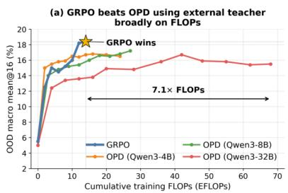

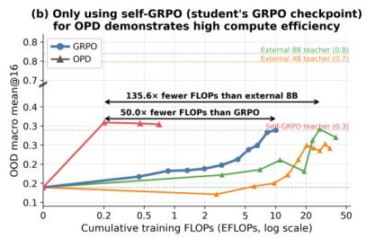

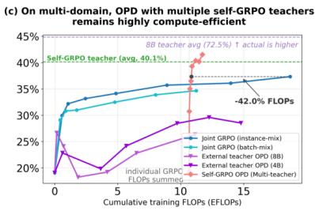  
Figure 1: OPD compute efficiency, at a glance. (a) GRPO achieves higher performance at fewer FLOPs than OPD across external teacher sizes (up to 32B) on the OOD math evaluation (AIME24/25 and AMC23); the same ordering holds across the other settings. (b) On the OOD math eval with a Qwen3–4B-Base student, OPD with a $s e l f { - } G R P O$ teacher (a GRPO checkpoint of the student) is the only setup that matches GRPO performance with 50.0× fewer FLOPs than GRPO, and 135.6× fewer FLOPs than OPD with an external teacher Qwen3–8B. (c) On a multi-domain data mix with math and code, running multi-teacher OPD with self-GRPO teachers (per domain) matches joint GRPO at 42.0% fewer total FLOPs. A single external 8B teacher substantially underperforms despite its stronger overall performance; the trained student demonstrates severe degenerate behavior like unstoppable repetition, and Chinese characters given an English prompt.

## 1 Introduction

On-policy distillation (OPD) (Agarwal et al., 2024) trains a student on its own rollouts, with each token scored by a frozen teacher. It combines the dense per-token supervision of classical knowledge distillation (Kim & Rush, 2016; Gu et al., 2024) with on-policy sampling that avoids the train/test mismatch of teacher-generated data. Dense teacher feedback suggests that OPD may learn from fewer rollouts than outcome-reward RL such as GRPO (Shao et al., 2024). Its promise is sharpest on hard problems: when the student rarely finds a correct answer, outcome-reward GRPO has little positive signal, while the teacher can still supervise every generated token. Yet that supervision requires a teacher forward pass on every training token, and longer responses raise the cost further. Fewer rollouts or optimizer steps therefore need not mean fewer FLOPs. Can OPD reach the same accuracy as GRPO with fewer training FLOPs? Existing efficiency reports use GPU-hours, gradient-step ratios, or partial FLOPs comparisons, leaving the matched-FLOPs comparison unresolved. To our knowledge, no prior work systematically compares OPD and GRPO at matched training FLOPs (§2; Appendix A).

In this work, we focus on systematically comparing reverse-KL OPD with GRPO by tracking held-out task performance against cumulative training FLOPs. Our experiments vary data difficulty, student and teacher sizes and initializations, training domain, thinking mode, distillation objective, and the RL framework. With off-the-shelf post-trained teachers, GRPO generally achieves higher accuracy at a fixed FLOP budget. Reducing OPD to one rollout per prompt is the one change that lets an external teacher outperform GRPO, and only on single-domain math; the advantage disappears on code and multi-domain training (Appendix I). To our surprise, this even holds in the subset that should intuitively favour OPD most: a small student that barely solves (mean@ 32=0) paired with a large teacher that solves well (mean@ 32>0.6), where GRPO's outcome reward is very weak and dense per-token supervision should matter most (§4.1). External-teacher OPD consistently inflates response length until it reaches the maximum length, increasing the FLOPs paid per step (Appendix E).

We next ask whether the teacher's training history changes the result. Recent work reports that GRPO-training the teacher before distillation can help the student learn better (Li et al., 2026). Building on this evidence, we compare external thinking models, further-GRPO-trained thinking models, and GRPO-trained base models at or above the student's size. Among the teachers tested, OPD consistently recovers the teacher's accuracy only when the teacher is a GRPO checkpoint of the student. In particular, in our math setting, OPD with one rollout per prompt matches that checkpoint's accuracy with 50× fewer distillation-stage FLOPs (6× at the default 8-rollout-per-prompt setting) than the eight-rollout GRPO training needs to reach the same accuracy. We further find such observation generalizes across model sizes, domains, and model families. When using Olmo-3-7B-Inst ruct-SFT on math, we are surprised to find self-GRPO OPD can lead to a student outperforming teacher substantially by 11% absolute score.

However, distilling from the student's own GRPO checkpoint reveals a paradox: on a single domain, why distill when you already have the GRPO-trained model? The 50× ratio counts only distillation: the GRPO run has already produced the desired single domain model, so distilling it back into the base student adds cost. Consider math and code: separate GRPO runs produce two specialists, but neither checkpoint can serve both domains. This is where multi-teacher OPD has a distinct compute-efficiency opportunity: it can consolidate the GRPO specialists into the multi-domain model neither provides, with only a small additional distillation cost. The decisive compute test is whether the cost of training those experts and consolidating them via distillation beats that of joint GRPO on the same data mix. Recent open-source models (Yang et al., 2026d; Team et al., 2026; DeepSeek-AI, 2026; Kimi Team, 2026) use this recipe, but leave that full-pipeline comparison unmeasured. Multi-teacher OPD combines the per-domain GRPO experts into a single student model that recovers their performance, with distillation adding only 5.2% (two domains) and 8.0% (four domains) to the specialists' training FLOPs. Counting both stages, the two-domain pipeline reaches joint GRPO's accuracy on the same data mix with 42% fewer total FLOPs. On both two-domain and four-domain settings, joint GRPO does not even reach the merged student's performance within the tested budget.

Our contributions identify where OPD falls short of GRPO and how distillation gains a distinct compute advantage with multi-teacher OPD:

• A comprehensive set of controlled experiments shows that dense token supervision alone does not reliably make external-teacher OPD cheaper than GRPO (§4).

• Choose teachers by provenance. Among the teachers tested, a GRPO checkpoint of the student model itself transfers most reliably and 50.0× more efficiently, but its distillation-stage savings must be weighed against the cost of training it (§5).

• Specialize, then consolidate. Train separate GRPO experts on different domains and combine them with routed multi-teacher OPD, in which scenario OPD clearly offers a more compute-efficient solution than joint GRPO by producing the multi-domain model that no single specialist alone supplies (§6).

## 2 Related work

Recent OPD work rarely accounts for FLOPs when claiming advantage over GRPO. Many recent methods modify the canonical reverse-KL objective for external-teacher OPD to outperform GRPO, but none evaluate their claimed advantage over outcome-reward methods like GRPO in terms of FLOPs (Appendix A). They report sample efficiency (Ko et al., 2026), GPU-hours, or wall-clock (Zhang et al., 2026; Feng et al., 2026; Chen et al., 2026; Rang et al., 2026); Zhao et al. (2026) reports FLOPs but only among OPD variants, not against GRPO. Reported wall-clock or GPU-hour wins over GRPO also use different group sizes for the two methods (Zheng et al., 2026; Tian et al., 2026) or leave it unreported (Rang et al., 2026; Zhang et al., 2026; Chen et al., 2026), so the gap is not attributable to objective quality alone. We isolate this confound by controlling group size and characterizing external-teacher OPD through FLOPs, with a smaller-group-size ablation in Appendix I.

Negative evidence and behavior of OPD Several concurrent studies report evidence against a plain OPD compute win. Lee et al. (2026) find OPD slower than GRPO in wall-clock time; Liu et al. (2026) report external-teacher reverse-KL OPD undergoing response-length explosion while a reward-only GRPO baseline stays stable; and Yang et al. (2026a) find OPD improves the base student but stays below the GRPO-trained student, with OPD after GRPO lowering the average. Further studies document problems with external-teacher OPD—diversity collapse, prefix and support drift, low-information suffixes, length inflation (Kim et al., 2026; Fu et al., 2026a; Luo et al., 2026; Wang et al., 2026b; Li et al., 2026; Wang et al., 2026c; Yang et al., 2026c; Zhu et al., 2026b; Yang et al., 2026b; Xin et al., 2026; Ding et al., 2026; Nicolicioiu et al., 2026; Wang et al., 2026a).

Concurrent OPD analyses also omit a compute-efficiency comparison with GRPO. Li et al. (2026) find a small same-family RL-trained teacher yields consistent gains where a stronger, more divergent one does not, but without a GRPO baseline; Luo et al. (2026); Zhu et al. (2026c); Fu et al. (2026b) likewise do not consider efficiency. In contrast, we compare GRPO and conventional OPD in a controlled setting using FLOPs as the compute measure. In Appendix A, we conduct a broader, LLM-assisted survey to look for FLOPs comparison but find no qualifying work.

Multi-teacher OPD in frontier model reports. Several recent frontier-model reports use multi-teacher OPD to combine domain-expert teachers into a shared student, e.g., DeepSeek-V4 and Kimi K3 (Yang et al., 2026d; Team et al., 2026; DeepSeek-AI, 2026; Kimi Team, 2026). They present the recipe as an engineering choice; we provide a rationale for it (§6).

## 3 Experimental setup and compute accounting

Comparison and compute accounting. We compare held-out task performance against cumulative training FLOPs in our analysis. The main external-teacher comparisons match student initialization, prompts, rollout group size, and shared hyperparameters. Let $N _ { s }$ and $N _ { t }$ indicate the number of student and teacher parameters used in per-token matrix multiplications. GRPO costs $1 0 N _ { s }$ per generated token: $2 N _ { s }$ for generation, 2Ns for log-prob recomputation, and $6 N _ { s }$ for the update. OPD adds one frozen teacher forward pass with $2 N _ { t }$ cost. Each run pays for its generated tokens, excluding shared prompt context (Appendix B.1).

GRPO and OPD Training Objectives. Let $\pi _ { \theta }$ be the student policy, $\pi _ { T }$ a frozen teacher, and, for a prompt $q ,$ let $\{ o _ { i } \} _ { i = 1 } ^ { G }$ be a group of G student rollouts with binary outcome rewards $\{ r _ { i } \} _ { i = 1 } ^ { G } \in \{ 0 , 1 \}$ . We denote $o _ { i , t }$ for the t-th token of the i-th rollout and $q _ { i , < t }$ for its prefix. GRPO (Group Relative Policy Optimization) maximizes the mean-subtracted advantage of the outcome reward, following Liu et al. (2025):

$$
\mathcal { L } _ { \mathrm { G R P O } } ( \theta ) = - \mathbb { E } _ { q , \{ o _ { i } \} } \left[ \frac { 1 } { G } \sum _ { i = 1 } ^ { G } \hat { A } _ { i } \sum _ { t = 1 } ^ { | o _ { i } | } \log \pi _ { \theta } ( o _ { i , t } \mid q , o _ { i , < t } ) \right] , \quad \hat { A } _ { i } = r _ { i } - \operatorname* { m e a n } ( \{ r _ { j } \} ) .
$$

Our OPD objective, following Li et al. (2026), is the closed-form reverse KL against $\pi _ { T }$ over the student's top-k support, computed on the student's own rollouts. At each position (i, t) we pick the student's top-k token set $S _ { k } ( o _ { i , t } ) \subset \mathcal { V } \left( k \right. 1 6 )$ , read the student and teacher probabilities on those k tokens, and renormalize each to a distribution over $\boldsymbol { S } _ { k } \big ( \boldsymbol { o } _ { i , t } \big )$

$$
\tilde { \pi } _ { \boldsymbol { \theta } } ( \boldsymbol { v } \mid \boldsymbol { o } _ { i , < t } ) = \frac { \pi _ { \boldsymbol { \theta } } ( \boldsymbol { v } \mid \boldsymbol { o } _ { i , < t } ) } { \sum _ { \boldsymbol { u } \in S _ { k } } \pi _ { \boldsymbol { \theta } } ( \boldsymbol { u } \mid \boldsymbol { o } _ { i , < t } ) } , \quad \tilde { \pi } _ { T } ( \boldsymbol { v } \mid \boldsymbol { o } _ { i , < t } ) = \frac { \pi _ { T } ( \boldsymbol { v } \mid \boldsymbol { o } _ { i , < t } ) } { \sum _ { \boldsymbol { u } \in S _ { k } } \pi _ { T } ( \boldsymbol { u } \mid \boldsymbol { o } _ { i , < t } ) } , \quad \boldsymbol { v } \in S _ { k } ( \boldsymbol { o } _ { i , t } ) .
$$

The loss is the closed-form reverse KL between the renormalized distributions:

$$
\mathcal { L } _ { \mathrm { O P D } } ( \theta ) = \mathbb { E } _ { q , \{ o _ { i } \} } \left[ \frac { 1 } { G } \sum _ { i = 1 } ^ { G } \sum _ { t = 1 } ^ { | o _ { i } | } \sum _ { \substack { v \in \mathcal { S } _ { k } ( o _ { i , t } ) } } \tilde { \pi } _ { \theta } ( v \mid o _ { i , < t } ) \left[ \log \tilde { \pi } _ { \theta } ( v \mid o _ { i , < t } ) - \log \tilde { \pi } _ { T } ( v \mid o _ { i , < t } ) \right] \right] .
$$

The outcome reward $r _ { i }$ does not enter $\mathcal { L } _ { \mathrm { O P D } }$ . OPD adds one frozen-teacher forward pass over every token it trains on; GRPO adds nothing. Our training hyperparameters are close to the ones in Li et al. (2026) and are detailed in Appendix B.3.

Models and teachers Students are Qwen3 models of 1.7B, 4B, and 8B parameters (Yang et al., 2025), mostly base checkpoints (e.g. Qwen3-4B-Base) with selected SFT cold starts for ablation. Teachers include external post-trained thinking models (Qwen3-{4B, 8B, 1 4B, 32B}), selected external models after further GRPO, and GRPO-trained base checkpoints at or above the student's size. We call the student's own GRPO checkpoint a self-GRPO teacher; multi-domain runs use one such checkpoint per domain.

Data. For math we train on DAPO-Math-17K (Yu et al., 2025) and DeepMath-103k (He et al., 2025). For code we train on LiveCodeBench v1-v5 (Jain et al., 2025) and a high-quality subset of CodeForces open-r1/ codeforces. For the multi-domain experiments (§6) we add MMLU-Pro (knowledge) and IFBench-RLVR (Pyatkin et al., 2025) (instruction following; rule-based constraint reward). Dataset construction details are in Appendices B.6–B.8.

SFT cold start. Our cold-started students are full fine-tunes of Qwen3-{1 . 7B, 4B}-Base on OpenThoughts-3 (Guha et al., 2025), following the SFT recipe from Thinking Machines Lab (Thinking Machines Lab, 2025). We sweep the SFT learning rate to pick the initialization we then post-train from (Tables 7a and 7b, Appendix B.5); full hypers are in Table 6.

Evaluation. All evaluations report mean @k (k=16): the mean accuracy over k independent samples per prompt. Math is evaluated on an out-of-distribution (OOD) macro, the unweighted average over AIME24 (30 prompts), AIME25 (30), and AMC23 (83), all held out from the math training data. Code is evaluated on LiveCodeBench v6 (Jain et al., 2025) (175 prompts). For the multi-domain experiments (§6), knowledge is evaluated on a 512-prompt held-out subset of MMLU-Pro (Wang et al., 2024), and instruction following on IFBench (Pyatkin et al., 2025). Generation hyperparameters and length-maximum conventions are in Appendix B.2.

## 4 External teachers do not make OPD reliably compute-efficient

Our initial observation on DAPO-Math-17K contradicts the compute-efficiency claim. Training a Qwen3-1 .7B-Base student against external Qwen3-{4B, 8B, 32B} teachers at matched settings, GRPO sits above every OPD run at every evaluated FLOP count on both the DAPO validation split and the OOD macro (Figure 7); larger teachers only increase the FLOPs of the OPD curve without lifting the student's performance.

## 4.1 Dataset surgery

One reading of the negative result is that the dataset may contain instances that the model can solve well and thus favour GRPO unintentionally. We therefore stratify DAPO-Math-17K by the joint difficulty of the student and a teacher model. This helps us understand how much OPD really provides a learning signal.

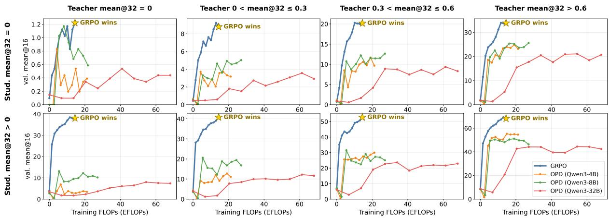  
Figure 2: GRPO vs OPD across difficulty levels. We stratify DAPO-Math-17K by mean@ 32 solve rate of the student (Qwen3-1 . 7B-Base) and teacher (Qwen3–4B). This yields eight subsets, each corresponding to a performance level by student and teacher; each subplot shows in-domain mean@16 against cumulative training FLOPs. GRPO outperforms every OPD variant in every cell, including the cell most favourable to OPD (top-right: student barely solves, teacher performs very well). OOD results in Figure 8.

Stratify the dataset by the performances of student and teacher. We score every prompt in DAPO-Math-17K with mean@32 under both the Qwen3-1.7B-Base student and the Qwen3–4B thinking teacher, then bin along both axes (= 0 and > 0 for the student; = 0, (0, 0.3], (0.3, 0.6], > 0.6 for the teacher), yielding eight cells with matched train- and validation-set sizes (Appendix D.1); OOD evaluation is kept as the AIME24/25 + AMC23 macro. We retrain GRPO and OPD in each subset, and evaluate in-domain and OOD separately. Intuitively, the cell most favourable to OPD on paper is student = 0, teacher > 0.6: GRPO's outcome reward is very weak, so the dense signal should matter most.

To our surprise, such intuition falls apart. Figure 2 shows the in-domain result: GRPO's final accuracy exceeds every OPD run's peak in every cell at a smaller FLOP budget throughout. Although an OPD run sometimes briefly reaches GRPO's early-training performance at lower compute early in the training, the advantage of GRPO over OPD widens as we use stronger and larger teachers. The OOD macro tells a different story (Figure 8). In the three cells where the teacher itself performs worst (the teacher mean@ 32= 0 column, plus the cell with student = 0 and teacher ∈ (0, 0.3]), every OPD run reaches a higher peak OOD accuracy than GRPO, the opposite of what the dense-signal motivation predicts; GRPO wins the other five cells. Moreover, OPD's final OOD macro stays within 15%–18% across all eight cells regardless of the training subset, while GRPO's ranges from 11.9% to 20.5%. This suggests that part of what OPD learns from an external teacher does not depend on the training prompts; Appendix F examines this further.

Repeating the same comparison on a Qwen3–1 . 7B-Base student with thinking mode on yields an even stronger pattern: GRPO wins over every OPD run on In-Domain and OOD performance (Appendix D.1)

## 4.2 GRPO's compute efficiency advantage is robust across ablations

A natural objection to §4 is that the comparison uses a poor configuration for OPD. We therefore search for a better configuration among external teachers, measured on the compute axis. We vary nine factors one at a time against the experiments in Figure 1. At matched settings, GRPO is more compute-efficient than every external-teacher OPD run along all nine axes. Appendix D gives the setup and results for each axis, and we discuss highlights below

Student initialization. One hypothesis is that the 1. 7B-Base might be too weak to capture signal from the teacher. We therefore supervised-finetune 1 . 7B-Base on OpenThoughts-3. With thinking mode off, GRPO still outperforms every OPD run (Figure 14). We conducted a learning rate tuning to obtain the best performing checkpoint for 1. 7B-Base and Qwen3-4B-Base and we turn on the thinking mode. However, a good student initialization (compared with a sub-optimal one) doesn't change the ordering (Figure 15). With SFT-ed 4B-Base as the student, we also experiment OPD with QwQ-32B — the generator of the OpenThoughts-1.2M data, OPD still underperforms GRPO (Figure 16). See more details in Appendix D.6.

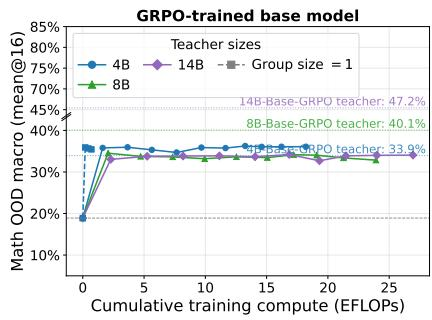

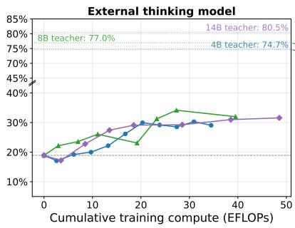

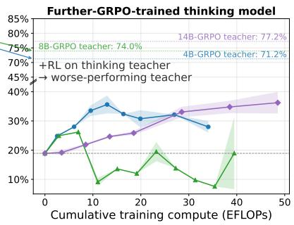  
Figure 3: Impact of running GRPO on teachers. Qwen3–4B-Base student on DAPO-Math-17K; x is cumulative training FLOPs, y is Math OOD macro mean @ 1 6; dotted horizontals mark each teacher's own accuracy. We sweep teachers at 4B, 8B, and 14B across three types: GRPO-trained base (left), external thinking (centre), and GRPO on external thinking (right). Left: all three GRPO-trained base teachers quickly converge the student to similar performance; only the same-size 4B teacher is fully recovered, despite larger teacher having a higher performance ceiling; Centre: student performances climb much more slowly to the same level with GRPO-trained base; all students stay well below any teacher throughout training. Right: OPD with a further-GRPO-trained thinking teacher is more unstable than with a thinking teacher.

Training domain. To understand whether our observation is dataset specific, we train 4B-Base student on two code datasets (LiveCodeBench v1-v5 and a high-quality CodeForces set) with GRPO and OPD under two external teachers (8B and 32B). The ordering observed on math still holds on code: on LiveCodeBench v1-v5. GRPO reaches 46.4% LCBv6 accuracy at 0.6 EFLOP, whereas OPD-32B peaks at only 28.7% at 68.7 EFLOP and OPD-8B peaks at 36.7% at 45.7 EFLOP. Results on CodeForces are similar (Figure 19 left column). See more details in Appendix D.8.

Additional ablations. We also sweep the learning rate (Appendix D.2), batch size (Appendix D.3), reverse-KL estimator (closed-form top-k vs sampled-token, Appendix D.4), the thinking mode (no-think vs think, Appendix D.5), the student model sizes (Appendix D.7), and the RL framework (ver1 and tinker, Appendix D.9). None of these changes the ordering. Reducing the rollout group size to G=1 is the one change that helps: on singledomain math, external-teacher OPD then outperforms GRPO at matched FLOPs, using 8× as many optimizer steps. However, the advantage disappears on code and on the multi-domain mixes of Section 6 (Appendix I). Across these ablations, vanilla reverse-KL OPD with an external teacher, even one from the same model family, does not offer a reliable compute-efficiency advantage over GRPO on the same student. Appendix E discusses the response-length inflation that OPD-trained students show.

In the next section (§5), following recent work that GRPO-trains the teacher before distilling, we examine whether that change to the external teacher alters what we observe here.

## 5 Self-GRPO teacher consistently makes OPD compute-efficient

A highly cited work reports that GRPO-training the teacher before distillation can help OPD (Li et al., 2026), but it establishes this claim on a limited experiment: running GRPO on Qwen3–4B-Base leads to a better teacher than Qwen3-4B (Non-thinking) when the student is Qwen3-1.7B-Base. We vary the teacher along three dimensions: 1) initialization — a base model or an external thinking model, 2) whether it is used as-is or first GRPO-trained on the task, and 3) its size — same or larger.

Setup. We fix the student to Qwen3–4B-Base on DAPO-Math-17K and sweep the teacher across three types: (i) GRPO-trained base model: a base model (after pre-training only, e.g., Qwen3–8B-Base) is trained with GRPO on DAPO-Math-17K; (ii) external thinking model: the off-the-shelf post-trained Qwen3 checkpoints as used in §4.1 (e.g., Qwen3–8B); (iii) further-GRPO-trained thinking model: the external thinking model is further trained with GRPO on DAPO-Math-17K. All experiments in this section use thinking mode. Families (i) and (iii) share the same GRPO recipe; the only difference is the response-length maximum (7168 for base, 16 384 for thinking; full hyperparameters in Table 2). For each type, we cover the teacher sizes at 4B, 8B, and 14B. Every OPD run shares the same recipe; only the teacher varies.

## 5.1 Student's GRPO checkpoint is consistently the most efficient teacher

We present our results in Figure 3. With GRPO-trained base teachers, the student converges to similar performance by the first evaluated checkpoint (≤ 2.5 EFLOPs) — the 4B, 8B, and 14B teachers reach 35.8%, 34.5%, and 33.0% — and each stays in a narrow band throughout training. The same-size 4B teacher fully recovers its own GRPO accuracy (33.9%, which GRPO reaches at 10.1 EFLOP) by 1.62 EFLOP, an ～6× compute reduction; with group size G=1 the same recovery costs only 0.2 EFLOP (\~50×), matching the efficiency gains reported in the OPD literature (Thinking Machines Lab, 2025). Larger teachers are individually stronger, but their students plateau at an even slightly lower level — the extra capacity does not transfer. External thinking teachers improve the student much more slowly: the 8B teacher peaks at 34.2% (27.2 EFLOP), while the 4B and 14B teachers stay below 32%, all well below their teacher accuracy. Further-GRPO-trained thinking teachers give the most unstable curves: the 4B teacher's student peaks at 38.7% (step 80), near the best GRPO accuracy (38.8%), then collapses to 26.0% by step 200; the 8B teacher's student falls below initialization to 6.6%; we repeat each run to confirm the instability. Only using GRPO-trained student as teacher avoids the pathological response-length inflation that dominates other teachers (Figure 23, Appendix E); Appendix H discusses a potential explanation via changes in the spectra of model weight during optimization

More OPD experiments with self-GRPO (the student's GRPO checkpoint) teacher On math, using Qwen 3–4B-Base as student and its GRPO checkpoint as teacher gave both compute-efficient improvement and full teacher recovery. In Appendix G we test this beyond that setting by (i) enlarging the student to Qwen3–8B-Base, (ii) switching the domain from math to code, and (iii) replacing the Qwen3– \* -Ba se student (raw pretrained) with a post-trained Olmo-3-7B-Inst ruct-SFT. All three retain high compute-efficiency and full teacher recovery.

An intriguing side observation in self-GRPO OPD Across our self-GRPO experiments on math and code, the student's best accuracy often can exceed the teacher's: in Figure 3 the student reaches 35.8% versus the teacher's 33.9%. The most striking case is Olmo-3-7B-Instruct-SFT on math, where the self-GRPO teacher scores 40.0% but the student reaches 51% at 1.25 EFLOP (Figure 27). The cause for such substantial gap is unknown and left to future work.

## 5.2 Can full teacher recovery be predicted?

Section 5.1 identifies setups that are compute-efficient — using student's GRPO checkpoint as teacher, and setups that are not — external thinking and further-GRPO-trained thinking teachers. We ask whether this outcome can be predicted before the distillation run itself, using the initial top-k token

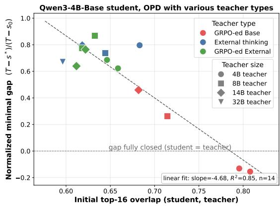  
Figure 4: Initial top-16 overlap correlates with the minimal teacher-student gap.

overlap between student and teacher proposed by Li et al. (2026) as a diagnostic, and scoring each run's outcome by its normalized minimal teacher-student gap.

Overlap. On the first training batch, we score each position with the fraction of the student's top-16 token IDs that also appear in the teacher's top-16, and average over all valid positions.

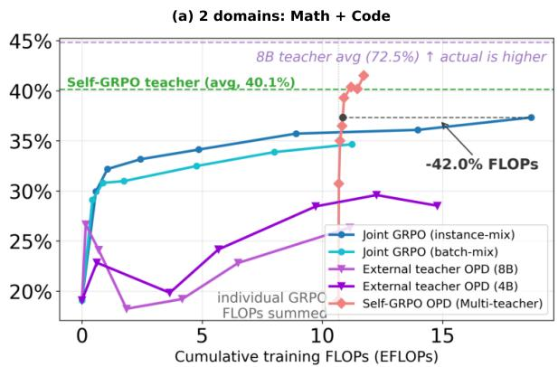

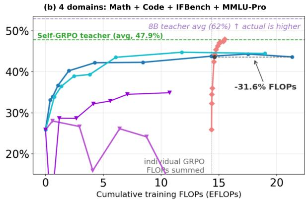  
Figure 5: Multi-teacher OPD beats joint GRPO on domain-averaged performance. Qwen3–4B-Base student. Left: 2-domain average (math + code). Right: 4-domain average (math, code, instruction following, knowledge). Joint GRPO variants train on all domains simultaneously; multi-teacher OPD merges per-domain GRPO experts into a single student. In two plots, the cost of Self-GRPO OPD with multiple teachers starts from the total FLOPs used to obtain all self-GRPO teachers. A single external 8B-thinking teacher (purple) can improve over initial student on 2-domain setting, but collapse on 4-domain setting. Per-domain breakdowns are in Appendix J.

Normalized minimal teacher-student gap. To summarize how close each OPD run brings the student to its teacher, we look at the gap between teacher accuracy T and the best student accuracy $s ^ { * }$ reached at any point during training, and divide it by the initial teacher-student accuracy gap at step zero $T - s _ { 0 }$

Overlap correlates with the teacher-student gap. Across all OPD runs in §5.1 and relevant runs in Figure 17, initial top-16 overlap correlates with a lower normalized minimal teacher-student gap (Figure 4). However, we want to note that there's a large gap between GRPO-trained Qwen3–8B-Base teacher (red square) and GRPO-trained Qwen3–4B-Base (red dot). With data point missing in between, our observation serves as a side analysis in a limited setting (i.e. student is fixed to be Qwen3–4B-Base) rather than a generally applicable rule.

Summary. Across nine ablations of reverse-KL OPD, no external teacher transfers compute-efficiently and the student broadly loses to GRPO (§4, §5.1). Only the self-GRPO teacher — the student's own GRPO checkpoint — consistently closes the gap with high compute-efficiency.

## 6 Multi-teacher OPD: a natural use case of strong-to-weak OPD

The finding of §5 remains a paradox in a single-task setting: why distill when you already have the GRPO-trained model? Across multiple tasks, however, the paradox can become an opportunity. Consider math and code: separate GRPO runs produce two specialists, but neither checkpoint can serve both domains (Appendix F). This is where multi-teacher OPD has a distinct compute-efficiency opportunity: it can consolidate the GRPO specialists into a single multi-domain model that neither specialist provides, with only a small additional distillation cost. This opportunity only exists when the answer to the following question is true: Would the cost of training those experts and consolidating them via distillation beat that of joint GRPO on the same data mix? Recent open-source models (Yang et al., 2026d; Team et al., 2026; DeepSeek-AI, 2026; Kimi Team, 2026) use this recipe; we set out to understand the rationale behind it.

Setup. We consider 4 domains in total: math on DAPO-Math-17K, code on LiveCodeBench-v1-v5, instruction following on IFBench, and knowledge on MMLU-Pro. We experiment with 2-domain setting and 4-domain setting separately. From Qwen3-4B-Base we train one GRPO expert on each single domain, each with its own hyperparameters (Table 11). We build a data mix whose per-domain training instance count matches each individual expert, and we compare four methods on it: (i) Joint GRPO (instance-mix), which fills every batch with instances drawn proportionally from all domains at one shared batch size; (ii) Joint GRPO (batch-mix), which draws each batch from each domain (each domain has its own batch size, notably a smaller batch on code domain) per step and interleaves domains across steps; (iii) Multi-teacher self-GRPO OPD, which routes each instance to the self-GRPO teacher of the corresponding domain and computes the reverse KL; (iv) External teacher OPD with a single 8B-thinking teacher, the best-performing external teacher based on results from §4 and §5. All OPD runs use rollout group size G=1 unless otherwise noted. We run each method on 2-domain (math + code) and 4-domain mixes to show some scaling behavior; see Appendix J for more details.

Results. Figure 5 shows that the single-domain success of self-GRPO OPD transfers to the multi-domain setting. On the 2-domain mix, the two specialists cost 10.7 EFLOP, and multi-teacher self-GRPO OPD reaches their ceiling in an additional 0.55 EFLOP (\~5.2%); on the 4-domain mix, the four specialists cost 14.4 EFLOP, performance recovered in an additional 1.15 EFLOP (～8.0%). Single-domain and multi-teacher self-GRPO OPD are on par in compute-efficiency (Figures 31, 32). Even after accounting for the OPD and self-GRPO-teacher costs, both joint-GRPO variants (instance-mix and batch-mix) underperform on both multi-domain settings; specifically, multiteacher self-GRPO OPD matches Joint GRPO(instance-mix) with 42.0% fewer FLOPs on 2 domains and 31.6% fewer FLOPs on 4 domains. External-teacher OPD is worst: on 2 domains with 8B-thinking teacher, it reaches 26.7%, drops, then finishes at a similar level; scaling to 4 domains, the student collapses on most domain (0% math, 0% code, 7% MMLU-Pro, 18% IFBench) despite the 8B-thinking teacher being the strongest model overall, with severe response-length inflation at inference. The group-size ablation (Appendix J) shows G=1 reaches the specialist ceiling at substantially lower compute than G=8 (Section 5.1).

Summary. Multi-teacher OPD (route each instance to its domain's specialist to compute the reverse KL) turns the single-task paradox of §5 into a recipe: merge per-domain GRPO experts into one student, reach the specialists' ceiling for an extra 5.2%–8.0% of the FLOPs spent training them, and beat both joint GRPO and external-teacher OPD at matched compute.

Benefit of multi-teacher OPD with self-GRPO teachers. Mulit-teacher pipeline enjoys three benefits at once. Better overall performance: as we show in Figure 5, using multi-teacher OPD with self-GRPO teachers leads to better performance than joint GRPO. Modular development: different domains naturally require different RL infrastructure (code sandboxes, tool-use environments, symbolic verifiers) and different optimal hyperparameters (learning rate, rollout length, response-length maximum); training each expert independently lets each team use its own stack and tune at its own schedule to get the best expert on each domain. Parallelizable specialist training: per-domain runs can naturally happen concurrently rather than sharing a single joint schedule.

Relation to frontier practice. Several recent frontier-model reports use multi-teacher OPD to combine domainexpert teachers into a shared student, including Nemotron-Cascade 2 (Yang et al., 2026d), DeepSeek-V4 (DeepSeek-AI, 2026), and Kimi K3 (Kimi Team, 2026). These reports describe the recipe as an engineering choice without matched-compute measurement. Our results provide the rationale behind their decision: Section 5 shows that OPD succeeds when the teacher is a GRPO checkpoint of the student, and Section 6 shows that merging perdomain experts trained under this condition via OPD outperforms training all domains jointly with GRPO or using an external teacher.

## 7 Conclusion

We give the first systematic, FLOPs-based characterization of strong-to-weak OPD against GRPO, and identify when OPD is a promising post-training tool. First, we find external teachers under vanilla reverse-KL broadly lose to GRPO across our nine-axis ablation (§4); and we widely observe pathological behavior from the trained student with external teachers. Second, through carefully studying the impact of GRPO on teachers, we realized the self-GRPO teacher (the student's own GRPO checkpoint) is the only setup where the student consistently learns compute-efficiently and fully recovers teacher performance (§5). It matches GRPO's performance at 50.0× fewer FLOPs, replicated across domains, student sizes, and student families; the student's best performance can even substantially exceed the teacher's, calling for further study. Third, multi-teacher OPD with self-GRPO teachers is a cheap consolidation step (§6). It recovers every specialist for an extra 5.2% (2 domains) or 8.0% (4 domains) of specialist training FLOPs — cheaper than joint GRPO on the same data; and substantially cheaper than external-teacher OPD, which underperforms at 2 domains and collapses at 4. Together, these results suggest OPD is not a straightforward replacement for GRPO, but it is an efficient way to fold many same-origin GRPO-trained specialists into a single generalist student.

## Al use statement

We used generative AI tools (large language models) to assist with drafting and editing portions of the manuscript text. All AI-assisted text was reviewed, revised, and verified by the authors. We did not use generative AI tools (e.g., image generation) to generate experimental results, design the method or produce experimental figures. LLMgenerated code snippets used during development were reviewed and tested for correctness. We take responsibility for the final content of this work, including all text, claims, and artifacts.

## Limitation and future work.

Our study focuses on the vanilla reverse-KL OPD objective with a closed-form top-k estimator (§3). Recent work extends this baseline along axes we do not sweep at matched FLOPs: hybrid objectives that blend OPD with an outcome-reward term (Ko et al., 2026; Tan et al., 2026; Liu et al., 2026), alternative divergences (Luo et al., 2026; Chen et al., 2026), trajectory reshaping and per-token reweighting (Li et al., 2026; Rang et al., 2026), and async or speculative rollout pipelines (Feng et al., 2026; Ren et al., 2026). Any of these may narrow the FLOPs gap we identify. We encourage future work claiming an OPD advantage over GRPO to report training FLOPs as an implementation-invariant measure, so that improvements in objective, rollout scheduling, and infrastructure can be disentangled and directly comparable across papers.

## Ethics statement

This work trains and evaluates open-weight language models on public mathematics and competitive-programming datasets; it involves no human subjects, no personal data, and no new data collection. We do not foresee direct negative societal impacts from the distillation methodology itself.

## Reproducibility statement

The training and evaluation recipe for every experiment in this paper is documented in Section 3 and expanded in Appendix B.3. Shared hyperparameters common to all runs are listed in Table 2; the GRPO- and OPD-specific settings are in Tables 3 and 4, and the per-ablation overrides for the sweeps in Section 4.2 are in Table 5. All students, teachers, training corpora, and evaluation benchmarks are publicly released models and open datasets identified by version and citation in Section 3 and Appendices B.6–B.8. The framework versions and rollout engine are named in Section 3 (verl 0 .7.0 . dev and 0 .8 .0 . dev, SGLang 0.5.2), and the framework replication of Appendix D.9 additionally names the tinker library and its LoRA rank, learning rate, batch size, rollout count, and response maximum for the matched 9B replication. We also release the prompts used for formatting training instances in Appendix C. All models, datasets, and framework releases used in this work are public.

## References

Rishabh Agarwal, Nino Vieillard, Yongchao Zhou, Piotr Stanczyk, Sabela Ramos, Matthieu Geist, and Olivier Bachem. On-policy distillation of language models: Learning from self-generated mistakes. In International Conference on Learning Representations (ICLR), 2024. arXiv:2306.13649. Generalized knowledge distillation; the on-policy distillation formulation this work evaluates descends from it.

Xianwei Chen, Shimin Zhang, and Jibin Wu. f-opd: Stabilizing long-horizon on-policy distillation with freshnessaware control, 2026. arXiv:2605.17862.

DeepSeek-AI. Deepseek-v4. https://huggingface.co/deepseek-ai, 2026. Open-weights model release (V4-Flash and V4-Pro); no arXiv technical report at time of writing.

Tianyu Ding, Jianhong Xin, and Juan Pablo De la Cruz Weinstein. Keep policy gradient in charge: Sibling-guided credit distillation for long-horizon tool-use agents, 2026. arXiv:2606.12634

Shiyuan Feng, Huan-ang Gao, Haohan Chi, Hanlin Wu, Zhilong Zhang, Zheng Jiang, Bingxiang He, Wei-Ying Ma, Ya-Qin Zhang, and Hao Zhou. Weak-to-strong generalization via direct on-policy distillation, 2026. arXiv:2607.05394.

Yuqian Fu, Haohuan Huang, Kaiwen Jiang, Jiacai Liu, Zhuo Jiang, Yuanheng Zhu, and Dongbin Zhao. Revisiting on-policy distillation: Empirical failure modes and simple fixes, 2026a. arXiv:2603.25562.

Zixuan Fu, Bingxiang He, Yuxin Zuo, Haohuan Huang, Jinqian Zhang, Ruhang Xiao, Cheng Qian, Qinyu Luo, Huan ang Gao, Yudong Wang, Zhiyuan Liu, Ning Ding, and Chaojun Xiao. Rethinking on-policy distillation of large language models ii: One training example, 2026b. URL https : //arxiv. org/abs/2609.04172.

Yuxian Gu, Li Dong, Furu Wei, and Minlie Huang. Minillm: On-policy distillation of large language models. In International Conference on Learning Representations (ICLR), 2024. arXiv:2306.08543. Reverse-KL distillation on student-generated text.

Etash Guha, Ryan Marten, Sedrick Keh, Negin Raoof, Georgios Smyrnis, Hritik Bansal, Marianna Nezhurina, Jean Mercat, Trung Vu, Zayne Sprague, et al. Openthoughts: Data recipes for reasoning models. arXiv preprint arXiv:2506.04178, 2025.

Zhiwei He, Tian Liang, Jiahao Xu, Qiuzhi Liu, Xingyu Chen, Yue Wang, Linfeng Song, Dian Yu, Zhenwen Liang, Wenxuan Wang, Zhuosheng Zhang, Rui Wang, Zhaopeng Tu, Haitao Mi, and Dong Yu. Deepmath-103k: A large-scale, challenging, decontaminated, and verifiable mathematical dataset for advancing reasoning. arXiv preprint arXiv:2504.11456, 2025.

Naman Jain, King Han, Alex Gu, Wen-Ding Li, Fanjia Yan, Tianjun Zhang, Sida Wang, Armando Solar-Lezama, Koushik Sen, and Ion Stoica. Livecodebench: Holistic and contamination free evaluation of large language models for code. In International Conference on Learning Representations (ICLR), 2025.

Jeonghye Kim, Xufang Luo, Minbeom Kim, Sangmook Lee, Dohyung Kim, Jiwon Jeon, Dongsheng Li, and Yuqing Yang. Why does self-distillation (sometimes) degrade the reasoning capability of llms?, 2026. arXiv:2603.24472.

Yoon Kim and Alexander M. Rush. Sequence-level knowledge distillation. In Proceedings of the 2016 Conference on Empirical Methods in Natural Language Processing (EMNLP), 2016. arXiv:1606.07947.

Kimi Team. Kimi k3: Open frontier intelligence, 2026. arXiv:2607.24653.

Jongwoo Ko, Sara Abdali, Young Jin Kim, Tianyi Chen, and Pashmina Cameron. Scaling reasoning efficiently via relaxed on-policy distillation, 2026. arXiv:2603.11137.

Byung-Kwan Lee, Ximing Lu, Shizhe Diao, Minki Kang, Saurav Muralidharan, Karan Sapra, Andrew Tao, Pavlo Molchanov, Yejin Choi, Yu-Chiang Frank Wang, and Ryo Hachiuma. Zone of proximal policy optimization: Teacher in prompts, not gradients, 2026. arXiv:2606.18216.

Yaxuan Li, Yuxin Zuo, Bingxiang He, Jinqian Zhang, Chaojun Xiao, Cheng Qian, Tianyu Yu, Huan-ang Gao, Wenkai Yang, Zhiyuan Liu, and Ning Ding. Rethinking on-policy distillation of large language models: Phenomenology, mechanism, and recipe, 2026. arXiv:2604.13016.

Xinyu Liu, Kechen Jiao, Chunyang Xiao, Runsong Zhao, Junhao Ruan, Bei Li, Jiahao Liu, Qifan Wang, Xin Chen, Jingang Wang, Chenglong Wang, Tong Xiao, and JingBo Zhu. Teacher-guided policy optimization for on-policy reasoning distillation under large policy divergence, 2026. arXiv:2605.13230.

Zichen Liu, Changyu Chen, Wenjun Li, Penghui Qi, Tianyu Pang, Chao Du, Wee Sun Lee, and Min Lin. Understanding r1-zero-like training: A critical perspective. In Second Conference on Language Modeling, 2025.

Feng Luo, Yu-Neng Chuang, Guanchu Wang, Zicheng Xu, Xiaotian Han, Tianyi Zhang, and Vladimir Braverman. Demystifying opd: Length inflation and stabilization strategies for large language models, 2026. arXiv:2604.08527.

Andrei Liviu Nicolicioiu, Mohammad Pezeshki, and Aaron Courville. On-policy self-distillation with sampled demonstrations reduces output diversity, 2026. arXiv:2606.26091.

Valentina Pyatkin, Saumya Malik, Victoria Graf, Hamish Ivison, Shengyi Huang, Pradeep Dasigi, Nathan Lambert, and Hannaneh Hajishirzi. Generalizing verifiable instruction following, 2025. URL https : //arxiv. org/ abs/2507.02833.

Miao Rang, Zhenni Bi, Hang Zhou, Kai Han, Xuechun Wang, An Xiao, Xinghao Chen, Yunhe Wang, and Hanting Chen. Near-policy: Accelerating on-policy distillation via asynchronous generation and selective packing, 2026. arXiv:2605.05940.

Haolin Ren, Ziyang Huang, Chenhao Yuan, Jun Zhao, and Kang Liu. Trace-based on-policy distillation for masked diffusion language models, 2026. arXiv:2607.16872.

Zhihong Shao, Peiyi Wang, Qihao Zhu, Runxin Xu, Junxiao Song, Xiao Bi, Haowei Zhang, Mingchuan Zhang, Y. K. Li, Y. Wu, and Daya Guo. Deepseekmath: Pushing the limits of mathematical reasoning in open language models. arXiv preprint arXiv:2402.03300, 2024.

Guangming Sheng, Chi Zhang, Zilingfeng Ye, Xibin Wu, Wang Zhang, Ru Zhang, Yanghua Peng, Haibin Lin, and Chuan Wu. Hybridflow: A flexible and efficient rlhf framework. In Proceedings of the Twentieth European Conference on Computer Systems (EuroSys), 2025. The verl implementation used in this work

Qitai Tan, Zefang Zong, Mo Li, Yipeng Shi, Yang Li, and Peng Chen. Atod: Annealed turn-aware on-policy distillation for multi-turn agentic tasks, 2026. arXiv:2606.27814.

Core Team, Bangjun Xiao, Bingquan Xia, Bo Yang, Bofei Gao, Bowen Shen, Chen Zhang, Chenhong He, Chiheng Lou, Fuli Luo, Gang Wang, Gang Xie, Hailin Zhang, Hanglong Lv, Hanyu Li, Heyu Chen, Hongshen Xu, Houbin Zhang, Huaqiu Liu, Jiangshan Duo, Jianyu Wei, Jiebao Xiao, Jinhao Dong, Jun Shi, Junhao Hu, Kainan Bao, Kang Zhou, Lei Li, Liang Zhao, Linghao Zhang, Peidian Li, Qianli Chen, Shaohui Liu, Shihua Yu, Shijie Cao, Shimao Chen, Shouqiu Yu, Shuo Liu, Tianling Zhou, Weijiang Su, Weikun Wang, Wenhan Ma, Xiangwei Deng, Bohan Mao, Bowen Ye, Can Cai, Chenghua Wang, Chengxuan Zhu, Chong Ma, Chun Chen, Chunan Li, Dawei Zhu, Deshan Xiao, Dong Zhang, Duo Zhang, Fangyue Liu, Feiyu Yang, Fengyuan Shi, Guoan Wang, Hao Tian, Hao Wu, Heng Qu, Hongfei Yi, Hongxu An, Hongyi Guan, Xing Zhang, Yifan Song, Yihan Yan, Yihao Zhao, Yingchun Lai, Yizhao Gao, Yu Cheng, Yuanyuan Tian, Yudong Wang, Zhen Tang, Zhengju Tang, Zhengtao Wen, Zhichao Song, Zhixian Zheng, Zihan Jiang, Jian Wen, Jiarui Sun, Jiawei Li, Jinlong Xue, Jun Xia, Kai Fang, Menghang Zhu, Nuo Chen, Qian Tu, Qihao Zhang, Qiying Wang, Rang Li, Rui Ma, Shaolei Zhang, Shengfan Wang, Shicheng Li, Shuhao Gu, Shuhuai Ren, Sirui Deng, Tao Guo, Tianyang Lu, Weiji Zhuang, Weikang Zhang, Weimin Xiong, Wenshan Huang, Wenyu Yang, Xin Zhang, Xing Yong, Xu Wang, Xueyang Xie, Yilin Jiang, Yixin Yang, Yongzhe He, Yu Tu, Yuanliang Dong, Yuchen Liu, Yue Ma, Yue Yu, Yuxing Xiang, Zhaojun Huang, Zhenru Lin, Zhipeng Xu, Zhiyang Chen, Zhonghua Deng, Zihan Zhang, and Zihao Yue. Mimo-v2-flash technical report,2026.URLhttps://arxiv.org/abs/2601.02780.

Thinking Machines Lab.On-policy distillation. https://thinkingmachines.ai/blog/ on-policy-distillation/, 2025. Non-peer-reviewed web report. Source of the“7-10× fewer gradient steps ⇒ 50-100× compute efficiency" claim this paper tests; it reports no method-separated GPU-hours or wall clock.

Kanghui Tian, Siyuan Liu, Ziang Yan, Sheng Xia, Shuai Dong, and Yi Wang. Vicur: Visual cues as recoverable privilege for multimodal on-policy distillation, 2026. URL https : //arxiv. org/abs/2606.05718.

Chen Wang, Zhaochun Li, Jionghao Bai, Yining Zhang, Hexuan Deng, Ge Lan, and Yue Wang. Distilled reinforcement learning for llm post-training, 2026a. arXiv:2607.17247.

Hao Wang, Guozhi Wang, Han Xiao, Yufeng Zhou, Yue Pan, Jichao Wang, Ke Xu, Yafei Wen, Xiaohu Ruan, Xiaoxin Chen, and Honggang Qi. Skill-sd: Skill-conditioned self-distillation for multi-turn llm agents, 2026b. arXiv:2604.10674.

Jiaqi Wang, Wenhao Zhang, Weijie Shi, Yaliang Li, and James Cheng. Tcod: Exploring temporal curriculum in on-policy distillation for multi-turn autonomous agents, 2026c. arXiv:2604.24005.

Yubo Wang, Xueguang Ma, Ge Zhang, Yuanhan Ni, Abhranil Chandra, Shiguang Guo, Weiming Ren, Aaran Arulraj, Xuan He, Ziyan Jiang, et al. Mmlu-pro: A more robust and challenging multi-task language understanding benchmark. arXiv preprint arXiv:2406.01574, 2024.

Haoran Xin, Anhao Zhao, Ying Sun, Jin Li, Xiaoyu Shen, and Hui Xiong. Escaping the kl agreement trap in on-policy distillation, 2026. arXiv:2606.09471.

An Yang, Anfeng Li, Baosong Yang, Beichen Zhang, Binyuan Hui, Bo Zheng, Bowen Yu, Chang Gao, Chengen Huang, Chenxu Lv, et al. Qwen3 technical report. arXiv preprint arXiv:2505.09388, 2025.

Fan Yang, Rui Meng, and Yuxin Wen. Why does feedback-augmented self-distillation fail to improve retrievalinterleaved search agents?, 2026a. arXiv:2607.17558.

Shenzhi Yang, Guangcheng Zhu, Bowen Song, Haobo Wang, Mingxuan Xia, Xing Zheng, Yingfan Ma, Zhongqi Chen, Weiqiang Wang, Junbo Zhao, and Gang Chen. Oprd: On-policy representation distillation, 2026b. arXiv:2606.06021.

Zhicheng Yang, Zhijiang Guo, Yifan Song, Minrui Xu, Yongxin Wang, Yiwei Wang, Xiaodan Liang, and Jing Tang. Prune-opd: Efficient and reliable on-policy distillation for long-horizon reasoning, 2026c. arXiv:2605.07804.

Zhuolin Yang, Zihan Liu, Yang Chen, Wenliang Dai, Boxin Wang, Sheng-Chieh Lin, Chankyu Lee, Yangyi Chen, Dongfu Jiang, Jiafan He, Renjie Pi, Grace Lam, Nayeon Lee, Alexander Bukharin, Mohammad Shoeybi, Bryan Catanzaro, and Wei Ping. Nemotron-cascade 2: Post-training llms with cascade rl and multi-domain on-policy distillation, 2026d. arXiv:2603.19220.

Qiying Yu, Zheng Zhang, Ruofei Zhu, Yufeng Yuan, Xiaochen Zuo, Yu Yue, Tiantian Fan, Gaohong Liu, Lingjun Liu Xin Liu, et al. Dapo: An open-source llm reinforcement learning system at scale. arXiv preprint arXiv:2503.14476, 2025.

Yulin Zhang, He Cao, Zihao Jiang, Chenyi Zi, Zhipeng Zhou, Zijing Liu, Yu Li, Jia Li, and Ziqi Gao. Proteinopd: Towards effective and efficient preference alignment for protein design, 2026. arXiv:2605.10189.

Anhao Zhao, Haoran Xin, Yingqi Fan, Junlong Tong, Wenjie Li, and Xiaoyu Shen. Decoupling kl and trajectories: A unified perspective for sft, dagger, offline rl, and opd in llm distillation, 2026. URL ht tps : / /arxiv. org/ abs/2605.16826.

Binbin Zheng, Xing Ma, Yiheng Liang, Jingqing Ruan, Xiaoliang Fu, Kepeng Lin, Benchang Zhu, Ke Zeng, and Xunliang Cai. Scope: Signal-calibrated on-policy distillation enhancement with dual-path adaptive weighting, 2026. arXiv:2604.10688; runs G=8 GRPO vs G=1 OPD (mismatched rollout group size).

Lianmin Zheng, Liangsheng Yin, Zhiqiang Xie, Chuyue Sun, Jeff Huang, Cody Hao Yu, Shiyi Cao, Christos Kozyrakis, Ion Stoica, Joseph E. Gonzalez, Clark Barrett, and Ying Sheng. Sglang: Efficient execution of structured language model programs. In Advances in Neural Information Processing Systems (NeurIPS), 2024.

Hanqing Zhu, Wenyan Cong, Zhizhou Sha, Sagnik Mukherjee, Xinyuan Song, David González-Martínez, Xiaoxia Wu, Yuandong Tian, Shiwei Liu, David Z. Pan, and Zhangyang Wang. Iso: An rlvr-native optimization stack. arXiv preprint arXiv:2607.19331, 2026a

Siqi Zhu, Xuyan Ye, Hongyu Lu, Weiye Shi, and Ge Liu. The many faces of on-policy distillation: Pitfalls, mechanisms, and fixes, 2026b. arXiv:2605.11182.

Siqi Zhu, Xuyan Ye, Hongyu Lu, Weiye Shi, and Ge Liu. The many faces of on-policy distillation: Pitfalls, mechanisms, and fixes, 2026c. URL https://arxiv.org/abs/2605.11182.

## A Literature survey: how we filter to zero FLOPs-based wins

Corpus. We take the deduplicated union of three public OPD bibliographies: chrisliu298/ awesome-on-policy-distillation, thinkwee/ awesomeopd, and lingyunyang-opd. Identity is resolved by arXiv ID, DOI, and normalized-title merge. Restricted to papers whose first arXiv version was posted between 2025-10-06 and 2026-08-06, the corpus is 406 unique preprints.

Reading. Every paper is read end-to-end by Claude Opus 4.8, which returns a schema-enforced structured record; every classification-bearing field is required to be backed by a verbatim quotation with a page locator copied from the PDF. Papers clearing the coarse rule (a distinct teacher plus any GRPO mention) are then re-read by a second, independent Claude Opus 4.8 invocation that does not see the first pass's verdict. No keyword-only filters make classification calls; every field is grounded in PDF-verified quotation.

Filter criteria. Starting from 406 papers, we apply four criteria in strict precedence. Each row is the surviving count after the criterion is applied.

post-2025-10 OPD papers   
406   
-236: self-distillation, weak-to-strong, or no distinct teacher   
teacher no smaller than the student and distinct from it   
170   
—100: no real GRPO comparator   
compares against GRPO as a real baseline   
70   
—67: no OPD-faster claim   
headlines an OPD compute win over GRPO   
3   
—3: wall-clock or GPU-hours only, no FLOPs   
uses FLOPs as the compute metric   
xo

Figure 6: No paper in our audit reports a FLOPsbased OPD compute win over GRPO. We filter 406 OPD papers posted after October 2025. Each bar is the number of papers that pass the criterion above it, and the italic text below each bar names what the next filter removes. 170 papers use a teacher that is distinct from the student and at least as large; 70 of these compare against GRPO as a baseline; 3 of those claim that OPD is cheaper than GRPO; and none of the three measures compute in FLOPs.

• Corpus of post-2025-10 OPD preprints: 406.

• Teacher no smaller than the student and distinct from the student: the teacher is a distinct model that is larger than or the same size as the student. Excludes self-distillation and weak-to-strong (smaller teacher) setups. 170 (drops 236: 146 self-distillation, 2 smaller (weak-to-strong), 8 unclear or not-applicable, plus 80 papers with no distinct teacher or no resolvable teacher role).

• Compares against GRPO as a real baseline: canonical GRPO or a named variant (DAPO, GRPO++, RE-INFORCE++, or a paper-specific modification) is run with reported numbers, verified from the PDF; a text mention without a GRPO experiment does not count. 70 (drops 100: papers with an eligible teacher but no real GRPO baseline).

• Reports an OPD compute advantage over GRPO: the paper's abstract, main table, or discussion explicitly headlines an OPD wall-clock, GPU-hour, or FLOPs win over the GRPO baseline. 3 (drops 67: papers that report a compute metric but make no OPD-faster claim, or where GRPO wins). The three surviving papers are REOPOLD (Ko et al., 2026), Near-Policy Distillation (Rang et al., 2026), and f-OPD (Chen et al., 2026).

• Uses FLOPs as the compute metric. Wall-clock and GPU-hours entangle the training objective with implementation and hardware; FLOPs is the only implementation-invariant compute metric. 0 (drops 3). None of the three surviving headline claims reports a FLOPs comparison:

– REOPOLD (Ko et al., 2026) reports GPU-hours, wall-clock, optimizer steps, and rollouts at a matched 300-step budget for RKL OPD vs canonical GRPO. Per-step compute differs substantially between the two methods (OPD adds one teacher forward pass per training token), so the reported wall-clock speedup does not translate into a matched-FLOPs claim.

\- Near-Policy Distillation (Rang et al., 2026) reports wall-clock and optimizer steps for its async-KD acceleration versus synchronous OPD; GRPO enters only as a downstream RL stage compared against

SFT and NPD initializations, not as a matched-FLOPs OPD-vs-GRPO comparison. No FLOPs are reported.

– f-OPD (Chen et al., 2026) reports throughput, resolve rate, and GPU-hours on SWE-bench for vanilla sync/async OPD versus canonical GRPO. Throughput and resolve rate do not capture total compute, and GPU-hours are implementation-dependent; no FLOPs comparison appears.

Conclusion. No paper in the surveyed corpus establishes a FLOPs-based compute advantage for OPD with a same-size-or-larger teacher over GRPO. This is the gap our work fills.

## B Experiment setup details

## B.1 Compute FLOPs Accounting.

We account for training compute with a single per-token forward/backward model, applied identically to both methods. Let $N _ { s }$ be the number of student parameters that enter a matrix multiplication per token, and $N _ { t }$ the corresponding count for the teacher. Charging a forward pass at 2 FLOPs per parameter per token and a combined forward and backward pass at $6 ,$ the student is used three times per token: generation $( 2 N _ { s } )$ , log-probability recompute $( 2 N _ { s } )$ , and the policy update $( 6 N _ { s } )$ , for 10 $N _ { s }$ in total. OPD additionally runs one frozen-teacher forward pass at $2 N _ { t }$ , and GRPO runs none. The per-token cost is therefore

$$
f _ { \mathrm { G R P O } } = 1 0 N _ { s } , \qquad f _ { \mathrm { O P D } } = 1 0 N _ { s } + 2 N _ { t } ,\tag{1}
$$

We count only generated tokens and not the shared prompt context for each run.

## B.2 Evaluation: generation hyperparameters and length caps

Table 1 lists the generation hyperparameters used for evaluation. All evaluations sample n=16 responses per prompt. Different domains use different response-length caps. The decoding configuration with thinking mode on follows the configurations in Yang et al. (2025).

Table 1: Evaluation generation hyperparameters by thinking mode and domain.
<table><tr><td>Thinking mode</td><td>Domain</td><td>Temperature</td><td>top-p</td><td>top-k</td><td>Response maximum (tokens)</td></tr><tr><td>Off</td><td>Math</td><td>0.6</td><td>0.95</td><td>一</td><td>7168</td></tr><tr><td>On</td><td>Math</td><td>0.6</td><td>0.95</td><td>20</td><td>30 720</td></tr><tr><td>On</td><td>Code (LCBv6)</td><td>0.6</td><td>0.95</td><td>20</td><td>31 744</td></tr><tr><td>On</td><td>MMLU-Pro</td><td>0.6</td><td>0.95</td><td>20</td><td>7168</td></tr><tr><td>On</td><td>IFBench</td><td>0.6</td><td>0.95</td><td>20</td><td>30 720</td></tr></table>

Every table and figure states its generation budget (response-token maximum), because OPD rollouts saturate length caps and the budget therefore changes conclusions (§E). Where a budget must be matched post hoc we truncate responses to the token prefix and re-grade with the same verifier the run used. This is exact because generation is causal.

## B.3 Training hyperparameters

Tables 2–4 list the training-recipe values widely used in our experiments: shared hyperparameters, GRPO-specific configuration, and OPD-specific configuration. Table 5 records the appendix sections that document deviations along each ablation axis.

## B.4 Infrastructure.

Training uses verl (Sheng et al., 2025) with SGLang (Zheng et al., 2024) 0 . 5 . 2 rollout on a single 8-GPU H200 node; the two framework generations we compare are labelled old/custom (verl 0 . 7 . 0 . dev fork with our own OPD implementation) and latest/native (verl 0 .8 . 0 . dev with native OPD implementation).

Table 2: Shared training hyperparameters. Both GRPO and OPD use identical values for every setting in this table.  
Setting Value   
Framework ver1 0.7.0 . dev (custom fork; see §D.9 for the native replication)   
Rollout inference SGLang0.5.2   
Rollout group size G 8 rollouts per prompt   
Batch size (prompts) 64   
Response-length maximum 7168 tokens (unless noted otherwise)   
Rollout sampling temperature = 1.0, top-p = 1.0, top-k disabled   
Data shuffling disabled   
Gradient clipping max norm = 1.0   
Optimizer Adam $( \beta _ { 1 } { = } 0 . 9 , \beta _ { 2 } { = } 0 . 9 5 , { \epsilon } { = } 1 \times 1 0 ^ { - 8 } )$   
Weight decay 0   
Learning rate $2 \times 1 0 ^ { - 6 }$ (constant, no warmup)   
Optimizer steps 200   
Precision bf16 rollout inference; optimizer in fp32   
Hardware 8×H200, single node   
Sharding FSDP   
Thinking mode on   
KL-to-reference term disabled (neither method pays for a reference-policy forward pass)

Table 3: GRPO-specific configuration.
<table><tr><td>Setting</td><td>Value</td></tr><tr><td>Reward</td><td>binary outcome (0/1); math: exact match; code: pass/fail</td></tr><tr><td>KL-to-reference</td><td>disabled (βKL=0; reference-policy KL term ablated, §3)</td></tr><tr><td>Policy-update epochs</td><td>1 (single pass over each rollout batch)</td></tr><tr><td>Clip ratio</td><td>asymmetric (DAPO-style):  $\epsilon _ { \mathrm { l o w } } = 0 . 2 , \epsilon _ { \mathrm { h i g h } } = 0 . 2 8 \Rightarrow [ 0 . 8 , 1 . 2 8 ]$ </td></tr><tr><td>Loss aggregation</td><td>token-mean</td></tr><tr><td>Teacher forward pass</td><td>none (GRPO needs no teacher)</td></tr></table>

## B.5 SFT cold-start recipe and learning-rate sweep

Our cold-started students are full fine-tunes of Qwen3-{1 . 7B, 4B}-Base on OpenThoughts-3 (Guha et al., 2025). We follow the SFT recipe from step 1 of the Thinking Machines Lab OPD blog post (Thinking Machines Lab, 2025) as closely as ver1 allows. Table 6 lists the hyperparameters we use. Tables 7a and 7b report the SFT learning-rate sweep we ran to pick the initialization: for both students we sweep lr $\in \{ 1 \times 1 0 ^ { - 6 } , 1 \times 1 0 ^ { - 5 }$ , 1 × $1 0 ^ { - 4 } , 1 \times 1 0 ^ { - 3 } \}$ and evaluate at step 3000 under the paper's default decoding, then use the best learning rate for downstream RL and OPD runs.

The SFT learning-rate sweep for the cold-start initialization is reported in Tables 7a and 7b: Qwen3-1 . 7B-Base and Qwen3–4B-Base, full fine-tuned on OpenThoughts-3 for a single pass (≈ 3000 optimizer steps at global batch 128), evaluated on the paper's OOD macro (AIME24 + AIME25 + AMC23, mean@1 6 at temperature 0.6, top-p 0.95, top-k 20, thinking enabled, 30 720-token maximum). The Base ref column is the external Base model before SFT under the same decoding.

## B.6 High-quality CodeForces training set

We carve a high-quality CodeForces training set from open-r1/ codeforces (Hugging Face). Starting from the 6594-problem bank, we keep only the 1213 problems whose official\_tests\_complete flag is true (the release carries the full official test set rather than a truncated prefix, so a wrong solution cannot pass by chance), and drop 6 problems whose graded tests are already shown as worked examples in the statement. The remaining 1207 problems split 1107 train / 100 val by a random shuffle.

Table 4: OPD-specific configuration for the headline matched pair.
<table><tr><td>Setting</td><td>Value</td></tr><tr><td>Teacher temperature</td><td>1.0</td></tr><tr><td>Support set</td><td>student top-k tokens, k=16 (closed-form reverse KL over student&#x27;s top-k support)</td></tr><tr><td>Divergence</td><td>reverse KL, KL(πθ ∥πT) on renormalized top-k</td></tr><tr><td>Outcome reward</td><td>not used (vanilla reverse-KL OPD; ri does not enter  ${ \mathcal { L } } _ { \mathrm { { O P D } } } )$ </td></tr><tr><td>Policy-update epochs Loss aggregation</td><td>1 (single pass over each rollout batch) token-mean</td></tr></table>

Table 5: Deviations from the shared recipe by ablation axis. Each row names the appendix section documenting the change.
<table><tr><td>Ablation axis</td><td>Key deviation</td><td>Section</td></tr><tr><td>Dataset difficulty</td><td>no-think mode</td><td>§D.1</td></tr><tr><td>Learning rate</td><td>swept  $\{ 2 \times 1 0 ^ { - 6 } - 5 \times 1 0 ^ { - 5 } \}$  , no-think mode</td><td>§D.2</td></tr><tr><td>Batch size (12800-prompt budget)</td><td>{64, 128, 256} at {200, 100, 50} steps, no-think mode</td><td>§D.3</td></tr><tr><td>Reverse-KL estimator</td><td>closed-form top-k vs sampled-token, no-think mode</td><td>§D.4</td></tr><tr><td>Thinking mode</td><td>OpenThoughts-3-SFT init, no-think and think teachers</td><td>§D.5</td></tr><tr><td>Student initialization</td><td>Qwen3-4B-Base, OpenThoughts-3-SFT variants</td><td>§D.6</td></tr><tr><td>Model sizes</td><td>Qwen3-4B-Base and Qwen3-8B-Base students</td><td>§D.7</td></tr><tr><td>Training domain</td><td>LCBv1–v5, CodeForces, response maximum 16 384</td><td>§D.8</td></tr><tr><td>Framework</td><td>verl 0.8.0.dev with native OPD,tinker</td><td>§D.9</td></tr><tr><td>Rollout size</td><td>1</td><td>§I</td></tr></table>

## B.7 MMLU-Pro: 5-shot knowledge prompts

We use the MMLU-Pro test set (Wang et al., 2024) (11 904 multiple-choice questions across 14 disciplines) as our knowledge-domain training source. Each prompt prepends a fixed block of 5 randomly sampled in-context examples from the MMLU-Pro validation split, drawn once and shared across all prompts. We hold out 512 prompts (stratified by discipline) for evaluation and train on the remaining. The reward is binary: 1 if the model's extracted answer matches the ground-truth option, 0 otherwise.

We use the MMLU-Pro test set rather than a separate training corpus because the multi-domain experiments (§6) are designed to test whether OPD can recover multiple specialist teachers simultaneously, not to produce a competitive MMLU-Pro score.

## B.8 IFBench-RLVR: instruction following with rule-based reward

For instruction following we use IFBench-RLVR (Pyatkin et al., 2025), which pairs natural-language instructions with programmatically verifiable constraints (e.g. word count, formatting, keyword inclusion). The training set contains 94 873 prompts. The reward is the fraction of constraints satisfied per response, thresholded to binary (1 if all constraints pass, 0 otherwise). Evaluation uses the IFBench test split.

## C Prompt templates

We list the prompt templates used for each training and evaluation dataset in this paper. Placeholders $( \{ \dots \} )$ denote per-row substitutions.

Table 6: SFT hyperparameters. We follow the SFT recipe from the Thinking Machines Lab OPD blog post (Thinking Machines Lab, 2025) as closely as ver1 allows.
<table><tr><td>Hyperparameter</td><td>Value</td></tr><tr><td>Dataset</td><td>OpenThoughts-3, 1.2M-example single-turn subset</td></tr><tr><td>Prompts trained on</td><td>128×3000= 384000</td></tr><tr><td>Loss support</td><td>response tokens only (all assistant messages)</td></tr><tr><td>Global batch size</td><td>128</td></tr><tr><td>Max sequence length</td><td>16 384</td></tr><tr><td>Total epochs Learning-rate schedule</td><td>1 (single pass) linear decay to 0, no warmup</td></tr><tr><td>Learning rate</td><td>swept in  $\{ 1 \times 1 0 ^ { - 6 } , 1 \times 1 0 ^ { - 5 } , 1 \times 1 0 ^ { - 4 } , 1 \times 1 0 ^ { - 3 } \}$  (see Table 7)  $1 \times 1 0 ^ { - 8 } )$ </td></tr><tr><td>Adam  $( \beta _ { 1 } , \beta _ { 2 } , \epsilon )$  Weight decay</td><td>(0.9, 0.95, 0</td></tr><tr><td>Fine-tuning mode</td><td>full (no LoRA)</td></tr><tr><td>Precision / infra</td><td>FSDP, 8×H200 (single node)</td></tr></table>

Table 7: SFT learning-rate sweep for the cold-start initialization. mean@1 6 (%) is reported. Best per row in bold.

(a) Qwen3-1.7B-Base
<table><tr><td>Benchmark</td><td> $1 \times 1 0 ^ { - 6 }$ </td><td> $1 \times 1 0 ^ { - 5 }$ </td><td> $1 \times 1 0 ^ { - 4 }$ </td><td> $1 \times 1 0 ^ { - 3 }$ </td><td>Base ref</td></tr><tr><td>AIME24</td><td>4.8</td><td>1.3</td><td>11.3</td><td>0.0</td><td>3.5</td></tr><tr><td>AIME25</td><td>3.1</td><td>2.7</td><td>13.8</td><td>0.0</td><td>2.7</td></tr><tr><td>AMC23</td><td>26.4</td><td>13.6</td><td>37.5</td><td>0.3</td><td>27.0</td></tr><tr><td>OOD macro</td><td>11.4</td><td>5.9</td><td>20.8</td><td>0.1</td><td>11.1</td></tr></table>

(b) Qwen3-4B-Base
<table><tr><td>Benchmark</td><td> $1 \times 1 0 ^ { - 6 }$ </td><td> $1 \times 1 0 ^ { - 5 }$ </td><td> $1 \times 1 0 ^ { - 4 }$ </td><td> $1 \times 1 0 ^ { - 3 }$ </td><td>Base ref</td></tr><tr><td>AIME24</td><td>7.9</td><td>20.8</td><td>47.1</td><td>0.0</td><td>10.0</td></tr><tr><td>AIME25</td><td>5.0</td><td>16.9</td><td>40.0</td><td>0.0</td><td>7.7</td></tr><tr><td>AMC23</td><td>31.6</td><td>49.3</td><td>73.0</td><td>2.5</td><td>39.0</td></tr><tr><td>OOD macro</td><td>14.8</td><td>29.0</td><td>53.4</td><td>0.8</td><td>18.9</td></tr></table>

## DAPO-Math-17K (math training) and AIME24/25, AMC23 (math eval)

<System Prompt>   
Please reason step by step, and put your final answer within \boxed{}.   
<User Prompt>   
{problem statement}

Reward: rule-based extractor over the value inside \boxed { }; a response is scored 1 if the extracted string matches the ground-truth answer verifier and 0 otherwise.

LiveCodeBench v1–v5 and CodeForces (code training), LCB v6 (code eval)   
<User Prompt>   
You are a coding expert. You will be given a coding problem, and you need   
to write a correct Python program that matches the specification and   
passes all tests. The time limit is 1 second. You may start by outlining

your thought process. In the end, please provide the complete code in a   
code block enclosed with 111 111   
{problem statement}

Reward: sandboxed unit-test execution against the row's ground\_truth inputs/outputs; a response is scored 1 if every test case passes within the time limit and 0 otherwise.

MMLU-Pro 5-shot (knowledge training and eval)   
<System Prompt>   
Given a question and up to ten options, please select the right answer.   
Respond in the following format:   
<reasoning>   
</reasoning>   
<answer>   
...   
</answer>   
For the answer, only output the letter corresponding to the correct   
option (one of A, B, C, D, E, F, G, H, I, or J), and nothing else. Do   
not restate the answer text. For example, if the answer is "A", just   
output:   
<answer>   
A   
</answer>   
<User Prompt>   
Here are 5 worked examples showing the required format.   
=== Example 1 ===   
{example 1 question}   
{options 1 (A ... J)}   
<reasoning>   
{worked reasoning 1}   
</reasoning>   
<answer>   
{letter 1}   
</answer>   
... (five worked examples in total, drawn once from the MMLU-Pro   
validation split and shared across all training prompts) ...   
=== Now answer this ===   
{target question}   
{target options}

Reward: exact letter match; a response is scored 1 if the string inside <answer>. . . </answer> equals the ground-truth letter and 0 otherwise.

IFBench-RLVR (instruction-following training)   
<User Prompt>   
{base prompt} {constraint sentence}   
Example row (instruction\_id = paragraphs:paragraphs):   
John goes to the store to buy Slurpees and gives them \$20. Slurpees cost   
\$2 each and he got \$8 in change. How many Slurpees did he buy? There   
should be 2 paragraphs. Paragraphs are separated with the markdown   
divider: \*\*\*  
Reward: rule-based; a response is scored 1 if it satisfies all the constraints, and 0 otherwise.

## D External robustness: per-ablation detail

This section gives the detailed description per ablation of §4.2.

## D.1 Training-data difficulty

This subsection documents the data construction and Qwen3–1 . 7B-Base results behind the difficulty grid in §4.1. The main in-domain and OOD findings are discussed there; here we provide construction details, the full per-cell OOD breakdown, and the 1.7B-specific observations that inform the broader study.

Data construction. We score every prompt in DAPO-Math-17K with mean@32 under both the Qwen3-1.7B-Base student and the Qwen3-4B thinking teacher, then bin along both axes $( = 0 / > 0$ for the student; = 0, (0, 0.3], (0.3, 0.6], > 0.6 for the teacher), yielding eight cells with matched train/in-domainvalidation splits; for every subset, we keep the training set size to be 442 and validation set to be 128. We use a Qwen3-1. 7B-Base student in no-think mode for the full eight-cell sweep; the OPD recipe in Yang et al. (2025) distills in either /think or /no\_think mode, so no-think is a supported regime, and the 1.7B pattern is if anything more severe than the 4B headline.

OOD performance of Qwen3-1. 7B-Base. The most striking feature of the 1.7B difficulty grid is the behaviour on the OOD macro (AIME24/25 + AMC23; Figure 8). While GRPO's OOD accuracy varies substantially across the eight cells, tracking which training subset it was given, OPD's OOD macro is nearly constant at 15%–18% regardless of the training cell. This constancy holds across all three teacher sizes (4B, 8B, 32B) and persists even in the degenerate cell where both student and teacher score zero on the training prompts. In-domain, GRPO wins every cell over the best OPD results by a noticeable margin. On OOD, GRPO wins five of the eight cells, but OPD-4B and OPD-8B finish above GRPO in the three cells where the teacher itself performs badly (the entire teacher = 0 column plus the student-zero/low-teacher cell). This reversal is the opposite of what the dense-signal motivation predicts: OPD gains its OOD advantage precisely where the teacher has the least task-solving information to contribute, suggesting that OPD's OOD gain comes from the teacher's general behavior rather than from the task-specific signal on the training prompts (see Appendix F).

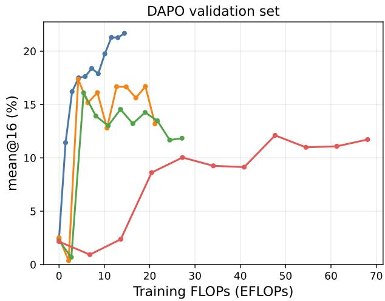

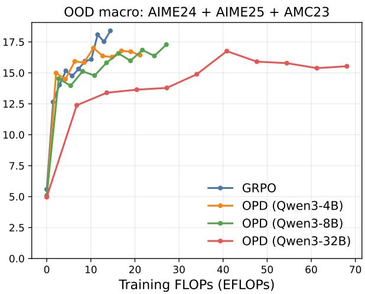  
Figure 7: On the full DAPO-Math-17k training set, GRPO reaches higher accuracy than OPD with less compute. Qwen3-1 . 7B-Base student, no-think, learning rate $2 \times 1 0 ^ { - 6 }$ , batch size 64, 8 rollouts per prompt, 200 steps; OPD uses Qwen3–4B, Qwen3–8B, or Qwen3–32B as the teacher. Points are evaluations every 20 steps, plotted against cumulative training FLOPs. Left: mean@1 6 on a held-out DAPO validation split. Right: OOD macro mean@1 6 over AIME24, AIME25, and AMC23. GRPO finishes at about 15 EFLOP. Every OPD run stays below GRPO while spending 1.4–4.7× as much compute.

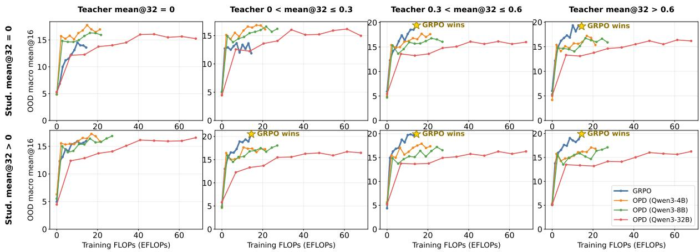  
Figure 8: On OOD math, OPD overtakes GRPO only on the hardest training subsets. Companion to Figure 2, with OOD macro mean @ 1 6 (AIME24, AIME25, AMC23) in place of in-domain accuracy. Rows bin the training problems by the student's mean@ 32 (= 0, > 0), and columns bin them by the teacher's mean $\Theta 3 2 \ : ( = 0 , ( 0 , 0 . 3 ]$ $( 0 . 3 , 0 . 6 ] , > 0 . 6 )$ . Qwen3-1.7B-Base student; Qwen3-4B, Qwen3-8B, and Qwen3-32B teachers; no-think, learning rate $2 \times 1 0 ^ { - 6 }$ , batch size 64, 8 rollouts per prompt, 200 steps. GRPO wins the five cells marked “GRPO wins", and OPD with the 32B teacher has the lowest peak among the OPD runs in each of them. In the other three cells (the teacher = 0 column and the cell with student = 0 and teacher ∈ (0, 0.3), every OPD run finishes above GRPO on OOD math, even though GRPO wins the same cells in-domain.

Difficulty study with Qwen3-1. 7B. Figure 9 repeats the difficulty study with Qwen3–1 . 7B (in no-think mode) instead of Qwen3–1 . 7B-Base, using a finer student-side stratification (4 student bins × 3 teacher bins). We keep the amount of training/validation sets the same as what's used for Qwen3-1. 7B-Base. The performance gap between GRPO and OPD is even larger. In all training sets, GRPO performance increases on both in-domain and out-of-domain. In contrast, OPD with external teachers makes student performance even worse.

## D.2 Learning rate

We swept the learning rate over five values $( 2 \times 1 0 ^ { - 6 } , 5 \times 1 0 ^ { - 6 } , 1 \times 1 0 ^ { - 5 } , 2 \times 1 0 ^ { - 5 } , 5 \times 1 0 ^ { - 5 } )$ for GRPO and for all three OPD teacher sizes on DAPO-Math-17K, no-think (Figure 10). OPD is more lenient: OPD-4B's bestover-training OOD macro spans 4.3 points across rates (14.1–18.4), whereas GRPO's spans 10.3 points (8.6–18.9). GRPO is more sensitive to the learning rate, but the best GRPO configuration outperforms the best OPD in both accuracy and compute efficiency: GRPO at lr $2 \times 1 0 ^ { - 6 }$ reaches 18.9% OOD macro at 7.8 EFLOP, while OPD's best (OPD-4B at lr $5 \times 1 0 ^ { - 6 } )$ reaches 18.4% at 14.3 EFLOP, requiring 1.8× the compute for a lower score.

## D.3 Batch size

Batch size is another key hyperparameter for model tuning: it controls the noise level of gradient estimates. To isolate its effect while keeping the total training data fixed, we ran three batch-size configurations – 64 for 200 steps, 128 for 100 steps, and 256 at 50 steps – for GRPO and for OPD under each of the three teacher sizes, all on DAPO-Math-17K with a Qwen3-1 . 7B-Base student in no-think mode at learning rate $2 \times 1 0 ^ { - 6 }$ (Figure 11). Smaller batches help both methods: GRPO climbs from 19.5 to 20.9 to 24.0 (in-domain validation mean@ 16, %) as the batch shrinks from 256 to 128 to 64; OPD-4B follows the same staircase from 16.0 to 16.2 to 17.3. The gain is roughly parallel, so the relative ordering GRPO > OPD holds at every batch size. For the two larger teachers (8B, 32B) the pattern is noisier but still favours small batch, and at no batch size does any OPD run overtake GRPO.

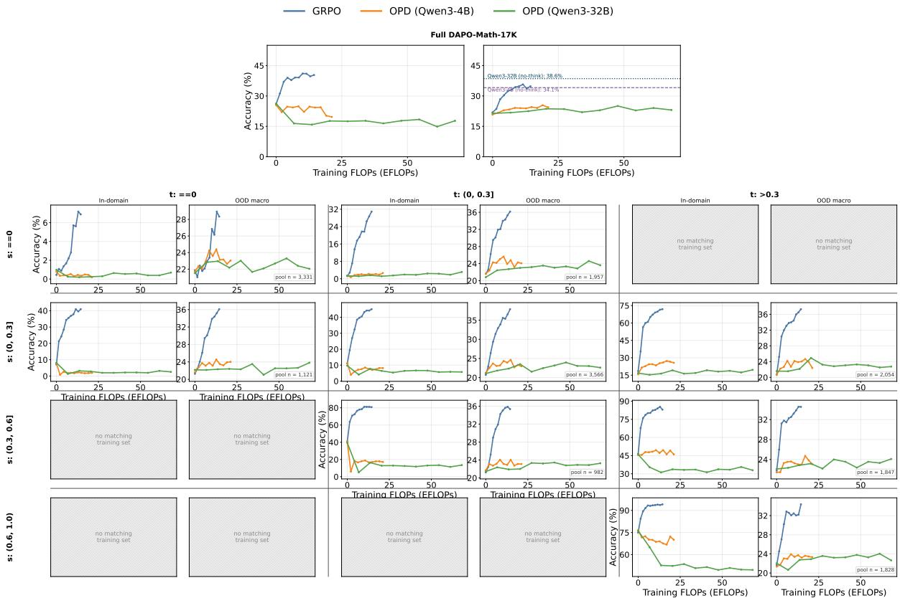  
Figure 9: GRPO also outperforms OPD across the difficulty grid with the post-trained Qwen3-1. 7B student. Same stratification as Figure 2, with Owen3-1. 7B (no-think) as the student and Owen3-4B and Owen3-32B (no-think) as teachers. Rows bin the training problems by the student's mean @ 32 (= 0, (0, 0.3], (0.3, 0.6], (0.6, 1)) and column groups bin them by the teacher's mean( $\mathbb { i } 3 2 ( = 0 , ( 0 , 0 . 3 ] , > 0 . 3 )$ . Each cell shows in-domain validation mean@16 (left) and OOD macro mean@16 (right) against cumulative training FLOPs; grey cells have too few training problems. The top row trains on the full DAPO-Math-17k, and horizontal lines mark the teachers' OOD accuracy $( \mathsf { Q w e n 3 - 3 2 B : 3 8 . 6 \% ; \mathsf { Q w e n 3 - 4 B : 3 4 . 1 \% } } )$ . Each cell trains on 442 problems from its subset, and “pool $n ^ { \prime \prime }$ gives the size of the full subset. GRPO outperforms both OPD runs in every cell, both in-domain and OOD.

## D.4 Reverse-KL estimator variant

The default OPD loss in our experiments uses the closed-form top-k reverse KL: at each token position, the student's top-k=16 tokens define a support set, both the student and teacher distributions are renormalized onto that set, and the KL is computed exactly over the k tokens (§3). An alternative is the sampled-token estimator, which evaluates the reverse KL at only the single token the student actually produced. The $k _ { 1 }$ estimator replaces the inner sum over the top-k support with the importance-weighted log-ratio at the single token $o _ { i , t }$ sampled from the rollout policy πold:

$$
\mathcal { L } _ { \mathrm { O p D } } ^ { k _ { 1 } } ( \theta ) = \mathbb { E } _ { q , \{ o _ { i } \} } \left[ \frac { 1 } { G } \sum _ { i = 1 } ^ { G } \sum _ { t = 1 } ^ { \lfloor o _ { i } \rfloor } \frac { \pi _ { \theta } ( o _ { i , t } \mid q , o _ { i , < t } ) } { \pi _ { \mathrm { o d d } } ( o _ { i , t } \mid q , o _ { i , < t } ) } \Big [ \log \pi _ { \mathrm { o l d } } ( o _ { i , t } \mid q , o _ { i , < t } ) - \log \pi _ { T } ( o _ { i , t } \mid q , o _ { i , < t } ) \Big ] \right] .
$$

The ratio $\pi _ { \theta } / \pi _ { \mathrm { o l d } }$ corrects for off-policy sampling, and the per-token signal log $\pi _ { \mathrm { o l d } } - \log \pi _ { T }$ is negative where the teacher assigns higher probability than the rollout policy. This estimator needs only the student, rollout, and teacher log-probabilities at the sampled token, avoiding the top-k renormalization entirely,

LR ablation by algorithm — Qwen3-1.7B-Base, no-think, full DAPO-Math-17k  
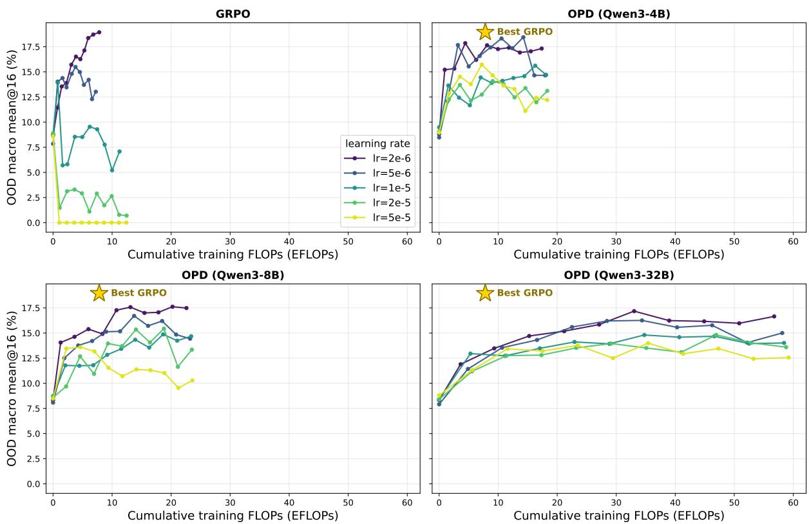  
Figure 10: No learning rate lets OPD reach the best GRPO accuracy. Qwen3–1 . 7B-Base student, no-think, full DAPO-Math-17k; OOD macro mean@1 6 against cumulative training FLOPs for learning rates $2 \times 1 0 ^ { - 6 }$ $5 \times 1 0 ^ { - 6 } , 1 \times 1 0 ^ { - 5 } , 2 \times 1 0 ^ { - 5 }$ , and $5 \times 1 0 ^ { - 5 }$ . One panel per method: GRPO (top left) and OPD with the Qwen 3–4B, $_ { \mathsf { Q w e n 3 - 8 B } }$ , and Qwen3–32B teachers. The star in each OPD panel marks the best GRPO accuracy (learning rate $2 \times 1 0 ^ { - 6 }$ , about 19%). GRPO degrades as the learning rate grows and collapses at $5 \times 1 0 ^ { - 5 }$ . OPD is more stable across learning rates, but its best configuration (Qwen3–4B teacher at $5 \times 1 0 ^ { - 6 }$ , about 18.4%) still ends below the star.

Figure 12 compares the two estimators under the same recipe (Qwen3–1 . 7B-Base, no-think, DAPO-Math-17K, lr $2 \times 1 0 ^ { - 6 }$ , batch 64, 200 steps). The two variants trace essentially the same accuracy curves across all three teacher sizes and across difficulty bands, so the choice of reverse-KL support set is not what determines OPD's loss to GRPO. This is consistent with the observation by Kimi Team (2026) that the estimator choice has minimal impact in practice.

## D.5 Thinking mode

Figure 13 isolates the effect of the teacher's thinking mode. All runs use the same student (Qwen3–1 . 7B-Base with OpenThoughts-3-SFT initialization) and the same data (DAPO-Math-17K); only the teacher decoding mode changes. In no-think mode (left panel), GRPO reaches roughly 19% OOD macro and the three OPD variants (4B, 8B, and 32B teachers) cluster in a narrow 16%–17.5% band, consistent with the main-text pattern. Switching to think mode (right panel) costs GRPO about 2.1 points, but the effect on OPD varies sharply with teacher size: OPD-8B loses a comparable 2.1 points and stays within 1.5 points of GRPO, whereas OPD-4B drops 8.2 points and OPD-32B drops 7.7 points, leaving both at roughly half the GRPO level.

Two observations follow. First, thinking mode hurts OPD more than GRPO across most teacher sizes, consistent with the hypothesis that long chains of thought amplify the distribution mismatch between student rollouts and teacher token-level supervision. Second, teacher capacity does not rescue the gap: the 32B teacher fares worse than the 8B teacher in think mode, not better, so the fragility is not a matter of teacher scale. We note that no-think and think runs differ in decoding temperature and prompt format, so the two panels are not a controlled comparison with each other; the GRPO-vs-OPD contrast within each panel is controlled.

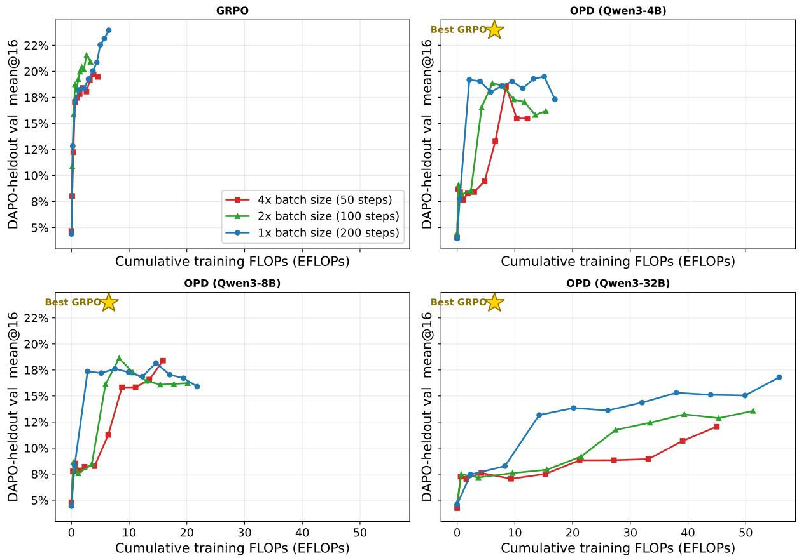  
Figure 11: At a fixed prompt budget, no batch size lets OPD catch up with GRPO. Every configuration trains on 12 800 prompts: batch size 64 for 200 steps (1×), 128 for 100 steps (2×), or 256 for 50 steps (4×). Qwen3-1. 7B-Base student, no-think, DAPO-Math-17k, learning rate $2 \times 1 0 ^ { - 6 }$ ; DAPO validation mean@16 against cumulative training FLOPs, one panel per method. The smallest batch is the best or tied-best setting for GRPO and for OPD with the 4B and 32B teachers, while the 8B teacher shows no consistent ordering. No OPD run reaches the best GRPO accuracy (star) at any batch size.

## D.6 Student initialization

A natural hypothesis is that the base model must first learn to produce rollouts in the right format before OPD can distill from them effectively: if the student's on-policy outputs are too far from the teacher's distribution, token-level supervision may have little to work with. SFT cold-starting on high-quality traces (e.g. OpenThoughts-3) could therefore be important for OPD to succeed. We test this hypothesis at two student scales.

1.7B-Base, no-think mode. Figure 14 compares Qwen3–1 . 7B-Base initialized from the external pretrained checkpoint against the same model initialized from an OpenThoughts-3-SFT cold start $( \mathrm { I r } 1 \times 1 0 ^ { - 5 }$ , step 3000). Both runs use no-think mode with matched hyperparameters $( \mathrm { l r ~ 2 \times 1 0 ^ { - 6 } }$ , k=32 rollouts, batch 64, 200 steps). The

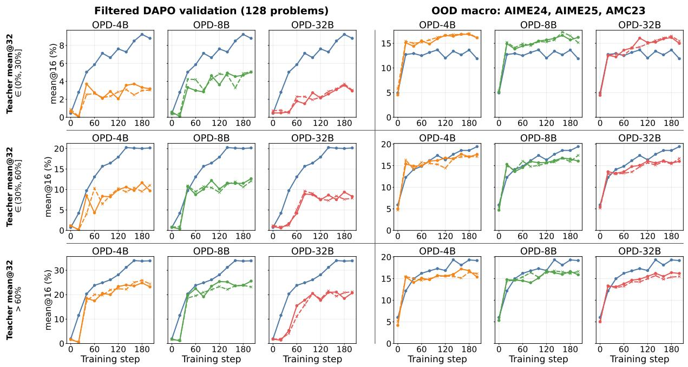  
Figure 12: The reverse-KL estimator barely changes OPD accuracy. The two OPD losses differ only in the reverse-KL estimator. Solid lines use the closed-form reverse KL over the student's top-k=16 tokens; dashed lines use the sampled-token $k _ { 1 }$ estimator at the token the student generated. Qwen3–1. 7B-Base student, no-think, DAPO-Math-17k, learning rate $2 \times 1 0 ^ { - 6 } .$ with GRPO shown for reference. Rows are training subsets that the student never solves, binned by the teacher's mean@ 32 ((0, 30%], (30%, 60%], > 60%). Columns are the Qwen3-4B, Qwen3-8B, and Qwen3-32B teachers. Left block: mean@16 on a filtered DAPO validation set of 128 problems. Right block: OOD macro mean@ 16. The x-axis is the training step. The two estimators trace nearly the same curves in every cell.

SFT initialization provides a head start at step 0, but GRPO overtakes all OPD variants under both initializations.   
The SFT cold start does not change the conclusion.

1.7B-Base, think mode. We next test two SFT cold starts with thinking enabled: lr $1 \times 1 0 ^ { - 5 }$ (the same checkpoint as above) and lr $1 \times 1 0 ^ { - 4 }$ (the optimal SFT learning rate). Figure 15 plots OOD macro against training FLOPs for both. Under both cold starts the within-panel ordering holds: GRPO sits above every OPD run per FLOP. Switching to a stronger SFT initialization and enabling thinking does not change the ranking.

4B-Base with SFT cold start. We scale the test to Qwen3-4B-Base with thinking enabled, initialized from OpenThoughts-3-SFT (lr $1 \times 1 0 ^ { - 4 }$ , the optimal learning rate for this model), and increase the response maximum from 7168 to 16 384 tokens. In addition to the standard OPD-32B teacher, we include QwQ-32B, the model whose rollouts generated the OpenThoughts corpus used for the SFT cold start, to accommodate teacher similarity with the SFT-initialized student. Figure 16 shows GRPO outperforming both OPD teachers across all four evaluation benchmarks. The QwQ-32B teacher does not recover the gap, and both OPD variants decline over training while GRPO continues to improve.

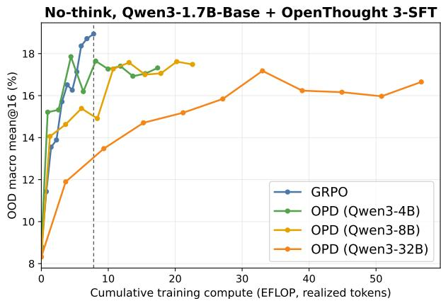

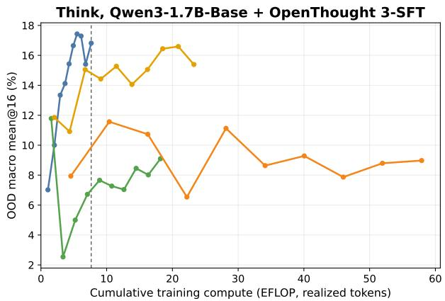  
Figure 13: Thinking mode hurts OPD much more than GRPO. Qwen3–1. 7B-Base student initialized from OpenThoughts-3 SFT, DAPO-Math-17k; OOD macro mean@ 1 6 against cumulative training FLOPs. Left: student and teachers in no-think mode. Right: student and teachers in thinking mode. The vertical dashed line marks the compute at which GRPO finishes. Switching from no-think to thinking lowers the final accuracy of GRPO by 2.1 points (18.9% to 16.8%) and of OPD with the 8B teacher by 2.1 points (17.5% to 15.4%). OPD with the 4B and 32B teachers loses 8.2 and 7.7 points, ending at 9.1% and 9.0%

## D.7 Student model sizes

The negative result in §4 is established on Qwen3–1. 7B-Base. A natural concern is that the 1.7B student is simply too small to benefit from a strong teacher and that the gap would close at larger student scale. We test this by running the same external comparison at Qwen3-4B-Base and Qwen3-8B-Base (Figure 17). At both scales, no external OPD run reaches its teacher's accuracy within the compute budget, and a larger teacher does not improve compute efficiency: the 32B teacher curves sit close to (and sometimes below) the same-size teacher curves. The negative result is not a small-student artifact.

## D.8 Training domain

Math. Our default math training set is DAPO-Math-17K. We also run on DeepMath-103k, the dataset used by Thinking Machines Lab (Thinking Machines Lab, 2025) for their OPD experiments. Swapping DAPO-Math for DeepMath does not change the ordering; it widens it, with GRPO ahead by 11.5 points of mean@16 on DeepMath versus 7.7 on DAPO (Figure 18)

Code. We train the same Qwen3–-4B-Base student on two code datasets (LiveCodeBench v1-v5 and a highquality CodeForces set we carve from open-r1/codeforces; Appendix B.6) with GRPO and OPD under external 8B and 32B teachers. The ordering observed on math holds on code: GRPO outperforms both OPD variants on LCBv6 at every evaluated compute budget on both training sets (Figure 19, left column)

## D.9 Replication across RL frameworks

Replication across different verl versions. Framework choice bundles the reverse-KL estimator, the rollout engine, and a long tail of implementation details, any of which could in principle flip the GRPO-versus-OPD ordering. We replicate the comparison on three training stacks to isolate this. The first two stacks are two version of our ver1-based pipeline, run on a external-teacher setup of §4: Qwen3-1 . 7B-Base student, external Qwen3-{4B, 8B, 32B} thinking teachers, DAPO-Math-17K, and the shared hyperparameters of Table 2 (batch 64, learning rate $2 \times 1 0 ^ { - 6 }$ , 200 optimizer steps, group size G=8, 7168-token response maximum). One set of results use an older ver1 generation (0 . 7 . 0 . dev) with our own reverse-KL OPD implementation and a closed-form top-16 estimator; the second stack is the current ver1 release (0 .8 . 0 . dev), whose native reverse-KL OPD implementation uses a sampled-token estimator. All other hyperparameters match between the two stacks; the only axis of variation is the estimator and the surrounding implementation. Figure 21 shows both results from both verl versions side by side: GRPO sits above every OPD run at every evaluated FLOP count under either implementation, so the estimator variant does not flip the ordering.

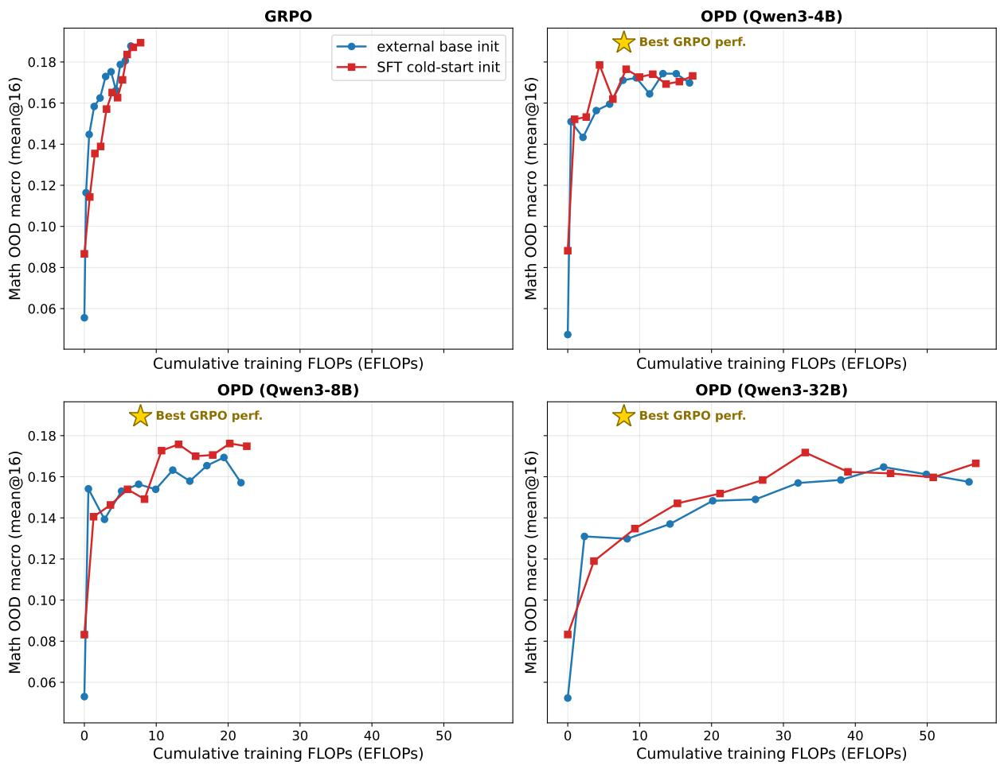  
Figure 14: An SFT cold start does not change the ordering of GRPO and OPD (Qwen3-1. 7B-Base, nothink). OOD macro mean @1 6 (AIME24, AIME25, AMC23) against the training step, one panel per method. Each panel compares the base initialization (blue) with an OpenThoughts-3 SFT initialization (red; SFT learning rate $1 \times 1 0 ^ { - 5 }$ , step 3000). All runs use no-think mode, learning rate $2 \times 1 0 ^ { - 6 }$ , DAPO-Math-17k, batch size 64, 200 steps, and a 7168-token response limit. The SFT initialization starts higher (about 8.5% versus 5.5%), but the difference disappears by step 20. GRPO reaches about 19% under both initializations, and every OPD run stays below the best GRPO accuracy (star).

tinker replication at 9B scale. The third replication uses the tinker training library from Thinking Machines Lab (Thinking Machines Lab, 2025), at a different scale and student family. From a shared rank-128 SFT checkpoint of Qwen3.5-9B-Base (as student/initialization) and a Qwen3.5-9B teacher (OPD run) we ran GRPO and OPD for 40 optimizer steps at matched settings — learning rate $1 \times 1 0 ^ { - 4 }$ , 64 prompts per batch, 4 rollouts per prompt, 16 384-token response maximum, DeepMath-103k training set; the choice of hyperparamters are detailed in TML's tutorial page2or default values in the tinker codebase. At step 40, GRPO reaches AIME'24 mean@8 = 0.542 while OPD collapses to mean@ 8 = 0.013; 98.75% of OPD's evaluation rollouts saturate the 16 384- token maximum against 26.3% for GRPO (Figure 20). This is the same length-inflation pathology documented on ver1 in Appendix E, now reproduced on a different framework, student family (Qwen3.5), base scale (9B), and cold start (rank-128 LoRA).

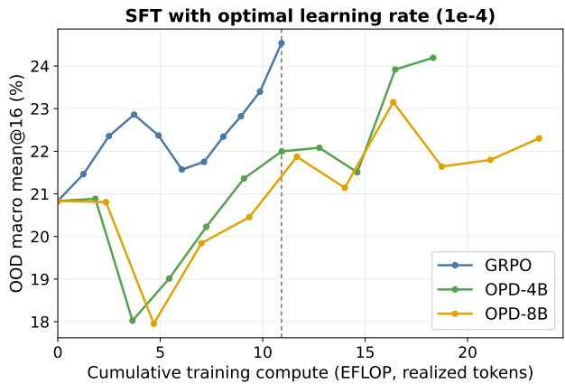

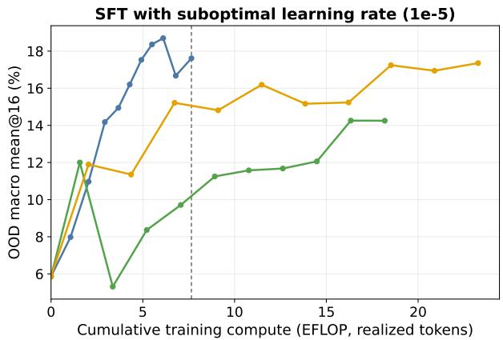  
Figure 15: With thinking enabled, GRPO still leads OPD after an SFT cold start (Qwen3-1. 7B-Base). OOD macro mean @1 6 (AIME24, AIME25, AMC23) against cumulative training FLOPs, with OPD using Qwen3–4B or Qwen3–8B as the teacher. Both panels use thinking mode, DAPO-Math-17k, batch size 64, 8 rollouts per prompt, a 7168-token training limit, and a 30 720-token evaluation limit. The vertical dashed line marks the compute at which GRPO finishes. Left: SFT initialization at the best SFT learning rate $( 1 \times 1 0 ^ { - 4 } )$ . Right: SFT initialization at a lower SFT learning rate $( 1 \times 1 0 ^ { - 5 } )$ . GRPO reaches 24.5% (left) and 18.7% (right). On the left, OPD with the 4B teacher comes within 0.3 points of GRPO after about 1.7× the compute. On the right, no OPD run reaches GRPO

Using a controlled suite of GRPO and OPD within each framework, we show that GRPO is more compute-efficient than OPD with an external teacher across all three stacks

## E Length as a lens to compare model behaviors

## E.1 Length inflation in OPD except self-GRPO teacher

With an external thinking teacher, OPD response lengths inflate rapidly until every rollout saturates the response maximum. Here the teacher is an external thinking model Qwen3-4B —the same size as the Qwen3-4B-Base student—so the collapse cannot be attributed to the student lacking the capacity to represent a much larger teacher. OPD nonetheless drives the mean response length past 7000 tokens by step 9 (with 96% of rollouts already truncated) and then holds every sequence in the batch at the 7168-token maximum (clip $\mathbf { r a t i o } \geq 0 . 9 9 9 )$ from step 19 onward (Figure 22). Trained with GRPO, the same student stays near 1000–1500 tokens for the first ≈55 steps and ends at 3813 tokens (53% of the limit).

However, this behavior is not inherent to dense per-token supervision. With the self-GRPO teacher (§5), OPD does not inflate length: the student ends at 3741 tokens, close to GRPO's 3813. This inflation encodes pathological behavior of the model (Appendix E.2). We believe, following the dense-signal analogy of OPD, the problem is not the dense signal itself but the wrong dense signal: an external teacher whose token distribution is far from the student's. However, it is difficult to characterize a priori what makes a given model a good teacher. Given an arbitrary LLM, there is currently no way to predict whether it will function as a stable OPD teacher without running the distillation. Developing such a diagnostic remains an open problem

Additional results with other teacher types Figure 23 plots mean response length (tokens) on the OOD math evaluation across training steps for three teacher families (§5) — GRPO-trained base models, external thinking models, and further-GRPO-trained thinking models. With an external thinking teacher (centre panel), the OPDtrained student's responses balloon to ≈28K-30K tokens by step 40 and stay there, while the teachers themselves respond with only ≈12K–13K tokens on the same prompts (4B teacher: 12 708; 8B teacher: 13 040; 14B teacher:

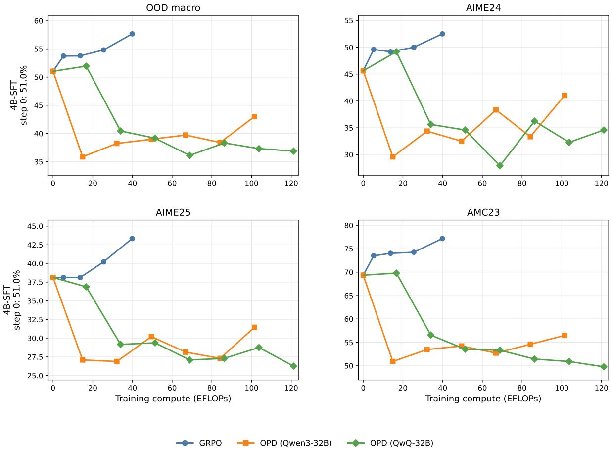  
Figure 16: From a strong SFT initialization, OPD falls below the starting student while GRPO improves it (Qwen3-4B-Base). The student is Qwen3-4B-Base after OpenThoughts-3 SFT (SFT learning rate 1 × 10−4), which starts at 51.0%OOD macro. OPD uses Qwen3-32B or QwQ-32B as the teacher; QwQ-32B generated the SFT corpus, so its outputs match the student's starting distribution. Panels show the OOD macro mean @ 1 6 and its components (AIME24, AIME25, AMC23) against cumulative training FLOPs. GRPO improves to 57.7% within about 40 EFLOP. Both OPD runs drop to about 36% OOD macro and remain 8–15 points below the starting student through 120 EFLOP. The QwQ-32B teacher only delays the drop.

11 578). The student is therefore emitting ≈2.3–2.6× longer responses than the teacher whose token distribution it is trying to match, an outright divergence from teacher behavior rather than mere length matching. The same pattern holds with a further-GRPO-trained thinking teacher (right panel: student ≈22K-30K vs teacher ≈9K-10K). With GRPO-trained base teachers (left panel), the gap is much smaller. The student is about 2× as long as the 14B teacher (9K vs. 4.7K tokens) and 1.4× as long as the 8B teacher (12K vs. 8.9K). Only with the student's own GRPO checkpoint as teacher do the two lengths match.

## E.2 Pathological modes co-occur with length inflation

External-teacher OPD does not merely inflate response length. It also produces short-period repetition, drops the required output format, and, on the multi-domain mix, switches language. On DAPO-math-17K, we measure this on 3 runs in Figure 22: GRPO on the target reward, OPD distilled from a self-GRPO teacher (the same 4B model, trained via GRPO on this data), and OPD distilled from an external thinking teacher Qwen3–4B. Those runs share the training and evaluation configurations (e.g., learning rate, batch size); only the training objective and teacher differ. For each run we take first 500 rollouts from the final (i.e., step-200) evaluation on AIME24/25 + AMC23 and measure response length with the Qwen3 tokenizer.

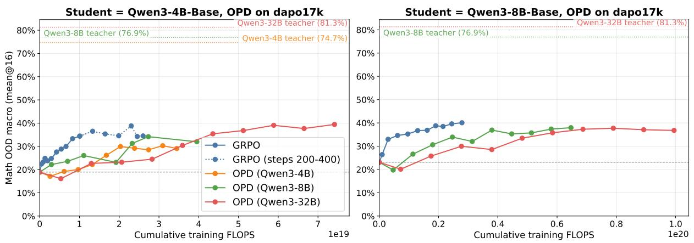  
Figure 17: External thinking teachers, 4B and 8B students. Two panels, one per student size. Curves are training trajectories on DAPO-Math-17K for GRPO and for OPD against external Qwen3-{4B, 8B, 32B} thinking teachers; x is cumulative training FLOPs, y is OOD macro mean @ 1 6 (AIME24 + AIME25 + AMC23). GRPO curves: solid up to optimizer step 200, dotted for steps 200–400 (the OPD runs trained for at most 200 steps, so the solid segments are the matched-step comparison). No OPD run reaches its teacher's accuracy within the compute budget, and a larger external teacher does not close the gap.

GRPO vs OPD-4B on the compute axis (Qwen3-1.7B-Base + SFT on OpenThought3, think)  
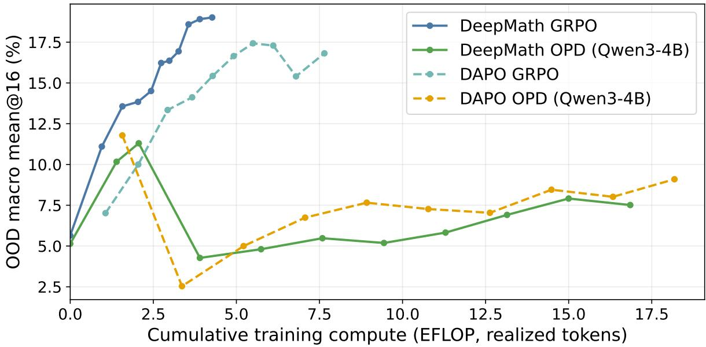  
Figure 18: Switching the training set from DAPO-Math-17k to DeepMath-103k does not change the ordering. Qwen3-1 . 7B-Base student after OpenThoughts-3 SFT, thinking mode; OPD uses the Qwen3–4B teacher. OOD macro mean@16 against cumulative training FLOPs; solid lines train on DeepMath-103k and dashed lines on DAPO-Math-17k. On both training sets, OPD first rises, then drops to 2.5%–4.3%, and recovers only to 7.5%–9.1% by about 17 EFLOP. GRPO reaches 19.0% (DeepMath) and 17.4% (DAPO) within 8 EFLOP.

GRPO and self-GRPO-teacher OPD are essentially indistinguishable: within \~ 40 tokens of median response length and \~ 2 percentage points on every metric. The self-GRPO teacher transfers its stopping behavior almost perfectly to the student. In contrast, the external-4B-teacher OPD is qualitatively different: median response saturates at the eval maximum, 97.8% of rollouts hit the maximum, and 63.6% contain a detected short-period repetition loop — the student has lost its ability to stop. Removing detected loops brings the median only from 30,720 to 21,031 tokens, still \~ 4× GRPO's de-looped median of 4,573.

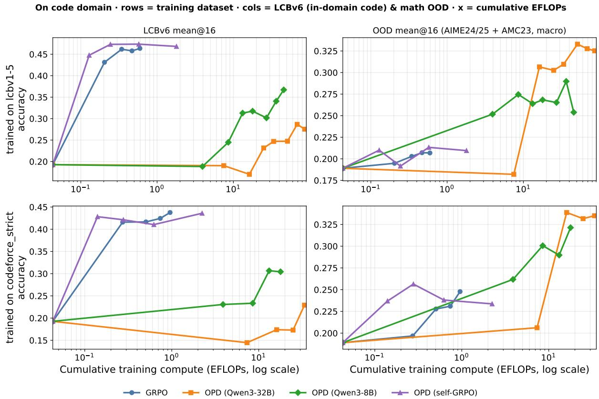  
Figure 19: Code domain training: in-domain collapse, out-of-domain math transfer. Owen3–4B-Base student trained on LiveCodeBench-v1-v5 (top row) and strict CodeForces (bottom row) with GRPO or external OPD-32B, lr $2 \times 1 0 ^ { - 6 }$ , 16 384-token response maximum; x-axis is cumulative training compute (EFLOPs). Left column: LCBv6 mean@16 (in-domain code). OPD (Qwen3–32B) loses to GRPO at every evaluated compute budget on both training sets. Right column: math OOD macro mean@16 on AIME24 + AIME25 + AMC23. Despite training only on code, OPD-32B reaches ≈31%–34% math OOD, beating the code-trained GRPO by roughly 10 points on both training sets — an additional evidence for OPD's cross-domain transfer (Appendix F).

The same picture holds on the 2-domain math + code mix. Joint GRPO and multi-teacher self-GRPO OPD (G=1, one GRPO specialist teacher per domain) both terminate cleanly: maximum-hit stays under 21% on math and under 4% on code for both, and multi-teacher self-GRPO OPD is in fact tighter than GRPO on code (0.2% maximumhit and 0.2% detected repetition, versus 3.6% / 3.6% for GRPO). The external teacher (Qwen3-8B) collapses to the opposite regime on both domains: 100% maximum-hit, ～ 85% detected repetition loops, and median response saturated at the eval maximum (30.7K math, 31.7K code). On top of this shared length-inflation failure, the Qwen3–8B external teacher demonstrates a language-collapse mode absent elsewhere — 100% of its math and code rollouts contain Chinese characters in the first 2K characters, versus 0% under GRPO and multi-teacher self-GRPO

## E.3 Length behavior in multi-domain settings

On each tasks, we measure mean evaluation response length (tokens, n=16 per prompt) for Qwen3–4B-Base. We use single-task GRPO as the per-task reference; we use the GRPO checkpoint that each multi-teacher OPD distills from (math, IFBench, and MMLU-Pro at 200 steps, code at 80; Table 9). Figure 24 reports each regime's length as a ratio to this reference. Multi-teacher OPD, which distills from these single-task GRPO teachers, recovers the teacher length closely: within roughly 20% on math, code, and MMLU-Pro (0.93–1.19×), and somewhat longer on IFBench (1.65–2.25×). OPD from an external teacher (Qwen3–8B) instead inflates length on every task like what happens in Appendix E.2. Joint GRPO lies between the two, and its length is setting-dependent.

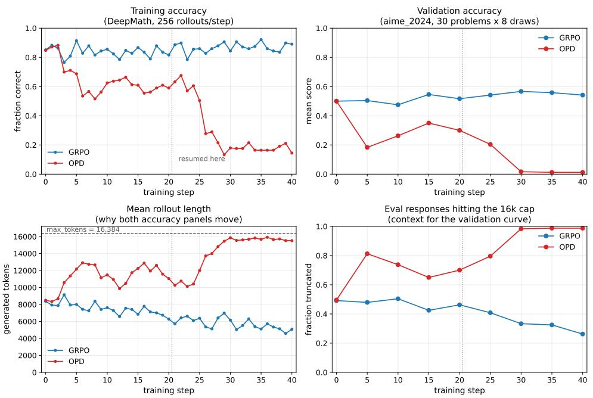  
Figure 20: The same failure appears in a different framework (tinker, Qwen3.5-9B-Base). GRPO and OPD on DeepMath from a shared rank-128 SFT checkpoint, with Qwen3 . 5– 9B as the OPD teacher, for 40 optimizer steps. Top left: training accuracy (256 rollouts per step). Top right: AIME24 validation accuracy (30 problems, 8 samples each). Bottom left: mean rollout length; the dashed line is the 16 384-token limit. Bottom right: fraction of evaluation responses truncated at the limit. The dotted vertical line marks where training resumed from the step-20 checkpoint. GRPO holds AIME24 accuracy near 0.54. OPD falls to 0.013 as its rollouts grow to the limit, and 98.75% of its evaluation responses are truncated. The ordering and the length saturation match the ver1 results in Figures 21 and 22.  
Framework replication on the compute axis (Qwen3-1.7B-Base + OpenThought-3-SFT, DAPO-Math-17k)

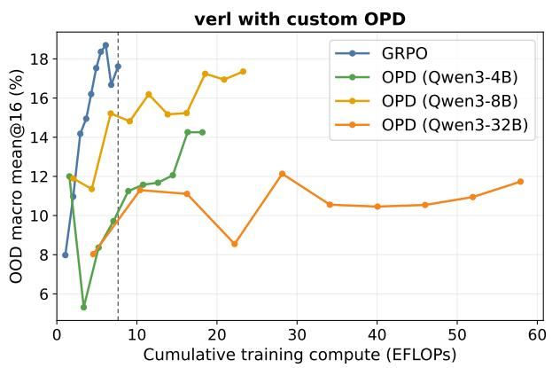

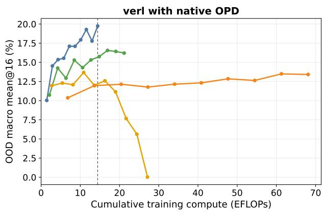  
Figure 21: Replicate GRPO > OPD ordering on different frameworks. The compute ordering survives the change of framework: GRPO is above every OPD run per FLOP in both the old/custom and latest/native stacks. On latest/native stack, we follow their default choice to use sampled-token reverse KL estimator. Other than the difference we specified, the hyperparamters and configurations match between left and right plots.

Response-length dynamics for the matched 4B-Base pair  
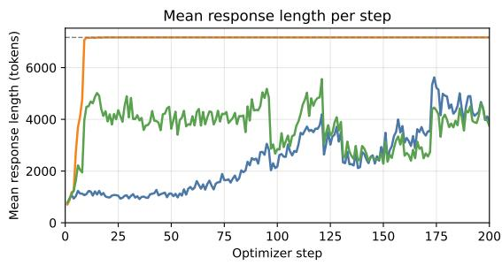

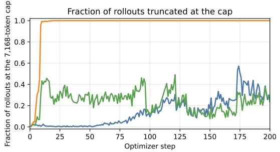

Figure 22: With an external thinking teacher, OPD rollouts fill the length limit within ten steps. Qwen3-4B-Base student on DAPO-Math-17k, trained with GRPO, with OPD from the external Qwen3-4B thinking model (the same size as the student), and with OPD from the self-GRPO teacher. Left: mean response length per optimizer step; the dashed line is the 7168-token training limit. Right: fraction of rollouts truncated at the limit. OPD with the external teacher reaches the limit by step 9 and truncates every rollout for 182 of 200 steps. GRPO and OPD with the self-GRPO teacher end at similar lengths (3813 and 3741 tokens) and never saturate the limit.  
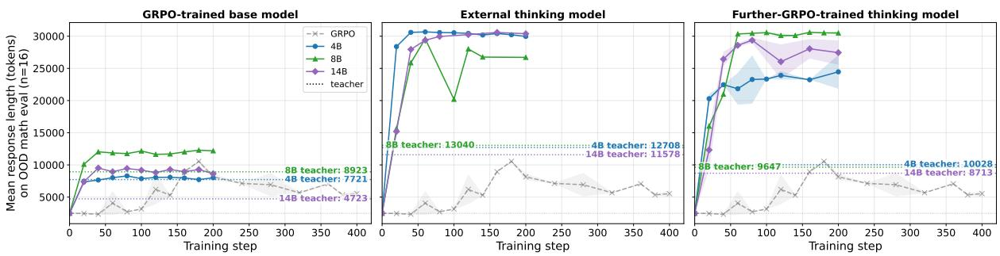  
Figure 23: External thinking teachers make OPD students two to three times as long as the teacher. Qwen3–4B-Base student; mean response length on the OOD math evaluation (16 samples per problem) over training steps. Teachers at 4B, 8B, and 14B are of three types: GRPO-trained base models (left), external thinking models (centre), and external thinking models further trained with GRPO (right). Dotted horizontal lines mark each teacher's own response length on the same prompts, and the grey dashed curve is GRPO. With both kinds of thinking teacher, the student's responses grow to 2–3× the teacher's length, close to the 30 720-token evaluation limit. With GRPO-trained base teachers the gap is much smaller: the student matches the 4B teacher's length and is 1.4× and 1.9× as long as the 8B and 14B teachers.

Under joint GRPO, each task's response length is pulled toward the length of the other tasks sharing its batch (Table 9). In the two-task math + code mix, math's long single-task baseline drags code well above its own, to 3.64× the code reference, while math itself is only mildly inflated (1.33×). Adding MMLU-Pro and IFBench, the two shortest single-task baselines, pulls both shared tasks back down: math from 1.33× to 0.87× the reference and code from 3.64× to 1.95×. Response length under joint GRPO is thus governed by the mix of tasks in the training batch.

<table><tr><td>metric</td><td>GRPO</td><td>OPD, self-GRPO teacher</td><td>OPD, external teacher</td></tr><tr><td>repetition loop (naive detection)</td><td>16.6%</td><td>15.2%</td><td>63.6%</td></tr><tr><td>median response length (tokens)</td><td>6,504</td><td>6,542</td><td>30,720 (= maximum)</td></tr><tr><td>→ if detected loops removed</td><td>4,573</td><td>4,937</td><td>21,031</td></tr><tr><td>mean response length (tokens)</td><td>11,233</td><td>11,605</td><td>30,229</td></tr><tr><td>→ if detected loops removed</td><td>7,763</td><td>8,353</td><td>19,627</td></tr><tr><td>≥ 95% of eval maximum</td><td>19.0%</td><td>21.0%</td><td>97.8%</td></tr><tr><td>CJK language collapse</td><td>0.0%</td><td>0.0%</td><td>0.2%</td></tr><tr><td>missing \boxed{·}</td><td>21.2%</td><td>23.2%</td><td>49.0%</td></tr></table>

Table 8: Rollout pathologies at step 200 on math-only training (500 rollouts per run, Qwen3 tokenizer). Values in bold red are ≥ 2× the GRPO baseline on the same metric. “Repetition loop (naive detection)" flags a rollout when the 100-char window response [-200 : -100] appears ≥ 3 times elsewhere in the response — a conservative probe that catches short-period token-level loops but misses longer-period, paraphrased, and semantic repetition. “ if detected loops removed" cuts each detected-loop response at the first occurrence of its probe pattern and re-measures length; because the probe is conservative, this is an upper bound on unique-content length, and still contains an unknown amount of undetected higher-order repetition. Even against this upper bound the externalteacher response is \~ 4× the GRPO de-looped median.

Table 9: Single-task GRPO reference length per task (Qwen3–4B-Base): mean evaluation response length, in tokens, at the checkpoint used as the multi-teacher OPD teacher
<table><tr><td>Task</td><td>Length (tokens)</td></tr><tr><td>Math</td><td>7,721</td></tr><tr><td>Code</td><td>1,003</td></tr><tr><td>IFBench</td><td>829</td></tr><tr><td>MMLU-Pro</td><td>804</td></tr></table>

## F Out-of-distribution generalization of OPD with an external teacher

Although external thinking teachers are compute-inefficient for OPD on the training domain (§4), our experiments surface an interesting side benefit: OPD with these teachers produces surprisingly strong out-of-distribution generalization that GRPO does not match. We collect two observations below suggesting that OPD's per-token objective carries information beyond the training distribution.

Observation 1: OPD wins GRPO in OOD at the difficulty cells where the teacher itself is weak. On the difficulty-stratified DAPO-Math-17K grid (§4.1), GRPO wins in-domain in every one of the eight cells (Figure 2). On the OOD macro (AIME24 + AIME25 + AMC23), however, OPD-4B and OPD-8B finish above GRPO in three of the eight cells, every cell in the teacher-solves-nothing column plus the (student = 0, teacher ∈ (0, 0.3]) cell (Figure 8). In these cells the teacher signal is weak, so it is surprising that OPD outperforms GRPO on OOD. In fact, to our surprise, OPD's OOD macro sits at a nearly constant 15%-18% across all eight regimes while GRPO's varies with the data it was trained on; OPD's OOD score looks more like a property of the objective than of what it was trained on.

Observation 2: code-trained OPD with external teachers improves math OOD by ≈7–13 points over codetrained GRPO. On two code training sets (LCBv1-v5 and CodeForces), both external teachers reach math OOD macro well above the code-trained GRPO despite never seeing math training data (Figure 19 right column).

OPD(Owen3-32B) peaks at 33.3% on LCBv1-v5 and 33.9% on CodeForces; OPD(Owen3-8B) peaks at 29.0% and 32.1% respectively; code-trained GRPO peaks at 20.7% and 24.8% (math OOD, for the two code training sets), compared to the math specialist's own math-OOD accuracy of 33.9% (Figure 3 dashed “GRPO teacher" line, §5.1).

## Qwen3-4B-Base · eval-time response length relative to the single-task GRPO baseline

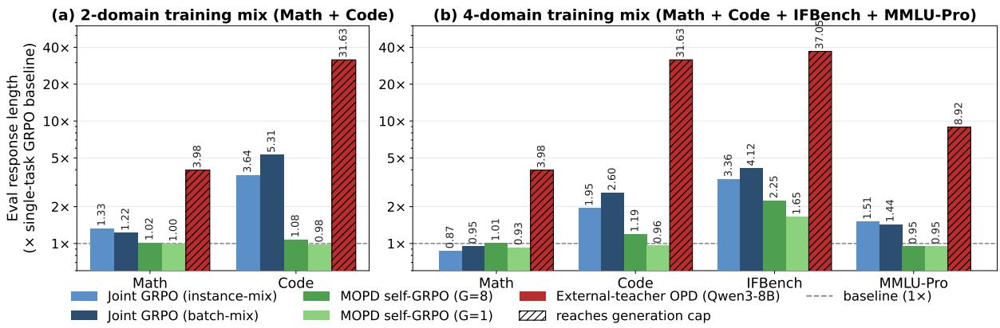  
Figure 24: Multi-teacher OPD with self-GRPO teachers keeps the specialists' response length, while an external teacher drives responses to the generation limit. Evaluation response length of Qwen3–4B-Base students trained on (a) the 2-domain mix (math, code) and (b) the 4-domain mix (math, code, IFBench, MMLU-Pro). Lengths are shown as a ratio to the single-task GRPO specialist for each domain (Table 9). The dashed line marks a ratio of 1, and the y-axis is logarithmic. Hatched bars reach the generation limit. Multi-teacher OPD stays within 0.93–1.19× of the specialists on every domain except IFBench (1.65–2.25×). Joint GRPO produces 0.87–5.31× the specialist length, and OPD with the external Qwen3-8B teacher produces 3.98–37.05×.

## G Additional results of running GRPO on teacher

Section 5.1 shows that OPD with a self-GRPO teacher, the student's own GRPO checkpoint, recovers the teacher's accuracy with far fewer FLOPs than GRPO. This appendix tests whether that result holds beyond the main setting of a Qwen3–4B-Base student on math. We vary three factors one at a time: student size (Qwen3-8B-Base), domain (code), and model family with a post-trained starting point (Olmo-3-7B-Inst ruct-SFT). In each case the self-GRPO teacher reaches the teacher's accuracy faster than GRPO.

Replication with Qwen3-8B-Base. The fast-saturation pattern of the self-GRPO teacher (§5.1) is not specific to the 4B student. Figure 25 repeats the comparison, on DAPO-Math-17K, with a Qwen3-8B-Base student against three teachers: external Qwen3–8B, external Qwen3–32B, and the student's own GRPO-trained Qwen3-8B-Base checkpoint. The With the self-GRPO teacher, the student reaches the teacher's accuracy within about 3 EFLOP at G=8 and 1 EFLOP at G=1, faster than with either external teacher. With the external Qwen3–8B and Qwen3-32B teachers, the student climbs more slowly and stays below the teacher's accuracy throughout the compute budget shown.

Replication on code domain. On code, the same pattern holds: the GRPO-trained 4B-base teacher reaches GRPO's LCBv6 accuracy at 2.4× fewer FLOPs on LiveCodeBench-v1–v5 and ties GRPO's quality on strict CodeForces, while the external 32B teacher stays far below GRPO (Figure 19 left column). GRPO-trained student itself is therefore the only strong-to-weak OPD setup that consistently works across both math and code domains.

Non-base cold-start replication (Olmo-3-7B-Instruct-SFT). Figure 27 runs the same self-GRPO recipe on a post-trained checkpoint from a different model family. Both curves share the step-0 Olmo-3-7B-Inst ruct-SFT student, the DAPO-Math-17K training set, and an identical evaluation configuration. GRPO (self) runs direct GRPO on the SFT student (G=8, 200 steps) and reaches 40% OOD macro at 14.4 EFLOP. OPD ← self-GRPO teacher distills the step-200 GRPO checkpoint back into the same step-0 SFT student (G=1, 80 steps) and reaches the teacher's end-of-training accuracy within \~0.36 EFLOP (step 20), a \~56× compute reduction that lines up with the same-base results in Section 5.1. The OPD student then continues past the teacher and peaks at 51% at 1.25 EFLOP, an ≈11-point overshoot over the self-GRPO teacher's own

## Qwen3-8B-Base GRPO/OPD variants vs teacher accuracy (DAPO-Math-17k, think, Ir 2e-6)

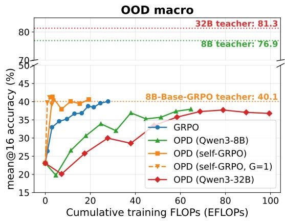

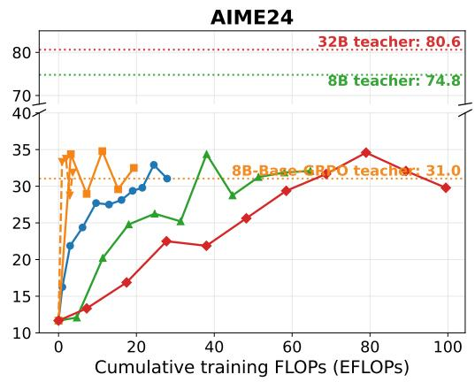

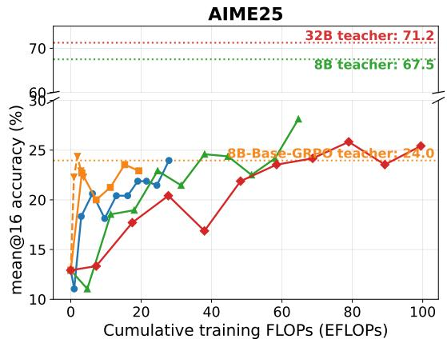

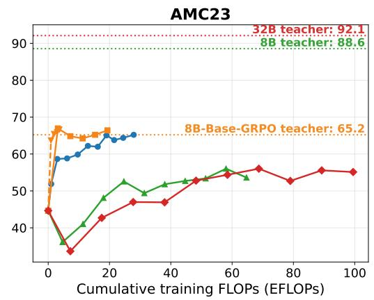  
Figure 25: The self-GRPO teacher result holds for an 8B student (companion to Figure 3). Qwen3–8B-Base student on DAPO-Math-17k; mean@16 against training FLOPs. Dotted lines mark each teacher's accuracy, and the y-axis is broken to show the external teachers. OPD with the self-GRPO teacher reaches the teacher's 40.1% OOD macro within about 3 EFLOP (group size G=8) or 1 EFLOP (G=1), against 27.9 EFLOP for GRPO. With the external Qwen3–8B and Qwen3-32B teachers, OPD ends at 37%-38% after 65–100 EFLOP, far below those teachers' own 76.9% and 81.3%.

plateau. In the same-base setting, we also observe similar pattern (Figure 19 and Figure 3) but we are surprised to observe such a big out-performing.

## H Measure model weight similarity by matrix spectra

Prior work (Zhu et al., 2026a) has investigated the change of model weight during post-training through the lens of spectral inheritance: RLVR can reuse the base model's weight spectra while acquiring new behavior through changes in the associated input and output singular frames. In this section, we will conduct similar analysis through the measure proposed by Zhu et al. (2026a) in attempt to explain why OPD with external teacher doesn't lead the student to the teacher's performance

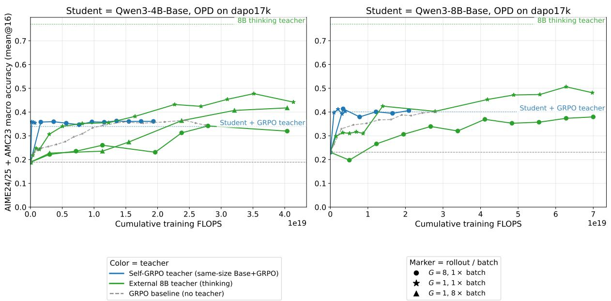  
Figure 26: On math, G=1 makes OPD with an external teacher more compute-efficient, but the self-GRPO teacher is still far cheaper. OOD macro mean@16 on DAPO-Math-17k for Qwen3-4B-Base (left) and Qwen3-8B-Base (right) students. Colour marks the teacher (blue: self-GRPO; green: external Qwen3-8B thinking); marker shape marks the rollout setting. With the external teacher, G=1 beats $G { = } 8$ at every compute budget and reaches 47.7% (4B) and 50.6% (8B), above GRPO. The self-GRPO teacher at G=1 reaches its teacher's accuracy within about 1 EFLOP, an order of magnitude less compute.

## H.1 Setup

For each pretrained matrix $W _ { B } \in \mathbb { R } ^ { d _ { \mathrm { o u t } } \times d _ { \mathrm { i n } } }$ of the base student, take its SVD $W _ { B } = U _ { B } \mathrm { d i a g } ( \sigma _ { B } ) V _ { B } ^ { \top }$ with $q = \mathrm { m i n } ( d _ { \mathrm { o u t } } , d _ { \mathrm { i n } } )$ , then decompose any candidate displacement $\Delta W = W _ { 1 } - W _ { B }$ in the base frames. Here $\sigma ( W )$ denotes the q-vector of singular values of $W - { \boldsymbol { \sigma } } ( W ) = ( \sigma _ { 1 } , \dots , \sigma _ { q } )$ in non-increasing order.

Three spectrum-based scalars (Zhu et al., 2026a) are used to characterize changes in each matrix. First, $\kappa _ { \mathrm { s p e c } } .$

$$
\kappa _ { \mathrm { s p e c } } ( \Delta W ) = \frac { d _ { \mathrm { o u t } } d _ { \mathrm { i n } } } { q } \cdot \frac { | | \mathrm { d i a g } ( U _ { B } ^ { \top } \Delta W V _ { B } ) | | ^ { 2 } } { | | \Delta W | | ^ { 2 } }\tag{2}
$$

Larger $\kappa _ { \mathrm { s p e c } }$ indicates more singular-value shift. Zhu et al. (2026a) shows that RLVR updates leave a student's singular-value spectrum nearly unchanged $( \kappa _ { \mathrm { s p e c } } \approx 1 - 3 )$ , while SFT updates shift it by orders of magnitude $( \kappa _ { \mathrm { s p e c } } \gtrsim 1 0 ^ { 2 } – 1 0 ^ { 3 } )$ •

$\rho _ { \Sigma }$ is the share of the update magnitude that shows up as a change in singular values rather than a rotation of the base frames: $\rho _ { \Sigma } = 0$ marks a pure Stiefel move (frames rotate, spectrum unchanged), $\rho _ { \Sigma } = 1$ marks a purely spectral update (same singular directions, only the values change).

$$
\rho _ { \Sigma } ( \Delta W ) = \frac { \| \sigma ( W _ { 1 } ) - \sigma ( W _ { B } ) \| } { \| \Delta W \| }\tag{3}
$$

$\delta _ { \Sigma }$ is the absolute size of that spectral shift relative to the base weight scale: $\delta _ { \Sigma } \approx 0$ means the spectrum barely moves compared to $W _ { B }$ , while δΣ ≈1 means the singular values change by an amount comparable to the base norm itself. On the same runs Zhu et al. (2026a) reports RLVR updates keep $\rho _ { \Sigma }$ small (a few percent) and $\delta _ { \Sigma }$ vanishingly small $( \sim 1 0 ^ { - 5 } – 1 0 ^ { - 4 } )$ , while SFT-scale updates push $\rho _ { \Sigma } \gtrsim 0 . 1 5$ and $\delta _ { \Sigma }$ by orders of magnitude.

$$
\delta _ { \Sigma } ( \Delta W ) = \frac { \| \sigma ( W _ { 1 } ) - \sigma ( W _ { B } ) \| } { \| W _ { B } \| }\tag{4}
$$

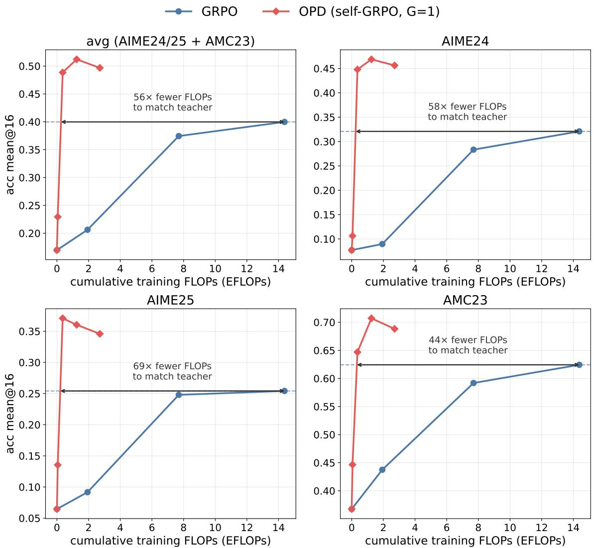  
Figure 27: The self-GRPO teacher also works from an instruction-tuned SFT model (Olmo-3-7B-Instruct-SFT). OOD macro mean@16 and per-benchmark accuracy against training FLOPs on DAPO-Math-17k. GRPO trains for 200 steps at G=8; OPD distills the step-200 GRPO checkpoint into the starting model at G=1. OPD matches the teacher's 40.0% OOD macro with 56× fewer FLOPs (44–69× per benchmark) and peaks at 51.2%.

Following the practice in Zhu et al. (2026a), we calculate each value for each matrix and aggregate by averaging.

## H.2 Spectral distance from the base checkpoint

Table 10 reports the spectrum-based scalars for two kinds of comparison at 4B and 8B scale. The first kind compares a candidate teacher of the same size against the student base. At both scales the external thinking teacher sits far from the base $( \kappa _ { \mathrm { s p e c } } \approx 2 0 0 0 { - } 3 6 0 0 , \rho _ { \Sigma } \approx 1 5 \% )$ . The student's own GRPO-trained checkpoint is nearly isospectral $( \kappa _ { \mathrm { s p e c } } \approx 1 \mathrm { - } 3 , \rho _ { \Sigma } \approx 6 \% \mathrm { - } 1 2 \% )$ , which is consistent with the RLVR-versus-SFT dichotomy of Zhu et al. (2026a). Three orders of magnitude in $\kappa _ { \mathrm { s p e c } }$ separate the two teacher types, a weight-space signature of the overlap phase transition of §5. The second kind compares the OPD student at different training stage against the same base. At 4B, where the student is distilled from the external Qwen3–4B teacher, the update grows with training $( \parallel \Delta W \parallel$ rises from 2.69 at mid checkpoint to 3.76 at last checkpoint d). Its $\kappa _ { \mathrm { s p e c } }$ stays at 3.2–3.4, the same order as the GRPO checkpoints and three orders of magnitude below the teacher it is trained against. At 8B, where the student is distilled from an external Qwen3–8B teacher, the step-100 (mid checkpoint) student has $\kappa _ { \mathrm { s p e c } } = 1 . 5 0$ , again within the RLVR range.

Discussion. Like GRPO, reverse-KL OPD updates the student on its own rollouts, and the resulting spectral change stays within the same RLVR $\kappa _ { \mathrm { s p e c } }$ range regardless of the teacher (Table 10). If OPD shifts the student's spectrum by only a small amount per unit of training compute, a teacher whose spectrum sits three orders of magnitude away is out of reach at any realistic compute budget: matching it would require an SFT-scale spectral move, which OPD's gradient direction does not produce. A self-GRPO teacher sits in the same RLVR range as anything OPD can produce, so a small number of RLVR-magnitude steps is enough to reach it. The threeorders-of-magnitude $\kappa _ { \mathrm { s p e c } }$ gap in Table 10 is therefore a plausible mechanism for why external-teacher OPD is not compute-efficient on the training domain (§4).

Table 10: Spectrum-based scalars of Zhu et al. (2026a) between a base checkpoint $W _ { B }$ and a second checkpoint $W _ { 1 }$ , with $\Delta W = W _ { 1 } - W _ { B }$ . All scalars are computed in the base's own SVD frames and aggregated over all 2-D weight matrices. Within each scale, the first two rows compare a candidate teacher against the base: the external thinking teacher and the student's own GRPO-trained checkpoint. The remaining rows compare the OPD student against the same base (4B: external Qwen3–4B teacher, steps 100 and 200; 8B: self-GRPO teacher, step 100). External thinking teachers sit \~3 orders of magnitude farther from the base in $\kappa _ { \mathrm { s p e c } }$ than GRPO checkpoints. OPD students stay in the GRPO range even when they are trained against an external teacher
<table><tr><td>student base weight  $W _ { B }$ </td><td> $W _ { 1 }$ </td><td> $\kappa _ { \mathrm { s p e c } }$ </td><td> $\rho _ { \Sigma }$ </td><td> $\delta _ { \Sigma }$ </td><td>||∆W||</td></tr><tr><td>Qwen3-4B-Base</td><td>Qwen3-4B</td><td>3571</td><td>0.155</td><td> $1 . 6 \times 1 0 ^ { - 2 }$ </td><td>162</td></tr><tr><td>Qwen3-4B-Base</td><td>GRPO-trained Qwen3-4B-Base</td><td>2.81</td><td>0.063</td><td> $5 . 3 \times 1 0 ^ { - 5 }$ </td><td>1.33</td></tr><tr><td>Qwen3-4B-Base</td><td>mid checkpoint of OPD (Qwen3-4B)</td><td>3.16</td><td>0.033</td><td> $5 . 7 \times 1 0 ^ { - 5 }$ </td><td>2.69</td></tr><tr><td>Qwen3-4B-Base</td><td>last checkpoint of OPD (Qwen3-4B)</td><td>3.42</td><td>0.025</td><td> $6 . 1 \times 1 0 ^ { - 5 }$ </td><td>3.76</td></tr><tr><td>Qwen3-8B-Base</td><td>Qwen3-8B</td><td>2077</td><td>0.155</td><td> $1 . 3 \times 1 0 ^ { - 2 }$ </td><td>202</td></tr><tr><td>Qwen3-8B-Base</td><td>GRPO-trained Qwen3-8B-Base</td><td>1.19</td><td>0.125</td><td> $7 . 7 \times 1 0 ^ { - 5 }$ </td><td>1.48</td></tr><tr><td>Qwen3-8B-Base</td><td>mid checkpoint of OPD (Qwen3-8B)</td><td>1.50</td><td>0.051</td><td> $8 . 1 4 \times 1 0 ^ { - 5 }$ </td><td>3.83</td></tr><tr><td>Qwen3-8B-Base</td><td>last checkpoint of OPD (Qwen3-8B)</td><td>1.61</td><td>0.036</td><td> $8 . 0 6 \times 1 0 ^ { - 5 }$ </td><td>5.38</td></tr></table>

## I External OPD under single-rollout regimes

The main comparisons with external teachers (§4) use a rollout group size of G=8. The OPD loss is defined per token and needs no group baseline, so a smaller group could make OPD cheaper: with G=1, OPD spends fewer rollouts per prompt and sees more unique prompts at matched training FLOPs. We test whether G=1 makes external-teacher OPD competitive with GRPO on math, on code, and on the 4-domain mix of Section 6.

Math: G=1 improves compute efficiency. On DAPO-Math-17K with a Qwen3-4B-Base student and an external Qwen3–8B teacher, we keep the default batch size and train at G=1 for 8× more optimizer steps, which matches the total number of rollouts in the G=8 run. This variant improves the compute efficiency of OPD over the G=8 run (Figure 26). It takes longer in wall-clock time because it runs more optimizer steps, and the responselength inflation described in Appendix E.2 still occurs. We additionally experiment with Qwen3-8B-Base student in Figure 26 (right panel)

Code: G=1 does not help. On LiveCodeBench-v1–v5 with the same student and teacher, we test two computematched G=1 variants: one at 8× batch size, and one at the default batch size trained for 8× more optimizer steps. Neither closes the gap: OPD remains substantially below GRPO on LCBv6 mean@1 6 (Figure 28). The self-GRPO teacher run on the same recipe reaches ≈47% LCBv6 accuracy within \~0.5 EFLOP; the external 8B-thinking teacher at either G=8 or either G=1 matched-compute variant plateaus far below and pays an order of magnitude more compute for less accuracy.

Qwen3-4B-Base student, trained on LiveCodeBench-v1-v5  
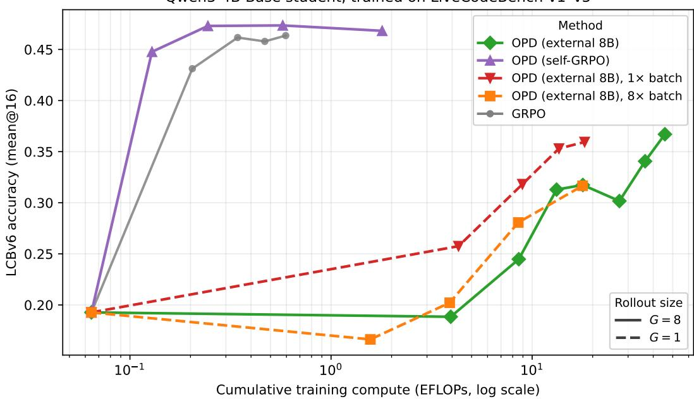  
Figure 28: On code, G=1 does not rescue OPD with an external teacher. Qwen3–4B-Base student trained on LiveCodeBench v1-v5; LCBv6 mean @16 against training FLOPs (log scale). Solid lines use G=8 and dashed lines G=1; the external teacher is Qwen3-8B (thinking). The self-GRPO teacher reaches 47.3%within 0.25 EFLOP, above GRPO (46.4%). With the external teacher, G=1 improves on G=8 at the default batch size but not with an 8× batch, and both G=1 runs stop at 32%-36%, more than 10 points below GRPO.

Multi-domain: the math advantage disappears. On math alone, G=1 lets external-teacher OPD outperform GRPO at matched FLOPs. This advantage does not survive when math is trained together with other domains. On the 2-domain math + code mix, external-teacher OPD at G=1 no longer outperforms GRPO on math (Figure 30). On the 4-domain mix, training with the Qwen3–8B teacher becomes unstable: math accuracy falls from 18.9% to 7.2% by step 80, briefly recovers to 37.7% at step 160, and ends at 0.3% at step 200; code falls from 19.3% to 2.5% by step 80 and ends at 13.3% (Figure 29).

Summary. Reducing the rollout group size to G=1 lets external-teacher OPD outperform GRPO at matched FLOPs on single-domain math, at the cost of 8× as many optimizer steps. The same configuration loses on code, loses its math advantage on the 2-domain mix, and collapses on the 4-domain mix. Therefore, we believe G=1 does not conflict with our conclusion and observation in §4.2.

## J Multi-teacher OPD: experiment detail

This appendix gives the details of the multi-teacher experiments in Section 6. The pipeline has two stages. First we train one GRPO specialist per domain from Qwen3–4B-Base. Second, we distill all specialists into a fresh Qwen3–4B-Base student with multi-teacher OPD. We compare this pipeline with two joint GRPO baselines that train a single model on the same data mix, and with OPD from a single external teacher. We run the comparison on a 4-domain mix (math, code, knowledge, and instruction following) and on its 2-domain math + code subset.

Training data. The 4-domain mix combines DAPO-Math-17K (math), LiveCodeBench-v1-v5 (code), MMLU-Pro with 5-shot prompts (knowledge), and IFBench-RLVR (instruction following). Each domain contributes the same number of training prompts as its individual GRPO specialist (Table 11). The 2-domain mix uses the same math and code data without the other two domains.

Individual GRPO specialists. Starting from Qwen3–4B-Base, we train one GRPO specialist per domain. All four share the hyperparameters in Tables 2 and 3. Table 11 lists the per-domain differences in training data, length caps, batch size, and number of steps. These specialists are the teachers for multi-teacher OPD.

Table 11: Per-domain deviations for the four individual GRPO specialists. All other hyperparameters follow Tables 2 and 3.
<table><tr><td>Domain</td><td>Training data</td><td>Prompt maximum</td><td>Response cap</td><td>Batch size</td><td>Steps</td></tr><tr><td>Math</td><td>DAPO-Math-17K</td><td>1024</td><td>7168</td><td>64</td><td>200</td></tr><tr><td>Code</td><td>LiveCodeBench v1-v5</td><td>1024</td><td>16 384</td><td>32</td><td>80</td></tr><tr><td>IFBench</td><td>IFBench-RLVR</td><td>1024</td><td>10 240</td><td>64</td><td>200</td></tr><tr><td>MMLU-Pro</td><td>MMLU-Pro 5-shot</td><td>4096</td><td>3072</td><td>64</td><td>200</td></tr></table>

Joint GRPO baselines. We train two joint GRPO baselines on each mix, both with the GRPO hyperparameters in Table 3. Instance-mix samples each batch from the full mixture, so one batch contains prompts from several domains. It uses a 16K-token response cap and a batch size of 64, and trains for 800 optimizer steps on the 4-domain mix and 240 on the 2-domain mix. Batch-mix draws each batch from a single domain with that domain's specialist settings, and trains for the sum of the specialists’steps: 680 on the 4-domain mix and 280 on the 2-domain mix. Both variants see each domain's prompts at least as often as its specialist does.

Multi-teacher OPD (MOPD). A fresh Qwen3–4B-Base student is trained with multi-teacher OPD, routing each prompt to the GRPO specialist that owns its domain. The hyperparameters are listed in Table 4. We test three rollout group sizes {8, 4, 1}.

Rollout group size for multi-teacher OPD. Figures 31 and 32 vary G with the student, teachers, and data mix fixed. On both mixes, G=1 reaches the specialists'accuracy with substantially less compute than G=8. We therefore use G=1 in Section 6.

External teacher baseline. A single external teacher is applied to the same 2-domain and 4-domain mix via standard OPD. With the Qwen3–8B teacher, training is unstable on math, code, and MMLU-Pro. Same strategy is used for a Qwen3–4B teacher; with the Qwen3–4B teacher, it stays well below the specialists on code and IFBench. The hyperparameters are listed in Table 4 and we keep group size G = 1. With Qwen3–8B teacher, we keep total training step to be 200. With Qwen3–4B, we keep total training step to be 300.

Per-domain results. Figures 29 and 30 show per-domain breakdowns for the 4-domain and 2-domain experiments respectively.

## Joint-4 mix, per-task compute frontier — student = Qwen3-4B-Base

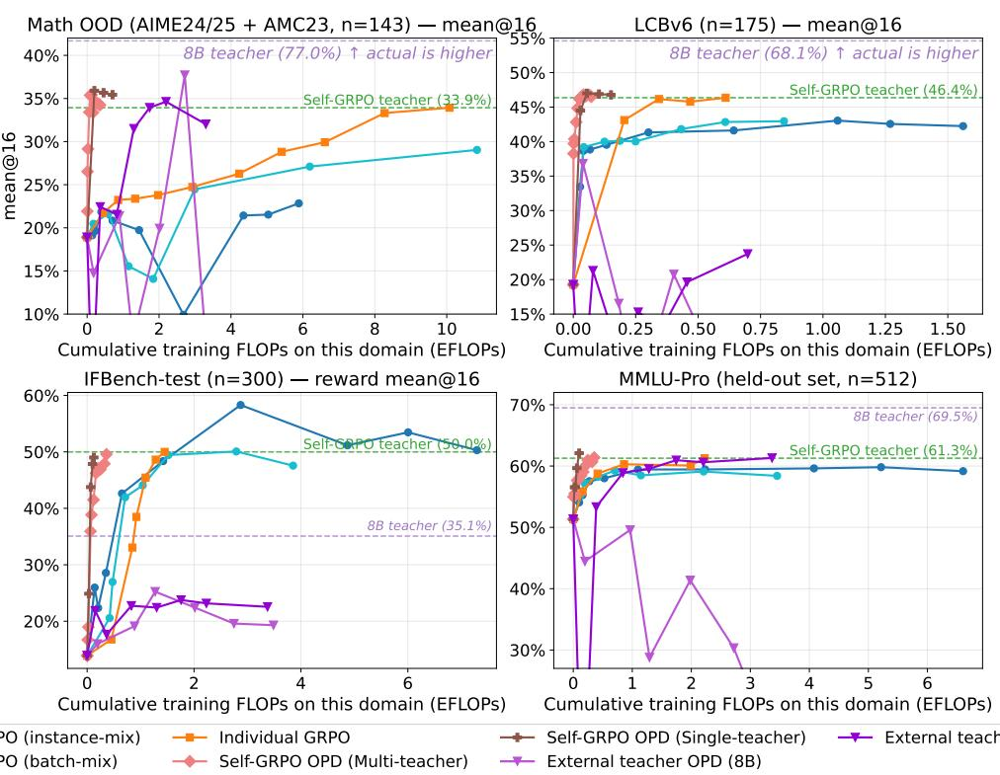  
Figure 29: Per-domain breakdown of the 4-domain mix. Qwen3-4B-Base student trained on math, code, IFBench, and MMLU-Pro; mean@16 on each domain against the training FLOPs spent on that domain. Dashed lines mark the self-GRPO teacher (green) and the external Qwen3–8B teacher (purple; math and code values lie above the plotted range). All OPD runs use G=1. Self-GRPO OPD, with one or multiple teachers, reaches or comes within one point of the specialists on every domain within about 1 EFLOP. Joint GRPO trails the specialists on math and code but exceeds them on IFBench. OPD with an external teacher stays well below the specialists on code and IFBench.

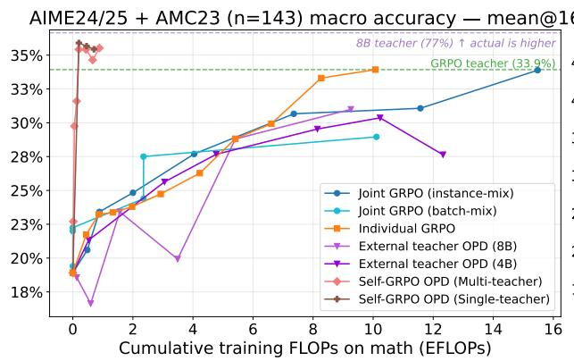

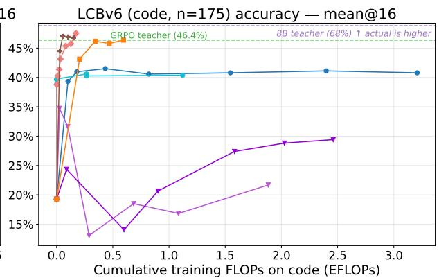  
Figure 30: Per-domain breakdown of the 2-domain math and code mix. Same methods and conventions as Figure 29. Self-GRPO OPD passes the specialists (33.9% on math, 46.4% on code) within 1 EFLOP on math and 0.2 EFLOP on code. Joint GRPO with instance-level mixing needs about 15 EFLOP to reach the math specialist and stays near 41% on code. OPD with an external teacher stays below 32% on math and 30% on code.

MMLU-Pro (held-out set, n=512)  
Multi-teacher OPD (G=8/G=1) vs Individual GRPO — student = Qwen3-4B-Base  
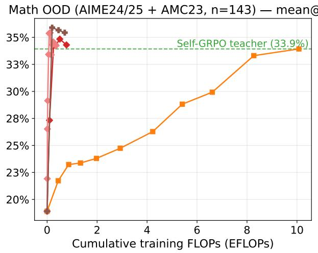

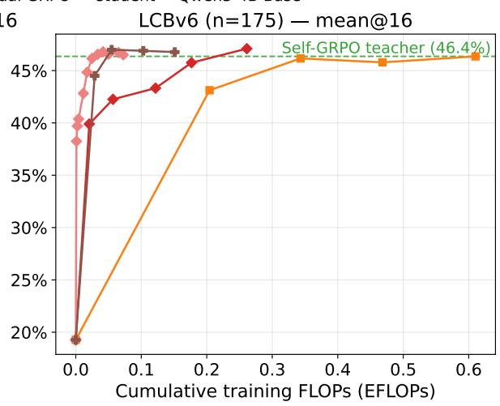

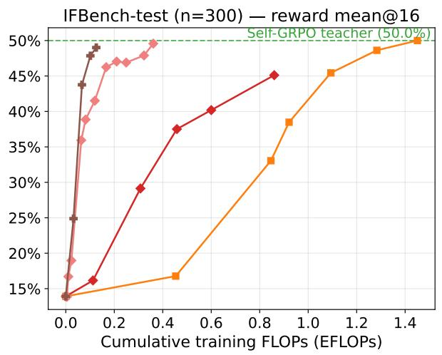

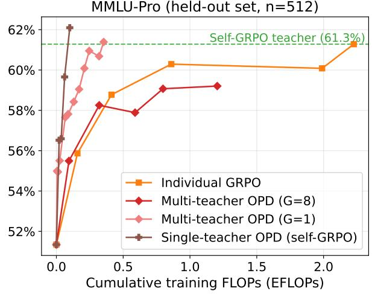  
Figure 31: Group-size ablation for multi-teacher OPD on the 4-domain mix. Qwen3–4B-Base student; the individual GRPO specialists serve as teachers, and their accuracy is the dashed line. FLOPs exclude the cost of training the teachers. At G=1, multi-teacher OPD reaches or comes within 0.5 points of the specialists on all four domains within 0.4 EFLOP. At G=8, it needs more compute and stays below the specialists on IFBench (45.1% vs. 50.0%) and MMLU-Pro (59.2% vs. 61.3%).

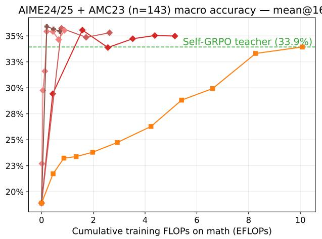

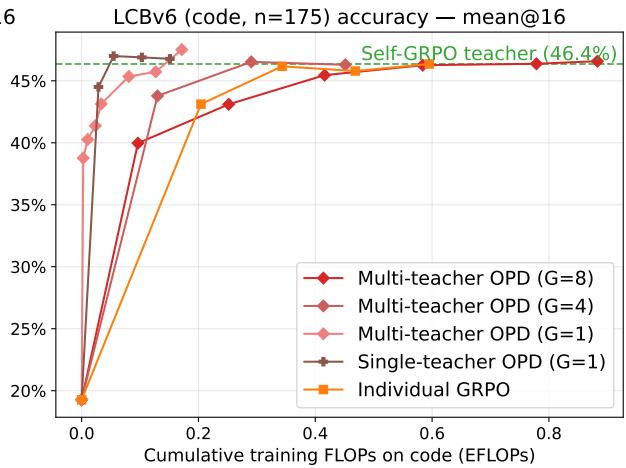  
Figure 32: Group-size ablation for multi-teacher OPD on the 2-domain math and code mix. Same setup as Figure 31, with an added G=4 run. Smaller groups reach the specialists’ accuracy with less compute: on math, G=1, G=4, and G=8 need about 0.2, 0.8, and 1.6 EFLOP, against 10 EFLOP for the GRPO specialist; on code, about 0.17, 0.3, and 0.9 EFLOP.