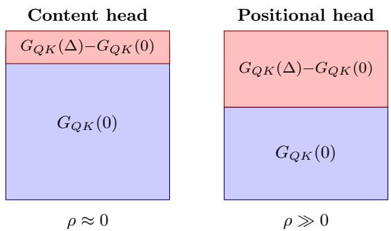
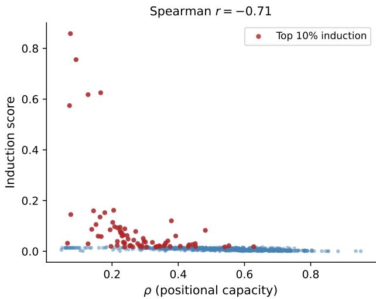

# A Geometric Invariant of Attention Predicts Head Specialization from Weights Alone

Miguel P. Bento∗

miguel.pedra@feedzai.com

Feedzai, Lisbon, Portugal

## Abstract

Transformers are built with continuous symmetries in the attention mechanism. We derive ρ, a scalar invariant that measures each head’s capacity to couple to rotary positional encodings. This framework allows us to analyze heads without forward passes, opening a new research direction into data-independent analysis of modern LLMs. Empirically, we find that ρ predicts induction heads, the most-studied circuit type in mechanistic interpretability, with Spearman correlation between −0.55 and −0.74 across four bias-free RoPE models spanning 135M to 7B parameters. As a preliminary proof of concept, we use ρ to apply YaRN to only the top-50% positional heads, which degrades perplexity less than uniform application. Code is available at https://github.com/MPedraBento/rho-invariant.

Keywords: invariants, symmetry, attention heads, mechanistic interpretability, rotary position encoding

## 1. Introduction

Mechanistic interpretability is grounded in the meaning behind transformer head activations. Some approaches are activation patching (Conmy et al., 2023), probing classifiers, or behavioral diagnostics on crafted inputs (Olsson et al., 2022). Recent work connecting RoPE to heads relies heavily on data (Barbero et al., 2024). In this paper we ask: how much can we learn from the weights alone? Analogously to physics, where theories often have fewer observables than parameters, the attention mechanism admits basis-invariant quantities. These, in turn, characterize heads independently of the choice of basis.

The attention mechanism works by using quadratic forms in the query-key space $G _ { Q K } =$ $W _ { O } ^ { \top } W _ { K } \in \mathbb { R } ^ { d \times d }$ and the value-output space $G _ { V O } = W _ { O } W _ { V } \in \mathbb { R } ^ { d \times d }$ . The static composite $G _ { Q K } ( 0 ) = W _ { Q } ^ { \top } W _ { K }$ is invariant under the full head-space reparameterization $( W _ { Q } , W _ { K } ) \mapsto$ $( M ^ { - \top } W _ { Q } , M W _ { K } )$ for any $M \in G L ( d _ { h } )$ . In RoPE-based models the rotation $R ( \Delta )$ is blockdiagonal with one $2 \times 2$ rotation per frequency plane, and requiring invariance of the whole family $G _ { Q K } ( \Delta )$ breaks $G L ( d _ { h } )$ down to the group $( \mathbb { C } ^ { \ast } ) ^ { d _ { h } / 2 } \cong ( S O ( 2 ) \times \mathbb { R } _ { > 0 } ) ^ { d _ { h } / 2 }$ , such that within each plane a rotation R and a positive rescaling D act as $W _ { Q } \mapsto D ^ { - 1 } R W _ { Q } .$ $W _ { K } \mapsto D R W _ { K }$ leaving $G _ { Q K } ( \Delta )$ unchanged. The form $G _ { Q K }$ is thus invariant under this residual symmetry, making it a basis-independent observable of the head’s structure (Elhage et al., 2021).

## 2. Theory

For models using Rotary Position Encoding (RoPE; Su et al., 2024), the attention logit decomposes as

$$
s _ { i j } = x _ { i } ^ { \top } G _ { Q K } ( \Delta ) x _ { j } = x _ { i } ^ { \top } G _ { Q K } ( 0 ) x _ { j } + x _ { i } ^ { \top } P ( \Delta ) x _ { j } ,\tag{1}
$$

  
Figure 1: The $\rho$ invariant measures the relative magnitude of the positional perturbation to the content term. Content heads (left) are dominated by $G _ { Q K } ( 0 )$ ; positional heads (right) have a large position-dependent component.

where $G _ { Q K } ( 0 ) = W _ { Q } ^ { \top } W _ { K }$ is the static term and $P ( \Delta ) = W _ { Q } ^ { \top } [ R ( \Delta ) - I ] W _ { K }$ is the positional perturbation induced by the RoPE rotation $R ( \Delta )$ at relative position $\Delta = i - j$ , with inputs $x _ { i } \in \mathbb { R } ^ { d }$ and matrices $W _ { Q , K } \in \mathbb { R } ^ { d _ { h } \times d }$ , so that $\dot { G } _ { Q K } = W _ { Q } ^ { \top } W _ { K } \in \mathbb { R } ^ { d \times d }$

We define a positional capacity invariant as a measure of the capacity a head has to couple to positional encodings. We can define a simple basis-invariant scalar that quantifies how much the bilinear form varies with position,

$$
\rho = \frac { 1 } { | \mathscr { D } | } \sum _ { \Delta \in \mathscr { D } } \frac { \| P ( \Delta ) \| _ { F } ^ { 2 } } { \| G _ { Q K } ( 0 ) \| _ { F } ^ { 2 } } , \quad \mathscr { D } = \{ 2 ^ { n } \} _ { n = 0 } ^ { \lfloor \log _ { 2 } L \rfloor } ,\tag{2}
$$

where L is the context length. The sampling set D is logarithmically spaced because the RoPE frequencies $\omega _ { k } = \theta ^ { \tilde { - } 2 k / d _ { h } }$ are geometrically spaced, so uniform sampling in log $\Delta$ probes all frequency bands up to the context horizon L. Thus, $\rho$ measures positional capacity over the sampled range, not at arbitrarily long range.

The invariant is non-negative $\rho \geq 0$ , with equality if $G _ { Q K } ( \Delta ) = G _ { Q K } ( 0 )$ for all $\Delta \in$ D. Being a function of $G _ { Q K } , \rho$ is additionally scale-invariant, unchanged under $W _ { Q } $ $\alpha W _ { Q }$ or $W _ { K } \to \alpha W _ { K }$ . It is, however, sensitive to the softmax shift $s _ { i j }  s _ { i j } + c _ { i } ,$ which leaves attention patterns unchanged; in practice weight decay penalizes $\| W _ { Q } \|$ and $\| W _ { K } \|$ discouraging large components in $G _ { Q K }$ that do not afect the output, thus mitigating this issue.

Proposition 1 $( \rho = 0$ gives position-independent logits on D) Fix a head with static term $G _ { Q K } ( 0 ) = W _ { Q } ^ { \top } W _ { K }$ and assume $G _ { Q K } ( 0 ) \neq \mathbf { 0 }$ . Let D be any (nonempty) set of relative positions. Then $\rho = 0$ if and only if $P ( \Delta ) = \mathbf { 0 }$ for every $\Delta \in \mathcal { D }$ , in which case the attention logit

$$
s _ { i j } = x _ { i } ^ { \top } G _ { Q K } ( \Delta ) x _ { j } = x _ { i } ^ { \top } G _ { Q K } ( 0 ) x _ { j }\tag{3}
$$

is independent of the relative position $\Delta = i - j$ for all $\Delta \in \mathcal { D }$ and all residual-stream inputs $x _ { i } , x _ { j }$

Proof By $( 2 ) , \rho$ is a sum of terms $\| P ( \Delta ) \| _ { F } ^ { 2 } / \| G _ { Q K } ( 0 ) \| _ { F } ^ { 2 }$ , each a squared Frobenius norm over the common denominator $\| G _ { Q K } ( 0 ) \| _ { F } ^ { 2 } > 0$ (positive by the assumption $G _ { Q K } ( 0 ) \neq \mathbf { 0 } )$ ,

Table 1: $\rho$ vs. induction score across four bias-free RoPE models. Spearman r (all $p \ <$ $1 0 ^ { - 4 0 } )$ and the smallest $\rho -$ percentile band containing the top-10 induction heads.
<table><tr><td>Model</td><td>Params</td><td>Spearman r</td><td>top-10 within</td></tr><tr><td>SmolLM2-135M</td><td>135M</td><td>-0.74</td><td>bottom 14%</td></tr><tr><td>TinyLlama-1.1B</td><td>1.1B</td><td>-0.71</td><td>bottom 7%</td></tr><tr><td>SmolLM2-1.7B</td><td>1.7B</td><td>-0.55</td><td>bottom 17%</td></tr><tr><td>Mistral-7B</td><td>7B</td><td>-0.59</td><td>bottom 30%</td></tr></table>

hence each $\geq 0 .$ . A sum of non-negative terms vanishes $\operatorname { i f f }$ every term vanishes, so $\rho = 0$ if $P ( \Delta ) = \mathbf { 0 }$ for every $\Delta \in { \mathcal { D } }$ . Substituting $P ( \Delta ) = G _ { Q K } ( \Delta ) - G _ { Q K } ( 0 ) = { \bf 0 }$ into (1) gives $s _ { i j } = x _ { i } ^ { \top } G _ { Q K } ( 0 ) x _ { j }$ , which contains no dependence on $\Delta$

Crucially, $\rho$ measures capacity, not usage, as a high-ρ head may still ignore position on a given input, but a head with $\rho = 0$ produces logits with no positional dependence across $\mathcal { D }$ , for any input (Proposition 1).

## 3. Results

## 3.1. ρ predicts induction heads without data

Induction heads (Olsson et al., 2022) implement the “A $\mathrm { ~ B ~ . ~ . . A  B ^ { \prime \prime } }$ copying pattern, which is the most-studied circuit in mechanistic interpretability. We measure induction scores via repeated random sequences and correlate with $\rho .$

We find that induction heads have extremely low $\rho ,$ consistently across four bias-free RoPE models spanning 135M to 7B parameters (Table 1). The Spearman correlation between $\rho$ and the induction score is negative and highly significant in every model $( r$ from $- 0 . 5 5 \ \mathrm { t o } \ - 0 . 7 4$ , all $p < 1 0 ^ { - 4 0 } )$ , and the ten strongest induction heads always lie in the low $- \rho$ tail (bottom 7–30% of the $\rho$ distribution).

This result supports our hypothesis of capacity interpretation. Induction heads perform content matching, a position-invariant operation. The low $\rho$ reflects minimal coupling to RoPE, thus ensuring activation-independent decoupling. The correlation is imperfect because induction is a multi-head circuit. Thus, low $\rho$ is necessary but not suficient for induction, precisely the capacity interpretation.

## 3.2. Application: capacity-gated context extension

Uniform RoPE scaling methods (Chen et al., 2023) degrade short-context performance because they modify all heads. We apply YaRN (Peng et al., 2024) to the top-50% heads by $\rho ,$ leaving the remaining heads at the original positions.

The targeted variant degrades perplexity less than uniform YaRN at both the short and the long context, as seen in Table 2. The evaluation stays within the model’s native context. The inflated long context values are due to the evaluation near the context limit.

  
Figure 2: $\rho$ vs. induction score for all heads in TinyLlama-1.1B. Induction heads cluster in the low $- \rho$ regime.

Table 2: Context extension at $S { = } 4 \times$ (Mistral-7B). Targeted applies YaRN only to the top-50% $\rho$ heads.
<table><tr><td>Method</td><td>Short PPL (512)</td><td>Long PPL (4096)</td></tr><tr><td>Baseline  $( S { = } 1 )$ </td><td>7.63</td><td>5.44</td></tr><tr><td>YaRN (all heads)</td><td>19.37</td><td>162.96</td></tr><tr><td>YaRN + Targeted (ours)</td><td>12.92</td><td>130.34</td></tr></table>

## 4. Discussion and limitations

We have shown that a single basis-invariant scalar, computable from weights alone, predicts induction heads. The key contribution is the capacity interpretation. $\rho$ measures what a head’s geometry allows it to couple to, not what it does on any given input.

This framework generalizes beyond the $\rho$ invariant. The full set of invariant quantities $( G _ { Q K }$ eigenspectrum, $G _ { V O }$ singular values, the commutator $\| [ G _ { Q K } , G _ { V O } ] \| _ { F } )$ defines an invariant signature per head. Future work entails a more comprehensive study of the weight invariants of transformers.

Finally, we validate on four bias-free RoPE models up to 7B parameters. The YaRN+Targeted application is a preliminary proof of concept on Mistral-7B, demonstrated within the native context window. Further evaluation is left to future work. The framework applies specifically to RoPE-based architectures, and to the QK sector.

## References

Federico Barbero, Alex Vitvitskyi, Christos Perivolaropoulos, Razvan Pascanu, and Petar Velivckovi’c. Round and round we go! what makes rotary positional encodings useful? ArXiv, abs/2410.06205, 2024. URL https://api.semanticscholar.org/CorpusID: 273229201.

Shouyuan Chen, Sherman Wong, Liangjian Chen, and Yuandong Tian. Extending context window of large language models via positional interpolation. ArXiv, abs/2306.15595, 2023. URL https://api.semanticscholar.org/CorpusID:259262376.

Arthur Conmy, Augustine N. Mavor-Parker, Aengus Lynch, Stefan Heimersheim, and Adri\`a Garriga-Alonso. Towards automated circuit discovery for mechanistic interpretability. In Thirty-seventh Conference on Neural Information Processing Systems, 2023. URL https://openreview.net/forum?id=89ia77nZ8u.

Nelson Elhage, Neel Nanda, Catherine Olsson, Tom Henighan, Nicholas Joseph, Ben Mann, Amanda Askell, Yuntao Bai, Anna Chen, Tom Conerly, Nova DasSarma, Dawn Drain, Deep Ganguli, Zac Hatfield-Dodds, Danny Hernandez, Andy Jones, Jackson Kernion, Liane Lovitt, Kamal Ndousse, Dario Amodei, Tom Brown, Jack Clark, Jared Kaplan, Sam McCandlish, and Chris Olah. A mathematical framework for transformer circuits. Transformer Circuits Thread, 2021. https://transformercircuits.pub/2021/framework/index.html.

Catherine Olsson, Nelson Elhage, Neel Nanda, Nicholas Joseph, Nova DasSarma, Tom Henighan, Ben Mann, Amanda Askell, Yuntao Bai, Anna Chen, Tom Conerly, Dawn Drain, Deep Ganguli, Zac Hatfield-Dodds, Danny Hernandez, Scott Johnston, Andy Jones, Jackson Kernion, Liane Lovitt, Kamal Ndousse, Dario Amodei, Tom Brown, Jack Clark, Jared Kaplan, Sam McCandlish, and Chris Olah. In-context learning and induction heads. Transformer Circuits Thread, 2022. https://transformer-circuits.pub/2022/incontext-learning-and-induction-heads/index.html.

Bowen Peng, Jefrey Quesnelle, Honglu Fan, and Enrico Shippole. YaRN: Eficient context window extension of large language models. In The Twelfth International Conference on Learning Representations, 2024. URL https://openreview.net/forum?id= wHBfxhZu1u.

Jianlin Su, Murtadha Ahmed, Yu Lu, Shengfeng Pan, Wen Bo, and Yunfeng Liu. Roformer: Enhanced transformer with rotary position embedding. Neurocomputing, 568:127063, 2024. ISSN 0925-2312. doi: https://doi.org/10.1016/j.neucom.2023.127063. URL https: //www.sciencedirect.com/science/article/pii/S0925231223011864.