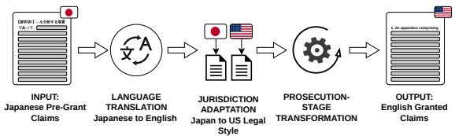
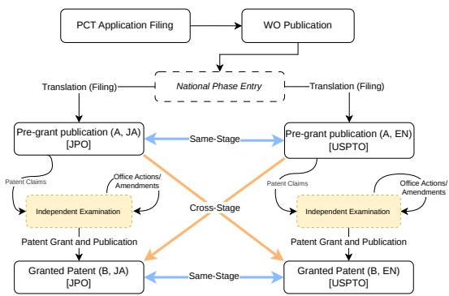

# A Large-Scale Dataset for Cross-Lingual Multi-Jurisdiction Patent Drafting from Patent Cooperation Treaty Applications

Trung Phuong Le<sup>1</sup>, Hirofumi Nonaka<sup>2</sup>, Koji Marusaki<sup>3</sup>, Katsuhito Sudoh<sup>4</sup>, Seiya Kawano<sup>1,5</sup>

<sup>1</sup>Kyoto Institute of Technology <sup>2</sup>Aichi Institute of Technology

<sup>3</sup>Nagaoka Institute of Technology <sup>4</sup>Nara Women’s University <sup>5</sup>RIKEN GRP le.trung.phuong@vision.is.kit.ac.jp, hnonaka@aitech.ac.jp, sudoh@ics.nara-wu.ac.jp, kawano@kit.ac.jp

## Abstract

Securing patent protection across countries requires drafting claims separately for each national patent office, in the relevant language and according to its legal and stylistic conventions. Patent claims can therefore differ across languages and jurisdictions because of translation, target-office drafting practices, and prosecution-stage changes. We formulate crosslingual patent drafting as generating plausible candidate claim sets for a specified target language, jurisdiction, and prosecution stage from a source claim set in another language. The task models jurisdiction- and stage-specific transformations beyond content-preserving translation. We construct a large-scale Japanese–English dataset by linking Japan Patent Office (JPO) and United States Patent and Trademark Office (USPTO) records through 884,179 Patent Cooperation Treaty (PCT)-derived patent families. Across six released configurations, these families yield 4,067,168 directional claim-set instances; four core configurations form the main benchmark. Commercial machine translation and zero- and few-shot prompting capture part of the task, while supervised adaptation provides the strongest overall baseline, showing that task-specific patterns can be learned from linked cross-jurisdictional claim sets.

## 1 Introduction

Protecting an invention internationally requires drafting claims separately for multiple national patent offices, making cross-border claim drafting a central activity of intellectual-property practice. Patent claims define the legal scope of an invention and are therefore central to patent prosecution and patent strategy (Marco et al., 2019). Drafting patent claims is not merely a matter of translating technical concepts into legal language. During examination, claims are commonly narrowed or clarified in response to prior-art and disclosure objections, and their language and scope may be iteratively refined through interaction with the examiner (Reilly, 2018). Applicants commonly use the Patent Cooperation Treaty (PCT) route to pursue related rights in multiple jurisdictions, but each national office examines the resulting application independently. Claims derived from the same international application can consequently diverge in language, structure, scope, and number. We use prosecution for the application and examination process at a patent office, and pre-grant and granted for the two publication stages of an application: the claims as published before examination concludes, and the claims as published if protection is granted. A claim set is the complete numbered set of claims in one publication, and a patent family groups publications deriving from the same original application.

Patent information processing research has established resources for retrieval, classification, and claim understanding (Lupu et al., 2017; Fujii et al., 2007; Shinmori et al., 2003), and recent work has begun to study automatic claim refinement at individual patent offices (Kawano et al., 2024; Suzgun et al., 2023; Jiang et al., 2025a). Cross-lingual work, meanwhile, has largely framed related patent documents as machine-translation data and sought meaning-preserving sentence or document alignments (Utiyama and Isahara, 2007; Nagata et al., 2024). International prosecution has a further property: a target-jurisdiction claim may express the same invention while also reflecting office-specific drafting conventions and prosecution-stage amendments. The desired output is thus not always a faithful translation of the source; it can be a legally consequential transformation.

Therefore, prior work leaves open how to generate complete patent claim sets when the language, jurisdiction, and prosecution stage change jointly. We address this gap through a new task formulation, a PCT-linked benchmark, and an empirical evaluation. Our contributions are threefold:

  
Figure 1: Cross-lingual patent drafting and its instantiation in our dataset, illustrated by the ja\_pre→en\_granted direction. Each task instance links source and target claim sets within the same PCTderived patent family.

• We formulate cross-lingual patent drafting as complete claim-set generation conditioned on a target language, jurisdiction, and prosecution stage, extending examination-aware claim generation to the cross-lingual and cross-jurisdictional setting.

• We construct and release a benchmark from 884,179 PCT-derived Japanese–English patent families, yielding 4,067,168 directional claim-set instances across six configurations with chronological, family-disjoint splits; four pre-grant-source directions form the core benchmark.<sup>1</sup>

• We establish initial baselines spanning commercial translation, zero- and fewshot prompting, prompt controls, two-stage pipelines, and supervised adaptation. Supervised adaptation obtains the highest BLEU on all four core tasks and the highest SARI on three. In a 25-case pilot on the Japanese granted-stage direction, a human evaluator and an LLM evaluator each prefer its outputs to both evaluated baselines more often than the reverse.

## 2 Related Work

Cross-lingual patent corpora. Cross-lingual patent processing has largely focused on machine translation, supported by parallel corpora derived from patent families and sentence-level alignment (Utiyama and Isahara, 2007; Nagata et al., 2024). JaParaPat uses DOCDB family metadata to identify approximately 1.4 million Japanese–US application pairs and extracts sentence alignments for machine translation (Nagata et al., 2024). Our resource instead uses complete claim sets as linked task instances, covers both pre-grant and granted publications, and retains differences in claim number, structure, and scope across jurisdictions and prosecution stages as outcomes to be modeled. Patent NLP has also been organized around evaluation campaigns such as NTCIR, TREC-CHEM, and CLEF-IP, which cover retrieval, classification, and translation (Fujii et al., 2007; Lupu et al., 2017, 2011; Piroi et al., 2011).

Monolingual examination and claim revision. A growing line of work studies claim revision and examination within a single jurisdiction, from rulebased analyses of claim structure (Shinmori et al., 2003) to large-scale revision and examination resources: ClaimBrush (JPO pre-grant-to-granted rewriting) (Kawano et al., 2024), Patent-CR (EPO claim revision) (Jiang et al., 2025b), PatentEdits (USPTO edit prediction) (Lee et al., 2024), PANORAMA (USPTO examination trails) (Lim et al., 2025), HUPD (multi-purpose USPTO applications) (Suzgun et al., 2023), and EPD (EPO documents at both pre-grant and granted stages for generation) (Jiang et al., 2025a). These resources demonstrate the value of modeling claim revision and examination-stage context, but remain monolingual and single-jurisdiction (Table 1).

LLMs in the patent domain. Recent surveys document rapid growth of LLM applications to patent retrieval, classification, and generation (Jiang and Goetz, 2025), and dedicated studies examine LLMs’ ability to draft claims directly (Jiang et al., 2025c).

Prior corpora may contain related documents from multiple jurisdictions, but none jointly operationalizes cross-language generation, targetjurisdiction adaptation, and prosecution-stage transformation at the complete claim-set level. Table 1 positions our complete-claim-set benchmark relative to prior patent datasets.

## 3 Cross-Lingual Patent Drafting Task

We define cross-lingual patent drafting as complete claim-set generation conditioned on a source claim set and a specified target language, jurisdiction, and prosecution stage (Figure 1). The output is a plausible candidate claim set for the target setting, rather than a sentence-aligned translation of the source.

We consider two task families. In same-stage drafting, the source and target documents are both pre-grant or both granted, so the task combines language transfer with adaptation to the target jurisdiction. In cross-stage drafting, pre-grant claims in one jurisdiction are used to generate grantedstage claims in the other, adding prosecution-stage transformation. Unlike monolingual claim revision, these tasks also change the language and jurisdiction.

<table><tr><td>Dataset</td><td>Languages</td><td>Count</td><td>Unit</td><td>Task</td><td>Stages</td><td>Jurisdictions</td><td>Granularity</td></tr><tr><td>JaParaPat (Nagata et al., 2024)</td><td>JA, EN</td><td>~350M</td><td>sentence pairs</td><td>translation</td><td>pre</td><td>JPO, USPTO</td><td>sentence</td></tr><tr><td>NTCIR collections (Fujii et al., 2007)</td><td>JA, EN</td><td></td><td>documents</td><td>retrieval, classif.</td><td>mixed</td><td>JPO, USPTO</td><td>document</td></tr><tr><td>HUPD (Suzgun et al., 2023)</td><td>EN</td><td>4.52M</td><td>applications</td><td>multi-purpose</td><td>pre</td><td>USPTO</td><td>document</td></tr><tr><td>ClaimBrush (Kawano et al., 2024)</td><td>JA</td><td>2.25M</td><td>rewriting pairs</td><td>refinement</td><td>CS</td><td>JPO</td><td>claim set</td></tr><tr><td>PatentEdits (Lee et al., 2024)</td><td>EN</td><td>105K</td><td>draft-grant pairs</td><td>edit prediction</td><td>CS</td><td>USPTO</td><td>claim</td></tr><tr><td>Patent-CR (Jiang et al., 2025b)</td><td>EN</td><td>22.6K</td><td>revision pairs</td><td>revision</td><td>CS</td><td>EPO</td><td>claim set</td></tr><tr><td>PANORAMA (Lim et al., 2025)</td><td>EN</td><td>8.1K</td><td>examination trails</td><td>examination</td><td>pre, grant</td><td>USPTO</td><td>document</td></tr><tr><td>EPD (Jiang et al., 2025a)</td><td>EN</td><td>107K</td><td>documents</td><td>generation</td><td>pre, grant</td><td>EPO</td><td>document</td></tr><tr><td>Ours</td><td>JA, EN</td><td>884K</td><td>families</td><td>drafting</td><td>pre, grant, CS</td><td>JPO, USPTO</td><td>claim set</td></tr></table>

Table 1: Comparison with existing patent datasets. Counts use each dataset’s native unit and are therefore not directly comparable across rows. For ours, 884,179 families yield 4,067,168 directional linked claim-set instances across six released configurations. Pre = pre-grant; grant = granted; CS = cross-stage (pre to grant); a claim set is all claims in one publication. Bold identifies our dataset.

For cross-stage drafting, the linked granted claim set is one observed prosecution outcome, not a target uniquely determined by the source claims. A source may admit multiple plausible drafts because each office conducts examination independently and patent families can contain one-to-many document correspondences. Models receive only the source claim set; the specification and prosecution history are outside the input. The benchmark therefore measures approximation of patterns found in observed target claim sets, not recovery of a uniquely correct prosecution result.

Operationalizing this task requires complete claim sets linked across languages, jurisdictions, and stages, with their naturally occurring divergence intact. PCT-derived patent families provide these correspondences and motivate the dataset constructed in the following section.

## 4 Dataset Construction

We construct six Japanese–English claim-drafting task directions from paired JPO and USPTO records, four of which form the main benchmark. The pipeline (1) collects JPO and USPTO records, (2) identifies PCT-linked patent families, (3) selects pre-grant and granted claim sets, (4) applies publication-date and cross-stage visibility constraints, (5) constructs directional task instances, and (6) assigns complete families to chronological train/validation/test splits.<sup>2</sup>

  
Figure 2: Publication stages and task structure. Samestage tasks link documents at matched stages across jurisdictions; cross-stage tasks link a pre-grant source to the other jurisdiction’s granted claims.

## 4.1 PCT National-Phase Process and Task Derivation

The Patent Cooperation Treaty (PCT) enables applicants to seek patent protection across multiple countries through a single international application. After filing, applicants enter the “national phase” in selected countries, where each patent office examines the application independently. We determine each document’s stage from its publication kind code, using each office’s equivalents of A-type codes (pre-grant application publications) and B-type codes (grant publications). We use the resulting patent-family groupings and publication stages to form the cross-jurisdictional task instances. Figure 2 illustrates this process and the resulting task structure.

## 4.2 Dataset Analysis

The final dataset contains 4,067,168 directional linked claim-set instances, drawn from 884,179 distinct patent families, across six released task configurations. Each instance is a directional linkage between a source-jurisdiction claim set and a targetjurisdiction claim set from the same patent family; it is not a unique application or invention. Family membership uses the family\_id field from Google Patents Public Data, which groups publications sharing the same priority claims (IFI CLAIMS Patent Services and Google). Construction parameters, including identifier resolution, deduplication, within-family pairing, and length filtering, are given in Appendix D. Table 2 reports the final task and split counts.

Several characteristics are noteworthy. First, same-stage pre-grant transfer provides 1.26M examples in each direction. Second, the two pregrant-to-granted tasks contribute 817k and 637k examples, respectively, providing substantial supervision for cross-stage drafting. Third, the two granted-to-granted tasks are substantially smaller because they require granted claim text in both jurisdictions; we therefore treat them as supplementary tasks. Because every instance from a family shares the family’s split assignment, the withinfamily combinatorial expansion cannot leak content between training and evaluation. Families are assigned to splits in an 80/10/10 ratio; the resulting instance-level proportions are approximately 72/10/18 because the chronological assignment interacts with skewed family sizes and the cross-stage visibility filter.

Beyond these aggregate statistics, an important property of the dataset is that its linked claim sets are not necessarily translation-equivalent. Unlike claim pairs in conventional patent translation corpora, even pre-grant correspondences across jurisdictions can differ substantially in structure and content because of jurisdiction-specific drafting and prosecution practices. We therefore preserve these naturally occurring differences rather than filtering them out as noise.

To quantify the extent to which the linked instances diverge from translation equivalence, we compare each reference against a Google-translated version of its source, using chrF (Popovic´, 2015) on the evaluation sample later used across the main and supplementary analyses (Section 6). Overall, 56.0% of instances score below chrF 50 against the translated source (51.2% of same-stage and 61.9% of cross-stage instances).<sup>3</sup> Moreover, 78.3% differ from the source in the number of claims, with a median absolute difference of six; among cross-stage instances, the corresponding figures are 90.0% and seven claims. Table 3 reports additional statistics for each released task direction. Granted claim sets contain markedly fewer claims (15.4–19.0 per set) than pre-grant sets (24.8–25.8), further reflecting the structural differences between prosecution stages.

These results indicate that a substantial fraction of the correspondences cannot be treated as straightforward translations, particularly across prosecution stages. Because the chrF probe relies on machine translation, MT errors alone can lower the score, so the chrF-based figures partly reflect MT error rather than content divergence.

## 4.3 Example Claim-Level Comparison

To illustrate the difference between translationstyle correspondences and drafting-stage changes, Table 4 shows Claim 1 of four nationalphase documents derived from PCT publication WO2001/095404: the JPO and USPTO pre-grant publications and their corresponding grants. The JPO claims are shown in English translation (original Japanese in Appendix E).

On both jurisdictional sides, the granted claims add limitations absent from the pre-grant versions: the JPO granted claim specifies anodic bonding by electrode and glass films together with an embedded heater, and the USPTO granted claim adds recessed flow-distribution plates with communication passages. The two pre-grant claims also emphasize different aspects of the invention (airtight frame bonding vs. planar cell arrangement), an instance of the jurisdiction-specific divergence discussed in Section 4.2. This illustrates the intended distinction in our dataset: cross-stage drafting requires modeling prosecution-stage changes beyond crosslingual transfer.

## 5 Experimental Setup

To establish initial reference points and test whether existing approaches can produce the required jurisdictional and prosecution-stage transformations, we benchmark translation, prompting, pipeline, and adaptation approaches on the four core task directions (ja\_pre→en\_pre, en\_pre→ja\_pre, ja\_pre→en\_granted, and en\_pre→ja\_granted) in the source-only setting

<table><tr><td>Task direction</td><td>Train</td><td>Val.</td><td>Test</td><td>Instances</td><td>Families</td></tr><tr><td>ja_pre→en_pre</td><td>886,840</td><td>134,693</td><td>235,715</td><td>1,257,248</td><td>834,964</td></tr><tr><td>en_pre→ja_pre</td><td>886,840</td><td>134,693</td><td>235,715</td><td>1,257,248</td><td>834,964</td></tr><tr><td>ja_pre→en_granted</td><td>538,392</td><td>95,492</td><td>183,467</td><td>817,351</td><td>560,858</td></tr><tr><td>en_pre→ja_granted</td><td>529,975</td><td>51,829</td><td>55,043</td><td>636,847</td><td>475,649</td></tr><tr><td>ja_granted→en_granted</td><td>48,642</td><td>107</td><td>488</td><td>49,237</td><td>30,581</td></tr><tr><td>en_granted→ja_granted</td><td>48,642</td><td>107</td><td>488</td><td>49,237</td><td>30,581</td></tr><tr><td>Total</td><td>2,939,331</td><td>416,921</td><td>710,916</td><td>4,067,168</td><td>884,179</td></tr></table>

Table 2: Released task directions and final dataset statistics. The first four directions form the core benchmark; the two granted-to-granted directions below the rule are supplementary, with only ja\_granted→en\_granted evaluated in Appendix A. Instance counts are directional, and family counts overlap across tasks; the total family count is global and therefore not the sum of rows. Cross-stage tasks retain only instances for which the source was publicly visible before the target grant.
<table><tr><td>Task direction</td><td>Instances</td><td>Src vocab.</td><td>Tgt vocab.</td><td>Src claims</td><td>Tgt claims</td><td>Mean T/S</td><td>Src chars</td><td>Tgt chars</td></tr><tr><td>ja_pre→en_pre</td><td>1.26M</td><td>1.15M</td><td>2.30M</td><td>25.82</td><td>25.77</td><td>1.20</td><td>2490</td><td>5321</td></tr><tr><td>en_pre→ja_pre</td><td>1.26M</td><td>2.30M</td><td>1.15M</td><td>25.77</td><td>25.82</td><td>1.41</td><td>5321</td><td>2490</td></tr><tr><td>ja_pre→en_granted</td><td>817.4K</td><td>886.9K</td><td>1.52M 665.9K</td><td>25.80</td><td>17.01</td><td>0.93</td><td>2546</td><td>5248</td></tr><tr><td>en_pre→ja_granted</td><td>636.8K</td><td>1.47M 108.3K</td><td>211.7K</td><td>24.79</td><td>15.39</td><td>0.88</td><td>5416</td><td>1985</td></tr><tr><td>ja_granted→en_granted</td><td>49.2K 49.2K</td><td>211.7K</td><td>108.3K</td><td>15.62 18.97</td><td>18.97</td><td>1.97</td><td>1713</td><td>4560</td></tr><tr><td>en_granted→ja_granted</td><td></td><td></td><td></td><td></td><td>15.62</td><td>1.35</td><td>4560</td><td>1713</td></tr></table>

Table 3: Extended statistics for the six released task directions. Vocabulary size uses MeCab (IPA dictionary) for Japanese and whitespace-after-punctuation splitting for English. Claims are means per claim set; Mean T/S is the mean per-instance target/source claim-count ratio. Character columns are median NFC-normalized Unicode code-point counts.

of Section 3.<sup>4</sup>

## 5.1 Evaluation Set

From the family-disjoint held-out test partition, we sample 1,000 instances from each of the four core task directions, yielding 4,000 evaluation instances in total. All systems are evaluated on the identical instances. The training partition is used to fit the adapter and the validation partition is used to monitor training.

## 5.2 Systems

We compare the following systems; the full prompt texts are provided in Appendix C.

• Google Translate v3: Google Cloud Translation API (Advanced) v3<sup>5</sup> provides a strong commercial machine-translation baseline.

• Qwen3.6-27B zero-/few-shot (Qwen Team, 2026)<sup>6</sup>: the zero-shot condition uses a taskspecific patent-drafting instruction specifying the source and target languages and prosecution stages; the few-shot condition adds one manually selected example from the same task direction, held fixed across all evaluation instances in that direction (Appendix C). As a paired prompt-control diagnostic, we additionally rerun the zero-shot condition on the same 1,000 en\_pre→ja\_granted examples with the en\_pre→ja\_pre same-stage instruction, keeping source texts, preprocessing, and Japanese granted references identical so that only the requested target stage changes.

• Qwen3.6-27B simple-MT: an ablation that replaces the drafting instruction with a plain translation request, isolating the effect of task framing.

• OpenAI GPT-5.4 zero-/few-shot (API): the zero-shot condition uses the same patentdrafting instruction and prompt template as Qwen3.6-27B zero-shot; the few-shot condition adds the same task-specific demonstration used for Qwen. These conditions test whether a stronger general-purpose prompted model can perform the required jurisdictional and prosecution-stage transformations.

<table><tr><td></td><td>JPO (English translation)</td><td>USPTO (original English)</td></tr><tr><td>Pre-grant</td><td>JP-2004501492-A (2004-01-15), Claim 1 A fuel cell comprising at least one cell having an electrolyte layer (2), a pair of gas-diffusion electrode layers (3, 4) sandwiching the electrolyte layer, and a pair of flow-distribution plates (5) defining passages (10, 11) for fuel gas and oxidant gas that contact the respec- tive gas-diffusion electrode layers, wherein the electrolyte layer (2) has a frame (21) and an electrolyte (22) held within the frame, and the two flow-distribution plates and the frame are joined or bonded around their entire outer peripheries so as to make the interior airtight.</td><td>US-2004091765-A1 (2004-05-13), Claim 1 A fuel cell assembly comprising a plurality of cells each including an electrolyte layer, a pair of diffusion electrode layers interposing said electrolyte layer between them, and a pair of flow distribution plates for defining passages for fuel and oxidant fluids that contact said diffusion electrode layers, wherein: said fuel cells are arranged on a common plane.</td></tr><tr><td>Granted</td><td>JP-4989802-B2 (2012-08-01), Claim 1 A fuel cell comprising at least one cell having an electrolyte layer (2), a pair of gas-diffusion electrode layers (3, 4) sandwiching the electrolyte layer, and a pair of flow-distribution plates (5) defining pas- sages (10, 11) for fuel gas and oxidant gas that contact the respective gas-diffusion electrode layers, wherein the electrolyte layer (2) has a frame (21) and an electrolyte (22) held within the frame, and the two flow-distribution plates and the frame are, around their entire outer peripheries, anodically bonded by an electrode film formed on the outer peripheral portions of the two flow-distribution plates and a glass film formed on the outer peripheral portion of the frame, with a heater for anodic bonding embedded beneath the electrode film, so as to make the interior airtight.</td><td>US-6991868-B2 (2006-01-31), Claim 1 A fuel cell assembly comprising a plurality of cells each including an electrolyte layer, a pair of diffusion electrode layers interposing said electrolyte layer between them, and a pair of flow distribution plates for defining passages for fuel and oxidant fluids that contact said diffusion electrode layers, wherein: said fuel cells are arranged on a common plane, wherein each of said flow distribution plates comprises a plurality of recesses formed on a side thereof facing said electrolyte layer so as to form individual cells, said recesses being communicated to one another according to a prescribed pattern by said communication passages.</td></tr></table>

Table 4: English-language claim comparison for one invention across jurisdictions and prosecution stages. The JPO claims are translated into English for presentation; the original Japanese appears in Appendix E. All four documents derive from PCT publication WO2001/095404 and were prosecuted independently at the JPO and USPTO. Bold text highlights limitations added during examination.

• GPT-5.4 two-stage pipelines: To test whether cross-lingual drafting decomposes into monolingual drafting plus translation, we evaluate two pipelines on the cross-stage tasks. Draftthen-Translate first performs monolingual pregrant-to-granted drafting in the source language and then translates the result; Translatethen-Draft first translates the pre-grant claims and then performs monolingual drafting in the target language. The drafting prompts follow the monolingual claim-rewriting framing of Kawano et al. (2024), and the translation stage reuses the simple-MT prompt.

• Qwen3.6-27B QLoRA (Dettmers et al., 2023): a supervised-adaptation baseline that tests whether task-specific transformations can be learned from cross-jurisdictional supervision. We train one shared multitask adapter, rather than separate task-specific adapters, on 100,000 instances drawn from the familydisjoint training partition: 20,000 from each of the four core tasks and 20,000 from the supplementary ja\_granted→en\_granted task. Full training and inference settings are provided in Appendix C.

## 5.3 Automatic and Human Evaluation

Automatic evaluation. We report three automatic metrics:

• BLEU (Papineni et al., 2002): exact tokensequence overlap with the reference.

• chrF (Popovic´, 2015): a character-level view that is useful for Japanese generation.

• SARI (Xu et al., 2016): rewards appropriate additions, deletions, and retained content relative to the source and reference.

Because SARI assumes monolingual editing, we replace each source claim set with its Googletranslated version in the target language before scoring, placing the source, prediction, and reference in the same language; Google Translate’s own output therefore serves as the SARI no-edit baseline. We evaluate complete claim sets from the final dataset (Section 4.2) and apply no additional length filtering to the benchmark.

For the cross-stage tasks, we additionally report mean absolute differences in claim count from the reference (|∆<sub>r</sub>|, lower is better) and from the source $( | \Delta _ { s } | )$

Pilot pairwise evaluation. To complement the automatic metrics, we conduct a blind pairwise evaluation on 25 sampled en\_pre→ja\_granted cases: outputs from Qwen simple-MT, GPT-5.4 zero-shot, and Qwen QLoRA are compared in all three pairings (75 judgments), with system identities hidden, candidate order randomized, and ties permitted. Two evaluators judge each pair independently, selecting the candidate that could be used in practice as a Japanese granted-stage claim set, as-is or with less revision. The human evaluator has professional expertise in JPO practice; because it was difficult to secure an evaluator versed in both JPO and USPTO practice, the pilot is restricted to the direction in which JPO expertise directly applies. The LLM evaluator (Anthropic Fable $5 ^ { \dagger }$ default decoding parameters) receives the same instructions and has no access to the human judgments. Judges saw the English source, an auxiliary Japanese pre-grant claim set, and two anonymized outputs; the observed Japanese granted reference was not shown. Appendix F provides the complete instructions, evaluation criteria, eligibility filters, sampling procedure, and randomization details.

## 6 Experimental Results

Table 5 reports results on the evaluation set.

Prompting helps selectively. Google Translate obtains the lowest BLEU in three of the four core tasks, including both cross-stage directions, trailing the best system by 8.1–12.0 BLEU and supporting the premise that the observed target claims require more than translation alone. However, Qwen’s taskspecific drafting prompt differs from its simple-MT prompt by at most 1.07 BLEU and 0.48 chrF across the four tasks, and changing only the requested target stage in the paired prompt control shifts scores by only 0.05 BLEU and 0.52 chrF (Table 8a), suggesting that prompting does not reliably induce the required jurisdictional and prosecution-stage transformations.

GPT-5.4 Draft-then-Translate is a notable exception, improving BLEU by 4.92 points over GPT-5.4 zero-shot on en\_pre→ja\_granted. One possible explanation is that rewriting before translation separates prosecution-stage revision from cross-lingual transfer, although the present experiment does not establish this mechanism. However, its generated claim counts remain closer to the source than to the reference $( | \Delta _ { s } | = 6 . 0 6$ versus $| \Delta _ { r } | = 1 3 . 9 2$ ; Table 5, lower panel), suggesting that the BLEU gain may reflect improved wording rather than complete structural transformation.

Adaptation improves BLEU across all core tasks. QLoRA obtains the highest BLEU in all four core tasks, exceeding the best non-adapted system by 2.87–4.98 BLEU, and leads SARI in three, trailing GPT-5.4 zero-shot by only 0.11 on ja\_pre→en\_granted. Relative to Qwen zeroshot, it also reduces $| \Delta _ { r } |$ on both cross-stage tasks while increasing $| \Delta _ { s } |$ toward the references inherent shifts of 16.42 and 17.51. These results suggest that supervised cross-jurisdictional examples provide task-specific information that is not reliably elicited through prompting. On the two core English-target tasks, QLoRA’s outputs are 11.6% and 21.6% shorter and trade character recall for precision (chrP +3.72, chrR −3.54 on ja\_pre→en\_pre), explaining why BLEU improves while chrF falls; Appendix B reports the precision/recall decomposition.

Claim-count agreement differs from textual overlap. System rankings under the claim-count metrics in the lower panel of Table 5 differ from the BLEU and SARI rankings: GPT-5.4 few-shot attains the best $| \Delta _ { r } |$ on en\_pre→ja\_granted despite mid-range BLEU, while simple-MT barely alters the source structure yet leaves the largest reference gap. Stronger textual overlap therefore does not imply closer claim-count agreement.

Cross-stage behavior is also direction-dependent: Draft-then-Translate attains the best $| \Delta _ { r } |$ on ja\_pre→en\_granted but is among the worst on the other cross-stage direction. However, current experiments do not isolate the effects of target language, jurisdiction, and independently developed prosecution history, so the cause remains open. Even the strongest results leave mean claimcount gaps of 9.0–9.4 claims, indicating substantial scope to improve structural control. Appendix G contrasts Google Translate and QLoRA on three aligned cross-stage cases: a consolidation success, a source-supported claim-narrowing success, and an over-consolidation failure. Together, they illustrate that supervised adaptation can produce reference-like restructuring, but can also discard branches retained by the observed grant.

Pilot pairwise preferences. Table 6 reports both evaluators, who produce the same preference ordering (QLoRA > GPT-5.4 zero-shot > simple-MT), with weaker margins for the LLM evaluator. Human–LLM agreement, computed over the three labels (first candidate, second candidate, and tie), is 82.7% (Cohen’s $\kappa = 0 . 6 8$ (Cohen, 1960)), rising to 88.4% $( \kappa = 0 . 7 7 )$ when tie-involving comparisons are excluded. Disagreements concentrate in the QLoRA–GPT-5.4 comparison, where the LLM evaluator chose GPT-5.4 or a tie more often than the human evaluator. On these 25 cases, both evaluators preferred QLoRA outputs over each evaluated baseline more often than the reverse. Item-level judgments are provided in the released repository.

<table><tr><td rowspan="2">System</td><td colspan="3">JA-P→EN-P</td><td colspan="3">EN-P→JA-P</td><td colspan="3">JA-P→EN-G</td><td colspan="3">EN-P→JA-G</td></tr><tr><td></td><td>BLEU↑ chrF↑</td><td>SARI↑</td><td>BLEU↑</td><td>chrF↑</td><td>SARI↑</td><td>BLEU↑</td><td>chrF↑</td><td>SARI↑</td><td></td><td>BLEU↑ chrF↑ SARI↑</td><td></td></tr><tr><td>Google Translate</td><td></td><td>24.8158.97</td><td>48.00</td><td></td><td>18.6027.35</td><td>41.48</td><td>21.72</td><td>54.77</td><td>46.81</td><td>24.39</td><td>32.48</td><td>39.48</td></tr><tr><td>Qwen zero-shot</td><td>31.08</td><td>61.71</td><td>49.30</td><td>18.30</td><td>27.29</td><td>59.66</td><td>28.01</td><td>57.61</td><td>48.65</td><td>26.35</td><td>32.45</td><td>57.48</td></tr><tr><td>Qwen few-shot</td><td>31.69</td><td>61.84</td><td>49.49</td><td>17.87</td><td>27.13</td><td>61.19</td><td>27.51</td><td>57.37</td><td>48.53</td><td>29.58</td><td>34.68</td><td>58.82</td></tr><tr><td>Qwen simple-MT</td><td>30.87</td><td>61.55</td><td>49.01</td><td>18.43</td><td>27.49</td><td>59.86</td><td>26.94</td><td>57.19</td><td>47.72</td><td>26.35</td><td>32.93</td><td>56.98</td></tr><tr><td>GPT-5.4 zero-shot</td><td>31.24</td><td>62.42</td><td>50.72</td><td></td><td>17.5826.93</td><td>58.03</td><td>28.18</td><td>58.57</td><td>50.40</td><td></td><td>24.7430.88</td><td>58.88</td></tr><tr><td>GPT-5.4 few-shot</td><td></td><td>31.93 62.43</td><td>50.96</td><td></td><td>18.90 28.65</td><td>57.91</td><td>28.24</td><td>58.12</td><td>50.19</td><td>28.35</td><td>33.78</td><td>58.80</td></tr><tr><td>GPT-5.4 Draft-then-Translate</td><td></td><td></td><td></td><td></td><td></td><td></td><td>28.75</td><td>56.23</td><td>47.81</td><td>29.66</td><td>34.73</td><td>57.86</td></tr><tr><td>GPT-5.4 Translate-then-Draft</td><td></td><td></td><td></td><td></td><td></td><td></td><td>27.55</td><td>57.36</td><td>48.80</td><td>26.01</td><td>32.02</td><td>57.78</td></tr><tr><td>Qwen QLoRA</td><td></td><td>35.7760.26</td><td>52.01</td><td></td><td>23.73 31.74</td><td>62.76</td><td></td><td>33.73 54.86</td><td>50.29</td><td></td><td>32.53 36.28</td><td>61.62</td></tr></table>

<table><tr><td rowspan="2">System</td><td colspan="2">JA-P→EN-G</td><td colspan="2">EN-P→JA-G</td></tr><tr><td> $\left| \Delta _ { r } \right| \downarrow$ </td><td> $| \Delta _ { s } |$ </td><td> $\left| \Delta _ { r } \right| \downarrow$ </td><td> $| \Delta _ { s } |$ </td></tr><tr><td>Reference</td><td>0.00</td><td>16.42</td><td>0.00</td><td>17.51</td></tr><tr><td>Google Translate</td><td>14.57</td><td>4.10</td><td>14.95</td><td>4.02</td></tr><tr><td>Qwen zero-shot</td><td>12.39</td><td>4.37</td><td>10.84</td><td>10.38</td></tr><tr><td>Qwen few-shot</td><td>12.33</td><td>4.44</td><td>9.43</td><td>11.12</td></tr><tr><td>Qwen simple-MT</td><td>12.21</td><td>4.58</td><td>16.55</td><td>1.85</td></tr><tr><td>GPT-5.4 zero-shot</td><td>13.95</td><td>5.38</td><td>11.88</td><td>14.52</td></tr><tr><td>GPT-5.4 few-shot</td><td>13.31</td><td>4.65</td><td>9.02</td><td>12.17</td></tr><tr><td>GPT-5.4 Draft-then-Translate</td><td>9.44</td><td>8.67</td><td>13.92</td><td>6.06</td></tr><tr><td>GPT-5.4 Translate-then-Draft</td><td>12.44</td><td>5.63</td><td>11.70</td><td>13.68</td></tr><tr><td>Qwen QLoRA</td><td>10.35</td><td>10.72</td><td>9.94</td><td>12.97</td></tr></table>

Table 5: Unified benchmark results. The upper panel reports overlap and edit metrics for the four core tasks; the lower panel reports mean absolute claim-count differences from the reference $( | \Delta _ { r } | ,$ , lower is better) and source $( | \Delta _ { s } | )$ on the cross-stage tasks. P and G denote pre-grant and granted stages; dashes indicate pipelines not evaluated on same-stage tasks. The Reference row records the references’ inherent $| \Delta _ { s } |$ . Bold marks the best system value.

<table><tr><td>Comparison</td><td>Ev.</td><td>QLoRA</td><td>GPT</td><td>MT</td><td>Tie</td><td>Agr.</td></tr><tr><td rowspan="2">QLoRA-MT</td><td>H</td><td>20 (80%)</td><td>一</td><td>5 (20%)</td><td>0</td><td>96%</td></tr><tr><td>L</td><td>19 (76%)</td><td></td><td>6 (24%)</td><td>0</td><td></td></tr><tr><td rowspan="2">QLoRA-GPT H</td><td></td><td>19 (76%)</td><td>4 (16%)</td><td></td><td>2 (8%)</td><td>64%</td></tr><tr><td>L</td><td>13 (52%)</td><td>)8 (32%)</td><td></td><td>4 (16%)</td><td></td></tr><tr><td rowspan="2">GPT-MT</td><td>H</td><td>一</td><td></td><td>19 (76%) 6 (24%)</td><td>0</td><td>88%</td></tr><tr><td>L</td><td>一</td><td></td><td>16 (64%) 8 (32%) 1 (4%)</td><td></td><td></td></tr></table>

Table 6: Blind pairwise preferences. H and L denote the human and LLM evaluators; GPT denotes GPT-5.4 zero-shot and MT denotes Qwen simple-MT. Percentages use the 25 cases in each comparison, and Agr. is per-comparison human–LLM agreement over the three labels (first candidate, second candidate, tie).

## 7 Conclusion

We introduced cross-lingual patent drafting as generating plausible candidate claim sets for a specified target language, jurisdiction, and prosecution stage, supported by a large-scale Japanese– English resource spanning pre-grant and granted claims. Our diagnostic experiments show that translation and prompting capture part of the task, while supervised adaptation achieves stronger overall performance and claim counts closer to the reference. These results indicate that linked crossjurisdictional claim sets contain learnable taskspecific patterns and provide a foundation for future systems that support professional drafting and review. Future work includes: (1) extending the dataset to cover additional jurisdictions such as the EPO and other major patent offices, (2) developing specialized models for cross-lingual patent drafting that can learn jurisdiction-specific adaptation patterns, and (3) incorporating examination history information to guide the drafting process across languages.

## Limitations

The source claim set alone does not explain the amendments reflected in a target grant. Specifications and prosecution records provide additional evidence needed to assess the support for generated

changes.

Each evaluation instance has one observed target claim set, although several drafts may be plausible, so reference-based scores capture only part of drafting quality. Expert human assessment remains limited in scope, and establishing professional usefulness more broadly requires further evaluation.

The dataset covers Japanese–English PCT-linked applications at the JPO and USPTO. Language and jurisdiction vary together in this setting, so their effects cannot be isolated, and generalization to other filing routes and patent offices remains untested.

The benchmark uses public patent documents that may occur in model pretraining data. Familydisjoint task splits do not establish separation from pretraining corpora.

These constraints point to several directions for future work: evidence-grounded and retrievalaugmented drafting that conditions on specifications and prosecution histories and verifies whether generated modifications are technically supported; claim-level alignment enabling finer-grained supervision and controllable generation of claim count, dependency structure, and supported limitations; and temporally held-out or access-controlled evaluation that tests generalization to genuinely new inventions, combining automatic analysis with expert qualitative assessment. This benchmark is a first step toward evidence-grounded, structurally controllable, cross-jurisdictionally generalizable, and professionally evaluated cross-lingual patent drafting.

## Ethics Statement

The dataset is derived exclusively from patent documents published by the JPO and USPTO. These are official public records, and the extracted content contains no personal information beyond bibliographic data already disclosed by the patent offices. Automatically generated patent claims are not legal advice: systems trained on this resource are intended to assist, not replace, qualified patent professionals, and outputs require expert review before any legal use. The USPTO-side text derives from "Google Patents Public Data" by IFI CLAIMS Patent Services and Google (IFI CLAIMS Patent Services and Google), licensed under CC BY 4.0, which permits redistribution of derived data with attribution. The JPO-side text is a subset of the dataset constructed for the Claim-Brush project (Kawano et al., 2024), which derives from the Japan Patent Office’s publicly provided bulk data, and was provided to us by the Claim-Brush authors with permission for redistribution. The complete dataset is available at the repository below, subject to a non-commercial-use restriction, together with documentation of its construction procedure.<sup>8</sup>

## Acknowledgments

This work was supported by NEDO wakasapo project (25101271-0), Okawa Foundation Research Grant and JST ACT-X (JPMJAX22A4).

## References

Jacob Cohen. 1960. A coefficient of agreement for nominal scales. Educational and Psychological Measurement, 20(1):37–46.

Tim Dettmers, Artidoro Pagnoni, Ari Holtzman, and Luke Zettlemoyer. 2023. QLoRA: Efficient finetuning of quantized LLMs. In Advances in Neural Information Processing Systems, volume 36, pages 10088–10115.

Atsushi Fujii, Makoto Iwayama, and Noriko Kando. 2007. Overview of the patent retrieval task at the NTCIR-6 workshop. In Proceedings of the Sixth NTCIR Workshop Meeting, Tokyo, Japan. National Institute of Informatics.

Edward J. Hu, Yelong Shen, Phillip Wallis, Zeyuan Allen-Zhu, Yuanzhi Li, Shean Wang, Lu Wang, and Weizhu Chen. 2022. LoRA: Low-rank adaptation of large language models. In International Conference on Learning Representations.

IFI CLAIMS Patent Services and Google. Google Patents Public Data: Publications Table Schema [online]. Accessed 2026-07-11.

Lekang Jiang and Stephan M. Goetz. 2025. Natural language processing in the patent domain: a survey. Artificial Intelligence Review, 58(7):214.

Lekang Jiang, Chengzu Li, and Stefan Goetz. 2025a. Enriching patent claim generation with European patent dataset. In Findings of the Association for Computational Linguistics: EMNLP 2025, pages 7734–7751, Suzhou, China. Association for Computational Linguistics.

Lekang Jiang, Pascal A. Scherz, and Stefan Goetz. 2025b. Patent-CR: A dataset for patent claim revision. In Proceedings ofthe 2025 Conference ofthe Nations ofthe Americas Chapter ofthe Association for Computational Linguistics: Human Language Technologies (Volume 1: Long Papers), pages 2300– 2314, Albuquerque, New Mexico. Association for Computational Linguistics.

Lekang Jiang, Caiqi Zhang, Pascal A. Scherz, and Stefan Goetz. 2025c. Can large language models generate high-quality patent claims? In Findings ofthe Associationfor Computational Linguistics: NAACL 2025, pages 1272–1287, Albuquerque, New Mexico. Association for Computational Linguistics.

Seiya Kawano, Hirofumi Nonaka, and Koichiro Yoshino. 2024. ClaimBrush: A Novel Framework for Automated Patent Claim Refinement Based on Large Language Models. In 2024 IEEE International Conference on Big Data (BigData), pages 6594–6603, Los Alamitos, CA, USA. IEEE Computer Society.

Woosuk Kwon, Zhuohan Li, Siyuan Zhuang, Ying Sheng, Lianmin Zheng, Cody Hao Yu, Joseph E. Gonzalez, Hao Zhang, and Ion Stoica. 2023. Efficient memory management for large language model serving with PagedAttention. In Proceedings ofthe 29th Symposium on Operating Systems Principles, pages 611–626, Koblenz, Germany. Association for Computing Machinery.

Ryan Lee, Alexander Spangher, and Xuezhe Ma. 2024. PatentEdits: Framing patent novelty as textual entailment. Preprint, arXiv:2411.13477.

Hyunseung Lim, Sooyohn Nam, Sungmin Na, Ji Yong Cho, June Yong Yang, Hyungyu Shin, Yoonjoo Lee, Juho Kim, Moontae Lee, and Hwajung Hong. 2025. Panorama: A dataset and benchmarks capturing decision trails and rationales in patent examination. In Advances in Neural Information Processing Systems, volume 38. Curran Associates, Inc.

Mihai Lupu, Atsushi Fujii, Douglas W. Oard, Makoto Iwayama, and Noriko Kando. 2017. Patent-related tasks at NTCIR. In Current Challenges in Patent Information Retrieval, pages 77–111. Springer, Cham, Switzerland.

Mihai Lupu, John Tait, Jimmy Huang, and Jianhan Zhu. 2011. TREC-CHEM 2010: Notebook report. Proceedings ofthe Nineteenth Text REtrieval Conference (TREC 2010). NIST Special Publication 500-294.

Alan C. Marco, Joshua D. Sarnoff, and Charles A. W. deGrazia. 2019. Patent claims and patent scope. Research Policy, 48(9):103790.

Masaaki Nagata, Makoto Morishita, Katsuki Chousa, and Norihito Yasuda. 2024. JaParaPat: A largescale Japanese-English parallel patent application corpus. In Proceedings ofthe 2024 Joint International Conference on Computational Linguistics, Language Resources and Evaluation (LREC-COLING 2024), pages 9452–9462, Torino, Italia. ELRA and ICCL.

Kishore Papineni, Salim Roukos, Todd Ward, and Wei-Jing Zhu. 2002. Bleu: a method for automatic evaluation of machine translation. In Proceedings ofthe 40th Annual Meeting of the Association for Computational Linguistics, pages 311–318, Philadelphia, Pennsylvania, USA. Association for Computational Linguistics.

Florina Piroi, Mihai Lupu, Allan Hanbury, and Veronika Zenz. 2011. CLEF-IP 2011: Retrieval in the intellectual property domain. In CLEF 2011 Labs and Workshop, Notebook Papers, volume 1177 of CEUR Workshop Proceedings, Amsterdam, The Netherlands.

Maja Popovic. 2015.´ chrF: character n-gram F-score for automatic MT evaluation. In Proceedings ofthe Tenth Workshop on Statistical Machine Translation, pages 392–395, Lisbon, Portugal. Association for Computational Linguistics.

Matt Post. 2018. A call for clarity in reporting BLEU scores. In Proceedings of the Third Conference on Machine Translation: Research Papers, pages 186– 191, Brussels, Belgium. Association for Computational Linguistics.

Qwen Team. 2026. Qwen3.6-27B: Flagship-level coding in a 27B dense model.

Greg Reilly. 2018. Amending patent claims. Harvard Journal of Law & Technology, 32(1):1–66.

Akihiro Shinmori, Manabu Okumura, Yuzo Marukawa, and Makoto Iwayama. 2003. Patent claim processing for readability—structure analysis and term explanation. In Proceedings ofthe ACL-2003 Workshop on Patent Corpus Processing, pages 56–65. Association for Computational Linguistics.

Mirac Suzgun, Luke Melas-Kyriazi, Suproteem Sarkar, Scott D. Kominers, and Stuart Shieber. 2023. The Harvard USPTO Patent Dataset: A large-scale, wellstructured, and multi-purpose corpus of patent applications. Advances in Neural Information Processing Systems, 36:57908–57946.

Masao Utiyama and Hitoshi Isahara. 2007. A Japanese-English patent parallel corpus. In Proceedings of Machine Translation Summit XI: Papers, Copenhagen, Denmark.

Wei Xu, Courtney Napoles, Ellie Pavlick, Quanze Chen, and Chris Callison-Burch. 2016. Optimizing statistical machine translation for text simplification. Transactions of the Association for Computational Linguistics, 4:401–415.

## A Supplementary Granted-Stage Analysis

The main benchmark focuses on the four larger directions with pre-grant sources. This appendix evaluates ja\_granted→en\_granted using all 488 available test instances from 424 families.

Table 7 compares this task with the matcheddirection ja\_pre→en\_pre task. The granted-stage task produces higher BLEU and SARI but lower chrF for every scored generation system. This pattern may reflect more stabilized structure and terminology after examination and amendment, together with the shorter length of granted claims.

<table><tr><td></td><td colspan="3">JA-P→EN-P</td><td colspan="3">JA-G→EN-G</td></tr><tr><td>System</td><td>BLEU↑</td><td>chrF↑</td><td>SARI↑</td><td>BLEU↑</td><td>chrF↑</td><td>SARI↑</td></tr><tr><td>Google Translate</td><td>24.81</td><td>58.97</td><td>48.00</td><td>30.52</td><td>56.16</td><td>51.44</td></tr><tr><td>Qwen zero-shot</td><td>31.08</td><td>61.71</td><td>49.30</td><td>35.59</td><td>58.63</td><td>54.93</td></tr><tr><td>Qwen few-shot</td><td>31.69</td><td>61.84</td><td>49.49</td><td>35.48</td><td>58.54</td><td>55.00</td></tr><tr><td>Qwen simple-MT</td><td>30.87</td><td>61.55</td><td>49.01</td><td>35.40</td><td>58.57</td><td>54.25</td></tr><tr><td>GPT-5.4 zero-shot</td><td>31.24</td><td>62.42</td><td>50.72</td><td>36.04</td><td>59.09</td><td>56.23</td></tr><tr><td>GPT-5.4 few-shot</td><td>31.93</td><td>62.43</td><td>50.96</td><td>36.84</td><td>59.48</td><td>56.51</td></tr><tr><td>Qwen QLoRA</td><td>35.77</td><td>60.26</td><td>52.01</td><td>36.09</td><td>58.30</td><td>56.85</td></tr></table>

Table 7: Supplementary comparison of Japanese-to-English pre-grant and granted-stage transfer. P and G denote pre-grant and granted stages; SARI scoring follows Section 5. Bold marks the best system within each task and metric.

## B Additional Diagnostics

Table 8 records the paired target-stage prompt control and the character precision/recall decomposition used in Section 6. Panel (a) is a separately generated paired rerun; its cross-stage row is the internal baseline for the prompt comparison, not the independently saved Qwen zero-shot benchmark output in Table 5.

## C Prompts and Implementation Details

The verbatim prompt templates and implementation settings for all conditions are listed below; line breaks within the display blocks are typographical.

## C.1 Zero-shot

## System message

You are a professional patent translator and patent claim drafter. Output only the requested target claims.

## Task-specific instructions

Translate the following Japanese pre-grant patent application claims into English pre-grant patent application claims. Preserve the technical meaning, claim numbering, and legal scope.

## ja\_pre→en\_granted

Translate and draft the following Japanese pre-grant patent application claims into English granted patent claim style. Preserve all technically and legally supported limitations, while allowing target-side claim consolidation or dependency reorganization when appropriate.

## ja\_granted→en\_granted

Translate the following Japanese granted patent claims into English granted patent claim style. Preserve the final legal scope and use formal English patent drafting language.

en\_pre→ja\_pre

Translate the following English pre-grant patent application claims into Japanese pre-grant patent application claims. Preserve the application-claim breadth and technical meaning.

```csv
en_pre→ja_granted
```

Translate and draft the following English pre-grant patent application claims into Japanese granted patent claim style. Preserve all technically and legally supported limitations, while allowing target-side claim consolidation or dependency reorganization when appropriate.

Output-format rule (selected by target language)

## [Japanese target] m

Output only the Japanese target patent claims. Do not include explanations, markdown, headings, or notes. Start directly with claim 1 using numbered claim format.

## [English target]

Output only the English target patent claims. Do not include explanations, markdown, headings, or notes. Start directly with claim 1 using the format '1.'.

## User-message template

{instruction}

{output\_rule}

Now translate this input.

(a) Paired prompt control: EN-P→JA-G
<table><tr><td>Instruction</td><td>BLEU↑</td><td>chrF↑</td></tr><tr><td>Cross-stage target</td><td>26.26</td><td>32.39</td></tr><tr><td>Same-stage target</td><td>26.31</td><td>32.91</td></tr></table>

(b) chrF precision/recall decomposition
<table><tr><td>Task</td><td>System</td><td>Tokens</td><td>chrP</td><td>chrR</td><td>chrF</td></tr><tr><td>JA-P→EN-P</td><td>Zero-shot</td><td>2015.1</td><td>48.45</td><td>66.24</td><td>61.71</td></tr><tr><td></td><td>QLoRA</td><td>1781.4</td><td>52.17</td><td>62.70</td><td>60.26</td></tr><tr><td>JA-G→EN-G</td><td>Zero-shot</td><td>1245.7</td><td>68.42</td><td>56.61</td><td>58.63</td></tr><tr><td></td><td>QLoRA</td><td>1202.4</td><td>70.58</td><td>55.87</td><td>58.30</td></tr><tr><td>JA-P→EN-G</td><td>Zero-shot</td><td>1847.7</td><td>46.56</td><td>61.25</td><td>57.61</td></tr><tr><td></td><td>QLoRA</td><td>1449.0</td><td>52.91</td><td>55.37</td><td>54.86</td></tr></table>

Table 8: Additional diagnostics. Panel (a) changes only the requested target stage in a separately generated paired Qwen3.6-27B rerun on the same 1,000 en\_pre→ja\_granted examples; the cross-stage row is its internal paired baseline and is distinct from the main benchmark run. Panel (b) compares Qwen3.6-27B zero-shot and QLoRA on the English-target tasks; Tokens is mean generated length, and chrP/chrR are character n-gram precision and recall.

SOURCE CLAIMS:   
{source\_text}   
TARGET CLAIMS:

## C.2 Few-shot

## System message

You are a professional patent translator   
and patent claim drafter. Use the   
examples only to learn category-specific   
drafting style. Do not copy facts from   
the examples. Output only the requested   
target claims.

## User-message template (one example per task)

{instruction}   
{output\_rule}   
Category-specific examples follow. Use   
them for drafting style only; do not   
copy their facts.   
Example 1   
SOURCE CLAIMS:   
{example\_source}   
TARGET CLAIMS:   
{example\_target}   
Now translate this input.   
SOURCE CLAIMS:   
{source\_text}   
TARGET CLAIMS:

Each few-shot condition uses one fixed demonstration per task direction, reused across all evaluation instances; the same five demonstrations are used for the Qwen3.6-27B and GPT-5.4 few-shot conditions. Demonstrations were selected manually to be typical of their direction: for same-stage directions, a pair whose source and target claim sets have comparable token length and claim count; for cross-stage directions, a pair showing a moderate reduction in claim count from source to target (for example, thirty source claims to twenty target claims), rather than atypical cases with much larger expansions or reductions. The demonstrations are included in the released dataset.

## C.3 Simple-MT ablation

## System message

You are a professional technical   
translator. Output only the requested   
translation.

The instruction for all Japanese-source categories is “Translate the following Japanese patent claims into English. Preserve the claim numbering and technical meaning.”; English-source categories use the mirrored Japanese-target wording. The usermessage assembly is identical to the zero-shot template.

## C.4 QLoRA and GPT-5.4 conditions

The QLoRA condition and the GPT-5.4 API baseline use the identical zero-shot prompt template; only the model weights (via a LoRA adapter) or the serving API differ.

## C.5 Inference settings

All system outputs are scored with the same implementation: sacreBLEU (Post, 2018) for BLEU and chrF, with MeCab tokenization for Japanesetarget BLEU, and the evaluate implementation for SARI. Reported values are rounded to two decimal places. BLEU and chrF are computed as corpus-level metrics over all instances, whereas

SARI is computed separately for each instance and macro-averaged across instances.

Google Translate uses Google Cloud Translation API (Advanced) v3, accessed in June 2026. Inputs exceeding the API limit are divided into chunks and reassembled after translation.

Qwen3.6-27B inference uses vLLM (Kwon et al., 2023) with a maximum model length of 32,768 tokens, a maximum of 4,096 newly generated tokens, and greedy decoding with temperature 0. The zero-shot, few-shot, simple-MT, promptcontrol, and QLoRA conditions use the same generation limit and decoding configuration.

The GPT-5.4 API conditions were accessed in July 2026 with reasoning disabled (reasoning.effort=none), temperature 0, and a 4,096-token output limit. The zero-shot and few-shot conditions use the same prompt templates and task-specific demonstration examples as the corresponding Qwen conditions. Both stages of the GPT-5.4 pipeline baselines use these settings.

## C.6 QLoRA training details

Training uses an 8,192-token maximum sequence length and 4-bit NF4 quantization with double quantization and bfloat16 computation. LoRA adapters (Hu et al., 2022) with rank 16, scaling factor 32, and dropout 0.05 are attached to the query, key, value, and output projection modules.

The per-device batch size is one with eight gradient-accumulation steps. Training uses paged\_adamw\_8bit for 12,000 steps with a peak learning rate of $2 \times 1 0 ^ { - 4 }$ , cosine decay, and a warmup ratio of 0.03. Validation and checkpointing occur every 3,000 steps. The final 12,000-step adapter is frozen during final evaluation.

## C.7 Pipeline prompts

The pipeline drafting stages use a monolingual pregrant-to-granted rewriting prompt, adapted from the claim-rewriting framing of Kawano et al. (2024) with its refusal-reason input omitted, since our dataset carries no Office Action metadata; the translation stages reuse the simple-MT prompt above verbatim.

## System message

You are a professional patent claim   
drafter. Output only the requested   
target claims.

## Drafting instruction (English variant)

The Japanese variant is identical with “English” replaced by “Japanese” throughout.

Draft the following English pre-grant   
patent application claims into English   
granted patent claim style, the way an   
applicant amends claims during patent   
examination so they are more likely to   
be granted, rather than a general   
paraphrase. Preserve all technically   
and legally supported limitations and   
existing claim numbering, while   
allowing claim consolidation or   
dependency reorganization when   
appropriate. Do not translate into   
another language; keep the output in   
English.

The output rules are those of the zero-shot template, selected by the stage’s output language. The user-message assembly is identical to the zero-shot template with “Now translate this input.” replaced by “Now rewrite this input.”.

## D Procedure of Dataset Construction

Instances were selected at random without replacement. Each direction’s evaluation sample spans 961, 964, 972, and 924 distinct patent families respectively, and 3,608 distinct families in total.

Figure 2 shows the overall process; this appendix records the concrete parameters. We first combine the cleaned Japanese and English records, normalize their pre-grant and granted publication dates, determine when each document became publicly available, and remove duplicate records with the same stage pairing and Japanese/English claim text. Family identifiers use the family\_id field in Google Patents Public Data (patents-public-data.patents. publications), provided by IFI CLAIMS Patent Services, and are resolved by joining each Japanese document’s PCT application number, with PCT publication number as fallback, against that table (IFI CLAIMS Patent Services and Google). For each PCT identifier, the Japanese side retains the claim-set document with the largest extracted claim count, breaking ties by ascending publication number, whereas the English side retains every qualifying USPTO publication in the family rather than one representative per family. The source and target text fields contain complete claim sets without abstracts or descriptions.

Patent families are ordered by a family anchor date, defined as the latest of the available canonical pre-grant-visibility and grant dates across the family’s Japanese and English records, with ties broken by ascending family identifier, and are assigned to train, validation, and test partitions in an 80/10/10 ratio at the family level.

We construct the six task directions in Table 2; for cross-stage tasks, an instance is retained only when the source document was publicly available before the target grant. Combined input– target lengths are measured with the Gemma tokenizer (google/gemma-4-26B-A4B-it), and instances exceeding 24k tokens are excluded, leaving 4,067,168 directional instances. Each released instance carries publication numbers, publication dates, application numbers, and patent-family identifiers as metadata. Finally, we sample test examples per task direction for the four core benchmark tasks and the supplementary granted-to-granted analysis.

## E Original Japanese Claims for the Main-Text Comparison

Table 9 reproduces the original JPO claim text corresponding to the English translations in Table 4.

<table><tr><td rowspan=1 colspan=1>Stage</td><td rowspan=1 colspan=1>Original Japanese claim</td></tr><tr><td rowspan=1 colspan=1>Pre-grant</td><td rowspan=1 colspan=1>JP-2004501492-A (2004-01-15), Claim 1電解質層(2)と、前記電解質層を挟む一対のガス拡散電極層(3,4)と、前記各ガス拡散電極層に接する燃料ガス及び酸化剤ガスの通路(10,11)を画定するための一対の配流板(5)とを有する少なくとも1つのセルから構成された燃料電池であって、前記電解質層(2)が、フレーム(21)及び該フレーム内に保持された電解質(22)を有し、前記両配流板と前記フレームとが、内部が気密になるようにその外周全周に亘り接合または接着されていることを特徴とする燃料電池。</td></tr><tr><td rowspan=1 colspan=1>Granted</td><td rowspan=1 colspan=1>JP-4989802-B2 (2012-08-01), Claim 1電解質層(2)と、前記電解質層を挟む一対のガス拡散電極層(3,4)と、前記各ガス拡散電極層に接する燃料ガス及び酸化剤ガスの通路(10,11)を画定するための一対の配流板(5)とを有する少なくとも1つのセルから構成された燃料電池であって、前記電解質層(2)が、フレーム(21)及び該フレーム内に保持された電解質(22)を有し、前記両配流板と前記フレームとが、内部が気密になるようにその外周全周に亘り、前記両配流板の外周部に成膜された電極膜と前記フレームの外周部に成膜されたガラス膜とにより陽極接合され、前記電極膜の下層に陽極接合のためのヒータが埋設されていることを特徴とする燃料電池。</td></tr></table>

Table 9: Original Japanese JPO claims for the translations in Table 4; bold marks the limitation added in the granted claim.

## F Pilot Pairwise Evaluation

The evaluation covers the en\_pre→ja\_granted direction. Starting from the 1,000 benchmark evaluation rows, we required a usable auxiliary Japanese pre-grant claim set, excluded the five families used as few-shot demonstrations, removed artifact-containing or degenerate texts, required non-degenerate outputs from all three evaluated systems, and restricted the English source and Japanese granted reference to at most 2,500 Qwen3.6 tokens. A total of 449 rows survived these filters.

We sampled 50 cases using candidate-selection and divided them into two groups of 25. The reported evaluation uses Group A, in which an auxiliary Japanese pre-grant claim set was shown for terminology and technical understanding. Resemblance to this auxiliary text was explicitly not an evaluation criterion. Auxiliary-text repairs and deterministic replacements are documented in the released sampling manifest.

Each case produces three comparisons: Qwen simple-MT versus Qwen QLoRA, GPT-5.4 zeroshot versus Qwen QLoRA, and Qwen simple-MT versus GPT-5.4 zero-shot. Pair sides were randomized using seed 44, producing 75 judgments. System identities were hidden from the evaluator, and ties were permitted when there was no practically meaningful difference.

Qwen simple-MT is a translation-only prompting ablation using the same Qwen3.6-27B base model as QLoRA, whereas GPT-5.4 zero-shot provides a separate general-purpose API baseline. Each item presents the complete English pre-grant source claim set, the auxiliary Japanese pre-grant claim set, and two anonymized candidate outputs.

The human evaluator was instructed to judge which candidate could be used in practice as a Japanese granted-stage claim set, as-is or with less revision. The instruction emphasized the following criteria:

Prioritize technical errors, loss of invention identity, and clearly inappropriate additions; next consider clarity and claim-structure defects; do not decide based only on minor stylistic differences. Supported incorporation of limitations, claim consolidation, and dependency reorganization are not inherently errors. Do not assess novelty, inventive step, actual grantability, or compliance with amendment requirements.

The LLM evaluator (Fable 5) received the same items, instructions, and rubric as the human evaluator, evaluated each pair independently using the provider’s default decoding parameters, and returned a structured verdict (first candidate, second candidate, or tie) with a brief rationale. The judge model belongs to a different model family from all evaluated systems. Its verdicts were held serverside and never displayed before the corresponding human decision was committed, so neither evaluator had access to the other’s verdict when making a decision. We report human–LLM agreement as a diagnostic and do not treat the LLM evaluator as a substitute for human evaluation.

All evaluation materials (instructions, sampling manifest, items, raw judgments, and analysis) are available in the released repository.<sup>9</sup>

## G Qualitative Output Comparison

<table><tr><td colspan="2">(a) Successful consolidation: EN-P→JA-G</td></tr><tr><td>Source 20 claims Claim 8 Reference</td><td>The producing method according to claim 1, wherein the protective film shows a main peak of a ratio (tan δ) between a storage modulus and a loss modulus in dynamic viscoelasticity measurement at a temperature of 80°C or higher. 前記保護フイルムは、動的粘弾性測定における貯蔵弾性率と損失弾性率との比(tanδ)の主</td></tr><tr><td>14 claims Claim 8 Google Translate</td><td>ピークを示す温度が80℃以上であることを含む、請求項1〜請求項7のいずれか1項に記載 の製造方法。 請求項1に記載の方法であって、前記保護フイルムは、80C以上の温度における動的粘弾</td></tr><tr><td>20 claims chrF 53.31 Claim 8 Qwen QLoRA</td><td>性測定において、貯蔵弾性率と損失弾性率との比（tanδ）の主ピークを示すことを特徴と する製造方法。 前記保護フイルムが、動的粘弾性測定において80C以上の温度で貯蔵弾性率と損失弾性率</td></tr><tr><td>14 claims chrF 60.31 Claim 8</td><td>との比(tanδ)の主ピークを示すことを特徴とする請求項1～7のいずれか一項に記載の製造方 法。</td></tr><tr><td colspan="2">(b) Source-supported claim narrowing: JA-P→EN-G 1.セルロースエーテル及び尿素粉末を含むセメントモルタル用添加剤であって、前記添加</td></tr><tr><td>Source 10 claims Claims 1–2</td><td>剤に疎水性シリカが含まれていることを特徴とする、尿素粉末を含むセメントモルタル用 添加剂。 2. セルロースエーテルは65重量%～89.3重量%、尿素粉末は10重量%～30重量%、疎水性 シリカは0.7重量%～5重量%の範囲であることを特徴とする、請求項1に記載の尿素粉末を 含むセメントモルタル用添加剤。</td></tr><tr><td>Reference 11 claims Claim 1 Google Translate</td><td>A cement mortar additive comprising cellulose ether, urea powder, and hydrophobic silica, wherein the content of the cellulose ether is 65–89.3 wt%, the content of the urea powder is 10–30 wt%, and the content of the hydrophobic silica is 0.7–5 wt%. 1. A cement mortar additive containing cellulose ether and urea powder, characterized in that the</td></tr><tr><td>10 claims chrF 67.00 Claims 1-2 Qwen QLoRA 10 claims chrF 78.57</td><td>additive contains hydrophobic silica. 2. The cement mortar additive according to Claim 1, wherein the cellulose ether is 65–89.3 wt%, the urea powder is 10–30 wt%, and the hydrophobic silica is 0.7–5 wt%. An additive for cement mortar comprising urea powder, comprising cellulose ether, urea powder, and hydrophobic silica, wherein the cellulose ether is present in an amount of 65–89.3 wt%, the urea</td></tr><tr><td colspan="2">Claim 1 0.7–5 wt%. (c) Over-consolidation failure: JA-P→EN-G</td></tr><tr><td>Source 18 claims 4 branches Claim 6 Reference</td><td>その必要がある動物の脂肪組織における脂肪分解を増大させる方法であって、  $\frac { 4 } { 1 1 } : 1 0 . 5 8 > 0 . \dot { 5 } 5$  約30gまでのβーヒドロキシーβーメチル酪酸(HMB)の組成物を動物に投与し、それによっ て動物の脂肪分解を増大させることを含む方法。</td></tr><tr><td>16 claims 4 branches Claim 1</td><td>A method of increasing intracellular lipolysis in adipose tissue of an animal in need thereof com- prising administering to said animal a composition of from about 0.5 g to about 30 g of β-hydroxy-β- methylbutyric acid (HMB), thereby increasing lipolysis in the adipose tissue of the animal.</td></tr><tr><td>Google Translate 18 emitted claims 4 branches chrF 70.71 Claim 6</td><td>A method for increasing lipolysis in the adipose tissue of an animal in need, comprising administering to the animal a composition of β-hydroxy-β-methylbutyrate (HMB) in an amount from about 0.5 g to about 30 g, thereby increasing lipolysis in the animal.</td></tr><tr><td>Qwen QLoRA 5 claims 1 branch chrF 26.32 Claim 1</td><td>A method of reducing body fat in an animal comprising administering to the animal a composition comprising about 0.5 g to about 30 g of β-hydroxy-β-methylbutyric acid (HMB), wherein administra- tion of the composition increases lipolysis in the body of the animal.</td></tr></table>

Table 10: Qualitative comparison of Google Translate and QLoRA against the reference. Panel (a) shows referencelike consolidation; panel (b), source-supported narrowing by incorporating source Claim 2’s ranges into independent Claim 1; and panel (c), over-consolidation in which QLoRA reduces four method branches to one and omits the glycerol-export and comorbidity branches. Examples are illustrative, not assessments of legal validity; claim numbering differs because outputs are complete claim sets. P and G denote pre-grant and granted stages.