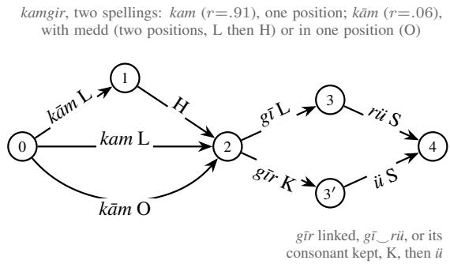
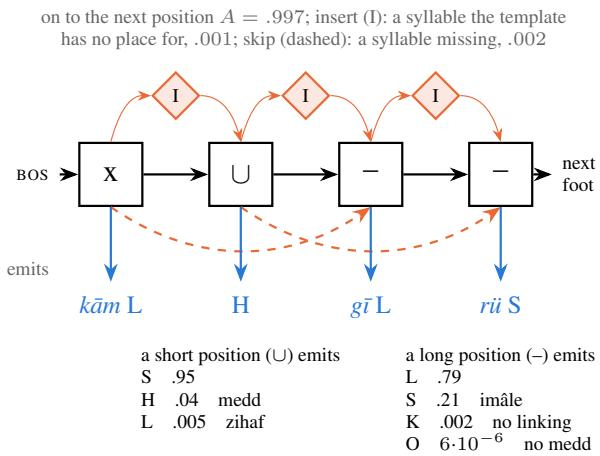
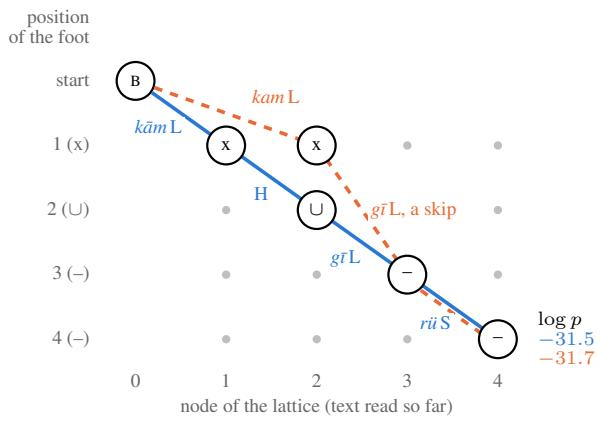
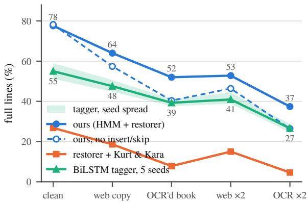

# A Lattice-Based HMM Approach to Aruz Scansion of Ottoman Poetry

Mehmet Emre Tiryaki Johns Hopkins University mtiryak1@jhu.edu

## Abstract

Ottoman Divan poetry is composed in aruz, a quantitative meter based on the weights of syllables. The meter is sensitive to specific characters recorded in the original writing in the Arabic script. This work is concerned with au tomatic meter finding and scansion alignment for Ottoman Divan poetry, especially on modern Turkish spelling without the special diacritics that scholarly transliterations of Ottoman preserve. We define two tasks on this input, first identifying the meter used in the poem, and second aligning the meter’s weights with the syllabification of the poem, identifying the flaws and freedoms the poet has taken along the way. We build a corpus of 52,000 lines split by poet, with scansion annotations for 500 test lines, and a robustness benchmark generated at the deviation rates measured on real web and OCR copies. Our model is a hidden Markov model over the positions of each meter, decoded over a lattice of every candidate path, and trained by EM from the printed meter, without scansion labels. On a held-out set it scans 77.6% of the test lines fully correctly, against 26.8% for the available rule-based scanner, 55.0% for a neural tagger trained with the same supervision and 63.6% for Claude Opus 5.5 few-shot. The code is open-sourced and the tool is released on the web.

## 1 Introduction

Scansion, the task of assigning a rhythmic structure to a written line of poetry, is a sequence labeling problem that NLP has approached with rules, HMMs, CRFs, neural taggers and LLMs (Agirrezabal et al., 2016, 2017; Ruiz Fabo et al., 2026). One type of verse that has received relatively little attention in this context is Ottoman Divan poetry, the classical Turkish poetry of the educated elite, written from the late thirteenth century to the second half of the nineteenth century. Divan poetry is composed in a quantitative meter called aruz, taken over from Arabic and Persian poetry (Çetin, 1991; ˙Ipekten, 2010). In aruz every syllable is either open or closed, closed if its vowel is long or it ends in a consonant, open otherwise. Each meter fixes a sequence of short and long positions, and a line fills it with open and closed syllables. In this paper, we address the scansion of Divan poetry: identifying a poem’s meter and aligning each syllable of each line to its position in that meter.

An automated tool that can robustly determine a Divan poem’s meter and align each syllable has many uses for Turkish literature researchers and poetry readers. The meter directly influences prosody, since a reader who is not aware of the correct meter cannot recite the line correctly. Finding it by hand is slow and error-prone even for trained readers, who can disagree on the same poem (Kurt and Kara, 2012), and it is a standing difficulty for students of Turkish literature. Editors depend on the scansion, since a line that will not scan is the sign of a misreading or a misprint (Köksal, 2009). And more than a thousand divan collections remain in Turkish libraries, many of them unstudied (Kurt and Kara, 2012). Tracing the meters, flaws and choices of poets across eras would benefit greatly from an automated scanner.

The problem is not trivial, for two main reasons. The first is the script. The poems were written in the Arabic alphabet, which records the long vowels and consonants the meter counts. Since the alphabet reform of 1928 (Lewis, 1999), Turkish has been written in Latin letters, and the original texts, in a script few now read and hard to OCR, remain largely without machine-readable text (Kirmizialtin and Wrisley, 2022). Scholarly editions mark modern Latin with diacritics to signify differences in the original writing, but most readers use this poetry in plain modern Turkish spelling, in school, on websites or typed from a manuscript, without special diacritics (§2). A scanner must therefore work from modern spelling, where the weights have to be restored, and should not depend on the scholarly marks even when they are present, since editions do not always supply them and can be incorrect or inconsistent. Here is a couplet by the fifteenthcentury poet Mihrî Hatun in the Arabic script in which it was written, in the scholarly transcription of its edition, and in the modern spelling1

$$
\begin{array} { r l } { \mathrm { o r i g i n a l } \quad } & { \xrightarrow [ * ] { 4 } \downarrow \downarrow \dot { 6 } \small _ { 3 } ( * ) \times \Delta _ { x } \Delta _ { x } ^ { * } \xrightarrow [ * ] { * } \downarrow \dot { 2 } \Delta _ { x } \Delta _ { y } ^ { * } \leq 1 \small _ { 3 } ( * ) } \\ & { \xrightarrow [ * ] { * } \uparrow ^ { \mathrm { o i d } } \Delta _ { z } \Delta _ { z } \xrightarrow [ * ] { * } \downarrow ^ { \mathrm { o u t } } \Delta _ { z } ^ { * } \Delta _ { z } ^ { * } } \end{array}
$$

scholarly Ey ki dü¸sdüñ Mihr¯ı her bir b¯ı-vefanuñ p¯ ayına¯ Sen da h i b¯ı-‘ar imi¸ssin böyle bilmezdüm seni¯

modern Ey ki dü¸sdün Mihri her bir bi-vefanun payına Sen dahi bi-ar imi¸ssin böyle bilmezdüm seni

(“You who fell, Mihrî, at the feet of every ingrate / so you too are shameless. I did not know you so.”)

Take bi-vefanun payı, ‘at the feet of every ingrate’, from the first line. The meter requires its six syllables to be long, short, long, long, long, short:

<table><tr><td rowspan="2">meter scholarly</td><td rowspan="2">一 bī</td><td rowspan="2">U</td><td colspan="3"></td><td rowspan="2">U</td></tr><tr><td>一 fā</td><td>nuñ</td><td>一</td></tr><tr><td>modern</td><td>bi</td><td>ve ve</td><td>fa</td><td>nun</td><td>pā pa</td><td>yl yl</td></tr></table>

b¯ı, fa¯ and pa¯ are closed because their vowels are long, and the scholarly edition marks the long vowel. The modern spelling does not, so bi, fa and pa look exactly like the open ve and yı.

The second reason is that, even when the original letters are known, a line does not always match its meter syllable for syllable. Aruz tolerates a set of departures from the expected weights, called flaws (kusur) (Düzenli and Bulak, 2018). For example an open syllable may fill a long position, a closed one a short position, and a word may or may not be linked to the next (§2). In the couplet above, the open second syllable of dahi fills a long position and is read with a long vowel. These are not marked in the text, and which flaws a line takes is determined by the meter of the poem, not by the line itself, so a single line admits many readings.

These decisions cannot be made syllable by syllable. Whether a syllable takes a flaw depends on the syllables before and after it, and on the meter, which is not given. Since a single line often fits more than one meter, the meter, and with it the reading of every line, can only be settled for the poem as a whole.

Computational work on aruz has concentrated on Arabic (§8). Rule-based systems (Abuata and Al-Omari, 2018) and recurrent networks (Yousef et al., 2019; Al-shaibani et al., 2020) identify the meter of a verse and they work on Arabic script. For Ottoman poetry the only system we know of is that of Kurt and Kara (2012), which is a deterministic rule-based algorithm running on scholarly edition strings. It is bound by the scholarly transliteration. It reads the syllable weights directly off the edition’s letters, so it cannot be used on the modern spelling, and even on scholarly text a long-vowel mark the edition left out is recognized as a flaw instead of being corrected. This over-dependence on the scholarly edition input makes the system prone to mistakes. Large language models, used zero- or few-shot, are the obvious alternative. As we show in §7, the strongest models we tried, prompted with the rules, the meters and worked examples, read at best 63.6% of held-out lines correctly.

We first define two tasks on a poem given in plain modern Turkish spelling with no meter marked, a form to which a scholarly transcription reduces by removing its diacritics, identifying the poem’s meter, and scanning each of its lines with every syllable’s position in the meter and any flaw it takes. For these tasks we build a corpus of 52,000 lines from thirteen critical editions, split by poet, and scansion annotations for 500 test lines (§3, §4).

Our model follows from the difficulties above. A trained spelling model proposes scholarly forms for each word, and every reading of the line these forms allow is laid out in a lattice. A hidden Markov model over the positions of the meters scores the paths through that lattice. The only supervision is the printed meter of each training poem, from which the model is trained by EM (§5). We compare it with the scanner of Kurt and Kara (2012) run on the same spelling model, a neural tagger trained with the same supervision, and with two large language models, and we examine which parts of the model account for the difference (§6, §7). Since the text people actually scan is rarely clean edition text, we also build a perturbation benchmark at the deviation rates measured on web and OCR copies and test every system but the language models on it (§4, §7). The code and data pipeline are released at https://github.com/ MehmetETiryaki/aruz-paper, and the model is freely available as a web tool at https: //mehmetemretiryaki.com/aruz.

## 2 Aruz

Syllable weight. Aruz counts syllables by weight, not by stress. A syllable is open if it ends in a short vowel, as ka, and closed if it ends in a long vowel or a consonant, as ka¯ or kal. Some syllables, those with a long vowel followed by a consonant, as kar¯ , or a short vowel followed by two consonants, as kalb, hold the place of a closed syllable followed by an open one; these are overlong syllables (medli), and the reading is called medd. The last syllable of a line counts as closed regardless of its letters (˙Ipekten, 2010).

The Arabic alphabet writes the long vowels and the consonants, so the weight of a syllable can be read from the original once the word is known (Bugday ˘ , 2009). Scholarly editions keep this in their transcription, with a macron on long vowels (a¯, ¯ı, u¯) and the signs ‘ and ’ for ayn and hemze, two consonants Turkish does not pronounce but the meter counts. The modern spelling has neither, and marks a long vowel with a circumflex only where the word would otherwise be confused with another (Lewis, 1999; Ye¸silöz, 2021).

Syllabification runs across word boundaries as in ordinary Turkish speech. A word-final consonant before a vowel-initial word is resyllabified as the onset of the next syllable (liaison, Turkish ulama) (Göksel and Kerslake, 2005). For example bir elma ‘an apple’ is syllabified bi-rel-ma.

Feet and meters. A meter is a fixed sequence of feet (tef‘ile), each named by a mnemonic word whose own syllables have the foot’s weights (Çetin, 1991). A poem is written in a single meter, and every line of it must fill the same sequence. We write a long position – and a short one ∪; a closed syllable fills a long position and an open one a short position. The first line of the couplet fills its meter, remel, as follows:

$$
\begin{array} { l l l } { { \mathrm { f a } ^ { \bullet } \mathrm { i l } \mathrm { a t u i n } } } & { { \mathrm { f a } ^ { \bullet } \mathrm { i l } \mathrm { a t u i n } } } & { { \mathrm { f a } ^ { \bullet } \mathrm { i l } \mathrm { a t u i n } } } \\ { { \mathrm { - } \cup \mathrm { -- } } } & { { \mathrm { - } \cup \mathrm { -- } } } & { { \mathrm { - } \cup \mathrm { -- } } } \\ { { E y k i d \ddot { u } \mathrm { , ~ } d \ddot { u } \tilde { n } } } & { { M i h \ r \bar { \iota } h e r b i r } } & { { b \bar { \iota } \nu e f \bar { a } n u \tilde { n } } } & { { p \bar { a } y \iota n a \mathrm { ~ } } } \end{array}
$$

Scanning a line means producing this alignment, each syllable assigned to one position of the meter. Foot boundaries need not fall at word boundaries, as inside dü¸sdüñ and b¯ı-vefanuñ¯ above. Ottoman poetry uses a few dozen meters, of which a handful account for most poems (Kurt and Kara, 2012).

Flaws. Poets often depart from the rules above to fit the words and meaning they want into the meter. A flaw (kusur) is a reading in which a syllable does not fill the slot that proper application of the rules requires. Four main flaws are discussed. In imâle, the most common flaw, an open syllable fills a long position and is read with a long vowel, as the Turkish dahi is read dah¯ı in the second line of the couplet. In zihaf, a closed syllable fills a short position and its long vowel is read short, as the pen-name Mihr¯ı is in the first. A line that reads an overlong syllable in one position (no medd), or keeps a final consonant before a following vowel (no linking), also counts as a flaw. Which flaws are tolerated and which are taken as the mark of an unskilled poet depends on the origin of the word, the period of the poem and the standing of the poet (Düzenli and Bulak, 2018; Saraç, 2022). In principle, however, a poet may take any of them anywhere. None of them is usually marked in any spelling (Düzenli and Bulak, 2018).

<table><tr><td>input Ey ki düş dün Mih ri her bir bi ve fa nun pa yı na read Ey ki ds düñ Mih ri her bir bī ve fā nuñ pā yı na pos. - u</td><td></td><td></td><td></td><td></td><td>U</td><td></td><td></td><td></td><td>U</td><td></td><td></td><td></td><td></td><td>U 1</td></tr><tr><td>flaw input Sen da hi</td><td></td><td></td><td></td><td>bi a</td><td></td><td>zihaf</td><td>ri miş sin böy le bil mez düm se ni</td><td></td><td></td><td></td><td></td><td></td><td></td><td></td></tr><tr><td>read Sen da hī</td><td></td><td></td><td></td><td></td><td></td><td></td><td>bī ā ri miş sin böy le bil mez düm se ni</td><td></td><td></td><td></td><td></td><td></td><td></td><td></td></tr><tr><td>pos. flaw</td><td></td><td>imâle</td><td></td><td></td><td>U</td><td></td><td></td><td></td><td></td><td>- ∪ -</td><td></td><td></td><td>- ∪ -</td><td></td></tr></table>

Figure 1: Task 2 output for the couplet of §1, the reference scansion: the input in modern letters, each syllable as it is read, the position it fills (– long, ∪ short, –∪ medd) and its flaw, one of imâle, zihaf, no medd, no linking or none. $\smile$ after a syllable marks a linking, its consonant read with the next word.

## 3 Tasks and Evaluation

As discussed in §1, most poems are available in modern Turkish spelling. A scholarly transcription, where there is one, can be normalized to the same spelling. Taking its marks as given would carry the marks the edition left out or got wrong into the scansion as flaws. Both tasks therefore take a poem in plain modern spelling with no meter given.

Task 1, meter identification, is to name the meter of a group of lines from an inventory of fourteen (Appendix A). We report the two cases that matter in practice, a whole poem and a single line; the second is harder, since a single line often fits more than one meter.

Task 2, scansion, is to give for every line each syllable as it is read, the position or positions it fills (– long, ∪ short, –∪ for medd), and its flaw: imâle, zihaf, no medd, no linking, or none. Figure 1 shows the reference scansion of the couplet of §1.

Metrics. Task 1 is scored by accuracy over the fourteen meters, per poem and per line. For Task 2, we use several metrics. The main measure is full-line accuracy, the share of lines whose output equals the reference in every syllable, position, flaw and word-boundary decision. Syllable F1 is F1 over syllable spans, and flaw F1 is the pooled F1 score of each flaw given a syllable.

<table><tr><td></td><td>split poets (century)</td><td>poems</td><td>lines</td></tr><tr><td>train</td><td>Bahtî (17), Sürûrî (16), Dürrî (18), Esrâr (18), Nâfiz (18), Hâmî (18)</td><td>1,644</td><td>18,282</td></tr><tr><td>dev</td><td>Tâcîzâde (15), Yahyâ (16), Şehrî (17), Vehbî (18)</td><td>1,133 18,090</td><td></td></tr><tr><td>test</td><td>Fuzûlì (16), Mihrî Hatun (15), Murâdî (16)</td><td></td><td>1,731 15,992</td></tr></table>

Table 1: The corpus, split by poet.

## 4 Data

Corpus. The corpus is thirteen critical editions of Divan poets of the fifteenth to the eighteenth century, taken from LATOC (Yılandiloglu ˘ , 2026), a corpus of 143 expert-transliterated Ottoman works (13 million words) that comes with the tools to extract and structure the text from the publicly available PDFs, and hand-corrected where the extraction had failed. The split is by poet, so that no poet’s vocabulary or metrical habits are shared between training and evaluation. The input is the editions transcription with its marks removed. This gives a training set of six poets, 1,644 poems and 18,282 lines; a development set of four poets, 1,133 poems and 18,090 lines; and a test set of three poets, 1,731 poems and 15,992 lines (Table 1). Evaluation uses the 1,607 test poems (15,228 lines) whose printed meter is in the inventory.

Scansion annotation. To our knowledge, no scansion annotation exists publicly for these poems. So the annotation was created for this paper using an ensemble of three language models, Claude Opus 5.5, ChatGPT 6 and Gemini 3.1 Pro, all with medium thinking. The annotators were given the poems’ scholarly transcription, the gold meter, a guide on how to label, and few-shot examples. Note that this is not the task defined above. With the scholarly transliteration and the gold meter the scansion is largely determined, and what remains to decide is the linking, the medd and the flaw labels. No system in Table 2 sees either of these, so a language model evaluated as a system in §7 faces a harder task than it did as annotator.

We annotated 500 lines of the test set, whole couplets with at most one per poem, and 100 lines of the development set. Per-syllable agreement is high (Cohen’s κ (Cohen, 1960) 0.959–0.978 pairwise, Fleiss’ κ (Fleiss, 1971) 0.969 over the 450 of the 500 test lines all three answered validly); wholeline agreement is 66–79% pairwise. If two or more valid answers agree (478 lines) the annotation is accepted as gold. The author, who reads aruz, decided the remaining 22 lines by hand and audited 200 of the lines the annotators had settled, stratified by agreement and by the rare flaws, accepting 95.5% of them (95% CI 93.0–98.0).

Robustness benchmark. The text a user submits is rarely a scholarly transliteration with its marks removed. To measure how real copies deviate from the editions, we collected 33 web pages and 6 OCR’d books that copy corpus poems (512 and 13,532 lines), aligned them to the editions, and counted every kind of deviation and its rate in the standard Turkish alphabet (Table 6, Appendix C). We then produce two noisy versions of the test set, a web copy and an OCR’d book, by applying the observed edits to the clean lines at their measured rates (Belinkov and Bisk, 2018; Náplava et al., 2021), scaled so that each version reaches the measured severity (Table 7), and two more at twice every rate. The reference scansion is unchanged.

## 5 Model

The model has three parts: a spelling model that proposes scholarly forms for each plain word, a lattice that holds every reading of the line those forms allow, and a hidden Markov model over the positions of the meters that scores the paths of the lattice. The meter of a poem is the one with the highest total likelihood over its lines, and the scansion of a line is its best path under that meter. Figures 2–4 show the three parts on one foot of a line of the poet Fuzûlî, Kamgir ü.2

Candidate spellings. For each plain word w, a trained restorer returns up to five scholarly spellings f with probabilities r(f | w). The restorer mixes a lexicon of the spellings written for w in the training editions (weight 0.5, chosen on development data) with a joint letter 5-gram over aligned units, each a plain letter paired with the scholarly letters it stood for (Bisani and Ney, 2008), smoothed with Witten–Bell smoothing (Witten and Bell, 1991) and decoded with a beam width of 20.

  
Figure 2: The lattice of the foot Kamgir ü. Nodes are the points between syllables and each arc is one syllable with its label; a path from node 0 to node 4 is one reading of the foot. kamgir has two candidate spellings, with the restorer’s probability r of each (its remaining candidates are not drawn), and kam¯ and g¯ır each give two alternatives, as described in the text.

On development data the restorer gives 93.5% of 113,195 words the gold spelling. 59% of its errors are words that do not occur in the training set.

The lattice. The restorer gives each word a few candidate spellings along with their probabilities. However, each spelling can still be read in more than one way, depending on linking and on medd. For each line we build a lattice that contains every reading these choices may produce (Figure 2). The lattice is a graph whose nodes are the points between syllables and whose arcs are syllables; a path from the start node to the end node spells out one reading of the line, syllable by syllable. Given one reading, the weight of every syllable follows from the rules of §2, and the meter model of the next paragraph scores every path of the lattice against the positions of a meter.

Each arc carries a label. An open syllable is labeled S and a closed one L, after the short and long positions they normally fill. An overlong syllable gives two alternative paths between the same nodes, two arcs L and H when it takes medd and one arc O when it does not, as kam¯ does in Figure 2. A word that ends in a consonant and precedes a vowelinitial word likewise gives two alternatives, as g¯ır does before ü. In the linked one its final consonant moves to the next word and its last syllable is re-weighted accordingly (g¯ı rü LS); in the unlinked one its last syllable is labeled K instead of L. O and K exist because no medd and no linking are flaws. With these labels the meter model can learn how rare they are, which it could not if they looked like ordinary closed syllables. Every label is finally paired with the word’s class, Turkish or

Arabic/Persian, written as a subscript, $\mathsf { L } _ { \mathrm { t r } }$ or $\mathsf { L } _ { \mathrm { a r } } .$ so that the model can learn different flaw rates for the two. A word is Arabic/Persian if its candidate spelling carries a mark Turkish words do not carry in the Ottoman script. This results in a total of ten labels.

Each candidate spelling of a word contributes one chain of arcs, with the medd and linking alternatives as parallel branches inside it. For a line of words $w _ { 1 } , \ldots , w _ { n } ,$ , a path π through the lattice selects one spelling $f _ { i }$ for every word, together with one linking and medd choice at each point where there is one. Its restorer score is the product of the word probabilities,

$$
\Theta ( \pi ) = \prod _ { i = 1 } ^ { n } r ( f _ { i } \mid w _ { i } ) ,\tag{1}
$$

which acts as a prior over spellings in the joint score of equation 2; the linking and medd choices carry no prior of their own. In the lattice, log $r ( f _ { i } \mid w _ { i } )$ is placed on the first arc of the chain of $f _ { i }$ and every other arc of the chain carries zero, so that the arc weights along any path sum to log $\Theta ( \pi )$

The meter HMM. The lattice holds every reading of a line. What remains is to decide which reading is right and under which meter. We do this with a hidden Markov model whose hidden states are the positions of a meter and whose observed symbols are the labels of a reading. The first foot of the poem’s meter in Figure 2, for instance, is the four positions x, $\cup , - , - ,$ and the reading kam¯ · g¯ı rü is explained by these four positions emitting, in order, the labels L, H, L and S. For each of the seventeen templates (Appendix A) the model has a left-to-right chain of match states, one per position, of kind long, short or free (the last position of a line, and the first where the meter allows either, x). A path through a chain is one line of that template. After each match state there is an insert state, which takes one extra syllable the template has no place for, and over each match state there is a skip, which passes over one missing position. Neither can be repeated in a row. Inserts and skips account for lines the meter does not, such as a misprint in an edition or an error in a copy. The chains are joined only at BOS and EOS, so a path stays within one template. A long position emits L most of the time and a short one S. The probability of emitting any other label, which is what a flaw is, is learned from data and shared by all chains (Figure 3). In the example, the long fourth position emits S for rü, an imâle. The match, insert and skip layout is that of a profile HMM (Krogh et al., 1994), with emissions shared across positions of the same kind instead of learned per position. The probability of a reading under a meter is the probability that the positions of one of the meter’s templates, taken in order, emit the labels of that reading. Laid against the lattice, the model is a trellis whose rows are the positions and whose columns are the nodes of the lattice, and a path through the trellis is one reading placed on the positions (Figure 4).

  
Figure 3: The meter HMM for the first foot of the poem’s meter, whose first position may be long or short (x). There is a match state per position, an insert state after each, and a skip over each. Below the states, the reading of Figure 2 as the labels each position emits. The rates are learned by EM from the printed meters alone.

Emissions are tied by the kind of the state, so there are four distributions over the ten labels, one each for long, short, free and insert states. Every flaw and choice is one of the rarer emissions and has a rate of its own. Imâle is S emitted by a long position, zihaf is L emitted by a short one, medd is H emitted by the short position after a long one, no medd is O and no linking is K. Since the labels carry the word’s class, each of these rates is learned separately for Turkish and for Arabic/Persian words.

The model runs over the lattice rather than over a single sequence as in a standard HMM (Rabiner, 1989). A step pairs one arc of the lattice with one state of the template, and the state emits the label of the arc. A complete path pairs one reading $\pi$ of the line with one state sequence $q _ { 1 : T }$ that places its syllables on the positions. With $\sigma _ { 1 : T }$ the labels of $\pi ,$ A the transition probabilities and B the emission probabilities, the score of such a path is

  
Figure 4: The HMM of Figure 3 run over the lattice of Figure 2. Each circle is a position of the foot (row) paired with a node of the lattice (column); the arc read at each step is written on it with its label. The blue path reads kam¯ with medd and g¯ı rü, one position per step. The orange path reads the restorer’s kam, which fills one position only, so g¯ı has to move two rows down and the second position is skipped. The scores at the end node are log-probabilities; the blue reading is chosen with a higher likelihood although the restorer preferred kam, the orange reading. The two readings that keep the consonant of g¯ır score −37.0 and −37.2 and are not drawn.

$$
\begin{array} { r } { p ( \pi , q ) = \Theta ( \pi ) A ( \mathrm { B O S } , q _ { 1 } ) \prod _ { t } B ( q _ { t } , \sigma _ { t } ) } \\ { \cdot \left( \prod _ { t > 1 } A ( q _ { t - 1 } , q _ { t } ) \right) A ( q _ { T } , \mathrm { E O S } ) , } \end{array}\tag{2}
$$

the restorer’s prior on the reading times the emissions and transitions along the path. The probability of a line x under a meter m is the sum of equation 2 over every path of the lattice and every state sequence within the templates of m, computed by the forward algorithm over the lattice. The meter of a poem is arg max log $\begin{array} { r } { p ( m ) + \sum _ { k } \log p ( x ^ { ( k ) } } \end{array}$ | m) over its lines $x ^ { ( k ) }$ , where $p ( x \mid m )$ is normalized by the BOS mass of m’s templates, so the meter prior enters once per poem. Under that meter, the Viterbi path of each line gives its scansion. The positions come from the states, and the flaw of each syllable follows from its label and the kind of its state.

Training uses only the printed meter of each poem. A training line is built into a lattice as above, but from the edition’s own spelling, so there is a single spelling per word and only the linking and medd choices remain open, and the lattice is scored against the templates of the printed meter alone.

The emission and transition probabilities are then learned by EM (Dempster et al., 1977) with add-λ smoothing (λ = 0.1) until the likelihood per line stops improving. We observed that training everything at once caused a collapse for the K emission. With the skip transitions available from the start, skipping a position is cheaper than emitting K, so the kept-consonant label never gathers counts. We therefore train in two stages. The first learns the emissions with the insert and skip states removed; the second fixes the emissions of the long, short and free states and learns the transitions, the meter prior and the insert emissions with the states back in place.

## 6 Experimental Setup

All trained systems use the training split, are tuned on the development split of §4, and are evaluated on the test split with the metrics of §3: Task 1 on all 1,607 test poems and Task 2 on the 500 annotated test lines. Every system takes as input a poem in plain letters with no meter given. We compare against four baselines.

Syllable count. The meter of a poem is the training meter most frequent for its modal syllable count. This is the simplest baseline for Task 1 and produces no scansion.

Restorer + Kurt & Kara (2012). This is the only previous scanner for Ottoman verse (§1) that we are aware of. It weighs each syllable of a transcribed text by rule, picks the meter with the fewest long– short mismatches over the poem, and labels the mismatches medd, linking, zihaf or imâle by its rules. No code was released except a web tool which is difficult to use at scale for testing. So we reimplemented their algorithm from the paper. This algorithm runs on scholarly editions, not the modern versions. Thus, we first run the restorer for each word to recover the diacritics and use the result as input to their rule-based algorithm. We also run the algorithm on the plain letters with no restoration, every vowel counted short, so that the restorer’s share of the result can be read off.

BiLSTM tagger. A neural sequence labeler (Lample et al., 2016) trained with the same supervision as our model, to show what a standard tagger makes of the printed meter alone. It reads the plain letters of a line character by character, predicts the poem’s meter, and labels each syllable with its position in that meter; a separate output head restores the spelling. Since no syllable is labeled in the training data, it is trained to maximize the total probability of all position sequences that fit the printed meter, which is the same objective our model’s EM optimizes. Linking is applied by rule and flaws are read off the predicted positions against the syllables’ weights. Because a neural model’s result varies with its random initialization, we train five copies with different seeds and report their spread.

Large language models. We test against Claude Opus 5.5 and DeepSeek V4.1 Flash, used few-shot. The prompt used explains the task and the aruz rules of §2, lists the fourteen meters with their patterns, defines the flaws and linking, fixes the output format and gives six scanned development lines as examples. The full prompt is in the released code. Each model answers once per poem in JSON, with reasoning enabled. An answer that does not parse, or whose positions fit none of the meter’s patterns, is counted wrong throughout (1 of 1,607 answers for Opus 5.5, 66 for Flash). Opus 5.5 was one of the three annotators of §4 to produce the gold. DeepSeek V4.1 Flash was chosen as an independent lineage.

Ablations. To see which parts of the model account for its result, we retrain and evaluate it with one part removed at a time. Without the HMM, the fewest-flaw rule of Kurt & Kara chooses among the restorer’s five candidates. Without EM, the model keeps its starting values. Without the restorer’s probabilities, its candidates enter the lattice with a flat prior, and without the restorer altogether, the candidates come from the training lexicon. Without the labels O and K, no medd and no linking are emitted as plain closed syllables. Finally, we give the model the edition’s scholarly transcription in place of plain letters, akin to an oracle restorer.

## 7 Results

Table 2 gives the main results on the test split. Every system that restores the spelling identifies the meter of nearly every poem; ours and Opus 5.5 are above 99.8% per poem, restorer + Kurt & Kara at 98.9%, and even the plain-letter run of Kurt & Kara reaches 91.0%, because a wrong template mismatches a whole poem more than the right one does. The systems separate per line, where ours reaches 98.2% against 84.1% for restorer + Kurt & Kara and 92.0% for the tagger. This shows that meter identification itself is not a hard task. The real task of this work is scansion.

<table><tr><td></td><td colspan="2">Task 1: meter</td><td colspan="3">Task 2: scansion</td></tr><tr><td>system</td><td>poem</td><td>line</td><td>full flaw F1 syll. F1</td><td></td><td></td></tr><tr><td>syllable count</td><td>56.6</td><td>57.2</td><td></td><td></td><td></td></tr><tr><td>BiLSTM tagger (5 seeds)</td><td>97.8</td><td></td><td>92.0 55.0</td><td>80.4</td><td>96.0</td></tr><tr><td>Kurt &amp; Kara, plain letters</td><td>91.0</td><td></td><td>71.4 2.4</td><td>42.0</td><td>85.8</td></tr><tr><td>restorer + Kurt &amp; Kara</td><td>98.9</td><td></td><td>84.1 26.8</td><td>54.9</td><td>90.5</td></tr><tr><td>ours: HMM + restorer</td><td>99.9</td><td></td><td>98.2 77.6</td><td>89.6</td><td>98.0</td></tr><tr><td>Claude Opus 5.5</td><td>99.9</td><td></td><td>- 63.6</td><td>83.9</td><td>95.1</td></tr><tr><td>DeepSeek V4.1 Flash</td><td>93.1</td><td></td><td>- 40.0</td><td>70.3</td><td>84.8</td></tr></table>

Table 2: Test results on plain Turkish letters with no meter given. Task 1: meter accuracy per poem and per line, on all test poems. Task 2: full-line accuracy (full), pooled flaw F1 and syllable F1, on the 500 annotated test lines. The tagger is the mean of five seeds. A language model answers once per poem and has no per-line meter.

Our model reads 77.6% of the annotated test lines exactly. The nearest system is Opus 5.5 at 63.6%, a difference of +14.0 points (p < 0.001, 95% CI +9.4 to +18.6).3 The tagger reads 55.0% on average and is behind ours on every seed, and Flash reads 40.0%. Restorer + Kurt & Kara reads 26.8%, and the same algorithm on the plain letters only 2.4%, every long vowel having become an open syllable in a long position. Flaw F1 ranks the systems in the same order. These results show that our model, built for the task, is better than outof-the-box large language models and the previous rule-based scanner. Being a generative model, it also gives a probability for every decision it makes, the posterior of a reading under the meter, whereas a language model’s answer comes with no reliable measure of its own confidence (Xiong et al., 2024).

Ablations. Table 3 contains the ablation results. No single part of the model accounts for its results. Without the HMM, the fewest-flaw rule over the same lattice of five candidates that the HMM receives reads 44.2 points fewer lines; without the restorer’s probabilities, 49.2 fewer; without the labels O and K, 42.4 fewer. Each of these leaves the model with less than half of its fully read lines, so the restorer’s probabilities, the scoring under the meter and the labels for the two flaws that the letters hide are each necessary, and the gain over the baselines comes from deciding them together. A scanner for aruz has to weigh the spelling behind the plain letters, the flaws the poet took and the meter of the poem against one another, since none of them is certain on its own. The structure matters more than the learned values, since keeping the starting values in place of EM costs 18.2 points, and the restorer’s generalization to unseen words matters, since the training lexicon in its place costs 40.0 points. Finally, with the edition’s scholarly transcription in place of the restorer’s candidates, the model reads 90.6% of lines. Of its 22.4 points of error on plain letters, 13.0 are therefore in the spelling and 9.4 in linking, medd and the flaw labels, which the model gets wrong even when the spelling is given. Kurt & Kara reads 34.4% of lines from the same scholarly transcription, so most of the distance between the two systems is in the scansion rules, not in the spelling. A user who trusts a scholarly transcription can therefore give it to the tool as it is, with its diacritics kept, and read 90.6% of lines rather than 77.6%; the web tool offers both inputs.

<table><tr><td rowspan="3">ablation</td><td colspan="2">Task 1: meter</td><td colspan="2">Task 2: scansion</td></tr><tr><td>poem</td><td>line</td><td>full flaw F1</td><td>syll. F1</td></tr><tr><td>full model</td><td>99.9</td><td>98.2 77.6</td><td>89.6</td><td>98.0</td></tr><tr><td>no HMM (aligner)</td><td>99.9</td><td>96.3 33.4</td><td>56.6</td><td>95.7</td></tr><tr><td>no EM</td><td>96.8</td><td>85.0 59.4</td><td>77.1</td><td>94.7</td></tr><tr><td>no O/K symbols</td><td>99.9</td><td>97.4 35.2</td><td>64.7</td><td>91.0</td></tr><tr><td>flat candidate probs.</td><td>99.7</td><td>95.1 28.4</td><td>53.6</td><td>94.5</td></tr><tr><td>lexicon, no restorer</td><td>99.6</td><td>94.237.6</td><td>73.2</td><td>92.4</td></tr><tr><td>ours, scholarly text</td><td>99.9</td><td>98.9 90.6</td><td>94.8</td><td>98.5</td></tr><tr><td>Kurt &amp; Kara, scholarly text</td><td>99.1</td><td>84.9 34.4</td><td>59.8</td><td>90.8</td></tr></table>

Table 3: Ablations on test, with one part of the model removed per row (§6). Columns as in Table 2. The last two rows give our model and Kurt & Kara the edition’s scholarly transcription instead of the plain letters. The insert and skip states are ablated in Figure 5.

Error analysis. A wrong line usually differs from the reference in more than one place. In our error analysis, we count each line once, under the first of these differences in a fixed order: the meter; the spelling of a word, when the restored form differs in its consonants; its vowel length, when it differs only in a long or short vowel; a medd; a linking; and the flaw label, when form, linking and positions all match and only the label does not. The last can happen only to the large language models, since for the other systems the label follows from the form and the position. Our model’s 112 wrong lines are mostly vowel lengths (63) and linkings (30); spellings (17) and medd (2) account for the rest. The wrong vowel lengths are the restorer’s errors the meter could not overrule, because both readings fit a position. The wrong linkings are lines where the reference keeps a final consonant that the model links. They follow from what the model has learned: K, the label of a word-final consonant that is not linked to the following vowel, is emitted by a long position with probability $3 { \cdot } 1 0 ^ { - 4 }$ for Turkish and .002 for Arabic or Persian words, so the model keeps a consonant only where the meter forces it.

The other learned rates read the same way as a description of the poets’ practice (Appendix B). Imâle is common and falls on Turkish words, a Turkish syllable in a long position being open 28% of the time against 13% for an Arabic or Persian one, and zihaf is rare, 0.04% and 1.1% of syllables in short positions. These rates agree with the qualitative account of the standard aruz philology (Düzenli and Bulak, 2018), although they were learned from the data alone.

Noisy copies. The robustness benchmark of §4 rewrites the test poems as the copies a user is likely to paste, once as a web page and once as an OCR’d book, with the kinds and rates of deviation measured on real copies, and once more at twice every rate. Figure 5 gives full-line accuracy on each. A web copy reduces the performance of our model by 18% of its fully correct lines and an OCR’d book 33%, while per-line meter accuracy stays at 91–95%. The meter is decided from the whole poem, so the unaffected lines carry it, and the correct meter in turn helps the scansion of the affected lines. The tagger drops at a similar rate, while restorer + Kurt & Kara loses most of its correct lines (18.6% on the web copy, 7.8% on the OCR’d book). Our model without the insert/skip states (Figure 5) falls below the performance of comparable models for some perturbations, justifying the need for the insert/skip states for the robustness of the models.

On every noisy input ours has the best full-line accuracy, 10.8 to 22.7 points ahead of the tagger on all five seeds on every input. However, the perturbations affect all models very clearly and the performance starts to fall to levels that are not suitable for real-world use even before the rates are doubled, motivating further work in robustness of scansion models.

In the errors of our model, modernized spelling as part of the perturbations (meni → beni) alone costs 6–14 points although it changes no weight, because a modernized word is one the restorer has not seen. The importance of the restorer model is apparent in this case too.

  
Figure 5: Full-line accuracy on the test set, for the clean test poems, their web copy and OCR’d book at the measured deviation rates (§4), and the same at twice every rate.

The model’s score also says how well a line fits its meter, which can be used to flag the lines a copy has corrupted. A detector built on the persyllable log-likelihood, the insert states and a leaveone-out test over the words, thresholded on clean development lines at 5% false alarms, catches 42% of the lines whose weights a web copy changed at 51% precision, and 54% at 66% on the OCR’d book (Table 8, Appendix C).

## 8 Related Work

Automatic scansion in NLP has been developed mainly for European verse, as sequence labeling of stress, with rule-based scanners (Navarro-Colorado, 2018; de la Rosa et al., 2020), HMMs, CRFs and neural taggers (Agirrezabal et al., 2016, 2017), and lately fine-tuned encoder–decoders (Ruiz Fabo et al., 2026). For the quantitative meters of Arabic, Persian and Sanskrit, including aruz, work has concentrated on identifying the meter, by matching the syllable pattern against the inventory (Abuata and Al-Omari, 2018; Terdalkar and Bhattacharya, 2023) or by classifying it from the characters with a neural model (Yousef et al., 2019; Al-shaibani et al., 2020; Alyafeai et al., 2023; Mutawa and Alrumaih, 2025) with relatively little attention to scansion alignment and noisy copies. For Ottoman Turkish the only system we found is the rule-based scanner of Kurt and Kara (2012), which reads syllable weights off a hand-made scholarly transcription and counts mismatches. The handbooks (˙Ipekten, 2010; Saraç, 2007), Çetin (1991) and Düzenli and Bulak (2018) describe the flaws qualitatively.

Restoring what an orthography omits has been studied as diacritic restoration (Mihalcea and Nastase, 2002; Belinkov and Glass, 2015; Adalı and Eryigit˘ , 2014), with the restored form as the end product. Our restorer is a joint-sequence model of the kind built for grapheme-to-phoneme conversion (Bisani and Ney, 2008). Here the restored form is one of several readings a line admits, and which is right depends on a meter that is itself unknown, so restoration and scansion are one joint search, a lattice of readings decoded by an HMM (Rabiner, 1989) with the match, insert and skip structure of a profile HMM (Krogh et al., 1994; Durbin et al., 1998).

## 9 Conclusion

We addressed the scansion of Ottoman Divan poetry mainly from the plain modern spelling, with capabilities on scholarly editions as well. We built a corpus of 52,000 lines with scansion annotations for 500 test lines, a robustness benchmark from the deviation rates measured on web and OCR copies, and a model that decides spelling, linking and position together, trained from the printed meter of each poem alone. On held-out poets it reads 77.6% of lines fully correctly, ahead of the comparable models. The ablations and error analysis show that joint decoding is critical for this task. Spelling, linking and position are each uncertain on their own and also reliant on the others. Systems that fix any one of them before the rest tend to perform worse. The learned flaw rates agree with the philological account without annotation. We open-source the code and release the scansion tool on the web.

## Limitations

The scansion annotation was made by an ensemble of large language models under a written guide, with agreement measured and 200 lines handchecked. A wider test set that is hand annotated by multiple experts would be helpful in further error analysis with the hopes of producing better and more robust models. The inventory covers fourteen meters; 124 of the 1,731 test poems fall outside it and are not scored, and the model does not report that a poem fits no meter. The robustness benchmark is generated from measured deviation rates, not from the real copies, whose transcriptions may be protected. The benchmark is also released as a pipeline rather than as a full dataset, as the editions of the poems are protected.

## References

Belal Abuata and Asma Al-Omari. 2018. A rule-based algorithm for the detection of arud meter in classical Arabic poetry. The International Arab Journal of Information Technology, 15(4):661–667.

Kübra Adalı and Gül¸sen Eryigit. 2014.˘ Vowel and diacritic restoration for social media texts. In Proceedings of the 5th Workshop on Language Analysis for Social Media (LASM), pages 53–61.

Manex Agirrezabal, Iñaki Alegria, and Mans Hulden. 2016. Machine learning for metrical analysis of English poetry. In Proceedings ofCOLING 2016, the 26th International Conference on Computational Linguistics: Technical Papers, pages 772–781, Osaka, Japan.

Manex Agirrezabal, Iñaki Alegria, and Mans Hulden. 2017. A comparison of feature-based and neural scansion of poetry. In Proceedings of the International Conference Recent Advances in Natural Language Processing, RANLP 2017, pages 18–23, Varna, Bulgaria. INCOMA Ltd. ACL Anthology R17-1003.

Maged S. Al-shaibani, Zaid Alyafeai, and Irfan Ahmad. 2020. Meter classification of Arabic poems using deep bidirectional recurrent neural networks. Pattern Recognition Letters, 136:1–7.

Zaid Alyafeai, Maged S. Al-Shaibani, and Moataz Ahmed. 2023. Ashaar: Automatic analysis and generation of Arabic poetry using deep learning approaches. Preprint, arXiv:2307.06218.

Mehmet Arslan, editor. 2018. Mihrî Hâtun Dîvânı. Number 576 in Kültür Eserleri Dizisi. T.C. Kültür ve Turizm Bakanlıgı, Kütüphaneler ve Yayımlar Genel˘ Müdürlügü, Ankara.˘

Yonatan Belinkov and Yonatan Bisk. 2018. Synthetic and natural noise both break neural machine translation. In International Conference on Learning Representations (ICLR). ArXiv:1711.02173.

Yonatan Belinkov and James Glass. 2015. Arabic diacritization with recurrent neural networks. In Proceedings ofthe 2015 Conference on Empirical Methods in Natural Language Processing, pages 2281– 2285.

Maximilian Bisani and Hermann Ney. 2008. Jointsequence models for grapheme-to-phoneme conversion. Speech Communication, 50(5):434–451.

Korkut Bugday. 2009. ˘ The Routledge Introduction to Literary Ottoman. Routledge, London. Translated by Jerold C. Frakes.

Nihad M. Çetin. 1991. Arûz. In TDV ˙Islâm Ansiklopedisi, volume 3, pages 424–437. Türkiye Diyanet Vakfı, Istanbul.

Jacob Cohen. 1960. A coefficient of agreement for nominal scales. Educational and Psychological Measurement, 20(1):37–46.

Javier de la Rosa, Álvaro Pérez, Laura Hernández, Salvador Ros, and Elena González-Blanco. 2020. Rantanplan, fast and accurate syllabification and scansion of Spanish poetry. Procesamiento del Lenguaje Natural, 65:83–90.

Arthur P. Dempster, Nan M. Laird, and Donald B. Rubin. 1977. Maximum likelihood from incomplete data via the EM algorithm. Journal of the Royal Statistical Society: Series B, 39(1):1–38.

Richard Durbin, Sean R. Eddy, Anders Krogh, and Graeme Mitchison. 1998. Biological Sequence Analysis: Probabilistic Models of Proteins and Nucleic Acids. Cambridge University Press.

Mesut Bayram Düzenli and ¸Sahap Bulak. 2018. Aruz vezninin Türk ¸siirine tatbikinde ba¸svurulan imlâ/telaffuz tasarrufları ve mahiyetleri. Selçuk Üniversitesi Türkiyat Ara¸stırmaları Dergisi (SU-TAD), 43:145–171.

Joseph L. Fleiss. 1971. Measuring nominal scale agreement among many raters. Psychological Bulletin, 76(5):378–382.

Aslı Göksel and Celia Kerslake. 2005. Turkish: A Comprehensive Grammar. Routledge, London.

Haluk ˙Ipekten. 2010. Eski Türk Edebiyatı: Nazım ¸Sekilleri ve Aruz, 14th edition. Dergâh Yayınları, Istanbul.

Abdülhakim Kılınç, editor. 2025. Fuzûlî Dîvânı (˙Inceleme – Tenkitli Metin), 2nd edition. Türkiye Yazma Eserler Kurumu Ba¸skanlıgı,˘ ˙Istanbul.

Suphan Kirmizialtin and David Joseph Wrisley. 2022. Automated transcription of non-Latin script periodicals: A case study in the Ottoman Turkish print archive. Digital Humanities Quarterly, 16(2).

M. Fatih Köksal. 2009. Metin ne¸srinde vezinle ilgili problemler, bazı tespit ve teklifler. Divan Edebiyatı Ara¸stırmaları Dergisi, (3):63–86.

Anders Krogh, Michael Brown, I. Saira Mian, Kimmen Sjölander, and David Haussler. 1994. Hidden Markov models in computational biology: Applications to protein modeling. Journal ofMolecular Biology, 235(5):1501–1531.

Atakan Kurt and Mehmet Kara. 2012. An algorithm for the detection and analysis of arud meter in Diwan poetry. Turkish Journal of Electrical Engineering and Computer Sciences, 20(6):948–963.

Guillaume Lample, Miguel Ballesteros, Sandeep Subramanian, Kazuya Kawakami, and Chris Dyer. 2016. Neural architectures for named entity recognition. In Proceedings ofthe 2016 Conference ofthe North American Chapter of the Association for Computational Linguistics: Human Language Technologies, pages 260–270, San Diego, California. Association for Computational Linguistics.

Geoffrey Lewis. 1999. The Turkish Language Reform: A Catastrophic Success. Oxford University Press, Oxford.

Quinn McNemar. 1947. Note on the sampling error of the difference between correlated proportions or percentages. Psychometrika, 12(2):153–157.

Rada Mihalcea and Vivi Nastase. 2002. Letter level learning for language independent diacritics restoration. In Proceedings of the 6th Conference on Natural Language Learning (CoNLL 2002), pages 105– 111.

A. M. Mutawa and Ayshah Alrumaih. 2025. Determining the meter of classical Arabic poetry using deep learning: a performance analysis. Frontiers in Artificial Intelligence, 8:1523336.

Jakub Náplava, Martin Popel, Milan Straka, and Jana Straková. 2021. Understanding model robustness to user-generated noisy texts. In Proceedings of the Seventh Workshop on Noisy User-generated Text (W-NUT 2021), pages 340–350.

Borja Navarro-Colorado. 2018. A metrical scansion system for fixed-metre Spanish poetry. Digital Scholarship in the Humanities, 33(1):112–127.

Lawrence R. Rabiner. 1989. A tutorial on hidden Markov models and selected applications in speech recognition. Proceedings of the IEEE, 77(2):257– 286.

Pablo Ruiz Fabo, Anxo Alonso Pérez, Pablo Rodríguez Fernández, and Pablo Gamallo. 2026. Automatic metrical scansion of poetry in a low-resource setting. In Proceedings of Shaping Multilingual, Multimodal AIfor the Social Sciences and Humanities (LLMs4SSH) @ LREC 2026, pages 114–125, Palma de Mallorca, Spain. ELRA. ACL Anthology 2026.llms4ssh-1.12.

Ahmet Emin Saraç. 2022. Divan ¸sairlerinin aruz ve kafiye kullanımına dair bazı tesbitler. Divan Edebiy atı Ara¸stırmaları Dergisi, (28):556–582.

M. A. Yekta Saraç. 2007. Klâsik Edebiyat Bilgisi: Biçim–Ölçü–Kafiye. 3F Yayınevi, Istanbul.

Hrishikesh Terdalkar and Arnab Bhattacharya. 2023. Chandojñanam: A Sanskrit meter identification and¯ utilization system. In Proceedings of the Computational Sanskrit & Digital Humanities: Selected Papers Presented at the 18th World Sanskrit Conference, pages 113–127, Canberra, Australia.

Ian H. Witten and Timothy C. Bell. 1991. The zerofrequency problem: Estimating the probabilities of novel events in adaptive text compression. IEEE Transactions on Information Theory, 37(4):1085– 1094.

Miao Xiong, Zhiyuan Hu, Xinyang Lu, Yifei Li, Jie Fu, Junxian He, and Bryan Hooi. 2024. Can LLMs express their uncertainty? An empirical evaluation

of confidence elicitation in LLMs. In The Twelfth International Conference on Learning Representations (ICLR).

Turgut Ye¸silöz. 2021. Türkçe Sözlük’te uzun ünlü ve düzeltme i¸sareti (¸sapka) kullanımı. Karamano˘glu Mehmetbey Üniversitesi Edebiyat Fakültesi Dergisi, 4(2):290–305.

Enes Yılandiloglu. 2026.˘ Latin-transliterated Ottoman Turkish corpus (LATOC), v5.

Waleed A. Yousef, Omar M. Ibrahime, Taha M. Madbouly, and Moustafa A. Mahmoud. 2019. Learning meters of Arabic and English poems with recurrent neural networks: a step forward for language understanding and synthesis. Preprint, arXiv:1905.05700.

## A The Meter Inventory

Table 4 lists the 14 meters of the inventory with their 17 templates (a meter whose first or last foot has two accepted forms contributes one template for each), and the share of training poems and of training lines in each; 1,511 of the 1,644 training poems are in the inventory.

## B Learned Values

Table 5 gives the emission distributions of the trained model, one row per state kind, over the ten labels.

## C The Robustness Benchmark

The real copies. A page or a scanned book counts as a copy of a corpus poem when two of its lines match corpus lines at a character similarity of 0.75 or one at 0.8, after line numbers, trailing citations and footnote digits are stripped. The web copies are 33 documents with at least fifty words (512 lines, 3,579 edition words), mostly a user anthology site, with school sites, listicles, blogs and a music repertoire; the OCR copies are 6 books on archive.org (13,532 lines, 90,855 words): two scanned Latin-script editions of Fuzûlî, a commentary, a thesis and two popular books. One poet dominates the copies, the development poets have none, and no copy typed without the Turkish letters was found. Within a matched line the copy’s words are aligned to the edition’s by edit distance, allowing splits and joins. Both sides first pass through the systems’ input normalizer (length and consonant marks, ayn, hemze and apostrophes dropped, hyphens joined), so a copy that drops every circumflex differs from the edition in nothing the benchmark counts; Table 6 is what survives that fold.

Producing the copies. Every letter-level edit seen in an aligned word pair is kept with one letter of context on its left and two on its right, and its rate is the number of times it was made over the number of times its context occurs in the edition words of the same copies; an edit enters the table when seen at least twice (web 126 edits, OCR 1946). It counts as damage when it changed the word’s weights in at least half of its occurrences, else as forms. One table thus covers modernization, inserted and doubled vowels, OCR confusions and typing errors, each at its own rate. Substitutions draw an observed triple (letter similarity, syllable-count difference, weights kept or changed) and a trainingvocabulary word that matches it; dropped izafets, dropped, added, split and joined words, line numbers, footnote digits and citations (clutter) occur at their measured rates and in their observed styles; on the web profile a couplet is left out (structure) with probability 10.5%. Each poem draws one intensity from the observed per-document rates (0.33 to 1.73 times the web profile), since real sources differ in how much they deviate (Náplava et al., 2021), and one copy deviates at one rate throughout. Two factors per profile, one on the forms rates and one on the damage rates (web 2.83 and 1.25, OCR 1.15 and 0.91), bring the generated copy close to the measured word deviations per word and share of lines whose weights differ; the web forms factor is large because the web survey is small and only edits seen twice enter the table. Table 7 compares the generated files with the real copies on these two measures and on three that are not fitted. Every system receives the same word list from a copy. The text goes through the normalizer, is split on spaces and stripped of punctuation, and tokens without a vowel are dropped. A line number is therefore invisible to all systems, a footnote digit glued to a word is seen by the restorer’s lookup and by the tagger, and a citation adds words.

The warning detector. Table 8 gives the detector of §7 on each noisy input.

<table><tr><td>meter, as the editions print it</td><td>template(s)</td><td>train poems %</td><td>train lines %</td></tr><tr><td>fāilātün fāilātün fāilātün fāilün</td><td>-U- -——∪—</td><td>31.4</td><td>30.1</td></tr><tr><td>mefāīlün mefāīlün mefāīlün mefāīlün</td><td>U-</td><td>19.8</td><td>18.7</td></tr><tr><td>mefūlü fāilātü mefāīlü fāilün</td><td>--∪-∪-∪∪--∪-u-</td><td>13.0</td><td>11.5</td></tr><tr><td>mefūlü mefāīlü mefāīlü feūlün</td><td>——uu——uu—-uu-—</td><td>11.1</td><td>8.7</td></tr><tr><td>feilātün feilātün feilātün feilün</td><td> $\mathbf { X } \cup \substack { \mathrm { --- U U -- U U -- } \cup \mathrm { U -- } \mathrm { --- } \mathrm { , ~ } \mathbf { X } \cup \mathrm { -- } \cup \cup \mathrm { -- } \cup \mathrm { U -- } \cup \mathrm { U - } \cup \mathrm { U - } }$ </td><td>9.7 6.1</td><td>14.0</td></tr><tr><td>mefāilün feilātün mefāilün feilün</td><td> $\cup \mathrm { - U \mathrm { - } U U \mathrm { - } U \mathrm { - } U \mathrm { - } U \mathrm { - } U \mathrm { - } U \mathrm { - } U \mathrm { - } U U \mathrm { - } U \mathrm { - } U \mathrm { - } U U \mathrm { - } }$ </td><td></td><td>5.0</td></tr><tr><td>mefāīlün mefāīlün feūlün</td><td>Uーーー∪ーー -∪--</td><td></td><td>3.3</td></tr><tr><td>fāilātün fāilātün fāilün</td><td>x∪---∪---∪—</td><td>3.0 2.1</td><td>2.7</td></tr><tr><td>feilātün mefāilün feilün</td><td>xu--u-∪---,xu--∪-∪-∪u-</td><td></td><td>3.9</td></tr><tr><td>mefūlü fāilātün mefūlü fāilātün</td><td></td><td></td><td>0.6</td></tr><tr><td>müstefilün müstefilün müstefilün müstefilün</td><td>-∪---∪-</td><td></td><td>0.7</td></tr><tr><td>mefūlü mefāilün feūlün</td><td>——uuーuーuー—</td><td></td><td>0.4</td></tr><tr><td>feūlün feūlün feūlün feūl</td><td>Uー-U--U--U</td><td></td><td>0.1</td></tr><tr><td>müfteilün müfteilün fāilün</td><td>-uu--uu--u—</td><td></td><td>0.2</td></tr></table>

Table 4: The meter inventory. A meter whose first or last foot has two accepted forms has two templates; x is a position that may be long or short, and the last position of every template, printed long, is free. Shares are of the training poems and lines in the inventory.

<table><tr><td>position kind</td><td>L:tr</td><td>S:tr</td><td>H:tr</td><td>0:tr</td><td>K:tr</td><td>L:ar</td><td>S:ar</td><td>H:ar</td><td>O:ar</td><td>K:ar</td></tr><tr><td>long  $\beta _ { \mathrm { L } }$ </td><td>.362</td><td>.141</td><td> $7 . 1 0 ^ { - 7 }$ </td><td> $7 . 1 0 ^ { - 7 }$ </td><td> $3 { \cdot } 1 0 ^ { - 4 }$ </td><td>.429</td><td>.066</td><td> $7 . 1 0 ^ { - 7 }$ </td><td> $5 { \cdot } 1 0 ^ { - 6 }$ </td><td>.002</td></tr><tr><td>short  $\beta _ { \sf S }$ </td><td>2.10−4</td><td>.571</td><td>.006</td><td> $1 0 ^ { - 6 }$ </td><td> $1 0 ^ { - 6 }$ </td><td>.005</td><td>.383</td><td>.035</td><td> $1 0 ^ { - 6 }$ </td><td> $1 0 ^ { - 6 }$ </td></tr><tr><td>free  $\beta _ { { \sf X } }$ </td><td>.434</td><td>.157</td><td>0</td><td> $4 { \cdot } 1 0 ^ { - 6 }$ </td><td> $3 { \cdot } 1 0 ^ { - 4 }$ </td><td>.352</td><td>.056</td><td>0</td><td> $4 { \cdot } 1 0 ^ { - 6 }$ </td><td>.001</td></tr><tr><td>insert β</td><td>.014</td><td>.071</td><td>.014</td><td>.014</td><td>.014</td><td>.026</td><td>.579</td><td>.240</td><td>.014</td><td>.014</td></tr></table>

Table 5: Learned emission probabilities, one row per state kind, over the ten labels (L closed, S open, H the half beat of a medd, O an overlong syllable in one position, K an unlinked final consonant; tr Turkish, ar Arabic/Persian).

<table><tr><td>deviation (after the alphabet fold)</td><td>anthology</td><td>OCR edition</td><td>OCR popular book</td><td>changes weights</td><td>example</td></tr><tr><td>vowel changed in the ending</td><td>4.08</td><td>9.65</td><td>9.33</td><td>0</td><td>istersen → istersin</td></tr><tr><td>Turkish letter lost or swapped</td><td>1.73</td><td>5.63</td><td>1.72</td><td>0</td><td>zulmı → zulmi</td></tr><tr><td>letter edit, non-word</td><td>1.55</td><td>3.75</td><td>5.16</td><td>28</td><td>çekmekden → çekmekten</td></tr><tr><td>letter edit, another word</td><td>2.78</td><td>2.86</td><td>3.38</td><td>17</td><td>dideyi → didei</td></tr><tr><td>vowel changed</td><td>1.33</td><td>2.57</td><td>2.84</td><td>1</td><td>ikdı → akdi</td></tr><tr><td>vowel changed in the stem</td><td>2.16</td><td>1.34</td><td>2.37</td><td>0</td><td>etseler → itseler</td></tr><tr><td>word substituted</td><td>1.01</td><td>1.24</td><td>0.96</td><td>41</td><td>kılam → edeyüm</td></tr><tr><td>word split</td><td>0.65</td><td>0.94</td><td>0.57</td><td>52</td><td>bilseydüm → bilse idüm</td></tr><tr><td>men/maña written ben/bana</td><td>1.33</td><td>1.04</td><td>2.16</td><td>0</td><td>menüm → benim</td></tr><tr><td>words joined</td><td>0.36</td><td>0.86</td><td>0.66</td><td>59</td><td>u perişan → perişan</td></tr><tr><td>h written k</td><td>0.54</td><td>0.81</td><td>0.96</td><td>0</td><td>yohsa → yoksa</td></tr><tr><td>vowel inserted</td><td>0.43</td><td>0.40</td><td>0.71</td><td>100</td><td>aşnamuz → aşinamız</td></tr><tr><td>long vowel typed double</td><td>0.07</td><td>0.34</td><td>0.55</td><td>100</td><td>efgan → efgaan</td></tr><tr><td>word dropped</td><td>0.11</td><td>0.25</td><td>0.22</td><td>100</td><td>dem →</td></tr><tr><td>word added</td><td>0.04</td><td>0.23</td><td>0.11</td><td>93</td><td>→ mülki</td></tr><tr><td>vowel dropped</td><td>0.04</td><td>0.24</td><td>0.08</td><td>100</td><td>ede → de</td></tr><tr><td>izafet dropped</td><td>0.07</td><td>0.13</td><td>0.05</td><td>100</td><td>garibi → garib</td></tr><tr><td>final devoicing</td><td>0.07</td><td>0.09</td><td>0.00</td><td>0</td><td>azad → azat</td></tr><tr><td>double consonant added</td><td>0.07</td><td>0.03</td><td>0.03</td><td>65</td><td> $r a b  r a b b$ </td></tr><tr><td>double consonant dropped</td><td>0.00</td><td>0.03</td><td>0.00</td><td>100</td><td>muarrif → muarif</td></tr></table>

Table 6: Deviations found in real copies, per 100 edition words, by source; “changes weights” is the share of that deviation’s words whose syllable weights change.

<table><tr><td></td><td>lines</td><td>dev./w.</td><td>letters</td><td>syll.</td><td>weights</td><td>CER</td></tr><tr><td>web copies, measured</td><td>512</td><td>20.6</td><td>77.3</td><td>6.8</td><td>18.6</td><td>4.8</td></tr><tr><td>generated, ×1</td><td>14,516</td><td>19.5</td><td>72.1</td><td>5.1</td><td>18.1</td><td>5.2</td></tr><tr><td>generated, ×2</td><td>13,018</td><td>25.6</td><td>81.7</td><td>9.2</td><td>30.6</td><td>7.7</td></tr><tr><td>OCR&#x27;d books, measured</td><td>13,532</td><td>28.9</td><td>88.6</td><td>10.3</td><td>23.4</td><td>6.3</td></tr><tr><td>generated, × 1</td><td>15,992</td><td>27.6</td><td>85.8</td><td>13.6</td><td>25.0</td><td>7.3</td></tr><tr><td>generated, ×2</td><td>15,992</td><td>42.2</td><td>95.8</td><td>24.0</td><td>42.9</td><td>12.4</td></tr></table>

Table 7: The real copies’ severity against the generated files’, on the survey’s measures in the standard Turkish alphabet: word deviations per edition word, lines whose letters, syllable count or syllable weights differ from the edition’s, character error rate (percent). The generator’s rates are scaled by one factor for the edits that keep the weights and one for those that change them so that the full profile reaches the measured word deviations per word and the measured share of lines whose weights differ; the other measures are not fitted.

<table><tr><td>input</td><td>faulty lines</td><td>AUROC</td><td>precision</td><td>recall</td><td>alarms, scansion kept</td><td>top-1 word</td><td>kind</td><td>word offered</td></tr><tr><td>web</td><td>618/3438</td><td>0.714</td><td>51.3</td><td>42.4</td><td>10.1</td><td>57.0</td><td>83.9</td><td>3.4</td></tr><tr><td>web x2</td><td>888/3038</td><td>0.724</td><td>62.3</td><td>47.0</td><td>13.5</td><td>53.2</td><td>83.9</td><td>4.2</td></tr><tr><td>web forms</td><td>0/3742</td><td>一</td><td></td><td>1</td><td>10.0</td><td></td><td></td><td>一</td></tr><tr><td>web damage</td><td>632/3742</td><td>0.711</td><td>57.9</td><td>40.5</td><td>一</td><td>60.7</td><td>90.8</td><td>4.4</td></tr><tr><td>web clutter</td><td>0/3742</td><td>1</td><td></td><td>一</td><td>一</td><td>一</td><td></td><td></td></tr><tr><td>web structure</td><td>0/3428</td><td></td><td></td><td></td><td></td><td></td><td></td><td></td></tr><tr><td>ocr</td><td>955/3742</td><td>0.774</td><td>66.5</td><td>54.3</td><td>10.3</td><td>55.4</td><td>89.7</td><td>22.3</td></tr><tr><td>ocr x2</td><td>1552/3742</td><td>0.791</td><td>75.8</td><td>61.9</td><td>14.6</td><td>49.8</td><td>85.6</td><td>21.0</td></tr><tr><td>ocr forms</td><td>0/3742</td><td></td><td></td><td></td><td>9.5</td><td></td><td></td><td></td></tr><tr><td>ocr damage</td><td>845/3742</td><td>0.742</td><td>68.4</td><td>44.3</td><td>一</td><td>64.6</td><td>91.9</td><td>35.2</td></tr><tr><td>ocr clutter</td><td>120/3742</td><td>1.000</td><td>34.5</td><td>100.0</td><td>一</td><td>27.5</td><td>100.0</td><td></td></tr></table>

Table 8: The warning detector on each noisy input. A line is faulty if its syllable weights differ from the edition’s. AUROC, and precision and recall at the threshold set on clean development lines; alarms on lines whose scansion did not change; and, among warned faulty lines, how often the named word is faulty, the stated kind of damage is right, and the edition’s word is among those offered.