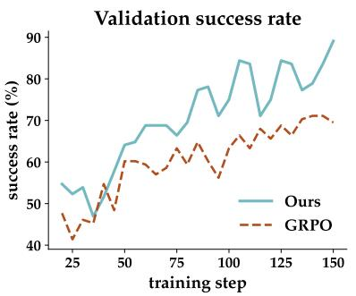
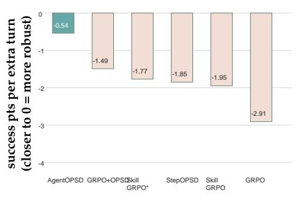
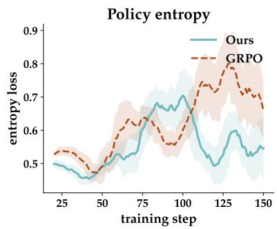
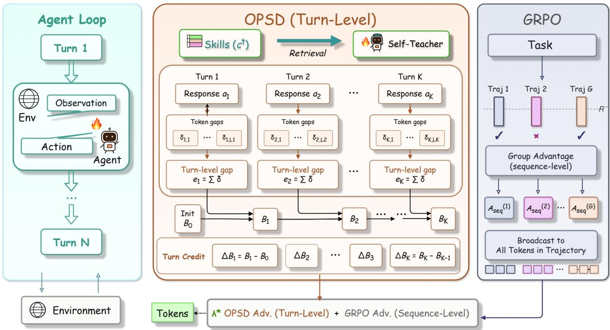
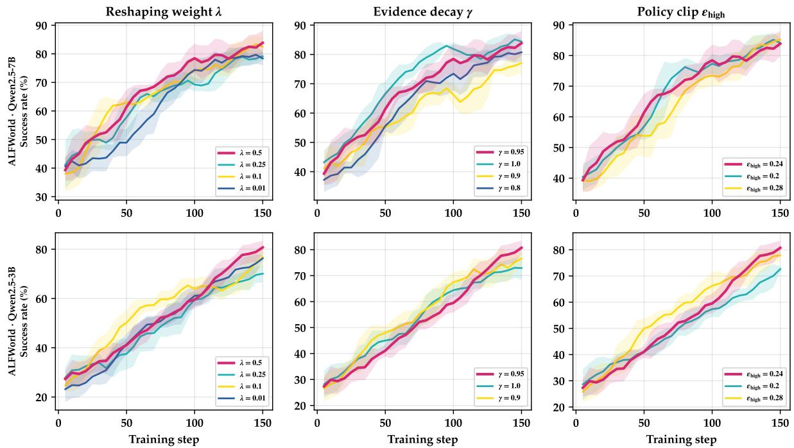
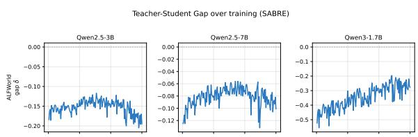
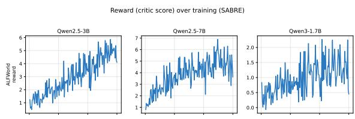
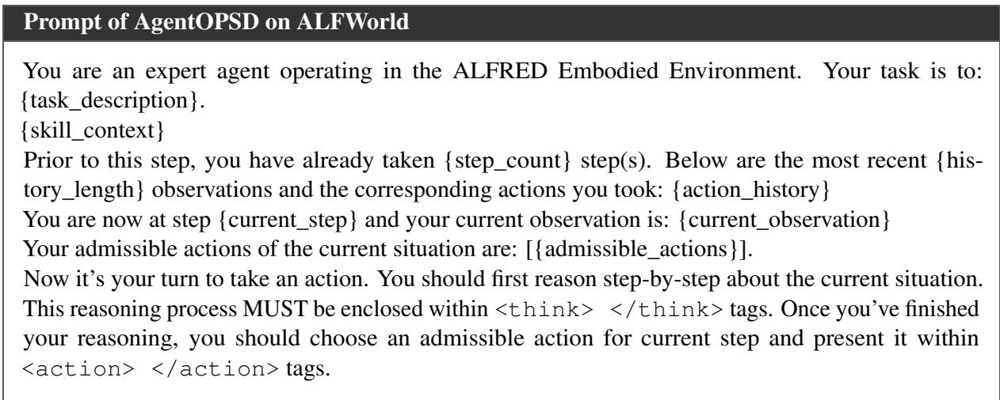

# AgentOPSD: Turn-Level Credit Assignment via Recursive Belief Revision

Yizhuo Li\* Beijing Institute of Technology

## Abstract

Reinforcement learning with verifiable rewards ordinarily spreads a single advantage over a whole trajectory, a granularity too coarse to isolate the few decisions on which success in a long, multi-turn interaction actually turns. Privileged self-distillation supplies denser supervision, but it leaves unanswered how a set of local teacher–student discrepancies should be converted into credit along a sequence. We introduce AgentOPSD, a critic-free scheme that assigns credit recursively, one interaction turn at a time. Inside a turn, the token-level log-probability gaps between a skill-conditioned self-teacher and the student are summed, and that sum acts as evidence in a recursive Bayesian update carried out in log-odds space; the resulting revisions reallocate the outcome-derived advantage across turns through a multiplier that is bounded and preserves its sign. With Qwen2.5- 3B and Qwen2.5-7B as policy backbones on ALFWorld, the method improves consistently on GRPO and on self-distillation baselines, and attains 89.1% success at the 7B scale. Ablations attribute the gain to aggregating evidence at turn boundaries and to making the belief revision depend on history, rather than to the local gap by itself.

## 1 Introduction

Teaching large language models to act as agents has become a principal avenue for extending their capacity on difficult tasks (Guo et al., 2025; Team et al., 2025; Yang et al., 2025; Comanici et al., 2025; Team et al., 2026b). The setting is not static single-turn reasoning: an agent inhabits a partially observable world and keeps acting, choosing from what it currently sees and then observing the world’s response before deciding again (Shen et al., 2023; Shi et al., 2025; Jimenez et al., 2023). Verification, moreover, often becomes possible only once a trajectory has finished, so a training procedure must infer the role of one intermediate step from a single sparse terminal signal. Yet steps inside a trajectory are far from interchangeable: a successful run can contain redundant, spurious or misleading actions, and a failing run can contain sensible reasoning.

Group-relative policy optimization, with GRPO (Shao et al., 2024; Yu et al., 2025) being the canonical instance alongside its agentic descendants (Dong et al., 2025; Feng et al., 2025), derives a single advantage for the whole trajectory from the outcome reward and applies it unchanged at every position. Credit that is spread this flatly cannot separate a handful of pivotal decisions from routine operations around them, and the distortion worsens as turns accumulate. Per-turn credit is therefore a prerequisite both for locating decisions that actually drive the outcome and for supervising long horizons at finer granularity.

Denser token-level supervision has been pursued along a separate line. In on-policy distillation (Ye et al., 2026; Yang et al., 2026; Team et al., 2026a), a student is trained under a teacher on rollouts of its own, while the self-distillation variants of this idea (Zhao et al., 2026; He et al., 2026) do away with any separate teacher by conditioning one and the same policy on privileged information that exists only during training (Lu et al., 2026b). Reinforcement learning has likewise used such signals as an auxiliary supervision source.

Two mismatches appear once OPSD meets agentic reinforcement learning. The first concerns granularity: token-level signals sit awkwardly against an interaction in which many tokens jointly constitute one action and the environment reacts only when a turn ends. The second concerns memory: even step-aware methods score each turn separately (Zhang et al., 2026), leaving earlier evidence unused. What must be solved, then, is how local OPSD signals become turn-level credit that depends on history.





  
Figure 1: Training dynamics and robustness to horizon of AgentOPSD on Qwen2.5-7B-Instruct / ALFWorld. (a) Validation success rate over the course of training. (b) How accuracy decays as the task horizon grows, quantified by OLS slopes of per-sub-task success against the mean number of turns taken by successful episodes. (c) Policy entropy over the course of training.

We begin from the position that what should govern a turn’s credit is not its local signal taken on its own, but how far that signal moves the estimated probability of eventual success. Precision comes from reading the per-turn selfdistillation gap as newly arrived evidence driving a Bayesian belief update (Åström, 1965; Kaelbling et al., 1998). The belief state is then the probability of eventual task success given the history so far.

This observation leads us to AgentOPSD (agentic on-policy self-distillation), a method that assigns credit turn by turn in long-horizon agents. Token-level teacher–student log-probability gaps are first pooled by AgentOPSD into turn-level evidence. A Bayesian belief state, initialized at the mean group success rate, is then revised recursively turn after turn in log-odds space, with neither extra rollouts nor a learned critic required. The verifier fixes the direction of optimization globally, while the belief updates redistribute the trajectory-level learning signal over individual turns. AgentOPSD is evaluated on ALFWorld (Shridhar et al., 2020) at two model scales, and Figure 1 shows it to outperform GRPO and strong self-distillation baselines consistently. The ablations point to two sources of the improvement: pooling token-level signals at the turn boundaries that coincide with environment transitions, and reframing a gap that stands on its own as a revision of belief that recurs along the trajectory.

We summarize the contributions of this work below:

• Credit at the level of a turn is cast as the amount by which one turn revises the estimated chance that the run ends in success. Carrying the recursion in log-odds space ties the evidence of one turn to a Bayesian update applied repeatedly, and makes plain that a selfdistillation gap on its own does not amount to sequential credit.

• We propose AgentOPSD, which collapses teacher–student log-probability gaps at the token level into turn-level evidence that lines up with environment transitions, then carries it recursively through the belief over trajectory success; neither extra rollouts nor a learned critic is required.

• On ALFWorld, at two model scales, experiments together with ablations show AgentOPSD to outperform GRPO and strong self-distillation baselines consistently, and the ablations confirm that aggregating at turn boundaries and revising belief by recursion bring benefits that are complementary.

## 2 Methodology

## 2.1 Task, Interaction, and Notation

Each episode opens with a task x and an initial observation $o _ { 0 } ,$ , so that the interaction starts from the state $s _ { 1 } ~ = ~ ( x , o _ { 0 } )$ . At turn k the policy $\pi _ { \theta }$ emits an action conditioned on the interaction history $s _ { k }$ that the agent can currently see; we denote that action by $a _ { k }$ , its t-th token by $y _ { k , t }$ , and the token count of the action by $L _ { k }$ . The observation $o _ { k }$ returned by the environment then extends the history through $s _ { k + 1 } = ( s _ { k } , a _ { k } , o _ { k } )$ . Chaining these steps over K turns produces a trajectory $\pmb { \tau } = \left( s _ { 1 } , a _ { 1 } , o _ { 1 } , \dotsc , s _ { K } , a _ { K } , o _ { K } \right)$ , to which a verifier attaches a binary outcome reward $R ( \tau )$ .

  
Figure 2: An overview of AgentOPSD. Left: the loop in which the agent acts, exchanging with the environment across turns $1 , \ldots , K$ . Middle: in three steps, AgentOPSD turns the single sequence-level advantage of GRPO into advantages reshaped at the turn level: (1) the token-level teacher–student gaps $\delta _ { k , t }$ are aggregated inside a turn, giving the turn-level gap $e _ { k } ; ( 2 )$ a belief state $B _ { k }$ , started from the group success rate, is updated recursively, and its marginal revision $\Delta B _ { k } = B _ { k } - B _ { k - 1 }$ is read off; (3) the sequence-level advantage $A _ { s e q } ^ { ( i ) }$ is reshaped for each turn as $\breve { \tilde { A } } _ { k } ^ { ( i ) }$ . Right: vanilla GRPO instead sends one and the same $A _ { s e q } ^ { ( i ) }$ to all tokens and turns. Every token of turn k therefore takes on $\tilde { A } _ { k }$

$$
a _ { k } = ( y _ { k , 1 } , \dots , y _ { k , L _ { k } } ) \sim \pi _ { \theta } ( \cdot \mid s _ { k } ) ,\tag{1}
$$

Every task is handled by drawing G trajectories under group-relative policy optimization, from whose rewards a sequence-level advantage is derived. Throughout, the index i runs over these G samples, $\bar { R }$ and ${ \widehat { \sigma } } _ { R }$ are the mean reward of the group and its standard deviation, and the small positive constant $\epsilon _ { \mathrm { 0 } }$ recurs everywhere as a guard against division by zero and against unbounded log-odds. The resulting advantage $A _ { \mathrm { s e q } } ^ { ( i ) }$ is handed to all tokens of trajectory i in exactly the same form, so no distinction of credit between turns is ever drawn.

$$
A _ { \mathrm { s e q } } ^ { ( i ) } = \frac { R ^ { ( i ) } - \bar { R } } { \widehat { \sigma } _ { R } + \epsilon _ { 0 } } , \qquad \bar { R } = \frac { 1 } { G } \sum _ { j = 1 } ^ { G } R ^ { ( j ) } .\tag{2}
$$

## 2.2 Turning Outcome Influence into Bayesian Turn Evidence

The counterfactual influence of turn k could be quantified head-on only by averaging the outcome reward over all continuations that might follow $a _ { k }$ , and for interactions spanning many turns that marginalization is hopeless. Our stance is instead retrospective and evidential. Let C denote the event in which the trajectory ends successfully. An action that advances the task should occur more often inside successful behavior than inside unsuccessful behavior, and Bayes’ rule turns this observation into a change of belief about $C ,$ , captured by a likelihood ratio on the action side (Åström, 1965; Kaelbling et al., 1998):

$$
\begin{array} { r l } & { \mathrm { l o g i t } p ( C \mid s _ { k } , a _ { k } ) - \mathrm { l o g i t } p ( C \mid s _ { k } ) } \\ & { \quad \quad = \mathrm { l o g } \displaystyle \frac { p ( a _ { k } \mid s _ { k } , C ) } { p ( a _ { k } \mid s _ { k } , \lnot C ) } . } \end{array}\tag{3}
$$

The map logit $\begin{array} { r } { ( u ) = \log { \frac { u } { 1 - u } } } \end{array}$ converts a probability into log-odds. What sits on the right is the ideal Bayes factor (Kass and Raftery, 1995), i.e., the ratio between the likelihood of $a _ { k }$ under success and its likelihood under failure; its sign tells us at once whether the turn adds to the case for eventual success or subtracts from it.

Neither outcome-conditional behavioral distribution can be inspected directly, so the Bayesian evidence has to be recovered after the fact. We obtain it from a per-turn self-distillation contrast that is actually computable: a privileged self-teacher, associated with success, is set against the ordinary student policy. The two share the parameters θ and both score the same action, as sampled from the student (Zhao et al., 2026). Such a contrast supplies a tractable stand-in for a belief update that would otherwise stay out of reach, and the quality of the stand-in, together with the assumptions that justify it, is examined below. The two branches are told apart only by the token context they receive:

$$
h _ { k , t } = ( s _ { k } , y _ { k , < t } ) , \qquad h _ { k , t } ^ { + } = ( s _ { k } , c ^ { + } , y _ { k , < t } ) .\tag{4}
$$

In this notation $y _ { k , < t }$ is the prefix of tokens already emitted within turn k, while $c ^ { + }$ is a skill retrieved at training time only, summarizing subgoals and action patterns of use for the task (Xia et al., 2026). The skill-conditioned branch stands in for successassociated behavior, whereas the branch that sees no skill supplies the background likelihood.

For a generated token $y _ { k , t }$ , the detached likelihood contrast is written as

$$
\delta _ { k , t } = \log \pi _ { \theta } ( y _ { k , t } \mid h _ { k , t } ^ { + } ) - \log \pi _ { \theta } ( y _ { k , t } \mid h _ { k , t } ) .\tag{5}
$$

Whenever $\delta _ { k , t }$ is positive, the skill has made the generated token more probable than it would otherwise be. Summing the contrast over the $L _ { k }$ tokens that make up the turn gives the turn-level evidence

$$
e _ { k } = \sum _ { t = 1 } ^ { L _ { k } } \delta _ { k , t } = \log { \frac { \pi _ { \theta } ( a _ { k } \mid s _ { k } , c ^ { + } ) } { \pi _ { \theta } ( a _ { k } \mid s _ { k } ) } } .\tag{6}
$$

The quantity $e _ { k }$ therefore acts as a computable, retrospective surrogate for the ideal turn evidence of Eq. (3); Appendix A.1 states the conditions under which the two agree. Bayes’ rule also permits a more general identity:

$$
\log { \frac { p ( a _ { k } \mid s _ { k } , C ) } { p ( a _ { k } \mid s _ { k } ) } } = \log { \frac { p ( C \mid s _ { k } , a _ { k } ) } { p ( C \mid s _ { k } ) } } .\tag{7}
$$

Read this way, $e _ { k }$ is an evidential score, and its sign records the direction in which $a _ { k }$ moves the support for eventual success. Sign agreement of this kind is the very property that AgentOPSD draws on, which is why $e _ { k }$ is treated here as an evidence proxy that is both tractable and Bayesian in spirit.

## 2.3 Recursive Evidence State

Taken on its own, a local score $e _ { k }$ cannot tell whether the evidence it carries is decisive or whether earlier turns have already made it redundant. We therefore keep an accumulator of evidence that decays over turns, and score each turn according to how far it moves the support state maintained so far:

$$
\begin{array} { l } { { \displaystyle B _ { 0 } = \mathrm { c l i p } ( \bar { R } , \epsilon _ { 0 } , 1 - \epsilon _ { 0 } ) , \qquad c _ { 0 } = 0 , } } \\ { { \displaystyle c _ { k } = \gamma c _ { k - 1 } + e _ { k } , } } \\ { { \displaystyle \ell _ { k } = \mathrm { l o g i t } ( B _ { 0 } ) + c _ { k } } } \\ { { \displaystyle \quad = \mathrm { l o g i t } ( B _ { 0 } ) + \sum _ { j = 1 } ^ { k } \gamma ^ { k - j } e _ { j } , } } \end{array}\tag{8}
$$

with $B _ { k } = \sigma ( \ell _ { k } )$ and $\sigma ( u ) = ( 1 + e ^ { - u } ) ^ { - 1 }$ . The seed value is the proportion of successful trajectories in a group of size G, namely ${ \bar { R } } = S / G$ which is exactly the group mean GRPO already forms (Prop. 7); $B _ { 0 }$ is then obtained by clipping that fraction into $[ \epsilon _ { 0 } , 1 - \epsilon _ { 0 } ]$ with $\scriptstyle \epsilon _ { 0 } = 1 0 ^ { - 4 }$ , and the resulting log-odds remain finite even for a group that is uniformly correct or uniformly wrong. Evidence is gathered in $c _ { k } .$ , and $\gamma \in ( 0 , 1 ]$ discounts it geometrically as turns recede; the discount touches $c _ { k }$ alone, since the prior logit $\left( B _ { 0 } \right)$ enters every step unchanged. Setting $\gamma { = } 1$ gives back the plain, undiscounted sum of log-likelihood ratios familiar from sequential testing (Wald, 1945), whereas γ<1 weights recent turns more heavily, so evidence gathered many turns ago can no longer pin the support level. Because $e _ { k }$ is produced by the self-teacher (§2.2), $B _ { k }$ is read as a relative level of support rather than as a calibrated probability of success.

Turn importance is then defined through the marginal revision that a turn induces in this support:

$$
\begin{array} { r l } & { \Delta B _ { k } = B _ { k } - B _ { k - 1 } = \sigma ( \ell _ { k } ) - \sigma ( \ell _ { k - 1 } ) , } \\ & { \Delta B _ { k } \approx B _ { k - 1 } ( 1 - B _ { k - 1 } ) \big ( e _ { k } - ( 1 - \gamma ) c _ { k - 1 } \big ) . } \end{array}\tag{9}
$$

What the increment $\ell _ { k } - \ell _ { k - 1 } = e _ { k } - ( 1 - \gamma ) c _ { k - 1 }$ contains is the newly arrived evidence once the decayed carry-over has been removed, and the increment is multiplied by the state sensitivity $B _ { k - 1 } ( 1 - B _ { k - 1 } )$ : evidence counts for most while support is still uncertain, and its effect fades as support approaches saturation. At γ=1 the expression reduces to $B _ { k - 1 } ( 1 - B _ { k - 1 } ) e _ { k }$ . We apply the recursion at turn boundaries, keeping a token-level variant purely as an ablation.

Credit oriented by the outcome. The revision becomes outcome-aware once it is oriented by the terminal update, after which both its size and its direction can be read off:

$$
q _ { k } = \mathrm { s i g n } ( A _ { \mathrm { s e q } } ) \Delta B _ { k } .\tag{10}
$$

The magnitude $| \Delta B _ { k } | = | q _ { k } |$ measures how large a revision the turn makes, while the sign sign $\left( q _ { k } \right)$ records whether that revision matches the outcome signal supplied by the verifier. After the withintrajectory standardization described below, turns scoring above the average $q _ { k }$ are amplified and turns scoring below it are attenuated; the multiplier itself stays strictly positive, so the direction of the GRPO update is never reversed.

## 2.4 Bounded Multiplicative Reshaping

What the raw credit $q _ { k }$ is allowed to touch is the magnitude of the advantage derived from the verifier, and nothing else. Trajectory i contributes $K _ { i }$ turn-wise credits; we standardize them and pass the result through a bounded multiplier:

$$
\begin{array} { l } { \displaystyle \mu _ { q } ^ { ( A ) } = K _ { \perp } ^ { - 1 } \sum _ { j = 1 } ^ { K _ { A } } q _ { j } ^ { ( A ) } , } \\ { \displaystyle \sigma _ { q } ^ { ( A ) } = \sqrt { K _ { \perp } ^ { - 1 } \sum _ { j = 1 } ^ { K _ { A } } ( q _ { j } ^ { ( A ) } - \mu _ { q } ^ { ( A ) } ) ^ { 2 } } , } \\ { \displaystyle z _ { k } ^ { ( A ) } = \frac { q _ { k } ^ { ( A ) } - \mu _ { q } ^ { ( A ) } } { \sigma _ { q } ^ { ( A ) } + \epsilon _ { 0 } } , } \\ { \displaystyle w _ { k } ^ { ( A ) } = \mathrm { c l i p } \left( 1 + b z _ { k } ^ { ( A ) } , 1 - b , 1 + b \right) , } \\ { \displaystyle \tilde { \mathcal { M } } _ { k } ^ { ( A ) } = A _ { \mathrm { b c } } ^ { ( A ) } \left[ ( 1 - \lambda ) + \lambda w _ { k } ^ { ( A ) } \right] , } \\ { \displaystyle b \in \{ 0 , 1 \} , \quad \mathcal { S } \in [ 0 , 1 ] . } \end{array}\tag{11}
$$

Here $\mu _ { q } ^ { ( i ) }$ is the average credit inside trajectory i and $\sigma _ { q } ^ { ( i ) }$ its standard deviation, $z _ { k } ^ { ( i ) }$ is the credit after standardization, with $\epsilon _ { \mathrm { 0 } }$ keeping the normalization stable, the constant b confines $w _ { k } ^ { ( i ) }$ to $[ 1 - b , 1 + b ]$ , and λ sets how much reshaping is applied.

Every token t inherits the advantage of its own

turn, $\widetilde { A } _ { \kappa _ { i } ( t ) } ^ { ( i ) } ,$ so that the training objective reads

$$
\begin{array} { r l } { \mathcal { L } _ { \mathrm { A g e n o p s D } } ( \theta ) = \displaystyle - \frac { 1 } { G } \frac { G } { i - 1 } \sum _ { t = 1 } ^ { H } \frac { 1 } { \sum _ { t } M _ { i , t } } } & { } \\ { \displaystyle \sum _ { t } { M _ { i , t } \Phi _ { i , t } } } & { } \\ { + \beta \mathcal { L } _ { \mathrm { K L } } , } & { } \\ { \Phi _ { i , t } = \operatorname* { m i n } \Bigl ( r _ { i , t } \widetilde { A } _ { \mathrm { K } ( t ) } ^ { ( i ) } , } & { } \\ { \mathrm { c l i p } ( r _ { i , t } , 1 - \varepsilon , 1 + \varepsilon ) \widetilde { A } _ { \mathrm { K } ( t ) } ^ { ( i ) } \Bigr ) , } & { } \\ { r _ { i , t } = \frac { \pi \theta _ { 0 , t } } { \pi \partial _ { i , t } \bigl ( \mathcal { Y } _ { i } , \mid h _ { i , t } \bigr ) } . } & { } \end{array}\tag{12}
$$

In this expression $\Phi _ { i , t }$ is the clipped per-token surrogate, the mask $M _ { i , t } \in \{ 0 , 1 \}$ selects the response tokens that count, $\kappa _ { i } ( t )$ returns the turn to which token t belongs, ${ r } _ { i , t }$ is the importance ratio between the current policy and the rollout policy $\pi _ { \theta _ { \mathrm { o l d } } }$ , ε fixes the clipping radius, and $\beta$ scales the final term. Nothing is added in the way of a separate distillation loss: the detached signal from the self-teacher reaches the objective through $\widetilde { A }$ and through nothing else.

## 3 Experiments

## 3.1 Experimental Setup

Benchmark. Every experiment reported here is run on ALFWorld (Shridhar et al., 2020), a benchmark in which embodied agents act through text. Its task suite is organized into six families of household activity: Pick and Place (Pick), Pick Two and Place (Pick2), Pick Clean then Place (Clean), Pick Cool then Place (Cool), Pick Heat then Place (Heat), and Look at Object in Light (Look).

Training configuration. Qwen2.5-3B/7B-Instruct models are trained with 8×H800 GPUs. Privileged skills are drawn from the SkillBank released with SkillRL (Xia et al., 2026) and matched by keywords; they are supplied during training alone, and no external skill is consulted at inference. The prior $B _ { 0 }$ is initialized to the share of successful rollouts within each GRPO group, which coincides with the usual group mean R<sup>¯</sup>. Every remaining optimization detail is inherited from our common protocol. Full tables of training and AgentOPSD-specific hyperparameters are given in Table 3 of Appendix F.

Compared methods. Three families of baselines enter the comparison. (1) No training:

Table 1: Results on ALFWorld. We report success rates (%) for each of the six task categories along with their sample-weighted average. All methods access skills at training time only, apart from those tagged with ∗, which keep them at validation as well. AgentOPSD itself requires no skills at test time. Top and runner-up entries are marked per model scale.
<table><tr><td rowspan=1 colspan=8>ALFWorldMethod         Pick Look  Clean Heat Cool Pick2  Avg</td></tr><tr><td rowspan=1 colspan=8>Qwen2.5-3B-Instruct</td></tr><tr><td rowspan=1 colspan=2>Vanilla           44.4</td><td rowspan=1 colspan=1>11.1</td><td rowspan=1 colspan=1>6.2</td><td rowspan=1 colspan=1>15.4</td><td rowspan=1 colspan=3>28.6   12.5  21.9</td></tr><tr><td rowspan=1 colspan=1>Skill-Prompt*</td><td rowspan=1 colspan=1>51.7</td><td rowspan=1 colspan=1>66.7</td><td rowspan=1 colspan=1>48.4</td><td rowspan=1 colspan=1>0.0</td><td rowspan=1 colspan=3>4.3   10.0  28.9</td></tr><tr><td rowspan=1 colspan=1>OPSD</td><td rowspan=1 colspan=1>48.8</td><td rowspan=1 colspan=1>41.7</td><td rowspan=1 colspan=1>16.7</td><td rowspan=1 colspan=1>0.0</td><td rowspan=1 colspan=3>15.8   16.7  28.1</td></tr><tr><td rowspan=1 colspan=1>GRPO</td><td rowspan=1 colspan=1>91.2</td><td rowspan=1 colspan=1>62.5</td><td rowspan=1 colspan=1>96.2</td><td rowspan=1 colspan=1>61.9</td><td rowspan=1 colspan=3>65.0   47.4  75.0</td></tr><tr><td rowspan=1 colspan=1>Skill-GRPO</td><td rowspan=1 colspan=1>88.9</td><td rowspan=1 colspan=1>71.4</td><td rowspan=1 colspan=1>58.8</td><td rowspan=1 colspan=1>70.6</td><td rowspan=1 colspan=1>40.7</td><td rowspan=1 colspan=1>29.2</td><td rowspan=1 colspan=1>60.2</td></tr><tr><td rowspan=1 colspan=1>Skill-GRPO*</td><td rowspan=1 colspan=1>94.3</td><td rowspan=1 colspan=1>57.1</td><td rowspan=1 colspan=1>100</td><td rowspan=1 colspan=1>66.7</td><td rowspan=1 colspan=1>73.1</td><td rowspan=1 colspan=1>57.1</td><td rowspan=1 colspan=1>80.5</td></tr><tr><td rowspan=1 colspan=1>GRPO+OPSD</td><td rowspan=1 colspan=1>100</td><td rowspan=1 colspan=1>82.4</td><td rowspan=1 colspan=1>85.7</td><td rowspan=1 colspan=1>75.0</td><td rowspan=1 colspan=1>70.0</td><td rowspan=1 colspan=1>60.0</td><td rowspan=1 colspan=1>81.2</td></tr><tr><td rowspan=1 colspan=1>StepOPSD</td><td rowspan=1 colspan=1>82.4</td><td rowspan=1 colspan=1>66.7</td><td rowspan=1 colspan=1>82.6</td><td rowspan=1 colspan=1>52.2</td><td rowspan=1 colspan=1>73.7</td><td rowspan=1 colspan=1>75.0</td><td rowspan=1 colspan=1>73.4</td></tr><tr><td rowspan=1 colspan=1>AgentOPSD</td><td rowspan=1 colspan=1>100</td><td rowspan=1 colspan=1>68.8</td><td rowspan=1 colspan=1>86.4</td><td rowspan=1 colspan=1>66.7</td><td rowspan=1 colspan=1>84.6</td><td rowspan=1 colspan=1>73.7</td><td rowspan=1 colspan=1>84.4</td></tr><tr><td rowspan=1 colspan=2>Qwen2.5-7B-Instruct</td><td rowspan=1 colspan=1></td><td rowspan=1 colspan=5></td></tr><tr><td rowspan=1 colspan=1>Vanilla</td><td rowspan=1 colspan=1>36.1</td><td rowspan=1 colspan=1>22.2</td><td rowspan=1 colspan=1>3.1</td><td rowspan=1 colspan=1>0.0</td><td rowspan=1 colspan=1>0.0</td><td rowspan=1 colspan=1>0.0</td><td rowspan=1 colspan=1>12.5</td></tr><tr><td rowspan=1 colspan=1>Skill-Prompt*</td><td rowspan=1 colspan=1>51.7</td><td rowspan=1 colspan=1>50.0</td><td rowspan=1 colspan=1>32.3</td><td rowspan=1 colspan=1>5.3</td><td rowspan=1 colspan=1>4.3</td><td rowspan=1 colspan=1>0.0</td><td rowspan=1 colspan=1>23.4</td></tr><tr><td rowspan=1 colspan=1>OPSD</td><td rowspan=1 colspan=1>50.0</td><td rowspan=1 colspan=1>60.0</td><td rowspan=1 colspan=1>22.7</td><td rowspan=1 colspan=1>21.4</td><td rowspan=1 colspan=1>17.6</td><td rowspan=1 colspan=1>9.5</td><td rowspan=1 colspan=1>32.8</td></tr><tr><td rowspan=1 colspan=1>GRPO</td><td rowspan=1 colspan=1>91.2</td><td rowspan=1 colspan=1>87.5</td><td rowspan=1 colspan=1>96.2</td><td rowspan=1 colspan=1>81.0</td><td rowspan=1 colspan=1>65.0</td><td rowspan=1 colspan=1>57.9</td><td rowspan=1 colspan=1>81.2</td></tr><tr><td rowspan=1 colspan=1>Skill-GRPO</td><td rowspan=1 colspan=1>88.5</td><td rowspan=1 colspan=1>66.7</td><td rowspan=1 colspan=1>65.2</td><td rowspan=1 colspan=2>61.1  57.7</td><td rowspan=1 colspan=1>73.1</td><td rowspan=1 colspan=1>69.5</td></tr><tr><td rowspan=1 colspan=1>Skill-GRPO*</td><td rowspan=1 colspan=1>100</td><td rowspan=1 colspan=1>83.3</td><td rowspan=1 colspan=1>96.4</td><td rowspan=1 colspan=1>83.3</td><td rowspan=1 colspan=1>75.0</td><td rowspan=1 colspan=1>78.9</td><td rowspan=1 colspan=1>88.3</td></tr><tr><td rowspan=1 colspan=1>GRPO+OPSD</td><td rowspan=1 colspan=1>91.4</td><td rowspan=1 colspan=1>61.5</td><td rowspan=1 colspan=1>100</td><td rowspan=1 colspan=1>87.5</td><td rowspan=1 colspan=1>76.5</td><td rowspan=1 colspan=1>52.2</td><td rowspan=1 colspan=1>80.4</td></tr><tr><td rowspan=1 colspan=1>StepOPSD</td><td rowspan=1 colspan=1>98.1</td><td rowspan=1 colspan=1>75.0</td><td rowspan=1 colspan=1>100</td><td rowspan=1 colspan=1>90.5</td><td rowspan=1 colspan=1>80.0</td><td rowspan=1 colspan=1>63.2</td><td rowspan=1 colspan=1>88.4</td></tr><tr><td rowspan=1 colspan=1>AgentOPSD</td><td rowspan=1 colspan=1>91.2</td><td rowspan=1 colspan=1>87.5</td><td rowspan=1 colspan=1>100</td><td rowspan=1 colspan=1>90.5</td><td rowspan=1 colspan=1>75.0</td><td rowspan=1 colspan=1>84.2</td><td rowspan=1 colspan=1>89.1</td></tr></table>

Vanilla, i.e. the backbone as released, and Skill-Prompt, which concatenates retrieved skills onto the inference-time context. (2) Group-relative RL: GRPO (Shao et al., 2024); Skill-GRPO, for which skills are added to the training prompt and evaluation is run either with them (Skill-GRPO\*) or without. (3) Self-distillation RL: OPSD (Zhao et al., 2026), StepOPSD (Zhang et al., 2026), and their combination GRPO+OPSD; these three differ in the route by which the teacher–student gap reaches the policy. Backbone, data, and training budget are held identical across every row, and complete algorithmic descriptions are deferred to Appendix B.

## 3.2 Main Results

Gains trace to credit construction, not to privileged information. AgentOPSD and the privileged baselines consume an identical pool of retrieved skills, so what separates them is chiefly the way a skill-induced teacher–student discrepancy is converted into a learning signal. On ALFWorld,

AgentOPSD beats every baseline it is compared against at both model scales. Holding the available information constant in this fashion localizes the origin of the improvement: a gap measured locally between teacher and student does not by itself amount to a dependable credit signal. Once that gap is accumulated into a belief state and credit is granted according to how the belief is revised, the turns that actually alter the predicted outcome are pinned down far more precisely.

The margin widens as the interaction horizon lengthens. Because AgentOPSD is aimed at the setting in which a uniformly assigned credit does the greatest harm, a second question follows: how quickly does accuracy fall away when tasks need more turns? In Figure 1(b), success on each subtask is regressed against the empirical mean turn count of successful episodes on ALFWorld with Qwen2.5-7B, so that a fitted slope reads as the number of success points surrendered for each extra turn. GRPO, which broadcasts one advantage to all turns alike, sheds −2.91 points per turn, whereas

AgentOPSD stays markedly flatter at −0.54. Such a gap is what turn-level credit predicts: every added decision in a long trajectory must otherwise share a single broadcast advantage, so a revision conditioned on history pays off more as the horizon stretches.

## 3.3 Ablating the Mechanism Components

Table 2 takes up each design decision separately on ALFWorld with Qwen2.5-7B, removing or substituting one ingredient per row. With every ingredient present, success reaches 89.1.

Turn-level granularity and recursive revision. Belief tracking at the level of turns preserves the full-method score; when accumulation is instead done token by token, success drops to 85.9. Feedback from the environment is delivered for a whole action and never for an isolated token, so splitting a decision into token-sized units loosens the tie between the gap and the outcome. A further decline, to 82.8, follows from discarding the recursive revision $\Delta B _ { k }$ in favour of the raw local gap $e _ { k }$ . The raw quantity scores every turn on its own, whereas $\Delta B _ { k }$ records the change that the gap induces in the belief assembled from all preceding turns; a local gap that looks decisive while the outcome is still undecided therefore turns redundant once the accumulated state already indicates how the episode will end. Isolating the recursion in this controlled manner substantiates the central claim of the paper, namely that a local gap is not yet sequential credit.

Sign alignment with the verifier outcome. If the sign is dropped and only the magnitude $| \Delta B _ { k } |$ is kept (Eq. 10), that is, if $| \Delta B _ { k } |$ is standardized in place of the signed $q _ { k } ,$ success falls back to 80.5. A magnitude reveals that the belief state has shifted, yet it cannot say whether the shift agrees with the outcome returned by the verifier: one and the same upward revision is consistent with success and inconsistent with failure. Making the direction explicit separates those two cases, so that revisions agreeing with the outcome are rewarded more and revisions contradicting it are rewarded less.

Anchoring to the state prior. Discarding the empirical prior term $B _ { 0 } ~ = ~ \mathrm { c l i p } ( \bar { R } , \epsilon _ { 0 } , 1 - \epsilon _ { 0 } )$ brings success down to 78.9. Before any trajectoryspecific gap accumulates, the group success rate R<sup>¯</sup> already supplies an estimate of task difficulty grounded in the verifier; beyond that, $B _ { 0 }$ sets the initial log-odds and therefore the region in which the $B ( 1 - B )$ gate operates. Lacking such an anchor, the starting uncertainty of a trajectory is arbitrary, early revisions of the belief may be rescaled wrongly, and the early turns that look pivotal can be misjudged. Read together, the three ablations assign distinct roles: localizing credit is the task of belief revision, agreeing with the final outcome is the task of the signed direction, and holding the reference point steady is the task of prior anchoring.

## 3.4 Hyperparameter Sensitivity

The mechanism ablation has established that each component is necessary; the question here is how far AgentOPSD depends on the continuous hyperparameters. One knob is varied while all others stay at the full-AgentOPSD values $( \lambda { = } 0 . 5 , \ \gamma { = } 0 . 9 5 .$ $\epsilon _ { \mathrm { h i g h } } { = } 0 . 2 4 ;$ Appendix F), and two configurations are examined in Figure 3, namely Qwen2.5-7B on ALFWorld (89.1) and Qwen2.5-3B on ALFWorld (84.4), with both checkpoints collected in the grid below.

Weight of the reshaping term λ. The sweep $\lambda ~ \in ~ \{ 0 . 5 , 0 . 2 5 , 0 . 1 , 0 . 0 1 \}$ moves the objective from pure GRPO (λ=0) towards fully reshaped beliefs. Of all the knobs this one matters most: $\lambda { = } 0 . 5$ gives the best result, and every smaller value costs accuracy (89.1 at λ=0.5 versus $8 4 . 4 / 8 5 . 9 / 8 3 . 6 )$ as expected when a smaller λ weakens the bounded multiplier until turn-level credit is effectively discarded. We therefore keep λ=0.5 everywhere.

Decay of accumulated evidence $\gamma .$ . Turn-level evidence is accumulated geometrically, $c _ { k }$ $\gamma c _ { k - 1 } + e _ { k } ;$ in log-odds form, $\ell _ { k }$ is the offset logit(B ) plus the discounted sum $\textstyle \sum _ { j \leq k } \gamma ^ { k - j } e _ { j }$ For $\gamma \in \{ 1 . 0 , 0 . 9 5 , 0 . 9 , 0 . 8 \}$ the result moves by only a handful of points $( 8 7 . 5 / 8 2 . 0 / 8 5 . 2 )$ with no monotone ordering, which indicates that the recursion does not hinge on the rate at which older evidence is discounted. All main results consequently adopt the mild choice $\gamma { = } 0 . 9 5$

Clipping of the policy ratio $\epsilon _ { \mathrm { h i g h } }$ Holding $\epsilon _ { \mathrm { l o w } } { = } 0 . 2$ fixed while $\epsilon _ { \mathrm { h i g h } } \in \{ 0 . 2 , 0 . 2 4 , 0 . 2 8 \}$ is varied (clip-higher (Yu et al., 2025)), AgentOPSD barely moves (88.3 for both 0.2 and 0.28), suggesting that the reshaped objective retains the trustregion robustness of GRPO. Taken as a whole, λ is the sole knob whose effect is systematic; at either ALFWorld scale examined here the remaining knobs stay within a few points of the full configuration, so AgentOPSD is insensitive to these sec-

<table><tr><td>Ablated component</td><td>Alteration</td><td>ALFWorld</td></tr><tr><td>AgentOPSD (full)</td><td>bounded reshaping of turn-level credit, λ=0.5</td><td>89.1</td></tr><tr><td rowspan="3">Turn-level granularity of credit Recursive revision of the belief state (8)</td><td>score tokens individually rather than turns</td><td>85.9</td></tr><tr><td>use the raw local gap in place of  $\Delta B _ { k }$   $e _ { k }$ </td><td>82.8</td></tr><tr><td>keep only the magnitude  $| \Delta B _ { k } |$  and drop the outcome sign</td><td>80.5</td></tr><tr><td>Anchor at the state prior  $B _ { 0 }$ </td><td>initialize without the empirical rate</td><td>78.9</td></tr></table>

Table 2: Component-wise ablation of AgentOPSD on ALFWorld with Qwen2.5-7B; values denote success rate (%). Each row removes or replaces exactly one mechanism while every other setting remains unchanged. Removing the outcome-signed direction or the anchor on the state prior causes the largest drop, whereas the recursive revision of the belief state and the turn-level granularity of credit bring smaller yet consistent improvements.

ondary hyperparameters.

## 4 Related Work

## 4.1 Reinforcement Learning for Long-Horizon Agents

Work on RL with verifiable rewards initially targeted single-turn reasoning (Shao et al., 2024; Guo et al., 2025; Yu et al., 2025; Lu et al., 2026a), then progressed toward agents that act across many steps in embodied text environments (Shridhar et al., 2020; Lu et al., 2025). Only a sparse terminal reward is available in such settings, so identifying the turns that merit credit becomes particularly hard. Vanilla GRPO avoids this question altogether: it spreads one trajectory-level advantage evenly across all turns. GiGPO (Feng et al., 2025) improves matters on the reward side by pairing episode-level advantages with step-level counterparts estimated from anchor states that reappear across trajectories. AgentOPSD, by contrast, grounds its turn-level evidence in privileged teacher–student likelihood gaps, and apportions credit through recursive updates of a belief state. The two approaches therefore rely on complementary sources of information—environment rewards in the case of GiGPO, self-distillation evidence in the case of AgentOPSD.

## 4.2 Distilling On-Policy Signals

In on-policy distillation, a policy is optimized on its own rollouts with guidance from a teacher (Agarwal et al., 2024; Gu et al., 2026; Wen et al., 2023). Newer self-distillation variants drop the separate teacher entirely, conditioning the teacher branch instead on privileged information that is accessible only during training (Zhao et al., 2026; He et al.,

2026; Lu et al., 2026b). The teacher–student logprobability gap produced in this way has lately been brought into RLVR in the form of local supervision, where it may be reweighted, annealed on a schedule, or folded into a denser reward (Xu et al., 2026; Wang et al., 2026; Ye et al., 2026; He et al., 2026). Throughout this literature the gap is mostly handled as a token-level or step-level quantity. Yet such local signals align poorly with action turns, whose contribution depends on evidence gathered across earlier interactions. StepOPSD (Zhang et al., 2026) moves in this direction by pooling the teacher–student signal across action-centered step spans, though each span is still scored by its local log-ratio. AgentOPSD abandons this local perspective: it pools token-level gaps within individual turns and then recursively incorporates that evidence into a running support state.

## 4.3 Assigning Credit over Long Horizons

Assigning credit over long horizons is a problem with a long history. PPO trains a value function and, through GAE, converts it into per-step temporaldifference signals (Schulman et al., 2017, 2016). Under sparse, delayed rewards, two families of methods recover intermediate structure: returndecomposition approaches such as RUDDER push the terminal reward back onto the steps responsible for it (Arjona-Medina et al., 2019), whereas process reward models and Monte-Carlo credit schemes like VinePPO infer intermediate value from additional rollouts or a learned scorer (Cui et al., 2025; Kazemnejad et al., 2024). Both regain per-step resolution at exactly the cost GRPO was meant to avoid—an extra trained critic, reward model, or heavy rollout budget. AgentOPSD restores a per-turn value signal inside the critic-free, group-<sub>A</sub><sup>L λ</sup> <sup>=</sup> <sup>0.5</sup><sub>=0.25</sub>relative framework, and pays only for one teacher <sup>λ</sup> <sup>=</sup> <sup>0.1</sup><sub>=0.01</sub>forward pass. Here the belief state plays a role analogous to GAE’s value baseline, and its per-Training stepturn revision parallels the TD signal, all without learning a value network.

  
Figure 3: Sensitivity of AgentOPSD to its hyperparameters. Rows correspond to ALFWorld with Qwen2.5-7B .<sup>5-</sup> )and ALFWorld with Qwen2.5-3B. Each column varies a single knob $( \lambda , \gamma , \epsilon _ { \mathrm { h i g h } } )$ while the other two keep our w<sup>e</sup> te <sup>60 60</sup>values. Each curve is a rolling mean, and the shaded bands give a local ±1 standard deviation.

## 5 Conclusion

This paper tackles credit assignment for longhorizon language agents, where a trajectory-level reward can hardly separate decisive actions from routine or redundant ones. The central claim of this work is that a turn’s credit should capture more than its local signal: it should capture the way in which that signal revises an accumulated belief about the trajectory’s eventual success. AgentOPSD realizes this idea by aggregating token-level self-distillation gaps within turn boundaries that follow the environment’s structure, and by recursively maintaining a belief about trajectory success in log-odds space. The resulting belief revisions spread the trajectory-level advantage across turns, requiring neither additional rollouts nor a learned critic. On ALFWorld and at two model scales, AgentOPSD consistently outperforms GRPO as well as strong self-distillation baselines, and ablations verify that turn-level aggregation and history-dependent belief revision both matter. Overall, these results suggest that recursive belief updating offers a simple yet <sub>γ=0.95 ε =0.24</sub>effective route to recovering fine-grained temporal <sup>γ</sup> <sup>=</sup> <sup>1.0</sup><sub>=0.9</sub>credit for critic-free agentic RL.

## 6 Limitations

The empirical evaluation is confined to one textbased embodied benchmark, ALFWorld, and to two checkpoints of a single model family. We therefore make no claim that the observed gains carry over to other environments, larger model scales, or other modalities. The formulation presupposes that turn boundaries can be read off the environment’s interaction structure and that a skillconditioned self-teacher is available during training; settings with continuous feedback or without a usable teacher signal would call for a different construction. Group-relative advantages still require several rollouts per prompt, so the approach does not remove the sampling cost of GRPO-style training. The analysis in the appendix is developed under simplifying assumptions about the belief update and does not establish optimality or convergence of the complete training objective. Hyperparameter sensitivity is measured through one-dimensional sweeps around a single operating point; interactions between the knobs and behaviour at horizons beyond those present in ALFWorld remain unexamined. Finally, success rate is the only reported metric, and may not reflect other desiderata such as sample efficiency or robustness to distribution shift.

## References

Rishabh Agarwal, Nino Vieillard, Yongchao Zhou, Piotr Stanczyk, Sabela Ramos, Matthieu Geist, and Olivier Bachem. 2024. On-policy distillation of language models: Learning from self-generated mistakes. Preprint, arXiv:2306.13649.

Jose A. Arjona-Medina, Michael Gillhofer, Michael Widrich, Thomas Unterthiner, Johannes Brandstetter, and Sepp Hochreiter. 2019. Rudder: Return decomposition for delayed rewards. Preprint, arXiv:1806.07857.

Karl Johan Åström. 1965. Optimal control of markov processes with incomplete state information i. Journal of Mathematical Analysis and Applications, 10:174–205.

Gheorghe Comanici, Eric Bieber, Mike Schaekermann, Ice Pasupat, Noveen Sachdeva, Inderjit Dhillon, Marcel Blistein, Ori Ram, Dan Zhang, Evan Rosen, et al. 2025. Gemini 2.5: Pushing the frontier with advanced reasoning, multimodality, long context, and next generation agentic capabilities. arXiv preprint arXiv:2507.06261.

Ganqu Cui, Lifan Yuan, Zefan Wang, Hanbin Wang, Yuchen Zhang, Jiacheng Chen, Wendi Li, Bingxiang He, Yuchen Fan, Tianyu Yu, Qixin Xu, Weize Chen, Jiarui Yuan, Huayu Chen, Kaiyan Zhang, Xingtai Lv, Shuo Wang, Yuan Yao, Xu Han, and 6 others. 2025. Process reinforcement through implicit rewards. Preprint, arXiv:2502.01456.

Guanting Dong, Hangyu Mao, Kai Ma, Licheng Bao, Yifei Chen, Zhongyuan Wang, Zhongxia Chen, Jiazhen Du, Huiyang Wang, Fuzheng Zhang, et al. 2025. Agentic reinforced policy optimization. arXiv preprint arXiv:2507.19849.

Lang Feng, Zhenghai Xue, Tingcong Liu, and Bo An. 2025. Group-in-group policy optimization for llm agent training. arXiv preprint arXiv:2505.10978.

Yuxian Gu, Li Dong, Furu Wei, and Minlie Huang. 2026. Minillm: On-policy distillation of large language models. Preprint, arXiv:2306.08543.

Daya Guo, Dejian Yang, Haowei Zhang, Junxiao Song, Peiyi Wang, Qihao Zhu, Runxin Xu, Ruoyu Zhang, Shirong Ma, Xiao Bi, et al. 2025. Deepseek-r1: Incentivizing reasoning capability in llms via reinforcement learning. arXiv preprint arXiv:2501.12948.

Yinghui He, Simran Kaur, Adithya Bhaskar, Yongjin Yang, Jiarui Liu, Narutatsu Ri, Liam Fowl, Abhishek Panigrahi, Danqi Chen, and Sanjeev Arora. 2026. Self-distillation zero: Self-revision turns binary rewards into dense supervision. Preprint, arXiv:2604.12002.

Carlos E Jimenez, John Yang, Alexander Wettig, Shunyu Yao, Kexin Pei, Ofir Press, and Karthik Narasimhan. 2023. Swe-bench: Can language models resolve real-world github issues? arXiv preprint arXiv:2310.06770.

Leslie Pack Kaelbling, Michael L. Littman, and Anthony R. Cassandra. 1998. Planning and acting in partially observable stochastic domains. Artificial Intelligence, 101(1–2):99–134.

Robert E. Kass and Adrian E. Raftery. 1995. Bayes factors. Journal ofthe American Statistical Association, 90(430):773–795.

Amirhossein Kazemnejad, Milad Aghajohari, Eva Portelance, Alessandro Sordoni, Siva Reddy, Aaron Courville, and Nicolas Le Roux. 2024. Vineppo: Refining credit assignment in rl training of llms. Preprint, arXiv:2410.01679.

Zhengxi Lu, Yuxiang Chai, Yaxuan Guo, Xi Yin, Liang Liu, Hao Wang, Han Xiao, Shuai Ren, Pengxiang Zhao, Guangyi Liu, et al. 2026a. Ui-r1: Enhancing efficient action prediction of gui agents by reinforcement learning. In Proceedings of the AAAI Conference on Artificial Intelligence, volume 40, pages 17608–17616.

Zhengxi Lu, Zhiyuan Yao, Jinyang Wu, Chengcheng Han, Qi Gu, Xunliang Cai, Weiming Lu, Jun Xiao, Yueting Zhuang, and Yongliang Shen. 2026b. Skill0: In-context agentic reinforcement learning for skill internalization. Preprint, arXiv:2604.02268.

Zhengxi Lu, Jiabo Ye, Fei Tang, Yongliang Shen, Haiyang Xu, Ziwei Zheng, Weiming Lu, Ming Yan, Fei Huang, Jun Xiao, et al. 2025. Ui-s1: Advancing gui automation via semi-online reinforcement learning. arXiv preprint arXiv:2509.11543.

John Schulman, Philipp Moritz, Sergey Levine, Michael Jordan, and Pieter Abbeel. 2016. High-dimensional continuous control using generalized advantage estimation. Preprint, arXiv:1506.02438.

John Schulman, Filip Wolski, Prafulla Dhariwal, Alec Radford, and Oleg Klimov. 2017. Proximal policy optimization algorithms. Preprint, arXiv:1707.06347.

Zhihong Shao, Peiyi Wang, Qihao Zhu, Runxin Xu, Junxiao Song, Xiao Bi, Haowei Zhang, Mingchuan Zhang, YK Li, Yang Wu, et al. 2024. Deepseekmath: Pushing the limits of mathematical reasoning in open language models. arXiv preprint arXiv:2402.03300.

Yongliang Shen, Kaitao Song, Xu Tan, Dongsheng Li, Weiming Lu, and Yueting Zhuang. 2023. Hugginggpt: Solving ai tasks with chatgpt and its friends in hugging face. Advances in Neural Information Processing Systems, 36:38154–38180.

Zhengliang Shi, Shen Gao, Lingyong Yan, Yue Feng, Xiuyi Chen, Zhumin Chen, Dawei Yin, Suzan Verberne, and Zhaochun Ren. 2025. Tool learning in the wild: Empowering language models as automatic tool agents. In Proceedings of the ACM on Web Conference 2025, pages 2222–2237.

Mohit Shridhar, Xingdi Yuan, Marc-Alexandre Côté, Yonatan Bisk, Adam Trischler, and Matthew Hausknecht. 2020. Alfworld: Aligning text and embodied environments for interactive learning. arXiv preprint arXiv:2010.03768.

Core Team, Bangjun Xiao, Bingquan Xia, Bo Yang, Bofei Gao, Bowen Shen, Chen Zhang, Chenhong He, Chiheng Lou, Fuli Luo, Gang Wang, Gang Xie, Hailin Zhang, Hanglong Lv, Hanyu Li, Heyu Chen, Hongshen Xu, Houbin Zhang, Huaqiu Liu, and 107 others. 2026a. Mimo-v2-flash technical report. Preprint, arXiv:2601.02780.

Kimi Team, Yifan Bai, Yiping Bao, Y Charles, Cheng Chen, Guanduo Chen, Haiting Chen, Huarong Chen, Jiahao Chen, Ningxin Chen, et al. 2025. Kimi k2: Open agentic intelligence. arXiv preprint arXiv:2507.20534.

Meituan LongCat Team, Anchun Gui, Bei Li, Bingyang Tao, Bole Zhou, Borun Chen, Chao Zhang, Chen Gao, Chen Zhang, Chengcheng Han, et al. 2026b. Longcat-flash-thinking-2601 technical report. arXiv preprint arXiv:2601.16725.

Abraham Wald. 1945. Sequential tests of statistical hypotheses. The Annals of Mathematical Statistics, 16(2):117–186.

Jiaqi Wang, Wenhao Zhang, Weijie Shi, Yaliang Li, and James Cheng. 2026. Tcod: Exploring temporal curriculum in on-policy distillation for multi-turn autonomous agents. Preprint, arXiv:2604.24005.

Yuqiao Wen, Zichao Li, Wenyu Du, and Lili Mou. 2023. f-divergence minimization for sequence-level knowledge distillation. Preprint, arXiv:2307.15190.

Peng Xia, Jianwen Chen, Hanyang Wang, Jiaqi Liu, Kaide Zeng, Yu Wang, Siwei Han, Yiyang Zhou, Xujiang Zhao, Haifeng Chen, Zeyu Zheng, Cihang Xie, and Huaxiu Yao. 2026. Skillrl: Evolving agents via recursive skill-augmented reinforcement learning. Preprint, arXiv:2602.08234.

Yuanda Xu, Hejian Sang, Zhengze Zhou, Ran He, Zhipeng Wang, and Alborz Geramifard. 2026. Tip: Token importance in on-policy distillation. Preprint, arXiv:2604.14084.

An Yang, Anfeng Li, Baosong Yang, Beichen Zhang, Binyuan Hui, Bo Zheng, Bowen Yu, Chang Gao, Chengen Huang, Chenxu Lv, et al. 2025. Qwen3 technical report. arXiv preprint arXiv:2505.09388.

Wenkai Yang, Weijie Liu, Ruobing Xie, Kai Yang, Saiyong Yang, and Yankai Lin. 2026. Learning beyond teacher: Generalized on-policy distillation with reward extrapolation. Preprint, arXiv:2602.12125.

Tianzhu Ye, Li Dong, Xun Wu, Shaohan Huang, and Furu Wei. 2026. On-policy context distillation for language models. Preprint, arXiv:2602.12275.

Qiying Yu, Zheng Zhang, Ruofei Zhu, Yufeng Yuan, Xiaochen Zuo, Yu Yue, Weinan Dai, Tiantian Fan, Gaohong Liu, Lingjun Liu, et al. 2025. Dapo: An open-source llm reinforcement learning system at scale. arXiv preprint arXiv:2503.14476.

Yanfei Zhang, Xu Lin, and Chenglin Wu. 2026. Stepopsd: Step-aware online preference distillation for agent reinforcement learning. Preprint, arXiv:2605.27140.

Siyan Zhao, Zhihui Xie, Mengchen Liu, Jing Huang, Guan Pang, Feiyu Chen, and Aditya Grover. 2026. Self-distilled reasoner: On-policy self-distillation for large language models. Preprint, arXiv:2601.18734.

## Table of Contents

1 Introduction 1   
2 Methodology 2   
2.1 Task, Interaction, and Notation . 2   
2.2 Turning Outcome Influence into   
Bayesian Turn Evidence 3   
2.3 Recursive Evidence State 4   
2.4 Bounded Multiplicative Reshaping 5   
3 Experiments 5   
3.1 Experimental Setup 5   
3.2 Main Results 6   
3.3 Ablating the Mechanism Compo  
nents . 7   
3.4 Hyperparameter Sensitivity 7   
4 Related Work 8   
4.1 Reinforcement Learning for Long-  
Horizon Agents 8   
4.2 Distilling On-Policy Signals 8   
4.3 Assigning Credit over Long Horizons 8   
5 Conclusion 9   
6 Limitations 9   
A Theoretical Derivations 14   
A.1 Self-Teacher Contrast as a Surro  
gate for the Bayes Factor 14   
A.2 Properties of the Reshaped Advan  
tage 14   
B Training Algorithm 16   
C Datasets 18   
D Baseline Details 18   
E Evaluation Metrics 18   
F Hyperparameters 18   
G Training Dynamics 19   
H Prompt 20

## A Theoretical Derivations

## A.1 Self-Teacher Contrast as a Surrogate for the Bayes Factor

We take the turn-wise Bayes factor as the reference quantity,

$$
\begin{array} { c } { { \mathcal { B } _ { k } = \log \displaystyle \frac { p ( a _ { k } \mid s _ { k } , C ) } { p ( a _ { k } \mid s _ { k } , \lnot C ) } } } \\ { { = \log \mathrm { i t } p ( C \mid s _ { k } , a _ { k } ) - \log \mathrm { i t } p ( C \mid s _ { k } ) } } \end{array}\tag{13}
$$

while AgentOPSD substitutes the self-teacher contrast in its place,

$$
e _ { k } \ = \ \log { \frac { \pi _ { \theta } ( a _ { k } \mid s _ { k } , c ^ { + } ) } { \pi _ { \theta } ( a _ { k } \mid s _ { k } ) } } ,\tag{14}
$$

Throughout, C stands for eventual success and $\rho _ { k } = p ( C \mid s _ { k } )$ . Two assumptions underpin the derivation: (A1) the skill-conditioned branch behaves as the success-conditional policy, $\pi _ { \boldsymbol { \theta } } ( a _ { k }$ $s _ { k } , c ^ { + } ) \approx p ( a _ { k } \mid s _ { k } , C )$ ; (A2) in the rare-success regime $( \rho _ { k }$ small), failed rollouts dominate the marginal, $\pi _ { \boldsymbol { \theta } } ( a _ { k } \mid s _ { k } ) \approx p ( a _ { k } \mid s _ { k } , \lnot C )$

The marginal action distribution mixes the success- and failure-conditioned policies,

$$
\begin{array} { r } { \pi _ { \theta } ( a _ { k } \mid s _ { k } ) = \rho _ { k } p ( a _ { k } \mid s _ { k } , C ) + ( 1 - \rho _ { k } ) p ( a _ { k } \mid s _ { k } , } \\ { ( 1 5 ) } \end{array}
$$

Substituting (15) into (14) under (A1) gives

$$
\begin{array} { l } { { e _ { k } \approx B _ { k } - \log ( 1 - \rho _ { k } + \rho _ { k } e ^ { B _ { k } } ) } } \\ { { \xrightarrow [ { \rho _ { k }  0 } ] { } B _ { k } , } } \end{array}\tag{16}
$$

Hence (A2) isolates the $\rho _ { k } \to 0$ regime, where the contrast coincides with the Bayes factor. Under (A1) alone, on the other hand, $e _ { k }$ reduces to the pointwise mutual information

$$
e _ { k } \approx \log { \frac { p ( a _ { k } \mid s _ { k } , C ) } { p ( a _ { k } \mid s _ { k } ) } } = \log { \frac { p ( C \mid s _ { k } , a _ { k } ) } { p ( C \mid s _ { k } ) } } ,\tag{17}
$$

which is positive if and only if $a _ { k }$ increases the posterior probability of success. In (16), the correction is monotone in $B _ { k } ;$ it follows that sign $. ( e _ { k } ) =$ $\mathrm { s i g n } ( B _ { k } )$ , meaning $e _ { k }$ preserves the ordering of turns by evidential strength. AgentOPSD consults $e _ { k }$ solely through this sign and ordering.

## A.2 Properties of the Reshaped Advantage

Let $A ^ { ( i ) }$ denote the group-relative advantage, and let $\Delta B _ { k } = B _ { k } - B _ { k - 1 }$ denote the per-turn belief revision. We further write $z _ { k }$ for its within-trajectory standardization, $m _ { k } = \mathrm { c l i p } ( 1 { + } b \ \mathrm { s i g n } ( A ^ { ( i ) } ) z _ { k } , 1 -$ $b , 1 + b )$ for the bounded multiplier with $b \in ( 0 , 1 )$ and $\tilde { A } _ { k } = A ^ { ( i ) } \big ( ( 1 - \lambda ) + \lambda m _ { k } \big )$ for the reshaped advantage with $\lambda \in [ 0 , 1 ]$

Proposition 1 (Bounded Perturbation). $| \tilde { A } _ { k } \gets$ $A ^ { ( i ) } | \le \lambda b | A ^ { ( i ) } |$ , so that $( 1 - \lambda b ) | A ^ { ( i ) } | \leq | \tilde { A } _ { k } | \leq$ $( 1 + \lambda b ) | A ^ { ( i ) } | .$

Proof. $m _ { k } \in [ 1 - b , 1 + b ]$ implies $| m _ { k } - 1 | \leq b _ { \ast }$ while $\tilde { A } _ { k } - \tilde { A ^ { ( i ) } } = \tilde { A ^ { ( i ) } } \lambda ( \bar { m } _ { k } - 1 )$ □

Proposition 2 (Preservation of Sign). $\mathrm { s i g n } ( \tilde { A } _ { k } ) =$   
$\mathrm { s i g n } ( A ^ { ( i ) } )$ holds at each turn k.

Proof. $( 1 - \lambda ) + \lambda m _ { k } \geq 1 - \lambda b > 0$ because $\lambda \leq 1 , b < 1$ ; multiplication by a strictly positive factor leaves the sign unchanged. □

Proposition 3 (GRPO as a Special Case). When $\lambda ~ = ~ 0 , ~ { \tilde { A } } _ { k } ~ = ~ A ^ { ( i ) }$ at every token, and the AgentOPSD gradient reduces to the GRPO gradient.

Proof. Setting $\lambda = 0$ yields $( 1 - \lambda ) + \lambda m _ { k } = 1$ ; hence $\tilde { A } _ { k } = A ^ { ( i ) }$ identically, whatever the belief signal. □

Proposition 4 (First-Order Expansion of the Belief Revision). With $c _ { k } = \gamma c _ { k - 1 } + e _ { k } , \ell _ { k } = \mathrm { l o g i t } ( B _ { 0 } ) +$ c<sub>k</sub>, and $\Delta \ell _ { k } = e _ { k } - ( 1 - \gamma ) c _ { k - 1 }$ , we have

$$
\Delta B _ { k } = B _ { k - 1 } ( 1 - B _ { k - 1 } ) \Delta \ell _ { k } + O \big ( ( \Delta \ell _ { k } ) ^ { 2 } \big ) .\tag{18}
$$

Proof. $B _ { k } = \sigma ( \ell _ { k } )$ , where $\sigma ^ { \prime } = \sigma ( 1 - \sigma )$ ; Taylor expansion to first order about $\ell _ { k - 1 }$ yields $B _ { k } =$ $B _ { k - 1 } + B _ { k - 1 } ( 1 - B _ { k - 1 } ) \Delta \ell _ { k } + O ( ( \Delta \ell _ { k } ) ^ { 2 } )$ . The gating factor $B ( 1 - B )$ peaks at $\begin{array} { r } { B = \frac { 1 } { 2 } } \end{array}$ and tends to zero as $B  \{ 0 , 1 \}$ □

Proposition 5 (Telescoping Property of the Idealized Recursion). Summing the idealized increments telescopes to the net change, $\begin{array} { r } { \sum _ { k } \Delta B _ { k } = B _ { K } - B _ { 0 } , } \end{array}$

Proof. $\begin{array} { r } { \sum _ { k = 1 } ^ { K } ( B _ { k } - B _ { k - 1 } ) = B _ { K } - B _ { 0 } . } \end{array}$

Proposition 6 (Non-Identifiability of Turn-Level Contributions). One can find two trajectories sharing the same outcome reward—and therefore the same broadcast advantage—whose per-turn contributions nevertheless differ; turn-level credit is thus not recoverablefrom the trajectory’s return by itself.

Proof(by construction). Consider $\tau _ { 1 } , \tau _ { 2 }$ within a single group satisfying $R ( \tau _ { 1 } ) = R ( \tau _ { 2 } )$ , whence $A ( \tau _ { 1 } ) = A ( \tau _ { 2 } )$ and GRPO broadcasts one scalar to all turns. Suppose $\tau _ { 1 }$ succeeds via one decisive turn $( \Delta B$ concentrated), whereas $\tau _ { 2 }$ succeeds via progress spread evenly across turns. Although the returns agree, the underlying per-turn contributions do not, so recovering them calls for an extra perturn signal. □

Proposition $7 \left( B _ { 0 } \right.$ as an Estimate of the Group Success Rate). Consider a task whose success probability is $\theta _ { x } ,$ together with a group of G trajectories, of which S succeed given a binary reward. The maximum-likelihood estimator of $\theta _ { x }$ equals the group success fraction $\bar { R } = S / G$ , i.e., the usual $G R P O$ group mean; accordingly, AgentOPSD initializes $B _ { 0 } = \mathrm { c l i p } ( \bar { R } , { \epsilon } _ { 0 } , 1 - { \epsilon } _ { 0 } )$

Proof. The MLE under a Binomia $( G , \theta _ { x } )$ likelihood equals $S / G$ . Clipping $( \epsilon _ { 0 } = 1 0 ^ { - 4 } )$ merely keeps $\log \mathrm { i t } ( B _ { 0 } )$ finite for groups that are entirely correct or entirely wrong; such groups carry zero group-relative advantage and therefore contribute nothing to the update. □

## B Training Algorithm

Algorithm 1 summarizes one AgentOPSD training iteration at the granularity of turns. Relative to GRPO, the added components are limited to one teacher forward pass at every turn, along with the belief-reshaping block applied per turn; all remaining steps follow the standard group-relative update.

Token-level variant. In the token-level variant, the same recursion runs over the response-masked, flattened stream of tokens rather than over turns: $\delta _ { t }$ accumulates directly at token level, $\Delta B _ { t }$ undergoes standardization across all tokens of a trajectory, and $\widetilde { A } _ { t }$ is assigned token by token. This variant appears in Table 2 as the granularity ablation.

Cost. Compared with GRPO, the only added overhead is one teacher forward pass per trajectory. Since the belief-reshaping block acts elementwise, it introduces neither extra rollouts nor any trainable parameters.

```latex
Algorithm 1 AgentOPSD: Turn-Level Credit Assignment via Recursive Belief Updates
Require: policy $\pi _ { \theta } .$ , verifier of rewards $R ,$ group size $G ,$ plus a skill retriever; mixing coefficient $\lambda ,$
clipping range $b ,$ evidence discount $\gamma$
1: for every training iteration do
2: sample a mini-batch of tasks $\{ x \}$
3: for each task $x$ together with its retrieved skill $c ^ { + }$ do
4: draw $G$ trajectories $\{ y ^ { ( 1 ) } , \dots , y ^ { ( G ) } \} \sim \pi _ { \theta } ( \cdot \mid x ) ;$ each trajectory i contains $K _ { i }$ turns ▷
sample on-policy rollouts
5: for $i = 1 , \dots , G$ do
6: obtain from the verifier the reward $R ^ { ( i ) } = R ( x , y ^ { ( i ) } ) \in \{ 0 , 1 \}$
7: end for
8: $A _ { \mathrm { s e q } } ^ { ( i ) }  ( R ^ { ( i ) } - \mu _ { G } ) / \sigma _ { G }$ ▷ group-relative advantage estimate
9: for $i = 1 , \dots , G$ do
10: $B _ { 0 } \gets \mathrm { c l i p } ( \bar { R } , \epsilon _ { B } , 1 - \epsilon _ { B } ) ; \quad \ell _ { 0 } \gets \mathrm { l o g i t } ( B _ { 0 } )$ ▷ initialize the prior using the empirical
success fraction $\bar { R } { = } S / G \ ( \mathrm { P r o p . } 7 )$
11: $c _ { 0 } \gets 0$
12: for $k = 1 , \ldots , K _ { i }$ do ▷ iterate over turns, evolving the belief state
13: $\begin{array} { r } { \boldsymbol { e } _ { k } \gets \sum _ { t } \operatorname { s g } [ \log \pi _ { \theta } ( \boldsymbol { y } _ { k , t } \mid \boldsymbol { s } _ { k } ^ { + } ) } \end{array}$ − log $\pi _ { \theta } ( y _ { k , t } \mid s _ { k } ) ]$ ▷ one extra teacher forward pass
14: $c _ { k }  \gamma c _ { k - 1 } + e _ { k } ; \ell _ { k }  \ell _ { 0 } + c _ { k } ; B _ { k }  \sigma ( \ell _ { k } ) ; \Delta B _ { k }  B _ { k } - B _ { k - 1 }$
15: end for
16: $q _ { k }  \mathrm { s i g n } ( A _ { \mathrm { s e q } } ^ { ( i ) } ) \Delta B _ { k }$ for all k ▷ sign credit by the trajectory outcome
17: $z _ { k } \gets ( q _ { k } - \mathrm { m e a n } ( q ) ) / ( \mathrm { s t d } ( q ) + \epsilon )$ ▷ standardize per trajectory
18: $w _ { k } \gets \mathrm { c l i p } ( 1 + b z _ { k } , 1 - b , 1 + b )$ ▷ clip into a bounded multiplier
19: $\widetilde { A } _ { k } ^ { ( i ) } \gets A _ { \mathrm { s e q } } ^ { ( i ) } \big [ ( 1 - \lambda ) + \lambda w _ { k } \big ]$ ; each token takes the $\widetilde { A }$ of the turn it belongs to
20: end for
21: end for
22: optimize $\theta$ on the clipped GRPO objective $\mathcal { L } _ { \mathrm { A g e n t O P S D } } ( \theta )$ using $\{ { \widetilde A } \}$ ▷ perform the
policy-gradient update
23: end for
```

## C Datasets

We run all experiments in ALFWorld, one multiturn, text-based embodied environment focused on household reasoning.

ALFWorld (Shridhar et al., 2020) contains six task categories—Pick and Place, Look at Object in Light, Pick Clean then Place, Pick Heat then Place, Pick Cool then Place, and Pick Two and Place. Given a language goal together with the textual observations it receives, the agent repeatedly chooses among the admissible actions until the goal is achieved.

## D Baseline Details

We evaluate AgentOPSD against baselines from three families, all assessed under a common protocol. By default the model only observes the standard task prompt together with the interaction history the environment returns; a method marked with ∗ additionally receives a retrieved skill at validation and test time. The ∗ flag therefore marks the only departure from this shared protocol.

Vanilla. Here the off-the-shelf instruction-tuned backbone is evaluated directly, with its parameters untouched by post-training.

Skill-Prompt<sup>∗</sup>. Parameters remain frozen as in Vanilla, but a retrieved task-relevant skill is added in front of the context during validation and testing. This isolates the inference-time benefit of skills in the absence of any parameter update.

GRPO (Shao et al., 2024). GRPO is a criticfree, group-relative RL method: for every task it samples a group of trajectories, maps their terminal rewards onto normalized relative advantages, and then optimizes a clipped surrogate objective, assigning the resulting sequence-level advantage uniformly to each token in the trajectory.

Skill-GRPO / Skill-GRPO<sup>∗</sup>. This variant adds a retrieved skill to the GRPO training prompt. Skill-GRPO withholds the skill at inference, testing whether the guidance has been internalized, while Skill-GRPO<sup>∗</sup> retains it.

OPSD (Zhao et al., 2026). An on-policy selfdistillation scheme: a teacher branch with access to privileged context during training re-evaluates each token sampled by the student, producing dense token-level targets through distribution matching.

The teacher’s outputs are detached, while the privileged context is dropped at inference.

GRPO+OPSD. Here the GRPO loss at trajectory level and the OPSD objective at token level are optimized jointly, combining outcome-based RL with generic self-distillation in a straightforward way.

StepOPSD (Zhang et al., 2026). This baseline applies the self-distillation signal at the granularity of turns (steps) instead of tokens, and uses the local signal of each step in isolation.

All post-training baselines use the same backbone models, the ALFWorld environment interface, the training data, and the training budget as AgentOPSD; what distinguishes them is chiefly the optimization objective and whether retrieved skills are provided at training time or at evaluation.

## E Evaluation Metrics

ALFWorld. We measure the overall success rate on the evaluation tasks, i.e., the proportion of episodes that attain the specified goal; this equals a sample-weighted average across the six percategory success rates.

## F Hyperparameters

Table 3 lists the hyperparameters of AgentOPSD used in all of our experiments. We deliberately adopt a single configuration for the two ALF-World backbone sizes (Qwen2.5-3B and Qwen2.5- 7B) rather than tuning per scale: AgentOPSD works at the granularity of turns, with reshaping weight λ=0.5, multiplier band b=0.2, gap accumulation decay $\gamma { = } 0 . 9 5$ , policy clipping $\epsilon _ { \mathrm { l o w } } { = } 0 . 2$ $/ \ \epsilon _ { \mathrm { h i g h } } { = } 0 . 2 4$ , and takes the (clipped) empirical group success rate ${ \bar { R } } = S / G$ as the prior $B _ { 0 }$ of the state. The sensitivity analysis of §3.4 varies λ, γ and $\epsilon _ { \mathrm { h i g h } }$ around this configuration and finds that none of the swept values improves on it meaningfully, so we keep one shared setting for both scales rather than per-scale tuning.

A single optimization recipe is shared by both ALFWorld model scales: learning rate, group size, clipping range, and KL coefficient as given in Table 3, plus a dual-clip constant c=3.0, gradient clipping 1.0, entropy coefficient 0.001, a single PPO epoch per update, and FSDP on one node. The remaining settings specific to ALFWorld appear in Table 4.

Table 3: Hyperparameters. Here η is the learning rate and G the group size; $\epsilon _ { \mathrm { l o w } } / \epsilon _ { \mathrm { h i g h } }$ give the PPO clip range, while $\alpha _ { \mathrm { K L } }$ is the coefficient of the KL penalty toward the reference policy. SRS denotes the strategy used for skill retrieval (KM = keyword matching). The AgentOPSD-specific knobs are the reshaping weight λ (mult\_lambda), the multiplier band b (mult\_band), and the gap-accumulation decay γ (gap\_decay\_gamma). A single shared setting covers both ALFWorld model scales.
<table><tr><td>Method</td><td>η</td><td>G</td><td> $\epsilon _ { \mathrm { l o w } } / \epsilon _ { \mathrm { h i g h } }$ </td><td> $\alpha _ { \mathrm { K L } }$ </td><td>λ</td><td>b</td><td>γ</td><td>SRS</td></tr><tr><td>AgentOPSD</td><td> $1 0 ^ { - 6 }$ </td><td>8</td><td>0.2/0.24</td><td>0.01</td><td>0.5</td><td>0.2</td><td>0.95</td><td>KM</td></tr></table>

Table 4: ALFWorld training configuration. Optimization settings already covered by the recipe in Table 3 are not repeated; only ALFWorld-specific settings are listed below.
<table><tr><td></td><td>ALFWorld</td></tr><tr><td>Training steps</td><td>150</td></tr><tr><td>Train batch size</td><td>16</td></tr><tr><td>Rollout group size G</td><td>8</td></tr><tr><td>Max prompt length</td><td>2048</td></tr><tr><td>Max response length</td><td>512</td></tr><tr><td>Max interaction turns</td><td>50</td></tr><tr><td>Rollout temperature (train / val)</td><td>1.0 / 0.4</td></tr><tr><td>GPUs (tensor-parallel size)</td><td>8 (2)</td></tr></table>

  
<sup>−0.02</sup><sub>p</sub> <sup>−0.02 . 5</sup>Figure 4: Teacher–Student Gap <sup>¯</sup>δ recorded while train-W<sup>eb</sup> g<sup>a</sup> −0.15ing Qwen2.5-3B and Qwen2.5-7B on ALFWorld.

  
<sup>5</sup><sub>p</sub> 6Figure 5: Reward Curve recorded while training <sup>3</sup>W<sup>eb</sup> r<sup>ew 4</sup> 2Qwen2.5-3B and Qwen2.5-7B on ALFWorld.

## −<sub>0.02</sub> <sup>−0.02</sup>G Training Dynamics

<sub>−0.06</sub><sup>Se −0.08 −</sup>0.20Figures 4–5 present the complete training dynam-−0.08 <sup>−</sup>0.12 −0.30ics for AgentOPSD on ALFWorld at both model scales, following how the teacher–student gap and the reward evolve as training proceeds.

## H Prompt

Figure 6 shows the full prompt template that AgentOPSD uses on ALFWorld. The placeholder {skill\_context} carries the retrieved skill during training and is left empty at inference. All other placeholders are filled in from the current interaction state, so the policy only observes its own history together with the environment feedback.

  
Figure 6: The complete prompt given to AgentOPSD for ALFWorld.