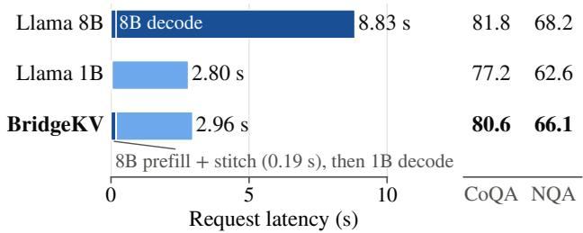
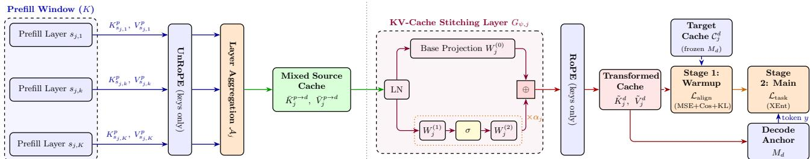
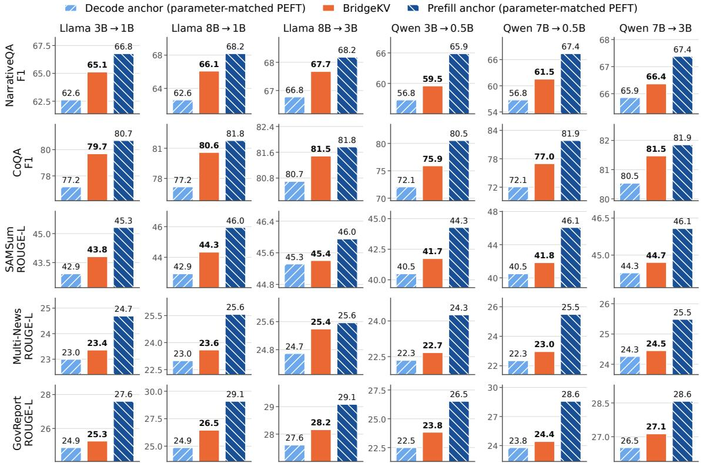
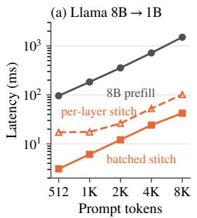
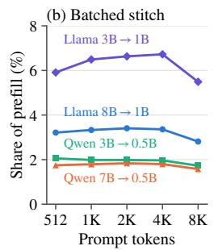

# BRIDGEKV: LARGE-MODEL PREFILL AND SMALL-MODEL DECODING FOR LLM INFERENCE VIA KV CACHE TRANSLATION

Payman Behnam \* 1 Debopam Sanyal \* 1 Pranav Ponnusamy 1 Kusum Meda Ravi 1 Pranav Sastry 1 Mani Chandana Bandaru 1 Alind Khare 2 Myungjin Lee 3 Alexey Tumanov 1

## ABSTRACT

LLM inference has two phases with different bottlenecks: LLM prefill runs once per request and is computeintensive. Decoding repeats for every output token and is limited by memory bandwidth. To address the challenges associated with this issue, different solutions have been proposed. All of these solutions use the same model for both prefill and decode phases. We propose BridgeKV, which uses a larger model for prefill and a smaller mode of the same family for decoding. A lightweight KV-stitching module translates the larger model’s prompt cache into the smaller model’s cache layout. It handles differences in cache shape and representation through learned local layer mixing and separate nonlinear maps for keys and values. With both models frozen, we train the module to align their caches and make the smaller model follow the larger model’s next-token predictions. A second training stage adds low-rank adapters when further task adaptation is needed. Across six model pairs and five datasets, BridgeKV outperforms fine-tuned small-model baselines with matched trainable parameter budgets in all 30 settings. It closes up to 80% of the quality gap to using the larger model for both phases. On one A40 GPU, Llama-3.1-Instruct-8B→Llama-3.2-Instruct-1B achieves 3.0× faster requests than the larger model alone, with latency close to the smaller model alone. BridgeKV can improve the hardware and system solutions that separate prefill and decode phases across GPUs. A separate serving simulation models request arrivals, queues, and cache transfer. For Llama-3.1-Instruct-70B→Llama-3.2-Instruct-1B, it predicts up to 33.86× faster requests and 27.5× lower energy use than using the larger model for both prefill and decode phases.

## 1 INTRODUCTION

In Transformer-based LLM inference, each request runs in two phases that stress hardware differently. Prefill processes all prompt tokens in parallel and writes their keys and values to the key-value (KV) cache; it is compute-intensive and runs once per request. Decode then generates one token per step, and each step rereads the model weights and the growing KV cache, so decode is memory-bandwidthintensive and runs once per output token (Patel et al., 2024; Zhong et al., 2024). The two phases map directly to the user-facing metrics of LLM serving: prefill largely determines the time to first token (TTFT), and decode determines the time between tokens (TBT). Because its cost repeats for every output token, decode dominates request latency: for Llama-3.1-Instruct-8B on one A40 GPU, prefilling a 1K-token prompt takes 0.19 s, while decoding 256 output tokens takes 8.6 s.

This phase asymmetry has motivated prefill-decode disaggregation. Splitwise (Patel et al., 2024), DistServe (Zhong et al., 2024), and Mooncake (Qin et al., 2025) run prefill and decode on separate GPUs and transfer the KV cache between them, which removes interference between the two phases and raises throughput. Prefill-as-a-Service (Qin et al., 2026) goes further and offloads prefill to another datacenter when KV transfer is cheap enough. All of these systems run the same model on both sides of the transfer. Multi-LLM serving systems share KV caches across models, but only across models with the same architecture: Droid-Speak (Liu et al., 2026), ICaRus (Woo et al., 2026a), and PrefillShare (Woo et al., 2026b) reuse caches between a base model and its task-specific fine-tuned variants, which have the same layer count and KV layout. None of them translates a cache between models with different layer counts or KV dimensions.

Running one model for both phases forces the serving system to choose one point on the latency-accuracy tradeoff. Larger models are more accurate (Kaplan et al., 2020; Hoffmann et al., 2022; Llama Team, AI @ Meta, 2024), but every output token must pass through the full large model. Smaller models decode faster and store a smaller KV cache per token, but are less accurate.

On CoQA, for example, fine-tuned Llama-3.1-Instruct-8B reaches 81.8 F1 against 77.2 for fine-tuned Llama-3.2- Instruct-1B, but its TBT is 4.4× higher in our serving simulation (Section 4.4), and its KV cache takes 4× more memory per token. Prefill pays the cost of the model once per request, while decode pays it once per output token. This asymmetry suggests a phase-aware split: use the larger model for prefill and the smaller model for decode. The split helps only if much of the accuracy advantage of the larger model is carried in its prompt KV cache. We ask: can we use a large modelforprefill and a small modelfor decode, while keeping the cache handoffbetween both models cheap and the accuracy loss small? Figure 1 previews the answer with BridgeKV: prefilling with Llama-3.1-Instruct-8B and decoding with Llama-3.2-Instruct-1B serves a request in 2.96 s on one A40 GPU, close to the 2.80 s of Llama-3.2-Instruct-1B alone and 3.0× faster than Llama-3.1-Instruct-8B alone, and closes most of the accuracy gap between the two models on CoQA and NarrativeQA.

The main obstacle is the KV cache itself. A KV cache is model-specific: its number of layers, its KV-head layout, and its representation space match the model that wrote it, so the prompt cache of a larger model is not directly usable by a smaller one. Even within one model family, the two models store caches of different shapes: Llama-3.1-Instruct-8B writes 32 layers of keys and values with 128-dimensional heads, while Llama-3.2-Instruct-1B expects 16 layers with 64-dimensional heads. The two models also encode the same token in different representation spaces, and both store keys after applying rotary position embeddings (RoPE) (Su et al., 2024), so any map on stored keys must also account for position.

Recent work translates KV caches between models so that the receiving model, which takes over generation, can skip its own prefill. Ridge mapper (Heo et al., 2026) fits this translation to reproduce the cache that the receiving model would build from the prompt itself, so it preserves the behavior of the receiving model but does not aim to improve it. In fact, its target is the representation that the receiver would compute itself, without explicit supervision from the larger model’s predictions. Cache-to-Cache (Fu et al., 2026) improves the output quality of the receiving model by fusing its cache with the cache of another model, but both models must process the full prompt, so the receiving model still runs its own prefill. A large-prefill, small-decode split requires two things: the smaller model must skip its own prefill, and it must use the translated cache to mimic the larger model’s next-token predictions instead of making its usual predictions.

Lately, model stitching methods connect pretrained models of different sizes through a small learned map between intermediate representations (Pan et al., 2023; He et al., 2024; Sanyal et al., 2026; Hu et al., 2025). These works show that the internal representations of related pretrained anchors can be aligned through a small learned map, rather than retraining or distilling an entire new model.

  
Figure 1: Request latency and test accuracy of Llama-3.1-Instruct-8B alone, Llama-3.2-Instruct-1B alone, and BridgeKV with Llama-3.1-Instruct-8B→Llama-3.2- Instruct-1B. Latency is measured on real hardware (Section 4.3). The right columns give test F1 on CoQA and NarrativeQA (NQA).

Inspired by these works, we propose to stitch the KV cache in LLM serving. The larger anchor runs once per request to write the prompt cache, and the smaller anchor reads the stitched cache at every layer and every decode step, with no larger-anchor blocks in the decode loop. Figure 2 shows the components and training stages of BridgeKV. The prefill anchor processes the prompt once and writes its KV cache. A lightweight KV-stitching module maps this cache into the layout of the decode anchor, which then generates every output token on its own after the first token. For each layer of the decode anchor, the module takes a learned weighted combination of a few nearby layers of the prefill anchor and applies separate maps to keys and values. Inspired by ShadowKV (Sun et al., 2025), Empiric (Behnam et al., 2025), and Ridge (Heo et al., 2026), the module removes the RoPE of the prefill anchor before the key map and applies the RoPE of the decode anchor afterward, so the same key map serves every position. We also follow them in initializing the maps with a closed-form least-squares fit to the cache of the decode anchor. With both anchors frozen, we train the module so that the decode anchor, reading the stitched cache, matches the next-token distribution of the prefill anchor, while a cache-alignment loss keeps the stitched cache close to the native cache of the decode anchor. Low-rank adapters (Hu et al., 2022) on the decode anchor form a second training stage for tasks that need further adaptation.

This design gives BridgeKV three serving advantages. First, the decode GPU runs the decode anchor on a cache with its native shape, just as in a standalone deployment, so TBT matches that of the smaller model. Second, stitching runs on the prefill GPU, so its negligible overhead affects only TTFT. Third, stitching occurs before transfer, so the decode GPU receives a cache that incorporates information from the larger model that helps to improve the smaller model’s accuracy.

In summary, BridgeKV makes the following contributions:

• We develop BridgeKV for large-model prefill and small-model decoding within a single request. A learned cache handoff transfers the larger anchor’s prompt representation into the smaller anchor’s native KV-cache layout, so generation uses only the smaller model.

• We introduce a lightweight KV-stitching module with learned local layer aggregation and separate residual nonlinear maps for keys and values. The module connects anchors with different layer counts, KV-head counts, and head dimensions, without changing either model’s architecture.

• We propose a two-stage training recipe that explicitly transfers the larger anchor’s prediction behavior through the stitched cache. The first stage trains only the stitching module, combining cache alignment with next-token distillation while keeping both anchors frozen. When further task adaptation is needed, the second stage jointly trains the stitching module and low-rank adapters on the decode anchor.

• We evaluate BridgeKV on five datasets and six model pairs. It outperforms fine-tuned small-model baselines with matched trainable parameter budgets in all 30 settings and closes up to 80% of the gap to the larger anchor. On one A40 GPU, Llama-3.1-Instruct-8B→Llama-3.2-Instruct-1B achieves 3.0× faster requests than Llama-3.1-Instruct-8B alone, taking 2.96 s compared with 2.80 s for Llama-3.2-Instruct-1B alone, for a 1K-token prompt and 256 output tokens. Serving simulations further show that BridgeKV complements prefill-decode disaggregation, with up to 33.86× faster requests and 27.5× lower energy use for Llama-3.1- Instruct-70B→Llama-3.2-Instruct-1B compared with the larger anchor alone for both phases.

## 2 MOTIVATION AND RELATED WORK

## 2.1 Why multi-model prefill and decode?

For a request with $N _ { \mathrm { o u t } }$ generated tokens, we use the standard decomposition

$$
T _ { \mathrm { r e s p o n s e } } = T _ { \mathrm { T T F T } } + N _ { \mathrm { o u t } } \cdot T _ { \mathrm { T B T } } ,\tag{1}
$$

where $T _ { \mathrm { T F T } }$ captures the time to produce the first token and $T _ { \mathrm { T B T } }$ is the average time between generated tokens. This decomposition matters because prefill mainly affects $T _ { \mathrm { T T F T } }$ , while decode mainly affects $T _ { \mathrm { T B T } }$ and output throughput.

Different LLMs expose different TTFT and TBT tradeoffs. A larger model often provides stronger prompt understanding and higher task quality, but it also has a higher decode cost because every generated token requires another forward pass through the larger network and transfers of a large KV cache between memory and compute units. A smaller model usually has lower TBT, so it can generate more output tokens per unit time and serve more requests under the same latency deadline. Therefore, using one fixed model for both phases can be inefficient.

Table 1: Deadline-driven serving motivation under a 2- minute deadline.
<table><tr><td>Serving strategy</td><td>Prefill model</td><td>Decode model</td><td>Res. time</td><td>Served req.</td></tr><tr><td>Large model</td><td>Llama-3.1-Instruct-8B</td><td>Llama-3.1-Instruct-8B</td><td>39.80 s</td><td>3</td></tr><tr><td>Small model</td><td>Llama-3.2-Instruct-1B</td><td>Llama-3.2-Instruct-1B</td><td>9.05 s</td><td>13</td></tr></table>

Table 1 illustrates the latency-quality tradeoff that motivates multi-model serving. Using Llama-3.1-Instruct-8B for the whole request provides the stronger model throughout, but completes only 3 requests within a 2-minute deadline. Using Llama-3.2-Instruct-1B for the whole request completes 13 requests, but processes both the prompt and the generation with the smaller model. This suggests a better split: use Llama-3.1-Instruct-8B for prefill and Llama-3.2-Instruct-1B for decode. This multi-model setting also completes 13 requests, giving 333.3% more completed requests than large-only serving while preserving large-model prompt processing.

The key challenge is that this split is not possible by simply copying the KV cache from the large model to the small model. The cache produced by the prefill anchor lives in the representation space of that anchor, while the decode anchor expects a cache with its own layer structure and attention geometry. BridgeKV addresses this missing piece by learning a lightweight KV cache handoff.

## 2.2 Related work

Prefill-decode disaggregation. Splitwise (Patel et al., 2024), DistServe (Zhong et al., 2024), and Mooncake (Qin et al., 2025) place prefill and decode on different resources to match their compute and memory bottlenecks. Prefill-as-a-Service (Qin et al., 2026) extends this approach to remote prefill clusters when cache transfer is cheap enough. These systems separate the phases but keep the same model. BridgeKV instead uses anchors of different sizes, so the handoff must translate the prompt cache into the representation space of the decode anchor.

Cross-model KV cache reuse. DroidSpeak (Liu et al., 2026) reuses caches among fine-tuned variants of one base model and recomputes a few sensitive layers. ICaRus (Woo et al., 2026a) and PrefillShare (Woo et al., 2026b) share a frozen cache-producing prefill module across task-specific decoders, and PrefillShare integrates this sharing into a disaggregated serving system. aLoRA (Greenewald et al.,

  
Figure 2: Overview of main components in BridgeKV. The left side shows windowed layer mapping while the right side illustrates KV cache stitching and the two training stages. For keys, the RoPE of $M _ { p }$ is removed before the stitching layer and the RoPE of $M _ { d }$ is applied after it.

2025) lets an activated adapter reuse the prefix cache of its base model. All of them rely on a common backbone, whereas BridgeKV connects distinct anchors with different depths and KV dimensions. Cache-to-Cache (Fu et al., 2026) supports distinct backbones, but fuses their caches after the receiving model also processes the full prompt.

Cache translation is more closely related. Closed-form ridge maps (Heo et al., 2026) reuse caches between models with matched KV heads and head dimensions, and HeteroFold (Yun et al., 2026) adds structural alignment and output-aware calibration for cross-family transfer. RaReCache (Sarkar et al., 2026) combines calibrated maps with selective recomputation in the receiving model and also reports large-to-small transfer without recomputation. Large-prefill, small-decode execution alone therefore does not distinguish BridgeKV. The difference is the training target: these translators fit the cache or the predictions of the receiving model, whereas BridgeKV trains the stitched cache so that the smaller model predicts like the larger one. BridgeKV also learns its layer mixture jointly with residual nonlinear maps instead of fixing the source layers in advance. Appendix F compares these designs and other cache-transfer methods in more detail.

Model stitching. SN-Net (Pan et al., 2023), ESTA (He et al., 2024), and KLAS (Sanyal et al., 2026) connect pretrained model blocks through lightweight transformations to balance accuracy and cost. StitchLLM (Hu et al., 2025) brings block stitching to LLM serving by combining a bottom block from one model with a top block from another, so its generation path still executes large-model blocks. BridgeKV stitches the prompt cache at the phase boundary, after which decoding uses only the smaller anchor.

Small-model adaptation and distillation. Supervised finetuning (Wei et al., 2022), adapters (Houlsby et al., 2019), and LoRA-style methods (Hu et al., 2022; Dettmers et al., 2023; Liu et al., 2024) improve a model through offline adaptation, and distillation methods such as MiniLLM (Gu et al., 2024) transfer the behavior of a teacher into a student during training. In their standard serving recipes, the adapted small model still processes each prompt itself, whereas

BridgeKV supplies a stitched cache from the larger model for each request. The approaches are complementary: our small-anchor baselines are already fine-tuned on each task, BridgeKV can optionally add adapters to the decode anchor, and its distillation loss trains the KV-stitching module rather than the backbone of the student.

Routing, cascades, and speculative decoding. RouteLLM (Ong et al., 2025) selects a model for each request, and FrugalGPT (Chen et al., 2024) can escalate a request through a cascade of model calls. These methods choose which model answers and do not transfer the prompt cache of a large model to a smaller decoder. Speculative decoding (Leviathan et al., 2023; Chen et al., 2023) uses a small draft model and verification by the large model to preserve the output distribution of the large model, so the large model stays active during generation and the speedup depends on draft acceptance. BridgeKV targets a different tradeoff: after the cache handoff, generation runs only in the small model, without a guarantee of matching the distribution of the large model.

## 3 PROPOSED METHOD

## 3.1 Overview

Let $M _ { p }$ be the prefill anchor and $M _ { d }$ the decode anchor, two models of one family that share a tokenizer and have $L _ { p }$ and $L _ { d }$ layers. Running $M _ { p }$ on a prompt $x _ { 1 : S }$ produces the prompt cache $\mathcal { C } ^ { p } = \{ ( K _ { \ell } ^ { p } , V _ { \ell } ^ { p } ) \} _ { \ell = 1 } ^ { L _ { p } }$ and the first output token. Running $M _ { d }$ on the same prompt would produce its native cache $\bar { \mathcal { C } ^ { d } } = \{ ( K _ { j } ^ { d } , V _ { j } ^ { d } ) \} _ { j = 1 } ^ { L _ { d } ^ { \star } }$ , which differs from ${ \mathcal { C } } ^ { p }$ in the number of layers, the KV-head layout, and the representation space (Table 2). BridgeKV replaces the prefill of $M _ { d }$ with a KV-stitching module $G _ { \psi }$ with trainable parameters ψ, which maps ${ \mathcal { C } } ^ { p }$ to a stitched cache $\tilde { \mathcal { C } } ^ { d } = G _ { \psi } ( \mathcal { C } ^ { p } )$ with the shape of $\mathcal { C } ^ { d } . ~ M _ { d }$ then generates every later token from $\tilde { \mathcal { C } } ^ { d }$ and appends its own keys and values for each new token, so the cache is stitched only once per request. In all our experiments, $M _ { p }$ is the larger model, so the larger model runs once per request and the smaller model runs once per output token.

We train $G _ { \psi }$ so that $M _ { d }$ , reading $\tilde { \mathcal { C } } ^ { d }$ , predicts like $M _ { p }$ (Section 3.4). For each layer j of $M _ { d } , G _ { \psi }$ first applies a windowed layer mapping that combines a few layers of $M _ { p }$ (Section 3.2) and then key and value stitching layers that map the result into the space of $M _ { d }$ (Section 3.3):

$$
\tilde { K } _ { j } ^ { d } = G _ { \psi , j } ^ { K } \big ( \bar { K } _ { j } ^ { p \to d } \big ) , \qquad \tilde { V } _ { j } ^ { d } = G _ { \psi , j } ^ { V } \big ( \bar { V } _ { j } ^ { p \to d } \big ) ,\tag{2}
$$

where $\bar { K } _ { i } ^ { p \to d }$ and ${ \bar { V } } _ { i } ^ { p \to d }$ are the keys and values that the mapping assigns to layer $j \colon$ a learned mixture or a concatenation of a few layers of $M _ { p }$ . Figure 2 shows both components and the two training stages. The stitched cache is $\tilde { \mathcal { C } } ^ { d } = \{ ( \tilde { K } _ { j } ^ { d } , \tilde { V } _ { j } ^ { d } ) \} _ { j = 1 } ^ { L _ { d } }$ . Section 3.5 describes how BridgeKV serves requests.

## 3.2 Windowed layer mapping

The simplest choice maps each decode layer to the prefill layer at the same relative depth. However, the prefill layer whose cache best predicts a given decode layer need not sit at that depth, as we find in Appendix D.1, where we explore other mapping policies. Therefore, BridgeKV gives each decode layer a small window of nearby prefill layers and learns how to combine them, jointly with the stitching layers. We combine the window either with a learned weighted sum or by concatenation, as described below.

For each decode layer $j \in \{ 1 , \ldots , L _ { d } \}$ , BridgeKV first finds the prefill layer at the same relative depth,

$$
c _ { j } = 1 + \left\lfloor \frac { ( j - 1 ) ( L _ { p } - 1 ) } { \operatorname* { m a x } ( 1 , L _ { d } - 1 ) } \right\rfloor ,\tag{3}
$$

and takes the window of W consecutive prefill layers centered on $c _ { j }$ , shifted inward at the first and last layers so that it always contains W valid layers:

$$
\begin{array} { r l } & { \mathcal { N } _ { j } = \{ s _ { j } , . . . , s _ { j } + W - 1 \} , } \\ & { ~ s _ { j } = \operatorname* { m a x } \bigl ( 1 , \operatorname* { m i n } ( c _ { j } - \lfloor W / 2 \rfloor , L _ { p } - W + 1 ) \bigr ) . } \end{array}\tag{4}
$$

For Llama-3.1-Instruct-8B→Llama-3.2-Instruct-1B $( L _ { p } =$ 32, $L _ { d } = 1 6 )$ with $W = 3$ , for example, decode layer 1 reads prefill layers 1–3 and decode layer 16 reads prefill layers 30–32.

In the weighted-sum variant, for each decode layer $j ,$ BridgeKV learns separate mixing logits $\beta _ { j } ^ { K } , \beta _ { j } ^ { V } \ \in \ \mathbb { R } ^ { \breve { W } }$ for keys and values, which are part of ψ. The source keys and values for decode layer j are the weighted sums over the window,

$$
\begin{array} { r l } & { \bar { K } _ { j } ^ { p \to d } = \sum _ { r = 1 } ^ { W } w _ { j , r } ^ { K } K _ { s _ { j } + r - 1 } ^ { p } , } \\ & { \bar { V } _ { j } ^ { p \to d } = \sum _ { r = 1 } ^ { W } w _ { j , r } ^ { V } V _ { s _ { j } + r - 1 } ^ { p } , } \end{array}\tag{5}
$$

where $w _ { j } ^ { K } = \operatorname { s o f t m a x } ( \beta _ { j } ^ { K } )$ and $w _ { j } ^ { V } = \mathrm { s o f t m a x } ( \beta _ { j } ^ { V } )$ are the mixing weights for keys and values, respectively. We initialize the logit of the middle window position to 1 and the others to 0, so the initial weights favor the middle layer of the window, which is $c _ { j }$ except at the first and last layers (for $W = 3$ , the initial weights are 0.21, 0.58, and 0.21). Keys and values share the window but have separate weights, so each can draw on different prefill layers.

The stitching layers of Eq. (2) act on each prompt token separately. For decode layer $j , G _ { \psi , } ^ { K }$ takes the mixed keys of one token, flattened across KV heads into a vector of size $H _ { \mathrm { k v } } ^ { p } d _ { h } ^ { p } .$ , and outputs a vector of size $H _ { \mathrm { k v } } ^ { d } d _ { h } ^ { d }$ , which is reshaped into the head layout of $M _ { d } ; G _ { \psi , j } ^ { V }$ does the same for values (Section 3.3). The mixing weights are trained jointly with the stitching layers. The concatenation variant replaces the weighted sum of Eq. (5) by concatenating the W window layers along the feature dimension and lets the stitching layer learn the combination. Its input is W times wider, which is affordable for the Qwen anchors, whose perlayer KV width $H _ { \mathrm { k v } } d _ { h }$ is 128 to 512 (Table 2); we select the variant on the validation split, which picks the weighted sum for every Llama pair and concatenation for every Qwen pair (Appendix C).

## 3.3 KV cache stitching layer

The key and value stitching layers $G _ { \psi , j } ^ { K }$ and $G _ { \psi , j } ^ { V }$ share one residual form with separate parameters:

$$
G _ { \psi , j } ( z ) = P _ { j } \bar { z } + b _ { j } + \alpha _ { j } D _ { j } \sigma ( U _ { j } \bar { z } ) , \qquad \bar { z } = \mathrm { L N } ( z ) ,\tag{6}
$$

where z is the input vector of one token, LN is LayerNorm, and $\sigma$ is GELU. The linear projection $P _ { j }$ maps the KV width of $M _ { p }$ to that of $M _ { d }$ , and the branch $D _ { j } \sigma ( U _ { j } { \bar { z } } )$ whose hidden width is four times the smaller of the two widths, corrects what a linear map misses. A purely linear map would be cheaper, but we find that linear cross-model KV maps degrade sharply (Appendix D.2). The residual scale $\alpha _ { j }$ is learned and starts at $1 0 ^ { - 3 }$ , so each stitching layer begins as the linear map, and adds the nonlinear correction during training.

Rotary position embeddings. Both anchors store keys after applying their rotary position embedding (RoPE) (Su et al., 2024), which rotates each key by angles that depend on its position. The angles also depend on the head dimension, so they differ between the anchors (e.g., 128 for Llama-3.1- Instruct-8B and 64 for Llama-3.2-Instruct-1B). A fixed map applied to rotated keys would in general have to depend on the position of the token. To avoid this position dependence, we undo the RoPE of $M _ { p }$ on the source keys, apply the key stitching layer, and then apply the RoPE of $M _ { d } \mathbf { \mathrm { : } }$

$$
\begin{array} { r } { \tilde { K } _ { j , t } ^ { d } = R _ { t } ^ { d } G _ { \psi , j } ^ { K } \big ( ( R _ { t } ^ { p } ) ^ { \top } \bar { K } _ { j , t } ^ { p  d } \big ) , } \end{array}\tag{7}
$$

where t is the prompt position, which is the same in both anchors because they share a tokenizer, and $R _ { t } ^ { p }$ and $R _ { t } ^ { d }$ are the RoPE rotations of the two anchors at position t. One stitching layer thus serves every position. All layers of $M _ { p }$ apply the same rotation $R _ { t } ^ { p }$ , so undoing it on each source layer before the weighted sum of Eq. (5) is equivalent to undoing it on the sum. RoPE rotates only queries and keys, so the stored values carry no position-dependent rotation and go to the value stitching layer directly. This follows prior work that operates on keys before RoPE (Sun et al., 2025; Behnam et al., 2025) and the cross-model cache mapping of Heo et al. (2026).

Initialization. We initialize the linear projection of every stitching layer in closed form. We run both anchors on 512 training examples and sample up to 256 positions from each. For decode layer $j ,$ , the rows of $X _ { j }$ are the inputs of $G _ { \psi , j }$ at these positions, computed with the initial mixing weights, with keys un-rotated, and after LayerNorm. The rows of $Y _ { j }$ are the keys or values that $M _ { d }$ itself writes at the same positions, with keys also un-rotated. With $\hat { X } _ { j } = [ X _ { j } , \mathbf { 1 } ]$ we set

$$
\left[ \begin{array} { l } { \boldsymbol { P } _ { j } ^ { \top } } \\ { \boldsymbol { b } _ { j } ^ { \top } } \end{array} \right] = \left( \hat { X } _ { j } ^ { \top } \hat { X } _ { j } + \lambda I \right) ^ { - 1 } \hat { X } _ { j } ^ { \top } \boldsymbol { Y } _ { j } ,\tag{8}
$$

where $\lambda$ is $1 0 ^ { - 3 }$ times the mean diagonal entry of $\hat { X } _ { i } ^ { \top } \hat { X } _ { j }$ $P _ { j }$ maps the full KV width of a token, so it applies directly when the anchors differ in the number of KV heads or in the head dimension. The fit starts $G _ { \psi , j }$ at a regularized least-squares fit to the native cache of $M _ { d }$ , and training (Section 3.4) then moves it toward the predictions of $M _ { p }$ Appendix D.2 compares other stitching-layer designs.

The trainable parameters ψ of the KV-stitching module are, for every decode layer $j ,$ the mixing logits $\beta _ { j } ^ { K }$ and $\beta _ { j } ^ { V }$ (weighted-sum variant only) and, for both $G _ { \psi , j } ^ { K }$ and $G _ { \psi , j } ^ { V } ,$ the parameters $P _ { j } , b _ { j } , U _ { j } , D _ { j } , \alpha _ { j }$ , and those of the LayerNorm. Both anchors stay frozen while $\psi$ is trained, so in settings that use only this stage, $M _ { d }$ decodes with exactly the weights of the fine-tuned baseline that matches the number of trainable parameters of the stitched model. For Llama-3.1-Instruct-8B→Llama-3.2-Instruct-1B, ψ has 118M parameters, 12% of the non-embedding parameters of Llama-3.2-Instruct-1B, and the module runs only once per request, at the handoff (Section 3.5). When a task needs further adaptation, a second stage also trains low-rank adapters η on $M _ { d }$ (Section 3.4).

## 3.4 Training objective

Training has two stages. The first stage trains only ψ, with both anchors frozen, and combines two losses: an alignment loss that keeps the stitched cache close to the native cache of $M _ { d }$ , and a distillation loss that makes $M _ { d }$ , reading the stitched cache, match the next-token distribution of $M _ { p }$ The alignment loss alone would at best recover the accuracy of $M _ { d } ;$ the distillation loss is what carries the accuracy advantage of $M _ { p }$ into the smaller model. Prior cross-model cache translators instead fit the cache or the outputs of the receiving model itself (Heo et al., 2026; Yun et al., 2026; Sarkar et al., 2026) (Section 2.2). The second stage continues training ψ together with low-rank adapters η on $M _ { d }$ for the downstream task, when required.

For a training example $( x , y )$ , we run $M _ { p }$ on the prompt x to obtain ${ \mathcal { C } } ^ { p }$ and the stitched cache $\tilde { \mathcal { C } } ^ { d } = G _ { \psi } ( \mathcal { C } ^ { p } )$ , and we run $M _ { d }$ on x to obtain its native cache $\mathcal { C } ^ { d }$ . The alignment loss compares the two caches layer by layer, for keys and for values:

$$
\mathcal { L } _ { \mathrm { a l i g n } } ( \psi ) = \frac { 1 } { L _ { d } } \sum _ { j = 1 } ^ { L _ { d } } \sum _ { Z \in \{ K , V \} } \ell \bigl ( \tilde { Z } _ { j } ^ { d } , Z _ { j } ^ { d } \bigr ) ,\tag{9}
$$

where $\ell ( a , b ) = \mathrm { M S E } ( a , b ) + \lambda _ { \mathrm { c o s } } \left( 1 - \cos ( a , b ) \right)$ , the cosine similarity is averaged over corresponding vectors of the two caches, and $\lambda _ { \mathrm { c o s } } ~ = ~ 0 . 5$ . The MSE term aligns the scale of the cache entries, and the cosine term matches their direction.

The distillation loss compares the predictions of the two anchors on the reference output y. We feed $y$ with teacher forcing to $M _ { p } ,$ which reads it after its own cache ${ \mathcal { C } } ^ { p } .$ , and to $M _ { d } ,$ which reads it after the stitched cache $\tilde { \mathcal { C } } ^ { d }$ . With $p _ { t } ^ { p } \ : = \ : p _ { M _ { p } } ( \cdot \ : | \ : \mathcal { C } ^ { p } , y _ { < t } )$ and $p _ { t } ^ { d } = p _ { M _ { d } } ( \cdot \mid \tilde { \mathcal { C } } ^ { d } , y _ { < t } )$ , the distillation loss is

$$
\mathcal { L } _ { \mathrm { K L } } ( \psi ) = \frac { 1 } { | y | } \sum _ { t = 1 } ^ { | y | } \mathrm { K L } \big ( p _ { t } ^ { p } \big | \big | p _ { t } ^ { d } \big ) ,\tag{10}
$$

and the first-stage objective is

$$
\operatorname* { m i n } _ { \psi } \ \mathcal { L } _ { \mathrm { a l i g n } } ( \psi ) + \lambda _ { \mathrm { K L } } \mathcal { L } _ { \mathrm { K L } } ( \psi ) + \lambda _ { \mathrm { r e c } } \mathcal { L } _ { \mathrm { r e c } } ( \psi ) .\tag{11}
$$

We use $\lambda _ { \mathrm { K L } } = 0 . 1$ 1 by default, and the validation search selects 0.05 or 0.5 in a few settings. In a few settings, we also add an optional reconstruction term $\mathcal { L } _ { \mathrm { r e c } }$ with $\lambda _ { \mathrm { r e c } } =$ 1. The term trains a linear decoder to recover the prefill layer at the center of each window from the stitched cache. It keeps the module from discarding information that the native cache of $M _ { d }$ lacks.

In the second stage, we train ψ together with low-rank adapters (LoRA) (Hu et al., 2022) η on $M _ { d } .$ , using the teacher-forced cross entropy of $M _ { d }$ on the stitched cache:

$$
\mathcal { L } _ { \mathrm { t a s k } } ( \psi , \eta ) = - \sum _ { t = 1 } ^ { | y | } \log p _ { M _ { d } } \bigl ( y _ { t } \mid G _ { \psi } ( \mathcal { C } ^ { p } ) , y _ { < t } ; \eta \bigr ) .\tag{12}
$$

The target $y$ is either the reference output or the output that $M _ { p }$ generates for x (sequence-level distillation (Kim & Rush, 2016)), and ${ \mathcal { L } } _ { \mathrm { K L } }$ can be added with weight 0.5.

For each model pair and dataset, we decide on the validation set whether to use this stage and with which target (Section 4.1).

We keep the checkpoint with the lowest validation loss; Algorithm 1 in Appendix A gives the full training procedure. We also explore alternative schemes in Appendix D,

Table 2: The six anchors. L: layers; $H _ { \mathrm { k v } } \times d _ { h } \colon$ KV heads × head dimension; κ: KV-cache bytes per token in bf16.
<table><tr><td>Model</td><td>L</td><td> $H _ { \mathrm { k v } } \times d _ { h }$ </td><td>κ (KiB)</td></tr><tr><td>Llama-3.2-Instruct-1B</td><td>16</td><td> $8 \times 6 4$ </td><td>32</td></tr><tr><td>Llama-3.2-Instruct-3B</td><td>28</td><td> $8 \times 1 2 8$ </td><td>112</td></tr><tr><td>Llama-3.1-Instruct-8B</td><td>32</td><td> $8 \times 1 2 8$ </td><td>128</td></tr><tr><td>Qwen2.5-Instruct-0.5B</td><td>24</td><td> $2 \times 6 4$ </td><td>12</td></tr><tr><td>Qwen2.5-Instruct-3B</td><td>36</td><td> $2 \times 1 2 8$ </td><td>36</td></tr><tr><td>Qwen2.5-Instruct-7B</td><td>28</td><td> $4 \times 1 2 8$ </td><td>56</td></tr></table>

discussing their advantages and limitations, presenting results and insights, and outlining future directions. Table 16 provides a summary.

## 3.5 Inference and serving

At inference time, the evaluation pipeline loads the trained stitched model, loads adapter checkpoint weights, preprocesses the test split with the same tokenizer and formatting policy used during training, generates outputs with a fixed maximum generation length, and reports task accuracy metrics. The details of the algorithm are in Appendix $\mathrm { A } .$ BridgeKV is compatible with both colocated and disaggregated serving. In a colocated setting, $M _ { p } , G _ { \psi } ,$ and $M _ { d }$ can run on the same node, avoiding network transfer and focusing on compute and latency tradeoffs. In a disaggregated setting, the transformed cache can be transferred to decode workers, similar to prior prefill-decode systems (Patel et al., 2024; Zhong et al., 2024). The key difference is that BridgeKV transfers a decode-anchor-compatible cache, enabling the decode cluster to run the smaller model.

## 4 EXPERIMENTS AND RESULTS

## 4.1 Experimental setting

We evaluate BridgeKV on multi-model prefill-decode pairs from two instruction-tuned model families. For the Llama family, we use Llama-3.2-Instruct models at 1B and 3B scales and Llama-3.1-Instruct-8B as the larger anchor (Llama Team, AI @ Meta, 2024; Meta, 2024). For the Qwen family, we use Qwen2.5-Instruct models at 0.5B, 3B, and 7B scales (Qwen Team, 2024). We consider six multi-model handoff settings. For Llama-Instruct, we evaluate 3B→1B, 8B→1B, and 8B→3B handoffs. For Qwen-Instruct, we evaluate 3B→0.5B, 7B→0.5B, and 7B→3B handoffs. In each pair, the first model denotes the larger prefill anchor and the second model denotes the smaller decode anchor, and the anchors of one family share a tokenizer. Table 2 lists the layer count, KV layout, and per-token KVcache size of each anchor.

We evaluate BridgeKV on several datasets from Long-Bench (Bai et al., 2024). We select representative tasks that stress different long-context abilities: single-document question answering, summarization, and few-shot learning.

For single-document QA, we use NarrativeQA (Kociskýˇ et al., 2018), with the plot summary of each story as the context. For summarization, we use GovReport (Huang et al., 2021) and Multi-News (Fabbri et al., 2019). For few-shot learning, we use SAMSum (Gliwa et al., 2019). We also evaluate on CoQA (Reddy et al., 2019), a conversational QA dataset outside LongBench, where each question also depends on the earlier turns. Appendix B gives the prompt lengths, output lengths, and test-set sizes.

We evaluate the system-level behavior of BridgeKV using a Splitwise-style discrete-event simulator (Patel et al., 2024) to model machine pools, queues, schedulers, and KV-cache transfer. More details are in Section 4.4 and Appendix E.1

## 4.1.1 Hyperparameter tuning

We describe the key hyperparameters governing the windowed layer mapping, stitching layer capacity, and optimization schedule, along with the empirical rationale for each choice. For each model pair and dataset, we select the configuration from these options on the validation split and evaluate it once on the test split. Appendix C lists the training stages selected for every setting.

Window size. The windowed layer mapping uses a local window of $W = 3$ prefill layers per decode layer by default. A window of $W = 1$ reduces to a rigid one-to-one mapping that cannot compensate for representational depth mismatch between anchors. Larger windows $( W \geq 6 )$ increase the number of trainable mixing weights without consistent downstream gains, suggesting that the relevant source information is concentrated in a narrow neighborhood. $W = 3$ provides sufficient flexibility to interpolate across the local depth neighborhood while keeping the mixing-weight overhead minimal.

Stitching layer capacity. To prevent overfitting when mapping between distinct latent spaces, we constrain the LoRA rank of the second stage to $r \in \{ 8 , 1 6 \}$ and fix the scaling factor to $\alpha = 2 r$ . The MLP hidden expansion factor γ controls the intermediate dimensionality between $U _ { j }$ and $D _ { j } ;$ a larger γ increases the capacity of the nonlinear branch but risks overfitting to the training cache distribution, while a smaller γ keeps the transformation closer to the base linear projection. $\gamma = 4$ provides sufficient capacity for the nonlinear correction while keeping the stitching layers small, so we fix it for every model pair. The LoRA adapters use dropout 0.1, and the stitching layers use no dropout.

Residual scale initialization. We initialize $\alpha _ { j } ~ = ~ 1 0 ^ { - 3 }$ for every model pair (Section 3.3), small enough to avoid large perturbations in the early optimization steps while still letting the nonlinear correction grow during training.

Loss weighting. The cosine similarity weight $\lambda _ { \mathrm { c o s } }$ balances numerical and directional alignment between the stitched and native caches, and a single shared value of $\lambda _ { \mathrm { c o s } } = 0 . 5$ works for both model families. The weight of the distillation term is selected from $\lambda _ { \mathrm { K L } } \in \{ 0 . 0 5 , 0 . 1 , 0 . 5 \}$ , with 0.1 as the default, and the reconstruction term is either off or used with $\lambda _ { \mathrm { { r e c } } } = 1$

Optimization schedule. Stable gradient estimates require a minimum batch size of 16; smaller batches produced noisy alignment loss and inconsistent convergence, so we use an effective batch size of 32. Training proceeds in two stages: a first stage of 1 to 5 epochs with a learning rate of $5 \times 1 0 ^ { - 4 }$ , during which only $G _ { \psi }$ receives gradients to align the two representation spaces, followed by an optional second stage of 1 or 2 epochs with a learning rate in $\{ 5 \times 1 0 ^ { - 5 } , 1 0 ^ { - 4 } , 2 \times 1 0 ^ { - 4 } \}$ and weight decay 0.05. The first stage is necessary because the optimization landscape for cross-model cache alignment is considerably harder than standard task fine-tuning, and premature transitions to the task loss sharply lowered accuracy in preliminary experiments (Appendix D.6).

## 4.2 Task-quality results

We compare BridgeKV with its two anchors, each finetuned on the task with LoRA, using the same number of trainable parameters as the stitched model. BridgeKV uses these fine-tuned anchors as its prefill anchor and decode anchor. We report the metrics that LongBench (Bai et al., 2024) uses: token F1 on NarrativeQA and ROUGE-L (Lin, 2004) on SAMSum, Multi-News, and GovReport. CoQA is not part of LongBench, so we report its official metric, token F1 (Reddy et al., 2019), computed with the same normalization. We select configurations and decoding on the validation split with the same metrics.

Figure 3 shows how the proposed BridgeKV can increase the accuracy of the decode anchor across various datasets and models. For every plotted setting, BridgeKV improves over the fine-tuned decode anchor while keeping the same small model for generation. However, the magnitude of the gain depends on the task and model pair. As shown, BridgeKV improves the accuracy of the directly finetuned decode anchor by up to 8.4% relative (NarrativeQA, for Qwen2.5-Instruct-7B→Qwen2.5-Instruct-0.5B). In the worst case, the relative improvement is 0.2% (SAMSum, for Llama-3.1-Instruct-8B→Llama-3.2-Instruct-3B), while BridgeKV can reach almost the same latency, throughput, and energy efficiency as serving with the smaller model (Section 4.4). This is achieved with low retraining costs. In 12 of the 30 settings, the selected configuration uses only the first stage of training (Appendix C), so $M _ { d }$ decodes with exactly the weights of its fine-tuned baseline, and BridgeKV still scores higher in all 12. In these settings, the gain comes from the stitched cache alone, not from extra trainable parameters on the decode side.

Table 3: Training cost in A40 GPU-hours of the two stages of the KV-stitching module and of a PEFT baseline that fine-tunes the decode anchor with LoRA at a parametermatched rank. $\ddot { \cdot } \stackrel { \triangledown } { \cdot } \stackrel { \triangledown } { \cdot } \stackrel { \triangledown } { \cdot } \stackrel { \triangledown } { \cdot }$ : the setting uses only the first stage. The PEFT rank is matched to the stitched model of each row, so it differs between rows with the same decode anchor, and training stops early on the validation loss.
<table><tr><td>Dataset</td><td>Pair</td><td></td><td>Stage 1 Stage 2 PEFT</td><td></td></tr><tr><td rowspan="4">NarrativeQA</td><td>Llama 3B→1B</td><td>2.1</td><td>一</td><td>2.4</td></tr><tr><td>Llama 8B→1B</td><td>3.3</td><td>一</td><td>3.4</td></tr><tr><td>Qwen 3B→0.5B</td><td>1.7</td><td>1.7</td><td>3.9</td></tr><tr><td>Qwen 7B→0.5B</td><td>2.7</td><td>1.1</td><td>4.3</td></tr><tr><td rowspan="4">SAMSum</td><td>Llama 3B→1B</td><td>0.4</td><td>0.4</td><td>1.2</td></tr><tr><td>Llama 8B→1B</td><td>1.6</td><td>0.6</td><td>2.4</td></tr><tr><td>Qwen 3B→0.5B</td><td>1.0</td><td>0.4</td><td>2.4</td></tr><tr><td>Qwen 7B→0.5B</td><td>1.5</td><td>0.6</td><td>2.4</td></tr><tr><td rowspan="4">GovReport</td><td>Llama 3B→1B</td><td>8.2</td><td>一</td><td>37.8</td></tr><tr><td>Llama 8B→1B</td><td>12.1</td><td></td><td>37.8</td></tr><tr><td>Qwen 3B→0.5B</td><td>6.2</td><td>5.1</td><td>31.3</td></tr><tr><td>Qwen 7B→0.5B</td><td>9.7</td><td>2.1</td><td>24.8</td></tr><tr><td rowspan="4">Multi-News</td><td>Llama 3B→1B</td><td>5.2</td><td></td><td></td></tr><tr><td>Llama 8B→1B</td><td>7.7</td><td>7.5 4.1</td><td>23.5 22.3</td></tr><tr><td>Qwen 3B→0.5B</td><td>6.9</td><td>3.7</td><td>14.1</td></tr><tr><td>Qwen 7B→0.5B</td><td>6.2</td><td>2.0</td><td>15.1</td></tr></table>

Table 3 compares the training cost of the KV-stitching module with that of the parameter-matched PEFT baseline, which fine-tunes the decode anchor alone with LoRA at the same number of trainable parameters as the stitched model. Training the module is cheaper in every setting. The PEFT baseline therefore receives the same number of trainable parameters and a larger training budget than the KV-stitching module, and BridgeKV still scores higher in every setting.

## 4.3 Experiments on real hardware

This subsection measures on real hardware what the KV handoff of BridgeKV costs and how long a complete request takes. We run the anchors and the KV-stitching module in bf16 with Hugging Face Transformers on one NVIDIA A40 GPU at batch size 1, and report the median of 20 runs after 3 warmup runs. We measure the four pairs with a 1B or 0.5B decode anchor, at prompt lengths from 512 to 8K tokens.

A direct implementation of $G _ { \psi }$ follows Section 3.3 layer by layer. This per-layer implementation loops over the $L _ { d }$ decode layers and over keys and values, so it launches $2 L _ { d }$ chains of small GPU kernels, and the fixed launch cost of each kernel dominates its running time. All stitching layers of a pair have the same shapes, so the batched implementation stacks their weights and runs the whole module in one pass. The pass undoes the RoPE of $M _ { p }$ on every source key once, forms the input of every decode layer, the weighted sum of Eq. (5) or the concatenation of its window (Section 3.2), with one batched operation, applies LayerNorm, evaluates Eq. (6) for all layers with three batched matrix multiplications, and applies the RoPE of $M _ { d } ;$ we compile the pass with torch.compile (Ansel et al., 2024).

  
Figure 3: Test accuracy of the decode anchor, BridgeKV, and the prefill anchor for each model pair (columns) and dataset (rows), measured with token F1 on NarrativeQA and CoQA and with ROUGE-L on the other datasets. Both anchors are fine-tuned with LoRA at a rank that matches the number of trainable parameters of the stitched model, so the gain of BridgeKV does not come from training more parameters. The decode anchor generates every output token of BridgeKV after the first one. The y-axes do not start at zero and differ between panels

  
Figure 4: Cost of the KV-stitching module, measured on real hardware (one A40 GPU, batch size 1). (a) For Llama-3.1-Instruct-8B→Llama-3.2-Instruct-1B, prefill time of the 8B anchor and stitching time of the per-layer and batched implementations, on a log scale. (b) Stitching time of the batched implementation as a share of the prefill time of the larger anchor, for the four pairs with a 1B or 0.5B decode anchor; all modules use a window of $W = 3 .$

The batched implementation adds 1.6–6.7% to the prefill time of the prefill anchor across the four pairs, whereas the per-layer implementation adds 5–51% (Figure 4b). For Llama-3.1-Instruct-8B→Llama-3.2-Instruct-1B, the batched implementation takes 3–42 ms against 96–1504 ms of prefill, and its time grows with prompt length at roughly the same rate as prefill (Figure 4a). The module runs on the prefill GPU before the transfer, so this cost adds only to TTFT. We also measure the end-to-end latency of one Llama-3.1-Instruct-8B→Llama-3.2-Instruct-1B request with a 1Ktoken prompt and 256 output tokens, where prefill emits the first output token. BridgeKV prefills with Llama-3.1- Instruct-8B (0.19 s), stitches the cache (6 ms), and decodes with Llama-3.2-Instruct-1B at 10.9 ms per token, against 33.9 ms per token for Llama-3.1-Instruct-8B. The request takes 2.96 s, close to the 2.80 s of Llama-3.2-Instruct-1B alone and 3.0× faster than the 8.83 s of Llama-3.1-Instruct-8B alone (Figure 1).

## 4.4 System-side performance model

We evaluate the system-level behavior of BridgeKV using the same Splitwise-style simulator (Patel et al., 2024). The main goal here is to show that our approach can be combined with disaggregated hardware solutions (e.g., Splitwise (Patel et al., 2024), DistServe (Zhong et al., 2024)) to further improve them. Its results differ from the measurements of

Section 4.3 because the simulator models a disaggregated deployment that serves many requests at once and includes queueing delay, KV cache transfer overhead, etc. Unless otherwise stated, the main system results use a 200-request trace with 1024 input tokens and 1024 output tokens per request. Request arrivals follow an exponential distribution with an arrival rate of 2.0 requests/s. We keep the Llama-3.1-Instruct-8B→Llama-3.2-Instruct-1B setting in the main paper and discuss the results when the parameter gap between prefill anchor and decode anchor increases, and move other models and sensitivity studies to Appendix E. We report response time, TTFT, TBT, throughput, and energy. Throughput is computed from the decode rate.

During prefill, each Transformer layer creates key and value tensors. The per-layer KV cache size is

$$
M _ { \mathrm { K V } } ^ { \mathrm { l a y e r } } = B _ { \mathrm { s z } } \cdot S \cdot H _ { \mathrm { K V } } \cdot d \cdot 2 \cdot b ,\tag{13}
$$

where $\boldsymbol { B } _ { \mathrm { s z } }$ is batch size, S is prompt length, $H _ { \mathrm { K V } }$ is the number of KV heads, d is the head dimension, the factor 2 accounts for keys and values, and b is bytes per scalar. The total prompt KV cache transferred from the prefill anchor is

$$
M _ { \mathrm { K V } } ^ { \mathrm { t o t a l } } = L \cdot M _ { \mathrm { K V } } ^ { \mathrm { l a y e r } } ,\tag{14}
$$

where L is the number of prefill-anchor layers.

The raw transfer latency is

$$
T _ { \mathrm { K V } } = { \frac { M _ { \mathrm { K V } } ^ { \mathrm { t o t a l } } } { B _ { \mathrm { l i n k } } } } ,\tag{15}
$$

where $B _ { \mathrm { l i n k } }$ is the effective interconnect bandwidth. We use 100 GB/s for NVLink and 50 GB/s for InfiniBand, following the same communication model used in our system-side study. Since Splitwise-style execution transfers KV cache layer by layer while later prefill layers are still being computed, the visible overhead is approximated by the final non-overlapped layer transfer:

$$
T _ { \mathrm { v i s i b l e K V } } = { \frac { T _ { \mathrm { K V } } } { L } } = { \frac { M _ { \mathrm { K V } } ^ { \mathrm { l a y e r } } } { B _ { \mathrm { l i n k } } } } .\tag{16}
$$

For the main Llama-3.1-Instruct-8B→Llama-3.2-Instruct-1B setting, we use $B _ { \mathrm { s z } } = 1 , S = 1 0 2 4 , L = 3 2 , H _ { \mathrm { K V } } = 8 ,$ $d = 1 2 8$ , and $b = 2 .$ . Even under InfiniBand, the visible layer-wise overhead is only 0.08 ms.

Table 4: KV cache transfer overhead for 1024-token prefill. Layer-wise overlap makes only one layer transfer visible.
<table><tr><td>Pair</td><td>Total KV</td><td>Raw NVLink</td><td>Visible NVL</td><td>Raw IB</td><td>Visible IB</td></tr><tr><td>Llama-8B→1B</td><td>0.13 GiB</td><td>1.34 ms</td><td>0.04 ms</td><td>2.68 ms</td><td>0.08 ms</td></tr></table>

Table 5 reports the system result for Llama-3.1-Instruct-8B→Llama-3.2-Instruct-1B with 1024 input and 1024 output tokens over 200 requests. The larger Llama-3.1-Instruct-8B anchor is used for prefill, while the smaller Llama-3.2- Instruct-1B anchor is used for decode after the learned KV cache handoff. Because the workload generates 1024 output tokens, the repeated decode cost dominates response time.

Table 5: Latency and throughput for Llama-3.1-Instruct-8B→Llama-3.2-Instruct-1B, 1024 input/1024 output.
<table><tr><td>Model</td><td>Response</td><td>TTFT</td><td>TBT</td><td>Throughput</td><td>Thr. Imp.</td></tr><tr><td>Llama-1B</td><td>9.05 s</td><td>27.5 ms</td><td>8.81 ms</td><td>113.5 tok/s</td><td>4.40×</td></tr><tr><td>Llama-8B</td><td>39.80 s</td><td>129.3 ms</td><td>38.74 ms</td><td>25.81 tok/s</td><td>baseline</td></tr><tr><td>8B→1B</td><td>9.13 s</td><td>111.4 ms</td><td>8.81 ms</td><td>113.5 tok/s</td><td>4.40×</td></tr></table>

BridgeKV reduces response time from 39.80 s to 9.13 s, a 4.36× speedup over Llama-3.1-Instruct-8B-only inference. Throughput increases from 25.81 tok/s to 113.5 tok/s, a 4.40× gain, because decode follows the Llama-3.2-Instruct-1B anchor. The response-time speedup and throughput gain are close because this workload is decode-dominated.

For energy calculation, we use the phase-specific power model from Splitwise (Patel et al., 2024). The prompt phase is modeled as compute-bound and uses 95% of machine TDP, while decode is modeled as memory-bandwidth-bound and uses 45% of aggregated GPU TDP:

$$
P _ { p } = 2 2 8 0 \mathrm { W } , P _ { d } = 1 0 8 0 \mathrm { W } .\tag{17}
$$

Energy per request drops from 11.98 Wh (i.e., watt-hour) for Llama-3.1-Instruct-8B-only inference to 2.78 Wh for BridgeKV, corresponding to a 4.31× reduction. This shows BridgeKV preserves most of the energy efficiency of the small decode path while still using the large anchor for prompt processing.

Table 6: Energy results for Llama-3.1-Instruct-8B→Llama-3.2-Instruct-1B, 1024/1024 tokens.
<table><tr><td>Model</td><td>Total energy</td><td>Energy/1K tok.</td><td>Tokens/Wh</td><td>Eng. Imp.</td></tr><tr><td>Llama-1B</td><td>2.72 Wh</td><td>2.66 Wh</td><td>375.9</td><td>4.40×</td></tr><tr><td>Llama-8B</td><td>11.98 Wh</td><td>11.70 Wh</td><td>85.46</td><td>baseline</td></tr><tr><td>8B→1B</td><td>2.78 Wh</td><td>2.71 Wh</td><td>368.7</td><td>4.31×</td></tr></table>

## 4.5 Sensitivity to model-size gap

The benefit of BridgeKV is more pronounced when there is a large gap between the prefill anchor and decode anchor, especially for output-heavy workloads. As it is shown in Table 7, the benefit can go from 1.75× (1.76×) to 33.86× (27.5×) in terms of response time and energy savings.

Table 7: Sensitivity to the model-size gap.
<table><tr><td>Pair</td><td>Response speedup</td><td>Energy savings</td></tr><tr><td>Llama-13B→7B</td><td>1.75×</td><td>1.76×</td></tr><tr><td>Qwen-14B→0.5B</td><td>10.41×</td><td>8.21×</td></tr><tr><td>Llama-70B→1B</td><td>33.86×</td><td>27.5×</td></tr></table>

## 5 CONCLUSION

We present BridgeKV, a multi-model LLM serving approach that uses a larger anchor for prefill and a smaller anchor for decode through a learned KV cache handoff. This paper brings new insight to the efficient ML community. Instead of forcing the entire request to run on one model, BridgeKV translates the prompt cache from the prefill-anchor space into the decode-anchor space, allowing the smaller model to handle the autoregressive steps with higher accuracy. BridgeKV achieves the efficiency of the smaller model while exceeding its accuracy in every setting by up to 8.4% relative, and closes up to 80% of the gap to the larger model. On one A40 GPU, Llama-3.1-Instruct-8B→Llama-3.2-Instruct-1B achieves 3.0× faster requests than Llama-3.1-Instruct-8B alone. BridgeKV improves the hardware and system solutions that separate prefill and decode phases across GPUs. Our simulation results show that it reduces response time and reduces energy consumption compared to the larger model by 4.36× and 4.31× (Llama-3.1-Instruct-8B→Llama-3.2-Instruct-1B), and up to 33.86× and 27.5× (Llama-3.1-Instruct-70B→Llama-3.2-Instruct-1B).

## ACKNOWLEDGMENT

This material is based upon work supported in part by CoCoSys, one of seven centers in JUMP 2.0, a Semiconductor Research Corporation (SRC) program sponsored by DARPA, as well as sponsored research awards from Cisco Research and the National Science Foundation (NSF) under Grant Number CNS-2420977. Disclaimer: Any opinions, findings, conclusions, or recommendations expressed in this material are those of the authors and do not necessarily reflect the views of the National Science Foundation.

## REFERENCES

Ansel, J. et al. PyTorch 2: Faster machine learning through dynamic Python bytecode transformation and graph compilation. In ACM International Conference on Architectural Support for Programming Languages and Operating Systems, 2024.

Bai, Y. et al. LongBench: A bilingual, multitask benchmark for long context understanding. In Annual Meeting ofthe Association for Computational Linguistics, 2024.

Behnam, P., Fu, Y., Zhao, R., Tsai, P.-A., Yu, Z., and Tumanov, A. Empiric: Exploring missing pieces in kv cache compression for reducing computation, storage, and latency in long-context llm inference. ACM SIGOPS Operating Systems Review, 2025.

Chen, C. et al. Accelerating large language model decoding with speculative sampling. arXiv preprint, 2023.

Chen, L. et al. FrugalGPT: How to use large language models while reducing cost and improving performance. Transactions on Machine Learning Research, 2024.

Dettmers, T. et al. QLoRA: Efficient finetuning of quantized LLMs. In Advances in Neural Information Processing Systems, 2023.

Fabbri, A. R. et al. Multi-News: A large-scale multidocument summarization dataset and abstractive hierarchical model. In Annual Meeting ofthe Associationfor Computational Linguistics, 2019.

Fu, T. et al. Cache-to-Cache: Direct semantic communication between large language models. In International Conference on Learning Representations, 2026.

Gliwa, B. et al. SAMSum corpus: A human-annotated dialogue dataset for abstractive summarization. In Workshop on New Frontiers in Summarization, 2019.

Greenewald, K. et al. Activated LoRA: Fine-tuned LLMs for intrinsics. In Advances in Neural Information Processing Systems, 2025.

Gu, Y. et al. MiniLLM: Knowledge distillation of large language models. In International Conference on Learning Representations, 2024.

He, H. et al. Efficient stitchable task adaptation. In IEEE/CVF Conference on Computer Vision and Pattern Recognition, 2024.

Heo, T. et al. Cross-model KV cache transfer in LLM families: A closed-form linear mapping for prefill reuse. arXiv preprint, 2026.

Hoffmann, J. et al. Training compute-optimal large language models. In Advances in Neural Information Processing Systems, 2022.

Houlsby, N. et al. Parameter-efficient transfer learning for nlp. In International Conference on Machine Learning, 2019.

Hu, B. et al. StitchLLM: Serving LLMs, one block at a time. In Annual Meeting of the Association for Computational Linguistics, 2025.

Hu, E. J. et al. LoRA: Low-rank adaptation of large language models. In International Conference on Learning Representations, 2022.

Huang, L. et al. Efficient attentions for long document summarization. In Conference of the North American Chapter of the Association for Computational Linguistics: Human Language Technologies, 2021.

Kaplan, J. et al. Scaling laws for neural language models. arXiv preprint, 2020.

Kim, Y. and Rush, A. M. Sequence-level knowledge distillation. In Conference on Empirical Methods in Natural Language Processing, 2016.

Kociský, T. et al. The NarrativeQA reading comprehensionˇ challenge. Transactions of the Association for Computational Linguistics, 2018.

Leviathan, Y. et al. Fast inference from transformers via speculative decoding. In International Conference on Machine Learning, 2023.

Lin, C.-Y. ROUGE: A package for automatic evaluation of summaries. In Text Summarization Branches Out, 2004.

Liu, S.-Y. et al. DoRA: Weight-decomposed low-rank adaptation. In International Conference on Machine Learning, 2024.

Liu, Y. et al. DroidSpeak: KV cache sharing across finetuned model variants. In USENIX Symposium on Networked Systems Design and Implementation, 2026.

Llama Team, AI @ Meta. The Llama 3 herd of models. arXiv preprint, 2024.

Meta. Llama 3.2 | model cards and prompt formats. https://www.llama.com/docs/ model-cards-and-prompt-formats/llama3\_2/, 2024. Accessed: 2026-10-19.

Ong, I. et al. RouteLLM: Learning to route LLMs with preference data. In International Conference on Learning Representations, 2025.

Pan, Z. et al. Stitchable neural networks. In IEEE/CVF Conference on Computer Vision and Pattern Recognition, 2023.

Patel, P. et al. Splitwise: Efficient generative llm inference using phase splitting. In International Symposium on Computer Architecture, 2024.

Qin, R. et al. Mooncake: Trading more storage for less computation—A KVCache-centric architecture for serving LLM chatbot. In USENIX Conference on File and Storage Technologies, 2025.

Qin, R. et al. Prefill-as-a-Service: KVCache of nextgeneration models could go cross-datacenter. arXiv preprint, 2026.

Qwen Team. Qwen2.5 technical report. arXiv preprint, 2024.

Reddy, S. et al. CoQA: A conversational question answering challenge. Transactions ofthe Associationfor Computational Linguistics, 2019.

Sanyal, D. et al. KLAS: Using similarity to stitch neural networks for improved accuracy-efficiency tradeoffs. In International Conference on Learning Representations, 2026.

Sarkar, S. et al. RaReCache: Bridging the gap in crossmodel KV cache reuse via rank disagreement-based selective recomputation. arXiv preprint, 2026.

Su, J. et al. RoFormer: Enhanced transformer with rotary position embedding. Neurocomputing, 2024.

Sun, H., Chang, L.-W., Bao, W., Zheng, S., Zheng, N., Liu, X., Dong, H., Chi, Y., and Chen, B. Shadowkv: Kv cache in shadows for high-throughput long-context llm inference. In International Conference on Machine Learning, 2025.

Wei, J. et al. Finetuned language models are zero-shot learners. In International Conference on Learning Representations, 2022.

Woo, S. et al. ICaRus: Identical cache reuse for efficient multi-model inference. In International Conference on Learning Representations, 2026a.

Woo, S. et al. PrefillShare: A shared prefill module for KV reuse in multi-LLM disaggregated serving. arXiv preprint, 2026b.

Yun, V.-D. et al. Prefill-free cross-family KV cache transfer for heterogeneous multi-agent LLMs. arXiv preprint, 2026.

Zhong, Y. et al. Distserve: Disaggregating prefill and decoding for goodput-optimized large language model serving. In USENIX Symposium on Operating Systems Design and Implementation, 2024.

## A TRAINING ALGORITHMS

This section provides the algorithm-level training procedures for BridgeKV. The main paper focuses on the mathematical objective and the high-level serving recipe, while the algorithms below spell out the execution order used in training and evaluation in detail. Throughout the appendix, we follow the main-paper notation: $M _ { p }$ is the prefill anchor, $M _ { d }$ is the decode anchor, $L _ { p }$ and $L _ { d }$ are their layer counts, ${ \mathcal { C } } ^ { p }$ is the source prompt cache, $\mathcal { C } ^ { d }$ is the decode-anchor target cache, and $\tilde { \mathcal { C } } ^ { d }$ is the stitched cache. We use $j$ for decode-anchor layers and i for prefill-anchor layers. When an appendix equation discusses a generic key or value vector, we use $Z$ to avoid overloading C, which denotes the full KV cache in the main paper; $\pi ( \ell )$ denotes the source layer in the prefill anchor used for target layer ℓ in the decode anchor.

## B DATASET DETAILS

Table 8 lists, for each dataset, the prompt truncation length, the average prompt length, the average output length of the fine-tuned Llama-3.2-Instruct-1B, and the number of test examples. The CoQA test set is hidden, so we use its official validation set for testing and hold out 200 training stories for validation.

Table 8: Dataset statistics. Max in: prompt truncation length; Avg. in: average prompt length; Avg. out: average output length of the fine-tuned Llama-3.2-Instruct-1B; Test: number of test examples. Lengths are in Llama-3 tokens.
<table><tr><td>Dataset</td><td>Max in</td><td>Avg. in</td><td>Avg. out</td><td>Test</td></tr><tr><td>NarrativeQA</td><td>2K</td><td>821</td><td>6</td><td>10,557</td></tr><tr><td>CoQA</td><td>2K</td><td>507</td><td>4</td><td>7,983</td></tr><tr><td>SAMSum</td><td>1K</td><td>160</td><td>21</td><td>819</td></tr><tr><td>Multi-News</td><td>4K</td><td>1,962</td><td>271</td><td>1,000</td></tr><tr><td>GovReport</td><td>8K</td><td>6,734</td><td>499</td><td>973</td></tr></table>

## C SELECTED TRAINING CONFIGURATIONS

Table 9 lists the training stages selected on the validation split for each model pair and dataset. “S1” means that only the first stage is used, so both anchors are frozen and identical to the fine-tuned baselines. $^ { 6 } \mathrm { S } 1 + \mathrm { S } 2 ^ { , , }$ adds the second stage with LoRA adapters on the decode anchor. The “Window” column gives how the KV-stitching module combines the window of prefill layers for each decode layer (Section 3.2): “Sum” is the weighted sum of Eq. (5), and “Concat” is the concatenation variant. All Llama settings use the weighted sum, and all Qwen settings use concatenation.

Algorithm 1 Training BridgeKV   
Require: Prefill anchor $M _ { p } ,$ , decode anchor $M _ { d } ,$ dataset $\mathcal { D } ,$ win  
dow size $W ,$ aggregation policy, KV-stitching module $G _ { \psi }$   
loss weights $\lambda _ { \mathrm { c o s } } , \lambda _ { \mathrm { K L } } , \lambda _ { \mathrm { r e c } }$   
1: Tokenize $\mathcal { D }$ with the shared tokenizer and obtain   
train/validation/test splits.   
2: Construct windows $\{ \bar { \mathcal { N } } _ { j } \} _ { j = 1 } ^ { L _ { d } }$ using relative-depth centers $c _ { j } .$   
3: Initialize separate key/value stitching layers and, for weighted   
sums, mixing logits $\mathbf { \Delta } _ { \beta _ { j } } ^ { K } , \beta _ { j } ^ { V }$   
4: Freeze the base parameters of $M _ { p }$ and $M _ { d } .$   
5: Define $G _ { \psi }$ to undo $M _ { p } { \bf \bar { s } }$ RoPE on keys, aggregate source   
layers over ${ \mathcal { N } } _ { j }$ , stitch keys and values, and apply $\bar { M _ { d } } ^ { \prime } \mathbf { s }$ RoPE   
to output keys; values are not rotated.   
6: Initialize the affine stitching projections by regularized least   
squares on paired source/target caches from training examples.   
7: $\mathbf { i f } \lambda _ { \mathrm { r e c } } >$ 0 then   
8: Initialize an auxiliary linear decoder by least squares to   
reconstruct source caches from stitched caches.   
9: end if   
10: Stage 1: Cache alignment and distillation   
11: for each training batch $( x , y )$ do   
12: Run $M _ { p }$ and $M _ { d }$ on prompt x to obtain source cache ${ \mathcal { C } } ^ { p }$   
and native target cache $\mathcal { C } ^ { d }$   
13: ${ \widetilde { \mathcal { C } } } ^ { d }  G _ { \psi } ( { \mathcal { C } } ^ { p } ) .$   
14: Compute $\dot { \mathcal { L } } _ { \mathrm { a l i g n } } ( \widetilde { \mathcal { C } } ^ { d } , \mathcal { C } ^ { d } )$ from MSE and $\lambda _ { \mathrm { c o s } }$ -weighted co  
sine dissimilarity between corresponding key/value tensors.   
15: if $\lambda _ { \mathrm { { r e c } } } > 0$ then   
16: Compute $\mathcal { L } _ { \mathrm { r e c } }$ by reconstructing source caches at window   
centers from ${ \widetilde { \mathcal { C } } } ^ { d } .$   
17: end if   
18: Teacher-force reference answer y through $M _ { p }$ with ${ \mathcal { C } } ^ { p }$ and   
$M _ { d }$ with $\widetilde { \mathcal { C } } ^ { d }$   
19: Compute ${ \mathcal { L } } _ { \mathrm { K L } }$ from $M _ { p } { \bf \bar { s } }$ to stitched $M _ { d } { \bf \dot { s } }$ distributions on   
valid answer tokens.   
20: Update $\psi ,$ and the auxiliary decoder if used, with $\mathcal { L } _ { \mathrm { a l i g n } } +$   
λKL $\mathcal { L } _ { \mathrm { K L } } + \lambda _ { \mathrm { r e c } } \mathcal { L } _ { \mathrm { r e c } }$ (take $\mathcal { L } _ { \mathrm { r e c } } = 0$ when disabled); keep   
both anchors frozen.   
21: end for   
22: Save the Stage-1 stitch $G _ { \psi } ,$ , discard the auxiliary decoder if   
used, and record validation task score $s _ { 1 }$   
23: Stage 2: Task training   
24: Insert LoRA adapters η into $M _ { d } ;$ keep $M _ { p }$ and both anchors’   
base parameters frozen, and keep $G _ { \psi }$ trainable.   
25: Choose the target y for each x: the reference answer, or the   
answer that $M _ { p }$ generates for x (sequence-level distillation).   
26: for each training batch $( x , y )$ do   
27: Run $M _ { p }$ on x to obtain ${ \mathcal { C } } ^ { p }$ and its first-answer-token logits.   
28: ${ \widetilde { \mathcal { C } } } ^ { d } \gets G _ { \psi } ( { \mathcal { C } } ^ { p } )$   
29: Teacher-force y through $M _ { d }$ with $\widetilde { \mathcal { C } } ^ { d }$ and adapters η to   
predict the remaining answer tokens.   
30: Compute $\mathcal { L } _ { \mathrm { t a s k } }$ as cross-entropy against $_ { y , }$ using $M _ { p } { \bf \vec { s } }$ first  
token logits and $M _ { d } { ' } s$ remaining-token logits.   
31: Update ψ and η with $\mathcal { L } _ { \mathrm { t a s k } } .$ , optionally adding ${ \mathcal { L } } _ { \mathrm { K L } }$ with   
weight 0.5.   
32: Evaluate validation loss at the configured interval.   
33: end for   
34: Restore the Stage-2 checkpoint with the lowest validation loss,   
including $G _ { \psi }$ and η; record its validation task score s2.   
35: Report the Stage-1 checkpoint if $s _ { 1 } \geq s _ { 2 } ;$ otherwise report   
the Stage-2 checkpoint.

Table 9: Training stages and window combination selected on the validation split for each setting.
<table><tr><td>Dataset</td><td>Pair</td><td>Stages</td><td>Window</td></tr><tr><td>NarrativeQA</td><td>Llama 3B→1B</td><td>S1</td><td>Sum</td></tr><tr><td></td><td>Llama 8B→1B</td><td>S1</td><td>Sum</td></tr><tr><td></td><td>Llama 8B→3B</td><td>S1</td><td>Sum</td></tr><tr><td></td><td>Qwen 3B→0.5B</td><td>S1+S2</td><td>Concat</td></tr><tr><td></td><td>Qwen 7B→0.5B</td><td>S1+S2</td><td>Concat</td></tr><tr><td></td><td>Qwen 7B→3B</td><td>S1</td><td>Concat</td></tr><tr><td>CoQA</td><td>Llama 3B→1B</td><td>S1+S2</td><td>Sum</td></tr><tr><td></td><td>Llama 8B→1B</td><td>S1</td><td>Sum</td></tr><tr><td></td><td>Llama 8B→3B</td><td>S1</td><td>Sum</td></tr><tr><td></td><td>Qwen 3B→0.5B</td><td>S1+S2</td><td>Concat</td></tr><tr><td></td><td>Qwen 7B→0.5B</td><td>S1+S2</td><td>Concat</td></tr><tr><td></td><td>Qwen 7B→3B</td><td>S1</td><td>Concat</td></tr><tr><td>SAMSum</td><td>Llama 3B→1B</td><td>S1+S2</td><td>Sum</td></tr><tr><td></td><td>Llama 8B→1B</td><td>S1+S2</td><td>Sum</td></tr><tr><td></td><td>Llama 8B→3B</td><td>S1</td><td>Sum</td></tr><tr><td></td><td>Qwen 3B→0.5B</td><td> $\mathbf { S } 1 { + } \mathbf { S } 2$ </td><td>Concat</td></tr><tr><td></td><td>Qwen 7B→0.5B</td><td>S1+S2</td><td>Concat</td></tr><tr><td></td><td>Qwen 7B→3B</td><td>S1+S2</td><td>Concat</td></tr><tr><td>GovReport</td><td>Llama 3B→1B</td><td>S1</td><td>Sum</td></tr><tr><td></td><td>Llama 8B→1B</td><td>S1</td><td>Sum</td></tr><tr><td></td><td>Llama 8B→3B</td><td>S1</td><td>Sum</td></tr><tr><td></td><td>Qwen 3B→0.5B</td><td>S1+S2</td><td>Concat</td></tr><tr><td></td><td>Qwen 7B→0.5B</td><td>S1+S2</td><td>Concat</td></tr><tr><td></td><td>Qwen 7B→3B</td><td>S1</td><td>Concat</td></tr><tr><td>Multi-News</td><td>Llama 3B→1B</td><td>S1+S2</td><td>Sum</td></tr><tr><td></td><td>Llama 8B→1B</td><td>S1+S2</td><td>Sum</td></tr><tr><td></td><td>Llama 8B→3B</td><td>S1+S2</td><td>Sum</td></tr><tr><td></td><td>Qwen 3B→0.5B</td><td>S1+S2</td><td>Concat</td></tr><tr><td></td><td>Qwen 7B→0.5B</td><td>S1+S2</td><td>Concat</td></tr><tr><td></td><td>Qwen 7B→3B</td><td>S1+S2</td><td>Concat</td></tr></table>

## D ADDITIONAL ML ANALYSIS AND ABLATION DETAILS

This appendix provides additional details on the design choices explored while developing BridgeKV. We focus on the components that directly affect the learned KV handoff between $M _ { p }$ and $M _ { d } \colon$ layer mapping, stitching-layer design, alignment losses, optimization schedules, gradient behavior, nonlinear transformations, residual transformations, and teacher-guided warmup.

## D.1 Static layer mapping strategies

A KV handoff must decide which source layer from $M _ { p }$ should provide the cache used by each target layer in $M _ { d }$ We first consider static mapping policies. These policies are simple and low overhead, but they may fail when the two anchors encode similar information at different depths.

We use $j \in \{ 1 , \ldots , L _ { d } \}$ for decode-anchor layers and $i \in$ $\{ 1 , \ldots , L _ { p } \}$ for prefill-anchor layers.

## D.1.1 Ordered mapping

Ordered mapping maps decode layer $j$ in $M _ { d }$ to the source layer with the same relative position in $M _ { p } \colon$

$$
\pi _ { \mathrm { o r d } } ( j ) = \mathrm { c l i p } ( j , 1 , L _ { p } ) .\tag{18}
$$

This policy is useful when the two anchors have similar depth and similar layer-wise representation structure. However, it can lose information when the two models have different numbers of layers or when semantic information appears at different depths.

## D.1.2 Shifted mapping

Shifted mapping maps decode layer $j$ in $M _ { d }$ to a source layer with a fixed offset:

$$
\pi _ { \mathrm { s h i f t } } ( j ) = \mathrm { c l i p } ( j + \delta , 1 , L _ { p } ) ,\tag{19}
$$

where $\delta$ is a fixed integer offset. This strategy is useful when representations in the larger prefill anchor appear later or earlier than the corresponding representations in the smaller decode anchor. The main limitation is that a single offset may not be optimal for all layers or all tasks.

## D.1.3 Grouped mapping

Grouped mapping divides the $L _ { p }$ layers of $M _ { p }$ into $L _ { d }$ contiguous groups and maps the last layer of each group to one layer of $M _ { d } .$ . For decode layer j, the corresponding source group is

$$
\mathcal { G } _ { j } = \left\{ i : \left\lfloor \frac { ( j - 1 ) L _ { p } } { L _ { d } } \right\rfloor + 1 \leq i \leq \left\lfloor \frac { j L _ { p } } { L _ { d } } \right\rfloor \right\} .\tag{20}
$$

The selected source layer is the last layer in this group:

$$
\pi _ { \mathrm { g r p } } ( j ) = \operatorname* { m a x } { \mathcal G } _ { j } = \left\lfloor \frac { j L _ { p } } { L _ { d } } \right\rfloor .\tag{21}
$$

In implementation, we clip $\pi _ { \mathrm { g r p } } ( j )$ to the valid range $[ 1 , L _ { p } ]$ This policy is useful when deeper layers inside each group contain aggregated information from the preceding layers. Its limitation is that it compresses a group of source layers into one selected layer, which may discard useful layerspecific information.

Table 10 compares the accuracy of static layer mapping methods against the proposed weighted-layer mapping. As shown, weighted-layer mapping outperforms other approaches.

## D.2 KV cache stitching strategies

After selecting the source cache for each target layer, BridgeKV must transform it into the representation space expected by $M _ { d }$ . We compare five broad classes of KV cache stitching strategies: linear, MLP, convolutional transformations, bottleneck stitching, and residual stitching. Each choice offers a different balance between simplicity, expressiveness, fitting capacity, and optimization stability. Table 11 compares these approaches.

Table 10: Layer-mapping policies for the Llama-3.2- Instruct-3B→Llama-3.2-Instruct-1B pair on NarrativeQA. Each policy trains only the first stage for one epoch without least-squares initialization, which supports only the weighted policy.
<table><tr><td>Layer mapping policy</td><td>F1</td><td>ROUGE-L</td><td>BLEU</td></tr><tr><td>Ordered mapping</td><td>53.8</td><td>55.7</td><td>4.4</td></tr><tr><td>Shifted mapping</td><td>59.9</td><td>61.5</td><td>5.3</td></tr><tr><td>Grouped mapping</td><td>60.4</td><td>62.0</td><td>5.7</td></tr><tr><td>Weighted-layer mapping</td><td>63.2</td><td>65.2</td><td>6.3</td></tr></table>

## D.2.1 Linear stitching

A linear stitch layer treats each token position independently and only changes the feature dimension. Let Z denote either a key vector or a value vector from the selected source layer. The linear stitch is

$$
\tilde { Z } _ { j , t } ^ { d } = P _ { j } Z _ { \pi ( j ) , t } ^ { p } + b _ { j } ,\tag{22}
$$

where j is the decode-anchor layer and t is the token position. This design is fast, simple, and low overhead. In our early experiments, simple linear layers were reasonably effective to capture useful semantic alignment. However, a single linear projection cannot correct nonlinear mismatches between the source and target representations, which can limit its effectiveness when the two anchors differ substantially in scale or internal structure.

## D.2.2 MLP stitching

An MLP stitch layer adds a hidden projection and a nonlinearity:

$$
\tilde { Z } _ { j , t } ^ { d } = D _ { j } \sigma \left( U _ { j } Z _ { \pi ( j ) , t } ^ { p } + b _ { j } ^ { ( 1 ) } \right) + b _ { j } ^ { ( 2 ) } .\tag{23}
$$

In the default setup, the hidden dimension is

$$
d _ { \mathrm { h i d d e n } } = { \frac { d _ { \mathrm { i n } } + d _ { \mathrm { o u t } } } { 2 } } .\tag{24}
$$

The benefit of this design is that it can model nonlinear relationships between the two KV spaces. However, the nonlinearity can hurt transformation learning at the beginning of training because the model must learn both alignment and nonlinear correction at the same time. It also makes the optimization landscape harder, which can make it more difficult to find a good minimum. Our results suggest that MLP stitching should be used carefully and may require warmup, residual scaling, or stronger regularization. These limitations motivated the residual nonlinear form in Eq. 6, which preserves the simplicity and stability of the linear stitch while introducing the nonlinear branch gradually through the learned residual scale $\alpha _ { j }$

## D.2.3 Convolutional stitching

A convolutional stitch layer applies local transformations across nearby token positions:

$$
\tilde { Z } _ { j , t } ^ { d } = \sum _ { \Delta = - q } ^ { q } W _ { j , \Delta } Z _ { \pi ( j ) , t + \Delta } ^ { p } .\tag{25}
$$

This can capture local dependencies across adjacent tokens in the KV cache. $\Delta$ is the relative token-position offset around position t, and $q$ is the convolution radius. Such locality may be useful because attention patterns often have strong local structure. However, convolutional stitching adds sequence-level computation and may increase inference overhead.

## D.2.4 Bottleneck stitching

A simple linear stitch layer may be too weak when the source and target KV spaces have a nonlinear relationship. To address this, we explored bottleneck stitching. The transformation first projects the input to a smaller hidden dimension, applies normalization and nonlinearity, and then projects back to the target dimension:

$$
\begin{array} { r } { \tilde { Z } _ { j , t } ^ { d } = W _ { \mathrm { u p } , j } \sigma \left( \mathrm { L N } \left( W _ { \mathrm { d o w n } , j } Z _ { \pi ( j ) , t } ^ { p } \right) \right) . } \end{array}\tag{26}
$$

The nonlinearity makes this module more expressive than a pure linear map, and the intermediate LayerNorm changes the geometry of the representation before the up-projection. Although bottleneck stitching increases capacity, it did not consistently improve downstream performance. In our experiments, it started to overfit early, even when the dataset size was increased. This indicates that adding nonlinear capacity alone is not enough. The stitch layer must improve generation behavior, not only reduce cache-alignment loss. Bottleneck stitching therefore provides a useful stress test: it is more expressive than a linear map, but that extra expressiveness used naively can overfit early and may not translate into better generation quality.

## D.2.5 Residual stitching

Residual stitching keeps a stable linear path and adds a nonlinear correction branch:

$$
\begin{array} { r } { \tilde { Z } _ { j , t } ^ { d } = P _ { j } Z _ { \pi ( j ) , t } ^ { p } + \alpha _ { j } g _ { j } \left( Z _ { \pi ( j ) , t } ^ { p } \right) , } \end{array}\tag{27}
$$

where $P _ { j }$ is the linear path, $g _ { j } ( \cdot )$ is the residual branch, and $\alpha _ { j }$ controls the residual strength. This design is motivated by the observation that a stable linear map is useful for early training, while a small nonlinear branch may correct difficult layers.

We considered three residual designs. First, a nonlinear layer with a linear residual path. This was unstable because the randomly initialized nonlinear branch became responsible for a large part of the mapping early in training. Second, a linear layer with a linear residual path. This adds parameters but no real expressiveness, because the sum of two linear maps is still a linear map. Third, a linear path with a nonlinear residual branch. This is the most promising design because the linear path provides stable alignment while the nonlinear branch learns corrections.

Table 11: Test ROUGE-L of KV cache stitching designs for Llama-3.1-Instruct-8B→Llama-3.2-Instruct-1B on NarrativeQA. Residual stitching is the design of BridgeKV (Section 3.3).
<table><tr><td>Stitching-layer design</td><td>ROUGE-L</td></tr><tr><td>Linear stitching</td><td>64.38</td></tr><tr><td>MLP stitching</td><td>64.83</td></tr><tr><td>Convolutional stitching</td><td>63.86</td></tr><tr><td>Bottleneck stitching</td><td>63.37</td></tr><tr><td>Residual stitching (BridgeKV)</td><td>66.99</td></tr></table>

## D.3 KV alignment loss

Cosine similarity. The main paper defines the alignment objective between the stitched cache $\tilde { \mathcal { C } } ^ { d }$ and the decodeanchor target cache $\mathcal { C } ^ { d }$ . Here, we expand the element-wise form. Let $Q \in \{ K , V \}$ denote either key or value states. Directly minimizing mean squared error encourages numerical closeness:

$$
\begin{array} { r } { \mathcal { L } _ { \mathrm { M S E } } = \frac { 1 } { | \boldsymbol { B } | } \sum _ { \mathbf { x } \in \boldsymbol { B } } \sum _ { j , t } \sum _ { Q \in \{ K , V \} } \left\| \tilde { Q } _ { j , t } ^ { d } ( \mathbf { x } ) - Q _ { j , t } ^ { d } ( \mathbf { x } ) \right\| _ { 2 } ^ { 2 } . } \end{array}\tag{28}
$$

However, MSE alone may not fully capture semantic alignment. Two vectors can be close in direction but different in scale, or close in value but less aligned in the direction that matters for attention.

To address this, we add a cosine-similarity term:

$$
\mathcal { L } _ { \mathrm { c o s } } = \frac { 1 } { | \mathcal { B } | } \sum _ { \mathbf { x } \in \mathcal { B } } \sum _ { j , t } \sum _ { Q \in \{ K , V \} } \left( 1 - \frac { \left. \tilde { Q } _ { j , t } ^ { d } ( \mathbf { x } ) , Q _ { j , t } ^ { d } ( \mathbf { x } ) \right. } { \left\| \tilde { Q } _ { j , t } ^ { d } ( \mathbf { x } ) \right\| _ { 2 } \left\| Q _ { j , t } ^ { d } ( \mathbf { x } ) \right\| _ { 2 } } \right) .\tag{29}
$$

The total alignment loss is

$$
\mathcal { L } _ { \mathrm { a l i g n } } = \mathcal { L } _ { \mathrm { M S E } } + \lambda _ { \mathrm { c o s } } \mathcal { L } _ { \mathrm { c o s } } ,\tag{30}
$$

where $\lambda _ { \mathrm { c o s } }$ is the same cosine-loss weight used in Eq. 9.

Empirically, adding the cosine term improved text-quality metrics such as ROUGE and BLEU compared with an MSE only baseline. This suggests that the stitch layer should preserve not only the raw cache values, but also the direction of the cache vectors. In other words, the cosine term encourages semantic-direction alignment, which can improve downstream generation metrics even when MSE alone appears to fit the cache values.

Cosine learning rate decay. We also explored cosine learning-rate decay for training the stitch module. To avoid overloading the adapter parameter notation $\eta$ from the main paper, we denote the learning rate at step t by $\xi _ { t }$ . Unlike linear decay, cosine decay decreases the learning rate smoothly from a maximum value toward a small value:

$$
\xi _ { t } = \xi _ { \operatorname* { m i n } } + \frac { 1 } { 2 } ( \xi _ { \operatorname* { m a x } } - \xi _ { \operatorname* { m i n } } ) \left( 1 + \cos \left( \frac { \pi t } { T } \right) \right)\tag{31}
$$

Here, t is the current step and $T$ is the total number of training steps. Cosine decay can also be used with restarts, which periodically reset the learning rate and may help escape poor local minima.

This schedule is useful for small trainable modules such as LoRA adapters and KV cache stitching layers. It avoids dropping the learning rate too quickly, which can stall learning, while still reducing the update size near the end of training. In our experiments, the cosine-LR setup matched or exceeded the linear-decay baseline across ROUGE and BLEU metrics, suggesting more stable text quality. Smooth decay can therefore stabilize updates for small trainable modules and improve generation quality, as summarized in Table 16.

Table 12: Effect of adding a cosine-similarity term to the MSE alignment loss (Llama-Instruct-3B→Llama-Instruct-1B, NarrativeQA), in preliminary experiments.
<table><tr><td>Alignment loss</td><td>ROUGE-1</td><td>ROUGE-2</td></tr><tr><td>MSE only</td><td>0.130</td><td>0.085</td></tr><tr><td>MSE + cosine</td><td>0.170</td><td>0.105</td></tr></table>

## D.4 Gradient analysis and layer compatibility

Our gradient and similarity analysis reveals three important issues.

First, some decode-anchor layers have weak linear correspondence with all candidate prefill-anchor layers. In our analysis, several layers appear to have KV representations that are not well explained by a simple linear relationship to any source layer. For such layers, changing the mapping policy alone may not be enough, because the mismatch is likely nonlinear.

Second, we observe gradient imbalance across layers. Some layers receive much smaller gradients than others. This can cause parts of the stitch module to under-train while other parts dominate optimization. This motivates layerwise learning-rate schedules or residual branches that give difficult layers more useful capacity.

Third, increasing transformation capacity does not always improve generation quality. In some cases, the stitch layer can fit the training objective more aggressively, but downstream performance does not improve. This suggests that stronger reconstruction or more parameters are not always equivalent to better task behavior. The residual nonlinear form in Eq. 6 is motivated by this observation: it adds controlled nonlinear capacity through a scaled residual branch while retaining a stable linear path.

Overall, this analysis shows that some layers have weak linear correspondence, some layers receive much smaller gradients, and higher-capacity transformations do not always improve task quality. These observations motivate the later exploration of layer-wise learning rates, bottleneck transformations, and residual transformations.

## D.5 Layer-wise learning rate and LoRA rank

Because different stitch layers learn at different speeds, we considered layer-wise learning-rate schedules. The main idea is to assign higher learning rates to layers with weaker gradients and lower learning rates to layers that already learn quickly. To avoid conflict with the adapter-parameter notation η in the main paper, we denote learning rates by $\xi \colon$

$$
\xi _ { j } = \xi _ { 0 } \cdot s _ { j } ,\tag{32}
$$

where $s _ { j }$ is a layer-specific scaling factor.

We also explored increasing the LoRA rank and scaling factor of the second stage. For Llama-3.2-Instruct-3B→Llama-3.2-Instruct-1B on NarrativeQA, rank 16 with $\alpha ~ = ~ 6 4$ reaches the same ROUGE-L as rank 8 with α = 16 (65.66; Table 14), so the additional adapter capacity does not improve task quality. In some cases, the smaller anchor’s standalone behavior degraded, suggesting that additional adapter capacity must be used carefully. Table 13 summarizes our observations from the layer-wise learning-rate and LoRA-rank ablations.

Table 13: Summary of observations from layer-wise learning-rate and LoRA-rank ablations.
<table><tr><td>Design choice</td><td>Observation</td></tr><tr><td>Layer-wise LR</td><td>Helps compensate for gradient im- balance across stitch layers.</td></tr><tr><td>Higher LoRA rank</td><td>Does not improve ROUGE-L over rank 8 (Table 14).</td></tr><tr><td>Higher LoRA scaling</td><td>Adds adaptation strength, but may destabilize the smaller anchor.</td></tr></table>

Table 14: LoRA-rank ablation of the second stage (Llama-3.2-Instruct-3B→Llama-3.2-Instruct-1B, NarrativeQA, ROUGE-L).
<table><tr><td>Training configuration</td><td>ROUGE-L</td></tr><tr><td>Uniform LR  $5 \times 1 0 ^ { - 5 }$  , LoRA  $r = 8 , \alpha = 1 6$ </td><td>65.66</td></tr><tr><td>Uniform LR  $5 \times 1 0 ^ { - 5 }$  , LoRA r = 16,  $\alpha = 6 4$ </td><td>65.66</td></tr></table>

## D.6 Teacher-Guided Warmup and Knowledge Distillation

A key issue in training the stitch layer is the mismatch between the warmup objective and the final task objective. During warmup, the model is optimized to align transformed KV caches with target KV caches. During actual training and evaluation, however, the model is judged by generation quality. A lower KV-alignment loss can provide a better starting point for task training, but it does not always imply better ROUGE, BLEU, or task loss.

To reduce this mismatch, we explored teacher-guided warmup. The prefill anchor acts as a teacher, and the warmup loss combines KV transformation loss with a teacher-forcing task loss:

$$
{ \mathcal { L } } _ { \mathrm { w a r m u p } } = \mu _ { \mathrm { K V } } { \mathcal { L } } _ { \mathrm { K V } } + \mu _ { \mathrm { t e a c h e r } } { \mathcal { L } } _ { \mathrm { t e a c h e r } } ,\tag{33}
$$

where ${ \mathcal { L } } _ { \mathrm { K V } }$ is the KV transformation loss, $\mathcal { L } _ { \mathrm { t e a c h e r } }$ encourages the stitched model to follow the teacher model’s behavior on the downstream task, and $\mu _ { \mathrm { K V } }$ and $\mu _ { \mathrm { t e a c h e r } }$ control the two terms. We use $\mu$ for these warmup weights to avoid conflict with the residual scale $\alpha _ { j }$ and the weighted-layer mapping logits $\beta _ { j } ^ { K } , \beta _ { j } ^ { V }$ used in the main paper.

Table 15 compares warmup strategies before the second stage for Llama-3.2-Instruct-3B→Llama-3.2-Instruct-1B on NarrativeQA. Without KV warmup, the second stage reaches only 23.90 and 27.78 ROUGE-L at learning rates of $5 \times 1 0 ^ { - 5 }$ and $2 \times 1 0 ^ { - 4 }$ . After KV-alignment warmup, the same second stage reaches 65.36, so aligning the cache before task training is essential. Adding the teacher term with a KL weight of 0.1 to the warmup raises the score further, to 65.66. We also observed that value-cache gradients could diminish much faster than key-cache gradients.

## D.7 Summary of layer mapping and KV cache stitching findings

Overall, three key findings emerge from the ablation studies. First, static layer mapping fails when anchor depths or layer semantics differ, motivating the weighted-layer approach. Second, alignment loss and generation quality can decouple: more expressive transformations or lower KV cache MSE do not reliably improve downstream metrics, because fitting cache values is not the same as preserving attentioncompatible geometry. Third, the residual nonlinear stitch resolves the stability-expressiveness tradeoff by keeping a linear path intact while introducing nonlinear correction gradually through the scaled residual branch $\alpha _ { j } .$ , a design that no other ablated configuration achieves. Table 16 summarizes the main lessons from ML analysis and ablation studies.

Table 15: Warmup ablation (Llama-3.2-Instruct-3B→Llama-3.2-Instruct-1B, NarrativeQA, ROUGE-L after the second stage). LR is the learning rate of the second stage. KV-alignment warmup is essential, and adding the teacher term to it gives the highest score.
<table><tr><td>Warmup</td><td>LR</td><td>ROUGE-L</td></tr><tr><td>None</td><td> $5 \times 1 0 ^ { - 5 }$ </td><td>23.90</td></tr><tr><td>None</td><td> $2 \times 1 0 ^ { - 4 }$ </td><td>27.78</td></tr><tr><td>KV alignment (KL weight 0)</td><td> $5 \times 1 0 ^ { - 5 }$ </td><td>65.36</td></tr><tr><td>Teacher-guided (KL weight 0.1)</td><td> $5 \times 1 0 ^ { - 5 }$ </td><td>65.66</td></tr></table>

## E ADDITIONAL SYSTEM RESULTS AND SENSITIVITY STUDIES

This section reports the additional system-side results that are not included in the main text. We include the Llama-2-13B→Llama-2-7B results, the Qwen2.5-Instruct-14B→Qwen2.5-Instruct-0.5B results, and sensitivity studies for scaling the number of requests, input length, and output length. The details of the simulator system, which is built on top of the Splitwise (Patel et al., 2024) and workload configuration, are shown in Table 17.

## E.1 Llama-2-13B→Llama-2-7B results

Table 18 reports the Llama-2-13B→Llama-2-7B results for 1024 input tokens and 1024 output tokens, measured with intra-node NVLink for KV-cache handoff. The larger 13B model performs prefill, while the 7B model performs decode. Because decode dominates this workload, the response time of BridgeKV is close to the 7B anchor and much faster than Llama-2-13B-only inference.

Table 19 reports the corresponding energy results. The energy reduction mainly comes from replacing 13B decoding with 7B decoding.

## E.2 Scaling with request count for Llama-2-13B→Llama-2-7B

Our results show that BridgeKV is almost stable as the number of requests increases. Table 20 shows response-time scaling from 200 to 1000 requests (queries). All response times change by less than 0.10 s, which means the system behavior is predictable as the number of requests increases.

Table 21 shows that the TTFT advantage improves under higher load. The reason is that faster decode reduces queue buildup, which helps first-token latency as the request count increases. The TTFT advantage is reported as an absolute reduction in milliseconds.

Energy is also stable across request counts, as shown in Table 22.

## E.3 Qwen2.5-Instruct-14B→Qwen2.5-Instruct-0.5B

Table 23 reports several quantitative results in the setting Qwen2.5-Instruct-14B → Qwen2.5-Instruct-0.5B. These results show how BridgeKV behaves when the decode model is much smaller than the prefill model. The large model performs prefill once, while the very small model handles the repeated decode phase. Because the 0.5B decode anchor has only 24 layers, its per-token decode time is bounded below by per-layer kernel overhead, which limits how small TBT can become.

The response-time speedup is 8.39× over Qwen2.5-Instruct-14B-only inference. This large gain comes from the large decode-model gap: the 0.5B decode anchor has much lower TBT than the 14B anchor.

Energy per request decreases from 21.17 Wh to 2.58 Wh, an 8.21× reduction. The method remains slightly more expensive than 0.5B-only inference because the prompt is still processed by the larger 14B anchor.

## E.4 Sensitivity to input length

Table 25 varies the input length while keeping the output length fixed at 1024 tokens for the main Llama-3.1-Instruct-8B→Llama-3.2-Instruct-1B setting. As input length grows, prefill becomes more important, so the speedup decreases. Even with 16K input tokens, BridgeKV still provides a 3.74× response-time speedup because decode remains a major part of the 1024 output token workload.

## E.5 Sensitivity to output length

Table 26 varies the output length while keeping the input length fixed at 1024 tokens for the main Llama-3.1-Instruct-8B→Llama-3.2-Instruct-1B setting. The relative speedup saturates because both Llama-3.1-Instruct-8B-only inference and BridgeKV scale almost linearly with output length once decode dominates, and the ratio approaches the decodespeed ratio $\mathrm { T B T _ { 8 B } / T B T _ { 1 B } } = 4 . 4 0 \times$ . The absolute latency and energy savings, however, continue to grow with output length.

## E.6 Summary of system-side findings

The additional system results show that BridgeKV is most beneficial when decode dominates the request and when the decode anchor is much smaller than the prefill anchor. For the measured Llama-2-13B→Llama-2-7B setting, BridgeKV achieves 1.75× faster response time and 1.75× lower energy than Llama-2-13B-only inference. For the main Llama-3.1-Instruct-8B→Llama-3.2-Instruct-1B setting, BridgeKV achieves 4.36× faster response time and 4.32× lower energy at 1024 output tokens. For longer outputs, the relative speedup saturates near the decode-speed ratio of 4.40×, but the absolute savings continue to grow. For the Qwen2.5-Instruct-14B→Qwen2.5-Instruct-0.5B setting, BridgeKV achieves a large gain in our study, with 8.39× faster response time and 8.21× lower energy than

Table 16: Summary of ML analysis findings. The main lesson is that better KV cache reconstruction alone is not sufficient; the stitch layer must preserve downstream generation behavior while remaining lightweight and stable.
<table><tr><td>Design</td><td>Main benefit</td><td>Main limitation</td></tr><tr><td colspan="3">Mapping Policies</td></tr><tr><td>Ordered mapping</td><td>Simple and low overhead</td><td>Fails when model depths or layer semantics differ</td></tr><tr><td>Shifted mapping</td><td>Accounts for depth offset between anchors</td><td>Requires manually choosing a fixed offset per model pair</td></tr><tr><td>Grouped mapping</td><td>Compresses larger-anchor depth into smaller- anchor depth</td><td>Can lose layer-specific information</td></tr><tr><td>Weighted-layer mapping</td><td>Learns a local mixture of source layers</td><td>Adds parameters and needs regularization</td></tr><tr><td colspan="3">Stitching Layer Designs</td></tr><tr><td>Linear stitching</td><td>Simple, stable, and efficient</td><td>Weak for nonlinear layer mismatch</td></tr><tr><td>MLP stitching</td><td>Adds nonlinear capacity</td><td>Harder early optimization</td></tr><tr><td>Convolutional stitching Bottleneck stitching</td><td>Captures local token dependencies</td><td>Adds sequence-level overhead</td></tr><tr><td></td><td>Adds nonlinear bottleneck capacity</td><td>Discards geometric structure before nonlinear branch acts; no stable linear path</td></tr><tr><td>Residual stitching</td><td>Keeps a stable linear path with nonlinear cor- rection</td><td>Requires careful residual scaling</td></tr><tr><td colspan="3">Alignment Objectives</td></tr><tr><td>MSE + cosine loss</td><td>Aligns both value and semantic direction</td><td>Requires tuning the cosine weight</td></tr><tr><td>Teacher-guided warmup</td><td>Highest score after the second stage (Table 15)</td><td>Needs a KL weight on top of the alignment loss</td></tr><tr><td colspan="3">Optimization</td></tr><tr><td>Cosine LR decay</td><td>Stabilizes updates for small trainable modules</td><td>Needs schedule tuning</td></tr><tr><td>Layer-wise LR</td><td>Addresses gradient imbalance</td><td>Tuning cost scales linearly with  $L _ { d }$ </td></tr><tr><td>Higher LoRA rank</td><td>Improves fitting capacity</td><td>Does not always improve task metrics</td></tr></table>

Table 17: Simulator system and workload configuration
<table><tr><td>Parameter</td><td>Value</td></tr><tr><td>Hardware</td><td>8 NVIDIA A40 GPUs</td></tr><tr><td>GPU TDP</td><td>300 W per GPU</td></tr><tr><td>Aggregate GPU TDP</td><td>2400 W</td></tr><tr><td>Precision</td><td>FP16</td></tr><tr><td>Bytes per element</td><td>2 bytes</td></tr><tr><td>Tensor parallelism</td><td>1</td></tr><tr><td>Arrival process Arrival rate</td><td>Exponential inter-arrival times</td></tr><tr><td>Intra-machine (NVLink)</td><td>2.0 requests/s</td></tr><tr><td></td><td>100 GB/s</td></tr><tr><td>Inter-machine InfiniBand</td><td>50 GB/s</td></tr></table>

Table 18: Llama-2-13B→Llama-2-7B latency and throughput results for 200 requests with 1024 input and 1024 output tokens.
<table><tr><td>Model</td><td>Response</td><td>TTFT</td><td>TBT</td><td>Throughput</td><td>Improvement</td></tr><tr><td>Llama-7B</td><td>35.99 s</td><td>112.35 ms</td><td>35.04 ms</td><td>28.45 tok/s</td><td>1.76×</td></tr><tr><td>Llama-13B</td><td>63.38 s</td><td>202.89 ms</td><td>61.69 ms</td><td>16.16 tok/s</td><td>baseline</td></tr><tr><td>13B→7B</td><td>36.14 s</td><td>192.75 ms</td><td>35.11 ms</td><td>28.33 tok/s</td><td>1.75×</td></tr></table>

Table 19: Llama-2-13B→Llama-2-7B energy results for 200 requests with 1024 input and 1024 output tokens.
<table><tr><td>Model</td><td>Total energy</td><td>Energy/1K tok.</td><td>Tokens/Wh</td><td>Eng. Imp.</td></tr><tr><td>Llama-7B</td><td>10.83 Wh</td><td>10.58 Wh</td><td>94.52</td><td>1.76×</td></tr><tr><td>Llama-13B</td><td>19.08 Wh</td><td>18.63 Wh</td><td>53.67</td><td>baseline</td></tr><tr><td>13B→7B</td><td>10.91 Wh</td><td>10.65 Wh</td><td>93.88</td><td>1.75×</td></tr></table>

Table 20: Response-time scaling for the Llama-2- 13B→Llama-2-7B simulator result.
<table><tr><td>Model</td><td>200 requests</td><td>500 requests</td><td>1000 requests</td></tr><tr><td>Llama-7B</td><td>35.99 s</td><td>36.00 s</td><td>36.02 s</td></tr><tr><td>Llamal-13B</td><td>63.38 s</td><td>63.45 s</td><td>63.48 s</td></tr><tr><td>13B→7B</td><td>36.14 s</td><td>36.17 s</td><td>36.20 s</td></tr></table>

Table 21: TTFT scaling for the Llama-2-13B→Llama-2-7B simulator result (intra-node NVLink). The TTFT advantage grows with request count because faster decode reduces queueing.
<table><tr><td>Model</td><td>200 requests</td><td>500 requests</td><td>1000 requests</td></tr><tr><td>Llama-7B</td><td>112.35 ms</td><td>115.97 ms</td><td>117.11 ms</td></tr><tr><td>Llama-13B</td><td>202.89 ms</td><td>209.24 ms</td><td>211.73 ms</td></tr><tr><td>13B→7B</td><td>192.75 ms</td><td>197.20 ms</td><td>198.43 ms</td></tr><tr><td>BridgeKV vs. 13B</td><td>-10.14 ms</td><td>-12.04 ms</td><td>-13.30 ms</td></tr></table>

Table 22: Energy stability for the Llama-2-13B→Llama-2- 7B simulator result.
<table><tr><td>Metric</td><td>200 requests</td><td>500 requests</td><td>1000 requests</td></tr><tr><td>BridgeKV energy/request</td><td>10.91 Wh</td><td>10.92 Wh</td><td>10.93 Wh</td></tr><tr><td>13B energy/request</td><td>19.08 Wh</td><td>19.11 Wh</td><td>19.11 Wh</td></tr><tr><td>Energy improvement</td><td>1.75×</td><td>1.75×</td><td>1.75×</td></tr><tr><td>BridgeKV tokens/Wh</td><td>93.88</td><td>93.80</td><td>93.71</td></tr><tr><td>Tokens/Wh gain vs. 13B</td><td>1.75×</td><td>1.75×</td><td>1.75×</td></tr></table>

Table 23: Qwen2.5-Instruct-14B→Qwen2.5-Instruct-0.5B latency and throughput for 1024 input and 1024 output tokens.
<table><tr><td>Model</td><td>Response</td><td>TTFT</td><td>TBT</td><td>Throughput</td><td>Improvement</td></tr><tr><td>Qwen-0.5B</td><td>8.20 s</td><td>19.39 ms</td><td>7.99 ms</td><td>125.21 tok/s</td><td>8.58×</td></tr><tr><td>Qwen-14B</td><td>70.31 s</td><td>233.37 ms</td><td>68.43 ms</td><td>14.61 tok/s</td><td>baseline</td></tr><tr><td>14B→0.5B</td><td>8.38 s</td><td>197.14 ms</td><td>7.99 ms</td><td>125.21 tok/s</td><td>8.39×</td></tr></table>

Table 24: Qwen2.5-Instruct-14B→Qwen2.5-Instruct-0.5B energy result for 1024 input and 1024 output tokens.
<table><tr><td>Model</td><td>Total energy</td><td>Energy/1K tok.</td><td>Tokens/Wh</td><td>Eng. Imp.</td></tr><tr><td>Qwen-0.5B</td><td>2.47 Wh</td><td>2.41 Wh</td><td>415.28</td><td>8.59×</td></tr><tr><td>Qwen-14B</td><td>21.17 Wh</td><td>20.67 Wh</td><td>48.37</td><td>baseline</td></tr><tr><td>14B→0.5B</td><td>2.58 Wh</td><td>2.52 Wh</td><td>397.15</td><td>8.21×</td></tr></table>

Table 25: Input-length sensitivity for Llama-3.1-Instruct-8B→Llama-3.2-Instruct-1B with output length fixed at 1024 tokens. Longer inputs increase the prefill fraction, reducing speedup, but BridgeKV remains substantially faster.
<table><tr><td>Input length</td><td>8B res.</td><td>BridgeKV res.</td><td>Speedup</td><td>Energy imp.</td></tr><tr><td>512</td><td>39.65 s</td><td>9.06 s</td><td>4.38×</td><td>4.35×</td></tr><tr><td>1024</td><td>39.83 s</td><td>9.14 s</td><td>4.36×</td><td>4.32×</td></tr><tr><td>2048</td><td>40.19 s</td><td>9.30 s</td><td>4.32×</td><td>4.24×</td></tr><tr><td>4096</td><td>40.93 s</td><td>9.65 s</td><td>4.24×</td><td>4.09×</td></tr><tr><td>16384</td><td>45.89 s</td><td>12.28 s</td><td>3.74×</td><td>3.27×</td></tr></table>

Table 26: Output-length sensitivity for Llama-3.1-Instruct-8B→Llama-3.2-Instruct-1B with input length fixed at 1024 tokens. Improvements are measured against Llama-3.1- Instruct-8B-only inference. The speedup ratio saturates because both systems scale linearly with output length, but absolute latency and energy savings grow with the number of generated tokens.
<table><tr><td>Output</td><td>8B resp.</td><td>BridgeKV resp.</td><td>Speedup</td><td>Tput gain</td><td>Eng Imp.</td></tr><tr><td>512</td><td>19.98 s</td><td>4.62 s</td><td>4.32×</td><td>4.40×</td><td>4.24×</td></tr><tr><td>1024</td><td>39.83 s</td><td>9.14 s</td><td>4.36×</td><td>4.40×</td><td>4.32×</td></tr><tr><td>8192</td><td>317.74 s</td><td>72.31 s</td><td>4.39×</td><td>4.40×</td><td>4.39×</td></tr><tr><td>16384</td><td>635.35 s</td><td>144.52 s</td><td>4.40×</td><td>4.40×</td><td>4.39×</td></tr></table>

Qwen2.5-Instruct-14B-only inference. As we showed in the main paper, the advantage can go up to 33.86× and 27.5× in terms of response time and energy savings, when using Llama-2-70B for prefill and Llama-3.2-Instruct-1B for decode.

## F COMPARISON WITH RELATED WORK

Table 27 compares serving features, cache-layer mapping, connector supervision, and evaluation scope across related methods. Here, the source is the model that produces the prompt cache, and the receiver is the model that uses the cache for generation. For BridgeKV, these are the larger prefill anchor and the smaller decode anchor, respectively.

Comparison criteria. Method identifies the cited approach and configuration. Cross-model phase split means that one model’s cache replaces a different decoder’s full prompt pass, after which the source is unnecessary for generation. Independent backbones permits separately pretrained checkpoints without requiring fine-tuned variants of one base model or a shared cache generator. Heterogeneous KV geometry denotes support for different layer counts and KV head/feature dimensions. Cache-layer mapping specifies fixed or learned source-layer assignment and aggregation; identity reuse requires no cache translation.

Receiver prompt work counts native processing of shared context during serving, excluding offline fitting and translation. Single decode stream excludes separate drafting, verification, or cache-generation streams; a hybrid still qualifies. Adaptation required lists the components fitted or trained, including any required receiver adapters. Connector supervision identifies the signal used to fit a cache translator or fuser: receiver KV targets, attention/output targets, native-receiver predictions, larger-anchor predictions, or task-token labels. It concerns the cache connector; ordinary model adaptation is listed separately.

System evaluation, the final criterion, describes the scope of efficiency validation. Serving studies include request arrivals, queues, resource allocation, or shared load, whether measured or simulated. Engine benchmarks execute an inference-engine pipeline. Runtime benchmarks time model, decoding, or handoff execution without evaluating a serving workload. Model and API cost/quality studies report task, training, memory, or API-cost results. Model-only and isolated runtime results leave request throughput, queueing delay, and resource contention under changing load unevaluated. Timing boundaries also matter: a handoff measured after source prefill is complete does not include the full cost of a fresh request.

Distinctive features and advantages of BridgeKV. BridgeKV differs from the closest translators in layer mapping, training target, and receiver computation. Within one model family and a shared-tokenizer setting, it connects separately pretrained checkpoints of different sizes, with different depths, KV head counts, and head dimensions. Its weighted-mixture connector learns separate local source-layer weights for keys and values during training. Ridge (Heo et al., 2026) and RaReCache (Sarkar et al., 2026) instead select source layers by regression predictability and keep those selections fixed. HeteroFold (Yun et al., 2026) uses fixed relative-depth offsets. BridgeKV also provides a concatenation variant and a residual nonlinear correction, adding flexibility beyond a fixed affine map while retaining a stable closed-form starting point.

Table 27: Comparison of related approaches. ✓: supported; ×: not supported in the cited recipe; △: restricted or variantdependent; —: not applicable. The two connector-specific columns distinguish layer assignment and training targets.
<table><tr><td>Method</td><td>Cross- model phase split</td><td>Inde- pendent back- bones</td><td>Hetero. Cache-laver ometry</td><td>KV ge- mapping</td><td>Receiver prompt work</td><td>stream</td><td>Single Adaptation decode required</td><td>Connector supervision</td><td>System evaluation</td></tr><tr><td>BridgeKV (ours)</td><td>√</td><td>√</td><td>√</td><td>Learned local mix / None concat</td><td></td><td></td><td>optional</td><td>KV MSE + cosine; large-anchor KL</td><td>Runtime + serving simulation; latency, throughput, energy</td></tr><tr><td>Ridge mapping (Heo et al., 2026)</td><td>√</td><td>√</td><td>△</td><td>Fixed top-k (R2)</td><td>Skipped</td><td>√</td><td>Calibration</td><td>Receiver KV fit</td><td>Runtime: transfer/prefill timing</td></tr><tr><td>RaReCache (Sarkar et al., 2026)</td><td>√</td><td>√</td><td>√</td><td>Fixed top-k (R2)</td><td>Selective / none</td><td>√</td><td>Per-task calibration</td><td>Receiver KV fit</td><td>Serving: queues, dynamic batching, TTFT</td></tr><tr><td>HeteroFold (Yun et al., 2026)</td><td>√</td><td>√</td><td></td><td>Fixed depth offsets</td><td>Skipped</td><td></td><td>Calibration + low-rank corrections</td><td>Receiver attention/output calibration</td><td>Runtime: two-GPU handoff</td></tr><tr><td>Cache-to-Cache (Fu et al., 2026)</td><td>×</td><td>√</td><td>L</td><td>Terminal match + gates</td><td>Full</td><td>√</td><td>Fuser</td><td>Task-token CE</td><td>Runtime: model-pair timing</td></tr><tr><td>ICaRus (Woo et al., 2026a)</td><td>×</td><td>×</td><td>×</td><td>Identity reuse</td><td>None</td><td>×</td><td>Decoder PEFT</td><td></td><td>Serving: vLLM, QPS sweeps</td></tr><tr><td>PrefillShare (Woo et al., 2026b)</td><td>7</td><td>×</td><td>×</td><td>Identity reuse</td><td>None</td><td>√</td><td>Cache- conditioned</td><td></td><td>Serving: vLLM, arrival-rate sweeps</td></tr><tr><td>aLoRA (Greenewald et al., 2025)</td><td>×</td><td>×</td><td>×</td><td>Identity reuse</td><td>None</td><td>√</td><td>decoder tuning aLoRA</td><td></td><td>Engine: vLLM pipeline timing</td></tr><tr><td>SN-Net (Pan et al., 2023)</td><td></td><td>√</td><td></td><td></td><td></td><td></td><td>Stitch layers</td><td></td><td>Runtime/model: vision throughput/quality</td></tr><tr><td>ESTA (He et al., 2024)</td><td></td><td>√</td><td></td><td></td><td></td><td></td><td>Stitches + PEFT</td><td></td><td>Model: vision/FLOPs; training memory</td></tr><tr><td>KLAS (Sanyal et al., 2026)</td><td>×</td><td>√</td><td></td><td></td><td>Full hybrid</td><td>√</td><td>+ biases Stitch selection</td><td></td><td>Model: vision/LLM quality and cost</td></tr><tr><td>StitchLLM (Hu et al., 2025)</td><td>×</td><td>√</td><td></td><td></td><td>pass Full hybrid pass</td><td></td><td>+ fine-tuning Stitch layer + router</td><td></td><td>Serving: cluster/arrival traces</td></tr><tr><td>Standard speculation (Leviathan et al., 2023; Chen et al.,</td><td>×</td><td>√</td><td></td><td></td><td>Both full</td><td>×</td><td>None required</td><td></td><td>Runtime: decoding timing</td></tr><tr><td>2023) RouteLLM (Ong et al., 2025)</td><td>×</td><td>√</td><td></td><td></td><td>Full</td><td>√</td><td>Router</td><td></td><td>API cost/quality study</td></tr><tr><td>FrugalGPT (Chen et al., 2024)</td><td>×</td><td>√</td><td></td><td></td><td>Full per call</td><td>△</td><td>Scorer + cascade policy</td><td></td><td>API cost/quality study</td></tr><tr><td>MiniLLM (Gu et al., 2024)</td><td>×</td><td>√</td><td></td><td></td><td>Full</td><td>√</td><td>Student distillation</td><td></td><td>Model: distillation study</td></tr><tr><td>SFT (Wei et al., 2022) Adapters (Houlsby</td><td>×</td><td></td><td></td><td></td><td>Full</td><td></td><td>Full fine-tuning Bottleneck</td><td></td><td>Model: task quality Model: task/parameter</td></tr><tr><td>et al., 2019)</td><td></td><td></td><td></td><td></td><td></td><td></td><td>adapters</td><td></td><td>cost</td></tr><tr><td>LoRA (Hu et al., 2022)</td><td>×</td><td></td><td></td><td></td><td>Full</td><td></td><td>Low-rank updates</td><td></td><td>Runtime: forward timing; training cost</td></tr><tr><td>QLoRA (Dettmers et al., 2023)</td><td>×</td><td></td><td></td><td></td><td>Full</td><td></td><td>Quantized base + LoRA</td><td></td><td>Model: training/memory cost</td></tr><tr><td>DoRA (Liu et al., 2024)</td><td>×</td><td></td><td></td><td></td><td>Full</td><td>V</td><td>Magnitude + low-rank updates</td><td></td><td>Model: quality/PEFT cost</td></tr><tr><td>Splitwise (Patel et al., 2024)</td><td>×</td><td>×</td><td>×</td><td>Identity reuse</td><td>None</td><td>√</td><td>None</td><td></td><td>Serving: cluster simulation + profiling</td></tr><tr><td>DistServe (Zhong et al., 2024)</td><td>X</td><td>×</td><td>×</td><td>Identity reuse</td><td>None</td><td>√</td><td>None</td><td></td><td>Serving: cluster</td></tr><tr><td>Prefill-as-a- Service (Qin et al.,</td><td>×</td><td>×</td><td>×</td><td>Identity reuse</td><td>None</td><td>√</td><td>None</td><td></td><td>goodput/SLOs Serving: cross-cluster study/model</td></tr></table>

The training target provides a second distinction. Ridge and RaReCache fit the receiving model’s native KV states; HeteroFold calibrates against its native attention patterns and outputs. BridgeKV combines receiver-cache MSE and cosine alignment with KL supervision from the larger prefill anchor. The cache-alignment loss helps the smaller model use the translated cache, while the KL loss explicitly trains the connector so that the smaller model follows the larger model’s next-token predictions. Both anchors remain frozen during this stage. Receiver PEFT is used only when further task adaptation is needed. RoPE factoring and closed-form initialization follow prior work (Heo et al., 2026); BridgeKV combines them with learned local layer mixing, residual nonlinear maps, and larger-anchor supervision.

At inference, BridgeKV requires one cache handoff and then only the smaller anchor for generation. It avoids the full receiver prompt pass used by Cache-to-Cache (Fu et al., 2026). RaReCache also reports large-to-small transfer without recomputation, so this execution pattern alone does not distinguish BridgeKV. ICaRus (Woo et al., 2026a) and Prefill-Share (Woo et al., 2026b) train task-specific decoders around a shared base model, while aLoRA (Greenewald et al., 2025) reuses the cache of its own base model. BridgeKV instead translates between different-size pretrained checkpoints within the same family. Unlike speculative decoding and block stitching, its generation path requires neither large-model verification nor large-model blocks. It supplies the larger anchor’s prompt representation for each request, rather than relying only on offline small-model adaptation or model selection.

The evaluation includes both real-hardware measurements and a serving simulation. On one A40 GPU at batch size 1, a Llama-3.1-Instruct-8B to Llama-3.2-Instruct-1B request takes 2.96 s, compared with 8.83 s for the larger anchor alone and 2.80 s for the smaller anchor alone, with a 1Ktoken prompt and 256 output tokens. The serving simulation includes prompt processing, handoff, and generation, and models arrivals, queues, hardware pools, and transfer. It extends isolated handoff timings, such as those reported by

Ridge and HeteroFold, to response latency, throughput, and energy estimates for the complete serving path. RaReCache also includes serving experiments, with a focus on queued TTFT. BridgeKV targets improved quality at a cost close to small-model serving, without guaranteeing the larger model’s output distribution.

Quality gains and further serving efficiency. Across six model pairs and five datasets, BridgeKV improves over the parameter-matched, fine-tuned small anchor in all 30 settings and closes up to 80% of the gap to the larger anchor. In some cases, its quality is close to that of the larger model: on CoQA, Qwen2.5-7B to Qwen2.5-3B reaches 81.5 F1, compared with 81.9 for the 7B anchor, while only the 3B model generates the output. For larger size gaps, the serving simulation reports up to 33.86× faster response time and 27.5× lower energy use for Llama-3.1-Instruct-70B to Llama-3.2- Instruct-1B. BridgeKV also fits the prefill/decode worker design of Splitwise and DistServe (Patel et al., 2024; Zhong et al., 2024). The simulation already includes phase separation and transfer overlap. Because the smaller model keeps its native architecture and KV-cache layout, optimized inference kernels and batching could further improve efficiency beyond the results reported here.

## G LIMITATIONS AND FUTURE WORK

BridgeKV opens a new design point for LLM serving, but several aspects remain opportunities for future work. BridgeKV currently translates the prompt cache once and then lets the decode anchor continue natively; richer policies that adapt the handoff during generation may further improve quality for long or difficult outputs. Developing stitching methods that do not require fine-tuning and provide higher accuracy would address a current limitation of the proposed approach. Finally, we train one stitching module per model pair and dataset, and the two anchors must share a tokenizer.