# Blind Variation, Selective Retention: Improving Creative Idea Generation in AI Scientists

Guowei Xu1,∗ Jiaru Zou1,∗ Mete Erdogan1 Haotian Ye1 Pan Lu1 James Zou1 1Stanford University ∗Co-first Authors

€ Website § GitHub Hugging Face

## Abstract

Scientific discovery requires ideas that are original, useful, and non-obvious. Yet AI scientists are typically given as much task information as possible during idea generation, which can anchor generation toward familiar approaches. Inspired by the cognitive framework of Blind Variation and Selective Retention (BVSR), we propose a discovery framework that separates these two roles of information: it generates proposals under deliberately limited task information to broaden exploration, then learns from proposals previously verified on the same task and their outcomes to retain promising candidates for costly empirical evaluation. We evaluate BVSR across five proposer models and 12 scientific tasks. Limiting task information substantially increases proposal originality and non-obviousness, and produces a larger share of highly creative and high-utility proposals than existing state-of-the-art prompting-based baselines. Learning from prior proposal outcomes on the task further improves candidate selection, discarding half of the candidates while retaining most top-performing proposals. When incorporated into existing AI-scientist workflows, BVSR achieves stronger discoveries across gene expression analysis, drug response prediction, anomaly detection, scaling law discovery, and brain activity prediction. These results suggest that effective AI scientists should use information differently across stages of discovery: constrain task-specific information during exploration while exploiting accumulated empirical experience on the task.

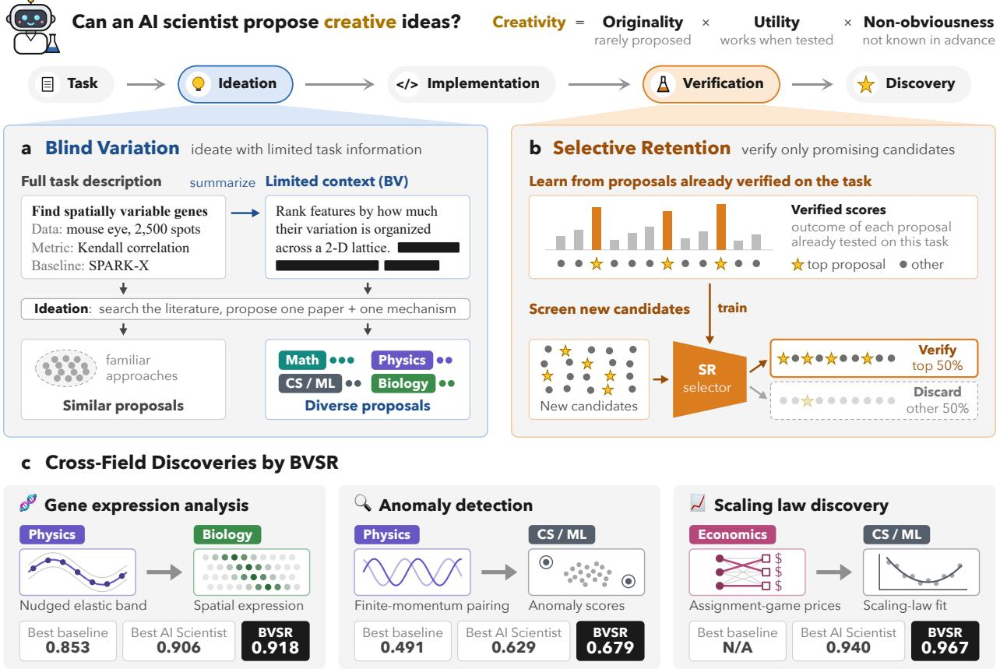  
Figure 1. Overview of Blind Variation and Selective Retention (BVSR). (a) Limiting task information during idea generation encourages creative proposals. (b) Selective retention reduces the number of candidates requiring empirical verification while preserving top proposals. (c) BVSR’s best programs borrow mechanisms from diverse fields, outperforming the best AI scientist on biology and ML tasks.

## 1 Introduction

As large language models (LLMs) have made substantial gains in reasoning and long-horizon task execution, a growing body of work explores deploying AI agents for scientific discovery [11, 24]. Existing studies demonstrate that AI agents can outperform the best human-designed solutions across a wide range of tasks, including mathematical proof [14], mathematical discovery [33], optimization [29], and a subset of scientific problems [57]. However, strong performance alone does not establish the creativity of the proposed methods. Prior work has identified limitations in the novelty of AI-generated proposals, including a tendency to explore incremental modifications or extensions of existing approaches [15, 54]. A key challenge is therefore to develop AI agents that can reliably generate proposals that are creative. Addressing this challenge requires both assessing creativity rigorously and developing methods to improve it.

Since the 1950s, psychologists have systematically studied how creativity should be judged in humans [34, 44]. Their work identifies three defining properties of creative ideas: novelty, effectiveness, and non-obviousness [39]. These properties distinguish creativity from performance alone: an idea must work, but its originality and whether its success could have been anticipated also matter. This perspective is captured by a quantitative definition [40]:

$$
{ \mathrm { C r e a t i v i t y ~ } } = { \mathrm { ~ O r i g i n a l i t y } } \times { \mathrm { U t i l i t y } } \times { \mathrm { N o n - o b v i o u s n e s s } } = ( 1 - p ) \cdot u \cdot ( 1 - v ) ,\tag{1}
$$

where $p$ is the probability of generating an idea, u is its tested utility, and v represents prior knowledge of its effectiveness. Originality captures whether an idea is uncommon rather than something that many others would propose. Utility reflects whether the idea actually works in practice. Non-obviousness concerns whether its effectiveness is known in advance. In this paper, we adopt this definition to assess the creativity of AI-generated proposals.

To improve the creativity of AI agents, prior work has relied mainly on prompt engineering, retrieval augmentation, and a variety of search methods: instructing the agent to be novel [37], supplying it with literature as inspiration [50], or iteratively refining and selecting among many candidates according to search heuristics [20]. Each of these approaches, however, has serious limitations. Prompt engineering yields diminishing returns on frontier models [49]. Literature is a valuable reference, but the literature an agent retrieves for itself suffers from the same lack of diversity as its own proposals [13, 38]. Heuristic search methods rely on a fine-grained signal, whereas most scientific problems offer at best a coarse metric of how well a finished proposal works [52].

Motivated by these limitations, we draw on the theory of Blind Variation (BV) and Selective Retention (SR) to guide how AI agents generate and select proposals [5]. This theory describes creative discovery as a process involving two complementary stages. The first is blind variation: scientists generate diverse ideas without foreknowledge of which will succeed, sometimes drawing inspiration from experiences unrelated to the immediate problem [9, 42]. The second is selective retention: based on prior experience, they discard ideas that are clearly unreasonable and retain plausible ones for further investigation. Similarly, we find that in AI agents, providing too much task information during proposal generation causes the model to anchor on familiar approaches. As illustrated in Figure 1, our method on blind variation first limits the task information available during generation. We then use selective retention to learn, as a scientist does by working on a problem, from proposals already verified on that task and their empirical outcomes to identify promising candidates for further evaluation.

We first show that limiting task information during proposal generation can improve creativity. We provide an intuition for its effect on originality under information-induced anchoring, and validate its benefits empirically across five models and 12 scientific tasks. Across these settings, BV outperforms state-of-the-art prompting-based baselines in originality and non-obviousness, while generating a larger share of highly creative and useful proposals. We then develop SR to learn from previously verified proposals and their empirical outcomes, using a pairwise objective that separates high-utility proposals from the rest. SR retains top proposals more effectively than prompting-based methods, in-context learning, and supervised fine-tuning. Finally, we integrate BVSR into SimpleTES [56], an existing common adopted AI scientist workflow, where it largely improves discovery performance over the original baselines.

## 2 Preliminaries

An AI scientist attempts to solve an automated scientific discovery task T by producing n candidate methods. Each candidate c is produced in two stages. An ideation stage reads a problem context I (possibly only part of the full problem description S) and returns an idea together with a reference paper supporting it. An implementation stage then reads S and the idea and writes the code. Both stages are driven by instruction prompts. We may vary the prompts and the context I. The task provides an evaluator that runs a candidate’s code and returns a score $s _ { T } ( c )$

Measuring creativity. Following Equation 1, each candidate is scored as creativity $( c ) = ( 1 - p ) u ( 1 -$ $v )$ , with the three terms computed as follows.

Originality $1 - p . \ p ( c )$ is the probability that the ideation stage, run again under the same context I and prompt, produces the idea of c:

$$
p ( c ) = \operatorname* { P r } _ { c ^ { \prime } } \big [ c ^ { \prime } \equiv c \big ] ,\tag{2}
$$

where $c ^ { \prime }$ is an independent candidate from the same generator and $c ^ { \prime } \equiv c$ denotes that the two express the same idea. In practice, we use an LLM to partition the n candidates into groups expressing the same idea and estimate $p ( c )$ by $| g ( c ) | / n$ , where $g ( c )$ is the group containing c. Because $1 - p$ tends to be closer to 1 when n is large, we place originality on a log scale and define it as $1 - \log | g ( c ) | / \log n$ . Here, originality refers specifically to generative rarity, following the creativity literature, rather than novelty relative to the scientific literature.

Utility u. We run the candidate’s code under the task evaluator and normalize its improvement over the task’s baseline score $s _ { T } ^ { \mathrm { b a s e } }$ by the best improvement achieved by any candidate on $T$ in our experiments, $s _ { T } ^ { \mathrm { b e s t } }$

$$
u ( c ) = \mathrm { m a x } \bigg ( \frac { s _ { T } ( c ) - s _ { T } ^ { \mathrm { b a s e } } } { s _ { T } ^ { \mathrm { b e s t } } - s _ { T } ^ { \mathrm { b a s e } } } , 0 \bigg ) .\tag{3}
$$

Non-obviousness $1 - v . \ v ( c )$ measures how much evidence existed at proposal time that the idea would work. An LLM judge reads S and the idea, and outputs $v ( c )$ , where $v = 1$ means prior experience strongly suggests the mechanism will succeed, and $v = 0$ means its success cannot readily be inferred from existing knowledge.

We assess the reliability of LLM judgments using PhD-level human experts. Human validation of both semantic grouping used for originality and non-obviousness is provided in Section 5.4.

Information level. We vary the information provided in context I and quantify how much it reveals about the problem description S using V-usable information $[ 7 , 5 3 ]$ , a model-dependent analogue of mutual information:

$$
\mathrm { i n f o } ( I ) = H _ { \mathcal { V } } ( S ) - H _ { \mathcal { V } } ( S \mid I ) ,\tag{4}
$$

where $H _ { \nu } ( S )$ and $H _ { \nu } ( S \mid I )$ are the unconditional and conditional V-entropies of $S ,$ respectively. They measure the uncertainty about S for predictors in V without and with context I. In practice, we estimate these quantities using the negative log-likelihood of the same problem description S under a language model, first with an empty context and then with $I ,$ using base-2 logarithms to express both values in bits. Their difference measures how much easier S becomes to predict when I is provided. See Appendix A for details.

## 3 Blind Variation: Limited Information Induces More Creativity

In this section, we show that providing a model with too much task information during proposal generation steers it toward common, less novel approaches. This substantially reduces the originality and non-obviousness of its proposals and, in turn, limits the utility of its top proposals. As illustrated in Figure 1(a), blind variation limits task information during idea generation to encourage exploration beyond familiar approaches.

## 3.1 Motivation

Recall that during proposal generation, the model reads a problem context I and returns an idea along with a reference paper. We study how proposal creativity varies with the amount of information contained in I. While additional task information can strengthen task relevance, it also aligns independent generations around the same task-specific signal and reduces exploration. We characterize this effect in the following proposition.

Proposition 3.1 (Information–Exploration Tradeoff). Under Assumption C.1, the expected originality of generated proposals is non-increasing with task information:

$$
\frac { d } { d \operatorname* { i n f o } ( I ) } \mathbb { E } [ o ( c ) ] \leq 0 .\tag{5}
$$

Under a fixed generation budget, if higher-utility ideas are less associated with the shared task signal, increasing task information decreases the expected utility of the best generated proposal.

The assumptions and derivation are provided in Appendix C.1.

## 3.2 Experimental Setup

To test this empirically, we use Claude Opus 5 to summarize the full problem statement S, producing contexts I with varying amounts of information for the same task. Appendix E shows example contexts. We then evaluate proposal creativity under each context. Further details on the models, benchmarks, and settings are provided in Appendix B. For each task, each model, and each information level, we generate 112 proposals.

Benchmarks. We evaluate 12 tasks across four scientific domains. (1) Biology. We use four single-cell analysis tasks [25], namely cell-cell communication, label projection, perturbation prediction, and spatially variable genes. (2) Astrodynamics. We use the Cassini [30] and Voyager 2 [18] trajectory design problems. (3) Machine Learning. We use unsupervised anomaly detection and post-hoc probability calibration from MLS Bench [27], along with scaling-law discovery in pretraining and U-shaped / double-descent regime from SLDBench [22]. (4) Neuroscience. We use neural activity forecasting from ZAPBench [26] with prediction horizons of 16 and 32.

Models. We evaluate five mainstream LLMs to assess whether our findings generalize across model families. These include DeepSeek-V4-Flash, DeepSeek-V4-Pro [6], GLM-5.3 Flash, GLM-5.2 [10], and Kimi-K3 [48]. All models have reasoning enabled and access to OpenAlex [31] for literature search.

## 3.3 Findings

Figure 2 shows how creativity, utility, originality, and non-obviousness change as the amount of task information increases. Each dot represents the proposals generated by one model for one benchmark at one information level.

Since AI scientist tasks place particular value on highly creative and highly useful methods, we first examine how top creativity and top utility vary with information level. We focus on proposals ranked in the top 1% within each benchmark, according to creativity and utility, respectively. The vertical position of each dot indicates a relative frequency, computed as the fraction of its proposals that fall into this top $1 \% ,$ divided by 1%. We find that models generally produce a larger share of these top-ranked proposals at lower information levels.

a  
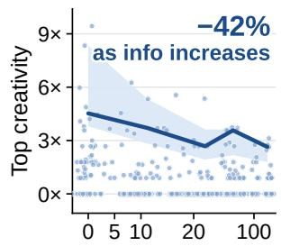

b  
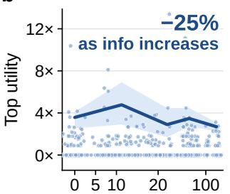

c  
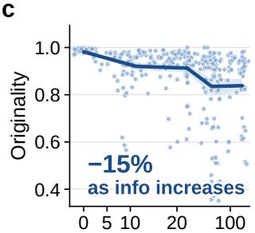

d  
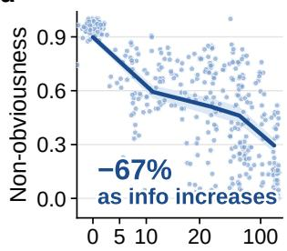  
Task information given to the proposer (bits)  
Figure 2. Effects of task information on proposal creativity. Each dot summarizes one batch of proposals for a benchmark, information level, and model. The trend line follows the 95th percentile $( \mathsf { a } , \mathsf { b } )$ or the mean (c, d) of the dots. Percentages give its change from 0 to 140 bits. As information increases, the relative frequency of proposals ranked in the benchmark’s top 1% for creativity or utility generally decreases, while mean originality and mean non-obviousness decline substantially.

We next examine whether originality and non-obviousness follow a similar pattern. We plot mean originality and mean non-obviousness against information level and find that both decline substantially as the amount of task information increases. Across proposals generated by five models on 12 tasks, these results provide systematic evidence that increasing task information reduces the relative frequency of highly creative proposals, supporting the conclusion that limited information can induce greater creativity. We call this approach of improving model creativity by limiting the information provided Blind Variation (BV).

## 3.4 Baseline Comparison

Prior work improves AI-scientist creativity by modifying prompt instructions. We compare against three such baselines: analogical reasoning, cross-domain search, and no-domain search [37]. We further add one control: BV with the full task description, which separates the effect of limited information from that of our prompt. All methods share the same proposer models, candidate budget, and reasoning configuration. For each model and task, we generate 112 proposals and report in Table 1 the top creativity and top utility, defined here as the mean creativity and utility of the top 1% of proposals, together with mean originality and mean non-obviousness.

Table 1. Comparison of BV with baselines. The highest is shown in bold. Values are mean ± SE.
<table><tr><td>Method</td><td>Creativity (↑)</td><td>Utility (↑)</td><td></td><td>Originality (↑) Non-obviousness (↑)</td></tr><tr><td>BV (Limited Information)</td><td> $\mathbf { 0 . 5 3 0 \pm 0 . 0 4 3 }$ </td><td> $\mathbf { 0 . 5 7 1 \pm 0 . 0 4 1 }$ </td><td> $\mathbf { 0 . 9 5 5 \pm 0 . 0 0 2 }$ </td><td> $\mathbf { 0 . 7 1 3 \pm 0 . 0 1 2 }$ </td></tr><tr><td>BV (Full Information)</td><td> $0 . 4 6 2 \pm 0 . 0 4 5$ </td><td> $0 . 5 2 4 \pm 0 . 0 4 3$ </td><td> $0 . 9 2 6 \pm 0 . 0 0 4$ </td><td> $0 . 6 0 9 \pm 0 . 0 1 5$ </td></tr><tr><td>Analogical Reasoning</td><td> $0 . 4 2 9 \pm 0 . 0 4 9$ </td><td> $0 . 5 0 8 \pm 0 . 0 5 0$ </td><td> $0 . 9 1 4 \pm 0 . 0 0 7$ </td><td> $0 . 4 9 2 \pm 0 . 0 3 7$ </td></tr><tr><td>Cross-Domain</td><td> $0 . 3 6 9 \pm 0 . 0 5 2$ </td><td> $0 . 5 3 1 \pm 0 . 0 4 5$ </td><td> $0 . 8 7 1 \pm 0 . 0 1 2$ </td><td> $0 . 2 6 3 \pm 0 . 0 2 0$ </td></tr><tr><td>No-Domain</td><td> $0 . 1 1 7 \pm 0 . 0 2 5$ </td><td> $0 . 5 3 0 \pm 0 . 0 5 0$ </td><td> $0 . 5 9 8 \pm 0 . 0 2 0$ </td><td> $0 . 1 0 4 \pm 0 . 0 1 5$ </td></tr></table>

BV achieves the highest creativity, utility, and non-obviousness. On the same tasks, the full task description costs the same prompt a large part of its advantage over the baselines: creativity falls from 0.530 to 0.462 and non-obviousness from 0.713 to 0.609, indicating that limiting task information is a major source of BV’s gains.

## 4 Selective Retention: Learning from Scientific Experience

Blind variation deliberately reduces task-specific guidance during idea generation, but scientific discovery should not ignore what is learned by working on the task. Just as scientists develop judgment about a problem by testing ideas on it, we formulate selective retention as learning from experience on the task itself. Each proposal previously verified on the task provides a pair consisting of a candidate and its empirical outcome. From these proposal–outcome pairs, we learn a scoring function that decides which new candidates for that task should be retained for expensive execution. As illustrated in Figure 1(b), selective retention (SR) uses this learned judgment to reduce the number of candidates requiring empirical verification while preserving promising proposals.

## 4.1 Motivation

Verification can be time-consuming in many scientific tasks: wet-lab experiments may take months, and machine learning experiments may require substantial GPU computation [43]. A natural approach is to prompt an LLM to inspect candidates. However, as our comparison below shows, these prompting-based approaches offer limited preservation of top candidates. This motivates learning a screener rather than relying exclusively on prompted judgments. The learning objective must also reflect the purpose of screening. Pointwise supervised fine-tuning can train a model to predict each candidate’s performance, but its regression loss does not explicitly prioritize the preservation of top candidates. Selective retention has a more targeted requirement: high-value candidates should remain above the discard region. Precise prediction and ordering are secondary. We therefore focus on separating the top proposals from the remaining ones. We first argue that identifying clearly ineffective methods is much easier than identifying the most effective ones.

Proposition 4.1 (Selective Retention Advantage). Under the mild Utility-Gap Assumption C.2, if $\Delta _ { \mathrm { S R } } ( d ) > \Delta _ { \mathrm { b e s t } }$ , then a comparison across the selective-retention boundary is more accurate than distinguishing the best candidate from its closest competitor. Formally, we have

$$
P _ { \mathrm { c o r r e c t } } ( \Delta _ { \mathrm { S R } } ( d ) ) > P _ { \mathrm { c o r r e c t } } ( \Delta _ { \mathrm { b e s t } } ) .
$$

We then argue SR reduces the verification time required to achieve the same performance, provided that its probability of discarding top proposals is significantly lower than that of random discarding.

Proposition 4.2 (Safe Discard Threshold). Let $d \in [ 0 , 1 ]$ denote the overall discard ratio and $\beta _ { q } ( d )$ the expected fraction of top-q proposals discarded by SR. For a tolerated loss $\epsilon ,$ define

$$
d _ { q } ^ { \star } ( \epsilon ) = \operatorname* { s u p } \{ d : \beta _ { q } ( d ) \leq \epsilon \} .
$$

Then $d _ { q } ^ { \star } ( \epsilon )$ is the largest discard ratio that limits the expected loss of top-q proposals to at most $\epsilon ,$ and therefore minimizes the number of proposals requiring verification under this constraint.

Remark 1. For random discarding, $\beta _ { q } ^ { \mathrm { r a n d } } ( d ) = d , \mathsf { s o } d _ { \mathrm { r a n d } } ^ { \star } ( \epsilon ) = \epsilon$ . Hence, whenever $d _ { q } ^ { \star } ( \epsilon ) > \epsilon ,$ , selective retention permits a larger discard ratio than random under the same tolerated loss of top proposals.

The assumptions and derivations for both propositions are provided in Appendices C.2 and C.3.

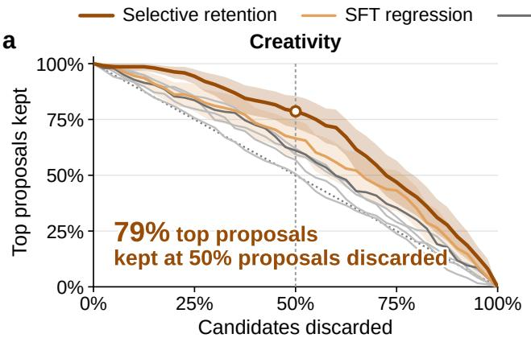

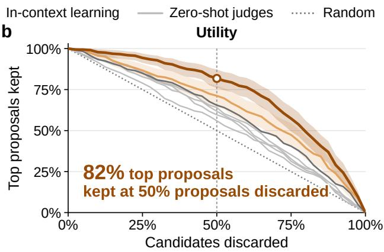  
Figure 3. Preserving top candidates during selective retention. Fraction of top proposals kept as discard ratio varies. Selective retention keeps the most top candidates, ahead of SFT regression and prompt-based judges.

## 4.2 Learning to Select Top Proposals

We implement selective retention using a language model with a scalar scoring head. Given a task specification S and a candidate $x ,$ the model produces a score $s = f _ { \boldsymbol { \theta } } ( \boldsymbol { S } , \boldsymbol { x } )$ . For a training run, let T contain its top-5% utility candidates. We include all candidates in T and uniformly sample candidates B from the remainder. We apply a pairwise logistic loss [3], restricted to comparisons between these two groups:

$$
\mathcal { L } _ { \mathrm { S R } } = \sum _ { i \in \mathcal { T } } \sum _ { j \in \mathcal { B } } \log ( 1 + \exp [ - \left( s _ { i } - s _ { j } \right) ] ) .\tag{6}
$$

Each comparison can be interpreted as a unit of scientific experience: given two previous proposals, the model learns which one was more worthy of empirical investment. Aggregating many such comparisons trains the selector to exploit past outcomes when screening its future candidates.

Experimental Setup. To evaluate the effectiveness of our method, we use 5,783 proposals generated by the five proposer models on the 12 tasks in Section 3. Our training dataset consists of a separate set of 40,733 proposals on the same tasks. Implementation details are provided in Appendix B.4. To assess whether the model can identify low-quality proposals, we ask it to rank the candidates and discard those ranked lowest. We vary the discard ratio and measure the fraction of top candidates kept. Higher curves indicate better preservation. All screeners receive the same task specification and candidate implementation. We compare SR with four zero-shot prompting-based judges: Pointwise judge assigns absolute scores, Setwise judge repeatedly identifies weak candidates in groups, Listwise judge aggregates sliding-window rankings in the style of RankGPT [45], and Tournament judge uses six rounds of Swiss-system pairwise comparisons [38]. The in-context learning (ICL) judge also sees four similar verified proposals and their outcomes from the SR training set. We also compare with SFT using the same backbone, trained with mean-squared error.

Findings. Figure 3 shows that learned SR preserves top candidates much more effectively than prompting-based screeners. The in-context learning baseline, despite seeing verified outcomes of similar proposals, performs no significantly better than zero-shot judges. SFT improves preservation over many prompt-based methods. Nevertheless, it remains less effective than SR. This result is consistent with the motivation that accurate prediction throughout the distribution is a different objective from keeping exceptional candidates out of the discard set. At a discard ratio of 50%, SR preserves 79% of the top-5% proposals by creativity and 82% of the top-5% proposals by utility. We therefore use this SR model to discard the lowest-ranked 50% of proposals in later experiments.

## 5 Applications

## 5.1 Cross-field Discovery

Beyond the gains of BV and SR individually, we evaluate whether combining information-limited generation with experience-based selection improves end-to-end scientific discovery. We evaluate its effectiveness by integrating it into SimpleTES [56]. We compare SimpleTES with and without BVSR on five tasks introduced earlier: gene expression analysis (spatially variable genes), drug response prediction (perturbation prediction), anomaly detection, scaling law discovery, and brain activity prediction (ZAPBench horizon 16). We use Kimi-K3 for both configurations. Following the SimpleTES setup, we run four parallel search trajectories, each generating 40 proposals per iteration, and run for 10 iterations. Figure 4 plots the best score against the cumulative number of empirically verified proposals. BVSR achieves higher final scores on all five tasks and exceeds the original workflow’s final score with fewer verification steps. These results show that BVSR can improve discovery performance when incorporated into existing AI scientist workflows.

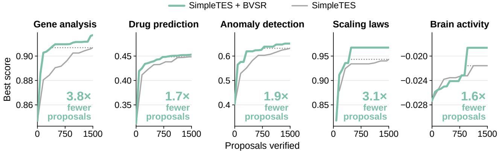  
Figure 4. Integrating BVSR into SimpleTES. Best task score as a function of verification steps on five scientific tasks. BVSR improves final score and reaches strong solutions with fewer steps. Numbers give how many times fewer verified proposals SimpleTES + BVSR needs to reach SimpleTES’s final score (dotted line).

## 5.2 Case Study

We describe three example best programs found by BVSR in Table 2. Each surpasses the best program found by SimpleTES under the same budget and the strongest existing baselines on their tasks.

Table 2. Best programs of our methods and of SimpleTES on example tasks (higher is better). Best baseline: SPARK-X for gene expression analysis, Isolation Forest for anomaly detection.
<table><tr><td>Task</td><td>Ours</td><td>SimpleTES</td><td>Best Baseline</td></tr><tr><td>Gene Expression Analysis</td><td>0.918</td><td>0.906</td><td>0.853 [60]</td></tr><tr><td>Anomaly Detection</td><td>0.679</td><td>0.629</td><td>0.491 [23]</td></tr><tr><td>Scaling Law Discovery</td><td>0.967</td><td>0.940</td><td>N/A</td></tr></table>

Spatially variable genes via the nudged elastic band. The task is to rank genes by how strongly their expression is organized in space on a tissue section. The program borrows the nudged elastic band method from transition-state theory [17], which finds a minimum-energy path by relaxing a chain of images under two projected forces: the true force perpendicular to the path and a spring force along it. It takes the heat-flow trajectory of each gene’s expression field on the tissue graph, from the observed field to the uniform one, and computes at every image the component of a robust energy gradient perpendicular to the path. For pure noise, the heat-flow path is already the minimum-energy path, and this component vanishes; spatial patterns bend the path, so the perpendicular force grows with pattern strength and becomes the gene’s score. It reaches 0.918, against 0.906 for SimpleTES and 0.853 for SPARK-X, the best method on OpenProblems.

Anomaly detection via finite-momentum pairing. The task asks for an anomaly detector with at most 10,000 parameters, scored on four tabular datasets. The program transplants the nonuniform (FFLO) superconducting state [21], in which two species with mismatched Fermi surfaces still pair by giving each pair a nonzero momentum, so that the order parameter oscillates in space. Its two “species” are two scores that often disagree: marginal tail evidence from empirical distribution functions, and geometric evidence from a robust covariance and a Gaussian mixture of the normal mass. Instead of averaging them, it pairs them with an oscillating modulation along the direction in which they disagree most, relaxes the recovered pairing signal on a nearest-neighbour graph and adds it to the combined score. With no trained network it reaches 0.679, against 0.629 for SimpleTES and 0.491 for Isolation Forest.

Scaling law via assignment-game prices. The task is to find a formula with at most 26 parameters for the final training loss as a function of learning rate, batch size, data size and model size. The program draws on the assignment game of Shapley and Shubik [36], whose optimal matching is a linear program with competitive prices as dual variables. It solves one fixed, entropy-regularized assignment problem between two grids in the (log learning rate, log batch size) plane and uses the resulting price field as a fixed surface that reshapes the loss basin near the optimal learning rate and batch size. The law adds power laws in data and model size and a convex bowl around a scale-dependent optimum, and fits only two parameters. It reaches a 0.967 held-out $R ^ { 2 }$

## 5.3 Ablation Study

To assess the individual contributions of BV and SR, we compare four configurations: the original SimpleTES, SimpleTES with BV alone, SimpleTES with SR alone, and the full BVSR. We evaluate all four configurations on gene expression analysis and scaling law discovery, and track the best task score against verification steps. Figure 5 shows that BV and SR each improve the final score over SimpleTES, and that combining them works best on both tasks. On gene expression analysis, BV mainly raises the final score and SR mainly speeds up discovery, while BVSR achieves a larger gain than either. On scaling law discovery, BVSR again reaches a higher score earlier than BV or SR. Because BVSR improves upon the stronger component on each task, the two components are complementary.

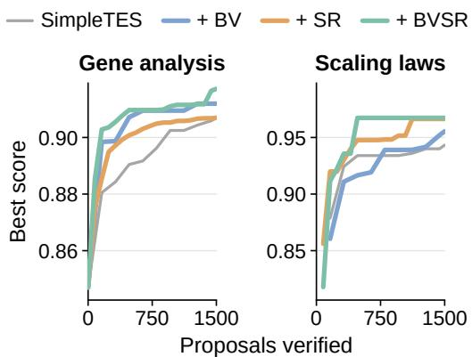  
Figure 5. Ablation study. Best task score versus verification steps for four SimpleTES configurations. Higher is better.

## 5.4 Human Validation

We conduct two human studies to validate the LLM judgments underlying originality and nonobviousness. The former relies on grouping semantically equivalent proposals to estimate their frequencies, while the latter assesses whether prior knowledge suggests that a proposal will work. Detailed protocols are provided in Appendix F.

Originality. Five PhD-level researchers each annotate 30 proposal pairs, yielding 150 pairs in total. The sample is balanced between pairs grouped together and pairs assigned to different groups by the LLM, and covers multiple tasks, proposer models, and generation methods. Evaluators judge whether the proposals express the same underlying mechanism. 84% of pairs grouped together by the LLM are also judged equivalent by humans (95% CI [0.74, 0.92]), while 73% of pairs assigned to different groups are judged distinct (95% CI [0.61, 0.82]). These results support the semantic-equivalence judgments used to estimate originality.

Non-obviousness. Five PhD-level researchers evaluate 150 high-quality proposals from BV and Analogical Reasoning (AR) under blinded conditions. All sampled proposals achieve verified scores above the best baseline for their respective tasks. Evaluators see the task name and summaries of the source paper and proposed method. The summaries are rewritten in a uniform style, and method identifiers are removed. Evaluators assess how readily a proposal’s effectiveness could be inferred from the paper and their own knowledge of the literature, using a 1–5 scale with higher scores indicating greater non-obviousness. Human ratings correlate with the automatic non-obviousness score 1 − vˆ at r = 0.56 (95% CI [0.45, 0.67]). BV proposals receive a mean rating of 3.64, compared with 2.97 for AR, a difference of 0.67 points (95% CI [0.33, 0.99], p = 0.0006). These results support the automatic non-obviousness score and show that BV’s advantage persists under expert judgment.

## 5.5 Domains of Inspiration

During proposal generation, models search for papers as sources of inspiration. To examine which scientific domains contribute more to top proposals, we sample 20,000 proposals and group them by the domains of their reference papers. For creativity and utility separately, we compute the fraction of proposals from each domain that enter their respective task’s top 1%, divided by the corresponding fraction across all proposals. A value above 1 indicates an above-average likelihood of producing a top proposal. Figure 6 shows that mathematics has the highest normalized fraction for top creativity (1.33), while biology / medicine and mathematics lead in top utility (1.25 and 1.09).

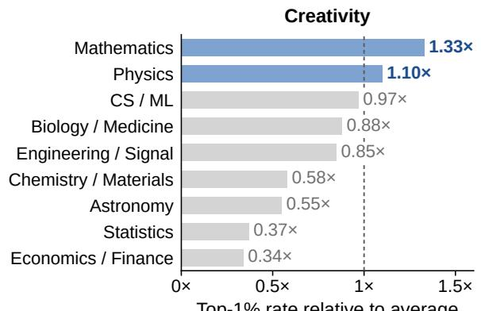

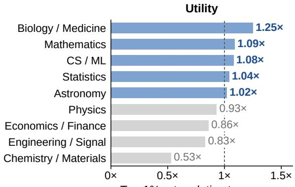  
Figure 6. Proposal quality across domains. Normalized top-1% fractions by creativity and utility.

## 6 Related Work

AI Scientists. Recent work increasingly connects language models to scientific workflows. Coscientist integrates research planning with laboratory automation, while Agent Laboratory and Virtual Lab organize research through specialized agents and human guidance [2, 35, 46]. The AI Scientist extends automation across ideation, experimentation, and manuscript preparation [24]. AlphaEvolve and SimpleTES organize proposal generation and execution [29, 56]. These systems provide capable discovery workflows, but their effectiveness also depends on the candidates they explore. Our work studies how task information shapes proposal generation and how empirical outcomes from previous proposals can guide which new candidates are selected for verification.

Creativity in Humans. Associative theories explain creativity through connections between previously remote concepts [8, 28]. Studies show that familiar categories and example solutions can constrain subsequent ideas [16, 51]. Research on incubation further suggests that temporarily setting a problem aside can improve creative problem solving [41]. Idea selection presents a separate challenge: people often favor feasible and desirable candidates at the expense of originality [32]. Together with Campbell’s blind-variation-and-selective-retention theory [5], these findings help explain the relationship between information and creativity. We investigate whether reducing task information during ideation can encourage exploration in AI scientists.

Creativity in AI. Computational creativity distinguishes combinational, exploratory, and transformational processes [1]. Recent work evaluates LLM creativity through divergent-thinking tasks and the diversity of repeated generations [19, 59]. Beyond text generation, Creative Agents incorporates imagination into embodied planning for open-ended construction tasks [4]. Methods for diversifying outputs include verbalized sampling [58], which elicits distributions over responses, and analogical reasoning [37], which transfers relational structures across scientific domains. Our approach adds task information level as a distinct control for creative generation.

## 7 Conclusion

We studied how information should be used at different stages of automated scientific discovery. Our results suggest that more information is not uniformly beneficial. During idea generation, detailed task information can anchor language models toward familiar mechanisms and reduce the probability of generating creative proposals. Blind Variation mitigates this effect by limiting task information. After generation, empirical experience earned on the task can guide which new candidates deserve expensive verification. Selective Retention learns this decision from proposal–outcome data. Together, these findings suggest a broader design principle for AI scientists: separate the information used for exploration from the experience used for selection.

## References

[1] Margaret A. Boden. Creativity and artificial intelligence. Artificial Intelligence, 103(1):347– 356, 1998. ISSN 0004-3702. doi: https://doi.org/10.1016/S0004-3702(98)00055-1. URL https://www.sciencedirect.com/science/article/pii/S0004370298000551. Artificial Intelligence 40 years later.

[2] Daniil A. Boiko, Robert MacKnight, Ben Kline, and Gabe Gomes. Autonomous chemical research with large language models. Nature, 624(7992):570–578, Dec 2023. ISSN 1476-4687. doi: 10.1038/s41586-023-06792-0. URL https://doi.org/10.1038/s41586-023-06792-0.

[3] Chris Burges, Tal Shaked, Erin Renshaw, Ari Lazier, Matt Deeds, Nicole Hamilton, and Greg Hullender. Learning to rank using gradient descent. In Proceedings of the 22nd International Conference on Machine Learning, ICML ’05, page 89–96, New York, NY, USA, 2005. Association for Computing Machinery. ISBN 1595931805. doi: 10.1145/1102351.1102363. URL https: //doi.org/10.1145/1102351.1102363.

[4] Penglin Cai, Chi Zhang, Yuhui Fu, Haoqi Yuan, and Zongqing Lu. Creative agents: Empowering agents with imagination for creative tasks. In The 41st Conference on Uncertainty in Artificial Intelligence, 2025. URL https://openreview.net/forum?id=y0dbr5uSc9.

[5] Donald Campbell. Blind variation and selective retentions in creative thought as in other knowledge processes. Psychological Review, 67:380–400, 11 1960. doi: 10.1037/h0040373.

[6] DeepSeek-AI, Anyi Xu, Bangcai Lin, Bing Xue, Bingxuan Wang, Bingzheng Xu, Bochao Wu, Bowei Zhang, Chaofan Lin, Chen Dong, Chenchen Ling, Chengda Lu, Chenggang Zhao,

Chengqi Deng, Chengyu Hou, Chenhao Xu, Chenze Shao, Chong Ruan, Conner Sun, Damai Dai, Daya Guo, Dejian Yang, Deli Chen, Donghao Li, Dongjie Ji, Erhang Li, Fang Wei, Fangyun Lin, Fangzhou Yuan, Feiyu Xia, Fucong Dai, Guangbo Hao, Guanting Chen, Guoai Cao, Guolai Meng, Guowei Li, Han Yu, Han Zhang, Hanwei Xu, Hao Li, Haofen Liang, Haoling Zhang, Haoming Luo, Haoran Wei, Haotian Yuan, Haowei Zhang, Haowen Luo, Haoyu Chen, Haozhe Ji, Hengqing Zhang, Honghui Ding, Hongxuan Tang, Huanqi Cao, Huazuo Gao, Hui Qu, Hui Zeng, J Yang, JQ Zhu, Jia Luo, Jia Song, Jia Yu, Jialiang Huang, Jialu Cai, Jian Liang, Jiangting Zhou, Jiasheng Ye, Jiashi Li, Jiaxin Xu, Jiewen Hu, Jieyu Yang, Jin Chen, Jin Yan, Jingchang Chen, Jingli Zhou, Jingting Xiang, Jingyang Yuan, Jingyuan Cheng, Jingzi Zhou, Jinhua Zhu, Jiping Yu, Joseph Sun, Jun Ran, Junguang Jiang, Junjie Qiu, Junlong Li, Junmin Zheng, Junxiao Song, Kai Dong, Kaige Gao, Kang Guan, Kexing Zhou, Kezhao Huang, Kuai Yu, Lean Wang, Lecong Zhang, Lei Wang, Leyi Xia, Li Zhang, Liang Zhao, Lihua Guo, Lingxiao Luo, Linwang Ma, Linyan Zhu, Litong Wang, Liyu Cai, Liyue Zhang, Longhao Chen, MS Di, MY Xu, Max Mei, Miaojun Wang, Mingchuan Zhang, Minghua Zhang, Minghui Tang, Mingming Li, Mingxu Zhou, Minmin Han, Ning Wang, Panpan Huang, Panpan Wang, Peixin Cong, Peiyi Wang, Peng Zhang, Qiancheng Wang, Qihao Zhu, Qingyang Li, Qinyu Chen, Qiushi Du, Qiwei Jiang, Rui Tian, Ruifan Xu, Ruijie Lu, Ruiling Xu, Ruiqi Ge, Ruisong Zhang, Ruizhe Pan, Runji Wang, Runqian Chen, Runqiu Yin, Runxin Xu, Ruomeng Shen, Ruoyu Zhang, Ruyi Chen, SH Liu, Shanghao Lu, Shangmian Sun, Shangyan Zhou, Shanhuang Chen, Shaofei Cai, Shaoheng Nie, Shaoqing Wu, Shaoyuan Chen, Shengding Hu, Shengyu Liu, Shiqiang Hu, Shirong Ma, Shiyu Wang, Shuiping Yu, Shunfeng Zhou, Shuting Pan, Shuying Yu, Songyang Zhou, Tao Ni, Tao Yun, Tian Jin, Tian Pei, Tian Ye, Tianle Lin, Tianran Ji, Tianyi Cui, Tianyuan Yue, Tingting Yu, Tun Wang, W Zhang, WL Xiao, Wangding Zeng, Wei An, Weilin Zhao, Wen Liu, Wenfeng Liang, Wenjie Pang, Wenjing Luo, Wenjing Yao, Wenjun Gao, Wenkai Yang, Wenlve Huang, Wenqing Hou, Wentao Zhang, Wenting Ma, Xi Gao, Xiang He, Xiangwen Wang, Xianzu Wang, Xiao Bi, Xiaodong Liu, Xiaohan Wang, Xiaokang Chen, Xiaokang Zhang, Xiaotao Nie, Xiaowen Sun, Xiaoxiang Wang, Xin Cheng, Xin Liu, Xin Xie, Xingchao Liu, Xingchen Liu, Xingkai Yu, Xingyou Li, Xinyu Yang, Xinyu Zhang, Xu Chen, Xuanyu Wang, Xuecheng Su, Xueyin Chen, Xuheng Lin, Xuwei Fu, YC Yan, YQ Wang, YW Ma, Yanfeng Luo, Yang Zhang, Yanhong Xu, Yanru Ma, Yanwen Huang, Yao Li, Yao Li, Yao Xu, Yao Zhao, Yaofeng Sun, Yaohui Wang, Yi Qian, Yi Shao, Yi Yu, Yichao Zhang, Yifan Ding, Yifan Shi, Yijia Wu, Yiliang Xiong, Yiling Ma, Ying He, Ying Tang, Ying Zhou, Yingjia Luo, Yinmin Zhong, Yishi Piao, Yisong Wang, Yixiang Zhang, Yixiao Chen, Yixuan Tan, Yixuan Wei, Yiyang Ma, Yiyuan Liu, Yonglun Yang, Yongqiang Guo, Yongtong Wu, Yu Wu, YuKun Li, Yuan Cheng, Yuan Ou, Yuanfan Xu, Yuanhao Li, Yuduan Wang, Yuehan Yang, Yuer Xu, Yuhan Wu, Yuhao Meng, Yuheng Zou, Yukun Zha, Yunfan Xiong, Yupeng Chen, Yuping Lin, Yuqian Cao, Yuqian Wang, Yushun Zhang, Yuting Yan, Yutong Lin, Yuxian Gu, Yuxiang Luo, Yuxiang You, Yuxuan Liu, Yuxuan Zhou, Yuyang Zhou, Yuzhen Huang, ZF Wu, Zehao Wang, Zehua Zhao, Zehui Ren, Zekai Zhang, Zhangli Sha, Zhe Fu, Zhe Ju, Zhean Xu, Zhenda Xie, Zhengyan Zhang, Zheren Gao, Zhewen Hao, Zhibin Gou, Zhicheng Ma, Zhigang Yan, Zhihong Shao, Zhixian Huang, Zhixuan Chen, Zhiyu Wu, Zhizhou Ren, Zhongyu Wu, Zhuoshu Li, Zhuping Zhang, Zian Xu, Zihao Wang, Zihua Qu, Zihui Gu, Zijia Zhu, Zilin Li, Zipeng Zhang, Ziwei Xie, Ziyi Gao, Ziyi Wan, Zizheng Pan, and Zongqing Yao. Deepseek-v4: Towards highly efficient million-token context intelligence, 2026. URL https://arxiv.org/abs/2606.19348.

[7] Kawin Ethayarajh, Yejin Choi, and Swabha Swayamdipta. Understanding dataset difficulty with V-usable information. In Kamalika Chaudhuri, Stefanie Jegelka, Le Song, Csaba Szepesvari, Gang Niu, and Sivan Sabato, editors, Proceedings of the 39th International Conference on Machine Learning, volume 162 of Proceedings of Machine Learning Research, pages 5988–6008. PMLR, 17–23 Jul 2022. URL https://proceedings.mlr.press/v162/ethayarajh22a.html.

[8] Ronald A. Finke, Thomas B. Ward, and Steven M. Smith. Creative cognition: Theory, research, and applications. 1996. URL https://api.semanticscholar.org/CorpusID:142548068.

[9] Shelly L. Gable, Elizabeth A. Hopper, and Jonathan W. Schooler. When the muses strike: Creative ideas of physicists and writers routinely occur during mind wandering. Psychological Science, 30(3):396–404, 2019. doi: 10.1177/0956797618820626. URL https://doi.org/10.1177/09 56797618820626. PMID: 30653407.

[10] GLM-5-Team, :, Aohan Zeng, Xin Lv, Zhenyu Hou, Zhengxiao Du, Qinkai Zheng, Bin Chen, Da Yin, Chendi Ge, Chenghua Huang, Chengxing Xie, Chenzheng Zhu, Congfeng Yin, Cunxiang Wang, Gengzheng Pan, Hao Zeng, Haoke Zhang, Haoran Wang, Huilong Chen, Jiajie Zhang, Jian Jiao, Jiaqi Guo, Jingsen Wang, Jingzhao Du, Jinzhu Wu, Kedong Wang, Lei Li, Lin Fan, Lucen Zhong, Mingdao Liu, Mingming Zhao, Pengfan Du, Qian Dong, Rui Lu, Shuang-Li, Shulin Cao, Song Liu, Ting Jiang, Xiaodong Chen, Xiaohan Zhang, Xuancheng Huang, Xuezhen Dong, Yabo Xu, Yao Wei, Yifan An, Yilin Niu, Yitong Zhu, Yuanhao Wen, Yukuo Cen, Yushi Bai, Zhongpei Qiao, Zihan Wang, Zikang Wang, Zilin Zhu, Ziqiang Liu, Zixuan Li, Bojie Wang, Bosi Wen, Can Huang, Changpeng Cai, Chao Yu, Chen Li, Chengwei Hu, Chenhui Zhang, Dan Zhang, Daoyan Lin, Dayong Yang, Di Wang, Ding Ai, Erle Zhu, Fangzhou Yi, Feiyu Chen, Guohong Wen, Hailong Sun, Haisha Zhao, Haiyi Hu, Hanchen Zhang, Hanrui Liu, Hanyu Zhang, Hao Peng, Hao Tai, Haobo Zhang, He Liu, Hongwei Wang, Hongxi Yan, Hongyu Ge, Huan Liu, Huanpeng Chu, Jia’ni Zhao, Jiachen Wang, Jiajing Zhao, Jiamin Ren, Jiapeng Wang, Jiaxin Zhang, Jiayi Gui, Jiayue Zhao, Jijie Li, Jing An, Jing Li, Jingwei Yuan, Jinhua Du, Jinxin Liu, Junkai Zhi, Junwen Duan, Kaiyue Zhou, Kangjian Wei, Ke Wang, Keyun Luo, Laiqiang Zhang, Leigang Sha, Liang Xu, Lindong Wu, Lintao Ding, Lu Chen, Minghao Li, Nianyi Lin, Pan Ta, Qiang Zou, Rongjun Song, Ruiqi Yang, Shangqing Tu, Shangtong Yang, Shaoxiang Wu, Shengyan Zhang, Shijie Li, Shuang Li, Shuyi Fan, Wei Qin, Wei Tian, Weining Zhang, Wenbo Yu, Wenjie Liang, Xiang Kuang, Xiangmeng Cheng, Xiangyang Li, Xiaoquan Yan, Xiaowei Hu, Xiaoying Ling, Xing Fan, Xingye Xia, Xinyuan Zhang, Xinze Zhang, Xirui Pan, Xu Zou, Xunkai Zhang, Yadi Liu, Yandong Wu, Yanfu Li, Yidong Wang, Yifan Zhu, Yijun Tan, Yilin Zhou, Yiming Pan, Ying Zhang, Yinpei Su, Yipeng Geng, Yong Yan, Yonglin Tan, Yuean Bi, Yuhan Shen, Yuhao Yang, Yujiang Li, Yunan Liu, Yunqing Wang, Yuntao Li, Yurong Wu, Yutao Zhang, Yuxi Duan, Yuxuan Zhang, Zezhen Liu, Zhengtao Jiang, Zhenhe Yan, Zheyu Zhang, Zhixiang Wei, Zhuo Chen, Zhuoer Feng, Zijun Yao, Ziwei Chai, Ziyuan Wang, Zuzhou Zhang, Bin Xu, Minlie Huang, Hongning Wang, Juanzi Li, Yuxiao Dong, and Jie Tang. Glm-5: from vibe coding to agentic engineering, 2026. URL https://arxiv.org/abs/2602.15763.

[11] Juraj Gottweis, Wei-Hung Weng, Alexander Daryin, Tao Tu, Petar Sirkovic, Artiom Myaskovsky, Grzegorz Glowaty, Felix Weissenberger, Alessio Orlandi, Dan Popovici, Anil Palepu, Keran Rong, Ryutaro Tanno, Khaled Saab, Fan Zhang, Jacob Blum, Andrew Carroll, Kavita Kulkarni, Nenad Tomašev, Dina Zverinski, Ivor Rendulic, Elahe Vedadi, Florian Hasler, Luka Rimanic, Marina Boia, Ivan Budiselic, Ben Feinstein, Mathias Bellaiche, Tom Sheffer, Jan Freyberg, Jeremy Ratcliff, Ottavia Bertolli, Katherine Chou, Avinatan Hassidim, Burak Gokturk, Amin Vahdat, Yuan Guan, Vikram Dhillon, Eeshit Dhaval Vaishnav, Byron Lee, Tiago R. D. Costa, José R. Penadés, Gary Peltz, Yossi Matias, James Manyika, Demis Hassabis, Yunhan Xu, Pushmeet Kohli, Annalisa Pawlosky, Alan Karthikesalingam, and Vivek Natarajan. Accelerating scientific discovery with co-scientist. Nature, 655(8122):487–496, Jul 2026. ISSN 1476-4687. doi: 10.1038/ s41586-026-10644-y. URL https://doi.org/10.1038/s41586-026-10644-y.

[12] Aaron Grattafiori, Abhimanyu Dubey, Abhinav Jauhri, Abhinav Pandey, Abhishek Kadian, Ahmad Al-Dahle, Aiesha Letman, Akhil Mathur, Alan Schelten, Alex Vaughan, Amy Yang, Angela Fan, Anirudh Goyal, Anthony Hartshorn, Aobo Yang, Archi Mitra, Archie Sravankumar, Artem Korenev, Arthur Hinsvark, Arun Rao, Aston Zhang, Aurelien Rodriguez, Austen

Gregerson, Ava Spataru, Baptiste Roziere, Bethany Biron, Binh Tang, Bobbie Chern, Char lotte Caucheteux, Chaya Nayak, Chloe Bi, Chris Marra, Chris McConnell, Christian Keller, Christophe Touret, Chunyang Wu, Corinne Wong, Cristian Canton Ferrer, Cyrus Nikolaidis, Damien Allonsius, Daniel Song, Danielle Pintz, Danny Livshits, Danny Wyatt, David Esiobu, Dhruv Choudhary, Dhruv Mahajan, Diego Garcia-Olano, Diego Perino, Dieuwke Hupkes, Egor Lakomkin, Ehab AlBadawy, Elina Lobanova, Emily Dinan, Eric Michael Smith, Filip Radenovic, Francisco Guzmán, Frank Zhang, Gabriel Synnaeve, Gabrielle Lee, Georgia Lewis Anderson, Govind Thattai, Graeme Nail, Gregoire Mialon, Guan Pang, Guillem Cucurell, Hailey Nguyen, Hannah Korevaar, Hu Xu, Hugo Touvron, Iliyan Zarov, Imanol Arrieta Ibarra, Isabel Kloumann, Ishan Misra, Ivan Evtimov, Jack Zhang, Jade Copet, Jaewon Lee, Jan Geffert, Jana Vranes, Jason Park, Jay Mahadeokar, Jeet Shah, Jelmer van der Linde, Jennifer Billock, Jenny Hong, Jenya Lee, Jeremy Fu, Jianfeng Chi, Jianyu Huang, Jiawen Liu, Jie Wang, Jiecao Yu, Joanna Bitton, Joe Spisak, Jongsoo Park, Joseph Rocca, Joshua Johnstun, Joshua Saxe, Jun teng Jia, Kalyan Vasuden Alwala, Karthik Prasad, Kartikeya Upasani, Kate Plawiak, Ke Li, Kenneth Heafield, Kevin Stone, Khalid El-Arini, Krithika Iyer, Kshitiz Malik, Kuenley Chiu, Kunal Bhalla, Kushal Lakhotia, Lauren Rantala-Yeary, Laurens van der Maaten, Lawrence Chen, Liang Tan, Liz Jenkins, Louis Martin, Lovish Madaan, Lubo Malo, Lukas Blecher, Lukas Landzaat, Luke de Oliveira, Madeline Muzzi, Mahesh Pasupuleti, Mannat Singh, Manohar Paluri, Marcin Kardas, Maria Tsimpoukelli, Mathew Oldham, Mathieu Rita, Maya Pavlova, Melanie Kambadur, Mike Lewis, Min Si, Mitesh Kumar Singh, Mona Hassan, Naman Goyal, Narjes Torabi, Nikolay Bashlykov, Nikolay Bogoychev, Niladri Chatterji, Ning Zhang, Olivier Duchenne, Onur Çelebi, Patrick Alrassy, Pengchuan Zhang, Pengwei Li, Petar Vasic, Peter Weng, Prajjwal Bhargava, Pratik Dubal, Praveen Krishnan, Punit Singh Koura, Puxin Xu, Qing He, Qingxiao Dong, Ragavan Srinivasan, Raj Ganapathy, Ramon Calderer, Ricardo Silveira Cabral, Robert Stojnic, Roberta Raileanu, Rohan Maheswari, Rohit Girdhar, Rohit Patel, Romain Sauvestre, Ronnie Polidoro, Roshan Sumbaly, Ross Taylor, Ruan Silva, Rui Hou, Rui Wang, Saghar Hosseini, Sahana Chennabasappa, Sanjay Singh, Sean Bell, Seohyun Sonia Kim, Sergey Edunov, Shaoliang Nie, Sharan Narang, Sharath Raparthy, Sheng Shen, Shengye Wan, Shruti Bhosale, Shun Zhang, Simon Vandenhende, Soumya Batra, Spencer Whitman, Sten Sootla, Stephane Collot, Suchin Gururangan, Sydney Borodinsky, Tamar Herman, Tara Fowler, Tarek Sheasha, Thomas Georgiou, Thomas Scialom, Tobias Speckbacher, Todor Mihaylov, Tong Xiao, Ujjwal Karn, Vedanuj Goswami, Vibhor Gupta, Vignesh Ramanathan, Viktor Kerkez, Vincent Gonguet, Virginie Do, Vish Vogeti, Vítor Albiero, Vladan Petrovic, Weiwei Chu, Wenhan Xiong, Wenyin Fu, Whitney Meers, Xavier Martinet, Xiaodong Wang, Xiaofang Wang, Xiaoqing Ellen Tan, Xide Xia, Xinfeng Xie, Xuchao Jia, Xuewei Wang, Yaelle Goldschlag, Yashesh Gaur, Yasmine Babaei, Yi Wen, Yiwen Song, Yuchen Zhang, Yue Li, Yuning Mao, Zacharie Delpierre Coudert, Zheng Yan, Zhengxing Chen, Zoe Papakipos, Aaditya Singh, Aayushi Srivastava, Abha Jain, Adam Kelsey, Adam Shajnfeld, Adithya Gangidi, Adolfo Victoria, Ahuva Goldstand, Ajay Menon, Ajay Sharma, Alex Boesenberg, Alexei Baevski, Allie Feinstein, Amanda Kallet, Amit Sangani, Amos Teo, Anam Yunus, Andrei Lupu, Andres Alvarado, Andrew Caples, Andrew Gu, Andrew Ho, Andrew Poulton, Andrew Ryan, Ankit Ramchandani, Annie Dong, Annie Franco, Anuj Goyal, Aparajita Saraf, Arkabandhu Chowdhury, Ashley Gabriel, Ashwin Bharambe, Assaf Eisenman, Azadeh Yazdan, Beau James, Ben Maurer, Benjamin Leonhardi, Bernie Huang, Beth Loyd, Beto De Paola, Bhargavi Paranjape, Bing Liu, Bo Wu, Boyu Ni, Braden Hancock, Bram Wasti, Brandon Spence, Brani Stojkovic, Brian Gamido, Britt Montalvo, Carl Parker, Carly Burton, Catalina Mejia, Ce Liu, Changhan Wang, Changkyu Kim, Chao Zhou, Chester Hu, Ching-Hsiang Chu, Chris Cai, Chris Tindal, Christoph Feichtenhofer, Cynthia Gao, Damon Civin, Dana Beaty, Daniel Kreymer, Daniel Li, David Adkins, David Xu, Davide Testuggine, Delia David, Devi Parikh, Diana Liskovich, Didem Foss, Dingkang Wang, Duc Le, Dustin Holland, Edward Dowling, Eissa Jamil, Elaine Montgomery, Eleonora Presani, Emily Hahn, Emily Wood, Eric-Tuan Le, Erik Brinkman, Esteban Arcaute, Evan Dunbar, Evan Smothers,

Fei Sun, Felix Kreuk, Feng Tian, Filippos Kokkinos, Firat Ozgenel, Francesco Caggioni, Frank Kanayet, Frank Seide, Gabriela Medina Florez, Gabriella Schwarz, Gada Badeer, Georgia Swee, Gil Halpern, Grant Herman, Grigory Sizov, Guangyi, Zhang, Guna Lakshminarayanan, Hakan Inan, Hamid Shojanazeri, Han Zou, Hannah Wang, Hanwen Zha, Haroun Habeeb, Harrison Rudolph, Helen Suk, Henry Aspegren, Hunter Goldman, Hongyuan Zhan, Ibrahim Damlaj, Igor Molybog, Igor Tufanov, Ilias Leontiadis, Irina-Elena Veliche, Itai Gat, Jake Weissman, James Geboski, James Kohli, Janice Lam, Japhet Asher, Jean-Baptiste Gaya, Jeff Marcus, Jeff Tang, Jennifer Chan, Jenny Zhen, Jeremy Reizenstein, Jeremy Teboul, Jessica Zhong, Jian Jin, Jingyi Yang, Joe Cummings, Jon Carvill, Jon Shepard, Jonathan McPhie, Jonathan Torres, Josh Ginsburg, Junjie Wang, Kai Wu, Kam Hou U, Karan Saxena, Kartikay Khandelwal, Katayoun Zand, Kathy Matosich, Kaushik Veeraraghavan, Kelly Michelena, Keqian Li, Kiran Jagadeesh, Kun Huang, Kunal Chawla, Kyle Huang, Lailin Chen, Lakshya Garg, Lavender A, Leandro Silva, Lee Bell, Lei Zhang, Liangpeng Guo, Licheng Yu, Liron Moshkovich, Luca Wehrstedt, Madian Khabsa, Manav Avalani, Manish Bhatt, Martynas Mankus, Matan Hasson, Matthew Lennie, Matthias Reso, Maxim Groshev, Maxim Naumov, Maya Lathi, Meghan Keneally, Miao Liu, Michael L. Seltzer, Michal Valko, Michelle Restrepo, Mihir Patel, Mik Vyatskov, Mikayel Samvelyan, Mike Clark, Mike Macey, Mike Wang, Miquel Jubert Hermoso, Mo Metanat, Mohammad Rastegari, Munish Bansal, Nandhini Santhanam, Natascha Parks, Natasha White, Navyata Bawa, Nayan Singhal, Nick Egebo, Nicolas Usunier, Nikhil Mehta, Nikolay Pavlovich Laptev, Ning Dong, Norman Cheng, Oleg Chernoguz, Olivia Hart, Omkar Salpekar, Ozlem Kalinli, Parkin Kent, Parth Parekh, Paul Saab, Pavan Balaji, Pedro Rittner, Philip Bontrager, Pierre Roux, Piotr Dollar, Polina Zvyagina, Prashant Ratanchandani, Pritish Yuvraj, Qian Liang, Rachad Alao, Rachel Rodriguez, Rafi Ayub, Raghotham Murthy, Raghu Nayani, Rahul Mitra, Rangaprabhu Parthasarathy, Raymond Li, Rebekkah Hogan, Robin Battey, Rocky Wang, Russ Howes, Ruty Rinott, Sachin Mehta, Sachin Siby, Sai Jayesh Bondu, Samyak Datta, Sara Chugh, Sara Hunt, Sargun Dhillon, Sasha Sidorov, Satadru Pan, Saurabh Mahajan, Saurabh Verma, Seiji Yamamoto, Sharadh Ramaswamy, Shaun Lindsay, Shaun Lindsay, Sheng Feng, Shenghao Lin, Shengxin Cindy Zha, Shishir Patil, Shiva Shankar, Shuqiang Zhang, Shuqiang Zhang, Sinong Wang, Sneha Agarwal, Soji Sajuyigbe, Soumith Chintala, Stephanie Max, Stephen Chen, Steve Kehoe, Steve Satterfield, Sudarshan Govindaprasad, Sumit Gupta, Summer Deng, Sungmin Cho, Sunny Virk, Suraj Subramanian, Sy Choudhury, Sydney Goldman, Tal Remez, Tamar Glaser, Tamara Best, Thilo Koehler, Thomas Robinson, Tianhe Li, Tianjun Zhang, Tim Matthews, Timothy Chou, Tzook Shaked, Varun Vontimitta, Victoria Ajayi, Victoria Montanez, Vijai Mohan, Vinay Satish Kumar, Vishal Mangla, Vlad Ionescu, Vlad Poenaru, Vlad Tiberiu Mihailescu, Vladimir Ivanov, Wei Li, Wenchen Wang, Wenwen Jiang, Wes Bouaziz, Will Constable, Xiaocheng Tang, Xiaojian Wu, Xiaolan Wang, Xilun Wu, Xinbo Gao, Yaniv Kleinman, Yanjun Chen, Ye Hu, Ye Jia, Ye Qi, Yenda Li, Yilin Zhang, Ying Zhang, Yossi Adi, Youngjin Nam, Yu, Wang, Yu Zhao, Yuchen Hao, Yundi Qian, Yunlu Li, Yuzi He, Zach Rait, Zachary DeVito, Zef Rosnbrick, Zhaoduo Wen, Zhenyu Yang, Zhiwei Zhao, and Zhiyu Ma. The llama 3 herd of models, 2024. URL https://arxiv.org/abs/2407.21783.

[13] Xiang Hu, Hongyu Fu, Jinge Wang, Yifeng Wang, Zhikun Li, Renjun Xu, Yu Lu, Yaochu Jin, Lili Pan, and Zhenzhong Lan. NOVA: An iterative planning framework for enhancing scientific innovation with large language models. In Wanxiang Che, Joyce Nabende, Ekaterina Shutova, and Mohammad Taher Pilehvar, editors, Findings of the Association for Computational Linguistics: ACL 2025, pages 21330–21359, Vienna, Austria, July 2025. Association for Computational Linguistics. ISBN 979-8-89176-256-5. doi: 10.18653/v1/2025.findings-acl.1099. URL https://aclanthology.org/2025.findings-acl.1099/.

[14] Thomas Hubert, Rishi Mehta, Laurent Sartran, Miklós Z. Horváth, Goran Žuži´c, Eric Wieser, Aja Huang, Julian Schrittwieser, Yannick Schroecker, Hussain Masoom, Ottavia Bertolli, Tom Zahavy, Amol Mandhane, Jessica Yung, Iuliya Beloshapka, Borja Ibarz, Vivek Veeriah, Lei [47] Gemma Team, Aishwarya Kamath, Johan Ferret, Shreya Pathak, Nino Vieillard, Ramona Merhej, Sarah Perrin, Tatiana Matejovicova, Alexandre Ramé, Morgane Rivière, Louis Rouillard, Thomas Mesnard, Geoffrey Cideron, Jean bastien Grill, Sabela Ramos, Edouard Yvinec, Michelle Casbon, Etienne Pot, Ivo Penchev, Gaël Liu, Francesco Visin, Kathleen Kenealy, Lucas Beyer, Xiaohai Zhai, Anton Tsitsulin, Robert Busa-Fekete, Alex Feng, Noveen Sachdeva, Benjamin Coleman, Yi Gao, Basil Mustafa, Iain Barr, Emilio Parisotto, David Tian, Matan Eyal, Colin Cherry, Jan-Thorsten Peter, Danila Sinopalnikov, Surya Bhupatiraju, Rishabh Agarwal, Mehran Kazemi, Dan Malkin, Ravin Kumar, David Vilar, Idan Brusilovsky, Jiaming Luo, Andreas Steiner, Abe Friesen, Abhanshu Sharma, Abheesht Sharma, Adi Mayrav Gilady, Adrian Goedeckemeyer, Alaa Saade, Alex Feng, Alexander Kolesnikov, Alexei Bendebury, Alvin Abdagic, Amit Vadi, András György, André Susano Pinto, Anil Das, Ankur Bapna, Antoine Miech, Antoine Yang, Antonia Paterson, Ashish Shenoy, Ayan Chakrabarti, Bilal Piot, Bo Wu, Bobak Shahriari, Bryce Petrini, Charlie Chen, Charline Le Lan, Christopher A. Choquette-Choo, CJ Carey, Cormac Brick, Daniel Deutsch, Danielle Eisenbud, Dee Cattle, Derek Cheng, Dimitris Paparas, Divyashree Shivakumar Sreepathihalli, Doug Reid, Dustin Tran, Dustin Zelle, Eric Noland, Erwin Huizenga, Eugene Kharitonov, Frederick Liu, Gagik Amirkhanyan, Glenn Cameron, Hadi Hashemi, Hanna Klimczak-Pluci´nska, Harman Singh, Harsh Mehta, Harshal Tushar Lehri, Hussein Hazimeh, Ian Ballantyne, Idan Szpektor, Ivan Nardini, Jean Pouget-Abadie, Jetha Chan, Joe Stanton, John Wieting, Jonathan Lai, Jordi Orbay, Joseph Fernandez, Josh Newlan, Ju yeong Ji, Jyotinder Singh, Kat Black, Kathy Yu, Kevin Hui, Kiran Vodrahalli, Klaus Greff, Linhai Qiu, Marcella Valentine, Marina Coelho, Marvin Ritter, Matt Hoffman, Matthew Watson, Mayank Chaturvedi, Michael Moynihan, Min Ma, Nabila Babar, Natasha Noy, Nathan Byrd, Nick Roy, Nikola Momchev, Nilay Chauhan, Noveen Sachdeva, Oskar Bunyan, Pankil Botarda, Paul Caron, Paul Kishan Rubenstein, Phil Culliton, Philipp Schmid, Pier Giuseppe Sessa, Pingmei Xu, Piotr Stanczyk, Pouya Tafti, Rakesh Shivanna, Renjie Wu, Renke Pan, Reza Rokni, Rob Willoughby, Rohith Vallu, Ryan Mullins, Sammy Jerome, Sara Smoot, Sertan Girgin, Shariq Iqbal, Shashir Reddy, Shruti Sheth, Siim Põder, Sijal Bhatnagar, Sindhu Raghuram Panyam, Sivan Eiger, Susan Zhang, Tianqi Liu, Trevor Yacovone, Tyler Liechty, Uday Kalra, Utku Evci, Vedant Misra, Vincent Roseberry, Vlad Feinberg, Vlad Kolesnikov, Woohyun Han, Woosuk Kwon, Xi Chen, Yinlam Chow, Yuvein Zhu, Zichuan Wei, Zoltan Egyed, Victor Cotruta, Minh Giang, Phoebe Kirk, Anand Rao, Kat Black, Nabila Babar, Jessica Lo, Erica Moreira, Luiz Gustavo Martins, Omar Sanseviero, Lucas Gonzalez, Zach Gleicher, Tris Warkentin, Vahab Mirrokni, Evan Senter, Eli Collins, Joelle Barral, Zoubin Ghahramani, Raia Hadsell, Yossi Matias, D. Sculley, Slav Petrov, Noah Fiedel, Noam Shazeer, Oriol Vinyals, Jeff Dean, Demis Hassabis, Koray Kavukcuoglu, Clement Farabet, Elena Buchatskaya, Jean-Baptiste Alayrac, Rohan Anil, Dmitry, Lepikhin, Sebastian Borgeaud, Olivier Bachem, Armand Joulin, Alek Andreev, Cassidy Hardin, Robert Dadashi, and Léonard Hussenot. Gemma 3 technical report, 2025. URL https://arxiv.org/abs/2503.19786.

Yu, Oliver Nash, Paul Lezeau, Salvatore Mercuri, Calle Sönne, Bhavik Mehta, Alex Davies, Daniel Zheng, Fabian Pedregosa, Yin Li, Ingrid von Glehn, Mark Rowland, Samuel Albanie, Ameya Velingker, Simon Schmitt, Edward Lockhart, Edward Hughes, Henryk Michalewski, Nicolas Sonnerat, Demis Hassabis, Pushmeet Kohli, and David Silver. Olympiad-level formal mathematical reasoning with reinforcement learning. Nature, 651(8106):607–613, Mar 2026. ISSN 1476-4687. doi: 10.1038/s41586-025-09833-y. URL https://doi.org/10.1038/s41586-025-0 9833-y.

[15] Peter Jansen, Oyvind Tafjord, Marissa Radensky, Pao Siangliulue, Tom Hope, Bhavana Dalvi Mishra, Bodhisattwa Prasad Majumder, Daniel S Weld, and Peter Clark. CodeScientist: End-to-end semi-automated scientific discovery with code-based experimentation. In Wanxiang Che, Joyce Nabende, Ekaterina Shutova, and Mohammad Taher Pilehvar, editors, Findings ofthe Associationfor Computational Linguistics: ACL 2025, pages 13370–13467, Vienna, Austria, July 2025. Association for Computational Linguistics. ISBN 979-8-89176-256-5. doi: 10.18653/v1/2025.findings-acl.692. URL https://aclanthology.org/2025.findings-acl.692/.

[16] David G. Jansson and Steven M. Smith. Design fixation. Design Studies, 12(1):3–11, 1991. ISSN 0142-694X. doi: https://doi.org/10.1016/0142-694X(91)90003-F. URL https://www.sciencedir ect.com/science/article/pii/0142694X9190003F.

[17] Hannes Jónsson, Gregory Mills, and Karsten Wedel Jacobsen. Nudged elastic band method for finding minimum energy paths of transitions. 1998. URL https://api.semanticscholar.org/Co rpusID:18062534.

[18] C. E. Kohlhase and P. A. Penzo. Voyager mission description. Space Science Reviews, 21(2): 77–101, November 1977. doi: 10.1007/BF00200846. URL https://doi.org/10.1007/BF00200846.

[19] Mika Koivisto and Simone Grassini. Best humans still outperform artificial intelligence in a creative divergent thinking task. Scientific Reports, 13(1):13601, Sep 2023. ISSN 2045-2322. doi: 10.1038/s41598-023-40858-3. URL https://doi.org/10.1038/s41598-023-40858-3.

[20] Robert Tjarko Lange, Yuki Imajuku, and Edoardo Cetin. Shinkaevolve: Towards open-ended and sample-efficient program evolution, 2025. URL https://arxiv.org/abs/2509.19349.

[21] Anatoly I. Larkin and Yu. N. Ovchinnikov. Nonuniform state of superconductors. 1964. URL https://api.semanticscholar.org/CorpusID:115852529.

[22] Haowei Lin, Haotian Ye, Wenzheng Feng, Quzhe Huang, Yujun Li, Hubert Lim, Zhengrui Li, Xiangyu Wang, Jianzhu Ma, Yitao Liang, and James Zou. Can language models discover scaling laws? In The Fourteenth International Conference on Learning Representations, 2026. URL https://openreview.net/forum?id=TPTtWC0pGk.

[23] Fei Tony Liu, Kai Ming Ting, and Zhi-Hua Zhou. Isolation forest. 2008 Eighth IEEE International Conference on Data Mining, pages 413–422, 2008. URL https://api.semanticscholar.org/Corpus ID:6505449.

[24] Chris Lu, Cong Lu, Robert Tjarko Lange, Yutaro Yamada, Shengran Hu, Jakob Foerster, David Ha, and Jeff Clune. Towards end-to-end automation of ai research. Nature, 651(8107):914–919, Mar 2026. ISSN 1476-4687. doi: 10.1038/s41586-026-10265-5. URL https://doi.org/10.1038/s4 1586-026-10265-5.

[25] Malte D. Luecken, Scott Gigante, Daniel B. Burkhardt, Robrecht Cannoodt, Daniel C. Strobl, Nikolay S. Markov, Luke Zappia, Giovanni Palla, Wesley Lewis, Daniel Dimitrov, Michael E.

Vinyard, D. S. Magruder, Michaela F. Mueller, Alma Andersson, Emma Dann, Qian Qin, Dominik J. Otto, Michal Klein, Olga Borisovna Botvinnik, Louise Deconinck, Kai Waldrant, Sai Nirmayi Yasa, Artur Szałata, Andrew Benz, Zhijian Li, Bastian Rieck, Constantin Ahlmann-Eltze, Eduardo da Veiga Beltrame, Carmen Bravo González-Blas, Ann T. Chen, Benjamin DeMeo, Can Ergen, Swann Floc’hlay, Adam Gayoso, Stephanie Hicks, Yuge Ji, Vitalii Kleshchevnikov, Gioele La Manno, Maximilian G. Lombardo, Romain Lopez, Dario Righelli, Hirak Sarkar, Valentine Svensson, Alexander Tong, Galen Xing, Chenling Xu, Jonathan M. Bloom, Angela Oliveira Pisco, Julio Saez-Rodriguez, Drausin Wulsin, Luca Pinello, Yvan Saeys, Fabian J. Theis, Smita Krishnaswamy, and Open Problems Jamboree Members. Defining and benchmarking open problems in single-cell analysis. Nature Biotechnology, 43(7):1035–1040, Jul 2025. ISSN 1546-1696. doi: 10.1038/s41587-025-02694-w. URL https://doi.org/10.1038/s41587-025-02694-w.

[26] Jan-Matthis Lueckmann, Alexander Immer, Alex Bo-Yuan Chen, Peter H. Li, Mariela D Petkova, Nirmala A Iyer, Luuk Willem Hesselink, Aparna Dev, Gudrun Ihrke, Woohyun Park, Alyson Petruncio, Aubrey Weigel, Wyatt Korff, Florian Engert, Jeff Lichtman, Misha Ahrens, Michal Januszewski, and Viren Jain. ZAPBench: A benchmark for whole-brain activity prediction in zebrafish. In The Thirteenth International Conference on Learning Representations, 2025. URL https://openreview.net/forum?id=oCHsDpyawq.

[27] Bohan Lyu, Yucheng Yang, Siqiao Huang, Jiaru Zhang, Qixin Xu, Xinghan Li, Xinyang Han, Yicheng Zhang, Huaqing Zhang, Runhan Huang, Kaicheng Yang, Zitao Chen, Wentao Guo, Junlin Yang, Xinyue Ai, Wenhao Chai, Yadi Cao, Ziran Yang, Kun Wang, Dapeng Jiang, Huan ang Gao, Shange Tang, Chengshuai Shi, Simon S. Du, Max Simchowitz, Jiantao Jiao, Dawn Song, and Chi Jin. Mls-bench: A holistic and rigorous assessment of ai systems on building better ai, 2026. URL https://arxiv.org/abs/2605.08678.

[28] Sarnoff Mednick. The associative basis of the creative process. Psychological Review, 69:220–232, 05 1962. doi: 10.1037/h0048850.

[29] Alexander Novikov, Ngân Vu, Marvin Eisenberger, Emilien Dupont, Po-Sen Huang, ˜ Adam Zsolt Wagner, Sergey Shirobokov, Borislav Kozlovskii, Francisco J. R. Ruiz, Abbas Mehrabian, M. Pawan Kumar, Abigail See, Swarat Chaudhuri, George Holland, Alex Davies, Sebastian Nowozin, Pushmeet Kohli, and Matej Balog. Alphaevolve: A coding agent for scientific and algorithmic discovery, 2025. URL https://arxiv.org/abs/2506.13131.

[30] F. Peralta and S. Flanagan. Cassini interplanetary trajectory design. Control Engineering Practice, 3(11):1603–1610, November 1995. doi: 10.1016/0967-0661(95)00171-P. URL https: //doi.org/10.1016/0967-0661(95)00171-P.

[31] Jason Priem, Heather Piwowar, and Richard Orr. Openalex: A fully-open index of scholarly works, authors, venues, institutions, and concepts, 2022. URL https://arxiv.org/abs/2205.018 33.

[32] Eric Rietzschel, Bernard Nijstad, and Wolfgang Stroebe. The selection of creative ideas after individual idea generation: Choosing between creativity and impact. British journal of psychology (London, England : 1953), 101:47–68, 04 2009. doi: 10.1348/000712609X414204.

[33] Bernardino Romera-Paredes, Mohammadamin Barekatain, Alexander Novikov, Matej Balog, M Pawan Kumar, Emilien Dupont, Francisco JR Ruiz, Jordan S Ellenberg, Pengming Wang, Omar Fawzi, et al. Mathematical discoveries from program search with large language models. Nature, 625(7995):468–475, 2024.

[34] Mark A. Runco and Garrett J. Jaeger. The standard definition of creativity. Creativity Research Journal, 24(1):92–96, 2012. doi: 10.1080/10400419.2012.650092. URL https://doi.org/10.1080/ 10400419.2012.650092.

[35] Samuel Schmidgall, Yusheng Su, Ze Wang, Ximeng Sun, Jialian Wu, Xiaodong Yu, Jiang Liu, Michael Moor, Zicheng Liu, and Emad Barsoum. Agent laboratory: Using LLM agents as research assistants. In Christos Christodoulopoulos, Tanmoy Chakraborty, Carolyn Rose, and Violet Peng, editors, Findings of the Association for Computational Linguistics: EMNLP 2025, pages 5977–6043, Suzhou, China, November 2025. Association for Computational Linguistics. ISBN 979-8-89176-335-7. doi: 10.18653/v1/2025.findings-emnlp.320. URL https://aclanthology.org /2025.findings-emnlp.320/.

[36] Lloyd S. Shapley and Martin Shubik. The assignment game i: The core. International Journal of Game Theory, 1:111–130, 1971. URL https://api.semanticscholar.org/CorpusID:153971683.

[37] Andrew Shen, Shaul Druckmann, and James Zou. Unlocking llm creativity in science through analogical reasoning, 2026. URL https://arxiv.org/abs/2605.11258.

[38] Chenglei Si, Diyi Yang, and Tatsunori Hashimoto. Can LLMs generate novel research ideas? a large-scale human study with 100+ NLP researchers. In The Thirteenth International Conference on Learning Representations, 2025. URL https://openreview.net/forum?id=M23dTGWCZy.

[39] Dean Keith Simonton. Taking the u.s. patent office criteria seriously: A quantitative threecriterion creativity definition and its implications. Creativity Research Journal, 24(2-3):97–106, 2012. doi: 10.1080/10400419.2012.676974. URL https://doi.org/10.1080/10400419.2012.676974.

[40] Dean Keith Simonton. Defining creativity: Don’t we also need to define what is not creative? The Journal of Creative Behavior, 52(1):80–90, 2018. doi: https://doi.org/10.1002/jocb.137. URL https://onlinelibrary.wiley.com/doi/abs/10.1002/jocb.137.

[41] Ut Na Sio and Thomas Ormerod. Does incubation enhance problem solving? a meta-analytic review. Psychological Bulletin, 135:94–120, 01 2009. doi: 10.1037/a0014212.

[42] Steven M. Smith, Thomas B. Ward, and Jay S. Schumacher. Constraining effects of examples in a creative generation task. Memory & Cognition, 21(6):837–845, Nov 1993. ISSN 1532-5946. doi: 10.3758/BF03202751. URL https://doi.org/10.3758/BF03202751.

[43] Jasper Snoek, Hugo Larochelle, and Ryan Adams. Practical bayesian optimization of machine learning algorithms. In F. Pereira, C.J. Burges, L. Bottou, and K. Weinberger, editors, Advances in Neural Information Processing Systems, volume 25. Curran Associates, Inc., 2012. URL https: //proceedings.neurips.cc/paper\_files/paper/2012/file/05311655a15b75fab86956663e1819cd -Paper.pdf.

[44] Morris I. Stein. Creativity and culture. The Journal of Psychology, 36(2):311–322, 1953. doi: 10.1080/00223980.1953.9712897. URL https://doi.org/10.1080/00223980.1953.9712897.

[45] Weiwei Sun, Lingyong Yan, Xinyu Ma, Shuaiqiang Wang, Pengjie Ren, Zhumin Chen, Dawei Yin, and Zhaochun Ren. Is ChatGPT good at search? investigating large language models as re-ranking agents. In Houda Bouamor, Juan Pino, and Kalika Bali, editors, Proceedings of the 2023 Conference on Empirical Methods in Natural Language Processing, pages 14918–14937, Singapore, December 2023. Association for Computational Linguistics. doi: 10.18653/v1/2023 .emnlp-main.923. URL https://aclanthology.org/2023.emnlp-main.923/.

[46] Kyle Swanson, Wesley Wu, Nash L. Bulaong, John E. Pak, and James Zou. The virtual lab of ai agents designs new sars-cov-2 nanobodies. Nature, 646(8085):716–723, Oct 2025. ISSN 1476-4687. doi: 10.1038/s41586-025-09442-9. URL https://doi.org/10.1038/s41586-025-09442-9.

[48] Kimi Team, Tongtong Bai, Yifan Bai, Yiping Bao, M. C., Jianfeng Cai, Xinyuan Cai, Peizhou Cao, Yuxuan Cao, Ziwei Chai, Y. Charles, H. S. Che, Guanduo Chen, Guangyu Chen, Guanzheng Chen, Huarong Chen, Jia Chen, Jianlong Chen, Jun Chen, Kexin Chen, Peng Chen, Ruijue Chen, Wentao Chen, Xin Chen, Yang Chen, Yanru Chen, Yifei Chen, Yingjiang Chen, Yuankun Chen, Yujie Chen, Yutian Chen, Zhirong Chen, Dazhi Cheng, Yean Cheng, Jialei Cui, Jingbing Cui, Anqi Dai, Jiaqi Deng, Hao Ding, Rui Ding, Shaofeng Ding, Mengfan Dong, Mengnan Dong, Yuhao Dong, Yuxin Dong, Angang Du, Chenzhuang Du, Dikang Du, Jusen Du, Yulun Du, Yu Fan, Jing Feng, Qiulin Feng, Yichen Feng, Kelin Fu, Qiang Fu, Fuxuan Gao, Hongcheng Gao, Jingyue Gao, Tong Gao, Weijia Gao, Shangyi Geng, Jie Gong, Linhu Gong, Shengao Gong, Xiaochen Gong, Qizheng Gu, Yicheng Gu, Shuhao Guan, Haiqing Guo, Shiqi Guo, Xiang Guo, Zhengyan Guo, Beixi Hao, Wenxin Hao, Xiaoru Hao, Dailan He, Haotian He, Lehan He, Qi He, Weiran He, Xinran He, Xinyi He, Yibo He, Yunjia He, Chao Hong, Tiange Hong, Hao Hu,

Jiaxi Hu, Ruikun Hu, Weiming Hu, Yangyang Hu, Zhenxing Hu, Liang Hua, Jinbin Huang, Ke Huang, Ruiyuan Huang, Siying Huang, Weixiao Huang, Yan Huang, Zhengjie Huang, Zhiqi Huang, Yulong Hui, Chaobo Jia, Yutong Jiang, Zhejun Jiang, Zuoyou Jiang, Wenyi Jin, Xinyi Jin, Yu Jing, Huanjun Kong, Guokun Lai, Aidi Li, Cheng Li, Chengyuan Li, Cong Li, Fang Li, Guanyu Li, Haoyang Li, Jia Li, Junxiong Li, Lei Li, Letian Li, Lincan Li, Weihong Li, Wentao Li, Xintong Li, Yang Li, Yishen Li, Yiwei Li, Yuxiao Li, Zhaowei Li, Zhaoxi Li, Zheming Li, Zhengxiao Li, Zhiyuan Li, Jiawei Lin, Xiaohan Lin, Yibo Lin, Zichao Lin, Ziyan Lin, Bill Liu, Boxiao Liu, Chuan Liu, Liang Liu, Shaowei Liu, Shudong Liu, Shuran Liu, Tianwei Liu, Weizhou Liu, Yangyang Liu, Yanming Liu, Yibo Liu, Yipeng Liu, Zhengying Liu, Zhiheng Liu, Enzhe Lu, Haoyu Lu, Linqiang Lu, Tingzhan Lu, Zhiyuan Lu, Aotian Luo, G. Luo, Junyu Luo, Yifan Luo, B. Lyu, Wenzhou Lyu, Shaoguang Mao, Yuan Mei, Xin Men, Minqing Ni, Yixuan Niu, Siyuan Pan, Shujun Peng, Zhangyang Qi, Ruoyu Qin, ZeChao Qin, Zeyu Qin, Haiquan Qiu, Jianxin Qiu, Jiezhong Qiu, Bowen Qu, Yuhao Qu, Zeyu Shang, Youbo Shao, Han Shen, Jincheng Shi, Juanfeng Shi, Lidong Shi, Shengyuan Shi, Wingchun Siu, Pengwei Song, Xiaoxi Song, Jianlin Su, Yunfeng Su, Zhaochen Su, Lin Sui, Jingsong Sun, Junyao Sun, Shaoning Sun, Shuzhe Sun, Tongyu Sun, Yujun Sun, Yunpeng Tai, Chuning Tang, Heyi Tang, Sirui Tang, Zecheng Tang, Chaoran Tian, Rongpeng Tian, Yu Tian, Wei Tu, Chensi Wang, Chuang Wang, Chunjie Wang, Dinglu Wang, Feng Wang, Hailong Wang, Haiming Wang, Hao Wang, Hao Wang, Huaqing Wang, Hui Wang, Jiayi Wang, Jinglong Wang, Jinhong Wang, Jiuzheng Wang, Linian Wang, Shaobo Wang, Shenzhi Wang, Shuyi Wang, Si Wang, Siyuan Wang, Tianfu Wang, Wenjue Wang, Xingran Wang, Xinmei Wang, Xinyuan Wang, Xusheng Wang, Yalin Wang, Yangkun Wang, Yao Wang, Yaoyu Wang, Yejie Wang, Yiqin Wang, Yucheng Wang, Yuzhi Wang, Zhaoji Wang, Zhaowei Wang, Zhengtao Wang, Zhenhao Wang, Zhongsheng Wang, Zifan Wang, Chu Wei, Ming Wei, Shouxin Wei, Zichen Wen, Fan Wu, Haoning Wu, Rucong Wu, Wenhao Wu, Xiaoxue Wu, Yingcong Wu, Yongqi Wu, Yuxin Wu, Zijian Wu, Xinglang Xian, Chenxuan Xiang, Yuye Xiang, Bocheng Xiao, Chenjun Xiao, Xin Xiao, Jin Xie, Xiaotong Xie, Yifeng Xie, Zhe Xie, Bowei Xing, Yiming Xiong, Baosheng Xu, Boyu Xu, Jiale Xu, Jianfan Xu, Jing Xu, Jinjing Xu, L. H. Xu, Qingtao Xu, Shuyao Xu, Suting Xu, Tiantian Xu, Tianxiang Xu, Weixin Xu, Xinran Xu, Yangchuan Xu, Ye Xu, Yueni Xu, Ziyao Xu, Haonan Xue, Junjie Yan, Yaoyao Yan, Fan Yang, Guangyao Yang, Hao Yang, Junwei Yang, Ruoyu Yang, Wenjie Yang, Xiaofei Yang, Xinyu Yang, Yi Yang, Yiling Yang, Ying Yang, Yuchen Yang, Zhen Yang, Zhilin Yang, Zian Yang, Zuhao Yang, Haotian Yao, Dan Ye, Haoran Ye, Wenjie Ye, Zhanbo Ye, Bohong Yin, Haoxiang Yin, Xietong Yin, Chengzhen Yu, Haozhen Yu, Longhui Yu, Shengnan Yu, Shuying Yu, Tianxiang Yu, Enming Yuan, Mengjie Yuan, Tongtian Yue, Wei Yue, Yang Yue, Dunyuan Zha, Haobing Zhan, B. H. Zhang, Dehao Zhang, Fei Zhang, Hao Zhang, Haoyuan Zhang, Huanyu Zhang, Jiapei Zhang, Jiaxuan Zhang, Jin Zhang, Kaiyi Zhang, Miaozhen Zhang, Puqi Zhang, Qinglei Zhang, Rong Zhang, Rui Zhang, Shaoshuai Zhang, Shiyi Zhang, Xiaobin Zhang, Xiaoyun Zhang, Y. Zhang, Yangkun Zhang, Ye Zhang, Yichi Zhang, Yikun Zhang, Yizhi Zhang, Yongting Zhang, Yu Zhang, Yutao Zhang, Yutong Zhang, Zheng Zhang, Zijing Zhang, Bin Zhao, Chenguang Zhao, Feifan Zhao, Jinglun Zhao, Jinxiang Zhao, Shuai Zhao, Wenshuo Zhao, Xiangyu Zhao, Xuanle Zhao, Yikai Zhao, Zijia Zhao, Haozhi Zheng, Huabin Zheng, Ruihan Zheng, Shaojie Zheng, Tengyang Zheng, Haofeng Zhong, Lei Zhong, Longguang Zhong, M. Zhou, Qiankang Zhou, Runjie Zhou, Ruozhang Zhou, Xinyu Zhou, Yiqiao Zhou, Zaida Zhou, Jinguo Zhu, Liya Zhu, Xinhao Zhu, Yangjunfeng Zhu, Yuxuan Zhu, Zhen Zhu, Chen Zhuang, Weiyu Zhuang, and Xinxing Zu. Kimi k3: Open frontier intelligence, 2026. URL https://arxiv.org/abs/2607.24653.

[49] Guoqing Wang, Zeyu Sun, Sixiang Ye, Zhihao Gong, Yizhou Chen, Yifan Zhao, Qingyuan Liang, and Dan Hao. Do advanced language models eliminate the need for prompt engineering in software engineering? ACM Trans. Softw. Eng. Methodol., 35(8), July 2026. ISSN 1049-331X. doi: 10.1145/3771933. URL https://doi.org/10.1145/3771933.

[50] Qingyun Wang, Doug Downey, Heng Ji, and Tom Hope. SciMON: Scientific inspiration machines optimized for novelty. In Lun-Wei Ku, Andre Martins, and Vivek Srikumar, editors, Proceedings of the 62nd Annual Meeting of the Association for Computational Linguistics (Volume 1: Long Papers), pages 279–299, Bangkok, Thailand, August 2024. Association for Computational Linguistics. doi: 10.18653/v1/2024.acl-long.18. URL https://aclanthology.org/2024.acl-long. 18/.

[51] T.B. Ward. Structured imagination: the role of category structure in exemplar generation. Cognitive Psychology, 27(1):1–40, 1994. ISSN 0010-0285. doi: https://doi.org/10.1006/cogp.1994. 1010. URL https://www.sciencedirect.com/science/article/pii/S0010028584710103.

[52] Guowei Xu, Zhenting Qi, Huangyuan Su, Weirui Ye, Himabindu Lakkaraju, Sham M. Kakade, and Yilun Du. Self-improving language models with bidirectional evolutionary search. In 3rd AI for Math Workshop: Toward Self-Evolving Scientific Agents, 2026. URL https://openreview.net /forum?id=h9NkujtFI6.

[53] Yilun Xu, Shengjia Zhao, Jiaming Song, Russell Stewart, and Stefano Ermon. A theory of usable information under computational constraints. In International Conference on Learning Representations, 2020. URL https://openreview.net/forum?id=r1eBeyHFDH.

[54] Yutaro Yamada, Robert Tjarko Lange, Cong Lu, Shengran Hu, Chris Lu, Jakob Foerster, Jeff Clune, and David Ha. The ai scientist-v2: Workshop-level automated scientific discovery via agentic tree search, 2025. URL https://arxiv.org/abs/2504.08066.

[55] An Yang, Anfeng Li, Baosong Yang, Beichen Zhang, Binyuan Hui, Bo Zheng, Bowen Yu, Chang Gao, Chengen Huang, Chenxu Lv, Chujie Zheng, Dayiheng Liu, Fan Zhou, Fei Huang, Feng Hu, Hao Ge, Haoran Wei, Huan Lin, Jialong Tang, Jian Yang, Jianhong Tu, Jianwei Zhang, Jianxin Yang, Jiaxi Yang, Jing Zhou, Jingren Zhou, Junyang Lin, Kai Dang, Keqin Bao, Kexin Yang, Le Yu, Lianghao Deng, Mei Li, Mingfeng Xue, Mingze Li, Pei Zhang, Peng Wang, Qin Zhu, Rui Men, Ruize Gao, Shixuan Liu, Shuang Luo, Tianhao Li, Tianyi Tang, Wenbiao Yin, Xingzhang Ren, Xinyu Wang, Xinyu Zhang, Xuancheng Ren, Yang Fan, Yang Su, Yichang Zhang, Yinger Zhang, Yu Wan, Yuqiong Liu, Zekun Wang, Zeyu Cui, Zhenru Zhang, Zhipeng Zhou, and Zihan Qiu. Qwen3 technical report, 2025. URL https://arxiv.org/abs/2505.09388.

[56] Haotian Ye, Haowei Lin, Jingyi Tang, Yizhen Luo, Rahul Thapa, Caiyin Yang, Chang Su, Rui Yang, Ruihua Liu, Rundao Li, Zeyu Li, Pengwei Sun, Chong Gao, Dachao Ding, Guangrong He, Miaolei Zhang, Lina Sun, Wenyang Wang, Yuchen Zhong, Zhuohao Shen, Puheng Li, Pan Lu, Bianxiao Cui, Di He, Jianzhu Ma, Junfeng Li, Hexi Baoyin, Yejin Choi, Stefano Ermon, Xiaowen Chu, Tongyang Li, Yuzhi Xu, and James Zou. Structured scaling of ai discovery across diverse scientific domains, 2026. URL https://arxiv.org/abs/2604.19341.

[57] Mert Yuksekgonul, Daniel Koceja, Xinhao Li, Federico Bianchi, Jed McCaleb, Xiaolong Wang, Jan Kautz, Yejin Choi, James Zou, Carlos Guestrin, and Yu Sun. Learning to discover at test time. In Forty-third International Conference on Machine Learning, 2026. URL https://openreview .net/forum?id=96zNuQrH9Y.

[58] Jiayi Zhang, Simon Yu, Derek Chong, Anthony Sicilia, Michael Tomz, Christopher D Manning, and Weiyan Shi. Verbalized sampling: How to mitigate mode collapse and unlock LLM diversity. In Forty-third International Conference on Machine Learning, 2026. URL https://openre view.net/forum?id=zloIrd77G5.

[59] Yiming Zhang, Harshita Diddee, Susan Holm, Hanchen Liu, Xinyue Liu, Vinay Samuel, Barry Wang, and Daphne Ippolito. Noveltybench: Evaluating creativity and diversity in language models. In Second Conference on Language Modeling, 2025. URL https://openreview.net/forum ?id=XZm1ekzERf.

[60] Jiaqiang Zhu, Shiquan Sun, and Xiang Zhou. Spark-x: non-parametric modeling enables scalable and robust detection of spatial expression patterns for large spatial transcriptomic studies. Genome Biology, 22(1):184, Jun 2021. ISSN 1474-760X. doi: 10.1186/s13059-021-02404-0. URL https://doi.org/10.1186/s13059-021-02404-0.

## Appendix - Table of Contents

A Details about Information Level 24   
B Experimental Setup 25   
B.1 Models 25   
B.2 Datasets 26   
B.3 Blind Variation Setup 26   
B.4 Selective Retention Setup 26   
C Intuition on BVSR 28   
C.1 Information-Induced Anchoring and Proposal Originality 28   
C.2 Utility-Gap Advantage in Selective Retention 30   
C.3 Safe Discarding under Selective Retention 31   
D Prompt Templates 31   
D.1 Blind Variation 31   
D.2 Selective Retention 32   
E Examples of Contexts under Different Information Levels 32   
F Human Validation Protocols 33   
F.1 Originality . 33   
F.2 Non-obviousness 33   
G Human Evaluation Example Form 34   
G.1 Human Evaluation Example Form of Originality 34   
G.2 Human Evaluation Example Form of Non-Obviousn 34

## A Details about Information Level

By definition, the two V-entropies in equation 4 are the shortest code lengths that any predictor in V achieves for the problem description ${ \bar { S } } ,$ with and without the context I [53]:

$$
H _ { \mathcal V } ( S ) = \operatorname* { i n f } _ { f \in \mathcal V } - \log _ { 2 } f [ \emptyset ] ( S ) , \qquad H _ { \mathcal V } ( S \mid I ) = \operatorname* { i n f } _ { f \in \mathcal V } - \log _ { 2 } f [ I ] ( S ) .\tag{7}
$$

Here V should be the family of models that actually read the context, i.e. the large language models used as proposers, so the direct estimate would score $S$ with each proposer and take the minimum code length. In practice this is not feasible since the proposers are large mixture-of-experts models, and the log-likelihood such a model assigns to a fixed text is not stable, because it varies with the compute environment.

We therefore use three off-the-shelf small dense models, Qwen3-8B [55], Gemma-3-4B-it [47] and Llama-3.1-8B-Instruct [12], and average their estimates. S is the benchmark’s own description of the task. Each model M reads I followed by $S ,$ and we sum the base-2 log-probabilities of the tokens of S, which gives $\log _ { 2 } { P _ { M } ( S \mid I ) } ; \log _ { 2 } { P _ { M } ( S ) }$ is obtained from the same text with I left empty. The estimate is

$$
{ \widehat { \mathrm { i n f o } } } ( I ) = { \frac { 1 } { 3 } } \sum _ { M } { \Big [ } \log _ { 2 } P _ { M } ( S \mid I ) - \log _ { 2 } P _ { M } ( S ) { \Big ] } ,\tag{8}
$$

Under a fixed evaluation setup, these small dense models yield reproducible token log-probabilities, enabling stable estimation of information levels. Beyond stability, we also examine whether the estimates depend on the choice of dense models.

To this end, we scored 32 example contexts using 10 open-weight models: our three selected models, along with Llama-3.2-3B-Instruct [12], Mistral-7B-v0.3, Qwen2.5-7B, Qwen3-4B [55], Qwen3.5-4B, Qwen3.5-9B, and Gemma-3-12B-it [47]. We computed the Pearson correlation between each pair of models’ estimates across the contexts.

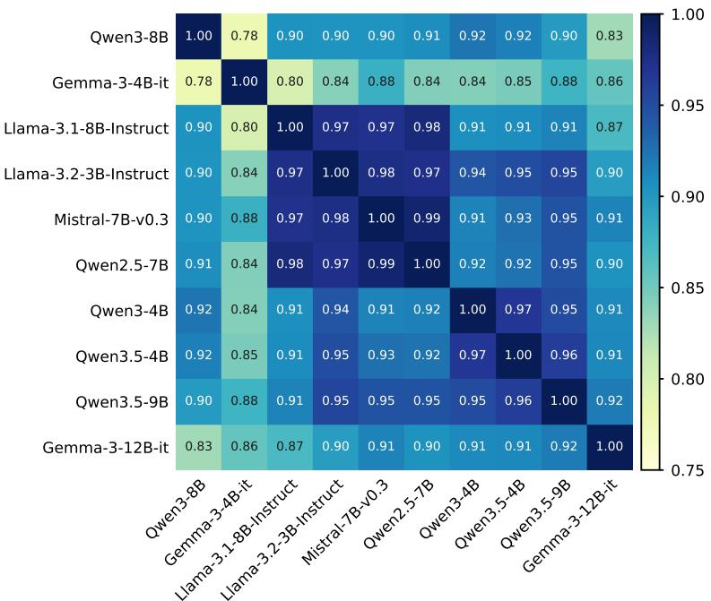  
Figure 7. Agreement across models on estimated information levels. Each cell shows the Pearson correlation between two models’ estimates across 32 contexts. Bold model names indicate the three models used in our estimator.

Figure 7 shows strong agreement across models, with a median Pearson correlation of $r = 0 . 9 1$ across the 45 model pairs. Furthermore, the mean estimate from our three selected models correlates with the mean across all 10 models at $r = 0 . 9 9$ . These results indicate that our estimates are robust to the choice of dense models.

## B Experimental Setup

This section describes the models, the twelve discovery tasks, and the settings of blind variation and selective retention together with every baseline they are compared with. Prompts are collected in Appendix D.

Table 3. The twelve discovery tasks across four scientific domains. The time limit is the CPU wall-clock evaluation limit per candidate (for ZAPBENCH, the GPU training budget on an RTX PRO 6000).
<table><tr><td>Domain</td><td>Task</td><td>Data and Setup</td><td>Task Score</td><td>Reference Baseline</td><td>Time Limit</td></tr><tr><td rowspan="4">BiologyY</td><td>SVG</td><td>DBiT-seq mouse eye; 2,500 spots, 1,050 genes (50 genes × 21 variants)</td><td>Kendall correlation in variant groups, scaled</td><td>SPARK-X 0.8531</td><td>900 s</td></tr><tr><td>LABELPROJ</td><td>GTEx v9; 197,618 reference and 11,508 query nuclei, 53 cell types</td><td>Accuracy and three F1 scANVI+ scores, scaled</td><td>scArches 0.773</td><td>2,400 s</td></tr><tr><td>PERTPRED</td><td>NeurIPS 2023 PBMC; 402 training, 151 query profiles; 5,317 genes</td><td>Five row-wise metrics, NN, scaled</td><td>pseudo-labels 0.465</td><td>1,500 s</td></tr><tr><td>CCC</td><td>TNBC; 42,512 cells, 29 cell types; 812 truth pairs, 166 positive</td><td>AUPRC and top-5% odds ratio, scaled</td><td>Product specificity 0.120</td><td>2,400 s</td></tr><tr><td rowspan="3">Man ang</td><td>MLS-ANOMALY</td><td>Cardio, Thyroid, Satellite, Shuttle; ≤ 10,000 parameters</td><td>AUROC, F1 vs. baselines; geometric mean</td><td>Isolation Forest 0.4912</td><td>300 s</td></tr><tr><td>MLS- CALIBRATION</td><td>Four fixed classifiers on MNIST, Fashion-MNIST, Madelon, Breast Cancer</td><td>ECE, Brier, NLL vs. baselines; geometric mean</td><td>Temperature scaling 0.2935</td><td>180 s</td></tr><tr><td>SL-LR/BS SL-U</td><td>Loss vs. learning rate, batch, data, Held-out R² model size; 2,702/117 points; ≤ 26 parameters</td><td></td><td>0</td><td>1,500 s</td></tr><tr><td rowspan="2">Asmics</td><td>CASSINI</td><td>U-shaped Brier score vs. log compute; 9 groups; 389/127 points; ≤ 6 parameters per group Earth to Saturn; flybys allowed at</td><td>Held-out R² 2t/(t + ∆v),</td><td>0 Initial program</td><td>1,500 s 300 s</td></tr><tr><td>VOYAGER-2</td><td>Venus, Earth, Mars, jupiter Earth to Neptune; flybys allowed at Jupiter, Saturn, Uranus</td><td>t = 1 km/s 2t/(t + ∆v),</td><td>0.2786 Initial program</td><td>300 s</td></tr><tr><td rowspan="2">Neuccccnce</td><td>ZAPBENCH-16</td><td>71,721 neurons, 9 conditions; 4</td><td>t = 2km/s -MAE</td><td>0.6610 Mean of context -0.0289</td><td>600 s</td></tr><tr><td>ZAPBENCH-32</td><td>context, 16 forecast frames As above, 32 forecast frames</td><td>-MAE</td><td>Mean of context -0.0335</td><td>600 s</td></tr></table>

## B.1 Models

Proposals are generated by five LLMs: Kimi-K3, GLM-5.2, GLM-5.3-Flash, DeepSeek-V4-Flash and DeepSeek-V4-Pro. Originality and non-obviousness (Section 2) are estimated by two OpenAI models. For originality, GPT-5.6-Sol reads all mechanism sentences and groups those that express

similar ideas. For non-obviousness, GPT-5.6-Luna reads the task description, the chosen paper, and the proposal, and returns $\hat { v } ( x ) \in [ 0 , 1 ]$ . The SR selector is a fine-tuned Qwen3.5-9B-Base model.

## B.2 Datasets

We use twelve discovery tasks from five benchmark families (Table 3): four single-cell tasks [25], two tasks from MLS-Bench [27], two scaling-law tasks from SLD-Bench [22], two gravity-assist trajectory tasks, and whole-brain activity forecasting from ZAPBENCH [26] at horizons 16 and 32. Every task asks for one executable program with a fixed entry point, which the benchmark’s own evaluator runs end to end to produce the score.

## B.3 Blind Variation Setup

In blind variation, the model receives limited task information to generate proposals, which are subsequently implemented as code. To vary the information available during proposal generation, we use Claude Opus 5 to generate four contexts with different amounts of task information for each task. Appendix D.1 provides the prompts used in BV, along with the prompt used to generate these contexts with Claude Opus 5.

We compare blind variation with three baselines: analogical reasoning, cross-domain search, and no-domain search, using the official prompts provided by Shen et al. [37]. In no-domain search, the model independently searches for papers it considers most helpful. In cross-domain search, the model is instructed to search for papers across domains, while in analogical reasoning, it is instructed to identify relevant papers through analogy. BV (Full Information) always uses the full task description S as its context.

## B.4 Selective Retention Setup

Selective retention ranks the candidates of a pool and discards the lowest-ranked fraction. The ranking model is Qwen3.5-9B-Base [55], fully fine-tuned with a zero-initialized linear head that maps the final hidden state of the last input token to a score $f _ { \theta } ,$ of which only the order is meaningful. Its input is the task description followed by the candidate proposal.

We compare the selector with six ranking baselines. The SFT baseline fine-tunes the same model on the same input but regresses, by mean squared error, the standardized within-run percentile rank of the verified score.

We also include four LLM judge baselines. Here, each cell is ranked by its own proposer. Pointwise scoring asks for an integer from 0 to 100 per candidate, with ties broken at random. The tournament plays six Swiss-system rounds of pairwise comparisons and ranks candidates by points, then by Buchholz score (the sum of the opponents’ points), then at random. Setwise ranking asks which three of ten implementations to discard, over ten random partitions of the cell, and ranks candidates by how rarely they are named. Listwise ranking uses the sliding window of Sun et al. [45] and averages each candidate’s position over three random initial orders.

The in-context learning (ICL) baseline gives the judge access to the same training dataset as SR. For each test candidate, we give four similar proposals from the SR training set, which covers the same tasks and is disjoint from the test set. Each demonstration shows the implementation and its within-run percentile rank of the verified score. The judge then scores the test candidate from 0 to 100 as in Pointwise.

Prompt B.1: Pointwise judge   
You are deciding how worth it is to spend an expensive evaluation on ONE candidate IMPLEMENTATION for a task.   
It is real code that will be executed on the task’s data and scored by the task’s metric. Judge how likely   
the implementation is to (1) run without error and produce a valid output of the required form, and (2) score   
well on the task’s metric.   
TASK SPECIFICATION (data/inputs provided, required output, metric):   
<task specification>   
IMPLEMENTATION:   
‘‘‘python   
<candidate code>   
Read the implementation carefully. Consider: does it correctly consume the provided data/inputs; does it   
actually compute something aligned with the task’s objective (not a trivial constant, a degenerate output, or   
leakage of the target values); is it likely to run without crashing; and does its approach plausibly beat   
the baseline. Judge the ACTUAL code, not the comments’ claims. Ignore length/verbosity.   
First THINK briefly about the points above (a few sentences). THEN give your FINAL ANSWER as one JSON object   
in a ‘‘‘json code fence:   
‘‘‘json   
{"score": 73}   
111   
where "score" is an integer from 0 (certain to fail or score poorly) to 100 (certain to run and score among   
the best), using the full range so that different implementations get different scores.

Prompt B.2: Tournament judge   
You are deciding which of TWO candidate IMPLEMENTATIONS is more worth spending an expensive evaluation on,   
for the SAME task. Each is real code that will be executed on the task’s data and scored by the task’s metric   
. Judge which implementation is more likely to (1) run without error and produce a valid output of the   
required form, and (2) score well on the task’s metric.   
TASK SPECIFICATION (data/inputs provided, required output, metric):   
<task specification>   
IMPLEMENTATION A:   
‘‘‘python   
<code of candidate A>   
IMPLEMENTATION B:   
‘‘‘python   
<code of candidate B>   
Read both implementations carefully. Consider: does it correctly consume the provided data/inputs; does it   
actually compute something aligned with the task’s objective (not a trivial constant, a degenerate output, or   
leakage of the target values); is it likely to run without crashing; and does its approach plausibly beat   
the baseline. Judge the ACTUAL code, not the comments’ claims. Ignore length/verbosity and which one is   
labelled A or B.   
First THINK briefly, comparing the two implementations directly on the points above (a few sentences).   
THEN give your FINAL ANSWER as one JSON object in a ‘‘‘json code fence:   
‘‘‘json   
{"winner": "A"}   
where "winner" is exactly "A" or "B".

## Prompt B.3: Setwise judge

‘‘‘python   
<code of candidate N>   
1   
Read every implementation carefully. Consider: does it correctly consume the provided data/inputs; does it   
actually compute something aligned with the task’s objective (not a trivial constant, a degenerate output, or   
leakage of the target values); is it likely to run without crashing; and does its approach plausibly beat   
the baseline. Judge the ACTUAL code, not the comments’ claims. Ignore length/verbosity and the order in which   
they are listed.   
First THINK briefly (a few sentences). THEN give your FINAL ANSWER as one JSON object in a ‘‘‘json code fence   
with labels:   
‘‘‘json   
{"discard": [4, 9, 2]}

Prompt B.4: Listwise judge   
You are ranking candidate IMPLEMENTATIONS of the SAME task by how worth it is to spend an expensive   
evaluation on each. Each is real code that will be executed on the task’s data and scored by the task’s   
metric. Rank them by how likely each is to (1) run without error and produce a valid output of the required   
form, and (2) score well on the task’s metric.   
TASK SPECIFICATION (data/inputs provided, required output, metric):   
<task specification>   
IMPLEMENTATION [1]:   
‘‘‘python   
<code of candidate 1>   
111   
IMPLEMENTATION [N]:   
‘‘‘python   
<code of candidate N>   
Read every implementation carefully. Consider: does it correctly consume the provided data/inputs; does it   
actually compute something aligned with the task’s objective (not a trivial constant, a degenerate output, or   
leakage of the target values); is it likely to run without crashing; and does its approach plausibly beat   
the baseline. Judge the ACTUAL code, not the comments’ claims. Ignore length/verbosity and the order in which   
they are listed.   
First THINK briefly (a few sentences). THEN give your FINAL ANSWER as one JSON object in a ‘‘‘json code fence   
listing ALL labels from BEST to WORST:   
‘‘‘json   
{"ranking": [3, 1, 7, ...]}

## C Intuition on BVSR

## C.1 Information-Induced Anchoring and Proposal Originality

Assumption C.1 (Shared-Signal Generation). Let $b = \operatorname { i n f o } ( I )$ and $\mathcal { Z } = \{ z _ { 1 } , \ldots , z _ { K } \}$ denote a fixed set of semantic idea classes. Each idea $z _ { i }$ has a task-association score $a _ { i }$ . For generation $t ,$ the model selects:

$$
Z _ { t } ( b ) = \arg \operatorname* { m a x } _ { i } \left\{ \lambda ( b ) a _ { i } + \varepsilon _ { t , i } \right\} ,\tag{9}
$$

where $\varepsilon _ { t , i }$ are i.i.d. Gumbel random variables and $\lambda ( b ) \geq 0$ is differentiable and non-decreasing, $i . e . , \lambda ^ { \prime } ( b ) \ge 0$ Thus, additional task information increases the influence of the shared task signal relative to generation-specific exploratory variation.

Under Assumption C.1, the induced probability of generating idea $z _ { i }$ is

$$
\pi _ { b } ( z _ { i } ) = \frac { \exp ( \lambda ( b ) a _ { i } ) } { \sum _ { j = 1 } ^ { K } \exp ( \lambda ( b ) a _ { j } ) } .\tag{10}
$$

Thus, increasing task information strengthens the common task signal shared across generations relative to independent exploratory variation.

Proposition C.1. Under Assumption C.1, the expected originality of generated proposals is nonincreasing with task information:

$$
\frac { d } { d \operatorname* { i n f o } ( I ) } \mathbb { E } [ o ( c ) ] \leq 0 .\tag{11}
$$

Moreover,for afixed generation budget $n ,$ when higher-utility ideas are less strongly associated with the shared task signal, increasing task information also decreases the expected utility of the best generated proposal.

Proof. The proof proceeds in three steps. We first derive the proposal distribution induced by shared-signal generation. We then show that stronger task information reduces expected originality. Finally, we characterize when the same concentration effect reduces the expected utility of the best proposal under a fixed generation budget.

Induced proposal distribution. Under Assumption C.1, generation t selects $\begin{array} { r l } { Z _ { t } ( b ) } & { { } = } \end{array}$ arg maxi $\{ \lambda ( b ) a _ { i } + \varepsilon _ { t , i } \}$ . By the Gumbel-max identity, the probability of selecting idea $z _ { i }$ is

$$
\pi _ { b } ( z _ { i } ) = \mathrm { P r } ( Z _ { t } ( b ) = z _ { i } ) = \frac { \exp ( \lambda ( b ) a _ { i } ) } { \sum _ { j = 1 } ^ { K } \exp ( \lambda ( b ) a _ { j } ) } ,\tag{12}
$$

which means increasing b strengthens the shared task signal relative to generation-specific variation.

Effect on originality. Consider $n > 1$ independently generated proposals. Let $N _ { i }$ denote the number of proposals belonging to semantic idea class $z _ { i } ,$ with empirical frequency $\widehat { \pi } _ { i } = N _ { i } / n$ . For any proposal c in class $z _ { i } ,$ , we have $| g ( c ) | = N _ { i }$ , so its log-scaled originality is $o ( \bar { c } ) = \bar { 1 } - \log N _ { i } / \log n =$ $- \log { \widehat { \pi } } _ { i } { \bar { \Big / } }$ log n. Averaging over all proposals gives

$$
\frac { 1 } { n } \sum _ { c } o ( c ) = - \frac { 1 } { \log n } \sum _ { i = 1 } ^ { K } \widehat { \pi } _ { i } \log \widehat { \pi } _ { i } = \frac { H ( \widehat { \pi } ) } { \log n } ,\tag{13}
$$

where $\begin{array} { r } { H ( \widehat { \boldsymbol { \pi } } ) = - \sum _ { i = 1 } ^ { K } \widehat { \boldsymbol { \pi } } _ { i } } \end{array}$ log $\widehat { \pi } _ { i }$ is the empirical entropy of the semantic idea distribution. It therefore suffices to show that the expected empirical entropy is non-increasing in b.

Without loss of generality, order the task-association scores as $a _ { 1 } \geq a _ { 2 } \geq \dots \geq a _ { K }$ . For any $r < K$ , let $\begin{array} { r } { S _ { r } ( \lambda ) = \sum _ { i = 1 } ^ { r } \dot { \pi _ { b } } ( z _ { i } ) } \end{array}$ denote the probability assigned to the r most task-associated ideas. Differentiating Eq. 10 gives

$$
\frac { d S _ { r } } { d \lambda } = S _ { r } ( 1 - S _ { r } ) \left( { \mathbb { E } } [ a \mid i \leq r ] - { \mathbb { E } } [ a \mid i > r ] \right) \geq 0 .\tag{14}
$$

The inequality holds since the first r ideas have no smaller association scores than the rest. Hence, increasing λ shifts probability mass toward the most task-associated ideas, so $\pi _ { b }$ becomes increasingly concentrated in the sense of majorization.

We next show that this concentration cannot increase the expected empirical entropy. Since $( N _ { 1 } , \ldots , N _ { K } )$ follows a multinomial distribution with probabilities $\pi _ { b } ,$ each marginal satisfies $N _ { i } \sim \mathrm { B i n o m i a l } ( n , \pi _ { b } ( z _ { i } ) )$ ). Define $h _ { n } ( p ) = \mathbb { E } _ { N \sim \mathrm { B i n o m i a l } ( n , p ) } \mathbf { \bar { [ - \frac { N } { n } \log \frac { N } { n } ] } }$ . Then

$$
\mathbb { E } [ H ( \widehat { \pi } ) ] = \sum _ { i = 1 } ^ { K } h _ { n } \big ( \pi _ { b } ( z _ { i } ) \big ) .\tag{15}
$$

The function $h _ { n }$ is the Bernstein polynomial of the concave function $h ( x ) = - x \log x ,$ and is therefore concave. Consequently, $\mathbb { E } [ H ( \hat { \pi } ) ]$ is symmetric and concave in $\pi _ { b } ,$ and hence Schur-concave. Since increasing $\lambda$ makes $\pi _ { b }$ more concentrated, $\begin{array} { r } { \frac { d } { d \lambda } \mathbb { E } [ H ( \widehat { \pi } ) ] \leq 0 } \end{array}$ . Together with $\lambda ^ { \prime } ( b ) \geq 0 .$ , the chain rule gives

$$
{ \frac { d } { d b } } \mathbb { E } [ H ( { \widehat { \pi } } ) ] = { \frac { d } { d \lambda } } \mathbb { E } [ H ( { \widehat { \pi } } ) ] \lambda ^ { \prime } ( b ) \leq 0 .\tag{16}
$$

Combining this with Eq. 13 and log $n > 0$ yields

$$
\frac { d } { d b } \mathbb { E } \left[ \frac { 1 } { n } \sum _ { c } o ( c ) \right] \leq 0 .\tag{17}
$$

Effect on the best proposal. We finally characterize how the same concentration affects discovery quality. Let each semantic idea class $z _ { i }$ have utility $u _ { i } ,$ and reorder the classes such that $u _ { 1 } \leq u _ { 2 } \leq$ $\cdots \leq u _ { K }$ . Suppose higher-utility ideas are weakly less associated with the shared task signal, so that $a _ { 1 } \geq a _ { 2 } \geq \dots \geq a _ { K }$ . Let $\begin{array} { r } { F _ { j } ( \lambda ) = \sum _ { i = 1 } ^ { j } \pi _ { b } ( z _ { i } ) } \end{array}$ denote the probability of generating an idea with utility at most $u _ { j }$ . By the same argument as Eq. 14,

$$
{ \frac { d F _ { j } } { d \lambda } } \geq 0 \qquad { \mathrm { f o r ~ a l l ~ } } j < K .\tag{18}
$$

Let $M _ { n } ( b ) = \operatorname* { m a x } _ { t = 1 , \ldots , n } u ( Z _ { t } ( b ) )$ denote the utility of the best idea among n independent generations. Since $\Pr ( M _ { n } ( b ) \leq u _ { j } ) = F _ { j } ( \lambda ) ^ { n }$ , its expectation can be written as

$$
\mathbb { E } [ M _ { n } ( b ) ] = u _ { K } - \sum _ { j = 1 } ^ { K - 1 } ( u _ { j + 1 } - u _ { j } ) F _ { j } ( \lambda ) ^ { n } .\tag{19}
$$

Differentiating with respect to λ gives

$$
\frac { d } { d \lambda } \mathbb { E } [ M _ { n } ( b ) ] = - n \sum _ { j = 1 } ^ { K - 1 } ( u _ { j + 1 } - u _ { j } ) F _ { j } ( \lambda ) ^ { n - 1 } \frac { d F _ { j } } { d \lambda } \le 0 .\tag{20}
$$

Since $\lambda ^ { \prime } ( b ) \geq 0 .$ , we therefore obtain

$$
\frac { d } { d b } \mathbb { E } [ M _ { n } ( b ) ] \leq 0 .\tag{21}
$$

Thus, stronger task information reduces expected proposal originality, and when higher-utility ideas are less aligned with the shared task signal, it also reduces the expected utility of the best proposal within a fixed generation budget. □

## C.2 Utility-Gap Advantage in Selective Retention

Assumption C.2 (Utility-Gap Comparison). For any pair of candidates with utilities $u ( c _ { i } )$ and $u ( c _ { j } )$ , let $\Delta = | u ( c _ { i } ) - u ( c _ { j } ) |$ denote their utility gap. We assume that the probability of correctly ordering the pair, $P _ { \mathrm { c o r r e c t } } ( \Delta )$ , is strictly increasing in $\Delta .$

Thus, candidates with larger utility gaps are easier to distinguish.

Proposition C.2. Let the $n$ candidates be ordered by utility as $u ( c _ { ( 1 ) } ) \ \leq \ \cdot \cdot \cdot \leq \ u ( c _ { ( n ) } )$ For a discard ratio d, let $m = \lfloor d n \rfloor$ and define the utility gap across the selective-retention boundary as $\Delta _ { \mathrm { S R } } ( d ) = u ( c _ { ( m + 1 ) } ) - u ( c _ { ( m ) } )$ . We further define the gap between the best candidate and its closest competitor as $\Delta _ { \mathrm { b e s t } } = u \big ( c _ { ( n ) } \big ) - u \big ( c _ { ( n - 1 ) } \big )$ . Under Assumption C.2, $i f \Delta _ { \mathrm { S R } } ( d ) > \Delta _ { \mathrm { b e s t } } ,$ , then

$$
P _ { \mathrm { c o r r e c t } } ( \Delta _ { \mathrm { S R } } ( d ) ) > P _ { \mathrm { c o r r e c t } } ( \Delta _ { \mathrm { b e s t } } ) .\tag{22}
$$

Proof. The proof follows directly from the utility-gap comparison assumption. Selective retention only needs to separate candidates across the discard boundary. At discard ratio $d ,$ the closest such pair is $c _ { ( m ) }$ and $c _ { ( m + 1 ) }$ , whose utility gap is $\Delta _ { \mathrm { S R } } ( d ) = u ( c _ { ( m + 1 ) } ) - u ( c _ { ( m ) } )$ . In contrast, identifying the best candidate requires distinguishing $c _ { ( n ) }$ from its closest utility competitor $c _ { ( n - 1 ) }$ , with gap $\Delta _ { \mathrm { b e s t } } = u ( c _ { ( n ) } ) - u ( c _ { ( n - 1 ) } )$

By Assumption C.2, $P _ { \mathrm { c o r r e c t } } ( \Delta )$ is strictly increasing in $\Delta .$ Therefore, whenever $\Delta _ { \mathrm { S R } } ( d ) > \Delta _ { \mathrm { b e s t } } ,$ , we have

$$
P _ { \mathrm { c o r r e c t } } ( \Delta _ { \mathrm { S R } } ( d ) ) > P _ { \mathrm { c o r r e c t } } ( \Delta _ { \mathrm { b e s t } } ) .\tag{23}
$$

Thus, when the utility separation at the selective-retention boundary is larger than the separation among the top candidates, screening across the retention boundary is more accurate than identifying the single best candidate. □

## C.3 Safe Discarding under Selective Retention

Proposition C.3. Let d denote the overall discard ratio and $\beta _ { q } ( d )$ the expected fraction of top-q proposals discarded by selective retention. For a tolerated loss $\epsilon ,$ define

$$
d _ { q } ^ { \star } ( \epsilon ) = \operatorname* { s u p } \{ d : \beta _ { q } ( d ) \leq \epsilon \} .\tag{24}
$$

Then $d _ { q } ^ { \star } ( \epsilon )$ is the largest discard ratio that limits the expected loss of top-q proposals to at most $\epsilon ,$ and therefore minimizes the number of proposals requiring verification under this constraint.

Proof. For a fixed ranking of n proposals, let $\mathcal { D } ( d )$ denote the set of proposals discarded at ratio d. Since selective retention discards proposals from the bottom of the same ranking, for any $d _ { 1 } \leq d _ { 2 }$ ${ \mathcal { D } } ( d _ { 1 } ) \subseteq { \mathcal { D } } ( d _ { 2 } )$ . Hence, the expected fraction of top-q proposals discarded, $\beta _ { q } ( d )$ , is non-decreasing in d.

For a tolerated loss $\epsilon ,$ define the feasible set ${ \mathcal { F } } _ { q } ( \epsilon ) = \{ d : \beta _ { q } ( d ) \leq \epsilon \}$ . By definition, $d _ { q } ^ { \star } ( \epsilon )$ is the largest feasible discard ratio.1 Therefore,

$$
\beta _ { q } \bigl ( d _ { q } ^ { \star } ( \epsilon ) \bigr ) \leq \epsilon .\tag{25}
$$

At discard ratio $d , n ( 1 - d )$ proposals remain for verification. Thus, choosing $d _ { q } ^ { \star } ( \epsilon )$ minimizes the number of proposals requiring verification while keeping the expected loss of top-q proposals within ϵ. □

## D Prompt Templates

## D.1 Blind Variation

Prompt D.1 is the proposal prompt. {task\_context} is the task context. Every ideation turn also carries the literature-search tool.

Prompt D.1: Proposal Prompt   
=== TOOLS ===   
[   
{   
"type": "function",   
"function": {   
"name": "search\_literature",   
"description": "Search the scientific literature (all disciplines) for real, published papers. Returns   
title, authors, year, citation count and abstract for each hit. Call it as many times as useful, refining   
your query between calls.",   
"parameters": {   
"type": "object",   
"properties": {   
"query": {   
"type": "string",   
"description": "search query (keywords or a phrase)"   
},   
"n": {   
"type": "integer",   
"description": "how many papers to return (default 6, max 15)"   
}  
1For a finite set of candidates, discard ratios lie on a finite grid, so the supremum is attained.

},   
"required": [   
"query"   
]   
}   
}   
}   
]   
=== USER MESSAGE ===   
{task\_context}Find ONE real paper from the field {field} whose single core mechanism is most promising to   
transplant into a different algorithm.   
Use the search\_literature tool to find real papers in this field. Search as many times as you find useful,   
refining your queries as you learn what exists.   
Then reply EXACTLY in this format:   
PAPER: <authors, title, year>   
MECHANISM: <its ONE core mechanism, in one sentence>   
ONE paper, ONE mechanism - do NOT combine several. Do NOT write any code.

Prompt D.2 is to implement the proposal. {task\_interface}, {baseline\_pool} and {task\_guidance} form the full task specification, and {output\_format} the code the task expects.

Prompt D.2: Implementation Prompt   
{task\_interface}   
{baseline\_pool}   
# YOUR JOB   
PAPER: {paper}   
MECHANISM: {mechanism}   
Implement a REAL transplant of THAT ONE mechanism. ONE mechanism only; do NOT add other tricks.{task\_guidance   
}   
OUTPUT FORMAT (exactly):   
‘‘‘python   
{output\_format}

## D.2 Selective Retention

The SR selector and the SFT regressor read the same input, Prompt D.3, including {task\_specification} and the candidate’s complete code. Both map this input to a single score.

Prompt D.3: Input of the SR selector and the SFT regressor   
### TASK   
{task\_specification}   
### IMPLEMENTATION   
{code}   
### PREDICTED PERCENTILE OF VERIFIED SCORE:

## E Examples of Contexts under Different Information Levels

The information levels differ only in the task context at the start of the proposal generation message (Prompt D.1). Prompts E.1–E.4 show example contexts for two tasks.

Prompt E.1: Ideation message, SVG (11.2 bits)   
Context: the samples sit on a 2-D lattice, and the goal is to rank features by how much of their variation is   
organized across the lattice rather than noise.   
Prompt E.2: Ideation message, SVG (22.2 bits)   
Context: this is spatially-variable-gene detection in spatial transcriptomics - ranking genes by whether   
their expression varies in a spatially structured way across a tissue section.   
Prompt E.3: Ideation message, ZAPBENCH-16 (28.6 bits)   
CONTEXT: You are helping improve a procedure that reads a short stretch of many simultaneously recorded   
numeric signals and continues each of them forward for 16 further steps.   
Prompt E.4: Ideation message, ZAPBENCH-16 (47.4 bits)   
CONTEXT: The procedure sees the last four time steps of tens of thousands of simultaneously recorded signals   
and must predict the next 16 steps for every one of them jointly. It is judged by mean absolute error against   
held-out continuations, averaged over windows, over the forecast steps and over all signals.

## F Human Validation Protocols

This section details the human evaluation protocols used in Section 5.4.

## F.1 Originality

Our originality measure depends on grouping proposals that express the same underlying scientific or algorithmic idea. To validate this semantic-equivalence step, we construct a set of 150 proposal pairs, balanced between pairs grouped together and pairs assigned to different groups by the LLM evaluator. The pairs are sampled across tasks, proposer models, and generation methods.

Five PhD-level researchers each evaluate 30 pairs. For each pair, the evaluator judges whether the two proposals express essentially the same underlying mechanism, ignoring differences in wording and implementation details. Pairs marked Unsure (4 in total) are excluded from the agreement analysis. An example evaluation sheet is provided in Appendix G.1.

## F.2 Non-obviousness

We sample 150 high-quality proposals from BV and AR, defined as proposals whose verified score exceeds the best baseline of their task. We remove all method identifiers and ask five PhD-level researchers to evaluate their non-obviousness.

For each proposal, evaluators are shown the task name, a summary of the source paper, and a summary of the proposed method. Both summaries are rewritten by Claude Opus 5 into a uniform style to reduce cues that could reveal the generating method. Evaluators rate non-obviousness on a 1–5 scale, considering how readily the method’s effectiveness on the task could be inferred from the source paper and their own knowledge of the literature. Higher scores indicate greater non-obviousness.

Proposals are split into forms of 30, each balanced across tasks and methods and presented in random order. Each evaluator completes one form. An example evaluation sheet is provided in Appendix G.2.

## G Human Evaluation Example Form

## G.1 Human Evaluation Example Form of Originality

Each page gives the task name and the one-sentence mechanism descriptions of two proposals written for that task, followed by one multiple-choice question: do the two proposals express essentially the same underlying scientific or algorithmic mechanism (Yes / No / Unsure)? Both proposals of a pair come from the same task, the method that produced them and whether the grouping placed them together are not shown, and pairs appear in random order. Figure 8 shows the first pair page of one form.

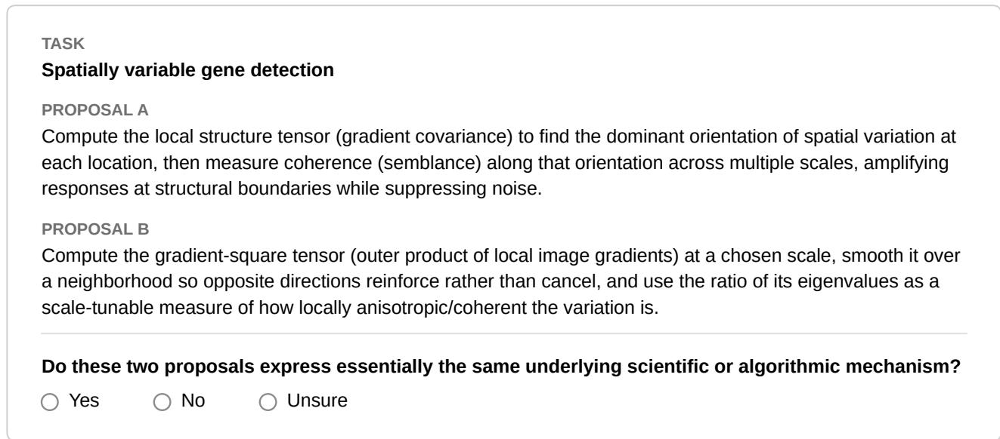  
Figure 8. Example page of the originality evaluation form. The evaluator sees a task and the mechanism descriptions of two proposals written for it, and judges whether the two express essentially the same underlying mechanism (Yes, No, or Unsure).

## G.2 Human Evaluation Example Form of Non-Obviousness

Evaluators rate proposals in a Google Form. The form opens with a short instruction page and one field for the evaluator’s identifier; it then shows one proposal per page, 30 pages in total. Each page gives the task name, a summary of the paper the proposal draws on, and a summary of the proposed method, followed by a 1–5 question on non-obviousness. The method that produced each proposal is not shown, proposals appear in random order, and summaries are written by Claude Opus 5 in one uniform style so that the wording does not reveal the method. Figure 9 shows the first page of one form.

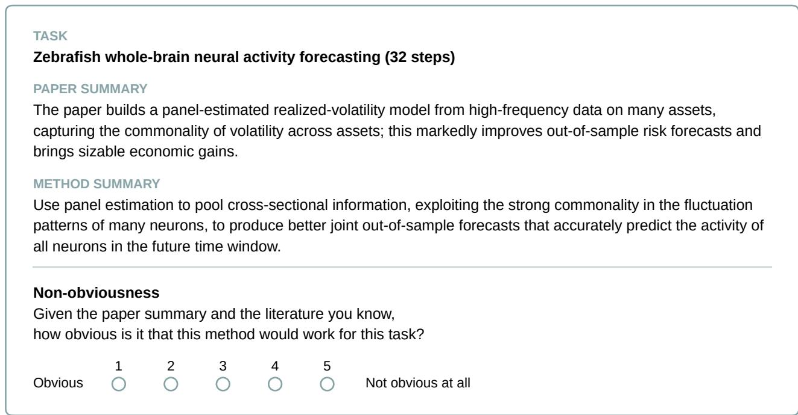  
Figure 9. Example page of the non-obviousness evaluation form. The evaluator sees a task, a summary of the paper the proposal draws on, and a summary of the proposed method, and rates how obvious it is that the method would work for the task, from 1 (obvious: the literature already shows it working on this kind of task) to 5 (not obvious at all).