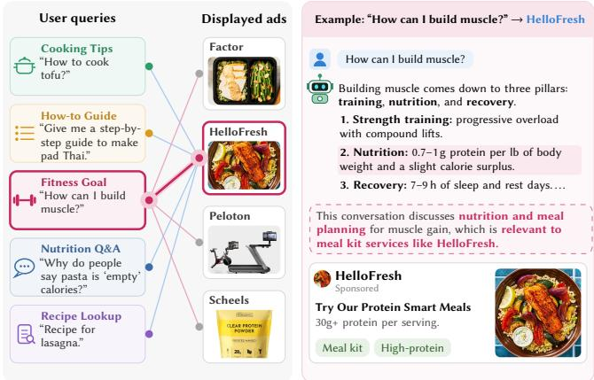
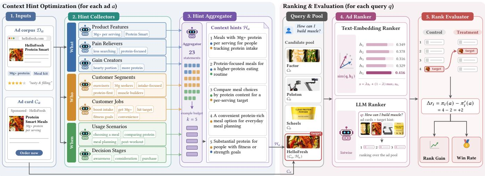
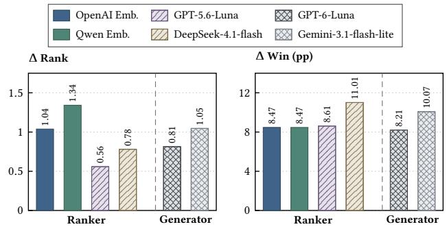
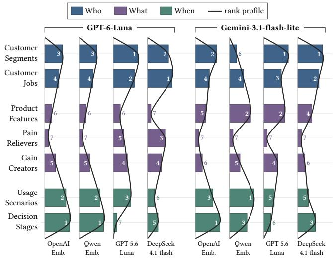
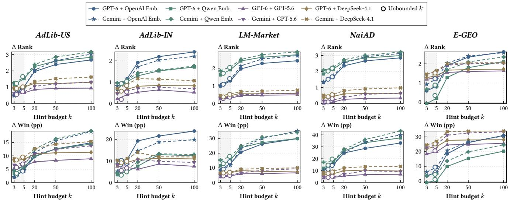
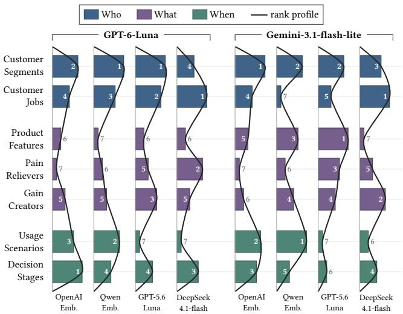

# CHO-Bench: How Do Context Hints Afect Ad Rankings in LLM Advertising?

Shiqi Zhang   
National University of Singapore   
Singapore   
PyroWis AI   
Singapore   
shiqi@pyrowis.ai

Yang Fei National University of Singapore Singapore yfei11@u.nus.edu

Xiaokui Xiao National University of Singapore Singapore xkxiao@nus.edu.sg

## Abstract

LLM advertising selects advertisements based on user conversations, where user needs may extend beyond explicit product searches. ChatGPT Ads allows advertisers to provide natural-language context hints describing what they ofer, who may find it useful, and when it may be useful, as additional information for ranking advertisements across diverse user conversations. However, how to efectively construct these hints remains unclear. We formulate Context Hint Optimization (CHO) as the problem of constructing context hints to improve an advertisement’s ranking under a given budget. Drawing on established marketing frameworks, we develop seven context hint generation strategies covering What, Who, and When, along with a Unified strategy that combines all seven dimensions. We introduce CHO-Bench and conduct over 1.19 million paired evaluations across five datasets using embedding-based and LLM-based rankers. Our results show that context hints improve advertisement rankings under the evaluated ofline rankers. While individual strategies achieve similar average gains and Unified offers no consistent advantage, strategy diferences become more pro nounced under specific generation–ranking configurations, with embedding-based and LLM-based rankers favoring diferent information dimensions. Increasing the hint budget further improves rankings with diminishing marginal gains. These findings establish an ofline benchmark for studying ad-side ranking optimization in LLM advertising and highlight opportunities for model-specific hint selection and budget-aware generation and aggregation.

## 1 Introduction

Large language model (LLM) assistants and generative engines are emerging as new advertising channels. Platforms including Chat-GPT, Microsoft Copilot, and Google AI Search now integrate sponsored content into conversational or AI-generated experiences [7, 14, 19]. LLM advertising selects advertisements based on user conversations and presents them alongside AI-generated responses [6, 9, 11]. A key challenge for advertisers in LLM advertising is reaching users across diverse conversational contexts. Beyond explicit product searches, users may seek information, solve problems, or pursue goals without directly requesting a product or service. A recent empirical study of ChatGPT Ads reported non-obvious con nections between user queries and displayed advertisements [13]. As illustrated in Figure 1, for the query “How can I build muscle?”, ChatGPT displayed advertisements for workout services, fitness equipment, and meal delivery. Conversely, HelloFresh, a meal-kit delivery service, appeared across queries involving cooking instructions, recipes, nutrition, and fitness. Although the muscle-building query does not directly request meal delivery, ChatGPT’s response discusses protein intake, providing a connection to HelloFresh’s Protein Smart meals. This example illustrates how the same advertisement can be associated with diverse user needs and situations.

  
Figure 1: Real example in ChatGPT [13]. Left: Queries and advertisements displayed in ChatGPT’s responses. Right: Chat-GPT’s response to “How can I build muscle?” and the dis- played advertisement for high-protein meals.

In ChatGPT Ads, advertisers can provide free-form naturallanguage context hints describing what they ofer, who may find it useful, and when it may be useful [19]. These hints supplement ad cards with information about potential user needs and situations, allowing advertisements to express connections to conversations beyond explicit product searches. Unlike optimizing ranking models, ad creatives, or external web content, context hints ofer an additional input for ad ranking. However, whether context hints improve advertisement rankings and how to construct them effectively remain unclear. We formulate Context Hint Optimization (CHO) as the problem of constructing context hints to improve an advertisement’s ranking under a given budget. This formulation raises three questions. Can context hints improve advertisement rankings? Which information dimensions and combinations are most efective? How does their efectiveness vary across ranking models and hint budgets?

To address these questions, we first develop context hint generation strategies. Following the What, Who, and When categories in ChatGPT Ads guidance, we draw on established marketing frameworks, including the Value Proposition Canvas [20] and Customer

Journey [12], to identify seven information dimensions. These dimensions cover product features, customer needs, and usage situations. We develop a generation strategy for each dimension and introduce a Unified strategy that combines information across all seven dimensions. Together, these strategies provide a basis for comparing information selection and aggregation.

To evaluate CHO across diferent ranking systems, we consider two fundamental approaches to ad ranking, namely embeddingbased similarity scoring [8, 11, 33] and LLM-based listwise ranking [24, 34]. Both serve as building blocks for more complex ranking pipelines. Based on these approaches, we introduce CHO-Bench to evaluate context hints under diferent ranking mechanisms. Since CHO optimizes context hints rather than ad cards or ranking models, CHO-Bench compares an advertisement’s ranking with and without context hints for the same query and candidate pool, while keeping other advertisements, ad cards, and ranking functions fixed. This paired design measures the incremental ranking efect of con text hints and enables reproducible ofline evaluation without access to proprietary advertising systems.

Using CHO-Bench, we evaluate eight context hint generation strategies across five datasets, two generation models, and four ranking models, yielding 320 experimental configurations. We further evaluate Unified under five hint budgets, adding 200 config urations. Across three repetitions, our experiments comprise 520 configurations and over 1.19 million paired evaluations. Our experiments reveal three main findings. First, context hints improve advertisement rankings under the evaluated ofline rankers, achieving gains of 0.56–1.16 positions in Δ Rank and 5.42–14.40 percentage points in Δ Win across general and product advertising datasets. Second, the seven information strategies achieve similar average gains across datasets, with diferences of 0.07–0.24 ranking positions, and Unified does not consistently outperform individual strategies. However, these diferences can reach 0.57 positions under specific generation–ranking configurations, with embedding-based and LLM-based rankers favoring diferent information dimensions. Third, increasing the hint budget further improves advertisement rankings with diminishing marginal gains, particularly for embedding-based rankers. These findings highlight opportunities for model-specific information selection and budgetaware hint generation and aggregation.

Our contributions are summarized as follows:

• We formulate CHO as an ad-side ranking optimization problem and develop eight marketing-grounded strategies.

• We introduce CHO-Bench, an ofline benchmark using embedding and LLM rankers with controlled paired evaluations.

• We conduct over 1.19 million paired evaluations, revealing the efects of hint strategies, ranking models, and hint budgets.

## 2 Preliminaries

## 2.1 Problem Formulation

LLM advertising extends online advertising to LLM-based assistants. Following prior work [6, 9, 11], we describe the advertising pipeline in four stages.

• Campaign configuration. Advertisers provide campaign objectives, budgets, bids, targeting settings, ad creatives, and other information for ad delivery.

• Ad ranking. Given a user interaction, the platform identifies and ranks candidate advertisements based on the conversational context and available ad information.

• Auction and allocation. Eligible advertisements are selected through an allocation mechanism that may consider relevance, bids, and other platform objectives.

• Ad presentation. Selected advertisements are displayed within or alongside AI-generated responses.

ChatGPT Ads. ChatGPT Ads Manager provides a concrete instance of this pipeline [19]. During campaign configuration, advertisers specify campaign settings �, including objectives, budgets, and bids. Each advertisement � contains a user-facing ad card $C _ { a } ,$ comprising a title, description, and creative, and a set of natural-language context hints ${ \mathcal { H } } _ { a }$ describing what the advertisement ofers, who may find it useful, and when it may be useful. Ads Manager can also collect information from the advertiser’s website, which we denote as the ad corpus $\mathcal { D } _ { a }$ , to initialize the ad card and context hints. Both components can subsequently be revised. During ad ranking, Chat-GPT uses the conversation context, ad cards, and context hints to rank candidate advertisements. Eligible advertisements then enter a relevance-weighted second-price auction, after which selected ad cards are displayed below ChatGPT responses. Unlike ad cards, which contain the information presented to users, context hints provide additional information for ranking advertisements based on user conversations.

Context Hint Optimization. We focus on optimizing context hints while keeping other components of the advertising system unchanged. Specifically, for an advertisement �, we fix its ad card $C _ { a } ,$ campaign settings �, and the ad-ranking function � . Given a hint budget �, Context Hint Optimization (CHO) aims to construct a set of context hints $\mathcal { H } _ { a }$ that maximizes the advertisement’s ranking utility:

$$
{ \mathcal { H } } _ { a } ^ { * } = \arg \operatorname* { m a x } _ { { \mathcal { H } } _ { a } \in { \mathcal { F } } _ { a } , | { \mathcal { H } } _ { a } | \leq k } U _ { f } ( C _ { a } , { \mathcal { H } } _ { a } ) ,\tag{1}
$$

where $\mathcal { F } _ { a }$ denotes the feasible sets of context hints for advertisement �, and $U _ { f } ( C _ { a } , { \mathcal { H } } _ { a } )$ denotes its expected ranking utility across user conversations under the fixed ranking function �. The utility can be instantiated using objectives such as negative average rank or top-1 placement rate. Context hints may be constructed from advertiser information or external sources. In this work, we restrict hint generation to the ad corpus $\mathcal { D } _ { a }$ to compare information strategies under a common information source.

## 2.2 Related Work

LLM advertising. Existing research investigates diferent stages of the LLM advertising pipeline, including bidding, mechanism design, and ad allocation [5, 6, 9], as well as ad ranking, selection, and integration into LLM-generated responses [11, 23, 25]. Recent empirical studies further examine real-world ad delivery and user outcomes [13]. Our work introduces context hint optimization as an ad-side ranking optimization problem that keeps ranking, auction, and presentation mechanisms fixed.

Ad ranking. Ad ranking aims to rank advertisements for user queries and contexts. Existing methods employ semantic representations of queries and advertisements [8] and incorporate user behaviors, preferences, and personalized relevance signals [10, 32]. More recently, Mohankumar et al. [17] leverage web search results and LLM-generated query explanations to improve sponsored search retrieval. While these approaches improve ranking functions $f ,$ we keep � fixed and optimize context hints ${ \mathcal { H } } _ { a }$ as an additional input to improve advertisement rankings.

Advertising creative optimization. Advertising creative opti mization focuses on the content presented to users. Prior studies generate and optimize textual advertisements [15, 16, 31] and visual or multimodal creatives [3, 30] to improve engagement, clickthrough rates, and conversions. In contrast, CHO keeps the userfacing ad card $C _ { a }$ unchanged and optimizes context hints ${ \mathcal { H } } _ { a }$ used for ad ranking.

Generative engine optimization. Generative engine optimization (GEO) aims to improve the visibility ofcontent in LLM-generated responses. Existing methods rewrite or restructure external content [1, 22, 29], while others study adversarial content optimization to influence generated responses and rankings [18, 21, 26]. Both GEO and CHO optimize information supplied to LLM-based sys tems, but difer in their optimization targets. GEO modifies content consumed by generative engines to influence its visibility in generated responses, whereas CHO optimizes context hints ${ \mathcal { H } } _ { a }$ to improve advertisement rankings while keeping ad cards $C _ { a }$ and ranking functions � fixed.

## 3 Data Collection and Preprocessing

We construct CHO-Bench from five datasets covering two advertising settings: general ads, spanning diverse conversational needs and advertisement types, and product ads, focusing on product recommendations. For general ads, we use AdLib-US [13] and AdLib-IN [27, 28] from public ChatGPT ad libraries, together with LM-Market and NaiAD from existing LLM advertising benchmarks [11, 33]. For product ads, we use E-GEO [2]. We construct candidate ad pools using observed query–ad associations or semantic retrieval and prepare an ad card $C _ { a }$ and ad corpus $\mathcal { D } _ { a }$ for each advertisement. All ad cards follow the ChatGPT Ads limits of 50 characters for titles and 100 for descriptions. Table 1 summarizes the datasets, with additional preprocessing details in Appendix A.

AdLib-US and AdLib-IN. We construct two datasets from public libraries of advertisements displayed in ChatGPT. AdLib-US is derived from Lurie et al. [13], which recorded 3,602 advertisement observations across 127,801 conversations in the U.S. market. We group advertisements by query, remove duplicates, and retain queries with advertisements from at least two brands, yielding 109 queries, 883 ads, and 1,093 observed query–ad pairs. AdLib-IN combines two libraries primarily covering the Indian market [27, 28]. After filtering incomplete queries and advertisements, we group prompts expressing the same need and supplement candidate pools containing fewer than 10 brands with semantically similar ads, following Hu et al. [11]. This yields 72 queries, 67 ads, and 740 query–ad pairs. For both datasets, we retain the original ad cards and construct ad corpora through LLM-assisted web search of advertiser landing pages.

Table 1: Summary of the five preprocessed datasets.
<table><tr><td>Setting</td><td>Dataset</td><td># Queries</td><td># Ads</td><td># Pairs</td></tr><tr><td>General</td><td>AdLib-IN [27, 28]</td><td>72</td><td>67</td><td>740</td></tr><tr><td>General</td><td>AdLib-US [13]</td><td>109</td><td>883</td><td>1,093</td></tr><tr><td>General</td><td>NaiAD [33]</td><td>243</td><td>1,155</td><td>2,430</td></tr><tr><td>General</td><td>LM-Market [11]</td><td>387</td><td>1,389</td><td>3,870</td></tr><tr><td>Product</td><td>E-GEO [2]</td><td>1,934</td><td>16,446</td><td>19,316</td></tr></table>

LM-Market and NaiAD. We derive LM-Market from marketingrelated prompts in Hu et al. [11] and NaiAD from real user queries in Zhang et al. [33]. Two LLM judges independently assess query suitability for advertising, followed by manual verification, yielding 387 and 243 queries, respectively. Neither dataset provides observed ChatGPT ad placements, so we retrieve candidate advertisements from a shared library of 4,778 ads across 610 topics [11, 25]. Following Hu et al. [11], Zhang et al. [33], we select the 10 most semantically similar advertisements from distinct brands for each query, yielding 3,870 and 2,430 query–ad pairs. We construct ad cards from advertiser names and descriptions and obtain ad corpora through the same LLM-assisted web-search procedure.

E-GEO. We use E-GEO [2], which contains shopping queries adapted from Reddit product recommendation requests and their retrieved Amazon products. From its held-out test set of 2,000 queries, we retain advertising-suitable queries with candidate products from at least two brands, yielding 1,934 queries, 16,446 products, and 19,316 query–product pairs. Unlike the general-ad datasets, E-GEO provides structured product metadata. We use this metadata directly as the ad corpus $\mathcal { D } _ { a }$ and construct length-constrained ad cards $C _ { a }$ by extracting product identities and key selling points using an LLM.

## 4 CHO Strategies

OpenAI recommends that context hints describe what an advertiser ofers, who may find it relevant, and when it may be useful [19]. These categories provide general guidance but do not specify how to select information for context hints. To identify specific information dimensions, we draw on two established marketing frameworks. The Value Proposition Canvas (VPC) [20] describes an ofering’s value through its Value Map and customer needs through its Customer Profile. The Customer Journey [12] describes how customers interact with oferings across diferent decision stages. Based on these frameworks, we identify seven information dimensions and develop a corresponding context hint generation strategy for each. Figure 2 illustrates the strategies using the HelloFresh Protein Smart meals advertisement displayed for “How can I build muscle?” in Figure 1.

## 4.1 What Dimension

The what dimension describes the ofering and the value it provides. Following the Value Map of the VPC [20], we consider three strategies corresponding to products and services, pain relievers, and gain creators.

  
Figure 2: Overview of CHO-Bench. For each ad (Steps 1–3), its ad corpus is used to generate context hints. For each query (Steps 4–5), the ad ranker ranks ads in its candidate pool based on ad cards and context hints, followed by rank-based evaluation.

Product Features. This strategy captures factual information about an ofering, including its features, capabilities, services, specifications, pricing, and availability, rather than customer outcomes. For HelloFresh, the collector identifies Protein Smart meals containing at least 30g of protein per serving.

Pain Relievers. This strategy identifies problems, risks, frustrations, or obstacles that an ofering can help reduce or resolve. Each hint links a customer problem to a stated product feature or service. For HelloFresh, meal kits can reduce the efort of planning and preparing protein-rich meals.

Gain Creators. This strategy identifies desirable customer outcomes supported by an ofering’s features or services. For HelloFresh, Protein Smart meals can help customers maintain a convenient, protein-rich eating routine.

## 4.2 Who Dimension

The who dimension identifies customers who may be interested in an ofering. Based on the Customer Profile in VPC [20], we distinguish Customer Segments, which describe customer groups, from Customer Jobs, which describe underlying tasks and goals.

Customer Segments. This strategy identifies customer groups based on their roles, backgrounds, characteristics, or circumstances, rather than their immediate tasks. For HelloFresh, the collector identifies regular exercisers, people following higher-protein diets, and those seeking to build or maintain muscle. The latter connects to the muscle-building query in Figure 1, even though the query does not mention meals or nutrition.

Customer Jobs. Drawing on Jobs-to-be-Done (JTBD) [4], this strategy identifies practical tasks and functional, social, or emotional goals that customers seek to accomplish. It emphasizes underlying customer purposes rather than purchasing the ofering itself. For HelloFresh, these include meeting protein targets and supporting fitness or strength goals through meal choices.

## 4.3 When Dimension

The when dimension describes the circumstances in which an offering may be useful. Drawing on the Customer Journey [12], we distinguish Usage Scenarios, which describe situations creating a need for the ofering, from Decision Stages, which describe customers’ progress toward a purchase decision.

Usage Scenarios. This strategy identifies events, activities, or circumstances that make an ofering useful, rather than general goals or purchase decisions. For HelloFresh, examples include planning meals for a higher-protein eating routine and choosing protein-rich meals after strength training.

Decision Stages. This strategy captures information needs at different stages of the customer journey. During awareness, customers recognize a problem or goal without seeking a specific ofering. During consideration, they explore or compare solutions. During purchase, they choose, order, or book a solution. For HelloFresh, these stages correspond to exploring higher-protein meal options, comparing meals by protein content, and deciding whether to order Protein Smart meals.

## 5 CHO-Bench

## 5.1 Benchmark Pipeline

Figure 2 illustrates the two-stage pipeline of CHO-Bench. In the first stage, Hint Collectors extract information from the ad corpus $\mathcal { D } _ { a }$ , and a Hint Aggregator generates context hints ${ \mathcal { H } } _ { a }$ for each advertisement �. In the second stage, an Ad Ranker ranks advertisements for each query, and a Rank Evaluator measures changes in their rankings. Ad cards remain fixed throughout the evaluation.

Hint Collectors. Given an ad corpus ${ \mathcal { D } } _ { a } ,$ each collector generates candidate statements for one of the seven information dimensions in Section 4, without a predefined limit on the number ofstatements. The statements describe specific product attributes, customer needs, or situations, avoiding generic or repetitive content. Product claims must be grounded in ${ \mathcal { D } } _ { a } ,$ while reasonable inferences about customer needs, goals, and situations are allowed. Each dimensionspecific generation strategy uses its corresponding collector, while Unified combines statements from all seven collectors. Collectors do not access evaluation queries or ranking outcomes.

Hint Aggregator. A shared aggregator selects and combines candidate statements into context hints ${ \mathcal { H } } _ { a }$ , following OpenAI’s context hint guidelines [19]. When a hint budget is specified, the aggregator follows the corresponding constraint. The resulting hints describe potential connections between an ofering and user needs or situations. In Figure 2, the aggregator consolidates 23 candidate statements about HelloFresh Protein Smart meals into five hints covering protein intake, meal planning, and fitness-related needs. All generation strategies use the same aggregator and difer only in the information supplied by their collectors.

Ad Ranker. We instantiate the ranking function � in Eq. (1) using embedding-based similarity scoring and LLM-based listwise ranking. Each ranker ranks advertisements within a fixed candidate pool using their ad cards $C _ { a }$ and available context hints ${ \mathcal { H } } _ { a }$ The resulting rankings provide the basis for evaluating the ranking efects of context hints.

Rank Evaluator. The rank evaluator compares advertisement rankings with and without context hints under a fixed ranking procedure and candidate pool.

## 5.2 Evaluation Protocol

Paired Evaluation. For each query, we select one or more advertisements from its candidate pool as targets, where each target is an advertisement whose context hints are evaluated. Each query– target pair defines a benchmark instance �, consisting of a query �, target advertisement �, and candidate ad pool ${ \mathcal { A } } _ { q } .$ . We compare a control condition without context hints against a treatment condition that adds hints generated by the evaluated strategy to the target advertisement. Both conditions use the same query, candidate pool, and ad cards, while all non-target advertisements remain unchanged. The ranking function � produces rankings $\pi _ { i }$ and $\pi _ { i } ^ { \prime }$ under control and treatment, respectively. We generate context hints three times with diferent random seeds and average the results across repetitions. For LLM-based ranking, we evaluate each instance four times with diferent candidate orders, using the same four orders for control and treatment.

Target Selection. For AdLib-US and $A d L i b  – I N$ , we use advertisements observed in ChatGPT responses as targets. In AdLib-US, each observed query–ad pair defines a benchmark instance. In $A d L i b  – I N$ advertisements observed for any query within the same group serve as targets for all queries in that group, excluding advertisements added through semantic retrieval. For LM-Market and NaiAD, we randomly select one target advertisement from each query’s candidate pool. For E-GEO, we use the target product specified by the original dataset. These procedures yield 1,093, 175, 387, 243, and 1,934 benchmark instances, respectively. Target selection determines which advertisements are evaluated and does not imply independently verified query–ad relevance.

Evaluation Metrics. For each benchmark instance �, let $\pi _ { i } ( a )$ and $\pi _ { i } ^ { \prime } ( a )$ denote the target advertisement’s ranks under control and treatment, respectively, starting from 1. We define the rank gain as

$$
\Delta r _ { i } = \pi _ { i } ( a ) - \pi _ { i } ^ { \prime } ( a ) .\tag{2}
$$

A positive value indicates that the target advertisement moves to a higher rank. We report two metrics: Δ Rank, the average rank gain across benchmark instances, and Δ Win, the change in the fraction of targets ranked first between treatment and control. Both metrics are calculated separately for each dataset and averaged across three repetitions.

## 5.3 Model Configurations

We use generation models for Hint Collectors and the Hint Aggregator, and ranking models for advertisement ranking. Within each generation configuration, all collectors and the aggregator use the same model. We consider two fundamental ranking approaches: embedding-based similarity scoring [8, 11, 33] and LLM-based listwise ranking [24, 34]. Both are commonly used as components of more complex retrieval and ranking pipelines, and we evaluate them separately to examine their responses to context hints.

Text-Embedding Ranker. For each benchmark instance �, the ranker computes scores $s _ { i } ( q , b )$ and $s _ { i } ^ { \prime } ( \boldsymbol { q } , \boldsymbol { b } )$ for every advertisement $b \in \mathcal { A } _ { q }$ under control and treatment, respectively. Sorting advertisements by descending score produces rankings $\pi _ { i }$ and $\pi _ { i } ^ { \prime }$ Under control, advertisements are scored using ad-card similarity:

$$
s _ { i } ( q , b ) = \mathrm { s i m } ( { \bf q } , { \bf c } _ { b } ) .
$$

Under treatment, context hints are incorporated into the target advertisement’s score:

$$
s _ { i } ^ { \prime } ( q , b ) = \left\{ \begin{array} { l l } { \lambda \sin ( \mathbf { q } , \mathbf { c } _ { a } ) + ( 1 - \lambda ) \displaystyle \operatorname* { m a x } _ { h \in \mathcal { H } _ { a } } \sin ( \mathbf { q } , \mathbf { h } ) , } & { b = a , } \\ { \sin ( \mathbf { q } , \mathbf { c } _ { b } ) , } & { b \neq a . } \end{array} \right.
$$

Here, q, $\mathbf { c } _ { b } ,$ , and h are the embeddings of the query, ad card $C _ { b } ,$ and context hint $h ,$ respectively. sim(·, ·) denotes cosine similarity, and $\lambda \in \left[ 0 , 1 \right]$ controls the relative weights of ad-card and context-hint similarities. We set $\lambda = 0 . 5$ by default and use each embedding model’s default dimensionality. We also examine sensitivity to �.

LLM Ranker. We invoke the LLM ranker separately under control and treatment. Under control, the ranker ranks all candidate advertisements using their ad cards alone. Under treatment, it first selects the context hint in $\mathcal { H } _ { a }$ most relevant to the query, then ranks the candidate pool using the target’s ad card and selected hint alongside the ad cards of all other advertisements. The ranker produces listwise rankings $\pi _ { i }$ and $\pi _ { i } ^ { \prime }$ for the two conditions.

Model Selection. We use GPT-6-Luna and Gemini-3.1-flashlite for hint generation, OpenAI-text-embedding-3-large and Qwen3-Embedding-4B for embedding-based ranking, and GPT-5.6- Luna and DeepSeek-4.1-flash for LLM-based ranking. We set the temperature to 0 for LLM-based ranking and to 0.7 for hint generation with GPT-6-Luna, while using the default temperature for Gemini-3.1-flash-lite. We independently sample three repetitions for hint generation. The two generation models and four ranking models yield eight generation–ranking combinations, which we evaluate across five datasets and eight hint generation strategies. Using models from diferent families also allows us to examine whether the observed ranking gains depend on the relationship between generation and ranking models.

Table 2: Efects of context hint generation strategies across five datasets. No Hints reports baseline ranking performance, while other strategies report ranking gains relative to the baseline. Dimension results average the strategies within each dimension. Relative Ranking reports the mean rank of each strategy or dimension across experimental settings (mean ± SD, lower is better). All aggregated strategy gains are statistically significant (paired �-tests with standard errors clustered by target advertisement and Holm-adjusted $\textstyle p < 0 . 0 0 1 )$ .
<table><tr><td colspan="2"></td><td colspan="2">AdLib-US</td><td colspan="2">AdLib-IN</td><td colspan="2">LM-Market</td><td colspan="2">NaiAD</td><td colspan="2">E-GEO</td><td colspan="2">Relative Ranking ± SD</td></tr><tr><td colspan="2">Dimension Strategy</td><td>∆ Rank ∆Win∆ Rank ∆Win ∆ Rank ∆Win ∆ Rank ∆Win∆ Rank ∆Win</td><td></td><td></td><td></td><td></td><td></td><td></td><td></td><td></td><td></td><td>∆Rank</td><td>∆ Win</td></tr><tr><td></td><td>No Hints</td><td>7.28</td><td>17.82</td><td>4.79</td><td>19.23</td><td>5.28</td><td>11.68</td><td>5.43</td><td>9.20</td><td>5.16</td><td>12.44</td><td>一</td><td></td></tr><tr><td>Who</td><td>Customer Segments</td><td>+0.93</td><td>+6.01</td><td>+0.80</td><td>+7.50</td><td>+0.94</td><td>+9.23</td><td> $+ 1 . 0 6 ~ + 1 0 . 7 0$ </td><td></td><td></td><td> $+ 1 . 1 1 ~ + 1 3 . 9 0 ~ 3 . 6 7 \pm 2 . 0 4$ </td><td></td><td> $3 . 5 5 \pm 2 . 0 7$ </td></tr><tr><td></td><td>Customer Jobs Dimension mean</td><td>+0.96</td><td>+5.98</td><td>+0.61</td><td>+6.05</td><td>+0.96</td><td>+9.42</td><td> $+ 1 . 0 7 \ + 1 0 . 9 8 $ </td><td></td><td></td><td> $+ 1 . 0 6 ~ + 1 3 . 4 5 ~ 4 . 2 1 \pm 2 . 2 0$ </td><td></td><td> $4 . 1 1 \pm 2 . 1 3$ </td></tr><tr><td></td><td></td><td>+0.94</td><td>+5.99</td><td>+0.71</td><td>+6.78</td><td>+0.95</td><td>+9.33</td><td>+1.07 +10.84</td><td></td><td></td><td> $+ 1 . 0 8 ~ + 1 3 . 6 8 ~ 1 . 6 5 \pm 0 . 7 0$ </td><td></td><td> $1 . 6 8 \pm 0 . 7 3$ </td></tr><tr><td>What</td><td>Product Features</td><td>+0.86</td><td>+5.61</td><td>+0.63</td><td>+6.58</td><td>+0.90</td><td>+8.77</td><td>+1.01</td><td>+9.88</td><td></td><td> $+ 1 . 0 6 ~ + 1 3 . 2 9 ~ 5 . 8 0 \pm 1 . 4 7$ </td><td></td><td> $5 . 4 7 \pm 1 . 9 4$ </td></tr><tr><td></td><td>Pain Relievers</td><td>+0.84</td><td>+5.49</td><td>+0.56</td><td>+6.07</td><td>+0.90</td><td>+8.94</td><td> $+ 0 . 9 7 \quad + 9 . 2 6 \phantom { 0 }$ </td><td></td><td></td><td> $+ 1 . 0 8 ~ + 1 3 . 8 0 ~ 5 . 9 4 \pm 2 . 0 9$ </td><td></td><td> $5 . 4 9 \pm 2 . 1 6$ </td></tr><tr><td></td><td>Gain Creators Dimension mean</td><td>+0.87</td><td>+5.42</td><td>+0.62</td><td>+6.72</td><td>+0.92</td><td>+8.73</td><td> $+ 1 . 0 2 \ + 1 0 . 0 1$ </td><td></td><td></td><td> $+ 1 . 0 6 ~ + 1 3 . 4 6 ~ 5 . 3 1 \pm 1 . 8 6$ </td><td></td><td> $5 . 2 9 \pm 2 . 0 1$ </td></tr><tr><td></td><td></td><td>+0.86</td><td>+5.50</td><td>+0.61</td><td>+6.46</td><td>+0.91</td><td>+8.81</td><td> $+ 1 . 0 0 \quad + 9 . 7 2 \phantom { 0 }$ </td><td></td><td></td><td> $+ 1 . 0 7 \ + 1 3 . 5 2 \ 2 . 5 2 \pm 0 . 7 8$ </td><td></td><td> $2 . 3 0 \pm 0 . 8 5$ </td></tr><tr><td>When</td><td>Usage Scenarios</td><td>+0.94</td><td>+5.46</td><td>+0.68</td><td>+6.70</td><td>+0.97</td><td>+9.45</td><td> $+ 1 . 0 9 \ + 1 1 . 1 5$ </td><td></td><td></td><td> $+ 1 . 0 5 \ + 1 3 . 1 6 \ 4 . 2 5 \pm 2 . 3 3$ </td><td></td><td> $4 . 9 9 \pm 2 . 5 1$ </td></tr><tr><td></td><td>Decision Stages</td><td>+0.87</td><td>+5.80</td><td>+0.74</td><td>+6.96</td><td>+0.97</td><td>+9.39</td><td> $+ 1 . 0 1 + 9 . 7 4$ </td><td></td><td></td><td> $+ 1 . 1 6 ~ + 1 4 . 4 0 ~ 4 . 2 6 \pm 2 . 4 7$ </td><td></td><td> $4 . 1 6 \pm 2 . 2 8$ </td></tr><tr><td></td><td>Dimension mean</td><td>+0.91</td><td>+5.63</td><td>+0.71</td><td>+6.83</td><td>+0.97</td><td>+9.42</td><td> $+ 1 . 0 5 ~ + 1 0 . 4 5$ </td><td></td><td></td><td> $+ 1 . 1 0 ~ + 1 3 . 7 8 ~ 1 . 8 2 \pm 0 . 7 1$ </td><td></td><td> $2 . 0 2 \pm 0 . 7 7$ </td></tr><tr><td>Unified</td><td>Unified</td><td>+0.96</td><td>+5.99</td><td>+0.74</td><td>+7.37</td><td>+0.97</td><td>+9.62</td><td>+1.09 +10.81</td><td></td><td></td><td> $+ 1 . 1 4 ~ + 1 4 . 3 2 ~ 2 . 5 5 \pm 1 . 7 8$ </td><td></td><td> $2 . 9 4 \pm 1 . 8 7$ </td></tr></table>

• RQ3: How does the hint budget afect ranking gains?

For RQ1–RQ2, we evaluate eight context hint generation strategies without a specified hint budget, allowing the aggregator to determine the number of hints. Across five datasets, two generation models, and four ranking models, this yields 320 experimental configurations. For RQ3, we require Unified to generate exactly � hints, with � ∈ {3, 5, 20, 50, 100}, adding 200 configurations. With three repetitions, our experiments comprise 520 configurations and • RQ2: How do ranking gains and strategy preferences vary across generation and ranking models?

We evaluate CHO through three research questions:

• RQ1: Do context hints improve target-ad rankings, and how do diferent information strategies perform?

## 6 Experiment Results

  
Figure 3: Ranking gains from context hints across generation and ranking models. Ranker-level results are averaged over two generators, while generator-level results are averaged over four rankers. Both are averaged over eight hint strate- gies and five datasets.

  
Figure 4: Relative rankings of seven dimension-specific strategies across eight generation–ranking configurations, based on average Δ Rank gains over five datasets. Longer bars indicate better relative rankings, with rank 1 being the best. Colors distinguish What, Who, and When dimensions.

1,195,584 paired evaluations. We also examine sensitivity to the embedding ranking weight �, finding positive average gains across all evaluated settings. Full results are provided in Appendix A. The benchmark data, generation prompts, generated context hints, and evaluation code will be made publicly available.

## 6.1 RQ1: Hint Efectiveness and Strategies

We first examine whether context hints improve advertisement rankings and how their efectiveness varies across information strategies. Table 2 compares eight strategies across five datasets, averaging gains over eight generation–ranking model combinations. We also rank the strategies within each of the 40 dataset– generator–ranker settings and report their average relative ranking and standard deviation. The three dimensions are compared based on their mean strategy gains within each setting. Lower relative rankings indicate better performance.

  
Figure 5: Efects of hint budget � on Unified across five datasets. Rows show Δ Rank and Δ Win, with curves representing eight generation–ranking configurations. Hollow markers indicate unconstrained generation at the average number of generated hints. The � = 3–5 interval is expanded for readability.

Context hints improve target-ad rankings. As shown in Table 2, all eight strategies yield positive average gains across the five datasets, with Δ Rank improvements of 0.56–1.16 positions and Δ Win improvements of 5.42–14.40 percentage points. Without a specified hint budget, the strategies generate 3.8–4.3 hints per advertisement on average, each containing 90–96 characters, including spaces. Each hint is shorter on average than the combined 150-character limit for ad-card titles and descriptions. Embedding rankers also achieve positive gains when ad-card and context-hint similarities receive equal weight (� = 0.5). These results show that concise context hints can improve advertisement rankings under the evaluated ofline rankers.

Information dimensions show similar gains, with some sig- nificant diferences. Among the three dimensions, Who achieves the best average relative ranking, followed by When and What, under both metrics. Pairwise comparisons show that Who and When significantly outperform What, but their absolute advantages are small, ranging from 0.061 to 0.062 positions in Δ Rank and 0.42 to 0.52 percentage points in Δ Win (Holm-adjusted � < 0.001). Who and When do not difer significantly under either metric (Holm-adjusted $\begin{array} { r } { p \ge 0 . 5 9 ) } \end{array}$ . Among individual strategies, Customer Segments achieves the best relative ranking under both metrics, followed by Customer Jobs. Overall, the evaluated information strategies achieve broadly comparable average gains.

Consistent gains across advertising settings. All five datasets show positive ranking gains, including E-GEO, which focuses on explicit product recommendation queries. In particular, E-GEO achieves Δ Win gains of 13.16–14.40 percentage points across strategies, compared with 5.42–6.01 on AdLib-US. Who and When also achieve higher average Δ Rank gains than What on every dataset, although the diferences remain small. These results show that the observed gains extend beyond conversations with implicit commercial needs to explicit product recommendation settings.

Unified does not consistently outperform individual strate- gies. Unified achieves the best overall relative ranking under both Δ Rank (2.55) and Δ Win (2.94), but its advantages over individual strategies are limited. For Δ Rank, Unified matches the best individual strategy to two decimal places on three datasets but falls behind by 0.06 positions on AdLib-IN and 0.02 positions on E-GEO. For Δ Win, Unified leads only on LM-Market, by 0.17 percentage points, while individual strategies perform better on the other four datasets. These results show that combining information from all seven dimensions does not necessarily yield larger gains, motivating further research on efective hint selection and aggregation.

## 6.2 RQ2: Generation and Ranking Models

We examine how generation and ranking models afect ranking gains and the relative performance of context hint generation strategies.

Both generation and ranking models afect ranking gains. Figure 3 shows positive average Δ Rank and Δ Win gains across all four rankers and both generators. Gemini-generated hints achieve larger average gains than GPT-6-generated hints. Within ranking approaches, Qwen embeddings achieve larger average Δ Rank gains than OpenAI embeddings, while DeepSeek achieves larger gains than GPT-5.6 among LLM rankers. These results show that both generation and ranking model choices afect the measured gains from context hints.

Embedding rankers gain more in rank, while LLM rankers gain more in top-1 placement. Embedding rankers achieve larger average Δ Rank gains than LLM rankers (1.19 vs. 0.67 positions), whereas LLM rankers achieve larger Δ Win gains (9.81 vs. 8.47 percentage points). This diference may reflect how the two approaches incorporate context hints. Embedding rankers combine ad-card similarity with the maximum query–hint similarity, while LLM rankers select a query-relevant hint before listwise ranking. These mechanisms may produce diferent ranking responses to the same hints. The contrasting results also show that larger average rank gains do not necessarily yield larger top-1 gains.

Strategy diferences become more pronounced across model configurations. Although information strategies achieve similar average gains in RQ1, their diferences become more pronounced under some generation–ranking configurations. For example, on AdLib-IN, Decision Stages achieves a Δ Rank gain of 1.03 positions with GPT-6 and OpenAI embeddings, compared with 0.46 for Customer Jobs. At the dimension level, When achieves an average gain of 0.83 positions, compared with 0.59 for Who. Figure 4 further shows that When is favored by embedding-based rankers, whereas Who is favored by LLM-based rankers under Δ Rank. These preferences are less consistent under Δ Win and vary across generation models. Together, these findings show that averaging across models can obscure meaningful diferences among information strategies, motivating context hint optimization tailored to diferent ranking configurations.

## 6.3 RQ3: Hint Budget

We examine how the hint budget afects target-ad ranking gains. Figure 5 presents the results across five datasets and eight generation– ranking configurations. We also include unconstrained generation, with hollow markers indicating the average number of generated hints and corresponding gains.

Larger hint budgets yield diminishing ranking gains. Unconstrained Unified achieves ranking gains comparable to those with exactly three or five hints. Increasing � generally improves both Δ Rank and Δ Win across datasets and model configurations. For example, on AdLib-US, Gemini with Qwen embeddings achieves Δ Rank gains of 1.27 at � = 3, 2.39 at � = 20, and 3.16 at � = 100. However, the marginal gains diminish as � increases, with the extent varying across datasets and rankers. These results show that increasing the hint budget can improve rankings beyond unconstrained generation, while additional hints yield progressively smaller benefits.

Embedding rankers benefit more from larger hint budgets. Across five datasets and both generators, embedding rankers generally achieve larger improvements from � = 3 to � = 100 than LLM rankers under both metrics. For example, on LM-Market, increasing � from 3 to 100 raises Δ Rank by 1.07 positions for Gemini with Qwen embeddings, compared with 0.29 positions for Gemini with GPT-5.6. This diference may reflect how the rankers use context hints. Embedding rankers use the maximum query–hint similarity across all generated hints, while LLM rankers select one hint for listwise ranking. For embedding rankers, considering more hints also increases the opportunities to obtain a higher maximum query– hint similarity. Nevertheless, embedding rankers do not always achieve larger absolute gains, particularly on E-GEO under Δ Win. These findings suggest that efective hint budgets depend on the ranking approach, motivating further research on budget-aware hint generation and selection.

## 7 Conclusion

We formulate Context Hint Optimization as an ad-side ranking optimization problem in LLM advertising and introduce CHO-Bench to evaluate context hint generation strategies under fixed ofline rankers. Our experiments show that context hints improve advertisement rankings. While individual strategies achieve similar average gains, their diferences become more pronounced under specific generation–ranking configurations, and combining multiple dimensions does not consistently improve performance. Larger hint budgets yield diminishing gains, with diferent responses across ranking approaches. These findings motivate model-specific hint selection and budget-aware generation and aggregation. Our evaluation measures ranking changes rather than independently verified ad relevance or outcomes when competing advertisements also use context hints. Future work includes relevance-aware and competitive evaluations, real-world advertising experiments, and more efective context hint optimization methods.

## References

[1] Pranjal Aggarwal, Vishvak Murahari, Tanmay Rajpurohit, Ashwin Kalyan, Karthik Narasimhan, and Ameet Deshpande. 2024. GEO: Generative Engine Optimization. In Proceedings ofthe 30th ACM SIGKDD Conference on Knowledge Discovery and Data Mining. 5–16. doi:10.1145/3637528.3671900

[2] Puneet S. Bagga, Vivek F. Farias, Tamar Korkotashvili, Tianyi Peng, and Yuhang Wu. 2025. E-GEO: A Testbed for Generative Engine Optimization in E-Commerce. arXiv:2511.20867 https://arxiv.org/abs/2511.20867

[3] Jin Chen, Ju Xu, Gangwei Jiang, Tiezheng Ge, Zhiqiang Zhang, Defu Lian, and Kai Zheng. 2021. Automated Creative Optimization for E-Commerce Advertising. In Proceedings ofthe Web Conference 2021. 2304–2313. doi:10.1145/3442381.3449909

[4] Clayton M. Christensen, Taddy Hall, Karen Dillon, and David S. Duncan. 2016. Competing Against Luck: The Story ofInnovation and Customer Choice. Harper Business.

[5] Avinava Dubey, Zhe Feng, Rahul Kidambi, Aranyak Mehta, and Di Wang. 2024. Auctions with LLM Summaries. In Proceedings ofthe 30th ACM SIGKDD Conference on Knowledge Discovery and Data Mining. 713–722. doi:10.1145/3637528. 3672022

[6] Paul Dütting, Vahab Mirrokni, Renato Paes Leme, Haifeng Xu, and Song Zuo. 2024. Mechanism Design for Large Language Models. In Proceedings ofthe ACM on Web Conference 2024. 144–155. doi:10.1145/3589334.3645511

[7] Google. 2026. About Ads and AI Overviews. Google Ads Help. https://support. google.com/google-ads/answer/16297775 Accessed: 2026-10-12.

[8] Mihajlo Grbovic, Nemanja Djuric, Vladan Radosavljevic, Fabrizio Silvestri, Ri cardo Baeza-Yates, Andrew Feng, Erik Ordentlich, Lee Yang, and Gavin Owens. 2016. Scalable Semantic Matching of Queries to Ads in Sponsored Search Advertising. In Proceedings ofthe 39th International ACM SIGIR Conference on Research and Development in Information Retrieval. 375–384. doi:10.1145/2911451.2911538

[9] MohammadTaghi Hajiaghayi, Sébastien Lahaie, Keivan Rezaei, and Suho Shin. 2024. Ad Auctions for LLMs via Retrieval Augmented Generation. In Advances in Neural Information Processing Systems, Vol. 37. 18445–18480. doi:10.52202/079017- 0585

[10] Zhaolin Hong, Haitao Wang, Chengjie Qian, Wei Chen, Tianqi He, Yajie Zou, Qiang Liu, and Xingxing Wang. 2024. PRINT: Personalized Relevance Incentive Network for CTR Prediction in Sponsored Search. In Companion Proceedings of the ACM on Web Conference 2024. 190–195. doi:10.1145/3589335.3648316

[11] Silan Hu, Shiqi Zhang, Yimin Shi, and Xiaokui Xiao. 2026. GEM-Bench: A Benchmark for Ad-Injected Response Generation within Generative Engine Marketing. In Proceedings of the 32nd ACM SIGKDD Conference on Knowledge Discovery and Data Mining V.2. doi:10.1145/3770855.3817474

[12] Katherine N. Lemon and Peter C. Verhoef. 2016. Understanding Customer Experience Throughout the Customer Journey. Journal of Marketing 80, 6 (2016), 69–96. doi:10.1509/jm.15.0420

[13] Emma Lurie, Ro Encarnación, Sorelle A. Friedler, and Danaé Metaxa. 2026. The Beginning of ChatGPT Ads. In Proceedings ofthe AAAI/ACM Conference on AI, Ethics, and Society. https://arxiv.org/abs/2608.05008

[14] Microsoft Advertising. 2024. Transforming Audience Engagement with Generative AI. Microsoft Advertising Blog. https://www.about.ads.microsoft.

com/en/blog/post/october-2024/transforming-audience-engagement-withgenerative-ai Accessed: 2026-10-12.

[15] Shaunak Mishra, Manisha Verma, Yichao Zhou, Kapil Thadani, and Wei Wang. 2020. Learning to Create Better Ads: Generation and Ranking Approaches for Ad Creative Refinement. In Proceedings of the 29th ACM International Conference on Information & Knowledge Management. 2653–2660. doi:10.1145/3340531.3412720

[16] Masato Mita, Soichiro Murakami, Akihiko Kato, and Peinan Zhang. 2024. Striking Gold in Advertising: Standardization and Exploration of Ad Text Generation. In Proceedings ofthe 62nd Annual Meeting ofthe Association for Computational Linguistics (Volume 1: Long Papers). Association for Computational Linguistics, 955–972. doi:10.18653/v1/2024.acl-long.54

[17] Akash Kumar Mohankumar, Gururaj K, Gagan Madan, and Amit Singh. 2024. Improving Retrieval in Sponsored Search by Leveraging Query Context Signals. In Proceedings of the 2024 Conference on Empirical Methods in Natural Language Processing: Industry Track. Association for Computational Linguistics, Miami, Florida, US, 1489–1498. doi:10.18653/v1/2024.emnlp-industry.109

[18] Fredrik Nestaas, Edoardo Debenedetti, and Florian Tramèr. 2025. Adversaria Search Engine Optimization for Large Language Models. In The Thirteenth International Conference on Learning Representations, ICLR 2025, Singapore, April 24-28, 2025. OpenReview.net. https://openreview.net/forum?id=hkdqxN3c7t

[19] OpenAI. 2026. ChatGPT Ads Documentation. OpenAI Help Center. https: //help.openai.com/en/collections/20001223-chatgpt-ads Accessed: 2026-10-12.

[20] Alexander Osterwalder, Yves Pigneur, Gregory Bernarda, and Alan Smith. 2014. Value Proposition Design: How to Create Products and Services Customers Want. John Wiley & Sons, Hoboken, NJ.

[21] Samuel Pfrommer, Yatong Bai, Tanmay Gautam, and Somayeh Sojoudi. 2024. Ranking Manipulation for Conversational Search Engines. In Proceedings ofthe 2024 Conference on Empirical Methods in Natural Language Processing, EMNLP 2024, Miami, FL, USA, November 12-16, 2024, Yaser Al-Onaizan, Mohit Bansal, and Yun-Nung Chen (Eds.). Association for Computational Linguistics, 9523–9552. doi:10.18653/V1/2024.EMNLP-MAIN.534

[22] Haritz Puerto, Martin Gubri, Tommaso Green, Seong Joon Oh, and Sangdoo Yun. 2025. C-SEO Bench: Does Conversational SEO Work?. In Advances in Neural Information Processing Systems, Vol. 38. 31145–31169. doi:10.52202/085713-0923

[23] Sebastian Schmidt, Ines Zelch, Janek Bevendorf, Benno Stein, Matthias Hagen, and Martin Potthast. 2024. Detecting Generated Native Ads in Conversational Search. In Companion Proceedings ofthe ACM on Web Conference 2024. ACM, 722–725. doi:10.1145/3589335.3651489

[24] Weiwei Sun, Lingyong Yan, Xinyu Ma, Shuaiqiang Wang, Pengjie Ren, Zhumin Chen, Dawei Yin, and Zhaochun Ren. 2023. Is ChatGPT Good at Search? Investigating Large Language Models as Re-Ranking Agents. In Proceedings of the 2023 Conference on Empirical Methods in Natural Language Processing. Association for Computational Linguistics, 14918–14937. doi:10.18653/v1/2023.emnlp-main.923

[25] Brian Jay Tang, Kaiwen Sun, Noah T. Curran, Florian Schaub, and Kang G. Shin. 2024. GenAI Advertising: Risks of Personalizing Ads with LLMs. arXiv:2409.15436 [cs.HC] https://arxiv.org/abs/2409.15436

[26] Yiming Tang, Yi Fan, Chenxiao Yu, Tiankai Yang, Yue Zhao, and Xiyang Hu. 2025. StealthRank: LLM Ranking Manipulation via Stealthy Prompt Optimization. arXiv:2504.05804 https://arxiv.org/abs/2504.05804

[27] Tru Commerce. 2026. ChatGPT Ads Library. https://trucommerce.ai/chatgptads/library. Accessed: 2026-10-19.

[28] Viren040. 2026. ChatGPT Ads Library. https://viren040.github.io/chatgpt-adslibrary/. Accessed: 2026-10-19.

[29] Yujiang Wu, Shanshan Zhong, Yubin Kim, and Chenyan Xiong. 2026. What Generative Search Engines Like and How to Optimize Web Content Cooperatively. In The Fourteenth International Conference on Learning Representations. https://openreview.net/forum?id=K8EinVWtUB

[30] Hao Yang, Jianxin Yuan, Shuai Yang, Linhe Xu, Shuo Yuan, and Yifan Zeng. 2024. A New Creative Generation Pipeline for Click-Through Rate with Stable Difusion Model. In Companion Proceedings ofthe ACM on Web Conference 2024. 180–189. doi:10.1145/3589335.3648315

[31] Peinan Zhang, Yusuke Sakai, Masato Mita, Hiroki Ouchi, and Taro Watanabe. 2025. AdTEC: A Unified Benchmark for Evaluating Text Quality in Search Engine Advertising. In Proceedings ofthe 2025 Conference ofthe Nations ofthe Americas Chapter of the Association for Computational Linguistics: Human Language Technologies (Volume 1: Long Papers). Association for Computational Linguistics, 7672–7691. doi:10.18653/v1/2025.naacl-long.391

[32] Wei Zhang, Dai Li, Chen Liang, Fang Zhou, Zhongke Zhang, Xuewei Wang, Ru Li, Yi Zhou, Yaning Huang, Dong Liang, Kai Wang, Zhangyuan Wang, Zhengxing Chen, Fenggang Wu, Minghai Chen, Huayu Li, Yunnan Wu, Zhan Shu, Mindi Yuan, and Sri Reddy. 2024. Scaling User Modeling: Large-scale Online User Representations for Ads Personalization in Meta. In Companion Proceedings of the ACM on Web Conference 2024. 47–55. doi:10.1145/3589335.3648301

[33] Yihang Zhang, Zimeng Huang, Ren Zhai, Yipeng Kang, and Tonghan Wang. 2026. NaiAD: Initiate Data-Driven Research for LLM Advertising. arXiv:2605.09918 [cs.LG] https://arxiv.org/abs/2605.09918

[34] Shengyao Zhuang, Honglei Zhuang, Bevan Koopman, and Guido Zuccon. 2024. A Setwise Approach for Efective and Highly Eficient Zero-shot Ranking with

Large Language Models. In Proceedings of the 47th International ACM SIGIR Conference on Research and Development in Information Retrieval. ACM, 38–47. doi:10.1145/3626772.3657813

## A Appendix

## A.1 Additional Data Preprocessing Details

We provide additional details on query filtering, candidate pool construction, and ad card and corpus preparation for the datasets introduced in Section 3.

Preprocessing of AdLib-US and AdLib-IN. For AdLib-US [13], we aggregate advertisements by query, remove duplicate observations, and retain queries associated with at least two distinct advertiser brands to support competitive ranking. For AdLib-IN [27, 28], we exclude queries with insuficient context, such as unresolved pronouns, and advertisements with incomplete or duplicate cards. We group prompts expressing the same need but difering in their closing instructions. For example, requests to compare or recommend three mesh Wi-Fi systems in Pune belong to the same group, with 1.64 queries per group on average. Each query’s candidate pool initially includes all advertisements observed within its group. If the pool contains fewer than 10 distinct brands, we supplement it with semantically similar advertisements from AdLib-IN, following Hu et al. [11]. For both datasets, we preserve the original ad cards. To construct the ad corpus ${ \mathcal { D } } _ { a } ,$ we provide an LLM with the ad card $C _ { a } ,$ advertiser name, and category. The LLM uses web search to identify the advertiser’s oficial website or a retailer page for the advertised product and extracts factual statements with source URLs.

Preprocessing of LM-Market and NaiAD. For both datasets, two LLM judges independently assess query suitability for advertising. We retain queries accepted by both judges and manually verify the results. Candidate advertisements are retrieved from the shared library described in Section 3, with distinct-brand constraints to avoid duplicate advertisers within each pool. We construct ad cards $C _ { a }$ from advertiser names and descriptions and obtain ad corpora $\mathcal { D } _ { a }$ using the same LLM-assisted web-search procedure.

Preprocessing of E-GEO. We apply the same two-judge screening and manual verification to the held-out test queries from E-GEO [2], additionally requiring candidate products from at least two distinct brands. Unlike the other datasets, E-GEO provides structured product metadata. We construct $\mathcal { D } _ { a }$ from the original product title, description, bullet-point features, and details, without web search. To construct $C _ { a } ,$ an LLM extracts the brand and product type or model from the title and one or two key selling points from the description and features, subject to the 50-character title and 100- character description limits.

## A.2 Additional Experimental Results

Full Results for RQ1. Table 4 reports the results ofall eight context hint generation strategies across five datasets and eight generation– ranking configurations, complementing the aggregated results in Table 2. We assess statistical significance using paired �-tests with standard errors clustered by target advertisement and Holm correction across the 320 comparisons for each metric $( p \ < \ 0 . 0 5 )$ Among the 320 configurations, 292 (91.3%) show statistically significant positive Δ Rank gains, and 256 (80.0%) show significant positive Δ Win gains, with no significantly negative efects. The strength of statistical evidence varies across datasets and models. On AdLib-IN, many Δ Win gains are not significant despite positive averages, whereas all gains on LM-Market are significant under both metrics. On NaiAD, several strategies paired with GPT-5.6 yield non-significant Δ Rank gains despite positive Δ Win gains. These results show that the aggregate improvements in RQ1 are supported by most, but not all, individual configurations.

  
Figure 6: Relative rankings of seven dimension-specific strategies across eight generation–ranking configurations, based on average Δ Win gains over five datasets. Longer bars indicate better relative rankings, with rank 1 being the best. Colors distinguish What, Who, and When dimensions.

Table 3: Sensitivity of Unified to the ranking weight � across two embedding rankers. Bold indicates the default setting.
<table><tr><td rowspan="2">λ</td><td colspan="2">OpenAI Emb.</td><td colspan="2">Qwen Emb.</td></tr><tr><td>∆Rank</td><td>∆ Win</td><td>∆ Rank</td><td>∆ Win</td></tr><tr><td>0.1</td><td>+1.69</td><td>+20.14</td><td>+2.19</td><td>+24.03</td></tr><tr><td>0.3</td><td>+1.44</td><td>+14.53</td><td>+1.84</td><td>+16.54</td></tr><tr><td>0.5</td><td>+1.11</td><td>+9.04</td><td>+1.40</td><td>+8.93</td></tr><tr><td>0.7</td><td>+0.71</td><td>+4.57</td><td>+0.87</td><td>+3.75</td></tr><tr><td>0.9</td><td>+0.25</td><td>+1.35</td><td>+0.28</td><td>+0.73</td></tr></table>

equal weight to ad-card and context-hint similarities, rather than selecting the setting with the largest observed gains.

Strategy Rankings under Δ Win for RQ2. Figure 6 presents the relative rankings of seven dimension-specific strategies under Δ Win, complementing the Δ Rank results in Figure 4. The top-ranked strategy is identical under both metrics in only four of the eight configurations. Under Δ Win, Who ranks first among dimensions in three of the four LLM-based model combinations, while embedding rankers exhibit a mixture of Who and When preferences. Individual strategy rankings also vary with the generator. For example, with Qwen embeddings, switching from GPT-6 to Gemini changes the top-ranked strategy from Customer Segments to Usage Scenarios. These results show that the preferred information strategy depends on the ranking configuration and evaluation metric, complementing the configuration-specific diferences reported in RQ2.

Sensitivity to Ranking Weight �. We examine the sensitivity of Unified to the ranking weight �, averaging results across five datasets and two generation models. Table 3 shows positive average Δ Rank and Δ Win gains for both embedding rankers at all evaluated weights. Gains increase as � decreases, indicating that ranking improvements are sensitive to the relative weight assigned to context-hint similarity. For OpenAI embeddings, reducing � from 0.9 to 0.1 increases Δ Rank from 0.25 to 1.69 positions and Δ Win from 1.35 to 20.14 percentage points. Qwen embeddings show the same trend, with gains increasing from 0.28 to 2.19 positions and from 0.73 to 24.03 percentage points. We use � = 0.5 to assign

Table 4: Full results of eight hint generation strategies across five datasets and eight generation–ranking configurations. No Hints reports baseline mean rank (R) and top-1 rate (W, %), while other rows report Δ Rank (R, positions) and Δ Win (W, percentage points). Gray values indicate gains that are not statistically significant.
<table><tr><td colspan="2"></td><td colspan="8">GPT-6-Luna</td><td colspan="8">Gemini-3.1-flash-lite</td></tr><tr><td colspan="2"></td><td colspan="2">OpenAI Emb.</td><td colspan="2">Qwen Emb.</td><td colspan="2">GPT-5.6- DeepSeek- 4.1-flash</td><td colspan="2">OpenAI</td><td colspan="2">Qwen</td><td colspan="2">GPT-5.6-</td><td colspan="2"></td><td>DeepSeek- 4.1-flash</td></tr><tr><td>Dataset</td><td>Strategy</td><td>R</td><td>W</td><td>R</td><td>W</td><td>Luna R</td><td>W</td><td>R W</td><td>R</td><td>Emb. W</td><td></td><td>Emb.</td><td></td><td>Luna</td><td></td><td></td><td></td></tr><tr><td>AdLib-US</td><td>No Hints</td><td>7.25</td><td>17.8</td><td>7.25</td><td></td><td></td><td></td><td></td><td></td><td></td><td>R</td><td>W</td><td></td><td>R</td><td>W</td><td>R</td><td>W</td></tr><tr><td rowspan="8"></td><td>Customer Segments</td><td>0.61</td><td>2.7 1.24</td><td>18.4</td><td>7.30 0.57</td><td>17.2 6.1</td><td>7.33 0.92</td><td>17.9 8.7</td><td>7.25</td><td>17.8</td><td>7.25</td><td>18.4</td><td>7.30</td><td>17.2</td><td>7.33</td><td>17.9 8.9</td></tr><tr><td></td><td>0.57</td><td>2.3</td><td>1.25</td><td>3.9 3.5 0.63</td><td></td><td></td><td></td><td>0.93 0.92</td><td>4.7 4.8</td><td>1.49 1.61</td><td>6.1 6.3</td><td>0.66 0.67</td><td>6.9</td><td>0.98 0.98</td><td></td></tr><tr><td>Customer Jobs</td><td>0.36</td><td>1.6 1.10</td><td>3.0</td><td>0.51</td><td>6.1 5.2</td><td>1.00 0.86</td><td>8.8 8.4 0.85</td><td></td><td>4.8</td><td></td><td>6.7</td><td></td><td>6.7 6.4</td><td>0.98</td><td>9.4 8.9</td></tr><tr><td>Product Features</td><td></td><td></td><td></td><td></td><td></td><td></td><td></td><td></td><td></td><td>1.56</td><td></td><td>0.67</td><td></td><td></td><td></td></tr><tr><td>Pain Relievers</td><td>0.34</td><td>1.5 1.07</td><td></td><td>2.7 0.54</td><td>5.5</td><td>0.87</td><td>8.5</td><td>0.75</td><td>3.6</td><td>1.50</td><td>6.1</td><td>0.68</td><td>6.9</td><td>0.98</td><td>9.1</td></tr><tr><td>Gain Creators</td><td>0.39</td><td>1.3 1.09</td><td>3.0</td><td>0.53</td><td>5.7</td><td>0.88</td><td>8.1</td><td>0.79</td><td>3.7</td><td>1.55</td><td>5.9</td><td>0.71</td><td>6.6</td><td>1.02</td><td>9.1</td></tr><tr><td>Usage Scenarios</td><td>0.66</td><td>2.2 1.31</td><td>3.4</td><td>0.54 0.51</td><td>5.0</td><td>0.90</td><td>8.1</td><td>0.94</td><td>4.7</td><td>1.56</td><td>5.7</td><td>0.64</td><td>6.2</td><td>0.98</td><td>8.3 9.2</td></tr><tr><td>Decision Stages Unified</td><td>0.40 0.64</td><td>1.9 2.8</td><td>1.15 1.23</td><td>3.4 3.5 0.55</td><td></td><td>5.4 0.88 5.7 0.92</td><td></td><td>8.1 0.94 8.5 0.94</td><td>5.1 4.3</td><td>1.53 1.65</td><td>6.6</td><td>6.3 0.61 0.72</td><td></td><td>6.9 7.0</td><td>0.95 1.02 9.6</td></tr><tr><td rowspan="9">AdLib-IN</td><td>No Hints</td><td>5.41 17.7</td><td>4.98</td><td>18.3</td><td>4.26</td><td>21.0</td><td>4.50</td><td>19.9</td><td>5.41</td><td>17.7</td><td>4.98</td><td>18.3</td><td>4.26</td><td>21.0</td><td></td><td>4.50 19.9</td></tr><tr><td>Customer Segments</td><td>0.71</td><td>9.1</td><td>0.87</td><td>3.0 0.41</td><td>6.9</td><td>0.59</td><td>8.3</td><td>1.11</td><td>10.3</td><td>1.09</td><td>5.3</td><td>0.65</td><td>7.3</td><td>0.99</td><td>9.7</td></tr><tr><td>Customer Jobs</td><td>0.46 7.2</td><td>0.74</td><td>3.6</td><td>0.24</td><td></td><td>6.3 0.52</td><td>8.3 0.81</td><td></td><td>5.5 0.90</td><td></td><td>2.1 0.46</td><td></td><td>6.3</td><td>0.79</td><td>9.0</td></tr><tr><td>Product Features</td><td>0.59</td><td>7.4 0.74</td><td>2.3</td><td>0.23</td><td>6.7</td><td>0.54</td><td>8.4</td><td>0.74</td><td>6.9</td><td>1.03</td><td>5.0</td><td>0.48</td><td>7.6</td><td>0.71</td><td>8.5</td></tr><tr><td>Pain Relievers</td><td>0.54</td><td>5.9 0.75</td><td>3.2</td><td>0.24</td><td>6.3</td><td>0.57</td><td>9.5</td><td>0.62</td><td>6.1</td><td>0.89</td><td>3.6</td><td>0.31</td><td>6.2</td><td>0.60</td><td>7.8</td></tr><tr><td>Gain Creators</td><td>0.70</td><td>8.0 0.84</td><td>3.4</td><td>0.20</td><td>6.8</td><td>0.55</td><td>9.2</td><td>0.69</td><td>6.3</td><td>0.99</td><td>4.2</td><td>0.39</td><td>7.0</td><td>0.63</td><td>8.9</td></tr><tr><td>Usage Scenarios</td><td>0.62</td><td>7.0 0.80</td><td>2.5</td><td>0.32</td><td>5.8</td><td>0.53</td><td>7.5</td><td>0.93</td><td>9.1</td><td>0.98</td><td>5.9</td><td>0.52</td><td>6.5</td><td>0.74</td><td>9.2</td></tr><tr><td>Decision Stages</td><td>1.03</td><td>10.3 0.95</td><td>3.6</td><td>0.14</td><td></td><td>6.00.60</td><td>9.4</td><td>1.08</td><td>8.0</td><td>0.99</td><td>3.2</td><td>0.43</td><td>6.5</td><td>0.70</td><td>8.7</td></tr><tr><td>Unified</td><td>0.93</td><td>10.3 0.93</td><td>3.4</td><td>0.19</td><td>5.6</td><td>0.58</td><td>9.1</td><td>0.83</td><td>9.0</td><td>1.04</td><td>5.0</td><td>0.54</td><td>6.8</td><td>0.84</td><td>9.8</td></tr><tr><td rowspan="8">LM-Market</td><td>No Hints</td><td>5.21 12.9</td><td>5.42</td><td>10.9</td><td>5.26</td><td>11.4</td><td>5.22</td><td>11.5</td><td>5.21</td><td>12.9</td><td>5.42</td><td>10.9</td><td>5.26</td><td>11.4</td><td>5.22</td><td>11.5</td></tr><tr><td>Customer Segments</td><td>0.97</td><td>8.2</td><td>1.73</td><td>13.6 0.27</td><td></td><td>3.5 0.38</td><td>6.0</td><td>1.51</td><td>14.8</td><td>1.92</td><td>15.9</td><td>0.30</td><td>5.3</td><td>0.44</td><td>6.5</td></tr><tr><td>Customer Jobs</td><td>0.96</td><td>9.4 1.73</td><td>13.6</td><td>0.31</td><td>4.3</td><td>0.38</td><td>5.9</td><td>1.48</td><td>13.8</td><td>2.02</td><td>17.3</td><td>0.28</td><td>4.6</td><td>0.48</td><td>6.5</td></tr><tr><td>Product Features</td><td>0.85</td><td>7.2 1.59</td><td>11.0</td><td>0.27</td><td>3.9</td><td>0.37</td><td>6.3</td><td>1.44</td><td>13.4</td><td>1.96</td><td>16.7</td><td>0.32</td><td></td><td>5.2 0.44</td><td>6.4</td></tr><tr><td>Pain Relievers</td><td>0.85</td><td>7.8 1.58</td><td>12.1</td><td>0.27</td><td>4.7</td><td>0.42</td><td>6.1</td><td>1.32</td><td>11.8</td><td>1.95</td><td>17.0</td><td>0.33</td><td>5.2</td><td>0.45</td><td>6.7</td></tr><tr><td>Gain Creators</td><td>0.91 8.2</td></table>