# Can Frontier Auto Researchers Reconstruct Human Research Decisions in AI?

Shengyun Si Junjie Chu Ye Leng Yang Zhang

CISPA Helmholtz Center for Information Security

## Abstract

Scientific research has long been driven by substantial human effort, from reviewing prior work and identifying research gaps to designing specific solutions. Recent advances in harness-based agent systems have given rise to increasingly capable Auto Researchers, which can autonomously carry out these tasks and, increasingly, entire end-to-end research workflows. Yet despite their rapidly growing capabilities, how closely the research decisions and outputs produced by auto researchers align with those of human experts remains underexplored. We investigate this gap through the lens of research reconstruction and study: Given comparable research context, how similar are the research decisions and outputs produced by Auto Researchers to those of hu-[ man researchers in AI research? To answer this question, we introduce AutoResearcher–Human Research Similarity (AutoHRS), a stage-wise evaluation framework for assessing how faithfully auto researchers reconstruct human research artifacts across different stages of the scientific workflow. Using 152 ICLR oral papers as our corpus, we generate 456 research trajectories spanning different stages of the research process. Applying AutoHRS to these trajectories, we find that current Auto Researchers frequently fail to recover key research decisions and their resulting artifacts across multiple stages of the research process.

## 1 Introduction

Large language models (LLMs) have been increasingly integrated into scientific research since their emergence, supporting tasks ranging from scientific discovery to scientific writing [1, 7, 12, 13, 15, 16, 18, 20, 24]. Despite these advances, human researchers remained in control of the overall research process, while LLMs primarily served as assistants for individual tasks. With the development of harness-based agents, however, language models are increasingly being integrated into end-to-end scientific workflows [22, 23, 27]. We refer to such harness-based systems that autonomously carry out multiple stages of the research process as Auto Researchers. In these emerging systems, the traditional division of labor is substantially altered: auto researchers take a leading role in carrying out the research process, while human researchers increasingly provide guidance, feedback, and oversight [17, 28, 31]. This shift raises an important question of how the research produced by these systems should be evaluated. However, evaluating research independently generated by auto researchers is challenging: its novelty, scientific value, and potential for genuine breakthroughs are difficult to establish without extensive validation. A more tractable starting point is to use established human research as a reference for assessing how these systems formulate ideas, design experiments, and synthesize findings into papers. We therefore ask: Can Frontier Auto Researchers Reconstruct Human Research Decisions in AI?

Existing evaluation frameworks for LLM-based scientific research systems have largely focused on model-level capabilities, typically assessing performance on individual research tasks rather than the behavior of harness-based systems operating across the full research process [4–6, 25, 26, 30]. In this work, rather than evaluating auto researchers solely by whether they can complete predefined research tasks, we ask whether they can conduct research in ways that reconstruct the decisions and processes of human researchers. To operationalize this evaluation, we introduce AutoResearcher–Human Research Similarity (AutoHRS), a stage-wise evaluation framework for assessing how faithfully auto researchers reconstruct human research artifacts1 across different stages of the scientific process. As scientific research is an open-ended, nonlinear, and multi-stage process, we decompose it into three tractable stages that can be systematically evaluated: idea generation grounded in reference papers and a research direction, experiment design conditioned on a given research idea, and paper synthesis grounded in provided research context and experimental findings [11, 14].

To instantiate this evaluation framework, we construct an evaluation corpus from ICLR 2026 oral papers. Each paper is decomposed into three research trajectories corresponding to three stages considered in AutoHRS: from reference papers to a research idea, from a research idea to an experimental plan, and from experimental findings to the final paper. These trajectories provide both the inputs to the auto researchers and corresponding human research outputs used as references for evaluation. Our framework employs a fine-grained checklistbased evaluation pipeline, with stage-specific dimensions and weights tailored to stages of the research process. We further validate the framework against human judgments, showing strong alignment with human judgments.

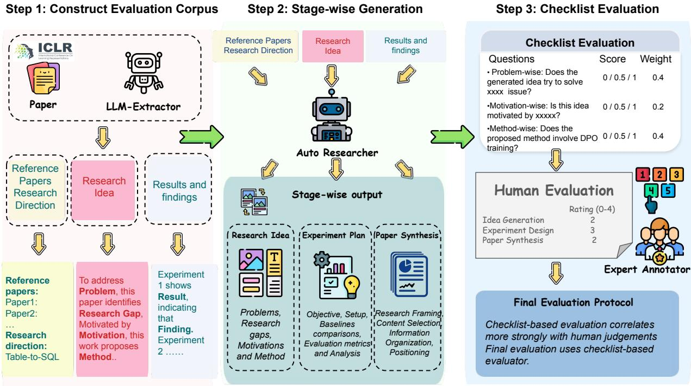  
Figure 1: Overview of our work. We construct AutoHRS by decomposing human research into three stage-wise tasks: idea generation, experiment design, and paper synthesis. Generated outputs are evaluated against human research using a checklist-based evaluator validated by expert judgments.

Our evaluation shows that current auto researchers exhibit limited ability to reconstruct human research across all three stages. Under AutoHRS, on a normalized scale from 0 to 1, auto researchers achieve a score of 0.29 for the best-scoring idea per paper in idea generation, 0.36 on experiment design, and 0.65 on paper synthesis. To better understand these results, we analyze where and how auto researchers diverge from human research, identifying recurring patterns in idea composition and experiment planning. We further analyze factors that affect reconstruction performance, including the granularity of the input research direction and the research type. These results suggest that, despite their growing ability to automate end-to-end scientific workflows, current auto researchers still differ substantially from human researchers in how they formulate ideas, design experiments, and synthesize research into scientific papers.

## 2 AutoHRS Evaluation Framework

We propose an evaluation framework for auto researchers that assesses whether they can reconstruct the research decisions made by human researchers. In this framework, we define three stage-wise evaluation tasks corresponding to three key stages of the research process: literature-grounded idea generation, idea-grounded experiment design, and findingsgrounded paper synthesis.

## 2.1 Stage-Wise Evaluation Tasks

Literature-Grounded Idea Generation. In this task, each instance consists of a set of reference papers, R = $\{ R _ { 1 } , R _ { 2 } , \ldots , R _ { n } \}$ , and a general research direction D. Each reference paper $R _ { i }$ is represented by five components, $R _ { i } =$ $\{ t _ { i } , a _ { i } , p _ { i } , m _ { i } , o _ { i } \}$ , corresponding to its title, abstract, problem, method, and results, respectively. Given the reference set R and research direction D, the target output is a structured research idea, represented as $I = \{ p , g , r , m \}$ , where p denotes the research problem, $g$ the research gap, r the research motivation, and m the proposed method.

Idea-Grounded Experiment Design. In this stage, the auto researcher is given the structured research idea $I = \{ p , g , r , m \}$ defined above. Given the input I, the auto researcher is tasked with producing a detailed experiment plan, denoted as P, that designs experiments around the proposed method to evaluate whether it addresses the identified research problem and gap. The plan is expected to specify the main experimental objectives, evaluation settings, datasets or benchmarks, comparison methods, evaluation criteria, and additional analyses needed to test the proposed idea.

Findings-Grounded Paper Synthesis. The final stage of the research process is to synthesize experimental results and findings into a research paper. In this task, the auto researcher is provided with the research idea I, the experiment plan P, and the resulting experimental evidence and findings, denoted as F. Given these inputs, the auto researcher is tasked with synthesizing them into a coherent research paper, allowing us to assess whether it can organize, interpret, and communicate research findings in a manner comparable to

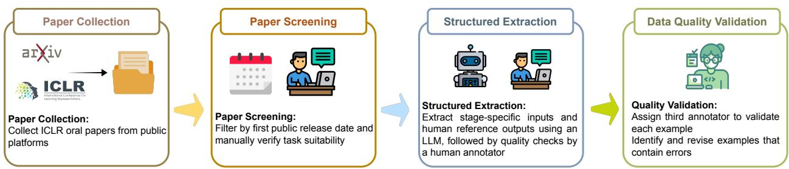  
Figure 2: Overview of evaluation corpus construction.

human researchers.

The input for each stage is independently extracted from the corresponding target paper rather than generated from the output of the preceding stage. This design allows each stage to be evaluated independently without propagating errors from earlier stages. Details on how task inputs and corresponding human reference outputs are extracted and constructed are provided in Appendix A.2.

## 2.2 Evaluation Corpus

We construct the evaluation corpus from ICLR 2026 oral papers, using each paper as the source for both stage-specific task inputs and the corresponding human reference outputs. To prevent auto researchers from directly retrieving information about the ground-truth papers, we further restrict the corpus according to the knowledge cutoff of the underlying models. We also manually screen the remaining papers and remove those that do not satisfy the requirements of our evaluation tasks, such as papers without publicly available reference papers and purely theoretical papers without any experiments. Following the stage-wise task definitions in Section 2.1, we then derive the corresponding evaluation instances from each paper, pairing the stage-specific input with the human research output used as the reference for evaluation. All stage-specific inputs and reference outputs are extracted using an LLM-based pipeline and reformulated into structured representations aligned with the input and output formats of the respective tasks. Each resulting instance is reviewed and validated by human annotators to ensure the correctness and quality of the extracted content. After filtering and human validation, the resulting corpus contains 152 papers and 456 research trajectories.

## 2.3 Checklist-based Evaluation

At each research stage, AutoHRS takes an auto-researchergenerated artifact and the corresponding human reference output as input. It evaluates the generated artifact using a human-verified checklist derived from the reference and produces item-level judgments, dimension-level scores, and an overall score measuring reconstruction fidelity.

Checklist Evaluation Pipeline. We design a checklistbased evaluation protocol that enables reliable and reproducible automated assessment. For each stage, we first extract checklist questions from the reference output using an LLM generator. Each checklist question follows a general form, “Does the output O contain or reflect the element E?”, where O ∈ {idea,experiment plan,paper} denotes the auto researcher output at the corresponding stage, and E denotes an element identified in the reference output. An LLM then serves as a judge to evaluate the outputs generated by the auto researcher, assigning each checklist item one of three labels: Yes, Partial, or No. During preliminary evaluation, we found that some checklist questions generated by the LLM were overly generic or insufficiently discriminative. To improve checklist quality, we introduce a human verification step in which annotators review the generated questions and remove or revise those that are ambiguous, overly broad, or uninformative for reconstruction evaluation. The resulting checklist is then used to assess how well the auto researcher reconstructs the corresponding human research output at each stage. Further details on checklist generation are provided in Appendix A.3.

Stage-Specific Evaluation Dimensions. Each stage of scientific research involves multiple interconnected decisions and outputs, making it difficult to characterize reconstruction fidelity with a single holistic criterion. To enable a more finegrained evaluation, we decompose each research stage into a set of stage-specific evaluation dimensions. Our dimension design is informed by established conventions in scientific reasoning and reporting, including the CARS framework for framing research problems and gaps, principles of rigorous and reproducible experimental design, and the IMRaD structure for scientific reporting [19, 21]. Specifically, (1) Idea Generation: we evaluate the generated artifact along the dimensions of Problem, Research Gap, Motivation, and Method. (2) Experiment Design: we consider Experimental Objective, Experimental Setup, Baselines and Comparisons, Evaluation Protocol, and Ablation and Analysis. (3) Paper Synthesis: we evaluate Research Framing, Content Selection and Emphasis, Scientific Argumentation, Information Organization, and Interpretation and Positioning. Detailed definitions and the corresponding examples for each dimension are provided in Appendix A.4.

Validation Against Human Judgments. To validate whether the checklist-based scores align with human assessment, we randomly sample 20 examples from the evaluation corpus and ask human annotators to independently assess how well each auto-researcher output reconstructs the corresponding human reference. We further compare our checklist-based metric with a single-LLM-as-a-judge baseline. As shown in

Table 1: Instance-level Spearman’s correlation (ρ) with human judgments across the three stages. Higher values indicate stronger alignment with human annotators.
<table><tr><td>Evaluator</td><td>Idea Generation</td><td>Experiment Design</td><td>Paper Synthesis</td></tr><tr><td>GPT-6 Astra</td><td>0.60</td><td>0.57</td><td>0.64</td></tr><tr><td>Claude Fable 5.1</td><td>0.62</td><td>0.59</td><td>0.60</td></tr><tr><td>Qwen3.8-2.4T-A95B</td><td>0.58</td><td>0.50</td><td>0.55</td></tr><tr><td>Checklist Metrics (Ours)</td><td>0.70</td><td>0.64</td><td>0.68</td></tr></table>

Table 1, AutoHRS achieves instance-level Spearman’s correlations of $\rho = 0 . 7 0 , 0 . 6 4$ , and 0.68 with human judgments for idea generation, experiment design, and paper synthesis, respectively, achieving higher observed correlations than the single-LLM judges on the annotated subset. These results indicate that the structured checklist provides a more reliable proxy for human evaluation. Annotator biographies, annotation details, and their responsibilities in the human evaluation process, together with details of the single-LLM-as-a-judge baseline, are provided in Appendix A.1, A.5, and A.6.

## 3 Experiments

In our experiments, we leverage AutoHRS to evaluate auto researchers using our curated human research trajectories as references. We then analyze where and how auto researchers diverge from human research, characterizing recurring patterns across different stages of the research process. Finally, we investigate factors that can make auto-researcher outputs more similar to human research, including the granularity of the input research direction and variation across different research types.

## 3.1 Setup

Auto Researchers. We conduct our main experiments with Claude Code, using Claude Sonnet 4.5 as the underlying model. We select this model because its knowledge cutoff predates the target papers in our evaluation corpus, reducing the risk that the model can recover ground-truth research content from prior knowledge rather than from the provided inputs. To assess robustness across agent harnesses, we further replicate a subset of the experiments with Gemini CLI and Codex; setup details and additional results are provided in Appendix B.1 and B.2.

Data. We conduct our experiments on the evaluation corpus introduced in Section 2.2, constructed from ICLR 2026 oral papers. The corpus is filtered according to the knowledge cutoff of the underlying models and manually screened to ensure that each paper supports all three evaluation tasks. The final corpus contains 152 papers, yielding 456 research trajectories across idea generation, experiment design, and paper synthesis. Each trajectory consists of the stage-specific input provided to the auto researcher and the corresponding human reference output used for evaluation.

Metrics. We use a unified metric formulation to evaluate auto researchers across the three research stages considered in AutoHRS. At each stage, the generated research artifact is evaluated along multiple dimensions, as described in Section 2.3. For each evaluation dimension d, the checklist-based evaluator assigns a score $s _ { d , i } \in \{ 0 , 0 . 5 , 1 \}$ to the i-th checklist item, corresponding to No, Partial, and Yes, respectively. Since the number of checklist items may vary across dimensions, we first compute a dimension-level score by averaging over all checklist items within that dimension:

$$
S _ { d } = \frac { 1 } { N _ { d } } \sum _ { i = 1 } ^ { N _ { d } } s _ { d , i }\tag{1}
$$

where $N _ { d }$ denotes the number of checklist items associated with dimension d. To aggregate dimension-level scores into an overall AutoHRS score, we assign stage-specific weights to the evaluation dimensions. The weights are selected based on alignment with human judgments, using the weighting scheme that yields the highest correlation with human evaluation for each research stage. Further details on the weight selection procedure and the resulting stage-specific weights are provided in Appendix B.3. For a given stage t, the overall AutoHRS score is computed as a weighted average of the corresponding dimension-level scores:

$$
S _ { \mathrm { A u t o H R S } } ^ { ( t ) } = \sum _ { d = 1 } ^ { D _ { t } } w _ { d } ^ { ( t ) } S _ { d } ^ { ( t ) } , \qquad \sum _ { d = 1 } ^ { D _ { t } } w _ { d } ^ { ( t ) } = 1\tag{2}
$$

where $w _ { d } ^ { ( t ) }$ denotes the weight assigned to dimension d at stage $t ,$ and $D _ { t }$ denotes the number of evaluation dimensions defined for that stage. Finally, we report $S _ { \mathrm { A u t o H R S } } ^ { ( t ) }$ separately for each research stage. Higher AutoHRS scores indicate greater fidelity in reconstructing the corresponding human research output and stronger alignment with the human reference.

## 3.2 Main Findings

Idea Generation. Figure 3 shows that auto researchers achieve limited alignment with human references in literaturegrounded idea generation. The mean overall AutoHRS score is 0.29 for the best-scoring idea per paper and 0.15 across all generated ideas. Regarding the proportions of checklist outcomes, the results show that, for the best idea per paper, 42% of problem-related checklist items receive a Yes, whereas the corresponding proportions are 16% for research gap identification and 12% for both motivation and method. Across all generated ideas, 24% of problem-related items receive a Yes, while this proportion is only 5% for each of the remaining dimensions. In both groups, No outcomes dominate the research gap, motivation, and method dimensions. These results indicate that auto researchers are better at recovering the broad research problem than reconstructing the more specific research decisions underlying the human reference.

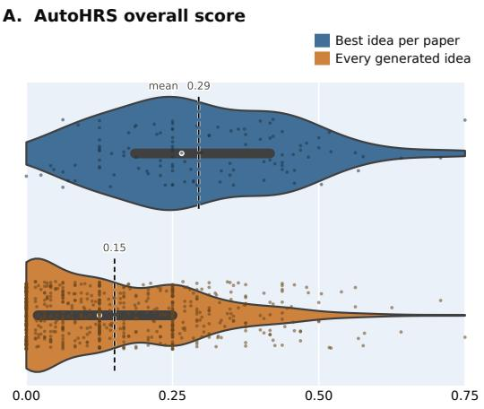

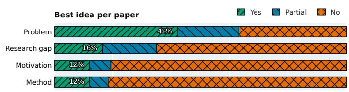

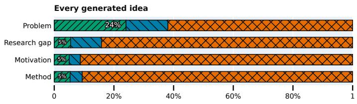  
Figure 3: Idea generation results. (A) Distributions of overall AutoHRS scores for every generated idea and the best-scoring idea for each paper. “ ” indicates the mean and “◦ ” indicates the median. (B) Proportions of checklist outcomes (Yes, Partial, and No) within each evaluation dimension, shown separately for the best idea per paper and every generated idea.

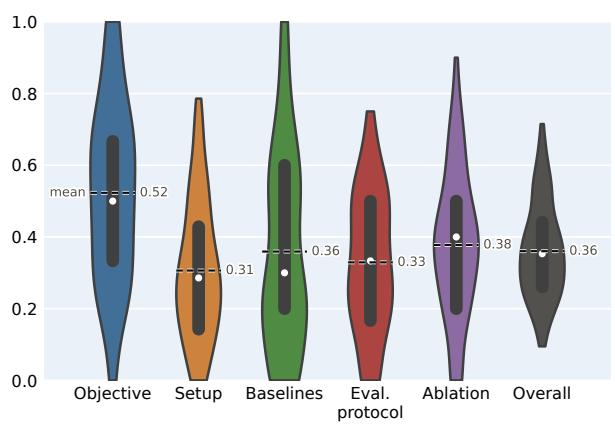

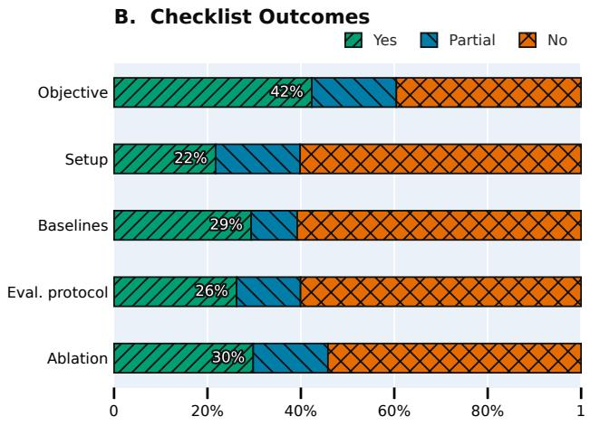  
Figure 4: Experiment design results. (A) Distributions of AutoHRS scores for each evaluation dimension and the overall score. (B) Proportions of checklist outcomes (Yes, Partial, and No) within each evaluation dimension.

Experiment Design. Figure 4 shows that auto researchers achieve a mean overall AutoHRS score of 0.36 in ideagrounded experiment design. Alignment is strongest in Experimental Objective, with a mean score of 0.52 and 42% of checklist items receiving a Yes. The remaining dimensions exhibit lower alignment: mean scores are 0.31 for Experimental Setup, 0.36 for Baselines and Comparisons, 0.33 for Evaluation Protocol, and 0.38 for Ablation and Analysis, with corresponding Yes proportions of 22%, 29%, 26%, and 30%, respectively. No outcomes account for more than half of the checklist items in each of these four dimensions. Although the overall AutoHRS score is higher than in idea generation, alignment with human references remains poor in concrete experimental choices, including experimental setup, baseline selection, evaluation protocols, and ablation studies.

Paper Synthesis. Figure 5 shows that auto researchers achieve a mean overall AutoHRS score of 0.65 in findingsgrounded paper synthesis. Alignment is strongest in Research Framing and Scientific Argumentation, with mean scores of

0.72 and 0.70, respectively, and 68% of checklist items receiving a Yes in both dimensions. Mean scores are 0.63 for Content Selection and Emphasis and 0.64 for Interpretation and Positioning, with a Yes proportion of 59% in each dimension. Information Organization exhibits the lowest alignment, with a mean score of 0.58 and 57% of checklist items receiving a Yes. These results suggest that auto researchers are more effective at reconstructing human research in paper writing than in earlier stages when provided with the research context and findings. However, auto researchers still differ from human experts in how they organize papers and emphasize key aspects of the research.

## Takeaway

AutoHRS scores are 0.29 for the best-scoring idea generation, 0.36 for experiment design, and 0.65 for paper synthesis. Despite these differences across stages, substantial gaps from human research remain in all three, suggesting that current auto researchers still struggle to reproduce the research decisions and outputs of human researchers.

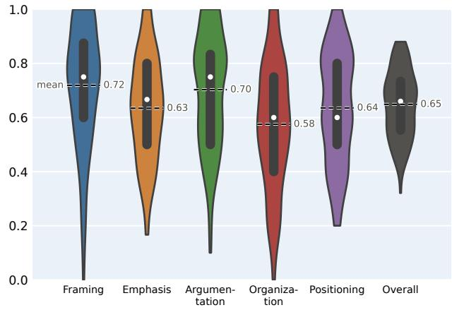

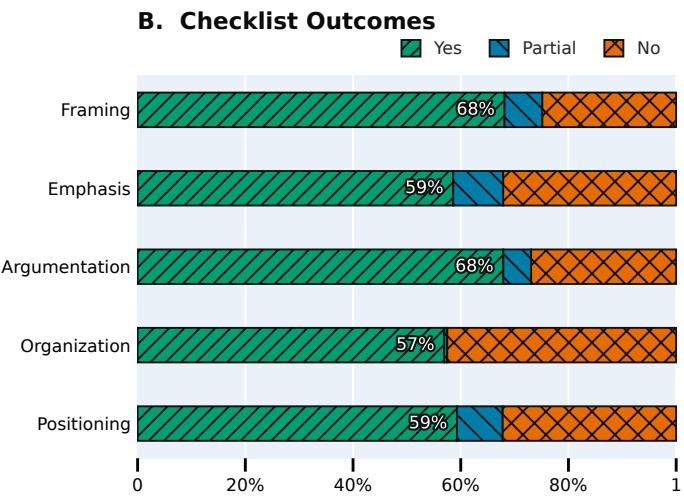  
Figure 5: Paper synthesis results. (A) Distributions of AutoHRS scores for each evaluation dimension and the overall score. (B) Proportions of checklist outcomes (Yes, Partial, and No) within each evaluation dimension.

## 3.3 Where and how auto researchers diverge from human research

Reference-Driven Idea Composition. During manual inspection of auto-researcher-generated research trajectories, we observed several recurring patterns that may contribute to their divergence from human-generated ideas. Auto researchers frequently construct new ideas by combining or integrating elements from multiple reference papers, whereas such patterns appear less frequently in the corresponding human ideas. To examine this observation, we randomly sample 20 research trajectories and manually assess whether each idea is primarily formed by combining identifiable elements from the provided reference papers. Under this criterion, 17 of the 20 auto-researcher-generated ideas exhibit a compositionbased pattern, whereas the corresponding human ideas do not. We then extend this analysis to all research trajectories using GPT-6 Astra to assess the relationship between generated ideas and their reference papers. The results show that 78.4% of auto-researcher-generated ideas exhibit this pattern, suggesting a strong tendency to synthesize existing reference elements rather than depart from them in the same way as human researchers.

Conventional Biases in Experiment Planning. Recurring patterns are also observed in auto-researcher-generated experiment plans. Rather than tailoring experimental designs closely to the specific research question, auto researchers often fall back on conventional experimental choices. They tend to select commonly used models and standard evaluation metrics, while introducing task-specific or customized metrics much less frequently. Together, these patterns suggest that auto researchers often rely on generic experimental templates, which may contribute to their divergence from human-designed experiment plans.

## Takeaway

Auto researchers exhibit recurring patterns in both idea generation and experiment planning: 78.4% of generated ideas recombine elements from the provided references, while experiment plans often favor common models and standard metrics over more tailored designs.

## 3.4 How to Make Auto-Researcher Outputs More Similar to Human Research

We further investigate factors that may affect the reconstruction performance of auto researchers. We examine how the granularity of the input research direction influences idea generation, and whether reconstruction performance varies across different types of research papers, including Empirical, Methodological, and Benchmark-oriented work.

Impact of Research Direction Granularity. In our main experiments, the input to the idea generation stage consists of reference papers together with a research direction. By default, the research direction is expressed as a broad phrase, such as “LLM Reasoning”, “Multimodal Learning”, or “Agent Safety”. In preliminary experiments, we observed that providing slightly more specific research directions can improve idea-generation performance. Motivated by this observation, we investigate how the granularity of the research direction affects reconstruction performance. We define four levels of granularity by progressively narrowing the topical scope while avoiding information that directly reveals the target problem, research gap, motivation, or method. The four levels correspond to a broadfield, a research topic, a focused research area, and afine-grained research scope. Examples for each granularity level are provided in Appendix B.4. Each level introduces only a modest amount of additional information over the previous one. As shown in Figure $^ { 6 , }$ AutoHRS scores consistently increase as the research direction becomes more fine-grained.

Performance Across Research Types. To examine whether reconstruction performance varies across research types, we manually identify papers in the evaluation corpus that fall into three categories: Empirical Analysis, Method/Algorithm, and Benchmark/Evaluation. For each category, we select 20 papers that match the corresponding research type and evaluate idea-generation performance within each subset. As shown in Figure 7, auto researchers achieve the highest AutoHRS score of 0.49 on Empirical Analysis papers, followed by 0.32 on Method/Algorithm papers and 0.18 on Benchmark/Evaluation papers. These results suggest that the ability of auto researchers to reconstruct human research ideas varies substantially across research types, with benchmarkand evaluation-oriented work being particularly challenging.

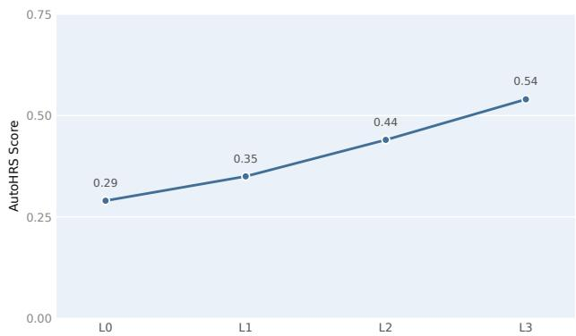

Figure 6: Impact of research-direction granularity on ideageneration performance. Overall AutoHRS score at different levels of research-direction granularity (L0–L3).  
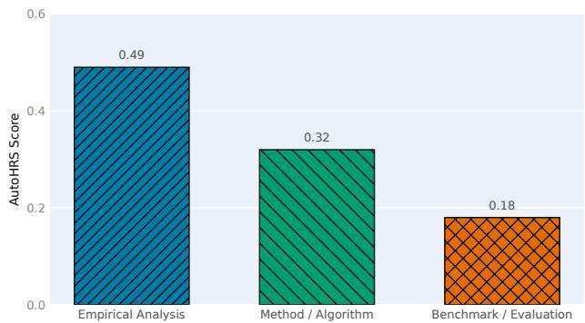  
Figure 7: Impact of research type on idea-generation performance. Overall AutoHRS score across different research types: Empirical Analysis, Method/Algorithm, and Benchmark/Evaluation.

## Takeaway

More fine-grained research directions consistently improve idea reconstruction. Performance also varies by research type, with AutoHRS scores of 0.49 for empirical analysis, 0.32 for methodological work, and 0.18 for benchmark and evaluation research.

## 4 Related Work

## 4.1 Automated Scientific Research

Recent advances in large language models and generalpurpose agent harnesses have substantially broadened the scope of automated scientific research. Early LLM-based work largely focused on individual stages of the research process, such as idea generation, experimentation, and scientific writing [1–3, 8–10, 17, 29]. More recently, harness-based auto researchers have begun to operate across the full research workflow, shifting the role of humans increasingly toward high-level guidance and oversight. ARIS [27] enables endto-end autonomous research through adversarial multi-agent collaboration, while Sibyl-AutoResearch [23], a self-evolving research harness, improves through trial-and-error experience. In this work, we focus specifically on harness-based auto researchers that carry out multiple stages of the scientific research process in an end-to-end manner.

## 4.2 Evaluation of Auto Researchers

Existing evaluations of automated scientific research largely focus either on model-level capabilities or on task completion within individual stages of the research process [4, 30]. RE-Bench [25] compares language-model agents with human experts on open-ended machine-learning research engineering tasks. IdeaBench [7] evaluates LLMs on research idea generation, focusing on the quality of generated ideas. In contrast, the systematic evaluation of general-purpose harness-based auto researchers has only recently begun to emerge. The work by [6] focuses on diagnosing and tracing the causes of failures in end-to-end AutoResearch trajectories. A concurrent work, ARAC [5], evaluates auto-research systems against generalized human research methodology, whereas we directly assess whether they reconstruct the specific research decisions of individual human research trajectories.

## 5 Conclusion and Discussion

We introduced AutoHRS, a stage-wise framework for evaluating how faithfully auto researchers reconstruct human research across idea generation, experiment design, and paper synthesis. AutoHRS further provides a fine-grained checklistbased evaluation pipeline with stage-specific dimensions, and we validate its alignment with human judgments. Our results reveal substantial differences from human research across all three stages, with larger gaps in earlier research decisions. Further analysis shows recurring patterns in how auto researchers diverge from human researchers, including reference-driven idea composition and conventional experiment planning. We also find that reconstruction performance can improve with more fine-grained research directions and varies across research types. These findings suggest that evaluating auto researchers requires looking beyond end-to-end task completion to the research decisions and processes underlying their outputs. Future auto-researcher systems should therefore aim not only to automate scientific workflows, but also to make research decisions that more closely resemble those of human researchers.

## 6 Limitations

Our study has several limitations. First, AutoHRS is evaluated only on research papers from the AI domain, and it remains unclear whether the observed patterns generalize to other scientific disciplines with different research practices and evaluation criteria. Second, running end-to-end auto-researcher trajectories is computationally expensive. As a result, our main evaluation is limited to 152 papers, corresponding to 456 stage-wise research trajectories. While this scale is sufficient to reveal consistent patterns across our analyses, broader evaluations over larger and more diverse corpora would provide a more comprehensive assessment of auto-researcher behavior.

## References

[1] Jinheon Baek, Sujay Kumar Jauhar, Silviu Cucerzan, and Sung Ju Hwang. ResearchAgent: Iterative Research Idea Generation over Scientific Literature with Large Language Models. In Conference of the North American Chapter ofthe Associationfor Computational Linguistics: Human Language Technologies (NAACL-HLT), pages 6709–6738. Association for Computational Linguistics, 2025. 1, 7

[2] Eric Chamoun, Michael Sejr Schlichtkrull, and Andreas Vlachos. Automated Focused Feedback Generation for Scientific Writing Assistance. In Findings of the Association for Computational Linguistics: ACL (ACL Findings), pages 9742–9763. ACL, 2024. 7

[3] Nuo Chen, Andre Huikai Lin, Jiaying Wu, Junyi Hou, Zining Zhang, Qian Wang, Xidong Wang, and Bingsheng He. XtraGPT: Context-Aware and Controllable Academic Paper Revision via Human-AI Collaboration. In Annual Meeting ofthe Associationfor Computational Linguistics (ACL), pages 1045–1074. ACL, 2026. 7

[4] Ziru Chen, Shijie Chen, Yuting Ning, Qianheng Zhang, Boshi Wang, Botao Yu, Yifei Li, Zeyi Liao, Chen Wei, Zitong Lu, Vishal Dey, Mingyi Xue, Frazier N. Baker, Benjamin Burns, Daniel Adu-Ampratwum, Xuhui Huang, Xia Ning, Song Gao, Yu Su, and Huan Sun. ScienceAgentBench: Toward Rigorous Assessment of Language Agents for Data-Driven Scientific Discovery. In International Conference on Learning Representations (ICLR), 2025. 1, 7

[5] Jiale Cui, Yueyao Yuan, Kaixi Zhong, Xiaogang Xu, Jiafei Wu, and Zhe Liu. ARAC: Benchmarking Auto-Research’s Alignment and Completeness on End-to-End Researchs. CoRR abs/2608.12788, 2026. 1, 7

[6] Yanlin Fei, Nazhou Liu, Xinmiao Yu, Shaolong Chen, Lei Li, Rahul Thapa, Madalina G. Ciobanu, Navan Preet Singh, Qingqing Mao, and Ritankar Das. How Do Agents Fail on AutoResearch: End-to-End Diagnostic Evaluation on 100 Real-World Frontier Research Tasks. CoRR abs/2608.14905, 2026. 1, 7

[7] Sikun Guo, Amir Hassan Shariatmadari, Guangzhi Xiong, Albert Huang, Myles Kim, Corey M. Williams, Stefan Bekiranov, and Aidong Zhang. IdeaBench: Benchmarking Large Language Models for Research Idea Generation. In ACM Conference on Knowledge Discovery and Data Mining (KDD), pages 5888–5899. ACM, 2025. 1, 7

[8] Siyuan Guo, Cheng Deng, Ying Wen, Hechang Chen, Yi Chang, and Jun Wang. DS-Agent: Automated Data Science by Empowering Large Language Models with Case-Based Reasoning. In International Conference on Machine Learning (ICML), pages 16813–16848. PMLR, 2024. 7

[9] Xiang Hu, Hongyu Fu, Jinge Wang, Yifeng Wang, Zhikun Li, Renjun Xu, Yu Lu, Yaochu Jin, Lili Pan, and Zhenzhong Lan. Nova: An Iterative Planning and Search Approach to Enhance Novelty and Diversity of LLM Generated Ideas. CoRR abs/2410.14255, 2024. 7

[10] Zhengyao Jiang, Dominik Schmidt, Dhruv Srikanth, Dixing Xu, Ian Kaplan, Deniss Jacenko, and Yuxiang Wu. AIDE: AI-Driven Exploration in the Space of Code. CoRR abs/2502.13138, 2025. 7

[11] David Klahr and Kevin Dunbar. Dual Space Search During Scientific Reasoning. Cogn. Sci., 1988. 1

[12] Patrick Tser Jern Kon, Qiuyi Ding, Jiachen Liu, Xinyi Zhu, Jingjia Peng, Jiarong Xing, Yibo Huang, Yiming Qiu, Jayanth Srinivasa, Myungjin Lee, Mosharaf Chowdhury, Matei Zaharia, and Ang Chen. EXP-Bench: Can AI Conduct AI Research Experiments? In International Conference on Learning Representations (ICLR), 2026. 1

[13] Sandeep Kumar, Tirthankar Ghosal, Vinayak Goyal, and Asif Ekbal. Can Large Language Models Unlock Novel Scientific Research Ideas? In Conference on Empirical Methods in Natural Language Processing (EMNLP), pages 33563–33587. ACL, 2025. 1

[14] Pat Langley, Herbert A. Simon, Gary L. Bradshaw, and Jan M. Zytkow. Scientific Discovery: Computational Explorations of the Creative Process. The MIT Press, 1987. 1

[15] Long Li, Weiwen Xu, Jiayan Guo, Ruochen Zhao, Xingxuan Li, Yuqian Yuan, Boqiang Zhang, Yuming Jiang, Yifei Xin, Ronghao Dang, Yu Rong, Deli Zhao, Tian Feng, and Lidong Bing. Chain of Ideas: Revolutionizing Research Via Novel Idea Development with LLM Agents. In Findings of the Association for Computational Linguistics: EMNLP (EMNLP Findings), pages 8971–9004. ACL, 2025. 1

[16] Chris Lu, Cong Lu, Robert Tjarko Lange, Jakob Foerster, Jeff Clune, and David Ha. The AI Scientist: Towards Fully Automated Open-Ended Scientific Discovery. CoRR abs/2408.06292, 2024. 1

[17] Samuel Schmidgall, Yusheng Su, Ze Wang, Ximeng Sun, Jialian Wu, Xiaodong Yu, Jiang Liu, Michael Moor, Zicheng Liu, and Emad Barsoum. Agent Laboratory: Using LLM Agents as Research Assistants. In Findings of the Association for Computational Linguistics: EMNLP (EMNLP Findings), pages 5977–6043. ACL, 2025. 1, 7

[18] Chenglei Si, Diyi Yang, and Tatsunori Hashimoto. Can LLMs Generate Novel Research Ideas? A Large-Scale

Human Study with 100+ NLP Researchers. In International Conference on Learning Representations (ICLR), 2025. 1

[19] Luciana B. Sollaci and Mauricio G. Pereira. The introduction, methods, results, and discussion (IMRAD) structure: a fifty-year survey. Journal of the Medical Library Association, 2004. 3

[20] Noy Sternlicht and Tom Hope. CHIMERA: A Knowledge Base of Scientific Idea Recombinations for Research Analysis and Ideation. In Annual Meeting ofthe Associationfor Computational Linguistics (ACL), pages 1871–1905. ACL, 2026. 1

[21] John M. Swales. Genre Analysis: English in Academic and Research Settings. Cambridge University Press, 1990. 3

[22] Qiong Tang, Xiangkun Hu, Xiangyang Liu, Yiran Chen, and Yunfan Shao. FARS: A Fully Automated Research System Deployed at Scale. CoRR abs/2606.31651, 2026. 1

[23] Chengcheng Wang, Qinhua Xie, Wei He, Jianyuan Guo, Shiqi Wang, and Chang Xu. Sibyl-AutoResearch: Autonomous Research Needs Self-Evolving Trial-and-Error Harnesses, Not Paper Generators. CoRR abs/2605.22343, 2026. 1, 7

[24] Qingyun Wang, Doug Downey, Heng Ji, and Tom Hope. SciMON: Scientific Inspiration Machines Optimized for Novelty. In Annual Meeting of the Association for Computational Linguistics (ACL), pages 279–299. ACL, 2024. 1

[25] Hjalmar Wijk, Tao Roa Lin, Joel Becker, Sam Jawhar, Neev Parikh, Thomas Broadley, Lawrence Chan, Michael Chen, Joshua Clymer, Jai Dhyani, Elena Ericheva, Katharyn Garcia, Brian Goodrich, Nikola Jurkovic, Megan Kinniment, Aron Lajko, Seraphina Nix, Lucas Jun Koba Sato, William Saunders, Maksym Taran, Ben West, and Elizabeth Barnes. RE-Bench: Evaluating Frontier AI R&D Capabilities of Language Model Agents against Human Experts. In International Conference on Machine Learning (ICML). PMLR, 2025. 1, 7

[26] Wanghan Xu, Shuo Li, Tianlin Ye, Qinglong Cao, Yixin Chen, Hengjian Gao, Yiheng Wang, Qi Li, Kun Li, Sheng Xu, Shengdu Chai, Fangchen Yu, Xiangyu Zhao, Zhangrui Zhao, Weijie Ma, Zijie Guo, Koutian Wu, Haoyu Zhou, Haoxiang Yin, Lixue Cheng, Chaofan Hu, Haoxuan Li, Lu Mi, Xuxuan Xie, Yifan Zhou, Ruizhe Chen, Zhiwang Zhou, Xingjian Guo, Yuhao Zhou, Xuming He, Shengyuan Xu, Xinyu Gu, Jiamin Wu, Mianxin Liu, Chunfeng Song, Fenghua Ling, Dongzhan Zhou, Shixiang Tang, Yuqiang Li, Mao Su, Peng Ye, Siqi Sun, Bin Wang, Xue Yang, Zhenfei Yin, Tianfan Fu, Guangtao Zhai, Wanli Ouyang, Bo Zhang, Lei Bai, and Wenlong Zhang. ResearchClawBench: A Benchmark for End-to-End Autonomous Scientific Research. CoRR abs/2606.07591, 2026. 1

[27] Ruofeng Yang, Yongcan Li, and Shuai Li. ARIS: Autonomous Research via Adversarial Multi-Agent Collaboration. CoRR abs/2605.03042, 2026. 1, 7, 12

[28] Weiwei Ye, Hangchen Liu, Dongyuan Li, and Renhe Jiang. PaperClaw: Harnessing Agents for Autonomous Research and Human-in-the-Loop Refinement. CoRR abs/2606.22610, 2026. 1

[29] Chunhong Yuan, Tianshi Wei, Chuangqi Li, Xing Yi, Shengrui Liu, Zixin Zhang, Yule Cai, and Xinke Du. PaperOrchestrator: An LLM-Orchestrated multi-agent pipeline for automated end-to-end scientific paper writing. Journal ofKing Saud University - Computer and Information Sciences, 2026. 7

[30] Zhengxin Zhang, Ning Wang, Sainyam Galhotra, and Claire Cardie. How Far Are We From True Auto-Research? CoRR abs/2605.19156, 2026. 1, 7

[31] Chen Zhu and Xiaolu Wang. HLER: Human-in-the-Loop Economic Research via Multi-Agent Pipelines for Empirical Discovery. CoRR abs/2603.07444, 2026. 1

## A AutoHRS Construction A.1 Biography of Annotators

Table 2: Details of the human annotators involved in checklist verification and human evaluation. All annotators have research experience in AI and independently assess the reconstruction fidelity of auto-researcher outputs against the corresponding human references.
<table><tr><td>ID</td><td>Domain</td><td># Publications</td><td>Prompt</td><td>Checklist</td><td>Validation</td><td>Human Eval</td></tr><tr><td>1</td><td>Machine Learning</td><td>&gt; 10</td><td>√</td><td>√</td><td>√</td><td>√</td></tr><tr><td>2</td><td>Natural Language Processing</td><td>5-10</td><td>√</td><td>√</td><td>√</td><td>√</td></tr><tr><td>3</td><td>Computer Vision</td><td>5-10</td><td>√</td><td>√</td><td>√</td><td>√</td></tr></table>

## A.2 Stage-Wise Evaluation Task Construction

This section provides additional details on the construction of the stage-wise evaluation tasks. We use GPT-6 Astra to extract and reformulate the task inputs and corresponding human reference outputs from the target papers. Because the extraction prompts for the three research stages follow a similar structure, we present the research-idea extraction prompt as a representative example below.

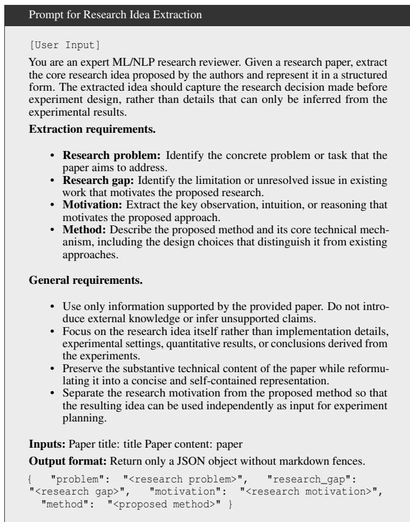  
Figure 8: Prompt for extracting the structured research idea from the reference paper. The extracted idea captures the research problem, gap, motivation, and proposed method, and serves as the input to the experiment design stage.

## A.3 Checklist Generation

This section provides the prompts used in our checklistbased evaluation pipeline. We first present the stage-specific prompts used to generate checklist questions for idea generation, experiment design, and paper synthesis. We then provide the prompt used by the LLM judge to evaluate auto-researcher outputs against each checklist item and assign one of three outcomes: Yes, Partial, or No.

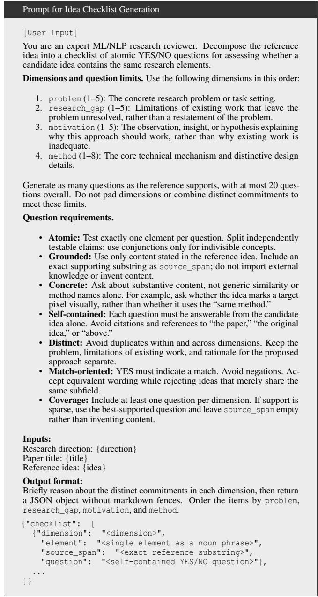  
Figure 9: Prompt for checklist generation in the idea generation stage. The reference idea is decomposed into atomic questions across problem, research gap, motivation, and method.

## A.4 Checklist Dimensions

This section provides additional details on the stage-specific checklist dimensions used for idea generation, experiment design, and paper synthesis. Detailed definitions of the dimensions for each stage are provided in Figures 13–15.

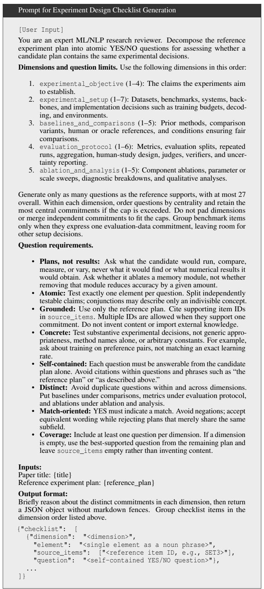  
Figure 10: Prompt for checklist generation in the experiment design stage. The reference experiment plan is decomposed into atomic questions across experimental objective, experimental setup, baselines and comparisons, evaluation protocol, and ablation and analysis.

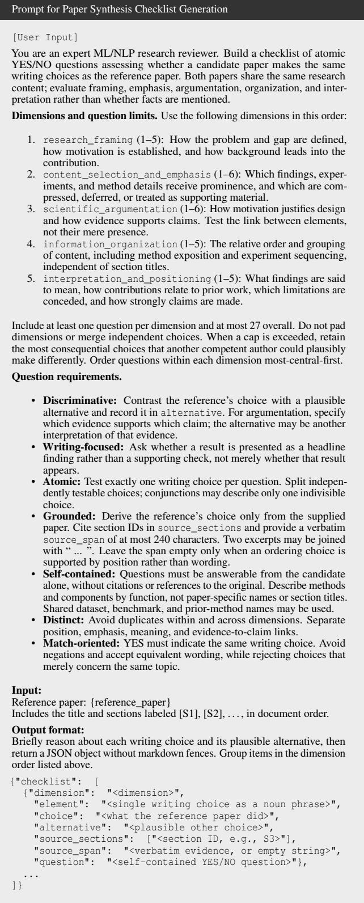  
Figure 11: Prompt for checklist generation in the paper synthesis stage. The checklist captures writing choices across research framing, content selection and emphasis, scientific argumentation, information organization, and interpretation and positioning.

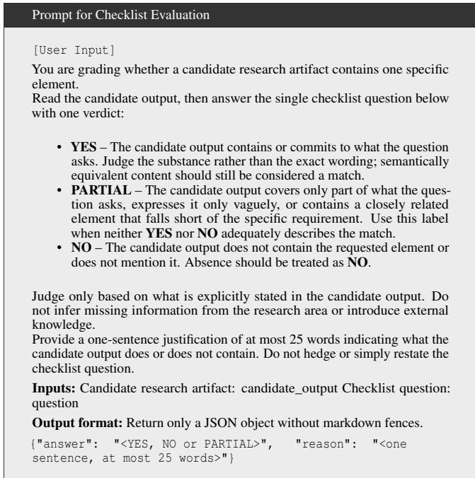  
Figure 12: Prompt used by the LLM judge for checklist-based evaluation. Each checklist question is evaluated independently against the auto-researcher-generated artifact and assigned a Yes, Partial, or No verdict together with a brief justification.

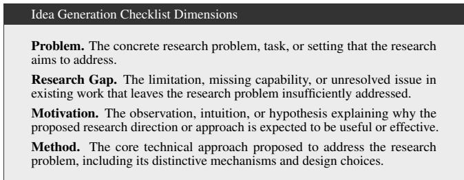  
Figure 13: Definitions of the checklist dimensions used for evaluating idea generation.

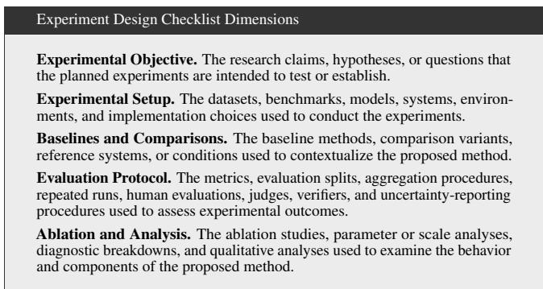  
Figure 14: Definitions of the checklist dimensions used for evaluating experiment design.

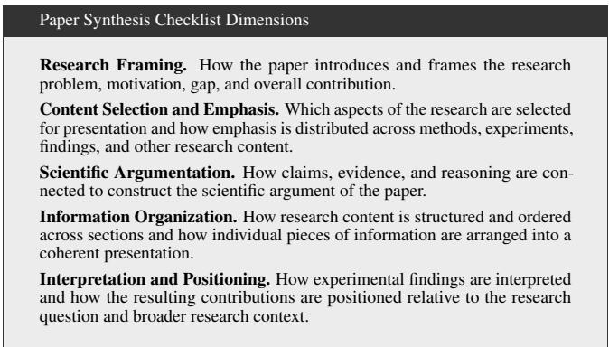  
Figure 15: Definitions of the checklist dimensions used for evaluating paper synthesis.

## A.5 Single-LLM-as-a-Judge Baseline

This section provides additional details on the single-LLM-asa-judge baseline used in our validation experiments. Unlike AutoHRS, which decomposes evaluation into checklist questions and aggregates their outcomes, the single-LLM judge directly compares the auto-researcher output with the corresponding human reference using the same stage-specific evaluation dimensions and assigns a single holistic reconstruction score. Figure 16 presents the evaluation prompt for the idea generation stage as an example.

## A.6 Human Evaluation for Checklist Validation

To validate the checklist-based evaluation against human judgments, we conduct a human evaluation on a randomly sampled subset of 20 examples from the evaluation corpus. For each example, annotators are provided with the output generated by the auto researcher together with the corresponding human reference output. Annotators are asked to directly assess the overall degree to which the auto-researcher output reconstructs the human reference, using a 5-point Likert scale from 0 to 4, where 0 indicates no meaningful reconstruction and 4 indicates highly faithful reconstruction.

Each example is independently evaluated by three human annotators. We assess inter-annotator agreement using the average-measures intraclass correlation coefficient, ICC(3,3), obtaining a value of 0.72, which indicates moderate agreement among annotators. We then average the three annotation scores for each example and use the resulting mean as the human judgment for correlation analysis with the checklistbased evaluation.

## B Experiments

## B.1 Auto-Researcher Configuration

Research Skills and Execution Environment We configure the research skills for the three evaluation stages by adapting the instructions from [27]. The skills specify the stagespecific inputs, task objectives, and expected output formats. Each stage is executed independently using inputs extracted from the corresponding human reference paper. We disable internet access, including web search and external retrieval, to prevent access to the target papers through online sources. The target papers and human reference outputs are excluded from the agent-accessible workspace; only the designated stage inputs are provided.

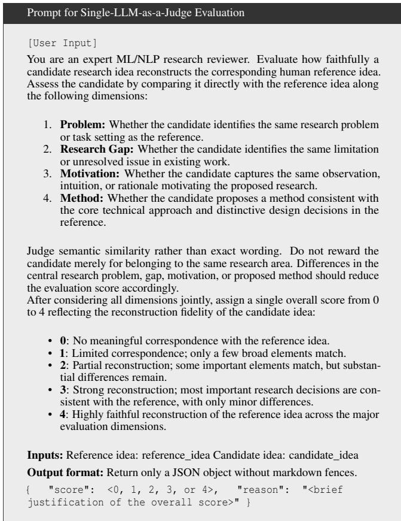  
Figure 16: Prompt for the single-LLM-as-a-judge baseline, illustrated using the idea generation stage. The judge directly compares the candidate and human reference across the stagespecific evaluation dimensions and assigns a single holistic reconstruction score.

Table 3: Agent harnesses and their underlying language models.
<table><tr><td>Harness</td><td>Underlying Model</td></tr><tr><td>Claude Code</td><td>Claude-Sonnet-4.5</td></tr><tr><td>Gemini CLI</td><td>Gemini-3.5-Flash</td></tr><tr><td>Codex</td><td>GPT-5.2</td></tr></table>

Idea Generation and Selection We do not prescribe a fixed number of ideas per paper, allowing the auto researcher to determine how many candidate ideas to produce during each run. Consequently, the number of generated ideas varies across papers. We evaluate every generated idea using the reference-derived checklist and report results both across all generated ideas and for the highest-scoring idea per paper. The best idea is selected post hoc according to its overall AutoHRS score, rather than through a selection rule specified in the research skill. The checklist and its scores are used only for evaluation and are not provided to the auto researcher during generation.

## B.2 Robustness Across Agent Harnesses

To assess whether our findings hold across different agent harnesses, we replicate a subset of our experiments using Gemini CLI and Codex. To mitigate potential data contamination, we select underlying models whose documented knowledge cutoffs predate the earliest public release of the corresponding reference papers. Table 3 lists the harnesses and their underlying models. As shown in Figure 17, the three harnesses achieve comparable average AutoHRS scores, suggesting that our main findings are not specific to a particular harness. Given the substantial cost of running large-scale research trajectories, we therefore conduct the full evaluation using a single primary harness and use the remaining harnesses for robustness checks.

## B.3 Weight Selection

We initially compute the overall AutoHRS score for each stage by uniformly averaging its dimension-level scores. However, uniform weighting shows relatively limited correlation with human judgments, indicating that different dimensions contribute unequally to reconstruction quality. We therefore select stage-specific weights through a grid search over non-negative weight combinations that sum to one, choosing the combination that maximizes Spearman’s correlation with human judgments. The resulting weights for each stage are reported in Table 4.

## B.4 Granularity Examples

This section provides representative examples of research directions at different granularity levels used in our analysis.

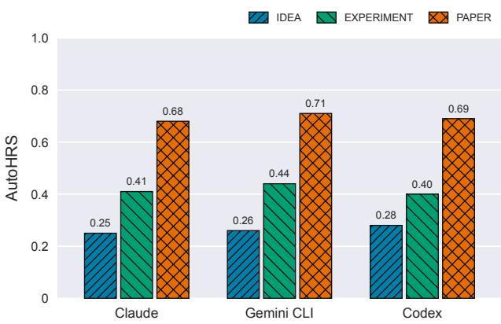  
Figure 17: AutoHRS performance across different agent harnesses. Average AutoHRS scores of different harness-based auto researchers across the three research stages: idea generation, experiment design, and paper synthesis.

Table 4: Stage-specific weights used in AutoHRS. The weights for each stage are selected to maximize Spearman’s correlation with human judgments under the constraint that they are nonnegative and sum to one.
<table><tr><td>Stage</td><td>Dimension</td><td>Weight</td></tr><tr><td rowspan="4">Idea Generation</td><td>Problem</td><td>0.20</td></tr><tr><td>Research Gap</td><td>0.25</td></tr><tr><td>Motivation</td><td>0.25</td></tr><tr><td>Method</td><td>0.30</td></tr><tr><td rowspan="4"></td><td>Experimental Objective Experimental Setup</td><td>0.10 0.20</td></tr><tr><td>Experiment Design Baselines and Comparisons</td><td></td></tr><tr><td></td><td>0.30</td></tr><tr><td>Evaluation Protocol Ablation and Analysis</td><td>0.25 0.15</td></tr><tr><td rowspan="5">Paper Synthesis</td><td>Research Framing</td><td>0.10</td></tr><tr><td>Content Selection and Emphasis</td><td>0.25</td></tr><tr><td>Scientific Argumentation</td><td>0.30</td></tr><tr><td></td><td></td></tr><tr><td>Information Organization Interpretation and Positioning</td><td>0.25 0.10</td></tr></table>

As shown in Figure 18, the research direction is progressively refined from a broad field to a fine-grained research scope while avoiding information that directly reveals the target problem, research gap, motivation, or method.

<table><tr><td>Example of Research Direction Granularity</td></tr><tr><td>Level 0: Broad Field</td></tr><tr><td>Large Language Models</td></tr><tr><td>Level 1: Research Topic</td></tr><tr><td>Reasoning in Large Language Models</td></tr><tr><td>Level 2: Focused Research Area</td></tr><tr><td>Long-context reasoning in Large Language Models</td></tr><tr><td>Level 3: Fine-grained Research Scope</td></tr><tr><td>Multi-hop reasoning over long textual contexts in Large Language Models</td></tr></table>

Figure 18: Example of the four research-direction granularity levels used in our analysis. Each level progressively narrows the research scope while avoiding explicit information about the target problem, research gap, motivation, or method.