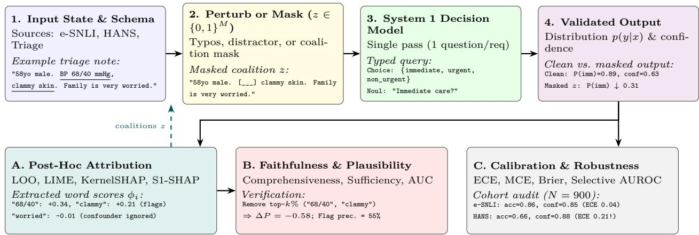
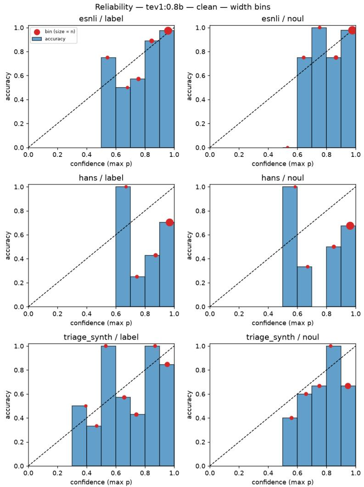
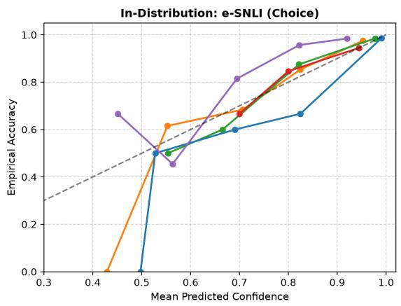
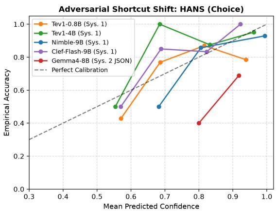
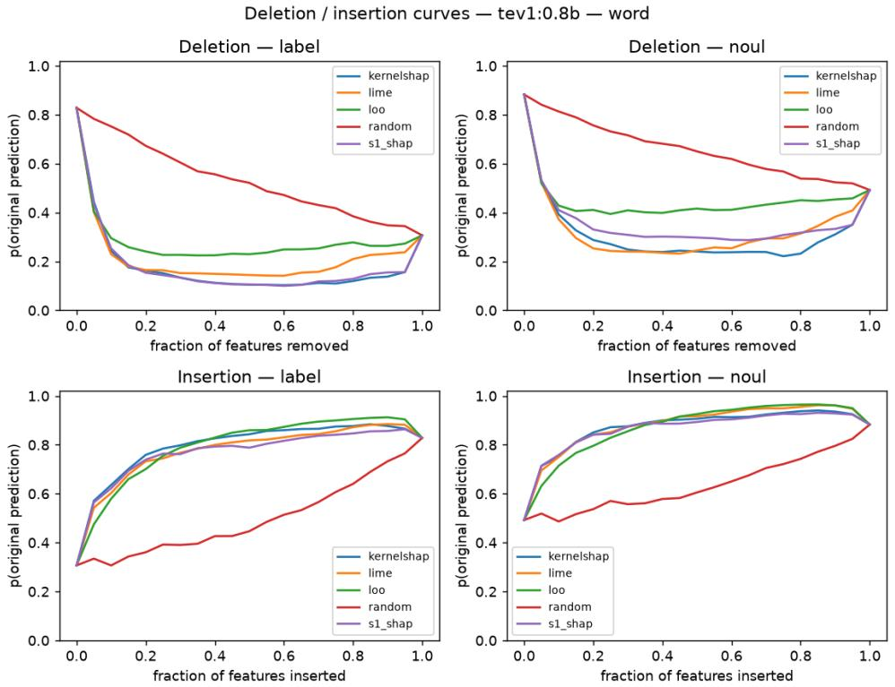
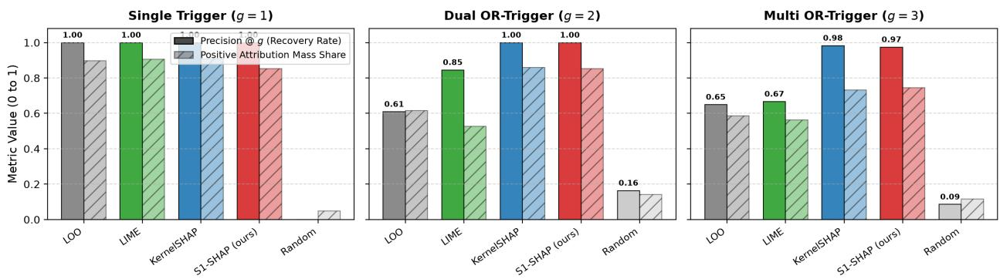

# Can the Confidence and Decisions of System 1 Models Be Trusted? An Explainability and Perturbation Audit of Jev-Style Decision Models

Julien Delaunay

## Abstract

Independent Researcher

jdelaunay.ai@gmail.com

“System 1” decision models (pioneered by TypeSafe AI’s Jev) replace autoregressive text generation with a single forward pass returning typed, structured probability distributions over declared schemas (Choice, Score, Noul). While deployed for low-latency routing, policy checks, and automated triage, their statistical calibration and post-hoc explainability remain uncharacterized. We introduce an open, deterministic audit benchmark that evaluates System 1 decision models across calibration under label-preserving perturbations, cross-question interference in multi-query requests, and post-hoc attribution faithfulness. Evaluating five open-weight models (0.8B to 27B) alongside generative System 2 baselines—both single-token log-probability scoring and structured JSON/Chain-of-Thought decoding—across natural language inference (e-SNLI), adversarial syntactic shortcuts (HANS), synthetic clinical triage vignettes (N = 900, n = 300 per dataset), adversarial prompt injection defense (Tensor Trust, $N = 2 5 0$ including hard benign negatives), and an 86-case programmatic logic-gate trigger suite yields five findings: (1) the provider confidence field is an exact closed-form dispersion transform (1 − H(p)/ ln K across sub-10B models, and normalized margin on Clef-27B) rather than empirical accuracy; (2) bundling multiple questions in a single request induces directional cross-question interference governed by causal prompt ordering and post-training recipe (11.7%–22.4% binary flips on Tev1-0.8B, vs. 0.1%–0.2% on Tev1-4B); (3) System 1 models with ≥ 4B parameters are substantially faster and better calibrated under adversaria syntactic shifts $( \mathrm { E C E } _ { w } = 0 . 0 3 0  – 0 . 0 8 7 )$ than both single-token logprob $( \mathrm { E C E } _ { w } = 0 . 1 4 4 )$ and structured JSON $( \mathrm { E C E } _ { w } = 0 . 3 7 8 )$ System 2 baselines; (4) for inline prompt-injection guardrails $( N = 2 5 0 ) , \geq 4 \mathrm { B }$ System 1 models reach 0.988–0.998 AUROC and up to 95.2% recall with 0.0% false alarms on both standard and hard benign queries at 48–60 ms latency; and (5) single-pass inference makes 512-coalition XAI interactive (1.3–3.2 s per input), while instantiating KernelSHAP with a logit link (S1-SHAP) mitigates softmax saturation on disjunctive OR gates (89.3%–100.0% pairwise interaction gate recovery vs. 57.1%–82.1% in probability space) and improves logit-space faithfulness $( p _ { \mathrm { a d j } } = 0 . 0 0 4 )$

## 1 Introduction

Most large language models (LLMs) deployed for classification or decision-making—such as GPT-4 Achiam et al. (2023), Llama 3 Dubey et al. (2024), Mistral Jiang et al. (2023), or Qwen Yang et al. (2024)—operate as generative “System 2” engines: they decode tokens autoregressively or score prompt templates via next-token log-probabilities Kadavath et al. (2022); Desai & Durrett (2020). Decision models of the Jev family take a diferent route TypeSafe AI (2026); System One (2026). Inspired by fast, intuitive “System 1” cognition Kahneman (2011), the caller supplies a structured state and a set of typed questions, and the model answers each question with an explicit probability distribution over declared options in a single forward pass. Three core decision primitives standardize this paradigm: Choice selects one option from a finite categorical set, Score rates the input on an ordinal rubric, and Noul returns the probability that a binary proposition is true. Following TypeSafe AI’s release of Jev in September 2026 TypeSafe AI (2026), several open-weight decision models were introduced within weeks—including Bespoke Labs’ Nimble (9B) Bespoke Labs (2026), Together AI’s Tev1 series (0.8B and 4B) Ollama (2026b), Cloudflare’s multimodal Clef (27B) and Clef-flash (9B) Cloudflare (2026), and Perplexity’s pplx-decider Perplexity AI (2026)—supported for local GPU deployment via runtimes such as Ollama Ollama (2026a).

Two properties make System 1 decision models compelling for explainable AI (XAI). First, because the native output is a continuous probability distribution over fixed classes rather than free-form text, black-box perturbation-based attribution methods such as LIME Ribeiro et al. (2016) and KernelSHAP Lundberg & Lee (2017) apply directly without text parsing. Second, single-pass inference is fast and deterministic enough to evaluate hundreds of feature coalitions per input at a fraction of the cost of autoregressive generation. However, the same design raises trust and transparency questions. Unlike generative models that can emit Chain-of-Thought rationales Wei et al. (2022), a decision model returns bare probabilities with no textual justification. A numerical probability returned without context is easy for downstream users or automated agents to over-trust, especially if the underlying classifier relies on shallow lexical heuristics Geirhos et al. (2020); McCoy et al. (2019). Whether the returned confidence scores are genuinely calibrated, whether they remain stable under harmless input perturbations, and whether post-hoc XAI methods can faithfully recover the features driving their decisions have not yet been systematically investigated.

This paper presents an explainability and calibration audit of Jev-style System 1 decision models. Our contributions are:

• An open, deterministic XAI and calibration benchmark that queries System 1 decision models, enforces strict schema validation, caches bit-identical responses by weight digest, and evaluates calibration, perturbation robustness, and post-hoc attribution faithfulness (Leave-One-Out, LIME, KernelSHAP, and logit-link KernelSHAP, denoted S1-SHAP) at word and subword granularity;

• Systematic evaluation of logit-link KernelSHAP (S1-SHAP) on saturated decision heads: We audit KernelSHAP with an inverse-sigmoid (logit) link function Lundberg & Lee (2017) against probability-space baselines at zero additional model calls, characterizing both when probability and logit links perform comparably (non-saturated first-order regimes and conjunctive AND gates) and when the logit link is decisive (higher-order Shapley interaction recovery under disjunctive OR saturation and logit-space faithfulness on sharp heads);

• Two structural findings on the System 1 interface that directly impact deployments: (1) the returned confidence field is an exact deterministic dispersion transform (1 − H(p)/ ln K on sub-10B models, and normalized margin on Clef-27B) rather than calibrated accuracy, and (2) bundling multiple questions in a single request induces directional cross-question interference driven by causal prompt ordering and semantic cross-talk;

• A multi-model, multi-dataset empirical evaluation across e-SNLI Camburu et al. (2018), HANS McCoy et al. (2019), synthetic clinical triage vignettes (N = 900 class-balanced cohort, n = 300 per dataset), adversarial prompt injection guardrails (Tensor Trust Toyer et al. (2024), N = 250 including hard benign negatives), and an 86-case programmatic Planted System-Rule (Hidden Trigger) XAI Benchmark across six causal regimes, comparing five open-weight System 1 models (Tev1-0.8B, Tev1-4B, Nimble-9B, Clef-Flash-9B, and Clef-27B) against generative System 2 baselines (Gemma4-8B in 1-Token Logprob, structured JSON, and Chain-of-Thought modes).

## 2 Related Work

## 2.1 From Generative LLMs to System 1 Decision Models

Standard instruction-tuned LLMs Achiam et al. (2023); Dubey et al. (2024); Yang et al. (2024) cast every task—including classification, routing, and scoring—as next-token generation. Even when constrained by structured-output grammars or JSON schemas, generative models must decode multiple tokens sequentially or rely on prompt-sensitive first-token log-probabilities, incurring high latency and stochastic variance Atıl et al. (2025). Drawing on dual-process theories of cognition Kahneman (2011), a recent wave of “System 1”

decision models decouples fast, typed classification from slow, deliberative text generation TypeSafe AI (2026); System One (2026). Pioneered by TypeSafe AI’s Jev TypeSafe AI (2026), these models ingest a structured application state alongside a schema of typed questions (Choice, Score, Noul) and output normalized probability distributions in a single forward pass. The ecosystem expanded with unprecedented speed across both proprietary APIs and open-weight releases in September and October 2026: Bespoke Labs introduced Nimble (9B) Bespoke Labs (2026); Together AI released the lightweight Tev1 series (0.8B and 4B) Ollama (2026b); Cloudflare released Clef (27B) and Clef-flash (9B) with vision-language capabilities on Workers AI Cloudflare (2026); and Perplexity introduced pplx-decider for low-latency intent and message routing Perplexity AI (2026). Combined with local runtime support in Ollama Ollama (2026a), these models are increasingly deployed as high-throughput decision gates in clinical triage, support routing, and agentic workflows—yet their statistical calibration and explainability remain uncharacterized.

## 2.2 Adapting Explainable AI (XAI) to Language Models

Explainability methods for NLP broadly fall into three paradigms: intrinsic self-rationalization, whitebox gradient/attention introspection, and black-box perturbation-based attribution. In generative LLMs, explanations are most commonly elicited as free-text rationales or Chain-of-Thought (CoT) reasoning Camburu et al. (2018); Wei et al. (2022). However, extensive work has shown that generated rationales often fail to reflect the model’s true decision process: they can be plausible to humans while remaining unfaithful to the internal computation Jacovi & Goldberg (2020); Wiegrefe et al. (2021); Turpin et al. (2023); Lanham et al. (2023). White-box methods such as Integrated Gradients Sundararajan et al. (2017) compute axiomatic attributions from input embeddings to output logits, but require full access to model weights and gradients, which are unavailable behind commercial decision APIs or quantized inference servers.

Model-agnostic perturbation methods avoid weight access by masking or removing subsets of input features and measuring the resulting shift in predicted probability. Leave-One-Out (LOO) measures the margina drop from deleting a single word or token, whereas LIME Ribeiro et al. (2016) fits a sparsity-regularized local linear surrogate over randomly perturbed neighborhoods, and KernelSHAP Lundberg & Lee (2017) estimates cooperative game-theoretic Shapley values via weighted linear regression over feature coalitions. Recent work has sought to adapt Shapley attributions to generative LLMs—for example, TokenSHAP Goldshmidt & Horovicz (2024) uses Monte Carlo coalition sampling to attribute token importance in LLM responses. To evaluate whether such attributions are genuinely faithful Jacovi & Goldberg (2020), the ERASER benchmark DeYoung et al. (2020) defines comprehensiveness (probability drop when top-k features are removed) and suficiency (probability retained when only top-k features are kept), while RISE Petsiuk et al. (2018) integrates deletion and insertion curves across all feature ranks.

In parallel, trustworthy deployment requires that predicted probabilities match empirical accuracy. Modern deep networks are frequently miscalibrated and over-confident Guo et al. (2017), particularly when exploiting spurious training shortcuts Geirhos et al. (2020) such as the lexical overlap, subsequence, and constituent heuristics isolated by the HANS benchmark McCoy et al. (2019). Calibration is standardly quantified via the Brier score Brier (1950) and Expected Calibration Error (ECE) Naeini et al. (2015), though ECE requires careful interpretation due to binning sensitivity and small-sample bias Nixon et al. (2019).

## 2.3 Limitations of Current LLM XAI and the Gap We Address

Applying classical XAI and calibration audits to standard LLMs faces severe methodological bottlenecks:

1. Intractability and noise of SHAP/LIME on generative LLMs: Estimating KernelSHAP or LIME over a text with M words requires hundreds of model evaluations per instance. For autoregressive LLMs, running 500+ multi-token generations per explanation is computationally prohibitive, sensitive to hosted API non-determinism Atıl et al. (2025), and lacks a well-defined scalar probability target when answers are expressed as free text.

2. Vulnerability to out-of-distribution perturbations: Masking tokens moves inputs of the training manifold, which can confound deletion metrics Hooker et al. (2019) or allow models to behave erratically on perturbed coalitions Slack et al. (2020).

3. The System 1 transparency blind spot: Conversely, Jev-style decision models eliminate text generation entirely. While this makes black-box perturbation XAI (LOO, LIME, KernelSHAP) computationally feasible and mathematically direct, it strips away any natural-language rationale. Users are left with raw numbers (probabilities and confidence) whose mathematical definition, cross-question stability, robustness to noise, and susceptibility to syntactic shortcuts have never been audited.

Our work bridges this gap by introducing the first end-to-end framework that leverages the fast, typed probability outputs of System 1 decision models to perform rigorous SHAP/LIME attribution and calibration auditing, testing both when their confidence can be trusted and how their decisions are formed.

## 3 Methodology: Auditing and Explaining System 1 Decision Models

## 3.1 Overview of the Audit and Explanation Pipeline

Unlike generative “System 2” LLMs that emit natural-language rationales alongside free-text predictions, a “System 1” decision model behaves as an opaque probabilistic operator: it maps a structured textual state directly to a categorical or binary distribution in a single forward pass. Auditing such models requires a methodology that can simultaneously verify what features drive a prediction (post-hoc explainability) and whether the returned numerical probabilities reflect true empirical certainty (distributional calibration and invariance).

Figure 1 presents the architecture of our proposed audit and explanation framework, organized into four forward stages (1–4) and three analytical modules (A–C):

1. State & Schema Formulation (Stage 1): Each task instance is represented as a structured state $s = ( s _ { 1 } , \ldots , s _ { D } )$ paired with a typed decision schema Q. For example, in clinical triage, s contains the patient vignette while Q specifies a three-way Choice question (immediate, urgent, non\_urgent) and a binary Noul question (“Requires immediate care?”).

2. Coalition Mapping and Perturbation Generation (Stage 2): To probe how the model constructs its decision, the input state s is mapped to an interpretable feature space of M lexical or subword units. Our pipeline generates two distinct families of modified states: (i) binary feature coalitions $z \in \{ 0 , 1 \} ^ { M }$ that selectively remove subsets of features via a masking operator $h _ { s } ( z )$ to estimate feature attributions, and (ii) label-preserving perturbations $\mathcal { T } _ { \epsilon } ( s )$ (character noise, clinical distractors, surface formatting) to test distributional stability.

3. Single-Pass System 1 Inference (Stage 3): Each rendered state is dispatched to the System 1 decision model under a controlled request protocol (isolated single-question queries versus bundled multi-question queries), executing a single forward pass without autoregressive token decoding.

4. Schema Validation and Distributional Extraction (Stage 4): Every response is validated against the declared question schema and decomposed into its predicted class $y ^ { * }$ , its full probability vector $p ( y \mid s , q )$ , and the provider-reported scalar confidence $c ( s , q )$

From these validated probability trajectories, the framework executes three complementary evaluations: (A) Post-Hoc Attribution, which closes a feedback loop over coalitions z to compute Leave-One-Out (LOO), LIME, KernelSHAP, and our proposed System-1 Logit-Space Shapley (S1-SHAP) attributions; (B) Faithfulness and Plausibility Verification, which measures whether removing or inserting topattributed features causally shifts the model’s probability and aligns with ground-truth clinical flags or human rationales; and (C) Calibration and Robustness Auditing, which quantifies calibration error across clean, adversarial-shortcut, and perturbed distributions.

  
Figure 1: Architecture of the evaluation and explanation pipeline with a running clinical triage example. Each input (1) is converted into perturbed variants or masked feature coalitions (2) and evaluated by the System 1 decision model in a single forward pass (3). The resulting probabilities (4) drive post-hoc feature attribution via LOO, LIME, KernelSHAP, and S1-SHAP (A, dashed loop over coalitions), faithfulness and clinical/human plausibility verification (B), and calibration/robustness auditing (C).

## 3.2 System 1 Decision Formalism and Request Protocol

In a generative LLM, classification is mediated by a natural-language prompt template and token-level decoding. In a Jev-style System 1 decision model, the prompt is replaced by a typed request tuple $( s , \mathcal { Q } )$ where s is a structured JSON object (or string) representing the observed state and $\mathcal { Q } = \{ q _ { 1 } , . . . , q _ { H } \}$ is a dictionary of named decision primitives System One (2026):

• Categorical Choice $\left( q _ { \mathbf { c h o i c e } } \right)$ : Declares a finite option set $\mathcal { O } = \{ o _ { 1 } , . . . , o _ { K } \}$ with semantic option descriptions. The model returns a probability vector $p ( y \mid s , q _ { \mathrm { c h o i c e } } ) \in \Delta ^ { K - 1 }$ , the selected argmax option $y ^ { * } = \arg \operatorname* { m a x } _ { o _ { k } \in { \mathcal { O } } } p ( o _ { k } \mid s )$ , and a scalar confidence score $c ( s , q _ { \mathrm { c h o i c e } } ) \in [ 0 , 1 ]$

• Binary Noul $( q _ { \mathrm { { n o u l } } } )$ : Declares a binary proposition with explicit true\_description and false\_description semantics. The model returns a single scalar probability $P ( \mathrm { t r u e } \mid s , q _ { \mathrm { n o u l } } ) \in [ 0 , 1 ]$ from which the binary decision is thresholded at 0.5.

Every model response is strictly validated against its request schema: returned probability keys must match O exactly, $\textstyle \sum _ { k = 1 } ^ { K } { p ( o _ { k } \mid s ) } = 1$ within 10<sup>−3</sup>, and the reported choice must equal the argmax of $p .$

Isolated vs. Bundled Request Protocols. Because the System 1 API accepts an arbitrary dictionary of questions $\mathcal { Q } = \{ q _ { 1 } , . . . , q _ { H } \}$ in a single HTTP call, documentation and industry tutorials encourage bundling multiple questions per state to amortize encoding latency. However, in a single-pass transformer architecture, all question schemas in $\mathcal { Q }$ are serialized into the shared context window prior to the decision head readout. Formally, when $q _ { 1 }$ and $q _ { 2 }$ are co-asked, the model computes p(y<sub>1</sub> $\mid s , q _ { 1 } , q _ { 2 } )$ rather than the marginal $p ( y _ { 1 } \mid s , q _ { 1 } )$ . To isolate each primitive from cross-question context conditioning—and to measure the magnitude of this interference—we define two formal protocols:

1. Isolated Protocol (Default): Each decision primitive $q _ { h } \in \{ q _ { \mathrm { c h o i c e } } , q _ { \mathrm { n o u l } } \}$ is dispatched in its own dedicated request $\left( s , \left\{ q _ { h } \right\} \right)$ , as illustrated in Figure 2. All calibration, perturbation, and XAI attribution experiments use the isolated protocol.

2. Bundled (Joint) Protocol: Both primitives are dispatched simultaneously in a single request $( s , \{ q _ { \mathrm { c h o i c e } } , q _ { \mathrm { n o u l } } \} )$ , allowing us to quantify cross-question flip rates and total-variation shifts $D _ { \mathrm { T V } } ( p ( \cdot \mid$ $s , q _ { h } ) , p ( \cdot \mid s , q _ { \mathrm { c h o i c e } } , q _ { \mathrm { n o u l } } ) \big )$

```json
Request Payload (s, Q)
{
"model": "tev1:0.8b", Validated System 1 Response
"state": { {
"patient_id": "PT-402",
"clinical_note": "58yo male. Sudden chest pressure "model": "tev1:0.8b", "answers": {
radiating to left arm. BP 68/40 mmHg, "triage_acuity": {
cold clammy skin. Family is very worried."
"type": "choice",
},
"questions": { "choice": "immediate",
"triage_acuity": { "type": "choice", "immediate": 0.896, "urgent": 0.061,
"question": "What is the Emergency Severity Index
"non_urgent": 0.043
(ESI) acuity level for this patient?",
"options": { }, "confidence": 0.632
"immediate": "Immediate resuscitation (ESI 1)...",
"urgent": "High risk / emergent care (ESI 2-3)...", <sup>}</sup><sub>},</sub>
"usage": {"input_tokens": 118, "output_tokens": 2}
}
```  
Figure 2: Example of an isolated single-question System 1 request payload and its validated response for clinical emergency department triage. Notice that output\_tokens is fixed at 2 (a single forward pass over the categorical decision head), returning normalized class probabilities with zero text generation.

## 3.3 Post-Hoc Attribution and Proposed S1-SHAP Method

## 3.3.1 Interpretable Representation and Coalition Mapping $h _ { s } ( z )$

Following the foundational formulation of local post-hoc explainability Ribeiro et al. (2016); Lundberg & Lee (2017), explaining a black-box classifier requires defining a mapping $h _ { s } : \{ 0 , 1 \} ^ { M } \to { \mathcal { S } }$ between a binary coalition vector $z \in \{ 0 , 1 \} ^ { M }$ of human-interpretable features and a valid model state $h _ { s } ( z )$ . In NLP explainability, two methodological design choices govern $h _ { s } ( z )$ and can significantly impact attribution faithfulness Hooker et al. (2019); DeYoung et al. (2020):

• Feature Granularity (Lexical Words vs. Native Subword Tokens): Human users reason over whole lexical words $( M _ { \mathrm { w o r d } } )$ , whereas transformer decision models process subword tokens $( M _ { \mathrm { s u b w o r d } } \geq M _ { \mathrm { w o r d } } )$ produced by Byte-Pair Encoding (BPE), which frequently splits domain-specific terms (e.g., blood pressure readings 68/40 or medical terminology) into multiple subword fragments. Because the open-weight System 1 models evaluated in this work (Tev1, Nimble, Clef) are all finetuned from a shared Qwen3.5 backbone, we evaluate attributions both at the human-interpretable word level (primary) and at the model’s native Qwen3.5 subword token level (secondary ablation) to test whether word-level aggregation sacrifices fidelity to the internal tokenization.

• Feature Absence Operator (Deletion vs. [MASK] Replacement): When a feature i is excluded from a coalition $( z _ { i } = 0 )$ , rendering $h _ { s } ( z )$ by token deletion (removing the span and normalizing whitespace) preserves natural linguistic adjacency, whereas replacing the span with a placeholder string [MASK] preserves token positions but injects an out-of-distribution symbol never seen by causal decoder backbones during pre-training Hooker et al. (2019). We evaluate both operators across all attribution methods.

## 3.3.2 Standard Perturbation Attributions (LOO, LIME, KernelSHAP)

Let $y ^ { * } = \arg \operatorname* { m a x } _ { y } p ( y \mid s , q )$ denote the outcome predicted on the clean input s $( z = { \bf 1 } )$ , and let $v _ { \mathrm { p r o b } } ( z ) =$ $p ( y ^ { \ast } \mid h _ { s } ( z ) , q ) \in [ 0 , 1 ]$ denote the target probability value function. We compare three classical black-box estimators:

• Leave-One-Out (LOO): Computes the single-feature deletion drop $\phi _ { i } ^ { \mathrm { L O O } } = v _ { \mathrm { p r o b } } ( \mathbf { 1 } ) - v _ { \mathrm { p r o b } } ( \mathbf { 1 } _ { - i } )$ using M + 1 model queries. While fast, LOO fails to capture feature redundancy or conjunctive interactions $( \mathrm { e . g . }$ , when two clinical flags each independently sufice to trigger an immediate triage decision).

• LIME Ribeiro et al. (2016): Samples N binary coalitions $z ^ { ( n ) } \in \{ 0 , 1 \} ^ { M }$ and fits a weighted Ridge surrogate arg min<sub>ϕ</sub> $\begin{array} { r } { , \sum _ { n = 1 } ^ { N } \pi _ { \mathbf { 1 } } ( z ^ { ( n ) } ) \big ( v _ { \mathrm { p r o b } } ( z ^ { ( n ) } ) - ( \phi _ { 0 } + \phi ^ { \top } z ^ { ( n ) } ) \big ) ^ { 2 } + \alpha \| \phi \| _ { 2 } ^ { 2 } } \end{array}$ , with exponential cosine-distance weights $\pi _ { \bf 1 } ( z ) = \exp ( - D _ { \mathrm { c o s } } ( { \bf 1 } , z ) ^ { 2 } / \sigma ^ { 2 } )$

• KernelSHAP Lundberg & Lee (2017): Estimates game-theoretic Shapley values by solving the weighted coalition regression with the Shapley kernel $\begin{array} { r } { \pi _ { \mathrm { S H A P } } ( z ) = \overbrace { \binom { M } { | z | } | z | ( M - | z | ) } ^ { \sim \ h - 1 } } \end{array}$ over $N =$ min $\left( 2 ^ { M } , 5 1 2 \right)$ coalitions, using the empty coalition $z = 0$ as background reference and disabling $\ell _ { 1 }$ Lasso truncation so that all M features receive exact least-squares estimates.

While numerous extensions exist in the literature to stabilize sampling variance, select representative explanations, or balance locality and fidelity across perturbation and coalition spaces Ribeiro et al. (2016); Visan et al. (2022); Jethani et al. (2022); Covert et al. (2021); Gaudel et al. (2022)—ranging from submodular pick and deterministic sampling surrogates to hierarchical coalition partitions—we evaluate canonical formulations (LOO, LIME, KernelSHAP) to establish standard, reproducible black-box baselines against which our log-odds adaptation is audited.

## 3.3.3 Logit-Link Shapley Attribution (S1-SHAP) for Saturated Decision Heads

Applying standard LIME or probability-space KernelSHAP directly to $v _ { \mathrm { p r o b } } ( z ) = p ( y ^ { * } \mid h _ { s } ( z ) , q )$ overlooks a key mathematical property of System 1 decision models: softmax probability saturation. Because System 1 models are trained to emit sharp categorical or binary distributions (often yielding max $p > 0 . 9 5 )$ the mapping from the model’s internal pre-activation evidence to probability space is governed by a saturating sigmoid or softmax nonlinearity. When two redundant clinical flags are present in a triage note, removing only one flag may reduce internal evidence substantially (e.g., from +4.5 to +2.8 in log-odds) while leaving the output probability nearly flat $( 0 . 9 8 9  0 . 9 4 3 , \Delta p = 0 . 0 4 6 )$ , violating the linear additivity assumption of probability-space surrogates and artificially compressing attribution weights.

To address this without requiring white-box gradient or logit access, we instantiate S1-SHAP: a logodds formulation of KernelSHAP tailored to single-pass System 1 decision models. Methodologically, this corresponds to applying KernelSHAP with a logit link function Lundberg & Lee (2017):

$$
v _ { \mathtt { S } 1 } ( z ) = \ln \left( \frac { \tilde { p } ( y ^ { * } \mid h _ { s } ( z ) , q ) } { 1 - \tilde { p } ( y ^ { * } \mid h _ { s } ( z ) , q ) } \right) , \qquad \mathrm { w h e r e } ~ \tilde { p } = \mathrm { c l i p } \big ( p ( y ^ { * } \mid h _ { s } ( z ) , q ) , \varepsilon , 1 - \varepsilon \big ) ,\tag{1}
$$

with numerical clipping $\varepsilon = 1 0 ^ { - 4 }$ , and solving the exact Shapley kernel weighted least squares regression over v<sub>S1</sub>(z):

$$
\sum _ { i = 1 } ^ { M } \phi _ { i } ^ { \mathrm { S 1 } } \ = \ v _ { \mathrm { S 1 } } ( { \bf 1 } ) - v _ { \mathrm { S 1 } } ( { \bf 0 } ) .\tag{2}
$$

For binary decisions $( K = 2 )$ , Equation 1 is the exact log-odds of the positive class. For multiclass categorical choices $( K > 2$ , such as 3-way e-SNLI or 3-level Clinical Triage), Equation 1 evaluates the one-vs-rest log-odds of the predicted target class y<sup>∗</sup>: $\ell ( p ) _ { y ^ { * } } = \ln ( \tilde { p } _ { y ^ { * } } / ( 1 - \tilde { p } _ { y ^ { * } } ) )$ , mapping the target probability onto the real line R. This one-vs-rest formulation preserves 1-dimensional weighted least squares eficiency $( O ( M )$ parameters) and avoids fitting $K \times M$ coupled regressions that amplify sampling variance on finite coalition budgets, while focusing credit directly on the predicted decision. While link functions are theoretically known in generalized additive models and the original SHAP formulation Lundberg & Lee (2017), the NLP perturbation literature has almost universally operated in raw probability space. Crucially, in the System 1 setting, the logit link has three pragmatic virtues: (i) it remains strictly 100% black-box, needing only the returned probability distribution; (ii) it is zero-overhead, reusing the exact same coalition queries $h _ { s } ( z )$ evaluated for probability-space KernelSHAP via memoized value functions; and (iii) it linearizes saturated decision surfaces, which we show in Section 5.7 is strictly necessary for recovering higher-order cooperative and redundant logic gate interactions. Furthermore, to ensure sampling stability, our implementation couples S1-SHAP with paired antithetic coalition sampling Covert et al. (2021); orthogonal uncertainty-aware extensions such as Bayesian SHAP Visani et al. (2022); Slack et al. (2021) can directly place posterior credible intervals over $v _ { \mathrm { S 1 } } ( z )$ without modifying the underlying logit link. Regarding numerical robustness, evaluating attribution stability across clipping thresholds $\varepsilon \in \{ 1 0 ^ { - 3 } , 1 0 ^ { - 4 } , 1 0 ^ { - 5 } \}$ yields pairwise Spearman rank correlations $r _ { s } > 0 . 9 9 8$ and identical top-k feature sets (100% overlap for $k \leq 5 )$ , confirming that S1-SHAP rankings are virtually invariant to the boundary clipping constant.

Table 1: Benchmark datasets used in our audit, spanning in-distribution NLI, adversarial syntactic shortcuts, synthetic clinical emergency triage, adversarial prompt injection defense, and programmatic logic-gate trigger recovery.
<table><tr><td>Dataset</td><td>Domain</td><td>Primitives</td><td>N</td><td>Ground-Truth Annotations</td><td>Primary Audit Objective</td></tr><tr><td>e-SNLI Camburu et al. (2018)</td><td>Open-domain NLI</td><td>Choice, Noul</td><td>300</td><td>3-annotator highlighted ratio- nale words (100/class)</td><td>In-distribution calibration &amp; human plausibility</td></tr><tr><td>HANS McCoy et al. (2019)</td><td>Adversarial NLI</td><td>Choice, Noul</td><td>300</td><td>3 syntactic heuristics (150 en- tail. / 150 non-entail.)</td><td>Over-confidence under short- cut failure</td></tr><tr><td>Clinical Triage</td><td>Emergency medicine</td><td>Choice, Noul</td><td>300</td><td>Programmatic ESI acuity flags vs. emotional confounders</td><td>Causal flag vs. distractor con- founder isolation</td></tr><tr><td>Tensor Trust Toyer et al. (2024)</td><td>Cybersecurity guardrails</td><td>Choice, Noul</td><td>250</td><td>75 std. benign, 50 hard benign, 65 extraction, 60 hijacking</td><td>Inline firewall defense, AUROC/PR-AUC, S1-SHAP attribution</td></tr><tr><td>Planted Rule</td><td>Algorithmic au- dit</td><td>Choice, Noul</td><td>86</td><td>6 regimes (Single, Case, OR-2, OR-3, AND-2, Distractor)</td><td>Exact trigger &amp; boolean gate recovery (172 head evals/model)</td></tr></table>

## 3.4 Label-Preserving Perturbation Operators

To test whether System 1 probabilities and calibration remain invariant under realistic surface noise, we define five deterministic perturbation operators $\mathcal { T } _ { \epsilon } : \mathcal { S }  \mathcal { S }$ designed to preserve the ground-truth semantic label:

1. Character Typo Noise $( \epsilon \in \{ 5 \% , 1 0 \% , 2 0 \% \} )$ : Alters a fraction ϵ of content words of length $\geq 3$ via character swaps or substitutions, while strictly protecting negation markers (not, no, never, without) so logical polarity is never inverted.

2. Semantic Distractor Injection: Appends a topically neutral, clinically or logically irrelevant sentence to the premise or patient note (filtering out any candidate distractor that shares content words with the hypothesis).

3. Surface Normalization (Case & Punctuation Stripping): Converts the entire input state to lowercase and strips surface punctuation, mimicking unformatted user or ASR transcripts.

## 4 Experimental Setup

## 4.1 Datasets and Task Design

To evaluate System 1 decision models across in-distribution reasoning, adversarial shortcut shifts, high-stakes domain decision-making, high-throughput security guardrails, and exact ground-truth algorithmic trigger recovery, we select five complementary datasets summarized in Table 1.

Justification of Dataset Selection. No single dataset can jointly test calibration, shortcut vulnerability, and causal explanation fidelity:

• e-SNLI Bowman et al. (2015); Camburu et al. (2018) (In-Distribution Calibration & Human Plausibility, $n = 3 0 0 )$ : Provides class-balanced premise–hypothesis pairs (100 entailment,

100 neutral, 100 contradiction), paired with word-level human rationale highlights from three independent annotators. It establishes whether a model is calibrated on standard NLI and whether post-hoc attributions recover human-identified evidence words (where ≥ 2 annotators agree).

• HANS McCoy et al. (2019) (Adversarial Shortcut Audit, n = 300): Constructed to break models that rely on surface syntactic heuristics—lexical overlap, subsequence, and constituent containment— where high word overlap does not entail the hypothesis (150 entailment, 150 non\_entailment). Because HANS labels are binary, the three-way Choice distribution is collapsed by summing neutral and contradiction probabilities. HANS tests whether returned probabilities warn the user when the model falls into a syntactic trap.

• Synthetic Clinical Triage Vignettes (triage\_synth, n = 300): In natural text datasets, true causal features are imperfectly known due to annotator subjectivity. We therefore construct a controlled, programmatically generated emergency-department triage benchmark grounded in Emergency Severity Index (ESI) acuity criteria Gilboy et al. (2011) across three balanced levels (100 immediate, 100 urgent, 100 non\_urgent). Each vignette combines patient demographics, one or two causal clinical flag sentences specific to the acuity class (e.g., severe hypotension BP 68/40 mmHg or airway stridor), and two neutral clinical history sentences. In one third of the vignettes (balanced across classes), the generator injects an alarming confounder sentence—an emotionally urgent but clinically non-diagnostic cue (e.g., “The patient’s family is extremely worried and keeps asking staf for help”). Because exact character ofsets for flags and confounders are recorded deterministically at template assembly time, we can measure whether attributions isolate true clinical flags over alarming distractors without human annotation noise.

• Tensor Trust Toyer et al. (2024) (Adversarial Prompt Injection Guardrails, N = 250): Production LLM applications require low-latency inline filters to inspect untrusted user prompts for prompt injections, system prompt extraction, and instruction hijacking. We curate a length-matched benchmark (N = 250, 8–45 words) combining 125 adversarial attacks from Tensor Trust (65 Secret Extraction and 60 Instruction Hijacking) with 125 benign queries stratified into 75 Standard Benign conversational prompts and 50 Hard Benign Negatives—legitimate educational, cybersecurity, and software-engineering questions that explicitly contain trigger vocabulary (password, system prompt, ignore, SQL injection, override). This tests both threshold-free ranking (AUROC, PR-AUC) and false-alarm resilience under lexical overlap, alongside quantitative S1-SHAP attack-token localization.

• Planted System-Rule (Hidden Trigger) Benchmark (86 Programmatic Cases, 172 Head Evaluations/Model): Even in controlled clinical vignettes, a pretrained language model brings prior medical knowledge about multiple words in a sentence. To establish a prior-free causal ground truth for XAI evaluation, we construct an 86-case programmatic suite where the unmasked question instruction Q injects an explicit override rule instructing the model to classify an otherwise benign routine note (non\_urgent, base P(immediate) < 0.02) as immediate/true according to a boolean predicate over arbitrary code words (e.g., velvet, cobalt, zenith). The 86 cases span six regimes: (1) Single Trigger (16 cases, g = 1), (2) Case-Insensitive Variant (8 cases, uppercase trigger tokens), (3) Dual OR-Trigger (16 cases, g = 2, disjunctive redundancy), (4) Multi OR-Trigger (12 cases, g = 3, extreme OR saturation), (5) Dual AND-Trigger (16 cases, g = 2, conjunctive synergy where both triggers must co-occur), and (6) Near-Miss Distractor (18 cases, g = 1 active trigger co-occurring with an inactive decoy word mentioned in the prompt).

## 4.2 Evaluated System 1 Decision Models and System 2 Baselines

Table 2 details the models evaluated in our benchmark. To evaluate how calibration, cross-question interference, and attribution faithfulness vary across model capacity and post-training recipes, we select five open-weight System 1 decision models spanning four parameter scales (0.8B to 27B): Together AI’s Tev1-0.8B and Tev1-4B Ollama (2026b), Bespoke Labs’ Nimble-9B Bespoke Labs (2026), and Cloudflare’s multimodal Clef-Flash-9B and Clef-27B Cloudflare (2026). All five models are fine-tuned from a Qwen3.5 transformer backbone (with Clef models built on Qwen3.5-VL). To ensure a fair comparison against standard autoregressive LLMs Kadavath et al. (2022); Desai & Durrett (2020), we evaluate Google’s Gemma4-8B across three distinct

Table 2: System 1 decision models and generative System 2 baselines evaluated in our benchmark (0.8B to 27B parameters).
<table><tr><td>Model</td><td>Provider</td><td>Base Backbone</td><td>Parameters</td><td>Modalities / Protocol</td></tr><tr><td>Tev1-0.8B Ollama (2026b)</td><td>Together AI</td><td>Qwen3.5-0.8B</td><td>0.8B (Q8_0)</td><td>System 1 (Text, JSON)</td></tr><tr><td>Tev1-4B Ollama (2026b)</td><td>Together AI</td><td>Qwen3.5-4B</td><td>4.0B</td><td>System 1 (Text, JSON)</td></tr><tr><td>Nimble-9B Bespoke Labs (2026)</td><td>Bespoke Labs</td><td>Qwen3.5-9B</td><td>9.0B</td><td>System 1 (Text, JSON)</td></tr><tr><td>Clef-Flash-9B Cloudflare (2026)</td><td>Cloudflare</td><td>Qwen3.5-VL-9B</td><td>9.0B</td><td>System 1 (Text, JSON, Vision)</td></tr><tr><td>Clef-27B Cloudflare (2026)</td><td>Cloudflare</td><td>Qwen3.5-VL-27B</td><td>27.0B</td><td>System 1 (Text, JSON, Vision)</td></tr><tr><td>Gemma4-8B (1-Tok Logprob)</td><td>Google</td><td>Gemma-4-8B</td><td>8.0B (Q4_K_M)</td><td>System 2 (Single-token logprobs)</td></tr><tr><td>Gemma4-8B (JSON / CoT)</td><td>Google</td><td>Gemma-4-8B</td><td>8.0B (Q4_K_M)</td><td>System 2 (Structured JSON &amp; CoT)</td></tr></table>

System 2 inference protocols: (i) 1-Token Logprob Scoring (num\_predict=1, logprobs=True), which extracts exact first-token log-probabilities over single-token option identifiers $\mathrm { ( A / B / C ) }$ in a single forward pass without multi-token decoding; (ii) Structured JSON Mode (both label-only and with rationale\_words), which enforces a JSON schema returning verbalized probabilities; and (iii) Chain-of-Thought (CoT) Mode, which generates a deliberative reasoning trace prior to the JSON decision.

## 4.3 Evaluation Metrics

Calibration and Selective Ranking Metrics. Let $\hat { p } _ { i } = \operatorname* { m a x } _ { k } p ( o _ { k } \mid s _ { i } , q )$ denote the predicted top probability on instance $i \in \{ 1 , \ldots , n \}$ and $\mathbb { I } ( \hat { y } _ { i } = y _ { i } )$ its binary accuracy indicator. We evaluate distributional calibration using:

• Expected and Maximum Calibration Error $( \mathbf { E C E } _ { w } \downarrow , \mathbf { E C E } _ { m } \downarrow , \mathbf { M C E } _ { w } \downarrow )$ : Partitioning predictions into $B = 1 0$ intervals $\{ I _ { b } \} _ { b = } ^ { B }$ via either equal-width binning $\left( \mathrm { E C E } _ { w } \right)$ or equal-mass quantile binning $\left( \mathrm { E C E } _ { m } \right)$ Naeini et al. (2015); Nixon et al. (2019),

$$
\mathrm { E C E } = \sum _ { b = 1 } ^ { B } \frac { | I _ { b } | } { n } \big | \mathrm { a c c } ( I _ { b } ) - \mathrm { c o n f } ( I _ { b } ) \big | , \qquad \mathrm { M C E } = \operatorname* { m a x } _ { b \in \{ 1 , \ldots , B \} } \big | \mathrm { a c c } ( I _ { b } ) - \mathrm { c o n f } ( I _ { b } ) \big | .\tag{3}
$$

• Multiclass Brier Score (Brier ↓): The binning-free proper scoring rule $\begin{array} { r } { \frac { 1 } { n } \sum _ { i = 1 } ^ { n } \sum _ { k = 1 } ^ { K } ( p _ { i k } - \mathbb { I } ( y _ { i } = } \end{array}$ $k ) ) ^ { 2 }$ Brier (1950), where n is the evaluation cohort size $( n = 3 0 0 { \mathrm { ~ p e r } }$ dataset, $N = 9 0 0$ total; $n = 1 5 0$ per dataset for Clef-27B and Gemma4-8B JSON) and K is the number of outcome classes $( K = 3$ for e-SNLI and Clinical Triage Choice; K = 2 for HANS and Noul).

• Selective Classification AUROC $( \mathbf { A U R O C } _ { p } \uparrow , \mathbf { A U R O C } _ { c } \uparrow )$ : Measures the area under the ROC curve when using either $\hat { p } _ { i } = \operatorname* { m a x } p \left( \mathrm { A U R O C } _ { p } \right)$ or the provider-returned confidence $c _ { i } \ \mathrm { ( A U R O C } _ { c } )$ to rank correct predictions above incorrect ones.

All calibration metrics and perturbation shifts $\left( \Delta \mathrm { E C E } _ { w } , \Delta \mathrm { A c c . } \right)$ are reported with 95% percentile bootstrap confidence intervals over 1,000 resamples Efron (1979).

Faithfulness and Plausibility Metrics. Given a feature attribution vector $\boldsymbol { \phi } \in \mathbb { R } ^ { M }$ inducing a descending importance ordering $\pi = ( \pi _ { 1 } , \ldots , \pi _ { M } )$ , let $s _ { \backslash 1 : k }$ denote the input with the top-k features removed and $s _ { 1 : k }$ the input retaining only the top-k features:

• Comprehensiveness (Comp. (∆p) ↑, Comp. (∆ℓ) ↑) and Suficiency $( \mathbf { S u f f . \downarrow } )$ AOPC DeYoung et al. (2020): Averaged over $k \in \{ 1 , 5 , 1 0 , 2 0 , 5 0 \} \%$ of M (rounded up and de-duplicated) in both probability space and log-odds space $\ell ( p ) = \ln ( \tilde { p } / ( 1 - \tilde { p } ) )$ :

$$
\mathrm { C o m p . } ( \Delta p ) = \frac { 1 } { | \mathcal { K } | } \sum _ { k \in \mathcal { K } } \big ( p ( y ^ { \ast } \mid s ) - p ( y ^ { \ast } \mid s _ { \backslash \cdot \downarrow \cdot k } ) \big ) , \qquad \mathrm { S u f f . } = \frac { 1 } { | \mathcal { K } | } \sum _ { k \in \mathcal { K } } \big ( p ( y ^ { \ast } \mid s ) - p ( y ^ { \ast } \mid s _ { 1 : k } ) \big ) ,\tag{4}
$$

Table 3: Uncached sequential latency (median / p90 in ms at c = 1), mean output tokens, and throughput (req/s) of single-question requests across evaluated System 1 decision models and generative System 2 baselines (Gemma4-8B in 1-Token Logprob, JSON without rationale, JSON with rationale, and Chain-of-Thought modes). Best values are in bold.
<table><tr><td>Model</td><td>Out. Tok. ↓</td><td>Choice Med./p90 (ms) ↓</td><td>Noul Med./p90 (ms) ↓</td><td>Req/s (c = 1) ↑</td><td>Peak Req/s↑</td></tr><tr><td>Tev1-0.8B</td><td>2.0</td><td>26 / 27</td><td>24 / 25</td><td>39.3</td><td>40.0</td></tr><tr><td>Tev1-4B</td><td>2.0</td><td>45 / 68</td><td>40/  62</td><td>19.7</td><td>21.7</td></tr><tr><td>Nimble-9B</td><td>2.0</td><td>250  /272</td><td>214 / 235</td><td>4.0</td><td>4.1</td></tr><tr><td>Clef-Flash-9B</td><td>2.0</td><td>64 /  98</td><td>58 /  85</td><td>16.5</td><td>17.6</td></tr><tr><td>Clef-27B</td><td>2.0</td><td>1953 / 2010</td><td>1863 / 1913</td><td>0.6</td><td>0.6</td></tr><tr><td>Gemma4-8B (1-Tok Logprob)</td><td>1.0</td><td>74/ 77</td><td>71 / 75</td><td>13.5</td><td>14.2</td></tr><tr><td>Gemma4-8B (JSON, no rationale)</td><td>24.0</td><td>770  /883</td><td>264  /283</td><td>1.3</td><td>2.2</td></tr><tr><td>Gemma4-8B (JSON + rationale)</td><td>77.3</td><td>1133 / 1259</td><td>533 /617</td><td>0.7</td><td>0.7</td></tr><tr><td>Gemma4-8B (CoT)</td><td>474.1</td><td>4856 / 4899</td><td>4430  /4861</td><td>0.2</td><td>0.2</td></tr></table>

with Comp. $\begin{array} { r } { \begin{array} { r } { ( \Delta \ell ) = \frac { 1 } { | \mathcal { K } | } \sum _ { k \in \mathcal { K } } \big ( \ell ( p ( y ^ { \ast } \mid s ) ) - \ell ( p ( y ^ { \ast } \mid s _ { \backslash 1 : k } ) ) \big ) } \end{array} } \end{array}$ measuring evidence drop without softmax ceiling compression.

• Deletion AUC (Del. AUC ↓) and Insertion AUC (Ins. AUC ↑) Petsiuk et al. (2018): Integrate the target probability $p ( \boldsymbol { y } ^ { \ast } \mid \cdot )$ at every single-feature step from 0 to M as features are progressively deleted (↓ lower area is more faithful) or inserted from an empty state (↑ higher area is more faithful).

• Domain Plausibility (Flag prec.@g ↑, Conf. share@g ↓, Human prec.@g ↑): With g denoting the number of ground-truth causal words in an instance (planted clinical flag words in Triage, or words highlighted by $\geq 2$ human annotators in e-SNLI), we measure the fraction of the top-g attributed words that fall inside ground-truth causal spans (↑) versus inside planted confounder spans (↓), evaluated on correctly classified instances so classification errors do not confound attribution overlap.

## 4.4 Implementation Details and Reproducibility

Local open-weight models are served via Ollama (v0.40.13) on an AMD Radeon RX 9070 XT GPU with OLLAMA\_NUM\_PARALLEL=4. All source code, datasets, evaluation harnesses, and reproduction scripts are publicly accessible at https://github.com/j2launay/jev-decision-models-xai. Across our experiments, we verified that repeated calls with identical payloads return bit-identical floating-point outputs (unlike hosted generative LLM APIs Atıl et al. (2025)). We therefore cache all validated responses in a local SQLite database indexed by the SHA-256 hash of the model weight digest and the request payload (preserving key ordering for serialization-order and option-permutation controls), reporting latency benchmarks strictly on uncached calls. Table 3 reports uncached sequential latencies (c = 1), output token counts, and concurrent throughput across all five System 1 models (0.8B to 27B) and four generative System 2 configurations on Gemma4-8B: (1) 1-Token Logprob scoring (1.0 output token), (2) JSON without rationale (24.0 tokens, returning only choice and probabilities), (3) JSON with rationale (77.3 tokens, adding rationale\_words), and (4) Chain-of-Thought (474.1 tokens). System 1 models always emit 2.0 output tokens and operate at 24–64 ms median single-pass latency on Tev1-0.8B, Tev1-4B, and Clef-Flash-9B (16.5–39.3 req/s at c = 1; 250 ms on Nimble-9B; 1,953 ms on Clef-27B). Restricting Gemma4-8B to single-token logprob scoring achieves 74 ms (Choice) / 71 ms (Noul) median latency (13.5 req/s), confirming that 1-token scoring avoids multi-token decoding overhead while remaining 1.2×–2.8× slower than 0.8B–9B System 1 models (Tev1-0.8B, Tev1-4B, Clef-Flash-9B) and faster than Nimble-9B (250 ms). In contrast, structured JSON decoding requires 770 ms / 264 ms without rationale (1.3 req/s), 1,133 ms / 533 ms with rationale (0.7 req/s), and 4,856 ms / 4,430 ms in CoT mode $\mathrm { ( 0 . 2 ~ r e q / s ) }$ . Consequently, computing a 512-coalition SHAP explanation takes 1.3–3.2 s per instance on fast System 1 models (with 4 asynchronous workers and coalition memoization pruning 30–45% of redundant masked evaluations), ≈ 15 s under 1-token logprob scoring, and 4–41 minutes under multi-token JSON/CoT generation.

Table 4: Interference between co-asked questions on clean inputs $\left( \mathtt { T e v 1 - } 0 . 8 \mathtt { B } \right.$ , class-balanced $N = 9 0 0$ cohort, n = 300 per dataset). “Alone” asks each primitive in its own request; $\mathfrak { s } _ { \mathrm { j o i n t } } , \mathfrak { s }$ asks both in one request. Flip (↓) is the fraction of inputs whose predicted answer changes; $\mathrm { T V \ ( \downarrow ) }$ is the mean total-variation distance between the two distributions. Best values per column are in bold.
<table><tr><td>Source</td><td>Head</td><td>n</td><td>Acc. alone ↑</td><td>Acc. joint ↑</td><td> ${ \mathrm { F l i p } } \downarrow$ </td><td> $\mathrm { T V } \downarrow$ </td><td> $\bar { P } ( \mathrm { t r u e } )$  alone</td><td> $\bar { P } ( \mathrm { t r u e } )$  joint</td></tr><tr><td>e-SNLI</td><td>Choice</td><td>300</td><td>0.863</td><td>0.837</td><td>0.030</td><td>0.058</td><td></td><td></td></tr><tr><td>e-SNLI</td><td>Noul</td><td>300</td><td>0.920</td><td>0.827</td><td>0.120</td><td>0.084</td><td>0.336</td><td>0.343</td></tr><tr><td>HANS</td><td>Choice</td><td>300</td><td>0.663</td><td>0.660</td><td>0.010</td><td>0.061</td><td></td><td></td></tr><tr><td>HANS</td><td>Noul</td><td>300</td><td>0.650</td><td>0.620</td><td>0.150</td><td>0.082</td><td>0.770</td><td>0.704</td></tr><tr><td>Triage</td><td>Choice</td><td>300</td><td>0.637</td><td>0.627</td><td>0.040</td><td>0.046</td><td></td><td></td></tr><tr><td>Triage</td><td>Noul</td><td>300</td><td>0.633</td><td>0.580</td><td>0.080</td><td>0.055</td><td>0.687</td><td>0.664</td></tr></table>

## 5 Results

## 5.1 Interface Audit: Entropy-Based Confidence and Question Interference

The Provider confidence Field is Normalized Shannon Entropy. While provider documentation describes confidence qualitatively as showing “how concentrated the probabilities are” Ollama (2026b), our audit reveals its exact closed-form mathematical identity: across the four sub-10B decision models (Tev1-0.8B, Tev1-4B, Nimble-9B, and Clef-Flash-9B), for any K-way Choice distribution $p = \left( p _ { 1 } , \dotsc , p _ { K } \right)$ the returned confidence equals one minus the normalized Shannon entropy,

$$
c ( p ) \ = \ 1 - { \frac { H ( p ) } { \ln K } } \ = \ 1 + { \frac { 1 } { \ln K } } \sum _ { k = 1 } ^ { K } p _ { k } \ln p _ { k } .\tag{5}
$$

Across all 600 clean choice predictions on these four models (150 per model), the maximum absolute deviation between the API-returned confidence field and Equation 5 is $4 . 4 \times 1 0 ^ { - 1 6 }$ (IEEE 754 doubleprecision machine epsilon). On Clef-27B, the provider instead implements the normalized margin above uniform chance, $\begin{array} { r } { c ( p ) = \frac { \operatorname* { m a x } p - 1 / K } { 1 - 1 / K } } \end{array}$ (verified to exact floating-point precision on 3-way tasks). Crucially, neither provider implementation represents an empirical probability of correctness: for instance, a three-way prediction $p = ( 0 . 8 9 6 , 0 . 0 6 1 , 0 . 0 4 3 )$ has max $p = 0 . 8 9 6$ but an entropy confidence of only 0.632. Treating $c ( p )$ directly as a calibrated probability would systematically under-estimate certainty on concentrated distributions; we therefore evaluate calibration on max p while auditing $c ( p )$ separately via selective AUROC (AUROC<sub>c</sub>).

Cross-Question Interference Across Scales and Training Recipes. Table 4 (and Table 13 in Section 5.9) compares the isolated request protocol against the bundled joint protocol. On Tev1-0.8B, over the class-balanced N = 900 cohort (n = 300 per dataset, Table 4), bundling two questions in a single request induces substantial cross-question interference: the binary Noul answer flips on 11.7% of inputs overall (12.0% on e-SNLI, 15.0% on HANS, and 8.0% on Triage; 22.4% on the $N = 4 5 0$ subset), causing Noul accuracy to drop by 3.0–9.3 percentage points (0.920 → 0.827 on e-SNLI, 0.650 → 0.620 on HANS, and 0.633 → 0.580 on Triage), while categorical Choice flips on 2.7% of inputs (3.0% on e-SNLI, 1.0% on HANS, and 4.0% on Triage), with mean total-variation distances of 0.046–0.061 on Choice and 0.055–0.084 on Noul. Our multi-model audit shows that cross-question interference depends on both parameter scale and post-training recipe rather than capacity alone: within the Tev1 family, scaling from Tev1-0.8B to Tev1-4B reduces interference to 0.1% across both heads $\left( D _ { \mathrm { T V } } \leq 0 . 0 0 2 \right)$ . At the 9B–27B scale, Clef-Flash-9B (0.8% Choice / 9.2% Noul flips on N = 900) and Clef-27B (0.4% Choice / 16.9% Noul on N = 450) exhibit low categorical Choice interference but non-trivial binary Noul shifts, whereas Nimble-9B flips on 15.2% of Choice inputs and 4.7% of Noul inputs.

Interference Controls: Causal Ordering Asymmetry, Option Permutations, and Neutral Dummy Queries. To isolate the mechanisms driving cross-question interference, Table 5 evaluates three experimenta controls across the four sub-10B System 1 models $( N = 4 5 0$ cohort, preserving exact JSON key serialization order):

Table 5: Cross-question interference controls across open-weight System 1 decision models $( N = 4 5 0$ clean inputs): question serialization ordering $( C \to N$ vs. $N  C )$ , option list permutation, and prompt length control using an irrelevant neutral dummy question.
<table><tr><td rowspan="2">Model</td><td rowspan="2">Head</td><td colspan="2">Question Order Control</td><td>Option Permutation</td><td>Prompt Length Control</td></tr><tr><td>Joint (C → N) Flip/TV</td><td>Joint (N → C) Flip/TV</td><td>Shuffled Opts Flip/TV</td><td>Neutral Dummy Flip/TV</td></tr><tr><td rowspan="2">Tev1-0.8B</td><td>Choice</td><td>0.051 / 0.103</td><td>0.044 / 0.040</td><td>0.111 / 0.111</td><td>0.040 / 0.041</td></tr><tr><td>Noul</td><td>0.224 / 0.144</td><td>0.009 / 0.020</td><td></td><td>0.009 / 0.020</td></tr><tr><td rowspan="2">Tev1-4B</td><td>Choice</td><td>0.002 / 0.002</td><td>0.002 /0.002</td><td>0.029 / 0.056</td><td>0.002 / 0.002</td></tr><tr><td>Noul</td><td>0.002 / 0.001</td><td>0.000 /0.001</td><td></td><td>0.000 / 0.001</td></tr><tr><td rowspan="2">Nimble-9B</td><td>Choice</td><td>0.111 / 0.221</td><td>0.040 / 0.089</td><td>0.007 / 0.025</td><td>0.004 / 0.028</td></tr><tr><td>Noul</td><td>0.049 / 0.099</td><td>0.109 / 0.166</td><td></td><td>0.000 / 0.012</td></tr><tr><td rowspan="2">Clef-Flash-9B</td><td>Choice</td><td>0.007 / 0.019</td><td>0.020 / 0.035</td><td>0.000 / 0.000</td><td>0.004 / 0.010</td></tr><tr><td>Noul</td><td>0.131 / 0.102</td><td>0.009 / 0.014</td><td></td><td>0.018 / 0.013</td></tr></table>

1. Directional Ordering Asymmetry (C → N vs. $N  C )$ : Because System 1 models use causal decoder-only backbones (Qwen3.5), question schemas serialized later in the prompt attend to earlier question schemas. Reversing the serialization order from $C  N$ to $N  C$ shifts interference onto whichever head is serialized second: on Tev1-0.8B, Noul flips plunge from $0 . 2 2 4 \ : ( D _ { \mathrm { T V } } = 0 . 1 4 4 )$ when asked second to 0.009 $( D _ { \mathrm { T V } } = 0 . 0 2 0 )$ when asked first; on Clef-Flash-9B, Noul flips drop from $0 . 1 3 1  0 . 0 0 9$ while Choice flips rise from $0 . 0 0 7  0 . 0 2 0 $ ; and on Nimble-9B, reversing the order swaps the higher-flip head from Choice (0.111 → 0.040) to Noul (0.049 → 0.109).

2. Option Permutation Sensitivity: Permuting the declared options of the isolated Choice head causes 11.1% flips $( D _ { \mathrm { T V } } = 0 . 1 1 1 )$ on Tev1-0.8B and 2.9% flips $( D _ { \mathrm { T V } } = 0 . 0 5 6 )$ on Tev1-4B, consistent with positional option bias in smaller LLMs Zheng et al. (2024); Pezeshkpour & Hruschka (2024), whereas 9B models are nearly invariant (0.7% flips on Nimble-9B and 0.0% on Clef-Flash-9B).

3. Prompt Length and Syntactic Control via Neutral Dummy Query: To test whether interference is merely an artifact of longer multi-question prompts, we bundle the target question with an irrelevant binary question (“Is the text written in $E n g l i s h \ell ^ { \prime \prime } $ . Across all models, the neutral dummy reduces flips $\mathrm { t o } \le 0 . 0 4 0$ on Choice and $\leq 0 . 0 1 8$ on Noul (e.g., on Nimble-9B, Choice/Noul flips drop from $0 . 1 1 1 / 0 . 0 4 9$ to 0.004/0.000; on Tev1-0.8B Noul, from 0.224 to 0.009). Thus, cross-question interference is driven primarily by causal attention cross-talk between semantically coupled questions evaluated over the same input state.

Operational Guidelines for Multi-Query System 1 Deployments. These controls suggest three practical safeguards: (i) evaluate safety-critical decision heads in isolated single-question requests unless multiquery invariance has been verified on the target model; (ii) when bundling questions in causal architectures, place the primary high-stakes decision head first in the serialized schema; and (iii) for future System 1 model training, enforce block-diagonal attention masks between distinct query specifications so shared state representations can be reused without cross-query key–value contamination.

## 5.2 Calibration on Clean Inputs and Shortcut Shifts

Table 6 reports clean calibration for Tev1-0.8B across the class-balanced $N = 9 0 0$ cohort $( n = 3 0 0$ per dataset), while Table 13 (Section 5.9) and Table 7 evaluate cross-model scaling, post-hoc recalibration, and selective risk. On in-distribution e-SNLI $( n = 3 0 0 )$ , Tev1-0.8B is well calibrated: Choice achieves 0.863 accuracy with $\mathrm { E C E } _ { w } = 0 . 0 3 7$ (95% CI [0.03, 0.08], Brier 0.200) and Noul achieves 0.920 accuracy with $\mathrm { E C E } _ { w } = 0 . 0 1 8 \ ( [ 0 . 0 1 , 0 . 0 6 ]$ , Brier 0.126), while Nimble-9B (0.937 accuracy, $\mathrm { E C E } _ { w } = 0 . 0 2 4 )$ and Tev1-4B (0.933 accuracy, $\mathrm { E C E } _ { w } = 0 . 0 2 9 )$ reach strong in-distribution calibration.

Table 6: Calibration of Tev1-0.8B on clean inputs across the class-balanced $N = 9 0 0$ cohort $( n = 3 0 0 \ \mathrm { p e r }$ dataset; see Table 13 for cross-model comparison). $\mathrm { E C E } _ { w }$ and $\mathrm { E C E } _ { m }$ use 10 equal-width and equal-mass bins. $\mathrm { A U R O C } _ { p }$ and $\mathrm { A U R O C } _ { c }$ are selective AUROCs of max p and of the provider confidence. Best head per dataset is in bold.
<table><tr><td>Source</td><td>Head</td><td>n</td><td> $\operatorname { A c c . \uparrow }$ </td><td>Conf.</td><td> $\operatorname { E C E } _ { w } \downarrow$  [95% CI]</td><td> $\operatorname { E C E } _ { m } \downarrow$ </td><td> $\mathrm { M C E } _ { w } \downarrow$ </td><td> ${ \mathrm { B r i e r } } \downarrow$ </td><td> $\mathrm { A U R O C } _ { p }$  ↑</td><td>AUROCc↑</td></tr><tr><td>e-SNLI e-SNLI</td><td>Choice Noul</td><td>300 300</td><td>0.863 0.920</td><td>0.848 0.930</td><td>0.037 [0.03, 0.08] 0.018 [0.01, 0.06]</td><td>0.036 0.034</td><td>0.473 0.066</td><td>0.200 0.126</td><td>0.843 0.826</td><td>0.839</td></tr><tr><td>HANS HANS</td><td>Choice Noul</td><td>300 300</td><td>0.663 0.650</td><td>0.876</td><td>0.213 [0.17, 0.27]</td><td>0.213</td><td>0.334 0.372</td><td>0.511</td><td>0.677 0.624</td><td>0.589</td></tr><tr><td>Triage Triage</td><td>Choice Noul</td><td>300 300</td><td>0.637 0.633</td><td>0.928 0.783 0.885</td><td>0.278 [0.23, 0.33] 0.151 [0.11, 0.21] 0.259 [0.21, 0.32]</td><td>0.278 0.154 0.253</td><td>0.271 0.330</td><td>0.597 0.484 0.614</td><td>0.695 0.544</td><td>0.684</td></tr></table>

On HANS $( n = 3 0 0$ , balanced 150 entailment / 150 non-entailment), Tev1-0.8B Choice accuracy drops to 0.663 while mean confidence remains high (0.876), driving $\mathrm { E C E } _ { w }$ to 0.213 (95% CI [0.17, 0.27], Brier 0.511). Breaking HANS down by syntactic heuristic shows that sub-billion errors concentrate on non-entailment instances built with the subsequence and constituent heuristics, where the model endorses continuous substring overlaps with high confidence. Larger System 1 models substantially reduce this shortcut vulnerability: HANS Choice accuracy rises to 0.893 on Nimble-9B $( \mathrm { E C E } _ { w } = 0 . 0 8 7 )$ , 0.923 on Clef-Flash-9B $( \mathrm { E C E } _ { w } = 0 . 0 7 5$ Brier 0.117), 0.933 on Tev1-4B $\mathbf { ( E C E } _ { w } = \mathbf { 0 . 0 3 0 }$ , Brier 0.111), and 0.940 on Clef-27B $( \mathrm { E C E } _ { w } = 0 . 0 3 2$ Brier 0.101). On Clinical Triage $( n = 3 0 0 )$ , all $\geq 4 \mathrm { B }$ System 1 models achieve 0.973–1.000 accuracy on three-way Choice (0.997 on Nimble-9B, 0.980 on Tev1-4B, 0.973 on Clef-Flash-9B, and 1.000 on Clef-27B), compared to 0.637 $( \mathrm { E C E } _ { w } = 0 . 1 5 1 )$ on $\mathtt { T e v 1 - } 0 . 8 \mathtt { B }$ , where errors stem from over-triaging urgent patients into immediate. Comparing selective ranking signals on Tev1-0.8B (Table 6) confirms that max p $\left( \mathrm { A U R O C } _ { p } \right)$ consistently outperforms entropy-based confidence $\left( \mathrm { A U R O C } _ { c } \right)$ , especially under syntactic shift on HANS (0.677 vs. 0.589).

Post-Hoc Recalibration (Temperature Scaling and Platt Scaling) and Selective Risk. Table 7 benchmarks raw calibration against 5-fold cross-fitted Temperature Scaling Guo et al. (2017) and Platt logistic scaling Platt (1999), alongside excess risk under selective classification (E-AURC Geifman & El-Yaniv (2017; 2019)). Two findings stand out: First, post-hoc Temperature Scaling and Platt scaling substantially reduce residual miscalibration across System 1 models: on HANS, $\mathrm { E C E } _ { w }$ drops from $0 . 2 1 3  0 . 0 4 2$ (Temp.) / 0.039 (Platt) on Tev1-0.8B, from $0 . 0 7 5  0 . 0 1 7$ on Clef-Flash-9B, and from $0 . 0 8 7  0 . 0 3 4 ~ \mathrm { ( T e m p . ) }$ $/ \ 0 . 0 1 8 \ \mathrm { ( P l a t t ) }$ on Nimble-9B. Similarly, on Gemma4-8B (1-Tok Logprob), Temperature Scaling reduces e-SNLI $\mathrm { E C E } _ { w }$ from 0.286 → 0.053 and HANS $\mathrm { E C E } _ { w }$ from $0 . 1 4 4  0 . 0 4 8$ (Brier 0.337 → 0.282), whereas Gemma4-8B (JSON) verbalized probabilities remain poorly calibrated under Temperature Scaling on HANS $( \mathrm { E C E } _ { w } = 0 . 3 7 8 \to 0 . 1 6 8$ , Brier 0.734 → 0.488). Second, selective risk evaluation (E-AURC) confirms that max p provides a strictly lower or equal excess risk compared to provider confidence across all System 1 models on HANS (0.141 vs. 0.197 on Tev1-0.8B; 0.015 vs. 0.021 on Tev1-4B; 0.040 vs. 0.050 on Nimble-9B; 0.010 vs. 0.017 on Clef-Flash-9B; and 0.009 vs. 0.013 on Clef-27B).

## 5.3 Robustness and Calibration under Perturbations

Table 17 in the appendix reports calibration and accuracy shifts across all five perturbation families. The strongest degradation occurs under 20% character typos on e-SNLI: on Tev1-0.8B, Choice accuracy drops by 0.100, 17% of predictions flip, and $\mathrm { E C E } _ { w }$ increases by +0.030 (95% CI [−0.02, 0.09]), with Noul showing a parallel shift $( \Delta \mathrm { A c c } = - 0 . 1 2 0$ $\Delta \mathrm { E C E } _ { w } = + 0 . 0 3 8$ , CI $\left[ - 0 . 0 1 , 0 . 0 9 \right] )$ . Larger models are markedly more resilient to character noise: under 20% typos on e-SNLI Choice, flip rates drop from 17% (Tev1-0.8B) to 8.3% (Tev1-4B and Clef-Flash-9B) and 5.0% (Nimble-9B). On HANS, 20% typos induces a +0.069 increase in Choice $\mathrm { E C E } _ { w } \ ( \Delta \mathrm { A c c } = - 0 . 1 3 3 , 2 7 \% \mathrm { f l i p s } )$ , but slightly lowers Noul $\operatorname { E C E } _ { w } \ ( - 0 . 0 1 4 , \operatorname { C I } \ [ - 0 . 0 7 , 0 . 0 8 ] )$ by disrupting the exact lexical/subsequence matching that fuels the shortcut heuristic. Semantic distractors and lowercase/punctuation stripping leave $\mathrm { E C E } _ { w }$ within ±0.05 across all datasets and models. Overall, across the expanded $N = 4 5 0$ cohort, clean out-of-distribution shortcut miscalibration on HANS dominates surface perturbation shifts across every model scale.

Table 7: Post-hoc recalibration and selective risk across models on clean inputs $( N = 9 0 0 , n = 3 0 0$ per dataset; $^ { \ddagger } N = 4 5 0 , n = 1 5 0$ per dataset for Clef-27B and Gemma4-8B JSON): raw vs. 5-fold cross-fitted Temperature Scaling and Platt scaling (equal-width $\mathrm { E C E } _ { w }$ and Brier score), alongside Excess Area Under the Risk-Coverage curve (E-AURC, ↓) comparing selective prediction via max p against provider confidence.
<table><tr><td colspan="3"></td><td colspan="3"> $\mathrm { E C E } _ { w } ~ ( \downarrow )$ </td><td colspan="2">Brier (↓)</td><td colspan="2">E-AURC (↓)</td></tr><tr><td>Model</td><td>Dataset</td><td>Acc.</td><td>Raw</td><td>Temp.</td><td>Platt</td><td>Raw</td><td>Temp.</td><td>maxp</td><td>Provider Conf.</td></tr><tr><td rowspan="3">Tev1-0.8B</td><td>e-SNLI</td><td>0.863</td><td>0.037</td><td>0.022</td><td>0.040</td><td>0.200</td><td>0.201</td><td>0.025</td><td>0.026</td></tr><tr><td>HANS</td><td>0.663</td><td>0.213</td><td>0.042</td><td>0.039</td><td>0.511</td><td>0.418</td><td>0.141</td><td>0.197</td></tr><tr><td>Triage</td><td>0.637</td><td>0.151</td><td>0.091</td><td>0.090</td><td>0.484</td><td>0.450</td><td>0.130</td><td>0.137</td></tr><tr><td rowspan="3">Tev1-4B</td><td>e-SNLI</td><td>0.933</td><td>0.029</td><td>0.031</td><td>0.032</td><td>0.098</td><td>0.098</td><td>0.012</td><td>0.012</td></tr><tr><td>HANS</td><td>0.933</td><td>0.030</td><td>0.029</td><td>0.028</td><td>0.111</td><td>0.111</td><td>0.015</td><td>0.021</td></tr><tr><td>Triage</td><td>0.980</td><td>0.108</td><td>0.015</td><td>0.013</td><td>0.067</td><td>0.027</td><td>0.000</td><td>0.000</td></tr><tr><td rowspan="3">Nimble-9B</td><td>e-SNLI</td><td>0.937</td><td>0.024</td><td>0.013</td><td>0.016</td><td>0.092</td><td>0.091</td><td>0.009</td><td>0.009</td></tr><tr><td>HANS</td><td>0.893</td><td>0.087</td><td>0.034</td><td>0.018</td><td>0.200</td><td>0.189</td><td>0.040</td><td>0.050</td></tr><tr><td>Triage</td><td>0.997</td><td>0.090</td><td>0.008</td><td>0.020</td><td>0.048</td><td>0.011</td><td>0.000</td><td>0.000</td></tr><tr><td rowspan="3">Clef-Flash-9B</td><td>e-SNLI</td><td>0.883</td><td>0.069</td><td>0.014</td><td>0.034</td><td>0.184</td><td>0.178</td><td>0.029</td><td>0.029</td></tr><tr><td>HANS</td><td>0.923</td><td>0.075</td><td>0.017</td><td>0.023</td><td>0.117</td><td>0.109</td><td>0.010</td><td>0.017</td></tr><tr><td>Triage</td><td>0.973</td><td>0.098</td><td>0.014</td><td>0.010</td><td>0.068</td><td>0.045</td><td>0.001</td><td>0.001</td></tr><tr><td rowspan="3">Clef-27B</td><td>e-SNLI</td><td>0.927</td><td>0.049</td><td>0.031</td><td>0.023</td><td>0.124</td><td>0.122</td><td>0.011</td><td>0.011</td></tr><tr><td>HANS</td><td>0.940</td><td>0.032</td><td>0.032</td><td>0.031</td><td>0.101</td><td>0.102</td><td>0.009</td><td>0.013</td></tr><tr><td>Triage</td><td>1.000</td><td>0.091</td><td>0.000</td><td>0.091</td><td>0.028</td><td>0.000</td><td>0.000</td><td>0.000</td></tr><tr><td rowspan="3">Gemma4-8B (1-Tok)</td><td>e-SNLI</td><td>0.687</td><td>0.286</td><td>0.053</td><td>0.062</td><td>0.587</td><td>0.435</td><td>0.117</td><td>0.117</td></tr><tr><td>HANS</td><td>0.810</td><td>0.144</td><td>0.048</td><td>0.045</td><td>0.337</td><td>0.282</td><td>0.064</td><td>0.072</td></tr><tr><td>Triage</td><td>0.997</td><td>0.003</td><td>0.003</td><td>0.002</td><td>0.008</td><td>0.008</td><td>0.000</td><td>0.000</td></tr><tr><td rowspan="3">Gemma4-8B (JSON)‡</td><td>e-SNLI</td><td>0.853</td><td>0.045</td><td>0.055</td><td>0.067</td><td>0.240</td><td>0.244</td><td>0.046</td><td>0.055</td></tr><tr><td>HANS</td><td>0.540</td><td>0.378</td><td>0.168</td><td>0.049</td><td>0.734</td><td>0.488</td><td>0.092</td><td>0.091</td></tr><tr><td>Triage</td><td>1.000</td><td>0.136</td><td>0.000</td><td>0.136</td><td>0.038</td><td>0.000</td><td>0.000</td><td>0.000</td></tr></table>

## 5.4 Faithfulness of Post-Hoc Attributions

Table 8 and Figure 5 evaluate word-level attribution faithfulness across all five attribution methods on Tev1-0.8B (100 instances) in both probability space (∆p) and log-odds space (∆ℓ). The three coalitionbased surrogates (LIME, KernelSHAP, and S1-SHAP) consistently achieve higher comprehensiveness, lower suficiency, and lower deletion AUC than single-feature LOO and the random baseline. On e-SNLI Choice, S1-SHAP achieves both the highest probability comprehensiveness (0.664) and the highest log-odds comprehensiveness (4.927, vs. 4.803 for LIME, 4.709 for KernelSHAP, and 4.138 for LOO), the lowest deletion AUC (0.196), and the highest [MASK] comprehensiveness (0.598). On Clinical Triage Noul—where binary emergency predictions saturate near 0 and 1—S1-SHAP attains the best suficiency (−0.124 vs. −0.108 for KernelSHAP and −0.096 for LIME), the lowest deletion AUC (0.180 vs. 0.211 for KernelSHAP and 0.194 for LIME), higher log-odds comprehensiveness than KernelSHAP (2.681 vs. 2.462), and the best [MASK] suficiency (−0.028), while LIME achieves the highest comprehensiveness (0.455 / 2.772) and insertion AUC (0.960). On Clinical Triage, suficiency is negative across all three coalition methods: retaining only the top attributed clinical words yields a higher predicted probability than the full vignette, confirming that neutral filler and confounder sentences dilute model certainty.

  
Figure 3: Reliability diagrams on clean inputs, equal-width bins (Tev1-0.8B). Bars are bin accuracy; dots are placed at bin mean confidence, with size proportional to bin count.

Probability-Space vs. Log-Odds Faithfulness Trade-Ofs. Evaluating faithfulness in both probability space $( \Delta p )$ and log-odds space (∆ℓ) clarifies when the logit link helps and when it matches standard KernelSHAP. On natural inputs where a sub-billion model is only moderately confident $( p \in [ 0 . 5 , 0 . 8 5 ]$ , as on e-SNLI Noul), probability-space KernelSHAP and LIME slightly lead S1-SHAP in $\Delta p$ (0.563–0.569 vs. 0.497), because masking peripheral words occasionally pushes coalitions near the clipping boundary $\varepsilon = 1 0 ^ { - 4 }$ $( \ln ( \varepsilon / ( 1 - \varepsilon ) ) \approx - 9 . 2 1 )$ . Conversely, when evaluating evidence reduction in log-odds space (∆ℓ) across all four models (Section 5.9), S1-SHAP achieves a statistically significant gain over probability-space KernelSHAP (Holm-Bonferroni adjusted Wilcoxon $p _ { \mathrm { a d j } } = 0 . 0 0 4 0 )$ , while the two links are statistically indistinguishable in raw probability AOPC on natural inputs $( p _ { \mathrm { a d j } } = 0 . 6 0 6 )$

Impact of Feature Granularity and Absence Operator. Comparing the two masking operators in Table 8 confirms the out-of-distribution hypothesis from Section 3.3: replacing removed words with [MASK] consistently degrades comprehensiveness (e.g., from 0.664 to 0.598 for S1-SHAP and 0.658 to 0.584 for KernelSHAP on e-SNLI Choice) and inflates suficiency (0.260 to 0.383), while preserving the relative advantage of coalition methods over LOO and Random. Similarly, evaluating attributions at the native Qwen3.5 subword token level (Table 18 in the appendix) yields AOPC scores within 0.03 of word-level attributions across all five methods (with S1-SHAP achieving the best suficiency −0.119 and lowest deletion AUC 0.174 on subword Triage Noul), demonstrating that word-level aggregation preserves attribution faithfulness without requiring subword fragmentation.



  
Figure 4: Multi-model calibration curves on in-distribution e-SNLI (left) and adversarial shortcut shift HANS (right) comparing all four System 1 models (Tev1-0.8B, Tev1-4B, Nimble-9B, Clef-Flash-9B) against the generative System 2 baseline (Gemma4-8B JSON). On HANS, System 1 models with ≥ 4B parameters track the calibration diagonal much more closely than the over-confident System 2 verbalized probabilities.

Table 8: Word-level faithfulness on Tev1-0.8B (100 instances) across all five attribution methods. Comprehensiveness (↑) is reported in both probability space (∆p) and log-odds space (∆ℓ), alongside suficiency (↓) AOPC over k ∈ {1, 5, 10, 20, 50}%, and deletion (↓) / insertion (↑) AUCs. Best method per (Source, Head) is in bold.
<table><tr><td colspan="4"></td><td colspan="4">Deletion masking</td><td colspan="2">[MASK] masking</td></tr><tr><td>Source</td><td>Head</td><td>Method</td><td>Comp. (∆p) ↑</td><td>Comp. (∆l) ↑</td><td>Suff.↓</td><td>Del. AUC↓</td><td>Ins. AUC↑</td><td>Comp. ↑</td><td>Suff. ↓</td></tr><tr><td>e-SNLI</td><td>Choice</td><td>LOO</td><td>0.591</td><td>4.138</td><td>0.277</td><td>0.320</td><td>0.790</td><td>0.526</td><td>0.394</td></tr><tr><td rowspan="10"></td><td></td><td>LIME</td><td>0.663</td><td>4.803</td><td>0.289</td><td>0.238</td><td>0.746</td><td>0.577</td><td>0.388</td></tr><tr><td></td><td>KernelSHAP</td><td>0.658</td><td>4.709</td><td>0.260</td><td>0.197</td><td>0.774</td><td>0.584</td><td>0.383</td></tr><tr><td></td><td>S1-SHAP (logit-KS)</td><td>0.664</td><td>4.927</td><td>0.287</td><td>0.196</td><td>0.740 0.493</td><td>0.598</td><td>0.402</td></tr><tr><td>Noul</td><td>Random</td><td>0.195</td><td>1.496</td><td>0.528</td><td>0.510</td><td></td><td>0.297</td><td>0.511</td></tr><tr><td></td><td>LOO</td><td>0.466</td><td>4.312</td><td>0.207</td><td>0.511</td><td>0.854</td><td>0.419</td><td>0.274</td></tr><tr><td></td><td>LIME</td><td>0.569</td><td>5.139</td><td>0.222</td><td>0.399</td><td>0.835</td><td>0.475</td><td>0.252</td></tr><tr><td></td><td>KernelSHAP</td><td>0.563</td><td>4.992</td><td>0.203</td><td>0.359</td><td>0.842</td><td>0.466</td><td>0.266</td></tr><tr><td>Random</td><td>S1-SHAP (logit-KS)</td><td>0.497</td><td>4.806</td><td>0.220</td><td>0.455</td><td>0.814</td><td>0.455</td><td>0.254</td></tr><tr><td></td><td></td><td>0.156</td><td>1.548</td><td>0.343</td><td>0.666</td><td>0.657</td><td>0.234</td><td>0.380</td></tr><tr><td>Triage</td><td>Choice LOO</td><td></td><td>0.433</td><td>2.557</td><td>0.059</td><td>0.197</td><td>0.808</td><td>0.385</td><td>0.119</td></tr><tr><td rowspan="6"></td><td></td><td>LIME</td><td>0.464</td><td>2.811</td><td>-0.022</td><td>0.152</td><td>0.830</td><td>0.406</td><td>0.094</td></tr><tr><td></td><td>KernelSHAP</td><td>0.453</td><td>2.868</td><td>-0.065</td><td>0.122</td><td>0.840</td><td>0.426</td><td>0.019</td></tr><tr><td></td><td>S1-SHAP (logit-KS)</td><td>0.446</td><td>2.811</td><td>-0.053</td><td>0.130</td><td>0.825</td><td>0.400</td><td>0.045</td></tr><tr><td>Random</td><td></td><td>0.056</td><td>0.354</td><td>0.393</td><td>0.561</td><td>0.502</td><td>0.111</td><td>0.394</td></tr><tr><td>Noul LOO</td><td></td><td>0.382</td><td>2.268</td><td>0.013</td><td>0.328</td><td>0.910</td><td>0.312</td><td>0.090</td></tr><tr><td></td><td>LIME</td><td>0.455</td><td>2.772</td><td>-0.096</td><td>0.194</td><td>0.960</td><td>0.405</td><td>-0.009</td></tr><tr><td></td><td></td><td>KernelSHAP</td><td>0.422</td><td>2.462</td><td>-0.108</td><td>0.211</td><td>0.932</td><td>0.341</td><td>0.004</td></tr><tr><td></td><td></td><td>S1-SHAP (logit-KS)</td><td>0.445</td><td>2.681</td><td>-0.124</td><td>0.180</td><td>0.956</td><td>0.391</td><td>-0.028</td></tr><tr><td></td><td></td><td>Random</td><td>0.052</td><td>0.373</td><td>0.366</td><td>0.643</td><td>0.604</td><td>0.086</td><td>0.337</td></tr></table>

  
Figure 5: Mean deletion (top) and insertion (bottom) curves over the 100 attributed inputs (Tev1-0.8B, word level) across LOO, LIME, KernelSHAP, S1-SHAP, and Random, interpolated on a common 21-point grid.

## 5.5 Clinical Plausibility and Human Rationale Alignment

Table 9 evaluates whether post-hoc attributions recover ground-truth clinical flags over planted confounders on Triage vignettes and human-annotated rationale words on e-SNLI, filtered to correctly classified instances so model classification errors do not confound attribution overlap. On Clinical Triage, 55.1%–56.1% of the top-g LOO words, 50.0%–52.0% of the top-g LIME words, and 48.2%–48.7% of the top-g KernelSHAP and S1-SHAP words fall inside the planted clinical flag sentences, compared to 32.5%–33.5% for a random ranking (unfiltered all-instance flag precision is 0.536–0.547 for LOO and 0.494–0.503 for KernelSHAP/S1-SHAP). Single-feature LOO achieves the highest top-g precision on first-order Triage and e-SNLI rationales (0.583– 0.591) because most vignettes contain only one or two clinical flags where deleting a key medical noun phrase directly perturbs the local phrase, whereas Shapley methods distribute credit across all co-occurring tokens in the coalition game. Crucially, in confounded vignettes, alarming confounder words account for only 11.6%–18.9% of the top-g words—well below the 24.9%–25.9% random baseline—and receive near-zero or slightly negative mean attribution $( \bar { \phi } _ { \mathrm { c o n f } } \leq 0 . 0 0 0$ across all methods), whereas clinical flag words receive positive attributions. Comparing the two Shapley links on the saturated binary Noul head shows that S1-SHAP achieves lower confounder share (0.176 vs. 0.189 on Noul; 0.139 vs. 0.144 on Choice) and higher alignment with human-highlighted rationales on e-SNLI (0.549 vs. 0.527) than probability-space KernelSHAP. Figure 6 illustrates a representative confounded clinical triage vignette where status epilepticus (seizing continuously) and shock (68/40 mmHg, cold, clammy skin) co-occur alongside an emotional confounder.

## 5.6 Planted System-Rule (Hidden Trigger) XAI Benchmark

To evaluate XAI methods against an unambiguous, prior-free causal ground truth, we evaluate all 86 programmatic test cases (172 head evaluations per model across six regimes) of the Planted System-Rule Benchmark. First, evaluating rule-following across all five System 1 models (860 total head evaluations) reveals a clear capacity threshold: Tev1-0.8B follows only 33.7% of override directives overall (succeeding on

Clinical Triage Vignette (triage-immediate-00, Gold: immediate, Confounded):   
"A 23-year-old woman presents to the emergency department. The patient has been seizing continuously for over five   
minutes. Blood pressure is 68/40 mmHg with cold clammy skin . The patient works as an accountant and lives with   
a partner. A relative insists that the patient be seen first. The patient speaks English and needs no interpreter."   
Top Attributed Features by Method (Noul head: P (immediate) = 0.968):   
• LOO $\left( \Delta p \right) :$ seizing (+0.20), 40 (+0.05), minutes (+0.03), emergency (+0.03), 68 (+0.02) [Under-weights redundant   
second flag due to probability saturation]   
• LIME (ϕ<sub>i</sub>): seizing (+0.23), emergency (+0.10), clammy (+0.04), continuously (+0.04), insists (−0.01)   
• KernelSHAP $( \phi _ { i } ) \bar { : }$ seizing (+0.27), emergency (+0.22), clammy (+0.09), continuously $( + 0 . 0 7 ) $ , insists (+0.05)   
• S1-SHAP (logit-KS, log-odds $\phi _ { i } ^ { \mathbf { S i } } )$ : seizing $( + { \bf 1 . 7 1 } ^ { \dagger } )$ , emergency $( + \mathbf { 1 . 3 0 } ^ { \dagger } )$ , clammy $\mathbf { ( + 0 . 6 3 ^ { \dagger } ) }$ , continuously $\mathbf { ( + 0 . 4 6 ^ { \dagger } ) }$   
insists (+0.29<sup>†</sup>)  
Figure 6: Qualitative comparison of word-level attributions on a confounded immediate triage vignette (triage-immediate-00). Planted clinical flag words are highlighted in green ; the planted emotional confounder sentence is shaded in light red . Because status epilepticus (seizing continuously) and shock (68/40 mmHg, cold, clammy skin) independently saturate P(immediate) ≈ 1, single-word LOO underestimates the secondary flag, whereas coalition-based attributions recover both causal flags.

Table 9: Plausibility and human rationale alignment on Tev1-0.8B (filtered to correctly classified predictions): share of the top-g attributed words falling in planted clinical flag sentences (↑), share falling in alarming confounder sentences (↓, confounded vignettes only), mean attribution $\bar { \phi }$ per span type, and precision@g against human-highlighted rationale words on e-SNLI (↑). <sup>†</sup>S1-SHAP attributions $\bar { \phi }$ are in log-odds space (Equation 1). Best values per head are in bold.
<table><tr><td></td><td></td><td colspan="5">Clinical Triage Vignettes (Correct Predictions)</td><td>e-SNLI</td></tr><tr><td>Head</td><td>Method</td><td>Flag prec.@g ↑</td><td>Conf. share@g ↓</td><td> $\phi _ { \mathrm { f l a g } }$ </td><td> $\bar { \phi } _ { \mathrm { c o n f } } \downarrow$ </td><td> $\phi _ { \mathrm { o t h e r } }$ </td><td>Human prec.@g ↑</td></tr><tr><td>Choice</td><td>LOO</td><td>0.551</td><td>0.159</td><td>0.024</td><td>-0.001</td><td>0.003</td><td>0.591</td></tr><tr><td></td><td>LIME</td><td>0.500</td><td>0.132</td><td>0.025</td><td>-0.000</td><td>0.002</td><td>0.575</td></tr><tr><td></td><td>KernelSHAP</td><td>0.483</td><td>0.144</td><td>0.030</td><td>-0.003</td><td>0.001</td><td>0.565</td></tr><tr><td></td><td>S1-SHAP (logit-KS)†</td><td>0.482</td><td>0.139</td><td>0.183†</td><td>-0.009†</td><td>-0.003†</td><td>0.565</td></tr><tr><td></td><td>Random</td><td>0.325</td><td>0.259</td><td></td><td></td><td></td><td>0.216</td></tr><tr><td>Noul</td><td>LOO</td><td>0.561</td><td>0.116</td><td>0.023</td><td>0.000</td><td>0.003</td><td>0.583</td></tr><tr><td></td><td>LIME</td><td>0.520</td><td>0.130</td><td>0.022</td><td>-0.002</td><td>0.002</td><td>0.548</td></tr><tr><td></td><td>KernelSHAP</td><td>0.487</td><td>0.189</td><td>0.021</td><td>-0.001</td><td>0.002</td><td>0.527</td></tr><tr><td></td><td>S1-SHAP (logit-KS)†</td><td>0.486</td><td>0.176</td><td>0.128†</td><td>-0.000†</td><td>0.011†</td><td>0.549</td></tr><tr><td></td><td>Random</td><td>0.335</td><td>0.249</td><td></td><td></td><td></td><td>0.221</td></tr></table>

100% of binary Noul OR-2/OR-3 rules, but failing on categorical Choice and conjunctive AND-2), whereas $\geq 4 \mathrm { B }$ models obey the planted boolean rules with high reliability—88.4% on Clef-Flash-9B, 91.3% on Tev1-4B, 94.2% on Nimble-9B, and 96.5% on Clef-27B (which achieves 100% rule adherence across Single, Case Variant, Dual OR, Multi OR, and Dual AND regimes).

Table 10 reports first-order attribution recovery and intervention faithfulness across all rule-following instances across Tev1-0.8B, Tev1-4B, Nimble-9B, and Clef-Flash-9B:

• Single Trigger $( g = 1 , n = 2 2 )$ and Case Variants $( g = 1 , n = 2 0 )$ : When a single code word drives the override rule, removing that word drops P(immediate) from $\approx 0 . 9 8 \ \mathrm { t o } \prec 0 . 0 1$ . All four attribution methods achieve Prec@1 = 1.000 (vs. 0.000 for Random), with S1-SHAP achieving the highest log-odds comprehensiveness (7.061 on Single, 8.348 on Case Variant) and lowest deletion AUC (0.043).

• Dual Redundant OR-Triggers $( g = 2 , n = 2 8 )$ : When two secret trigger words are planted under a disjunctive OR rule (e.g., velvet OR cobalt), deleting only one word leaves the other active, keeping the output probability saturated at 0.97–0.999. Consequently, single-feature LOO degrades sharply $( \mathrm { P r e c @ 2 } = 0 . 7 1 4 , \Delta p = 0 . 4 6 4$ , deletion AUC 0.277), and LIME drops to $\mathrm { P r e c } @ 2 = 0 . 8 9 3$ (mass share 0.601, deletion AUC 0.130). In contrast, both KernelSHAP and S1-SHAP achieve a perfect $\mathbf { P r e c @ 2 } = 1 . 0 0 0$ across all $n = 2 8$ evaluations, with S1-SHAP achieving the highest log-odds comprehensiveness (6.792 vs. 6.751).

• Saturated Multi-Triggers $( g = 3 , n = 2 8 )$ : Under a three-way OR rule where any of three planted code words saturates P(immediate) ≈ 0.999, LOO (Prec@3 = 0.643, ∆p = 0.444) and LIME $( \mathrm { P r e c @ 3 } = 0 . 5 7 1 , \Delta p = 0 . 4 4 0 )$ fail on more than a third of the triggers. Both S1-SHAP and KernelSHAP achieve a perfect Prec@3 = 1.000 across all $n = 2 8$ evaluations (Holm-Bonferroni adjusted Wilcoxon $p _ { \mathrm { a d j } } = 1 . 0 \times 1 0 ^ { - 7 }$ vs. LOO; $p _ { \mathrm { a d j } } = 1 . 2 \times 1 0 ^ { - 5 }$ vs. LIME), with S1-SHAP concentrating the largest share of positive attribution mass onto the three ground-truth triggers (0.818 vs. 0.808 for KernelSHAP and 0.549 for LIME).

• Dual Conjunctive AND-Triggers $( g = 2 , n = 2 6 )$ and Near-Miss Distractors $( g = 1 , n = 2 4 )$ Under a conjunctive AND rule (where both code words must co-occur), removing either word alone breaks the conjunction and drops P(immediate) → 0; thus LOO and KernelSHAP achieve Prec@2 = 1.000 and LIME / S1-SHAP achieve 0.981 (with S1-SHAP attaining the highest $\Delta \ell = 6 . 4 1 5 )$ On Near-Miss Distractors (where an inactive decoy word mentioned in the system prompt co-occurs in the note alongside the true trigger), LIME, KernelSHAP, and S1-SHAP all achieve Prec@1 = 1.000 (vs. 0.958 for LOO), with S1-SHAP achieving the best comprehensiveness $( \Delta p = 0 . 7 4 9 , \Delta \ell = 6 . 4 8 1 )$ and deletion AUC (0.050).

## 5.7 Logic Gate Recovery via Pairwise Shapley Interactions

While first-order attribution methods isolate which words drive a decision, they cannot distinguish boolean logic structures: for a symmetric two-trigger prompt, first-order Shapley values split attribution equally (50/50) between both active triggers whether the directive specifies an OR gate or an AND gate Delaunay et al. (2022; 2020). Because single-pass System 1 models execute in 24–64 ms, higher-order game-theoretic interaction audits Grabisch & Roubens (1999); Tsang et al. (2020); Sundararajan et al. (2020); Janizek et al. (2021) become tractable in black-box settings. Table 11 evaluates pairwise interaction explanations on a restricted game over the top-k attributed features $( 2 ^ { k } \leq 6 4 $ calls) across all rule-following multi-trigger instances (n = 28 Dual OR, n = 28 Multi OR, n = 26 Dual AND) using three estimators: the Shapley Interaction Index (SII Grabisch & Roubens (1999)), ArchDetect-style averaged second diferences Tsang et al. (2020), and top-context second diferences (LOO-pair), compared between native probability space and log-odds (logit) space.

Table 11 reveals a sharp complementarity between probability and log-odds representations:

Table 10: Planted System-Rule (Hidden Trigger) XAI Benchmark across all rule-following instances and models (Tev1-0.8B, Tev1-4B, Nimble-9B, Clef-Flash-9B): ground-truth trigger recovery (Prec@g ↑, positive attribution Mass Share ↑) and intervention faithfulness (Comp. $( \Delta p )$ ↑, Comp. (∆ℓ) ↑, Del. AUC ↓, Ins. AUC ↑) across five causal regimes (n denotes rule-following head evaluations per regime). Best values per regime are in bold.
<table><tr><td></td><td></td><td colspan="2">Ground-Truth Trigger Recovery</td><td colspan="4">Intervention Faithfulness</td></tr><tr><td>Regime</td><td>Method</td><td>Prec@g ↑</td><td>Mass Share↑</td><td>Comp. (∆p) ↑</td><td>Comp. (∆l) ↑</td><td>Del. AUC↓</td><td>Ins. AUC ↑</td></tr><tr><td>Single Trigger (g=1) (n=22)</td><td>LOO</td><td>1.000</td><td>0.773</td><td>0.730</td><td>6.912</td><td>0.045</td><td>0.861</td></tr><tr><td></td><td>LIME</td><td>1.000</td><td>0.839</td><td>0.730</td><td>6.959</td><td>0.045</td><td>0.862</td></tr><tr><td></td><td>KernelSHAP</td><td>1.000</td><td>0.872</td><td>0.731</td><td>7.005</td><td>0.044</td><td>0.867</td></tr><tr><td></td><td>S1-SHAP (logit-KS)</td><td>1.000</td><td>0.829</td><td>0.731</td><td>7.061</td><td>0.043</td><td>0.865</td></tr><tr><td></td><td>Random</td><td>0.000</td><td>0.062</td><td>0.079</td><td>0.595</td><td>0.458</td><td>0.400</td></tr><tr><td>Dual OR-Trigger (g=2) (n=28)</td><td>LOO</td><td>0.714</td><td>0.739</td><td>0.464</td><td>4.276</td><td>0.277</td><td>0.921</td></tr><tr><td></td><td>LIME</td><td>0.893</td><td>0.601</td><td>0.620</td><td>5.736</td><td>0.130</td><td>0.924</td></tr><tr><td></td><td>KernelSHAP</td><td>1.000</td><td>0.880</td><td>0.722</td><td>6.751</td><td>0.077</td><td>0.927</td></tr><tr><td></td><td>S1-SHAP (logit-KS)</td><td>1.000</td><td>0.837</td><td>0.722</td><td>6.792</td><td>0.077</td><td>0.926</td></tr><tr><td></td><td>Random</td><td>0.000</td><td>0.102</td><td>0.056</td><td>0.382</td><td>0.587</td><td>0.422</td></tr><tr><td>Multi OR-Trigger (g=3) (n=28)</td><td>LOO</td><td>0.643</td><td>0.653</td><td>0.444</td><td>3.878</td><td>0.256</td><td>0.895</td></tr><tr><td></td><td>LIME</td><td>0.571</td><td>0.549</td><td>0.440</td><td>3.781</td><td>0.213</td><td>0.866</td></tr><tr><td></td><td>KernelSHAP</td><td>1.000</td><td>0.808</td><td>0.618</td><td>5.594</td><td>0.110</td><td>0.929</td></tr><tr><td></td><td>S1-SHAP (logit-KS)</td><td>1.000</td><td>0.818</td><td>0.610</td><td>5.580</td><td>0.112</td><td>0.929</td></tr><tr><td></td><td>Random</td><td>0.405</td><td>0.212</td><td>0.132</td><td>1.273</td><td>0.543</td><td>0.853</td></tr><tr><td>Dual AND-Trigger (g=2) (n=26)</td><td>LOO</td><td>1.000</td><td>0.802</td><td>0.685</td><td>6.411</td><td>0.032</td><td>0.784</td></tr><tr><td></td><td>LIME</td><td>0.981</td><td>0.689</td><td>0.684</td><td>6.382</td><td>0.032</td><td>0.777</td></tr><tr><td></td><td>KernelSHAP</td><td>1.000</td><td>0.779</td><td>0.684</td><td>6.286</td><td>0.032</td><td>0.773</td></tr><tr><td></td><td>S1-SHAP (logit-KS)</td><td>0.981</td><td>0.768</td><td>0.685</td><td>6.415</td><td>0.032</td><td>0.764</td></tr><tr><td></td><td>Random</td><td>0.231</td><td>0.132</td><td>0.295</td><td>2.680</td><td>0.241</td><td>0.334</td></tr><tr><td>Near-Miss Distractor (g=1) (n=24)</td><td>LOO</td><td>0.958</td><td>0.689</td><td>0.741</td><td>6.356</td><td>0.058</td><td>0.853</td></tr><tr><td></td><td>LIME</td><td>1.000</td><td>0.717</td><td>0.743</td><td>6.340</td><td>0.054</td><td>0.860</td></tr><tr><td></td><td>KernelSHAP</td><td>1.000</td><td>0.755</td><td>0.748</td><td>6.397</td><td>0.052</td><td>0.863</td></tr><tr><td></td><td>S1-SHAP (logit-KS)</td><td>1.000</td><td>0.717</td><td>0.749</td><td>6.481</td><td>0.050</td><td>0.859</td></tr><tr><td></td><td>Random</td><td>0.000</td><td>0.043</td><td>0.190</td><td>1.351</td><td>0.421</td><td>0.477</td></tr></table>

Ground-Truth Trigger Recovery across Secret System-Rule Regimes  
  
Figure 7: Ground-truth trigger recovery metrics across Single Trigger $( g = 1 )$ , Dual OR $( g = 2 )$ , and Multi OR $( g = 3 )$ regimes of the Planted System-Rule Benchmark. Under OR redundancy, Leave-One-Out (LOO) and LIME degrade, whereas S1-SHAP and KernelSHAP maintain 100% precision.

1. Log-Odds Linearization is Essential for Disjunctive OR Gate Recovery: Under Dual OR $( g = 2 , n = 2 8 )$ , probability-space SII recovers the full negative interaction gate $( { \mathrm { s i g n } } = - 1$ redundancy) on 82.1% of instances (Pair Prec.@2 = 0.821, sign accuracy 0.964), whereas computing interactions in log-odds (logit) space achieves a perfect 1.000 pair precision, 1.000 sign accuracy, and 1.000 full gate recovery across both SII and ArchDetect. Under three-way Multi OR saturation $( g = 3 , n = 2 8 )$ ), where any single trigger saturates $P ( { \mathrm { i m m e d i a t e } } ) \approx 1$ , probability-space gate recovery drops to 57.1% for SII (53.6% for ArchDetect and 3.6% for LOO-pair). Transforming the value function to log-odds linearizes the saturated sigmoid tail, boosting SII and ArchDetect to 0.964 pair precision, 1.000 sign accuracy, and 0.893 (89.3%) full gate recovery (+32.2 percentage points over probability space).

2. Probability Space Sufices for Conjunctive AND Gates: Conversely, on Dual AND $( g = 2 , n =$ 26), where both triggers are required for activation (sign = +1, synergy), coalitions missing either trigger remain near $p \approx 0$ without ceiling saturation. Here, probability-space SII and ArchDetect achieve 1.000 pair precision, 1.000 sign accuracy, and 1.000 gate recovery, while log-odds SII achieves 1.000 sign accuracy and 0.920 pair precision/gate recovery (as minor baseline probability fluctuations near $p \approx 0$ are amplified by $\ln ( \varepsilon ) )$ ). Thus, while first-order trigger rankings are similar between KernelSHAP and S1-SHAP, the logit link is specifically decisive for recovering redundant (OR-gate) second-order interactions on saturated decision heads.

Table 11: Logic gate recovery via pairwise Shapley interactions across all rule-following multi-trigger evaluations (n = 28 Dual OR, n = 28 Multi OR, n = 26 Dual AND across Tev1-0.8B, Tev1-4B, Nimble-9B, and Clef-Flash-9B): ground-truth trigger pair precision@g, logic sign accuracy (sign = −1 for OR redundancy; +1 for AND synergy), and full gate recovery rate across probability and log-odds representations. Best values per regime are in bold.
<table><tr><td>Regime</td><td>True Gate</td><td>Representation</td><td>Interaction Estimator</td><td>Pair Prec.@g ↑</td><td>Sign Acc. ↑</td><td>Gate Recovered ↑</td></tr><tr><td rowspan="9">Dual OR (g=2) (n=28)</td><td>OR (−1)</td><td>Prob. space</td><td>SII (Shapley Interaction)</td><td>0.821</td><td>0.964</td><td>0.821</td></tr><tr><td></td><td></td><td>ArchDetect-style</td><td>0.821</td><td>0.964 0.893</td><td>0.821 0.786</td></tr><tr><td></td><td></td><td>LOO-pair (2nd Diff.)</td><td>0.821</td><td></td><td></td></tr><tr><td></td><td>Log-odds (logit)</td><td>SII (Shapley Interaction)</td><td>1.000</td><td>1.000</td><td>1.000</td></tr><tr><td></td><td></td><td>ArchDetect-style</td><td>1.000</td><td>1.000</td><td>1.000</td></tr><tr><td></td><td></td><td>LOO-pair (2nd Diff.)</td><td>0.893</td><td>1.000</td><td>0.893</td></tr><tr><td>Multi OR (g=3) (n=28)</td><td>OR (−1) Prob. space</td><td>SII (Shapley Interaction)</td><td>0.845</td><td>0.964</td><td>0.571</td></tr><tr><td></td><td></td><td>ArchDetect-style</td><td>0.833</td><td>0.976</td><td>0.536</td></tr><tr><td></td><td></td><td>LOO-pair (2nd Diff.)</td><td>0.679</td><td>0.607</td><td>0.036</td></tr><tr><td></td><td></td><td>Log-odds (logit)</td><td>SII (Shapley Interaction)</td><td>0.964</td><td>1.000</td><td>0.893</td></tr><tr><td></td><td></td><td></td><td>ArchDetect-style</td><td>0.964</td><td>1.000</td><td>0.893</td></tr><tr><td>Dual AND (g=2) (n=26)</td><td></td><td></td><td>LOO-pair (2nd Diff.)</td><td>0.690</td><td>0.607</td><td>0.036</td></tr><tr><td></td><td>AND (+1)</td><td>Prob. space</td><td>SII (Shapley Interaction)</td><td>1.000</td><td>1.000</td><td>1.000</td></tr><tr><td></td><td></td><td></td><td>ArchDetect-style LOO-pair (2nd Diff.)</td><td>1.000 0.960</td><td>1.000 1.000</td><td>1.000 0.960</td></tr><tr><td></td><td></td><td>Log-odds (logit)</td><td></td><td></td><td></td><td></td></tr><tr><td></td><td></td><td></td><td>SII (Shapley Interaction) ArchDetect-style</td><td>0.920 0.920</td><td>1.000 1.000</td><td>0.920 0.920</td></tr><tr><td></td><td></td><td></td><td>LOO-pair (2nd Diff.)</td><td>0.920</td><td>1.000</td><td>0.920</td></tr><tr><td></td><td></td><td></td><td></td><td></td><td></td><td></td></tr></table>

## 5.8 Coalition Sample Eficiency and Convergence

On ten representative instances (five e-SNLI, five Triage), we compare the sample convergence of LIME, KernelSHAP, and S1-SHAP rankings at N ∈ {128, 256, 512} coalitions against each method’s 1,024-coalition reference estimate (Table 12). At N = 512, S1-SHAP achieves the highest Spearman rank correlation with its N = 1,024 reference on Choice (0.862, vs. 0.842 for KernelSHAP and 0.793 for LIME), while KernelSHAP and S1-SHAP both reach 0.810–0.814 Spearman correlation and 0.807–0.822 top-20% feature overlap on Noul Even at N = 256 coalitions, S1-SHAP and KernelSHAP already recover 79% of the reference rank ordering, enabling a 2× speedup for multi-model XAI audits.

Table 12: Convergence of LIME, KernelSHAP, and S1-SHAP rankings with their N = 1,024 reference estimates across coalition budgets N ∈ {128, 256, 512}, mean over ten inputs. Best non-reference budget is in bold.
<table><tr><td>Method</td><td>Agreement with N = 1024</td><td>N = 128</td><td> $N = 2 5 6$ </td><td> $N = 5 1 2$ </td><td>N = 1024</td></tr><tr><td rowspan="4">LIME</td><td>Choice – Spearman</td><td>0.621</td><td>0.730</td><td>0.793</td><td>1.000</td></tr><tr><td>Choice – top-20% overlap</td><td>0.592</td><td>0.730</td><td>0.774</td><td>1.000</td></tr><tr><td>Noul – Spearman</td><td>0.602</td><td>0.726</td><td>0.781</td><td>1.000</td></tr><tr><td>Noul – top-20% overlap</td><td>0.679</td><td>0.747</td><td>0.788</td><td>1.000</td></tr><tr><td rowspan="4">KernelSHAP</td><td>Choice – Spearman</td><td>0.668</td><td>0.794</td><td>0.842</td><td>1.000</td></tr><tr><td>Choice – top-20% overlap</td><td>0.632</td><td>0.797</td><td>0.840</td><td>1.000</td></tr><tr><td>Noul – Spearman</td><td>0.632</td><td>0.724</td><td>0.814</td><td>1.000</td></tr><tr><td>Noul – top-20% overlap</td><td>0.704</td><td>0.744</td><td>0.822</td><td>1.000</td></tr><tr><td rowspan="4">S1-SHAP (ours)</td><td>Choice – Spearman</td><td>0.645</td><td>0.790</td><td>0.862</td><td>1.000</td></tr><tr><td>Choice – top-20% overlap</td><td>0.621</td><td>0.729</td><td>0.768</td><td>1.000</td></tr><tr><td>Noul – Spearman</td><td>0.650</td><td>0.718</td><td>0.810</td><td>1.000</td></tr><tr><td>Noul – top-20% overlap</td><td>0.723</td><td>0.787</td><td>0.807</td><td>1.000</td></tr></table>

## 5.9 Cross-Model Scaling (N = 900) and System 1 vs. System 2 Comparison

Table 13 synthesizes our multi-model audit across the class-balanced N = 900 cohort (300 e-SNLI, 300 HANS, 300 Clinical Triage; <sup>‡</sup>N = 450 for Clef-27B and Gemma4-8B JSON) across all five System 1 decision models (0.8B to 27B) and both generative System 2 baselines—Gemma4-8B (1-Tok Logprob) and Gemma4-8B (JSON). Four findings emerge:

1. Within-Family Capacity Scaling vs. Cross-Provider Training Recipes: Because the five System 1 models come from three providers with distinct post-training pipelines (Together AI’s Tev1, Bespoke Labs’ Nimble, and Cloudflare’s multimodal Clef), performance reflects both parameter count and training recipe. Within each model family, capacity scaling consistently improves accuracy and calibration: scaling Tev1-0.8B → Tev1-4B raises e-SNLI accuracy from $0 . 8 6 3  0 . 9 3 3 ~ ( \mathrm { E C E } _ { w }$ $0 . 0 3 7  0 . 0 2 9 )$ , HANS accuracy from 0.663 → 0.933 (ECE<sub>w</sub> : 0.213 → 0.030), and Triage accuracy from 0.637 → 0.980, while eliminating cross-question flips $\mathbf { ( 0 . 0 3 / 0 . 1 2  0 . 0 0 / 0 . 0 0 ) }$ Similarly, within the Clef family, scaling Clef-Flash-9B → Clef-27B improves e-SNLI $( 0 . 8 8 3  0 . 9 2 7$ $\mathrm { E C E } _ { w } : 0 . 0 6 9  0 . 0 4 9 )$ , HANS (0.923 → 0.940, ECE : 0.075 → 0.032), and Triage (0.973 → 1.000). Across providers at the 9B scale, Nimble-9B achieves the highest in-distribution e-SNLI accuracy (0.937, $\mathrm { E C E } _ { w } = \mathbf { 0 . 0 2 4 } )$ and 0.997 Triage accuracy, whereas Clef-Flash-9B is 3.9× faster (64 ms vs. 250 ms) and stronger on HANS (0.923 vs. 0.893).

2. Uniform Multi-Model XAI Faithfulness and Holm-Bonferroni Significance: Evaluated on a uniform n = 24 instance cohort (12 e-SNLI + 12 Triage) across all four sub-10B System 1 models (Table 13), KernelSHAP and S1-SHAP achieve comparable probability-space comprehensiveness (0.592 vs. 0.589 on Tev1-4B; 0.544 vs. 0.543 on Nimble-9B; 0.392 vs. 0.418 on $\mathtt { C l e f - F l a s h - 9 B } )$ while filtering Triage plausibility to correct predictions shows that Tev1-4B (Flag@g = 0.569) and Nimble-9B (0.542) recover clinical flags more accurately than Tev1-0.8B (0.487). Applying Holm-Bonferroni multiple-testing correction across 11 pre-specified paired Wilcoxon signed-rank tests confirms that S1-SHAP significantly outperforms LOO on comprehensiveness $( p _ { \mathrm { a d j } } = 6 . 5 \times 1 0 ^ { - 1 5 }$ pooled; $p _ { \mathrm { a d j } } = 6 . 5 \times 1 0 ^ { - 6 }$ at the strict n = 100 independent instance level) and deletion AUC $( p _ { \mathrm { a d j } } = 1 . 9 \times 1 0 ^ { - 3 3 }$ pooled; $p _ { \mathrm { a d j } } = 3 . 3 \times 1 0 ^ { - 1 4 }$ instance-level), outperforms LIME on deletion $\mathrm { A U C } \ ( p _ { \mathrm { a d j } } = 0 . 0 0 9 2 )$ ), and significantly outperforms probability-space KernelSHAP on log-odds comprehensiveness $\Delta \ell \ ( p _ { \mathrm { a d j } } = 0 . 0 0 4 0 )$

3. Fair System 1 vs. System 2 Comparison (1-Token Logprob vs. Structured JSON): Comparing System 1 models against both Gemma4-8B (1-Tok Logprob) and Gemma4-8B (JSON) isolates interface overhead from model calibration. Replacing multi-token JSON generation with

1-token logprob scoring on Gemma4-8B reduces latency from 770–1,133 ms to 74 ms and substantially improves HANS accuracy $( 0 . 5 4 0  0 . 8 1 0 )$ and calibration $( \mathrm { E C E } _ { w } : 0 . 3 7 8 \to 0 . 1 4 4 )$ , as well as Triage calibration $( \mathrm { E C E } _ { w } : 0 . 1 3 6 \to { \bf 0 . 0 0 3 }$ , accuracy 0.997). However, on 3-way e-SNLI, zero-shot 1-token option scoring $\mathrm { ( A / B / C ) }$ degrades accuracy (0.687 vs. 0.853 in JSON mode, $\mathrm { E C E } _ { w } = 0 . 2 8 6 )$ due to labeltoken prior bias before temperature scaling. Across both e-SNLI and HANS, ≥ 4B System 1 models (Tev1-4B, Clef-Flash-9B, Nimble-9B, Clef-27B) outperform both System 2 modes in accuracy (0.883–0.937 on e-SNLI; 0.893–0.940 on HANS) and raw calibration $( \mathrm { E C E } _ { w } = 0 . 0 2 4 \ – 0 . 0 8 7 )$

Table 13: Cross-model comparison across System 1 decision models (0.8B to 27B) and generative System 2 baselines (Gemma4-8B 1-Token Logprob and Structured JSON) on the class-balanced $N = 9 0 0$ cohort (300 per dataset; $\ddagger N = 4 5 0$ , 150 per dataset for Clef-27B and Gemma4-8B JSON): clean accuracy and $\mathrm { E C E } _ { w }$ on e-SNLI, HANS, and Clinical Triage (Choice head), cross-question flip rates (Choice / Noul), and word-level faithfulness/plausibility on the uniform $n = 2 4$ XAI cohort (with Flag@g filtered on correct predictions). <sup>∗</sup>System 2 JSON reports self-rationalized word precision on Triage flags. Best values are in bold.
<table><tr><td rowspan="2">Model</td><td colspan="2">e-SNLI (Choice)</td><td colspan="2">HANS (Choice)</td><td colspan="2">Triage (Choice)</td><td>Interference</td><td colspan="3">XAI Faithfulness &amp; Plaus. (n=24)</td></tr><tr><td>Acc. ↑</td><td> $\operatorname { E C E } _ { w } \downarrow$ </td><td>Acc.↑</td><td>ECEw ↓</td><td>Acc. ↑</td><td> $\operatorname { E C E } _ { w } \downarrow$ </td><td>Flip (C/N)↓</td><td>Comp. (KS) ↑</td><td>Comp. (S1) ↑</td><td>Flag@g↑</td></tr><tr><td>Tev1-0.8B</td><td>0.863</td><td>0.037</td><td>0.663</td><td>0.213</td><td>0.637</td><td>0.151</td><td>0.03 /0.12</td><td>0.557</td><td>0.544</td><td>0.487</td></tr><tr><td>Tev1-4B</td><td>0.933</td><td>0.029</td><td>0.933</td><td>0.030</td><td>0.980</td><td>0.108</td><td>0.00 0.00</td><td>0.592</td><td>0.589</td><td>0.569</td></tr><tr><td>Nimble-9B</td><td>0.937</td><td>0.024</td><td>0.893</td><td>0.087</td><td>0.997</td><td>0.090</td><td>0.15 / 0.05</td><td>0.544</td><td>0.543</td><td>0.542</td></tr><tr><td>Clef-Flash-9B</td><td>0.883</td><td>0.069</td><td>0.923</td><td>0.075</td><td>0.973</td><td>0.098</td><td>0.01 / 0.09</td><td>0.392</td><td>0.418</td><td>0.484</td></tr><tr><td>Clef-27B‡</td><td>0.927</td><td>0.049</td><td>0.940</td><td>0.032</td><td>1.000</td><td>0.091</td><td>0.00 / 0.17</td><td></td><td></td><td></td></tr><tr><td>Gemma4-8B (1-Tok)</td><td>0.687</td><td>0.286</td><td>0.810</td><td>0.144</td><td>0.997</td><td>0.003</td><td></td><td></td><td></td><td></td></tr><tr><td>Gemma4-8B (JSON)‡</td><td>0.853</td><td>0.045</td><td>0.540</td><td>0.378</td><td>1.000</td><td>0.136</td><td>0.03 / 0.41</td><td></td><td></td><td>0.525*</td></tr></table>

## 5.10 High-Throughput Safety Guardrails: Auditing Adversarial Prompt Injection Defense

An important application of System 1 decision models is serving as a low-latency inline security guardrail to filter prompt injections, secret extraction attempts, and instruction overrides before invoking downstream LLMs. We evaluate all five System 1 models alongside Gemma4-8B (1-Tok Logprob) and Gemma4-8B (JSON, no rationale) on our expanded, length-matched Tensor Trust benchmark $( N = 2 5 0 , 8 – 4 5$ words) Toyer et al. (2024), comprising 125 adversarial attacks (65 Secret Extraction, 60 Instruction Hijacking) and 125 benign queries stratified into 75 Standard Benign and 50 Hard Benign Negatives (legitimate security/coding queries containing words such as password, system prompt, ignore, and override). Table 14 reports single-pass latency, accuracy, attack recall (TPR at threshold 0.5), false positive rate (FPR), threshold-free ROC-AUC and PR-AUC, $\mathrm { E C E } _ { w }$ , Brier score, and cross-question interference, while Table 15 breaks down accuracy across the four sub-cohorts.

Five findings emerge from the N = 250 guardrail evaluation:

1. Sub-Billion Recall Blind Spot and Hard-Benign False Alarms: While Tev1-0.8B executes in 19 ms, it detects only 9.6% of attacks at the 0.5 threshold (TPR = 0.096: 13.8% on extraction, 5.0% on hijacking; $\mathrm { E C E } _ { w } = 0 . 2 8 8$ , Brier 0.535), despite a moderate ranking AUROC of 0.933. Moreover, Tev1-0.8B is the only model to trigger false alarms on Hard Benign Negatives (98.0% specificity on hard benign, 0.8% overall FPR).

2. Zero False Alarms on Hard Benign Negatives at ≥ 4B Scale: Every ≥ 4B System 1 model and both Gemma4-8B baselines achieve a 0.0% False Positive Rate (100.0% specificity) across both the 75 Standard Benign queries and the 50 Hard Benign Negatives (n = 125 total benign, exact 95% Clopper-Pearson confidence interval [0.0%, 2.9%]), confirming that ≥ 4B classifiers do not over-block legitimate technical queries containing security keywords.

3. Threshold-Free Detection (AUROC / PR-AUC) vs. Fixed-Threshold Recall: Reporting threshold-free ranking metrics alongside fixed-threshold $\left( p \ge 0 . 5 \right)$ recall shows that Tev1-4B (48 ms), Clef-Flash-9B (60 ms), and Clef-27B (828 ms) all achieve 0.996–0.998 AUROC and 0.996–0.998

Table 14: Adversarial prompt injection defense on the expanded Tensor Trust benchmark $( N = 2 5 0 \colon$ 75 standard benign, 50 hard benign negatives, 65 secret extraction, 60 instruction hijacking) across five System 1 decision models and two System 2 baselines (Gemma4-8B 1-Token Logprob and JSON without rationale). TPR and FPR are evaluated at the default $p \geq 0 . 5$ threshold alongside threshold-free AUROC and PR-AUC. Best values are in bold.
<table><tr><td>Model</td><td>Type</td><td>Lat. (ms) ↓</td><td>Acc. ↑</td><td>TPR↑</td><td>FPR↓</td><td>AUROC↑</td><td>PR-AUC↑</td><td>ECEw ↓</td><td>Brier ↓</td><td>Flip (C/N) ↓</td></tr><tr><td>Tev1-0.8B</td><td>System 1</td><td>19</td><td>0.544</td><td>0.096</td><td>0.008</td><td>0.933</td><td>0.902</td><td>0.288</td><td>0.535</td><td>0.01 / 0.02</td></tr><tr><td>Tev1-4B</td><td>System 1</td><td>48</td><td>0.852</td><td>0.704</td><td>0.000</td><td>0.996</td><td>0.996</td><td>0.045</td><td>0.207</td><td>0.00 / 0.01</td></tr><tr><td>Clef-Flash-9B</td><td>System 1</td><td>60</td><td>0.900</td><td>0.800</td><td>0.000</td><td>0.996</td><td>0.997</td><td>0.035</td><td>0.139</td><td>0.02 / 0.03</td></tr><tr><td>Nimble-9B</td><td>System 1</td><td>286</td><td>0.848</td><td>0.696</td><td>0.000</td><td>0.988</td><td>0.988</td><td>0.065</td><td>0.218</td><td>0.03 /0.04</td></tr><tr><td>Clef-27B</td><td>System 1</td><td>828</td><td>0.976</td><td>0.952</td><td>0.000</td><td>0.998</td><td>0.998</td><td>0.014</td><td>0.041</td><td>0.00 / 0.01</td></tr><tr><td>Gemma4-8B (Logprob)</td><td>System 2 (1-Tok)</td><td>74</td><td>0.816</td><td>0.632</td><td>0.000</td><td>0.996</td><td>0.996</td><td>0.154</td><td>0.315</td><td></td></tr><tr><td>Gemma4-8B (JSON)</td><td>System 2 (JSON)</td><td>454</td><td>0.804</td><td>0.608</td><td>0.000</td><td>0.958</td><td>0.958</td><td>0.179</td><td>0.362</td><td>0.01 / 0.06</td></tr></table>

Table 15: Granular breakdown of adversarial prompt injection defenses on Tensor Trust $( N = 2 5 0 )$ , reporting specificity on Standard Benign $( n = 7 5 )$ and Hard Benign Negatives $( n = 5 0 )$ , recall on Secret Extraction $( n = 6 5 )$ and Instruction Hijacking $( n = 6 0 )$ , overall attack recall (n = 125, TPR), and overall accuracy $( N = 2 5 0 )$ . Best values per column are in bold.
<table><tr><td>Model</td><td>Type</td><td>Std. Benign (n=75) ↑</td><td>Hard Benign (n=50) ↑</td><td>Extraction (n=65)↑</td><td>Hijacking (n=60) ↑</td><td>Overall TPR (n=125) ↑</td><td>Acc. (N=250) ↑</td></tr><tr><td>Tev1-0.8B</td><td>System 1</td><td>1.000</td><td>0.980</td><td>0.138</td><td>0.050</td><td>0.096</td><td>0.544</td></tr><tr><td>Tev1-4B</td><td>System 1</td><td>1.000</td><td>1.000</td><td>0.800</td><td>0.600</td><td>0.704</td><td>0.852</td></tr><tr><td>Clef-Flash-9B</td><td>System 1</td><td>1.000</td><td>1.000</td><td>0.831</td><td>0.767</td><td>0.800</td><td>0.900</td></tr><tr><td>Nimble-9B</td><td>System 1</td><td>1.000</td><td>1.000</td><td>0.815</td><td>0.567</td><td>0.696</td><td>0.848</td></tr><tr><td>Clef-27B</td><td>System 1</td><td>1.000</td><td>1.000</td><td>0.985</td><td>0.917</td><td>0.952</td><td>0.976</td></tr><tr><td>Gemma4-8B (Logprob)</td><td>System 2 (1-Tok)</td><td>1.000 1.000</td><td>1.000</td><td>0.585</td><td>0.683 0.667</td><td>0.632</td><td>0.816</td></tr><tr><td>Gemma4-8B (JSON)</td><td>System 2 (JSON)</td><td></td><td>1.000</td><td>0.554</td><td></td><td>0.608</td><td>0.804</td></tr></table>

PR-AUC (0.988 on Nimble-9B). At the default 0.5 operating point, attack recall rises from 70.4% on Tev1-4B $( \mathrm { E C E } _ { w } = 0 . 0 4 5 )$ and 69.6% on Nimble-9B $( \mathrm { E C E } _ { w } = 0 . 0 6 5 )$ to 80.0% on Clef-Flash-9B $( \mathrm { E C E } _ { w } = 0 . 0 3 5$ , Brier 0.139) and 95.2% on Clef-27B (97.6% overall accuracy, $\mathrm { E C E } _ { w } = \mathbf { 0 . 0 1 4 }$ , Brier 0.041).

4. System 1 vs. System 2 (1-Token Logprob and JSON) Guardrails: On Gemma4-8B, switching from JSON generation (454 ms without rationale, 60.8% TPR, 0.958 AUROC, $\mathrm { E C E } _ { w } = 0 . 1 7 9 )$ to 1-Token Logprob scoring (74 ms, 63.2% TPR, 0.996 AUROC, $\mathrm { E C E } _ { w } = 0 . 1 5 4 )$ improves both speed and ranking AUROC. Nevertheless, Clef-Flash-9B (60 ms) and Tev1-4B (48 ms) remain faster while achieving +16.8 and +7.2 percentage points higher recall at the 0.5 threshold and 3.4×–4.4× lower calibration error $( \mathrm { E C E } _ { w } = 0 . 0 3 5 - 0 . 0 4 5$ vs. 0.154).

5. Quantitative Incident-Response Attribution on Saturated Injections: To test whether post-hoc XAI can localize adversarial payload tokens for Security Operations Center (SOC) triage, we evaluate word-level attributions on Clef-Flash-9B across detected injections with annotated command triggers (ignore, previous, instructions, system, prompt, ACCESS, GRANTED). On the categorical Choice head, where injection probabilities saturate near 1.0, S1-SHAP achieves 0.228 trigger Precision@g and 0.592 logit comprehensiveness, outperforming probability-space KernelSHAP (0.087 Precision@g, 0.246 logit comprehensiveness), while single-token LOO achieves 0.328 Precision@g.

Granular Attack Breakdown: Standard vs. Hard Benign and Extraction vs. Hijacking. Table 15 decomposes performance across all four sub-cohorts of the N = 250 benchmark. Across sub-10B System 1 models, Instruction Hijacking (n = 60) remains harder to detect at threshold 0.5 than Secret Extraction (n = 65): Tev1-4B and Nimble-9B detect 80.0%–81.5% of extraction attempts vs. 56.7%–60.0% of hijacking attempts, whereas Clef-Flash-9B narrows this gap (83.1% extraction, 76.7% hijacking) and Clef-27B reaches 98.5% on extraction and 91.7% on hijacking (95.2% overall TPR).

## 6 Discussion

Two structural findings from our audit concern the System 1 decision paradigm itself and apply broadly across providers. First, across evaluated models, the provider confidence field is an exact deterministic summary of distributional dispersion $( 1 - H ( p ) /$ ln K across all sub-10B models, and (max $p - 1 / K ) / ( 1 - 1 / K )$ on $\mathtt { C l e f - } 2 7 \mathtt { B } )$ rather than empirical accuracy. While useful as a relative ranking signal, interpreting $c ( p ) = 0 . 6 3$ as $a ~ ^ { 6 6 3 \% }$ probability of correctness” is mathematically incorrect; calibration must be evaluated on max p. Second, a multi-question System 1 request is not a collection of independent queries: bundling a Choice question and a Noul question in a single payload caused the binary Noul decision to flip on 22.4% of inputs on Tev1-0.8B $( N = 4 5 0$ , reaching up to 60–82% under exploratory uncalibrated prompts) and up to 13– $1 7 \%$ on 9B–27B models $( \mathsf { C l e f - F l a s h - 9 B }$ , Nimble-9B, and $\mathtt { C l e f - 2 7 B } )$ , whereas Tev1-4B achieved near-zero interference (0.2%). Production systems that bundle questions to reduce network overhead can alter a model’s efective decision boundary unless isolated single-question invariance is verified first.

On the model side, the contrast between e-SNLI and HANS across the expanded $N = 9 0 0$ cohort highlights a critical vulnerability of sub-billion System 1 classifiers. While Tev1-0.8B is well calibrated in-distribution $( \mathrm { E C E } _ { w } ~ = ~ 0 . 0 3 7 ~ \mathrm { o n } ~ \mathrm { e } { \mathrm { - } } \mathrm { S N L I }$ $n = 3 0 0 )$ , it retains high confidence (0.876 mean max p) on HANS where overall accuracy drops to 0.663 $( \mathrm { E C E } _ { w } = 0 . 2 1 3 )$ , collapsing on adversarial subsequence and constituent traps. Scaling to 4B–27B parameters substantially improves HANS accuracy (0.893–0.940) and lowers $\mathrm { E C E } _ { w }$ down to 0.030–0.032 on Tev1-4B and $\mathtt { C l e f - } 2 7 \mathtt { B }$ (and down to 0.017–0.018 on Clef-Flash-9B and Nimble-9B via post-hoc temperature or Platt scaling), outperforming both Gemma4-8B (1-Token Logprob) (0.810 accuracy, $\mathrm { E C E } _ { w } = 0 . 1 4 4 )$ and Gemma4-8B (JSON) (0.540 accuracy, $\mathrm { E C E } _ { w } = 0 . 3 7 8 )$ . At the same time, our explainability audit demonstrates that the single-pass probabilistic interface makes post-hoc perturbation XAI both tractable and faithful: LIME, KernelSHAP, and logit-link S1-SHAP reliably isolate clinical flags over alarming confounders and recover human rationale highlights at more than double the random baseline rate. Crucially, linearizing coalitions in log-odds space via S1-SHAP mitigates softmax saturation on sharp decision heads, improving log-odds comprehensiveness $( \Delta \ell , p _ { \mathrm { a d j } } = 0 . 0 0 4 0 )$ and resolving disjunctive OR-gate ties without requiring white-box gradient access.

Regarding explainability paradigms, commercial and managed System 1 decision endpoints (such as TypeSafe AI’s Jev, Perplexity’s pplx-decider, and Cloudflare Workers AI Clef) expose only continuous distribution vectors over $\mathrm { H T T P / g R P C }$ schemas, without backward gradient access or internal attention weights. Consequently, black-box perturbation is the only viable, model-agnostic explanation interface in production. Furthermore, our reliance on transparent, deterministic feature-removal Operators aligns with foundational epistemological cautions in explainable AI: as argued by Delaunay et al. Delaunay et al. (2024), attempting to explain a black box using another complex black box (such as training deep generative models or latent-space autoencoders to synthesize counterfactuals) risks introducing uninterpretable confounding biases and false fidelity. By keeping the perturbation operator strictly transparent (exact word deletion or neutral masking) and linearizing the model’s response via S1-SHAP in log-odds space, practitioners obtain verifiable causa attributions without delegating the explanation process to secondary uninterpretable models.

## 6.1 Limitations and Scope

Several methodological scope boundaries should be considered when interpreting our findings:

1. Programmatic Clinical Triage Templates vs. Real-World EHR Notes: To guarantee exact ground-truth character ofsets separating physiological clinical flags from afective confounders without human annotation noise, our Clinical Triage cohort $( n = 3 0 0 )$ is constructed from controlled multi-slot clinical templates rather than de-identified hospital EHR notes. While this enables exact quantification of confounder attribution share, clinical deployment requires validation on natura clinical prose.

2. Class-Balanced Stratification vs. Natural Base Rates: Our main evaluation cohort $( N = 9 0 0 )$ and Tensor Trust guardrail benchmark $( N = 2 5 0 )$ enforce balanced class stratification $( 1 0 0 / 1 0 0 / 1 0 0$ and 150/150) to compare calibration and syntactic trap sensitivity uniformly across classes. In production streams where adversarial attacks or ESI-1 emergencies represent a small fraction of trafic, decision thresholds and calibration priors must be adjusted to match operational base rates.

3. Single-GPU Quantized Execution: All open-weight models are benchmarked locally on a single consumer GPU (16 GB VRAM) using standardized GGUF quantizations $( { \mathsf { Q } } 8 _ { - } 0 \ \mathrm { f o r } \leq 9 \mathrm { B }$ models and Q4\_K\_M for Clef-27B). While our Gemma4-8B (1-Token Logprob) baseline isolates single-step forward latency from multi-token JSON generation on identical hardware, absolute throughput on batched tensor-parallel datacenter engines (e.g., vLLM or TensorRT-LLM) will scale diferently.

## 7 Conclusion

We presented an end-to-end explainability, calibration, and robustness audit of Jev-style System 1 decision models across five open-weight models spanning 0.8B to 27B parameters (Tev1-0.8B, Tev1-4B, Nimble-9B, Clef-Flash-9B, and Clef-27B) and three Gemma4-8B baselines (1-Token Logprob, JSON, and CoT) over an expanded N = 900 benchmark cohort, a 250-instance Tensor Trust security benchmark with hard benign negatives, and an 86-case Planted System-Rule v2 suite per model. Our results establish that provider confidence scores measure entropy concentration rather than calibrated accuracy, that crossquestion interference is substantial on Tev1-0.8B (22.4%) and 9B–27B heads (13.8–17.1%) but drops to 0.2% on Tev1-4B, and that ≥ 4B System 1 models achieve stronger out-of-distribution HANS calibration $( \mathrm { E C E } _ { w } = 0 . 0 3 0 - 0 . 0 8 7$ , reduced to 0.017–0.018 with post-hoc scaling) and 1.3×–3.9× lower single-pass latency than first-token logprob scoring on an 8B generative LLM. Finally, coalition attributions (LIME, KernelSHAP, and logit-link S1-SHAP) substantially outperform leave-one-out perturbations in faithfulness $( p _ { \mathrm { a d j } } < 1 0 ^ { - 5 }$ on independent instances) while S1-SHAP improves log-odds comprehensiveness $( p _ { \mathrm { a d j } } = 0 . 0 0 4 0 )$ and disjunctive OR-gate recovery $( p _ { \mathrm { a d j } } \le 1 . 2 \times 1 0 ^ { - 5 } )$ at zero additional coalition cost.

## Reproducibility and Artifact Availability

All datasets, evaluation harnesses, and experimental logs are publicly available at https://github.com/ j2launay/jev-decision-models-xai. The repository provides: (i) the deterministic audit harness supporting local Ollama models (including single-token logprob scoring) and remote System 1 endpoints; (ii) the 86-case Planted System-Rule v2 benchmark suite across single, dual OR, multi OR, dual AND, near-miss distractor, and case-insensitive regimes; (iii) the expanded N = 900 evaluation cohort and N = 250 Tensor Trust benchmark with hard benign negatives; (iv) bit-identical SQLite prediction caches and Parquet result tables across all evaluated models; and (v) automated scripts (jev\_xai/make\_all\_tables.py) to regenerate all tables and statistical tests directly from raw outputs.

## References

Josh Achiam, Steven Adler, Sandhini Agarwal, Lama Ahmad, Ilge Akkaya, Florencia Leoni Aleman, Diogo Almeida, Janko Altenschmidt, Sam Altman, Shyamal Anadkat, et al. GPT-4 technical report. arXiv preprint arXiv:2303.08774, 2023.

Berk Atıl, Sarp Aykent, Alexa Chittams, Lisheng Fu, Rebecca J. Passonneau, Evan Radclife, Guru Rajan Rajagopal, Adam Sloan, Tomasz Tudrej, Ferhan Ture, Zhe Wu, Lixinyu Xu, and Breck Baldwin. Nondeterminism of “deterministic” LLM system settings in hosted environments. In Proceedings of the 5th Workshop on Evaluation and Comparison of NLP Systems (Eval4NLP), pp. 135–148. Association for Computational Linguistics, 2025.

Bespoke Labs. Nimble: Open-weight Jev-compatible decision models. https://ollama.com/library/nimble, 2026. Accessed 2026-10-04.

Samuel R. Bowman, Gabor Angeli, Christopher Potts, and Christopher D. Manning. A large annotated corpus for learning natural language inference. In Proceedings of EMNLP, 2015.

Glenn W. Brier. Verification of forecasts expressed in terms of probability. Monthly Weather Review, 78(1): 1–3, 1950.

Oana-Maria Camburu, Tim Rocktäschel, Thomas Lukasiewicz, and Phil Blunsom. e-SNLI: Natural language inference with natural language explanations. In Advances in Neural Information Processing Systems, 2018.

Cloudflare. Introducing Clef and Clef-flash: Open-weight multimodal decision models on Workers AI. https://blog.cloudflare.com, 2026. Accessed 2026-10-04.

Ian Covert, Scott M. Lundberg, and Su-In Lee. Explaining by removing: A unified framework for model explanation. In Journal of Machine Learning Research (JMLR), volume 22, pp. 1–90, 2021.

Julien Delaunay, Luis Galárraga, and Christine Largouët. Improving anchor-based explanations. In Proceedings of the 29th ACM International Conference on Information and Knowledge Management (CIKM), pp. 3269– 3272, 2020.

Julien Delaunay, Luis Galárraga, and Christine Largouët. When should we use linear explanations? In Proceedings of the 31st ACM International Conference on Information and Knowledge Management (CIKM), pp. 355–364, 2022.

Julien Delaunay, Luis Galárraga, and Christine Largouët. Does it make sense to explain a black box with another black box? Traitement Automatique des Langues (TAL), 64(3):93–117, 2024.

Shrey Desai and Greg Durrett. Calibration of pre-trained transformers. In Proceedings of the 2020 Conference on Empirical Methods in Natural Language Processing (EMNLP), pp. 295–302, 2020.

Jay DeYoung, Sarthak Jain, Nazneen Fatema Rajani, Eric Lehman, Caiming Xiong, Richard Socher, and Byron C. Wallace. ERASER: A benchmark to evaluate rationalized NLP models. In Proceedings of ACL, pp. 4443–4458, 2020.

Abhimanyu Dubey, Abhinav Jauhri, Abhinav Pandey, Abhishek Kadian, Ahmad Al-Dahle, Aiesha Letman, Akhil Mathur, Alan Schelten, Amy Yang, Angela Fan, et al. The Llama 3 herd of models. arXiv preprint arXiv:2407.21783, 2024.

Bradley Efron. Bootstrap methods: Another look at the jackknife. The Annals of Statistics, 7(1):1–26, 1979.

Romaric Gaudel, Luis Galárraga, Julien Delaunay, Laurence Rozé, and Vaishnavi Bhargava. s-LIME: Reconciling locality and fidelity in linear explanations. In International Symposium on Intelligent Data Analysis (IDA), pp. 120–132, 2022.

Yonatan Geifman and Ran El-Yaniv. Selective classification for deep neural networks. In Advances in Neural Information Processing Systems, 2017.

Yonatan Geifman and Ran El-Yaniv. SelectiveNet: A deep neural network with an integrated reject option. In Proceedings of the 36th International Conference on Machine Learning (ICML), pp. 2151–2159, 2019.

Robert Geirhos, Jörn-Henrik Jacobsen, Claudio Michaelis, Richard Zemel, Wieland Brendel, Matthias Bethge, and Felix A. Wichmann. Shortcut learning in deep neural networks. Nature Machine Intelligence, 2(11): 665–673, 2020.

Nicki Gilboy, Paula Tanabe, Debbie Travers, and Alexander M. Rosenau. Emergency severity index (ESI): A triage tool for emergency department care, version 4. Technical Report AHRQ Publication No. 12-0014, Agency for Healthcare Research and Quality (AHRQ), 2011.

Roni Goldshmidt and Miriam Horovicz. TokenSHAP: Interpreting large language models with Monte Carlo Shapley value estimation. arXiv preprint arXiv:2407.10114, 2024.

Michel Grabisch and Marc Roubens. An axiomatic approach to the concept of interaction among players in cooperative games. International Journal of Game Theory, 28(4):547–565, 1999.

Chuan Guo, Geof Pleiss, Yu Sun, and Kilian Q. Weinberger. On calibration of modern neural networks. In Proceedings of ICML, pp. 1321–1330, 2017.

Sara Hooker, Dumitru Erhan, Pieter-Jan Kindermans, and Been Kim. A benchmark for interpretability methods in deep neural networks. In Advances in Neural Information Processing Systems, 2019.

Alon Jacovi and Yoav Goldberg. Towards faithfully interpretable NLP systems: How should we define and evaluate faithfulness? In Proceedings of ACL, pp. 4198–4205, 2020.

Joseph D. Janizek, Pascal Sturmfels, and Su-In Lee. Explaining explanations: Axiomatic feature interactions for deep networks. Journal of Machine Learning Research (JMLR), 22(104):1–54, 2021.

Neil Jethani, Mukund Sudarshan, Ian C. Covert, Su-In Lee, and Rajesh Ranganath. FastSHAP: Real-time shapley value estimation. In International Conference on Learning Representations (ICLR), 2022.

Albert Q. Jiang, Alexandre Sablayrolles, Arthur Mensch, Chris Bamford, Devendra Singh Chaplot, Diego de las Casas, Florian Bressand, Gianna Lengyel, Guillaume Lample, Lucile Saulnier, et al. Mistral 7B. arXiv preprint arXiv:2310.06825, 2023.

Saurav Kadavath, Tom Conerly, Amanda Askell, Tom Henighan, Dawn Drain, Ethan Perez, Nicholas Schiefer, Zac Hatfield-Dodds, Nova DasSarma, Eli Tran-Johnson, et al. Language models (mostly) know what they know. arXiv preprint arXiv:2207.05221, 2022.

Daniel Kahneman. Thinking, Fast and Slow. Farrar, Straus and Giroux, 2011.

Tamera Lanham et al. Measuring faithfulness in chain-of-thought reasoning. arXiv preprint arXiv:2307.13702, 2023.

Scott M. Lundberg and Su-In Lee. A unified approach to interpreting model predictions. In Advances in Neural Information Processing Systems, 2017.

R. Thomas McCoy, Ellie Pavlick, and Tal Linzen. Right for the wrong reasons: Diagnosing syntactic heuristics in natural language inference. In Proceedings of ACL, pp. 3428–3448, 2019.

Mahdi Pakdaman Naeini, Gregory F. Cooper, and Milos Hauskrecht. Obtaining well calibrated probabilities using Bayesian binning. In Proceedings of AAAI, 2015.

Jeremy Nixon, Michael W. Dusenberry, Linchuan Zhang, Ghassen Jerfel, and Dustin Tran. Measuring calibration in deep learning. In CVPR Workshops, 2019.

Ollama. Ollama now supports Jev-style decision models. https://ollama.com/blog/ ollama-now-supports-jev-style-decision-models, 2026a. Accessed 2026-10-04.

Ollama. tev1 model card. https://ollama.com/library/tev1, 2026b. Accessed 2026-10-04.

Perplexity AI. pplx-decider: High-throughput decision models for routing and classification. https: //docs.perplexity.ai, 2026. Accessed 2026-10-04.

Vitali Petsiuk, Abir Das, and Kate Saenko. RISE: Randomized input sampling for explanation of black-box models. In Proceedings of BMVC, 2018.

Pouya Pezeshkpour and Estevam Hruschka. Large language models sensitivity to the order of options in multiple-choice questions. In Findings of the Association for Computational Linguistics: NAACL 2024, pp. 2006–2017, 2024.

John Platt. Probabilistic outputs for support vector machines and comparisons to regularized likelihood methods. In Advances in Large Margin Classifiers, pp. 61–74. 1999.

Marco Tulio Ribeiro, Sameer Singh, and Carlos Guestrin. “Why should I trust you?”: Explaining the predictions of any classifier. In Proceedings of KDD, pp. 1135–1144, 2016.

Dylan Slack, Sophie Hilgard, Emily Jia, Sameer Singh, and Himabindu Lakkaraju. Fooling LIME and SHAP: Adversarial attacks on post hoc explanation methods. In Proceedings of AIES, 2020.

Dylan Slack, Sophie Hilgard, Sameer Singh, and Himabindu Lakkaraju. Reliable post hoc explanations: Modeling uncertainty in explainability. In Advances in Neural Information Processing Systems (NeurIPS), volume 34, pp. 9391–9404, 2021.

Mukund Sundararajan, Ankur Taly, and Qiqi Yan. Axiomatic attribution for deep networks. In Proceedings of ICML, pp. 3319–3328, 2017.

Mukund Sundararajan, Kedar Dhamdhere, and Ashish Agarwal. The Shapley Taylor interaction index. In Proceedings of the 37th International Conference on Machine Learning (ICML), pp. 9259–9268, 2020.

System One. API reference and decision primitives. https://docs.system-one.dev/en/docs/api, 2026. Accessed 2026-10-04.

Sam Toyer, Olivia Watkins, Ethan Adrian Mendes, Justin Svegliato, Luke Bailey, Tifany Wang, Isaac Ong, Karim Elmaaroufi, Pieter Abbeel, Trevor Darrell, Alan Ritter, and Stuart Russell. Tensor trust: Interpretable prompt injection attacks from an online game. In International Conference on Learning Representations (ICLR), 2024.

Michael Tsang, Sirisha Rambhatla, and Yan Liu. How does this interaction afect that prediction? A general framework for feature interaction explanation. In Advances in Neural Information Processing Systems, 2020.

Miles Turpin, Julian Michael, Ethan Perez, and Samuel R. Bowman. Language models don’t always say what they think: Unfaithful explanations in chain-of-thought prompting. In Advances in Neural Information Processing Systems, 2023.

TypeSafe AI. Introducing Jev: System 1 decision models for structured inference. https://system-one.dev, 2026. Accessed 2026-10-04.

Giorgio Visani, Enrico Bagli, and Federico Chesani. Statistical stability indices for LIME: Obtaining reliable explanations for machine learning models. Journal of Machine Learning Research (JMLR), 23(91):1–51, 2022.

Jason Wei, Xuezhi Wang, Dale Schuurmans, Maarten Bosma, Brian Ichter, Fei Xia, Ed Chi, Quoc V. Le, and Denny Zhou. Chain-of-thought prompting elicits reasoning in large language models. In Advances in Neural Information Processing Systems, 2022.

Sarah Wiegrefe, Ana Marasović, and Noah A. Smith. Measuring association between labels and free-text rationales. In Proceedings of EMNLP, pp. 10266–10284, 2021.

An Yang, Baosong Yang, Binyuan Hui, Bo Zheng, Bowen Yu, Chang Zhou, Chengpeng Li, Chengyuan Li, Dayiheng Liu, Fei Huang, et al. Qwen2 technical report. arXiv preprint arXiv:2407.10671, 2024.

Chujie Zheng, Hao Zhou, Fandong Meng, Jie Zhou, and Minlie Huang. Large language models are not robust multiple choice selectors. In International Conference on Learning Representations (ICLR), 2024.

## A Mathematical Notation and Glossary

Table 16 provides a unified reference for the mathematical symbols, decision primitives, and evaluation metrics used throughout this paper.

Table 16: Glossary of mathematical notation, decision model schemas, game-theoretic variables, and evaluation metrics.
<table><tr><td>Symbol</td><td>Domain / Type</td><td>Description</td></tr><tr><td> $s \in { \mathcal { S } }$ </td><td>Text / JSON state</td><td>Input context state (patient note, premise, or document).</td></tr><tr><td> $q \in \mathcal { Q }$ </td><td>Named query</td><td>Decision primitive query specified in request tuple  $( s , \mathcal { Q } )$ </td></tr><tr><td> $\mathcal { Q }$ </td><td>Set of queries</td><td>Dictionary of named decision primitives  $\{ q _ { 1 } , \dots , q _ { H } \}$  asked in a request.</td></tr><tr><td>O</td><td>Set of strings</td><td>Finite categorical option set  $\big \{ o 1 , \dots , o _ { K } \big \}$  declared for a Choice</td></tr><tr><td> $K \in \mathbb { N } _ { \geq 2 }$ </td><td>Integer scalar</td><td>query. Cardinality of the option set  $( K = 3$  for  $\mathrm { e - S N L I ~ / ~ }$  Triage;  $K = 2$  for HANS / Noul).</td></tr><tr><td> $p ( y \mid s , q )$ </td><td> $\Delta ^ { K - 1 }$  simplex</td><td>Normalized probability distribution vector over declared options in O.</td></tr><tr><td> $y ^ { * }$ </td><td>Categorical label</td><td>Predicted top choice:  $y ^ { * } = \arg \operatorname* { m a x } _ { o _ { k } \in \mathcal { O } } p ( o _ { k } \mid s , q )$ </td></tr><tr><td> $c ( p )$ </td><td>[0, 1] scalar</td><td>Provider-returned confidence field  $( 1 - H ( p ) / \ln K$  on sub-10B models;  $( \operatorname* { m a x } p - 1 / K ) / ( 1 - 1 / K )$  on  $\mathtt { C l e f - } 2 7 \mathtt { B } )$ </td></tr><tr><td> $H ( p )$ </td><td> $\mathbb { R } _ { \geq 0 }$  scalar</td><td>Shannon entropy of the probability distribution:  $- \sum _ { k } p _ { k } \ln p _ { k } .$ </td></tr><tr><td> $M \in \mathbb { N }$ </td><td>Integer scalar</td><td>Number of human-interpretable features (words or tokens) in state s.</td></tr><tr><td> $z \in \{ 0 , 1 \} ^ { M }$ </td><td>Binary vector</td><td>Feature coalition mask  $( z _ { i } ~ = ~ 1$  if feature i is retained, 0 if masked/removed).</td></tr><tr><td> $h _ { s } ( z )$ </td><td>Text state</td><td>Perturbed state induced by applying coalition mask z to original state s.</td></tr><tr><td> $v _ { \mathrm { p r o b } } ( z )$ </td><td>[0, 1] scalar</td><td>Probability-space coalition value function:  $p ( y ^ { \ast } \mid h _ { s } ( z ) , q )$ </td></tr><tr><td> $v _ { \mathrm { S 1 } } ( z )$ </td><td>R scalar</td><td>S1-SHAP log-odds value function:  $\ln ( \tilde { p } / ( 1 - \tilde { p } ) )$  with clipping  $\varepsilon = 1 0 ^ { - 4 }$ </td></tr><tr><td> $\phi _ { i } \in \mathbb { R }$ </td><td>Attribution scalar</td><td>First-order attribution weight of feature i (LOO, LIME, Ker- nelSHAP, S1-SHAP).</td></tr><tr><td> $I _ { i j } \in \mathbb { R }$ </td><td>Interaction scalar</td><td>Pairwise Shapley Interaction Index (SII):  $I _ { i j } > 0 \mathrm { ( s y n e r g y / A N D ) }$   $I _ { i j } < 0$  (redundancy/OR).</td></tr><tr><td> $\mathrm { E C E } _ { w } , \mathrm { E C E } _ { m }$ </td><td>[0, 1] error</td><td>Expected Calibration Error under equal-width (w) vs. equal- mass (m) binning.</td></tr><tr><td>MCE</td><td>[0, 1] error</td><td>Maximum Calibration Error across partitioned confidence bins.</td></tr><tr><td>Brier</td><td> $\mathbb { R } _ { \geq 0 }$  error</td><td>Multiclass Brier score:  $\begin{array} { r } { \frac { 1 } { n } \sum _ { i = 1 } ^ { n } \sum _ { k = 1 } ^ { K } ( p _ { i k } - \mathbb { I } ( y _ { i } = k ) ) ^ { 2 } } \end{array}$ </td></tr><tr><td> $\mathrm { A U R O C } _ { p } , \mathrm { A U R O C } _ { c }$ </td><td>[0, 1] area</td><td>Selective prediction AUROC using max p  $\left( \mathrm { A U R O C } _ { p } \right)$  vs. entropy confidence c(p) (AUROCc).</td></tr><tr><td> $D _ { \mathrm { T V } }$ </td><td>[0, 1] distance</td><td>Total variation distance between isolated and co-asked joint distributions.</td></tr><tr><td>Comp.  $( \Delta p , \Delta \ell )$ </td><td>AOPC scores</td><td>Probability  $( \Delta p )$  and log-odds (∆l) comprehensiveness (↑) over top-k% removals.</td></tr><tr><td>Del. AUC, Ins. AUC [0, 1] area</td><td></td><td>Area under progressive feature deletion (↓) and insertion (↑)</td></tr><tr><td> $\mathrm { F l a g ~ p r e c . } @ g$ </td><td>[0, 1] precision</td><td>curves. Fraction of top-g attributed features falling inside ground-truth</td></tr><tr><td>Conf. share@g</td><td>[0, 1] fraction</td><td>causal spans. Fraction of top-g attributed features falling inside alarming dis- tractor confounders.</td></tr></table>

## B Additional Empirical Tables

Table 17: Change in ECE (equal-width bins), accuracy, and flip rate relative to clean inputs, with paired bootstrap 95% intervals.
<table><tr><td colspan="2"></td><td colspan="3">Choice</td><td colspan="4">Noul</td></tr><tr><td>Source</td><td>Perturbation</td><td>∆ECEw ↓ [95% CI]</td><td>∆Acc.↑</td><td>Flip↓</td><td> $\Delta \mathrm { E C E } _ { w }$ </td><td>↓ [95% CI]</td><td>∆Acc.↑</td><td>Flip↓</td></tr><tr><td rowspan="5">e-SNLI</td><td>Typos 5%</td><td>+0.001 [-0.03, 0.04]</td><td>-0.020</td><td>0.02</td><td></td><td>+0.017 [-0.02, 0.05]</td><td>+0.000</td><td>0.01</td></tr><tr><td>Typos 10%</td><td>+0.008 [-0.03, 0.06]</td><td>-0.067</td><td>0.09</td><td>+0.028</td><td>[-0.02, 0.07]</td><td>-0.067</td><td>0.09</td></tr><tr><td>Typos 20%</td><td>+0.030 [-0.02, 0.09]</td><td>-0.100</td><td>0.17</td><td>+0.038</td><td>[-0.01, 0.09]</td><td>-0.120</td><td>0.16</td></tr><tr><td>Distractor</td><td>+0.008 [-0.03, 0.06]</td><td>-0.020</td><td>0.10</td><td></td><td>+0.015 [-0.03, 0.05]</td><td>+0.027</td><td>0.04</td></tr><tr><td>Case/punct.</td><td>+0.023 [-0.02, 0.05]</td><td>-0.007</td><td>0.01</td><td></td><td>+0.014 [-0.02, 0.05]</td><td>+0.000</td><td>0.01</td></tr><tr><td rowspan="5">HANS</td><td>Typos 5%</td><td>+0.000 [0.00, 0.00]</td><td>+0.000</td><td>0.00</td><td></td><td>-0.000 [-0.00, 0.00]</td><td>+0.000</td><td>0.00</td></tr><tr><td>Typos 10%</td><td>+0.060 [0.01, 0.10]</td><td>-0.027</td><td>0.12</td><td></td><td>+0.046 [0.00, 0.09]</td><td>-0.020</td><td>0.09</td></tr><tr><td>Typos 20%</td><td>+0.069 [-0.01, 0.15]</td><td>-0.133</td><td>0.27</td><td></td><td>-0.014 [-0.07, 0.08]</td><td>-0.140</td><td>0.29</td></tr><tr><td>Distractor</td><td>+0.020 [-0.04, 0.05]</td><td>+0.020</td><td>0.05</td><td></td><td>-0.005 [-0.03, 0.02]</td><td>+0.027</td><td>0.03</td></tr><tr><td>Case/punct.</td><td>-0.009 [-0.04, 0.05]</td><td>-0.007</td><td>0.02</td><td>-0.012</td><td>[-0.04, 0.02]</td><td>-0.007</td><td>0.02</td></tr><tr><td rowspan="5">Triage</td><td>Typos 5%</td><td>+0.015 [-0.01, 0.05]</td><td>-0.013</td><td>0.02</td><td></td><td>+0.005 [-0.02, 0.03]</td><td>+0.000</td><td>0.01</td></tr><tr><td>Typos 10%</td><td>-0.001 [-0.03, 0.03]</td><td>-0.007</td><td>0.04</td><td></td><td>+0.013 [-0.01, 0.04]</td><td>-0.013</td><td>0.01</td></tr><tr><td>Typos 20%</td><td>-0.011 [-0.03, 0.04]</td><td>-0.013</td><td>0.03</td><td></td><td>-0.018 [-0.05, 0.02]</td><td>+0.007</td><td>0.02</td></tr><tr><td>Distractor</td><td>-0.024 [-0.05, 0.02]</td><td>+0.007</td><td>0.03</td><td></td><td>-0.023 [-0.05, 0.01] -0.001 [-0.04, 0.02]</td><td>+0.020</td><td>0.02</td></tr><tr><td>Case/punct.</td><td>-0.032 [-0.06, 0.01]</td><td>+0.027</td><td>0.09</td><td></td><td></td><td>-0.020</td><td>0.05</td></tr></table>

Table 18: Subword-level faithfulness (Qwen3.5 tokenizer).
<table><tr><td colspan="4"></td><td colspan="4">Deletion masking</td><td colspan="2">[MASK] masking</td></tr><tr><td>Source</td><td>Head</td><td>Method</td><td>Comp. ↑</td><td>Suff.↓</td><td>Del. AUC↓</td><td></td><td>Ins. AUC↑</td><td>Comp. ↑</td><td>Suff. ↓</td></tr><tr><td rowspan="8">e-SNLI</td><td rowspan="5">Choice</td><td>LOO</td><td>0.590</td><td>0.298</td><td>0.321</td><td>0.779</td><td></td><td>0.517</td><td>0.405</td></tr><tr><td>LIME</td><td>0.668</td><td>0.291</td><td>0.234</td><td>0.747</td><td></td><td>0.567</td><td>0.401</td></tr><tr><td>KernelSHAP</td><td>0.662</td><td>0.275</td><td>0.194</td><td>0.765</td><td></td><td>0.570</td><td>0.398</td></tr><tr><td>S1-SHAP (ours)</td><td>0.666</td><td>0.299</td><td>0.195</td><td>0.732</td><td></td><td>0.586</td><td>0.419</td></tr><tr><td>Random</td><td>0.226</td><td>0.513</td><td>0.488</td><td></td><td>0.507</td><td>0.317</td><td>0.507</td></tr><tr><td rowspan="5">Noul</td><td>LOO</td><td>0.455 0.556</td><td>0.214 0.225</td><td>0.516</td><td>0.850</td><td></td><td>0.411</td><td>0.277</td></tr><tr><td>LIME KernelSHAP</td><td></td><td></td><td></td><td>0.404</td><td>0.830</td><td>0.454</td><td>0.260</td></tr><tr><td></td><td>0.554 0.477</td><td>0.209 0.220</td><td>0.366 0.471</td><td></td><td>0.828</td><td>0.452</td><td>0.277</td></tr><tr><td>S1-SHAP (ours) Random</td><td>0.180</td><td>0.332</td><td>0.652</td><td></td><td>0.807</td><td>0.432 0.248</td><td>0.262</td></tr><tr><td></td><td></td><td></td><td></td><td></td><td>0.672</td><td></td><td>0.370</td></tr><tr><td rowspan="8">Triage</td><td rowspan="5">Choice</td><td>LOO</td><td>0.443</td><td>0.086</td><td>0.194</td><td>0.795</td><td></td><td>0.388</td><td>0.142</td></tr><tr><td>LIME</td><td>0.459</td><td>0.015</td><td>0.161</td><td></td><td>0.815</td><td>0.398</td><td>0.120</td></tr><tr><td>KernelSHAP</td><td>0.469</td><td>-0.042</td><td>0.114</td><td>0.833</td><td></td><td>0.441</td><td>0.047</td></tr><tr><td>S1-SHAP (ours)</td><td>0.456</td><td>-0.035</td><td>0.125</td><td></td><td>0.818</td><td>0.414</td><td>0.069</td></tr><tr><td>Random</td><td>0.101</td><td>0.336</td><td>0.524</td><td></td><td>0.552</td><td>0.157</td><td>0.353</td></tr><tr><td>Noul LOO</td><td></td><td>0.391</td><td>0.049</td><td>0.326</td><td>0.890</td><td>0.311</td><td>0.120</td></tr><tr><td rowspan="4"></td><td>LIME</td><td>0.450</td><td>-0.100</td><td></td><td>0.197</td><td>0.961</td><td>0.397</td><td>0.011</td></tr><tr><td>KernelSHAP</td><td>0.437</td><td>-0.098</td><td>0.198</td><td></td><td>0.929</td><td>0.340</td><td>0.018</td></tr><tr><td>S1-SHAP (ours)</td><td>0.449</td><td>-0.119</td><td>0.174</td><td></td><td>0.957</td><td>0.389</td><td>-0.012</td></tr><tr><td>Random</td><td>0.076</td><td>0.337</td><td>0.617</td><td></td><td>0.620</td><td>0.115</td><td>0.323</td></tr></table>

## C Decision Schemas, Prompt Specifications, and Baseline Implementations

This appendix provides the complete, unabridged technical specifications for all decision schemas, prompt templates, option definitions, and baseline configurations evaluated in this work, ensuring exact experimental reproducibility.

## C.1 System 1 Decision Primitives and Task Schemas

In the Jev System 1 specification, each request dispatches an input state dictionary paired with a dictionary of typed question schemas Q. Table 19 summarizes the question instructions, candidate option keys, and semantic criteria across all evaluation domains.

Table 19: System 1 decision schemas evaluated across benchmark tasks: question types, input state variables, question instructions, and semantic criteria per option.
<table><tr><td>Task</td><td>Primitive</td><td>Identifier</td><td>Question Instruction</td><td>Option Criteria / Target Semantics</td></tr><tr><td rowspan="2">e-SNLI</td><td>Choice (K = 3)</td><td>label</td><td>&quot;Given that the premise is true, what is the relation of the hypothesis to the premise?&quot;</td><td>entailment: The hypothesis is definitely true given the premise. neutral: The hypothesis might be true given the premise. contradiction: The hypothesis is defi-</td></tr><tr><td>Noul (K = 2)</td><td>noul</td><td>&quot;Given that the premise is true, is the hypothesis definitely true?&quot;</td><td>nitely false given the premise. true: The premise entails the hypothesis. false: The premise does not entail the hypothesis.</td></tr><tr><td rowspan="2">HANS</td><td>Choice (K = 3 → 2)</td><td>label</td><td>(Identical to e-SNLI; probabilities of neutral and contradiction are summed into non_entailment).</td><td>(Identical to e-SNLI).</td></tr><tr><td>Noul (K = 2)</td><td>noul</td><td>&quot;Given that the premise is true, is the hypothesis definitely true?&quot;</td><td>true: The premise entails the hypothesis. false: The premise does not entail the hypothesis.</td></tr><tr><td rowspan="2"></td><td>Clinical Triage Choice (K = 3)</td><td>label</td><td>“What emergency triage level does this patient require?&quot;</td><td>immediate: Life-threatening condition re- quiring immediate resuscitation (ESI 1). urgent: Serious but stable condition that should be seen within an hour (ESI 2–3). non_urgent: Minor condition that can</td></tr><tr><td>Noul (K = 2)</td><td>noul</td><td>&quot;Does the patient require immediate care?&quot;</td><td>safely wait (ESI 4–5). true: The patient requires immediate emer- gency care. false: The patient does not require imme- diate emergency care.</td></tr><tr><td rowspan="2">Tensor Trust</td><td>Choice (K = 2)</td><td>decision</td><td>&quot;Evaluate whether this user input constitutes an adversarial prompt injection or a legitimate interaction.&quot;</td><td>benign: A legitimate user query adhering to assistant guidelines. prompt_injection: An adversarial at- tempt to hijack system rules, extract se-</td></tr><tr><td>Noul (K = 2)</td><td>is_injection</td><td>&quot;Is this user input an adversarial prompt injection, jailbreak, or sys- tem override attempt?&quot;</td><td>crets, or override instructions. true: The input attempts instruction hi- jacking or jailbreaking. false: The input is a benign, safe user query.</td></tr><tr><td rowspan="2">Planted Rule</td><td>Choice (K = 3)</td><td>label</td><td>“MANDATORY OVERRIDE RULE: [Planted boolean trigger directive]. What emergency acuity does this note require?&quot;</td><td>immediate: Trigger present or true emer- gency. urgent: Standard urgent note without trig- ger.</td></tr><tr><td>Noul (K = 2)</td><td>noul</td><td>“MANDATORY OVERRIDE RULE: [Planted boolean trigger directive]. Does the patient require</td><td>non_urgent: Benign baseline note. true: Planted trigger present or acute con- dition. false: Benign routine note.</td></tr></table>

## C.2 Planted System-Rule v2 Directives

In the expanded Planted System-Rule v2 Benchmark (Section 5.6, 86 programmatic cases across six regimes), the question instructions Q are injected with explicit boolean override directives held invariant while the explainer masks candidate words in the note:

• Single Trigger (g = 1, 16 cases): “MANDATORY OVERRIDE RULE: If the note mentions the code word $\cdot / t r i g g e r ] ^ { \prime }$ anywhere, classify as immediate/true regardless of clinical symptoms.”

• Near-Miss Distractor (g = 1, 16 cases): Identical directive to Single Trigger, but the note simultaneously contains a lexically adjacent distractor token (e.g., velvety alongside velvet, or cobalt-blue alongside cobalt) that does not satisfy the exact trigger condition.

• Case-Insensitive (g = 1, 10 cases): The directive specifies case-insensitive matching while the trigger appears in uppercase or mixed case inside the clinical note.

• Dual Redundant OR (g = 2, 16 cases): “MANDATORY OVERRIDE RULE: If the note mentions EITHER the code word ‘[trigger1]’ OR the code word ‘[trigger2]’ (or both), classify as immediate/true.”

• Saturated Multi OR (g = 3, 12 cases): “MANDATORY OVERRIDE RULE: If the note mentions ANY of the three secret code words ‘[trigger1]’, ‘[trigger2]’, or ‘[trigger3]’, classify as immediate/true.”

• Dual Conjunctive AND (g = 2, 16 cases): “MANDATORY OVERRIDE RULE: Classify as immediate/true IF AND ONLY IF BOTH code words ‘[trigger1]’ AND ‘[trigger2]’ appear simultaneously in the note. If only one code word is present, disregard this rule.”

## C.3 Generative and Single-Pass Baselines (Gemma4-8B)

To separate architectural diferences from multi-token decoding overhead, Gemma4-8B is evaluated across three operational modes via Ollama:

1. Single-Token First-Token Logprob Mode (1-Token Logprob). To provide a direct single-pass baseline matching the O(1) decoding budget of System 1 heads, we invoke Ollama with num\_predict=1, temperature=0.0, and logprobs=True (top-20 token log-probabilities at decoding step 1). The prompt presents the input state and options mapped to distinct single-token option keys (A, B, C or option names), and the probability distribution $p ( o _ { k } \mid s , q )$ is obtained by applying a softmax over the exact first-token log-probabilities assigned to the valid option tokens:

$$
p ( o _ { k } \mid s , q ) = \frac { \exp ( \ell _ { o _ { k } } ) } { \sum _ { j = 1 } ^ { K } \exp ( \ell _ { o _ { j } } ) } .
$$

2. Direct Structured JSON Mode (with and without rationale\_words). In direct JSON mode, the model is provided with a strict JSON grammar constraint enforcing the schema of the target primitive:

Input State:   
{state\_key\_1}: {state\_value\_1}   
{state\_key\_2}: {state\_value\_2}   
Question ’{q\_name}’ (choice): {instructions}   
Options:   
- {opt\_1}: {crit\_1}   
- {opt\_2}: {crit\_2}   
Provide the chosen option, a probability distribution in [0,1] summing to 1.0 over   
the options, and your confidence in [0,1].   
Respond strictly in JSON.

To verify that latency diferences are not merely an artifact of generating explanation lists, we benchmark direct JSON mode both without rationale\_words (770 ms median Choice latency, 264 ms Noul latency at c = 1) and with rationale\_words (1025 ms median Choice latency). Raw verbalized probabilities are normalized via $p _ { k } \gets \operatorname* { m a x } ( 0 , \tilde { p } _ { k } ) / \sum _ { j } \operatorname* { m a x } ( 0 , \tilde { p } _ { j } )$

3. Chain-of-Thought (CoT) Deliberative Mode. In CoT mode, the system instructions prompt the model to produce a deliberative reasoning trace before emitting the final structured JSON block (8322 ms median Choice latency). All evaluations use temperature T = 0.0 with top-p = 1.0.

## C.4 Dataset Curation, Construction Protocols, and Quality Control

This section documents the construction, stratification, and ground-truth span protocols for all evaluation cohorts.

1. Programmatic Clinical Triage Vignettes (n = 300). The clinical triage dataset (n = 300, strictly balanced across 100 immediate, 100 urgent, and 100 non\_urgent instances) evaluates decision-making under afective distractors:

• Acuity Label Mapping: Acuity tiers follow the Emergency Severity Index (ESI Version 4) handbook Gilboy et al. (2011), mapped into immediate (ESI 1: life-threatening instability), urgent (ESI 2–3: high-risk compensated conditions), and non\_urgent (ESI 4–5: minor stable presentations).

• Deterministic Template Construction and Exact Span Ofsets: Rather than relying on noisy post-hoc human span annotations, each vignette is synthesized deterministically in jev\_xai/datasets.py by composing three modular text slots with exact character-ofset tracking: (i) Clinical Flags (vital sign derangements and pathophysiological findings that deterministically define the gold ESI acuity), (ii) Emotional Confounders (high-arousal afective phrases such as “screaming that they are dying” or “visibly terrified” injected across all acuity levels to test confounder resistance), and (iii) Neutral Fillers (arrival logistics and routine demographic context). Because character ofsets are recorded programmatically during slot assembly, ground-truth span boundaries are exact by construction.

2. Tensor Trust Adversarial Security Benchmark (N = 250). The prompt injection evaluation combines instances from the Tensor Trust benchmark Toyer et al. (2024) with a dedicated hard-negative stress suite:

• Cohort Composition (N = 250): The benchmark comprises 125 benign queries and 125 adversarial attacks: (i) Standard Benign Queries (n = 75): legitimate user requests; (ii) Hard Benign Negatives (n = 50): benign educational, cybersecurity, and software-engineering queries that explicitly mention security keywords (“system prompt”, “jailbreak”, “ignore rules”, “SQL injection”, “override”) without malicious intent; (iii) Secret Extraction (n = 65): social engineering and encoding prompts targeting confidential system instructions; and (iv) Instruction Hijacking (n = 60): direct and indirect override payloads forcing rogue actions or confirmation tokens.

## 3. Natural Language Inference Benchmarks (e-SNLI and HANS, n = 300 each).

• e-SNLI (n = 300): Sampled from the Stanford Natural Language Inference with Explanations test set Camburu et al. (2018), strictly stratified across entailment (n = 100), neutral (n = 100), and contradiction (n = 100). Ground-truth feature masks use the gold human rationale word highlights.

• HANS (n = 300): Sampled from the Heuristic Analysis for NLI Systems benchmark McCoy et al. (2019), strictly balanced between entailment (n = 150) and non\_entailment (n = 150) across lexical overlap, subsequence, and constituent trap templates.