# Competing Influence in LLM Populations: Budget Timing and Baseline Drift

Mehwish Nasim The University of Western Australia Perth, Australia mehwish.nasim@uwa.edu.au

Nicolas Fay The University of Western Australia Perth, Australia nicolas.fay@uwa.edu.au

## Abstract

When competing campaigns target a population of large language model (LLM) agents, observed opinion changes may reflect both campaign influence and changes that would occur without inter- vention. We study how the timing of campaign expenditure and the population’s own evolution shape outcomes in a network of persona-conditioned LLM agents that exchange and revise opinions in natural language. A proponent and a challenger are tasked with generating opposing messages under equal delivery budgets, while a separate stance probe measures opinions without influencing the simulation. Across eight claims, we compare single-campaign and competitive conditions against matched no-campaign runs, and evaluate all nine combinations of early, sustained, and late spending on a reference topic. Baseline stance drift varies substantially across claims and, on some, accounts for a sizeable fraction of apparent campaign efects. After accounting for this drift, the direction of observed campaign-associated changes aligns more closely with the claim’s epistemic standing than with the cam- paigner’s assigned role. Uninfluenced populations also consistently lose stance diversity, demonstrating that directional opinion change and convergence are distinct phenomena. In networks with two opinion-segregated communities, campaigns primarily reduce differences between communities rather than diversity within them. LLM campaign agents do not always argue for their assigned positions, particularly when these conflict with established evidence. Finally, campaign outcomes depend on the opponent’s expenditure schedule: unlike a matched numerical bounded-confidence popula- tion receiving interventions at the same times and locations, the LLM population exhibits a payof structure with no pure-strategy equilibrium. These findings highlight the importance of matched baselines, campaign-message fidelity checks, and population-level diversity measures when evaluating strategic influence in artificial LLM societies.

## Keywords

Large language models, Opinion dynamics, Competing influence, Agent-based simulation, Artificial societies

ACM Reference Format:   
Mehwish Nasim and Nicolas Fay. 2026. Competing Influence in LLM Popu- lations: Budget Timing and Baseline Drift. In ACM Conference, Washington, DC, USA, July 2017, IFAAMAS, 18 pages.

## 1 Introduction

Online o inion formation is sha ed b re eated interaction between individuals, their social environments, and external actors seeking to influence beliefs. This is particularly important in misinformation settings, where adversarial actors attempt to shift opinions while corrective interventions seek to limit or reverse their efects. Classical opinion-dynamics models provide a principled way to study such processes by representing individuals as nodes in a net-work whose beliefs evolve according to predefined interaction rules. Models such as DeGroot [13], Friedkin–Johnsen [16], and boundedconfidence models [12, 18] have produced important insights into consensus, polarisation, and fragmentation. Their abstraction, however, comes at a cost: opinions are typically represented as scalar values, and the semantic content of the messages through which influence occurs is largely absent.

Large language models (LLMs) provide a diferent substrate for agent-based social simulation. LLM agents can receive and generate natural-language arguments, maintain persona-dependent behaviour, and revise expressed beliefs in response to contextualised interaction. Recent work shows that such populations can exhibit collective opinion dynamics, including convergence, fragmentation, persuasion asymmetries, and polarisation [6, 8, 25]. These dynamics are not behaviourally neutral, however. Networked LLM agents can exhibit model-dependent opinion attractors and systematic topic, agreement, and anchoring biases [4, 22]. Consequently, an observed shift towards one side of a debate may reflect strategic influence, properties of the persuasive messages, or an intrinsic tendency of the underlying model.

This distinction becomes especially important in misinformation settings. Recent LLM-based social simulations show that persona-conditioned populations can be manipulated by adversarial actors and that interventions such as fact-checking, corrective agents, or resistance mechanisms can reduce misinformation or polarisa- tion [3, 20, 24]. Yet these studies generally treat mitigation as a mechanism or intervention rather than as a competing strategic actor subject to the same constraints as the adversary.

A parallel literature on competitive influence games explicitly studies such strategic interaction. In these models, opposing actors allocate limited resources across individuals or campaign periods while population opinions evolve according to classical numerical rules [1, 14, 15]. This literature shows that influence depends not only on total resources but also on when and where they are deployed. However, persuasive content and context-dependent re- cipient responses remain outside the model.

Qasmi et al. [23] model misinformation and debunking as a non-cooperative game between resource-constrained LLM agents. Their competing messages influence a population governed by bounded-confidence dynamics. Aggressive early expenditure by the debunking agent can produce short-term gains but leave insuficient resources to sustain them. Whether this temporal efect persists when the population itself revises beliefs through natural-language interaction remains unresolved.

In this work, we replace the scalar bounded-confidence popula- tion with a network of persona-conditioned LLM agents whose beliefs evolve through natural-language interaction. Two competing campaign agents—a proponent arguing for a given claim and a challenger arguing against it—operate under equal, finite resource constraints while attempting to influence this population. The claims span false, contested, and well-supported positions, allowing us to examine how campaign outcomes depend on both the direction of influence and the nature of the claim. This creates a two-sided sequential influence problem in which outcomes depend jointly on resource-allocation strategy, language-mediated persuasion, population heterogeneity, and model-intrinsic opinion tendencies.

We use this setting to study two questions.

RQ1: How do topic-dependent uninfluenced trajectories shape the apparent efect of competing campaigns in LLM populations? RQ2: Do temporal resource-allocation efects observed under clas-sical opinion dynamics persist when the recipients are LLM agents?

## 2 Related Work

Our work sits at the intersection of LLM-based opinion dynamics, adversarial and corrective influence in LLM populations, and competitive influence games.

## 2.1 LLM-Based Opinion Dynamics

Recent work has begun to replace numerical opinion-update rules with natural-language interaction between LLM agents. Chuang et al. [8] show that networked LLM populations tend to converge to-wards scientifically accurate consensus unless additional behavioural tendencies, such as confirmation bias, are introduced. Wang et al. [25] similarly study networked LLM agents under recommendation mechanisms and compare their collective behaviour with bounded-confidence and Friedkin–Johnsen models. Cau et al. [6] remove explicit averaging rules altogether and show that repeated LLM interaction produces asymmetric persuasion and opinion convergence through language-mediated exchange. He et al. [17] further connect LLM dialogue dynamics with Friedkin–Johnsen-style anchoring by retaining agents’ initial opinions across rounds.

More recent studies show that these dynamics depend strongly on the underlying model. Probine et al. [22] find that adding an intrinsic opinion-bias term substantially improves the fit of classical models to networked LLM behaviour. Brockers et al. [4] separate interaction efects from topic, agreement, and anchoring biases, showing that collective trajectories may be driven partly by model- specific default positions. This is directly relevant to strategic influence: a population may move towards one side because of persua-sive interaction or because that side is already closer to the model’s intrinsic attractor. These findings raise a further question for influ-ence simulations, whether changes in average stance and changes in opinion diversity follow the same trajectory. A population may move towards a particular position while simultaneously becoming more homogeneous, making aggregate opinion shifts insuficient to characterise its collective dynamics.

These observations also motivate caution when interpreting LLM populations as proxies for humans. The DEBATE benchmark [9], based on multi-round human discussions across more than one hundred topics, finds systematic diferences between human and role-playing LLM group dynamics, including excessive convergence. Accordingly, we treat LLM populations as artificial societies whose collective behaviour is itself of interest rather than as direct substi- tutes for human populations.

## 2.2 Misinformation and Adversarial Influence in LLM Populations

Several studies use LLM-based social simulations to investigate misinformation susceptibility, propagation, and mitigation. MO-SAIC [20] evaluates third-party, community-based, and hybrid fact-checking strategies in persona-conditioned social networks. PANDORA [3] studies demographic variation in misinformation susceptibility and reports group-level polarisation under multiagent interaction. Lin et al. [19] examine how traits such as openmindedness and ideology afect community responses to misinformation shocks and corrective interventions. Dehkordi et al. [24] show that a budget-limited adversary can increase polarisation in a network of persona-conditioned LLM agents and evaluate mecha- nisms for mitigating that efect.

Other work focuses on increasingly expressive simulation environments. Buitrago López et al. [5] construct synthetic social networks with demographic and personality-conditioned agents, LLM-generated content, and a DISARM-inspired module for disinformation campaigns. Such frameworks provide rich environments for studying information operations but do not formulate misinformation and correction as a two-sided budget-constrained game. Moreover, when campaign messages are generated by LLMs, the intended direction of influence need not match the position actu- ally expressed, creating an additional measurement challenge for evaluating campaign efectiveness.

Nasim et al. [21] present a simulator in which competing LLM agents broadcast influence and counter-influence messages to a network whose members have numerical opinions and interact through bounded-confidence dynamics. Qasmi et al. [23] study a resource-constrained misinformation–debunking game with LLM influencers and a bounded-confidence population. They find that ag- gressive early debunking can produce short-term gains but deplete resources needed later. In both studies, recipients update numerical opinions according to a prescribed rule. Whether the temporal result persists when recipients interpret messages and revise beliefs through natural-language interaction remains open.

## 2.3 Competitive Influence Games

Competitive influence has an established literature in network games and opinion dynamics. Dhamal et al. [14] study two com-peting camps that divide finite budgets across two phases of a Friedkin–Johnsen opinion process, revealing a trade-of between early and late investment. Etesami [15] considers multiple players allocating resources across network nodes and campaign times under DeGroot dynamics, while Bastopcu et al. [1] examine online and ofline versions of dynamic influence maximisation under limited budgets. More recent work studies adversarial and correc- tive influence under diferent network topologies and equilibrium assumptions [2].

These models provide formal insights into budget allocation, timing, targeting, and strategic competition. However, influence is represented through scalar investments or abstract signals, and recipient opinions evolve according to predefined numerical rules. The semantic content of messages, persona-dependent responses, and model-specific opinion biases are therefore outside the model.

Existing work consequently leaves a gap between two research traditions. Classical influence games model two-sided strategic com- petition under resource constraints but rely on numerical opinion dynamics; LLM-based misinformation simulations model naturallanguage persuasion and heterogeneous populations but rarely place both misinformation and correction under comparable se- quential resource constraints. We bridge these traditions by embed ding competing, budget-constrained LLM campaign agents within a population that revises opinions through natural-language inter action, and examine whether the strategic timing patterns observed under numerical opinion dynamics persist in this setting.

## 3 Simulation Setup

We model a non-cooperative game in which two campaign agents compete for influence over a population of persona-conditioned LLM agents. The design has three kinds of component: agents, measurement models and policies. There are three agent types: (i) the population, (ii) a proponent, which argues that the topic claim is true, and (iii) a challenger, which argues that it is false. Measurement models observe but never act. Measurement models are a stance probe that converts written opinions into numerical stances, and a message rater that scores campaign messages. Neither is visible to any agent and neither feeds back into the simulation. The strategic object is the policy: a policy fixes how a campaign agent spends its budget over time. Campaign agents are named for what they do, not for whether they are right or wrong. The topic set spans false, contested and well-supported claims (Section 3.5), so on some topics the challenger argues the weaker position.

## 3.1 Population and Network

We consider the population as a directed graph $G = ( \mathcal { V } , \mathcal { E } )$ on � agents. Agent � reads the posts of $N ^ { - } ( i ) ~ = ~ \{ j ~ : ~ ( j , i ) ~ \in ~ \mathcal { E } \}$ Influence is directional and an agent does not know who reads it. In the default follow graph each agent follows ¯� others chosen uniformly, so audience size varies as it does when users choose whose opinions to read.

To study segregated populations we also use planted-partition networks [10]. The agents are split into two equal blocks and each ordered pair of agents is an edge with probability $\scriptstyle { \mathcal { P } } { \mathrm { i n } }$ within a block and $ { p _ { \mathrm { { o u t } } } }$ between blocks. We parameterise the structure by the block ratio $\lambda _ { \mathrm { r } } = p _ { \mathrm { i n } } / p _ { \mathrm { o u t } } \ge 1$ , the factor by which within-block ties are more likely than between-block ties, with $\scriptstyle { \mathcal { P } } { \mathrm { i n } }$ then set so the mean degree equals ¯�. $\mathrm { A t } \ \lambda _ { \mathrm { r } } = 1$ this is a directed Erdős–Rényi graph and serves as the structureless control with the same degree distribution. Asymptotic detectability bounds [11] are unreliable at $N = 3 0$ , so we verify recoverability directly through spectral bisection that recovers the planted blocks with accuracy $\geq 0 . 8$ in 92% of graphs at $\lambda _ { \mathrm { r } } = 4$ and $6 7 \%$ at $\lambda _ { \mathrm { r } } = 3$ . We therefore use $\lambda _ { \mathrm { r } } \geq 4$ and record the realised within-block edge fraction of every graph. Each agent follows at least one agent in its own block.

Community structure and opinion segregation are varied separately. A parameter � ∈ [0.5, 1] sets the probability that an agent’s starting attitude is drawn from the pool matching its block, with the marginal distribution of attitudes held fixed; $\alpha = 0 . 5$ gives structure without segregation and $\alpha = 1$ gives fully opinion-sorted blocks. Because more agents start rejecting than accepting, full alignment produces one nearly homogeneous rejecting block and one mixed block. The two � values share graphs, personas and drawn attitudes and difer only in how attitudes are sorted into blocks.

Personas. Each agent holds a persona $\boldsymbol { \mathscr { P } } i \boldsymbol { \cdot }$ Each persona combines an age band, an occupation, a location, a news habit and a writ- ing style; occupations carry a minimum age band so combinations remain plausible. Personas carry no attribute relating to opinion or susceptibility. Starting opinions are assigned separately (Section 3.5), and anchoring and susceptibility are governed by the parameters � and � of Section 3.4. Anchoring is the weight an agent gives to its own starting opinion when it revises, so that revision is not memoryless; susceptibility is the probability that an agent reads a campaign message addressed to it.

Textual representation ofopinions. An agent’s beliefstate at round � is a written opinion $s _ { i } ^ { t }$ of at most ℓ tokens, rewritten each round; the same text is what its followers read. Campaign agents seed the network, but the population generates almost all ofits language. For instance, one run at $N = 3 0$ yields 1,020 population opinions and at most 50 campaign messages. A paid message reaches its named recipients; what they write next reaches everyone who follows them, and this indirect path carries the volume. Private belief and public utterance are not separated; one text serves as both.

Starting attitudes are assigned. Each agent draws a target $x _ { i } ^ { \star }$ from a distribution with a rejecting group, a smaller accepting group and an undecided remainder, following Qasmi et al. [23]. The target is rendered as a phrase (“you are sceptical of this claim”) and the agent writes $s _ { i } ^ { 0 }$ expressing that attitude in its own voice; it never sees the number, and $s _ { i } ^ { 0 }$ is retained as the anchor of Section 3.4. We assign initial attitudes because preliminary experiments produced uniformly neutral opinions. When agents chose their own opening opinion in a pilot, every persona hedged, every opinion read as 0.00, and polarisation was identically zero. It also makes the starting distribution a controlled parameter rather than an artefact of the population model. With attitudes assigned, the probe recovered them at $r = 0 . 9 7$ (mean absolute error 0.15).

## 3.2 Stance Measurement

Similar to traditional opinion dynamics models, the analysis needs numbers, but asking the agents for them would make the population both the thing measured and the instrument. A stance probe Π, from a diferent model family than the population, run at temperature zero and fixed across conditions, maps an opinion to

$$
x _ { i } ^ { t } \ = \ \Pi \big ( s _ { i } ^ { t } \big ) \ \in \ [ - 1 , 1 ] ,\tag{1}
$$

where −1 is full rejection and +1 full acceptance of the claim.

No stance value exists during a run. Opinions are logged and the probe is applied afterwards, so measurement adds nothing to a round and can be redefined without re-simulating. Agents never see numeric values: the population is instructed not to use numbers or scales, and campaign agents are shown no stance, individual or aggregate. In production, opinions are scored in batches of twenty with duplicate texts read once; each batch carries two fixed anchor opinions of known stance, and a batch whose anchors are misread is re-queried or marked missing. Probe validity is checked in two ways, both reported in Appendix A.3: a second probe from a larger model of the same family re-scores a stratified sample of 320 logged opinions (Pearson �=0.93, Krippendorf’ $\scriptstyle s \alpha = 0 . 9 2 )$ , and every cam-paign message is classified, blind to its label, for the side it actually argues, since a campaign agent that declines its brief would other-wise be read as a campaign that failed. Production measurement uses one reading per opinion.

## 3.3 Campaign Agents and the Budget Game

Both campaign agents are LLM agents with role instructions, an equal budget $B _ { \mathrm { P } } = B _ { \mathrm { C } } = B _ { \mathrm { \ell } }$ , and identical prices.

Budget-constrained message delivery. At round � side $c \in \{ \mathrm { P } , \mathrm { C } \}$ spends $a _ { c } ^ { t } \in \mathbb { Z } _ { \geq 0 }$ and delivers its message to a set ${ \mathcal { T } } _ { c } ^ { t } \subseteq { \mathcal { V } }$ of that size, subject to

$$
\sum _ { t = 1 } ^ { T } a _ { c } ^ { t } \ \leq \ B .\tag{2}
$$

One unit of budget delivers one message to one agent. This is the central departure from Qasmi et al. [23], where messages were broadcast to the whole population in each round. When messages are broadcast we do not face an allocation problem, whereas paying per recipient makes the timing of expenditure consequential. A round carries at most � deliveries, so a policy demanding more is capped at � and the excess carried forward. We set $\begin{array} { r } { B = \frac { 1 } { 3 } N T } \end{array}$ which keeps a concentrated policy close to fully deliverable. Because the question concerns timing rather than selection, $\mathcal { T } _ { c } ^ { t }$ is drawn uniformly at random.

Timing policies. A policy spreads � over a set R of active rounds, placing the rounding remainder in the first. With $k = | \mathcal { R } | , q = \lfloor B / k \rfloor$ and $r = B - k q$ ,

$$
\pi ( t ) = { \left\{ \begin{array} { l l } { q + r } & { t = \operatorname* { m i n } \mathcal { R } , } \\ { q } & { t \in \mathcal { R } \setminus \left\{ \operatorname* { m i n } \mathcal { R } \right\} , } \\ { 0 } & { { \mathrm { o t h e r w i s e } } , } \end{array} \right. }\tag{3}
$$

so $\begin{array} { r } { \sum _ { t } \pi ( t ) = B } \end{array}$ exactly. The three policies difer only in $\mathcal { R } \colon$ : an early policy spends in $\{ 1 , . . . , \lceil T / 3 \rceil \}$ , a sustained policy in $\{ 1 , . . . , T \}$ and a late policy in $\{ \lfloor 2 T / 3 \rfloor + 1 , . . . , T \}$ , spanning the early-versuslate trade-of identified by Dhamal et al. [14] for classical opinion dynamics. Total exposure is identical across the three; only its timing difers. The remainder is placed first because the late policy’s last active round is � , where an over-cap remainder would spill past the campaign and be lost. The strategy space is the 3 × 3 product of policies, treated as a normal-form game; we report the payof matrix and its pure-strategy equilibria.

What campaign agents observe. Expenditure is not an agent de-cision: $\pi _ { c }$ is fixed before the run and targets are random, because a normal-form game requires strategies committed in advance, as in the two-phase investment game of Dhamal et al. [14]. Message content, by contrast, adapts. In each active round a campaign agent is shown the round index and the campaign horizon �, its remaining budget and this round’s reach, the number of agents the other side reached in the previous round, its own previous message, and a random sample of $n _ { s }$ current population opinions, as text. It is shown no stance value: conditioning on probe output would place the probe inside every round and make the instrument part of the mechanism it measures.

Rating campaign messages. A message rater � scores every message on five dimensions in [0, 1]: clarity, evidential grounding, relevance, emotional appeal and persuasiveness. Each dimension is elicited separately through a constrained output schema. The di- mensions are not combined. A false claim can be persuasive and poorly grounded while a correct rebuttal is well grounded and un- persuasive, and an average would assign both the same value. No rating enters any update, so realised movement can be regressed on measured quality rather than caused by it through construc- tion. The rater is validated once by scoring a sample $k _ { J }$ times and reporting per-dimension ICC(1, 1).

## 3.4 Round Structure and Belief Revision

A run comprises � campaign rounds followed by $T ^ { \prime }$ quiet rounds in which budgets are exhausted and no messages are sent; the quiet rounds distinguish a transient gain from a durable one.

Within a round, agent � rewrites its opinion given its persona, its current opinion, the current opinions of the agents it follows, and any campaign message addressed to it. Neighbours’ opinions arrive as text and the agent reads all of them: unlike the bounded- confidence comparator of BCM, there is no confidence threshold filtering distant views, and whether disagreement moves an agent is left to the model. The starting opinion $s _ { i } ^ { 0 }$ re-enters with weight �, providing resistance to persuasion in the manner of Friedkin– Johnsen retention [16, 17]. The probability � that an addressed agent reads its message is fixed at 1. Updates are synchronous: every agent revises from the same snapshot, so a change reaches followers in the following round. Algorithm 1 summarises one round.

## 3.5 Topics and Conditions

Topics are the unit of replication for the question of how the pop- ulation’s untouched trajectory shapes apparent advantage, and must therefore difer in unaided drift. Candidates are screened by running each briefly with no campaign agents and sorting by the direction and size of the resulting drift. We retain eight claims spanning accepting, undecided and rejecting defaults (Table 1). The claim with drift closest to zero is the reference topic and carries the timing experiment, so that policy efects are measured where the population pulls least and both sides have comparable room to move.

Each topic is run under four conditions: Null, with no campaign agents; Proponent-only and Challenger-only; and Competition, both sides under a given policy pair.

Null serves two purposes. Its trajectory is itself the object of $\mathsf { R Q 1 }$ , since it is the uninfluenced, topic-dependent belief trajectory;

Table 1: The eight topic claims. The proponent argues for the claim and the challenger against it in every condition. Claims are chosen to cover the range of the population model’s default position, from ones it rejects outright to ones it accepts, so that the untouched trajectory varies across the set instead of sitting at one extreme on every topic. decouple is the reference topic for the timing experiment.
<table><tr><td>ID</td><td>Claim (the proponent argues for it)</td><td>Status</td><td>Default stance</td></tr><tr><td>mmr</td><td>Childhood MMR vaccination is a cause of autism</td><td>clearly false</td><td>-0.99</td></tr><tr><td>5g</td><td>5G mobile network infrastructure causes adverse health effects in humans</td><td>clearly false</td><td>-0.85</td></tr><tr><td>gmo</td><td>Genetically modified foods approved for sale pose distinctive risks to human health</td><td>mostly false</td><td>-0.75</td></tr><tr><td>remote</td><td>Remote work reduces overall worker productivity</td><td>contested</td><td>-0.37</td></tr><tr><td>socmed</td><td>Social media use is a principal cause of the recent rise in adolescent mental-health problems</td><td>contested</td><td>-0.16</td></tr><tr><td>decouple</td><td>Economic growth can be fully decoupled from carbon emissions</td><td>contested</td><td>-0.05</td></tr><tr><td>nuclear</td><td>Nuclear power is the safest large-scale electricity source per unit of energy delivered</td><td>well supported</td><td>+0.20</td></tr><tr><td>vaxmort</td><td>Vaccination programmes have substantially reduced childhood mortality worldwide</td><td>well supported</td><td>+0.89</td></tr></table>

Algorithm 1 One round   
Require: opinions $\{ s _ { i } ^ { t } \}$ , budgets $\{ B _ { c } ^ { t } \}$ , policies $\{ \pi _ { c } \}$   
1: for $c \in \{ \mathrm { P } , \mathrm { C } \}$ in parallel do   
2: $a _ { c } ^ { t } \gets \mathrm { m i n } ( \pi _ { c } ( t ) + \mathrm { c a r r y } _ { c } , B _ { c } ^ { t } , N )$   
3: ca $\mathrm { r r y } _ { c } \gets \mathrm { m i n } ( \pi _ { c } ( t ) + \mathrm { c a r r y } _ { c } , B _ { c } ^ { t } ) - a _ { c } ^ { t }$   
4: if $a _ { c } ^ { t } > 0$ then   
5: $m _ { c } ^ { t }$ ← Generate(�, claim, $\mathrm { c t x } _ { c } ^ { t } )$   
6: $\mathcal { T } _ { c } ^ { t }$ ← sample $a _ { c } ^ { t }$ agents uniformly   
7: $B _ { c } ^ { t + 1 } \gets B _ { c } ^ { t } - a _ { c } ^ { t }$   
8: end if   
9: end for   
10: for $i \in \mathcal { V }$ in parallel do   
11: $M _ { i } \gets \{ \boldsymbol { m } _ { c } ^ { \overline { { t } } } : i \in \mathcal { T } _ { c } ^ { t } \}$   
12: $s _ { i } ^ { t + 1 } \gets \mathrm { R E V I S E } \left( p _ { i } , s _ { i } ^ { t } , \{ s _ { j } ^ { t } \} _ { j \in N ^ { - } ( i ) } , M _ { i } , s _ { i } ^ { 0 } | \lambda \right)$   
13: end for   
14: log $\{ s _ { i } ^ { t + 1 } \} , \{ m _ { c } ^ { t } \} , \{ a _ { c } ^ { t } \} , \{ \mathcal { T } _ { c } ^ { t } \}$   
⊲ stance and ratings are computed later, from the log

and it is the baseline for every other condition, each reported efect being the diference from the Null run on the same topic, graph and personas.

One further check is run on the reference topic: the network is replaced by the planted partition of Section 3.1 in three cells — the structureless control $( \lambda _ { \mathrm { r } } = 1 )$ , communities without segregation $( \lambda _ { \mathrm { { r } } } = 4 , \alpha = 0 . 5 )$ and segregated communities $( \lambda _ { \mathrm { r } } = 4 , \alpha = 1 ) - \mathfrak { s o }$ that the efect of community structure is separated from that of opinion segregation. The segregated cell is run on two further topics, vaccines and MMR, so that the within- and between-community components of stance diversity can be compared across a contested, a well-supported and a false claim. $( \mathrm { A t } \lambda _ { \mathrm { r } } = 1$ there are no blocks to sort into, so � is undefined and the control is a single cell.) All four conditions are run in each cell. As a comparator for RQ2, the timing matrix is also replayed on a bounded-confidence population [12] with the same graphs, starting attitudes and deliveries; its update rule and parameters are given in Appendix A.8. The four corner cells of the matrix are additionally run on vaccines and on the segregated planted network $( \mathrm { A p p e n d i x } \ : \mathrm { A } . 7 )$

## 3.6 Measures and Data Record

With $\begin{array} { r } { \bar { x } ^ { t } = N ^ { - 1 } \sum _ { i } x _ { i } ^ { t } } \end{array}$ we report polarisation $\begin{array} { r } { P ^ { t } = N ^ { - 1 } \sum _ { i } ( x _ { i } ^ { t } - \bar { x } ^ { t } ) ^ { 2 } } \end{array}$ the measure of Chitra and Musco [7]; advantage $A ^ { t } = \bar { x } ^ { t } - \bar { x } _ { \mathrm { N U L L } } ^ { t } ,$ positive when the proponent is ahead; drift-corrected polarisation $\Delta P ^ { t } = P ^ { t } - P _ { \mathrm { N U L L } } ^ { t } ;$ the shares of agents rejecting, undecided and ac-cepting $( x \leq - \tau , | x | < \tau , x \geq \tau )$ ; and persistence $\rho _ { \mathrm { p e r s } } = { \cal A } ^ { T + T ^ { \prime } } / { \cal A } ^ { T }$ the fraction of the end-of-campaign advantage remaining after the quiet rounds. An opinion the probe cannot read is a missing observation, not a zero, and is excluded from all statistics.

The unit of replication is the run. Each condition is repeated � times; replicate � of every condition and every topic uses the same graph, personas and starting attitudes, so all contrasts are paired by replicate and only the campaign difers within a pair. Every quantity is a mean over runs with a bootstrapped 95% interval, normal-theory intervals being inappropriate for the deliberately spread starting distribution. The smallest detectable diference is reported with the results.

All generated opinions and campaign messages, including their recipients, are retained and exported as topic-specific datasets along- side the corresponding network structures. This enables stance measurements to be repeated using alternative probes without rerunning the simulations.

## 3.7 Configuration

Table 2 lists the parameters with the values used; those marked † were fixed before any experiment run and never varied. Table 3 lists the experimental blocks and their replication. The four per- topic blocks and the timing block share one set of twenty networks, personas and starting attitudes, so every contrast within a topic is a paired comparison on the same population; the network-structure check uses its own graphs and is compared only within its generator.

The simulation used Claude Sonnet 5 for campaign agents, Claude Haiku 4.5 for stance measurement, and GPT-5-nano for message evaluation. Population agents shared a common underlying LLM, with distinct personas and opinion histories.

Table 2: Parameters. Values marked † are held fixed. Four models are used: population, campaign generation, message rating and stance probe; the probe is from a diferent family than the population.
<table><tr><td>Sym.</td><td>Meaning</td><td>Val.</td><td>Sym.</td><td>Meaning</td><td>Val.</td></tr><tr><td>N</td><td>agents</td><td>30</td><td>τ</td><td>band cutoff</td><td>0.5</td></tr><tr><td>d</td><td>agents followed</td><td>4</td><td>λ†</td><td>anchor weight</td><td>0.3</td></tr><tr><td> $T$ </td><td>campaign rounds</td><td>25</td><td>w†</td><td>read prob.</td><td>1.0</td></tr><tr><td> $T ^ { \prime }$ </td><td>quiet rounds</td><td>8</td><td>n5</td><td>posts shown</td><td>5</td></tr><tr><td>B</td><td>budget</td><td>NT 3</td><td>k</td><td>rater repeats</td><td>5</td></tr><tr><td>e</td><td>opinion tokens</td><td>80</td><td>λr</td><td>block ratio</td><td>{1,4}</td></tr><tr><td>ntop</td><td>topics</td><td>8</td><td>α</td><td>alignment</td><td>{0.5,1}</td></tr></table>

Table 3: Experimental blocks. The sustained–sustained com petition cell is shared between the timing experiment and the per-topic condition set at the reference topic; the eight remaining policy pairs are the timing block. The networkstructure check runs all four conditions in each of three planted-partition cells on the reference topic, and in the segregated cell on two further topics.
<table><tr><td>Block</td><td>Cells</td><td>R</td><td>Runs</td></tr><tr><td>NuLL, per topic</td><td>8</td><td>20</td><td>160</td></tr><tr><td>PROPONENT-ONLY, per topic</td><td>8</td><td>16</td><td>128</td></tr><tr><td>CHALLENGER-ONLY, per topic</td><td>8</td><td>16</td><td>128</td></tr><tr><td>COMPETITION, per topic</td><td>8</td><td>16</td><td>128</td></tr><tr><td>Timing policies, reference topic</td><td>8</td><td>8</td><td>64</td></tr><tr><td>Network-structure check</td><td>3×4</td><td>16</td><td>192</td></tr><tr><td>Timing corner cells, vaccines</td><td>4</td><td>8</td><td>32</td></tr><tr><td>Timing corner cells, segregated network</td><td>4</td><td>8</td><td>32</td></tr><tr><td>Segregated cell, vaccines and MMR</td><td>2×4</td><td>16</td><td>128</td></tr><tr><td>Total</td><td></td><td></td><td>992</td></tr></table>

## 4 Results

## 4.1 RQ1: the uninfluenced trajectory and the apparent advantage

In the absence of campaign interventions, the population exhibits topic-dependent shifts in mean stance (Figure 1, left). We define baseline drift as the change in population mean stance between the initial and final rounds of a no-campaign simulation. Across the eight claims, this drift ranges from −0.15 for MMR to +0.15 for vaccination and childhood mortality. The direction follows the epistemic standing of the claim rather than the starting distribution, which is identical across topics: populations drift toward rejecting false claims and toward accepting well-supported ones, and move least, though still toward rejection, on contested ones. Any com parison of campaign conditions that ignores this drift attributes it to whichever side is being measured; on MMR, drift accounts for roughly two fifths of the raw change in mean stance under competi- tion. The drift is directional only: the uninfluenced population also loses 29–45% of its stance variance on every topic, by an amount unrelated to the sign or size of its drift (Appendix A.5).

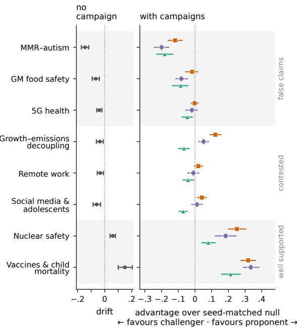  
Figure 1: Eight topics ordered by where the uninfluenced population ends, from the claim most rejected to the claim most accepted. Left: drift of the no-campaign population over the run (final mean stance minus starting mean stance; �=20 runs). Right: advantage of each campaign condition after the eight quiet rounds, the population’s mean stance minus that of the no-campaign run on the same network, personas and starting attitudes; positive favours the proponent (�=16 per condition). Points are means with 95% bootstrap CIs over runs.

Once the drift is removed by diferencing against the seed-matched null, a campaign’s efect also follows the claim rather than the side that speaks (Figure 1, right). On the three false claims every cam-paign condition sits at or below zero; on the two well-supported claims every condition sits above zero, including the challenger arguing against the claim (+0.08 on nuclear safety, +0.21 on vaccines); only on the three contested claims do the two sides move the population in opposite directions, and there the contest lands between them or near zero. Figure 2 shows how these endpoints arise: on MMR the movement is complete within five rounds and holds; on decoupling the two sides separate steadily and the contest settles between them; on vaccines all three conditions climb for the full campaign and are still rising when it stops. In none of the eight topics does the eight-round quiet period return the efect toward zero.

Part of this pattern is produced by the campaign agents themselves, not by the population. Classifying every campaign message for the side it actually argues (Appendix A.3) shows that the gener-ation model declined its brief exactly where the brief ran against the evidence. On MMR, 97% of the proponent’s messages argue that the claim is false — typically opening “I will not argue that MMR causes autism” and then debunking it — so the proponent acted as a second challenger, and the MMR row of Figure 1 measures two debunking campaigns, not a contest. On 5G the proponent asserted the claim in only 7% of messages and hedged in 55%. In the other direction, the challenger argued for the claim in 58% of its messages on vaccines and 22% on nuclear safety, which accounts for much of the challenger’s positive efect there. On the three contested claims and on GM food both sides argued their briefs in 76–100% of messages; the three contested claims are also the only topics on which the single-sided efects have opposite signs. Claim semantics enter the simulation at two points: through the population’s topic-dependent trajectory and through whether the campaign model follows its assigned side. The stance scores themselves are not the source of these patterns: a second probe from a diferent model reproduces them closely. The RQ1 experiment is unafected, since both sides argued their briefs on the reference topic (76% and 100%; the remainder hedged rather than switched).

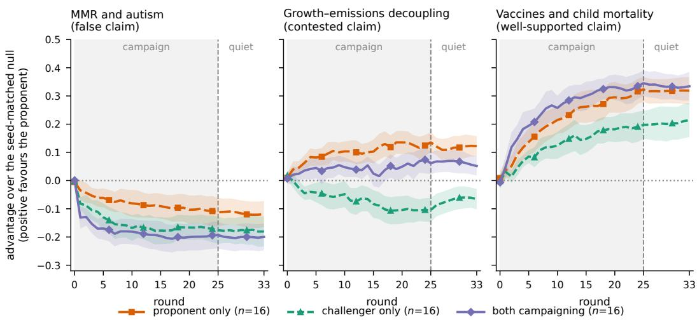  
Figure 2: Advantage over the seed-matched no-campaign run, round by round, for one topic of each kind: MMR–autism (false), growth–emissions decoupling (contested) and vaccination and child mortality (well supported). Each line is the mean over runs of the population’s mean stance under that condition minus the no-campaign run on the same network; positive favours the proponent; bands are 95% CIs across runs. Campaigns run in rounds 1–25 (shaded); rounds 26–33 are quiet. In none of the three do the quiet rounds pull the efect back toward zero.

## 4.2 RQ2: timing

With the drift removed, the timing experiment on the reference topic yields the payof matrix of Figure 3. Campaign outcomes de-pend on the interaction between the two expenditure schedules rather than on either schedule independently. The proponent’s pay- of is largest when the two sides do not spend in the same rounds (early against late, +0.15; late against sustained, +0.13) and smallest when they do (early against early, +0.06; late against late, +0.03); the mean of-diagonal payof exceeds the mean on-diagonal payof by 0.042 [−0.001, 0.072] within matched seeds, a diference whose interval just reaches zero. Consequently the proponent’s best reply is always to avoid the challenger’s schedule, and the challenger’s is to coincide with the proponent’s on the early and late schedules (against a sustained proponent its three replies are indistinguishable). The estimated payof matrix has no pure-strategy equilibrium, with this result reproduced in 81% of bootstrap resamples. The sus- tained schedule, the only one studied in Qasmi et al. [23], is never a best reply for either side.

The same schedules replayed on a bounded-confidence popu- lation — the same graphs, starting attitudes and deliveries, but numerical agents (Appendix A.8) — give a diferent game (Figure 3, right): late–late is a unique pure-strategy equilibrium, present in 100% of bootstrap resamples and unchanged across $\lambda \in \{ 0 , 0 . 1 , 0 . 3 \}$ and � ∈ {0.3, 0.6, 1.0}. Under symmetric, memoryless interventions, later interventions have a systematic advantage. The absence of a stable schedule therefore, arises in the LLM population rather than from the allocation problem alone.

The best-reply structure is not specific to the reference topic or to the follow graph. Repeating the four corner cells (early and late for each side, �=8 per cell) on vaccines, a well-supported claim with strong positive drift, and on the segregated planted network gives the same pattern in both. The proponent’s best reply is to avoid the challenger’s schedule, the challenger’s is to coincide with it, no cell is a best reply for both, and the proponent gains more when the schedules do not overlap (paired of-diagonal minus on-diagonal payof+0.09 [+0.03, +0.15] on vaccines and +0.07 [+0.00, +0.14] on the segregated network, against +0.08 [+0.01, +0.14] for the same four cells on the reference). The absolute payofs difer by topic — every cell is above +0.33 on vaccines, where both campaigns raise acceptance — but the relation between the two schedules is what decides the proponent’s advantage in all three settings. These checks cover the four corner cells on one additional topic and one additional network; they support the best-reply structure as a property of this class of population rather than a general timing rule. On the segregated network, campaigns primarily reduce between-community stance variance across the three tested top- ics, while within-community variance changes comparatively little (Appendix A.4).

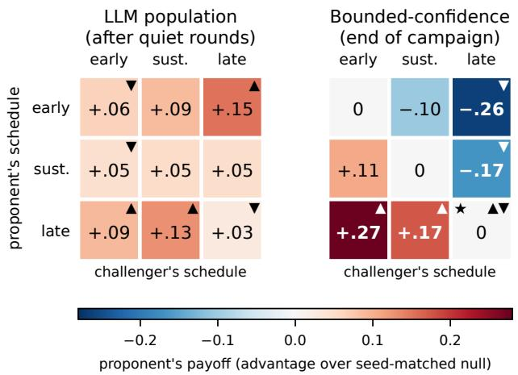  
Figure 3: Timing payof matrices on the reference topic (growth–emissions decoupling). All nine cells are two-sided contests with equal budgets of 250 deliveries; cells difer only in each side’s spending schedule — early (rounds 1–9), sustained (1–25) or late (17–25). Rows give the proponent’s schedule, columns the challenger’s; each cell is the proponent’s payof, the population’s mean stance minus that of the no-campaign run on the same network, personas and starting attitudes, averaged over runs (�=8 per cell, 16 for sustained–sustained). Left: the LLM population, payof after the eight quiet rounds; 95% bootstrap CI half-widths are 0.03– 0.10 (full table in the appendix). Right: a bounded-confidence population replayed on the same graphs, starting attitudes and deliveries, payof at the end of the campaign, since its retention term erases campaign efects during the quiet rounds. ▲ marks the proponent’s best reply in a column, ▼ the challenger’s in a row. In the LLM population no cell carries both — the proponent gains when the schedules do not overlap, the challenger when they coincide — so there is no pure-strategy equilibrium (absent in 81% of resamples). The numerical population has exactly one, at late–late (⋆).

## 5 Discussion

Our results expose two features of LLM-based influence simula- tions that are obscured when campaign direction is treated as an externally controlled variable. First, the semantic and epistemic status of a claim enters the simulation at multiple points. The uninfluenced population follows topic-dependent trajectories, while the campaign model sometimes declines to advance an assigned position that conflicts strongly with available evidence. On MMR, for example, the nominal proponent overwhelmingly generated de- bunking messages instead. Consequently, an LLM campaign agent is not equivalent to a freely specified positive or negative intervention. Studies using generative agents for strategic influence should therefore verify side fidelity—whether generated messages actually pursue the assigned objective—rather than infer campaign behaviour from role labels alone. Second, replacing numerical re- cipients with language-model agents changes the temporal game. In the bounded-confidence comparator, symmetric, memoryless interventions produce the expected advantage for speaking last and a stable late–late equilibrium. The LLM population instead produces cyclic best responses: the proponent benefits from avoid- ing the challenger’s timing, whereas for concentrated early or late schedules the challenger benefits from matching it. This pattern persists in the additional topic and network checks. The contrast suggests that the timing structure does not arise from budget al- location alone; nor does it arise from retention of initial positions by itself, since the numerical equilibrium is unchanged when that term is removed. Agents repeatedly reinterpret natural-language messages while retaining their initial positions, producing pathdependent and non-additive responses for which no single schedule is uniformly preferred

The uninfluenced runs also reveal a distinction between direc- tion and diversit . Mean stance drifts in diferent directions across claims, but stance variance falls on every topic. Campaigning further compresses this variance relative to matched no-campaign trajectories, regardless of the direction in which mean stance moves, and in segregated populations this compression falls almost entirely on the variance between communities rather than within them. Thus, directional stance change and population homogenisation are separable properties of these simulated societies; population averages alone can conceal substantial changes in their internal distribution.

These findings remain conditional on the tested simulation set- ting. The timing results cover two topics and two network settings, while community-level findings are limited to three topics on a single network family. The population comprises only 30 agents, restricting sensitivity to relatively large efects. Furthermore, agents express their beliefs through a single public opinion, preventing the simulation of strategic silence or diferences between private and expressed beliefs. Campaign schedules are predetermined and recipients selected randomly, excluding adaptive budget allocation and targeted influence. Although stance measurements show strong cross-model agreement, they have not been validated against hu- man judgements. Our findings therefore characterise artificial LLM populations rather than human opinion dynamics.

## 6 Conclusions

We studied competing, resource-constrained influence in personaconditioned LLM populations while separating campaign-associated change from the population’s uninfluenced trajectory. Across eight claims, baseline drift was topic dependent, while the population consistently lost stance diversity. Campaign outcomes therefore cannot be interpreted from raw opinion change alone. On the ref- erence topic, campaign efectiveness depended on the opponent’s timing policy, producing a best-response structure that difered qualitatively from a matched bounded-confidence population. We also found that generative campaign agents do not always pursue their assigned side, making side-fidelity checks necessary when LLMs themselves act as influencers. Together, these results show that both endogenous population dynamics and the behaviour of generative campaign agents must be accounted for when evaluating strategic influence in artificial LLM societies.

## References

[1] Melih Bastopcu, S. Rasoul Etesami, and Tamer Basar. 2025. Online and Ofline Dynamic Influence Maximization Games over Social Networks. IEEE Transactions on Control ofNetwork Systems 12, 2 (2025), 1440–1453. https://doi.org/10.1109/ TCNS.2025.352632

[2] Yigit Ege Bayiz, Arash Amini, Radu Marculescu, and Ufuk Topcu. 2025. The Efect of Network Topology on the Equilibria of Influence-Opinion Games. arXiv:2506.22293 https://arxiv.org/abs/2506.22293

[3] Angana Borah, Rada Mihalcea, and Veronica Perez-Rosas. 2026. Persuasion at Pla : Understandin Misinformation D namics in Demo ra hic-Aware Human LLM Interactions. In Proceedings ofthe 19th Conference ofthe European Chapter of the Association for Computational Linguistics (Volume 1: Long Papers). Association for Computational Linguistics, 5027–5053. https://doi.org/10.18653/v1/2026.eacl-long.234

[4] Vincent C. Brockers, David A. Ehrlich, and Viola Priesemann. 2026. Disentangling Interaction and Bias Efects in Opinion Dynamics of Large Language Models. Nature Communications 17 (2026), 10077. https://doi.org/10.1038/s41467-026- 77340-3

[5] Alejandro Buitrago López, Alberto Ortega Pastor, David Montoro Aguilera, Mario Fernández Tárraga, Jesús Verdú Chacón, Javier Pastor-Galindo, and José A. Ruipérez-Valiente. 2025. Agent-Based Simulation of Online Social Networks and Disinformation. arXiv:2512.22082 https://arxiv.org/abs/2512.22082

[6] Erica Cau, Valentina Pansanella, Dino Pedreschi, and Giulio Rossetti. 2025. Language-Driven Opinion Dynamics in Agent-Based Simulations with LLMs. arXiv:2502.19098 https://arxiv.org/abs/2502.19098

[7] Uthsav Chitra and Christopher Musco. 2020. Analyzing the Impact of Filter Bubbles on Social Network Polarization. In Proceedings of the 13th International Conference on Web Search and Data Mining (WSDM). ACM, 115–123. https: //doi.org/10.1145/3336191.3371825

[8] Yun-Shiuan Chuang, Agam Goyal, Nikunj Harlalka, Siddharth Suresh, Robert Hawkins, Sijia Yang, Dhavan Shah, Junjie Hu, and Timothy Rogers. 2024. Simu lating Opinion Dynamics with Networks of LLM-based Agents. In Findings of the Association for Computational Linguistics: NAACL 2024. Association for Com putational Linguistics, 3326–3346. https://doi.org/10.18653/v1/2024.findings-naacl.211

[9] Yun-Shiuan Chuang, Ruixuan Tu, Chengtao Dai, Smit Vasani, Binwei Yao, Michael Henry Tessler, Sijia Yang, Dhavan Shah, Robert Hawkins, Junjie Hu, and Timothy T. Rogers. 2025. DEBATE: A Large-Scale Benchmark for Role Playing LLM Agents in Multi-Agent, Long-Form Debates. arXiv:2510.25110 https://arxiv.org/abs/2510.25110

[10] Anne Condon and Richard M. Karp. 2001. Algorithms for Graph Partitioning on the Planted Partition Model. Random Structures & Algorithms 18, 2 (2001), 116–140. https://doi.org/10.1002/1098-2418(200103)18:2<116::AID-RSA1001>3.0.CO;2-2

[11] Aurelien Decelle, Florent Krzakala, Cristopher Moore, and Lenka Zdeborová. 2011. Asymptotic Analysis of the Stochastic Block Model for Modular Networks

and Its Algorithmic Applications. Physical Review E 84, 6 (2011), 066106. https: //doi.org/10.1103/PhysRevE.84.066106

[12] Guillaume Defuant, David Neau, Frédéric Amblard, and Gérard Weisbuch. 2000. Mixing Beliefs among Interacting Agents. Advances in Complex Systems 3, 01n04 (2000), 87–98. https://doi.org/10.1142/S0219525900000078

[13] Morris H. DeGroot. 1974. Reaching a Consensus. J. Amer. Statist. Assoc. 69, 345 (1974), 118–121. https://doi.org/10.1080/01621459.1974.10480137

[14] Swapnil Dhamal, Walid Ben-Ameur, Tijani Chahed, and Eitan Altman. 2020. A Two Phase Investment Game for Competitive Opinion Dynamics in Social Networks. Information Processing & Management 57, 2 (2020), 102064. https: //doi.org/10.1016/j.ipm.2019.102064

[15] S. Rasoul Etesami. 2022. Open-Loop Equilibrium Strategies for Dynamic Influence Maximization Game over Social Networks. IEEE Control Systems Letters 6 (2022), 1496–1500. https://doi.org/10.1109/LCSYS.2021.3116030

[16] Noah E. Friedkin and Eugene C. Johnsen. 1990. Social Influence and Opinions. The Journal ofMathematical Sociology 15, 3–4 (1990), 193–205. https://doi.org/ 10.1080/0022250X.1990.9990069

[17] Yulong He, Dutao Zhang, Sergey Kovalchuk, Pengyi Li, and Artem Sedakov. 2026. Opinion Dynamics and Mutual Influence with LLM Agents through Dialog Simulation. arXiv:2602.12583 https://arxiv.org/abs/2602.12583

[18] Rainer Hegselmann and Ulrich Krause. 2002. Opinion Dynamics and Bounded Confidence: Models, Analysis and Simulation. Journal ofArtificial Societies and Social Simulation 5, 3 (2002). https://www.jasss.org/5/3/2.htm

[19] Chichen Lin, Yijie Jin, Kangbo Hu, Weijian Fan, Han Xiao, Yongbin Wang, Zhihui Ying, and Zhanzhan Zhao. 2026. You Can’t Fool Us: Understanding the Resilience of LLM-Driven Agent Communities to Misinformation. arXiv:2605.17353 https: //arxiv.org/abs/2605.17353

[20] Genglin Liu, Vivian T. Le, Salman Rahman, Elisa Kreiss, Marzyeh Ghassemi, and Saadia Gabriel. 2025. MOSAIC: Modelin Social AI for Content Dissemination and Regulation in Multi-Agent Simulations. In Proceedings ofthe 2025 Conference on Empirical Methods in Natural Language Processing. Association for Computational Linguistics, 6390–6417. https://doi.org/10.18653/v1/2025.emnlp-main.325

[21] Mehwish Nasim, Syed Muslim Gilani, Amin Qasmi, and Usman Naseem. 2025. Simulating influence dynamics with llm agents. In 2025 IEEE International Conference on Big Data (BigData). IEEE, 6353–6356.

[22] Caleb Probine, Yigit Ege Bayiz, Filippos Fotiadis, Samuel Li, Yunhao Yang, and Ufuk Topcu. 2026. Characterizing Opinion Evolution of Networked LLMs. arXiv:2606.18276 https://arxiv.org/abs/2606.18276

[23] Amin Qasmi, Usman Naseem, and Mehwish Nasim. 2025. Competing LLM Agents in a Non-Cooperative Game of Opinion Polarisation. arXiv:2502.11649 htt s://arxiv.or /abs/2502.11649

[24] Ali Safarpoor Dehkordi, Mohammad Shirzadi, and Ahad N. Zehmakan. 2026. Opinion Polarization in LLM-Based Social Networks: Manipulation and Mitiga- tion. arXiv:2606.18795 https://arxiv.org/abs/2606.18795

[25] Chenxi Wang, Zongfang Liu, Dequan Yang, and Xiuying Chen. 2025. De-coding Echo Chambers: LLM-Powered Simulations Revealing Polarization in Social Networks. In Proceedings of the 31st International Conference on Computational Linguistics. Association for Computational Linguistics, 3913–3923. https://aclanthology.org/2025.coling-main.264/

## A Supplementary Material

## A.1 The shared population

Replicate � of every condition and every topic runs on network � with the same personas and starting attitudes, so every contrast in the paper is paired at the population level. Reading is fixed at four sources per agent; audience is not (coeficient of variation 0.37–0.54), and six of the 600 agents have no readers. Attitudes are assigned independently of position in the graph, so these populations have structure without opinion segregation; segregation is introduced only in the planted-partition check (Appendix A.4).

## A.2 Per-topic trajectories

Figures 6–10 give the five topics not shown in Figure 2 of the main text, in the same two-panel form: the left panel is the population’s mean stance under each condition, the right panel each campaign condition minus the no-campaign run on the same network (�=20 no campaign, �=16 otherwise; bands are 95% CIs over runs). On the two false claims the proponent buys a small lift during the campaign that does not survive the quiet rounds, while the challenger’s efect persists. On the contested claims the two sides move the population in opposite directions and the contest sits between them; remote work is the topic the population barely moves on. On nuclear safety both sides raise acceptance, the challenger included.

## A.3 Measurement validity

Side fidelity. Figure 11 shows that the generation model argued its brief on the contested claims and on GM food (76–100% of messages for both sides) but declined it where the brief ran against the evidence: on MMR 97% of proponent messages argue the claim is false, on 5G the proponent asserted the claim in 7% of messages and hedged in 55%, and the challenger argued for the claim in 58% of messages on vaccines and 22% on nuclear safety. This is a property of LLM campaign agents and is reported as a finding (Section 4);

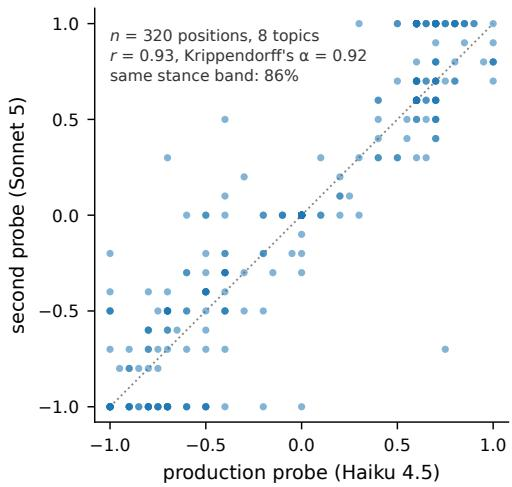  
Figure 4: Stance assigned by the production probe (Haiku 4.5) against a second probe from a larger model (Sonnet 5) on 320 written positions, 40 per topic, stratified by stance band. the RQ2 experiment is unafected because both sides argued their briefs on the reference topic.

Probe agreement. A second probe from a diferent model rescored 320 positions with the same prompt (Figure 4): Pearson �=0.93, Krippendorf’s �=0.92 (interval), 86% in the same stance band, four sign disagreements, and a mean ofset of +0.04 (Sonnet reads slightly more accepting). This is cross-model agreement, not human validation; human readings remain future work.

The 20 follow networks shared by every topic and condition N=30. each agent reads exactly 4 others: arrows point from writer to reader: audience varies from 0 to 10

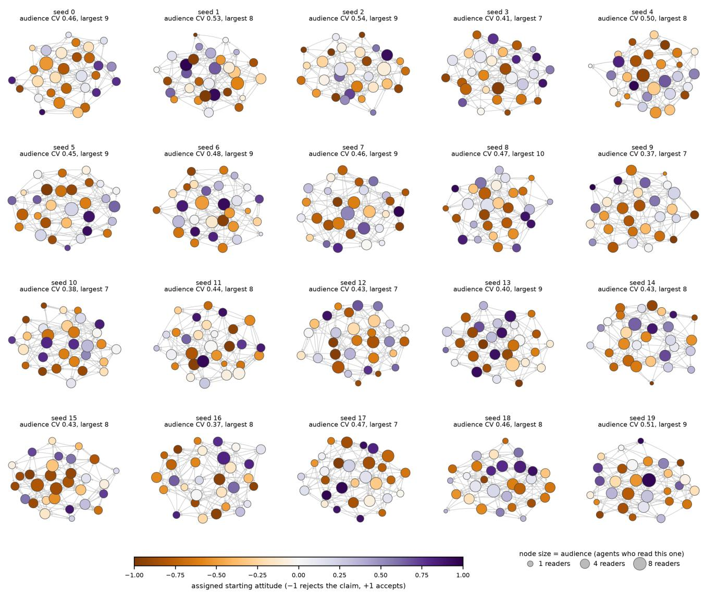  
Figure 5: The 20 follow networks used by every topic and condition. �=30; each agent reads exactly four others, so arrows point from writer to reader. Node colour is the assigned starting attitude, node size the number of agents who read that node (0–10).

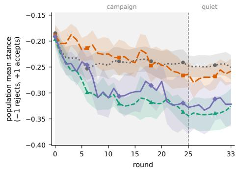

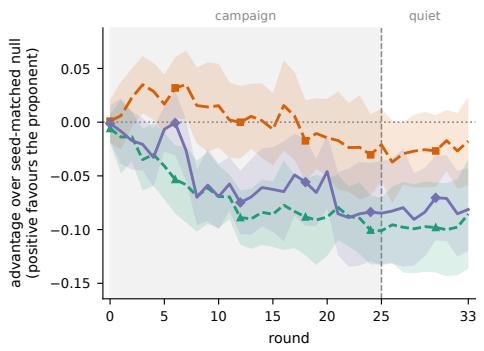  
population mean stance under:  
no campaign (n=20) proponent only (n=16) challenger only (n=16) both campaigning (n=16)

Figure 6: GM food safety (mostly false). The proponent’s advantage peaks near round 4 and returns to zero in the quiet rounds; the challenger’s persists.  
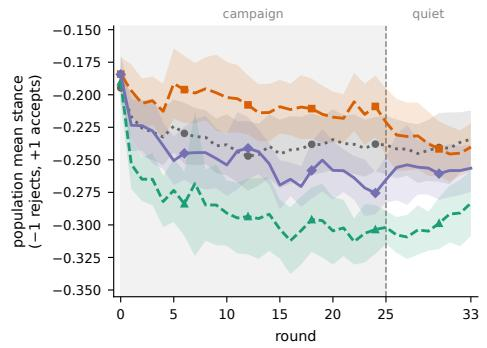

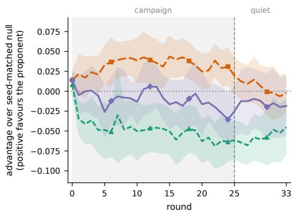  
population mean stance under:  
no campaign (n=20) proponent only (n=16) challenger only (n=16) both campaigning (n=16)

Figure 7: 5G health efects (false). As for GM food: a transient proponent lift, a durable challenger efect, and a contest indistinguishable from the null.  
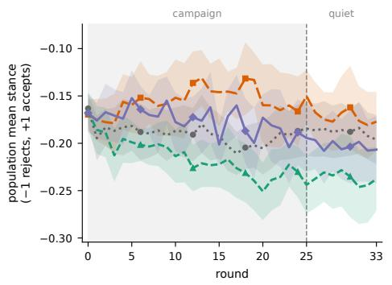

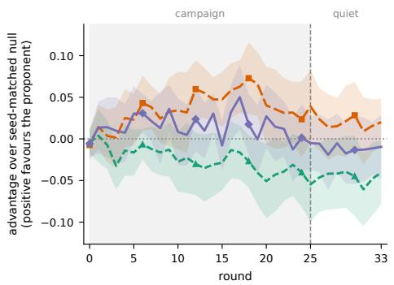  
population mean stance under:  
no campaign (n=20) proponent only (n=16) challenger only (n=16) both campaigning (n=16)  
Figure 8: Remote-work productivity (contested). The least movable topic: all campaign efects are within ±0.05 and the contest is zero.

population mean stance under:  
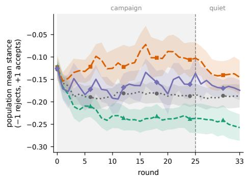

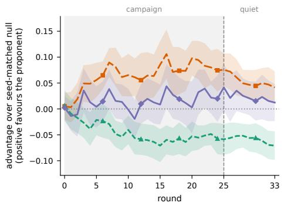  
population mean stance under:  
no campaign (n=20) proponent only (n=16) challenger only (n=16) both campaigning (n=16)

Figure 9: Social media and adolescents (contested). Symmetric single-sided efects of about ±0.05 that cancel almost exactly in competition.  
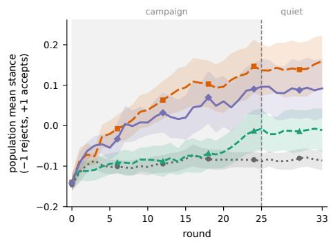

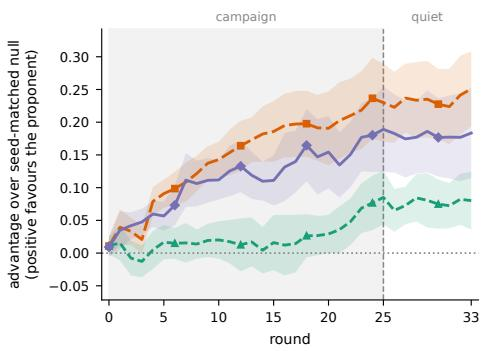  
no campaign (n=20) proponent only (n=16) challenger only (n=16) both campaigning (n=16)

Figure 10: Nuclear safety (well supported). Both campaigns raise acceptance; the challenger’s efect appears only late in the campaign and holds through the quiet rounds.  
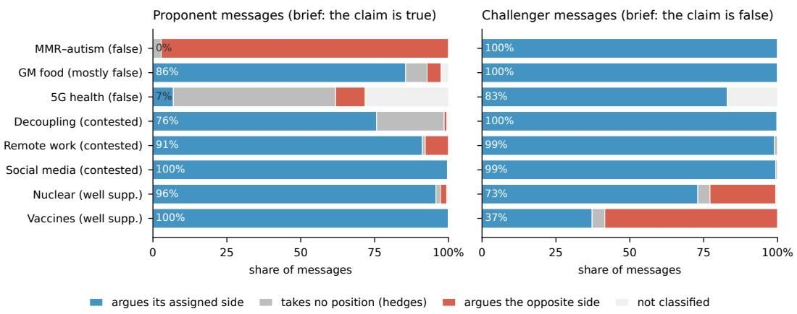  
Figure 11: Which side each campaign message actually argues, by topic (�=768–1,632 messages per bar). An independent model classified every message, blind to its label, as arguing the claim is true, false, or taking no position; each batch carried two anchor sentences of known polarity and was discarded if either came back inverted (“not classified”). The proponent’s brief is that the claim is true, the challenger’s that it is false.

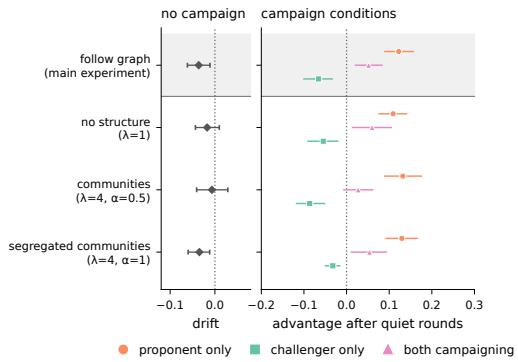

Figure 12: Reference topic, four network cells. Top row: the follow graph of the main experiment (reference). Below: planted-partition cells — no structure $\left( \lambda _ { \mathrm { r } } { = } 1 \right)$ , two communities with unsorted attitudes $( \lambda _ { \mathrm { { r } } } { = } 4 , \alpha { = } 0 . 5 )$ , and two opinionsorted communities (�=1). Left: drift of the uninfluenced population; right: advantage after the quiet rounds, positive favouring the proponent. 95% bootstrap CIs; �=16 per condition in every cell.

## A.4 Community structure and opinion segregation

The structureless control reproduces the follow-graph result, so the change of generator itself does nothing. Adding communities leaves the proponent’s efect unchanged; the one magnitude change is the challenger’s efect, which halves under segregation (−0.087 to −0.032, non-overlapping CIs). Figure 13 shows why: the block that already agrees with the challenger has no room to move, and the block it would need to reach is the one it does not. The asymmetry reflects the skewed starting distribution (more rejecters than accepters), which under full alignment yields one near-homogeneous rejecting block and one mixed block.

Within- and between-community diversity. With two planted communities, the variance of stance across the population decomposes exactly into a within-community component (the size-weighted mean of the two block variances) and a between-community component (the size-weighted variance of the two block means). Figure 14 tracks both through the campaign and quiet rounds in the segre- gated cell $( \lambda _ { \mathrm { { r } } } { = } 4 , \alpha { = } 1 )$ on three topics — the reference topic, vaccines, and MMR, on which both campaigns argue against the claim (Appendix A.3) — each run on the same sixteen graphs with four conditions at �=16. In the uninfluenced population the between component falls by about a third to a half over the run (decoupling $0 . 2 0  0 . 1 3$ , vaccines $0 . 1 8  0 . 0 9$ , MMR $0 . 2 3  0 . 1 2 )$ while the within component falls less, so the two communities drift toward each other even without a campaign. Campaigns act almost entirely on the between component: relative to the seed-matched null at round 33 they remove a further 0.05–0.08 of between-community variance in every condition on every topic except the challenger alone on decoupling (−0.03), while changing the within component by at most 0.03 and usually by less than 0.01. In the segregated population, campaigning of either kind therefore closes the gap between the two communities and leaves the diversit inside each community where it was. The control cells confirm that the between component measures structure: with unsorted opinions (�=0.5) or no communities $\left( \lambda _ { \mathrm { r } } { = } 1 \right)$ it is 0.02 or less throughout.

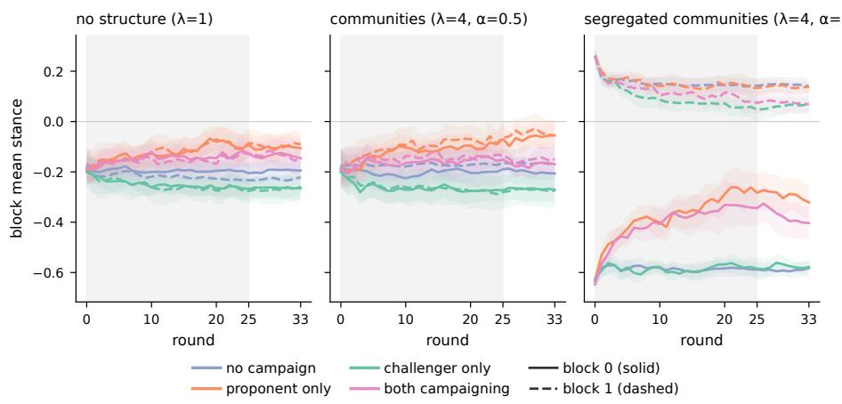

Figure 13: Mean stance of each block separately (solid: block 0; dashed: block 1) under each condition, for the three planted cells. In the unsorted cells the two blocks are statistically identical. In the segregated cell they start 0.89 apart; the proponent lifts the rejecting block by about 0.25, while the challenger barely moves the accepting block.  
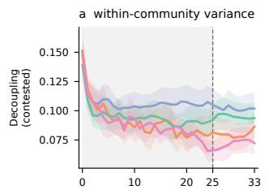

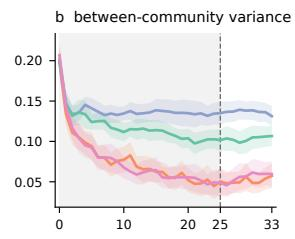

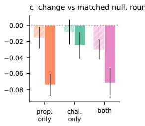

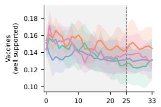

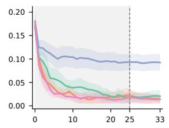

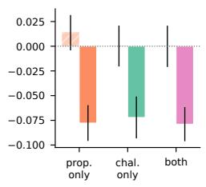

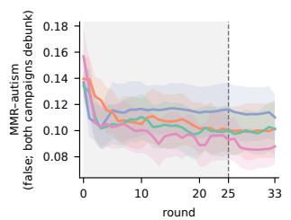

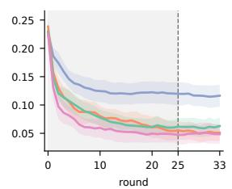

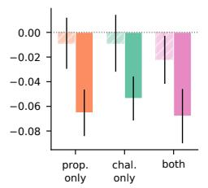  
no campaign proponent only challenger only both campaigning within component (c) between component (c)

Figure 14: Within- and between-community stance variance in the segregated planted cell on three topics (rows), by condition;   
means over �=16 runs with 95% CIs. (a) Within-community component by round. (b) Between-community component by round.   
(c) Change in each component at round 33 relative to the no-campaign run on the same graph, personas and starting attitudes;   
bars are means with 95% bootstrap CIs over the sixteen matched pairs.

## A.5 Baseline drift and baseline diversity

Two baseline phenomena coexist in the no-campaign population and are separable. Directional drift — the change in mean stance — difers by topic in sign and size, from −0.15 on MMR to +0.15 on vaccines, and is distinguishable from zero on all eight topics. Loss of diversity — the change in stance variance — does not: every topic’s uninfluenced population ends with 55–71% of its starting variance (change −0.16 to −0.09), and the size of the loss is unrelated to the size or sign of the drift (correlation of |drift| with variance change across topics 0.17). In this simulated LLM population, where the baseline goes depends on the claim; that it converges does not. These are population-level regularities of the simulated society and are not ofered as claims about human populations.

## A.6 Polarisation

The population starts deliberately spread and converges even when left alone. Every campaign condition ends less polarised than the uninfluenced population, in all eight topics and in all four network cells: a campaign gives everyone it reaches the same argument, and the agents it moves most are those furthest from it, which compresses the distribution regardless of the direction in which the mean moves. We therefore find no evidence, at this scale and from this starting distribution, that adversarial campaigns or community structure increase polarisation.

## A.7 Robustness of the timing result

In all three settings the proponent’s best reply avoids the chal- lenger’s schedule and the challenger’s coincides with it, so no cell is a best reply for both. The paired contrast between of-diagonal and on-diagonal payofs is $+ 0 . 0 7 6 \ \left[ + 0 . 0 0 9 , + 0 . 1 4 2 \right]$ on the reference, $+ 0 . 0 9 2 \ \left[ + 0 . 0 3 2 , + 0 . 1 5 3 \right]$ on vaccines and +0.071 [+0.002, +0.137] on the segregated network (bootstrap over the eight seeds that carry all four cells). The levels difer — on vaccines every cell exceeds +0.33 because both campaigns raise acceptance of a well-supported claim — but the ordering within the matrix is the same. The checks are limited to the corner cells and to one additional topic and one additional network; the sustained schedule and the remaining six topics were not re-run.

## A.8 Numerical comparison arm

Agents hold one number $x _ { i } ~ \in ~ \left[ - 1 , 1 \right]$ and update by $\tilde { x } _ { i } ^ { t } = x _ { i } ^ { t } +$ $\begin{array} { r } { \mu \big ( | C _ { i } ^ { t } | ^ { - 1 } \sum _ { j \in C _ { i } ^ { t } } x _ { j } ^ { t } - x _ { i } ^ { t } \big ) } \end{array}$ over the neighbours within � of them, then $\begin{array} { r } { x _ { i } ^ { t + 1 } = ( \dot { 1 } - \lambda ) \bigl ( \tilde { x } _ { i } ^ { t } + \eta \sum _ { c : i \in \mathcal { T } _ { c } ^ { t } } \sigma _ { c } \bigr ) + \lambda x _ { i } ^ { 0 } } \end{array}$ , with $\sigma _ { \mathrm { P } } = + 1 , \sigma _ { \mathrm { C } } = - 1$ $\scriptstyle { \varepsilon = \mu = \lambda = 0 . }$ 3 and $\scriptstyle \eta = 0 . 1 / \left( 1 - \lambda \right)$ so one delivery moves a neutral agent by 0.1. Each delivery logged in the LLM runs is replayed to the same agent in the same round; no API call is made. The numerical game has a unique pure-strategy equilibrium at late–late (present in 100% of bootstrap resamples at the end of the campaign and 94% after the quiet rounds), the matrix is antisymmetric, and the equilibrium is unchanged for $\lambda \in \{ 0 , 0 . 1 , 0 . 3 \}$ and $\varepsilon \in \{ 0 . 3 , 0 . 6 , 1 . 0 \}$ : with symmetric, memoryless pushes, whoever speaks last wins. The LLM population has no pure-strategy equilibrium (81% of resamples) and an all-positive matrix. Timing cycles because of how LLM agents revise, not because of the allocation game itself.

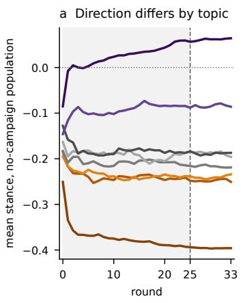

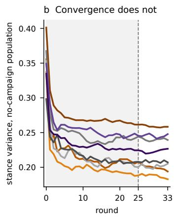

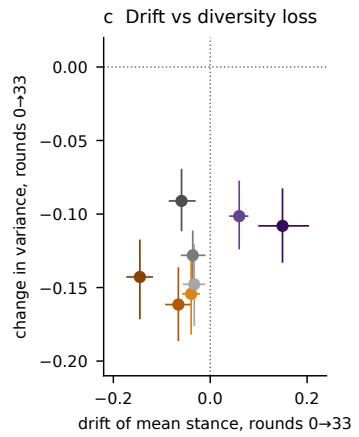  
MMR–autism (false) 5G health (false) Remote work (contested) Nuclear (well supp.) GM food (mostly false) Decoupling (contested) Social media (contested) Vaccines (well supp.)

Figure 15: The uninfluenced population on each of the eight topics (�=20 runs per topic, means over runs). (a) Mean stance by round. (b) Stance variance by round. (c) Change in mean stance against change in variance from round 0 to round 33, one point per topic with 95% bootstrap CIs over runs. Campaign rounds are shaded although no campaign is active; the dashed line marks where the quiet rounds begin in the campaign conditions.  
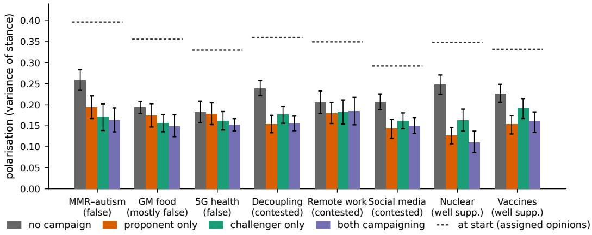  
Figure 16: Final polarisation (variance of stance at round 33) under each condition, per topic, with 95% bootstrap CIs. The dashed line is the polarisation of the assigned starting attitudes.

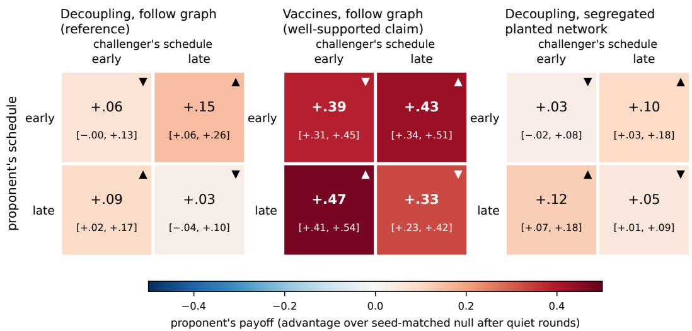  
▲ proponent's best reply in column ▼ challenger's best reply in row · n = 8 runs per cel

Figure 17: The four corner cells of the timing matrix (early and late schedules for each side; �=8 per cell) on the reference topic (left), on vaccines (centre) and on the reference topic with the segregated planted network of Appendix A.4 (right). Cells report the proponent’s payof after the quiet rounds with 95% bootstrap CI; ▲ and ▼ mark best replies as in Figure 3.

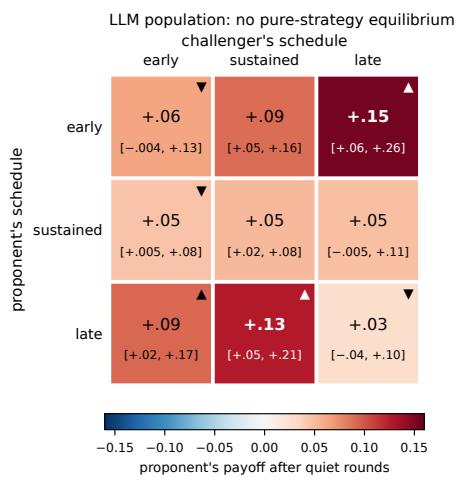

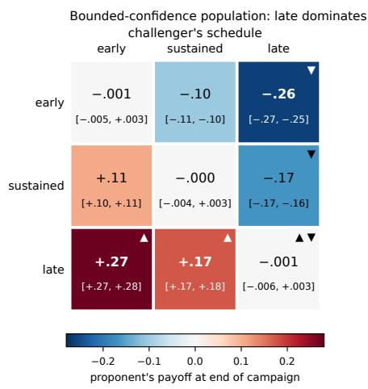  
▲ proponent's best reply in column ▼ challenger's best reply in row

Figure 18: The two matrices of Figure 3 with per-cell 95% bootstrap CIs (�=8; �=16 for sustained–sustained). The numerical panel is shown at the end of the campaign because retention toward the starting attitude (�=0.3 per round) erases almost all of its campaign efect within the eight quiet rounds (largest after-quiet payof 0.016); the best-reply structure is identical at both measurement points.