# Creative Priming: Decoupling Process from Product to Escape the Creative Paradox

Alon Albalak, Sebastian Gabriel, David B. D’Ambrosio, Joel Lehman, Kenneth O. Stanley   
aalbalak@lila.ai   
Lila Sciences

## Abstract

Many of the most consequential advances promised by AI, from curing diseases and inventing new technologies to formulating new scientific theories, are fundamentally creative acts. Yet creativity is uniquely difficult to learn because it faces a creative paradox: learning to repeat past examples of creative success makes those specific examples more likely to recur, inhibiting the very creativity desired. This work argues that creativity is better modeled as an explicit process rather than as a property of individual artifacts, and proposes to learn the underlying generative principles behind the creative process. In particular, to escape the paradox, we introduce creative priming (CP), wherein a trained priming model generates a prompt-specific primer that assists a response model in being creative, explicitly decoupling the creative process from response generation. The priming model learns through GRPO, rewarding primers that lead to responses that are novel, high-quality, and diverse, thereby reinforcing the process that yields creative responses without reinforcing any specific response. Evaluating CP on NoveltyBench and comparing against response models directly trained for creativity, we find that priming produces a 39–200% relative increase in the number of responses that are simultaneously novel, high-quality, and semantically distinct. Additionally, although the primer is only trained to improve creativity for a small open-source model (Qwen3-8B), the creative principles it learns transfer to frontier API models, increasing the number of semantically distinct responses they generate by 4.5–10 and diversity by 2.5–4.6 , while maintaining or improving quality. CP thereby shows that decoupling the creative process from the responses themselves offers a concrete escape from the creative paradox.

## 1 Introduction

Even as benchmark after benchmark and test after test have fallen to LLMs in recent years (Rein et al., 2023; Xie et al., 2024; Chan et al., 2025; Yue et al., 2025; Patwardhan et al., 2025; Arora et al., 2025; Deng et al., 2025; Center for AI Safety et al., 2026; Merrill et al., 2026; Sajadieh et al., 2026), creativity remains an unconquered frontier (Padmakumar & He, 2024; Sun et al., 2025; Mizrahi et al., 2026; Jiang et al., 2025; Hou et al., 2026; Bao et al., 2026). Perhaps that is why many of the most compelling motivational framings for the future of AI point to creative endeavors: we will discover new cures, invent new technologies, find solutions to our most pressing problems, and imagine new art forms (Amodei, 2024; Altman, 2024). All of these looming triumphs involve fundamentally creative acts.

As AI continues to extend its dominance across an increasingly wide set of domains, the question of when this creative renaissance will begin in earnest becomes increasingly central. The focus on creativity is already reflected in scientific domains, with efforts for models to generate hypotheses, formulate research plans, anticipate scientific insights, and act as autonomous researchers (Liu et al., 2026a; Goel et al., 2025; He-Yueya et al., 2026; Liu et al., 2026b; Lupidi et al., 2026; Nathan et al., 2025). To be sure, there are some domain-specific signs of AI creativity, yet perhaps there should be more evidence after billions of dollars spent and seemingly superhuman capabilities in mathematics (Das, 2026; OpenAI, 2026b;a). Where are the cured diseases, the revolutionary new technologies, the solutions to our energy challenges, the new genres that change the world?

Margaret Boden’s influential conception of creativity imagines a continuum from weaker to stronger forms, from the more prosaic combinatorial and exploratory creativities to the more profound trans formational version (Boden, 2004). One potential hope is that models are slowly climbing this ladder as they become more generally capable, and are just now bumping against the lower rungs of transformational creativity. However, studies of scientific ideation find that model-generated idea remain less original than human ideas and tend to stay close to familiar scientific directions (Chen et al., 2026b; Bao et al., 2026; Antoniades et al., 2026). These findings give reason to believe that creativity is unique within the intelligence landscape and cannot be learned through conventional means like other aspects of intelligence.

Consider that creativity is notoriously challenging to teach even to humans (Schooler & Melcher, 1995; Kaufman et al., 2010; Baird et al., 2012). A key obstacle is that, unlike other skills, creativity is difficult to learn from examples. While any successful past creative output could in principle serve as a training example for an aspiring student of creativity, most approaches to learning would make similar outputs more likely in the future (Jansson & Smith, 1991; Smith et al., 1993). However, for creativity, reproducing past outputs is exactly opposite the goal; rather, the goal is to learn generative principles for producing future creative outputs.

In this way, learning to be creative faces a vexing creative paradox: emulating examples of past creative success (even if they were your own successes) can actually prevent you from reaching your full creative potential. The drive to escape the past is not ideally served by reinforcing past behavior. Part of the problem is the fleeting nature of novelty; as soon as a novel artifact appears in the world, even if it was your own original idea, it is no longer novel. After all, anything in the distribution of past events is by definition not novel, which is why learning to generate past instances of novelty runs into the creative paradox.

Therefore, rather than asking what did I do that was creative, what we really want to ask is, what lessons can I abstract from the successful generation of creativity that can be reapplied to generate further creativity? Answering this question is the path to circumventing the creative paradox. The problem is that training methods do not automatically decouple the abstraction of general lessons from the reinforcement of specific past effective actions.

To address the creative paradox, this work proposes creative priming (CP), a process in which a creative priming model generates a prompt-specific creative primer (i.e. a short text) that is passed as additional context to a frozen response generation model. The priming model learns through GRPO (Shao et al., 2024), rewarding primers that lead to responses that are novel, high-quality, and diverse. Thus the system can reinforce the priming process that yields creative outputs without reinforcing any specific creative output, circumventing the creative paradox.

We evaluate CP on NoveltyBench (Zhang et al., 2025) and compare against two methods that train models to directly respond creatively. Each method is evaluated by generating 64 responses per prompt and counting the number of responses that are simultaneously novel, high-quality, and semantically distinct (a metric that we argue a creative system should score highly on), finding that CP leads to an average of 22.8 such responses per prompt, compared to 16.4 and 7.6 from direct generation methods (1.39–3.0 more). Furthermore, scaling the number of on-policy training sam ples for a direct generation baseline fails to match CP on measures of system creativity and can actually reduce performance, supporting the creative paradox’s prediction that directly reinforcing successful responses is not expected to improve creativity indefinitely. Because the primer learns general principles for creativity, it also transfers to models it was never trained with: across four API models, priming increases the number of distinct responses by 4.5–10 and diversity by 2.5–4.6 , while modestly improving quality (0.5–4.6%).

These results show that creative priming not only offers a way out of the creative paradox but can also potentially combine effectively with other techniques and even with models that were not part of the original creative priming training stack. More generally, we hope the practical gains from creative priming can help to spark deeper introspection in the field about what makes training explicitly for creativity unique compared to other kinds of learning.

## 2 Background

Before discussing how to improve creativity in language models, we first review what creativity is and how it can be measured. We then move on to a brief discussion of prior works on increasing creativity and why they are still vulnerable to the creative paradox.

## 2.1 Defining and Measuring Creativity

Definitions of human creativity often center on similar themes. For example:

• ideas that are simultaneously original and effective (Runco & Jaeger, 2012), or

• the ability to produce ideas or artifacts that are new, surprising, and valuable (Boden, 2009).

Most definitions agree that an idea must be novel and it must be good, and neither property alone is sufficient, to be called creative. Novelty, however, is nebulous without a reference point: novel to whom? Therefore, Boden (2009) also draws an essential distinction between two types of creativity: artifacts and ideas that are new to the individual who produced them (psychological creativity, or P-creativity) and those that are new in the entire history of human thought (historical creativity, or H-creativity).

Throughout this work, we study the P-creativity of language models for two reasons. First, Hcreativity is nearly impossible to validate, except on a narrow set of known problems with unknown solutions that can be verified (e.g., open conjectures in math), whereas P-creativity is empirically tractable, requiring only that we have a record of a model’s previous behaviors. Second, for language models, the distinction between the two is collapsing: as frontier language models absorb ever more information, the gap between what is new to the model and what is new to humanity shrinks. For these reasons, moving forward, when we refer to creativity we are referring to P-creativity.

Mapping the requirements of Runco & Jaeger (2012) (originality and effectiveness) onto language models, originality becomes deviation, defined as the distance of a given response from some reference set of responses, and effectiveness becomes quality. Thus, the creativity of an individual response can be defined as when the response simultaneously deviates from the reference set and is high-quality. A response that departs from the reference set but is incoherent is not creative, and neither is a polished response that merely restates a common idea.

The creativity of a system can then be defined as when the system reliably produces responses that are individually creative and are also varied amongst themselves. This definition offers a direct recipe for measuring system creativity (which we will later formalize): first, remove responses that are not individually creative (i.e. those below the deviation and quality thresholds), and then measure the spread of the set that survives, so that spread is credited only among responses that are already regarded as creative.

## 2.2 Reinforcement Learning for Diversity

The most visible symptom of the limited creativity in modern language models is their homogeneity: across many models and even across entire model families, outputs often collapse on the same handful of ideas with only minor variations in phrasing (Jiang et al., 2025; Zhang et al., 2025). This homogeneity has motivated a wave of post-training methods to address the problem.

A number of preference-based methods formulate training data pairs to favor responses that are rare or marginally diverse while retaining quality (Chung et al., 2025; Lanchantin et al., 2025; Samuel et al., 2026), while Creative Preference Optimization incorporates novelty, diversity, surprise, and quality directly into preference optimization (Ismayilzada et al., 2025). Other methods instead construct rewards from collections of generated responses, using learned semantic partitions in DARLING (Li et al., 2025), determinantal point processes in Diversity Quality Optimization (Chen et al., 2026a), or specialization across a vector-valued reward space in Vector Policy Op timization (Bahlous-Boldi et al., 2026). CreativeInstruct takes a complementary instruction-tuning approach, teaching the response model when to enter creativity-biased spans (Sahu et al., 2026). In this work, two families of diversity-enhancing methods that differ only in how they measure diver sity serve as baselines. Both methods train the response model to directly respond to prompts (top in Figure 1) with GRPO (Shao et al., 2024).

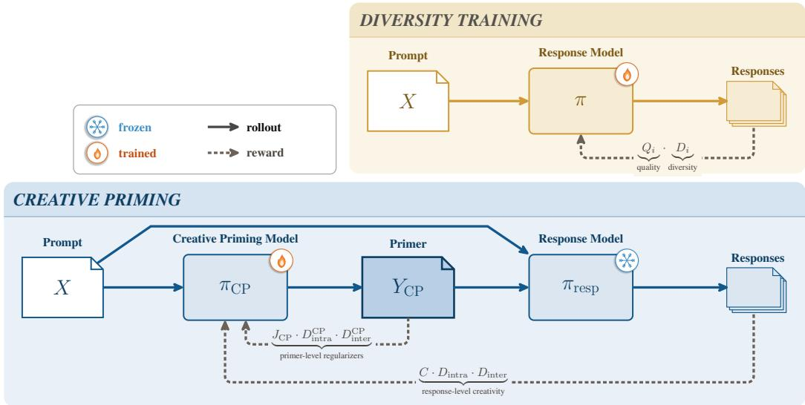  
Figure 1 The creative priming training procedure. Diversity training (top right; Section 2.2.2) optimizes the response model π directly, sampling responses from the prompt $\check { X }$ and rewarding each one for being simultaneously high-quality and diverse $\bar { ( } r _ { i } =  { Q _ { i } } \cdot  { D _ { i } } )$ . Creative priming (bottom; Section 3) instead trains a separate priming model π<sub>CP</sub> over a frozen response model $\pi _ { \mathrm { r e s p } } \colon$ : π<sub>CP</sub> produces a primer $Y _ { \mathrm { C P } }$ that is combined with X and passed to $\pi _ { \mathrm { r e s p } }$ to generate a response. The reward flows back into π<sub>CP</sub> alone through two paths: response-level creativity signals $( C \cdot D _ { \mathrm { i n t r a } } \cdot D _ { \mathrm { i n t e r } } )$ from the responses and primer-level regularizers $( J _ { \mathrm { C P } }$ $D _ { \mathrm { i n t r a } } ^ { \mathrm { d y } } \cdot D _ { \mathrm { i n t e r } } ^ { \mathrm { C P } } )$ from the primer. The priming process decouples learning the creative process from reinforcing any particular responses, avoiding the creative paradox.

## 2.2.1 Group-Relative Policy Optimization

In GRPO, for each prompt X, a group of G responses $\{ Y _ { 1 } , \dots , Y _ { G } \}$ is sampled from the model, $Y \sim \pi ( \cdot \mid X )$ ), and each response is scored with a reward $r _ { i }$ , forming a group-relative advantage,

$$
A _ { i } = { \frac { r _ { i } - \operatorname* { m e a n } ( \{ r _ { 1 } , \dots , r _ { G } \} ) } { \operatorname { s t d } ( \{ r _ { 1 } , \dots , r _ { G } \} ) } } .\tag{1}
$$

In this work, all models are trained with GRPO as the backbone and vary only in how the reward $r _ { i }$ is defined. Throughout, let $\phi ( \cdot )$ be an embedding model and let $\mathrm { d } ( a , b ) \dot { = } \mathrm { m i n } \dot { ( } 1 , 1 - \cos \theta _ { a b } \big ) \in [ 0 , 1 ]$ denote the cosine distance between two responses, where $\theta _ { a b } = \angle ( \phi ( a ) , \phi ( \dot { b } ) )$ is the angle between their embeddings.

## 2.2.2 Diversity-Enhancing Baselines

We consider two families of diversity-enhancing methods that differ only in how they measure diversity. Both methods train the response model to directly respond to prompts (top in Figure 1).

Diversified GRPO (DGRPO). The first method, Diversified GRPO (DGRPO), inspired by Diversified DPO and Diversified ORPO (Chung et al., 2025), recasts their objective as a PPO-style algorithm, trading their labeled preference data (expensive and limiting to collect) for on-policy sampling. DGRPO rewards each response by the product of its quality $Q _ { i }$ and its intra-group diversity $D _ { i } .$

$$
r _ { i } = Q _ { i } \cdot D _ { i } , \qquad D _ { i } = { \frac { 1 } { G - 1 } } \sum _ { j \neq i } { \mathrm { d } } ( Y _ { i } , Y _ { j } ) , \qquad Q _ { i } = \sigma { \big ( } ( r _ { \mathrm { R M } } ( X , Y _ { i } ) - T ) / \tau { \big ) } .\tag{2}
$$

The quality term is a reward-model score passed through a logistic gate with threshold T and temperature $\tau ,$ while diversity is the response’s mean cosine distance from the other responses in its sampled group. Exact definitions and the complete training loop are in Appendix A.3.

Partition-based diversity (DARLING). The second method, Diversity-Aware Reinforcement Learning (DARLING) (Li et al., 2025), replaces $Q _ { i }$ with the raw reward-model quality score, and $D _ { i }$ with a partition-based signal. For the parition-based diversity, a learned equivalence classifier groups the G responses into semantic partitions, and Y<sub>i</sub> is rewarded in proportion to how many of its peers are distinct from it, $D _ { i } = ( \dot { G ^ { - } } \vert \mathrm { p a r t i t i o n } ( i ) \vert ) / ( G - 1 )$ , so that responses in rare partitions score highest. The potential benefit of DARLING over DGRPO lies in the learned equivalence classifier; it is trained to measure diversity beyond surface-level lexical variations.

## 3 Approach: Creative Priming

Rather than directly optimizing the response model to be creative, creative priming (CP) treats creativity as a process and decouples abstract thinking from response generation, training a separate policy that learns to guide a frozen response model.

A creative primer is a short text $Y _ { \mathrm { C P } }$ produced by the creative priming policy $\pi _ { \mathrm { C P } }$ that is conditioned on the original prompt X. The primer combines with X through a prompt template $\tau ( \cdot , \cdot )$ and feeds into the response model $\pi _ { \mathrm { r e s p } }$ (Figure 1 and Eq 3; an example of is later provided in Figure 15 of the Appendix). In creative priming, only π<sub>CP</sub> is trained while the response model $\pi _ { \mathrm { r e s p } }$ is frozen. A response is thus generated in a two-stage process,

$$
Y _ { \mathrm { C P } } \sim \pi _ { \mathrm { C P } } ( \cdot \mid X ) , \qquad Y _ { \mathrm { r e s p } } \sim \pi _ { \mathrm { r e s p } } ( \cdot \mid \mathcal { T } ( X , Y _ { \mathrm { C P } } ) ) ,\tag{3}
$$

so that $\pi _ { \mathrm { C P } }$ steers the response only through the primer $Y _ { \mathrm { C P } }$

## 3.1 Algorithm

Training applies Equation 3 as a 2-step pipeline: for each prompt $X ^ { j }$ we sample a group of $G _ { \mathrm { C P } }$ primers, and for each primer $Y _ { \mathrm { C P } } ^ { j , i }$ we sample a group of $G _ { \mathrm { r e s p } }$ responses,

$$
\{ Y _ { \mathrm { C P } } ^ { j , i } \} _ { i = 1 } ^ { G _ { \mathrm { C P } } } \sim \pi _ { \mathrm { C P } } ( \cdot \mid X ^ { j } ) , \qquad \{ Y _ { \mathrm { r e s p } } ^ { j , i , k } \} _ { k = 1 } ^ { G _ { \mathrm { r e s p } } } \sim \pi _ { \mathrm { r e s p } } ( \cdot \mid T ( X ^ { j } , Y _ { \mathrm { C P } } ^ { j , i } ) ) ,\tag{4}
$$

so that the rewards can score each primer $Y _ { \mathrm { C P } } ^ { j , i }$ based on the creativity of the $G _ { \mathrm { r e s p } }$ responses it induces.

Each creative primer $Y _ { \mathrm { C P } } ^ { j , i }$ receives a scalar reward $r _ { j , i } = \mathrm { R e w a r d } ( \cdot )$ , whose group-level advantage across the $G _ { \mathrm { C P } }$ primers is calculated as typical for GRPO (Eq. 1). We optimize $\pi _ { \mathrm { C P } }$ with the resulting clipped GRPO objective and a KL penalty to a reference policy. The full training loop is given in Algorithm 2 in the appendix.

## 3.2 Reward Components

The primer reward is a product of signals at two levels: response-level signals that measure the creativity of the responses a primer induces, and primer-level signals that regularize the primer model itself:

$$
{ \mathrm { R e w a r d } } = \underbrace { C \cdot D _ { \mathrm { i n t r a } } \cdot D _ { \mathrm { i n t e r } } } _ { \mathrm { r e s p o n s e - l e v e l ( c r e a t i v i t y ) } } \cdot \underbrace { J _ { \mathrm { C P } } \cdot D _ { \mathrm { i n t r a } } ^ { \mathrm { C P } } \cdot D _ { \mathrm { i n t e r } } ^ { \mathrm { C P } } } _ { \mathrm { p r i m e r - l e v e l ( r e g u l a r i z e r s ) } }\tag{5}
$$

Rewards are multiplied rather than summed so that a primer scores well only when every signal is simultaneously high. Every signal occupies the same [0, 1] range to normalize the impact of each factor.

Notation. The components discussed in this section reuse the embedding model $\phi ( \cdot )$ and cosine distance $\mathrm { d } ( a , b )$ from Section 2.2.1. For the primer under consideration, its $G _ { \mathrm { r e s p } }$ responses are $\left\{ Y _ { \mathrm { r e s p } } ^ { j , i , k } \right\} _ { k = 1 } ^ { G _ { \mathrm { r e s p } } }$ , and let $\mathcal { R } _ { \mathrm { r e f } } = \{ Y _ { \mathrm { r e f } } ^ { j , k } \} _ { k = 1 } ^ { G _ { \mathrm { r e s p } } }$ be the $G _ { \mathrm { r e s p } }$ reference responses for the same prompt.

## 3.2.1 Response-level signals

The three response-level signals measure the creativity of the response set a primer induces, following the definition adopted in Section 2.1, through each response’s individual creativity and the variety of the set as a whole.

Response creativity C. Following the convention in Section 2.1 that an individual response is creative when it is simultaneously deviating and high-quality, each response’s individual-response creativity is scored by multiplying its deviation with its quality and then averaged over the group. The deviation of response k is its mean distance to the reference set (Figure 2),

$$
\mathrm { D e v } _ { k } = \frac { 1 } { G _ { \mathrm { r e s p } } } \sum _ { Y _ { \mathrm { r e f } } \in \mathcal { R } _ { \mathrm { r e f } } } \mathrm { d } \bigl ( Y _ { \mathrm { r e s p } } ^ { j , i , k } , Y _ { \mathrm { r e f } } \bigr )\tag{6}
$$

Let $q _ { k } = r _ { \mathrm { R M } } \bigl ( X ^ { j } , Y _ { \mathrm { r e s p } } ^ { j , i , k } \bigr )$ be the raw rewardmodel score of response $k ,$ scored against the original prompt $X ^ { \hat { j } }$ (without the primer). Then the individual-response creativity of response k multiplies its deviation with its normalized quality,

$$
c _ { k } = \mathrm { D e v } _ { k } \cdot \sigma \left( { \frac { q _ { k } - T } { \tau } } \right) ,\tag{7}
$$

where $\sigma$ is the logistic sigmoid, $T$ is the rewardmodel threshold, and $\tau > 0$ is a temperature controlling the sharpness of the sigmoid. The response creativity of primer $Y _ { C P } ^ { j , i }$ is then the mean of these per-response scores over the grou

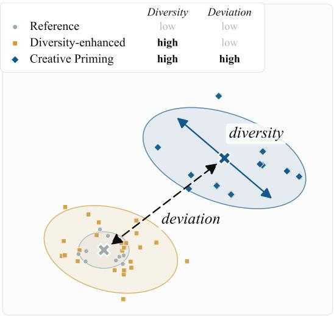  
Figure 2 Conceptual comparison of diversity (Eq. 2) and deviation (Eq. 6). The reference model responses cluster tightly while those of the diversityenhanced model spread about the same center (increasing diversity), whereas the creative priming responses also deviate from the reference, achieving diversity and deviation.

$$
C = { \frac { 1 } { G _ { \mathrm { r e s p } } } } \sum _ { k = 1 } ^ { G _ { \mathrm { r e s p } } } c _ { k } .\tag{8}
$$

We also experiment with training the creative priming model without deviation, as discussed in Section 3.3, in which case C reduces to a quality-only signal, given in Appendix A.2.

Intra-group diversity. $D _ { \mathrm { i n t r a } }$ , the mean pairwise cosine distance among the responses from a single creative primer $Y _ { C P } ^ { j , i }$ , rewards primers that lead to increased response diversity:

$$
D _ { \mathrm { i n t r a } } = \frac { 1 } { \binom { G _ { \mathrm { r e s p } } } { 2 } } \sum _ { k = 1 } ^ { G _ { \mathrm { r e s p } } } \sum _ { k ^ { \prime } = k + 1 } ^ { G _ { \mathrm { r e s p } } } \mathrm { d } \Bigl ( Y _ { \mathrm { r e s p } } ^ { j , i , k } , Y _ { \mathrm { r e s p } } ^ { j , i , k ^ { \prime } } \Bigr ) .\tag{9}
$$

Inter-group diversity. $D _ { \mathrm { i n t e r } } ,$ , the mean distance from $Y _ { C P } ^ { j , i }$ ’s responses to the responses of other primers to the same prompt $X ^ { j }$ , rewards primers that lead to responses which deviate from other primer’s responses:

$$
D _ { \mathrm { i n t e r } } = \frac { 1 } { \left( G _ { \mathrm { C P } } - 1 \right) G _ { \mathrm { r e s p } } ^ { 2 } } \sum _ { k = 1 } ^ { G _ { \mathrm { r e s p } } } \sum _ { i ^ { \prime } \ne i } ^ { G _ { \mathrm { r e s p } } } \sum _ { k ^ { \prime } = 1 } ^ { G _ { \mathrm { r e s p } } } \mathrm { d } \left( Y _ { \mathrm { r e s p } } ^ { j , i , k } , Y _ { \mathrm { r e s p } } ^ { j , i ^ { \prime } , k ^ { \prime } } \right) .\tag{10}
$$

## 3.2.2 Primer-level signals

The remaining three signals act on the primers directly and their main purpose is to regularize and diversify the primer model: they keep primers high-quality and specific to each prompt.

Creative primer judge $J _ { \mathrm { C P } }$ . An LLM-as-a-judge scores the primer $Y _ { \mathrm { C P } } ^ { j , i }$ on a set of five criteria $\mathcal { I } =$ specificity, thinking strategy, content focus, prompt faithfulness, focus , each in [0, 100]. The judge score is the mean of these criteria, but is set to zero if the primer refers to the response model in the third person rather than addressing it directly:

$$
J _ { \mathrm { C P } } = \mathbb { 1 } _ { \mathrm { d i r e c t } } \cdot \frac { 1 } { 1 0 0 \left| \mathcal { I } \right| } \sum _ { c \in \mathcal { I } } s _ { c } .\tag{11}
$$

The prompt template is included in Figure 16. We also experimented with a penalty-based rubric that instead subtracts weighted penalties for specific failure modes, defined and evaluated in Appendix B.

Creative primer intra-prompt diversity $D _ { \mathrm { i n t r a } } ^ { \mathrm { C P } }$ . This measure weighs diversity among the creative primers produced for the same prompt ${ \bar { X } } ^ { \hat { \jmath } } ,$ , encouraging diversity amongst the primers themselves. For primer $Y _ { C P } ^ { j , i }$

$$
D _ { \mathrm { i n t r a } } ^ { \mathrm { C P } } = \frac { 1 } { G _ { \mathrm { C P } } - 1 } \sum _ { i ^ { \prime } \neq i } { \mathrm { d } } \left( Y _ { \mathrm { C P } } ^ { j , i } , Y _ { \mathrm { C P } } ^ { j , i ^ { \prime } } \right) .\tag{12}
$$

Creative primer inter-prompt diversity $D _ { \mathrm { i n t e r } } ^ { \mathrm { C P } }$ . This measure of diversity is the mean distance between a creative primer generated for prompt $j , Y _ { C P } ^ { j , i } ,$ , and every primer generated for a different prompt $j ^ { \prime }$ in the batch of $\bar { B }$ prompts, which rewards the primer model for tailoring its primers to each prompt rather than reusing a single generic primer:

$$
D _ { \mathrm { i n t e r } } ^ { \mathrm { C P } } = \frac { 1 } { \left( B - 1 \right) G _ { \mathrm { C P } } } \sum _ { j ^ { \prime } \neq j } \sum _ { i ^ { \prime } = 1 } ^ { G _ { \mathrm { C P } } } \mathrm { d } \left( Y _ { \mathrm { C P } } ^ { j , i } , Y _ { \mathrm { C P } } ^ { j ^ { \prime } , i ^ { \prime } } \right) .\tag{13}
$$

## 3.3 Learning the Creative Process

Training only the primer model while keeping the response model frozen explicitly decouples learning the abstract creative procedure from producing responses, and is thereby crucial to avoiding the creative paradox. Typically, in diversity-enhancing RL, the response model is directly rewarded for producing specific outputs. However, because $\pi _ { \mathrm { { C P } } }$ is only rewarded for inducing better responses in a separate model, it is never directly rewarded for reproducing past outputs. It is therefore free to learn generative principles for creativity rather than to reinforce what already worked, which is how it escapes the creative paradox. Decoupling the creative procedure from generating responses also makes the method modular, such that a single trained $\pi _ { \mathrm { C P } }$ can potentially be trained on a small $\pi _ { \mathrm { r e s p } }$ but transferred to a larger, more capable model at inference time.

## 4 Experimental Setup

The aim of the experimental approach is to provide a multifaceted view of the potential advantages of creative priming relative to baselines and other creativity-enhancing methods through a number of measures and perspectives.

Models. In these experiments all creative priming models $\pi _ { \mathrm { { C P } } }$ and, unless otherwise noted, all response models $\pi _ { \mathrm { r e s p } }$ are Qwen3-8B (Team, 2025). Several targeted models calculate rewards during training: quality is scored by the Skywork-Reward-V2-Llama-3.1-8B reward model, diversity and deviation are calculated from embeddings of the Qwen3-Embedding-0.6B model, DARLING’s partition signal depends on a ModernBERT similarity classifier<sup>1</sup>, and the creative primer judge is Llama-3.3-70B-Instruct.

Training data. All methods are trained on a filtered subset of Infinite- $\mathrm { . C h a t s ^ { 2 } }$ (Jiang et al., 2025) (which is itself a subset of WildChat from Zhao et al., 2024). To create this subset, an LLM judge scores each prompt’s suitability along three axes: open-endedness, complexity, and creative potential. Each axis is rated on a 0–3 scale, and only prompts with a combined score $\geq 6$ are retained, yielding 21,075 prompts. Additionally, when training creative priming models, a pool of 32 customwritten creative primer prompt templates wrap the prompts before they are passed to the priming model. The reference set for calculating deviation consists of eight responses per prompt from the initial model checkpoint.

Evaluation data. The evaluation dataset is NoveltyBench (Zhang et al., 2025), which includes 100 real-world open-ended prompts intended to elicit creativity. To measure quality, the original dataset is extended so that each prompt comes with an LLM judge prompt with two families of components: six universal components fixed across all prompts (instruction-following, coherence, completeness, conciseness, clarity, and surprise), and an additional 1–3 prompt-specific components generated by claude- $\mathsf { o p u s - 4 - 2 0 2 5 0 5 1 4 }$ . For example, “Tell me a story in five sentences about a girl and her dog” has 2 prompt-specific components: emotional resonance and narrative economy. The judge prompt template is in Figure 17 in Appendix K. The evaluation set, including the judge prompts, is available on the HuggingFace Hub.<sup>3</sup> Evaluation uses the creative primer prompt template in Figure 14 in Appendix K.

Baselines. Four baselines provide comparisons to creative priming: (1) direct generation from the initial Qwen3-8B checkpoint; (2) an untrained creative priming model; (3) Diversified GRPO (DGRPO), which trains the response model directly with a multiplicative quality  intra-group cosine-distance diversity reward; and (4) DARLING (Li et al., 2025), which replaces the embedding diversity with a partition-based diversity signal. Because deviation is a direct component of creativity metrics, in addition to their original formulations, we train both DGRPO and DARLING with and without an added deviation reward to isolate its effect.

Training hyperparameters. When training models, the group sizes are $G _ { \mathrm { C P } } = 8$ primers per prompt and $G = 8$ responses per prompt for DGRPO and DARLING, so that each policy’s grouprelative advantage is estimated on the same number of on-policy samples per prompt. Additionally, to estimate rewards for each primer, $G _ { \mathrm { r e s p } } = 8$ responses are generated per primer (and their scores averaged as described in Section 3.2). CP and DGRPO train for two epochs with a batch size of 256, a learning rate of $1 \times 1 0 ^ { - 6 }$ , temperature 1.0 with top-p 0.9, the quality gate is at threshold $T = - 5 . 0 ,$ and sigmoid temperature $\tau = 1 . 0$ . The DARLING model is trained with the same hyperparameters from the original paper, including training for ten epochs (Li et al., 2025). In effect, to be faithful to its original setup, DARLING receives 5 times more epochs than CP or DGRPO.

Evaluation hyperparameters. To evaluate the baselines and CP models, n = 64 completions are generated per prompt with temperature 1.0, top-p 1.0, and a maximum of 4,096 generated tokens. Qwen3’s thinking mode is left enabled and the thinking span is stripped before scoring, so that every metric is computed on the answers alone. For CP methods, 1 response is generated per primer, meaning that 64 primers are generated, each separately used as input for 1 response.

Evaluation metrics. This evaluation reports five atomic metrics, each isolating a single characteristic of a method, before combining them into compound measures of system-level creativity.

Quality and deviation are the two axes along which an individual response is measured for creativity, whereas diversity, Vendi score, and distinct clusters measure the spread of a response set. Quality is scored by Qwen3-235B-A22B-Instruct-2507 using the prompt-specific judge template shown in Figure 17 in Appendix K. Deviation is the distance to the closest of 64 direct-generation reference responses. That is, the mean operator from training (Eq. 6) is replaced with a minimum operator so that during evaluation the worst-case nearest neighbor distance is measured. Diversity is the mean pairwise cosine distance within a response set (Eq. 9). Vendi score is an information-theoretic measure of the number of distinct responses in a set (Friedman & Dieng, 2023). Distinct clusters counts the semantic-equivalence clusters in a set, following NoveltyBench (Zhang et al., 2025), using the partition model at yimingzhang/deberta-v3-large-generation-similarity. Deviation, diversity, and Vendi score use embeddings from jinaai/jina-embeddings-v5-text-small, deliberately different than the embedding model from training to avoid overfitting to a specific model.

Whereas each atomic metric isolates one characteristic, the compound metrics combine them to capture system-level creativity, i.e. the ability to reliably produce a variety of individually creative responses. Each compound metric therefore first discards non-creative responses (responses failing a quality or deviation threshold) and then measures the spread of the survivors using filtered Vendi score and filtered distinct clusters, so that spread is credited only among responses already deemed creative. However, the optimal threshold varies based on the application, so we additionally sweep the thresholds across their full range. Sweeping the deviation (or quality) threshold and integrating over that sweep yields an area under the curve (AUC-dev or AUC-qual) that summarizes the method’s filtered Vendi score or distinct clusters across all thresholds. A comprehensive system-level creativity metric can accordingly be formulated through computing the volume under the deviation quality surface (VUS) by jointly sweeping thresholds over both metrics. Default thresholds and further metric details are detailed in Appendix C.

<table><tr><td></td><td colspan="5">Atomic metrics</td><td colspan="8">Compound metrics</td></tr><tr><td rowspan="2">Method</td><td rowspan="2">Response Diversity</td><td rowspan="2">Quality</td><td rowspan="2">Deviation</td><td rowspan="2">Vendi Score</td><td rowspan="2">Distinct Clusters</td><td colspan="2">Filtered</td><td colspan="2">AUC-dev</td><td colspan="2">AUC-qual</td><td colspan="2">VUS</td></tr><tr><td>Vendi</td><td>Distinct</td><td>Vendi</td><td>Dist.</td><td>Vendi</td><td>Dist.</td><td>Vendi</td><td>Dist.</td></tr><tr><td>Qwen3-8b (Reference)</td><td> $1 2 . 3 \pm 1 . 6$ </td><td> $9 0 . 5 \pm 1 . 4$ </td><td></td><td> $2 . 1 2 \pm 0 . 1 9$ </td><td> $1 8 . 1 \pm 3 . 4$ </td><td></td><td></td><td></td><td></td><td>=</td><td>=</td><td>=</td><td></td></tr><tr><td>CP (Untrained)</td><td> ${ \bf 2 0 . 6 \pm 1 . 8 }$ </td><td> ${ \bf 9 1 . 7 \pm 1 . 1 }$ </td><td> ${ \bf 1 3 . 1 \pm 1 . 3 }$ </td><td> ${ \bf 3 . 1 0 \pm 0 . 2 8 }$ </td><td> ${ \bf 2 0 . 0 \pm 3 . 1 }$ </td><td> ${ \bf 1 . 4 8 \pm 0 . 3 5 }$ </td><td> ${ \bf 4 . 5 3 \pm 1 . 6 7 }$ </td><td>0.60</td><td>2.31</td><td>182.6</td><td>602.6</td><td>69.3</td><td>294.9</td></tr><tr><td>DGRPO</td><td> $2 6 . 0 \pm 1 . 8$ </td><td> $8 7 . 5 \pm 1 . 4$ </td><td> $1 4 . 1 \pm 1 . 2$ </td><td> $4 . 3 6 \pm 0 . 3 8$ </td><td> $3 7 . 1 \pm 3 . 6$ </td><td> $2 . 1 8 \pm 0 . 4 3$ </td><td> $6 . 0 2 \pm 1 . 6 1$ </td><td>0.819</td><td>3.10</td><td>297.5</td><td>1010.7</td><td>107.5</td><td>509.5</td></tr><tr><td>DARLING</td><td> $1 1 . 7 \pm 1 . 1$ </td><td> ${ \bf 9 3 . 6 \pm 1 . 2 }$ </td><td> $1 0 . 1 \pm 0 . 8$ </td><td> $2 . 1 7 \pm 0 . 1 6$ </td><td> $2 0 . 5 \pm 3 . 3$ </td><td> $0 . 5 7 \pm 0 . 2 3$ </td><td> $1 . 7 6 \pm 1 . 0 6$ </td><td>0.345</td><td>2.23</td><td>55.8</td><td>172.3</td><td>34.1</td><td>221.0</td></tr><tr><td>CP</td><td> $3 1 . 2 \pm 1 . 6$ </td><td> $8 8 . 2 \pm 1 . 6 $ </td><td> $2 1 . 2 \pm 1 . 3$ </td><td> ${ \pm . 3 9 \pm 0 . 3 8 }$ </td><td> ${ \bf 3 9 . 5 \pm 3 . 3 }$ </td><td> $\mathbf { 4 . 0 4 \pm 0 . 4 6 }$ </td><td> ${ \bf 1 6 . 1 \pm 2 . 6 5 }$ </td><td>1.404</td><td>6.10</td><td>463.6</td><td>2095.9</td><td>160.0</td><td>789.0</td></tr><tr><td>DGRPO</td><td> ${ \bf 3 4 . 0 \pm 1 . 6 }$ </td><td> $7 7 . 3 \pm 2 . 9$ </td><td> ${ \pm 5 . 6 \pm 1 . 6 }$ </td><td> $5 . 9 8 \pm 0 . 4 7$ </td><td> $3 3 . 4 \pm 3 . 2$ </td><td> $2 . 8 5 \pm 0 . 4 6$ </td><td> $7 . 5 9 \pm 1 . 7 7$ </td><td>1.015</td><td>2.78</td><td>448.1</td><td>1779.4</td><td>168.8</td><td>658.0</td></tr><tr><td>+Dition</td><td>DARLING  $1 8 . 0 \pm 1 . 1$ </td><td> ${ \bf 8 8 . 4 \pm 1 . 8 }$ </td><td> $2 4 . 7 \pm 1 . 0$ </td><td> $3 . 0 2 \pm 0 . 1 8$ </td><td> $2 8 . 1 \pm 3 . 5$ </td><td> $2 . 6 0 \pm 0 . 2 4$ </td><td> $1 6 . 4 \pm 2 . 8 0$ </td><td>0.835</td><td>5.24</td><td>272.8</td><td>2022.3</td><td>88.0</td><td>639.0</td></tr><tr><td>CP</td><td> $3 3 . 4 \pm 1 . 3$ </td><td> $8 5 . 7 \pm 1 . 9$ </td><td> $2 5 . 0 \pm 1 . 2$ </td><td> ${ \bf 6 . 1 2 \pm 0 . 3 6 }$ </td><td> ${ \bf 4 5 . 3 \pm 3 . 1 }$ </td><td> $\mathbf { 4 . 7 0 \pm 0 . 4 3 }$ </td><td> $2 2 . 8 \pm 3 . 0 5$ </td><td>1.641</td><td>7.85</td><td>525.0</td><td>2885.3</td><td>186.5</td><td>1003.2</td></tr></table>

Table 1 Evaluation on NoveltyBench. Metrics are defined in Section 4. Row blocks correspond to untrained methods (top rows), training without deviation (middle), and training with deviation (bottom). Cells include 95% confidence intervals where available, and the best value per column within each block is bolded. Deviation-derived metrics for the Qwen3-8B reference are 0 by construction and shown as “-”. This table shows that for the atomic metrics, every trained method trades one property for another (DGRPO gains diversity but loses quality; DARLING does the opposite). However, the atomic metrics do not measure creativity; the compound metrics do, by filtering for responses that are simultaneously deviating and high-quality and then measuring their spread, and CP dominates on compound measures of system creativity. Furthermore, CP without a deviation reward already matches or beats baselines trained with deviation, demonstrating the importance of the priming process itself in creativity.

Scaling experiment. In addition to the primary experimental settings above, a further evaluation of the creative paradox is performed by scaling the number of on-policy training samples in DGRPO: if directly reinforcing successful responses limits creativity, then reinforcing more responses should not continually improve system-level creativity. Accordingly, in this experiment DGRPO (with divergence) is trained with group sizes $G \in \{ 8 , 1 6 , 3 2 , 6 4 \}$ . At the lower endpoint, $G = 8 ,$ DGRPO matches CP’s eight on-policy primers per prompt, as in the primary setup. However, the reward of each primer for CP is estimated by averaging across eight responses, so at $G = 6 4$ DGRPO instead matches the total number of responses per prompt for CP, but gets the advantage of eight times more on-policy samples. The scaling study focuses on DGRPO because DARLING already trains for five times more epochs than CP and DGRPO.

## 5 Findings & Analysis

The main results in Table 1 are split among untrained methods (top rows), methods trained without a deviation term (middle rows), and methods trained with deviation (bottom rows). Results on atomic metrics are on the left and compound metrics, which aggregate the atomic metrics in various ways, are on the right. For presentation purposes only, we represent diversity and deviation as scores out of 100. Figure 3 shows one qualitative example output for each method, including the primer that CP produced, with further examples in Appendix G.

Performance at first glance. The atomic metrics suggest that every method trades one property for another, differing only in how steep the tradeoff is. For example, within the models trained for quality and diversity (middle rows), DGRPO improves diversity (26), Vendi score (4.36), and distinct clusters (37.1) over the reference, at a slight cost to quality (90.5 87.5). DARLING makes the opposite trade, achieving the highest quality of any method (93.6) while its diversity (11.7) falls slightly below the reference (12.3), and its Vendi score and distinct clusters barely move “Imagine you are a time traveler who has just arrived in a new era. Describe the first thing you notice.”

Reference. Quality = 98 Deviation = 0 The first thing I notice is the sky—a canvas of swirling, iridescent hues that shift like liquid opal, refracting the light of a sun that seems both familiar and alien. Above, a lattice of floating platforms and translucent tubes hums with latent energy, their surfaces shimmering with data streams that pulse like veins. The air thrums with a low, resonant frequency, a symphony of unseen engines and electromagnetic fields. Beneath my feet, the ground is a mosaic of smooth, adaptive material that molds slightly to my weight, as if the very earth is alive and aware. The scent of ozone tangles with something sweeter—burnt sugar and synthetic blooms—while the faint buzz of drones and the chatter of a language I don’t recognize fill the air. It’s a world where technology and nature have fused into something neither wholly artificial nor entirely organic.

Quality = 93 Deviation = 24.1

Neon veils the sky, ads flicker in reverse on mirrored walkways—your reflection becomes a sale.

Quality = 98 Deviation = 28.5

A lattice of light not above but around—veins in tree canopies, coral-like sensors spiraling up bamboo, not wires. Not decoration. Each pulse answered a question: what’s thriving here? Three specifics crystallized immediately, each deeper than most tech updates:

1. Priority of context, not speed (most startling). No red lights screaming clearance. A mother in woven indigo guided a toddler through a sensor field monitoring fungal spores in a forest corridor. “Too close to nutmeg bloom,” she warned. The field adjusted path width before they reached it. No shortcut, no danger alert—decision trees rooted in ecology, calculated why as fiercely as how. I’d seen adaptive systems, but ethics embedded upstream?

2. Data form Not screens, not abstract graphs. On a elder’s forearm, bioluminescent glyphs flowed—not static report, but a negotiation: “salmon migration 37% delayed due to turbidity from beaver dams; three upstream weirs could divert 12% without erosion, but 97% of spawning beds would.” It had judgment. No dashboard; a conversation with consequences shaped by local knowledge.

3. Most critical: cost estimates weren’t cost-benefit ratios. A group restoring landslide-scoured hills used a tablet showing three branches.

• “Replant fast: 40% survival, flood damage 3x next year”

• “Use mycorrhizae: slower, 75% survival, but soil structure builds over five years. Future farms won’t erode.”

• “Combine: seedlings + fungi. Say 3.8 years to full maturity. 2.3x long-term value.”

[...continues for 5 more lines...]

CP primer. Focus on a single object or material that shouldn’t exist in this era based on your knowledge of prior history. Ask: what interaction between old and new tech or materials would create a paradoxica artifact? (E.g., “I see a hand-carved wooden tablet glowing with blue light—how did this technology survive without electricity?”) Let your background knowledge create a specific, concrete contradiction, not vague “advanced” descriptions. The shock of the unfamiliar must stem from your specific expertise, not generic futurism.

Quality = 100 Deviation = 27.6

The first thing I notice is a hand-carved obsidian tablet, its surface etched with delicate hieroglyphs, but embedded within the cracks are faintly pulsing strands of iridescent metal—strands that shouldn’t exist in this era. Obsidian, a volcanic glass, is brittle and prone to fracturing, yet these strands are unbroken, their metallic sheen reflecting light in ways that defy the materials known to this civilization. How did a metallurgical process capable of creating such resilient, light-conducting alloys emerge without the knowledge of chemistry or industrial smelting? The tablet’s craftsmanship suggests an ancient society, yet its anomalous composition defies the technological timeline I know. This paradoxical artifact—artisanship meeting alien metallurgy—shatters my understanding of its era’s capabilities.

Figure 3 Qualitative examples. Representative responses to an open-ended prompt (more cherry- and lemon-picked examples in Appendix G). To get a qualitative understanding of creativity, each label reports the response’s judge quality score and its deviation from the reference model (as described in Section 4). In this example, the reference model paints an evocative scene in flowing prose; DGRPO answers in one terse line; DARLING returns a highly-formatted, bulleted analysis; and CP answers in the reference model’s style while inventing a novel, concrete image, illustrating that its deviation lies in what it says rather than in surface formatting. These characteristics are consistent across all prompts (DGRPO’s terseness and DARLING’s length and use of formatting), as analyzed in Appendix F.

(2.17 and 20.5). CP makes the same tradeoff, but on more favorable terms, losing only a little quality (90.5 88.2) in return for the highest diversity (31.2), deviation (21.2), Vendi score (5.39), and distinct clusters (39.5) of any method not trained with deviation.

Adding deviation to the reward signal increases the deviation score for all three trained methods, but they respond very differently. DGRPO improves significantly in diversity $( 2 6  3 4 )$ , but the quality $( 8 7 . 5  7 7 . 3 )$ and number of distinct clusters decrease $( \dot { 3 } 7 . 1  3 3 . \dot { 4 } )$ . DARLING also enjoys significant improvement in diversity (11.7  18) and the number of distinct clusters $( 2 0 . 5  2 8 . 1 )$ but drops some quality $( 9 3 . 6  8 \dot { 8 } . 4 )$ . CP also loses quality $( 8 8 . 2  8 5 . 7 )$ , but with less tradeoff than DGRPO and DARLING, in return for the most distinct clusters of any method (45.3), while holding diversity and deviation high.

The creative paradox, measured. The atomic metrics from above, however, do not tell us whether an individual response is creative (simultaneously deviating and high-quality), nor whether a system is creative (generates a large spread of creative responses). The compound metrics directly capture the joint demands of creativity by filtering out individual responses that are not creative and then measuring the spread of the remaining responses, which is where the difference between CP and the baseline approaches becomes evident.

Among the methods trained without deviation, DARLING has high-quality but low-diversity responses, so its filtered Vendi (0.57) and filtered distinct clusters (1.76) are the lowest in the block. DGRPO is the opposite, producing almost as many distinct clusters as CP (37.1 and 39.5); however, most responses fall below the quality or deviation threshold and are filtered out, dropping its filtered distinct clusters to just 6.02. Compared to the baselines, CP leads to better performance on both filtered metrics (4.04 filtered Vendi and 16.1 filtered distinct clusters) and on metrics that sweep across all threshold values (AUC-dev, AUC-qual, and VUS in Table 1). None of these results mean that the baselines are failing: each performs well on its intended objective, but neither achieve the simultaneous deviation, quality, and diversity expected of a creative system.

Deviation is a core ingredient of what makes a response, and thus a system, creative. However, even when the baselines are trained with an explicit deviation reward, they do not outperform a CP model trained without deviation on the compound metrics. On filtered Vendi, CP without deviation (4.04) already exceeds both DGRPO (2.85) and DARLING (2.6) trained with deviation. Filtered distinct clusters tell the same story: CP without deviation (16.1) stays well ahead of DGRPO (7.59) and draws even with DARLING (16.4), the strongest baseline. That CP does so even without explicitly optimizating for deviation suggests that optimizing for the individual components of creativity only goes so far, and that learning the creative process does more to drive creativity (Section 3.3).

One might expect that direct generation methods should improve on metrics of creativity when trained with a larger group size, as more on-policy samples give a model more opportunities to explore and to reinforce high-reward responses. However, interestingly, scaling the number of onpolicy samples for DGRPO trained with deviation does not allow it to escape the tradeoff observed above (DGRPO is evaluated here instead of DARLING because it performs better on a majority of compound metrics while training for 5 times fewer epochs). Compared to the reference model, at $G = 8$ , DGRPO already gains diversity and deviation at the cost of quality, and Figure 4a shows that increasing group sizes to $G \in \{ 1 6 , 3 2 , 6 4 \}$ does not resolve the tradeoffs, but can actually further exaggerate them. As G increases, deviation is the only metric that rises consistently, increasing from 25.6 to 33.5. Diversity and Vendi score decline steadily, while quality and distinct clusters fluctuate before reaching their lowest values at $G = 6 4 ( 6 9 . 1 $ and 24.5, respectively).

The compound metrics reveal the consequences of this tradeoff (Figure 4b, with full results in Appendix H), where at $G = 3 2$ , empirically the best group size, DGRPO still has worse performance than CP on every compound metric. At best, DGRPO with G = 32 achieves 93.4% of the VUS-Vendi that CP achieves, and at worst, only 65.2% of the AUC-dev distinct clusters. Ultimately, at $G = 6 4$ every metric of system creativity decreases from the peak. Even though scaling up to $G = 6 4$ gives DGRPO a compute advantage versus lower values of G, that additional compute neither closes the gap nor produces continual improvements in creativity, providing intriguing further evidence for the creative paradox: directly reinforcing successful responses can improve creativity only up to a point, after which reinforcing more responses begins to undermine system-level creativity.

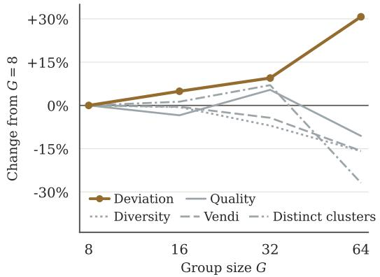  
(a) Atomic Metrics

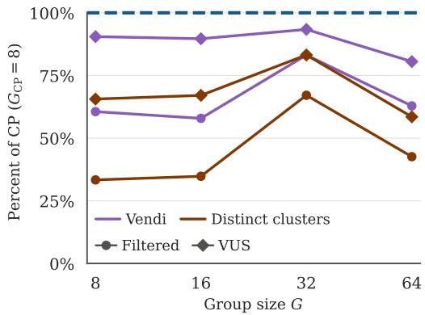  
(b) Compound Metrics  
Figure 4 Scaling group size does not escape the creative paradox. DGRPO is trained with $G \in$ {8, 16, 32, 64} on-policy samples per prompt and evaluated on NoveltyBench. (a) Each of the five atomic metrics is shown as a percent change from DGRPO with $G = 8$ , with deviation highlighted in copper. (b) Four compound metrics of creativity are shown as a percentage of CP performance, where line color represents the measure of spread (Vendi score or distinct clusters) and marker shape represents the filtering and aggregation method (Filtered or VUS). These results demonstrate that additional on-policy samples consistently improve deviation, but all other atomic metrics ultimately decline at $G = 6 4$ . System-level measures of creativity (compound metrics) peak at $G = 3 2$ , but even then fall below the performance of CP, and decline significantly at $G = 6 4$ . Full results are in Table 7 in Appendix H.

Decomposing the Creative Priming advantage. To disentangle the contributions of the priming process, RL training, and the deviation reward, we compare three CP variants. If Qwen3-8B serves as the creative primer without any additional RL (the untrained CP row), diversity already increases from 12.3 to 20.6 over direct generation while judged quality stays flat (91.7 versus 90.5). However, the CP model trained with quality and diversity still dominates the untrained variant on nearly every metric (with a minor decrease in quality). Further including the deviation reward improves the creativity metrics still further, at an additional small cost to quality. This analysis shows that the creative priming process is valuable on its own, but RL training delivers significant additional gains; the process supplies a mechanism by which creativity can emerge, and training teaches the model to optimize that mechanism.

The learned creative process transfers to frontier models. The creative priming model is only trained with a Qwen3-8B response model, so it is natural to consider that it may overfit to that model. We test whether the learned creative process transfers by pairing trained CP models with four unseen response models (Claude Sonnet-4.6, Claude Opus-4.8, GPT-5-nano, and GPT-5.4), evaluating each against its own direct-generation reference. Across all four API models, CP increases diversity by 2.5–4.6 and distinct clusters by 4.5–10 while maintaining or improving quality (Figure 5). For example, with Sonnet-4.6, distinct clusters increase from 2.8 to 28.5 and diversity from 5.3 to 24.6, while quality also increases from 90.2 to 94.3. In this way, the evidence suggests that the learned process effectively improves the atomic metrics of response models unseen during training.

We next evaluate whether the learned process also elicits an increase in system-level creativity metrics from each API model. Because each response model is evaluated against its own directgeneration reference, the compound metrics are model-relative: they measure whether CP leads to varied responses that depart from what that model typically generates while meeting its own quality threshold. Accordingly, these creativity scores cannot be directly compared across response models. Table 4 in Appendix D shows that the deviation-trained CP model achieves filtered Vendi scores ranging from 3.26–4.71 and filtered distinct scores of 10.4–21.9 across the four API models. For context, CP paired with Qwen3-8B achieves a filtered Vendi score of 4.70 and a filtered distinct score of 22.8, falling within a similar range as the API models. For the API models, VUS Vendi ranges from 112.8–177.7, and VUS distinct clusters are 395.3–822.7. Notably, while creative priming elicits the highest creativity scores when paired with GPT-5.4 and GPT-5-nano, it achieves the lowest creativity scores when paired with Opus-4.8. This is possibly due to Opus-4.8 having the highest quality scores from its direct response baseline (91.7), combined with the lowest deviation scores from the CP model (17.1). Table 4 in Appendix D reports the complete results.

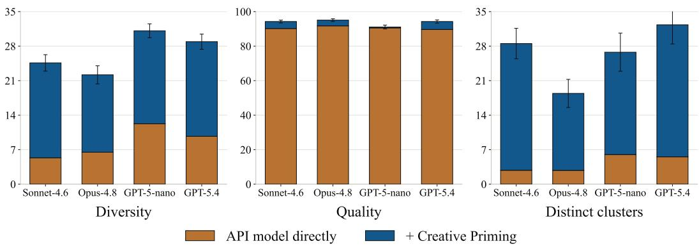  
Figure 5 Creative priming transfers to API response models. Each panel reports one evaluation metric for four API models, comparing direct generation (copper) with the addition of the creative priming model (blue; trained with deviation). Error bars give 95% confidence intervals on the total. Results are reported in full in Table 4 in Appendix C. This figure shows that the same CP model trained to improve creativity on a Qwen3-8B response model leads to significantly increased diversity and distinct clusters when using an API response model, while maintaining or improving quality.

Modularity in the creative priming pipeline. The previous experiment varies the response model, but the creative priming pipeline also permits varying the creative priming model. We evaluate filtered Vendi scores across the full cross-product of creative priming model response model pairs, drawing both roles from the deviation-trained baselines, a trained CP model, and an untrained Qwen3-8B prompted as a primer (Figure 6). The main result of this analysis is that the priming pipeline itself improves every response model over direct generation. Specifically, the trained CP model is the best primer of the group, giving the three highest-scoring cells of the grid (4.153–4.991). However, even DGRPO and DARLING work well as primers: used to prime the initial Qwen3-8B (top row of Figure 6), they reach 2.792 and 3.22, well above the untrained primer (1.480), despite never being trained to prime another model.

The quality-deviation frontier. Given that models exhibit an inherent trade-off between quality and deviation, it is interesting to measure the Pareto-frontier share of each method on the qualitydeviation frontier, a measure of how well a method handles that trade-off. To capture this trade-off, each response is plotted on a quality-deviation chart (separately for each evaluation prompt) with the Pareto frontier (the non-dominated responses) highlighted, and the percent of the frontier composed of each method’s responses is then calculated. Figure 7 shows an example of this approach for one prompt. Finally, the scores are averaged across all prompts, measuring how often each method produces responses that dominate the competitors on quality and deviation jointly. Because each frontier is relative to the pool of competing methods, we compute the share within each pool (with and without deviation), where it sums to 100%. Table 2 reports these shares.

CP claims the majority of the frontier both with and without deviation, and by a wide margin without deviation (72.6%). This trend holds even where CP tops neither raw quality or deviation: among the deviation-trained methods it leads neither deviation nor quality alone, yet it still contributes the largest share of jointly non-dominated responses (45.3%).

A consistent picture. Where the baselines re-tread the creative paradox by training on their own past successes, CP is built to escape it—and the results bear this out, with CP substantially outperforming the baselines as a creative system. This trend holds regardless of how we look: the filtered compound metrics, the threshold-free sweeps, transfer across frozen response models, and variation of the primer model itself all tell the same story. We turn next to the broader implications of these results.

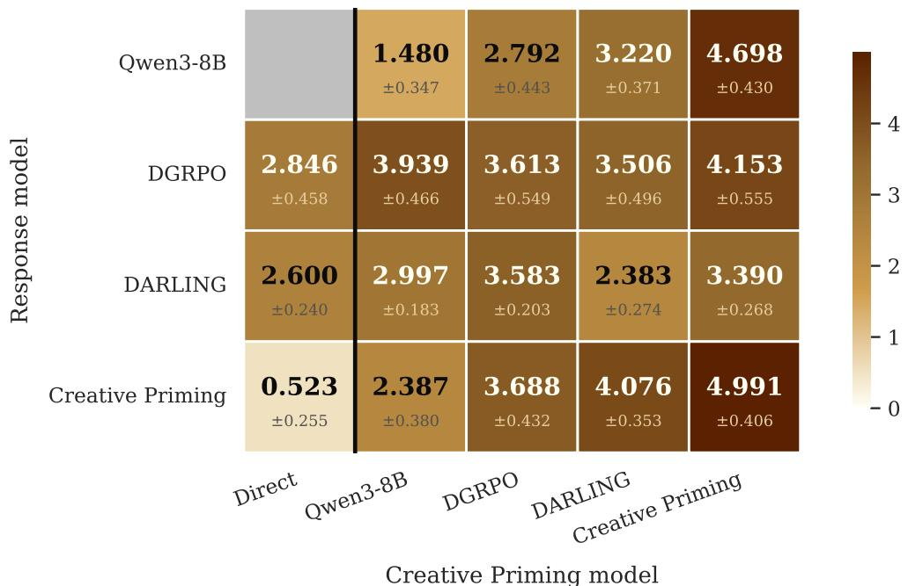  
Figure 6 Model combinations for the creative priming pipeline. Each cell reports filtered Vendi score (Qwen3-8B direct has 0 deviation from itself). The farthest left column shows scores when using the model listed on the y-axis as the response model (i.e. without CP). The remaining columns represent scores when using the model listed along the x-axis as the CP model and the model listed along the y-axis as the response model. These results show that, compared to direct response generation, the CP pipeline itself improves creativity, even when using CP models not explicitly trained for priming (i.e. DGRPO and DARLING).

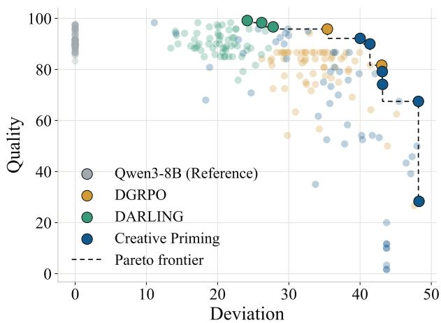  
Figure 7 The quality-deviation Pareto frontier of models trained with deviation for the prompt: “Suggest another strong 4 character password.” In this particular example CP populates the high-deviation region, while DARLING populates the high quality region, and DGRPO sits in between.

<table><tr><td>Method</td><td>Without Deviation</td><td>With Deviation</td></tr><tr><td>Qwen3-8b (Ref.)</td><td>0.2</td><td>0.0</td></tr><tr><td>DGRPO</td><td>19.1</td><td>32.2</td></tr><tr><td>DARLING</td><td>8.1</td><td>22.5</td></tr><tr><td>CP</td><td>72.6</td><td>45.3</td></tr></table>

Table 2 Share of the quality-deviation Pareto frontier (%), averaged over all prompts, and calculated separately per column. The best value per column is bolded. CP claims the largest share of the frontier both with and without deviation.

## 6 Discussion

A major implication of the creative paradox, along with the effectiveness of creative priming, is that the “normal way” of thinking about machine learning may not ultimately work as well for creativity. In the normal framing, a model learns from examples of good behavior and gradually improves at reproducing such behavior. Creativity upends this intuitive notion by offering a case where you actually do not want future behavior to resemble past behavior. Or, to be more nuanced about the precise challenge: there is one sense in which we definitively do not want the output to resemble the training while there is another sense in which we do. On the one hand, the products of creative generation themselves should diverge from their precedent in training, while on the other hand the process behind those generations should follow shared principles. The problem is that the underlying process is generally not in the training data and, even if it were, it would need to be separated from the products it led to. The creative paradox emerges from this delicate conflict.

The main hypothesis behind creative priming is therefore that creativity does not live in individual input/output pairs but in the process that generates them. Four results support this view:

1. Table 1 shows that even a deviation-less CP model improves on compound creativity metrics compared to baselines that are explicitly trained to deviate from past responses;

2. Figure 4 shows that increasing training compute for direct generation hits a peak performance which, by all measures of system creativity, is worse than CP;

3. Figure 5 shows that the creative process learned by the priming model on a small opensource response model transfers to frontier API response models, leading to a 4.5-10 increase in the number of distinct responses and a 2.5-4.6 increase in response diversity; and

4. Figure 6 shows that the priming process itself improves response models even when the model generating the primer was not trained for priming.

All these results point to a learned procedure that need not reinforce any particular output and does not depend critically upon any particular response model. Avoiding the creative paradox thus requires learning the generative principle behind creative successes rather than learning to reproduce those same successes reliably.

A key facet of creative priming is decoupling priming from response generation. How critical is such a decoupling? When a response model is optimized directly, the components of creativity trade off against one another: DGRPO increases diversity and deviation by sacrificing quality, while DARLING protects quality at the expense of diversity. Furthermore, additional compute does not break this trade-off for DGRPO: deviation consistently improves with increasing group sizes, but the other atomic metrics ultimately decline, leading to a creativity ceiling that scale does not fix. Decoupling the priming from the response softens this trade-off. The response model keeps doing exactly what it is trained for, producing the highest-quality answer, while the primer supplies the shift toward diverse regions of the output distribution, so neither objective is compromised for the other. This division of labor is how the primer ultimately learns creative principles rather than to reproduce high-quality answers itself.

Additional evidence to support decoupling relates to style versus substance. If a method genuinely increases creativity, it should change the content of the responses more than the surface-level style. While experiments in Appendix F show that all three methods change style relative to the reference, CP drifts least from the reference response model’s style, exhibiting the lowest function-word JSdivergence of the three (0.045, where lower means closer to matching the reference’s style, compared with DGRPO’s 0.087 and DARLING’s 0.138). Decoupling predicts precisely such consistency. The primer steers content, whereas training the response model directly entangles the content changes with a larger stylistic shift. Figure 3 shows a qualitative example of the style differences.

A natural question is whether a single model could internalize the creative priming process and use it within its chain-of-thought. The obstacle to this more straightforward approach is that models are trained toward the highest-quality response. As a result, it is unlikely that one model captures the full distribution of high quality outputs with enough likelihood to also be reliably diverse. That limitation is exactly what the primer exploits. Modifying the response model’s prompt pushes it into a different region of the input distribution and elicits a shifted output distribution, so the primer is a learned, external way to induce the shift rather than asking one model to be simultaneously qualitymaximizing and distribution-covering. Nevertheless, in principle perhaps there is a way for a single model to write the primer for itself and then respond to it, so long as priming stays a separate stage. Folding creative priming into a single model is an interesting direction for future investigation.

An intriguing benefit of the separated primer in this paper is that it is modular and can be trained once and reused, i.e. swapped across response models or even moved to a new domain by pairing it with a domain-specific response model. Furthermore, priming can be combined with most test-time diversity-enhancing methods, including sequential sampling (Kang & Zhang, 2025), String Seed of Thought (Misaki & Akiba, 2026), vector policy optimization (Bahlous-Boldi et al., 2026), verbalized sampling (Zhang et al., 2026) as shown in Appendix E, or, as shown in Figure 6, a diversity-trained response model.

In Section 2.1, a response was defined as being creative when it “simultaneously deviates from the reference set and is high-quality” and a system was defined as creative “when the system reliably produces responses that are individually creative and are also varied amongst themselves.” An important consequence of these definitions is obvious in hindsight: the moment a model produces an idea, it is, by definition, no longer new to that model. Novelty is spent in the very act ofits creation. Creativity is thus not a fixed property of any single output, but an ongoing process of repeatedly generating original, high-quality ideas. In this work, the reference set from the response model was frozen prior to training, enabling a comparable computation of deviation for all methods. Looking ahead, there is room for a richer, and more complex, measurement that allows for a non-stationary reference set. By computing deviation against the full history of a model’s outputs, the temporal dimension of creativity can be directly captured: instead of a snapshot of creativity at one instant, a system can be evaluated for the ability to sustain novelty against its own growing past history. However, such a measurement makes comparisons more complicated because each system, even for two runs of the same method, will accumulate their own distinct reference sets.

Limitations. One obvious downside of the creative priming pipeline is that two-stage generation adds additional inference cost over direct generation. Additionally, the priming pipeline is bounded by the frozen response model: it can only elicit what the response model is already capable of producing and lacks any means to add knowledge or skill that the response model does not already have. Finally, the training and evaluation setup in this work depend on imperfect signals from which the method will inherit failure modes. For example, embedding-based diversity and deviation metrics may miss forms of creative variation, while LLM judges and reward models give imperfect quality signals. That said, better signals should directly improve the learned primer, so the outcomes can in principle improve along with its supporting technology.

## 7 Conclusion

This work identifies the creative paradox, the tension that training on past creative successes teaches a model to reproduce them, while true creativity demands moving beyond previous outputs. The proposed solution to get around the paradox is creative priming. Compared to directly training the response model, CP produces more responses that are simultaneously novel, high-quality, and semantically distinct. The deeper lesson is that if creativity is a process rather than an output, then optimizing the creative process itself, learning to generate better primers rather than better answers, is really where the discourse on optimizing for creativity should focus. We hope this work wil inspire more discussion and investigation in this spirit.

## References

Sam Altman. The intelligence age. https://ia.samaltman.com/, September 2024. Published September 23, 2024. Accessed: 2026-08-05.

Dario Amodei. Machines of loving grace: How ai could transform the world for the better. https://darioamodei.com/essay/machines-of-loving-grace, October 2024. Accessed: 2026-08-05.

Antonis Antoniades, Deepak Nathani, Ritam Saha, Alfonso Amayuelas, Ivan Bercovich, Zhaotian Weng, Vignesh Baskaran, Kunal Bhatia, and William Yang Wang. Heuresis: Search strategies for autonomous ai research agents across quality, diversity and novelty, 2026. URL https: //arxiv.org/abs/2606.25198.

Rahul K. Arora, Jason Wei, Rebecca Soskin Hicks, Preston Bowman, Joaquin Quinonero-Candela,˜ Foivos Tsimpourlas, Michael Sharman, Meghan Shah, Andrea Vallone, Alex Beutel, Johannes Heidecke, and Karan Singhal. Healthbench: Evaluating large language models towards improved human health, 2025. URL https://arxiv.org/abs/2505.08775.

Ryan Bahlous-Boldi, Isha Puri, Idan Shenfeld, Akarsh Kumar, Mehul Damani, Sebastian Risi, Omar Khattab, Zhang-Wei Hong, and Pulkit Agrawal. Vector policy optimization: Training for diversity improves test-time search, 2026. URL https://arxiv.org/abs/2605.22817.

Benjamin Baird, Jonathan Smallwood, Michael D Mrazek, Julia WY Kam, Michael S Franklin, and Jonathan W Schooler. Inspired by distraction: Mind wandering facilitates creative incubation. Psychological science, 23(10):1117–1122, 2012.

Honglin Bao, Siyang Wu, Xiao Liu, Sida Li, Shiyun Cao, and James A. Evans. Contemporary ai lacks the imagination to diverge or negate in science, 2026. URL https://arxiv.org/ abs/2606.08251.

Margaret Boden. Creativity in a nutshell. Think, 5:83–96, 09 2009. doi: 10.1017/ S147717560000230X.

Margaret A Boden. The creative mind: Myths and mechanisms. Routledge, 2004.

Center for AI Safety, Scale AI, and HLE Contributors Consortium. A benchmark of expertlevel academic questions to assess AI capabilities. Nature, 649:1139–1146, 2026. doi: 10.1038/s41586-025-09962-4.

Jun Shern Chan, Neil Chowdhury, Oliver Jaffe, James Aung, Dane Sherburn, Evan Mays, Giulio Starace, Kevin Liu, Leon Maksin, Tejal Patwardhan, Lilian Weng, and Aleksander Madry. Mle-bench: Evaluating machine learning agents on machine learning engineering, 2025. URL https://arxiv.org/abs/2410.07095.

Yilei Chen, Souradip Chakraborty, Lorenz Wolf, Ioannis Paschalidis, and Aldo Pacchiano. Posttraining large language models for diverse high-quality responses. In The Fourteenth International Conference on Learning Representations, 2026a. URL https://openreview.net/ forum?id=BV3bLKaJ3Y.

Ziyu Chen, Yilun Zhao, and Arman Cohan. Measuring the gap between human and llm research ideas, 2026b. URL https://arxiv.org/abs/2607.01233.

John Joon Young Chung, Vishakh Padmakumar, Melissa Roemmele, Yuqian Sun, and Max Kreminski. Modifying large language model post-training for diverse creative writing. In Second Conference on Language Modeling, 2025. URL https://openreview.net/forum?id= 1Pmuw08LoM.

Debarghya Das. Imo 2026 — autonomous ai model comparison. https://github.com/ deedy/imo-2026, 2026. GitHub repository, accessed August 5, 2026.

Xiang Deng, Jeff Da, Edwin Pan, Yannis Yiming He, Charles Ide, Kanak Garg, Niklas Lauffer, Andrew Park, Nitin Pasari, Chetan Rane, Karmini Sampath, Maya Krishnan, Srivatsa Kundurthy, Sean Hendryx, Zifan Wang, Vijay Bharadwaj, Jeff Holm, Raja Aluri, Chen Bo Calvin Zhang, Noah Jacobson, Bing Liu, and Brad Kenstler. Swe-bench pro: Can ai agents solve long-horizon software engineering tasks?, 2025. URL https://arxiv.org/abs/2509.16941.

Dan Friedman and Adji Bousso Dieng. The vendi score: A diversity evaluation metric for machine learning, 2023. URL https://arxiv.org/abs/2210.02410.

Shashwat Goel, Rishi Hazra, Dulhan Jayalath, Timon Willi, Parag Jain, William F. Shen, Ilias Leontiadis, Francesco Barbieri, Yoram Bachrach, Jonas Geiping, and Chenxi Whitehouse. Training ai co-scientists using rubric rewards, 2025. URL https://arxiv.org/abs/2512.23707.

Joy He-Yueya, Anikait Singh, Ge Gao, Michael Y. Li, Sherry Yang, Chelsea Finn, Emma Brunskill, and Noah D. Goodman. Giants: Generative insight anticipation from scientific literature, 2026. URL https://arxiv.org/abs/2604.09793.

Zhaoyi Joey Hou, Alvin Zhang, Yining Lu, Bhiman Kumar Baghel, Anneliese Brei, Ximing Lu, Meng Jiang, Faeze Brahman, Snigdha Chaturvedi, Haw-Shiuan Chang, Daniel Khashabi, and Xiang Lorraine Li. Creativityprism: A cross-domain evaluation framework for large language model creativity. Transactions on Machine Learning Research, 2026. ISSN 2835-8856. URL https://openreview.net/forum?id=3pfsQcEtNC.

Mete Ismayilzada, Antonio Laverghetta Jr., Simone A. Luchini, Reet Patel, Antoine Bosselut, Lonneke Van Der Plas, and Roger E. Beaty. Creative preference optimization. In Findings of the Association for Computational Linguistics: EMNLP 2025, pp. 9580–9609, Suzhou, China, November 2025. Association for Computational Linguistics. ISBN 979-8-89176-335-7. doi: 10.18653/v1/2025.findings-emnlp.509. URL https://aclanthology.org/2025. findings-emnlp.509/.

David G. Jansson and Steven M. Smith. Design fixation. Design Studies, 12(1):3–11, 1991. doi: 10.1016/0142-694X(91)90003-F.

Liwei Jiang, Yuanjun Chai, Margaret Li, Mickel Liu, Raymond Fok, Nouha Dziri, Yulia Tsvetkov, Maarten Sap, Alon Albalak, and Yejin Choi. Artificial hivemind: The open-ended homogeneity of language models (and beyond), 2025. URL https://arxiv.org/abs/2510.22954.

Shijia Kang and Muhan Zhang. The road less traveled: Enhancing exploration in llms via sequential sampling, 2025. URL https://arxiv.org/abs/2510.15502.

James C. Kaufman, Ronald A. Beghetto, John Baer, and Zorana Ivcevic. Creativity polymathy: What benjamin franklin can teach your kindergartener. Learning and Individual Differences, 20(4):380–387, 2010. ISSN 1041-6080. doi: https://doi.org/10.1016/j.lindif. 2009.10.001. URL https://www.sciencedirect.com/science/article/pii/ S1041608009000740. New Dimensions: Gifted Education in the 21st Century.

Jack Lanchantin, Angelica Chen, Shehzaad Dhuliawala, Ping Yu, Jason Weston, Sainbayar Sukhbaatar, and Ilia Kulikov. Diverse preference optimization, 2025. URL https://arxiv. org/abs/2501.18101.

Tianjian Li, Yiming Zhang, Ping Yu, Swarnadeep Saha, Daniel Khashabi, Jason Weston, Jack Lanchantin, and Tianlu Wang. Jointly reinforcing diversity and quality in language model generations, 2025. URL https://arxiv.org/abs/2509.02534.

J. Lin. Divergence measures based on the shannon entropy. IEEE Transactions on Information Theory, 37(1):145–151, 1991. doi: 10.1109/18.61115.

Haokun Liu, Sicong Huang, Jingyu Hu, Yangqiaoyu Zhou, and Chenhao Tan. Hypobench: Towards systematic and principled benchmarking for hypothesis generation, 2026a. URL https:// arxiv.org/abs/2504.11524.

Mengdi Liu, Wenjue Chen, Wenyue Chen, Cheng Yang, Fanqi Kong, Zhangyang Gao, Xiaoxue Cheng, Yiheng Li, Yujian Yuan, Keliang Li, Hong Chang, Shiguang Shan, and Chenglin Wu. Mindflow: Mind supernet powered thinking flows for research idea innovation. In Forty-third International Conference on Machine Learning, 2026b. URL https://openreview.net/ forum?id=GgINST3Qgc.

Alisia Lupidi, Bhavul Gauri, Thomas Simon Foster, Bassel Al Omari, Despoina Magka, Alberto Pepe, Alexis Audran-Reiss, Muna Aghamelu, Nicolas Baldwin, Lucia Cipolina-Kun, Jean-Christophe Gagnon-Audet, Chee Hau Leow, Sandra Lefdal, Hossam Mossalam, Abhinav Moudgil, Saba Nazir, Emanuel Tewolde, Isabel Urrego, Jordi Armengol Estape, Amar Budhiraja, Gaurav Chaurasia, Abhishek Charnalia, Derek Dunfield, Karen Hambardzumyan, Daniel Izcovich, Martin Josifoski, Ishita Mediratta, Kelvin Niu, Parth Pathak, Michael Shvartsman, Edan Toledo, Anton Protopopov, Roberta Raileanu, Alexander Miller, Tatiana Shavrina, Jakob Foerster, and Yoram Bachrach. Airs-bench: a suite of tasks for frontier ai research science agents, 2026. URL https://arxiv.org/abs/2602.06855.

Mike A. Merrill, Alexander G. Shaw, Nicholas Carlini, Boxuan Li, Harsh Raj, Ivan Bercovich, Lin Shi, Jeong Yeon Shin, Thomas Walshe, E. Kelly Buchanan, Junhong Shen, Guanghao Ye, Haowei Lin, Jason Poulos, Maoyu Wang, Marianna Nezhurina, Jenia Jitsev, Di Lu, Orfeas Menis Mastromichalakis, Zhiwei Xu, Zizhao Chen, Yue Liu, Robert Zhang, Leon Liangyu Chen, Anurag Kashyap, Jan-Lucas Uslu, Jeffrey Li, Jianbo Wu, Minghao Yan, Song Bian, Vedang Sharma, Ke Sun, Steven Dillmann, Akshay Anand, Andrew Lanpouthakoun, Bardia Koopah, Changran Hu, Etash Guha, Gabriel H. S. Dreiman, Jiacheng Zhu, Karl Krauth, Li Zhong, Niklas Muennighoff, Robert Amanfu, Shangyin Tan, Shreyas Pimpalgaonkar, Tushar Aggarwal, Xiangning Lin, Xin Lan, Xuandong Zhao, Yiqing Liang, Yuanli Wang, Zilong Wang, Changzhi Zhou, David Heineman, Hange Liu, Harsh Trivedi, John Yang, Junhong Lin, Manish Shetty, Michael Yang, Nabil Omi, Negin Raoof, Shanda Li, Terry Yue Zhuo, Wuwei Lin, Yiwei Dai, Yuxin Wang, Wenhao Chai, Shang Zhou, Dariush Wahdany, Ziyu She, Jiaming Hu, Zhikang Dong, Yuxuan Zhu, Sasha Cui, Ahson Saiyed, Arinbjorn Kolbeinsson, Jesse Hu, Christopher Michael Rytting,¨ Ryan Marten, Yixin Wang, Alex Dimakis, Andy Konwinski, and Ludwig Schmidt. Terminalbench: Benchmarking agents on hard, realistic tasks in command line interfaces, 2026. URL https://arxiv.org/abs/2601.11868.

Kou Misaki and Takuya Akiba. String seed of thought: Prompting LLMs for distribution-faithful and diverse generation. In The Fourteenth International Conference on Learning Representations, 2026. URL https://openreview.net/forum?id=luXtbX1lVK.

Moran Mizrahi, Chen Shani, Gabriel Stanovsky, Dan Jurafsky, and Dafna Shahaf. Cooking up creativity: Enhancing LLM creativity through structured recombination. Transactions of the Association for Computational Linguistics, 14:418–441, 2026. doi: 10.1162/tacl.a.638. URL https://aclanthology.org/2026.tacl-1.20/.

Frederick Mosteller and David L. Wallace. Inference in an authorship problem. Journal of the American Statistical Association, 58(302):275–309, 1963. ISSN 01621459, 1537274X. URL http://www.jstor.org/stable/2283270.

Deepak Nathani, Lovish Madaan, Nicholas Roberts, Nikolay Bashlykov, Ajay Menon, Vincent Moens, Amar Budhiraja, Despoina Magka, Vladislav Vorotilov, Gaurav Chaurasia, Dieuwke Hupkes, Ricardo Silveira Cabral, Tatiana Shavrina, Jakob Foerster, Yoram Bachrach, William Yang Wang, and Roberta Raileanu. Mlgym: A new framework and benchmark for advancing ai research agents, 2025. URL https://arxiv.org/abs/2502.14499.

OpenAI. Sharing AI progress in mathematics. OpenAI blog, 2026a.

OpenAI. Ten advances in mathematics and theoretical computer science. Technical report, OpenAI, August 2026b. URL https://cdn.openai.com/pdf/ten-proofs-oai.pdf. Released August 1, 2026.

Vishakh Padmakumar and He He. Does writing with language models reduce content diversity? In B. Kim, Y. Yue, S. Chaudhuri, K. Fragkiadaki, M. Khan, and Y. Sun (eds.), International Conference on Learning Representations, volume 2024, pp. 642–669,

2024. URL https://proceedings.iclr.cc/paper\_files/paper/2024/file/ 02dec8877fb7c6aa9a79f81661baca7c-Paper-Conference.pdf.

Tejal Patwardhan, Rachel Dias, Elizabeth Proehl, Grace Kim, Michele Wang, Olivia Watkins, Simon Posada Fishman, Marwan Aljubeh, Phoebe Thacker, Laurance Fauconnet, Natalie S. Kim,´ Patrick Chao, Samuel Miserendino, Gildas Chabot, David Li, Michael Sharman, Alexandra Barr, Amelia Glaese, and Jerry Tworek. Gdpval: Evaluating ai model performance on real-world economically valuable tasks, 2025. URL https://arxiv.org/abs/2510.04374.

David Rein, Betty Li Hou, Asa Cooper Stickland, Jackson Petty, Richard Yuanzhe Pang, Julien Dirani, Julian Michael, and Samuel R. Bowman. Gpqa: A graduate-level google-proof q&a benchmark, 2023. URL https://arxiv.org/abs/2311.12022.

Mark A. Runco and Garrett J. Jaeger. The standard definition of creativity. Creativity Research Journal, 24(1):92–96, 2012. doi: 10.1080/10400419.2012.650092. URL https://doi.org/ 10.1080/10400419.2012.650092.

Ananya Sahu, Mohit Bansal, and Elias Stengel-Eskin. CreativeInstruct: Scalably teaching LLMs to balance quality, creativity, and diversity, 2026. URL https://arxiv.org/abs/2608. 07460.

Sha Sajadieh, Loredana Fattorini, Raymond Perrault, Yolanda Gil, Vanessa Parli, Lapo Santarlasci, Juan Pava, Nestor Maslej, Russ Altman, Erik Brynjolfsson, Carla Brodley, Jack Clark, Virginia Dignum, Vipin Kumar, James Landay, Terah Lyons, James Manyika, Juan Carlos Niebles, Yoav Shoham, Elham Tabassi, Russell Wald, Toby Walsh, and Dan Weld. Artificial intelligence index report 2026, 2026. URL https://arxiv.org/abs/2606.15708.

Vinay Samuel, Yapei Chang, and Mohit Iyyer. Recovering diversity without losing alignment: A DPO recipe for post-trained LLMs, 2026. URL https://arxiv.org/abs/2605.30021.

Jonathan W. Schooler and Joseph Melcher. The ineffability of insight. In Steven M. Smith, Thomas B. Ward, and Ronald A. Finke (eds.), The Creative Cognition Approach. The MIT Press, 01 1995. ISBN 9780262283892. doi: 10.7551/mitpress/2205.003.0008. URL https: //doi.org/10.7551/mitpress/2205.003.0008.

Zhihong Shao, Peiyi Wang, Qihao Zhu, Runxin Xu, Junxiao Song, Xiao Bi, Haowei Zhang, Mingchuan Zhang, Y. K. Li, Y. Wu, and Daya Guo. Deepseekmath: Pushing the limits of mathematical reasoning in open language models, 2024. URL https://arxiv.org/abs/2402. 03300.

Steven M. Smith, Thomas B. Ward, and Jay S. Schumacher. Constraining effects of examples in a creative generation task. Memory & Cognition, 21(6):837–845, 1993. doi: 10.3758/BF03202751.

Yiyou Sun, Shawn Hu, Georgia Zhou, Ken Zheng, Hanna Hajishirzi, Nouha Dziri, and Dawn Song. Omega: Can llms reason outside the box in math? evaluating exploratory, compositional, and transformative generalization. In D. Belgrave, C. Zhang, H. Lin, R. Pascanu, P. Koniusz, M. Ghassemi, and N. Chen (eds.), Advances in Neural Information Processing Systems, volume 38, Main Conference. Curran Associates, Inc., 2025. doi: 10.52202/085713-1240. URL https://proceedings.neurips.cc/paper\_files/paper/2025/file/ 348f2e8789085e413869722276456f34-Paper-Datasets\_and\_Benchmarks\_ Track.pdf.

Qwen Team. Qwen3 technical report, 2025. URL https://arxiv.org/abs/2505.09388.

Tianbao Xie, Danyang Zhang, Jixuan Chen, Xiaochuan Li, Siheng Zhao, Ruisheng Cao, Toh Jing Hua, Zhoujun Cheng, Dongchan Shin, Fangyu Lei, Yitao Liu, Yiheng Xu, Shuyan Zhou, Silvio Savarese, Caiming Xiong, Victor Zhong, and Tao Yu. Osworld: Benchmarking multimodal agents for open-ended tasks in real computer environments, 2024. URL https://arxiv. org/abs/2404.07972.

Xiang Yue, Tianyu Zheng, Yuansheng Ni, Yubo Wang, Kai Zhang, Shengbang Tong, Yuxuan Sun, Botao Yu, Ge Zhang, Huan Sun, Yu Su, Wenhu Chen, and Graham Neubig. Mmmu-pro: A more robust multi-discipline multimodal understanding benchmark, 2025. URL https://arxiv. org/abs/2409.02813.

Jiayi Zhang, Simon Yu, Derek Chong, Anthony Sicilia, Michael R. Tomz, Christopher D. Manning, and Weiyan Shi. Verbalized sampling: How to mitigate mode collapse and unlock llm diversity, 2026. URL https://arxiv.org/abs/2510.01171.

Yiming Zhang, Harshita Diddee, Susan Holm, Hanchen Liu, Xinyue Liu, Vinay Samuel, Barry Wang, and Daphne Ippolito. Noveltybench: Evaluating language models for humanlike diversity, 2025. URL https://arxiv.org/abs/2504.05228.

Wenting Zhao, Xiang Ren, Jack Hessel, Claire Cardie, Yejin Choi, and Yuntian Deng. Wildchat: 1m chatGPT interaction logs in the wild. In The Twelfth International Conference on Learning Representations, 2024. URL https://openreview.net/forum?id=Bl8u7ZRlbM.

## A Algorithms

This section provides pseudocode algorithms for GRPO (Algorithm 1), creative priming (Algorithm 2), and DGRPO (Algorithm 3) along with additional details on the reward components.

## A.1 GRPO

Algorithm 1 Group Relative Policy Optimization (GRPO)   
Require: Policy model $\pi$   
Require: Reference policy $\pi _ { \mathrm { r e f } }$   
Require: Dataset of prompts $\overset { \vartriangle } { \mathcal { D } } = \{ X ^ { 1 } , X ^ { 2 } , \ldots \}$   
Require: Group size $G$   
Require: Learning rate $\alpha ,$ Batch size B, Clipping parameter $\epsilon , \mathrm { K L }$ weight $\beta$   
1: while Still Improving do   
2: Sample a minibatch of prompts: $\{ X ^ { j } \} _ { j = 1 } ^ { B } \sim \mathcal { D }$   
3: for each prompt $X ^ { j }$ do   
4: Sample a group of responses: $\{ Y ^ { j , 1 } , . . . , Y ^ { j , G } \} \sim \pi ( \cdot \mid X ^ { j } )$   
5: Compute raw rewards: $r _ { j , i } \gets \dot { r } ( X ^ { j } , Y ^ { j , i } )$ for $i = 1 , \dots , G$   
6: Group statistics: $\mu _ { j } = \frac { 1 } { G } \sum _ { i = 1 } ^ { G } r _ { j , i } , \quad \sigma _ { j } = \sqrt { \frac { 1 } { G } \sum _ { i = 1 } ^ { G } ( r _ { j , i } - \mu _ { j } ) ^ { 2 } + \delta }$   
7: Group-relative advantages: $A _ { j , i } = \frac { r _ { j , i } - \mu _ { j } } { \sigma _ { j } }$   
8: end for   
9: Importance ratios: $\rho _ { j , i } = { \frac { \pi ( Y ^ { j , i } \mid X ^ { j } ) } { \pi _ { \mathrm { o l d } } ( Y ^ { j , i } \mid X ^ { j } ) } }$   
10: Clipped objective:   
$\mathcal { L } _ { \mathrm { G R P O } } = \mathbb { E } _ { j , i } \Big [ \operatorname* { m i n } \big ( \rho _ { j , i } A _ { j , i } , \mathrm { c l i p } ( \rho _ { j , i } , 1 - \epsilon , 1 + \epsilon ) A _ { j , i } \big ) \Big ]$   
11: Add KL regularization to the reference policy:   
$\mathcal { L } = \mathcal { L } _ { \mathrm { G R P O } } - \beta \mathrm { K L } \big ( \pi ( \cdot \mid X ^ { j } ) \big | \big | \pi _ { \mathrm { r e f } } ( \cdot \mid X ^ { j } ) \big )$   
12: Update policy π using gradient ascent on $\mathcal { L }$   
13: Set $\pi _ { \mathrm { o l d } }  \pi$   
14: end while

## A.2 Creative Priming Training Algorithm

Algorithm 2 gives the full training loop for the creative priming model described in Section 3.1. It instantiates the standard GRPO loop (Algorithm 1) with the two-level primer/response sampling and the multiplicative Reward( ) of Eq. 5.

Algorithm 2 Creative Priming   
Require: Creative priming policy π , reference policy $\pi _ { \mathrm { { C P _ { r e f } } } } .$ , frozen response model $\pi _ { \mathrm { r e s p } }$   
Require: Embedding model $\phi ,$ reward model $r _ { \mathrm { R M } } ,$ creative primer judge $J _ { \mathrm { C P } }$   
Require: Creative priming prompt template $X _ { \mathrm { C P } } .$ , dataset of prompts $\breve { \mathcal { D } } = \left\{ X ^ { 1 } , X ^ { 2 } , . . . \right\}$   
Require: Creative primer and response group sizes $G _ { \mathrm { C P } } , G _ { \mathrm { r e s p } }$   
Require: Precomputed reference responses $\{ Y _ { \mathrm { r e f } } ^ { j , k } \} _ { k = 1 } ^ { G _ { \mathrm { r e s p } } }$ per prompt (only when the deviation signal   
is enabled)   
Require: Learning rate $\alpha ,$ batch size $B ,$ clipping parameter $\epsilon , \mathrm { K L }$ weight $\beta$   
1: while Still Improving do   
2: Sample a minibatch of prompts: $\{ X ^ { j } \} _ { j = 1 } ^ { B } \sim \mathcal { D }$   
3: for each prompt $X ^ { j }$ do   
4: for $i = 1$ to $G _ { \mathrm { C P } }$ do   
5: Sample creative primer: $Y _ { \mathrm { C P } } ^ { j , i } \sim \pi _ { \mathrm { C P } } ( \cdot \mid X _ { \mathrm { C P } } , X ^ { j } )$   
6: Build response-model input by populating the template with prompt and primer:   
$X _ { \mathrm { r e s p } } ^ { j , i } = \mathcal { T } ( X ^ { j } , Y _ { \mathrm { C P } } ^ { j , i } )$   
7: Sample responses: $\{ Y _ { \mathrm { r e s p } } ^ { j , i , 1 } , \ldots , Y _ { \mathrm { r e s p } } ^ { j , i , G _ { \mathrm { r e s p } } } \} \sim \pi _ { \mathrm { r e s p } } ( \cdot \mid X _ { \mathrm { r e s p } } ^ { j , i } )$   
8: end for   
9: for $i = 1$ to $G _ { \mathrm { C P } }$ do   
10: $r _ { j , i } \gets \mathrm { R e w a r d } \Big ( X ^ { j } , Y _ { \mathrm { C P } } ^ { j , i } , \{ Y _ { \mathrm { r e s p } } ^ { j , i , k } \} _ { k = 1 } ^ { G _ { \mathrm { r e s p } } } , \{ Y _ { \mathrm { r e f } } ^ { j , k } \} _ { k = 1 } ^ { G _ { \mathrm { r e s p } } } , \{ Y _ { \mathrm { C P } } ^ { j , i ^ { \prime } } \} _ { i ^ { \prime } \neq i } , \{ Y _ { \mathrm { C P } } ^ { j ^ { \prime } , i ^ { \prime } } \} _ { j ^ { \prime } \neq j , i ^ { \prime } } \Big )$   
▷ Eq. 5   
11: end for   
12: Group statistics: $\mu _ { j } = \frac { 1 } { G _ { \mathrm { C P } } } \sum _ { i } r _ { j , i } , \quad \sigma _ { j } = \sqrt { \frac { 1 } { G _ { \mathrm { C P } } } \sum _ { i } ( r _ { j , i } - \mu _ { j } ) ^ { 2 } + \delta }$   
13: Group-relative advantages: $A _ { j , i } = \frac { r _ { j , i } - \mu _ { j } } { \sigma _ { j } }$   
14: end for   
15: Importance ratios: $\rho _ { j , i } = \frac { \pi _ { \mathrm { C P } } ( Y _ { \mathrm { C P } } ^ { j , i } \mid X _ { \mathrm { C P } } , X ^ { j } ) } { \pi _ { \mathrm { C P } ~ , ~ , ( Y _ { \mathrm { c P } } ^ { j , i } \mid X _ { \mathrm { C P } } , X ^ { j } ) } }$   
$\pi _ { \mathrm { C P _ { o l d } } } ( Y _ { \mathrm { C P } } ^ { j , i } \mid X _ { \mathrm { C P } } , X ^ { j } )$   
16: Clipped objective:   
$\mathcal { L } _ { \mathrm { G R P O } } = \mathbb { E } _ { j , i } \Big [ \operatorname* { m i n } \big ( \rho _ { j , i } A _ { j , i } , \mathrm { c l i p } ( \rho _ { j , i } , 1 - \epsilon , 1 + \epsilon ) A _ { j , i } \big ) \Big ]$   
17: Add KL regularization to the reference policy:   
${ \mathcal { L } } = { \mathcal { L } } _ { \mathrm { G R P O } } - \beta \operatorname { K L } \left( \pi _ { \mathrm { C P } } ( \cdot \mid X _ { \mathrm { C P } } , X ^ { j } ) \parallel \pi _ { \mathrm { C P _ { r e f } } } ( \cdot \mid X _ { \mathrm { C P } } , X ^ { j } ) \right)$   
18: Update π<sub>CP</sub> by gradient ascent on $\mathcal { L }$   
19: Set $\pi _ { \mathrm { C P _ { o l d } } }  \pi _ { \mathrm { C P } }$   
20: end while

No-deviation variant of $C .$ . In the variant trained without deviation (Section 3.3), the per-response score $c _ { k } \ ( \mathrm { E q . } \ 7 )$ drops the deviation factor Dev , and the response creativity $C \ ( \mathrm { E q . \ 8 } )$ reduces to the fraction of responses above the quality threshold,

$$
Q _ { \mathrm { f r a c } } = \frac { 1 } { G _ { \mathrm { r e s p } } } \sum _ { k = 1 } ^ { G _ { \mathrm { r e s p } } } \mathbb { 1 } \{ q _ { k } > T \} , \qquad \in [ 0 , 1 ] .\tag{14}
$$

## A.3 Diversified GRPO (DGRPO)

This appendix gives the full training loop and reward specification for the Diversified GRPO (DGRPO) baseline introduced in Section 2.2.2. DGRPO trains the response model $\pi _ { \mathrm { r e s p } }$ directly for diversity and quality. Here the response model is itself the policy: for each prompt a group of responses is sampled, each one scored, and $\pi _ { \mathrm { r e s p } }$ is updated with GRPO (Algorithm 1). The only departure from a standard GRPO run is the reward, which is a pointwise, multiplicative combination of a per-response quality term and a per-response diversity term, optionally multiplied by a deviation term measured against a reference set of responses. Throughout, $\phi ( \cdot )$ and the clipped cosine distance $\mathrm { d } ( a , b )$ are as defined in Section 2.2.1.

Algorithm 3 Diversified GRPO (DGRPO)   
Require: Response policy $\pi _ { \mathrm { r e s p } } ,$ reference policy $\pi _ { \mathrm { r e s p } _ { \mathrm { r e f } } }$   
Require: Embedding model ϕ (or partition model), quality scorer $Q ( \cdot )$ , optional frozen reference   
model $\pi _ { \mathrm { r e f } }$   
Require: Dataset of prompts $\mathcal { D } = \{ X ^ { 1 } , X ^ { 2 } , . . . \}$ , group size $G$   
Require: Learning rate α, batch size B, clipping parameter $\epsilon ,$ KL weight $\beta$   
1: while Still Improving do   
2: Sample a minibatch of prompts: $\{ X ^ { j } \} _ { j = 1 } ^ { B } \sim \mathcal { D }$   
3: for each prompt $X ^ { j }$ do   
4: Sample a group of responses: $\{ Y ^ { j , 1 } , \dots , Y ^ { j , G } \} \sim \pi _ { \mathrm { r e s p } } ( \cdot \mid X ^ { j } )$   
5: if deviation enabled then   
6: Sample reference responses: $\{ Y _ { \mathrm { r e f } } ^ { j , 1 } , . . . , Y _ { \mathrm { r e f } } ^ { j , G } \} \sim \pi _ { \mathrm { r e f } } ( . \mid X ^ { j } )$ ▷ cached by prompt   
7: end if   
8: for $i = 1$ to $G$ do   
9: $r _ { j , i } \gets \mathrm { Q u a l i t y } _ { i }$ Diversi $\operatorname { t y } _ { i } \cdot { \big [ }$ Deviation<sub>i</sub> ▷ Eq. 15   
10: end for   
11: Group statistics: $\mu _ { j } = \frac { 1 } { G } \sum _ { i } r _ { j , i } , \quad \sigma _ { j } = \sqrt { \frac { 1 } { G } \sum _ { i } ( r _ { j , i } - \mu _ { j } ) ^ { 2 } + \delta }$   
12: Group-relative advantages: $A _ { j , i } = \frac { r _ { j , i } - \mu _ { j } } { \sigma _ { j } }$   
13: end for   
14: Update $\pi _ { \mathrm { r e s p } }$ with the clipped GRPO objective and KL regularization to $\pi _ { \mathrm { r e s p } _ { \mathrm { r e f } } }$ (as in Al  
gorithm 1)   
15: Set $\pi _ { \mathrm { r e s p _ { o l d } } }  \pi _ { \mathrm { r e s p } }$   
16: end while

## A.3.1 Reward Components

Unlike a standard GRPO reward, which assigns a single scalar to each response in isolation, the response-model reward couples each response’s quality with how different it is from the others in its group (plus an optional deviation term). For the i-th response of prompt $X ^ { j }$ , the reward is

$$
r _ { j , i } = \underbrace { Q _ { i } } _ { \mathrm { q u a l i t y } } \cdot \underbrace { D _ { i } } _ { \mathrm { d i v e r s i t y } } \cdot \underbrace { \left[ \mathrm { D e v } _ { i } \right] } _ { \mathrm { o p t i o n a l } } .\tag{15}
$$

Each factor is non-negative, so a response is rewarded only when it is simultaneously high quality, diverse from its siblings, and (when enabled) deviating from the reference model.

Intra-group diversity $D _ { i }$ . This measure is the cosine distance of response i to its siblings within the same group, using the cosine distance $\mathrm { d } ( \cdot , \cdot ) \colon$

$$
D _ { i } = \frac { 1 } { G - 1 } \sum _ { i ^ { \prime } \neq i } \mathrm { d } \Bigl ( Y ^ { j , i } , Y ^ { j , i ^ { \prime } } \Bigr ) , \qquad \in [ 0 , 1 ] .\tag{16}
$$

As an alternative to the embedding distance, a partition-based diversity can be applied (as in DAR-LING), in which a binary equivalence classifier groups the G responses into semantic partitions and response i receives $D _ { i } \dot { = } ( \dot { G } - | \mathrm { p a r t i t i o n } ( i ) | ) / ( \mathbf { \bar { \omega } } \mathbf { - } \mathbf { \bar { 1 } } )$ ), rewarding responses that fall in small (rare) partitions.

Quality $Q _ { i } .$ . This measure is a per-response quality score. One of two scorers computes the score, depending on the setting:

$$
Q _ { i } = \left\{ \begin{array} { l l } { \sigma \Big ( \frac { r _ { \mathrm { R M } } ( X ^ { j } , Y ^ { j , i } ) - T } { \tau } \Big ) } & { ( \mathrm { s i g m o i d r e w a r d ~ m o d e l } ) , } \\ { r _ { \mathrm { R M } } ( X ^ { j } , Y ^ { j , i } ) } & { ( \mathrm { r a w ~ r e w a r d ~ m o d e l } , \mathrm { D A R L I N G } ) . } \end{array} \right.\tag{17}
$$

The sigmoid variant maps the raw reward-model score to $[ 0 , 1 ]$ with the quality threshold $T$ as the inflection point and temperature τ controlling sharpness, while the raw variant follows DARLING and uses the (unbounded) reward-model score directly.

Deviation $\mathrm { D e v } _ { i }$ (optional). Deviation of response i relative to a set of reference responses $\mathcal { R } _ { \mathrm { r e f } } ^ { j } =$ $\{ Y _ { \mathrm { r e f } } ^ { j , k } \} _ { k }$ sampled from a frozen reference model $\pi _ { \mathrm { r e f } }$ for the same prompt gives this measure:

$$
\mathrm { D e v } _ { i } = \frac { 1 } { G _ { \mathrm { r e f } } } \sum _ { Y _ { \mathrm { r e f } } \in \mathcal { R } _ { \mathrm { r e f } } ^ { j } } \mathrm { d } \bigl ( Y ^ { j , i } , Y _ { \mathrm { r e f } } \bigr ) .\tag{18}
$$

This pushes the trained policy’s responses away from what the (untrained) reference model would produce, encouraging exploration beyond the base distribution rather than mere within-group spread. When deviation is disabled, the term is omitted and the reward reduces to $r _ { j , i } = Q _ { i } \cdot D _ { i }$

## B Penalty-based creative primer judge

Throughout the main paper, the creative primer judge $J _ { \mathrm { C P } }$ is the criterion-mean judge of Eq. 11: it scores a primer by the mean of five positive criteria (specificity, thinking strategy, content focus, prompt faithfulness, focus), setting the score to zero if the primer addresses the model in the third person rather than directly. Every result reported in the main paper uses this criterion-mean judge. Here, we study a penalty-based judge $J _ { \mathrm { C P } } ^ { \mathrm { p e n a l t y } }$ , which embodies the opposite scoring philosophy. Rather than asking how good a primer is, it asks “does this primer exhibit any specific failure modes?” It flags a set of criteria ${ \mathcal { I } } ,$ and each criterion c contributes a penalty $p _ { c }$ when triggered $( g _ { c } \in \{ 0 , 1 \} )$ ), starting from a perfect score of 100:

$$
J _ { \mathrm { C P } } ^ { \mathrm { p e n a l t y } } = \frac { 1 } { 1 0 0 } \left( 1 0 0 - \sum _ { c \in \mathcal { I } } p _ { c } g _ { c } \right) , \qquad \in [ 0 , 1 ] .\tag{19}
$$

The criteria are weighted by severity. Three severe failure modes $( p _ { c } = 1 0 )$ target primers that fail at the basic job of guiding thinking: kitchen sink (piling on many unrelated strategies without a coherent through-line), meta-instructions (reading as advice about how to write a primer rather than being an actual primer), and style over substance (guiding only the output’s format, tone, or presentation instead of what to reason about). Four minor failure modes $( p _ { c } = 3 )$ target subtler defects: distorts intent (steering responses toward a meaningfully different question than the one asked, e.g. inviting fiction for a factual prompt), generic (advice so broad it could be prepended to any prompt, with no reference to this one’s specifics), dictates content (prescribing specific content or structure to produce rather than an angle to think from), and third-party reference (referring to the model in the third person, e.g. “the model should. $\therefore \vec { \cdot }$ , instead of addressing it directly). Whereas the criterion-mean judge forces the entire score to zero when the primer fails to address the model directly, the penalty-based judge treats every violation as a soft deduction. A failed or unparseable judgment yields $J _ { \mathrm { C P } } ^ { \mathrm { p e n a l t y } } = 0$

Ablation. To isolate the impact of each judge rubric, we train CP models with the only difference being the judge template $( J _ { \mathrm { C P } } ~ \mathrm { v s . } ~ J _ { \mathrm { C P } } ^ { \mathrm { p e n a l t y } } )$ , run the comparison both with and without a deviation reward, and show the full results in Table 3. The results show that the judge rubric makes a bigger difference when there is no deviation reward signal to directly drive creativity. Without a deviation term, replacing the criterion-mean judge with the penalty rubric reduces every creativity metric: filtered distinct clusters fall from 16.1 to 10.4, filtered Vendi from 4.04 to 3.06, deviation from 21.2 to 17.1, and VUS by a comparable margin. Because the penalty rubric only suppresses failure modes and never rewards substantive priming, the primer model converges on safe, clean, lowdeviation primers that score well on quality but do little to diversify the responses. Once an explicit deviation reward is present, however, the deviation term directly rewards creativity and the judge choice becomes less impactful. The results from each rubric land within confidence intervals of each other on essentially every metric, with the criterion-mean judge slightly ahead on the filtered metrics and quality.


<table><tr><td rowspan="3">Judge</td><td colspan="5">Atomic metrics</td><td colspan="9">Compound metrics</td></tr><tr><td rowspan="2">Response Diversity</td><td rowspan="2">Judge Score</td><td rowspan="2"></td><td rowspan="2">Deviation</td><td rowspan="2">Vendi Score</td><td rowspan="2">Distinct Clusters</td><td colspan="2">Filtered</td><td colspan="2"> $\mathrm { A U C - d e v }$ </td><td colspan="2"> $\mathbf { A U C - q u a l }$ </td><td colspan="2">VUS</td></tr><tr><td>Vendi</td><td>Distinct</td><td>Vendi</td><td>Dist.</td><td>Vendi</td><td>Dist.</td><td>Vendi</td><td>Dist.</td></tr><tr><td>Criterion-mean</td><td> ${ \bf 3 1 . 1 \pm 1 . 6 }$ </td><td> $8 8 . 2 \pm 1 . 6$ </td><td> $2 1 . 2 \pm 1 . 3$ </td><td> ${ \pm . 3 9 \pm 0 . 3 8 }$ </td><td> ${ \bf 3 9 . 5 \pm 3 . 3 }$ </td><td> $\mathbf { 4 . 0 4 \pm 0 . 4 6 }$ </td><td></td><td> ${ \bf 1 6 . 1 \pm 2 . 6 5 }$ </td><td>1.404</td><td>6.10</td><td>463.6</td><td>2095.9</td><td>159.9</td><td>788.9</td></tr><tr><td>Penalty</td><td> $2 7 . 5 \pm 1 . 8$ </td><td> ${ \bf 8 8 . 9 \pm 1 . 4 }$ </td><td> $1 7 . 1 \pm 1 . 3$ </td><td> $4 . 4 8 \pm 0 . 3 7$ </td><td> $3 4 . 1 \pm 3 . 0$ </td><td> $3 . 0 6 \pm 0 . 4 2$ </td><td></td><td> $1 0 . 4 \pm 2 . 0 4$ </td><td>1.077</td><td>4.32</td><td>361.5</td><td>1388.6</td><td>125.9</td><td>587.1</td></tr><tr><td>d e</td><td>Criterion-mean</td><td> $3 3 . 4 \pm 1 . 3$   ${ \bf 8 5 . 7 \pm 1 . 9 }$ </td><td></td><td> $2 5 . 0 \pm 1 . 2 6 . 1 2 \pm 0 . 3 6$ </td><td></td><td> $4 5 . 3 \pm 3 . 1$ </td><td> $\mathbf { 4 . 7 0 \pm 0 . 4 3 }$ </td><td> $2 2 . 8 \pm 3 . 0 5$ </td><td>1.641</td><td>7.85</td><td>525.0</td><td>2885.3</td><td>186.5</td><td>1003.2</td></tr><tr><td>Penalty</td><td> ${ 3 4 . 1 \pm 1 . 3 }$ </td><td> $8 3 . 6 \pm 2 . 1$ </td><td></td><td>25.3 ± 1.2 6.35 ± 0.35</td><td></td><td> ${ \bf 4 8 . 4 \pm 3 . 0 }$ </td><td> $4 . 5 0 \pm 0 . 4 3$ </td><td> $2 1 . 5 \pm 2 . 8 8$ </td><td>1.593</td><td>7.45</td><td>533.6</td><td>3001.4</td><td>193.3</td><td>1051.0</td></tr></table>

Table 3 Penalty-based vs. criterion-mean creative primer judge. Ablation on NoveltyBench swapping only the judge template $( J _ { \mathrm { C P } } ^ { \mathrm { p e n a l t y } }$ , Eq. 19, vs. the criterion-mean J<sub>CP</sub>, Eq. 11) while holding data, hyperparameters, and reward structure fixed. All metrics and their definitions match Table 1 (diversity and deviation scaled $[ 0 , 1 ]  [ 0 , 1 0 0 ]$ ; 95% confidence intervals where available). The two blocks correspond to training without and with a deviation reward. The criterion-mean rows reproduce the CP rows of Table 1. The better value of each pair is bolded within each block. Without a deviation reward the criterion-mean judge dominates every creativity metric; with it, the two rubrics are within confidence intervals.

## C Evaluation metrics

This appendix expands the description of evaluation metrics from Section 4.

Embedder. All embedding-based evaluation metrics (deviation, diversity, and Vendi score) reuse the cosine distance d(a, b) from Section 2.2.1, computed on embeddings from jinaai/jina-embeddings-v5-text-small. We deliberately evaluate with a different embedder than the Qwen3-Embedding-0.6B model used to compute training rewards to avoid overfitting to any specific embedding model.

Vendi score. The Vendi score (Friedman & Dieng, 2023) is the effective number of distinct responses in a set, computed as the exponential of the Shannon entropy of the eigenvalues of the normalized similarity matrix $K / n$ with $K _ { i j } = 1 - \mathrm { d } ( a _ { i } , a _ { j } )$ . It ranges from 1 (when all responses are identical) to n (when all are mutually dissimilar) providing a soft, embedding-based counterpart to counting discrete distinct clusters.

Distinct clusters. Following NoveltyBench (Zhang et al., 2025) and DARLING (Li et al., 2025), we count the semantic-equivalence clusters in a response set. The classifier released by Novelty-Bench (a fine-tuned deberta-v3-large<sup>4</sup>) greedily partitions the set into these clusters, and we report the resulting cluster count.

Filtered spread (Vendi score and distinct clusters). To measure the creativity of each method, we use a series of compound metrics that first filter the responses for individual creativity (simultaneous high-quality and deviation), and then measure spread over the survivors. We start with the filtered Vendi score and filtered distinct clusters which first keep only the individually creative responses (exceeding both a deviation and a quality threshold), and then measure Vendi score and distinct clusters over the surviving set. That way, spread is credited only among creative responses. We measure spread with the Vendi score rather than diversity because filtering leaves each method with a different number of survivors, and mean pairwise distance is biased against larger sets; for example, the diversity of a large set can only match that of a set of two if every one of its pairs is equally far apart. Counting effective distinct survivors instead lets us fairly compare methods that have different numbers of creative responses.

The compound metrics require thresholds for quality and deviation and we aim to devise principled thresholds for each. For the quality threshold, we set a separate threshold per prompt using the mean quality of the direct-generation reference set. That is to say, prompts for which direct generation achieves higher quality are assigned higher thresholds, while prompts for which it performs worse are assigned lower thresholds. The deviation threshold is set to 0.2 based on the findings of Jiang et al. (2025), who find that the average pairwise similarity among responses to the same prompt typically exceeds 0.8. Therefore, a response of at least 0.2 in cosine distance from the reference set falls outside the typical spread of the reference distribution, a reasonable starting point for treating it as unlikely to have come from the reference model.

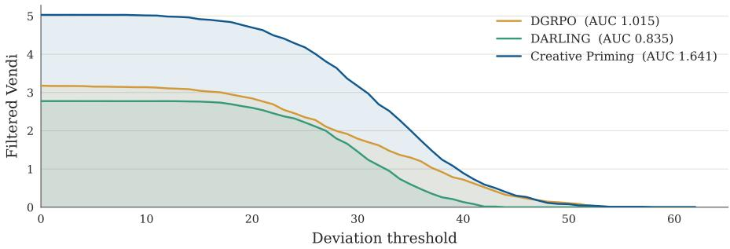  
Figure 8 Illustrative example of how the area under the filtered Vendi score deviation curve (AUC-dev Filtered Vendi Score) is calculated. For this example, the quality threshold is fixed at the mean quality of the direct-generation reference. Then, the deviation threshold is swept from 0 to 100 in increments of 1 and filtered vendi is calculated at each threshold. Then, the trapezoid rule is used to calculate the AUC-dev Filtered Vendi Score, represented by the shaded area under each curve, and reported in Table 1.

Threshold sweeps: AUC and VUS. However, even a well-motivated threshold is only one operating point, and the optimal threshold varies based on the application, where some settings prize rare outliers, and others require a high quality floor. For that reason, we include additional metrics that sweep thresholds across their operating range. Sweeping the deviation threshold and integrating the filtered metric over the sweep using the trapezoid rule gives an AUC-dev (illustrated in Figure 8); we report it for both filtered Vendi and filtered distinct clusters, and analogously report an AUCqual from a swept quality threshold. Sweeping both thresholds jointly produces a surface over the deviation quality plane, whose volume under the surface (VUS) serves as a single threshold-free summary of system creativity, computed for filtered Vendi and, separately, filtered distinct clusters.

<table><tr><td></td><td></td><td colspan="5">Atomic metrics</td><td colspan="8">Compound metrics</td></tr><tr><td rowspan="2">Response Model</td><td rowspan="2">Method</td><td rowspan="2">Response Diversity</td><td rowspan="2">Judge Score</td><td rowspan="2">Deviation</td><td rowspan="2">Vendi Score</td><td rowspan="2">Distinct Clusters</td><td colspan="2">Filtered</td><td colspan="2">AUC-dev</td><td colspan="2">AUC-qual</td><td colspan="2">VUS</td></tr><tr><td>Vendi</td><td>Distinct</td><td>Vendi</td><td>Dist.</td><td>Vendi</td><td>Dist.</td><td>Vendi</td><td>Dist.</td></tr><tr><td rowspan="3">Sonnet-4.6</td><td>Direct</td><td>5.3 ± 0.9</td><td> $9 0 . 2 \pm 1 . 1$ </td><td></td><td>1.40 ± 0.07</td><td>2.8 ± 0.7</td><td></td><td></td><td></td><td></td><td></td><td></td><td></td><td></td></tr><tr><td>CP (no div.)</td><td>20.7 ± 1.8</td><td>93.3 ± 0.9</td><td>15.1 ± 1.5</td><td>3.22 ± 0.27</td><td>22.7 ± 2.6</td><td> $2 . 8 0 \pm 0 . 3 8$ </td><td>10.1 ± 2.08</td><td>1.006</td><td>4.28</td><td>280.6</td><td>1053.7</td><td>100.4</td><td>447.9</td></tr><tr><td>CP (+ div.)</td><td>24.6 ± 1.7</td><td>94.3 ± 0.8</td><td>20.0 ± 1.8</td><td>4.04 ± 0.32</td><td>28.5 ± 3.1</td><td>3.72 ± 0.39</td><td>16.8 ± 2.82</td><td>1.338</td><td>6.52</td><td>375.2</td><td>1701.4</td><td>133.6</td><td>664.8</td></tr><tr><td rowspan="3">Opus-4.8</td><td>Direct</td><td>6.5 ± 0.9</td><td> $9 1 . 7 \pm 1 . 1$ </td><td></td><td> $1 . 5 2 \pm 0 . 0 8$ </td><td> $2 . 8 \pm 0 . 5$ </td><td></td><td></td><td></td><td></td><td></td><td></td><td></td><td></td></tr><tr><td>CP (no div.)</td><td>18.6 ± 1.8</td><td>94.4 ± 0.8</td><td> $1 2 . 7 \pm 1 . 4$ </td><td> $3 . 0 1 \pm 0 . 2 8$ </td><td> $1 5 . 5 \pm 2 . 3$ </td><td> $2 . 3 7 \pm 0 . 4 0$ </td><td> $6 . 9 3 \pm 1 . 9 1$ </td><td>0.851</td><td>2.85</td><td>234.8</td><td>687.7</td><td>83.6</td><td>286.0</td></tr><tr><td>CP (+ div.)</td><td>22.2 ± 1.8</td><td>95.1 ± 0.8</td><td>17.1 ± 1.6</td><td> $3 . 6 8 \pm 0 . 3 1$ </td><td>18.4 ± 2.9</td><td>3.26± 0.41</td><td>10.4 ± 2.50</td><td>1.132</td><td>3.92</td><td>327.9</td><td>1031.9</td><td>112.8</td><td>395.3</td></tr><tr><td rowspan="3">GPT-5-nano</td><td>Direct</td><td>12.3 ± 1.6</td><td>90.6 ± 1.0</td><td></td><td> $1 . 9 6 \pm 0 . 1 6$ </td><td> $6 . 0 \pm 1 . 7$ </td><td></td><td></td><td></td><td></td><td></td><td></td><td></td><td></td></tr><tr><td>CP (no div.)</td><td>29.3 ± 1.6</td><td>92.5 ± 0.9</td><td> $1 9 . 9 \pm 1 . 4$ </td><td>4.88 ± 0.35</td><td> $2 4 . 6 \pm 3 . 7$ </td><td> $4 . 1 7 \pm 0 . 4 1$ </td><td> $1 5 . 0 \pm 2 . 8 7$ </td><td>1.479</td><td>5.49</td><td>431.5</td><td>1563.5</td><td>153.3</td><td>573.7</td></tr><tr><td>CP (+ div.)</td><td>31.1 ± 1.4</td><td>91.1 ± 1.1</td><td>24.6 ±1.4</td><td>5.53 ± 0.36</td><td> $2 6 . 8 \pm 3 . 9$ </td><td> $4 . 7 1 \pm 0 . 3 9$ </td><td> $1 7 . 9 \pm 3 . 2 4$ </td><td>1.696</td><td>6.33</td><td>489.8</td><td>1873.1</td><td>177.7</td><td>665.9</td></tr><tr><td rowspan="3">GPT-5.4</td><td>Direct</td><td>9.7 ± 1.6</td><td>89.7 ± 1.1</td><td></td><td>1.67 ± 0.13</td><td> $5 . 5 \pm 1 . 6$ </td><td></td><td></td><td></td><td></td><td></td><td></td><td></td><td></td></tr><tr><td>CP (no div.)</td><td>27.0 ± 1.8</td><td>93.5 ± 1.0</td><td>19.4 ± 1.7</td><td>4.34 ± 0.36</td><td>27.0 ± 3.4</td><td>3.75 ± 0.43 14.7 ± 2.75</td><td></td><td>1.417</td><td>5.81</td><td>377.5</td><td>1511.9</td><td>142.5</td><td>598.5</td></tr><tr><td>CP (+ div.)</td><td>28.9 ± 1.5</td><td>94.3 ± 0.9</td><td>24.5 ± 1.8</td><td>5.01 ± 0.36</td><td>32.3 ± 3.9</td><td>4.49 ± 0.41</td><td>21.9 ± 3.63</td><td>1.684</td><td>8.10</td><td>457.0</td><td>2210.8</td><td>171.1</td><td>822.7</td></tr></table>

Table 4 Full API-model transfer results. A single creative priming model, trained once, is paired with four frozen API response models; each is evaluated against its own direct-generation reference. All metrics match Table 1 and are defined in Section 4: five atomic metrics and eight compound metrics. CP (no div.) and CP (+ div.) are the primer trained without and with a deviation reward. The filtered metrics keep responses passing a per-prompt quality threshold (the direct-generation reference mean) and a deviation threshold of 20; Deviation is reported as its per-prompt mean. Because each API model is its own reference, its Direct row has zero deviation by construction, so all deviation-derived columns show “-”.

## D API-model transfer: full results

Table 4 reports the complete API-model transfer results summarized in Figure 5, across the same atomic and compound metrics as Table 1, for both Creative Priming variants (trained without and with a deviation term) with confidence intervals. Each API model is evaluated against its own directgeneration reference. Every deviation-derived metric (deviation and all eight compound metrics) is measured relative to the direct responses and is therefore zero for each reference by construction, shown as “-”.

<table><tr><td></td><td></td><td colspan="5">Atomic metrics</td><td colspan="8">Compound metrics</td></tr><tr><td rowspan="2">Response Model</td><td rowspan="2">Method</td><td rowspan="2">Response Diversity</td><td rowspan="2">Judge Score</td><td rowspan="2">Deviation</td><td rowspan="2">Vendi Score</td><td rowspan="2">Distinct Clusters</td><td colspan="2">Filtered</td><td colspan="2">AUC-dev</td><td colspan="2"> $\mathbf { A U C - q u a l }$ </td><td colspan="2">VUS</td></tr><tr><td>Vendi</td><td>Distinct</td><td>Vendi</td><td>Dist.</td><td>Vendi</td><td>Dist.</td><td>Vendi</td><td>Dist.</td></tr><tr><td rowspan="4">Sonnet-4.6</td><td>Direct</td><td> $5 . 3 \pm 0 . 9$ </td><td> $9 0 . 2 \pm 1 . 1$ </td><td></td><td> $1 . 4 0 \pm 0 . 0 7$ </td><td>2.8 ± 0.7</td><td></td><td></td><td></td><td></td><td></td><td></td><td></td><td></td></tr><tr><td>Verbalized Sampling</td><td> $3 1 . 0 \pm 1 . 7$ </td><td> $9 0 . 6 \pm 1 . 1$ </td><td> $2 6 . 1 \pm 2 . 0$ </td><td> $4 . 6 6 \pm 0 . 3 0$ </td><td> $2 3 . 9 \pm 2 . 7$ </td><td> $3 . 0 5 \pm 0 . 4 4$ </td><td> $1 0 . 1 \pm 2 . 2 4$ </td><td>1.119</td><td>3.86</td><td>371.0</td><td>1408.7</td><td>137.3</td><td>540.1</td></tr><tr><td> $\mathrm { C P } \left( + \mathrm { d i v . } \right)$ </td><td> $2 4 . 6 \pm 1 . 7$ </td><td> ${ \bf 9 4 . 3 \pm 0 . 8 }$ </td><td> $2 0 . 0 \pm 1 . 8$ </td><td> $4 . 0 4 \pm 0 . 3 2$ </td><td> $2 8 . 5 \pm 3 . 1$ </td><td> $3 . 7 2 \pm 0 . 3 9$ </td><td> $1 6 . 8 \pm 2 . 8 2$ </td><td>1.338</td><td>6.52</td><td>375.2</td><td>1701.4</td><td>133.6</td><td>664.8</td></tr><tr><td> $\mathrm { C P } \left( + \mathrm { d i v . } \right) + \mathrm { V S }$ </td><td> $3 4 . 3 \pm 1 . 3$ </td><td> $9 2 . 3 \pm 1 . 3$ </td><td> ${ \bf 3 0 . 4 \pm 1 . 6 }$ </td><td> ${ \bf 6 . 5 3 \pm 0 . 3 7 }$ </td><td>44.5 ± 3.5</td><td>5.66 ± 0.42</td><td> $3 2 . 3 \pm 3 . 6 8$ </td><td>2.181</td><td>11.47</td><td>597.9</td><td>3522.9</td><td>235.3</td><td>1268.6</td></tr><tr><td rowspan="4">Opus-4.8</td><td>Direct</td><td> $6 . 5 \pm 0 . 9$ </td><td> $9 1 . 7 \pm 1 . 1$ </td><td></td><td> $1 . 5 2 \pm 0 . 0 8$ </td><td> $2 . 8 \pm 0 . 5$ </td><td></td><td></td><td></td><td></td><td></td><td></td><td></td><td></td></tr><tr><td>Verbalized Sampling</td><td></td><td> $2 9 . 8 \pm 1 . 7 9 2 . 2 \pm 0 . 9$ </td><td> $2 3 . 6 \pm 1 . 9$ </td><td> $4 . 5 4 \pm 0 . 2 9$ </td><td> $2 4 . 5 \pm 2 . 7$ </td><td> $2 . 7 2 \pm 0 . 4 2$ </td><td> $8 . 2 0 \pm 1 . 8 2$ </td><td>0.968</td><td>3.20</td><td>356.2</td><td>1268.0</td><td>125.2</td><td>509.0</td></tr><tr><td>CP (+ div.)</td><td></td><td> $2 2 . 2 \pm 1 . 8 9 5 . 1 \pm 0 . 8$ </td><td> $1 7 . 1 \pm 1 . 6$ </td><td> $3 . 6 8 \pm \mathbf { 0 . 3 1 }$ </td><td> $1 8 . 4 \pm 2 . 9$ </td><td> $3 . 2 6 \pm 0 . 4 1$ </td><td> $1 0 . 4 \pm 2 . 5 0$ </td><td>1.132</td><td>3.92</td><td>327.9</td><td>1031.9</td><td>112.8</td><td>395.3</td></tr><tr><td> $\mathrm { C P } \left( + \mathrm { d i v . } \right) + \mathrm { V S }$ </td><td></td><td> $3 1 . 9 \pm 1 . 2 9 4 . 6 \pm 1 . 0$ </td><td> $2 7 . 8 \pm 1 . 4$ </td><td>6.01 ± 0.32</td><td> $4 3 . 5 \pm 3 . 5$ </td><td> ${ \pm } , 5 2 \pm 0 . 3 8$ </td><td> $3 2 . 5 \pm 3 . 7 5$ </td><td>1.987</td><td>10.99</td><td>566.0</td><td>3464.1</td><td>205.2</td><td>1182.9</td></tr><tr><td rowspan="4">GPT-5-nano</td><td>Direct</td><td> $1 2 . 3 \pm 1 . 6 9 0 . 6 \pm 1 . 0$ </td><td></td><td></td><td> $1 . 9 6 \pm 0 . 1 6$ </td><td> $6 . 0 \pm 1 . 7$ </td><td></td><td></td><td>一</td><td>-</td><td></td><td></td><td></td><td></td></tr><tr><td>Verbalized Sampling</td><td> $3 3 . 3 \pm 1 . 8 8 3 . 2 \pm 2 . 0$ </td><td></td><td></td><td>21.4 ± 1.5 5.22 ± 0.33</td><td>29.4 ± 2.9</td><td>2.44 ± 0.43</td><td> $6 . 2 8 \pm 1 . 5 0$ </td><td>0.939</td><td>2.61</td><td>356.1</td><td>1264.6</td><td>134.0</td><td>519.3</td></tr><tr><td>CP (+ div.)</td><td> $3 1 . 1 \pm 1 . 4 9 1 . 1 \pm 1 . 1$ </td><td></td><td></td><td>24.6 ± 1.4 5.53 ± 0.36</td><td>26.8 ± 3.9</td><td> $4 . 7 1 \pm 0 . 3 9$ </td><td> $1 7 . 9 \pm 3 . 2 4$ </td><td>1.696</td><td>6.33</td><td>489.8</td><td>1873.1</td><td>177.7</td><td>665.9</td></tr><tr><td> $\mathrm { C P } \left( + \mathrm { d i v . } \right) + \mathrm { V S }$ </td><td> $3 5 . 5 \pm 1 . 3 8 3 . 0 \pm 2 . 2$ </td><td></td><td>30.2 ± 1.4 6.82 ± 0.38</td><td></td><td>45.7 ± 2.9</td><td> ${ \bf 5 . 0 5 \pm 0 . 4 6 }$ </td><td> ${ \bf 2 5 . 8 \pm 3 . 5 5 }$ </td><td>1.890</td><td>9.14</td><td>574.4</td><td>3270.8</td><td>219.8</td><td>1162.2</td></tr><tr><td rowspan="4">GPT-5.4</td><td>Direct</td><td> $9 . 7 \pm 1 . 6$ </td><td> $8 9 . 7 \pm 1 . 1$ </td><td></td><td> $1 . 6 7 \pm 0 . 1 3$ </td><td>5.5 ± 1.6</td><td></td><td></td><td></td><td></td><td></td><td></td><td></td><td></td></tr><tr><td>Verbalized Sampling</td><td> $3 3 . 2 \pm 1 . 9$ </td><td> $8 5 . 2 \pm 2 . 1$ </td><td> $2 5 . 5 \pm 1 . 9$ </td><td>5.00 ± 0.34</td><td> $2 4 . 8 \pm 2 . 8$ </td><td> $2 . 6 7 \pm 0 . 4 8$ </td><td> $7 . 5 5 \pm 1 . 7 6$ </td><td>1.095</td><td>2.99</td><td>356.8</td><td>1284.3</td><td>139.3</td><td>507.1</td></tr><tr><td>CP (+ div.)</td><td> $2 8 . 9 \pm 1 . 5$ </td><td> ${ \bf 9 4 . 3 \pm 0 . 9 }$ </td><td> $2 4 . 5 \pm 1 . 8$ </td><td> $5 . 0 1 \pm 0 . 3 6$ </td><td> $3 2 . 3 \pm { 3 . 9 }$ </td><td> $4 . 4 9 \pm 0 . 4 1$ </td><td> $2 1 . 9 \pm 3 . 6 3$ </td><td>1.684</td><td>8.10</td><td>457.0</td><td>2210.8</td><td>171.1</td><td>822.7</td></tr><tr><td> $\mathrm { C P } \left( + \mathrm { d i v . } \right) + \mathrm { V S }$ </td><td> $3 5 . 3 \pm 1 . 5$ </td><td></td><td></td><td>90.0 ± 1.5 30.0 ± 1.6 6.74 ± 0.45 45.5 ± 3.1</td><td></td><td> ${ \pm } , 5 8 \pm 0 . 5 1$ </td><td> ${ \bf 2 9 . 9 \pm 3 . 6 7 }$ </td><td>2.214</td><td>11.07</td><td>588.9</td><td>3342.9</td><td>234.1</td><td>1235.6</td></tr></table>

Table 5 Composing creative priming with verbalized sampling. The same setup, references, and metrics as Table 4, restricted to the deviation-trained primer and adding verbalized sampling (VS) and its composition with the primer. CP (+ div.) + VS has the primer emit 8 creative primers per prompt, each sent to the API model in a single verbalized-sampling call returning 8 responses, matching the 64 completions per prompt of every other row. Response diversity and deviation are shown $\times 1 0 0 ;$ cells include a 95% confidence interval where available. The filtered metrics keep responses passing a per-prompt quality threshold (the direct-generation reference mean) and a deviation threshold of 20. Because each API model is its own reference, its Direct row has zero deviation by construction, so all deviation-derived columns show “-”. The best value per column within each block is bolded. The composition exceeds both of its parts on every compound metric for all four response models.

## E Composing creative priming with verbalized sampling

Table 5 adds two new settings to the API-model transfer results of Table 4. The first is verbalized sampling (VS) (Zhang et al., 2026), a test-time prompting method in which the model generates multiple candidate responses, and tags each with a self-reported probability, and is instructed to sample from the tail of its own distribution. The second setting composes VS with creative priming: in this experiment, the primer generates 8 creative primers per prompt, and each primer is sent to the API model in a single verbalized-sampling call returning 8 responses. The VS setting issues 8 such calls of 8 responses each. Each method therefore generates 64 completions per prompt. Only the deviation-trained primer is included in this experiment.

Verbalized Sampling reaches higher response diversity than CP (+ div.) for all four response models (29.8–33.3 versus 22.2–31.1), but its judge score falls below direct generation on both GPT models (83.2 versus 90.6 for GPT-5-nano and 85.2 versus 89.7 for GPT-5.4), while CP (+ div.) is above direct generation on all four. On the compound metrics, CP (+ div.) leads VS on all eight for both GPT models and on nearly all metrics for Sonnet-4.6. Only on Opus-4.8 do the methods split the compound metrics of creativity.

However, the composition of CP + VS performs the best on every compound metric for all four response models. VUS distinct clusters for Sonnet-4.6 reaches 1268.6, against 664.8 for CP (+ div.) and 540.1 for VS, and filtered distinct clusters improves on the component parts by 1.4–3.1 across the four response models.

## F Impact of training on response style

A method that changes either how a model writes or what it says will both lead to increased embedding deviation, but changes to surface-level style are not the type of deviation that we want to encourage. Therefore, rather than relying entirely on the embedding model signals, we also calculate an explicit set of style features:

• Length: response length in tokens (using the shared Qwen3-8B response-model tokenizer) and mean sentence length in words. Together these separate terse output from flowing prose: a response can be long yet built from short fragments, or short yet written in long sentences.

• Formatting: the fraction of responses that use a Markdown header, bold span, or list. These capture structural presentation independent of wording.

• Stylometry: the Jensen-Shannon divergence (Lin, 1991) between a method’s pooled distribution over common function words and the reference’s. Function-word frequencies carry little topical content and have long served as an authorship fingerprint in stylometry (Mosteller & Wallace, 1963), so this distance isolates stylistic drift from topical change. It is measured at the method level (pooled over all responses) and so has no per-prompt interval.

For each feature we average its value over a prompt’s 64 responses, then average those per-prompt means across prompts, separately for each method and for the reference. Confidence intervals are 95% half-widths over the per-prompt means, matching the convention of Table 1. Table 6 reports the results.

The three methods land in three distinct style regimes. DGRPO becomes terse on every axis, cutting response length, sentence length, and nearly all formatting. DARLING moves the opposite way, lengthening responses and doubling list use, and it registers the largest function-word shift, indicating that much of its deviation is a change in style rather than content. CP shifts toward long-sentence prose (its sentences are the longest of any method while its responses are shorter than the reference) yet drifts least in function-word usage, so its deviation reflects a change in what is said more than in how it is written.

Figure 9 makes these regimes concrete on a single prompt. The reference names the obvious fighter and pads it with a blurb; DGRPO answers in one terse line; DARLING returns a bolded, bulleted analysis; and CP answers in flowing prose while naming a different fighter and framing its historical significance, illustrating that its deviation lies in what it says rather than in surface formatting.
<table><tr><td>Feature</td><td>Reference</td><td>DGRPO</td><td>DARLING</td><td>CP</td></tr><tr><td>Length</td><td></td><td></td><td></td><td></td></tr><tr><td>Response length (tokens)</td><td> $2 6 0 . 8 \pm 5 2 . 8$ </td><td> $2 2 . 7 \pm 5 . 4$ </td><td> $4 1 0 . 0 \pm 4 9 . 3$ </td><td> $1 4 0 . 6 \pm 1 5 . 9$ </td></tr><tr><td>Sentence length (words)</td><td> $1 2 . 8 8 \pm 0 . 9 9$ </td><td> $5 . 3 7 \pm 0 . 7 1$ </td><td> $1 1 . 4 2 \pm 0 . 5 6$ </td><td> $2 0 . 8 7 \pm 1 . 2 5$ </td></tr><tr><td>Formatting</td><td></td><td></td><td></td><td></td></tr><tr><td>Uses header (frac.)</td><td> $0 . 2 4 7 \pm 0 . 0 7 2$ </td><td> $0 . 0 0 1 \pm 0 . 0 0 1$ </td><td> $0 . 4 6 4 \pm 0 . 0 8 6$ </td><td> $0 . 0 0 4 \pm 0 . 0 0 5$ </td></tr><tr><td>Uses bold (frac.)</td><td> $0 . 8 1 3 \pm 0 . 0 6 3$ </td><td> $0 . 0 0 5 \pm 0 . 0 0 4$ </td><td> $0 . 8 8 2 \pm 0 . 0 5 5$ </td><td> $0 . 3 9 9 \pm 0 . 0 5 6$ </td></tr><tr><td>Uses list (frac.)</td><td> $0 . 4 3 0 \pm 0 . 0 8 8$ </td><td> $0 . 0 0 5 \pm 0 . 0 0 2$ </td><td> $0 . 8 6 0 \pm 0 . 0 6 3$ </td><td> $0 . 0 8 1 \pm 0 . 0 3 8$ </td></tr><tr><td>Stylometry</td><td></td><td></td><td></td><td></td></tr><tr><td>Function-word JS-div.</td><td></td><td>0.087</td><td>0.138</td><td>0.045</td></tr></table>

Table 6 Impact of training on response style, evaluated on NoveltyBench. Each cell is the feature’s perprompt mean, averaged over prompts, with a 95% confidence interval; the Reference column is the directgeneration qwen3-8b-parallel model and the three method columns are the with-deviation variants. The function-word Jensen-Shannon divergence is measured against the reference (reference-vs-itself is 0, shown as “-”) and therefore has no confidence interval.

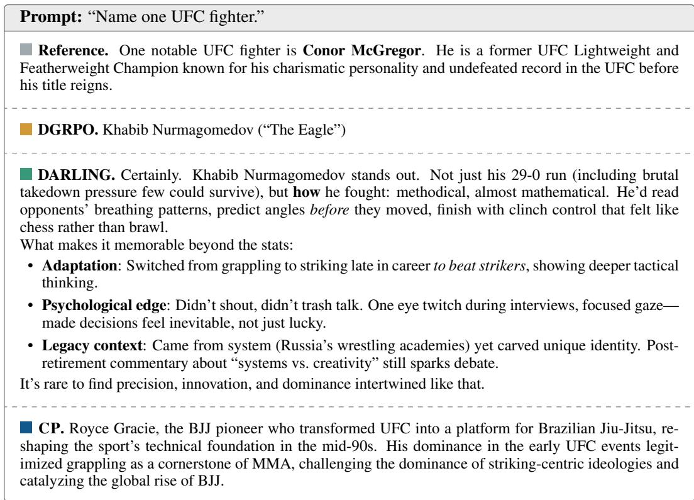  
Figure 9 Representative responses to a single prompt, one per method (the first sampled response of each). The four methods occupy the distinct style regimes quantified in Table 6: the reference’s name-plus-blurb, DGRPO’s terse one-liner, DARLING’s bolded and bulleted formatting, and CP’s long-sentence prose naming a different fighter and framing its historical significance.

## G Additional qualitative examples

Figures 10, 11, 12, and 13 demonstrate, qualitatively, the most and least creative responses to four prompts. The prompts span a short story, a joke, a short factual request, and an open-ended question, illustrating how each method’s outputs vary with the type of prompt.

Prompt: “Tell me a story in five sentences about a girl and her dog.”  
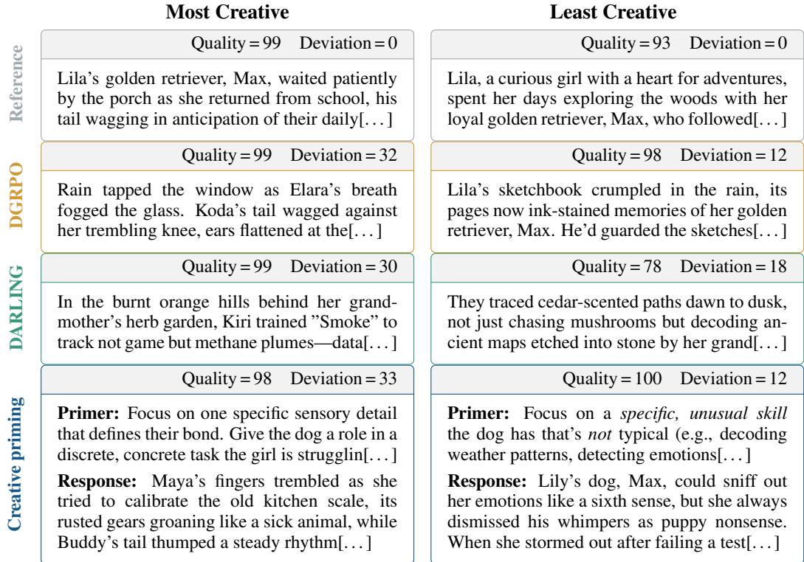  
Figure 10 Example outputs. Highest- and lowest-scoring responses per method for the first prompt in NoveltyBench, scored by individual response creativity: quality × deviation. Each cell shows the judge quality score and the response’s deviation from the reference set. CP cells also show the primer for that response. Responses in the “Least Creative” column are markedly more similar to the reference response, whereas the most creative responses have much more diversity among them.

Prompt: “Tell me a dad joke.”  
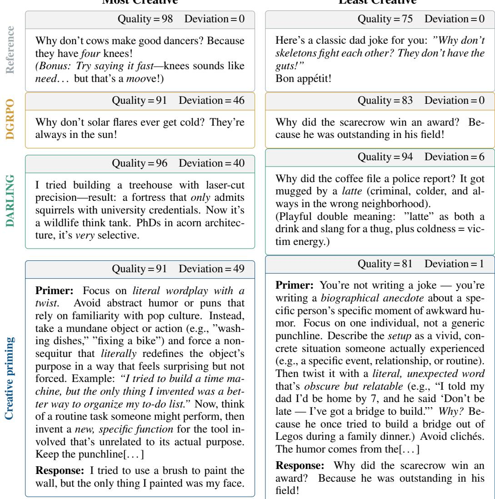  
Figure 11 Highest- and lowest-scoring responses per method for a single prompt, scored by individual response creativity: quality × deviation. Each cell reports the judge quality score and the response’s deviation from the reference model (qwen3-8b-parallel). CP cells also show the primer that steered the response. Text is truncated for space.

Prompt: “Name one reputed job.”
<table><tr><td rowspan=1 colspan=1>Quality = 87 Deviation = 0</td><td rowspan=1 colspan=1></td><td rowspan=1 colspan=1>Quality = 69 Deviation = 0</td></tr><tr><td rowspan=1 colspan=1>A widely recognized and respected job glob-ally is anesthesiologist. This profession ishighly regarded due to the critical role anesthe-siologists play in patient care during surgeries,requiring advanced medical training, preci-sion, and a deep understanding of pharmacol-ogy and physiology. Their work directly im-pacts patient safety and outcomes, contribut-ing to their esteemed status in the medicalfield[...]</td><td rowspan=1 colspan=1></td><td rowspan=1 colspan=1>A reputed job is one that is widely respected,highly paid, and regarded as significant in so-ciety. Here are a few examples across differentfields:1. Doctor (e.g., Surgeon, Cardiologist) - Why:Vital to public health, requires extensive edu-cation and training, and plays a critical role insaving lives.2. Software Engineer / Data Scientist - Why:High demand in the tech industry[. .. ]</td></tr><tr><td rowspan=1 colspan=1>Quality = 88 Deviation = 43</td><td rowspan=1 colspan=1></td><td rowspan=1 colspan=1>Quality = 17 Deviation = 24</td></tr><tr><td rowspan=1 colspan=1>spacecraft systems engineer at spacex</td><td rowspan=1 colspan=1></td><td rowspan=1 colspan=1>leadership, vision, execution</td></tr><tr><td rowspan=1 colspan=1>Quality =98 Deviation = 41</td><td rowspan=1 colspan=1></td><td rowspan=1 colspan=1>Quality = 76 Deviation = 18</td></tr><tr><td rowspan=1 colspan=1>Certainly. Climate modeling lead at an IPCCassessment team (or equivalent research role).Three reasons it stands out (more meaningfulthan title alone): 1. Impact scope (not just&quot;save trees&quot;) - predicts flood zones for cities,informs energy policy for 1.5B people, setsdeadlines for Arctic ice loss that affect ship-ping, military, indigenous rights. Decisions di-rectly shape where people live, work, and howthey survive. 2. Critical rigor (not hype): -Uncertainty quantification is central; cherry-picking data is career-ending. - Must syn-thesize millions of disparate inputs (soil sam-ples[...]</td><td rowspan=1 colspan=1></td><td rowspan=1 colspan=1>It depends far more on impact than title. Threestrong examples (each with distinct value):1. Public health epidemiologist in outbreakresponse (most compelling) - No lab coator office. Tracking disease spread throughdense, often dangerous fieldwork; decisionsdelay death. Example: identifying transmis-sion chains in Ebola, calculating ICU capacityduring pandemic. Credentials matter only asentry; real value comes from analyzing messy,time-critical data under pressure and translat-ing it to protective action.2. Urban planner/designer focused on equity(often underrated but critical) [...]</td></tr><tr><td rowspan=1 colspan=1>Quality =99 Deviation =47</td><td rowspan=2 colspan=2>Primer: Focus on a role that bridges two dis-ciplines in a way that feels unexpectedly es-sential—not just a hybrid job, but one thatexists because of a specific, overlooked prob-lem. Imagine a single profession that literallyPrimer: Think of a job that necessarily re-prevents a large-scale crisis (e.g., a role thatquires an unusual skillset or cultural capital.stops misinformation in real-time, or ensuresAvoid the obvious. What&#x27;s a role where yourAI safety in critical infrastructure). Avoidpersonal background or niche expertise wouldgeneric &quot;tech&quot; or &quot;healthcare” categories[... ]be a superpower? Now reframe that into a sin-Response: A Global Water Rights Mediator      gle job title that sounds mundane but impliesis a reputed job that bridges international law,      hidden complexity. Example angle: A job thatenvironmental science, and conflict resolution.      exists because of a specific historical event orThis role exists to prevent catastrophic wa-      regulatory loophole. Now, name that job.ter disputes by negotiating equitable access toResponse: Chief Executive Officer (CEO)transboundary water sources, such as riversor aquifers, which are critical for agriculture,ecosystems, and human survival. The fail-ure of this role would result in water wars,mass[...]</td></tr><tr><td></td><td rowspan=1 colspan=1>Quality = 62 Deviation = 13</td></tr></table>

Figure 12 Highest- and lowest-scoring responses per method for a single prompt, scored by individual response creativity: quality × deviation. Each cell reports the judge quality score and the response’s deviation from the reference model (qwen3-8b-parallel). CP cells also show the primer that steered the response. Text is truncated for space.

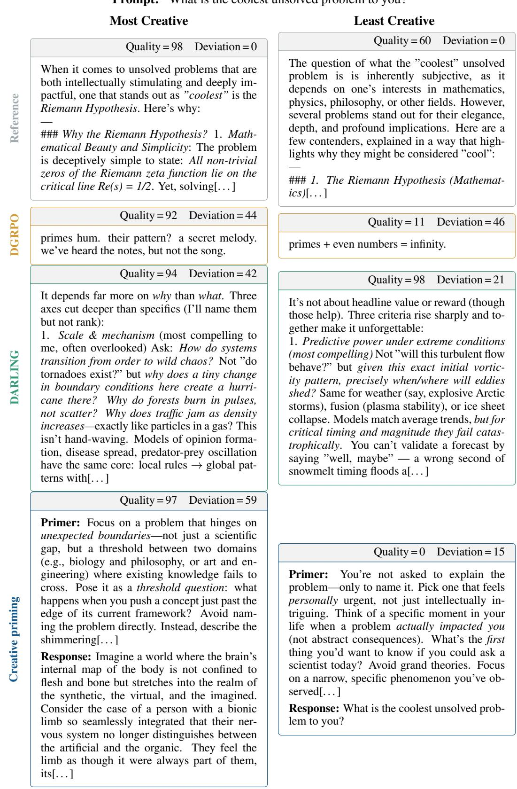  
Figure 13 Highest- and lowest-scoring responses per method for a single prompt, scored by individual response creativity: quality × deviation. Each cell reports the judge quality score and the response’s deviation from the reference model (qwen3-8b-parallel). CP cells also show the primer that steered the response. Text is truncated for space.

<table><tr><td rowspan="3"></td><td colspan="5">Atomic metrics</td><td colspan="8">Compound metrics</td></tr><tr><td rowspan="2">Response Diversity</td><td rowspan="2">Quality</td><td rowspan="2">Deviation</td><td rowspan="2">Vendi Score</td><td rowspan="2">Distinct Clusters</td><td colspan="2">Filtered</td><td colspan="2">AUC-dev</td><td colspan="2"> $\mathbf { A U C - q u a l }$ </td><td colspan="2">VUS</td></tr><tr><td>Vendi</td><td>Distinct</td><td>Vendi</td><td>Dist.</td><td>Vendi</td><td>Dist.</td><td>Vendi</td><td>Dist.</td></tr><tr><td>DGRPO (G=8)</td><td> $3 4 . 0 \pm 1 . 6$ </td><td> $7 7 . 3 \pm 2 . 9$ </td><td> $2 5 . 6 \pm 1 . 6$ </td><td> $5 . 9 8 \pm 0 . 4 7$ </td><td> $3 3 . 4 \pm 3 . 2$ </td><td> $2 . 8 5 \pm 0 . 4 6$ </td><td> $7 . 5 9 \pm 1 . 7 7$ </td><td>1.015</td><td>2.78</td><td>448.1</td><td>1779.4</td><td>168.8</td><td>658.0</td></tr><tr><td>DGRPO (G=16)</td><td> $3 3 . 8 \pm 1 . 5$ </td><td> $7 4 . 7 \pm 3 . 1$ </td><td> $2 6 . 9 \pm 1 . 5$ </td><td> $5 . 9 5 \pm \mathbf { 0 . 4 5 }$ </td><td> $3 3 . 9 \pm 3 . 2$ </td><td> $2 . 7 2 \pm 0 . 4 7$ </td><td> $7 . 9 2 \pm 2 . 0 8$ </td><td>0.993</td><td>2.90</td><td>441.4</td><td>1864.9</td><td>167.2</td><td>672.8</td></tr><tr><td>DGRPO (G=32)</td><td> $3 1 . 6 \pm { 1 . 0 }$ </td><td> $8 1 . 5 \pm 2 . 4$ </td><td> $2 8 . 0 \pm 1 . 1$ </td><td> $5 . 7 2 \pm 0 . 2 9$ </td><td> $3 5 . 8 \pm 2 . 9$ </td><td> $3 . 9 1 \pm 0 . 4 3$ </td><td> $1 5 . 3 \pm 2 . 3 7$ </td><td>1.371</td><td>5.12</td><td>482.8</td><td>2474.7</td><td>174.2</td><td>834.5</td></tr><tr><td>DGRPO (G=64)</td><td> $2 8 . 6 \pm 0 . 8$ </td><td> $6 9 . 1 \pm 3 . 5$ </td><td> $3 3 . 5 \pm 1 . 0$ </td><td> $5 . 0 4 \pm 0 . 2 0$ </td><td> $2 4 . 5 \pm 2 . 6$ </td><td> $2 . 9 5 \pm 0 . 3 5$ </td><td> $9 . 7 0 \pm 1 . 7 5$ </td><td>1.055</td><td>3.24</td><td>396.5</td><td>1740.1</td><td>150.2</td><td>586.9</td></tr></table>

Table 7 Evaluation on NoveltyBench with DGRPO group-size scaling. The same setup and metrics as Table 1, adding DGRPO trained with group sizes $G = 1 6 , 3 2$ , and 64 to the default $G = 8$ result. All scaling runs include the deviation term. Cells include 95% confidence intervals where available.

## H DGRPO group-size scaling

Table 7 reports the complete results for the DGRPO group-size scaling experiment. The G=8 row corresponds to the primary experimental setting. The remaining runs scale deviation-trained DGRPO to $G \in \{ 1 6 , 3 2 , 6 4 \}$ , while the training data, two-epoch training horizon, and all other hyperparameters remain fixed. Increasing G gives DGRPO additional on-policy samples and therefore intentionally departs from the primary matched setting. At G=64, DGRPO samples the same number of responses per prompt as the 64 response-model generations that contribute to CP’s primer reward estimates. The sweep focuses on DGRPO because DARLING already trains for ten epochs, making group-size scaling substantially harder to interpret as a compute comparison.

Deviation increases monotonically across the sweep, while response diversity and Vendi score decline. Quality and distinct clusters fluctuate before reaching their lowest values at G=64. Every compound metric reaches its highest DGRPO value at G=32 and subsequently declines at G=64. Figure 4b provides a comparison with CP.

<table><tr><td></td><td colspan="5">Atomic metrics</td><td colspan="8">Compound metrics</td></tr><tr><td>wQ</td><td>Response Diversity</td><td>Judge Score</td><td>Deviation</td><td>Vendi Score</td><td>Distinct Clusters</td><td colspan="2">Filtered</td><td colspan="2">AUC-dev</td><td colspan="2">AUC-qual</td><td colspan="2">VUS</td></tr><tr><td></td><td></td><td></td><td></td><td></td><td></td><td>Vendi</td><td>Distinct</td><td>Vendi</td><td>Dist.</td><td>Vendi</td><td>Dist.</td><td>Vendi</td><td>Dist.</td></tr><tr><td>1.0</td><td> ${ \bf 3 4 . 0 \pm 1 . 6 }$ </td><td> $7 7 . 3 \pm 2 . 9$ </td><td> ${ \bf 2 5 . 6 \pm 1 . 6 }$ </td><td> ${ \pm } . 9 8 \pm 0 . 4 7$ </td><td> $3 3 . 4 \pm 3 . 2$ </td><td> $2 . 8 5 \pm 0 . 4 6$ </td><td> $7 . 5 9 \pm 1 . 7 7$ </td><td>1.015</td><td>2.78</td><td>448.1</td><td>1779.4</td><td>168.8</td><td>658.0</td></tr><tr><td>1.2</td><td> $3 3 . 1 \pm { 1 . 6 }$ </td><td> $7 6 . 5 \pm 3 . 0$ </td><td> $2 5 . 0 \pm 1 . 6$ </td><td> $5 . 6 8 \pm 0 . 4 7$ </td><td> $3 0 . 9 \pm 3 . 2$ </td><td> $2 . 4 9 \pm 0 . 4 6$ </td><td> $6 . 6 5 \pm 1 . 8 5$ </td><td>0.898</td><td>2.42</td><td>421.1</td><td>1642.0</td><td>158.5</td><td>603.8</td></tr><tr><td>1.5</td><td> $3 3 . 0 \pm 1 . 6$ </td><td> ${ \bf 8 0 . 1 \pm 2 . 6 }$ </td><td> $2 4 . 6 \pm 1 . 6$ </td><td> $5 . 7 0 \pm 0 . 4 5$ </td><td> $3 2 . 9 \pm 3 . 3$ </td><td> $\mathbf { 2 . 9 4 \pm 0 . 4 8 }$ </td><td> $\mathbf { 8 . 5 0 \pm 2 . 0 2 }$ </td><td>1.070</td><td>3.12</td><td>439.5</td><td>1782.7</td><td>164.0</td><td>659.9</td></tr><tr><td>2.0</td><td> $3 3 . 0 \pm { 1 . 7 }$ </td><td> $7 8 . 2 \pm 3 . 0$ </td><td> $2 4 . 7 \pm 1 . 6$ </td><td> $5 . 6 6 \pm 0 . 4 8$ </td><td> $3 0 . 8 \pm 3 . 4$ </td><td> $2 . 5 7 \pm 0 . 4 9$ </td><td> $6 . 6 1 \pm 1 . 7 7$ </td><td>0.954</td><td>2.50</td><td>424.2</td><td>1635.8</td><td>160.9</td><td>606.9</td></tr></table>

Table 8 Reweighting quality in the DGRPO reward. NoveltyBench metrics (defined in Section 4) as the quality exponent w<sub>Q</sub> of Eq. 20 increases, holding $w _ { D } = w _ { \mathrm { D e v } } = 1$ . Response diversity and deviation are shown ×100; cells include a 95% confidence interval where available. The best value per column is bolded. $w _ { Q } = 1 . 0$ is the DGRPO (+Deviation) model from Table 1.

## I DGRPO Ablation: reweighting quality

The atomic metrics in Table 1 show that training a response model directly forces a tradeoff between quality and the creativity axes: DGRPO attains the highest response diversity and deviation of any method trained with a deviation reward, but the lowest judge score (77.3, versus 90.5 for the reference). A natural question is whether this tradeoff is an artifact of how DGRPO’s multiplicative reward (Eq. 15) balances its terms and whether simply weighting quality more heavily can recover quality without sacrificing diversity.

We generalize the DGRPO reward with a per-term exponent weight,

$$
r _ { j , i } = Q _ { i } ^ { \ w _ { Q } } \cdot D _ { i } ^ { \ w _ { D } } \cdot \mathrm { D e v } _ { i } ^ { w _ { \mathrm { D e v } } } .\tag{20}
$$

Because $Q _ { i } , D _ { i } , \mathrm { D e v } _ { i } \in [ 0 , 1 ] ( \mathrm { E q s . ~ } 1 6 \mathrm { - } 1 8 )$ , an exponent w $> 1$ effectively penalizes lower values more aggressively than higher values. We hold $w _ { D } = w _ { \mathrm { D e v } } = 1$ and sweep the quality exponent $w _ { Q } \in \{ 1 . 0 , 1 . 2 , 1 . 5 , 2 . 0 \}$ , retraining DGRPO from scratch at each setting and evaluating on NoveltyBench. The $w _ { Q } = 1 . 0$ row is the DGRPO (+Deviation) model from Table 1.

Increasing the quality exponent does not resolve the tradeoff (Table 8). Across $w _ { Q } \in [ 1 . 0 , 2 . 0 ]$ , the judge score stays within a narrow 76.5–80.1 band—never approaching the reference’s 90.5—while response diversity, deviation, and distinct clusters are essentially unchanged (all differences fall within overlapping confidence intervals). The compound creativity metrics move only marginally, peaking weakly at $w _ { Q } = 1 . 5$ . Reweighting quality therefore has little leverage on DGRPO’s quality– creativity balance.

<table><tr><td rowspan="2"></td><td colspan="5">Atomic metrics</td><td colspan="10">Compound metrics</td></tr><tr><td rowspan="2">Epochs</td><td rowspan="2">Response Diversity</td><td rowspan="2">Judge Score</td><td rowspan="2">Deviation</td><td rowspan="2">Vendi Score</td><td rowspan="2">Distinct Clusters</td><td colspan="2">Filtered</td><td colspan="2">AUC-dev</td><td colspan="2">AUC-qual</td><td colspan="2">VUS</td></tr><tr><td>Vendi</td><td>Distinct</td><td>Vendi</td><td>Dist.</td><td>Vendi</td><td></td><td>Dist.</td><td>Vendi Dist.</td></tr><tr><td>2</td><td> $1 3 . 4 \pm 1 . 6$ </td><td> $9 2 . 0 \pm 1 . 1$ </td><td> $5 . 1 \pm 0 . 7$ </td><td> $2 . 2 7 \pm 0 . 2 0$ </td><td> $1 9 . 3 \pm 3 . 3$ </td><td> $0 . 4 6 \pm 0 . 2 3$ </td><td> $1 . 2 0 \pm 0 . 8 5$ </td><td>0.294</td><td>1.22</td><td>47.7</td><td></td><td>131.0</td><td>30.2</td><td>139.0</td></tr><tr><td>4</td><td></td><td> ${ \bf 1 3 . 9 \pm 1 . 5 }$   $9 4 . 0 \pm 1 . 0$ </td><td></td><td> $7 . 8 \pm 0 . 9$ </td><td> $2 . 4 2 \pm 0 . 2 1$ </td><td> ${ \bf 2 6 . 5 \pm 3 . 8 }$ </td><td> ${ \bf 0 . 7 6 \pm 0 . 2 8 }$ </td><td> $2 . 3 5 \pm 1 . 3 3$ </td><td>0.387</td><td>2.37</td><td>74.1</td><td>234.0</td><td>37.8</td><td>235.2</td></tr><tr><td>6</td><td></td><td> $1 3 . 4 \pm 1 . 3$   $9 4 . 7 \pm 0 . 8$ </td><td> $9 . 1 \pm 0 . 9$ </td><td></td><td> $2 . 3 7 \pm 0 . 1 8$   $2 5 . 0 \pm 3 . 6$ </td><td></td><td> $0 . 6 5 \pm 0 . 2 7$ </td><td> ${ \pm . 4 9 \pm 1 . 4 1 }$ </td><td>0.390</td><td>2.57</td><td>64.2</td><td>243.4</td><td>37.8</td><td>250.9</td></tr><tr><td>8</td><td> $1 2 . 2 \pm 1 . 2$ </td><td> ${ \bf 9 4 . 9 \pm 0 . 8 }$ </td><td> $9 . 1 \pm 0 . 8$ </td><td> $2 . 2 3 \pm 0 . 1 8$ </td><td> $2 2 . 1 \pm 3 . 6$ </td><td> $0 . 5 6 \pm 0 . 2 4$ </td><td></td><td> $1 . 9 5 \pm 1 . 2 3 $ </td><td>0.353</td><td>2.22</td><td>55.4</td><td>190.2</td><td>34.4</td><td>218.1</td></tr><tr><td>10</td><td></td><td> $1 1 . 7 \pm 1 . 1$   $9 3 . 6 \pm 1 . 2$ </td><td></td><td> ${ \bf 1 0 . 1 \pm 0 . 8 }$ </td><td> $2 . 1 7 \pm 0 . 1 6$ </td><td> $2 0 . 5 \pm 3 . 3$ </td><td> $0 . 5 7 \pm 0 . 2 3$ </td><td> $1 . 7 6 \pm 1 . 0 6$ </td><td>0.345</td><td>2.23</td><td>55.8</td><td>172.3</td><td>34.1</td><td>221.0</td></tr><tr><td>2</td><td></td><td> $1 3 . 5 \pm 1 . 6$   $9 1 . 5 \pm 1 . 4$ </td><td></td><td> $4 . 9 \pm 0 . 7$ </td><td> $2 . 2 8 \pm 0 . 2 1$ </td><td> $1 8 . 3 \pm 3 . 2$ </td><td> $0 . 4 0 \pm 0 . 2 4$ </td><td> $1 . 2 4 \pm 0 . 9 5$ </td><td>0.278</td><td>1.08</td><td>45.3</td><td>137.4</td><td>29.3</td><td>126.3</td></tr><tr><td>4</td><td></td><td> $1 5 . 6 \pm 1 . 7$   $9 2 . 0 \pm 1 . 2$ </td><td></td><td> $7 . 1 \pm 0 . 9$ </td><td> $2 . 5 3 \pm 0 . 2 2$ </td><td> $1 9 . 1 \pm 3 . 2$ </td><td> $0 . 7 4 \pm 0 . 2 8$ </td><td> $2 . 0 6 \pm 1 . 1 7$ </td><td>0.386</td><td>1.59</td><td>83.4</td><td>232.4</td><td>40.0</td><td>175.0</td></tr><tr><td>+Dition 6</td><td> ${ \bf 1 9 . 7 \pm 1 . 3 }$ </td><td> ${ \bf 9 3 . 1 \pm 1 . 1 }$ </td><td></td><td> $1 9 . 1 \pm 1 . 2$ </td><td> ${ \bf 3 . 2 8 \pm 0 . 2 2 }$ </td><td> ${ \bf 2 9 . 9 \pm 3 . 5 }$ </td><td> $2 . 5 9 \pm 0 . 3 1$ </td><td> $1 4 . 7 \pm 2 . 7 0$ </td><td>0.851</td><td>5.58</td><td>259.5</td><td>1567.0</td><td>85.1</td><td>586.9</td></tr><tr><td>8</td><td> $1 8 . 1 \pm 1 . 2$ </td><td> $9 1 . 7 \pm 1 . 4$ </td><td> $2 0 . 8 \pm 1 . 1$ </td><td></td><td> $3 . 0 2 \pm 0 . 1 9$ </td><td> $2 4 . 7 \pm 3 . 2$ </td><td> $2 . 4 5 \pm 0 . 2 7$ </td><td> $1 3 . 3 \pm 2 . 6 9$ </td><td>0.786</td><td>4.59</td><td>249.1</td><td>1495.9</td><td>79.9</td><td>512.0</td></tr><tr><td>10</td><td> $1 8 . 0 \pm 1 . 1$ </td><td> $8 8 . 4 \pm { 1 . 8 }$ </td><td></td><td> $2 4 . 7 \pm 1 . 0$ </td><td> $3 . 0 2 \pm 0 . 1 8$ </td><td> $2 8 . 1 \pm 3 . 5$ </td><td> $\mathbf { 2 . 6 0 \pm 0 . 2 4 }$ </td><td> ${ \bf 1 6 . 4 \pm 2 . 8 0 }$ </td><td>0.835</td><td>5.24</td><td>272.8</td><td>2022.3</td><td>88.0</td><td>639.0</td></tr></table>

Table 9 DARLING evaluated every 2 epochs on NoveltyBench, without (top) and with (bottom) the deviation reward. The 10-epoch rows match the corresponding DARLING rows in Table 1; the 2-epoch rows use the same data budget as DGRPO and CP. Response diversity and deviation are shown ×100; cells include a 95% confidence interval where available. Best value per column within each block is bolded. DARLING’s diversity peaks around epochs 4–6 and then erodes with further training, and no checkpoint — at any epoch, with or without deviation — approaches the system-creativity of CP.

## J DARLING across training epochs

In the main work, DARLING is trained following the original recipe of 10 epochs (Li et al., 2025), compared to the 2 epochs used for DGRPO and CP. To rule out the possibility that this longer schedule either harms or advantages DARLING relative to the other methods, we evaluate its checkpoints at every 2 epochs (2, 4, 6, 8, 10). The 2-epoch checkpoint is the equal-data-budget comparison against DGRPO and CP, and the 10-epoch rows are the same as the DARLING rows of Table 1.

At the equal-data budget of 2 epochs, DARLING is no more creative than at its reported 10-epoch checkpoint; without the deviation reward its simple diversity peaks around epochs 4–6 and then de clines as continued training trades diversity for reward-model quality. However, we do see deviation increasing throughout training. In all cases DARLING’s compound creativity metrics remain far below those of CP (Table 1), so the epoch mismatch neither advantages nor explains away the gap: DARLING does not become competitive at any point along its training trajectory.

## K Templates

This appendix collects the prompt templates used throughout this work. Figure 14 shows the template that elicits a creative primer from the primer model used in evaluation (1 of 32 used during training), Figure 15 gives the template that conditions the response model on that primer, and Figure 16 gives the template used by the creative primer judge J<sub>CP</sub> (Eq. 11). Figures 17–19 give the LLM-as-a-judge template used for response-quality evaluation: this judge scores every response on six fixed universal components and on a set of prompt-specific components that are generated once per prompt at annotation time. Figure 17 shows the template skeleton with its three placeholders left unfilled, and Figures 18 and 19 show the prompt-specific components materialized for two example prompts from NoveltyBench.

Creative primer prompt template   
You are providing meta-level creative guidance, not solving the task.   
Given the prompt below, produce a few sentences of advice that would   
help another language model respond with more creative CONTENT.   
Focus on what substantive ideas, perspectives, or angles the   
response should explore --- not on style, tone, or formatting.   
Your advice MUST be specific to this particular prompt - it should not   
be generic advice that could be applied to any prompt.   
Do not answer the prompt or include example content.   
Prompt:   
{original\_prompt}

Figure 14 Prompt template used to elicit a creative primer from the primer model. At inference {original prompt} is substituted with the original prompt.  
Response prompt template   
Below you have a prompt and some guidance on how to respond. Your   
highest priority is to answer the prompt, and if the guidance   
conflicts, prioritize the prompt. Do not acknowledge the guidance   
in your response.   
Prompt:   
{original\_prompt}   
Guidance:   
{creative\_prep}  
Figure 15 Prompt template used to condition the response model on a creative primer. At inference {original prompt} and {creative primer} are substituted with the original prompt and the generated primer.

Creative primer judge template   
You are evaluating the quality of a creative preparation strategy for   
a language model. Creative preparations are instructions given to   
a model before it sees the actual user prompt. Their purpose is to   
shape how the model thinks about the problem, leading to more   
diverse and higher-quality responses.   
The best creative preps are thinking strategies --- they tell the   
model what to consider, question, or reason about before   
responding. They guide the model’s internal reasoning process   
rather than dictating what the output should look like. A creative   
prep that says "before responding, identify the assumption most   
people make about this topic and consider what happens if it’s   
wrong" is far more valuable than one that says "write your   
response as a poem" or "use vivid metaphors."   
Important: a creative prep must BE a creative prep --- not   
instructions for how to write one. If the text reads as meta  
guidance about crafting advice (e.g., "craft advice that focuses   
on a specific lens" or "prescribe a narrow limitation that forces   
originality"), it has failed at its basic purpose regardless of   
how sophisticated it sounds.   
Evaluate the creative prep on the following criteria.   
# EVALUATION CRITERIA   
## 1. Specificity (0-100)   
Definition : Is this tailored to the unique characteristics of THIS   
SPECIFIC PROMPT, or generic advice?   
Scoring Rubric :   
<sub>\*\*</sub>0-20<sub>\*\*</sub>: Completely generic, ignores prompt content, could apply to   
any prompt (e.g., "think carefully", "be creative", "subvert   
expectations", "use a specific lens to force originality")   
<sub>\*\*</sub>21-40<sub>\*\*</sub>: Recognizes broad category but ignores specific features (   
e.g., "this is a story prompt", "this is a comparison question")   
41-60 : Mentions some prompt characteristics but stays surface  
level (e.g., "this has constraints", "this asks for analysis")   
61-80 : Identifies specific prompt features and references them   
concretely (e.g., "this prompt requires structural repetition", "   
this comparison involves temporal change")   
<sub>\*\*</sub>81-100<sub>\*\*</sub>: Deeply analyzes the prompt’s unique characteristics and   
frames approach around them (e.g., "this repetition constraint can   
become a semantic device", "what’s unsaid in this comparison is   
the selection criteria itself")   
## 2. Thinking Strategy (0-100)   
<sub>\*\*</sub>Definition<sub>\*\*</sub>: Does this provide a thinking strategy that shapes the   
model’s reasoning process, or does it prescribe specific content,   
structure, or output?   
A good creative prep tells the model how to <sub>\*</sub>think<sub>\*</sub> about the problem   
-- what to question, what angle to take, what to reason about   
before responding. It leaves the actual content open. Low scores   
go to preps that dictate specific elements, structures, content,   
or output format. The highest scores go to preps that explicitly   
guide the model’s pre-response reasoning (e.g., "before responding   
, think about...", "first consider...", "ask yourself...").

<sub>\*\*</sub>Scoring Rubric<sub>\*\*</sub>:   
<sub>\*\*</sub>0-20<sub>\*\*</sub>: Dictates exact content or structure (e.g., "start with X,   
then say Y, conclude with Z", "your response must include these   
three elements", "write exactly 5 paragraphs about A, B, C, D, E")   
<sub>\*\*</sub>21-40<sub>\*\*</sub>: Prescribes specific elements with little room for   
interpretation (e.g., "make sure to mention X, Y, and Z", "use   
this specific example to illustrate your point")   
<sub>\*\*</sub>41-60<sub>\*\*</sub>: Mix of strategy and prescription --- gives a thinking   
approach but also constrains specific outputs (e.g., "consider   
different angles, and make sure to include a counterargument")   
<sub>\*\*</sub>61-80<sub>\*\*</sub>: Clear thinking strategy with actionable direction (e.g.,   
"first identify the constraint, then find ways to turn it into an   
advantage", "trace what changes between the two states --- that’s   
where the mechanism lives")   
81-100 : Explicitly guides pre-response reasoning without   
constraining output (e.g., "before responding, list the most   
common answers people give, then ask what they all have in common   
--- that shared assumption is your entry point", "ask yourself:   
what would change about this question if you shifted the time   
horizon by 100 years?")   
## 3. Content Focus (0-100)   
<sub>\*\*</sub>Definition<sub>\*\*</sub>: Does this guide <sub>\*</sub>what the model should think about<sub>\*</sub>   
-- the substance, reasoning, or approach to the problem --- or   
does it only address <sub>\*</sub>how to present the output<sub>\*</sub>?   
Good creative preps direct the model’s attention to ideas, arguments,   
angles, reasoning approaches, or aspects of the subject matter to   
explore. Weak creative preps only specify output format, tone,   
narrative framing, or stylistic choices. Guiding the model’s <sub>\*</sub>   
thinking approach<sub>\*</sub> (e.g., "consider what assumptions underlie this   
question") counts as content guidance, since it shapes what   
substance the model engages with. Pure presentation instructions (   
e.g., "frame as a metaphor", "embed the answer in a folktale", "   
write as a dialogue") are style, not content --- even when   
described with rich, specific detail (e.g., "embed it in a Zulu   
proverb" is still a presentation instruction). However, a light   
style suggestion alongside real thinking guidance shouldn’t tank   
the score --- what matters is the balance. If the original prompt   
is about style or form (e.g., "write a poem"), then style guidance   
IS content guidance.   
Scoring Rubric :   
<sub>\*\*</sub>0-20<sub>\*\*</sub>: Purely about output presentation with no guidance on what   
to think about (e.g., "write in a whimsical tone", "use lots of   
metaphors", "embed the answer in a traditional folktale, proverb,   
or myth")   
<sub>\*\*</sub>21-40<sub>\*\*</sub>: Mostly presentation-focused with vague content hints (e.g   
., "write engagingly and try to cover multiple perspectives", "use   
an unexpected narrative frame and touch on different angles")   
<sub>\*\*</sub>41-60<sub>\*\*</sub>: Mix of thinking guidance and presentation --- has some   
approach direction but presentation instructions dominate or   
dilute it (e.g., "frame using an unconventional metaphor that   
diverges from typical associations" --- there’s an implicit   
thinking nudge but it’s wrapped in a style directive)   
<sub>\*\*</sub>61-80<sub>\*\*</sub>: Primarily guides what to think about, with incidental   
style elements (e.g., "the key insight is that X enables Y --   
explore the implications" with minor style notes)   
<sub>\*\*</sub>81-100<sub>\*\*</sub>: Entirely focused on what the model should reason about   
-- ideas, angles, assumptions to question, knowledge to bring to   
bear (e.g., "the constraint creates a tension between efficiency   
and readability --- explore which trade-offs matter most and why")

## 4. Prompt Faithfulness (0-100)   
<sub>\*\*</sub>Definition<sub>\*\*</sub>: Does the creative prep work within the bounds of what   
the prompt is asking, or does it transform the question into   
something else?   
A good creative prep helps the model produce diverse, high-quality   
responses <sub>\*</sub>to the actual question<sub>\*</sub>. A bad one distorts the prompt’   
s intent --- encouraging fiction for a factual question, turning a   
simple request into an elaborate creative exercise, narrowing a   
general question to a specific ideological or niche framing that   
most people wouldn’t intend, or suggesting the response should be   
a "story" or "artifact" when the prompt asks for information. For   
open-ended or creative prompts, imaginative reinterpretation is   
fine. For factual or constrained prompts, the prep should respect   
those boundaries.   
Scoring Rubric :   
<sub>\*\*</sub>0-20<sub>\*\*</sub>: Actively works against the prompt’s intent --- encourages   
fiction for factual questions, ignores explicit constraints, or   
transforms the question into something entirely different   
<sub>\*\*</sub>21-40<sub>\*\*</sub>: Substantially distorts the prompt --- forces a specific   
ideological lens, adds major requirements that change what’s being   
asked, or reframes a simple question as an elaborate creative   
exercise (e.g., suggesting a factual answer should "feel like a   
self-contained story or artifact")   
<sub>\*\*</sub>41-60<sub>\*\*</sub>: Partially respects the prompt but pushes it in a   
direction that doesn’t match the user’s likely intent --- e.g.,   
narrowing a general question to one specific angle, or adding a   
framing that subtly changes what’s being asked   
<sub>\*\*</sub>61-80<sub>\*\*</sub>: Mostly respects the prompt’s intent, with minor stretches   
that don’t fundamentally change what’s being asked   
81-100 : Fully respects the prompt’s intent --- helps the model   
think creatively within the bounds of what was actually asked   
## 5. Focus (0-100)   
<sub>\*\*</sub>Definition<sub>\*\*</sub>: Does the creative prep commit to a coherent thinking   
strategy, or does it pile on unrelated ideas hoping something   
sticks?   
A focused creative prep provides depth --- it develops one thinking   
approach and lets that approach do the work. An unfocused one   
substitutes breadth for depth, whether by listing many loosely   
connected thinking strategies, dumping unrelated constraints or   
formatting rules, or exploring multiple reframings of the same   
question without committing to one. Even if each individual idea   
is good, cramming many together produces an unfocused prep.   
<sub>\*\*</sub>Scoring Rubric<sub>\*\*</sub>:   
<sub>\*\*</sub>0-20<sub>\*\*</sub>: Kitchen sink --- lists many unrelated strategies,   
constraints, or rules with no unifying thread (e.g., "try analogy,   
consider edge cases, use humor, think historically, subvert   
expectations" or "use lowercase, no markdown, prioritize verbs,   
avoid cliches, keep it cryptic")   
<sub>\*\*</sub>21-40<sub>\*\*</sub>: Scattered --- several loosely related ideas competing for   
attention, no clear through-line connecting them (e.g., exploring   
paradoxical lenses AND emotional dissonance AND unspoken   
hierarchies AND meta-narratives AND philosophical inquiry all in   
one prep)   
<sub>\*\*</sub>41-60<sub>\*\*</sub>: Partially focused --- has a main thinking strategy but   
cluttered with tangential ideas that dilute rather than reinforce   
it

<sub>\*\*</sub>61-80<sub>\*\*</sub>: Focused --- a clear central thinking strategy, possibly   
with one or two supporting ideas that build on or reinforce the   
core approach   
<sub>\*\*</sub>81-100<sub>\*\*</sub>: Sharp and cohesive --- commits to a single thinking   
approach and develops it with depth, or uses a few tightly   
interlocking ideas that clearly serve the same angle   
## 6. Direct Address (binary: 0 or 1)   
<sub>\*\*</sub>Definition<sub>\*\*</sub>: Does the creative prep refer to the model as a third  
party entity?   
<sub>\*\*</sub>0<sub>\*\*</sub>: The prep refers to the model as a third-party entity (e.g.,   
the model should...", "encourage the model to...", "AI systems   
should...", "guide the model to...")   
<sub>\*\*</sub>1<sub>\*\*</sub>: The prep does NOT refer to the model as a third-party entity.   
It may use direct address ("you"), bare imperatives ("start by   
..."), or discuss the task/response ("the response should...") ---   
all of these are fine.   
# THE ORIGINAL PROMPT   
{prompt}   
# THE CREATIVE PREP TO EVALUATE   
{creative\_prep}   
# EVALUATION INSTRUCTIONS   
## Step 1: Reasoning   
Work through each criterion one at a time BEFORE assigning any scores.   
For each criterion:   
1. Identify specific phrases or patterns in the creative prep that   
relate to this criterion   
2. Consider where these elements fall within the scoring rubric   
3. Note any tensions or edge cases   
Write your reasoning in plain text below. Be thorough but focused   
reference specific parts of the creative prep to support your   
analysis.   
## Step 2: Final Scores   
After completing your reasoning, provide your scores in the following   
JSON format. The justifications should be brief summaries (1-2   
sentences) of your reasoning above. Do not include any text after   
the JSON block.   
‘‘‘json   
"specificity": {   
"score": <0-100>,   
"justification": "<brief explanation>"   
},   
"thinking\_strategy": {   
"score": <0-100>,

"justification": "<brief explanation>"   
},   
"content\_focus": {   
"score": <0-100>,   
"justification": "<brief explanation>"   
},   
"prompt\_faithfulness": {   
"score": <0-100>,   
"justification": "<brief explanation>"   
},   
"focus": {   
"score": <0-100>,   
"justification": "<brief explanation>"   
},   
"direct\_address": {   
"score": <0 or 1>,   
"justification": "<brief explanation>"   
}   
}   
1   
Remember:   
- For specificity, thinking\_strategy, content\_focus,   
prompt\_faithfulness, and focus: higher scores (0-100) are better   
- For direct\_address: 1 = addresses model directly or discusses the   
task, 0 = talks about the model as a third-party entity ("the   
model should...", "encourage the model to...")   
- Your justifications should reference specific phrases from the   
creative prep   
Think step-by-step before scoring  
Figure 16 Prompt template for the criterion-mean creative primer judge J<sub>CP</sub> (Section 3.2, Eq. 11). At inference {prompt} and {creative primer} are substituted with the original prompt and the primer under evaluation.

```markdown
Evaluation LLM-as-a-judge template
You are an expert evaluator assessing the quality of an AI response.
You will evaluate the response on both UNIVERSAL components (
applicable to all responses) and PROMPT-SPECIFIC components (
tailored to this particular prompt type).
## PROMPT
{{PROMPT}}
## RESPONSE TO EVALUATE
{{RESPONSE}}
# PART 1: UNIVERSAL COMPONENTS
Evaluate each of the following components on a scale of 0-100.
### 1. Instruction Following
How well does the response address what was actually asked?
一 0-20: Ignores or fundamentally misunderstands the prompt
- 21-40: Addresses the prompt partially but misses key requirements
41-60: Addresses the main request but overlooks minor specifications
61-80: Follows instructions well with only trivial deviations
81-100: Precisely and completely follows all instructions
### 2. Coherence
Is the response logically structured and easy to follow?
一 0-20: Disorganized, contradictory, or incomprehensible
21-40: Poor structure with unclear logical flow
41-60: Adequate structure but some confusing transitions or
organization
61-80: Well-organized with clear logical progression
81-100: Exceptionally well-structured with seamless logical flow
### 3. Completeness
Does it fully address the prompt without obvious gaps?
1 0-20: Severely incomplete; misses most aspects of the prompt
1 21-40: Addresses some aspects but leaves significant gaps
41-60: Covers main points but lacks depth or misses secondary
aspects
61-80: Thorough coverage with only minor omissions
81-100: Comprehensively addresses all aspects of the prompt
### 4. Conciseness
Is the response appropriately sized---not padded, not truncated?
0-20: Extremely verbose/padded OR severely truncated
一 21-40: Noticeably too long or too short for the task
41-60: Somewhat inefficient length but acceptable
61-80: Appropriate length with minor verbosity or brevity issues
一 81-100: Optimally sized for the task at hand
### 5. Clarity
Is the language clear and unambiguous?
0-20: Confusing, jargon-heavy, or ambiguous throughout
- 21-40: Frequently unclear or poorly worded
41-60: Generally understandable but some unclear passages
61-80: Clear language with only occasional ambiguity
一 81-100: Exceptionally clear and precise language throughout
### 6. Surprise
```

Does the response offer something unexpected while still fulfilling   
the original request? Does it challenge implicit assumptions,   
introduce novel angles, or deliver value beyond the obvious   
interpretation---without departing from what was asked?   
0-20: Entirely predictable; the most generic possible response to   
this prompt   
21-40: Mostly boilerplate with perhaps one minor unexpected element   
41-60: Competent but unsurprising; follows the expected path without   
deviation   
61-80: Contains notable unexpected elements---a fresh angle, an   
unconventional example, or a thought-provoking reframe---while   
still satisfying the request   
81-100: Genuinely surprising; reframes the problem, surfaces hidden   
assumptions, or delivers insight the prompter didn’t know they   
wanted---yet still fully answers the prompt   
# PART 2: PROMPT-SPECIFIC COMPONENTS   
The following components are tailored to this specific type of prompt.   
Evaluate each on a scale of 0-100.   
{{PROMPT\_SPECIFIC\_COMPONENTS}}   
# EVALUATION INSTRUCTIONS   
First, reason through your evaluation step by step BEFORE assigning   
any scores. For each component (both universal and prompt-specific   
), discuss what the response does well and where it falls short   
relative to the rubric. Reference specific parts of the response   
to support your reasoning. After you have reasoned through ALL   
components, provide your final scores in the JSON format below.   
## Step 1: Reasoning   
Work through each component one at a time. For each, consider:   
- What specific aspects of the response are relevant to this component   
?   
Where does the response fall within the scoring rubric?   
Are there any edge cases or tensions between quality and convention?   
Write your reasoning in plain text. Be thorough but focused.   
## Step 2: Final Scores   
After your reasoning is complete, provide your scores in the following   
JSON format. The justifications should be brief summaries of your   
reasoning above. Do not include any text after the JSON block.   
‘‘‘json   
"universal": {   
"instruction\_following": { "score": <0-100>, "justification": "<   
brief summary>" },   
"coherence": { "score": <0-100>, "justification": "<   
brief summary>" },   
"completeness": { "score": <0-100>, "justification": "<   
brief summary>" },   
"conciseness": { "score": <0-100>, "justification": "<   
brief summary>" },

```jsonl
"clarity": { "score": <0-100>, "justification": "<
brief summary>" },
"surprise": { "score": <0-100>, "justification": "<
brief summary>" }
},
"prompt_specific": {
"components": [
{ "name": "<component name>", "score": <0-100>, "justification":
"<brief summary>" }
],
"aggregate": { "score": <0-100>, "method": "<e.g., simple average,
weighted average>", "justification": "<overall prompt-specific
summary>" }
}
}
```

Figure 17 LLM-as-a-judge template used for response-quality evaluation, shown with its three placeholders unfilled. {{PROMPT}} and {{PROMPT SPECIFIC COMPONENTS}} are substituted once per prompt at annotation time (see Figures 18 and 19); {{RESPONSE}} is substituted at scoring time with each response under evaluation. The six universal components are fixed across all prompts.  
```markdown
Evaluation LLM-as-a-judge: prompt-specific components (example 1)
### 7. Emotional Resonance
Measures how effectively the story evokes genuine feeling about the
girl-dog relationship through specific moments, gestures, or
details rather than generic sentiment.
- 0-20: Relies entirely on clich´ed phrases (’best friends forever’) or
tells us about emotions without showing them
- 21-40: Includes some emotional moments but they feel predictable or
borrowed from familiar stories
- 41-60: Creates at least one authentic emotional beat through a
specific detail or interaction
- 61-80: Weaves multiple emotionally specific moments that feel fresh
and genuine to this particular relationship
- 81-100: Achieves profound emotional truth through unexpected yet
perfectly chosen details that illuminate the unique bond
### 8. Narrative Economy
Evaluates how much story complexity, character depth, or thematic
richness the writer achieves within the five-sentence constraint.
- 0-20: Linear series of events with no depth, essentially ’this
happened, then this happened’
- 21-40: Basic story arc present but characters remain flat and stakes
feel minimal
- 41-60: Manages to suggest character growth, conflict, or a
meaningful arc despite brevity
- 61-80: Impressively layers multiple story elements (subplot, theme,
character development) into the constraint
- 81-100: Achieves the density of a much longer piece, with each
sentence doing multiple jobs to create a rich, complete world
```  
Figure 18 Values substituted into the placeholders of Figure 17 for the NoveltyBench prompt “Tell me a story in five sentences about a girl and her dog.”

Evaluation LLM-as-a-judge: prompt-specific components (example 2)   
{{PROMPT}} =   
Imagine you are a time traveler who has just arrived in a new era.   
Describe the first thing you notice.   
{{PROMPT\_SPECIFIC\_COMPONENTS}} =   
### 7. Sensory Immersion and Detail   
Measures how effectively the response uses specific sensory details   
and observations to create a vivid, immersive experience of   
temporal displacement.   
- 0-20: Generic observations that could apply to any time period;   
relies on clich´es like ’the air smells different’ without   
specificity   
- 21-40: Some attempt at sensory detail but remains surface-level;   
mentions obvious differences like ’no cars’ or ’people dress   
differently’   
- 41-60: Includes specific sensory details that ground the reader in   
the era; notices concrete differences in sounds, smells, or   
textures   
- 61-80: Rich sensory tapestry that captures subtle, era-specific   
details a time traveler would genuinely notice first; conveys   
visceral disorientation   
- 81-100: Masterfully uses unexpected sensory details to reveal the   
era through fresh observations; makes the familiar strange or the   
strange familiar in compelling ways   
### 8. Temporal Perspective and Insight   
Evaluates how the response leverages the unique perspective of a time   
traveler to reveal something profound or thought-provoking about   
the era or human experience.   
- 0-20: No meaningful use of the time traveler perspective; could be   
any observer describing any place   
- 21-40: Basic fish-out-of-water observations; focuses on obvious   
technological or social differences without deeper insight   
- 41-60: Uses time traveler perspective to highlight interesting   
contrasts or continuities across eras; shows awareness of   
historical context   
- 61-80: Reveals unexpected truths about the era through the traveler   
s unique vantage point; finds poetry in mundane details or   
profound meaning in small observations   
- 81-100: Brilliantly exploits the time travel premise to offer fresh   
philosophical, emotional, or anthropological insights; makes us   
see our own time differently  
Figure 19 Values substituted into the placeholder of Figure 17 for the NoveltyBench prompt “Imagine you are a time traveler who has just arrived in a new era. Describe the first thing you notice.”