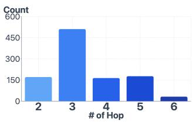
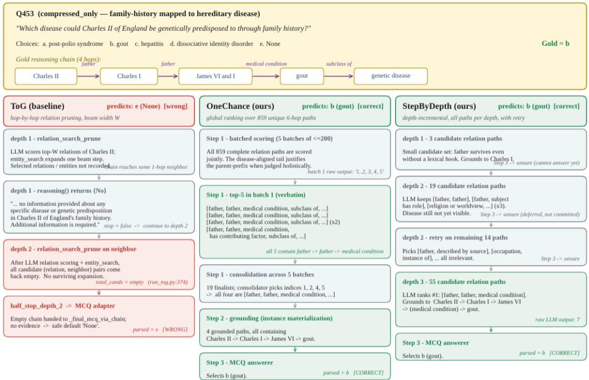

# HiddenPathQA: A Benchmark for Knowledge Graph Question Answering When Questions Hide Their Paths

Sumin Jo, Edward Choi KAIST {ekrxjwh2009,edwardchoi}@kaist.ac.kr

## Abstract

Knowledge graph question answering (KGQA) systems are typically evaluated on questions whose surface tokens lexically expose the gold KG path. Users, however, may ask questions without knowing the underlying schema: “Which condition could Andrew have due to family history?” compresses a 4-hop chain “Andrew father father medical condition subclass of parent → grandparent → disease → hereditary disorder” into a single phrase (family history) whose tokens name none of those relations. We show that this collapse of path–question alignment is a blind spot of existing KGQA evaluation. Three major Large Language Model (LLM)–KG paradigms—hop-by-hop KG exploration, plan-then-retrieve, and similarity-based retrieval—all implicitly rely on the question’s surface leaking the gold path, an assumption rarely tested in practice. To study this failure mode, we make three contributions. (i) We introduce HiddenPathQA, a manually verified benchmark of 1,055 multi-hop questions spanning 2–6 hops and multiple domains, constructed so that the question surface does not reveal the gold path’s relations. (ii) We propose Holistic Path Selection, which compares the question against candidate relation chains in the local subgraph as complete units, replacing irreversible per-hop relation scoring with globally informed chain-level reasoning. We develop two implementations, TieredHolistic and FlatHolistic. (iii) We conduct a pseudoword stress test that replaces entity names with meaningless placeholder tokens, allowing us to distinguish KG-grounded reasoning from entity-level memorization. Holistic Path Selection outperforms six strong KGQA baselines(ToG, PoG, FiDeLiS, R2- KG, KAPING, KARPA) by 8.8–17.9 accuracy points across two LLM backbones and both the original and pseudoword settings. Its advantage under pseudoword replacement shows that the gains cannot be explained by entity-level memorization alone. The dataset and code are publicly available at GitHub and HuggingFace

## 1 Introduction

## 1.1 Three paradigms, one shared assumption

Recent prompt-based KG-augmented LLM methods for KGQA can be characterized along three broad paradigms.<sup>1</sup> (i) Hop-by-hop KG exploration approaches, which form the dominant paradigm in recent LLM-based KGQA research, such as ToG [19], PoG [7], FiDeLiS [18], and R2-KG [15], let the LLM interact with the KG over multiple hops, at each hop selecting a small set of promising relations and expanding the search frontier. (ii) Plan-then-retrieve approaches, such as KARPA [10] and RoG [16], first prompt the LLM to produce a relation-level plan or candidate relation paths and then ground the plan to executable KG paths via similarity between the LLM’s plan tokens and KG relation labels. (iii) Similarity-based evidence retrieval approaches, such as KAPING [4] and DiFaR [3], encode the question and KG facts (triples or paths) into a shared dense embedding space and retrieve the top-ranked evidence by vector similarity, which is then provided to the LLM as context. Although these paradigms differ algorithmically, they share an implicit dependence on the surface form of the question: retrieval or exploration is easier when the question contains lexical cues that either name the relevant relations, guide relation-path planning, or place the question close to the supporting KG facts in embedding space. We refer to this shared property as the path–question lexical alignment assumption.

This assumption is largely satisfied by existing benchmarks. Consider the MetaQA [26] query “the films written by the screenwriter of[To Catch a Thief] were directed by who?”, which all but spells out the relation sequence written by → written by → directed by. Under such lexical alignment, all three paradigms work well: stepwise pruning recovers the correct relation at each hop from the question surface alone, plan-then-retrieve produces a relation plan that grounds to the gold sequence, and embedding retrieval easily ranks the matching triples on top.

## 1.2 When the assumption breaks: a real-world example

In practice, users do not know the KG schema, and their questions are rarely as KG-aligned as benchmark queries suggest. Consider the real-world query “Which condition could Andrew have due tofamily history?”, whose actual KG path is

$$
\begin{array} { r l } & { \mathrm { A n d r e w } \to ( f a t h e r ) \to \mathrm { A n d r e w } ^ { * } \mathrm { s } \mathrm { p a r e n t } \to ( f a t h e r ) \to \mathrm { A n d r e w } ^ { * } \mathrm { s } \mathrm { g r a n d p a r e n t } \to } \\ & { ( m e d i c a l \ c o n d i t i o n ) \to \mathrm { D i s e a s e } \to ( s u b c l a s s \ o f ) \to \mathrm { h e r e d i t a r y } \mathrm { d i s o r d e r } . } \end{array}
$$

No surface token in the question corresponds tofather, medical condition, or subclass of: the single phrase “family history” compresses an entire 4-hop chain into one expression. We call this regime alignment collapse. Under it, each paradigm is pulled toward a different wrong attractor. The 1-hop relations of Andrew include father (gold) alongside occupation, given name, family name, family, cause of death, and medical condition...etc. (i) hop-by-hop KG exploration prompts the LLM to prune this set against “family history” at each hop independently. The LLM may retain father at hop 1 via semantic association, but at hop 2—now expanding from Andrew’s parent—the question offers no fresh signal to repeatfather; having already moved “through family,” the LLM transitions to medically salient relations such as medical condition or cause of death. The chain breaks not because hop 1 is hard, but because per-hop scoring has no mechanism to recognize that the same relation(father) must be applied twice—a structural blind spot independent of the LLM’s strength. (ii) Plan-then-retrieve paraphrases “family history” as a medical concept and emits a hop-1 plan such as cause of death or medical condition; embedding-based grounding then locks the plan onto the wrong relation. (iii) Similarity-based retrieval suffers from token-level overlap between “family history” and the spurious relationsfamily name andfamily, which dominate the top-k and push the gold first-hop triple out.

The three paradigms thus fail through different attractors—LLM commitment failure, semantic paraphrase, and lexical-overlap distractor—but the cause is the same: the question carries no signal pointing to parents, leaving each paradigm to substitute its own prior. Without prior knowledge of the KG schema, the only reliable way to recover the gold path is to consider the entire local graph around Andrew jointly, rather than commit early on the basis of any local fragment of it. We verify these mechanisms quantitatively across paradigms in §4.2.

## 1.3 Our benchmark: HIDDENPATHQA

What remains genuinely unsolved is whether KGQA systems can recover the correct path when the question hides it— when multiple hops are compressed into a single phrase, when the relevant relations share no surface form with the question, and when the LLM cannot fall back on lexical shortcuts. Existing KGQA benchmarks, despite covering a wide range of difficulty axes, do not explicitly control how much of the gold KG path is leaked through the question’s surface tokens; we provide a detailed comparison in §2 and Figure 1. We introduce HIDDENPATHQA, a human-validated benchmark of 1,055 multi-hop(2–6 hops) KGQA questions whose design deliberately restricts path– question lexical alignment: the relations on the gold path are not present as tokens in the question. This forces models to reason over the full chain rather than match keywords. We instantiate the principle through three question types—compressed-only, cause-and-effect, and intermediate-node (defined and exemplified in §3.3)—and present each item as a five-way multiple-choice question.

<table><tr><td rowspan=1 colspan=1>Benchmark</td><td rowspan=1 colspan=1>Backbone KG</td><td rowspan=1 colspan=1>Hop</td><td rowspan=1 colspan=1>Size</td><td rowspan=1 colspan=1>CommonSense</td><td rowspan=1 colspan=1>Lex.Gap</td><td rowspan=1 colspan=1>Question Example</td><td rowspan=1 colspan=1>Inference Graph</td></tr><tr><td rowspan=1 colspan=1>WebQSP</td><td rowspan=1 colspan=1>Freebase</td><td rowspan=1 colspan=1>1-2</td><td rowspan=1 colspan=1>4,737</td><td rowspan=1 colspan=1>×</td><td rowspan=1 colspan=1>Low</td><td rowspan=1 colspan=1>who voiced meg on family guy?</td><td rowspan=1 colspan=1>Family Guy —(tv.tv_program.regular_cast)—&gt; [CVT y-]—(tv.regular_tv_appearance.actor)—&gt; ?actor(tv.regular_tv_appearance.character)— Meg Griffin (filter)</td></tr><tr><td rowspan=1 colspan=1>CWQ</td><td rowspan=1 colspan=1>Freebase</td><td rowspan=1 colspan=1>2-4</td><td rowspan=1 colspan=1>34,689</td><td rowspan=1 colspan=1>X</td><td rowspan=1 colspan=1>Low</td><td rowspan=1 colspan=1>Which Robert Pattinson film was produced byErwin Stoff?</td><td rowspan=1 colspan=1>Robert Pattinson —(film.actor.filn)—&gt; 7film (filn.film.produced_by)— ErwinStoff</td></tr><tr><td rowspan=1 colspan=1>MetaQA</td><td rowspan=1 colspan=1>WikiMovies</td><td rowspan=1 colspan=1>1-3</td><td rowspan=1 colspan=1>~400k</td><td rowspan=1 colspan=1>X</td><td rowspan=1 colspan=1>Low</td><td rowspan=1 colspan=1>The actor of Lost Christmas also starred in whichmovies?</td><td rowspan=1 colspan=1>Lost Christmas —(starred_actors)— Jason Flemyng —(starred_actors)— ?movie(ex, Shifty)</td></tr><tr><td rowspan=1 colspan=1>GrailQA</td><td rowspan=1 colspan=1>Freebase</td><td rowspan=1 colspan=1>1-4</td><td rowspan=1 colspan=1>64,331</td><td rowspan=1 colspan=1>X</td><td rowspan=1 colspan=1>Low†</td><td rowspan=1 colspan=1>How many titles from Netflix share the genre ofThe Big Hustle?</td><td rowspan=1 colspan=1>The Big Hustle + (tv.program.genre) → ?g + (tv.program.genre) + ?t +(tv.program.distributor) - Netflix ; CoUNT(?t)</td></tr><tr><td rowspan=1 colspan=1>KQA Pro</td><td rowspan=1 colspan=1>FB15k + Wikidata</td><td rowspan=1 colspan=1>1-5</td><td rowspan=1 colspan=1>117,970</td><td rowspan=1 colspan=1>X</td><td rowspan=1 colspan=1>Lowt</td><td rowspan=1 colspan=1>when did Cleveland Cavaliers pick up LeBronJames?</td><td rowspan=1 colspan=1>LeBron James → (drafted_by) - Cleveland Cavaliers; qualifier: (point_in_time)</td></tr><tr><td rowspan=1 colspan=1>FreeBaseQA</td><td rowspan=1 colspan=1>Freebase</td><td rowspan=1 colspan=1>1-2</td><td rowspan=1 colspan=1>28,348</td><td rowspan=1 colspan=1>×</td><td rowspan=1 colspan=1>Low</td><td rowspan=1 colspan=1>Which 18th-century author wrote Clarissa, said tobe the longest novel in English?</td><td rowspan=1 colspan=1>Clarissa + (book.written_work.author) + Samuel Richardson</td></tr><tr><td rowspan=1 colspan=1>SimpleDBpediaQA</td><td rowspan=1 colspan=1>DBpedia</td><td rowspan=1 colspan=1>1</td><td rowspan=1 colspan=1>43,086</td><td rowspan=1 colspan=1>X</td><td rowspan=1 colspan=1>Low</td><td rowspan=1 colspan=1>Where did Jack Carr die?</td><td rowspan=1 colspan=1>Jack Carr + (dbo:deathPlace) - England</td></tr><tr><td rowspan=1 colspan=1>LC-QuAD 2.0</td><td rowspan=1 colspan=1>DBpedia / Wikidata</td><td rowspan=1 colspan=1>1-2</td><td rowspan=1 colspan=1>30,000</td><td rowspan=1 colspan=1>×</td><td rowspan=1 colspan=1>Low</td><td rowspan=1 colspan=1>What is the name of the sister city tied to KansasCity, which is located in the county of SevilleProvince?</td><td rowspan=1 colspan=1>Kansas City → (P190: sister city) → 7obj + (P131: located in) + Province ofSeville</td></tr><tr><td rowspan=1 colspan=1>MINTQA</td><td rowspan=1 colspan=1>Wikidata</td><td rowspan=1 colspan=1>1-4</td><td rowspan=1 colspan=1>28,366</td><td rowspan=1 colspan=1>X</td><td rowspan=1 colspan=1>Low</td><td rowspan=1 colspan=1>In which industry does the publisher of ScramKitty and his Buddy on Rails operate?</td><td rowspan=1 colspan=1>Scram Kitty- → (P123: publisher) → Dakko Dakko + (P452: industry) + video gameindustry</td></tr><tr><td rowspan=1 colspan=1>CR-LT-KGQA</td><td rowspan=1 colspan=1>Wikidata</td><td rowspan=1 colspan=1>1-3</td><td rowspan=1 colspan=1>350</td><td rowspan=1 colspan=1>V</td><td rowspan=1 colspan=1>Low</td><td rowspan=1 colspan=1>Could someone in Victor Pozner&#x27;s hometown takea taxi to the Jamjuree Art Gallery?</td><td rowspan=1 colspan=1>Victor Pozner - (place of birth) → Vaughan → (country) → Canada; Jamjuree ArtGallery - (country) → Thailand; external: (taxi feasibility)</td></tr><tr><td rowspan=1 colspan=1>HiddenPathQA (Ours)</td><td rowspan=1 colspan=1>Wikidata</td><td rowspan=1 colspan=1>2-6</td><td rowspan=1 colspan=1>1,055</td><td rowspan=1 colspan=1>▲</td><td rowspan=1 colspan=1>High</td><td rowspan=1 colspan=1>Q: For which condition does irbesartan haveestablished clinical benefit?</td><td rowspan=1 colspan=1>irbesartan - (physically interacts with) + angiotensin II... - (encoded by) -AGTR1 → (genetic association) - arterial hypertension</td></tr></table>

Figure 1: Overview of KGQA benchmarks alongside HIDDENPATHQA. Red = entities/relations appearing (almost) verbatim in both the question and the inference graph (low lexical gap). Blue = entities/relations appearing in only one of the two (high lexical gap). Low<sup>†</sup>: questions derived from a logical form, where surface overlap is reduced but path–question alignment is preserved at the logical-form level. ▲: HIDDENPATHQA does not test commonsense, but uses compressed expressions (e.g., aunt-in-law) that the LLM must interpret to recover the correct relation chain.

## 1.4 Our method: Holistic Path Selection

We address this failure mode head-on. Instead of committing to relations on the basis of local cues, we present all candidate relation chains around the topic entity to the LLM at once and let it select the answer chain globally in a small number of inference steps. We call this paradigm Holistic Path Selection and provide two implementations TIEREDHOLISTIC and FLATHOLISTIC, differing only in how chains are exposed across depths (§3.5). Crucially, neither variant prunes candidates at intermediate hops: every chain reachable up to the current depth remains visible to the LLM in one view, so no relation is irreversibly discarded based on hop-local cues. The simplicity is intentional: when the question surface is compressed, hop-level local cues are noise, and global chain semantics is the actual signal.

## 2 Related Benchmarks

Axes of difficulty in prior benchmarks. Figure 1 compares recent KGQA benchmarks alongside HIDDENPATHQA. Hop depth and multi-hop composition: WebQSP [24] pioneered semantic parsing over Freebase [5] with short multi-hop queries; CWQ [20] extends WebQSP with compositional questions of higher reasoning depth; MetaQA [26] templated multi-hop questions in a closed movie-domain KG. Compositional and schema generalization: GrailQA [11] explicitly probes i.i.d., compositional, and zero-shot generalization across Freebase schema items. Logical and SPARQLstyle operations: KQA Pro [6] targets multi-step logical reasoning with aggregation and comparison; LC-QuAD 2.0 [9] pairs natural questions with executable SPARQL queries over DBpedia [1] and Wikidata [21]. Large-scalefactoid coverage: FreeBaseQA [14] and SimpleDBpediaQA [2] supply large pools of shallow factoid questions for broad-coverage evaluation. Knowledge unfamiliar to LLMs: MINTQA [13] isolates new and long-tail knowledge—entities that appear rarely in pretraining corpora and are thus unlikely to be memorized by pretrained LLMs. Commonsense+KG fusion: CR-LT-KGQA [12] requires combining KG facts with commonsense reasoning over long-tail entities.

  
(a) Domain distribution

  
(b) Hop distribution

<table><tr><td>Type</td><td>Count</td></tr><tr><td>Compressed-only</td><td>644</td></tr><tr><td>Cause-and-effect</td><td>250</td></tr><tr><td>Intermediate-node</td><td>161</td></tr><tr><td>Total</td><td>1,055</td></tr></table>

(c) Question type distribution  
Figure 2: Dataset statistics of HIDDENPATHQA

The missing axis: path–question alignment. Across these axes, questions tend to retain lexical traces of the gold KG path on the surface, as illustrated in Figure 1: relation labels and intermediate entity names recur as tokens in the question, so a model can recover much of the path without traversing the KG. This leakage is built into how the questions are constructed, not a side effect: standard pipelines—whether they start from a logical form, a sampled KG path, or a human-written question later mapped to the KG—never restrict which relation names or intermediate entities are allowed to appear in the final question. No prior benchmark adds such a restriction, so none can measure how KGQA methods perform when this surface alignment is removed. This restriction is orthogonal to long-tail benchmarks (MINTQA, CR-LT-KGQA), which retain question–path lexical alignment: rare entities or near-synonymous relation paraphrases (e.g., hometown↔place ofbirth) only narrow the lexical gap, leaving it well within reach of standard embedding retrievers. HIDDENPATHQA instead disallows relation labels and intermediate entities from appearing on the question’s surface, widening the gap beyond what paraphrase can bridge, and extends reasoning depth to 6 hops, beyond the 3–4 hop ceiling of prior multi-hop KGQA benchmarks. We describe how HIDDENPATHQA operationalizes this restriction in §3.2.

## 3 The HIDDENPATHQA Benchmark

## 3.1 Preliminaries

We use Wikidata [21] as our backbone KG. A KG is a directed labeled graph $G = ( V , E )$ in which V is a set of entities and $E \subseteq V \times \mathcal { R } \times V$ is a set of triples $( h , r , t )$ , where $h , t \in { \dot { V } }$ are the head and tail entities and $r \in \mathcal { R }$ is a relation from a fixed relation vocabulary R. An d-hop path p is a sequence of d consecutive triples $e _ { 0 } \xrightarrow { r _ { 1 } } \cdot \cdot \cdot \xrightarrow { r _ { d } } e _ { d }$ with all $( e _ { i - 1 } , r _ { i } , e _ { i } ) \in E ;$ we call $( r _ { 1 } , \ldots , r _ { d } )$ its relation chain and $e _ { 1 } , \ldots , e _ { d - 1 }$ its intermediate entities. We use node and entity interchangeably and consider only simple paths (no repeated entity) throughout. A topic entity is an entity explicitly named in the question Q.

## 3.2 Construction pipeline

HIDDENPATHQA keeps the standard path→question construction direction but inserts a compressibility filter between the two: for each candidate path, we first ask whether the multi-hop chain admits a compressed lay phrasing in which the path’s relations no longer surface as tokens. The filter operates in two stages: an LLM-based feasibility check screens candidate paths (GPT-5-mini [17]); the LLM then drafts a compressed question for each surviving path, and the authors manually verify the resulting (path, question) pair before it enters the released benchmark. As a result, the released questions are not paths converted under a generation prompt, but paths selectedfor their amenability to compression and items verified for faithful compressed phrasing.

Step 1 — Domain selection. We select various domains including anatomy, disease, law, and people (Figure 2). Each domain satisfies two criteria: (i) it admits a sufficient number of type-stable Wikidata entities; (ii) the domain has a well-defined set of characteristic predicates that we can enumerate up front (e.g., mother, spouse, educated at for the people domain).

Step 2 — Seed entity & path enumeration. We sample approximately 700 seed entities per domain and enumerate simple paths of hop 2–6 from each seed. This yields 85,320 candidate paths.

<table><tr><td>Type</td><td>Question / Reasoning Path</td><td>Choices (a,b,c,d,e)</td></tr><tr><td rowspan="2">(a) Compressed-only</td><td>Q. Betaxolol hydrochloride can treat which disease? Path. betaxolol HCl →(physically interacts with)→ adrenoceptor β1 →(encoded by)→ ADRB1 →(genetic association)→ arterial hypertension.</td><td>(d) keratosis follicularis (e) None</td></tr><tr><td>Q. If MBNL1 is altered, which gender could be affected more severely: men or women? Path. MBNL1 →(genetic association)→ myotonic dystrophy →(subclass of)→ male reproductive system disease.</td><td>(a) women (b) men (c) ...</td></tr><tr><td rowspan="2">(b) Cause-and-effect</td><td>(NARRATIVE) Q. Through which environmental issue do greenhouse gases most plausibly lead to a social issue? Path. greenhouse gas →(has effect)→ global warming →(instance of)→ environmental issue →(subclass of)→ social issue.</td><td>(a) . .. human health... (b) Greenhouse gas emissions have effect... (c) . . . disease outbreaks...</td></tr><tr><td>(CoUNTERFACTUAL) Q. If Robert of Beverley had never existed, which Catholic church building would most plausibly be missing or delayed? Path. R. of Beverley →(notable work)→ Westminster Abbey →(instance of)→ collegiate church →(subclass of)→ Catholic church bldg.</td><td>(a) ... (b) Westminster Abbey (c) ... (d) conventual church (e) ...</td></tr><tr><td>(c) Intermediate-node</td><td>Q. Both Francesco Salvolini and Gustav Seyffarth are associated with which academic discipline? Path. Francesco Salvolini →(student of)→ J.-F. Champollion →(field of work)→ Egyptology; Gustav Seyffarth →(field of work)→ Egyptology.</td><td>(a) ... (b) Egyptology (d) sociolinguistics (e) None</td></tr></table>

Table 1: Representative examples of HIDDENPATHQA three question types. The correct option is highlighted in green; gold paths are shown in blue.

Step 3 — Compressibility check & path-to-question generation. For each seed entity, we route two pools of paths through the pipeline: (i) the top-20 paths whose relation sequences are rarest across the full path corpus, to encourage diverse question phrasings, and (ii) 100 additionally sampled paths drawn uniformly at random, for broad coverage. Each candidate path p is processed in two sub-steps:

(3a) LLM-based compressibility check. We prompt<sup>2</sup> the LLM to decide whether p admits a compressed lay phrasing in which the path’s relations are not lexically present in the question. Paths that the model judges non-compressible are discarded at this stage.

(3b) Question generation. For each path that passes the compressibility check, the LLM generates one compressed natural-language question. This step produces approximately 7,600 candidate questions.

Step 4 — Manual verification. The authors—AI PhD researchers familiar with the relevant domain ontologies—review every candidate against three criteria(C1-3), which together define what counts as a valid HIDDENPATHQA instance. After this step, 1,055 of 7,615 candidates are retained.

(C1) Restricted path–question alignment. The path’s relations must not be recoverable from the question by lexical or near-synonymous matching, so that answering requires genuine multi-hop reasoning. We re-check the LLM judgment from Step 3a manually. For example, in the question “Which disease could Ludwig von der Pfalz be genetically predisposed to through family history?”, the gold path containsfather, mother, medical condition, and subclass of—none of which appears as a token; the entire 5-hop chain is compressed into the single phrase “family history.”

(C2) Multi-hop guarantee (no 1-hop shortcut). Every gold path is 2–6 hops, and we discard any question for which a 1-hop relation between the same entity pair already exists in Wikidata. For example, for “What disease can thalidomide help with?” the intended multi-hop path is thalidomide →(physically interacts with)→Cereblon →(encoded by)→CRBN →(genetic association)→multiple myeloma, but a 1-hop thalidomide →(medical condition treated)→multiple myeloma edge exists, so the question is rejected.

(C3) Question–path semantic alignment. The compressed phrasing must accurately summarize the path’s meaning in fluent, natural-sounding language. When a path passes (C1) and (C2) but the LLM-drafted question reads awkwardly or under-specifies the intent, the authors lightly edit the question to improve fluency while preserving its compressed phrasing (i.e., without reintroducing tokens from the path’s relations).

Step 5 — Distractor generation. For each retained question we generate three content distractors plus a fixed (e) None option. Distractor entities are chosen so that surface-level shortcuts are insufficient: they share the entity type of the gold answer and lie on the gold or adjacent paths. For questions whose options are sentence-form causal narratives, we relax type matching and prompt an LLM with the gold path and selected distractor entities to synthesize full causal chains rather than single-entity swaps. A subset of questions is additionally converted into None-answer items by replacing the gold entity in the candidate set with an additional type-matched distractor, leaving the question and gold path intact<sup>3</sup>.

## 3.3 Question types

HIDDENPATHQA defines three question types, each capturing a distinct mode of path–question alignment collapse: (a) compressed-only, where an N-hop relation chain is lexically summarized into one or two surface tokens; (b) cause-and-effect, where the question requires the interpretation of the multi-hop chain rather than retrieval of any single node — either a narration of the path or a counterfactual reading of what would not exist absent some entity; and (c) intermediate-node, where the question gives two topic entities and asks how they are connected, requiring the model to uncover an unstated bridging concept that the question itself does not name. Table 1 shows the examples<sup>4</sup>.

## 3.4 Holistic Path Selection (Our Method)

Rather than prune hop-by-hop KG exploration or rely on embedding-based retrieval, our method presents all candidate relation chains reachable from the topic entity to the LLM at once and lets the model select the answer chain holistically. Let $G _ { q }$ denote the per-question local subgraph induced by the topic entity $( \ S 4 . 1 ) , \mathbf r = \left( r _ { 1 } , \ldots , r _ { d } \right)$ the relation chain of a d-hop path in $\bar { G _ { q } } , \bar { \mathcal { L } } _ { t } \subseteq \mathcal { R }$ the relations available at $e _ { t - 1 }$ , and C the set of all candidate relation chains in $G _ { q }$ reachable from the topic entity. hop-by-hop KG exploration factorizes the joint, while our method estimates it directly:

$$
\underbrace { P ( \mathbf { r } \mid Q , G _ { q } ) \approx \prod _ { t = 1 } ^ { d } P ( r _ { t } \mid Q , e _ { t - 1 } , \mathcal { L } _ { t } ) } _ { \mathrm { h o p - b y - h o p } } \quad \mathrm { v s . } \quad \underbrace { P ( \mathbf { r } \mid Q , G _ { q } ) \approx P ( \mathbf { r } \mid Q , \mathcal { C } ) } _ { \mathrm { h o l i s t i c ~ ( o u r s ) } } .
$$

This trades hop-level cues for whole-against-whole alignment between the question and the full chain, eliminating the early commitments that propagate errors in stepwise pruning. It also bypasses the embedding-based retrieval bottleneck by presenting chains as plain text to an off-the-shelf LLM, requiring no KG-specific training.

## 3.5 A Three-Stage Pipeline of Holistic Path Selection

We realize the holistic objective through three LLM calls operating at increasing levels of grounding. Let ${ \mathcal { P } } _ { \mathbf { r } } = \{ p \in G _ { q } : \operatorname { r e l } ( { \dot { p } } ) _ { 1 : | \mathbf { r } | } = \mathbf { r } \}$ denote the paths in $\bar { G } _ { q }$ whose relation prefix matches r, and $\tau : V  T$ a type lookup, where T is the set of entity types. Hyperparameters ${ \bf { \bar { \phi } } } _ { K _ { 1 } }$ and $K _ { 2 }$ bound the number of chains and paths retained at Steps 1 and 2, respectively.

Step 1 – Schema-level chain selection. Each candidate chain $\mathbf { r } \in \mathcal { C }$ at depth d is shown to the LLM under the topic-typed serialization

$$
\sigma _ { 1 } ( \mathbf { r } ) ~ = ~ e _ { 0 } { : } [ \tau ( e _ { 0 } ) ] \stackrel { r _ { 1 } } { \longrightarrow } [ \hat { \tau } _ { 1 } ] \stackrel { r _ { 2 } } { \longrightarrow } { } ~ \cdot ~ \cdot ~ \stackrel { r _ { d } } { \longrightarrow } [ \hat { \tau } _ { d } ] ,\tag{1}
$$

where $\hat { \tau } _ { i }$ is the modal entity type at hop i across $\mathcal { P } _ { \mathbf { r } }$ . Only the topic $e _ { 0 }$ is grounded by surface form; downstream slots reveal types only, so the model commits to chains by relational structure rather than guessing surface forms. The LLM returns

$$
\mathcal { C } ^ { * } = \mathrm { L L M _ { 1 } } \big ( Q , \{ \sigma _ { 1 } ( \mathbf { r } ) \} _ { \mathbf { r } \in \mathcal { C } } \big ) \subseteq \mathcal { C } , \qquad | \mathcal { C } ^ { * } | \leq K _ { 1 } .
$$

Step 2 – Grounded path selection. Selected chains are expanded to grounded paths $\scriptstyle { \mathcal { P } } ^ { * } = \bigcup _ { \mathbf { r } \in { \mathcal { C } } ^ { * } } { \mathcal { P } } _ { \mathbf { r } }$ and re-serialized with full instantiation

$$
\sigma _ { 2 } ( p ) = e _ { 0 } { : } [ \tau ( e _ { 0 } ) ] \stackrel { r _ { 1 } } { \longrightarrow } e _ { 1 } { : } [ \tau ( e _ { 1 } ) ] \cdot \cdot \cdot \stackrel { r _ { d } } { \longrightarrow } e _ { d } { : } [ \tau ( e _ { d } ) ] .\tag{2}
$$

The LLM selects

$$
\begin{array} { r l r } { \mathcal { P } ^ { * * } \ = \ \mathrm { L L M } _ { 2 } \big ( Q , \{ \sigma _ { 2 } ( p ) \} _ { p \in \mathcal { P } ^ { * } } \big ) , \ } & { { } } & { | \mathcal { P } ^ { * * } | \leq K _ { 2 } , } \end{array}
$$

Step 3 – Answer commitment. At this final stage the LLM additionally observes the answer choices $\boldsymbol { \mathcal { A } } = \{ a , b , c , d , e \}$ , together with the question Q and the grounded paths from Step 2, and commits to one option:

$$
\hat { a } \ = \ \operatorname { L L M } _ { 3 } \big ( Q , \mathcal { A } , \{ \sigma _ { 2 } ( p ) : p \in \mathcal { P } ^ { * * } \} \big ) .\tag{3}
$$

The two serializations $\sigma _ { 1 } , \sigma _ { 2 }$ induce a deliberate information hierarchy: Steps 1 and 2 see only the question and the KG paths, and A enters the pipeline only at Step 3. Each step’s role—chain selection, instance filtering, and answer decision—is thus structurally separated, and retrieval cannot be steered by surface cues from the answer options.

Two scheduling variants. We pair this three-stage backbone with two outer loops differing primarily in how C is exposed to Step 1. FLATHOLISTIC feeds the entire C to Step 1 in one shot, regardless of depth, and retries the full pipeline up to T times whenever Step 3 emits unsure; each retry excludes chains selected in previous attempts. TIEREDHOLISTIC instead runs the pipeline in a depth loop $d = 2 , \ldots , D $ , exposing only the depth-d chain set ${ \mathcal { C } } _ { d } = \{ \mathbf { r } \in { \mathcal { C } } : | \mathbf { r } | = d \}$ at each depth, advancing to d+1 on unsure and treating any of a–e as a commit at the current depth<sup>5</sup>.

## 4 Experiments

## 4.1 Evaluation protocol

$$
\begin{array} { r } { \mathrm { A c c . } = \frac { \mathrm { \# } \mathrm { c o r r e c t } } { \mathrm { \# } \mathrm { t o t a l } } , \quad \mathrm { A R } = \frac { \mathrm { \# } \mathrm { a n s w e r e d } } { \mathrm { \# } \mathrm { t o t a l } } , \quad \mathrm { S A } = \frac { \mathrm { \# } \mathrm { c o r r e c t } } { \mathrm { \# } \mathrm { a n s w e r e d } } , \quad \mathrm { \# } \mathrm { t o t a l } = \mathrm { \# } \mathrm { a n s w e r e d } + \mathrm { \# } \mathrm { u n a n s w e r e d } . } \end{array}
$$

Metrics. We report three metrics: Accuracy(AC) is reported for every method. AnswerRate(AR) and SelectiveAccuracy(SA) are only meaningful for methods that support an explicit abstention mechanism—i.e., methods that can deliberately refuse to answer(unanswered) when their internal evidence is insufficient, which in our evaluation applies to R2-KG [15] and Holistic Path Selection.

Per-question subgraphs. HIDDENPATHQA provides topic entities for every question, so all methods begin exploration from the topic-entity neighborhood; nodes unreachable within a reasonable hop budget cannot participate in the gold path or in any retrieval trajectory we observed. We therefore evaluate all methods on a pre-extracted per-question subgraph ${ \bar { G } } _ { q } \ \subseteq { \bar { G } } .$ , anchored at the topic entities of q and guaranteed to contain the gold reasoning path; the union of these subgraphs covers roughly 68K entities. This protocol is consistent with recent KGQA benchmarks [12, 8, 25] and methods [16, 18, 7]<sup>6</sup>.

Path-conditioned upper bound. We additionally report the accuracy obtained when the gold path is provided to the LLM together with the question. This quantifies the dataset’s ambiguity ceiling: any deviation from 100% reflects either dataset noise or the LLM’s residual reasoning limits even when given the answer path.

Pseudoword analysis (dataset self-containedness check). To verify that HIDDENPATHQA is solvable from KG structure alone, we additionally evaluate all methods on a pseudoword variant of the benchmark, in which every non-type entity surface form(both for $G _ { q }$ and Q) is replaced with a meaningless pseudo-token, while type entities (those appearing as the object of instance of or subclass of edges) and all relation labels are kept intact. For instance, Original-split: THALIDOMIDE instance of STEREOISOMERS MIXTURE becomes Pseudoword-split:E\_0321 instance of STEREOISOMERS MIXTURE. This preserves the schema-level information needed to identify what kind ofthing each entity is, while removing identifying surface cues that an LLM could match against external parametric memory.

<table><tr><td rowspan="2">Paradigm</td><td rowspan="2">Method</td><td colspan="2">Qwen3-32B</td><td colspan="2">GPT-5-mini</td></tr><tr><td>Original</td><td>Pseudoword</td><td>Original</td><td>Pseudoword</td></tr><tr><td rowspan="2">Closed-book</td><td>Zero-shot</td><td>63.8</td><td>25.2</td><td>66.6</td><td>25.7</td></tr><tr><td>CoT [22]</td><td>64.6</td><td>25.3</td><td>69.1</td><td>23.1</td></tr><tr><td>Plan-then-retrieve</td><td>KARPA [10]</td><td>40.1</td><td>28.0</td><td>44.3</td><td>36.0</td></tr><tr><td>Similarity retrieval</td><td>KAPING [4]</td><td>69.1†</td><td>45.4</td><td>70.1†</td><td>41.7†</td></tr><tr><td rowspan="4">hop-by-hop KG exploration</td><td>ToG [19]</td><td>50.2</td><td>29.0</td><td>55.1</td><td>32.4</td></tr><tr><td>PoG [7]</td><td>66.4</td><td>47.3</td><td>65.7</td><td>37.7</td></tr><tr><td>FiDeLiS [18]</td><td>42.7</td><td>31.1</td><td>46.6</td><td>34.9</td></tr><tr><td>R2-KG [15]</td><td>64.7</td><td>47.5†</td><td>66.6</td><td>40.9</td></tr><tr><td rowspan="2">Holistic Path Selection(Ours)</td><td>TIEREDHOLISTIC</td><td>74.9</td><td>56.0</td><td>82.5</td><td>59.6</td></tr><tr><td>FLATHOLISTIC</td><td>78.5</td><td>56.3</td><td>74.0</td><td>51.5</td></tr><tr><td>Oracle</td><td>UpperBound</td><td>96.5</td><td>91.7</td><td>97.9</td><td>90.1</td></tr></table>

Table 2: Accuracy on HIDDENPATHQA for both Original split and Pseudoword split. Bold = best, underline = second-best, <sup>†</sup> = third-best per column (excluding the Oracle).

Experimental Setting. All methods, including baselines and ours, call the same two LLMs through an identical chat-completion interface: (1) GPT-5-mini [17] with reasoning\_effort=minimal and verbosity=low, and (2) Qwen3-32B [23] with enable\_thinking=False to ensure fair comparison across baselines. For text embeddings, KAPING [4] and KARPA [10] use OpenAI’s text-embedding-3-small. All open-model experiments are conducted on 4×NVIDIA A100 80GB GPUs<sup>7</sup>. We set T = 2, D = 6 for FLATHOLISTIC and TIEREDHOLISTIC. For every baseline we adopt the official implementation released by the original authors and keep both the algorithm and the prompts essentially unchanged. We make two minimal modifications to fit our benchmark. First, since HIDDENPATHQA contains gold paths of up to 6 hops, we extend the default beam-search depth of baselines (ToG, PoG, FiDeLiS, KARPA, KAPING, R2-KG) to 6 so that no gold path is structurally unreachable; all other hyperparameters (beam width, top-k, etc.) follow the original papers. Second, several baselines ship with few-shot exemplars written in Freebase[5] notation; we rewrite these exemplars to the Wikidata[21] surface form used in our backbone KG, preserving the original prompt structure and reasoning style. All KG methods (baselines and FLATHOLISTIC/TIEREDHOLISTIC) operate choice-blind: A is revealed only at the final answer-commitment step, preventing answerconditioned shortcuts from leaking into retrieval. ZEROSHOT and COT [22] receive A upfront, since they have no retrieval stage.

## 4.2 Results

The Pseudoword split removes entity-name shortcuts. Table 2 reports accuracy on HIDDEN-PATHQA across both backbones and both splits(Original vs. Pseudoword). Closed-book LLMs (Zero-shot, CoT) achieve 63.8–69.1% accuracy on the Original split but collapse to 23.1–25.7% on Pseudoword, indistinguishable from a trivial baseline that ignores the question entirely and always picks the most frequent answer letter (’b’, 26.0% of the data). This ∼40-point drop, observed consistently across both backbones, confirms that closed-book performance on Original is largely driven by memorized Wikidata content rather than reasoning. We therefore treat Pseudoword as the primary diagnostic split: it isolates KG-grounded reasoning from parametric priors and, for the same reason, is the split on which the paradigm-level comparisons below are most informative.

All three paradigms degrade under alignment collapse, with distinct severity. §1.2 pointed out that the three paradigms share a single underlying failure cause but differ in where the failure manifests. Table 2 shows that the Original-split numbers support this: three baselines spanning two paradigms fall below closed-book CoT (64.6/69.1)—FiDeLiS (42.7/46.6) and ToG (50.2/55.1) from hop-by-hop, and KARPA (40.1/44.3) from plan-then-retrieve, on Qwen/GPT—while the remaining baselines (PoG, R2-KG, KAPING) only match or slightly exceed it. A plausible reading is that retrieval errors in the underperforming methods override correct parametric memories, while verifieraugmented or globally-scoped retrieval is more robust to such interference. The Pseudoword split disentangles this from memorization. Once entity-name shortcuts are removed, all six KG-augmented baselines exceed closed-book CoT, yet the per-paradigm best on Pseudoword (GPT) remains tightly clustered—R2-KG 40.9 (hop-by-hop), KARPA 36.0 (plan-then-retrieve), KAPING 41.7 (similarity retrieval), within a 5.7-point band and all ≥ 17.9 points below TIEREDHOLISTIC. Two implications follow. First, KG benefit is real for every paradigm under alignment collapse, but its magnitude depends more on retrieval/verification strategy than on paradigm category. Second, no prior paradigm escapes the alignment-collapse ceiling<sup>8</sup>.

<table><tr><td></td><td colspan="6">Qwen3-32B</td><td colspan="6">GPT-5-mini</td></tr><tr><td></td><td colspan="3">Original</td><td colspan="3">Pseudoword</td><td colspan="3">Original</td><td colspan="3">Pseudoword</td></tr><tr><td>Method</td><td>Acc</td><td>AR</td><td>SA</td><td>Acc</td><td>AR</td><td>SA</td><td>Acc</td><td>AR</td><td>SA</td><td>Acc</td><td>AR</td><td>SA</td></tr><tr><td>R2-KG</td><td>64.7†</td><td>85.6†</td><td>75.6†</td><td>47.5†</td><td>94.9</td><td>50.0†</td><td>66.6†</td><td>96.8</td><td>68.9†</td><td>40.9†</td><td>97.7</td><td>41.8†</td></tr><tr><td>TIEREDHOLISTIC</td><td>74.9</td><td>97.2</td><td>77.1</td><td>56.0</td><td>91.9†</td><td>60.9</td><td>82.5</td><td>96.6†</td><td>85.4</td><td>59.6</td><td>92.2†</td><td>64.6</td></tr><tr><td>FLATHOLISTIC</td><td>78.5</td><td>99.4</td><td>78.9</td><td>56.3</td><td>99.5</td><td>56.6</td><td>74.0</td><td>99.8</td><td>74.2</td><td>51.5</td><td>100.0</td><td>51.5</td></tr></table>

Table 3: Accuracy (Acc), answer rate (AR), selective accuracy (SA) for methods with explicit abstention mechanisms on HIDDENPATHQA and R2-KG. Bold = best, underline = second-best, <sup>†</sup> = third-best per column.

<table><tr><td></td><td colspan="2">Qwen3-32B</td><td colspan="2">GPT-5-mini</td></tr><tr><td>Method</td><td>Path F1</td><td>AC-Path F1</td><td>Path F1</td><td>AC-Path F1</td></tr><tr><td>KARPA</td><td>28.6</td><td>31.9</td><td>35.4</td><td>39.6</td></tr><tr><td>KAPING</td><td>43.8</td><td>47.2</td><td>41.7</td><td>45.5</td></tr><tr><td>ToG</td><td>31.7</td><td>35.8</td><td>34.9</td><td>39.3</td></tr><tr><td>PoG</td><td>45.9</td><td>50.0</td><td>40.5</td><td>44.7</td></tr><tr><td>FiDeLiS</td><td>32.9</td><td>36.6</td><td>34.0</td><td>38.1</td></tr><tr><td>R2-KG</td><td>49.2</td><td>54.8</td><td>45.8</td><td>51.7</td></tr><tr><td>TIEREDHOLISTIC</td><td>62.8</td><td>71.5</td><td>69.6</td><td>78.2</td></tr><tr><td>FLATHOLISTIC</td><td>66.9</td><td>74.8</td><td>60.8</td><td>68.1</td></tr></table>

Table 4: Path-retrieval performance on HIDDENPATHQA. AC-Path F1 = Answer-Correct Path F1, computed only over correctly answered examples. Bold = best, underline = second-best.

Holistic Path Selection dominates and exposes a complementary trade-off. TIEREDHOLISTIC and FLATHOLISTIC take both the best and the second-best slot in every column of Table 2, with substantial margins over the strongest competing baseline; the gap is largest on Pseudoword, where entity-name shortcuts are removed. Under alignment collapse, no local fragment of the topic-entity neighborhood (a single relation, a question-only plan, or a top-k slice of triples) carries enough signal to identify the gold path, whereas presenting the d-hop neighborhood jointly to the LLM lets it commit globally to the chain that fits the question. KAPING is the only baseline that also views the subgraph globally, yet the gap between path-level selection (ours) and triple-level similarity ranking (KAPING) widens further on Pseudoword.

Further Analysis; Holistic variants recover the gold path more reliably. A natural question is whether Holistic Path Selection succeeds by genuinely recovering the gold KG path, or merely by arriving at the correct answer through other means. To investigate this, Table 4 reports two path-level metrics: Path F1, the F1 score between the retrieved and gold relation paths, and Answer-Correct Path F1 (AC-Path F1), the same score restricted to correctly answered examples. Both Holistic variants outperform all baselines on both metrics across both backbones, with Path F1 gains of 17–21 points over the strongest baseline (R2-KG). AC-Path F1 exceeds overall Path F1 by 7–9 points for Holistic methods but only 3–6 points for baselines, indicating that correct answers by Holistic methods are more strongly coupled to successful gold-path recovery. Although Path F1 and answer accuracy do not induce identical rankings across methods, they exhibit the same overall tendency: more accurate path retrieval is associated with more reliable answer commitment.

The two variants trade off AR against SA In the Table 3, the two variants realize this joint view differently and thus trade Answer Rate(AR) against Selective Accuracy(SA). TIEREDHOLISTIC grows the visible chain set one depth at a time without pruning earlier hops: at each depth the LLM sees all chains up to d hops and decides whether they suffice (commit) or one more depth is needed (unsure). The depth schedule is a presentation choice, not a pruning step. FLATHOLISTIC instead exposes the full N-hop neighborhood at once, yielding higher AR but admitting chains beyond the gold hop count as distractors. AR is consistently higher for FLATHOLISTIC, while SA favors TIEREDHOLISTIC in three of four settings. The two are complementary: FLATHOLISTIC suits deployments preferring a committed answer for most queries, TIEREDHOLISTIC those where low-evidence cases are better left unanswered.

A substantial headroom remains relative to the oracle. The Oracle row of Table 2 reports accuracy when the gold path is provided together with the question (96.5–97.9 on Original, 90.1–91.7 on Pseudoword). Our best results trail the oracle by 15.4–18.0 points on Original and 30.5–35.4 on Pseudoword. Since the oracle stays above 90% even on Pseudoword, the questions are answerable from the KG itself; what closes this gap, then, is not the data but better retrieval and path-selection. We see one promising direction: instead of ranking candidate paths by static question–path similarity, score them by how useful each path is for committing to an answer.

Holistic Path Selection generalizes across benchmarks and KGs. To test whether the advantage of Holistic Path Selection is specific to HIDDENPATHQA or Wikidata, we evaluate on transformed samples from MetaQA (WikiMovies) and ComplexWebQuestions (Freebase), where explicit relation level lexical cues are concealed while gold paths are preserved. Across three LLM backbones (GPT 5-mini, Claude-Sonnet-5, Gemini-2.5-Pro), FlatHolistic achieves 94–98% on transformed MetaQA and 93–98% on transformed CWQ, while the strongest baselines decline by up to 24 points after transformation. Both Holistic variants degrade by only 0.7–3.7 points on average, confirming that the robustness to alignment collapse generalizes beyond HIDDENPATHQA and Wikidata (Appendix H).

## 5 Conclusions and Limitations

We introduced HIDDENPATHQA, a manually verified KGQA benchmark whose surface forms do not leak the gold KG path, and Holistic Path Selection, a reasoning paradigm that selects the answer chain globally rather than pruning hop by hop. Our TIEREDHOLISTIC and FLATHOLISTIC implementations consistently outperform strong KGQA baselines, with the largest gains on Pseudoword; a side finding is that all three prior paradigms fail in structurally related ways under compressed questions—pointing to path–question alignment as a missing evaluation axis. Limitations. HIDDENPATHQA is built on Wikidata only and evaluated with two backbones, and its questions are multiple-choice and English-only. The remaining gap to the oracle suggests that scoring paths by how useful each isfor committing to an answer is a promising direction.

## Acknowledgments and Disclosure of Funding

This work was supported by the Institute of Information & Communications Technology Planning & Evaluation (IITP) grants (No.RS-2019-II190075, No.RS-2022-II220984), and the National Research Foundation of Korea (NRF) grant (NRF-2020H1D3A2A03100945, RS-2023-00262527), funded by the Korean government (MSIT).

## References

[1] S. Auer, C. Bizer, G. Kobilarov, J. Lehmann, R. Cyganiak, and Z. Ives. DBpedia: A nucleus for a web of open data. In The Semantic Web, pages 722–735. Springer, 2007. doi: 10.1007/ 978-3-540-76298-0\_52.

[2] M. Azmy, P. Shi, I. Ilyas, and J. Lin. Farewell freebase: Migrating the simplequestions dataset to dbpedia. In Proceedings ofthe 27th International Conference on Computational Linguistics, pages 2093–2103, 2018.

[3] J. Baek, A. F. Aji, J. Lehmann, and S. J. Hwang. Direct fact retrieval from knowledge graphs without entity linking. In Proceedings of the 61st Annual Meeting of the Association for Computational Linguistics, pages 10038–10055. Association for Computational Linguistics, 2023. doi: 10.18653/v1/2023.acl-long.558.

[4] J. Baek, A. F. Aji, and A. Saffari. Knowledge-augmented language model prompting for zero-shot knowledge graph question answering. In Proceedings of the 1st Workshop on Natural Language Reasoning and Structured Explanations, pages 78–106. Association for Computational Linguistics, 2023. doi: 10.18653/v1/2023.nlrse-1.7.

[5] K. Bollacker, C. Evans, P. Paritosh, T. Sturge, and J. Taylor. Freebase: A collaboratively created graph database for structuring human knowledge. In Proceedings of the 2008 ACM SIGMOD International Conference on Management of Data, pages 1247–1250. ACM, 2008. doi: 10.1145/1376616.1376746.

[6] S. Cao, J. Shi, L. Pan, L. Nie, Y. Xiang, L. Hou, J. Li, B. He, and H. Zhang. KQA Pro: A dataset with explicit compositional programs for complex question answering over knowledge base. In Proceedings ofthe 60th Annual Meeting ofthe Associationfor Computational Linguistics, pages 6101–6119. Association for Computational Linguistics, 2022. doi: 10.18653/v1/2022. acl-long.422.

[7] L. Chen, P. Tong, Z. Jin, Y. Sun, J. Ye, and H. Xiong. Plan-on-graph: Self-correcting adaptive planning of large language model on knowledge graphs. In Proceedings ofthe 38th Conference on Neural Information Processing Systems, 2024.

[8] P. P. S. Dammu, H. Naidu, and C. Shah. Dynamic-KGQA: A scalable framework for generating adaptive question answering datasets. arXiv preprint arXiv:2503.05049, 2025.

[9] M. Dubey, D. Banerjee, A. Abdelkawi, and J. Lehmann. LC-QuAD 2.0: A large dataset for complex question answering over wikidata and dbpedia. In The Semantic Web – ISWC 2019, pages 69–78. Springer, 2019. doi: 10.1007/978-3-030-30796-7\_5.

[10] S. Fang, K. Ma, T. Zheng, X. Du, N. Lu, G. Zhang, and Q. Tang. KARPA: A training-free method of adapting knowledge graph as references for large language model’s reasoning path aggregation. In Findings ofthe Associationfor Computational Linguistics: ACL 2025, 2025.

[11] Y. Gu, S. Kase, M. Vanni, B. Sadler, P. Liang, X. Yan, and Y. Su. Beyond i.i.d.: Three levels of generalization for question answering on knowledge bases. In Proceedings of the Web Conference, 2021. doi: 10.1145/3442381.3449992.

[12] W. Guo, A. Toroghi, and S. Sanner. CR-LT-KGQA: A knowledge graph question answering dataset requiring commonsense reasoning and long-tail knowledge. arXiv preprint arXiv:2403.01395, 2024.

[13] J. He, N. Hu, W. Long, J. Chen, and J. Z. Pan. MINTQA: A multi-hop question answering benchmark for evaluating llms on new and tail knowledge. In Proceedings of the 64th Annual Meeting ofthe Associationfor Computational Linguistics, 2026.

[14] K. Jiang, D. Wu, and H. Jiang. FreebaseQA: A new factoid qa data set matching triviastyle question-answer pairs with freebase. In Proceedings of the 2019 Conference of the North American Chapter of the Association for Computational Linguistics, pages 318–323. Association for Computational Linguistics, 2019. doi: 10.18653/v1/N19-1028.

[15] S. Jo, J. Choi, J. Kim, and E. Choi. R2-KG: General-purpose dual-agent framework for reliable reasoning on knowledge graphs. In Findings of the Association for Computational Linguistics: IJCNLP 2025, 2025. doi: 10.18653/v1/2025.findings-ijcnlp.29.

[16] L. Luo, Y.-F. Li, G. Haffari, and S. Pan. Reasoning on graphs: Faithful and interpretable large language model reasoning. In International Conference on Learning Representations, 2024.

[17] OpenAI. OpenAI GPT-5 System Card. arXiv preprint arXiv:2601.03267, 2026.

[18] Y. Sui, Y. He, N. Liu, X. He, K. Wang, and B. Hooi. FiDeLiS: Faithful reasoning in large language models for knowledge graph question answering. In Findings of the Association for Computational Linguistics: ACL 2025, 2025.

[19] J. Sun, C. Xu, L. Tang, S. Wang, C. Lin, Y. Gong, L. M. Ni, H.-Y. Shum, and J. Guo. Thinkon-graph: Deep and responsible reasoning of large language model on knowledge graph. In International Conference on Learning Representations, 2024.

[20] A. Talmor and J. Berant. The web as a knowledge-base for answering complex questions. In Proceedings of the 2018 Conference of the North American Chapter of the Association for Computational Linguistics, pages 641–651. Association for Computational Linguistics, 2018. doi: 10.18653/v1/N18-1059.

[21] D. Vrandeciˇ c and M. Krötzsch. Wikidata: A free collaborative knowledgebase. ´ Communications ofthe ACM, 57(10):78–85, 2014. doi: 10.1145/2629489.

[22] J. Wei, X. Wang, D. Schuurmans, M. Bosma, B. Ichter, F. Xia, E. H. Chi, Q. V. Le, and D. Zhou. Chain-of-thought prompting elicits reasoning in large language models. In Advances in Neural Information Processing Systems, volume 35, pages 24824–24837, 2022.

[23] A. Yang, A. Li, B. Yang, B. Zhang, B. Hui, B. Zheng, B. Yu, C. Gao, C. Huang, C. Lv, et al. Qwen3 Technical Report. arXiv preprint arXiv:2505.09388, 2025.

[24] W.-t. Yih, M. Richardson, C. Meek, M.-W. Chang, and J. Suh. The value of semantic parse labeling for knowledge base question answering. In Proceedings ofthe 54th Annual Meeting of the Associationfor Computational Linguistics, pages 201–206. Association for Computational Linguistics, 2016. doi: 10.18653/v1/P16-2033.

[25] L. Zhang, Z. Jiang, H. Chi, H. Chen, M. Elkoumy, F. Wang, Q. Wu, Z. Zhou, S. Pan, S. Wang, and Y. Ma. Diagnosing and addressing pitfalls in KG-RAG datasets: Toward more reliable benchmarking. In Advances in Neural Information Processing Systems, 2025.

[26] Y. Zhang, H. Dai, Z. Kozareva, A. J. Smola, and L. Song. Variational reasoning for question answering with knowledge graph. In Proceedings of the AAAI Conference on Artificial Intelligence, 2018.

## A Per-Question Subgraph Extraction

For every question $q$ in HIDDENPATHQA, we precompute a per-question subgraph $G _ { q }$ from Wikidata that all methods — baselines and ours alike — share as the same KG substrate. Centralising this extraction yields two benefits. First, querying the live Wikidata SPARQL endpoint on every method call would be prohibitively slow and introduce non-determinism (rate limits, transient failures) into benchmark numbers. Second, by giving every method the same $G _ { q } .$ , any performance gap is attributable to the method itself rather than to differences in KG access or coverage, which is consistent with recent KGQA practice [16, 18, 7, 12, 8, 25].

Tree expansion from each topic entity. $G _ { q }$ is built by expanding outward from each topic entity e<sub>0</sub> ∈ given\_entity\_qids(q) via breadth-first SPARQL queries up to a maximum depth of $H { = } \bar { 6 }$ hops. Each topic entity yields its own tree; if a question has multiple topic entities, the trees are constructed independently and their candidate paths are unioned to form $G _ { q } .$ Outgoing edges only are stored (the saved graph is tree-structured); methods that need incoming relations (e.g., ToG, PoG) build a reverse index on the fly.

At every node in the frontier, edge selection proceeds in two stages: (i) any edge that matches the gold path’s relation and destination at the current hop is always included; (ii) the remaining budget is filled with non-gold edges sampled uniformly from the node’s outgoing edges, restricted by the per-hop branching schedule detailed below. Stage (i) guarantees that the gold reasoning path is present in $G _ { q } .$ . Stage (ii) supplies plausible distractor structure around it. In the rare cases where natural expansion fails to include the gold path (e.g., the SPARQL endpoint returns incomplete results for an intermediate node), a post-processing patch step forcibly inserts the gold path so that every $G _ { q }$ is guaranteed to contain the gold path.

Adaptive branching schedule. The number of edges retained per node decreases with depth:

<table><tr><td>Hop</td><td>max relations</td><td>max entities</td></tr><tr><td>0-1</td><td>5</td><td>2</td></tr><tr><td>2-3</td><td>3</td><td>2</td></tr><tr><td>4-5</td><td>2</td><td>1</td></tr></table>

This wide-to-narrow schedule is a deliberate difficulty design. Path retrieval is fundamentally a sequential decision problem: choices made near the topic entity propagate to and constrain every subsequent hop. If the topic-entity neighborhood already contains only a handful of relations, the retrieval task collapses into trivial enumeration, and no method — ours or any baseline — can demonstrate genuine reasoning ability because the search space is nearly empty from the start. We therefore allocate the largest branching factor at the root (up to 10 outgoing edges) so that the first hop forces methods to discriminate among many semantically plausible directions, and we tighten the budget at deeper hops to prevent combinatorial blow-up while leaving enough non-gold paths to remain non-trivial. In effect, the schedule shifts the difficulty toward early-hop decisions, where the impact of a wrong choice is greatest. This makes HIDDENPATHQA sensitive to the quality of schema-level chain selection — the very capability our method targets at Step 1.

Type-triple collection. After tree expansion, every entity that appears anywhere in $G _ { q }$ receives a single canonical type to support type-aware reasoning. For each entity we issue one additional SPARQL query and choose: the first P31 (instance of) value sorted by destination QID for determinism, or — if P31 is absent — the first P279 (subclass of) value under the same ordering, or a placeholder “?” if neither is available. We retain only one type per entity (rather than the full P31 list) because Wikidata frequently lists many partially overlapping types $( \mathrm { e . g }$ . “human”, “theoretical physicist”, “Nobel laureate” for Q937); a single deterministic anchor gives downstream type-aware prompts a stable, reproducible signal. The result is stored as type\_triples together with two lookup dictionaries (label→type and QID→type) inside the saved graph object. LocalSubgraphClient merges these type triples into the same adjacency it builds from candidate\_paths, so every KGaware baseline observes instance of and subclass of as ordinary outgoing relations, preserving fairness across methods.

Resulting scale. The union of per-question subgraphs across HIDDENPATHQA covers approximately 68K Wikidata entities.

## B Answer Choices Construction

Each question in HIDDENPATHQA is paired with five answer choices $\boldsymbol { \mathcal { A } } = \{ a , b , c , d , e \}$ where option e is fixed to the string “None”. The remaining four options $\{ a , b , c , d \}$ are constructed from the question’s gold reasoning path $p ^ { * } = e _ { 0 } { \xrightarrow { { r _ { 1 } } } } e _ { 1 } { \xrightarrow { { r _ { 2 } } } } \cdot \cdot \cdot { \xrightarrow { { r _ { N } } } } e _ { N }$ (extracted from Wikidata, $N \in [ 2 , 6 ] )$ under one of two regimes depending on the surface form of the gold answer. Throughout, the answer entity $e ^ { * }$ is one of the intermediate nodes $e _ { 1 } , \ldots , e _ { N - 1 } - \mathrm { n e v e r } \ i$ topic entity, since $e _ { 0 }$ and $e _ { N }$ are exposed in the question itself.

Regime 1 — Single-entity gold answer. When the gold answer is a single entity $( \mathrm { e . g . }$ ., the answer slot reads just “human”), distractors are drawn directly from the local Wikidata neighborhood:

(i) Collect $\mathcal { N } _ { \leq 3 } ( e ^ { * } )$ , the set of entities reachable from $e ^ { * }$ within 3 hops in Wikidata.

(ii) Filter to the type-matched candidates $\mathcal { C } = \{ e \in \mathcal { N } _ { \leq 3 } ( e ^ { * } ) : \tau ( e ) = \tau ( e ^ { * } ) \}$ }, where τ is the Wikidata P31/P279 type lookup. For instance, $\mathrm { i f } \ e ^ { \ast }$ is a drug, C contains only other drugs.

(iii) Sample three entities from ${ \mathcal { C } } ,$ excluding $e ^ { * }$ and any entity that lies on a path semantically equivalent to $p ^ { * }$ . These three, together with $e ^ { * }$ , form the four options $\{ a , b , c , d \}$ in random order.

This produces options that are (a) syntactically interchangeable with the gold answer (same Wikidata type), (b) topologically nearby in the KG (within 3 hops) and therefore semantically plausible, yet (c) provably wrong because they do not satisfy the relation chain prescribed by $p ^ { * }$

Regime 2 — Sentence-form gold answer. When the gold answer is a full sentence that embeds the answer entity in natural-language scaffolding $( \mathrm { e . g . }$ ., “Liberation has an effect that produces liberty, which is categorized under a Wikimedia category that is a subclass of a list.”), entity-only swapping does not yield grammatical distractors. We instead use the following two-step procedure:

<table><tr><td>Label</td><td>a</td><td>b</td><td>C</td><td>d</td><td>e</td></tr><tr><td>Pct (%)</td><td>21.4</td><td>26.0</td><td>17.4</td><td>21.5</td><td>13.7</td></tr></table>

Table 5: Distribution of correct labels in HIDDENPATHQA (N=1,055).

(i) Anchor extraction. We identify the single anchor entity $e ^ { * }$ inside the gold sentence — the entity whose replacement turns the sentence into a wrong claim while the rest of the wording remains valid. For the example above the anchor is liberty.

(ii) Type-matched candidate pool. As in Regime 1, we collect $\mathcal { C } = \{ e \in \mathcal { N } _ { \leq 3 } ( e ^ { * } ) : \tau ( e ) =$ $\bar { \tau ( e ^ { * } ) } \}$

(iii) LLM-based sentence rewriting. We provide the question, the gold sentence (with $e ^ { * }$ marked), and the candidate pool C to GPT-5 and prompt it to produce three distractor sentences, each constructed by substituting a different candidate from C into the anchor slot and making minimal local edits so that the resulting sentence remains grammatical and stylistically aligned with the gold sentence.

Option e is always ’None’ In a controlled fraction of questions the gold answer is e $\mathrm { ( ^ { 6 6 } N o n e ^ { 7 } ) }$ reflecting the realistic case in which a reasoner should decline to commit when no provided option is supported. These are constructed by the same two regimes above, except that the genuine answer $e ^ { * }$ (or its sentence form) is not placed into any of $\{ a , \bar { b } , c , d \}$ . All four options are filled with typematched, locally adjacent distractors from ${ \mathcal { C } } ,$ none of which satisfies $p ^ { * }$ . Option $\mathbf { e } = { } ^ { \mathrm { { \cdots } } } \mathrm { N o n e } ^ { \mathrm { { \prime } } }$ becomes the unique correct answer.

Why type-matched, ≤ 3-hop distractors? The two design choices — same Wikidata type and locality within 3 hops — together rule out the most common shortcut a language model could exploit:

• Type-match prevents trivial elimination by surface-level category mismatch. If the answer is a drug, a non-drug distractor (e.g., a person or a country) would be ruled out instantly without any KG reasoning.

• ≤ 3-hop locality ensures the distractors are plausible alternatives in the same KG region — the kind of entity a model might hallucinate as a near-miss — rather than arbitrary unrelated entities, which again would be rejected without genuine reasoning.

Together, the four options $\{ a , b , c , d \}$ are mutually indistinguishable on type and rough topology; the only feature that separates the gold answer from the three distractors is whether the specific relation chain $r _ { 1 } , \ldots , r _ { N }$ actually connects $e _ { 0 }$ to that entity and onwards to $e _ { N }$ in Wikidata. Solving the question therefore requires the relation-level reasoning the benchmark is designed to evaluate, not type filtering or surface heuristics.

Quality control. All generated questions undergo a two-stage filter. (1) Shortcut removal: we automatically discard any question whose gold path admits a 1-hop semantic equivalent in the per-question subgraph (e.g., a single Wikidata predicate that already connects $e _ { 0 } \ { \mathrm { t o } } \ e _ { N }$ with the same meaning), since such a question is trivially solvable without multi-hop reasoning. (2) Manual review: the remaining questions are inspected by the authors to verify that distractors are plausible but unambiguously wrong, that the gold sentence is fluent, and that no two options are semantically equivalent. After both filters, HIDDENPATHQA contains 1055 questions across 20 Wikidata domains. The empirical distribution of correct labels over $\{ a , b , c , d , e \}$ is on Table 5

## C Our Algorithm(TIEREDHOLISTIC vs. FLATHOLISTIC)

The two scheduling variants of Holistic Path Selection(Algorithm 1, 2). Both share the same three-stage backbone $\mathbf { ( L L M _ { 1 } } \mathbf { ) }$ : schema-level chain selection, $\mathbf { \bar { L L M } } _ { 2 } \mathbf { : }$ grounded path selection without observing $\mathscr { A } , \mathrm { L L M _ { 3 } } \mathrm { : }$ answer commitment) but differ in how relation chains R are exposed: FLATHOLISTIC feeds them all at once and retries on a non-confident answer $( \hat { a } \in \{ \mathbf { e } , \mathtt { u n s u r e } \}$ where e is the dataset’s explicit “insufficient information” option), excluding previously selected chains; TIEREDHOLISTIC reveals chains depth by depth and, at each depth, allows up to T attempts on unsure before advancing to d+1. Auxiliary notation: Chains $\bar { ( \mathcal { P } ) } { : = } \{ \mathrm { r e l } ( p ) \ : \ p \in \mathcal { P } \}$ , $\mathrm { C h a i n s } _ { d } ( \mathcal { P } ) { : = } \{ \mathrm { r e l } ( p ) _ { 1 : d } : p \in \mathcal { P } , | \mathrm { r e l } ( p ) | \ge d \}$ , and $\mathcal { P } _ { \mathbf { r } } | _ { d } { : = } \{ p _ { 1 : d } : p \in G _ { q } , \mathrm { r e l } ( p ) _ { 1 : d } { = } \mathbf { r } \}$

Algorithm 1: FLATHOLISTIC   
Input :Q, choices A, candidate paths P in $G _ { q }$   
Hyperparam : $: { \dot { T } } = 2 , K _ { 1 } = 5 , K _ { 2 } = 5$   
Output :predicted answer aˆ   
1 R ← Chains(P) // all relation chains, any depth   
2 $S _ { \mathrm { p r e v } }  \infty$   
3 for $t = 1 , \dots , T$ do   
4 $\mathcal { R } _ { \mathrm { a v a i l } }  \mathcal { R } \setminus S _ { \mathrm { p r e v } }$   
5 $\mathcal { R } ^ { * }  \mathrm { L L M } _ { 1 } ( \dot { Q } , \{ \sigma _ { 1 } ( \mathbf { r } ) \} _ { \mathbf { r } \in \mathcal { R } _ { \mathrm { a v a i l } } } ; K _ { 1 } )$   
6 i $\mathcal { R } ^ { * } = \mathcal { O }$ then break   
7 $S _ { \mathrm { p r e v } }  S _ { \mathrm { p r e v } } \cup \mathcal { R } ^ { * }$   
8 $\begin{array} { r } { \mathcal { P ^ { * } }  \bigcup _ { \mathbf { r } \in \mathcal { R } ^ { * } } \mathcal { P } _ { \mathbf { r } } } \end{array}$ // expand to grounded paths   
9 if ${ \mathcal { P } } ^ { * } = { \mathcal { O } }$ then continue   
10 $\mathcal { P } ^ { * * }  \mathrm { L L M } _ { 2 } ( Q , \{ \sigma _ { 2 } ( p ) \} _ { p \in \mathcal { P } ^ { * } } ; K _ { 2 } )$ // choice-blind   
11 if $\mathcal { P } ^ { * * } = \mathcal { O }$ then continue   
12 $\hat { a } \gets \mathrm { L L M } _ { 3 } \big ( Q , \mathcal { A } , \{ \sigma _ { 2 } ( p ) \} _ { p \in \mathcal { P } ^ { * * } } \big )$   
13 if $\hat { a } \in \{ a , b , c , d \}$ then   
14 return aˆ // confident commit   
15 else continue// $\hat { a } \in \{ e ,$ unsure}: retry   
16 end   
17 return aˆ if $\hat { a } \in \{ a , \ldots , e \}$ else e// T exhausted; commit last or default e

## D Prompts

This appendix reproduces the prompts used by the two proposed methods, FLATHOLISTIC and TIEREDHOLISTIC. Both run an identical 3-step LLM pipeline on the per-question subgraph: Step 1 selects relation chains at the schema level, Step 2 selects grounded paths with answer choices intentionally hidden (mirroring the retrieval stage of every baseline we compare against – ToG, PoG, FiDeLiS, KARPA), and Step 3 reads the final shortlist together with the multiple-choice options and emits an answer letter.

We give a single template per step. In every box, lines highlighted in this color appear only in FLATHOLISTIC, lines highlighted in this color appear only in TIEREDHOLISTIC, and all other lines are shared. Tokens such as {question}, {depth}, {rel\_text} are runtime-substituted Python f-string placeholders; {header} and the optional {prev\_text} blocks are described in Section D.1.

## D.1 Notation legends and shared building blocks

The three notation legends below are spliced into Step 1 and Steps 2–3. All three are shared by FLATHOLISTIC and TIEREDHOLISTIC.

## (L1) Default Step 1 legend – topic name visible, downstream nodes shown by type only:

Notation legend:   
- Each candidate path is shown as:   
TOPIC\_NAME:[topic\_type] -(rel1)- [type1] -(rel2)- [type2] -...- [typeN]   
- TOPIC\_NAME (before the first colon) is the actual entity name of the   
topic / starting node -- same across all candidate paths.   
- [square brackets] denote the TYPE of an entity from the knowledge graph   
(e.g. [Drug], [Disease], [particle accelerator]). ’[unknown]’ means   
the type was not recorded for that slot.   
- Downstream node NAMES are intentionally hidden at this step; only their

Algorithm 2: TIEREDHOLISTIC   
Input :Q, choices A, candidate paths P in G<sub>q</sub>   
Hyperparam :T=2, D=6, K<sub>1</sub>=5, K<sub>2</sub>=5   
Output :predicted answer aˆ   
1 for d = 1, . . . , D do   
2 R<sub>d</sub> ← Chains<sub>d</sub>(P) // d-hop prefixes only   
3 if $\mathcal { R } _ { d } = \mathcal { O }$ then continue   
4 $S _ { \mathrm { p r e v } }  \infty$   
5 for t = 1, . . . , T do   
6 $\mathcal { R } _ { d } ^ { * } \longleftarrow \mathrm { L L M } _ { 1 } ( Q , \{ \sigma _ { 1 } ( \mathbf { r } ) \} _ { \mathbf { r } \in \mathcal { R } _ { d } \backslash S _ { \mathrm { p r e v } } } ; K _ { 1 } )$   
7 if $\mathcal { R } _ { d } ^ { * } = \mathcal { D }$ then continue   
8 $S _ { \mathrm { p r e v } } { } ^ { \mathbf { \tilde { \alpha } } }  S _ { \mathrm { p r e v } } \cup \mathcal { R } _ { d } ^ { * }$   
9 $\begin{array} { r } { \mathcal { \dot { P } } _ { d } ^ { * }  \bigcup _ { \mathbf { r } \in \mathcal { R } _ { d } ^ { * } } \mathcal { P } _ { \mathbf { r } } | _ { d } } \end{array}$ // truncate to depth d   
10 if $\mathcal { P } _ { d } ^ { * } = \mathcal { D }$ then continue   
11 $\mathcal { P } _ { d } ^ { * * }  \mathrm { L L M } _ { 2 } ( Q , \{ \sigma _ { 2 } ( p ) \} _ { p \in \mathcal { P } _ { d } ^ { * } } ; K _ { 2 } )$   
12 if $\mathcal { P } _ { d } ^ { * * } = \mathcal { O }$ then continue   
13 $\hat { a } \gets \mathrm { L L M } _ { 3 } \big ( Q , \mathcal { A } , \{ \sigma _ { 2 } ( p ) \} _ { p \in \mathcal { P } _ { d } ^ { * * } } \big )$   
14 if $\hat { a } \in \{ a , b , c , d , e \}$ then   
15 return aˆ   
16 else continue// same-depth retry on unsure   
17 end   
// T attempts exhausted at depth d: advance to d+1   
18 end   
19 return e // exhausted all depths

types are shown. You should pick paths based on the topic + structural type sequence, not on guessing which specific intermediate entity appears.

\- Text in (parentheses) denotes a RELATION between two adjacent entities.

(L2) Step 1 legend under the schema\_only ablation – topic name also hidden:

Notation legend:   
- Each candidate path is shown as:   
[type0] -(rel1)- [type1] -(rel2)- [type2] -...- [typeN]   
- [square brackets] denote the TYPE of an entity from the knowledge graph   
(e.g. [Drug], [Disease]). ’[unknown]’ means the type was not recorded.   
- All entity names are intentionally hidden at this step (schema-only   
ablation). Pick paths based purely on the type/relation structure.   
- Text in (parentheses) denotes a RELATION between two adjacent entities.

## (L3) Steps 2 and 3 grounded-path legend:

Notation legend:   
- Each path is shown as:   
name:[type] -(rel)- name:[type] -(rel)- ... -(rel)- name:[type]   
- ’name’ is the actual entity name; ’[type]’ is its type from the   
knowledge graph (e.g. ’Aspirin:[Drug]’).   
- When the type was not recorded, the entity name is repeated in the   
brackets (e.g. ’Cereblon:[Cereblon]’) -- treat that as ’type unknown’.   
- Text in (parentheses) denotes a RELATION between two adjacent entities.

(N1) Anonymized-graph notice – prepended verbatim to Steps 1, 2, and 3 in the –anonymized ablation (identical for FLATHOLISTIC and TIEREDHOLISTIC):

Important: All entity names in this knowledge graph have been replaced with anonymous IDs (e.g. E\_1234). The IDs themselves carry no semantic meaning.

Reason about paths using only:   
- the relations between entities (text in parentheses), and   
- the entity types (text in square brackets).   
Do NOT try to guess what entity an ID refers to.

(N2) Additional anonymized clause – appended only at Step 3 immediately after (N1):

For answer selection specifically:

\- If an ID that appears anywhere along a KG path also appears verbatim in one of the answer choices, treat that as direct evidence for that choice.

\- If a path connects the question’s IDs through plausible relations to a choice’s ID, that is sufficient evidence to commit to that choice.

Header variants for Steps 1 and 2. The placeholder {header} appearing in the boxes below is one of three single-sentence headers, chosen by call type. Substitute {N} = batch size, {B} = 0-based batch index, {T} = total batches, {K} = per-call top-K, and <items> = “relation paths” (Step 1, FLATHOLISTIC) / “relation-path prefixes for the CURRENT depth = {depth}” (Step 1, TIEREDHOLISTIC) / “grounded paths” (Step 2, FLATHOLISTIC) / “grounded paths truncated to the CURRENT depth = {depth}” (Step 2, TIEREDHOLISTIC).

• Single batch: There are {N} candidate <items>. Pick up to {K} most promising/informative ones.

• Multi-batch: You are reviewing batch {B+1} of {T} of candidate <items>. This batch contains {N} <items>. After all batches are reviewed, your selections will be merged. Pick up to {K} from THIS BATCH ONLY.

• Consolidation: You previously reviewed multiple batches of candidate <items> and short-listed the most promising/informative ones from each batch. Now from the {N} finalist <items> below, pick the best up to {K} for answering the question.

## D.2 Step 1 prompt

The two methods diverge on (i) FLATHOLISTIC’s retry banner, fired only when attempt > 1, plus its terser closing Rules list, vs. (ii) TIEREDHOLISTIC’s Current search depth block, the prefixaware phrasing, and the longer closing Important list that explicitly permits returning none so that the depth loop can move on.

You are solving a knowledge graph reasoning problem.   
[IF anonymized: paste notice (N1) here]   
Question:   
{question}   
=== FlatHolistic only – IF attempt > 1: ===   
[RETRY ATTEMPT {attempt}/{max\_attempts}] The previous attempt’s paths   
did not lead to a confident answer. Pick a DIFFERENT set of relation   
paths that explore other parts of the knowledge graph.   
=== end FlatHolistic block ===   
=== TieredHolistic only: ===   
Current search depth:   
- current depth = {depth}   
- deeper rounds may still happen up to depth = {max\_depth}   
=== end TieredHolistic block ===   
{header}   
[FlatHolistic heading] Candidate relation paths:

```ini
[TieredHolistic heading] Candidate relation-path prefixes:
{rel_text}
[paste legend (L1) -- default, OR (L2) under --schema_only ablation]
{prev_text}
=== FlatHolistic rule list: ===
Rules:
- The paths may have different hop lengths.
- Prefer semantically relevant paths.
- Do NOT repeat previously selected paths.
- Return ONLY the path numbers, separated by commas.
- Example output: 1,3,5
- If only 1 or 2 paths seem promising, return fewer.
- Do not explain your choice.
=== end FlatHolistic rule list ===
=== TieredHolistic rule list: ===
Important:
- The current depth may still be too shallow.
- If the current-depth evidence seems incomplete, that is okay: deeper
rounds may reveal additional evidence later.
- So do NOT force a path just because you must pick something. Pick
only genuinely promising prefixes for the current depth.
- Prefer unexplored paths.
- Do NOT repeat previously selected paths.
- Return ONLY the path numbers, separated by commas.
- Example output: 1,3,5
- If only 1 or 2 paths look promising, return fewer.
- If none look useful, return: none
- Do not explain your choice.
=== end TieredHolistic rule list ===
```

The optional {prev\_text} block listing already-selected paths to be avoided takes one of two forms. In FLATHOLISTIC: "Previously selected paths from earlier attempts (DO NOT repeat and DO NOT pick paths that share the same relation prefix unless you have a strong new reason – earlier attempts already explored them):" followed by a bulleted list of typed chains. In TIEREDHOLISTIC: "Previously selected paths at this depth (DO NOT repeat):" followed by a bulleted list of typed chains.

## D.3 Step 2 prompt

TIEREDHOLISTIC reuses the same depth block as in Step 1 and inserts a single phrase “at the current depth” inside the otherwise-shared rule list; FLATHOLISTIC omits both. Crucially, no answer choices are exposed at this step in either method.

You are solving a knowledge graph reasoning problem.   
[IF anonymized: paste notice (N1) here]   
Question:   
{question}   
=== TieredHolistic only: ===   
Current search depth:   
- current depth = {depth}   
- deeper rounds may still happen up to depth = {max\_depth}   
=== end TieredHolistic block ===   
{header}   
Candidate paths:   
{rel\_text}

[paste legend (L3) -- grounded variant]   
Rules:   
- Pick the paths whose entities and relations most directly bear on the   
question at the current depth.   
- The answer entity may appear at any position along a path (intermediate   
or end).   
- Prefer paths that are concrete and specific over generic structural   
matches.   
- Do NOT consider any answer choices -- at this step you have not been   
shown any. Focus only on which paths best ground the question.   
- Return ONLY the path numbers, separated by commas.   
- Example output: 1,3,5   
- If only 1 or 2 paths seem informative, return fewer.   
- Do not explain your choice.

## D.4 Step 3 prompt

The two methods diverge most clearly here. FLATHOLISTIC forces a commit to one of {a, b, c, d, e} – there is no abstention option – whereas TIEREDHOLISTIC explicitly permits the literal token unsure so that the outer loop can advance to a deeper round; TIEREDHOLISTIC also reuses the depth block from Steps 1–2.

[IF anonymized: paste notice (N1), then notice (N2)]   
Question:   
{question}   
Choices:   
a. {choices[’a’]}   
b. {choices[’b’]}   
c. {choices[’c’]}   
d. {choices[’d’]}   
e. {choices[’e’]}   
=== TieredHolistic only: ===   
Current search depth:   
- current depth = {depth}   
- deeper rounds may still happen up to depth = {max\_depth}   
=== end TieredHolistic block ===   
[paste legend (L3) -- grounded variant]   
=== FlatHolistic evidence heading: ===   
Knowledge graph paths (the answer entity may appear at any position   
along a path, including intermediate nodes -- not only at the end):   
=== end FlatHolistic heading ===   
=== TieredHolistic evidence heading: =   
Current evidence from knowledge graph paths   
(the answer entity may appear at any position along a path, including   
intermediate nodes -- not only at the end):   
=== end TieredHolistic heading ===   
{path\_text}   
=== FlatHolistic decision rule: ===   
Decision rule:   
- You MUST commit to exactly one option among a / b / c / d / e.   
- Pick the choice whose entity (or its synonym/parent class) best matches   
the entities and types observed along the paths above.   
- The answer entity may be at an intermediate hop; the path does not need   
to end at the answer.   
- Do NOT explain. Return only the option letter (a, b, c, d, or e).

=== end FlatHolistic decision rule ===   
=== TieredHolistic decision rule: ===   
Decision rule:   
- If the CURRENT evidence is already sufficient to justify one answer   
strongly, choose one option (a/b/c/d/e).   
- If the CURRENT evidence is incomplete, ambiguous, or you think a   
deeper search could still change the answer, respond with: unsure   
- Do NOT guess just because an answer choice looks plausible.   
- Be conservative: deeper depths may reveal missing links.   
Return format:   
- Return the option letter first if you commit to an answer.   
- Otherwise return exactly: unsure   
=== end TieredHolistic decision rule ===

## E Models and serving.

We evaluate all methods with two backbone LLMs. Qwen3-32B (Qwen/Qwen3-32B) is served locally in BF16 precision via vLLM with tensor parallelism across 4×NVIDIA A100-SXM4-80GB GPUs (CUDA 12.2, tensor\_parallel\_size=4), exposed through an OpenAI-compatible HTTP endpoint. GPT-5-mini (gpt-5-mini-2025-08-07) is accessed through the OpenAI API with max\_tokens=128,000, reasoning\_effort=minimal, and verbosity=low. For the small number of components that require text embeddings (KAPING and FiDeLiS retrieval, MCQ-letter parsing fallback), all methods uniformly use OpenAI text-embedding-3-small, independent of the backbone LLM. Routing both Qwen3-32B and GPT-5-mini through the same OpenAI-compatible interface ensures that every baseline and our method share an identical inference contract — only the underlying model weights differ.

## F Question Generation

## Prompt: Selecting Good Paths and Writing Compressed Questions

Task overview. You are building a Knowledge-Graph-based Question Answering dataset. Each question must sound simple and natural, but require reasoning over multiple hidden relations in the KG to find the answer. Your job is to select paths that can be meaningfully compressed and to write compressed questions.

✓ Good path / well-compressed question. A good (path, question) pair satisfies most of the following.

1. Hidden multi-hop reasoning. The question gives no explicit clue about how many hops or what relations are involved. A reader cannot reconstruct the underlying path structure from the question alone. Example. Q: “If someone has a BRCA1 mutation, who is more at risk?” Path: BRCA1 → mutation can cause → breast cancer → related to → female health

2. Semantic compression. The question summarises the overall semantics of the full path in a concise, natural way. Intermediate concepts and entities are not mentioned; the reasoning is embedded implicitly through conceptual verbs such as affect, relate to, lead to, enable, or associated with

3. Natural, human-like curiosity. The question reads like something a human would ask in conversation or in everyday science reasoning—not like a SPARQL or database query. It is short, smooth, and does not list relation names.

4. Functional or causal abstraction. The question focuses on effects, roles, or relationships rather than structural links.

Examples. “What symptom does this drug help with?” hides a biochemical chain (drug–gene–protein action). “Who is Jack’s cousin?” hides the parent–sibling–child path.

5. Non-trivial reasoning needed. The answer can only be reached by combining multiple knowledge-graph edges; no single triple in the KG directly connects the start entity to the answer entity.

6. Entity-level coherence. The start entity and the answer entity have an interpretable real-world connection (drug ↔ symptom, gene ↔ sex, person ↔ relative). The reasoning path between them expresses a plausible causal, hierarchical, or kinship relation.

× Bad path / poorly-compressed question. Avoid paths that exhibit one or more of the following flaws.   
1. Explicit relation leakage. The question directly repeats or paraphrases KG predicates.   
Bad example. “Which gene encodes the target that serotonin binds to?” Path: serotonin → interacts with   
→ receptor → encoded by → gene. The relations “binds to” and “encodes” are exposed verbatim.   
2. Predictable reasoning chain. From the question, it is clear that two or three hops are needed. If a reader   
can guess the intermediate node types, the path is not compressed.   
3. Over-specific or mechanical wording. Uses technical or structural phrasing like “the X that Y binds to”   
or “entity 1 encoded by entity 2”. Sounds like a database query rather than a human question.   
4. Irrelevant or weak semantic chain. The path connects unrelated domains, or yields an answer that does   
not make conceptual sense together with the start entity.   
Output format. Respond strictly in the following JSON schema:   
{   
"judge" : "QA generation appropriate"   
| "QA generation inappropriate",   
"question": "<string, only if appropriate>" | "None",   
"answer" : "<string, only if appropriate>" | "None",   
"reason" : "<brief reason when inappropriate>" | "None"   
}   
Examples.   
[Example 1]   
KG path: Jack -- Father is -- Sibling is -- Child is -- Sujan   
relation meaning: Father is = male parent;   
Sibling is = individuals sharing at least one parent;   
Child is = ...   
judge : "QA generation appropriate"   
question: "Who is Jack’s cousin?"   
answer : "Sujan"   
[Example 4]   
KG path: Albert Einstein -- influenced by -- influenced by   
-- field of work -- physics   
relation meaning: influenced by = was inspired by;   
field of work = specialization of a person/org   
judge : "QA generation inappropriate"   
question: "None"   
answer : "None"   
reason : "too broad and generic"   
Now, it’s your turn.   
KG path: [Candidate Paths]   
relation meaning: [Meaning of each relation from Wikidata]   
judge :   
question:   
answer :  
Figure 3: Prompt used to filter Wikidata paths for compressibility and to generate the natural-language questions that anchor each HIDDENPATHQA item. Path selection is performed in a single GPT-5-mini call per candidate path; only paths satisfying the criteria above are retained.

## G Case Study

We present three log-grounded case studies, one per existing KGQA paradigm, in which a representative method fails on HIDDENPATHQA while our method succeeds.

2 father → mother → father → medical condition → subclass of → has cause

## G.1 KAPING vs.FLATHOLISTIC

We trace KAPING [4] and FLATHOLISTIC (Ours) on the same compressed-only item from HID-DENPATHQA to illustrate the failure mode argued in §1.2 quantitatively. Both systems are given the identical question, topic entity, and underlying KG; they differ only in their reasoning paradigm.

Question and gold KG path.

“Which inherited disorder might Luise von der Pfalz be at elevated risk for because offamily history?”

Options: (a) scarlet fever (b) gout (c) leprosy (d) cystitis (e) None

The question surface contains only two content phrases, inherited disorder andfamily history, neither of which lexically matches any relation on the 6-hop gold path:

Luise von der Pfalz <sup>father</sup> −−−→ Charles I Louis, Elector Palatine <sup>mother</sup> −−−→ Elizabeth Stuart, Queen

of Bohemia father → James VI and I medical condition gout subclass of genetic disease.

KAPING trace (predicts e. None, incorrect). KAPING retrieves the top-10(default hyperparameter in paper) triples around the topic entity by question–triple embedding similarity (Table 6). Two observations explain the failure. First, three of the six retrieved triples are surface-overlap noise—triples whose subject or object shares the entity name string “Luise”—rather than evidence about the question. Second, only the first two hops of the gold chain (father, mother) are recovered; the remaining four hops, including the triple containing the answer entity gout, are absent from the retrieved set. With no evidence supporting any specific disorder, the LLM defaults to the safe option e. None.

<table><tr><td>#</td><td>Subject</td><td>Relation</td><td>Object</td><td>Role</td></tr><tr><td>1</td><td>Luise von der Pfalz</td><td>given name</td><td>Luise</td><td>noise</td></tr><tr><td>2</td><td>Luise von der Pfalz</td><td>father</td><td>Charles I Louis</td><td>gold hop 1</td></tr><tr><td>3</td><td>Luise</td><td>different from</td><td>Luise</td><td>noise</td></tr><tr><td>4</td><td>Charles I Louis</td><td>mother</td><td>Elizabeth Stuart</td><td>gold hop 2</td></tr><tr><td>5</td><td>Luise</td><td>writing system</td><td>Latin script</td><td>noise</td></tr><tr><td>6 7</td><td>Charles I Louis</td><td>owner of</td><td>Portrait of a Man. . .</td><td>noise</td></tr></table>

Table 6: KAPING top-6 retrieval. Three of six slots are consumed by entity-name surface-overlap distractors; gold hops 3–6, including the answer entity gout, are not retrieved.

FLATHOLISTIC trace (predicts b. gout, correct). FLATHOLISTIC enumerates all 6-hop relation chains around the topic entity (958 candidate paths, 904 unique relation sequences) and exposes them to the LLM in a single view. The model selects three indices in one step; all three share the same first five relations as the gold path (Table 7). Grounding these chains to the KG yields a single entity-instantiated path

Luise → Charles I Louis → Elizabeth Stuart → James VI and I → gout → genetic disease   
→ · · · ,

which makes the answer entity gout explicitly visible in the final reasoning input. The LLM then selects b. gout.

\# Selected relation chain (depth 6)

1 father → mother → father → medical condition → subclass of → age ofonset

Table 7: Relation chains selected by FLATHOLISTIC in a single step. All three share the gold 5-hop prefix (father, mother, father, medical condition, subclass of), which no relation alone matches lexically with the question phrase “family history”—the alignment is recoverable only at the chain level.

Discussion. The two traces concretely instantiate the alignment-collapse mechanism of §1.2. KAP ING’s failure is not an accuracy fluctuation but a structural consequence of similarity-based retrieval under compression: with no surface signal aligningfamily history tofather/mother/medical condition/subclass of, ranking is dominated by entity-name string overlap, the retrieval budget is exhausted by noise, and the gold answer entity never enters the LLM’s evidence window. FLATHOLISTIC succeeds for the symmetric reason: by exposing all candidate chains jointly, it lets the LLM align the whole chainfather→mother→father→medical condition→subclass of withfamily history as a single semantic unit, even though no individual relation on the chain matches the question’s surface. This is precisely the regime in which hop-local cues are uninformative and only chain-level semantics carries signal.

## G.2 KARPA vs. TIEREDHOLISTIC

We trace KARPA [10] and TIEREDHOLISTIC (Ours) on the same cause-and-effect item from HIDDENPATHQA to illustrate the failure mode argued in §1.2: even when the gold relation is present in the candidate set, the plan-then-retrieve LLM commits to a different relation, and the failure cascades through the remaining stages.

Question and gold KG path.

“Through which economic sector does habitatfragmentation most plausibly relate to the economy?”

Options: (a) chemical industry (b) caretaking (c) agriculture (d) restoration (e) None

habitat fragmentation <sup>has</sup> <sup>cause</sup> −−−−→ agriculture instance of economic sector <sup>part</sup> <sup>of</sup>−−−→ economy.

The question surface contains economic sector and economy but no token aligned with the gold first-hop relation has cause.

KARPA trace (predicts d. restoration, incorrect). KARPA proceeds through six stages (Table 8). At relation\_extraction, both has cause and has effect are retained among the 25 candidate relations; this isolates the failure from any retrieval-recall issue. The subsequent re\_planning stage nonetheless commits to the plan relates to sustainable development goal, target or indicator →industry (length-2), with a length-3 variant has effect→relates to SDG...→industry. Neither plan contains has cause. The embedding-based matching stage then grounds these plans into eight chains (Table 9): the six top-scored chains are 3- to 6-hop paths through SDG entities such as Target 6.6 and SDG 6, while two short has effect-based chains ending in urbanization and Ecosystem decay appear at the bottom with the lowest scores. No chain in the retrieved set uses has cause. At reasoning, the LLM dismisses the top six SDG chains as not naming an economic sector, latches onto path 7 (has effect→has contributing factor, urbanization), and emits the free-form answer {construction and services sectors}—an inference about urbanization that is not among the five options. The mcq\_mapping stage then resolves this off-list answer to option d. restoration.

<table><tr><td>Stage</td><td>Output (verbatim from log, abridged)</td></tr><tr><td>initial_planning</td><td>flat_relations: environmental_impact, economic_sector (free- form tokens not in KG schema).</td></tr><tr><td>relation_extraction</td><td>25 KG relations retained; both has cause (gold) and has effect included.</td></tr><tr><td>re_planning</td><td>Length-2 plan: relates to SDG, target or indicator→industry. Length-3 variant prepends has effect. Neither plan uses has cause.</td></tr><tr><td>matching reasoning</td><td>8 grounded chains; see Table 9. None uses has cause. Selects path 7 (has effect → urbanization); emits {construction and</td></tr><tr><td></td><td>services sectors} (not in option list).</td></tr><tr><td>mcq_mapping</td><td>Resolves off-list answer to d. restoration.</td></tr></table>

Table 8: KARPA pipeline trace. Although the gold relation has cause is retained at relation\_extraction, re\_planning commits to a plan that does not include it, and the failure cascades through matching, reasoning, and option mapping.

TIEREDHOLISTIC trace (predicts c. agriculture, correct). TIEREDHOLISTIC enumerates 2,041 candidate paths up to depth 6 and grows the visible chain set one depth at a time . At depth 1 the

# Score Grounded chain (verbatim, head → tail entity)   
1 0.631 h.f. → class of object(s) of occurrence → different from → relates to SDG, Target 6.6   
2 0.627 . . . → relates to SDG → facet of, SDG 6   
3 0.614 . . . → relates to SDG → instance of, SDG Target   
4 0.595 . . . → facet of → instance of, SDG   
5 0.563 . . . → instance of → subclass of, goal   
6 0.561 . . . → instance of → subclass of → subclass of, condition   
7 0.451 h.f. → has effect → has contributing factor, urbanization   
8 0.444 h.f. → has effect, Ecosystem decay  
Table 9: KARPA matching top-8 grounded chains. (h.f. = habitat fragmentation). The six top-scored chains all enter SDG-related sub-graphs through class of object(s) of occurrence → different from; chains 7–8 use has effect but score lower. Has cause (gold first-hop) does not appear in any chain because the re\_planning step did not include it.

LLM sees seven unique relation paths and flags has cause as the most promising frontier relation, but issues unsure since option c requires a chain that reaches economy. At depth 3 the visible chain extends to habitat fragmentation → (has cause) → agriculture → (instance of) → economic sector → (part of) → economy, which exactly matches option c; the LLM commits at depth 3 (step 3 of the depth schedule).

Discussion. The traces isolate a specific failure mode of plan-then-retrieve: the gold relation has cause was visible to KARPA at relation\_extraction but was discarded by the LLM’s own planning step in favour of relates to sustainable development goal, target or indicator. Once the plan is fixed, the matching stage—constrained to ground that plan—retrieves only chains using the planned relations; the gold chain never enters the search space. The reasoning step, working with the resulting eight SDG-or-has effect chains, can no longer reach agriculture and produces an answer (construction and services sectors) that lies outside the option set, forcing an arbitrary final mapping. TIEREDHOLISTIC avoids the cascade by removing the planning step altogether: it presents the KG-grounded relation set directly, and the LLM’s only decision is which relations to instantiate. The case suggests that the LLM-mediated planning step in plan-then-retrieve is not merely a soft prefilter but a hard commitment point that, once mis-set, cannot be recovered downstream.

## G.3 ToG vs. Ours

Figure 4 shows the selection trajectories by which ToG arrives at the wrong answer while TIERED-HOLISTIC and FLATHOLISTIC arrive at the correct one.

## H Generalization of Holistic Path Selection

To test whether the advantage of Holistic Path Selection is specific to HIDDENPATHQA or Wikidata, we evaluate it on transformed samples from two additional KGQA benchmarks: MetaQA, built on WikiMovies, and ComplexWebQuestions (CWQ), built on Freebase. For each benchmark, we preserve the original entities, answers, and gold paths while weakening explicit lexical cues that reveal the underlying relation sequence.

## H.1 MetaQA

We transform 100 two- and three-hop MetaQA questions by concealing relation-level lexical cues, excluding one-hop shortcuts, and preserving semantic alignment with the original gold path. Example. The path

$$
{ \begin{array} { r l } & { A \ B r i d g e \ T o o \ F a r \ { \frac { d i r e c t e d b y } { } } \rangle \ R i c h a r d \ A t t e n b o r o u g h \ { \sqrt { \frac { d i r e c t e d b y } { ~ } } } \ C l o s i n g \ t h e \ R i n g \ } \\ & { \qquad C l o s i n g \ t h e \ R i n g \ { \frac { s t a r r e d a c t o r s } { ~ } } C h r i s t o p h e r \ P l u m m e r } \end{array} }
$$

corresponds to the original question, ‘Who are the actors in the movies directed by the director of A Bridge Too $F a r ? ^ { \ast }$ We transform it into ‘Who is a leading face in another film by the same creative mind behind A Bridge Too $F a r ? ^ { \mathfrak { s } }$ The transformed question preserves the reasoning path while removing explicit relation cues.

Both Holistic variants outperform all baselines across all three LLM backbones. On transformed MetaQA, FlatHolistic achieves 94–98% accuracy, compared with 73–89% for the strongest baseline in each setting. Transformation reduces FlatHolistic and TieredHolistic by only 0.7 and 3.7 points on average, respectively, whereas KARPA and PoG decline by 12–24 and 9–21 points. These results show that Holistic Path Selection remains robust when explicit relation cues are concealed.

  
Figure 4: Trace comparison , a representative compressed\_only question. The surface phrase “family history” silently compresses twofather hops; only the path’s tail (medical condition) carries a lexical anchor in the question (top, gold chain). Each panel below reproduces one method’s trace from the log. ToG reaches a 1-hop neighbor at depth 1; the LLM judge correctly defers with {No}. At depth 2, after relation scoring and entity\_search, the candidate beam is empty ; half\_stop fires and the empty-chain MCQ adapter falls back to “None”. The specific relations selected by the depth-2 LLM scorer are not recorded in the existing trace; the failure is observable only as the empty intersection of relation pruning and entity expansion. OneChance ranks all 859 length-6 relation paths jointly; in the first batch, the top-5 LLM-selected paths are all variants of [father, father, medical condition, subclass of, ...], despitefather having no surface counterpart in the question. StepByDepth keepsfather at depth 1 from a 3-path candidate set, defers via unsure while the disease tail is not yet visible, and at depth 3 ranks [father, father, medical condition] #1 of 55 candidates, grounding to gout. The contrast isolates the failure mode discussed in §4.2: locally-scored, hop-by-hop pruning is non-recoverable when path–question alignment is concentrated at the path’s tail, while methods that defer commitment until later (per-depth unsure) or until the entire path is visible (global path ranking) survive the same alignment gap.

<table><tr><td>Method</td><td colspan="2">GPT-5-mini</td><td colspan="2">Claude-Sonnet-5</td><td colspan="2">Gemini-2.5-Pro</td></tr><tr><td></td><td>Original</td><td>Transformed</td><td>Original</td><td>Transformed</td><td>Original</td><td>Transformed</td></tr><tr><td>Zero-shot</td><td>63</td><td>56</td><td>77</td><td>74</td><td>85</td><td>80</td></tr><tr><td>KARPA</td><td>70</td><td>46</td><td>72</td><td>52</td><td>77</td><td>65</td></tr><tr><td>ToG</td><td>63</td><td>60</td><td>89</td><td>89</td><td>83</td><td>83</td></tr><tr><td>FiDeLiS</td><td>83</td><td>73</td><td>90</td><td>87</td><td>85</td><td>78</td></tr><tr><td>PoG</td><td>78</td><td>57</td><td>80</td><td>71</td><td>86</td><td>69</td></tr><tr><td>R2-KG</td><td>79</td><td>55</td><td>90</td><td>83</td><td>87</td><td>83</td></tr><tr><td>TieredHolistic</td><td>94</td><td>88</td><td>97</td><td>95</td><td>98</td><td>95</td></tr><tr><td>FlatHolistic</td><td>94</td><td>94</td><td>98</td><td>98</td><td>100</td><td>98</td></tr></table>

Table 10: Accuracy (%) on the original and transformed MetaQA questions. Bold and underline denote the best and second-best results, respectively.

## H.2 ComplexWebQuestions

We additionally transform 100 two-hop CWQ questions by removing or paraphrasing relation-level lexical cues and, where possible, compressing the two-hop relation sequence into a shorter expression. Example. The path

NYU Violets Men’s Basketball <sup>sports</sup> <sup>team</sup> <sup>of</sup>−−−−−−−→ New York University <sup>founder</sup>−−−−→ Mordecai Manuel Noah

corresponds to the original question, ‘Who are the founders of the educational institution where the sports team NYU Violets Men’s Basketball plays?” We transform it into ‘The institution fielding NYU Violets Men’s Basketball was set up by whom?”

Both Holistic variants again outperform all baselines across every backbone and setting. KG-based baselines decline by 4–13 points after transformation, whereas TieredHolistic and FlatHolistic decrease by only 2.3 and 1.7 points on average. Several KG-based baselines also fall below the closed-book zero-shot model, suggesting that misaligned retrieved paths can introduce distracting context. In contrast, the Holistic variants remain robust to weakened question–path alignment.

The decline on CWQ is smaller than on MetaQA, likely because the sampled CWQ questions contain only two hops and therefore offer fewer opportunities for erroneous hop-by-hop pruning. Nevertheless, MetaQA and CWQ reproduce the same overall pattern across different domains, backbone KGs, and LLM families: weakening lexical alignment disproportionately harms existing path-retrieval methods, while Holistic Path Selection retains its advantage. This supports the generality of both alignment collapse and holistic chain evaluation beyond HIDDENPATHQA and Wikidata.

<table><tr><td>Method</td><td colspan="2">GPT-5-mini</td><td colspan="2">Claude-Sonnet-5</td><td colspan="2">Gemini-2.5-Pro</td></tr><tr><td></td><td>Original</td><td>Transformed</td><td>Original</td><td>Transformed</td><td>Original</td><td>Transformed</td></tr><tr><td>Zero-shot</td><td>70</td><td>66</td><td>81</td><td>77</td><td>85</td><td>83</td></tr><tr><td>KARPA</td><td>63</td><td>59</td><td>85</td><td>78</td><td>81</td><td>74</td></tr><tr><td>ToG</td><td>61</td><td>54</td><td>90</td><td>82</td><td>79</td><td>70</td></tr><tr><td>FiDeLiS</td><td>83</td><td>71</td><td>97</td><td>88</td><td>80</td><td>72</td></tr><tr><td>PoG</td><td>83</td><td>74</td><td>91</td><td>82</td><td>78</td><td>65</td></tr><tr><td>R2-KG</td><td>78</td><td>70</td><td>98</td><td>89</td><td>75</td><td>69</td></tr><tr><td>TieredHolistic</td><td>93</td><td>89</td><td>94</td><td>93</td><td>95</td><td>93</td></tr><tr><td>FlatHolistic</td><td>96</td><td>93</td><td>99</td><td>98</td><td>99</td><td>98</td></tr></table>

Table 11: Accuracy (%) on the original and transformed CWQ questions. Bold and underline denote the best and second-best results, respectively.

## NeurIPS Paper Checklist

## 1. Claims

Question: Do the main claims made in the abstract and introduction accurately reflect the paper’s contributions and scope?

Answer: [Yes]

Justification: The abstract and introduction state the paper’s three main contributions: the HiddenPathQA benchmark, the holistic path selection paradigm, and the pseudoword analysis.

Guidelines:

• The answer [N/A] means that the abstract and introduction do not include the claims made in the paper.

• The abstract and/or introduction should clearly state the claims made, including the contributions made in the paper and important assumptions and limitations. A [No] or [N/A] answer to this question will not be perceived well by the reviewers.

• The claims made should match theoretical and experimental results, and reflect how much the results can be expected to generalize to other settings.

• It is fine to include aspirational goals as motivation as long as it is clear that these goals are not attained by the paper.

## 2. Limitations

Question: Does the paper discuss the limitations of the work performed by the authors?

Answer: [Yes]

Justification: Section Conclusions and Limitations discusses limitations, including reliance on Wikidata coverage.

Guidelines:

• The answer [N/A] means that the paper has no limitation while the answer [No] means that the paper has limitations, but those are not discussed in the paper.

• The authors are encouraged to create a separate “Limitations” section in their paper.

• The paper should point out any strong assumptions and how robust the results are to violations of these assumptions (e.g., independence assumptions, noiseless settings, model well-specification, asymptotic approximations only holding locally). The authors should reflect on how these assumptions might be violated in practice and what the implications would be.

• The authors should reflect on the scope of the claims made, e.g., if the approach was only tested on a few datasets or with a few runs. In general, empirical results often depend on implicit assumptions, which should be articulated.

• The authors should reflect on the factors that influence the performance of the approach. For example, a facial recognition algorithm may perform poorly when image resolution is low or images are taken in low lighting. Or a speech-to-text system might not be used reliably to provide closed captions for online lectures because it fails to handle technical jargon.

• The authors should discuss the computational efficiency of the proposed algorithms and how they scale with dataset size.

• If applicable, the authors should discuss possible limitations of their approach to address problems of privacy and fairness.

• While the authors might fear that complete honesty about limitations might be used by reviewers as grounds for rejection, a worse outcome might be that reviewers discover limitations that aren’t acknowledged in the paper. The authors should use their best judgment and recognize that individual actions in favor of transparency play an important role in developing norms that preserve the integrity of the community. Reviewers will be specifically instructed to not penalize honesty concerning limitations.

## 3. Theory assumptions and proofs

Question: For each theoretical result, does the paper provide the full set of assumptions and a complete (and correct) proof?

Answer:[N/A]

Justification:The paper does not present formal theoretical results, theorems, or proofs; its contributions are a benchmark, empirical analyses, and evaluation methods.

Guidelines:

• The answer [N/A] means that the paper does not include theoretical results.

• All the theorems, formulas, and proofs in the paper should be numbered and crossreferenced.

• All assumptions should be clearly stated or referenced in the statement of any theorems.

• The proofs can either appear in the main paper or the supplemental material, but if they appear in the supplemental material, the authors are encouraged to provide a short proof sketch to provide intuition.

• Inversely, any informal proof provided in the core of the paper should be complemented by formal proofs provided in appendix or supplemental material.

• Theorems and Lemmas that the proof relies upon should be properly referenced.

## 4. Experimental result reproducibility

Question: Does the paper fully disclose all the information needed to reproduce the main experimental results of the paper to the extent that it affects the main claims and/or conclusions of the paper (regardless of whether the code and data are provided or not)?

Answer: [Yes]

Justification: The paper reports the dataset, evaluation metrics, model settings, prompting protocol, and baseline configurations in Evaluation Protocol Sections and Appendices. We also provide data and code repositories with scripts for reproducing the main experiments.

Guidelines:

• The answer [N/A] means that the paper does not include experiments.

• If the paper includes experiments, a [No] answer to this question will not be perceived well by the reviewers: Making the paper reproducible is important, regardless of whether the code and data are provided or not.

• If the contribution is a dataset and/or model, the authors should describe the steps taken to make their results reproducible or verifiable.

• Depending on the contribution, reproducibility can be accomplished in various ways. For example, if the contribution is a novel architecture, describing the architecture fully might suffice, or if the contribution is a specific model and empirical evaluation, it may be necessary to either make it possible for others to replicate the model with the same dataset, or provide access to the model. In general. releasing code and data is often one good way to accomplish this, but reproducibility can also be provided via detailed instructions for how to replicate the results, access to a hosted model (e.g., in the case of a large language model), releasing of a model checkpoint, or other means that are appropriate to the research performed.

• While NeurIPS does not require releasing code, the conference does require all submissions to provide some reasonable avenue for reproducibility, which may depend on the nature of the contribution. For example

(a) If the contribution is primarily a new algorithm, the paper should make it clear how to reproduce that algorithm.

(b) If the contribution is primarily a new model architecture, the paper should describe the architecture clearly and fully.

(c) If the contribution is a new model (e.g., a large language model), then there should either be a way to access this model for reproducing the results or a way to reproduce the model (e.g., with an open-source dataset or instructions for how to construct the dataset).

(d) We recognize that reproducibility may be tricky in some cases, in which case authors are welcome to describe the particular way they provide for reproducibility. In the case of closed-source models, it may be that access to the model is limited in some way (e.g., to registered users), but it should be possible for other researchers to have some path to reproducing or verifying the results.

## 5. Open access to data and code

Question: Does the paper provide open access to the data and code, with sufficient instructions to faithfully reproduce the main experimental results, as described in supplemental material?

Answer: [Yes]

Justification: We provide anonymized public repositories for the dataset and code, including the benchmark files, candidate graph files, Croissant metadata, README documentation, dependencies, and commands to reproduce the reported evaluations.

Guidelines:

• The answer [N/A] means that paper does not include experiments requiring code.

• Please see the NeurIPS code and data submission guidelines (https://neurips.cc/ public/guides/CodeSubmissionPolicy) for more details.

• While we encourage the release of code and data, we understand that this might not be possible, so [No] is an acceptable answer. Papers cannot be rejected simply for not including code, unless this is central to the contribution (e.g., for a new open-source benchmark).

• The instructions should contain the exact command and environment needed to run to reproduce the results. See the NeurIPS code and data submission guidelines (https: //neurips.cc/public/guides/CodeSubmissionPolicy) for more details.

• The authors should provide instructions on data access and preparation, including how to access the raw data, preprocessed data, intermediate data, and generated data, etc.

• The authors should provide scripts to reproduce all experimental results for the new proposed method and baselines. If only a subset of experiments are reproducible, they should state which ones are omitted from the script and why.

• At submission time, to preserve anonymity, the authors should release anonymized versions (if applicable).

• Providing as much information as possible in supplemental material (appended to the paper) is recommended, but including URLs to data and code is permitted.

## 6. Experimental setting/details

Question: Does the paper specify all the training and test details (e.g., data splits, hyperparameters, how they were chosen, type of optimizer) necessary to understand the results?

Answer: [Yes]

Justification: Section 4.1 specifies the evaluation-only setting, model and baseline configurations, decoding parameters, candidate-path construction, answer extraction rules, and metrics. No model training is performed in the main experiments.

Guidelines:

• The answer [N/A] means that the paper does not include experiments.

• The experimental setting should be presented in the core of the paper to a level of detail that is necessary to appreciate the results and make sense of them.

• The full details can be provided either with the code, in appendix, or as supplemental material.

## 7. Experiment statistical significance

Question: Does the paper report error bars suitably and correctly defined or other appropriate information about the statistical significance of the experiments?

Answer: [No]

Justification: We report deterministic aggregate accuracy and per-type breakdowns but do not include error bars, because the benchmark is fixed and most experiments use deterministic or near-deterministic decoding. We acknowledge this as a limitation and release the evaluation scripts to enable future repeated-run analyses.

Guidelines:

• The answer [N/A] means that the paper does not include experiments.

• The authors should answer [Yes] if the results are accompanied by error bars, confidence intervals, or statistical significance tests, at least for the experiments that support the main claims of the paper.

• The factors of variability that the error bars are capturing should be clearly stated (for example, train/test split, initialization, random drawing of some parameter, or overall run with given experimental conditions).

• The method for calculating the error bars should be explained (closed form formula, call to a library function, bootstrap, etc.)

• The assumptions made should be given (e.g., Normally distributed errors).

• It should be clear whether the error bar is the standard deviation or the standard error of the mean.

• It is OK to report 1-sigma error bars, but one should state it. The authors should preferably report a 2-sigma error bar than state that they have a 96% CI, if the hypothesis of Normality of errors is not verified.

• For asymmetric distributions, the authors should be careful not to show in tables or figures symmetric error bars that would yield results that are out of range (e.g., negative error rates).

• If error bars are reported in tables or plots, the authors should explain in the text how they were calculated and reference the corresponding figures or tables in the text.

## 8. Experiments compute resources

Question: For each experiment, does the paper provide sufficient information on the computer resources (type of compute workers, memory, time of execution) needed to reproduce the experiments?

Answer: [Yes]

Justification: Section 4.1 reports the compute environment used for dataset construction and evaluation,

## Guidelines:

• The answer [N/A] means that the paper does not include experiments.

• The paper should indicate the type of compute workers CPU or GPU, internal cluster, or cloud provider, including relevant memory and storage.

• The paper should provide the amount of compute required for each of the individual experimental runs as well as estimate the total compute.

• The paper should disclose whether the full research project required more compute than the experiments reported in the paper (e.g., preliminary or failed experiments that didn’t make it into the paper).

## 9. Code of ethics

Question: Does the research conducted in the paper conform, in every respect, with the NeurIPS Code of Ethics https://neurips.cc/public/EthicsGuidelines?

## Answer: [Yes]

Justification: The research uses publicly available knowledge graph data, releases only benchmark and evaluation resources, and documents intended use, limitations, licensing, and potential risks.

## Guidelines:

• The answer [N/A] means that the authors have not reviewed the NeurIPS Code of Ethics.

• If the authors answer [No], they should explain the special circumstances that require a deviation from the Code of Ethics.

• The authors should make sure to preserve anonymity (e.g., if there is a special consideration due to laws or regulations in their jurisdiction).

## 10. Broader impacts

Question: Does the paper discuss both potential positive societal impacts and negative societal impacts of the work performed?

Answer: [Yes]

Justification: Section 5 discusses positive impacts such as more realistic KGQA evaluation and negative impacts such as reinforcing Wikidata biases or over-interpreting benchmark accuracy as real-world reasoning competence.

Guidelines:

• The answer [N/A] means that there is no societal impact of the work performed.

• If the authors answer [N/A] or [No], they should explain why their work has no societal impact or why the paper does not address societal impact.

• Examples of negative societal impacts include potential malicious or unintended uses (e.g., disinformation, generating fake profiles, surveillance), fairness considerations (e.g., deployment of technologies that could make decisions that unfairly impact specific groups), privacy considerations, and security considerations.

• The conference expects that many papers will be foundational research and not tied to particular applications, let alone deployments. However, if there is a direct path to any negative applications, the authors should point it out. For example, it is legitimate to point out that an improvement in the quality of generative models could be used to generate Deepfakes for disinformation. On the other hand, it is not needed to point out that a generic algorithm for optimizing neural networks could enable people to train models that generate Deepfakes faster.

• The authors should consider possible harms that could arise when the technology is being used as intended and functioning correctly, harms that could arise when the technology is being used as intended but gives incorrect results, and harms following from (intentional or unintentional) misuse of the technology.

• If there are negative societal impacts, the authors could also discuss possible mitigation strategies (e.g., gated release of models, providing defenses in addition to attacks, mechanisms for monitoring misuse, mechanisms to monitor how a system learns from feedback over time, improving the efficiency and accessibility of ML).

## 11. Safeguards

Question: Does the paper describe safeguards that have been put in place for responsible release of data or models that have a high risk for misuse (e.g., pre-trained language models, image generators, or scraped datasets)?

Answer: [N/A]

Justification: The paper does not release high-risk models, scraped images, or dual-use generative systems. The released benchmark is documented with intended use, limitations, license information, and Responsible AI metadata.

Guidelines:

• The answer [N/A] means that the paper poses no such risks.

• Released models that have a high risk for misuse or dual-use should be released with necessary safeguards to allow for controlled use of the model, for example by requiring that users adhere to usage guidelines or restrictions to access the model or implementing safety filters.

• Datasets that have been scraped from the Internet could pose safety risks. The authors should describe how they avoided releasing unsafe images.

• We recognize that providing effective safeguards is challenging, and many papers do not require this, but we encourage authors to take this into account and make a best faith effort.

## 12. Licenses for existing assets

Question: Are the creators or original owners of assets (e.g., code, data, models), used in the paper, properly credited and are the license and terms of use explicitly mentioned and properly respected?

Answer: [Yes]

Justification: We cite Wikidata and the baseline methods used in the evaluation, and document the licenses and terms of the released benchmark.

Guidelines:

• The answer [N/A] means that the paper does not use existing assets.

• The authors should cite the original paper that produced the code package or dataset.

• The authors should state which version of the asset is used and, if possible, include a URL.

• The name of the license (e.g., CC-BY 4.0) should be included for each asset.

• For scraped data from a particular source (e.g., website), the copyright and terms of service of that source should be provided.

• If assets are released, the license, copyright information, and terms of use in the package should be provided. For popular datasets, paperswithcode.com/datasets has curated licenses for some datasets. Their licensing guide can help determine the license of a dataset.

• For existing datasets that are re-packaged, both the original license and the license of the derived asset (if it has changed) should be provided.

• If this information is not available online, the authors are encouraged to reach out to the asset’s creators.

## 13. New assets

Question: Are new assets introduced in the paper well documented and is the documentation provided alongside the assets?

Answer: [Yes]

Justification: The paper introduces and releases a new benchmark and evaluation code. The dataset card, Croissant metadata with Responsible AI fields, README files, schema descriptions, license, and usage instructions are provided alongside the assets.

Guidelines:

• The answer [N/A] means that the paper does not release new assets.

• Researchers should communicate the details of the dataset/code/model as part of their submissions via structured templates. This includes details about training, license, limitations, etc.

• The paper should discuss whether and how consent was obtained from people whose asset is used.

• At submission time, remember to anonymize your assets (if applicable). You can either create an anonymized URL or include an anonymized zip file.

## 14. Crowdsourcing and research with human subjects

Question: For crowdsourcing experiments and research with human subjects, does the paper include the full text of instructions given to participants and screenshots, if applicable, as well as details about compensation (if any)?

## Answer: [N/A]

Justification: The paper does not involve crowdsourcing, external annotators, user studies, or experiments with human participants. Author-side dataset verification was conducted as part of benchmark construction and does not constitute human-subject research.

Guidelines:

• The answer [N/A] means that the paper does not involve crowdsourcing nor research with human subjects.

• Including this information in the supplemental material is fine, but if the main contribution of the paper involves human subjects, then as much detail as possible should be included in the main paper.

• According to the NeurIPS Code of Ethics, workers involved in data collection, curation, or other labor should be paid at least the minimum wage in the country of the data collector.

## 15. Institutional review board (IRB) approvals or equivalent for research with human subjects

Question: Does the paper describe potential risks incurred by study participants, whether such risks were disclosed to the subjects, and whether Institutional Review Board (IRB) approvals (or an equivalent approval/review based on the requirements of your country or institution) were obtained?

Answer: [N/A]

Justification: The study does not involve crowdsourcing or human-subject experiments, so IRB approval or equivalent review is not applicable.

Guidelines:

• The answer [N/A] means that the paper does not involve crowdsourcing nor research with human subjects.

• Depending on the country in which research is conducted, IRB approval (or equivalent) may be required for any human subjects research. If you obtained IRB approval, you should clearly state this in the paper.

• We recognize that the procedures for this may vary significantly between institutions and locations, and we expect authors to adhere to the NeurIPS Code of Ethics and the guidelines for their institution.

• For initial submissions, do not include any information that would break anonymity (if applicable), such as the institution conducting the review.

## 16. Declaration of LLM usage

Question: Does the paper describe the usage of LLMs if it is an important, original, or non-standard component of the core methods in this research? Note that if the LLM is used only for writing, editing, or formatting purposes and does not impact the core methodology, scientific rigor, or originality of the research, declaration is not required.

Answer: [Yes]

Justification: Sections 3.5 describe how LLMs are used for question generation, filtering, answer selection, closed-book baselines, and pseudoword analysis. We report the model names, prompts or prompt templates, and decoding settings used in the experiments.

## Guidelines:

• The answer [N/A] means that the core method development in this research does not involve LLMs as any important, original, or non-standard components.

• Please refer to our LLM policy in the NeurIPS handbook for what should or should not be described.