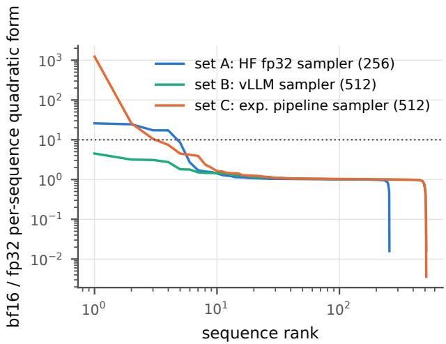
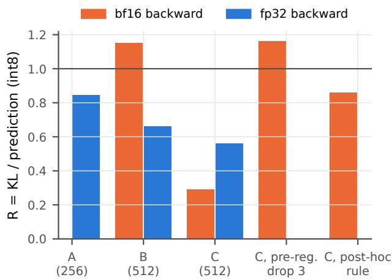
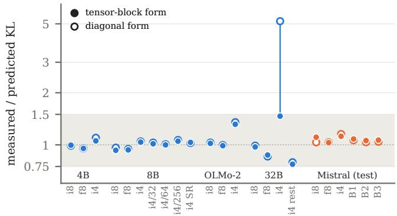

# How Far Does Second-Order Linear Response Predict Quantization Mismatch? Pre-Registered Measurements on Five Language Models

Dezhen Lu University of Tübingen

Zixiang Ni Xi’an Jiaotong University

## Abstract

Serving systems choose a weight format for each model and deployment. A low-cost screen predicts the resulting KL divergence from the unquantized model’s Fisher information using $\bar { \frac { 1 } { 2 } } \Delta ^ { \top } F \Delta$ , the expansion underlying Hessian-aware and secondorder post-training quantizers. We assess the reliability of this screen in GPU batches with channel-wise int8, per-tensor fp8 and group-wise int4 on Qwen3-8B, Qwen3-4B, OLMo-2-7B, Qwen3-32B and Qwen3-30B-A3B. Relative predictions hold across a 16-fold range of perturbation scales, int4 group sizes and rounding modes, while absolute predictions are heavytailed. A trimmed average brings 10 of 12 cells on Qwen3-4B and OLMo-2 within 15% of measured KL. The MoE model exhibits nonquadratic response at small perturbations, with int8 KL scaling as α0.63. Computing per-sequence gradients in bf16 can cause fourfold prediction errors. We trace these errors to arithmetic in the lower half of the backward pass and eliminate them by using fp32 there. Batch-invariant kernels run at 0.55 times the throughput, while changes in reduction order introduce a floor of 0.17–0.22 nats per sequence. We build a screener with one streamed fp32 Fisher pass, trimmed tensor-block predictions with a band, a flag for aligned tensors and per-layer format allocation. On the unseen Mistral-7Bv0.3 family, all six predictions fall within the band, all three KL budgets are met, and vLLM throughput is predicted within 0.4%.

## 1 Introduction

An LLM serving stack now picks a weight format for every model and deployment: int8 or fp8 where quality matters most, int4 with a group size where memory binds, blockscaled 4-bit formats [22] and, on new GPUs, stochastic instead of nearest rounding [12]. Measuring task quality for every combination is slow, so a screen that predicts the damage from the unquantized model is attractive. The standard one is second order: the KL divergence between a model and its quantized copy is approximately $\frac { 1 } { 2 } \Delta ^ { \top } F \Delta$ , with F the Fisher information and ∆ the weight perturbation. It costs one forward and backward pass per calibration sequence, after which every candidate format is a dot product per tensor; Hessianaware bit allocation [7] and second-order post-training quantizers [9, 11, 21] build on the same expansion.

A screen is used in two ways. It ranks candidates on a fixed calibration set, and it gives an absolute number that is compared with a quality budget. We test both, together with the implementation choices that decide whether the number can be trusted: the precision of the per-sequence gradients, the estimator over sequences, and the noise floor of the engine that measures the KL. The question is one of linear response: the quantized model is a perturbed copy, and the KL is its quadratic response in the Fisher metric (§3). Every decision rule was frozen—predictions, scorers and file checksums— before its GPU run, and the models added after Qwen3-8B played no part in developing the analysis. The ledger in the supplementary material lists every batch with its frozen prediction and outcome.

Findings. (1) Relative predictions hold: across perturbation scale, int4 group size and rounding mode (§4). (2) The absolute scale is heavy-tailed: the plain average over sequences is set by a few of them (§5); a trimmed average fixes most cells on new models (§7) but not int4 at 32B, where the diagonal estimator misses rounding error that is coherent along the gradient in one tensor (§8). (3) bf16 per-sequence gradients can be off by 4× through a handful of sequences whose backward pass is numerically unstable in the lower layers; we locate where the error is made and give a recipe (§6). (4) The engine’s run-to-run floor, and what removing it costs in throughput (§9). (5) §10 turns these into a checklist for a quantization screen, and §11 builds the screen: one streamed Fisher pass, a band, a flag for aligned tensors and a per-layer allocator that writes vLLM checkpoints. On an unseen model family it met its pre-registered criteria for KL, budgets and throughput.

## 2 Setup

Model and schemes. Qwen3-8B; weight quantization int8 per channel, fp8 per tensor, int4 with group size 128 (and 32, 64, 256; nearest and stochastic rounding). $\Delta = \alpha ( \hat { W } - W )$ with $\alpha \in \{ 1 / 8 , 1 / 4 , 1 / 2 , 1 \}$ to test the expansion. Two further models, chosen before any run on them: Qwen3-4B (same family and tokenizer, tied input and output embeddings) and OLMo-2-1124-7B (a different family), each with the three main schemes at $\mathsf { \alpha } \propto 1 \mathsf { \beta }$ ; and Qwen3-32B (four times larger), with an α scan of int4 in $\{ 1 / 4 , 1 / 2 , 1 \}$

Measured mismatch. Token-level KL between the base and the perturbed model on sampled continuations of 256 tokens, averaged per sequence, then over sequences.

Prediction. Per sequence, $\begin{array} { r } { q = \frac 1 2 \sum _ { i } g _ { i } ^ { 2 } \Delta _ { i } ^ { 2 } } \end{array}$ over all weights i, with g the gradient of the sequence log-likelihood: a onesample estimate of the diagonal part of $\bar { \frac { 1 } { 2 } } \bar { \Delta } ^ { \top } F \Delta$ . The continuations are sampled from the model, so $F$ is the Fisher, not the empirical Fisher [16]. The same pass also records each tensor’s projection $d _ { \ell } = g _ { \ell } \cdot \Delta _ { \ell }$ , from which the tensor-block form $\textstyle { \frac { 1 } { 2 } } \sum _ { \ell } d _ { \ell } ^ { 2 }$ and the full one-sample form $\textstyle { \frac { 1 } { 2 } } ( \sum _ { \ell } d _ { \ell } ) ^ { 2 }$ follow (§8). The prediction is the mean of $q ,$ computed with fp32 and with bf16 backward passes. R = measured KL / prediction.

Sample sets. A: 256 prompts, samples from an HF fp32 sampler. B: 512 prompts (the original pipeline’s prompt rule), vLLM samples. C: the same 512 prompts, samples produced by the original pipeline’s sampler. The two further models use set B’s rules (for OLMo-2 the prompts are cut by the same rule with its own tokenizer). All runs on GH200; versions pinned.

## 3 Theory: linear response in the Fisher metric

The expansion $\begin{array} { r } { \mathrm { K L } \approx \frac { 1 } { 2 } \Delta ^ { \top } F \Delta } \end{array}$ is the quadratic response of the model’s output distribution to a perturbation of its parameters, with the Fisher information as the metric. Four things can break it, and the paper tests each. First, the response is a sum over sequences of a quadratic form, and that sum can be dom inated by rare configurations: a heavy tail makes the mean not self-averaging, while ratios on a fixed sample set remain accurate (§4, §5). Second, the adjoint dynamics that produce the per-sequence gradients can be unstable in reduced precision and amplify a rounding error on its way back through the layers; the blow-up is then a property of the backward pass, not of the model, and in our data a single layer supplies the step that separates blow-ups from controls (§6). Third, the perturbation can leave the quadratic regime, which an α scan detects as a higher-order term (§7). Fourth, the diagonal estimator treats the rounding errors of a tensor as sign-incoherent along the gradient; when they are coherent it under-predicts by a factor that does not close as ${ \bf { \mathfrak { Q } } } \to 0 \ ( \ S 8 )$ . Rounding also supplies a quenched/annealed pair: round-to-nearest is a fixed (quenched) error for a given input and stochastic rounding an annealed one, and the variance term of the expansion predicts their ratio. The run-to-run floor of a bf16 engine is this layer’s thermal noise: any change of reduction order realises a new rounding configuration of the same size (§9).

## 4 Relative predictions hold

R changed by a factor 0.99–1.05 between $\alpha = 1 / 8$ and $\alpha = 1$ so the quadratic term dominates. For int4 group sizes 32, 64 and 256, calibrating on group size 128 predicted the measured KL within 0.96–1.01, and KL was monotone in group size. Stochastic rounding raised the KL by 2.25× against a predicted 2.28×. On the two new models, three of four preregistered scheme ratios were within ±25% (Section 7); the miss is int4 against int8 on OLMo-2 (1.28).

## 5 The absolute scale is heavy-tailed

With fp32 gradients, R ranged from 0.85–0.88 on set A to 0.66–0.70 on set B and 0.56–0.58 on set C. The per-sequence quadratic form is heavy-tailed: the top 5% of sequences carry up to 24% of the prediction. Post hoc, a Hill estimate on the top 10% gives the per-sequence q a tail index of 1.7–2.4 on Qwen3-8B and Qwen3-32B, at the edge of infinite variance, and the per-sequence KL 2.5–12. Because $R _ { \mathrm { t r i m } } / R _ { \mathrm { m e a n } } = ( 1 -$ $s _ { K } ) / ( 1 - s _ { q } )$ exactly, with s the share of a quantity carried by its top 5%, the heavier tail of q puts the trimmed ratio 1.09–1.22× above the ratio of means on those two models, and the sign of the difference follows the two tail indices in 30 of 32 cells (four models, three schemes, both forms of $q )$ An absolute prediction therefore carries a sample-set error of tens of percent even when relative comparisons on the same samples are accurate. The size of this bias depends on the model: on Qwen3-4B the fp32 ratio was 0.95–1.13, and on OLMo-2 the plain and trimmed averages nearly coincide (Table 1).

## 6 bf16 backward passes can be off by 4×

Reproduction. An earlier experiment reported that the prediction over-estimated KL by about 4.2× uniformly across schemes. Running that experiment’s own code unchanged on GH200 reproduced it $( R = 0 . 2 9 , 0 . 2 3 , 0 . 2 2$ for int8, fp8, int4), with the measured KL matching our independent pipeline $( 1 . 0 2 \mathrm { - } 1 . 0 0 \times )$ and the prediction 4.04–4.52× higher. A differ ent transformers version gave the same result. Our own code on the same samples (set C) gave the same numbers to five or six significant figures; on set B it gave R = 1.15,1.01,0.97. The difference is in the samples.

Mechanism. For most sequences the bf16 and fp32 quadratic forms agree (median ratio 1.00). On set C, a few sequences have early-layer gradients that blow up elementwise in bf16—one reaches 1237–1582× its fp32 value—and the squares carry them into the mean, while the linear term $\sum g \cdot \Delta$ is barely affected (Fig. 1).

• Pre-registered: dropping the three sequences flagged before the run gives $R = 1 . 1 6 , 0 . 9 8 , 0 . 9 8$

• Post hoc: dropping every sequence with bf $6 / \mathrm { f p } 3 2 > 1 0$ (0.6–0.8% of the set; threshold chosen after seeing the data) gives $R = 0 . 8 6 , 1 . 0 2 , 1 . 0 3 ( \mathrm { F i g . 2 } )$

How often. Counting sequences with $\mathtt { b f l 6 / f p } 3 2 > 1 0$ per scheme: set A 2–4 of 256 (max 27.2×), set B 0 of 512 (max 4.5×), set C 3–4 of 512 (max 1581.8×). Only 1 of the 1,280 sequences exceeded 1000×. The original run’s own per-sequence data were not inspected; we attribute it by reproduction.

Where the error enters. We back-propagated the four blown-up sequences of set C and two controls once in fp32 and once in bf16 and compared the gradients with respect to every hidden state (pre-registered). The bf16 gradients reproduced the blow-ups bit for bit. The relative error of the hidden-state gradient is 0.02–0.13 at the last layer and 14–117 at the output of layer 1 (layers counted from 0), so the error lives in the residual-stream gradient and grows toward the input; it is not confined to the weight-gradient products (that hypothesis held for 0 of 4; the stricter form requiring ≤ 0.1 at the last layer held for 2 of 4). Post hoc, the error jumps by 4.4–11.8× in the backward step through layer 15 and grows by 1.07–1.23× per layer below it. It is not concentrated on one token (the largest token carries 28–58% of the squared error) and not on the token with the largest forward activation (0 of 4), which refutes our guess that massive activations inject it. The two controls show the same growth below layer 15 (1.07–1.20× per layer) on a smaller scale (relative error 0.13 and 0.99 at the output of layer 1) but no jump there (at most 1.13×): what separates the blow-ups is one layer, not a faster per-layer growth. The largest activation is about 34,656 times the median in Qwen3-8B and 171 times in OLMo-2 (ratio 203), consistent with—but not shown to cause—the absence of blow-ups in OLMo-2.

A frozen follow-up separated where the error is made from where it grows. With the backward of layers 0–15 in fp32 and the rest in bf16, the error at the bottom fell to 0.017 of the all-bf16 value (median over the four sequences); with the upper layers in fp32 it stayed at 0.96. The quadratic form, 7.7– 1211× its fp32 value in all-bf16, came to 1.03–2.48× with the lower layers in fp32. The blow-ups are therefore made by bf16 arithmetic in the lower half; the backward Jacobian also amplifies the small error that arrives from above, but two orders of magnitude less. Which block is responsible depends on the sequence (attention or MLP in fp32 alone leave 0.09 and 0.11 of the error at the median, but each fails on a different sequence), so a practical recipe keeps the whole lower half of the backward in fp32.

  
Figure 1: Per-sequence ratio of the bf16 to the fp32 quadratic form (int8), sorted. Dotted: the post-hoc threshold 10.

## 7 A trimmed average holds on two new models, except int4 on OLMo-2

The heavy tail suggests a robust average. Let $R _ { \mathrm { t r i m } } =$ trim(KL)/ trim(q), where trim drops the largest 5% of a series (KL and q are trimmed separately); it estimates the KL of a typical sequence rather than a mean set by a few. On Qwen3-8B sets A–C it gave 0.95–1.08 in all 18 cells (three sets, three schemes, two gradient precisions). Because we chose it after seeing those data, we pre-registered four criteria for the two new models before running them (Table 1):

• P1, $R _ { \mathrm { t r i m } } \in [ 0 . 8 5 , 1 . 1 5 ]$ : 10/12. Both misses are OLMo-2 int4 (1.35). The fp32 and bf16 cells of a model and scheme share the measured KL, so by model and scheme this is 5/6.

• P2, $R _ { \mathrm { { m e a n } } } < R _ { \mathrm { { t r i m } } } \colon$ 11/12. The exception is Qwen3-4B int8 with fp32 gradients (1.13 against 0.99). On OLMo-2 the margins are at most 0.04: without blow-ups the tail of q is barely heavier than that of the KL.

• P3, scheme ratios within ±25%: 3/4 (Qwen3-4B 0.84– 0.92; OLMo-2 int4/int8 1.28).

• P4, at most 1% of sequences with bf16/fp32 > 10: 6/6. On Qwen3-4B 0.2–0.4% of sequences blow up (up to 271×), enough to pull the bf16 plain average down to

  
Figure 2: R by sample set and gradient precision (int8). On set C the bf16 estimate is off by 3–4× until the blown-up sequences are removed.

Table 1: Measured KL over prediction on Qwen3-4B and OLMo-2, by estimator and gradient precision; last column: share of sequences with bf $6 / \mathrm { f p } 3 2 > 1 0$ (largest ratio). Preregistered range for $R _ { \mathrm { t r i m } } \colon$ [0.85, 1.15].
<table><tr><td rowspan="2">Model</td><td rowspan="2">Scheme</td><td colspan="2"> $R _ { \mathrm { m e a n } }$ </td><td colspan="2"> $R _ { \mathrm { t r i m } }$ </td><td rowspan="2">Blow-ups % (max)</td></tr><tr><td>fp32</td><td>bf16</td><td>fp32</td><td>bf16</td></tr><tr><td>Qwen3-4B</td><td>int8 ch.</td><td>1.13</td><td>0.57</td><td>0.99</td><td>0.98</td><td>0.2 (249)</td></tr><tr><td>Qwen3-4B</td><td>fp8 tensor</td><td>0.95</td><td>0.44</td><td>0.95</td><td>0.95</td><td>0.2 (271)</td></tr><tr><td>Qwen3-4B</td><td>int4  $\mathbf { g } 1 2 8$ </td><td>1.04</td><td>0.50</td><td>1.10</td><td>1.09</td><td>0.4 (247)</td></tr><tr><td>OLMo-2-7B</td><td>int8 ch.</td><td>1.02</td><td>1.02</td><td>1.03</td><td>1.03</td><td>0.0 (5)</td></tr><tr><td>OLMo-2-7B</td><td>fp8 tensor</td><td>0.99</td><td>0.99</td><td>1.00</td><td>0.99</td><td>0.0 (6)</td></tr><tr><td>OLMo-2-7B</td><td>int4 g128</td><td>1.31</td><td>1.31</td><td>1.35</td><td>1.35</td><td>0.0 (5)</td></tr></table>

0.44–0.57; trimming restores 0.95–1.09. OLMo-2 has none (largest ratio 6).

The OLMo-2 int4 miss appears under both estimators and both gradient precisions $( R _ { \mathrm { m e a n } } = 1 . 3 1 )$ , so it is neither a tail nor a bf16 effect. It could be a higher-order term, which would vanish as $\alpha  0 ,$ or a bias of the Fisher estimate along the int4 direction, which would not. A pre-registered α scan on OLMo-2 (same samples and Fisher arrays; int8 as control) decided for the first: $R _ { \mathrm { t r i m } }$ for int4 rose monotonically from 1.05 at $\alpha = 1 / 8$ through 1.11 at $1 / 2$ to 1.35 at 1, while int8 stayed flat (1.006–1.013). Fitting $\mathrm { K L } ( \alpha ) = a \alpha ^ { 2 } + b \alpha ^ { 3 } + c \alpha ^ { 4 }$ gives a second-order coefficient 1.04 times the Fisher prediction and a quartic term that supplies 22% of the KL at $\alpha = 1$ Size alone would not have told: OLMo-2’s int4 KL (20.6 per sequence) is smaller than Qwen3-8B’s (29.7), where the ratio did not depend on α.

## 8 At 32B the diagonal form misses int4

Our q is the diagonal part of the quadratic form, so it is exact only if the rounding errors of each tensor are sign-incoherent along the gradient. We pre-registered G15’s four criteria for Qwen3-32B (256 sequences, set B’s rules, fp32 and bf16 backward; per-tensor gradients streamed through hooks so that the fp32 model fits on three GPUs) together with an α scan of int4 meant as the dense control for a planned mixtureof-experts test. int8 and fp8 held $( R _ { \mathrm { t r i m } }$ 0.99 and 0.86), int4 did not (5.18 with fp32 and 5.17 with bf16 gradients): P1 4/6, P2 6/6, P3 1/2, P4 3/3. The control failed as well: the int4 KL grew with slope 2.18 in α and a two-term fit gave $C / K _ { 1 } = - 0 . 1 8$ (bands [1.9,2.1] and $| C / K _ { 1 } | < 0 . 0 5 )$ , so by the frozen rule the mixture-of-experts test that depends on this control is inconclusive whatever it measures, and the run itself stopped in its last, unrelated phase (the bf16 pipeline; the Fisher and the fp32 KL scan were complete). We report Qwen3-30B-A3B (256 sequences) as an observation. The preregistered alternative, $\mathrm { K L } = A \alpha ^ { 2 } + C \alpha$ with C from routing flips, is classed mixed for both schemes: for int8 the share of (layer, token) whose expert set flips grows only as $\alpha ^ { 0 . 4 1 }$ (6.6% at $\alpha = 1 / 4$ , 11.7% at 1) and the KL as $\dot { \alpha } ^ { 0 . 6 3 }$ , both sub-linear. The consequence for the expansion is the reverse of the dense miss: the smaller the perturbation, the worse it predicts. Trimmed, int8 comes out at 4.1× the prediction at full scale and 27× at a quarter, fp8 at 2.1×, while int4 is close $( 1 . 0 9 , \mathrm { K L } \propto \alpha ^ { 1 . 6 5 } )$ . There is no coherence to blame (block/diagonal 1.01–1.03, full form within the random-sign range), and the fp32 and bf16 references already disagree on 12% of routing decisions: on this model the quadratic form misses a non-analytic part of the response.

The miss is not OLMo-2’s higher-order term: at $\mathsf { \Delta } \mathsf { q } = 1 / 4$ the int4 ratio is still 4.0 (3.4 by the plain mean). Post hoc, the recorded projections $d _ { \ell }$ give the tensor-block form $\textstyle { \frac { 1 } { 2 } } \sum _ { \ell } d _ { \ell } ^ { 2 }$ exact within each tensor, and the full form $\textstyle { \frac { 1 } { 2 } } ( \sum _ { \ell } d _ { \ell } ) ^ { 2 }$ . For int4 the block form is 3.63× the diagonal, and it closes the gap: ${ \mathrm { K L } } / ( \alpha ^ { 2 } q _ { \mathrm { b l o c k } } )$ is 0.93 by the mean and 1.13 trimmed at $\alpha = 1 / 4 ( 1 . 2 0$ and 1.46 at α = 1, where a higher-order term adds). The full form adds nothing beyond the block form: its ratio to it, 0.93, lies inside the range obtained by flipping the sign of each tensor’s projection at random (0.89–1.11), so the missing term is entirely within tensors. The block and full forms have heavier tails, so their trimmed ratios run above their means. On Qwen3-8B, Qwen3-4B and OLMo-2 the same comparison gives block/diagonal ratios of 1.00–1.05 for every scheme (1.08 and 1.00 for int8 and fp8 at 32B): the diagonal and block forms are indistinguishable there, and 32B int4 is the first cell that separates them. Per sequence, the diagonal form does not rank int4 at 32B at all (Spearman 0.09); the block form ranks it weakly (0.25). The excess sits in one tensor (post hoc). The last layer’s down projection carries 99% of $q _ { \mathrm { b l o c k } } - q _ { \mathrm { e l e m } }$ for int4: its block form is 32× its diagonal, so it holds 8% of the diagonal $q$ but 74% of the block form. Without it the block/diagonal ratio is 1.02, inside the band of the smaller models, and an estimator that uses the block form for that tensor alone and the diagonal elsewhere gives $\mathrm { K L } / ( \alpha ^ { 2 } q ) = 0 . 9 4$ (1.15 trimmed) at $\alpha = 1 / 4$ The coherent term is spread over sequences (the top 5% carry 29% of its $d _ { \ell } ^ { 2 } )$ with no preferred sign (mean sign 0.07); int8 rounding of the same tensor shows none (0.91), nor do the last-layer down projections of Qwen3-8B, Qwen3-4B and OLMo-2 (0.86–1.19). We expected the cause in the weights— an int4 scale stretched by outliers rounds many weights to zero, so ∆ shrinks w and $d _ { \ell }$ picks up the derivative along w— and wrote that prediction down before computing the weight statistics. It failed: the tensor’s correlation between ∆ and w is 0.0018 (rank 86 of 448 in the shrinking direction), its zero-code share 0.18 and its median group max/median 4.7, close to Qwen3-8B’s last down projection (0.0011, 0.19, 4.8), which is not coherent; the tensors that do shrink, the down projections of layers 1–4 in both models (correlation −0.027 to −0.010, up to 65% of codes at zero), have own ratios of only 0.56–1.32. Local statistics do not single it out either: the mean squared z-scores of its row means, column means and per-group correlations with w are 0.94–1.01, as for the controls (0.93–1.04), while a shrinking tensor shows a row bias of 11. Yet an error whose signs are independent of the gradient reaches an own ratio of 32 with probability below $1 . 1 \times 1 0 ^ { - 6 }$ whatever the Fisher block (a Chernoff bound for a Rademacher quadratic form). The excess therefore needs this tensor’s int4 error and its gradient together—an alignment of the rounding pattern with the tensor’s Fisher block that neither side shows alone—and per-tensor projections cannot resolve it.

A pre-registered follow-up (G34, same 256 sequences, fp32) quantized that tensor alone, every target except it, and that tensor with stochastic rounding (two seeds); its gates reproduced the stored projections and int4 KL exactly. The frozen verdict is mixed. The other tensors behave like the smaller models $( \mathrm { K L } / q _ { \mathrm { e l e m } } 0 . 9 3$ trimmed); the one tensor alone carries 33× its diagonal prediction at $\alpha = 1 / 4$ and, at $\alpha = 1$ a KL of 196 nats, as much as the fully quantized model (193), against 27 for all the others; the two parts add up (1.03 of the full KL at ${ \mathfrak { a } } = 1 / 4 )$ ; and stochastic rounding of the same tensor removes the coherence (own ratio 0.87 and 0.91). What failed is the trimmed agreement of these single-tensor arms with their block form (1.34 and 1.18–1.23 against a band of [0.85,1.15]). Post hoc, their plain means agree (1.02, 0.93– 1.00), and the trimmed miss follows from the identity of §5: one tensor’s $d _ { \ell } ^ { 2 }$ is far heavier-tailed than the KL (its top 5% of sequences carry 29% against 8%). Also post hoc, per-row and per-column projections locate the coherence: none within output rows (row-block/diagonal 1.00), strong within input columns (16×), and two of the tensor’s 25,600 input columns carry 96% of the column-block form; summed, their projec tions account for 91% of the tensor’s excess over its diagonal, and they are correlated across sequences at 0.94. The rounding errors of two input channels of one tensor, aligned along the gradient, are almost all of what the diagonal estimator misses at 32B. Independent per-weight noise thus fails there; one model does not say how this scales. The size of the KL (193 nats per sequence against 29.7 on Qwen3-8B) is a warning here, unlike on OLMo-2.

## 9 Determinism has a price, and the noise floor is one number

Numerical mismatch is only meaningful above the run-torun noise floor of the serving engine. vLLM’s batch-invariant mode removes that noise by fixing reduction order; on GH200 at 32 concurrent requests it ran at 0.55× the throughput of the default mode.

We measured that floor on GH200 with a frozen criterion (teacher-forced Qwen3-8B, 256 samples of 768 tokens): every comparison in which the reduction order differs—other kernel selections, two- or four-way tensor parallelism, batchinvariant against default kernels—gave 0.17–0.22 nats per sequence (the 4 pre-registered comparisons: 0.17–0.21), the same as on H100, while reruns that reuse the kernel selection were bitwise identical. The batch size itself barely matters: reading the same autotune cache, 8 and 256 concurrent sequences agree on 99.3% of the token log-probabilities (KL 0.000). Because the autotuned kernel selection was shared within the run, the floor is best read as that of an independent bf16 rounding realisation, set by which kernels run rather than by how requests are batched. KL measured across engine instances or configurations carries this floor, so differences below about 0.2 nats per sequence between such measurements are not resolvable unless the kernel selection is fixed; batchinvariant kernels cost 0.81× throughput in this teacher-forced setting.

## 10 Guidance for a quantization screen

(i) Use the Fisher screen for ranking configurations on a fixed sample set. (ii) Compute per-sequence gradients in fp32, or check a bf16 estimate against fp32 per sequence; fp32 avoids catastrophic outliers but not the heavy tail. (iii) Report absolute predictions with a trimmed average of the per-sequence quadratic form, which landed within ±15% in 10 of 12 cells on Qwen3-4B and OLMo-2 and 4 of 6 on Qwen3-32B (every miss is int4). (iv) Check large perturbations such as int4 against a measured KL, or an α scan, on the target model: on OLMo-2 a quartic term made the expansion under-predict int4 by 1.35×, and the size of the KL did not warn of it; on Qwen3-32B the diagonal form under-predicted int4 by 5.18×, so also record each tensor’s projection $d _ { \ell }$ and compare the diagonal with the tensor-block form $\textstyle { \frac { 1 } { 2 } } \sum _ { \ell } d _ { \ell } ^ { 2 }$ , which costs nothing extra; at 32B one tensor carried the gap, so the per-tensor comparison also says where to look.

## 11 A quantization screener

The findings so far say what a Fisher screen must do to be trusted: use per-tensor projections rather than the elementwise diagonal (§8), summarise sequences with a trimmed mean (§5), compute gradients in fp32 (§6), and stay away from mixture-of-experts routing. We built a screener that does exactly this and nothing more, and tested it, pre-registered, on a model family that played no part in any of the earlier analysis.

One pass, every format. A forward and backward pass per calibration sequence records, for every target tensor t and every candidate format $\begin{array} { r } { f , d _ { 1 } = \sum _ { i } g _ { i } \Delta _ { i } } \end{array}$ and $\begin{array} { r } { d _ { 2 } = \sum _ { i } ( g _ { i } \Delta _ { i } ) ^ { 2 } } \end{array}$ where g is the gradient of the sequence’s continuation loglikelihood and $\Delta = \hat { w } _ { f } - w$ . Each tensor’s gradient is consumed by a post-accumulate hook as soon as it is complete and freed, so memory is one fp32 model plus one gradient tensor; the quantizers are the same functions that later write the deployment checkpoint. After this pass every format assignment c costs a sum: the tensor-block prediction $\begin{array} { r } { q ( c ) = \frac { 1 } { 2 } \sum _ { t } d _ { 1 } [ c _ { t } , t ] ^ { 2 } } \end{array}$ per sequence (§3), whose 5%-trimmed mean q¯ is the screener’s point prediction. On Mistral-7B-v0.3 the pass took 1.88 s per sequence on one GH200 (8.0 minutes for 256 sequences, three formats, 224 tensors).

A band, not a number. The heavy tails of §5 make the ratio of measured to predicted KL vary from cell to cell even when the expansion holds. The screener therefore reports $[ 0 . 7 5 , 1 . 5 0 ] \times \bar { q } \colon$ the envelope, rounded outward, of that ratio over all 17 archived dense configurations at deployment scale (α = 1) that the screener could have produced (0.87–1.46 for the uniform cells of four models; 0.77 for Qwen3-32B int4 with its one coherent tensor left unquantized). The band was frozen after that targeted batch and before any measurement on the new model. Figure 3 shows these cells under both forms: the diagonal form leaves the band once, at Qwen3-32B int4.

Flag the aligned tensors. §8 found one tensor whose int4 error is aligned with its own Fisher block. The screener computes each (tensor, format) pair’s own ratio $\overline { { d _ { 1 } ^ { 2 } } } / \overline { { d _ { 2 } } }$ , which is one in expectation when the error’s signs are unrelated to the gradient, and flags pairs with ratio ≥ 10 that also carry $\geq 5 \%$ of the model’s predicted KL. Over the 19 archived (model, format) cells, mixture-of-experts included, the rule fires exactly once, on that tensor; the largest own ratio anywhere else is $6 . 4$ A flagged pair is never assigned. A pre-registered batch on that tensor (verdict MIXED) shows why the block form alone is not enough there. Quantized alone to int4 at $\alpha = 1$ , the tensor gives a KL of 195.8 nats per sequence, more than the whole int4 model (193.2); all other tensors together give 27.4. Its KL matches its block term in the mean at $\begin{array} { r } { \mathbf { Q } = \frac { 1 } { 4 } \left( 1 . 0 2 \right) } \end{array}$ but not at deployment scale (1.64× in the mean at $\alpha = 1 )$ , and the frozen trimmed criteria failed $\begin{array} { r } { ( 1 . 3 4 \times \mathrm { a t } \alpha = \frac { 1 } { 4 } ) } \end{array}$ because one tensor $\mathrm { \Delta s } d _ { 1 } ^ { 2 }$ is far heavier-tailed than its KL—which is why the screener trims only whole-model sums, never a single tensor’s. So the one place where the diagonal form fails is also where the expansion is least accurate. The alignment sits in the input channels: two of 25,600 columns carry 96% of the tensor’s column-block term. Stochastic rounding at the same four bits removes it (own ratio below one) and cuts that tensor’s KL by 15× at $\textstyle \mathbf { q } = { \frac { 1 } { 4 } }$ , with a block prediction that holds in the mean (0.93–1.00) though not under the frozen trimmed band (1.18–1.23); the screener’s ladder does not include it yet.

  
Figure 3: Measured over predicted KL (5%-trimmed) for the 17 archived dense cells at α = 1 that set the band (blue) and the six pre-registered test cells on Mistral-7B-v0.3 (orange), under the tensor-block form (filled) and the element-diagonal form (open). Shaded: the frozen band [0.75,1.50]. i4 rest: Qwen3-32B int4 without its one coherent tensor; $B _ { k } \mathrm { : }$ : budgets.

Allocate under a budget. Given a KL budget $B ,$ the screener assigns each decoder layer a rung of the ladder int4 (group 128) < int8 (per channel) < bf16. It starts with every layer at int4 and repeatedly upgrades the layer with the largest reduction of mean predicted KL per added byte until the band’s upper edge, 1.50 ¯q, is within B. Because the block form is additive over tensors, each candidate is evaluated exactly from the stored projections; the trimmed mean is recomputed from per-sequence sums after every step. The unit of allocation follows the serving engine: vLLM fuses $q / k / \nu$ and gate/up projections and requires one scheme per fused layer, so a flag lifts its whole unit. The output is a compressedtensors checkpoint with one configuration group per format and exact module names; at build time every module is decoded by two independent readers and compared bit for bit with the screener’s ˆw.

Predict throughput. Per-token time is modelled as additive over linear layers, so a mixed checkpoint’s throughput is the parameter-share harmonic interpolation of three measured uniform ones (bf16, int8, int4), $\begin{array} { r } { 1 / \mathrm { t p s } ( c ) = \sum _ { f } s _ { f } ( c ) / \mathrm { t p s } _ { f } } \end{array}$ . The prediction for each mixed configuration was written to disk before its checkpoint existed.

<table><tr><td>cell</td><td>bits</td><td>ā</td><td>KL KL/ā</td><td></td><td>tok/s LAMBADA</td></tr><tr><td>int8</td><td>8.00</td><td>0.115</td><td>0.127</td><td>1.11</td><td>4150 75.0</td></tr><tr><td>fp8</td><td>8.00</td><td>0.459</td><td>0.473</td><td>1.03</td><td></td></tr><tr><td>int4</td><td>4.12</td><td>10.8</td><td>12.1</td><td>1.12</td><td>4709 73.2</td></tr><tr><td> $\begin{array} { r } { B _ { 1 } = \frac { 1 } { \lambda } } \end{array}$ </td><td>6.55</td><td>3.31</td><td>3.58</td><td>1.08</td><td>4343 (4343) 74.6</td></tr><tr><td> $\begin{array} { r } { B _ { 2 } = \frac { 1 } { 4 } } \end{array}$ </td><td>7.28</td><td>1.64</td><td>1.74</td><td>1.06 4226 (4244)</td><td>74.5</td></tr><tr><td> $\begin{array} { r } { B _ { 3 } = \frac { 1 } { 8 } } \end{array}$ </td><td>7.64</td><td>0.836</td><td>0.891</td><td>1.07 4180 (4196)</td><td>74.7</td></tr><tr><td>bf16</td><td>16.00</td><td>一</td><td>一</td><td>一</td><td>4025 74.8</td></tr></table>

Table 2: Pre-registered screener test on Mistral-7B-v0.3 (unseen family). bits: weight bits per target parameter; q¯ and KL: trimmed means (nats per 256-token sequence) of predicted and exact fp32 KL; budgets as a fraction of the int4 prediction; tok/s: vLLM, 128 requests × 256 tokens, 32 concurrent (predicted in parentheses). Band [0.75, 1.50].

Pre-registered test on an unseen family. We froze the band, the flag rule, the ladder, three budgets $( { \frac { 1 } { 2 } } , { \frac { 1 } { 4 } }$ and $\frac { 1 } { 8 }$ of the predicted uniform-int4 KL), the throughput rule and the scorer, then ran them on Mistral-7B-v0.3 (7.0 B target parameters, 224 tensors), a family never used in this paper, with 256 calibration sequences. Three criteria: the band contains the exact KL in at least five of six cells (three uniform formats, three budgets); each budget is met by the measured KL; each mixed configuration’s vLLM throughput is within 10% of its prediction. All three held (Table 2; verdict SCREENER\_PASS). The band contained all 6 cells, and the measured ratios were much tighter than the band, 1.03–1.12 (post hoc: 6/6 also under the drafted lower edge 0.85, and 6/6 under the ±15% band of §7, where the diagonal form gets 5/6 because uniform int4 sits at 1.155, a difference within noise); the three budgets (5.41, 2.71 and 1.35 nats) were met with a third to spare, because the allocator plans against the band’s upper edge; and the measured throughput of the mixed checkpoints was within 0.4% of the prediction. The 10% tolerance did not discriminate at this operating point: all three uniform throughputs lie within 10% of the mixed ones, so predicting the nearest uniform format (int8) would also have passed. The informative comparison is post hoc: that baseline is off by 0.7–4.5% and bf16 by 3.7–7.3%, against the formula’s 0.4%, which is the repeat-to-repeat spread (0.6%). The allocation is not uniform in depth: at the loosest budget the screener kept 12 of 32 layers at int4, nine of them a contiguous block in the upper-middle of the network (layers 21–29), and moved the rest, including the first and last layers, to int8.

Two things the test did not exercise. The flag never fired on Mistral-7B-v0.3 (largest own ratio 2.6 under int4), and with no aligned tensor the diagonal form puts 6 of the six cells in the band too; on this model the screener’s advantage over the diagonal form is a guard against the Qwen3-32B case, not a measured gain. And the absolute gains from weight-only formats are modest at this operating point (512-token prompts, 32 concurrent requests): int4 serves 17% more tokens per second than bf16, int8 3%, and the three budgets 8, 5 and 4%.

Against a diagonal allocator. What the block form and the flag buy over a Hessian-trace-style allocator can be read off the stored projections (post hoc). We ran the same greedy allocator on the element-diagonal form, without flags, under budgets of ${ \frac { 1 } { 2 } } , { \frac { 1 } { 4 } }$ and $\frac { 1 } { 8 }$ of the diagonal uniform-int4 prediction, a yardstick both can read. On Mistral-7B-v0.3 the two choose the same format for 81–94% of tensors at the same bits. On Qwen3-32B—in sample for the flag, so an illustration rather than a test—they agree on 88–94%, and both lift the coherent tensor’s layer to int8, because that layer is costly even on the diagonal. They part only where the budget is loose: from 1.50 × 36.4 ≈ 55 nats the diagonal allocator accepts uniform int4, whose measured KL is 5.18× its prediction (§8), about 3.5× that budget; at the same budget the screener moves that one tensor to int8 and nothing else, for 0.02 more bits per parameter (4.14 against 4.12), and predicts 33.6 nats; with all other tensors at int4 and that one in bf16, the measured mean KL was 27.4. The two allocators thus differ only in the regime where a diagonal screen recommends int4, and there by one tensor.

The calibration set must not be small. A one-GPU smoke run with eight calibration sequences (unscored, before the main run) gave measured-to-predicted ratios of 1.20–1.41 for the mixed configurations but not for the uniform ones. The allocator upgrades the layers whose block terms are largest on the calibration sequences, so the layers left at int4 are, by selection, ones whose terms came out low there: an optimizer’s curse. We wrote this hypothesis down before the main run, with the prediction that at 256 sequences the mixed ratios would still exceed both uniform integer cells; that prediction failed: they came out at 1.06–1.08, below int8 and int4 (1.11 and 1.12). A post-hoc bootstrap—resample the sequences, re-allocate, evaluate each chosen configuration on the full sample—puts the optimism at 1.16–1.44× with eight sequences, matching the smoke run, and at 1.015–1.022× with 256. A screener that allocates on its own calibration set needs a few hundred sequences, or a held-out split for the final prediction.

Task metric and engine KL. LAMBADA accuracy (5153 items) ranged from 73.2% (int4) to 75.0% (int8), bf16 74.8%; the three budgets kept 74.5–74.7%. Inside vLLM, the mean log-likelihood ratio along the samples estimates the serving engine’s own KL (bf16 kernels, its own reference); it was 0.87–0.99 of the exact fp32 KL for int4 and the budgets.

Cost. Screening three formats and every budget took one Fisher pass, 8.0 GPU-minutes; verifying the six cells exactly took another 8.7 minutes, and each vLLM configuration two minutes to build and measure. The whole pre-registered test used 0.77 GPU-hours (1.06 with the smoke runs).

## 12 Limitations

Four dense models from two families (4B–32B) and one mixture-of-experts model, whose pre-registered test is inconclusive (the dense control failed) and is reported as an observation; three schemes; one GPU type; sample sets of 256–512 sequences. The screener was tested on one further dense model, from a third family (Mistral-7B-v0.3). No tensor was flagged on it and the element-diagonal form also landed in the band, so the case for the flag and the tensor-block form rests on the archived Qwen3-32B cell; at 32 concurrent requests the three budgeted configurations gained only 4–8% throughput over bf16 (uniform int4 17%), too small for the ±10% throughput criterion to discriminate. The localization of the 32B int4 miss to one tensor is post hoc and rests on one model; a weight-side explanation was refuted; a preregistered follow-up confirmed the tensor’s role and the effect of stochastic rounding but missed its trimmed band (verdict mixed), and the two-column localization is post hoc. The trimming fraction was chosen on Qwen3-8B and tested on the other three models only. The bf16 error is made in the lower half of the backward (one model, four sequences); the responsible block varies by sequence, and its link to massive activations rests on two models. Higher-order terms were measured only for OLMo-2 int4 and Qwen3-8B (set A). The original experiment’s data were not re-analysed.

## 13 Related work

Second-order sensitivity. The expansion we test underlies pruning from Optimal Brain Damage and Optimal Brain Surgeon [13, 17] to WoodFisher [25], Hessian- and Fisherguided mixed-precision allocation (HAQ [29], Q-BERT [24], HAWQ and its successors [6, 7, 31]), and the layer- and block-wise second-order objectives of post-training quantizers (AdaRound [21], BRECQ [19], OBC and GPTQ [9, 11]); SqueezeLLM [14] weights its codebook by a diagonal Fisher. These methods use the expansion to choose a quantization. We test it as a predictor of the KL a fixed quantization induces, on models fixed in advance, and find where its diagonal form fails. The Fisher we estimate is the one along ∆ from sampled continuations, the natural-gradient metric [1], not the empirical Fisher whose limits are discussed by [16].

Outliers. Activation-aware and outlier-aware methods— LLM.int8() [4], SmoothQuant [30], AWQ [20], OWQ [18],

SpQR [5], OmniQuant [23]—and rotation or vector codebooks (QuIP, QuIP#, AQLM [3,8,28]) protect a few channels or spread their error. Outlier dimensions [2, 15], massive activations [26] and single “super weights” [32] show that a handful of coordinates carry a model’s behaviour. Our 32B finding is of this kind but in the error, not the weights: two input channels of one tensor whose rounding errors align with the gradient, invisible to every weight statistic we computed.

Mixture of experts and formats. Sub-bit compression of MoE models [10] reports quality, not the expansion’s validity; we find that routing flips make the response non-analytic at small perturbations. Block-scaled formats [22] and stochastic rounding [12] enlarge the set a screen has to rank.

Numerical nondeterminism. Batch-invariant kernels [27] and studies of numerical nondeterminism in LLM inference [33] address run-to-run variation; we price the deterministic mode and measure the floor it removes, which every KL comparison between engine runs carries.

## AI Usage Disclosure

Generative AI tools assisted with experiment design and execution, code development, literature search, data analysis, and translation, drafting, and polishing of the manuscript. The core research ideas originated with a human author. The authors independently checked the manuscript and its results and take responsibility for the accuracy and integrity of the work.

## References

[1] Shun-ichi Amari. Natural gradient works efficiently in learning. Neural Computation, 10(2):251–276, Feb 1998.

[2] Yelysei Bondarenko, Markus Nagel, and Tijmen Blankevoort. Quantizable transformers: Removing outliers by helping attention heads do nothing. In Advances in Neural Information Processing Systems 36, NeurIPS 2023, page 75067–75096. Neural Information Processing Systems Foundation, Inc. (NeurIPS), 2023.

[3] Jerry Chee, Yaohui Cai, Volodymyr Kuleshov, and Christopher De Sa. Quip: 2-bit quantization of large language models with guarantees. In Advances in Neural Information Processing Systems 36, NeurIPS 2023, page 4396–4429. Neural Information Processing Systems Foundation, Inc. (NeurIPS), 2023.

[4] Tim Dettmers, Mike Lewis, Younes Belkada, and Luke Zettlemoyer. LLM.int8(): 8-bit matrix multiplication for transformers at scale. In Advances in Neu-

ral Information Processing Systems (NeurIPS), 2022. arXiv:2208.07339.

[5] Tim Dettmers, Ruslan Svirschevski, Vage Egiazarian, Denis Kuznedelev, Elias Frantar, Saleh Ashkboos, Alexander Borzunov, Torsten Hoefler, and Dan Alistarh. SpQR: A Sparse-Quantized Representation for Near-Lossless LLM Weight Compression. arXiv:2306.03078v1, 2023.

[6] Zhen Dong, Zhewei Yao, Yaohui Cai, Daiyaan Arfeen, Amir Gholami, Michael W. Mahoney, and Kurt Keutzer. HAWQ-V2: Hessian Aware trace-Weighted Quantization of Neural Networks. In Proc. NeurIPS 2020, 2020. arXiv:1911.03852v1.

[7] Zhen Dong, Zhewei Yao, Amir Gholami, Michael W. Mahoney, and Kurt Keutzer. HAWQ: Hessian AWare quantization of neural networks with mixed-precision. In IEEE/CVF International Conference on Computer Vision (ICCV), pages 293–302, 2019.

[8] Vage Egiazarian, Andrei Panferov, Denis Kuznedelev, Elias Frantar, Artem Babenko, and Dan Alistarh. Extreme Compression of Large Language Models via Additive Quantization. In Proc. ICML 2024, 2024. arXiv:2401.06118v4.

[9] Elias Frantar and Dan Alistarh. Optimal brain compression: A framework for accurate post-training quantization and pruning. In Advances in Neural Information Processing Systems (NeurIPS), 2022. arXiv:2208.11580.

[10] Elias Frantar and Dan Alistarh. QMoE: Practical Sub-1- Bit Compression of Trillion-Parameter Models. In Proc. MLSys 2024, 2024. arXiv:2310.16795v1.

[11] Elias Frantar, Saleh Ashkboos, Torsten Hoefler, and Dan Alistarh. GPTQ: Accurate post-training quantization for generative pre-trained transformers. In International Conference on Learning Representations (ICLR), 2023.

[12] Suyog Gupta, Ankur Agrawal, Kailash Gopalakrishnan, and Pritish Narayanan. Deep learning with limited numerical precision. In Proceedings of the 32nd International Conference on Machine Learning (ICML), 2015. arXiv:1502.02551.

[13] Babak Hassibi and David G. Stork. Second order derivatives for network pruning: Optimal brain surgeon. In Advances in Neural Information Processing Systems 5 (NIPS), 1992.

[14] Sehoon Kim, Coleman Hooper, Amir Gholami, Zhen Dong, Xiuyu Li, Sheng Shen, Michael W. Mahoney, and Kurt Keutzer. SqueezeLLM: Dense-and-Sparse Quantization. In Proc. ICML 2024, 2024. arXiv:2306.07629v4.

[15] Olga Kovaleva, Saurabh Kulshreshtha, Anna Rogers, and Anna Rumshisky. Bert busters: Outlier dimensions that disrupt transformers. In Findings of the Association for Computational Linguistics: ACL-IJCNLP 2021, page 3392–3405. Association for Computational Linguistics, 2021.

[16] Frederik Kunstner, Philipp Hennig, and Lukas Balles. Limitations of the empirical Fisher approximation for natural gradient descent. In Advances in Neural Information Processing Systems (NeurIPS), 2019. arXiv:1905.12558.

[17] Yann LeCun, John S. Denker, and Sara A. Solla. Optimal brain damage. In Advances in Neural Information Processing Systems 2 (NIPS 1989), 1989.

[18] Changhun Lee, Jungyu Jin, Taesu Kim, Hyungjun Kim, and Eunhyeok Park. Owq: Outlier-aware weight quantization for efficient fine-tuning and inference of large language models. Proceedings ofthe AAAI Conference on Artificial Intelligence, 38(12):13355–13364, Mar 2024.

[19] Yuhang Li, Ruihao Gong, Xu Tan, Yang Yang, Peng Hu, Qi Zhang, Fengwei Yu, Wei Wang, and Shi Gu. BRECQ: Pushing the Limit of Post-Training Quantization by Block Reconstruction. arXiv:2102.05426, 2021.

[20] Ji Lin, Jiaming Tang, Haotian Tang, Shang Yang, Wei-Ming Chen, Wei-Chen Wang, Guangxuan Xiao, Xingyu Dang, Chuang Gan, and Song Han. AWQ: Activationaware weight quantization for on-device LLM compression and acceleration. In Proceedings ofMachine Learning and Systems (MLSys), 2024. arXiv:2306.00978.

[21] Markus Nagel, Rana Ali Amjad, Mart van Baalen, Christos Louizos, and Tijmen Blankevoort. Up or down? Adaptive rounding for post-training quantization. In Proceedings of the 37th International Conference on Machine Learning (ICML), 2020. arXiv:2004.10568.

[22] Bita Darvish Rouhani et al. Microscaling data formats for deep learning, 2023.

[23] Wenqi Shao, Mengzhao Chen, Zhaoyang Zhang, Peng Xu, Lirui Zhao, Zhiqian Li, Kaipeng Zhang, Peng Gao, Yu Qiao, and Ping Luo. OmniQuant: Omnidirectionally Calibrated Quantization for Large Language Models. In Proc. ICLR 2024, 2024. arXiv:2308.13137v3.

[24] Sheng Shen, Zhen Dong, Jiayu Ye, Linjian Ma, Zhewei Yao, Amir Gholami, Michael W. Mahoney, and Kurt Keutzer. Q-bert: Hessian based ultra low precision quan tization of bert. Proceedings ofthe AAAI Conference on Artificial Intelligence, 34(05):8815–8821, Apr 2020.

[25] Sidak Pal Singh and Dan Alistarh. WoodFisher: Efficient Second-Order Approximation for Neural Network Compression. In Proc. NeurIPS 2020, 2020. arXiv:2004.14340v5.

[26] Mingjie Sun, Xinlei Chen, J. Zico Kolter, and Zhuang Liu. Massive activations in large language models. In First Conference on Language Modeling (COLM), 2024. arXiv:2402.17762.

[27] Thinking Machines Lab. Defeating nondeterminism in LLM inference. Thinking Machines Lab blog, 2025.

[28] Albert Tseng, Jerry Chee, Qingyao Sun, Volodymyr Kuleshov, and Christopher De Sa. QuIP#: Even Better LLM Quantization with Hadamard Incoherence and Lattice Codebooks. In Proc. ICML 2024, 2024. arXiv:2402.04396v2.

[29] Kuan Wang, Zhijian Liu, Yujun Lin, Ji Lin, and Song Han. Haq: Hardware-aware automated quantization with mixed precision. In 2019 IEEE/CVF Conference on Computer Vision and Pattern Recognition (CVPR), page 8604–8612. IEEE, June 2019.

[30] Guangxuan Xiao, Ji Lin, Mickael Seznec, Hao Wu, Julien Demouth, and Song Han. SmoothQuant: Ac curate and efficient post-training quantization for large language models. In Proceedings of the 40th Interna tional Conference on Machine Learning (ICML), 2023. arXiv:2211.10438.

[31] Zhewei Yao, Zhen Dong, Zhangcheng Zheng, Amir Gholami, Jiali Yu, Eric Tan, Leyuan Wang, Qijing Huang, Yida Wang, Michael W. Mahoney, and Kurt Keutzer. HAWQV3: Dyadic Neural Network Quantization. In Proc. ICML 2021, 2021. arXiv:2011.10680.

[32] Mengxia Yu, De Wang, Qi Shan, Colorado J Reed, and Alvin Wan. The Super Weight in Large Language Models. arXiv:2411.07191, 2024.

[33] Jiayi Yuan, Hao Li, Xinheng Ding, Wenya Xie, Yu-Jhe Li, Wentian Zhao, Kun Wan, Jing Shi, Xia Hu, and Zirui Liu. Understanding and Mitigating Numerical Sources of Nondeterminism in LLM Inference. arXiv:2506.09501, 2025.

## A Ledger of pre-registered batches

Table 3: Ledger of the pre-registered batches (all on GH200). The outcome is by the frozen rule; post-hoc readings are marked.
<table><tr><td>Batch (section)</td><td>Model(s)</td><td>Frozen prediction / criterion</td><td>Outcome</td></tr><tr><td>Scale, group size, rounding Qwen3-8B (§4)</td><td></td><td>ratio</td><td>quadratic in α; group sizes ranked; SR/RN R ratio 0.99–1.05 over 16×; 0.96–1.01; 2.25 vs. 2.28 (pass)</td></tr><tr><td>Reproduction of the earlier Qwen3-8B pipeline (§6)</td><td></td><td>the 4.2× over-prediction reproduces un- changed</td><td>R = 0.29,0.23, 0.22 (reproduced); same samples give the same numbers</td></tr><tr><td>Pre-flagged sequences (§6)</td><td>Qwen3-8B</td><td>dropping three sequences flagged before the R = 1.16,0.98,0.98 (pass) run restores R</td><td></td></tr><tr><td>Where the error enters (§6)</td><td>Qwen3-8B</td><td>error confined to the weight-gradient products 0/4 (fail): it lives in the residual-stream gradient</td><td>and grows toward the input</td></tr><tr><td>Lower vs. upper half in fp32 Qwen3-8B (§6)</td><td></td><td>the error is made below layer 16</td><td>bottom error 0.017 with the lower half in fp32 vs. 0.96 with the upper half (pass)</td></tr><tr><td>Trimmed average on new mod- Qwen3-4B, els (§7)</td><td>OLMo-2</td><td>P1  $R _ { \mathrm { t r i m } } \in [ 0 . 8 5 , 1 . 1 5 ] ; \mathrm { P } 2$  mean &lt; trim; P3</td><td>P1 10/12; P2 11/12; P3 3/4; P4 6/6 (misses: OLMo-</td></tr><tr><td>α scan (§7)</td><td>OLMo-2</td><td>scheme ratios ±25%; P4 ≤ 1% blow-ups higher-order term vs. a Fisher bias along int4</td><td>2 int4; Qwen3-4B blow-ups) higher order: quartic share 22% at α = 1, second-</td></tr><tr><td>Larger model, with an int4 α Qwen3-32B</td><td></td><td>P1–P4 as above; int4 slope in [1.9, 2.1], P1 4/6 (int4 5.18; fail), P2–P4 pass except P3 1/2;</td><td>order coefficient 1.04 (decided) control failed (slope 2.18); post hoc: tensor-block</td></tr><tr><td>scan (§8)</td><td></td><td> $| C / K _ { 1 } | < 0 . 0 5$ </td><td>form 0.93 (mean) / 1.13 (trim) at α = 1/4, 99% of the gap in one tensor; weight-side cause predicted, refuted</td></tr><tr><td>Where the 32B miss lives (§8) Qwen3-32B</td><td></td><td>≥ 10× its diagonal; additive; stochastic round- trimmed 1.34 and 1.18–1.23 fail (means 1.02, 0.93– ing: own ratio ≤ 4, block form in band</td><td>rest in band; one tensor at its block form and mixed: 0.93, 33×, 1.03, own 0.87/0.91 hold; 1.00; post hoc)</td></tr><tr><td>Noise floor (§9)</td><td>Qwen3-8B</td><td>wise</td><td>U: one floor for every reorder; D: reruns bit- U 4/4 (0.17–0.21 nats); D bitwise (pass); batch- size arms confounded by a shared autotune cache (post hoc) 6/6 (ratios 1.03–1.12), budgets 3/3, throughput</td></tr><tr><td>Screener on an unseen family Mistral-7B-v0.3 (§11)</td><td></td><td>measured/predicted KL in [0.75, 1.50] in ≥ 5 of 6 cells; three KL budgets met; vLLM throughput within ±10%</td><td>within 0.4% (pass); three smoke runs preceded it, one on 8 sequences of this model; frozen after that smoke: mixed cells above both uniform int cells at 256 sequences, 1.06–1.08 vs. 1.11, 1.12 (fail); post hoc: bootstrap optimism 1.015–1.022, no tensor flagged, the diagonal form also 6/6, the throughput</td></tr></table>