# HumanSightBench: A Benchmark for Human Visual Perception in MLLMs

Zixin Su1,†, Yangguang Lin1,2,∗, Zegang Peng1,3,∗, Yuntong Sun1,4,∗, Xuanyi Wang1, Jiahao Wang1,2,∗, Qiankai Xu1,5,∗, Bing Yuan1,3,∗, Jinze Bai1, Youbin Wu1, Jingjia Huang1, Ruyang Liu1, Yanxu Hu1

1ByteDance Seed, 2Beijing University of Posts and Telecommunications, 3Tsinghua University, 4Renmin University of China, 5Nanjing University

∗Work done during an internship at ByteDance Seed, †Corresponding author

## Abstract

Multimodal large language models (MLLMs) have demonstrated strong performance on knowledge intensive and reasoning-based vision-language benchmark datasets, but still struggle to solve the visual questions that people can solve easily. Evaluating the diferences between MLLMs and human-level visual perception is challenging due to end-to-end evaluation which combines various skills, or because we are uncertain if individual items are valid. Specifically, observed errors may reflect visual perception, language priors, background knowledge, question ambiguity, and underspecified answers. Our guideline for HumanSightBench is that we construct items that are human-easy by construction and model-hard by evaluation. HumanSightBench contains 2,876 visual questions with short answers across 7 top-level perceptual categories and 21 subcategories. We only include items that pass five inclusion gates: question clarity, answer uniqueness, visual grounding, human solvability, and text-only shortcut filtering. According to the protocol, errors are defined as incorrect answers on human-validated visual tasks with the evaluated interface. The inclusion gates are intended to reduce confounds from ambiguity and external knowledge. The best pass@3 score is 65.6% across eight evaluated MLLMs. No evaluated model exceeds 27.5% on Counting. These results identify capability gaps that are hidden by overall scores and can help future training experiments and held-out evaluation.

Date: November 10, 2026

Correspondence: Zixin Su at suzixin.0803@bytedance.com and suzx26@tsinghua.edu.cn Dataset: https://huggingface.co/datasets/Susan0803/visual-perception-benchmark-anon

## 1 Introduction

Multimodal large language models (MLLMs) have demonstrated strong performance on tasks requiring substantial knowledge and multi-step reasoning, including chart interpretation and college-level problems [7, 15, 16, 22, 26, 36, 40, 41, 43]. However, these achievements do not establish mastery of basic visual skills: MLLMs still struggle with tasks ordinary adults can easily perform, such as counting objects, following lines through intersections, reading noisy labels, and distinguishing mirrored patterns [1, 5, 8, 10, 12, 23, 27, 35]. For example, Figure 1(a) asks how many eggs three trays can hold, requiring models to infer total capacity from the visible tray structure. Such visual judgments are necessary for reliable operation in human-facing environments, where users expect systems to interpret familiar objects and arrangements correctly. Evaluation should therefore assess not only relative performance across models but also whether they possess the basic perceptual abilities ordinary people rely on in everyday tasks. We focus on visual tasks that humans can easily perform, examining whether models reliably recover the information humans obtain from the same input. This evaluation tests a prerequisite for reliable visual assistance, rather than establishing the reliability of the entire system.

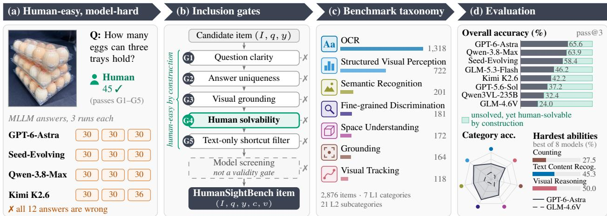  
Figure 1 HumanSightBench is human-easy by construction and model-hard by evaluation. Items pass five validity gates before screening. The 2,876-item benchmark spans 7 categories and 21 ability groups. Among eight MLLMs, the best pass@3 is 65.6% overall and 27.5% on Counting.

The problem is also reflected in benchmark results. Some general-purpose multimodal benchmarks such as MMMU and MathVista focus on end-to-end problem-solving ability. Their scores combine visual perception, language understanding, prior knowledge, and reasoning; some items can also be partially solved from language priors or question artifacts [6, 17, 20]. Perception-oriented benchmarks address the visual bottleneck more directly. For example, BLINK benchmarks traditional computer vision tasks in the setting of MLLM [8]. MMVP evaluates vision-language representations and identifies visual patterns that challenge current models [35]. CV-Bench and VisOnlyQA focus on spatial, geometric and pure vision skills [12, 34]. BabyVision benchmarks vision skills for pre-linguistic vision [5]. PerceptionBench builds atomic questions for visual perception skills based on the attribution to model failure [18]. Benchmarks for scene text, documents, charts, counting, spatial reasoning, and referring expressions further show that visual perception comprises multiple distinct sub-skills [1, 19, 27, 28, 33, 39]. HumanSightBench is built upon the progress in atomic decomposition and human validation. Our benchmark organizes human-validated tasks into 21 fine-grained ability groups to reveal which everyday perceptual requirements remain unmet despite improvements in aggregate scores.

A benchmark for human-level visual perception should establish human solvability independently of model performance. Each item must have a well-specified target and a unique answer supported by the image alone, pass independent human verification, and resist text-only shortcuts. These criteria help distinguish gaps on human-solvable visual tasks from dificulties with specialized knowledge or complex reasoning. Model failures then reveal capability gaps on these validated tasks, without defining human-level perception or establishing the causes of failure.

We use these principles to create HumanSightBench (Figure 1). For a candidate image-question-answer tuple to be included in HumanSightBench, it must pass through five inclusion gates G1 (question clarity), G2 (answer uniqueness), G3 (visual grounding), G4 (human solvability), and G5 (text-only shortcut filtering) (Figure 1(b)). Only after candidates pass these gates do we use MLLMs to filter saturated items for diagnostic value; model performance does not define human solvability or independently justify inclusion. We collected 2,876 short-answer questions across seven perceptual categories and 21 subcategories (from OCR to structured visual perception to visual tracking, Figure 1(c)). On our benchmark, the best among eight representative MLLMs achieves only 65.6% pass@3, and the best MLLM on the Counting ability solves only 27.5% of

Counting questions. This ability breakdown can guide hypotheses for targeted training-data collection, with the benchmark reserved for held-out evaluation of the relevant skills. A low score corresponds to a capability gap; to assess whether further data can close this gap, we need to run a training experiment.

Our contributions are threefold:

• We propose a protocol for constructing human-easy visual perception tasks. The tasks are unambiguous, visually grounded, reliably solvable by ordinary humans, and resistant to text-only or knowledge-based shortcuts.

• We develop HumanSightBench, a benchmark covering seven categories of human-easy visual perception tasks. We filter ambiguity, verify answers, and check visual evidence so that errors better reflect perceptual limitations rather than task misunderstanding.

• We evaluate representative MLLMs on HumanSightBench and analyze performance across perceptual abilities. Despite strong results on existing multimodal benchmarks, current MLLMs still exhibit consistent weaknesses on human-easy visual perception tasks.

## 2 Related Work

## 2.1 Multimodal Evaluation and Perceptual Entanglement

As the general-purpose multimodal benchmark has provided a lot of information about the ability of MLLMs, the image-conditioned answer prediction is adopted as the default evaluation method for both visual question answering and diagram benchmarks at early and mid scales [2, 9, 14, 25]. MMMU evaluates college-level multimodal understanding across many academic disciplines [41]; MathVista, MATH-Vision, and MathVerse test mathematical reasoning over visual inputs [26, 36, 43]. LLaVA-Bench, MMBench, MME, SEED-Bench, MM-Vet, and VLMEvalKit, etc. were proposed to evaluate the integrated ability in diferent application fields and model families for visual language [7, 15, 16, 21, 22, 40]. These benchmarks are crucial as the applications of the multimodal models require a combination of many multimodal abilities, including knowledge, language comprehension and reasoning, visual comprehension and reasoning, which brings many dificulties to analyze the root cause of the error in visual perception, including wrong visual fact perception, language ambiguity, missing background knowledge, and downstream reasoning error. A correct answer may also exploit language priors or question artifacts without using the image [6, 17, 20]. HumanSightBench is introduced to complement the existing end-to-end multimodal ability benchmarks and reduce confounds from external knowledge and complex reasoning when evaluating the visual perception tasks that are human-easy by construction and model-hard by evaluation.

## 2.2 Visual Perception Evaluation for MLLMs

Some works have started to investigate the visual perception bottleneck in MLLMs. Fine-grained visua perception benchmarks cover scene text, documents, charts, and OCR [3, 11, 23, 24, 27–30, 33]; compositional benchmarks examine counting, spatial relations, and grounding [1, 10, 13, 19, 39]. BLINK reformulates classic computer vision tasks into multimodal questions and shows a large human-model gap [8]. MMVP finds the visual patterns where humans and models perform diferently and which are dificult for widely used vision-language representations [35]. CV-Bench (2D 3D) evaluates visual perception tasks in Cambrian benchmark [34]. VisOnlyQA evaluates the geometric and spatial perception of diagrams without external knowledge [12]. Other works evaluate MLLMs in visual search, visual zooming, small details, evidence dependency [4, 31, 32, 37, 38, 42, 44–46]. Recently, some works define and study the meaning of "basic visual ability". BabyVision defines specific tasks to investigate early-stage human visual perception ability, including fine-grained discrimination, visual tracking, spatial perception, and visual pattern recognition [5]. PerceptionBench analyzes atomic perception ability according to the failure modes of MLLMs in multimodal benchmarks and defines corresponding diagnostic questions [18]. PerceptionBench also verifies visual grounding and uses independent human review. HumanSightBench builds upon these works and creates a new benchmark containing 2,876 items categorized into 21 ability groups. It empirically investigates remaining bottlenecks in eight current MLLMs and separately evaluates visual operations included in broader ability categories.

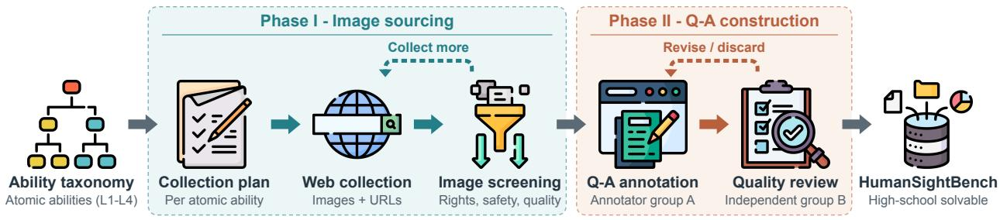  
Figure 2 Data construction pipeline of HumanSightBench. The perceptual taxonomy guides collection planning, web collection, and image screening. One annotator group constructs question–answer pairs, and a second group independently reviews their quality. The feedback loops support further collection and the revision or removal of unsuitable pairs. The collection taxonomy is shown at L1–L4 granularity; evaluation uses the 7 L1 categories and 21 L2 groups listed in Appendix A.

## 3 HumanSightBench

HumanSightBench is built around a simple benchmark principle: every item should be solvable by ordinary humans from visual evidence in the image, yet remain challenging for current MLLMs. Figure 1(b) summarizes the inclusion gates, and Figure 2 details how they are carried out during collection and annotation. Our first step is to define the perceptual space to be measured. Second, we collect candidate image-question pairs. Third, only pairs that pass all five inclusion gates (G1–G5: question clarity, answer uniqueness, visual grounding, human solvability, and text-only shortcut filtering) are kept.

## 3.1 Human-Level Item Definition

Human-level solvability is a requirement for each item, rather than an aggregate baseline. Our inclusion protocol specifies an (I, q, y, c, v) tuple, where I is an image, q is a short-answer question, y is a unique verified answer, c is a taxonomy path, and v is a verification record that logs the set of checks that are verified. The protocol admits a candidate only if the question is well-defined, the answer is unique, the answer is supported by visual evidence in the image, three annotators independently solve it with unanimous correctness under the stated protocol, and the answer is not recoverable from text alone. Finally, model performance is used to remove saturated items, leaving items that are still challenging for the state-of-the-art MLLMs. Model failure on HumanSightBench corresponds to giving the wrong answer on a human-validated visual task under the evaluated input interface.

## 3.2 Taxonomy and Coverage

The complete dataset is organized into 7 top-level categories (L1) and 21 subcategories (L2): Grounding, Semantic Recognition, Fine-grained Discrimination, Visual Tracking, Space Understanding, OCR, and Structured Visual Perception. The L2 subcategories specify abilities within each category, such as Counting, Line Tracing, Character Recognition, and Chart Recognition. Appendix A lists the L1 counts and full L2 names. The taxonomy determines what we attempt to cover; the inclusion gates determine what enters the benchmark. Some leaves are discovery-driven because they originate from observed model failures, but model scores alone never include an item. This separation keeps the taxonomy useful for coverage while ensuring that the benchmark is defined by validity and human-level solvability rather than by any single generation of models.

## 3.3 Human-Level Inclusion Gates

Figure 2 summarizes the collection and annotation workflow. We first collect candidate images and question ideas according to the taxonomy, drop images with copyright, privacy, low quality, unsafe, and leaking answer issues, discard candidates whose solution depends on specialized background knowledge rather than visual inspection, and finally convert the candidate images to short answer visual questions and apply the five inclusion gates below.

G1: Question clarity. In pilot annotation, many apparent perception failures were caused by underspecified questions. We defined a list of ambiguity type (i.e., "completeness", "occlusion", "rules regarding image boundary", "adjacency", "counted units", "ordering criteria", "output format", etc.) for each of them. These questions were iteratively edited until consistent annotation on questions specification and output format was provided by independent annotators.

G2--G3: Answer uniqueness and visual grounding. Each item must have a single verified answer justified by the image alone. Reviewers reject candidates requiring unsupported assumptions, world knowledge, or information outside the image. Verification records identify the elements or regions determining counting and grounding answers, and the attributes or regions supporting comparison and recognition answers. These records support answer verification and reduce reliance on hidden task interpretations.

G4: Human solvability. Human-level solvability is a precondition for inclusion. Ordinary human annotators answer each candidate under the same question text used for model evaluation; items that humans find inaccurate, inconsistent, or overly time-consuming are revised or removed. More details regarding the annotation protocol, including the number of annotators, inclusion criteria, time limit, the rule of image viewing and dispute resolution rule, are provided in our Appendix B.

G5: Text-only shortcut filtering. We have also filtered the text-based solvable candidates, which are ones that can be solved without image viewing [6].

Model screening (not a validity gate). We have also removed items saturated by MLLMs after validation. This last step does not define human-level validity; it only keeps the benchmark challenging for the models being evaluated.

## 3.4 Dataset Statistics

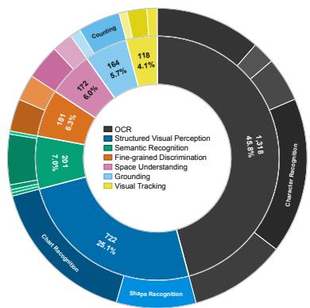

HumanSightBench contains 2,876 questions across 7 L1 categories and 21 L2 subcategories. Figure 3 shows the L1 distribution, and Appendix A provides the L1 counts and full L2 names. OCR and Structured Visual Perception together account for 70.9% of the benchmark, and the largest category is 11.17 times the size of the smallest. We do not subsample categories to force balance, because doing so would discard valid human-level items. Instead, experiments report overall pass@3 across all items and category-level pass@3, and category-level conclusions are made only where the category has suficient coverage. This design lets HumanSightBench serve both as a broad benchmark of human-level visual perception and as a diagnostic resource for the perceptual conditions under which current MLLMs still fail.

Figure 3 Category distribution.

## 4 Experiments

## 4.1 Evaluation Setup

Models. We evaluate eight representative MLLMs: five proprietary models (GPT-5.6-Sol, GPT-6-Astra, Qwen-3.8-Max, GLM-5.3-Flash, and Seed-Evolving) and three open-source models (GLM-4.6V, Kimi K2.6, and Qwen3VL-235B-Thinking). All models are evaluated on the same 2,876 HumanSightBench questions with consistent question text and answer-format instructions. Each instance contains one image and one short-answer question.

Implementation Details. We use two image input settings, Resize and No Resize, as reported in Table 1. Resize resizes the image before inference, while No Resize preserves the original resolution. The image content and question text remain unchanged. Because resizing may afect fine-grained visual evidence, results under diferent settings should be interpreted as comparisons between model–input configurations rather than as a controlled resizing ablation. For each model–question pair, we run three independent trials with the same image and prompt and retain the first three responses. The prompt requests a concise answer and specifies the expected output format when needed.

Evaluation Protocol and Metric. HumanSightBench uses open-ended short answers, so we use DeepSeek-V3.2 in thinking mode as the answer judge instead of exact string matching. The judge compares each final answer with the verified reference and assigns a binary correctness label. Explanations and reasoning traces are ignored, while semantically equivalent surface forms, including diferences in capitalization, punctuation, whitespace, and numeric formatting, are treated as correct. We report pass@3, where a question is considered solved if at least one of the first three trials is judged correct. Overall scores are computed over all 2,876 items, while category-level and ability-level scores are computed over the corresponding L1 and L2 subsets. The formal definition of pass@3 is provided in Appendix B.3.

## 4.2 Overall Performance

Current MLLMs retain a substantial gap on human-easy visual tasks. Table 1 reports pass@3 at the overall, category, and ability levels. Overall performance ranges from 24.0% to 65.6% across the eight evaluated MLLMs. GPT-6-Astra achieves the highest overall score of 65.6%, followed by Qwen-3.8-Max at 63.9% and Seed-Evolving at 58.4%. The three open-source models obtain overall scores between 24.0% and 42.2%. Even at 65.6% pass@3, more than one third of the benchmark remains unsolved despite every retained item having passed the human-solvability, answer- uniqueness, visual-grounding, and text-only shortcut checks. These results indicate that strong performance on current multimodal benchmarks does not translate into uniformly reliable performance on visually grounded tasks that are easy for humans under our inclusion protocol.

Grounding remains a consistent category-level bottleneck. The dificulty is highly uneven across perceptual categories. Grounding is the lowest-scoring L1 category for all eight evaluated models, with category-level pass@3 ranging from 11.6% to 31.7%. Even the best Grounding result, 31.7% from GPT-6- Astra, remains far below the strongest results observed in other categories. In contrast, GPT-6-Astra reaches 83.4% on Fine-grained Discrimination and 82.5% on Structured Visual Perception, while Qwen-3.8-Max reaches 70.1% on Semantic Recognition and 62.7% on OCR. The large separation between Grounding and these stronger categories suggests that the remaining perceptual dificulty is concentrated rather than uniform across the benchmark taxonomy.

Models exhibit distinct perceptual profiles. Higher overall performance does not imply uniformly higher performance across all categories. GPT-6-Astra achieves the best overall score and leads several L1 categories, but Qwen-3.8-Max performs better on Semantic Recognition, with 70.1% versus 66.7%, and on OCR, with 62.7% versus 58.0%. Within individual models, the variation is also substantial. For example, Qwen-3.8-Max ranges from 31.1% on Grounding to 73.1% on Structured Visual Perception, while GPT-6-Astra ranges from 31.7% on Grounding to 83.4% on Fine-grained Discrimination. Thus, a single aggregate score compresses substantially diferent perceptual profiles and can obscure which capabilities account for a model’s strengths and weaknesses.

Aggregate scores motivate finer-grained diagnosis. L1 categories themselves still combine perceptually diferent operations. OCR, for example, includes text-region localization, layout and structure understanding, text-content recognition, character recognition, and recognition of less-common languages. Their dificulty difers substantially within the same category. Similarly, Visual Tracking combines line tracing, contour recognition, and visual reasoning, which need not improve together. Category averages can therefore conceal bottlenecks that are visible only at a finer granularity. We next analyze the 21 L2 ability groups to localize these remaining capability gaps.

Table 1 Performance of MLLMs on HumanSightBench. We evaluate five proprietary MLLMs and three open-source MLLMs. The best results for each question type are marked in bold. Reported values represent pass@3 accuracy, i.e. the proportion of samples solved in at least one of the first three trials. Subtype names are abbreviated; full names appear in Appendix A.
<table><tr><td rowspan="3">Type</td><td rowspan="3">Subtype</td><td colspan="5">Proprietary MLLMs</td><td colspan="3">Open-source MLLMs</td></tr><tr><td colspan="3">No Resize</td><td colspan="2">Resize</td><td colspan="2">No Resize</td><td>Resize Qwen3VL</td></tr><tr><td>Sol</td><td>GPT-5.6 GPT-6 Astra</td><td>GLM-5.3 Flash</td><td>Seed Evolving</td><td>Qwen-3.8 Max</td><td>GLM Kimi 4.6V</td><td>K2.6</td><td>235B Thinking</td></tr><tr><td rowspan="3">Grounding</td><td>Abstract concept</td><td>15.2</td><td>48.5</td><td>36.4</td><td>51.5</td><td>63.6</td><td>48.5</td><td>36.4</td><td>42.4</td></tr><tr><td>Counting</td><td>10.7</td><td>27.5</td><td>15.3</td><td>26.0</td><td>22.9</td><td>4.6</td><td>13.0</td><td>8.4</td></tr><tr><td>Category overall</td><td>11.6</td><td>31.7</td><td>19.5</td><td>31.1</td><td>31.1</td><td>13.4</td><td>17.7</td><td>15.2</td></tr><tr><td rowspan="6">Semantic Recognition</td><td>Basic Recognition</td><td>30.0</td><td>90.0</td><td>10.0</td><td>50.0</td><td>90.0</td><td>20.0</td><td>50.0</td><td>40.0</td></tr><tr><td>Actions &amp; interact.</td><td>50.0</td><td>60.0</td><td>60.0</td><td>50.0</td><td>90.0</td><td>40.0</td><td>30.0</td><td>10.0</td></tr><tr><td>States &amp; attrib.</td><td>46.7</td><td>60.0</td><td>53.3</td><td>66.7</td><td>60.0</td><td>33.3</td><td>53.3</td><td>53.3</td></tr><tr><td>Color Perception</td><td>37.2</td><td>65.4</td><td>41.7</td><td>53.8</td><td>69.2</td><td>25.6</td><td>35.3</td><td>30.1</td></tr><tr><td>Semantic Relations</td><td>40.0</td><td>80.0</td><td>40.0</td><td>60.0</td><td>60.0</td><td>20.0</td><td>20.0</td><td>30.0</td></tr><tr><td>Category overall</td><td>38.3</td><td>66.7</td><td>41.8</td><td>54.7</td><td>70.1</td><td>26.4</td><td>36.3</td><td>31.3</td></tr><tr><td rowspan="3">Fine-grained discrim.</td><td>Basic Recognition</td><td>40.0</td><td>76.0</td><td>40.0</td><td>61.0</td><td>61.0</td><td>14.0</td><td>35.0</td><td>23.0</td></tr><tr><td>Grid Recognition</td><td>54.3</td><td>92.6</td><td>42.0</td><td>75.3</td><td>63.0</td><td>13.6</td><td>29.6</td><td>14.8</td></tr><tr><td>Category overall</td><td>46.4</td><td>83.4</td><td>40.9</td><td>67.4</td><td>61.9</td><td>13.8</td><td>32.6</td><td>19.3</td></tr><tr><td rowspan="4">Visual Tracking</td><td>Line Tracing</td><td>28.0</td><td>84.0</td><td>48.0</td><td>68.0</td><td>80.0</td><td>44.0</td><td>48.0</td><td>32.0</td></tr><tr><td>Contour Recognition</td><td>24.6</td><td>68.9</td><td>42.6</td><td>49.2</td><td>54.1</td><td>18.0</td><td>34.4</td><td>24.6</td></tr><tr><td>Visual Reasoning</td><td>40.6</td><td>50.0</td><td>43.8</td><td>50.0</td><td>46.9</td><td>3.1</td><td>15.6</td><td>6.2</td></tr><tr><td>Category overall</td><td>29.7</td><td>66.9</td><td>44.1</td><td>53.4</td><td>57.6</td><td>19.5</td><td>32.2</td><td>21.2</td></tr><tr><td rowspan="3">Space underst.</td><td>Rel. orient. / frame transf.</td><td>23.1</td><td>56.5</td><td>46.3</td><td>54.6</td><td>56.5</td><td>19.4</td><td>38.9</td><td>18.5</td></tr><tr><td>Mirror perception</td><td>50.0</td><td>79.7</td><td>70.3</td><td>70.3</td><td>78.1</td><td>42.2</td><td>54.7</td><td>39.1</td></tr><tr><td>Category overall</td><td>33.1</td><td>65.1</td><td>55.2</td><td>60.5</td><td>64.5</td><td>27.9</td><td>44.8</td><td>26.2</td></tr><tr><td rowspan="6">OCR</td><td>Text region loc. / und.</td><td>30.0</td><td>63.9</td><td>35.8</td><td>46.5</td><td>63.0</td><td>23.9</td><td>30.9</td><td>28.1</td></tr><tr><td>Text layout &amp; structure</td><td>50.0</td><td>81.4</td><td>61.4</td><td>70.0</td><td>84.3</td><td>31.4</td><td>61.4</td><td>48.6</td></tr><tr><td>Text content recog.</td><td>16.8</td><td>45.3</td><td>36.5</td><td>35.8</td><td>42.3</td><td>21.2</td><td>27.0</td><td>27.7</td></tr><tr><td>Character recog.</td><td>19.6</td><td>53.9</td><td>40.3</td><td>59.5</td><td>66.9</td><td>25.8</td><td>58.7</td><td>47.1</td></tr><tr><td>Less-common-lang. OCR</td><td>43.0</td><td>58.3</td><td>53.0</td><td>60.7</td><td>60.0</td><td>32.7</td><td>51.3</td><td>41.3</td></tr><tr><td>Category overall</td><td>28.8</td><td>58.0</td><td>42.8</td><td>54.6</td><td>62.7</td><td>26.7</td><td>47.0</td><td>39.2</td></tr><tr><td rowspan="3">Structured visual percept.</td><td>Shape Recognition</td><td>61.9</td><td>89.9</td><td>65.2</td><td>79.8</td><td>84.2</td><td>27.9</td><td>53.4</td><td>38.1</td></tr><tr><td>Chart Recognition</td><td>55.8</td><td>78.7</td><td>56.4</td><td>66.1</td><td>67.4</td><td>20.6</td><td>39.4</td><td>27.2</td></tr><tr><td>Category overall</td><td>57.9</td><td>82.5</td><td>59.4</td><td>70.8</td><td>73.1</td><td>23.1</td><td>44.2</td><td>30.9</td></tr><tr><td>All</td><td>Overall</td><td>37.2</td><td>65.6</td><td>46.2</td><td>58.4</td><td>63.9</td><td>24.0</td><td>42.2</td><td>32.4</td></tr></table>

## 4.3 Ability-level Diagnosis

Model failures concentrate on specific perceptual abilities. To localize the remaining bottlenecks, we analyze the 21 ability groups in Table 1. The six lowest-scoring abilities are Counting with a mean pass@3 of 16.0%, Text Content Recognition at 31.6%, Visual Reasoning at 32.0%, Relative Orientation and Reference Frame Transformation at 39.2%, Contour Recognition at 39.5%, and Text Region Localization and Understanding at 40.3%. These abilities span Grounding, OCR, Visual Tracking, and Space Understanding, indicating that the remaining dificulties are distributed across multiple perceptual categories rather than concentrated in a single one. Category-level aggregates can therefore mask substantial diferences among the underlying abilities.

Aggregate gains do not uniformly transfer to bottleneck abilities. Figure 4 relates performance on these six abilities to each model’s overall score. Most points remain below the equality line. Counting shows the clearest ceiling: ability-level accuracy ranges from 4.6% to 27.5% even as overall accuracy rises from 24.0% to 65.6%. Text Content Recognition and Visual Reasoning also remain dificult, with best scores of 45.3% and 50.0%. The trajectories are non-monotonic: Qwen-3.8-Max remains below Seed-Evolving on Counting and Visual Reasoning, while GPT-6-Astra trails Qwen-3.8-Max on Abstract Concept Grounding and Color Perception. Stronger overall performance does not imply uniformly stronger atomic perception.

Ability = overall  
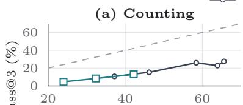

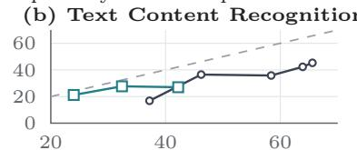

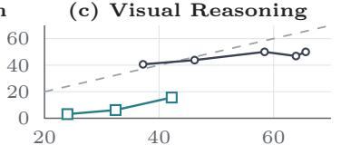

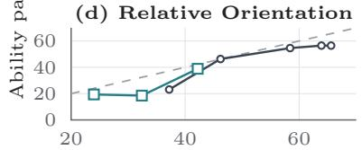

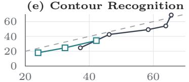  
Overall pass@3 (%)

(f ) Text Region Localization  
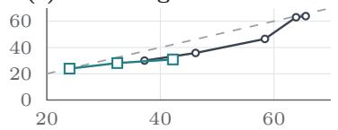  
Figure 4 Overall performance and the six most challenging perceptual abilities. Each panel plots ability-level pass@3 against overall pass@3. Lines connect proprietary and open-source models by overall performance; the dashed line indicates matching ability-level and overall performance.

Shared failures reveal common bottlenecks. Before the GPT-6-Astra update, 461 of 2,876 items (16.0%) were unsolved by all eight models across all three runs. The within-ability all-model failure rate is 61.8% for Counting, 37.2% for Text Content Recognition, 28.1% for Visual Reasoning, and 24.6% for Contour Recognition. These rates show that the weakest abilities are not driven only by a few poorly performing models, but include items that remain dificult across diverse model families and architectures. Counting is particularly notable, with more than half of its items unsolved by every model in this diagnostic snapshot. Such shared failures provide stronger evidence of common capability limitations than errors concentrated in a single model or model family. These rates describe the earlier snapshot, not the updated model set in Table 1.

Models exhibit distinct ability-level profiles. GPT-6-Astra ranks first outright in 11 of the 21 abilities and ties for first in 3. Qwen-3.8-Max ranks first outright in 5 abilities and ties for first in 2, while Seed-Evolving ranks first outright in 2 abilities and ties for first in 1. The distribution of ability-level leaders shows that no model dominates uniformly across the taxonomy or across diferent perceptual operations. Thus, strong overall performance can arise from diferent combinations of perceptual strengths rather than uniform gains across abilities, and models with similar aggregate scores may still difer substantially in where their strengths and weaknesses lie. Appendix C reports group sizes and alternative weighting schemes to support interpretation of these comparisons.

## 4.4 Failure Mode Analysis

Based on the previous diagnostic snapshot, we study the traces of the three leading proprietary models: Qwen-3.8-Max, Seed-Evolving, and GPT-6-Astra, and the leading open-source model: Kimi K2.6, on shared failures. Figure 5 shows 4 cases. (a) Prior substitution: the model replaces the literal visual content with the expected form, e.g., after detecting a misspelled word, it gives the corrected spelling instead of the literal text. (b) Pseudo-measurement: in the ring-counting task, the displayed traces contain coordinate-based counting descriptions with incorrect totals that vary across runs and models. (c) Gestalt integration failure: local information is extracted without integrating global information, e.g., an animal hidden in zigzag stripes is ignored. (d) Orientation collapse: continuous orientations are collapsed into canonical labels, e.g., the mode mistakes a frontal head with averted gaze for looking toward the observer.

These examples inspire us to explore how we could have an agent return to the visual evidence during its reasoning process instead of solely referring to the text description. These examples do not tell us how frequent this pattern is, or establish that additional reasoning causes errors.

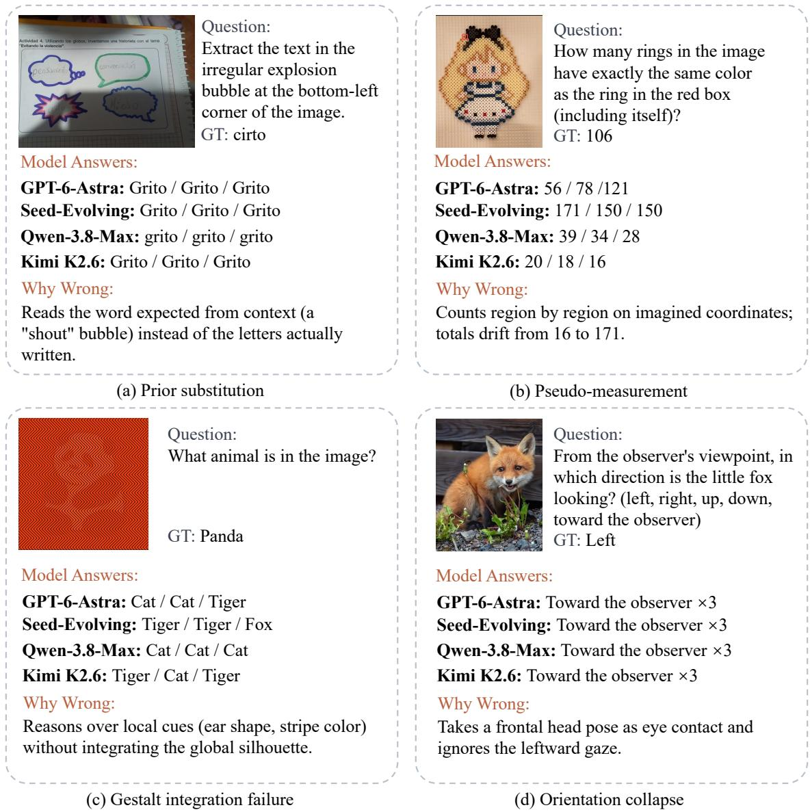  
Figure 5 Four illustrative failure patterns on HumanSightBench. (a) prior substitution; (b) pseudo-measurement; (c) gestalt integration failure; (d) orientation collapse. These cases come from the earlier diagnostic snapshot. Each displayed example is failed by Qwen-3.8-Max, Seed-Evolving, GPT-6-Astra, and Kimi K2.6. The descriptions summarize these outputs without establishing causal mechanisms or their prevalence.

Answer correctness does not certify evidence localization. Figure 6 illustrates a boundary of answeronly scoring: a reported correct answer coexists with a misplaced explicit evidence pointer. The repair is post-hoc, not a new model prediction. Without the complete original table, we cannot independently verify the reported answer. This external illustration motivates separating answer accuracy from explicit evidence localization; it establishes neither the frequency of such errors on HumanSightBench nor the model’s internal evidence use.

Evaluation boundaries. Our inclusion gates reduce confounds but do not isolate perception as the causal source of incorrect answers. Incorrectness can also stem from task interpretation, reasoning, output conventions, or judge error. Likewise, the accuracy of localization may require consideration of coordinate conventions and target regions before it can be attributed to perception. The pass@3 metric measures at-least-once success across three trials, not repeatable correctness. Human solvability is confirmed following our annotation protocol, not estimated for the general population. Model-based screening and unequal category coverage make the scores diagnostic of retained items rather than estimates of everyday error prevalence. Models were evaluated under two preprocessing options labeled “Resize” and “No Resize” in Table 1. These comparisons combine model and input-interface diferences. Human annotators were allowed to zoom the original images, therefore these results are not a controlled comparison at matched viewing conditions.

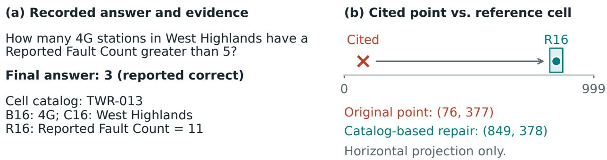  
Figure 6 Correct answer, misplaced explicit evidence. An external table-QA example where the reported answer is correct despite an incorrect evidence location.

## 5 Conclusion

HumanSightBench treats human solvability as an item-level inclusion criterion rather than an aggregate baseline. Its 2,876 questions span seven perceptual categories, with checks for clarity, answer uniqueness, visual grounding, human solvability, and text-only shortcuts. Across eight MLLMs, the strongest model reaches 65.6% pass@3, while ability-level results expose persistent and uneven bottlenecks. These findings support targeted evaluation of human-easy visual tasks; answer accuracy alone does not certify evidence localization or isolate the cause of an error.

## Ethics Statement

We collected benchmark data from sources that permit research use or from internally approved sources. The released benchmark excludes private personal information, unsafe content, and images for which redistribution rights are unclear. When images contain identifiable individuals, we follow applicable consent, anonymization, and review procedures. HumanSightBench is intended for evaluating visual perception in MLLMs and should not be used as a standalone indicator of safety, fairness, or real-world deployment readiness.

## Use of AI Assistants

AI writing assistants were used to help draft and edit the manuscript. All scientific claims, dataset construction decisions, experimental results, and final text were reviewed and approved by the authors.

## References

[1] Manoj Acharya, Kushal Kafle, and Christopher Kanan. TallyQA: Answering Complex Counting Questions. In Proceedings of the AAAI Conference on Artificial Intelligence, volume 33, pages 8076–8084, 2019.

[2] Stanislaw Antol, Aishwarya Agrawal, Jiasen Lu, Margaret Mitchell, Dhruv Batra, C. Lawrence Zitnick, and Devi Parikh. VQA: Visual Question Answering. International Journal of Computer Vision, 123:4–31, 2017.

[3] Ali Furkan Biten, Ruben Tito, Andres Mafla, Lluis Gomez, Marcal Rusinol, C. V. Jawahar, Ernest Valveny, and Dimosthenis Karatzas. Scene Text Visual Question Answering. In Proceedings of the IEEE/CVF International Conference on Computer Vision, pages 4291–4301, 2019.

[4] Jingru Chen, Yiming Liu, Mingtao Chen, Sijie Chen, Richeng Xuan, Liang Yang, Zhichao Hu, and Fanyang Lu. VisualNeedle: Benchmarking Active Visual Search in Information-Dense Scenes. arXiv preprint arXiv:2605.26380, 2026.

[5] Liang Chen, Weichu Xie, Yiyan Liang, Hongfeng He, Hans Zhao, Zhibo Yang, Zhiqi Huang, Haoning Wu, Haoyu Lu, Yiping Bao, et al. Babyvision: Visual reasoning beyond language. arXiv preprint arXiv:2601.06521, 2026.

[6] Lin Chen, Jinsong Li, Xiaoyi Dong, Pan Zhang, Yuhang Zang, Zehui Chen, Haodong Duan, Jiaqi Wang, Yu Qiao, Dahua Lin, et al. Are we on the right way for evaluating large vision-language models? Advances in Neural Information Processing Systems, 37:27056–27087, 2024.

[7] Chaoyou Fu, Peixian Chen, Yunhang Shen, Yulei Qin, Mengdan Zhang, Xu Lin, Jinrui Yang, Xiawu Zheng, Ke Li, Xing Sun, Yunsheng Wu, and Rongrong Ji. MME: A Comprehensive Evaluation Benchmark for Multimodal Large Language Models. arXiv preprint arXiv:2306.13394, 2023.

[8] Xingyu Fu, Yushi Hu, Bangzheng Li, Yu Feng, Haoyu Wang, Xudong Lin, Dan Roth, Noah A Smith, Wei-Chiu Ma, and Ranjay Krishna. Blink: Multimodal large language models can see but not perceive. In European Conference on Computer Vision, pages 148–166. Springer, 2024.

[9] Drew A. Hudson and Christopher D. Manning. GQA: A New Dataset for Real-World Visual Reasoning and Compositional Question Answering. In Proceedings of the IEEE/CVF Conference on Computer Vision and Pattern Recognition, pages 6700–6709, 2019.

[10] Justin Johnson, Bharath Hariharan, Laurens van der Maaten, Li Fei-Fei, C. Lawrence Zitnick, and Ross Girshick. CLEVR: A Diagnostic Dataset for Compositional Language and Elementary Visual Reasoning. In Proceedings of the IEEE Conference on Computer Vision and Pattern Recognition, pages 2901–2910, 2017.

[11] Kushal Kafle, Brian Price, Scott Cohen, and Christopher Kanan. DVQA: Understanding Data Visualizations via Question Answering. In Proceedings of the IEEE Conference on Computer Vision and Pattern Recognition, pages 5648–5656, 2018.

[12] Ryo Kamoi, Yusen Zhang, Sarkar Snigdha Sarathi Das, Ranran Haoran Zhang, and Rui Zhang. Visonlyqa: Large vision language models still struggle with visual perception of geometric information. arXiv preprint arXiv:2412.00947, 2024.

[13] Sahar Kazemzadeh, Vicente Ordonez, Mark Matten, and Tamara L. Berg. ReferItGame: Referring to Objects in Photographs of Natural Scenes. In Proceedings of the Conference on Empirical Methods in Natural Language Processing, pages 787–798, 2014.

[14] Aniruddha Kembhavi, Mike Salvato, Eric Kolve, Minjoon Seo, Hannaneh Hajishirzi, and Ali Farhadi. A Diagram Is Worth A Dozen Images. In European Conference on Computer Vision, pages 235–251. Springer, 2016.

[15] Bo Li, Peiyuan Wang, Kaichen Tian, Shuai Yan, Hongkai Tang, Shijie Liu, Zhe Zhang, Xinrun Chen, Kai Wang, Haodong Duan, et al. VLMEvalKit: An Open-Source Toolkit for Evaluating Large Multi-Modality Models. arXiv preprint arXiv:2407.11691, 2024.

[16] Bohao Li, Rui Wang, Guangzhi Wang, Yuying Ge, Yixiao Ge, and Ying Shan. Seed-bench: Benchmarking multimodal llms with generative comprehension. arXiv preprint arXiv:2307.16125, 2023.

[17] Yifan Li, Yifan Du, Kun Zhou, Jinpeng Wang, Xin Zhao, and Ji-Rong Wen. Evaluating Object Hallucination in Large Vision-Language Models. arXiv preprint arXiv:2305.10355, 2023.

[18] Zichao Lin, Yifeng Xie, Bowen Qu, Haiming Wang, Jia Li, Haoning Wu, Yuhao Dong, Zuhao Yang, Jinguo Zhu, Haoyu Lu, et al. Perceptionbench: Evaluating atomic visual perception in multimodal large language models. arXiv preprint arXiv:2607.24957, 2026.

[19] Fangyu Liu, Guy Emerson, and Nigel Collier. Visual Spatial Reasoning. Transactions of the Association for Computational Linguistics, 11:635–651, 2023.

[20] Fuxiao Liu, Tianrui Guan, Zongxia Li, Lichang Chen, Yaser Yacoob, Dinesh Manocha, and Tianyi Zhou. HallusionBench: An Advanced Diagnostic Suite for Entangled Language Hallucination and Visual Illusion in Large Vision-Language Models. arXiv preprint arXiv:2310.14566, 2023.

[21] Haotian Liu, Chunyuan Li, Qingyang Wu, and Yong Jae Lee. LLaVA-Bench: Benchmarking Large Multimodal Models in the Wild. arXiv preprint arXiv:2304.08485, 2023.

[22] Yuan Liu, Haodong Duan, Yuanhan Zhang, Bo Li, Songyang Zhang, Wangbo Zhao, Yike Yuan, Jiaqi Wang, Conghui He, Ziwei Liu, Kai Chen, and Dahua Lin. MMBench: Is Your Multi-modal Model an All-around Player? arXiv preprint arXiv:2307.06281, 2023.

[23] Yuliang Liu, Zhang Li, Mingxin Li, Biao Li, Chunyuan Huang, Yuxiang Wang, Bihan Yu, Yongpan Liu, Xiangyang Xue, and Xiang Bai. OCRBench: On the Hidden Mystery of OCR in Large Multimodal Models. arXiv preprint arXiv:2305.07895, 2023.

[24] Yuliang Liu et al. OCRBench v2: An Improved Benchmark for Evaluating Large Multimodal Models on Visual Text Localization and Reasoning. arXiv preprint arXiv:2501.00321, 2025.

[25] Pan Lu, Swaroop Mishra, Tony Xia, Liang Qiu, Kai-Wei Chang, Song-Chun Zhu, Oyvind Tafjord, Peter Clark, and Ashwin Kalyan. Learn to Explain: Multimodal Reasoning via Thought Chains for Science Question Answering. Advances in Neural Information Processing Systems, 35:2507–2521, 2022.

[26] Pan Lu, Hritik Bansal, Tony Xia, Jiacheng Liu, Chunyuan Li, Hannaneh Hajishirzi, Hao Cheng, Kai-Wei Chang, Michel Galley, and Jianfeng Gao. Mathvista: Evaluating mathematical reasoning of foundation models in visual contexts. In International Conference on Learning Representations, volume 2024, pages 23439–23554, 2024.

[27] Ahmed Masry, Do Long, Jia Qing Tan, Shafiq Joty, and Enamul Hoque. ChartQA: A Benchmark for Question Answering about Charts with Visual and Logical Reasoning. In Findings of the Association for Computational Linguistics: ACL 2022, pages 2263–2279, 2022.

[28] Minesh Mathew, Dimosthenis Karatzas, and C. V. Jawahar. DocVQA: A Dataset for VQA on Document Images. In Proceedings of the IEEE/CVF Winter Conference on Applications of Computer Vision, pages 2200–2209, 2021.

[29] Minesh Mathew, Viraj Bagal, Ruben Tito, Dimosthenis Karatzas, Ernest Valveny, and C. V. Jawahar. InfographicVQA. In Proceedings of the IEEE/CVF Winter Conference on Applications of Computer Vision, pages 1697–1706, 2022.

[30] Nitesh Methani, Pritha Ganguly, Mitesh M. Khapra, and Pratyush Kumar. PlotQA: Reasoning over Scientific Plots. In Proceedings of the IEEE/CVF Winter Conference on Applications of Computer Vision, pages 1527–1536, 2020.

[31] Clement Neo, Luke Ong, Philip Torr, Mor Geva, David Krueger, and Fazl Barez. Towards Interpreting Visual Information Processing in Vision-Language Models. In International Conference on Learning Representations (ICLR), 2025.

[32] Haozhan Shen, Kangjia Zhao, Tiancheng Zhao, Ruochen Xu, Zilun Zhang, Mingwei Zhu, and Jianwei Yin. ZoomEye: Enhancing Multimodal LLMs with Human-Like Zooming Capabilities through Tree-Based Image Exploration. arXiv preprint arXiv:2411.16044, 2024.

[33] Amanpreet Singh, Vivek Natarajan, Meet Shah, Yu Jiang, Xinlei Chen, Dhruv Batra, Devi Parikh, and Marcus Rohrbach. Towards VQA Models That Can Read. In Proceedings of the IEEE/CVF Conference on Computer Vision and Pattern Recognition, pages 8317–8326, 2019.

[34] Shengbang Tong, Ellis Brown, Penghao Wu, Sanghyun Woo, Manoj Middepogu, Sai C Akula, Jihan Yang, Shusheng Yang, Adithya Iyer, Xichen Pan, et al. Cambrian-1: A fully open, vision-centric exploration of multimodal llms. Advances in Neural Information Processing Systems, 37:87310–87356, 2024.

[35] Shengbang Tong, Zhuang Liu, Yuexiang Zhai, Yi Ma, Yann LeCun, and Saining Xie. Eyes wide shut? exploring the visual shortcomings of multimodal llms. In 2024 IEEE/CVF Conference on Computer Vision and Pattern Recognition (CVPR), pages 9568–9578. IEEE, 2024.

[36] Ke Wang, Junting Pan, Weikang Shi, Zimu Lu, Houxing Ren, Aojun Zhou, Mingjie Zhan, and Hongsheng Li. Measuring multimodal mathematical reasoning with math-vision dataset. Advances in Neural Information Processing Systems, 37:95095–95169, 2024.

[37] Lai Wei, Liangbo He, Jun Lan, Lingzhong Dong, Yutong Cai, Siyuan Li, Huijia Zhu, Weiqiang Wang, Linghe Kong, Yue Wang, Zhuosheng Zhang, and Weiran Huang. Zooming without Zooming: Region-to-Image Distillation for Fine-Grained Multimodal Perception. arXiv preprint arXiv:2602.11858, 2026.

[38] Penghao Wu and Saining Xie. V\*: Guided Visual Search as a Core Mechanism in Multimodal LLMs. In IEEE/CVF Conference on Computer Vision and Pattern Recognition (CVPR), 2024.

[39] Licheng Yu, Patrick Poirson, Shan Yang, Alexander C. Berg, and Tamara L. Berg. Modeling Context in Referring Expressions. In European Conference on Computer Vision, pages 69–85. Springer, 2016.

[40] Weihao Yu, Zhengyuan Yang, Linjie Li, Jianfeng Wang, Kevin Lin, Zicheng Liu, Xinchao Wang, and Lijuan Wang. Mm-vet: Evaluating large multimodal models for integrated capabilities. arXiv preprint arXiv:2308.02490, 2023.

[41] Xiang Yue, Yuansheng Ni, Kai Zhang, Tianyu Zheng, Ruoqi Liu, Ge Zhang, Samuel Stevens, Dongfu Jiang, Weiming Ren, Yuxuan Sun, et al. Mmmu: A massive multi-discipline multimodal understanding and reasoning benchmark for expert agi. In Proceedings of the IEEE/CVF conference on computer vision and pattern recognition, pages 9556–9567, 2024.

[42] Jiarui Zhang, Mahyar Khayatkhoei, Prateek Chhikara, and Filip Ilievski. MLLMs Know Where to Look: Training-free Perception of Small Visual Details with Multimodal LLMs. In International Conference on Learning Representations (ICLR), 2025.

[43] Renrui Zhang, Dongzhi Jiang, Yichi Zhang, Haokun Lin, Ziyu Guo, Pengshuo Qiu, Aojun Zhou, Pan Lu, Kai-Wei Chang, Yu Qiao, et al. Mathverse: Does your multi-modal llm truly see the diagrams in visual math problems? In European Conference on Computer Vision, pages 169–186. Springer, 2024.

[44] Xintong Zhang, Zhi Gao, Bofei Zhang, Pengxiang Li, Xiaowen Zhang, Yang Liu, Tao Yuan, Yuwei Wu, Yunde Jia, Song-Chun Zhu, and Qing Li. Adaptive Chain-of-Focus Reasoning via Dynamic Visual Search and Zooming for Eficient VLMs. arXiv preprint arXiv:2505.15436, 2025.

[45] Ziwei Zheng, Michael Yang, Jack Hong, Chenxiao Zhao, Guohai Xu, Le Yang, Chao Shen, and Xing Yu. DeepEyes: Incentivizing “Thinking with Images” via Reinforcement Learning. arXiv preprint arXiv:2505.14362, 2025.

[46] Didi Zhu, Changrui Chen, Stefanos Zafeiriou, and Jiankang Deng. VisualFLIP: Do Predictions Depend on Task-Critical Visual Evidence in Multimodal Reasoning? arXiv preprint arXiv:2606.07872, 2026.

## Appendix

## A Full Taxonomy and Ability-Level Coverage

Figure 3 summarizes the L1 distribution in the main text. Table 2 expands this distribution into all 21 L2 ability groups, reporting their L1–L2 mappings and exact sample counts. The L2 counts sum to the corresponding L1 totals and to 2,876 items overall. The two groups named Basic Recognition belong to diferent L1 categories and are therefore reported separately.

Table 2 Question counts for the 21 evaluated ability groups. IDs identify an L1–L2 path, so the two Basic Recognition groups remain distinct.
<table><tr><td>ID</td><td>L1 category</td><td>L2 ability</td><td>Items</td></tr><tr><td>1.1</td><td>Grounding</td><td>Abstract Concept Grounding</td><td>33</td></tr><tr><td>1.2</td><td></td><td>Counting</td><td>131</td></tr><tr><td>2.1</td><td>Semantic Recognition</td><td>Basic Recognition</td><td>10</td></tr><tr><td>2.2</td><td></td><td>Actions and Interactions</td><td>10</td></tr><tr><td>2.3</td><td></td><td>States and Attributes</td><td>15</td></tr><tr><td>2.4</td><td></td><td>Color Perception</td><td>156</td></tr><tr><td>2.5</td><td></td><td>Semantic Relations</td><td>10</td></tr><tr><td></td><td>3.1 Fine-grained Discr.</td><td>Basic Recognition</td><td>100</td></tr><tr><td>3.2</td><td></td><td>Grid Recognition</td><td>81</td></tr><tr><td></td><td>4.1 Visual Tracking</td><td>Line Tracing</td><td>25</td></tr><tr><td>4.2</td><td></td><td>Contour Recognition</td><td>61</td></tr><tr><td>4.3</td><td></td><td>Visual Reasoning</td><td>32</td></tr><tr><td></td><td>5.1 Space Understanding</td><td>Relative Orientation and Reference Frame Transformation</td><td>108</td></tr><tr><td>5.2</td><td></td><td>Mirror Image Perception</td><td>64</td></tr><tr><td>6.1</td><td>OCR</td><td>Text Region Localization and Understanding</td><td>327</td></tr><tr><td>6.2</td><td></td><td>Text Layout and Structure Understanding</td><td>70</td></tr><tr><td>6.3</td><td></td><td>Text Content Recognition</td><td>137</td></tr><tr><td>6.4</td><td></td><td>Character Recognition</td><td>484</td></tr><tr><td>6.5</td><td></td><td>Text Recognition in Less Common Languages</td><td>300</td></tr><tr><td>7.1</td><td>Structured Visual Perc.</td><td>Shape Recognition</td><td>247</td></tr><tr><td>7.2</td><td></td><td>Chart Recognition</td><td>475</td></tr><tr><td colspan="2"></td><td>Total</td><td>2,876</td></tr></table>

Variation within categories. L1 totals can hide substantial variation in L2 coverage. In Semantic Recognition, Color Perception contains 156 of 201 items, whereas Basic Recognition, Actions and Interactions, and Semantic Relations contain 10 items each. Within OCR, group sizes range from 70 items for Text Layout and Structure Understanding to 484 for Character Recognition. These diferences motivate reporting ability-level results alongside category-level aggregates. Appendix C further examines how group sizes and alternative weighting afect score interpretation.

## B Protocol Details

## B.1 Human-Level Inclusion Protocol

Annotation and review groups. Candidate question–answer pairs are first constructed by annotator group A following the predefined ability taxonomy and collection guidelines. Each candidate is then independently reviewed by annotator group B, which consists of three ordinary adult annotators. The reviewers are not shown model predictions and independently answer the same question that is later used for model evaluation.

Items that fail this review are revised and reviewed again or discarded, following the feedback loop shown in the data construction pipeline.

Task dificulty and human solvability. HumanSightBench targets visual tasks that require no more than high-school-level knowledge. High-school solvability describes the intended task dificulty, while actual human solvability is verified by the adult reviewers in group B. Each candidate must be answerable through ordinary visual inspection without specialized background knowledge.

Viewing rules. Reviewers may inspect the image at its original resolution and may zoom or pan inside the annotation interface. This rule is fixed because HumanSightBench tests whether the answer is present in the visual input, rather than whether the evidence is legible in a particular browser thumbnail. Reviewers may not crop, enhance, edit, or otherwise transform the image. For all items, the same image and question are used for human inclusion checks and model evaluation.

Time limit. Each item is designed to be solved with ordinary visual inspection rather than extended search. We therefore impose a per-item time limit of 60 seconds. Items that require repeated re-reading, extensive manual counting, or unusually long inspection are flagged as overly time-consuming and are either simplified, rewritten, or removed.

Inclusion threshold. A candidate passes the human-solvability gate only if all three reviewers in group B independently produce the verified answer after normalization and none flags the item as ambiguous, impossible to answer from the image, or dependent on specialized background knowledge. Normalization covers only surface-form variants such as whitespace, capitalization, punctuation, and equivalent numeric forms. This threshold is used for item inclusion only; we do not report the resulting human responses as an aggregate human score.

Disagreement handling. If the reviewers disagree, the item is returned for error diagnosis. Disagreements are assigned to one of four causes: ambiguous wording, multiple plausible answers, insuficient or unclear visual evidence, or human error on an otherwise valid item. Items in the first three cases are revised and reviewed again by independent reviewers; if the revised item fails again, it is discarded. Items attributed to isolated human errors are retained only after an additional independent review confirms that the question, answer, and supporting visual evidence are unambiguous.

Revision and discard criteria. An item is revised when the image is valid but the question underspecifies the target object, counting rule, spatial relation, output format, or acceptable answer granularity. An item is discarded when the answer cannot be uniquely verified from the image, when the required evidence is too small or degraded for ordinary inspection, when the item relies on external knowledge, when it contains privacy or copyright risk, or when it remains ambiguous after one revision cycle.

## B.2 Shortcut and Saturation Checks

Text-only shortcut filtering. To reduce language-only solvability, each candidate question is checked without the image. Items are removed or rewritten when the answer can be inferred from the question wording, common priors, dataset artifacts, or surrounding text alone. This filtering is applied before model evaluation so that high model accuracy cannot be explained by ignoring the image.

Model screening. If an item survives the five inclusion gates, model screening removes saturated items from the candidate set. This ensures that HumanSightBench remains challenging. The screening step does not define human-level validity: the final candidate set is conditional on the models and criterion used for screening. The screening model identities, saturation threshold, and number of items screened out are not specified in the present manuscript, so overlap between screening and evaluated models and its impact on rankings is unknown.

## B.3 Model Evaluation Protocol

Prompt format. Each model receives a single image and a short-answer question. The prompt asks the model to answer concisely and to avoid explanations unless the question explicitly requests them. For numeric, categorical, or grounding-style answers, the prompt specifies the expected answer format.

Trials and metric. For each model and item, the evaluation uses the first three trials under the same prompt and image. If $s _ { i , r } \in \{ 0 , 1 \}$ is the judged correctness of trial r for item i, its pass@3 indicator is $\operatorname* { m a x } _ { r = 1 , 2 , 3 } s _ { i , r }$ . For an evaluation subset S, the reported score is

$$
\operatorname { p a s s @ 3 } ( S ) = \frac { 1 0 0 } { | S | } \sum _ { i \in S } \operatorname* { m a x } _ { r = 1 , 2 , 3 } s _ { i , r } .
$$

The overall score uses all 2,876 items; category and ability scores restrict S to the corresponding items. This is an any-correct criterion over three trials, not the average accuracy of the three answers. Decoding settings are model-specific and should be documented with the released evaluation metadata.

Scoring. DeepSeek-V3.2 (thinking mode) compares the final answer of each response to the verified reference and assigns a binary score. Minor formatting diferences and equivalent surface forms do not alter the score. The judge evaluates the final answer not the explanation. A shared failure is when an item is incorrect for every evaluated model in all three trials. Shared-failure rates within abilities are calculated as a ratio of shared-failure items to the number of items in that ability, not to the full size of the benchmark. The scoring rule is mentioned in the manuscript, but neither the complete judge prompt nor a manual audit of the judges’ decisions are provided.

## C Additional Results

This appendix explains how the group sizes in Appendix A afect score interpretation and compares alternative weightings of Table 1.

Sensitivity to group size. Table 2 provides the denominator for each ability-level score. One additional solved item changes pass@3 by 100/n percentage points for a group of n items: 10 points for a 10-item group, compared with about 0.21 points for the 484-item Character Recognition group. Small diferences in reported scores therefore have diferent granularity across groups. These increments describe score resolution, not statistical uncertainty; group-level rankings alone do not establish a reliable ordering of models beyond the retained items.

Alternative weighting. Table 3 gives the arithmetic average of the seven L1 scores, and the 21 L2 scores separately (both are equal-weighted). These means use the one-decimal percentages displayed in Table 1; the micro column reproduces its overall score. These are not extra model evaluations but summaries of the results. They are not as heavily weighted towards the large OCR and Structured Visual Perception categories as the micro average is, but L2 averaging gives equal weighting to small ability groups. Neither weighting corrects model-based item selection or provides uncertainty estimates.

Table 3 Alternative weighting of the same main-table results (%). Micro reproduces Table 1; macro columns average its displayed category or ability scores, with equal weight for each group.
<table><tr><td>Model</td><td>Micro</td><td>L1 macro</td><td>L2 macro</td></tr><tr><td>GPT-5.6-Sol</td><td>37.2</td><td>35.1</td><td>36.5</td></tr><tr><td>GPT-6-Astra</td><td>65.6</td><td>64.9</td><td>67.2</td></tr><tr><td>GLM-5.3-Flash</td><td>46.2</td><td>43.4</td><td>44.7</td></tr><tr><td>Seed-Evolving</td><td>58.4</td><td>56.1</td><td>57.4</td></tr><tr><td>Qwen-3.8-Max</td><td>63.9</td><td>60.1</td><td>64.9</td></tr><tr><td>GLM-4.6V</td><td>24.0</td><td>21.5</td><td>25.2</td></tr><tr><td>Kimi K2.6</td><td>42.2</td><td>36.4</td><td>38.9</td></tr><tr><td>Qwen3VL-235B-Thinking</td><td>32.4</td><td>26.2</td><td>30.0</td></tr></table>