# Improving Confidence Estimation in Language Models with Linear Representations of Ambiguity

Themistoklis Nikas

Nishant Subramani

Aaron Mueller

: Boston University

: Carnegie Mellon University, Language Technologies Institute tnikas@bu.edu

## Abstract

As language models (LMs) are increasingly deployed in downstream applications, accurately estimating their likelihood of success on a given example is critical. However, confidence estimates from LMs are poor predictors of their likelihood of success. Accurate confidence estimation is linked in part to the detection of aleatoric uncertainty; we hypothesize that LMs possess representations of at least some aspects of this uncertainty in the form of representations of the inherent ambiguity of the input. Using difference-in-means on minimal pairs of ambiguous and unambiguous sentences, we derive ambiguity representations in LM activations, and find that steering with them selectively (albeit weakly) modulates LMs’ judgments of the input’s ambiguity. We then propose DART, a fine-tuning method that encourages updates to lie within the span of the ambiguity directions, and penalizes changes to the LM activations outside of this subspace. DART greatly improves calibration, encodes these improvements into the model parameters, and maintains model accuracy on multiple-choice and generative QA tasks.

## 1 Introduction

While language models (LMs) have demonstrated impressive capabilities, assessing their trustworthiness remains challenging. LMs do not achieve uniformly good performance on all tasks; as they are increasingly deployed in high-stakes applications, it is increasingly important to be able to accurately estimate their likelihood of success on a given input (Dawid, 1982; Naeini et al., 2015; Guo et al., 2017). Confidence estimation entails predicting the likelihood that a system’s predicted answer is correct; a confidence estimator is said to be well calibrated if on an unseen test distribution, the system is correct approximately as often as its confidence estimate predicts it should be. Well-calibrated probabilities can guide downstream decision making by allowing a model to, for example, request clarification or defer to a search. Despite this need, LMs are known to be poor estimators of their own likelihood of success (Desai and Durrett, 2020; Jiang et al., 2021; Stengel-Eskin and Van Durme, 2023).

Recent interpretability findings suggest that LMs internally represent signals relevant to evaluating their own answers. For example, prior work has identified representations associated with the truthfulness of a model’s generated answer to a query (Marks and Tegmark, 2024; Orgad et al., 2025), and model representations have been used to improve confidence estimation (Subramani et al., 2025, 2026). The existence of these representations does not guarantee that a model can actually express well-calibrated confidence. It does, however, suggest an opportunity: representations identified via interpretability methods may provide useful structure for adapting a model’s behavior. In this study, we ask: can we use representations of a relevant linguistic property to guide fine-tuning toward better-calibrated predictions?

We investigate ambiguity as one such property. When an input can be interpreted multiple ways, a model may confidently answer under one interpretation while overlooking alternatives. For example, “Where is the bank?” could refer to a financial institution or the edge of a river. Without clarification, confidence in a particular response should account for this irreducible uncertainty in the input (what has been called aleatoric uncertainty).1 We ask whether representations derived via paired examples that are ambiguous or not can provide a useful inductive bias for learning from general task data.

Using the AMBIENT dataset (Liu et al., 2023) and the ambiguity taxonomy of Li et al. (2024), we extract linear representations that modulate LM judgments of input ambiguity via difference-inmeans (Marks and Tegmark, 2024) on minimal pairs of ambiguous and disambiguated sentences. We show that the causal influence of these directions is selective for ambiguous sentences in the lower-middle layers of the model: steering with them shifts the model’s judgment of an input’s ambiguity more on ambiguous inputs than disamμ̄biguated ones. Inference-time steering along these directions sometimes improves calibration for mul-μ̄ μ̄tiple language models from different families on the MMLU and TruthfulQA datasets, although improvements are sporadic.

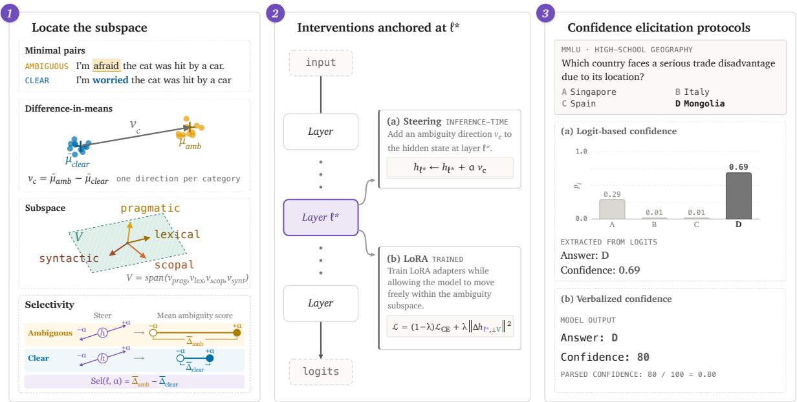  
Figure 1: Overview. We locate representations of ambiguity in language models using difference-in-means (§3), and find that these qualitatively modulate the model’s confidence in its reasoning (§4). Quantitatively, steering into ambiguity directions tends to improve confidence calibration. We propose a LoRA-based procedure which regularizes updates orthogonal to these ambiguity representations whereby improving calibration (§5).

To more reliably encode these benefits into the model’s parameters and remove the need for inference-time interventions, we propose Direction-Aligned Regularization for Tuning (DART), a finetuning procedure that regularizes changes in LM activations outside the subspace spanned by a set of steering vectors. Across models of different families and sizes, DART consistently and significantly improves confidence estimation; its improvements are larger than those obtained via vanilla LoRA, over DART using a random subspace of the same rank, and relative to inference-time steering. It also has little to no impact on task accuracy.

In summary, our contributions are:2

• We propose a procedure to find representations that modulate LM judgments of input ambiguity, and validate the behavioral influence of these vectors on models’ judgments of ambiguity.

• We introduce DART, which uses these representations to regularize fine-tuning. This encodes calibration improvements into the model’s parameters (primarily by mitigating overconfidence), often yields further confidence estimation improvements over baselines, and maintains accuracy on QA tasks.

## 2 Related Work

Confidence estimation & calibration. Confidence estimation is well-studied in both the machine learning and natural language processing (NLP) communities. Most methods operate as posthoc calibration methods, operating on a single confidence estimate and recalibrating that in various ways including histogram regression (Nobel, 1996), Nadaraya-Watson kernel regression (Nadaraya, 1964; Watson, 1964), Platt scaling (Platt, 1999), isotonic regression (Barlow et al., 1972), and beta calibration (Kull et al., 2017). There exist multiple methods to estimate the confidence of a language model output: taking the joint probability of the sequence under the language model (Desai and Durrett, 2020), asking the model directly via a prompt (linguistic calibration; Mielke et al., 2022; Tian et al., 2023; Band et al., 2024), and using model internals (Liu et al., 2024; Subramani et al., 2025, 2026; Kumaran et al., 2026).

Ambiguity in NLP. A well-established line of work treats ambiguity in downstream tasks as a property of the inputs, while others treat it as an artifact of annotation noise. Pavlick and Kwiatkowski (2019) show that disagreements in NLI reflect valid variation in interpretations of an input, and Plank (2022) argues that this label variation should be directly modeled rather than marginalized away. This has implications for confidence estimation: Baan et al. (2022) show standard confidence estimation metrics break when inputs admit multiple interpretations. Recent benchmarks have evaluated model sensitivity to specific ambiguities, such as ambiguity in open-domain question answering (Min et al., 2020), scope ambiguities (Kamath et al., 2024), among others (Liu et al., 2023; Li et al., 2024), with mixed results. We do not contribute to ambiguity modeling in this work, nor to resolving it; rather, we use controlled manipulations of input ambiguity to measure whether there exist representations that track known ambiguities in inputs, and whether these representations modulate a model’s estimation of its own confidence.

Actionable interpretability. Early interpretability research on pretrained models (often termed “BERTology”) proposed methods for locating (Hewitt and Manning, 2019; Jawahar et al., 2019; Tenney et al., 2019; Niu et al., 2022; Li and Subramani, 2026; Acevedo et al., 2026, inter alia) and controlling (Giulianelli et al., 2018) language model representations sensitive to linguistic structure. Similar work has recently emerged from the (mechanistic) interpretability literature; this includes steering vectors (Subramani et al., 2022), which allow one to control properties of the outputs of an LM at inference time. The most common method for locating steering vectors is difference-in-means (Marks and Tegmark, 2024; Rimsky et al., 2024); difference-inmeans has been shown to be empirically effective for monitoring and controlling a wide variety of concepts in language models (Wu et al., 2025).

Our work aligns with a growing call for actionable or pragmatic interpretability, which argues that interpretability research should be evaluated by its practical downstream utility rather than its explanatory power alone (Nanda et al., 2025; Orgad et al., 2026). Our work is aligned with this perspective: we demonstrate practical benefits to isolating representations of input ambiguity. Recent work in this line has largely targeted behavioral changes, such as refusal (Arditi et al., 2024), sycophancy (Chen et al., 2025), or hallucinations (Prasad et al., 2026). We instead target confidence calibration, and show that a small set of directions can be used to directly improve it.

## 3 Discovering Ambiguity Directions

We locate directions in language model activations that distinguish ambiguous sentences from disambiguated rewrites of those sentences. Our method uses paired sentences $( x _ { i } ^ { \mathrm { a m b } } , x _ { i } ^ { \mathrm { c l e a r } } )$ , where $x _ { i } ^ { \mathrm { a m b } }$ is an ambiguous sentence, and $x _ { i } ^ { \mathrm { c l e a r } }$ is a rewrite that resolves the ambiguity.

## 3.1 Data

We use AMBIENT (Liu et al., 2023) to source sentence pairs. AMBIENT provides minimal pairs of ambiguous sentences together with disambiguated rewrites. For sentences that have multiple disambiguations, we create one paired instance for each matched rewrite.

There exist different types of ambiguity, including scopal, pragmatic, lexical, and syntactic ambiguities (among others). These ambiguity types could have distinct representations; thus, we split the data D by ambiguity category c, resulting in category-specific datasets $\mathcal { D } _ { c }$ . Using the annotations of Li et al. (2024), we categorize each example into an ambiguity category. See App. A for dataset details and examples.

We restrict direction discovery to the four largest ambiguity categories: pragmatic, lexical, scopal and syntactic.3 For each category, we split examples into 80% train and 20% validation sets. If multiple disambiguated sentences were derived from the same ambiguous example, we ensure that each derived example is placed in the same split.

## 3.2 Locating Ambiguity Directions

To identify directions that encode ambiguity, we follow prior work in computing a difference between the mean activation vectors of paired inputs (Marks and Tegmark, 2024; Rimsky et al., 2024). Given ambiguity category c and paired examples $( x _ { \mathrm { a m b } } , x _ { \mathrm { c l e a r } } )$ in $\mathcal { D } _ { c } .$ , we format each sentence with the same ambiguity aware prompt and extract hidden activations $\mathbf { h } _ { \ell } ( x ) \in \mathbb { R } ^ { d }$ at each transformer layer $\ell \in \{ 1 , \ldots , L \} . $ For each category c and layer ℓ we define the candidate ambiguity vector $\mathbf { v } _ { c , \ell } \in \mathbb { R } ^ { d }$ as the mean difference:

$$
{ \bf v } _ { c , \ell } = \frac { 1 } { N _ { c } } \sum _ { i = 1 } ^ { N _ { c } } \left( { \bf h } _ { \ell } ( x _ { \mathrm { a m b } } ^ { ( i ) } ) - { \bf h } _ { \ell } ( x _ { \mathrm { c l e a r } } ^ { ( i ) } ) \right) ,\tag{1}
$$

where $N _ { c }$ is the number of training pairs for each category $c .$ This produces a set of L candidate vectors for each category. Henceforth, we omit the category index c for clarity when describing computations applied to each ambiguity category.

## 3.3 Intervening with Ambiguity Directions

A raw intervention scale is not directly comparable across layers, tokens or models, since hidden state norms vary with depth and architecture. We therefore express steering strength as a percentage of a reference hidden-state norm computed separately for each layer. Given a steering percentage $\alpha \in \mathcal { A } = \{ 0 . 1 \% , 0 . 2 \% , 0 . 5 \% , 1 \% , 3 \% , 5 \% ,$ 10%, 50%, 100%, 150%, 200%},5 we intervene by adding a perturbation along this direction at the same layer:

$$
\tilde { \mathbf { h } } _ { \ell } ( x ) = \mathbf { h } _ { \ell } ( x ) + \alpha \rho _ { \ell } \frac { \mathbf { v } _ { \ell } } { \| \mathbf { v } _ { \ell } \| } .\tag{2}
$$

Here, $\rho _ { \ell }$ refers to the average norm of the activation vector $\mathbf { h } _ { \ell }$ on a given distribution. Thus, this can be interpreted as shifting the activation vector by a given percentage α toward the ambiguity direction.6 By construction, positive steering moves the representation in the ambiguous direction, whereas negative steering moves it in the clear direction. The modified hidden state is then propagated through the remaining layers of the model.

Evaluating selectivity. For our purposes, a useful ambiguity direction should not necessarily induce a uniform behavioral change in the model across examples; rather, it should be selective for ambiguous inputs. That is, steering should have a stronger effect on ambiguous inputs than on their clear paired examples, such that interventions along the discovered direction should result in bettercalibrated sensitivity to an input’s ambiguity. To evaluate the selectivity of an ambiguity direction, we compare its intervention effect on ambiguous inputs with its effect on their clear counterparts. For a sentence s, we first define a model’s ambiguity preference as

$$
\psi ( s ) = \log P ( \mathrm { Y e s } \mid s ) - \log P ( \mathrm { N o } \mid s ) ,\tag{3}
$$

where higher values indicate a stronger preference for an ambiguous interpretation under an ambiguity judgment prompt (defined in App. B). For an ambiguity direction $\hat { \mathbf { v } } _ { \ell }$ and steering percentage $\alpha \in { \mathcal { A } }$ we define the sentence level steering effect:

$$
\Delta _ { \ell } ( s ; \alpha ) = \psi _ { \ell } ( s ; + \alpha ) - \psi _ { \ell } ( s ; - \alpha )\tag{4}
$$

where $\psi _ { \ell } ( s ; + \alpha )$ and $\psi _ { \ell } ( s ; - \alpha )$ denote the ambiguity score under positive and negative interventions respectively, at steering percentage α. We then average the steering effects over both ambiguous and clear sentences separately:

$$
S _ { \mathrm { a m b } } ( \ell , \alpha ) = \frac { 1 } { | S _ { \mathrm { a m b } } | } \sum _ { s \in S _ { \mathrm { a m b } } } \Delta _ { \ell } ( s ; \alpha )\tag{5}
$$

$$
S _ { \mathrm { c l e a r } } ( \ell , \alpha ) = \frac { 1 } { | S _ { \mathrm { c l e a r } } | } \sum _ { s \in S _ { \mathrm { c l e a r } } } \Delta _ { \ell } ( s ; \alpha )\tag{6}
$$

Finally, we define selectivity at steering percentage α as the difference in mean steering effects between ambiguous and clear sentences:

$$
\operatorname { S e l } ( \ell , \alpha ) = S _ { \mathrm { a m b } } ( \ell , \alpha ) - S _ { \mathrm { c l e a r } } ( \ell , \alpha ) .\tag{7}
$$

Higher selectivity indicates that the intervention shifts ambiguity scores more strongly for ambiguous inputs than for paired clear inputs.

To select the optimal layer $\ell ^ { * }$ for steering, we score each candidate vector at each steering percentage $\alpha \in { \mathcal { A } }$ separately for each ambiguity category. For downstream experiments, we select the layer that maximizes selectivity for each model. We first average selectivity over $\mathcal { A }$ for each category c:

$$
{ \overline { { \operatorname { S e l } } } } _ { c } ( \ell ) = { \frac { 1 } { | { \mathcal { A } } | } } \sum _ { \alpha \in { \mathcal { A } } } \operatorname { S e l } _ { c } ( \ell , \alpha ) .\tag{8}
$$

We then aggregate across categories by weighting each category according to its number of validation pairs, to obtain $\overline { { \mathrm { S e l } } } _ { w } ( \ell )$ . Finally, we select the

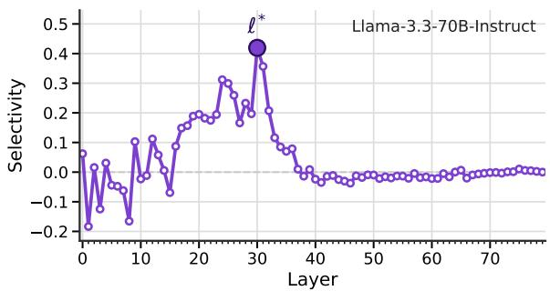  
Figure 2: Selectivity of candidate ambiguity directions across layers for Llama-3.3-70B-Instruct. We show weighted mean selectivity averaged across relative strengths and core ambiguity categories. The selected layer is the highest-selectivity point.

shared layer with the highest weighted selectivity:

$$
\ell ^ { * } = \arg \operatorname* { m a x } _ { \ell } \overline { { \mathrm { S e l } } } _ { w } ( \ell ) .\tag{9}
$$

Intuitively, this procedure selects the layer most likely to have the highest selectivity at many steering percentages. The selected layer and the corresponding vectors $\{ \hat { \mathbf { v } } _ { c , \ell ^ { * } } : c \in \mathcal { C } \}$ are then used for all downstream experiments for the given model.

Reference hidden-state norms $\rho _ { \ell }$ are computed separately for each layer,7 ensuring that the reported percentage corresponds to the same relative intervention size across layers and models, as norms are known to grow with greater depth and more pretraining (Merrill et al., 2021). Figure 2 shows how selectivity varies across layers of Llama-3.3-70B-Instruct. Across all models, the optimal layer (ℓ∗) is generally one of the lowermiddle layers (App. E).

## 3.4 Qualitative Inspection

We first qualitatively observe to what extent activation steering with ambiguity vectors modulates models’ expressed uncertainties. In Figure 3, we show an example from MMLU. Before steering, the model states that the question is unambiguous. Steering towards higher ambiguity $\mathbf { ( + v } _ { c , \ell } )$ at inference-time leads to an output generation stating that there is some ambiguity, despite that the question clarifies that the subject is the current Dalai Lama. When steering towards clear $\left( - \mathbf { v } _ { c , \ell } \right)$ , the model generates text stating that there is no ambiguity (with respect to which Dalai Lama is being

Prompt: [. . . ] When was the current Dalai Lama born? A. 1935 B. 2000 C. 1965 D. 1975.

Briefly explain your interpretation and reasoning. If the question seems ambiguous or underspecified, mention why. [. . . ]

No intervention: The question asksfor the birth year of the “current Dalai Lama.” [. . . ] There is no ambiguity regarding the birth year ofthe 14th Dalai Lama in historical records.

Adding ambiguity vector: The question asks for the birth year ofthe “current Dalai Lama.” This phrasing can be slightly ambiguous because the title “Dalai Lama” has been held by different individuals at different times. [. . . ]

Subtracting ambiguity vector: The question asks for the birth year of the “current Dalai Lama.” [. . . ] The question is not ambiguous regarding the identity of the person.

Figure 3: Qualitative evaluation of the syntactic ambiguity vector on an MMLU example. Steering positively, makes the model sensitive to the current Dalai Lama, while subtracting it leads to a single interpretation. Additional results across prompts and datasets in App. F.

referenced).8 We observe similar trends in other examples (App. F).

## 4 Using Ambiguity Directions to Improve Confidence Estimation

A good confidence estimator should assign higher confidence to clear inputs and lower confidence to noisy or ambiguous inputs. Having found representations that appear to modulate LM ambiguity judgments, we now investigate to what extent these representations can help us improve confidence estimations from language models.

## 4.1 Experimental Setup

We evaluate whether the discovered ambiguity directions improve downstream confidence estimation while preserving task performance. Our evaluation consists of multiple-choice question answering across all MMLU subjects (Hendrycks et al.,

2021) and TruthfulQA (Lin et al., 2021), and openended generation on AmbigQA (Min et al., 2020). For each model, method and confidence elicitation protocol, we select hyperparameters to maximize AUC-EURO on data disjoint from the evaluation set. We provide further details on the evaluation protocol in App. C.

Our experiments use gemma-4-E4B-it (Gemma Team, 2026), Qwen3.5-4B and Qwen3.5-27B (Qwen Team, 2026), Llama-3.1-8B-Instruct (Grattafiori et al., 2024), Llama-3.3-70B-Instruct (Meta, 2024), OLMo-3-7B-Instruct (Olmo et al., 2026), and Phi-4-mini-instruct (Abouelenin et al., 2025). All inputs are formatted with the instruction-tuned models’ respective chat templates. We focus experiments in the main paper on Llama-3.3-70B-Instruct, and present results for other models in App. E,G,H. Trends are generally consistent across models for each experiment.

## 4.2 Confidence Elicitation Protocols

Confidence in LM predictions can be elicited in several ways. We consider two protocols: a logitbased protocol, which derives confidence from the model’s probability distribution over the candidate answers, and a verbalized protocol, where the model is instructed to generate a number reflecting its confidence (Tian et al., 2023). Prior work has found that the relative performance of these protocols varies across models and tasks (Shrivastava et al., 2023; Tian et al., 2023; Band et al., 2024; Liu et al., 2025; Kim and Kang, 2026).

In preliminary experiments, we find logit-based confidence estimation to yield consistently more well-calibrated estimates (see App. G); we therefore focus on logit-based confidence in our main evaluations. Since our setting consists of multiplechoice question answering (MCQA) with a fixed candidate set, normalized probabilities over the answers provides a natural confidence estimate for the model’s prediction, following prior work on calibration in MCQA (Jiang et al., 2021).

In the logits protocol, the model is evaluated at the answer position; we restrict the next token distribution to the four multiple-choice labels $y ~ = ~ \{ \mathrm { A , B , C , D } \}$ . The predicted answer is $\hat { y } = \arg \operatorname* { m a x } _ { y \in \mathcal { Y } } p ( y \mid x )$ , and confidence is $\tilde { p } ( \boldsymbol { \hat { y } } \mid x )$ under the renormalized probability distribution $\tilde { p }$ consisting only of answer-related tokens. For open-ended generation, we instead use the length-normalized likelihood of the generated answer as confidence (see App. C).

In the verbalized confidence protocol, following (Tian et al., 2023), the model generates both an answer and a numeric confidence estimate ∈ [0, 100]. We parse the answer label and confidence estimate from the generated output and divide the confidence estimate by 100 such that it lies in the same range as in the logits-based procedure. To obtain conservative estimates, generations that do not contain both a valid answer and a valid confidence are treated as a worst case scenario, i.e., as incorrect predictions with maximum confidence. Full prompt templates are given in App. B.

## 4.3 Metrics

To measure confidence estimation quality, we use smooth expected calibration error (smECE; Błasiok and Nakkiran, 2023) and the area under the expected utility renormalized by the oracle (EURO) curve (Subramani et al., 2026). Traditional ECE is hyperparameter dependent, which makes comparisons across methods challenging. SmECE resolves this drawback by being hyperparameter-free and is a strictly better measure of calibration error (Błasiok and Nakkiran, 2023). AUC-EURO balances calibration with decision-making utility and thus is a better metric to adjudicate trust. We also measure accuracy and area under the receiver operating characteristic curve (AUROC; Swets, 1973) to measure how often each model is correct.

## 4.4 Methods

Steering. To perform inference-time steering on multiple choice questions, we steer at the most selective layer $\ell ^ { * }$ , applying a positive steering intervention to the hidden states at all token positions from the end-of-turn token through the final prompt token. We try steering using ambiguity category– specific vectors, as well as a vector derived by taking the mean of all category unit vectors.

DART. To permanently encode ambiguityrelated updates into the parameters of a language model, we propose DART, a fine-tuning method that encourages updates to lie within the span of a set of directions (e.g. ambiguity vectors).

We use the discovered directions to define a regularization objective for LoRA fine-tuning (Hu et al., 2021).9 Let $\hat { \mathbf { v } } _ { 1 } , \ldots , \hat { \mathbf { v } } _ { k }$ denote the normalized core ambiguity directions at the selected layer $\ell ^ { * }$ and let $\mathbf { V } = \left[ \hat { \mathbf { v } } _ { 1 } , \ldots , \hat { \mathbf { v } } _ { k } \right]$ be the matrix having as columns these directions. The corresponding ambiguity space is span $\{ \hat { \mathbf { v } } _ { 1 } , \hdots , \hat { \mathbf { v } } _ { k } \}$ . We define the projection onto this subspace as

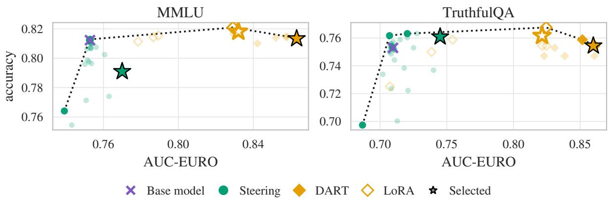  
Figure 4: Trade-off between AUC-EURO and accuracy under logit-based confidence elicitation on MMLU (left) and TruthfulQA (right). Results shown for Llama-3.3-70B-Instruct. Each point represents one hyperparameter configuration. Stars mark the selected configuration for each method. Higher values are better on both axes.

$$
\mathbf { P } = \mathbf { V } ( \mathbf { V } ^ { \top } \mathbf { V } ) ^ { - 1 } \mathbf { V } ^ { \top } .\tag{10}
$$

During training, we cache the base-model hidden states $\mathbf { h } _ { 0 }$ at the selected layer and compare them with the adapted model hidden states $\mathbf { h } _ { \theta }$ at the same position. For each training example i, we adapt the regularization weight according to the adapted model’s probability on the correct answer:

$$
\lambda _ { i } = p _ { \theta } \left( y _ { i } ^ { \mathrm { g o l d } } \mid x _ { i } \right) ,\tag{11}
$$

The training loss is

$$
\mathcal { L } _ { i } = ( 1 - \lambda _ { i } ) \mathcal { L } _ { \mathrm { C E } , i } + \lambda _ { i } \left. ( \mathbf { I } - \mathbf { P } ) ( \mathbf { h } _ { i } - \mathbf { h } _ { 0 , i } ) \right. _ { 2 } ^ { 2 } .\tag{12}
$$

The regularization term penalizes changes to model activations in directions orthogonal to the ambiguity subspace, while allowing the update to freely change activations within the span of the ambiguity directions. Examples for which the model assigns high probability to the correct answer are strongly guided toward updates within the ambiguity subspace, whereas examples assigned low probability receive greater weight on the task objective.

We target the attention q\_proj and v\_proj modules10 and train for three epochs. We sweep over LoRA ranks $r \in \{ 4 , 8 , 1 6 \}$ with matching scaling factors, and learning rates $\lbrace 1 0 ^ { - 4 } , 1 0 ^ { - 5 } \rbrace$ resulting in 6 configurations per model. We provide additional details on training data and hyperparameter selection in App. C.

Baselines. We compare DART against the base (unmodified instruction-tuned) model.

To measure how much of DART’s performance is attributable to fine-tuning itself, we compare to LoRA with no regularizer. This is equivalent to DART with $\lambda = 0$ . To measure how much of DART’s performance is attributable to the use of ambiguity vectors, we also compare against DART applied to a random subspace of the same rank.

## 5 Results

Ambiguity regularization improves calibration. We first study whether DART improves confidence estimation while preserving task performance. Figure 5 shows reliability diagrams for the selected configurations of each method, with histograms indicating the distribution of confidence estimates relative to accuracy. The primary failure mode of base LMs under logits-based confidence elicitation is overconfidence, which is only marginally improved by steering (Figure 4). Standard LoRA reduces miscalibration, while DART further reduces it and better aligns confidence with empirical accuracy across a broader range of confidence values, with little change in task performance. These trends hold across models of different families and sizes, with DART consistently achieving better calibration over standard LoRA on multiple-choice QA tasks (App. G).

The role of ambiguity regularization. While standard LoRA already improves calibration, DART provides additional gains, suggesting that the identified ambiguity subspace contributes to calibration beyond standard fine-tuning. To test this hypothesis, we replace the ambiguity subspace with a random subspace of the same rank as that used in DART, while keeping the fine-tuning procedure unchanged. As shown in Figures 5 and 21, regularizing toward a random subspace also improves confidence estimation relative to the base model, yet DART with the ambiguity directions achieves even lower calibration error and higher AUC-EURO on both datasets.

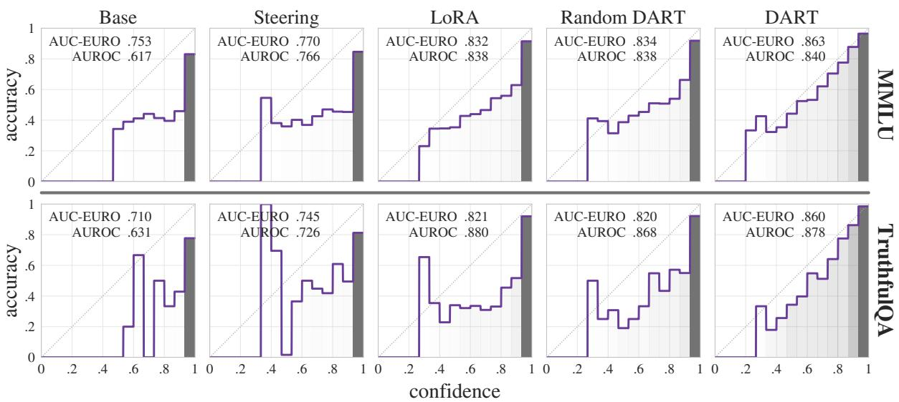  
Figure 5: Reliability diagrams for Llama-3.3-70B-Instruct under the logits protocol. Results are shown for the base model, ambiguity steering, LoRA, and DART on MMLU (top) and TruthfulQA (bottom). DART substantially improves calibration while maintaining accuracy. We use the best hyperparameter configuration for each method, as described in App. D and as selected in Fig. 4.

Beyond multiple-choice QA and logit-based confidence. To assess whether these findings generalize to open-ended generation tasks, we additionally evaluate our methods on AmbigQA (Min et al., 2020). As shown in Table 1, we observe similar patterns as in multiple-choice settings: steering provides modest improvements, while fine-tuning with DART substantially improves calibration with little change in task performance.

We further investigate whether verbalized confidence estimates show similar trends. Under this protocol, confidence estimates are far less well calibrated than under logits-based estimation. Improvements are also generally smaller than for logitsbased confidence, consistent with prior work showing that the relative performance of confidence elicitation protocols depends greatly on the task setting and model (cf. Tian et al., 2023; Shrivastava et al., 2023). Detailed results under verbalized confidence for multiple-choice and open-ended generation are shown in App. G.

<table><tr><td>Method</td><td>smECE↓ AUC-EURO↑</td><td></td><td>EM↑ F1↑</td></tr><tr><td>Baseline</td><td>0.543</td><td>0.540</td><td>0.426 0.554</td></tr><tr><td>Steering</td><td>0.458</td><td>0.599</td><td>0.370 0.504</td></tr><tr><td>LoRA</td><td>0.127</td><td>0.777</td><td>0.519 0.628</td></tr><tr><td>Random DART</td><td>0.136</td><td>0.774</td><td>0.503 0.614</td></tr><tr><td>DART</td><td>0.090</td><td>0.778</td><td>0.485 0.596</td></tr></table>

Table 1: Calibration of Llama-3.3-70B-Instruct on AmbigQA.

Post-hoc calibration complements these methods. Finally, we evaluate temperature scaling, Platt scaling, beta calibration, and isotonic regression. These methods simply adjust existing confidence estimates without modifying the underlying model, so task performance remains unchanged. Figure 6 shows that these methods substantially reduce calibration error. Note that post-hoc calibration is orthogonal to representational methods, and that both can be combined. Thus, we also try combining post-hoc calibration with the methods we have evaluated, including steering, LoRA, and DART. Further improvements beyond post-hoc methods can often be achieved by combining posthoc calibration methods with LoRA or DART. Further details are provided in Appendix H.

## 6 Conclusion

We have proposed a protocol for locating representations of ambiguity in language models, and using these representations to guide fine-tuning. By encouraging model updates to lie in the span of the ambiguity representations, our proposed finetuning approach, DART, yields consistent improvements in confidence estimation across multiple models while incurring little to no loss in accuracy on multiple-choice QA and open-ended generation QA datasets.

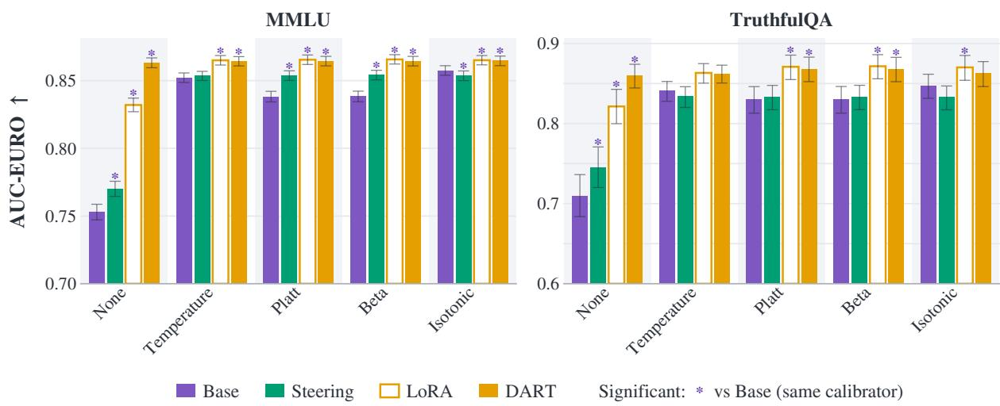  
Figure 6: Post-hoc calibration for Llama-3.3-70B-Instruct under the logits protocol. AUC-EURO is shown for the base model, steering, LoRA, and DART, as trained (None) and after temperature scaling, Platt scaling, beta calibration, and isotonic regression, on MMLU (left) and TruthfulQA (right). Error bars show 95% bootstrap intervals. \* marks a significant difference from the base model under the same calibrator.

## Limitations

Ambiguity has many forms, and our operationalization of ambiguity only captures one component of it (multiple interpretations of a given input). We have not considered ambiguity as operationalized by the vagueness of an open-domain question. Furthermore, positive results with DART do not necessarily indicate that we have recovered representations of ambiguity per se. Any interpretability conclusions that relate to whether LMs cleanly represent ambiguity should be taken as preliminary.

We have not explicitly contrasted representations of ambiguity, uncertainty, and difficulty. Each of these could mediate confidence estimations in language models in different ways; combining them could potentially yield greater improvements in confidence estimation. We have shown that ambiguity representations can modulate this factor, but we have not shown that ambiguity is necessarily better for this than other concept representations. As isolating representations of uncertainty and difficulty is more difficult and potentially more dependent on the specific model being evaluated, we did not investigate these phenomena.

Although we show that confidence estimation can be improved at inference-time or by DART with ambiguity steering vectors applied to LoRA, these protocols are not a replacement for careful, human-in-the-loop risk assessment. Users should always exercise caution when trusting language model output.

## Acknowledgments

We thank Sheridan Feucht, Michael Li, and members of the BAAIGL and MIILK groups at Boston University for helpful discussions and constructive feedback.

## References

Abdelrahman Abouelenin, Atabak Ashfaq, Adam Atkinson, Hany Awadalla, and 1 others. 2025. Phi-4-mini technical report: Compact yet powerful multimodal language models via mixture-of-loras. Preprint, arXiv:2503.01743.

Santiago Acevedo, Alessandro Laio, and Marco Baroni. 2026. Differential syntactic and semantic encoding in llms. arXiv preprint arXiv:2601.04765.

Andy Arditi, Oscar Balcells Obeso, Aaquib Syed, Daniel Paleka, Nina Rimsky, Wes Gurnee, and Neel Nanda. 2024. Refusal in language models is mediated by a single direction. In The Thirty-eighth Annual Conference on Neural Information Processing Systems.

Joris Baan, Wilker Aziz, Barbara Plank, and Raquel Fernandez. 2022. Stop measuring calibration when

humans disagree. In Proceedings of the 2022 Conference on Empirical Methods in Natural Language Processing, pages 1892–1915, Abu Dhabi, United Arab Emirates. Association for Computational Linguistics.

Neil Band, Xuechen Li, Tengyu Ma, and Tatsunori Hashimoto. 2024. Linguistic calibration of longform generations. In ICML.

Richard E Barlow, David J Bartholomew, Joan M Bremner, and Hugh D Brunk. 1972. Statistical inference under order restrictions: The theory and application ofisotonic regression. John Wiley & Sons.

Jarosław Błasiok and Preetum Nakkiran. 2023. Smooth ece: Principled reliability diagrams via kernel smoothing. Preprint, arXiv:2309.12236.

Runjin Chen, Andy Arditi, Henry Sleight, Owain Evans, and Jack Lindsey. 2025. Persona vectors: Monitoring and controlling character traits in language models. Preprint, arXiv:2507.21509.

A. Dawid. 1982. The well-calibrated bayesian. Journal ofthe American Statistical Association, 77:605–610.

Shrey Desai and Greg Durrett. 2020. Calibration of pre-trained transformers. In Proceedings of the 2020 Conference on Empirical Methods in Natural Language Processing (EMNLP), pages 295–302, Online. Association for Computational Linguistics.

Gemma Team. 2026. Gemma 4 technical report. Preprint, arXiv:2607.02770.

Mario Giulianelli, Jack Harding, Florian Mohnert, Dieuwke Hupkes, and Willem Zuidema. 2018. Under the hood: Using diagnostic classifiers to investigate and improve how language models track agreement information. In Proceedings of the 2018 EMNLP Workshop BlackboxNLP: Analyzing and Interpreting Neural Networksfor NLP, pages 240–248, Brussels, Belgium. Association for Computational Linguistics.

Aaron Grattafiori, Abhimanyu Dubey, Abhinav Jauhri, Abhinav Pandey, Abhishek Kadian, Ahmad Al-Dahle, Aiesha Letman, Akhil Mathur, Alan Schelten, Alex Vaughan, Amy Yang, Angela Fan, Anirudh Goyal, Anthony Hartshorn, Aobo Yang, Archi Mitra, Archie Sravankumar, Artem Korenev, Arthur Hinsvark, and 542 others. 2024. The llama 3 herd of models. Preprint, arXiv:2407.21783.

Chuan Guo, Geoff Pleiss, Yu Sun, and Kilian Q. Weinberger. 2017. On calibration of modern neural networks. In Proceedings ofthe 34th International Conference on Machine Learning, volume 70 of Proceedings of Machine Learning Research, pages 1321– 1330. PMLR.

Dan Hendrycks, Collin Burns, Steven Basart, Andy Zou, Mantas Mazeika, Dawn Song, and Jacob Steinhardt. 2021. Measuring massive multitask language understanding. Proceedings of the International Conference on Learning Representations (ICLR).

John Hewitt and Christopher D. Manning. 2019. A structural probe for finding syntax in word representations. In Proceedings of the 2019 Conference of the North American Chapter ofthe Associationfor Computational Linguistics: Human Language Technologies, Volume 1 (Long and Short Papers), pages 4129–4138, Minneapolis, Minnesota. Association for Computational Linguistics.

Sture Holm. 1979. A simple sequentially rejective multiple test procedure. Scandinavian Journal ofStatistics, 6(2):65–70.

Edward J. Hu, Yelong Shen, Phillip Wallis, Zeyuan Allen-Zhu, Yuanzhi Li, Shean Wang, Lu Wang, and Weizhu Chen. 2021. Lora: Low-rank adaptation of large language models. Preprint, arXiv:2106.09685.

Ganesh Jawahar, Benoît Sagot, and Djamé Seddah. 2019. What does BERT learn about the structure of language? In Proceedings of the 57th Annual Meeting of the Association for Computational Linguistics, pages 3651–3657, Florence, Italy. Association for Computational Linguistics.

Zhengbao Jiang, Jun Araki, Haibo Ding, and Graham Neubig. 2021. How can we know when language models know? on the calibration of language models for question answering. Transactions ofthe Associationfor Computational Linguistics, 9:962–977.

Gaurav Kamath, Sebastian Schuster, Sowmya Vajjala, and Siva Reddy. 2024. Scope ambiguities in large language models. Transactions ofthe Associationfor Computational Linguistics, 12:738–754.

Divyansh Kaushik, Eduard Hovy, and Zachary C. Lipton. 2020. Learning the difference that makes a difference with counterfactually-augmented data. Preprint, arXiv:1909.12434.

Hankyeol Kim and Pilsung Kang. 2026. Same answer, different confidence: Protocol sensitivity in llm confidence calibration. Preprint, arXiv:2605.27752.

Meelis Kull, Telmo Silva Filho, and Peter Flach. 2017. Beta calibration: a well-founded and easily implemented improvement on logistic calibration for binary classifiers. In Proceedings ofthe 20th International Conference on Artificial Intelligence and Statistics, volume 54 of Proceedings of Machine Learning Research, pages 623–631. PMLR.

Dharshan Kumaran, Viorica Patraucean, Simon Osindero, Petar Velickoviˇ c, and Nathaniel Daw. 2026.´ How llms detect and correct their own errors: The role of internal confidence signals. Preprint, arXiv:2604.22271.

Margaret Y. Li, Alisa Liu, Zhaofeng Wu, and Noah A. Smith. 2024. A taxonomy of ambiguity types for nlp. Preprint, arXiv:2403.14072.

Michael Li and Nishant Subramani. 2026. Model internal sleuthing: Finding lexical identity and inflectional morphology in modern language models. In ACL.

Stephanie Lin, Jacob Hilton, and Owain Evans. 2021. Truthfulqa: Measuring how models mimic human falsehoods. Preprint, arXiv:2109.07958.

Alisa Liu, Zhaofeng Wu, Julian Michael, Alane Suhr, Peter West, Alexander Koller, Swabha Swayamdipta, Noah A. Smith, and Yejin Choi. 2023. We’re afraid language models aren’t modeling ambiguity. Preprint, arXiv:2304.14399.

Jiarui Liu, Jivitesh Jain, Mona Diab, and Nishant Subramani. 2025. Llm microscope: What model internals reveal about answer correctness and context utilization. arXiv.

Xin Liu, Farima Fatahi Bayat, and Lu Wang. 2024. Enhancing language model factuality via activationbased confidence calibration and guided decoding. In Proceedings of the 2024 Conference on Empirical Methods in Natural Language Processing, pages 10436–10448, Miami, Florida, USA. Association for Computational Linguistics.

Samuel Marks and Max Tegmark. 2024. The geometry of truth: Emergent linear structure in large language model representations of true/false datasets. Preprint, arXiv:2310.06824.

William Merrill, Vivek Ramanujan, Yoav Goldberg, Roy Schwartz, and Noah A. Smith. 2021. Effects of parameter norm growth during transformer training: Inductive bias from gradient descent. In Proceedings ofthe 2021 Conference on Empirical Methods in Natural Language Processing, pages 1766–1781, Online and Punta Cana, Dominican Republic. Association for Computational Linguistics.

Meta. 2024. Llama 3.3 70b instruct. https://huggingface.co/meta-llama/Llama-3. 3-70B-Instruct. Model card.

Sabrina J. Mielke, Arthur Szlam, Emily Dinan, and Y-Lan Boureau. 2022. Reducing conversational agents overconfidence through linguistic calibration. Transactions ofthe Associationfor Computational Linguistics, 10:857–872.

Sewon Min, Julian Michael, Hannaneh Hajishirzi, and Luke Zettlemoyer. 2020. AmbigQA: Answering ambiguous open-domain questions. In Proceedings of the 2020 Conference on Empirical Methods in Natural Language Processing (EMNLP), pages 5783– 5797, Online. Association for Computational Linguistics.

Elizbar A Nadaraya. 1964. On estimating regression. Theory of Probability & Its Applications, 9(1):141– 142.

Mahdi Pakdaman Naeini, Gregory Cooper, and Milos Hauskrecht. 2015. Obtaining well calibrated probabilities using bayesian binning. In Proceedings of the AAAI conference on artificial intelligence, volume 29.

Neel Nanda, Josh Engels, Arthur Conmy, Senthooran Rajamanoharan, Bilal Chughtai, Callum McDougall, János Kramár, and Lewis Smith. 2025. A pragmatic vision for interpretability.

Jingcheng Niu, Wenjie Lu, and Gerald Penn. 2022. Does BERT rediscover a classical NLP pipeline? In Proceedings of the 29th International Conference on Computational Linguistics, pages 3143–3153, Gyeongju, Republic of Korea. International Committee on Computational Linguistics.

Andrew Nobel. 1996. Histogram regression estimation using data-dependent partitions. The Annals of Statistics, 24(3):1084–1105.

Team Olmo, Allyson Ettinger, Amanda Bertsch, Bailey Kuehl, David Graham, David Heineman, Dirk Groeneveld, Faeze Brahman, Finbarr Timbers, Hamish Ivison, Jacob Morrison, Jake Poznanski, Kyle Lo, Luca Soldaini, Matt Jordan, Mayee Chen, Michael Noukhovitch, Nathan Lambert, Pete Walsh, and 49 others. 2026. Olmo 3. Preprint, arXiv:2512.13961.

Hadas Orgad, Fazl Barez, Tal Haklay, Isabelle Lee, Marius Mosbach, Anja Reusch, Naomi Saphra, Byron Wallace, Sarah Wiegreffe, Eric Wong, Ian Tenney, and Mor Geva. 2026. Interpretability can be actionable. Preprint, arXiv:2605.11161.

Hadas Orgad, Michael Toker, Zorik Gekhman, Roi Reichart, Idan Szpektor, Hadas Kotek, and Yonatan Belinkov. 2025. LLMs know more than they show: On the intrinsic representation of LLM hallucinations. In The Thirteenth International Conference on Learning Representations.

Ellie Pavlick and Tom Kwiatkowski. 2019. Inherent disagreements in human textual inferences. Transactions ofthe Associationfor Computational Linguistics, 7:677–694.

Barbara Plank. 2022. The “problem” of human label variation: On ground truth in data, modeling and evaluation. In Proceedings of the 2022 Conference on Empirical Methods in Natural Language Processing, pages 10671–10682, Abu Dhabi, United Arab Emirates. Association for Computational Linguistics.

John Platt. 1999. Probabilistic outputs for support vector machines and comparisons to regularized likelihood methods. Advances in large margin classifiers, 10(3):61–74.

Aaditya Vikram Prasad, Connor Watts, Jack Merullo, Dhruvil Gala, Owen Lewis, Thomas McGrath, and Ekdeep Singh Lubana. 2026. Features as rewards: Scalable supervision for open-ended tasks via interpretability. Preprint, arXiv:2602.10067.

Qwen Team. 2026. Qwen3.5: Towards native multimodal agents.

Nina Rimsky, Nick Gabrieli, Julian Schulz, Meg Tong, Evan Hubinger, and Alexander Turner. 2024. Steering llama 2 via contrastive activation addition. In

Proceedings of the 62nd Annual Meeting of the Association for Computational Linguistics (Volume 1: Long Papers), pages 15504–15522, Bangkok, Thailand. Association for Computational Linguistics.

Vaishnavi Shrivastava, Percy Liang, and Ananya Kumar. 2023. Llamas know what gpts don’t show: Surrogate models for confidence estimation. Preprint, arXiv:2311.08877.

Elias Stengel-Eskin and Benjamin Van Durme. 2023. Calibrated interpretation: Confidence estimation in semantic parsing. Transactions ofthe Associationfor Computational Linguistics, 11:1213–1231.

Nishant Subramani, Jason Eisner, Justin Svegliato, Benjamin Van Durme, Yu Su, and Sam Thomson. 2025. MICE for CATs: Model-internal confidence estimation for calibrating agents with tools. In Proceedings ofthe 2025 Conference ofthe Nations ofthe Americas Chapter of the Association for Computational Linguistics: Human Language Technologies (Volume 1: Long Papers), pages 12362–12375, Albuquerque, New Mexico. Association for Computational Linguistics.

Nishant Subramani, Palash Goyal, Yiwen Song, Mani Malek, Yuan Xue, Tomas Pfister, and Hamid Palangi. 2026. The acute protocol: Operationalizing language model activations for better calibration, utility, and trust. In ICML.

Nishant Subramani, Nivedita Suresh, and Matthew Peters. 2022. Extracting latent steering vectors from pretrained language models. In Findings of the Association for Computational Linguistics: ACL 2022, pages 566–581, Dublin, Ireland. Association for Computational Linguistics.

John A. Swets. 1973. The relative operating characteristic in psychology. Science, 182(4116):990–1000.

Ian Tenney, Dipanjan Das, and Ellie Pavlick. 2019. BERT rediscovers the classical NLP pipeline. In Proceedings ofthe 57th Annual Meeting ofthe Associationfor Computational Linguistics, pages 4593– 4601, Florence, Italy. Association for Computational Linguistics.

Katherine Tian, Eric Mitchell, Allan Zhou, Archit Sharma, Rafael Rafailov, Huaxiu Yao, Chelsea Finn, and Christopher Manning. 2023. Just ask for calibration: Strategies for eliciting calibrated confidence scores from language models fine-tuned with human feedback. In Proceedings of the 2023 Conference on Empirical Methods in Natural Language Processing, pages 5433–5442, Singapore. Association for Computational Linguistics.

Geoffrey S Watson. 1964. Smooth regression analysis. Sankhya: The Indian Journal ofStatistics, Series A¯ , pages 359–372.

Zhengxuan Wu, Aryaman Arora, Atticus Geiger, Zheng Wang, Jing Huang, Dan Jurafsky, Christopher D Manning, and Christopher Potts. 2025. Axbench: Steering LLMs? even simple baselines outperform sparse

autoencoders. In Forty-second International Conference on Machine Learning.

## A Ambiguity Dataset Construction

Figure 7 shows the procedure we follow to create our dataset from AMBIENT. Every ambiguous sentence is paired with one or more disambiguations, each resolving the ambiguity differently. For each disambiguation, we construct a contrast pair: the original ambiguous sentence, and a clear sentence minimally edited to make that reading explicit. This keeps the two sentences identical except for the information needed to resolve the ambiguity.

Table 2 reports the number of paired ambiguity contrasts in each category after converting AM-BIENT examples into matched ambiguous–clear sentence pairs. The four categories we use are pragmatic, lexical, scopal and syntactic ambiguity. We aim for at least 50 examples in the training set after splitting; the remaining categories from AMBIENT are filtered out, as they do not meet this criterion.

<table><tr><td>Category</td><td>Train</td><td>Validation</td></tr><tr><td>Pragmatic</td><td>497</td><td>124</td></tr><tr><td>Lexical</td><td>244</td><td>61</td></tr><tr><td>Scopal</td><td>90</td><td>22</td></tr><tr><td>Syntactic</td><td>76</td><td>19</td></tr><tr><td>Total</td><td>907</td><td>226</td></tr></table>

Table 2: Number of examples in the training and validation splits for each ambiguity category.

(1) Original AMBIENT sentence: I’m afraid the cat was hit by a car. Pragmatic

a. Contrastive pair 1 Ambiguous: I’m afraid the cat was hit by a car. Disambiguated: I’m worried the cat was hit by a car.

b. Contrastive pair 2 Ambiguous: I’m afraid the cat was hit by a car. Disambiguated: I’m sorry to share that the cat was hit by a car.

(2) Original AMBIENT sentence: John and Anna are married. Lexical

a. Contrastive pair 1 Ambiguous: John and Anna are married. Disambiguated: John and Anna are both married.

b. Contrastive pair 2 Ambiguous: John and Anna are married. Disambiguated: John and Anna are married to each other.

(3) Original AMBIENT sentence: There will be more interesting seminars. . . Syntactic

a. Contrastive pair 1 Ambiguous: There will be more interesting seminars. . . Disambiguated: There will be more seminars. . . that are interesting.

b. Contrastive pair 2 Ambiguous: There will be more interesting seminars. . . Disambiguated: There will be seminars. . . that are more interesting.

(4) Original AMBIENT sentence: The novel has not been banned in many schools. Scopal

a. Contrastive pair 1 Ambiguous: The novel has not been banned in many schools. Disambiguated: There are many schools where the novel has not been banned.

b. Contrastive pair 2 Ambiguous: The novel has not been banned in many schools. Disambiguated: It is not the case that the novel has been banned in many schools.

Figure 7: Examples of the four ambiguity types in our dataset: pragmatic, lexical, syntactic, and scopal.

## B Prompt and Tokenization Details

All inputs are formatted as a single user message using the corresponding model’s chat template with a generation prompt appended. After chat formatting, we do not add additional tokenizer special tokens. This same formatting convention is used for ambiguity direction construction, layer selection, inference time steering, LoRA activation caching, LoRA training, and downstream evaluation.

Ambiguity judgment prompt. To construct ambiguity directions and select the intervention layer, we use the prompt template in Figure 8, replacing {sentence} with the input sentence.

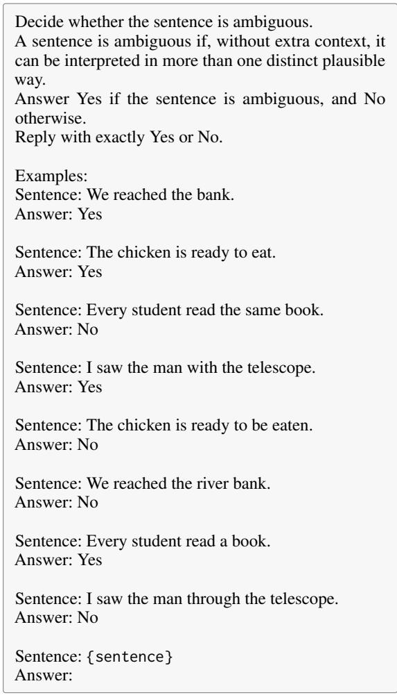  
Figure 8: Prompt template used for ambiguity judgment, ambiguity direction construction, and intervention layer selection.

Logits prompt. For logits based confidence, we use the prompt template shown in Figure 9 for each MMLU and TruthfulQA example, replacing the placeholders with the corresponding question and answer choices.

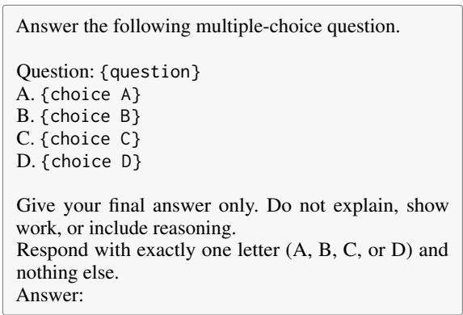  
Figure 9: Prompt template used for logits-based confidence on MMLU and TruthfulQA examples.

Verbalized confidence prompt. For verbalized confidence, we use the same question format, but ask the model to report both an answer and a confidence value, as shown in Figure 10.

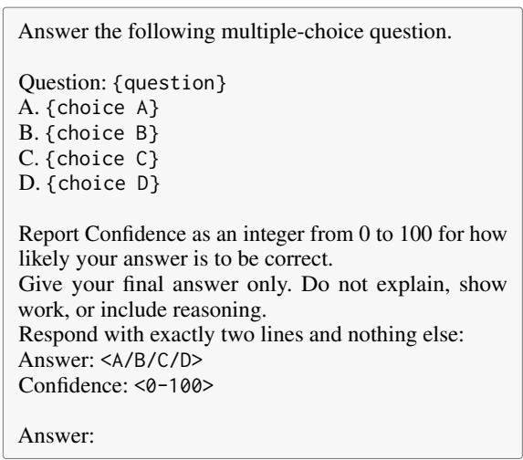  
Figure 10: Prompt template used for verbalized confidence on MMLU and TruthfulQA examples.

## C Validation and Evaluation Details

## C.1 MMLU

We evaluate on all subjects of MMLU (Hendrycks et al., 2021). LoRA and DART adapters are trained on a fixed subset of 5,000 examples from MMLU auxiliary\_train split. For each model method and confidence elicitation protocol, we select the configuration that maximizes AUC-EURO on the validation split and report results on the test split. Post-hoc calibrators are fitted on the validation split and evaluated on the test split.

## C.2 TruthfulQA

We additionally evaluate on the MC1 subset of TruthfulQA (Lin et al., 2021). To standardize the number of answer choices, we only keep examples with at least four options, resulting in 684 of the original 817 questions. For the questions with exactly four options, we keep all choices. For the remaining questions, we keep the correct answer and randomly sample three incorrect choices. Lastly, we shuffle the answer choices.

Since TruthfulQA provides a single split, we use repeated 10-fold cross fitting with 20 repetitions. For this dataset, we used the adapters trained on MMLU, without additional fine-tuning. For each fold, we select the configuration that maximizes AUC-EURO on the other nine and evaluate it on the held-out fold. We repeat the procedure independently for each model, method and confidence elicitation protocol, and aggregate held-out predictions across all repetitions to compute the reported metrics. We follow a similar procedure for posthoc calibration, where we fit the calibrators on the other nine folds using the selected configuration and apply them to the held-out fold.

## C.3 AmbigQA

We evaluate open-ended generation on AmbigQA (Min et al., 2020). Since the test split is not publicly available, we reserve 5,036 questions form the training split for evaluation and use the remaining 5,000 for fine-tuning, using stratified sampling by ambiguity. For fine-tuning, questions with multiple interpretations contribute one target answer per interpretation, each weighted by the inverse of the number of interpretations. We select hyperparameters to maximize AUC-EURO on the validation split. We use exact match (EM) against the annotated answers to determine correctness for confidence estimation metrics and report token-level F1 alongside to measure task performance.

To mirror the logits-based confidence protocol used for multiple-choice tasks, we derive confidence from the likelihood assigned to the generated answer. We greedily decode and define confidence as the likelihood normalized by length

$$
\exp \left( { \frac { 1 } { T } } \sum _ { t = 1 } ^ { T } \log p _ { \theta } ( y _ { t } \mid x , y _ { < t } ) \right) ,\tag{13}
$$

where $T$ is the number of generated tokens. We refer to this method as Likelihood.

## C.4 Statistical analysis

We compare each method with the base model under the same confidence elicitation protocol using two-sided paired permutation tests over questions. The tests use 5, 000 permutations for MMLU and AmbigQA and 1, 000 for TruthfulQA, where crossfitted configuration selection is repeated within each permutation. We apply Holm–Bonferroni correction (Holm, 1979) at $\alpha = 0 . 0 5$ separately for each model, method, and confidence protocol. Each correction covers nine tests evaluating smECE, AUC-EURO, and AUROC on the three datasets.

We also report 95% percentile bootstrap confidence intervals based on 5, 000 resamples of the evaluation questions. The selected configurations remain fixed during resampling, and all 20 crossfitted predictions for each TruthfulQA question are kept together.

## D Selected Hyperparameters

Table 3 reports the hyperparameter configurations selected for Llama-3.3-70B-Instruct. For MMLU and AmbigQA, we select configurations that maximize AUC-EURO on their respective validation splits. For TruthfulQA, configurations are selected separately for each held-out fold following the cross-fitting procedure described in App. C. We report the most frequently selected configuration across folds.

<table><tr><td rowspan="2">Protocol</td><td colspan="2">Steering</td><td colspan="2">LoRA DART</td></tr><tr><td>Vector</td><td>Strength</td><td>r</td><td>r</td></tr><tr><td>MMLU</td><td></td><td></td><td></td><td></td></tr><tr><td>Logit</td><td>Scopal</td><td>200%</td><td>8</td><td>8</td></tr><tr><td>Verbalized</td><td>Pragmatic</td><td>50%</td><td>8</td><td>16</td></tr><tr><td>TruthfulQA</td><td></td><td></td><td></td><td></td></tr><tr><td>Logit Verbalized</td><td>Lexical</td><td>200%</td><td>8</td><td>16</td></tr><tr><td></td><td>Pragmatic</td><td>100%</td><td>8</td><td>4</td></tr><tr><td>AmbigQA</td><td></td><td></td><td></td><td></td></tr><tr><td>Likelihood Syntactic</td><td></td><td>200%</td><td>16</td><td>8</td></tr><tr><td>Verbalized Pragmatic</td><td></td><td>100%</td><td>4</td><td>4</td></tr></table>

Table 3: Selected hyperparameter configurations for Llama-3.3-70B-Instruct. The LoRA and DART columns report rank $r ;$ for both methods, all reported configurations have LoRA scaling parameter $\alpha = r$ and learning rate $1 0 ^ { - 5 }$ . Steering strength is expressed as a percentage.

## E Additional Selectivity Results

In this section, we present additional selectivity results.

## E.1 Selectivity Across Models

In Figure 11, we show selectivity results for the remaining evaluated models. For each model, we select the layer with highest selectivity as the one to perform interventions. Across all models, this peak falls in the early-to-mid layers, suggesting that ambiguity is most cleanly represented relatively early in the network.

## E.2 Additional selectivity offsets

We define candidate positions after applying the model’s chat template. We identify the final colon in the last Answer: cue and consider nonnegative offsets from that token. Offset 0 refers to the colon itself, while positive offsets refer to subsequent prompt tokens, including any model specific control tokens inserted by the chat template before generation begins. For each candidate position, we extract hidden states from the decoder layer outputs. In Figures 12 and 13 we show selectivity results for different token positions across all models. While the position of peak selectivity varies by model and token, we observe that middle layers consistently show high selectivity across models. We fix one global offset (offset 1) as it reliably falls within this middle-layer band for all models.

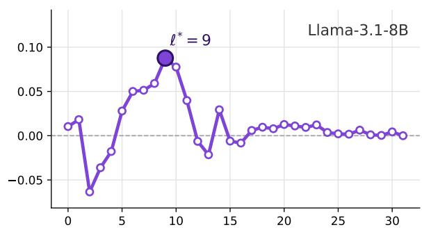

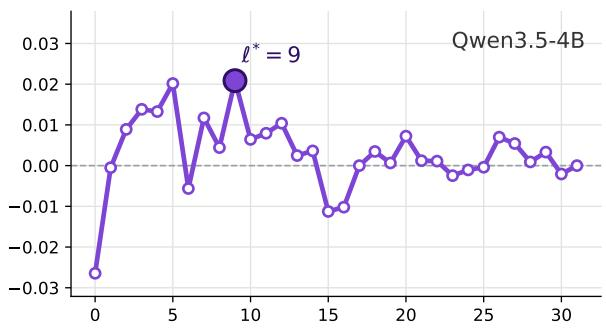

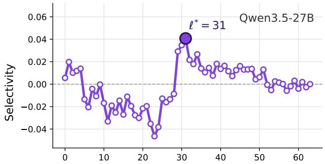

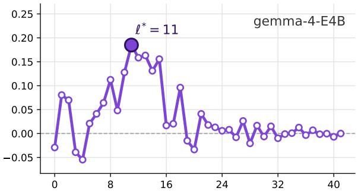

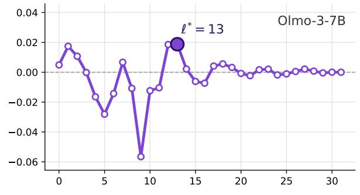

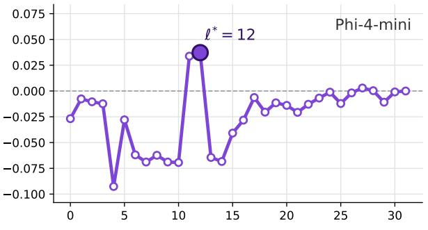  
Layer  
Figure 11: Selectivity of candidate ambiguity directions across layers. Weighted mean selectivity is averages over relative strengths and core ambiguity categories for each model.

Qwen3.5-27B (64 layers, \* = 31)  
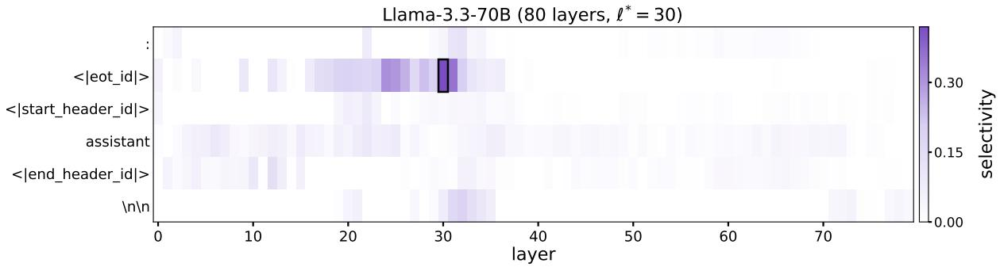  
Figure 12: Selectivity across offsets for Llama-3.3-70B-Instruct.

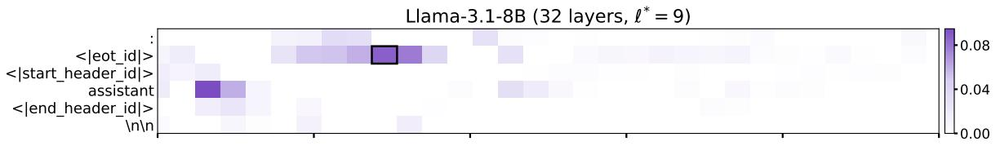

Qwen3.5-4B (32 layers, \* = 9)  
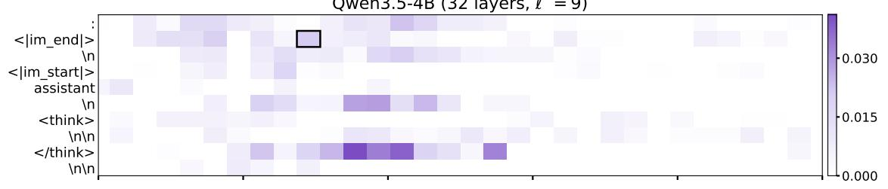

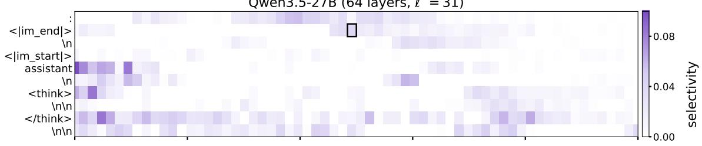

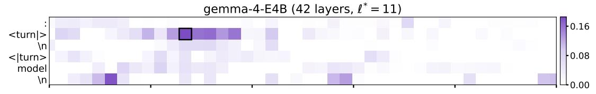

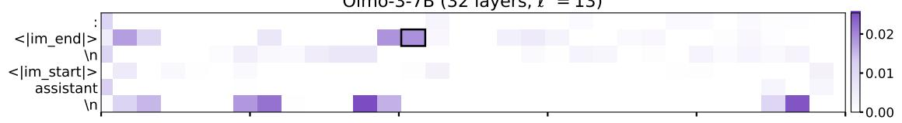

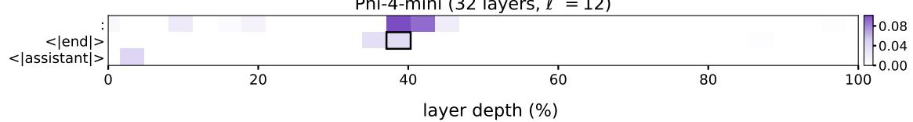  
Figure 13: Selectivity across offsets for the remaining evaluated models.

## F Additional Qualitative Evaluation

In Tables 4 and 5 we show full qualitative evaluation examples showing the effects of the ambiguity interventions on different datasets and prompt formats. The examples support the trend observed in the main text: adding the ambiguity vector makes the model more sensitive to alternative readings of an input, while subtracting it leads the model toward a single, confident interpretation. This pattern holds both for the multiple-choice format of MMLU and for an open-ended interpretation question drawn from AMBIENT.

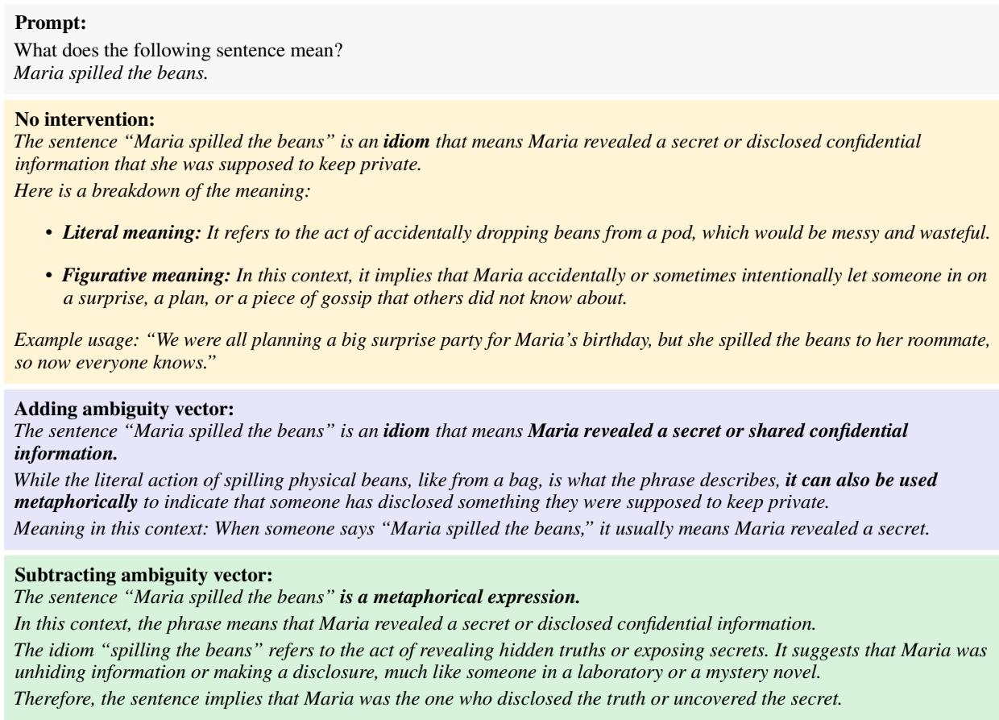  
Table 4: Full qualitative evaluation of the ambiguity vector on an AMBIENT example exhibiting idiomatic ambiguity. Adding the vector preserves sensitivity to multiple readings of Maria spilled the beans, while subtracting it leads the model toward a single interpretation.

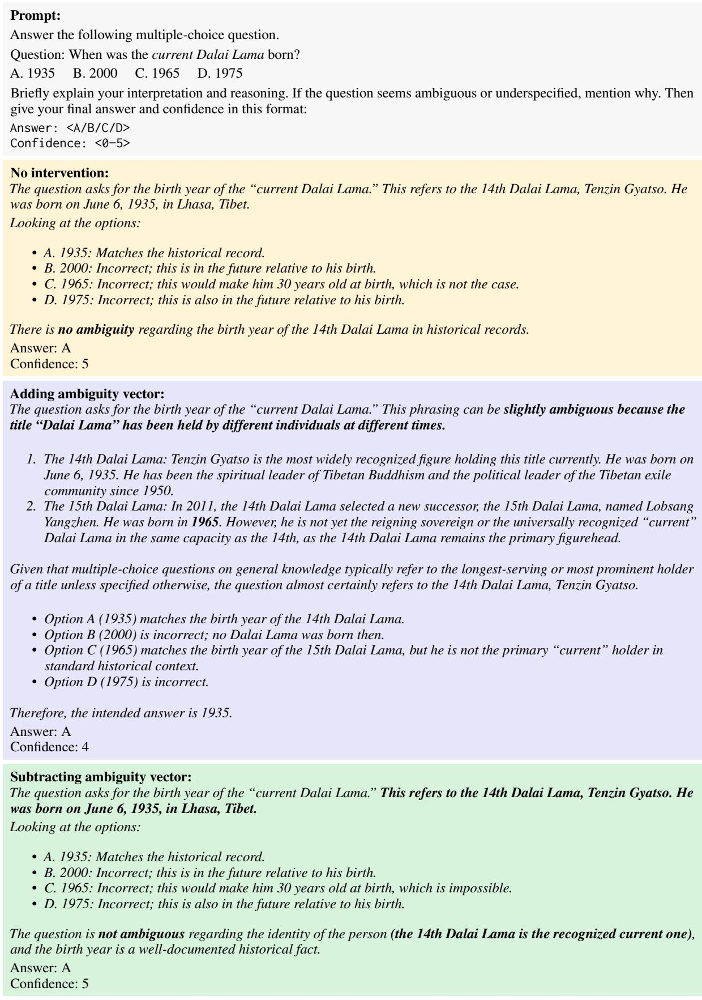  
Table 5: Full qualitative evaluation of the ambiguity vector on an MMLU example. Steering positively, makes the model sensitive to the current Dalai Lama, while subtracting it leads to a single interpretation.

## G Results Across Models and Confidence Elicitation Protocols

In addition to the logit-based confidence results, we evaluate our methods under the verbalized confidence elicitation protocol described in §4.2. In Figures 14 and 15, we show results across models, tasks and confidence elicitation protocols, which follow broadly consistent trends with the main results. Under the verbalized confidence protocol, parsing failures can affect task performance. As described in §4.2, generations that do not contain both a valid answer and a valid confidence estimate are treated as incorrect predictions with maximum confidence. This issue is particularly pronounced for Llama-3.1-8B-Instruct after both LoRA and DART on AmbigQA.

Figures 16 and 17 show the trade-off between calibration and accuracy across hyperparameter configurations for Llama-3.3-70B-Instruct, using AUC-EURO and smECE for both confidence elicitation protocols. Under verbalized confidence, steering remains close to the base model in both datasets, while DART only improves AUC-EURO in MMLU. This further highlights that the relative performance of confidence elicitation protocols and the impact of our interventions, vary across models and tasks (Tian et al., 2023; Shrivastava et al., 2023).

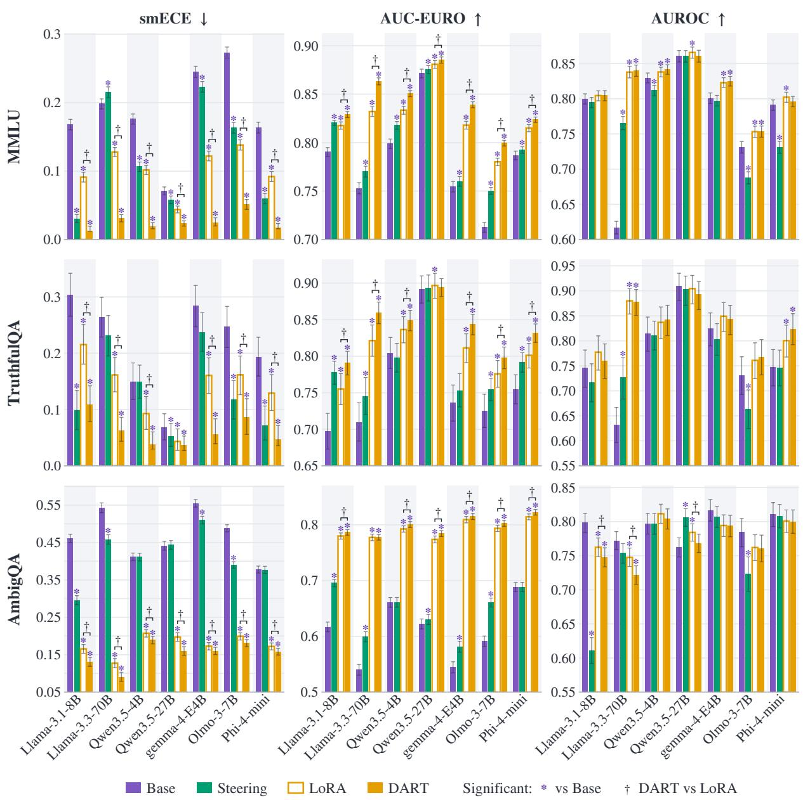  
Figure 14: Calibration results for all models under the logits protocol. smECE, AUC-EURO, and AUROC are shown for the base model, steering, LoRA, and DART on MMLU (top), TruthfulQA (middle), and AmbigQA (bottom). Error bars show 95% bootstrap intervals. ∗ marks a statistically significant difference from the base model, and † marks a statistically significant difference between DART and LoRA. Selected configurations are listed in App. D.

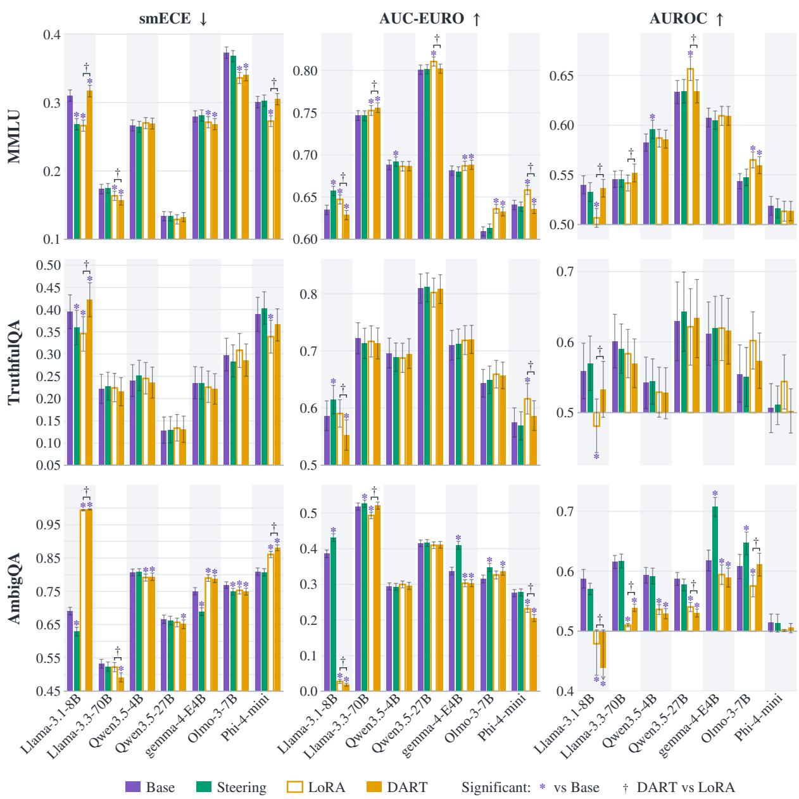  
Figure 15: Calibration results for all models under the verbalized protocol. smECE, AUC-EURO, and AUROC are shown for the base model, steering, LoRA, and DART on MMLU (top), TruthfulQA (middle), and AmbigQA (bottom). Error bars show 95% bootstrap intervals. ∗ marks a statistically significant difference from the base model, and † marks a statistically significant difference between DART and LoRA. Selected configurations are listed in App. D.

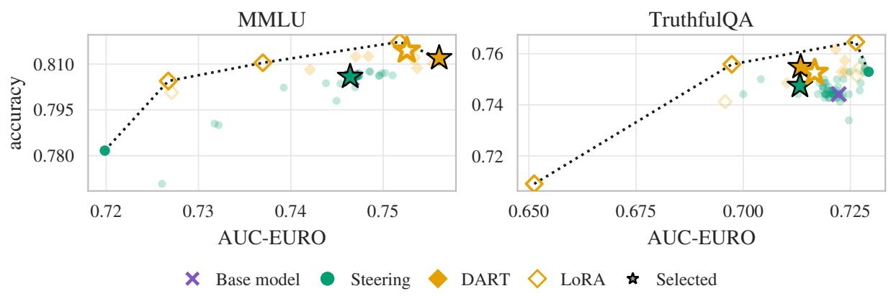  
Figure 16: Trade-off between AUC-EURO and accuracy under verbalized confidence elicitation on MMLU (left) and TruthfulQA (right). Results shown for Llama-3.3-70B-Instruct. Each point represents one hyperparameter configuration. Stars mark the selected configuration for each method. Higher values are better on both axes. The dotted line shows the Pareto frontier.

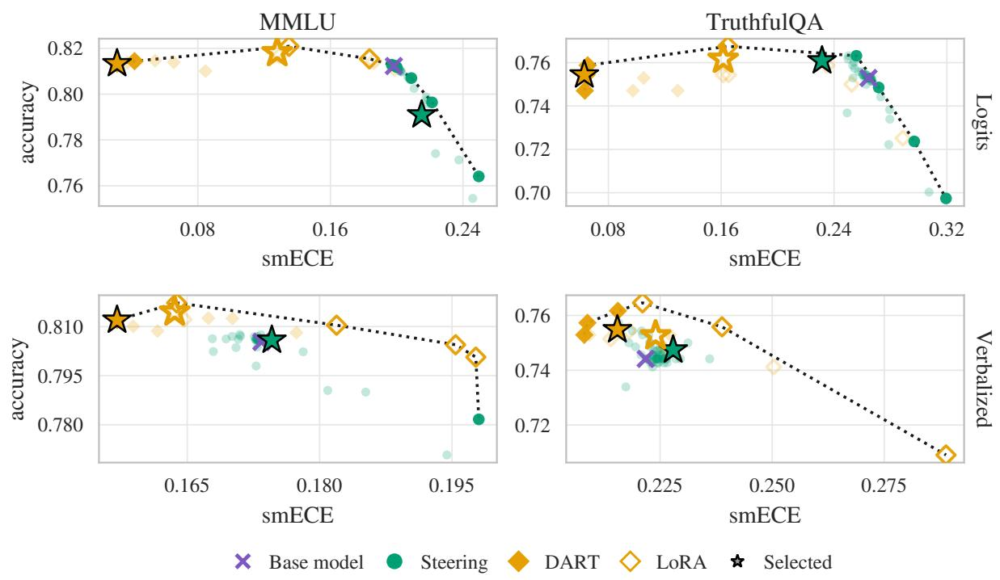  
Figure 17: Trade-off between calibration error and accuracy under the logit-based (top) and verbalized (bottom) confidence elicitation protocols on MMLU (left) and TruthfulQA (right). Results shown for Llama-3.3-70B-Instruct. Each point represents one hyperparameter configuration. Stars mark the selected configuration for each method. Lower smECE and higher accuracy values are better.

## H Results with Post-hoc Calibration

In Figures 18 and 19 we report results for Llama-3.3-70B-Instruct across different tasks and confidence elicitation protocols, after applying four standard post-hoc calibration methods, namely temperature scaling, Platt scaling, beta calibration, and isotonic regression. Calibrators are fitted and evaluated following the procedures described in App. C. The other six models show the same pattern for LoRA and DART with logit confidence. The only exception is steering, whose AUC-EURO gain survives calibration only for Llama-3.3-70B-Instruct.

Temperature scaling rescales each model’s output probabilities using a single scalar parameter fit on the validation set. Platt scaling fits a logistic mapping from the original score to a calibrated probability, while beta calibration uses a more flexible parametric mapping based on the log probabilities of the positive and negative classes. Isotonic regression instead learns a non-parametric monotonic mapping from confidence scores to calibrated probabilities.

These methods operate only on the produced confidence estimates by correcting for over or under confidence without changing the model’s predictions. Task performance is therefore unchanged by construction. By contrast, our interventions modify the model itself, potentially affecting both calibration and task accuracy. Importantly, posthoc calibration methods are complementary to our proposed interventions and can be applied on top of steering or DART to further improve calibration, although the gains are not consistently additive.

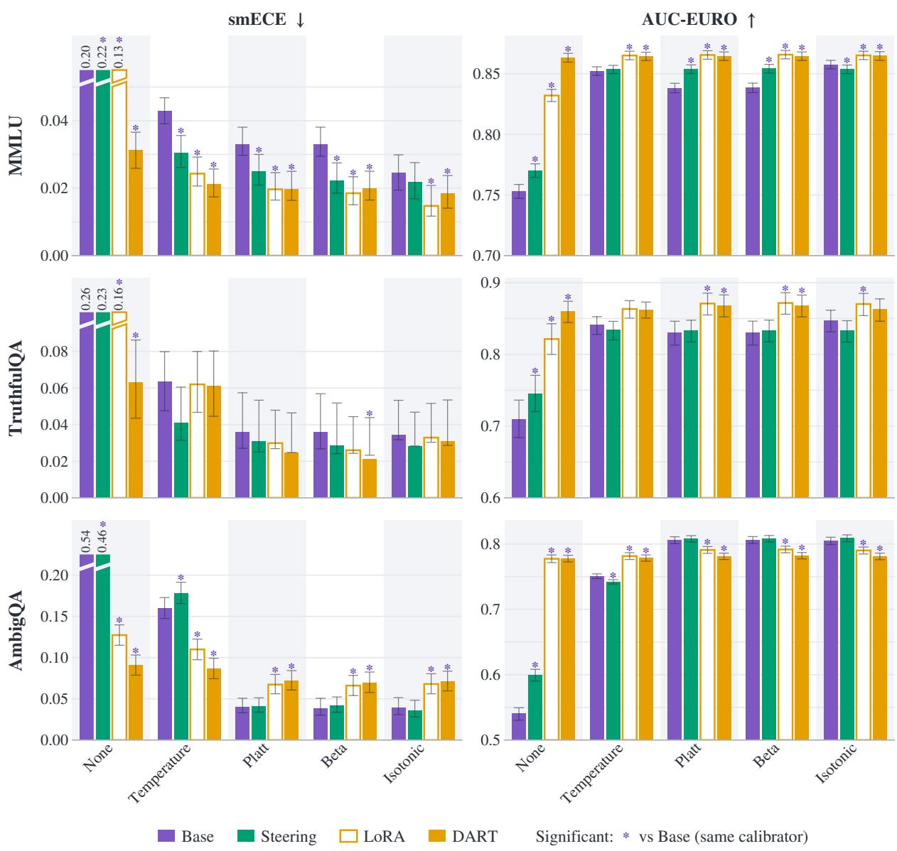  
Figure 18: Post-hoc calibration for Llama-3.3-70B-Instruct under the logits protocol. smECE and AUC-EURO are shown for the base model, steering, LoRA, and DART, as trained (None) and after temperature scaling, Platt scaling, beta calibration, and isotonic regression, on MMLU (top), TruthfulQA (middle), and AmbigQA (bottom). The smECE bars for None are truncated, with their actual values labeled above. Error bars show 95% bootstrap intervals. \* marks a significant difference from the base model under the same calibrator.

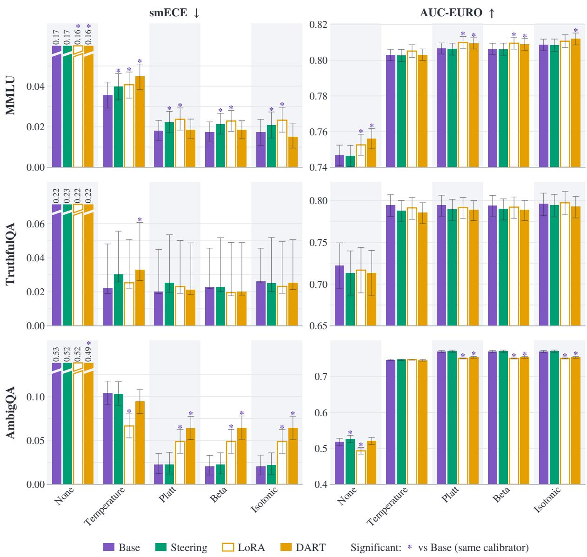  
Figure 19: Post-hoc calibration for Llama-3.3-70B-Instruct under the verbalized protocol. smECE and AUC EURO are shown for the base model, steering, LoRA, and DART, as trained (None) and after temperature scaling, Platt scaling, beta calibration, and isotonic regression, on MMLU (top), TruthfulQA (middle), and AmbigQA (bottom). The smECE bars for None are truncated, with their actual values labeled above. Error bars show 95% bootstrap intervals. \* marks a significant difference from the base model under the same calibrator.

## I Control Experiments

In this section, we study whether calibration improvements are specific to ambiguity or can also be achieved by steering along directions representing different concepts.

## I.1 Alternative Concept Controls

The concept that we consider is sentiment derived from CAD (Kaushik et al., 2020), applied at the best strength by EURO using the same steering procedure. As shown in Figure 20, steering along the control direction has only minimal effects on calibration compared to the ambiguity vector.

## I.2 Randomized Controls

Steering with random directions We additionally compare ambiguity steering against 20 random directions. As shown in Figure 20, steering in general has minimal effects on calibration and they are mainly focused in verbalized confidence elicitation. While ambiguity steering outperforms most random directions under certain settings, the effect does not consistently hold across datasets and confidence elicitation protocols. This further highlights that the two protocols are not interchangeable, as the effects of steering depend on the task and evaluation setting.

Training LoRA with random directions To further study whether DART’s substantial improvements in calibration depend on the ambiguity subspace, we replace it with a random subspace of the same dimensionality, while keeping the training procedure the same. Figure 21 shows that training with random directions also improves calibration compared to the base model, however, DART consistently achieves lower smECE (higher 1 − smECE) and higher AUC-EURO across all tasks and confidence elicitation protocols.

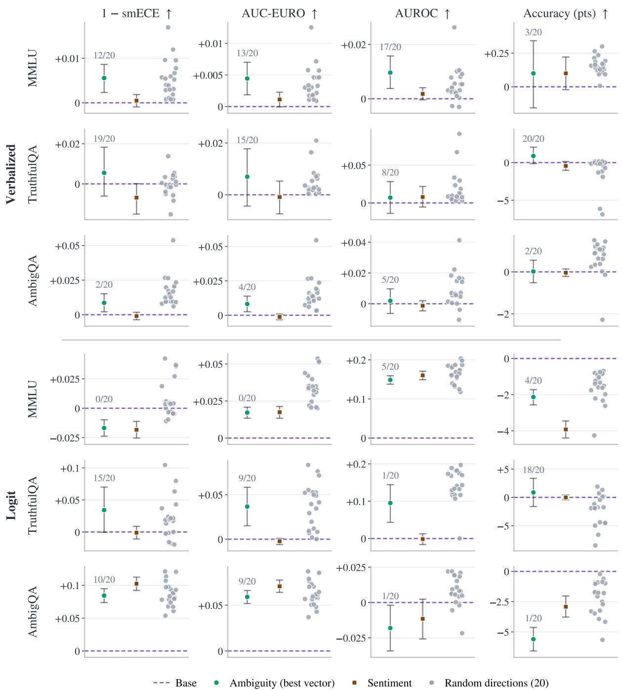  
Figure 20: Comparison of ambiguity steering with control directions for Llama-3.3-70B-Instruct on MMLU, TruthfulQA and AmbigQA. We report the change from the base model in 1 − smECE, AUC-EURO, AUROC and accuracy under steering with ambiguity, sentiment and 20 random directions. Error bars are 95% bootstrap intervals. The number above the ambiguity vector is how many of the 20 random directions it outperforms.

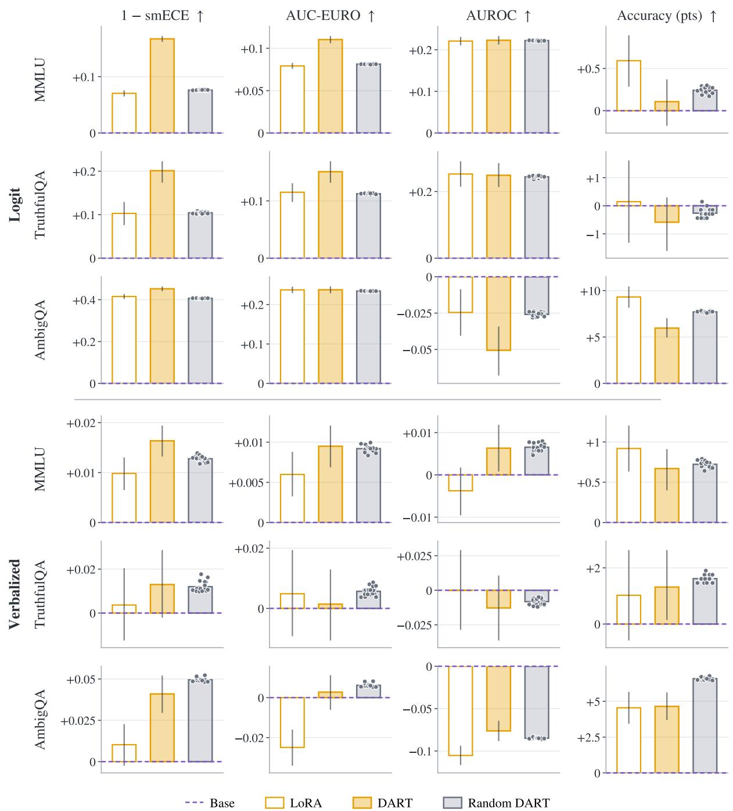  
Figure 21: Random-span DART control for Llama-3.3-70B-Instruct on MMLU, TruthfulQA and AmbigQA. We report the change from the base model in 1 − smECE, AUC-EURO, AUROC and accuracy under both confidence protocols. The gray bar is the mean of 20 random spans of the same rank. Error bars are 95% bootstrap intervals.

## J AI Use

LLMs were used for writing plotting code, latex formatting, and answering technical questions through search engine’s AI overview features.